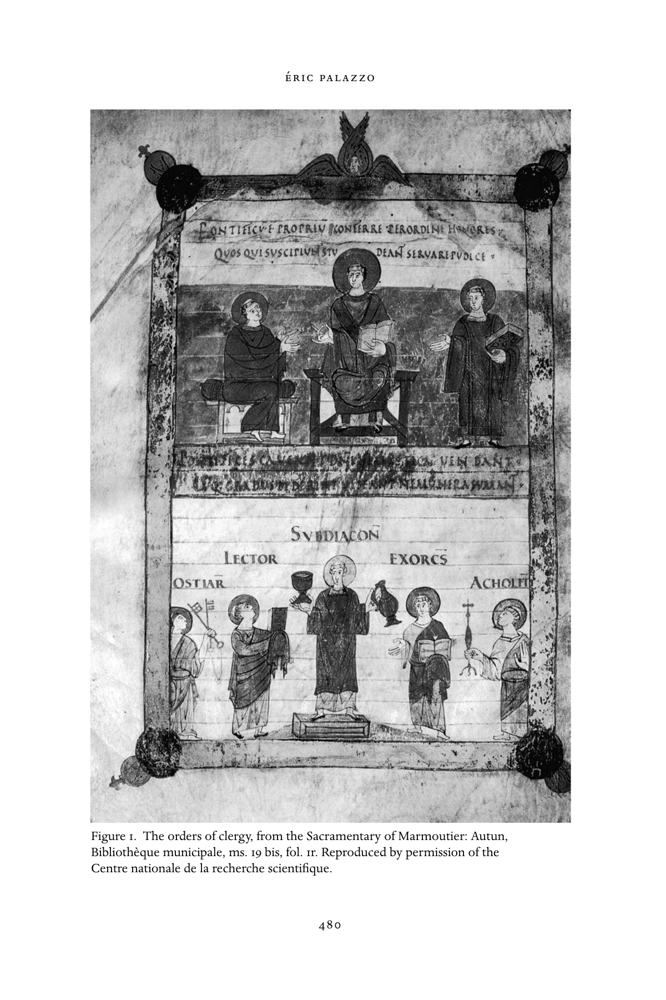
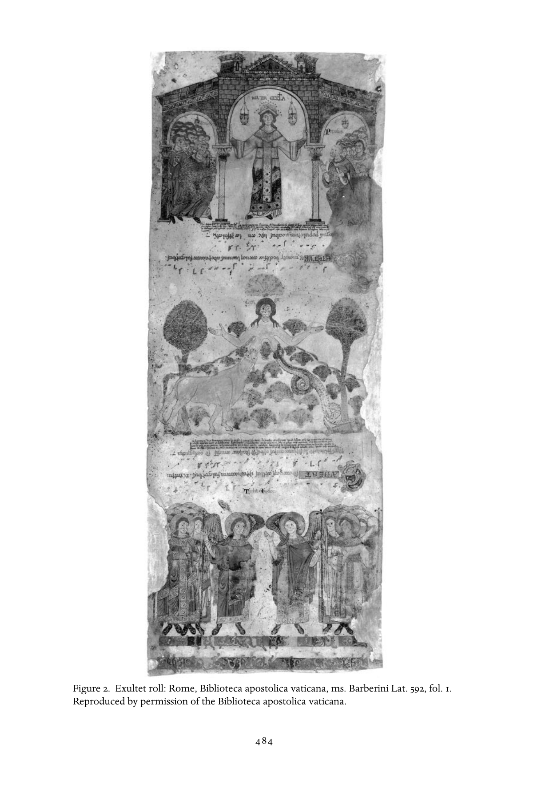

# 礼仪的施行：英文转换底稿

<!-- PDF page 501; original page 472 -->

### 23

### Performing the liturgy

### e´ r i c pa la z zo

In effecting, at the very highest level of existence, the connection and con-

stant transactions between man and God, between the tangible universe and

eternity, the liturgy illustrated this propensity [for sensory participation] in an

exemplary way. Spectacular, even in its smallest aspects, it signified the truths

of the faith by means of a complex play on the senses of hearing (through

music, chants, reading), sight (through the grandeur of the edifices; by the

actors, their dress, their gestures, their dance and by the setting) and even

touch: the sacred wall was touched; the foot, the reliquary, the episcopal ring

kissed; the fragrance of incense and of candlewax inhaled.[^p501-1] Without doubt, the liturgy – the ritual of the Christian church in antiquity and in the Middle Ages – is one of the fields of medieval studies to benefit most in recent years from new developments in both research methods and the sorts of questions raised. Long considered the preserve of clerical researchers (especially in France) where complementary theological and textual approaches held sway, the study of the liturgy has in recent years enjoyed a resurgence in the field of medieval studies. Responding to the various historiographical traditions of each country, this phenomenon was to a large extent made possible by the influence of historical anthropology. The study of rites and, more generally speaking, of ritual phenomena is central to this approach. Applied to the study of medieval civilization, historical anthropology has made the pivotal role played by the liturgy in medieval society more and more apparent. Other currents, internal to the evolution of liturgical scholarship concerned with the “history of the liturgy,” have also contributed to a widespread shift to a fully historicized reading of the liturgy. There is only room here to mention one trait which characterizes this evolution. For much of the twentieth century, historians of the liturgy (mostly clergy) applied themselves to editing the major western liturgical texts with

[^p501-1]: Zumthor, La lettre et la voix, 287–88.

<!-- PDF page 502; original page 473 -->

the primary objective of studying and identifying their textual archetypes, and bringing to light the history of each of the major liturgical books. Today, historians of the liturgy and medievalists in general continue to make use of these erudite works. Indeed, they remain indispensable for any historian who, while interested in the history of the ritual of the church in the Middle Ages per se, nonetheless, now approaches these documents with questions in mind that are largely those of historical anthropology. Moreover, I would add that the idea of a “liturgical source” is now no longer limited to liturgical texts, but has been greatly enriched by taking into account diverse documents such as hagiographic material, chronicles, and charters, or even images and archaeological sources, to mention only a few.[^p502-2]

Continuing in the same vein of a new reading within medieval studies of the history of liturgy, I wish to highlight the importance of a number of works which in recent years have shown that the ritual of the church was a veritable crossroads at which the political, theological, and social dimensions of medieval culture met and interacted. In other words, far from being a realm set apart and outside the flux of “life” in medieval society, liturgy in the Middle Ages appears, on the contrary, as a fundamental element in the functioning of this society – right in the thick of the political, theological, and social stakes. Medieval society is fundamentally a society of ritual.[^p502-3] Thus, ritual behavior in the Middle Ages concerns not only the church, but all the structures of medieval society. Furthermore, the vitality of rites in the Middle Ages stems largely from the interaction of the various rituals practiced within diverse sectors of society (the ecclesiastical, political, and judicial institutions).

It is useful, nonetheless, to bear in mind that medieval theologians who commented on the liturgy of the church principally considered it an office in the service of God and reserved to clerics. This is the understanding proposed by the two greatest commentators on the liturgy in the Middle Ages, Amalarius of Metz (c. 780–c. 850) in the ninth century, and William Durandus (d. 1296) in the second half of the thirteenth century. Both men composed great treatises on the history of the liturgy in which stress is laid principally upon the “historical” continuity between the liturgy that they experienced (i.e., the medieval liturgy) and biblical history as a whole. Amalarius and Durandus, like many other liturgical exegetes in the Middle Ages, situate the liturgy within the tradition of biblical history and propose a reading of the ritual of the church essentially centered on biblical symbolism.[^p502-4]

[^p502-2]: Palazzo, Liturgie et société.

[^p502-3]: Althoff, “Variability.” See also Post, “Ritual Studies.”

[^p502-4]: Reynolds, “Liturgy, Treatises on.”

<!-- PDF page 503; original page 474 -->

I shall consider the liturgy of the church of the Middle Ages principally in terms of its fundamentally multidimensional character. In many ways, this approach comprises an important element in the development of the medievalist’s understanding of the liturgy, necessarily leaving behind the notion of a history of the liturgy restricted to the knowledge of ritual texts and their theology. It is true that the “textual” dimension, that is, orality, or more generally speaking “the written word,” occupies a central place in both the definition of the liturgy and in its actual performance. However, liturgy in no wise limits itself to words transcribed in books, chanted, read, or intoned.[^p503-5] The ritual of the medieval church is multidimensional and, alongside the importance it places on “words” in the extended sense, it also accords enormous significance to places, persons, and objects (books included!), to music, to aromas, and indeed to light and, in a general way, to images. In the context of this discussion which is concerned with the idea of liturgical “performance,” it seems appropriate to present a comprehensive overview of the multidimensional character of medieval liturgy. In this connection and by way of introduction, let us turn to the words of Hrabanus Maurus (c. 780–856), abbot of Fulda and archbishop of Mainz in the ninth century and an important theologian of the early Middle Ages. On the occasion of a homily for the dedication of a church, Hrabanus put forward in his own way a sort of definition of medieval liturgy, which is considered here in its multifarious dimensions, the emphasis being on the various components of the “performance” of the liturgy:

You are well met together today, dear brothers, that we may dedicate a house

to God.... But we do this if we ourselves strive to become a temple of God,

and do our best to match ourselves to the ritual that we cultivate in our hearts;

so that just as with the decorated walls of this very church, with many lighted

candles, with voices variously raised through litanies and prayers, through

readings and songs we can more earnestly offer praise to God: so we should

always decorate the recesses of our hearts with the essential ornaments of

good works, always in us the flame of divine and communal charity should

grow side by side, always in the interior of our breast the holy sweetness

of heavenly sayings and of gospel praise should resonate in memory. These

are the fruits of a good tree, this the treasury of a good heart, these the

foundations of a wise master builder, which our reading of the holy Gospel

has commended to us today.[^p503-6]

[^p503-5]: Palazzo, Histoire.

[^p503-6]: Hrabanus Maurus, Homilia 39, 73–74. Trans. by M. Carruthers in her The Craft of Thought: Memory, Rhetoric and the Making of Images 400–1200. New York: Cambridge University Press, 1998, 275.

<!-- PDF page 504; original page 475 -->

This chapter principally will consider the liturgy of the medieval West. I am, however, cognizant of the considerable importance of eastern, or Byzantine, liturgy in developing an understanding of ritual phenomena as a whole. In order to treat the eastern rites, it would be necessary to devote an entire chapter to this subject; since I am unable to do so here, nonetheless, I wish to draw the reader’s attention to a few points which seem to me to need to be underlined.

First, the history of the liturgies of the East follows virtually identical principles to those observed in the evolution of the liturgy of the Christian West. It is certainly true that the main milestones of this history of the “Byzantine Rite,” to use Robert Taft’s expression,[^p504-7] are relatively different to those marking the important moments in the chronology of the liturgical history of the West.[^p504-8] In the East, the rhythms of this chronology are determined above all by the succession of dynasties on the imperial throne of Constantinople.

Secondly, it is appropriate to emphasize the originality and specificity of certain rituals of the Byzantine East. To illustrate this point, I mention only in passing the truly particular character of the Byzantine entry rites into the church and, more generally, the Byzantine stational liturgy – a ritual practice also known in the West.[^p504-9] The important consequences of these ritual practices for church space and liturgical planning aside, it is appropriate to highlight the pronounced relationship between the liturgical entry rite and imperial ritual, attested by numerous passages from the Book of Ceremonies, compiled from earlier sources by Constantine VII Porphyrogenitus (913–20, 945–59), and which is regarded as, without doubt, the most important of the ceremonial books of the imperial Byzantine court.

Lastly, I cannot conclude this all-too-rapid allusion to eastern liturgies without recalling that they, too, were marked by a multidimensional character which called into play the various “sensory” aspects of ritual practice in ways just as rich as in the West. One must, however, guard against the idea, still too widely accepted, that the liturgies of the East were “perfect” and had been preserved thus for centuries. This understanding of eastern liturgies, largely constructed in the West in the nineteenth century, is found to be far from the truth if we linger even for a moment on a few commentaries, which, while they flow from the pens of the greatest of the eastern theologians of antiquity and of the early Middle Ages, are hardly laudatory with respect to the contemporaries of these theologians, who took advantage of various

[^p504-7]: Taft, Le rite byzantin.

[^p504-8]: Palazzo, “Jalons.”

[^p504-9]: Taft, Le rite byzantin, 40ff.

<!-- PDF page 505; original page 476 -->

occasions literally to disrupt the unfolding of the liturgical “performance.” St. John Chrysostom writes:

Here, in the church, the uproar and the confusion are tremendous! Our

gatherings are no different from what happens in a tavern, so noisy are

the guffaws, so great the commotion, like the baths or the market, with

everyone shouting and kicking up a row... [at church] we behave with more

impudence than dogs, and we show as much respect to God as to a courtesan

... the church is no different from the forum... nor even, for that matter,

from the theatre, if one considers the way in which the women who gather

here deck themselves out even more shamelessly than those unchaste women

we find down there. This is why we see so many debauched men seduced

by them – even here!, and if one of these men tried or intended to corrupt a

woman, my guess is that nowhere would be easier than in a church.[^p505-10]

### Ritual sites and the physical arrangements

### for the liturgy

In both antiquity and in the Middle Ages, Christian rites were conducted in places specially fitted out to accommodate the performance of the liturgy. I wish to correct immediately the predominant impression that arises from reading numerous works or articles on “liturgical space” in antiquity and in the Middle Ages: in point of fact, the liturgical site in this period is not exclusively the particular space of a church, that is, of the building constructed to allow the performance of the liturgy. It is true that theologians and liturgists of antiquity and of the Middle Ages constantly made a point of recalling that the privileged site of the liturgical celebration, indeed, the only site truly authorized for holding such celebrations was the church building. It is important, however, to see beneath this insistence the desire markedly present among theologians and liturgists to associate the image of the church building with the powerful ecclesiological notion of the construction of the Ecclesia made from the faithful who are the stones of the edifice that is the church.[^p505-11]  Accordingly, in antiquity and for a good portion of the Middle Ages there prevails the idea that the celebration of Christian rites must be held in the church, in that place, that is, where fixed altars containing the relics of saints have been installed.

Nonetheless, in defining liturgical sites one important fact must be underlined: from the beginnings of Christianity and throughout the Middle Ages, celebrations which took place outside the church building, and,

[^p505-10]: Cited in Taft, “L’apport,” 106.

[^p505-11]: See the chapter by Iogna-Prat in this volume.

<!-- PDF page 506; original page 477 -->

sometimes, out in the open air, were certainly known and integrated into liturgical practice.[^p506-12]  Numerous specific circumstances, which it is unnecessary to describe in detail here, conditioned the performance of open-air liturgical celebrations in particular, requiring the use of portable altars, and, from time to time, special liturgical arrangements, such as the use of tents. Moreover, we find that time and again theologians and liturgists comment that these liturgical celebrations in the open air bring to life the idea that the church is present throughout the world, and that it is not bounded by the space of the church building.

Nonetheless, in general church authorities will come to adopt a conservative position with respect to these celebrations outside the church, one that is perfectly summarized in the following extract from one of the episcopal capitularies of Theodulf of Orleans (c. 760–821) from the first half of the ninth century:

The solemnities of the mass must under no circumstances be celebrated

anywhere other than in a church, and not just in any house, nor in a secular

place, but in the place that the Lord has chosen, according to what is written:

“Take care not to offer sacrifices in every place that you have seen, but in the

place that the Lord has chosen to put his name.” An exception is made for

those who, continuing to celebrate in the army, have tents and altars for this

purpose with which they carry out the solemnities of the mass.[^p506-13] Thus, throughout antiquity and in the Middle Ages the church building remains the principal site for the performance of the liturgy. Through the centuries, the church space underwent numerous transformations which would be tiresome to describe in detail here. Let us simply recall that these transformations continually aimed at the pursuit of a greater approximation of the type of celebration (monastic, presbyteral, episcopal, papal...) and the architectural form. In other words, as many authors have shown, the religious architecture of antiquity and of the Middle Ages more often than not is shaped according to the types of liturgical celebrations, and according to the transformation of these types, both through the centuries and in accord with local and regional uses in the medieval West.

One more point seems to me to be important to underline with respect to the definition of the liturgical site constituting the church space, namely, the specialization of ritual spaces in the church interior itself. The way the liturgy unfolded in the church interior in antiquity and in the Middle Ages made

[^p506-12]: Palazzo, “L’espace et le sacré.”

[^p506-13]: Theodulf of Orleans, Erstes Kapitalar XI, 110–11.

<!-- PDF page 507; original page 478 -->

the emergence of specific liturgical spaces inevitable: a place, for example, for consecrating, a place for the proclamation of the Scriptures, a place for penance, a place for baptism, not to mention the ritual routes followed by processions inside the ecclesial space. All this leads us to postulate that the performance of liturgical celebrations within the church interior, in the end, comes to determine specific ritual zones, the visual demarcation of which is considerably enhanced by the presence in churches of permanent or temporary monumental decor.

These individual liturgical zones in the church truly are spatially demarcated by the physical arrangements for the liturgy. By way of example, let us cite the following passage from the life of St. Benedict of Aniane (c. 750–821) by Ardo in the ninth century, which concerns the physical arrangements for the liturgy that Benedict of Aniane desired for the construction of the monastery church and which had powerful symbolic connotations.

The venerable father Benedict, driven by a pious consideration, did not wish

to take saints as patrons, rather it is in honor of the divine Trinity... that

he consecrated this church. That what I have just said might be more clearly

understood: he had three altars placed in the altar that is like the first of all

the others, so that these [three] might appear to represent the persons of the

Trinity; and the way this is arranged is marvellous, revealing the undivided

Trinity in the three altars, and the divinity in essence in the single altar.[^p507-14] There follows a long and precise description of the liturgical arrangements envisaged by Benedict for the various altars and the symbolic significance he attached to them.

In many respects, these descriptions, drawn from a literary genre that is not strictly speaking liturgical, namely hagiography, are relatively similar to those of the monk Garsias in the first half of the eleventh century regarding the important architectural remodeling of the church of Saint-Michel de Cuxa, undertaken at the initiative of his abbot Oliba. In a poem praising the latter, Garsias describes with relative precision the architectural remodelings, along with their symbolism, and the physical arrangements for the liturgy envisaged in this “new” church of Cuxa. As at Aniane in the ninth century, a large part of the symbolism of the church of Cuxa in the middle of the eleventh century is based upon the “figure” of the Trinity. Besides this, however, Garsias does not fail to relate the architectural typology and, indeed, most of the liturgical arrangements, such as, for example, the baldachin installed above the high altar, to the symbolism of the church interpreted as a vision, or rather as

[^p507-14]: Ardo, Vie de Benôıt d’Aniane, 70–71.

<!-- PDF page 508; original page 479 -->

a representation of the heavenly Jerusalem, and above all, as the Temple of Solomon.[^p508-15]

### Actors and objects

In the Middle Ages, as in antiquity, the liturgy put into play actors who more often than not use objects to carry out the ritual actions for which each person was responsible. Christian liturgy generally envisages two categories of actors: the members of the clergy and the lay faithful, who are more commonly designated by the generic term “the assembly.” Within these two groups of actors, several categories may be distinguished, particularly in the group of those who have received ordination and who belong to the ecclesiastical hierarchy. Whatever the kind of liturgical celebration (monastic, presbyteral, episcopal, or papal), different members of the ecclesiastical hierarchy were involved in the ritual according to their role and following the course of the rite as envisaged in the liturgical texts. In the early Middle Ages, and more particularly in the Carolingian period, certain theologians developed a theology of ecclesiastical hierarchy at the core of which we find an expression of the ecclesiology of the liturgy in this period. This ecclesiology is inherently built around the idea of the division of labor in the church, and, in particular, within the ecclesiastical hierarchy. Thus, at ordination each member of the hierarchy receives from the hands of the bishop (who alone can administer the sacrament of orders) that which is the instrument of his liturgical responsibility, but is equally the veritable symbolic badge of this responsibility. For theologians, this act of the bestowal of the liturgical instrument to each member of the ecclesiastical hierarchy, whether he belongs to the major or to the minor orders, constituted the most important moment of this ritual from the point of view of the theology of ordination. In fact, this traditio instrumentorum “truly” makes the ordained minister, and causes him to move from the status of layman to that of an ordained cleric, a member of the ecclesiastical hierarchy to whom, hereafter, will be allotted a particular liturgical responsibility in the performance of the rites.

In order to illustrate these remarks, let us turn our attention to the full-page miniature taken from the Carolingian Sacramentary of Marmoutier, produced at the Tours scriptorium around 845 and now in the Bibliothe`que municipale of Autun (ms. 19 bis, fol. 1r) (fig. 1).[^p508-16]

[^p508-15]: Durliat, “L’architecture du XIe siécle.”

[^p508-16]: Reynolds, “Portrait.”

<!-- PDF page 509; original page 480 -->

Figure 1. The orders of clergy, from the Sacramentary of Marmoutier: Autun, Bibliothe`que municipale, ms. 19 bis, fol. 1r. Reproduced by permission of the Centre nationale de la recherche scientifique.

<!-- PDF page 510; original page 481 -->

Appearing on folio 1r of the manuscript, this miniature opens the text of the Gregorian sacramentary in the use of Marmoutier and adapted in the eleventh century for the use of Autun cathedral. The opening folios of the manuscript contain the series of prayers pronounced in the course of ordination rituals. Their presence in a sacramentary is exceptional since these prayers are usually, at least from the ninth century, in separate manuscripts, namely the ordines, one of which contains the ordination rituals. In the latter, the prayers are combined with the rubrics which describe the performance of the ordination liturgies, while in the opening folios of the Marmoutier sacramentary, these prayers appear without the description of this ordo. In certain ways, the miniature of folio 1r proposes an “ideal vision” of the ecclesiastical hierarchy corresponding to the ordination prayers transcribed immediately following in the manuscript. In the upper part of the image, we see the bishop, wearing his pallium, enthroned in the center, framed by the priest seated on his right and the deacon, robed in dalmatic, on his left. The three compose the category of major orders. The miniature’s composition in two registers visually expresses the idea of the ecclesiastical hierarchy being composed of two categories. Similarly, within the upper register, the bishop who is depicted larger than the two other figures, is placed in the center upon a throne, while the priest, second in the category of the major orders, is seated on the bishop’s right on a smaller throne than that of the head of the church. His position, slightly in profile, likewise expresses the notion of hierarchy at work here. The deacon is shown standing and holds in his left hand the book of the Gospels, the symbol of his role in the liturgy, since it is he who is designated to read the Gospel of the day during the mass. The book of the Gospels is handed over to the deacon by the bishop in the course of the celebration of his ordination. This gesture is interpreted by theologians as that which truly makes the deacon. In this way the book of the Gospels becomes the badge of the liturgical office of the deacon. Above the figures, a Latin inscription points out that the right to confer ecclesiastical rank is the privilege of the bishop.

In the lower register of the miniature there are depicted figures representing the five office holders of the minor orders. The pyramid-shaped composition and the arrangement of the figures contribute, as in the upper register, to the expression of the idea of hierarchy within the category of minor orders. At the head of these orders we find the subdeacon, here placed in the center on a dais. In addition to his office as lector of the Epistle in the mass, he also served at the altar. This is the reason why he is represented holding the chalice and the cruet. Next, to the left and right, we see the porter, the lector, the exorcist, and the acolyte. Each is provided with the object of his liturgical office: keys, book,

<!-- PDF page 511; original page 482 -->

book containing the ritual of exorcism, and the torch, respectively. In the course of the ordination of each of these members of the ecclesiastical hierarchy, the bishop carries out the traditio of the liturgical instrument of their office. Again, the theologians of the Carolingian period interpreted this moment in the ordination ritual as that which made the subdeacon, the porter, the lector, the exorcist, and the acolyte. In other words, this act of the traditio instrumentorum was the fundamental moment of this ritual because it not only contained in nuce all of the theological significance of ordinations, but also provided for the transmission by the bishop of each member of the ecclesiastical hierarchy’s badge of liturgical office, a badge that the cleric will be called upon to use in the course of liturgical celebrations.

Without proposing a realistic representation of the ritual of ordinations in the Carolingian period, nor even of a precise moment in this liturgical celebration, the Marmoutier sacramentary miniature displays a synthetic vision of the theology of ordinations by emphasizing what appears as the most significant moment in the ritual and in its theology: the bestowal of the liturgical instrument on each ordained person.

### Books and their images

Just as images form part of the monumental decor of a church, the miniatures in liturgical manuscripts likewise contribute to the visual dimension of the medieval church. Images appear in liturgical books in the West in the seventh century, at the time when the various texts of the liturgy were being codified. Varying according to the type of liturgical book, these illustrations evoke the life of Christ, depict the figures of the saints, the portraits of the evangelists, or even ritual scenes. The images elude any idea of a straightforward functionality in the liturgy, but correspond rather to diverse concerns: to pay homage to God by the richness of their decoration and to give expression to various liturgical, political, social, and even theological stakes. On the other hand, we do not know whether the images contributed to the actual performance of the rites; rather it is usually held that they represented the visual dimension of the liturgy. However, in certain instances it is not impossible that they may have played a role as visual snapshots of moments in the liturgy.[^p511-17]  Let us note that in the Middle Ages the decoration of the liturgical book was not limited to the miniatures that accompany the texts within the body of the manuscript. The sumptuousness and the iconography of bindings, adorned

[^p511-17]: Bonne, “Rituel de la couleur.”

<!-- PDF page 512; original page 483 -->

with ivory panels or with gold and silver, indeed with precious stones and other fine materials, equally underline the desire to render glory to God by celebrating the liturgy with beautiful objects – this despite the admonitions to the contrary of medieval theologians and, before them, of certain fathers of the church who advocated the use of modest books in the rites.[^p512-18]

By way of examples, let us mention the miniatures painted on the Exultet rolls, which were produced for the most part in southern Italy, or more precisely at Benevento, between the tenth and the twelfth centuries.[^p512-19]  On these rolls the text of the Exultet (the chant performed by the deacon at the Easter vigil when the Paschal candle is blessed and lit) is transcribed, alternating with illustrations of passages from the texts or from the liturgical events of the paschal liturgy (fig. 2).

While the text’s laus apum, the famous poetic and theological passage in praise of the bee, is illustrated with scenes of beekeeping, most of the images in the Exultet rolls depict a precise moment in the Easter vigil: the blessing of the Paschal candle, the lighting of the candle, the procession to the baptismal font, the blessing of the font with the candle, baptism scenes, or even the depiction of the roll’s mise en sce`ne showing the deacon at the top of the ambo, roll in hand, singing the Exultet with the lit Paschal candle at his side. Other images emphasize to a greater degree the theological dimension of some sections of the Exultet, such as the iconography of Christ casting down death placed on the roll immediately after the mention in the text of Christ’s victory over death. The distinctive codicological feature of these manuscripts is the inverted orientation of text and images, suggesting a didactic use of the images, intended for the faithful gathered in the nave for the performance of the chant, and a liturgical function for the text, chanted only by the deacon and only at this specific moment in the liturgical year.

In actual fact, the deacon did not need the written text since he knew the Exultet chant by heart, as is the case with most of the liturgical repertory in this period; as for the faithful, they were too far away from the ambo (at the top of which the deacon stood with his roll) to be able to make out any image at all. These features which are peculiar to the Exultet rolls actually touch on the strong symbolic connotation of the written word and images in the performance of medieval liturgy. In the Exultet rolls, the text was not read by the officiating deacon, nor were the images (oriented in the opposite direction to the text) seen by those who were intended to see them. In other

[^p512-18]: Steenbock, Der kirchliche Prachteinband.

[^p512-19]: Kelly, Exultet.

<!-- PDF page 513; original page 484 -->

Figure 2. Exultet roll: Rome, Biblioteca apostolica vaticana, ms. Barberini Lat. 592, fol. 1. Reproduced by permission of the Biblioteca apostolica vaticana.

<!-- PDF page 514; original page 485 -->

words, the codicological layout of this particular liturgical book corresponded to liturgical roles of text and image which were never fulfilled. Nonetheless, at the time for the performance of the Exultet in the Easter vigil, the deacon had to have in his possession one of these rolls in which was symbolized the role of the liturgical text and of the images accompanying it. Moreover, the deacon was strictly obliged to be provided with an Exultet roll on this occasion since this object was also the symbol of his liturgical role in the Easter vigil.

This symbolic function of the Exultet roll, considered as the liturgical badge of the deacon in the context of his performance of the Easter vigil ritual, may be compared to that of another book, the cantatorium, prepared for the chant performed in the liturgy. “After the reading of the Epistle by the subdeacon, the cantor ascends the ambo with his cantatorium and performs the responsary.”[^p514-20]

This text is taken from a liturgical ordo (i.e., a book containing the description of the ritual) that defines both the meaning and the function of the cantatorium. It is a soloist’s book, containing only those chants inserted between the readings at the beginning of the mass (the gradual responsary and the alleluia) and sometimes including the offertory verses that the cantor would need to perform the solo chants. Far from exercising any ancient role appointed for books, in practice the cantatorium had an honorific more than a real function in the performance of the liturgical celebration, and, as such, its role may be compared to the symbolic function described above with respect to the Exultet roll. Regarding the honorific function of the cantatorium, Amalarius of Metz, the great theologian and liturgical commentator, writes at the middle of the ninth century: “The cantor, without any need to read [them], holds in his hands the [ivory] tablets [of the cantatorium].”[^p514-21]  Oblong in format – a format generally reserved for books of liturgical chant – the cantatorium, like many other liturgical books in the Middle Ages, was not uncommonly adorned with ivory panels which formed its binding. Amalarius of Metz’s commentary on the cantatorium and its liturgical use by the soloist evinces the powerful symbolic weight accorded liturgical books, together with, in certain instances such as the Exultet rolls, the images that adorn them. Amalarius’s exegesis forcefully underlines the eminently honorific character of the book in medieval ritual action. Most of the time the book is not, in fact, indispensable, but its presence together with the presence of its images is imperative since it defines certain aspects of the ritual: its written part and its visual dimension.

[^p514-20]: Amalarius of Metz, Liber officialis, III. XVI, 330.

[^p514-21]: “Cantor, sine aliqua necessitate legendi, tenet tabulas in minibus,” Amalarius of Metz, Liber officialis, 303.

<!-- PDF page 515; original page 486 -->

### Sound, light, fragrance, and “liturgical drama”

### in ritual performance

The medieval church’s ritual evinces a strong multidimensional character. I drew attention to this important aspect of the definition of medieval liturgy above, using a passage from Hrabanus Maurus’s homily for the dedication of a church. With respect to ritual, this text alludes to “the decorated walls of this very church,” “many lighted candles,” “voices variously raised through litanies and in prayers,” and “readings and songs.” It is indeed true that medieval liturgy consists of texts that are to be read, recitations in prayer mode, images painted or sculpted on the inside walls of the church, or miniatures in manuscripts. But it also is made of light and chant, and to all this we could add the olfactory dimension of the ritual rarely mentioned in medieval liturgical texts or in liturgical commentaries. Fragrances, generally produced by the abundant use of incense, were an integral part of liturgical performance in the Middle Ages. This olfactory dimension is extremely suggestive symbolically in its own right, particularly in relation to the sacred fragrances described in the rites of the Old Law, and used by the priests officiating in the Temple of Solomon.

The dimension of sound also constitutes a major sensory element in the definition of the medieval church’s ritual and in its symbolic significance.[^p515-22] This aspect of the liturgy includes the performance of liturgical chants in the course of the mass and within the frame of the celebration of sacramental rites in general (baptism, confirmation, dedication of a church and consecration of an altar, ordination, etc.) or, indeed, at the numerous daily offices celebrated by monks in monasteries in the course of the various liturgical hours. We cannot give here a detailed historical description of medieval liturgical music; rather, I wish simply to underline the central role played by the dimension of sound in the definition of ritual performance in the medieval church. Generally speaking, the chants of the liturgy doubly adorn the ritual performance, both in respect to sound and in respect to theology, given the exegetical import of many of the texts chanted, such as, for example, mass tropes. Occasionally, the medieval liturgy’s soundscape can take dark turns. An innovative contribution to the field has recently examined the various sorts of cries in the medieval church’s ritual.[^p515-23]  From various liturgical sources and other types of texts, the author has clearly demonstrated the existence of set, defined, and/or forbidden

[^p515-22]: For this “sonic” dimension of medieval culture, see Fritz’s excellent Paysages sonores du Moyen Âge, especially 263–308 which discusses “la théologie sonore: le verbe et la voix.”

[^p515-23]: Collomb, “Vox clamantis in ecclesia.”

<!-- PDF page 516; original page 487 -->

cries expressing complimentary aspects of medieval piety and forming an integral part of ritualized expressions of medieval society.

From the beginnings of Christianity, light has held pride of place in the performance of the liturgy, and, more broadly speaking, in all kinds of ritual.[^p516-24]  A passage from the famous liturgico-canonical text of the third century styled the “Apostolic Tradition,” whose Roman origin has been challenged in contemporary scholarship, attests the role and significance of light in Christian liturgy. In the ritual described, light is materially present, but it is at the same time endowed with symbolic and theological meaning connected with the light of Christ who is eternal light, and the conqueror of death. As is readily discernible by even a brief glance through the principal medieval liturgical texts, especially the prayers and the rubrics, the liturgy of the Middle Ages as a whole reflects this ritual and theological signification of light. Indeed, light was frequently used in the course of medieval liturgy: during the ritual it was present through the agency of both fixed and portable candles. At various moments in the celebration of the Eucharist, for example, acolytes responsible for carrying the candles placed on portable candle holders took up and changed their positions in such a way that candlelight was at the very center of the liturgical action. Quite apart from liturgical texts, numerous other medieval sources, such as hagiographic accounts and chronicles, furnish interesting information regarding the place of light in the performance of the liturgy. More often than not, the authors emphatically stress the mysterious efficacy of a saint’s or a sovereign’s prayer that causes a blazing light to shine. Finally, the Christian liturgy of antiquity and of the Middle Ages accorded such importance to light that some rites were, in a manner of speaking, wholly set aside for it. Such is the case, for example, with the Candlemas procession, which takes place on the 2nd of February, the feast of the Presentation of Christ in the Temple and of the Purification of the Blessed Virgin Mary. We may also point to the liturgy of the “new fire,” which was performed during the Easter vigil mentioned above, and during the course of which the deacon proceeded to bless and light the Paschal candle, symbol of the resurrection of Christ and of the foundation of the Ecclesia.

I cannot draw this brief exploration of liturgical performance in the early Middle Ages to a close without drawing attention to the importance of “liturgical drama,” or more generally, of “dramaturgy,” and of its relationship to ritual practices in the medieval western church.[^p516-25]  These “liturgical dramas”

[^p516-24]: Palazzo, “La lumière et la liturgie.”

[^p516-25]: Young, Drama. See also the contributions regarding “Le drame liturgique médiéval” brought together in a special volume of Revue de Musicologie.

<!-- PDF page 517; original page 488 -->

appear in the tenth/eleventh century primarily in monastic settings where they gave rise to new liturgical books. For many decades, historiography has tended to style these new ritual displays “liturgical dramas,” an expression, which though doubtless convenient, seems to me to be ill-suited to designate what these productions of the life of Christ or of other biblical characters really were. For my part, I am convinced that these new kinds of rites are in no wise “dramatic” in the modern sense of the term, and that it would be out of place to dislocate them from monastic ritual in its entirety. In point of fact, these liturgical “dramas” or “plays” are fully part of the accentuation of the splendor of monastic liturgy around the turn of the millennium, an accentuation perfectly reflected in contemporary monastic customaries which codify, among other things, the liturgical practices of the abbeys. In other words, these “dramas” reveal that monastic ritual at the turn of the millennium was evolving, in the sense that its “staging” was developing; the performance of “liturgical dramas” contributed to this development. This process in some ways came to counterbalance the “textual” dimension of the rites in the recitation of prayers, the reading of sacred texts, and even the performance of pieces of chant.
