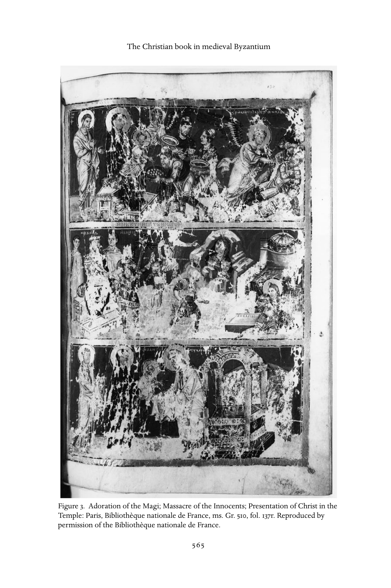
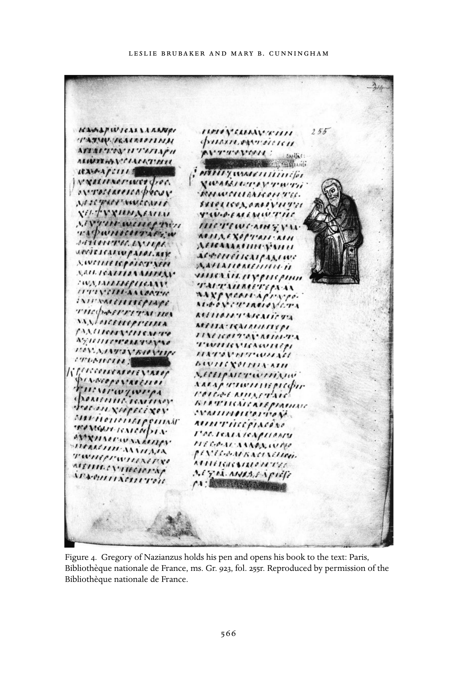
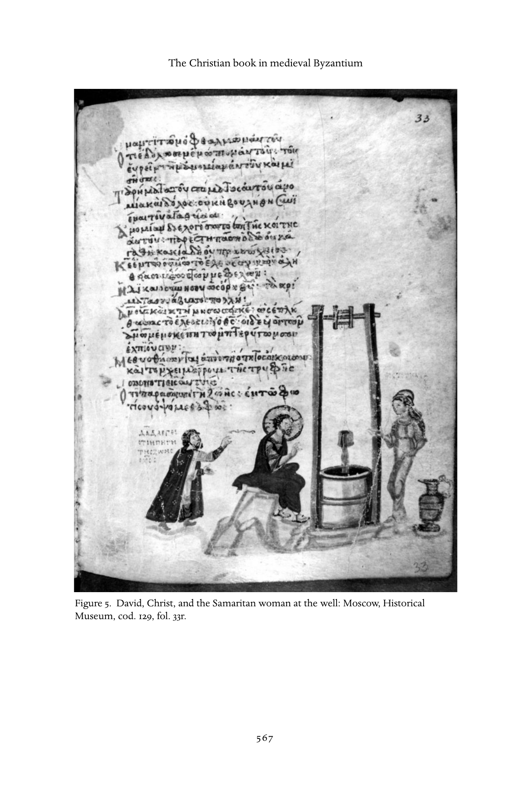

# 第27章 中世纪拜占庭的基督教书籍

莱斯利·布鲁贝克、玛丽·B. 坎宁安（Leslie Brubaker and Mary B. Cunningham）

<!-- PDF page 582; original page 554 -->

自君士坦丁一世“大帝”开始以新名——君士坦丁堡，即君士坦丁之城（polis）——称呼古老东罗马帝国首都拜占庭以来，保存至今的各种工艺制作中，今天最为人熟悉的，大概是圣像和圣索菲亚等建筑。但也可以主张，拜占庭书籍应与它们共享显要地位。

帝国的各个世纪，希腊语手稿是珍贵的外交礼物，通常是豪华福音书或礼仪书，也有神学论著，如827年送给虔诚者路易的亚略巴古的狄奥尼修抄本。[^p582-1] 1453年君士坦丁堡落入奥斯曼土耳其人之手后，人文主义学者搜集这些手稿，尤其看重其中保存的古希腊作者文本，但并不限于此；法国国王也搜集它们，因为自视为拜占庭皇帝继承者，用这些声称为自己先人的物品环绕自身。[^p582-2] 除在文化史中的角色外，希腊语手稿的内容与装饰，也作为证据而重要：它们显示中世纪拜占庭人如何组织思想，图像又如何被用于强化、塑造那些能接触并主动阅读书籍、主要居于城市的精英的世界。

### 拜占庭书籍：起源与发展简史

早期手稿制作，在说拉丁语的西方基督教世界与说希腊语的东方正教世界，大体相似。因此，下文追溯的基督教书籍<!-- PDF page 583; original page 555 -->发展，除另有说明，大体适用于双方。在册页书（codices）之前，书面记录通常保存在纸草卷轴（rotuli）上；不过，涂蜡木板也可装订在一起，罗马时期就已作为笔记本记录商业事务。我们今天所知书籍形式，即裁切的书页夹在封面之间装订，最早证据见于一世纪；但现存实例直到三世纪才多到具有统计意义。与此同时，羊皮纸——处理兽皮，去除毛脂，使其能吸附墨水——越来越常取代原本供卷轴制作、从纸草裁出的书页。[^p583-3]

册页书比卷轴有许多优点。最重要的是便于储存查阅，费用也更低。卷轴通常存于称为 capsa 的圆筒容器，样子像现代帽盒；册页书平放书架，可以上下叠置。卷轴文字通常平行长边，分栏书写；读者展开到足以阅读一栏，再卷起左边，同时展开右边，露出下一栏。要找某段文字颇费周折：不能像书籍那样“翻阅”卷轴，以边缘标签索引也不方便。这种阅读过程，也使卷轴通常实际上只能单面书写；册页书却两面皆用，大幅节省空间和材料。[^p583-4] 这些优势使册页书在四世纪几乎完全取代卷轴。不过，卷轴仍在拜占庭及意大利拜占庭地区，用于某些高地位文献，如帝国金玺诏书（chrysobulls）和礼仪卷轴，只是文字改为平行短边；这种形式的昂贵和不便，反而提升文本的声望。[^p583-5]

<!-- PDF page 584; original page 556 -->

四世纪基督教兴起成为主要力量，文本需求增加，显然也推动了这一转变。基督教依赖获取讲述基督生平的福音书；优西比乌告诉我们，君士坦丁命人制作“五十部装饰皮革封面的书，清晰易读，便于携带……即神圣经书，你深知供应并使用这些书，对于教堂诵读十分必要”。[^p584-6]

羊皮纸相比纸草的优点，则不那么明显。纸草以尼罗河沿岸大量生长的植物茎髓制成，价钱较低，也相当耐用，但在干燥气候中比潮湿气候更易保存，所以现存纸草多发现于埃及。埃及大量制作纸草，至少直到九世纪，仍沿成熟贸易路线分销。[^p584-7] 相反，羊皮纸始终昂贵，似乎也没有形成生产与分销体系。即使大张兽皮，也只能提供不超过八页；预备过程包括石灰浴、绷展、刮削，既耗时，又需专门设备。[^p584-8] 依处理细节不同，羊皮纸颜色从近白到淡黄，有时被用来确定手稿产地。[^p584-9] 不过，虽制作昂贵，它仍有几个优点：凡有动物、通常是山羊或绵羊之处，都可制作；比纸草更持久、更柔韧，书写表面也更光滑。因此，它也更适合装饰，颜料和金箔在羊皮纸上比在纸草上附着得更好、更久。

制书时，先将预备好的羊皮纸裁成所需尺寸，划线，书写。通常每张皮纸裁得足以中折，形成四个可书写面。[^p584-10] 这些称为 bifolia 的对折双叶，随后沿边缘打针孔，在孔之间横竖压划线条，标出书写位置。划线格式差别很大，有时<!-- PDF page 585; original page 557 -->被用来辨认特定抄写作坊或产地，虽然这种判断存在问题。[^p585-11] 随后书写文本，再将对折双叶套叠；拜占庭通常四张一组，构成八叶的四折叠帖（quaternion），每叶称 folio。为求视觉统一，希腊制书者总使原来的兽皮毛面相对、肉面相对；肉面常比毛面略黄。这称作“格雷戈里法则”，以最先注意到它的学者命名。[^p585-12] 每一组称为书帖（gathering、quire），都有编号，以便书写完成后按正确次序排列。这些书帖签号往往仍然保存，通常位于书帖首叶上方外侧页边。[^p585-13] 文本完成后，将书帖缝合，装入封面。外侧书口常有装饰，但后来裁切往往使之失去。很久以后，单独书叶又被编号，几乎总用阿拉伯数字，而非希腊数字。通常每叶只在一面编号，为区分正反面，称为 recto（正面，书打开时总在右边）与 verso（背面，在左边）；因此，第4叶正面（4r）对着第3叶背面（3v），依此类推。

纸张比羊皮纸便宜得多，却远不如后者耐用，也许约800年传入拜占庭，但十一世纪才广泛使用。不过，即使纸张普遍可得，豪华手稿仍用羊皮纸。[^p585-14] 如同金玺诏书和某些礼仪文本沿用古老卷轴一样，羊皮纸的昂贵与稀罕价值，使它在纸张取代其成为普通书写材料很久以后，仍用于重要文书。

### 书写与抄录

研究书籍制作的学科，称为书籍形制学（codicology），也涵盖对书体的研究，即古文字学（paleography）。[^p585-15] 一般而言，早期希腊语手稿用<!-- PDF page 586; original page 558 -->我们今天所谓大写字母，即大写体或安色尔体书写，没有标点，也没有重音符号。约800年——显然是制书的重要分水岭——，大写体开始被小写体取代；用现代术语，后者最接近连写书体。字母变为“小写”，如 Α 变 α、Β 变 β、Γ 变 γ 等，常彼此连接，形成“连字”，又常出现缩写，如以 κ/ 代替 καί，即“和”；此外也开始加入重音和标点。这一过程与君士坦丁堡斯图迪奥斯修道院相联系。该院建于五世纪，七世纪末迎来新的修士群体，八世纪八十年代崭露头角。如下文将详述，世纪之交的领袖狄奥多若，编写一套规则，重视读书与写书；斯图迪奥斯抄写室，是少数至少得到初步重建的抄写机构之一。小写体的发明，大幅降低制书成本：它写起来比大写体快，也更小，一页可容更多字母。[^p586-16] 很快，除豪华手稿与展示性书写，如圣像铭文外，小写体全面取代大写体。显然，古老形式被视为地位标志；那些坚持认为拜占庭人不曾意识到过去具有“差异”的学者，应承认这一点。其程度如此之高，以致十世纪一卷用羊皮纸、大写体书写的卷轴，必然确实是极其重要的文本。

手稿装饰主要始于抄写者索引和编排文本的手段。至少自四世纪起，与正文同色墨水书写的大型首字母，标示新文本部分。装饰边框和结尾纹样，也用抄写墨水，标出大段文本末尾的书末题记；题记重述书名，有时记录字数，偶尔记录抄写者姓名。页边符号标示特别重要段落或引文。[^p586-17] 拉丁手稿中，这些首字母和分段很快获得更复杂装饰；拜占庭却等到九世纪才出现这一过程，彩饰手稿也从未像西方那样繁盛。如下文将见，东罗马帝国的读写率，大概始终高于西罗马残余世界。也许正因此，彩饰从未——至少在<!-- PDF page 587; original page 559 -->书籍中——取得那种高度象征性的角色，使字母像七、八世纪诺森布里亚的例子那样，具有动态作用。[^p587-18] 但到九世纪，希腊语书籍已确立相当稳定的装饰等级，此后一直延续至拜占庭时代结束。[^p587-19] 文本大体保持不可侵犯，装饰从属于文字。拉丁书籍中持续出现、又很快在阿拉伯世界发展的整页彩绘饰字，在希腊手稿中根本不存在。但九世纪起，大型首字母越来越多地着色、贴金，也许受西方纹样影响；这些纹样似乎经罗马希腊修道院制作的手稿，传入拜占庭。十一世纪时，首字母越来越发展为人形与兽形，但很少侵入正文块。[^p587-20] 九世纪起，篇首装饰也愈加复杂，十一、十二世纪豪华手稿中，有时还融入叙事场景。[^p587-21]

书写正文的抄写者，与装饰正文的彩饰者，有时是同一人，尤其约900年以前；但负责人物场景的细密画家，通常属于另一群工匠。[^p587-22] 制作拜占庭书籍的团队如何组织，很难捉摸，似乎远比西方临时化。只有极少情况，能追索同一群体或几个群体合作的痕迹；关于任何结构完整抄写室的文献证据，几乎不存在。[^p587-23] 抄写者姓名偶有出现，细密画家的名字则罕见得多。[^p587-24] 但大多孤立，有人因而提出，欧洲修道院记载的那类抄写室，拜占庭可能根本没有。相反，需要书籍的人，可能<!-- PDF page 588; original page 560 -->到一处订抄文本，到另一处装饰，再到另一处绘制细密画。[^p588-25] 价格同样难以确定；甚至拜占庭人用于制书各方面的术语，直到近来才开始得到理解。[^p588-26]

### 细密画

纸草卷轴已有插图，册页书继续采用，通常称为细密画。从一开始，便偏爱几种形式：图像可以与文字共享一页，也可以独占一页。六世纪《维也纳创世记》，半页是图像，另半页为相关《旧约》文字；文字有所缩略，以保持图文格局连贯。这是一部羊皮纸染紫、银字书写的豪华手稿，其中图像与文字同等重要。[^p588-27] 同属六世纪、部分书页染紫的《罗萨诺福音书》，将基督受难叙事图像集中于卷首。大多数图像与四位先知同页，先知手持正教礼仪提示的《旧约》经段；礼仪诵读时，以其预示上方所绘《新约》事件。[^p588-28] 这里图像显然也很重要，形成视觉化的礼仪实践评注，显示《旧约》如何支持《新约》。《拉布拉福音书》书末题记纪年为586年，包含整页插图，以及夹在福音对观表两侧的页边场景；对观表是列在建筑纹样框内的分栏导引清单，提供四福音的对应。[^p588-29] 另一部六世纪书《科顿创世记》，损毁严重，以嵌入文字栏中的图像为主。[^p588-30] 《维也纳迪奥斯科里德斯药物志》（约512）是早期最重要的非宗教手稿，绘出所讨论的植物与动物；它既有整页细密画、栏内图，也偶有插入连续正文的小幅植物图。[^p588-31] 这种<!-- PDF page 589; original page 561 -->形式多样性贯穿拜占庭时代，虽然不同时期某些形式更占优势。例如九世纪偏爱页边图，下文将详述，也许因为这种安排使图像与所说明的词句紧密对应。[^p589-32] 十一、十二世纪，大型、插图丰富的书籍骤增，似乎重新激发对栏内图的兴趣：数百小图构成连续视觉叙事，伴随四福音、《旧约八书》和四卷《列王纪》。[^p589-33] 不过，十至十五世纪的大多数插图希腊书籍，包含的都是数量较少的整页细密画。最常见的是福音书，每篇福音前插入相应作者肖像；[^p589-34] 或《诗篇》，在第一篇、第七十七篇和末篇——拜占庭为第一百五十一篇——配图，有时末尾每首颂歌还配作者肖像。[^p589-35] 整页细密画越来越多绘于未划线的独张羊皮纸，再“插装”入书；也就是说，它们不是常规书帖结构的一部分，而是额外添加。

### 基督教书籍：一种等级

现存拜占庭书籍，多数内容属于基督教，但军事论著、医学和科学手册、文学作品等其他著述，也为数不少。[^p589-36] 一项不寻常却极重要的史料，显出拜占庭可得材料的范围：《文库》（Bibliotheke），由未来牧首佛提乌斯（约810—约895，任牧首于858—867、877—886）在九世纪中叶某时为兄弟编成。它列出二百八十部作品，各附一篇“读书报告”。[^p589-37] 佛提乌斯略过基督教标准书目，假定读者已经熟悉，因而概述一批罕见文本，许多<!-- PDF page 590; original page 562 -->如今已失传。收入书目绝大部分，约三分之二，属于宗教：护教、著名基督徒传记、虔敬和教义文本、历史、布道、书信等；但也有基督教以前的作者，以及数学、医学、神话等世俗主题作品，还有小说和诗歌。[^p590-38]

如前所述，拜占庭现存基督教书籍中，数量最多的远远是福音书抄本，因为它们讲述基督生平，对正教极为关键。《诗篇》其次，主要因为它对拜占庭礼仪至关重要，许多修道院的修士至少每年须诵读一次，而且往往更频繁；它也是教儿童识字的主要课本。[^p590-39] 此后最受欢迎的作品之一，是纳齐安祖斯的格列高利《讲道集》，多为所谓礼仪版：从这位四世纪教父现存四十多篇讲道中，通常选十六篇，用于各种教会场合诵读。[^p590-40]

以不同方式联系正教礼仪的文本，汇编成多种形式。例如，九世纪起出现读经集：按历序编排圣经及少量其他来源的礼仪经课，通常也列出日期浮动和固定的节日。[^p590-41] 还有涉及全年每日礼仪所纪念圣徒的各种文本：圣徒月传集（menologia）收录圣徒生平；圣徒纪略集（synaxaria）为各圣徒写简短说明；月课集（menaia）则有庆祝各圣徒的诗歌和祷文，等等。[^p590-42] 《圣经》通常拆分为组成部分，如最初五卷《旧约》构成《摩西五经》，最初八卷组成《旧约八书》，或《诗篇》；但偶尔也将整个《旧约》《新约》，甚至两者合为巨册。[^p590-43] 教父著作经常出现，尤其金口约翰、凯撒里亚的巴西尔，以及前述纳齐安祖斯的格列高利；各种教父及其他文本的引文选集也很常见。它们称作摘句集，在七、八、九世纪尤其普遍，用来在教会会议中确认教父引文的有效性。[^p590-44] 虽然绝大多数拜占庭书籍<!-- PDF page 591; original page 563 -->没有插图，但上述各类书籍，都有带图实例存世。这些细密画提高书的物质价值，也发挥其他作用。

### 文本与图像：细密画在拜占庭书籍中的作用

细密画比任何其他视觉媒介，都更以文本为前提，并与之互动。拜占庭的互动方式多种多样。

最基本地，细密画可说明伴随的文本：使文字叙事中的行动可视化，描绘作者写作，或在讲道中表现司祭布道。但即使看似直接说明文本，仍经过选择：故事各时刻该展示哪一个，应加入什么文本以外的细节，未必是自然而然的决定。有时，故事模式与细节由传统决定；当然，传统最初也源于某人在某处有意选择，随后获得共识，再经重复强化。例如，圣经从未描述基督服饰，他却通常穿紫色；这是昂贵颜色，在拜占庭与皇室相联系。[^p591-45] 亚当堕落后哀叹时以手托头的姿势，也常用于耶稣诞生场景中的约瑟，在整个拜占庭时代同样稳定出现，虽然相关经文也未明确规定这一姿态。在较长叙事序列中，决定图像选择的往往是主动选择，而非惯例；选中的事件，能对文本构成某种“以选择作评注”。纳齐安祖斯的格列高利《致收税官尤利安》讲道，以祭献和奉献为主题，引用许多圣经平行例证。约880年君士坦丁堡制作的一部讲道集，匿名插图者从中选出两例：贤士来朝与屠杀婴孩（图3），因为它们最切合主题。

同一页，他又加入讲道未提、却强化同一要点的另一场景：献主于圣殿。[^p591-46] 这里，细密画提供文本的视觉平行，扩展讲道含义，但在重要方面又独立于它：虽然<!-- PDF page 592; original page 564 -->画面回应词句，却又把论证推向词句之外，以新方式重塑主题。此例没有解释图注帮助我们，但其他手稿的附图文字，可帮助现代和原来的观看者理解意图。例如《利奥圣经》（约940），环绕图像的诗句，解释每卷开头细密画所视觉化的评注。[^p592-47]

有时，唯独图像来证实词语的真实及真正含义。例如，今藏巴黎法国国家图书馆、编号 cod. gr. 923 的九世纪摘句集，页边所引作者像，有时指着自己的文本，有时打开书，仿佛把话语倾泻到页面，甚至把笔直接伸向实际文字（图4），以显示归于其名下的词句确实出自他们。

这些肖像保障引文准确；八、九世纪，这是一项重要问题，因为在圣像破坏争论中，双方辩论宗教再现是否合法时，常指控对手蓄意伪造。[^p592-48] 这并非本时期唯一偏爱页边插图的手稿。采取这种形式的希腊手稿，绝大多数出自九世纪，显然因为当时解释文本的链式注释写在页边；圣像破坏之后，图像承担了同样角色。著名的《赫卢多夫诗篇》大概制作于843—847年，大卫肖像伴随图注，解释诗篇意义。[^p592-49] 例如，《诗篇》第53篇开头说：“因为在你那里有生命的泉源。”画家为此配上基督在井边向撒马利亚妇人说话的图像（图5；《约翰福音》4：5—26）。〔译注：诗篇编号依原书作第53篇。〕

左侧一个较小的大卫形象，向场景作手势，旁有铭文：“大卫说，基督是生命之源。”在这里，以及全手稿许多地方，文字与图像联手注释诗篇文本。值得注意的是，仅有文字或仅有图像都被认为不足；两种媒介共同赋予某一解释以权威。

虽然这种做法，尤其摘句集的例子，在现代观看者看来，似乎过分赋予图像优越地位，但首先值得记住，拜占庭人认为文字可以篡改伪造，图像却不能；[^p592-50] 而且，

<!-- PDF page 593; original page 565 -->

图3　贤士来朝；屠杀婴孩；献主于圣殿。巴黎，法国国家图书馆，ms. Gr. 510，第137叶正面。原书经法国国家图书馆许可刊载。

<!-- PDF page 594; original page 566 -->

图4　纳齐安祖斯的格列高利持笔，将书打开面向文本。巴黎，法国国家图书馆，ms. Gr. 923，第255叶正面。原书经法国国家图书馆许可刊载。

<!-- PDF page 595; original page 567 -->

图5　大卫、基督与井边的撒马利亚妇人。莫斯科，历史博物馆，cod. 129，第33叶正面。

<!-- PDF page 596; original page 568 -->

第二，能方便接触拜占庭手稿，尤其带精美细密画的豪华书籍者，极为有限，主要局限于识字的精英男性阶层；现代人理解拜占庭所依据的大多数释经与评注，也正是这些人所写。[^p596-51]

总之，有细密画时，它们几乎总以某种多少重要的方式补充文本。最低限度，它们以特定方式框定伴随的文字，促使观看者按图像显示的方式记忆、解释词句。[^p596-52]

### 所有权与图书馆

关于中世纪书籍所有权和图书馆存在的大量证据，保存在修道史料中。东西方多数抄写室似乎都设于修道院，因此修院图书馆兴旺并不令人意外。甚至埃及沙漠独居修士拥有书籍，也早在四世纪圣徒传记和教父“格言”（apophthegmata）中得到证明。安东尼的同伴、约339年起任尼罗河三角洲特穆伊斯主教的塞拉皮翁阿爸，曾斥责一位来访修士藏书太多：它们本可换钱，养活孤儿寡妇。[^p596-53] 尽管他如此批评，修士修女必备的圣经知识，仍要求不断接触圣书。同一格言集中记载，五世纪塞浦路斯主教埃皮法尼乌斯说：“能够使用基督教书籍的人，必须取得它们”，因为“阅读圣经，是抵挡罪恶的强大保障”。[^p596-54]

根据圣徒传及早期创院文件、规章等行政证据，共住修道院很早就开始藏书。例如，四世纪上埃及帕科米乌斯式团体已有图书馆，由各院主管（praepositus）看管，修士可按周<!-- PDF page 597; original page 569 -->借书。[^p597-55] 凯撒里亚的巴西尔与帕科米乌斯一样，强调读经重要；除了塑造修士属灵视野，也使他们能给平信徒儿童宗教教育。[^p597-56] 君士坦丁堡斯图迪奥斯修道院，在798—799年至约815年间由改革院长狄奥多若领导。其相关文献，对图书馆和抄写室提供的细节，比中晚期拜占庭任何其他修道史料都多。《斯图迪奥斯会规》有两个版本流传，对后来修道院影响极大。[^p597-57] 按会规，一年某些日子，修士应聚集在“借阅处”，各选一本书，读至傍晚。在当日最后一场祷告之前，图书管理员敲响木响板（semantron），示意归还书籍。[^p597-58] 一组归于狄奥多若本人的“补赎规定”（epitimia）说，修士若损坏书籍、触碰他人所借之书，或试图以一本换另一本，当天余下时间禁止阅读。若发现修士未按时归还管理员，而将书藏在小室，则罚站于食堂。[^p597-59]

因此，从古代晚期到中世纪，在修道环境中拥有书籍，无疑是受追求的事，因为圣经及其他训导书能促进修士修女属灵成长。早期对独居者偶有负面评论，更多涉及私人财产问题，而非藏书的固有性质。西方的努尔西亚的本笃，在影响深远的会规中直接处理此事，禁止私有书籍、书写板和笔，[^p597-60] 却规定每日私人阅读，尤其在大斋期。[^p597-61] 修道图书馆也为日课，特别是晨祷，以及食堂集体阅读，提供所需书籍。本章前述礼仪文集，为<!-- PDF page 598; original page 570 -->整个礼仪年提供适当文本；修道院规章也常明确指定本院应选用哪些文字。

君士坦丁堡最大的宗教藏书，大概在圣索菲亚大教堂附近的牧首图书馆。它可能由七世纪初牧首塞尔吉乌斯创建，至少大幅整修扩充。[^p598-62] 787年第七次大公会议尼西亚会议期间，支持圣像敬礼立场的教父文本，被“从荣耀牧首区的库藏中”取出。[^p598-63] 同次会议还提供有趣信息：异端书籍，这里是圣像破坏者的著作，存放于牧首图书馆专用柜箱。[^p598-64] 保存禁书、同时与正统书籍分隔，目的应是为教会保留异端记录，供主教在未来争论中参考。但这与其他教规和宗教文本中所见，希望焚毁冒犯性材料的愿望相冲突。[^p598-65][^p598-66] 同样史料也表明，拜占庭主教虽敬重古书中的教父智慧，对这些来源可能遭后人修改或损毁，也保有健康怀疑。主持第七次大公会议者特别留心，要求以完整书册，而非散叶或摘录作证。815年为利奥五世第二轮圣像破坏会议作准备时，由未来牧首文法学家约翰领导的研究小组，搜寻“各处古书，即存放在修道院和教堂的那些……”[^p598-67]

整个拜占庭时期，是否一直有与“大学”或国家高等教育机构相联系的公共图书馆，仍不清楚。有关证据，包括巴西利斯库斯在位时（475—476）一所藏书十二万卷图书馆遭火焚的说法，均无法证实；例如，该馆究竟位于何处，实际藏书多少，都不知道。[^p598-68] 它大概于491年重建，但自六世纪起，因皇帝不愿资助被视为本质上世俗的机构，<!-- PDF page 599; original page 571 -->便与大学一同衰落。拜占庭中后期，已知个人与修道院一样搜集书籍；但手稿价格高得令人却步，暗示私人图书馆很小。[^p599-69] 学者仍困惑于牧首佛提乌斯如何接触到前述《文库》中评介的二百八十部书。[^p599-70] 他可能有机会使用君士坦丁堡一所国家或帝国图书馆，只是当代历史史料未记其存在。

### 作为神圣临在的书籍

中世纪书籍除传递文本，有时本身也被视为神圣临在；如圣徒、圣髑、圣像一样，象征神与受造世界相遇之地。当然，这与书籍性质密切相关：最神圣的是《圣经》，尤其包含道成肉身的上帝耶稣基督之启示的四福音。东方许多圣礼仪注释者，包括八世纪初君士坦丁堡牧首日耳曼努斯，都以象征语言表达这一观念。他解释圣餐集会时，将福音书被带入中殿的第一次入堂，描述为象征“上帝之子来到并进入这个世界”。[^p599-71] 如同圣像，福音书在教堂中受焚香、亲吻和崇敬。[^p599-72] 它受到敬重，因为包含福音作者对基督道成肉身、死亡与复活的记述；这些共同代表上帝救赎人类经纶的顶点。

圣书、尤其福音书相关奇迹，在中世纪圣徒传记并不常见；治愈和驱魔，更常来自接触在世圣人、死后圣髑、圣油或十字标记。但有时，诵读福音书促成医治奇迹。十一世纪《加勒西翁山的圣拉撒路传》记载，一名修士独处洞穴后遭魔鬼附身。拉撒路在柱顶履行院长职责，站柱约四十年，<!-- PDF page 600; original page 572 -->建议向被附身修士诵读神圣福音。此事“遵父命”完成后，“人们看见修士再次清醒，心智如从前健全”。[^p600-73] 他在其他场合也施行类似医治，对象始终是遭魔鬼附身的修士。[^p600-74] 这种奇迹可能反映一个信念：福音作为上帝圣言，无论通过奇迹还是其他方式，传递理性，与魔鬼造成的非理性狂乱相对。[^p600-75]

除所载文字的力量，圣书偶尔也作为物件，传递神力。十一世纪编年史家斯基利策斯，记述了拜占庭向罗斯异教统治者弗拉基米尔传教：一册福音书投入火炉，奇迹般保存。他说，这使“蛮族”惊愕不已，不再迟疑，求受基督教洗礼。[^p600-76] 另一个奇迹书籍的例子，不是福音书，而是前述据称出自亚略巴古的狄奥尼修的著作册，827年由拜占庭皇帝米海尔二世赠给加洛林统治者虔诚者路易。据说，827年10月8日，即圣人节日前夕，书立刻置于圣但尼修院；同夜，在教堂促成十九次奇迹医治。[^p600-77] 撇开记载中的奇迹，这件事尤其有趣，因为显示这一时期，希腊文书作为拜占庭赠给加洛林宫廷的外交礼物的重要性。当然，法兰克人很少能读懂它；学者已追索加洛林译者、抄写者将书中文本从希腊文译为拉丁文的具体方法。该手稿至今仍存于巴黎法国国家图书馆。[^p600-78] 这里两例都以物件本身，即有形书册，而非所含文本，作为起作用的媒介，这也许颇有意义：观众大多不能阅读书中词句，很少有人、甚至无人懂希腊语。但对理解内容者，书也可能包含邪恶力量，反映其中异端或其他亵渎文本。七世纪旅行者兼圣徒传作者约翰·莫斯库斯，讲述<!-- PDF page 601; original page 573 -->巴勒斯坦卡拉蒙劳拉的司祭基里亚库斯阿爸的故事。他梦见童贞玛利亚、施洗约翰、福音作者约翰来访，却拒入小室，理由是里面有他们的敌人。他疑惑不解，因为屋里除自己无人；终于想起，曾借一卷载有异端主教涅斯托里乌斯著作的卷轴。[^p601-79]

如前所见，自基督教最初几个世纪便确立的焚毁异端书籍实践，在拜占庭最终至少部分被另一做法取代：将这些文本保存于君士坦丁堡牧首区的专柜。人们可能逐渐认识到，民众关于神圣与颠覆性书籍的属灵看法，会妨碍成功反驳新的异端威胁。无论如何，这些故事显然更多揭示当时对文字及其所寄书册的态度，而非真实事件。手稿或卷轴各是独特实例，可以充当珍贵物件、向后世传递神启的媒介、抵挡恶魔的护符，等等。如莫斯库斯笔下司祭基里亚库斯的故事所示，书能代替一个人，反映中世纪早期社会赋予文字的重要性。

### 读写与口传

中世纪早期，东西方读写能力都局限于少数精英。拜占庭帝国能读书的人大概更多，尤其修士和教士；但多数大概只能读圣经，或简单的“低文体”叙事。[^p601-80] 自帕科米乌斯起，修道领袖便强调读圣经，尤其《诗篇》《新约》的重要性。多数修道院设学校，通常分别为平信徒儿童与初学修士，教授字母和圣经阅读的基础课程。[^p601-81] 修士应背熟《诗篇》，<!-- PDF page 602; original page 574 -->用于独处与共同礼拜诵念。四世纪塞浦路斯主教埃皮法尼乌斯，曾有一段时间在巴勒斯坦修道；他说：“真正的修士，应始终在心中祈祷和诵诗。”[^p602-82] 自古代晚期起，从爱尔兰到埃及的修道著作，都呼应这一观点。

不过，零散法律和大公会议教规表明，即使拜占庭早期高级教士，狭义读写水平也低。六世纪中叶，查士丁尼一世发现有必要立法，禁止不识字修士或教士成为主教。[^p602-83] 787年第七次大公会议第2条规定，所有主教都应背熟《诗篇》，并且“勤勉阅读，而非偶尔为之，阅读圣教规、圣福音、神圣使徒〔保罗〕之书，以及一切其他圣经”。[^p602-84] 能接触神圣文字的象征重要性，在圣徒传记中很清楚：圣徒通常幼年即被教认字，往往由母亲教导；或未受教育，却奇迹般能背诵圣经段落，尤其诗篇。[^p602-85] 对西方所谓十一、十二世纪学术复兴以前的情况，有人提出一个颇具争议的看法：主要通过口头交流的社会，对书籍和文字的态度，与以读写为主的社会不同。[^p602-86] 虽然严格划分书面与口传文化有所夸大，也许更有用的是思考知识等级，但读写技术塑造文化这一观点，帮助我们理解，载有圣言的书如何成为当时使用者与其中神圣真理之间重要的物质纽带。

评估中世纪早期读写程度时，应记住，即使多数人不能阅读，也习惯听人朗读文本、发表公开演说或讲道。因此，经常到教堂的拜占庭人，很可能能听懂希腊文新旧约，虽然这种语言已与口语<!-- PDF page 603; original page 575 -->相距一定程度。低文体圣徒传、外典、释经讲道和奇迹故事集，也应容易理解，因为文风接近圣经的通用希腊语（koine）。[^p603-87] 但对于高文体演说，如拜占庭中期主要在守夜礼宣讲的节日讲道，除少数受教育会众外，其他人是否能懂，争论很多。[^p603-88] 事实上，仔细研究可见，即使最复杂、最仿古的讲道，也包含帮助理解的要素：重复、引经、首语反复、反问和感叹。[^p603-89] 节奏常由平行与对偶加强，套语、重复和追加从句，也反映文本起于口传传统。[^p603-90] 在中世纪，这一传统不只是从非正式讲故事演变而来，也受古代晚期修辞，即公共演说艺术规则塑造。

从口头、非正式文本到较文学化文本的进展，可再以礼仪讲道为例。[^p603-91] 我们知道，很早以来，多数基督教讲道者即席发表释经或颂扬性讲道。事实上，按古代晚期修辞惯例，若被看见使用笔记或预备稿，可能遭嘲笑，甚至被逐出教堂。同时代人记载，奥利金（约185—约254）、金口约翰（约345—407）等讲道者的讲道，由听众中的速记员记录。经过编辑与未经编辑的版本都存世，暗示讲道者本人，或其助手，后来整理文本以便刊行。[^p603-92] 甚至九世纪君士坦丁堡牧首塔拉修斯的讲道，仍以这种方式记录，虽然其他同时代人缺乏类似证据。[^p603-93]

如前所述，讲道明显保留口传要素，但在教堂首次宣讲之后，文本的生命更趋文学化<!-- PDF page 604; original page 576 -->与礼仪化。多数高文体讲道似经细致编辑润色；尤其节日讲道与颂辞，遵循各自文类惯例，运用罕见词汇，总体上充分展示作者学识。它们被抄入按礼仪年编排的混合读物集，似供私人虔敬研读，或修道日课中的礼仪诵读，尤其晨祷（orthros，matins）。[^p604-94] 西方与中东图书馆分藏的大量手稿，保存这些文本的不同版本，显示从口头、偶尔即兴的演说，到经过彻底编辑、却未完全抹除口传根源的虔敬或礼仪读物，各个发展阶段。

拜占庭对待文本和书籍的方式，还有一点应提及。在这个表面统一的正统社会，人们付出巨大努力，调和从正典经书到神学论著、讲道的一切文本。展示各种文类中神启连续性的办法之一，就是编成摘句集或作品集，前文谈教会会议时已提过。学校或高等教育机构的教学，很可能主要借助这类摘要。某些讲道或论著，看起来更像摘句集，而非原创作品，因为它们展示一系列精心选取的早期作者段落，以证明某个观点。在这样的文化环境中，偶见圣徒传借用早期作品大片内容，并不奇怪。剽窃不是罪过，而是向前代作者致敬的标志。中世纪写作另一值得更深入研究的方面，是互文性，即用其他来源、尤其圣经的词句、引文乃至长段引述，编织一篇文本。[^p604-95] 这不仅反映教士记得大段圣经，也代表有意的神学与文学目标：显示从创造之初到当下，神启始终统一。

早期基督教和拜占庭时期，写圣徒传远非单纯文学活动。[^p604-96] 对作者而言，这种创作实际上是一项崇拜行动，或禁欲实践。神启与文字之间的关系，又提供一种跨越<!-- PDF page 605; original page 577 -->超越之神与受造物鸿沟的方式。作者意识到，自己不仅是神圣真理的工具，也是解释者，通常是男性，极少为女性。这一观念以象征方式表达于若干故事。例如，六世纪圣歌作者“美歌者”罗曼诺斯在异象中，受童贞玛利亚指示吞下一卷圣书；此后便能创作孔塔基翁赞歌。[^p605-97] 他在某些圣歌中运用意象，鲜明阐释基督道成肉身与书写文本之间的关系。[^p605-98] 两种行动都象征神在受造界显现；文本虽不可避免受人类语言和尘世隐喻限制，却也可能被上帝的神圣灵感贯注。

显然，中世纪书籍远非单纯文字载体。本时期，神圣真理、人类解释、文字与视觉传递之间的关系并不静止；这里无余地探索可能变化，但很可能在圣像破坏时期，书籍与圣徒、圣髑、圣像一道受到重新评估。八世纪初，大马士革的约翰在捍卫图像的演说中主张，书籍不仅提醒神圣事物，也反映所记载的圣洁：

> 因〔基督〕不再在场，我们听人从书中诵读其话语；借聆听，灵魂得以圣化，充满祝福，因此我们敬拜，并尊崇那些让我们听见他话语的书。[^p605-99]

现代作者观念，显然不适用于中世纪对文学创作的理解。如前所述，借用经文、教父或世俗段落，不被视为剽窃；这些引文反而赋予文本权威。必须想象这样一个社会：正如约翰在同篇论著别处提醒，口传与文字在人们心中彼此交错、重叠。[^p605-100] 书籍拥有<!-- PDF page 606; original page 578 -->巨大权威，但神启可以通过多种媒介传递。有辨识力的听众，借助所记得的经文、教义公式和教会教规，学会认出真实、正统的信息。

### 存世书籍与作为奢侈品的书籍

虽然文本、因而手稿本身，在拜占庭具有重要作用，书籍仍存在鲜明等级。但存世实例只部分反映它，因为基本礼仪文本与豪华手稿，是占优势的两类。第一类不奇怪：可以推测，对日常生活重要、没有特别抄写加工的书，是制作最多的。豪华巨册大量存世，或许会让人以为，制作精美书卷的文化资本，在拜占庭尤其重要。但更可能的是，豪华书存于某类宝库，十五世纪帝国灭亡后，才有机会被藏书家搜集。它们有相当比例能保存，也因为较少被翻阅：因其珍贵而被收起，避免日常使用的损耗，后者最终会使书被替换。

豪华书的主要特点，是大小及相应重量——《维也纳迪奥斯科里德斯药物志》和《巴黎格列高利本》等大书，可重达十四磅——、仿古要素——册页书主导时仍用卷轴，小写体盛行时仍用大写体，纸张出现后仍用羊皮纸——，以及装饰包括细密画的品质。罕见染料染成的页面，如骨螺紫、青金石蓝；昂贵墨料书写的金字银字；复杂书封、珍贵装帧、彩绘或贴金书口，都是财富与地位的可见标志。人们大概既将其视为对内容神圣性的适当承认，也视为主顾拥有财力、能将这一承认具体物质化的证明。

然而，拜占庭图像表现书籍或卷轴时，很少展示这些豪华特征。先知几乎总拿简单、无饰、色调平常的卷轴；打开的书，所展示页面也很少画有装饰。换言之，文本再现遵循<!-- PDF page 607; original page 579 -->我们已在手稿页面形式中观察到的普遍倾向：文字优先于装饰。只有合起的书，才显示豪华属性，通常描绘金制镶宝石封面。[^p607-101] 即使如此，图像中的书也和华饰封面一样，经常采用朴素无饰的外壳（图4）。

### 结论

书籍在正统基督教中发挥关键作用，对能阅读者，显然是受追求的物品。但它们远非日常随处可见：即使礼仪书可能批量制作，似乎也从未容易取得；[^p607-102] 多数手稿似按订制制作，而非供随意出售。由此涉及的选择，似使手稿成为研究拜占庭自我再现的良好焦点。在某层面，这至少部分获得成功，尤其研究单本或一组手稿时；九世纪页边图《诗篇》、十二世纪科基诺巴福斯手稿，以及十三世纪末“帕莱奥洛吉娜”手稿群的研究，都已显示这一点。[^p607-103] 但通过书籍中及书籍所实现的自我再现，重建拜占庭世界，有两大问题，前面均已提及。首先，借书籍理解拜占庭世界，永不可能具有代表性，因为留下的书籍本身不具代表性。第二，在希腊语世界，观看、使用、拥有、评注、再现、订制书籍的，只是极小而相对精英的一部分人。但这也有某些优势：同一群体制作了关于拜占庭世界的大部分文字证据，因此可将文字与图像结合解释，形成至少一个群体思想世界的丰富细腻图景。比较书面与视觉交流，尤其有意思的是，每种媒介被认为适合传递的信息往往不同；因此，细密画补充文字，不仅通过提供<!-- PDF page 608; original page 580 -->拜占庭人从未写在羊皮纸上的细节，不仅通过以视觉例证扩展文字例证，也通过承载完全不同类型的信息。[^p608-104] 基督教书籍不仅提供正统信仰的原始材料，也使我们从微观洞察拜占庭世界的交流结构。[^p608-105]

## 注释

[^p582-1]: 例如参见 Lowden, “Luxury Book”。关于狄奥尼修手稿（Paris. gr. 437），参见 Omont, “Manuscrit”；Brubaker and Haldon, Byzantium in the Iconoclast Era, 41–42及其所引早期研究；另见下文注77。

[^p582-2]: 参见 Nelson, “Italian Appreciation”；Auzépy and Grélois, Byzance retrouvée。

[^p583-3]: 良好概述见 Gamillscheg and McCormick, “Codex”；Turner, Terms Recto and Verso；Devreesse, Introduction；Weitzmann, Late Antique；Irigoin, “Les cahiers”。本章主要讨论希腊语书籍。关于其他东方基督教手稿，例如参见 Der Nersessian, Miniature Painting in the Armenian Kingdom；Leroy, Les manuscrits syriaques。

[^p583-4]: Roberts and Skeat, Birth of the Codex; Weitzmann, Illustrations.

[^p583-5]: 参见 Nelson, Gamillscheg, and Talbot, “Rolls, Liturgical”。另一例是梵蒂冈宗座图书馆 cod. palat. gr. 431，一卷十世纪豪华卷轴，图绘《旧约·约书亚记》；参见 Weitzmann, Joshua Roll。

[^p584-6]: Eusebius, Life of Constantine, 166–67。进一步参见 Roberts and Skeat, Birth of the Codex；McCormick, “Birth of the Codex”；关于围绕这一问题的多种争论，参见 Bagnall, “Jesus Reads a Book”。

[^p584-7]: Lewis, Papyrus, 64–94; McCormick, Origins, 704–708.

[^p584-8]: Wilson, “Books and Readers”，尤其1–3；Gamillscheg and Talbot, “Parchment”，并附更多参考文献。

[^p584-9]: 例如，黄色羊皮纸有时被视为产于意大利的证据，参见 Leroy, “Les manuscrits grecs d’Italie”。

[^p584-10]: 除个别作坊偶有统一尺寸外，并无标准开本。例如参见 Anderson, “Twelfth-Century Instance”。

[^p585-11]: Leroy, Les types de réglure.

[^p585-12]: Gregory, “Les cahiers”；进一步讨论见 Hoffmann, Recherches。

[^p585-13]: Mondrain, “Les signatures.”

[^p585-14]: Gamillscheg, Talbot, and Ševčenko, “Paper.”

[^p585-15]: 拜占庭古文字学参考文献极为庞大。经典研究有 Gardthausen, Griechische Palaeographie；Thompson, Handbook；Dain, Les manuscrits。良好英语概述包括 Wilson, Mediaeval Greek Bookhands；Barbour, Greek Literary Hands。涉及拜占庭书籍形制学与古文字学多方面的优秀论文集，为 La paléographie grecque et byzantine，以及较近的 Prato, I manoscritti greci。

[^p586-16]: 西方的法兰克诸国，几乎同时发生同一过程的变体；不过，那里第一步是发展“大写”字母，即加洛林大写体，不久后继之以加洛林小写体。东西方书写体系的联系，早已受到注意，但这些发展究竟相互独立，还是一个体系影响另一个，尚不清楚。例如参见 Mango, “L’origine”。

[^p586-17]: Nordenfalk, Die spätantike Zierbuchstaben; Astruc, “Remarques.”

[^p587-18]: 例如参见 Nordenfalk, Celtic and Anglo-Saxon Painting。

[^p587-19]: Hutter, “Decorative Systems.”

[^p587-20]: 这方面参考文献同样很多。经典研究为 Weitzmann, Die byzantinische Buchmalerei；其增补本 Die Byzantinische Buchmalerei, Addenda und Appendix，应谨慎使用。关于首字母的引入，参见 Brubaker, “Introduction”。其他重要研究见 Prato, I manoscritti greci，其中广引早期文献。

[^p587-21]: 例如纳齐安祖斯的格列高利“礼仪”讲道集。参见 Galavaris, Illustrations of the Liturgical Homilies。

[^p587-22]: 例如参见 Brubaker, “Introduction”；Hutter, “Le copiste du Métaphraste”；Anderson, “Illustration of cod. Sinai. gr. 339”。

[^p587-23]: 罕见例证可参见 Hutter, “Le copiste du Métaphraste”；Anderson, “Cod. Vat. gr. 463”；Buchthal and Belting, Patronage，并结合 Nelson and Lowden, “Palaeologina Group”。

[^p587-24]: 例如参见 I. Ševčenko, “Illuminators”；Nelson, Theodore Hagiopetrites。

[^p588-25]: 参见 Nelson and Lowden, “Palaeologina Group”。

[^p588-26]: 参见 Wilson, “Books and Readers,” 3–4, 14；Kravari, “Note”；Atsalos, “Termes byzantins”；以上均列较早参考文献。

[^p588-27]: 维也纳，国家图书馆，cod. theol. gr. 31。参见 Gerstinger, Wiener Genesis；Lowden, “Concerning the Cotton Genesis”。

[^p588-28]: 罗萨诺，主教座堂宝库。参见 Loerke, I vangeli。

[^p588-29]: 佛罗伦萨，Laur. Plut. I, 56。参见 Cecchelli, Furlani, and Salmi, Rabbula Gospels；Mundell Mango, “Where was Beth Zagba?”

[^p588-30]: 伦敦，大英图书馆，cod. Cotton Otho B. VI。参见 Weitzmann and Kessler, Cotton Genesis。

[^p588-31]: 维也纳，国家图书馆，cod. med. gr. 1。参见 Gerstinger, Dioscorides；Brubaker, “Vienna Dioskorides”。

[^p589-32]: 参见 Corrigan, Visual Polemics。

[^p589-33]: Omont, Évangiles；Velmans, Le Tétraévangile；Weitzmann and Bernabò, Byzantine Octateuchs，须结合 Brubaker 和 Hutter 的书评阅读；Lassus, L’illustration byzantine。

[^p589-34]: Galavaris, Illustrations of the Prefaces; Nelson, Iconography.

[^p589-35]: Cutler, “Aristocratic Psalter” and Aristocratic Psalters in Byzantium.

[^p589-36]: Krumbacher, Geschichte der byzantinischen Literatur; Kazhdan (with Sherry and Angelidi), History; Beck, Kirche und theologische Literatur; Quasten, Patrologie; Rahlfs, Verzeichnis der griechischen Handschriften; Hunger, Die hochsprachliche profane Literatur der Byzantiner.

[^p589-37]: Photius, Bibliotheke；Treadgold, Nature；关于年代，参见 Maas, “Photius’ Treatment of Josephus”。

[^p590-38]: 参见 Treadgold, Nature, 173–76，便于使用的按主题分类书目索引。

[^p590-39]: 参见 Moffat, “Schooling”；Mullett, “Writing”。

[^p590-40]: Galavaris, Illustrations of the Liturgical Homilies.

[^p590-41]: evangelia 仅收福音经段；praxapostoloi 收《新约》其余部分的经段，参见 Taft, “Lectionary”。礼仪历规（typika）还加入每日礼拜指示，参见 Mateos, Le typicon。

[^p590-42]: 参见 Taft, “Menaion”；N. P. Ševčenko, “Menologion”；Taft and Ševčenko, “Synaxarion”。

[^p590-43]: 参见上文注36所列文献。

[^p590-44]: 参见 Brubaker, Vision and Meaning, 51–57。

[^p591-45]: James, Light and Colour.

[^p591-46]: Brubaker, Vision and Meaning, 62–71.

[^p592-47]: 梵蒂冈宗座图书馆，cod. Reg. gr. 1。参见 Mango, “Date of cod. Vat. Regin. Gr. 1”；Mathews, “Epigrams”。

[^p592-48]: Brubaker, Vision and Meaning, 52–57.

[^p592-49]: Corrigan, Visual Polemics，首次提出这一点。

[^p592-50]: Brubaker, Vision and Meaning, 49.

[^p596-51]: 同上, 23–24.

[^p596-52]: 同上, 24, 411.

[^p596-53]: Apophthegmata patrum, 416, C（Ward 译本，227）。这一“格言”也收入君士坦丁堡埃韦尔盖提斯修道院十一世纪摘句集 Synagoge，作为修道生活需“不占有”的例证。参见 Evergetinos, 33。

[^p596-54]: Apophthegmata patrum, 165, B（Ward 译本，58）。

[^p597-55]: Rousseau, Pachomius, 81; Pachomius, Vita Prima, ch. 59; Pachomius, Praecepta, ch. 25.

[^p597-56]: Basil of Caesarea, Regulae brevius tractatae.

[^p597-57]: 《君士坦丁堡圣约翰斯图迪奥斯修道院会规》；所引两个版本，在 BMFD 中以英语并排翻译刊出。

[^p597-58]: Rule of the Monastery of St. John Stoudios in Constantinople，第26章，见 BMFD 1, 108。另参见 Leroy, “La vie quotidienne,” 47。

[^p597-59]: Featherstone and Holland, “Note on Penances,” 259；Theodore the Studite, Poenae monasteriales, 1740, C。关于此文本真实性，参见 Beck, Kirche und theologische Literatur, 494；Leroy, “La réforme Studite,” 210。

[^p597-60]: 《圣本笃会规》，第33章，84–87。

[^p597-61]: 《圣本笃会规》，第48章，110–13。

[^p598-62]: Lemerle, Byzantine Humanism, 107, note 81.

[^p598-63]: Mansi 12, 1019。以下均引用 Select Library of Nicene and Post-Nicene Fathers 的英译本，简称 NPNF。

[^p598-64]: 第9条教规，NPNF, 561。另参见 Lemerle, Byzantine Humanism, 107页注81。

[^p598-65]: 第63条教规，NPNF, 394。

[^p598-66]: 例如，Life of St. Theodora, 75及362，指控圣像破坏者篡改或焚毁主张图像敬礼的书籍。另参见 Reynolds and Wilson, Scribes and Scholars, 44–45。

[^p598-67]: Mango, “Availability of Books,” 35。关于拜占庭伪造问题，参见 Bardy, “Faux et fraudes littéraires”。

[^p598-68]: Wilson, “Libraries”; Lemerle, Byzantine Humanism, 68–73.

[^p599-69]: Wilson, “Books and Readers”，以及上文注26。

[^p599-70]: 参考文献见上文注37。

[^p599-71]: Germanus of Constantinople, Commentary，第24章，Meyendorff 译本，73；或希腊文编本 Borgio, Il commentario。

[^p599-72]: 例如参见 BMFD 1, 99。

[^p600-73]: Life of St. Lazaros, 130.

[^p600-74]: Life of St. Lazaros, 134, 156–57, 161.

[^p600-75]: 另参见 Greenfield, Traditions of Belief, 135–48, 264–65, 270–71。

[^p600-76]: John Skylitzes, Synopsis historiarum, 165–66.

[^p600-77]: Loenertz, “La légende Parisienne,” 217–37.

[^p600-78]: Lemerle, Byzantine Humanism, 6–8；更广泛的讨论见 Wickham, “Ninth-Century Byzantium,” 245–56。

[^p601-79]: John Moschus, Pratum spirituale，第46章，Wortley 译本，37–38。

[^p601-80]: Kazhdan, “Literacy.”

[^p601-81]: 参见 Magdalino, Constantinople médiévale, 37–40, 48。Moffatt 依据同时代圣徒传记推断，至少圣像破坏时期，基础教育不仅在家庭进行，也在学校进行；不过，传记对这些学校提供的信息含糊。参见其“Schooling,” 90。格列高利·帕库里亚诺斯为巴奇科沃上帝之母修道院所订十一世纪规章，提到圣尼古拉附属机构的一所学校，一位老司祭在那里教六名准备成为司祭的男孩阅读圣经。参见 BMFD 2, 550–51。

[^p602-82]: Apophthegmata patrum, 164, C（Ward 译本，57）。

[^p602-83]: Beck, Ideen und Realitäten in Byzanz, ch. 3, 72.

[^p602-84]: 第2条教规，NPNF, 556。

[^p602-85]: Patlagean, “Ancienne hagiographie,” 109–10。附带一提，这一常见母题表明，在拜占庭世界，女性识字并非不可想象，家庭教育也是如此。

[^p602-86]: Clanchy, From Memory to Written Record.

[^p603-87]: 关于拜占庭文本的不同文体层次，参见 I. Ševčenko, “Levels of Style”。

[^p603-88]: Maguire, Art and Eloquence, 6.

[^p603-89]: Cunningham, “Preaching and Community,” 45–47.

[^p603-90]: Ong, Orality and Literacy, 34–41.

[^p603-91]: 关于四至十世纪拜占庭讲道发展，良好导论见 Antonopoulou, Homilies of Emperor Leo VI, 95–115。

[^p603-92]: Goodall, Homilies of St. John Chrysostom, 65–73.

[^p603-93]: 参见 Mango, Homilies of Photius, 8。

[^p604-94]: 关于这类文集的描述，参见 Ehrhard, Überlieferung und Bestand。

[^p604-95]: Young, Biblical Exegesis, 87–89, 103, 109, 130, 133, 235, 254.

[^p604-96]: Krueger, Writing and Holiness.

[^p605-97]: 故事见两部十一世纪圣徒纪略集或礼仪历：君士坦丁堡的纪略集，刊于 Delehaye, Propylaeum, 97；以及巴西尔二世 Menologion，见 PG 117, 81, B–C。

[^p605-98]: Krueger, Writing and Holiness，尤其159–88。

[^p605-99]: John of Damascus, On the Divine Images，见 Kotter, Die Schriften 3, 123（Anderson 译本，72）。

[^p605-100]: “教会传统不仅经由书面文献传递，也以不成文形式交付……”John of Damascus, On the Divine Images, I.23，见 Kotter, Die Schriften 3, 111（Anderson 译本，31）；比较 Basil of Caesarea, De Spiritu sancto, 27.66，见 Pruche, Basile de Césarée, 478.15–480.9。

[^p607-101]: 例如圣维塔莱教堂，参见 Mathews, Early Churches, 146–47；其他金制镶宝石福音书的例子，见巴西尔二世 Menologion（同书图90），或《巴黎格列高利本》的五旬节细密画（Brubaker, Vision and Meaning, 图30）。

[^p607-102]: Mango, “Availability of Books,” 29–45.

[^p607-103]: Corrigan, Visual Polemics；Linardou, “Couch of Solomon”；以及上文注23所列文献。

[^p608-104]: 参见 Brubaker, “Pictures Are Good”。

[^p608-105]: 莱斯利·布鲁贝克感谢莫斯科历史博物馆及文物保护实验室工作人员，使其得以查阅《赫卢多夫诗篇》；并感谢法国国家图书馆，使其得以查阅《神圣平行集》及《巴黎格列高利本》。
