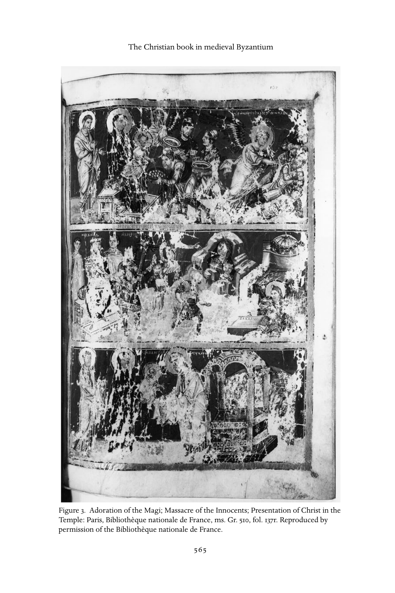
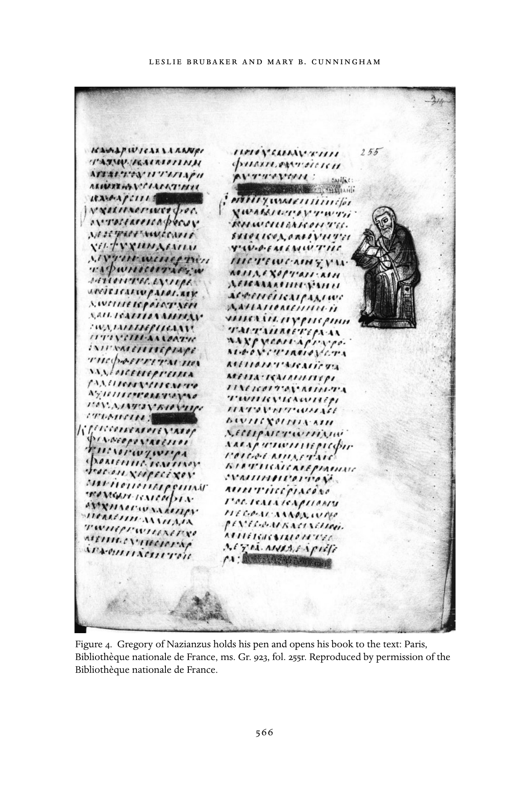
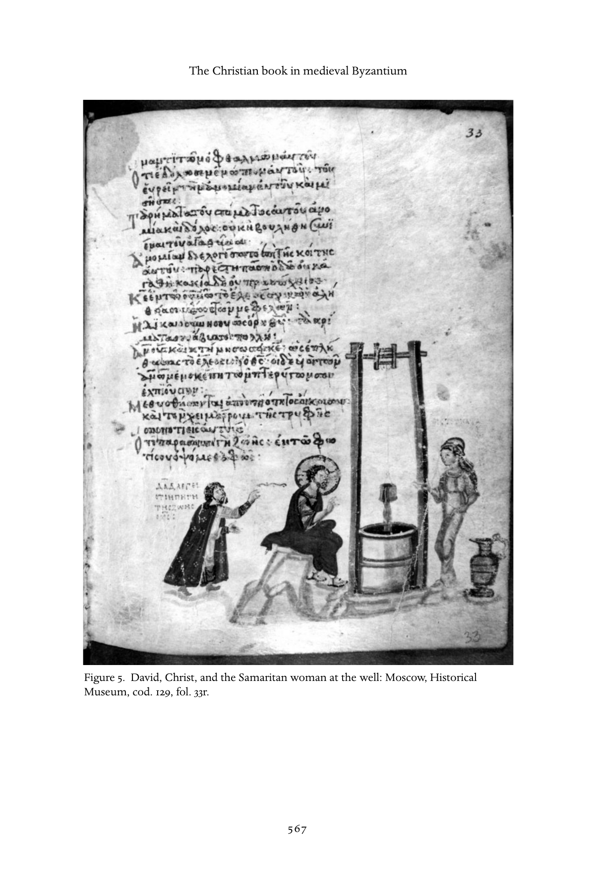

# 中世纪拜占庭的基督教书籍：英文转换底稿

<!-- PDF page 582; original page 554 -->

### 27

### The Christian book in medieval

### Byzantium

### lesliebrubakerandmaryb.cunningham

Of all the artisanal productions preserved from the time since Constantine I (the Great) began calling Byzantium, the capital of the old eastern Roman empire, by a new name (Constantinople – Constantine’s polis, or city), probably the most familiar today are icons and buildings such as Hagia Sophia. But it is arguable that Byzantine books should share pride of place.

Across the imperial centuries, Greek manuscripts – usually deluxe copies of the Gospels or service books, but also theological treatises such as the copy of Dionysius the Areopagite sent to Louis the Pious in 827 – served as valuable diplomatic gifts.[^p582-1] After the fall of Constantinople to the Ottoman Turks in 1453 they were collected by humanist scholars, particularly, though not exclusively, for the ancient Greek authors whose texts they preserved; and by the French kings who saw themselves as the successors to the Byzantine emperors and surrounded themselves with the trappings of their purported ancestors.[^p582-2] Beyond the role of Greek manuscripts in cultural history, their contents – and decoration – are important as testimony to the ways medieval Byzantines ordered and arranged their thoughts, and for the ways that images were used to reinforce and shape the world of the largely urban elite who had access to, and could actively read, books.

### The Byzantine book: a brief history of its origins

### and development

Early manuscript production was broadly similar in Latin-speaking western Christendom and the Greek-speaking Orthodox East. The development of

[^p582-1]: See, e.g., Lowden, “Luxury Book.” For the Dionysius manuscript (Paris. gr. 437), see Omont, “Manuscrit”; Brubaker and Haldon, Byzantium in the Iconoclast Era, 41–42, with earlier literature; and note 77 below.

[^p582-2]: See Nelson, “Italian Appreciation”; Auzépy and Grélois, Byzance retrouvée.

<!-- PDF page 583; original page 555 -->

the Christian book traced here is therefore largely applicable to both unless otherwise specified. Before books (codices), written records were normally kept on scrolls (rotuli, rolls) made of papyrus, though waxed wooden tablets were bound together and already used as notebooks for commercial records during the Roman period. The earliest evidence for books as we know them now – cut pages bound together between covers – dates from the first century, but preserved examples only begin to become statistically significant in the third. At the same time, parchment (animal skin treated to remove hair and fat so that it will accept ink) became an increasingly frequent replacement for sheets cut from papyrus, originally prepared for use in making scrolls.[^p583-3]

The advantages of codices over rotuli were many. Most significant were increased ease of storage and reference, and decreased expense. Scrolls had normally been stored in a round container that looked like a modern hatbox, called a capsa. Codices were stored flat, on shelves, and could be piled one on top of another. The text on rolls was usually written parallel to the long side, in columns so that the reader unfurled the scroll enough to read a column then rolled the left side back up whilst simultaneously unrolling the right side to make the next column of text visible. To find a particular passage entailed considerable effort – one cannot “flip through” a scroll as one can through a book – and it made indexing through marginal tabs awkward. The reading process also meant that it was normally only practicable to write on one side of a scroll, whereas in codices both sides of the page were used, thereby allowing considerable economy of space and material.[^p583-4] These advantages resulted in the almost complete replacement of the roll by the codex during the fourth century, though scrolls, now with script parallel to the short side, continued to be used in Byzantium and Byzantine areas of Italy for certain high status documents such as imperial documents (chrysobulls) and liturgical rolls, where the expense and inconvenience of the format enhanced the prestige of the text.[^p583-5]

[^p583-3]: For good overviews, see Gamillscheg and McCormick, “Codex”; Turner, Terms Recto and Verso; Devreesse, Introduction; Weitzmann, Late Antique; Irigoin, “Les cahiers.” We primarily deal with Greek books in this chapter. For other eastern Christian manuscripts, see, e.g., Der Nersessian, Miniature Painting in the Armenian Kingdom; Leroy, Les manuscrits syriaques.

[^p583-4]: Roberts and Skeat, Birth of the Codex; Weitzmann, Illustrations.

[^p583-5]: See Nelson, Gamillscheg, and Talbot, “Rolls, Liturgical.” Another example is Biblioteca apostolica vaticana, cod. palat. gr. 431, a tenth-century luxury scroll illustrating the Old Testament book of Joshua; see Weitzmann, Joshua Roll.

<!-- PDF page 584; original page 556 -->

The shift was apparently also helped along by an increased need for texts with the emergence of Christianity as a major force in the fourth century. Christianity depended upon access to the Gospels, the story of Christ’s life, and Eusebius tells us that Constantine ordered “fifty volumes with ornamental leather bindings, easily legible and convenient for portable use... of the Divine Scriptures, the provision and use of which you well know to be necessary for reading in church.”[^p584-6]

The benefits of parchment over papyrus were less blatant. Papyrus, made from the pith of a reed that grows abundantly along the Nile, was relatively inexpensive and reasonably durable, though it survives better in dry climates than in wet ones, for which reason most surviving papyri have been found in Egypt. It was made in bulk in Egypt, and distributed along well-developed trade routes until at least the ninth century.[^p584-7] In contrast, parchment was always expensive, and no production and distribution system seems to have been developed. Even a large animal skin yielded no more than eight pages, and the preparation – which involved a lime bath, stretching, and scraping – was time-consuming and required specialized equipment.[^p584-8] Depending upon details of the process followed, parchment color ranged from nearly white to pale yellow, a distinction that is sometimes used to pinpoint a manuscript’s place of origin.[^p584-9] Against the expense of production, however, parchment had several advantages over papyrus. It could be produced anywhere with available animals (normally goats or sheep), was longer-lasting and more flexible than papyrus, and provided a smoother surface on which to write. It was thus also better suited to decoration; and, in addition, paint and gold leaf adhere better and longer to parchment than to papyrus.

To make a book, the prepared parchment was cut to size, ruled, and written on. Usually each sheet was cut large enough to fold in the middle, thereby creating four sides on which to write.[^p584-10]  These double sheets – called bifolia – were then pricked along the margins and lines were incised horizontally and vertically between the prickings to indicate where the text was to be written. The ruling patterns thus provided varied considerably, and are sometimes

[^p584-6]: Eusebius, Life of Constantine, 166–67. See further Roberts and Skeat, Birth of the Codex; McCormick, “Birth of the Codex”; and, for an indication of the various debates surrounding this issue, Bagnall, “Jesus Reads a Book.”

[^p584-7]: Lewis, Papyrus, 64–94; McCormick, Origins, 704–708.

[^p584-8]: Wilson, “Books and Readers,” especially 1–3; Gamillscheg and Talbot, “Parchment,” with further bibliography.

[^p584-9]: E.g., yellow parchment is sometimes seen as evidence for an Italian origin, see Leroy, “Les manuscrits grecs d’Italie.”

[^p584-10]: There was no standard size, except, occasionally, within individual workshops. See, e.g., Anderson, “Twelfth-Century Instance.”

<!-- PDF page 585; original page 557 -->

(problematically) used to identify particular writing workshops (scriptoria) or country of origin.[^p585-11]  The text was then written, after which the bifolia were nested together, in Byzantium usually in groups of four to form a quaternion of eight leaves, each of which is called a folio. For visual unity, Greek bookmakers always arranged the bifolia so that what had once been the hair side of the parchment faced another hair side, while flesh sides – often slightly yellower than the hair sides – faced each other as well: this is known as Gregory’s law, after the scholar who first noted it.[^p585-12]  Each segment, called a gathering or quire, was numbered so that it could easily be arranged in its proper order after the writing had been completed. Often these numbers, called quire signatures, still survive; they are usually in the outer top margin of the first folio of the quire.[^p585-13]  Once the text was complete, the gatherings were sewn together, and encased within a cover. The outer edges were often decorated, though this has frequently been lost as a result of later trimming. Much later, individual folia were numbered, almost always in Arabic numerals rather than in Greek. Usually, only one side of each leaf received a number, and to distinguish front and back they are designated as recto (always the page on the right, as the book is open) and verso (on the left); folio 4 recto (or 4r) is thus faced by folio 3 verso (3v), and so forth.

Paper, much cheaper than parchment but far less durable, was perhaps introduced in Byzantium around the year 800, but was not widely used until the eleventh century. Even after paper became widely available, however, parchment continued to be used for luxury manuscripts.[^p585-14]  As with the rolls used (archaically) for chrysobulls and some versions of the liturgy, the expense and rarity value of parchment prompted its use for important documents long after paper had superseded it as the common writing surface.

### Writing and copying

The study of book production, called codicology, also embraces the study of scripts (paleography).[^p585-15]  Most generally, early Greek manuscripts were written

[^p585-11]: Leroy, Les types de réglure.

[^p585-12]: Gregory, “Les cahiers”; further discussion in Hoffmann, Recherches.

[^p585-13]: Mondrain, “Les signatures.”

[^p585-14]: Gamillscheg, Talbot, and Ševčenko, “Paper.”

[^p585-15]: The bibliography on Byzantine paleography is vast. The classic studies are Gardthausen, Griechische Palaeographie; Thompson, Handbook; and Dain, Les manuscrits. Good English surveys include Wilson, Mediaeval Greek Bookhands; Barbour, Greek Literary Hands. An excellent collection of articles pertaining to many aspects of Byzantine codicology and paleography is La paléographie grecque et byzantine, and more recently, Prato, I manoscritti greci.

<!-- PDF page 586; original page 558 -->

in what we would now call capital letters (majuscule or uncial), with neither punctuation nor accents. Around 800 – clearly an important watershed for book production – majuscule began to be replaced by minuscule, most closely approximated in modern terms by script: minuscule letters are in “lower case” (e.g., Α becomes α, Β becomes β, Γ becomes γ, etc.), are often joined together (forming “ligatures”), and in addition, often sport abbreviations (such as κ/ for καί = and) and start to be augmented by both accents and punctuation. This process is associated with the Studios Monastery in Constantinople, a fifthcentury complex which received a new family of monks in the late seventh century and came to prominence in the 780s. As we shall discuss in more detail shortly, its leader at the turn of the century, Theodore, wrote a set of rules that privileged book reading and writing, and the Studios scriptorium (writing studio) is one of the few that has been at least tentatively reconstructed. The invention of minuscule made books considerably cheaper to produce: it was faster to write than majuscule, and smaller, so that more letters could be written on a page.[^p586-16]  It soon supplanted majuscule for all but deluxe manuscripts and presentation scripts (e.g., inscriptions on icons). The archaic was, obviously, recognized as a marker of status – and scholars who insist that the Byzantines did not recognize the past as “different” should acknowledge this – to the extent that, by the tenth century, a scroll made of parchment and written in majuscule would have to have been an extremely important text indeed.

Ornament in manuscripts began mostly as a scribal form of indexing and codifying. From at least the fourth century, enlarged initials, in the ink of the text, introduced new text sections. Decorative borders and endpieces (also in scribal ink) marked the colophon at the end of large text sections, where the title was restated and the word length was sometimes noted (and occasionally the scribe’s name was recorded). Marginal signs indicated passages of particular importance or quotations.[^p586-17]  In Latin manuscripts, these initials and text breaks soon became much more elaborately ornamented, but in Byzantium this process waited until the ninth century and manuscript illumination was never so exuberant as it was in the West. As we shall see, literacy was probably always higher in the eastern Roman Empire than in what remained of the western Roman world. Perhaps for this reason illumination never – at least in

[^p586-16]: The variant on this same process occurred almost simultaneously in the Frankish kingdoms of the West, though here the first step was the development of “capital” letters (Caroline majuscule), followed shortly thereafter by Caroline minuscule. The relationship between eastern and western writing systems has been noted for some time, but whether the developments were independent of one another or whether one system influenced the other is not clear. See, e.g., Mango, “L’origine.”

[^p586-17]: Nordenfalk, Die spätantike Zierbuchstaben; Astruc, “Remarques.”

<!-- PDF page 587; original page 559 -->

books – acquired the highly symbolic role that allowed letters to function kinetically as they do in, for example, seventhand eighth-century Northumbria.[^p587-18]  But by the ninth century a fairly stable hierarchy of book ornamentation had been established for Greek books, and this continued throughout the remainder of the Byzantine period.[^p587-19]  The text remained largely inviolate, and decoration was subservient to the written word. Whole pages of painted and embellished letters, which continued to appear in Latin books and soon developed in the Arabic world, simply did not occur in Greek manuscripts. But by the ninth century, enlarged initials were increasingly painted and gilded, perhaps under the influence of western motifs which appear to have been transmitted to Byzantium through manuscripts written in the Greek monasteries of Rome. By the eleventh century these letters were increasingly elaborated into anthropomorphic and zoomorphic forms – rarely, however, did they infringe on the blocks of text.[^p587-20]  Headpieces also became increasingly elaborate from the ninth century onward, and, in deluxe manuscripts of the eleventh and twelfth centuries, sometimes incorporated narrative scenes.[^p587-21]

The scribes who wrote the text and the illuminators who decorated it were occasionally the same people, especially in the period before around 900, though the miniaturists responsible for figurative scenes were normally a different group of artisans.[^p587-22]  The organization of the teams that put together Byzantine books is elusive, and seems to have been far more ad hoc than was the case in the West. Only rarely can we find traces of the same group or groups working together, and documentary evidence for any coherent scriptoria is virtually nonexistent.[^p587-23]  Names of scribes appear occasionally, and, far more rarely, those of miniaturists.[^p587-24]  But these mostly occur in isolation, and it has been suggested that scriptoria, as are recorded in the monasteries of Europe, simply did not appear in Byzantium. Instead, people desiring books may have

[^p587-18]: See, e.g., Nordenfalk, Celtic and Anglo-Saxon Painting.

[^p587-19]: Hutter, “Decorative Systems.”

[^p587-20]: Again, the bibliography is large. Weitzmann, Die byzantinische Buchmalerei is the classic study; an appendix – Weitzmann, Die Byzantinische Buchmalerei, Addenda und Appendix – should be used with caution. On the introduction of initials, see Brubaker, “Introduction.” Other important studies appear in Prato, I manoscritti greci, along with extensive reference to earlier literature.

[^p587-21]: E.g., in the “liturgical” homilies of Gregory of Nazianzus. See Galavaris, Illustrations of the Liturgical Homilies.

[^p587-22]: See, e.g., Brubaker, “Introduction”; Hutter, “Le copiste du Métaphraste”; Anderson, “Illustration of cod. Sinai. gr. 339.”

[^p587-23]: For some of the rare examples, see Hutter, “Le copiste du Métaphraste”; Anderson, “Cod. Vat. gr. 463”; Buchthal and Belting, Patronage, with Nelson and Lowden, “Palaeologina Group.”

[^p587-24]: See, e.g., I. Ševčenko, “Illuminators”; Nelson, Theodore Hagiopetrites.

<!-- PDF page 588; original page 560 -->

gone to one place to order the text, another to decorate it, and still another to provide miniatures.[^p588-25]  Pricing is equally problematic, and even the terms that the Byzantines used for various aspects of book production have only recently begun to be understood.[^p588-26]

### Miniatures

Illustrations had already appeared in papyrus scrolls, and continued in books, where they are normally called miniatures. From the beginning, several formats were favored, with images either sharing a page with text or not. In the sixth-century Vienna Genesis, half of the page contains an image, and the other half the relevant Old Testament text, abbreviated so that the pattern of text and image remained coherent. Here, in a deluxe manuscript with parchment stained purple and with silver script, the images were as important as the words.[^p588-27]  In the Rossano Gospels, also of the sixth century and with some purple-stained pages, narrative images of Christ’s passion are clustered at the beginning of the manuscript. Most share a page with four prophets carrying Old Testament passages suggested by the Orthodox liturgy, where they were recited as prefigurations of the New Testament episodes portrayed above them.[^p588-28]  Here, too, the images were obviously important, and created a commentary visualizing liturgical practice and showing how the Old Testament supported the New. The Rabbula Gospels (dated by colophon to 586) contains full-page illustrations along with marginal scenes flanking the Canon Tables (introductory lists, in columns framed by architectural motifs, that provide a concordance of the four Gospels).[^p588-29]  The badly-damaged Cotton Genesis, another sixth-century book, was dominated by images inserted in the columns of text.[^p588-30]  The Vienna Dioskourides (c. 512) – the most important non-religious manuscript of the early period, with pictures of the plants and animals discussed – included full-page miniatures, column pictures, and occasionally small botanical images inserted within the running text.[^p588-31]  This

[^p588-25]: See Nelson and Lowden, “Palaeologina Group.”

[^p588-26]: See Wilson, “Books and Readers,” 3–4, 14; Kravari, “Note”; Atsalos, “Termes byzantins,” all with earlier bibliography.

[^p588-27]: Vienna, National Library, cod. theol. gr. 31, see Gerstinger, Wiener Genesis; Lowden, “Concerning the Cotton Genesis.”

[^p588-28]: Rossano, Cathedral Treasury, see Loerke, I vangeli.

[^p588-29]: Florence, Laur. Plut. I, 56, see Cecchelli, Furlani, and Salmi, Rabbula Gospels; Mundell Mango, “Where was Beth Zagba?”

[^p588-30]: London, British Library, cod. Cotton Otho B. VI, see Weitzmann and Kessler, Cotton Genesis.

[^p588-31]: Vienna, National Library, cod. med. gr. 1, see Gerstinger, Dioscorides; Brubaker, “Vienna Dioskorides.”

<!-- PDF page 589; original page 561 -->

variety of formats continued throughout the Byzantine period, though some formats predominated at different times. In the ninth century, for example, marginal formats were favored, perhaps, as we shall discuss in more detail shortly, because they allowed images to be placed in close correspondence to the words they illustrated.[^p589-32]  In the eleventh and twelfth centuries, an upsurge of huge volumes, copiously illustrated, apparently revived the interest in column pictures, which allowed hundreds of small images to provide a running visual narrative to accompany the four Gospels, the first eight books of the Old Testament (Octateuch), and the four books of Kings.[^p589-33]  Mostly, however, illustrated Greek books of the tenth through to the fifteenth century contained full-page miniatures, relatively few in number. These were most commonly Gospelbooks with a portrait of the relevant evangelist inserted before each of the four Gospels,[^p589-34]  or psalters with images at the first, seventy-seventh, and final psalm (in Byzantium, the one-hundred and fifty-first), and sometimes author portraits with each of the odes at the end.[^p589-35]  Increasingly, full-page miniatures were painted on unruled, single sheets of parchment that were “tipped in” – that is, they did not form part of the regular quire structure but were additional to it.

### Christian books: a hierarchy

Most preserved Byzantine books have Christian content, though there are a not-insignificant number of other works such as military treatises, medical and scientific manuals, literary texts, and so forth.[^p589-36]  The range of material available to the Byzantines is evident from one unusual but extremely important source: the Bibliotheke, a list of 280 works, each accompanied by a “book report,” compiled by the future patriarch Photius (c. 810–c. 895, patriarch 858–67, 877– 86) sometime in the mid-ninth century for his brother.[^p589-37]  Photius ignores the standard range of Christian works, which he assumed his audience would know already, and thus provides summaries of a range of unusual texts, many

[^p589-32]: See Corrigan, Visual Polemics.

[^p589-33]: Omont, Évangiles; Velmans, Le Tétraévangile; Weitzmann and Bernabò, Byzantine Octateuchs, which should be read with the reviews by Brubaker and Hutter; Lassus, L’illustration byzantine.

[^p589-34]: Galavaris, Illustrations of the Prefaces; Nelson, Iconography.

[^p589-35]: Cutler, “Aristocratic Psalter” and Aristocratic Psalters in Byzantium.

[^p589-36]: Krumbacher, Geschichte der byzantinischen Literatur; Kazhdan (with Sherry and Angelidi), History; Beck, Kirche und theologische Literatur; Quasten, Patrologie; Rahlfs, Verzeichnis der griechischen Handschriften; Hunger, Die hochsprachliche profane Literatur der Byzantiner.

[^p589-37]: Photius, Bibliotheke; Treadgold, Nature; and for the date, Maas, “Photius’ Treatment of Josephus.”

<!-- PDF page 590; original page 562 -->

no longer preserved. The great bulk of the books included, about two-thirds of the total, are religious – apologetics, lives of famous Christians, devotional and dogmatic texts, histories, sermons, letters, and so forth – but there is also a range of pre-Christian authors and texts about secular themes such as mathematics, medicine, and mythology, along with novels and poetry.[^p590-38]

In Byzantium, as noted earlier, by far the most numerous Christian books preserved are copies of the Gospels, which, as they told the story of Christ’s life, were of critical importance to Orthodoxy. Psalters come second, in large part because they were crucial to the Byzantine liturgy, had to be recited at least annually (and often more frequently) by monks in many monastic houses, and were the prime text used to teach children to read.[^p590-39]  One of the most popular works after that was a collection of the Homilies of Gregory of Nazianzus, mostly in the so-called liturgical edition: a selection of (usually) sixteen of the church father’s forty-odd preserved fourth-century sermons that were read in various ecclesiastical contexts.[^p590-40]

Texts connected in one way or another with the Orthodox liturgy were collected in a variety of formats such as, from the ninth century onward, the lectionary (liturgical readings – lections – from the Bible and a few other sources, arranged in calendar order, usually with the feasts, movable and stationary, also listed),[^p590-41]  various texts concerning the saints commemorated in daily services across the year (menologia – a collection of saints’ lives; synaxaria – short notes about each saint; menaia – poems and prayers for the celebration of each saint),[^p590-42]  and so forth. The Bible was normally broken into its constituent parts – such as the Pentateuch (the first five books of the Old Testament), the Octateuch (the first eight), or the psalter – but occasionally the whole Old Testament, New Testament, or even both were joined together in huge volumes.[^p590-43]  Works of the church fathers – especially John Chrysostom, Basil of Caesarea, and, as noted earlier, Gregory of Nazianzus – appear regularly, and so do selections of quotations from a variety of patristic (and other) texts. Called florilegia, these were particularly common in the seventh, eighth, and ninth centuries when they were used to confirm the validity of patristic quotations to church councils.[^p590-44]  Though the vast majority of Byzantine books remained

[^p590-38]: See the handy index of codices by subject matter in Treadgold, Nature, 173–76.

[^p590-39]: See Moffat, “Schooling,” and Mullett, “Writing.”

[^p590-40]: Galavaris, Illustrations of the Liturgical Homilies.

[^p590-41]: Evangelia contain only the Gospel passages; praxapostoloi contain the passages from the rest of the New Testament, see Taft, “Lectionary.” Liturgical calendars (typika) add instructions for daily services, see Mateos, Le typicon.

[^p590-42]: See Taft, “Menaion”; N. P. Ševčenko, “Menologion”; Taft and Ševčenko, “Synaxarion.”

[^p590-43]: See the references in note 36 above.

[^p590-44]: See Brubaker, Vision and Meaning, 51–57.

<!-- PDF page 591; original page 563 -->

unillustrated, examples of all of the types of books just noted have survived with pictures. These miniatures enhanced the material value of the books, but they also played other roles.

### Text and image: the roles of miniatures in

### Byzantine books

Miniatures, more than any other visual medium, presuppose and interact with text. In Byzantium, they did this in a variety of ways.

On the most basic level, miniatures can illustrate – by visualizing the action described in the textual narrative, by portraying the author writing the text or in the case of sermons, the priest delivering the sermon – the text they accompany. Even in cases of what appear to be straightforward illustrations of a text, however, a process of selection went on: which of the various moments in the story to show and what extratextual details would be included were not necessarily spontaneous decisions. Sometimes the story pattern and its particulars were determined by tradition (though that tradition had, of course, been started by someone, somewhere, making a conscious decision that was subsequently agreed upon by consensus and reinforced by repetition). For example, though Christ’s attire is nowhere described in the Bible, he usually wears purple, an expensive color associated with the imperial house in Byzantium.[^p591-45]  Adam’s head-in-hand pose during his lament after the Fall – often used as well for Joseph at the nativity – appears with equal consistency across the Byzantine period, though, again, the position is never specified in the relevant biblical texts. Choice, rather than convention, often conditions the images selected in longer narrative sequences, and the episodes chosen can provide a sort of commentary-by-selection on the text. Gregory of Nazianzus’s sermon, “To Julian the Tax Collector,” has sacrifice and offering as its main theme, and uses a great many biblical parallels to reinforce them. From among them, the unknown illustrator of a copy of the sermons produced in Constantinople around the year 880 selected two, the adoration of the Magi and the massacre of the innocents (fig. 3), because these were most relevant to this theme.

On the same page, he added another scene that reinforced the same point but was not mentioned in the sermon: the Presentation of Christ in the Temple.[^p591-46] Here the miniature supplies a visual parallel to the text that augments the sense of the sermon but is in important respects independent of it: though the

[^p591-45]: James, Light and Colour.

[^p591-46]: Brubaker, Vision and Meaning, 62–71.

<!-- PDF page 592; original page 564 -->

picture responds to the words, it moves the argument beyond them and recasts the theme in a new way. In this example, there are no explanatory captions to help us, but in other manuscripts the legends associated with the pictures help the modern (and the original) viewer understand their intent. In the Leo Bible (c. 940), for example, framing verses explain the commentary visualized by the miniatures that preface each book.[^p592-47]

Sometimes the images alone validate the truth, and true meaning, of the words. In a ninth-century florilegium now in Paris (Bibliothe`que nationale de France, cod. gr. 923), for example, marginal images of the authors quoted sometimes point to their texts, or hold open a book as if discharging their words onto the page, or even hold a pen to the actual text itself (fig. 4) to show that they had truly written the words ascribed to them.

The portraits here guarantee the accuracy of the citation, an important issue in the eighth and ninth centuries, when accusations of deliberate forgery were customarily hurled at the opposing side during the iconoclast debates over the legitimacy of religious representations.[^p592-48]  This is not the only manuscript from this period to favor marginal illustrations. The great majority of all Greek manuscripts following this format date from the ninth century, apparently because the margins were where commentaries that explained the meaning of the text (the catena) were written at the time, and pictures took on the same roles in the wake of iconoclasm. In a famous example, the Khludov Psalter of, probably, 843–47, portraits of David accompany captions that explain what the psalm meant.[^p592-49]  For example, Psalm 53 begins “For with thee is the fountain of life,” and the psalter miniaturist accompanied this passage with a picture (fig. 5) of Christ speaking to the Samaritan woman at the well ( John 4.5–26).

To the left, a smaller figure of David gestures toward the scene, accompanied by the inscription “David says, Christ is the source of life.” Here, and frequently throughout the manuscript, word and image join forces to comment on the psalm text, and it is significant that neither the words alone, nor the images alone, were considered sufficient: instead, the two media worked together to authorize a particular interpretation of the psalms.

While this – and especially the florilegium example – may seem to modern viewers to over-privilege the image, it is first worth remembering that, to the Byzantines, texts could be falsified and forged but images could not;[^p592-50]  and

[^p592-47]: Biblioteca apostolica vaticana, cod. Reg. gr. 1, see Mango, “Date of cod. Vat. Regin. Gr. 1”; Mathews, “Epigrams.”

[^p592-48]: Brubaker, Vision and Meaning, 52–57.

[^p592-49]: Corrigan, Visual Polemics, first made this point.

[^p592-50]: Brubaker, Vision and Meaning, 49.

<!-- PDF page 593; original page 565 -->

Figure 3. Adoration of the Magi; Massacre of the Innocents; Presentation of Christ in the Temple: Paris, Bibliothe`que nationale de France, ms. Gr. 510, fol. 137r. Reproduced by permission of the Bibliothe`que nationale de France.

<!-- PDF page 594; original page 566 -->

Figure 4. Gregory of Nazianzus holds his pen and opens his book to the text: Paris, Bibliothe`que nationale de France, ms. Gr. 923, fol. 255r. Reproduced by permission of the Bibliothe`que nationale de France.

<!-- PDF page 595; original page 567 -->

Figure 5. David, Christ, and the Samaritan woman at the well: Moscow, Historical Museum, cod. 129, fol. 33r.

<!-- PDF page 596; original page 568 -->

second, that the audience with ready access to Byzantine manuscripts – and especially deluxe books with elaborate miniatures – was severely limited and largely confined to that literate strata of elite males who wrote most of the exegetical and commentary texts on which our modern understanding of Byzantium rests.[^p596-51]

In short, when miniatures are present, they virtually always supplement the text in some more or less important fashion. At the very least, miniatures frame the text that they accompany in a particular way, and prompt the viewer to remember and interpret the words in the manner that the image shows.[^p596-52]

### Ownership and libraries

Much of the evidence concerning the ownership of books and the existence of libraries in the medieval period survives in monastic sources. Since monasteries apparently housed most of the scriptoria in both East and West, it is not surprising that their libraries flourished. Ownership of books, even by solitary monks in the Egyptian desert, is attested in hagiography and apophthegmata (“sayings”) from as early as the fourth century, when Abba Serapion, a companion of St. Antony who became bishop of Thmuis in the Nile delta from c. 339, reprimanded a visiting monk for possessing too many books which might have been converted into money for feeding orphans and widows.[^p596-53]  Serapion’s criticism notwithstanding, knowledge of the Scriptures, which represented an essential skill for monks and nuns, required constant access to the holy books. The fifth-century bishop, Epiphanius of Cyprus, is recorded in the same collection of apophthegmata as saying that “the acquisition of Christian books is necessary for those who can use them” since “reading the scriptures is a great safeguard against sin.”[^p596-54]

Cenobitic monasteries, judging by hagiographical and administrative evidence such as early foundation documents or rules (typika), began to establish collections of books at an early period. In the fourth century, for example, Pachomian communities in Upper Egypt possessed libraries, guarded by the praepositus of each house, from which monks could borrow books on a weekly

[^p596-51]: Ibid., 23–24.

[^p596-52]: Ibid., 24, 411.

[^p596-53]: Apophthegmata patrum, 416, C (trans. Ward, 227). This “saying” is also included in the eleventh-century florilegium, the Synagoge, of the Evergetis Monastery in Constantinople, as an example of the need for “unpossessiveness” in monastic life. See the Evergetinos, 33.

[^p596-54]: Apophthegmata patrum, 165, B (trans. Ward, 58).

<!-- PDF page 597; original page 569 -->

basis.[^p597-55]  Basil of Caesarea, like Pachomius, emphasized the importance of reading Scripture; in addition to forming the spiritual outlook of monks, this would enable them to provide a religious education for lay children.[^p597-56]  Documents associated with the Studios Monastery in Constantinople, led by the reforming abbot Theodore between 798–99 and c. 815, provide more detailed information not only about the library, but also about its scriptorium, than any other monastic source in the middle or late Byzantine periods. According to the Studite Rule, which circulated in two versions and was extremely influential in later monasteries,[^p597-57]  monks were expected on certain days of the year to assemble at a “book station” where they would choose a book and read it until the evening. Before the final office of the day, the librarian would sound the semantron (wooden clapper) as a signal for the books to be returned to the library.[^p597-58]  A collection of “penances” (epitimia) attributed to Theodore himself states that monks who mistreat books, touch volumes on loan to another monk, or attempt to exchange one book for another, are banned from reading for the rest of the day. If a monk is found to have hidden a book in his cell instead of returning it to the librarian at the appointed time, he will be punished by having to stand in the refectory.[^p597-59]

The ownership of books in a monastic context was thus indisputably a desideratum from Late Antiquity through the medieval period, since Scripture and other instructive volumes could advance the spiritual development of monks and nuns. The occasional negative reference with regard to solitaries in the early period relates more to the issue of personal possessions than it does to the inherent nature of book ownership. In the West, Benedict of Nursia addressed this question directly when, in his influential Rule, he forbade private ownership of books, tablets, or pens,[^p597-60]  but prescribed private reading on a daily basis, especially during Lent.[^p597-61]  Monastic libraries also provided the necessary volumes for communal reading in the offices, especially matins, and in the refectory. The liturgical collections described earlier in this chapter offered

[^p597-55]: Rousseau, Pachomius, 81; Pachomius, Vita Prima, ch. 59; Pachomius, Praecepta, ch. 25.

[^p597-56]: Basil of Caesarea, Regulae brevius tractatae.

[^p597-57]: The Rule of the Monastery of St. John Stoudios in Constantinople; both versions cited appear in side-by-side English translation in BMFD.

[^p597-58]: Rule of the Monastery of St. John Stoudios in Constantinople, ch. 26, in BMFD 1, 108. See also Leroy, “La vie quotidienne,” 47.

[^p597-59]: Featherstone and Holland, “Note on Penances,” 259; Theodore the Studite, Poenaemonasteriales,1740, C. On the authenticity of this text, see Beck, Kirche und theologische Literatur, 494, and Leroy, “La réforme Studite,” 210.

[^p597-60]: Rule of St. Benedict, ch. 33, 84–87.

[^p597-61]: Rule of St. Benedict, ch. 48, 110–13.

<!-- PDF page 598; original page 570 -->

appropriate texts for the entire liturgical year; monastic typika frequently assigned the precise texts to be chosen in individual houses.

The largest collection of religious books in Constantinople was probably to be found in the patriarchal library, located close to the Great Church, Hagia Sophia. It is possible that this library was founded, or at least greatly refurbished and amplified, by the patriarch Sergius in the early seventh century.[^p598-62] At the time of the seventh ecumenical council of Nicaea (787), patristic texts to support the iconophile position were brought “from the stores of the glorious patriarchate.”[^p598-63]  The same council provides us with the interesting information that heretical books (in this case the writings of the iconoclasts) were stored in a special chest in the patriarchal library.[^p598-64]  The purpose of saving banned books, albeit in a separate space from those deemed orthodox, must have been to provide the church with records of heresies which might be informative for bishops in future controversies. This conflicts, however, with the desire to burn offensive material which is attested in other canons,[^p598-65]  and other religious texts.[^p598-66]  The same sources suggest that, in addition to their reverence for the patristic wisdom contained in ancient books, Byzantine bishops possessed a healthy scepticism concerning the possibility of later alterations or other defacements of these sources. Those officiating at the seventh ecumenical council took special care that complete volumes rather than loose folios or extracts were produced as evidence. In the preparations for Leo V’s second iconoclastic council in 815, a study group led by the future patriarch, John the Grammarian, searched for “old books everywhere, namely those that are deposited in monasteries and churches...”[^p598-67]

Whether or not a public library associated with a “university,” or state institution of higher learning, existed throughout the Byzantine period remains unclear. The evidence, including statements that a library containing 120,000 volumes was burnt down during the reign of Basiliscus (475–76), cannot be substantiated; it is unknown, for example, exactly where this library was located and how many books it actually contained.[^p598-68]  The library was probably rebuilt in 491, but, along with the university, declined from the sixth century

[^p598-62]: Lemerle, Byzantine Humanism, 107, note 81.

[^p598-63]: Mansi 12, 1019. Hereafter references will be to the English translation in Select Library of Nicene and Post-Nicene Fathers ( = NPNF).

[^p598-64]: Canon 9, NPNF, 561. See also Lemerle, Byzantine Humanism, 107, note 81.

[^p598-65]: Canon 63, NPNF, 394.

[^p598-66]: For example, the Life of St. Theodora, 75 and 362, accuses iconoclasts of altering or burning books that advocated images. See also Reynolds and Wilson, Scribes and Scholars, 44–45.

[^p598-67]: Mango, “Availability of Books,” 35. On problems of forgery in Byzantium, see Bardy, “Faux et fraudes littéraires.”

[^p598-68]: Wilson, “Libraries”; Lemerle, Byzantine Humanism, 68–73.

<!-- PDF page 599; original page 571 -->

onward owing to a lack of imperial support for what were viewed as essentially secular institutions. During the middle and later centuries of the Byzantine empire, private individuals, as well as monasteries, are known to have collected books. The prohibitive price of manuscripts, however, suggests that private libraries remained very small.[^p599-69]  Scholars continue to puzzle over the manner in which the patriarch Photius gained access to the 280 books that he reviewed in his Bibliotheke, discussed earlier.[^p599-70]  It is possible that he had access to a state, or imperial, library in Constantinople whose existence is simply not attested in contemporary historical sources.

### The book as holy presence

In addition to transmitting texts, medieval books were sometimes viewed as holy presences in themselves; like saints, relics, or icons, they symbolically represented a meeting place of the divine and created worlds. The nature of the book of course has much to do with this: the holiest book of all is the Bible, especially the four Gospels that contain revelation about the incarnate God, Jesus Christ. Various eastern commentators on the Divine Liturgy, including Germanus, patriarch of Constantinople in the early eighth century, express this concept in symbolic terms. In his explanation of the Eucharistic synaxis, Germanus describes the first entrance, when the Gospel is brought into the nave of the church, as signifying “the coming of the Son of God and his entrance into this world.”[^p599-71]  As in the case of icons, the Gospel book was censed, kissed, and venerated in church.[^p599-72]  It was treated with reverence since it contained the evangelists’ accounts of Christ’s incarnation, death, and resurrection, which together represented the culmination of God’s saving dispensation for humankind.

Miracle stories involving holy books, especially the Gospels, do not appear frequently in medieval hagiography; more often cures or exorcisms occur as a result of contact with living saints or their relics after death, holy oil, or the sign of the cross. Sometimes, however, the reading of the Gospels mediates a healing miracle, as in the eleventh-century Life of St. Lazarus of Mt. Galesion, when a monk becomes possessed by demons after spending time on his own in a cave. Lazarus, who fulfilled his role as abbot of the monastery from the top

[^p599-69]: Wilson, “Books and Readers,” and our note 26 above.

[^p599-70]: References in our note 37 above.

[^p599-71]: Germanus of Constantinople, Commentary, ch. 24, in trans. Meyendorff, 73, or Greek ed. Borgio, Il commentario.

[^p599-72]: See, for example, BMFD 1, 99.

<!-- PDF page 600; original page 572 -->

of the pillar on which he stood for approximately forty years, recommended that the holy Gospel be read to the possessed monk. When this had been done “in accordance with the father’s order, the monk was seen to be sober again and sound in mind as before.”[^p600-73]  Lazarus carried out similar cures on other occasions, always with respect to monks who were possessed by demons.[^p600-74] It is possible that this form of miracle reflects a belief that the Gospels, as the Word of God, conveyed, miraculously or otherwise, intellectual reason, as opposed to the irrational mania caused by demons.[^p600-75]

In addition to the power of the written words that they contain, holy books occasionally function as objects that can mediate divine power. The eleventhcentury chronicler Skylitzes provides an account of the Byzantine mission to Vladimir, pagan ruler of the Rus, in the course of which a codex of the Gospels was thrown into a furnace and miraculously survived. This, says the chronicler, dumbfounded the “barbarians”; without any more hesitation they sought Christian baptism.[^p600-76]  Another instance of a miraculous book involves not the Gospels, but the volume of the purported works of Dionysius the Areopagite, presented – as noted earlier – by the Byzantine emperor Michael II to the Carolingian ruler Louis the Pious in 827. We are told that the book was placed immediately in the abbey of St. Denis on the eve of the saint’s feast day, 8 October 827, and that same night, the codex brought about nineteen miraculous cures in the church.[^p600-77]  Quite apart from the recorded miracles, this case is particularly interesting because it demonstrates the importance of a book written in Greek as a diplomatic gift from the Byzantine to the Carolingian court in this period. But it could not, of course, have been read by many Franks, and scholars have traced the precise methods used for translating the texts contained in the manuscript (which still survives in the Bibliothe`que nationale in Paris) from Greek to Latin by Carolingian translators and scribes.[^p600-78]  It is perhaps significant that in both cases noted here, the object itself – the physical book rather than the text it contained – was the active agent: the words inside could not have been read by most of the audience, few if any of whom knew Greek. For those who understood the contents, books could also contain evil powers, however, reflecting the heretical or otherwise blasphemous texts that they contained. The seventh-century traveler and hagiographer John Moschus tells the

[^p600-73]: Life of St. Lazaros, 130.

[^p600-74]: Life of St. Lazaros, 134, 156–57, 161.

[^p600-75]: See also Greenfield, Traditions of Belief, 135–48, 264–65, 270–71.

[^p600-76]: John Skylitzes, Synopsis historiarum, 165–66.

[^p600-77]: Loenertz, “La légende Parisienne,” 217–37.

[^p600-78]: Lemerle, Byzantine Humanism, 6–8; and, more generally, Wickham, “Ninth-Century Byzantium,” 245–56.

<!-- PDF page 601; original page 573 -->

story of Abba Cyriacus, a priest at the Lavra of Kalamon in Palestine. This man dreamt that the Virgin Mary, John the Baptist, and John the Evangelist came to visit him but refused to enter his cell on the grounds that it contained an enemy of theirs. Puzzled because the cell was empty except for himself, the priest eventually remembered that he had borrowed a scroll containing the writings of the heretical bishop Nestorius.[^p601-79]

As we saw above, the practice of burning heretical books, so well-established from the earliest centuries of Christianity onward, was eventually replaced in Byzantium at least partially by the practice of preserving these texts in a special cupboard in the Constantinopolitan patriarchate. It is possible that popular spiritual views concerning holy versus subversive books was eventually recognized as inhibiting the successful refutation of new heretical threats. In any case, it is clear that stories such as these reveal more about contemporary attitudes toward the written word and the volumes that contain it than they do about real events. Manuscripts or scrolls, each of which represents a unique exemplar, acted as precious objects, transmitters of divine revelation to posterity, talismans against evil demons, and much more. The ability of a book to stand in the place of a person, as in the story of Moschus’s priest Kyriakos, reflects the significance that is attached to the written word in early medieval society.

### Literacy and orality

Literacy was confined to a small elite in both East and West in the early Middle Ages. Probably more people, especially monks and clerics, could read in the Byzantine Empire, but most of these would have been capable only of reading the Scriptures or simple, “low-style” narratives.[^p601-80]  From Pachomius onward, monastic leaders emphasized the importance of reading the Bible, especially the psalter and the New Testament. Most monasteries maintained schools that taught lay children and novices, usually separately, an elementary course of letters and Scripture reading.[^p601-81]  Monks were expected to learn the psalter by

[^p601-79]: John Moschus, Pratum spirituale, ch. 46, in trans. Wortley, 37–38.

[^p601-80]: Kazhdan, “Literacy.”

[^p601-81]: See Magdalino, Constantinople médiévale, 37–40, 48. Moffatt concludes, on the basis of contemporary saints’ lives, that at least during the period of iconoclasm, elementary education took place not only in domestic settings but also in schools. However, the information provided in hagiography about these schools is vague. See her “Schooling,” 90. The eleventh-century Typikon of Gregory Pakourianos, for the Monastery of the Mother of God in Bačkovo, mentions a school at the dependency of St. Nicholas where an old priest trained six boys intended for the priesthood in the reading of Scripture. See BMFD 2, 550–51.

<!-- PDF page 602; original page 574 -->

heart, for recitation both in solitude and in communal worship. The fourthcentury bishop of Cyprus, Epiphanius, who lived for part of his life as a monk in Palestine, remarked that “the true monk should have prayer and psalmody continually in his heart.”[^p602-82]  This view is echoed in monastic writings from Ireland to Egypt from Late Antiquity onward.

That levels of literacy, in the narrowest sense of the word, were low even among the higher clergy in the early Byzantine period, however, is indicated by scattered laws and canons of the ecumenical councils. Justinian I found it necessary to legislate against illiterate monks or clerics becoming bishops in the middle of the sixth century.[^p602-83]  The second canon of the seventh ecumenical council (787) decrees that all bishops should know the psalter by heart and, further, that they should “read diligently, and not merely now and then, the sacred canons, the holy gospel, and the book of the divine apostle [Paul], and all other divine scripture.”[^p602-84]  The symbolic importance of being able to access the holy written word is clear from hagiography, where saints are usually either taught (often by their mothers) to read at an early age or miraculously find themselves able to recite sections of the Bible, especially the psalms, without the benefit of education.[^p602-85]  It has been rather controversially argued, with respect to the West before the so-called revival of learning in the eleventh and twelfth centuries, that societies that communicate primarily by oral methods develop different attitudes toward books and the written word than do predominantly literate ones.[^p602-86]  Though the strict divide between written and oral culture is overstated – and it is perhaps more useful to speculate about hierarchies of knowledge – the point that technologies of literacy shape culture informs our understanding of how books containing holy texts, as we saw above, acquired importance as physical links between contemporary users and the divine truth that they contained.

When assessing levels of literacy in the early Middle Ages, it is important to remember that, even if the majority of people were unable to read, they were accustomed to listening to texts being read aloud and to public speeches or sermons. It is likely that regular churchgoers in the Byzantine Empire would therefore have understood the language of the Old and New Testaments in Greek, even though this was already somewhat removed from the colloquial

[^p602-82]: Apophthegmata patrum, 164, C (trans. Ward, 57).

[^p602-83]: Beck, Ideen und Realitäten in Byzanz, ch. 3, 72.

[^p602-84]: Canon 2, NPNF, 556.

[^p602-85]: Patlagean, “Ancienne hagiographie,” 109–10. Parenthetically, this topos indicates that female literacy was not unthinkable in the Byzantine world, and nor was home schooling.

[^p602-86]: Clanchy, From Memory to Written Record.

<!-- PDF page 603; original page 575 -->

language of late antique or medieval society. Low-style hagiography, apocryphal texts, exegetical homilies, and collections of miracle stories would also have been easily comprehensible since their literary style was similar to the koine of the Scriptures.[^p603-87]  It has been much debated, however, whether highstyle orations, such as the festal sermons delivered in the middle Byzantine period mainly in vigils, would have been comprehensible to any but a few, educated members of the congregation.[^p603-88]  In fact, on closer study it is apparent that even the most complicated and archaizing sermons contain elements that would aid audience comprehension, including repetition, quotation of Scripture, devices such as anaphora, rhetorical questions, and exclamation.[^p603-89] Rhythm, often strengthened by parallelism and antithesis, formulaic phrases, repetition, and additive clauses also reflect the origin of texts in oral tradition.[^p603-90] In the medieval period, this tradition did not simply evolve out of informal story telling; it was also shaped by the rules of late antique rhetoric or the art of public speaking.

The progression from a spoken, informal text to a more literary one may be illustrated again by the example of the liturgical homily.[^p603-91]  We know that from a very early date most Christian preachers delivered their exegetical or panegyrical sermons extempore. Indeed, given the conventions of late antique rhetoric, it is likely that they would have been ridiculed or even expelled from the church if they had been seen to employ notes or a prepared text when preaching. Contemporaries recorded that the homilies of preachers such as Origen (c. 185–c. 254), John Chrysostom (c. 345–407), and others were recorded by stenographers in the audience. The survival of both edited and unedited versions of their homilies suggests that the preachers, or perhaps their assistants, prepared these texts later for publication.[^p603-92]  Even as late as the ninth century in Constantinople, the patriarch Tarasius’s sermons were recorded in this way, although similar evidence is lacking for his contemporaries.[^p603-93]

While oral elements clearly survive in sermons, as we noted above, the life of these texts after their first delivery in church becomes more literary

[^p603-87]: On the various levels of style in Byzantine texts, see I. Ševčenko, “Levels of Style.”

[^p603-88]: Maguire, Art and Eloquence, 6.

[^p603-89]: Cunningham, “Preaching and Community,” 45–47.

[^p603-90]: Ong, Orality and Literacy, 34–41.

[^p603-91]: A good introduction to the development of the Byzantine homily between the fourth and tenth centuries may be found in Antonopoulou, Homilies of Emperor Leo VI, 95–115.

[^p603-92]: Goodall, Homilies of St. John Chrysostom, 65–73.

[^p603-93]: See Mango, Homilies of Photius, 8.

<!-- PDF page 604; original page 576 -->

and liturgical. Most high-style sermons appear to have been carefully edited and polished; festal homilies and encomia especially follow the conventions of each genre, employ unusual vocabulary, and, generally speaking, display their authors’ erudition to full advantage. Copied into mixed collections of readings arranged around the liturgical year, they appear to have been intended either for private, devotional study or for liturgical reading in the monastic offices, especially orthros (matins).[^p604-94]  The versions of these texts, which survive in numerous manuscripts scattered through western and Middle Eastern libraries, reveal all of the stages of textual development, from the spoken, sometimes extempore, oration to the devotional or liturgical reading, edited thoroughly but without complete eradication of the oral roots of the text.

One other aspect of the Byzantine approach to texts and books should be mentioned here. In this outwardly unified, orthodox society, tremendous efforts were made to harmonize texts, from the canonical Scriptures to theological treatises or sermons. One way of demonstrating the continuity of divine revelation through all of these genres was to create florilegia or collections of writings, mentioned earlier in connection with church councils. It is likely that instruction in schools or institutions of higher learning was largely carried out by means of such digests. Sermons or treatises in some cases resemble florilegia more than original compositions as they present a series of carefully selected passages from earlier authors in order to prove a point. In such a cultural milieu, it is not surprising that we find saints’ lives occasionally borrowing large sections of earlier works. Plagiarism was not a crime: it was a sign of homage and reverence toward an earlier author. Another aspect of medieval writing which deserves much closer study is intertextuality, that is, the weaving together of a text out of words, citations, and even long quotations from other sources, especially Scripture.[^p604-95]  This reflects not only clerics’ recollection of whole sections of the Bible; it also represents a deliberate theological and literary aim, that of demonstrating the unity of divine revelation from the moment of creation to the present day.

The writing of hagiography, or the lives of saints, was much more than a simple literary endeavor in the early Christian and Byzantine periods.[^p604-96] Such composition in fact represented an act of worship, or an ascetic practice, on the part of the writer. The relationship between divine revelation and the written word represented one more way in which the gulf between a

[^p604-94]: For descriptions of such collections, see Ehrhard, Überlieferung und Bestand.

[^p604-95]: Young, Biblical Exegesis, 87–89, 103, 109, 130, 133, 235, 254.

[^p604-96]: Krueger, Writing and Holiness.

<!-- PDF page 605; original page 577 -->

transcendent God and his creation was bridged. The author was conscious of his (or, rarely, her) role not only as a tool, but also as an interpreter, of divine truth. This idea is expressed symbolically in such stories as that in which the sixth-century hymnographer, Romanus the Melodist, was instructed by the Virgin Mary in a vision to swallow a sacred scroll: after this, he was able to compose his kontakia.[^p605-97]  Romanus used imagery in some of his hymns that vividly expounded the relationship between Christ’s incarnation and the writing of a text.[^p605-98]  Both acts symbolized the manifestation of divinity in creation; whereas texts were inevitably bound by the limitations of human language and earthly metaphors, they might also be infused with divine inspiration from God.

It is clear that books were much more than simple purveyors of the written word in the medieval period. The relationship between divine truth, human interpretation, and textual and visual transmission was not static in our period; there is not space here to explore possible changes in this dynamic, but it is likely that it was being reassessed, along with saints, relics, and icons, in the period of iconoclasm. John of Damascus argued in his orations in defense of images in the early eighth century that books served as reminders of divine things, but that they also reflected the holiness that they recorded:

Since [Christ] is no longer present, we hear his words read from books; and by

hearing, our souls are sanctified and filled with blessing, and so we worship,

honouring the books from which we hear his words.[^p605-99] Modern concepts of authorship clearly have no place in the medieval understanding of literary composition. As we have already mentioned, the borrowing of scriptural, patristic, or secular passages was not viewed as plagiarism; instead, such citations lent authority to a text. We must imagine a society in which, as John reminds us elsewhere in the same treatise, oral tradition jostles and overlaps with the written word in peoples’ minds.[^p605-100]   Books had

[^p605-97]: The story is told in two eleventh-century synaxaria, or liturgical calendars: that of Constantinople, published in Delehaye, Propylaeum, 97, and in Basil II’s Menologion, PG 117, 81, B–C.

[^p605-98]: Krueger, Writing and Holiness, esp. 159–88.

[^p605-99]: John of Damascus, On the Divine Images, in Kotter, Die Schriften 3, 123 (trans. Anderson, 72).

[^p605-100]: “The tradition of the Church is not only passed on in written documents, but has also been given in an unwritten form...” John of Damascus, On the Divine Images, I.23, see Kotter, Die Schriften 3, 111 (trans. Anderson, 31); cf. Basil of Caesarea, De Spiritu sancto, 27.66, in Pruche, Basile de Cesarée, 478.15–480.9.

<!-- PDF page 606; original page 578 -->

great authority, but divine revelation could be channeled through a variety of media. Discerning audiences learned to recognize the authentic, or orthodox, message by means of remembered scriptural texts, doctrinal formulations, and canons of the church.

### Books that survive and books as luxury objects

While texts, and hence manuscripts, in themselves had very significant roles in Byzantium, there was a distinct hierarchy of books. This is, however, only partly reflected in surviving examples, where basic service texts and luxury manuscripts are the two dominant categories. The first group is not surprising: books without special scribal attention that were important to the Byzantines in their daily routine were, one may assume, the most commonly produced. That deluxe tomes survive in such numbers might suggest that the cultural capital of the well-presented volume was especially important in the Byzantine world. It is more likely, however, that luxury books survive because they were kept in treasuries of some sort and hence were available to be collected by bibliophiles after the fall of the empire in the fifteenth century. The survival rate of a significant proportion of deluxe books was also raised because they were less often consulted: they were valuable, and hence sequestered, thus avoiding the wear and tear of daily use that eventually leads to replacement.

The main characteristics of luxury books are size (dimensions and, correspondingly, heft – major books like the Vienna Dioscourides and the Paris Gregory can weigh up to fourteen pounds), archaizing elements (for example, rolls when codices had become dominant, majuscule when minuscule ruled, parchment after paper appeared), and the quality of ornament, including miniatures, applied. Pages dyed with rare colors (purple from murex, blue from lapis lazuli); scripts written in expensive inks (gold and silver); elaborate book covers, precious bindings, and painted or gilded exterior margins – all were visible indicators of wealth and status that were presumably recognized as both due acknowledgment of the sacrality of content and of the patron’s financial ability to be able to make that acknowledgment concrete/ material.

When books or scrolls are represented in the Byzantine world, however, they rarely show these deluxe attributes. Prophets nearly always carry simple, unadorned scrolls in neutral tones; and books shown open rarely picture decoration on the page displayed. Representations of text, in other words, follow

<!-- PDF page 607; original page 579 -->

the general tendency to privilege word over decoration that we have already observed in the format of the manuscript page itself. It is only representations of closed books that display the attributes of luxury books, normally by depicting a gold and jewelled cover.[^p607-101]   Even here, however, pictures of books present plain and undecorated casings (fig. 4) as often as they do elaborate ones.

### Conclusion

Books played a critical role in orthodox Christianity, and were clearly desirable objects for those who could read. Yet they were far from commonplace: even though service books may have been mass-produced, they were never, it seems, readily available;[^p607-102]   and most manuscripts seem to have been made to commission, not for random sale. The choices this entailed would seem to make manuscripts a good focus for a study of Byzantine self-representation. On one level, this has proven at least partially successful, particularly in studies of individual manuscripts or groups of manuscripts, as studies of the ninthcentury marginal psalters, the twelfth-century Kokkinobaphos manuscripts, and the late thirteenth-century “Palaiologina” group have shown.[^p607-103]   But any attempt to reconstruct the Byzantine world through its self-representation in and through books has two main problems, both of which we have already noted. First, any understanding of the Byzantine world through books can never be representative, because the books we have left are not. And, secondly, books were seen, used, owned, commented upon, represented, and commissioned by only a very small and relatively elite segment of the Greek-speaking world. This, however, has certain advantages, for the same group also produced most of our written evidence about the Byzantine world, so that text and image can be interpreted together to form a richly nuanced picture of the thought-world of at least one demographic. What is particularly interesting about a comparative approach to written and visual communication is that the messages considered appropriate to each medium were often different, so that miniatures supplement the text not only by supplying details that the

[^p607-101]: E.g., at San Vitale, on which see Mathews, EarlyChurches, 146–47, and, for other examples of gold and jeweled Gospel books, see the Menologion of Basil II (ibid., fig. 90) or the miniature of Pentecost in the Paris Gregory (Brubaker, Vision and Meaning, fig. 30).

[^p607-102]: Mango, “Availability of Books,” 29–45.

[^p607-103]: Corrigan, Visual Polemics; Linardou, “Couch of Solomon,” and references in note 23 above.

<!-- PDF page 608; original page 580 -->

Byzantines never committed to parchment, and not only by augmenting the written examples with visual ones, but also by carrying different types of messages altogether.[^p608-104]   Beyond providing us with the raw data of orthodoxy, the Christian book provides microcosmic insight into the structure of communication in the Byzantine world.[^p608-105]

[^p608-104]: See Brubaker, “Pictures Are Good.”

[^p608-105]: Leslie Brubaker would like to express gratitude to the staffs at the Historical Museum and Conservation Laboratories in Moscow for access to the Khludov Psalter, and to the Bibliothèque nationale de France for access to the Sacra Parallela and Paris Gregory.
