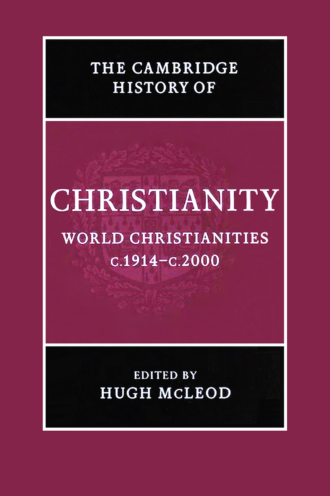
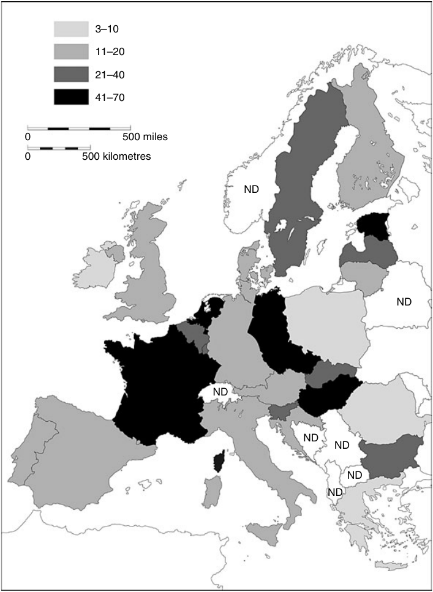
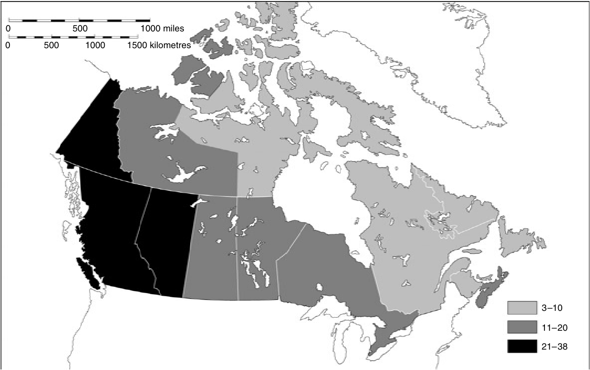
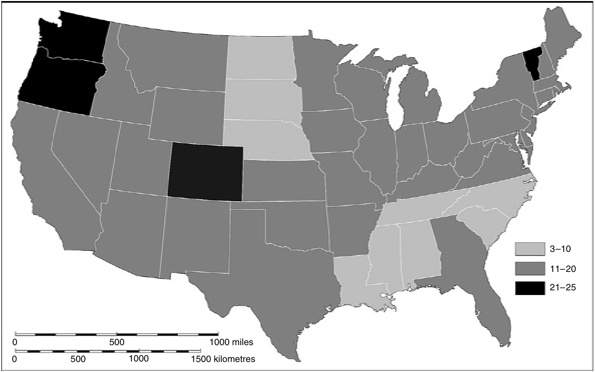
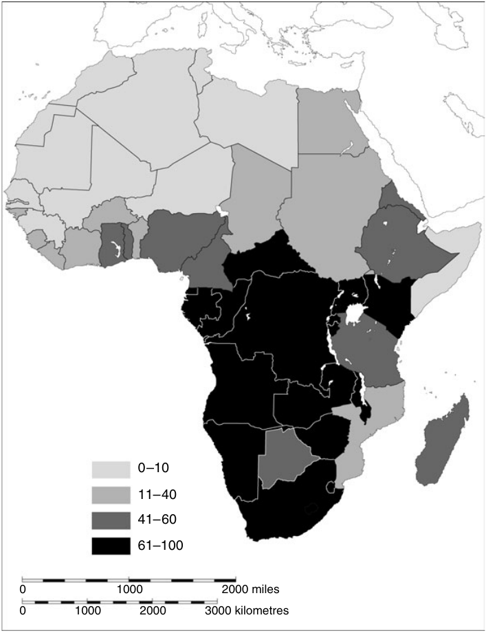
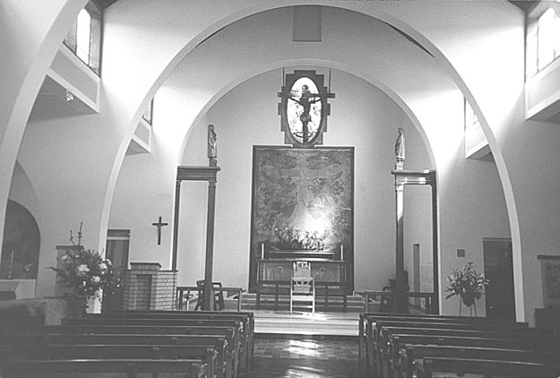

# 剑桥基督教史 第九卷：世界基督教（约1914—约2000年）

编者：休·麦克劳德

原书2006年出版。除缺失第20章外的全部现有内容中文校订稿已完成，包含卷首资料、三编、32章、原注、参考书目与索引。译校状态见校核记录。原书页码与PDF页码均保留，便于对照。

文中“当前”“今天”及统计、任职信息均依原书写作时期，不表示2026年现状。

现有内容译文一致性校订、重点复核与阅读版PDF校核已完成；本稿尚未经专业精校。

[阅读版PDF](<../output/pdf/09 世界基督教（1914-2000）（中文校订版，缺第20章）.pdf>) · [全卷校核记录](<全卷校核记录.json>)

> 原文缺失：第20章《拉丁美洲基督教的转型（约1950—2000年）》原书366—384页未包含在源PDF中，按用户要求暂跳过，该章未译。

> 译文范围说明：第20章原书366—384页在源PDF中缺失，按用户要求跳过；其余32章与现有卷首卷末资料已完成中文译稿。文献原题名与出版信息保留原文，说明文字译为中文。

- [卷首资料](#pdf-001)
- [导论](#pdf-020)
- [二十世纪初的基督徒生活](#pdf-034)
- [第一编 制度与运动](#pdf-046)
- [教皇制度](#pdf-048)
- [普世教会运动](#pdf-069)
- [基督教、殖民主义与传教](#pdf-090)
- [五旬节运动与灵恩运动](#pdf-108)
- [非洲与亚洲的独立教会运动](#pdf-126)
- [第二编 变迁的历程](#pdf-148)
- [第一次世界大战](#pdf-150)
- [欧洲基督教会与政治（1914—1939年）](#pdf-170)
- [拉丁美洲（约1914—约1950年）](#pdf-198)
- [非洲基督教：从世界大战到非殖民化](#pdf-216)
- [加勒比与欧洲的非洲离散群体：从奴隶解放前到当代](#pdf-238)
- [两次世界大战之间的美国基督教](#pdf-255)
- [澳大利亚、新西兰与太平洋的基督教会（1914—1970年）](#pdf-271)
- [欧洲第二次世界大战中的天主教与新教](#pdf-281)
- [冷战、美国霸权与基督教民主主义的黄金时代](#pdf-304)
- [六十年代的宗教激荡](#pdf-323)
- [西方基督教的危机：走向后基督教时代？](#pdf-342)
- [东欧剧变与后共产主义时代的开端](#pdf-367)
- [拉丁美洲基督教的转型（约1950—2000年）（原文缺失说明）](#pdf-385)
- [宗教与种族主义：围绕种族隔离、“吉姆·克劳”与南非种族隔离制度的斗争](#pdf-386)
- [后殖民时代非洲的基督教](#pdf-402)
- [南亚（1911—2003年）](#pdf-423)
- [东南亚的基督教（1914—2000年）](#pdf-437)
- [东亚](#pdf-451)
- [第三编 社会与文化影响](#pdf-470)
- [礼拜仪式](#pdf-472)
- [“他者”](#pdf-484)
- [财富与贫困](#pdf-515)
- [男性与女性](#pdf-535)
- [基督教与科学](#pdf-570)
- [文学与艺术](#pdf-583)
- [榜样](#pdf-619)
- [二十世纪末的基督徒生活](#pdf-637)
- [参考书目](#pdf-649)
- [索引](#pdf-692)

---

# 卷首资料

<!-- PDF page 1; original page unnumbered -->

<!-- PDF page 2; original page unnumbered -->

## 世界基督教：约1914—约2000年

二十世纪见证了与基督教历史上任何时期同样剧烈的变化。在数百年来作为基督教核心地区的欧洲，各教会因迫害与世俗化而遭受严重损失；但在非洲与亚洲部分地区，教会却迅速增长。本卷全面叙述了这个世纪世界各地天主教、新教与独立教会的历史。在这一世纪，基督教真正成为一种全球性宗教。本卷由来自多个国家的专家共同撰写，覆盖范围广泛。第一编关注具有世界影响的制度与运动，包括教皇制度、普世教会运动与五旬节运动。第二编叙述世界各地区的基督教历史。第三编从国际视角讨论若干选定主题，包括礼拜的变迁、与犹太人和穆斯林的关系、科学与艺术，以及性别与性。

**休·麦克劳德（Hugh McLeod）**是伯明翰大学教会史教授。其著作包括Piety and poverty: working class religion in Berlin, London and New York 1870–1914（1996）与Secularisation in western Europe 1848–1914（2000）。他担任国际基督教史研究委员会（CIHEC）主席，该组织是基督教史学家的国际组织。

<!-- PDF page 3; original page unnumbered -->

## 剑桥基督教史

《剑桥基督教史》按年代全面叙述基督教从起源到当代的发展，涵盖神学、思想、社会、政治、区域与全球等各个方面。每一卷都独立地对相应时期的学术研究作出重要贡献，整套丛书则构成一部大型学术参考著作。本丛书远不止叙述西欧基督教及其分支的历史，而是力求提供全球视野。从早期开始，东方基督教与科普特基督教就获得充分重视；在较晚的时期，非洲、远东、新大陆、南亚以及其他非欧洲地区的基督教发展，也得到适当论述。各卷讨论民众虔敬与基督教信仰的非正式表达，并把基督徒养成、礼拜与灵修的社会学问题置于广阔的文化背景中考察。基督教与其他主要信仰之间的关系，也始终是全书关注的问题。这套丛书将为学者与学生提供宝贵资源。

### 各卷一览

| 卷名 | 主编 |
| --- | --- |
| 起源至君士坦丁 | 玛格丽特·M.米切尔、弗朗西丝·M.扬 |
| 君士坦丁至约600年 | 温里希·勒尔、弗雷德·诺里斯、奥古斯丁·卡西戴 |
| 中世纪早期基督教：约600—约1100年 | 托马斯·诺布尔、朱莉娅·史密斯 |
| 西欧基督教：约1100—约1500年 | 米里·鲁宾、沃尔特·西蒙 |
| 东方基督教 | 迈克尔·安戈尔德 |
| 改革与扩张：1500—1660年 | 夏伯嘉 |

<!-- PDF page 4; original page unnumbered -->

| 卷名 | 主编 |
| --- | --- |
| 启蒙、复兴与革命：1660—1815年 | 斯图尔特·J.布朗、蒂莫西·塔克特 |
| 世界基督教：约1815—1914年 | 布赖恩·斯坦利、谢里丹·吉利 |
| 世界基督教：约1914—约2000年 | 休·麦克劳德 |

<!-- PDF page 5; original page unnumbered -->

（原书此页空白。）

<!-- PDF page 6; original page unnumbered -->

## 剑桥基督教史

**第九卷：世界基督教（约1914—约2000年）**

主编：休·麦克劳德（Hugh McLeod）

<!-- PDF page 7; original page unnumbered -->

## 出版资料

剑桥大学出版社

剑桥、纽约、墨尔本、马德里、开普敦、新加坡、圣保罗

英国地址：The Edinburgh Building, Cambridge CB2 2RU, UK。

美国版由剑桥大学出版社纽约分社出版。

出版社网址：http://www.cambridge.org

本书信息：http://www.cambridge.org/9780521815000

© Cambridge University Press 2006

本书受版权保护。除法律规定的例外，以及相关集体许可协议允许的范围外，未经剑桥大学出版社书面许可，不得复制本书任何部分。

2006年初版。

于英国剑桥大学印刷厂印制。

英国图书馆备有本书编目记录。

ISBN-13：978-0-521-81500-0，精装。

ISBN-10：0-521-81500-2，精装。

剑桥大学出版社不对本书提及的外部或第三方网站网址能否持续有效及其准确性承担责任，也不保证这些网站的内容现在或将来准确、适宜。

<!-- PDF page 8; original page vii -->

## 原书目录

| 内容 | 原书页码 |
| --- | --- |
| 地图目录 | xi |
| 插图目录 | xii |
| 撰稿人简介 | xiii |
| 1．导论——休·麦克劳德 | 1 |
| 2．二十世纪初的基督徒生活——休·麦克劳德 | 15 |

**第一编 制度与运动**

| 章节 | 原书页码 |
| --- | --- |
| 3．教皇制度——约翰·波拉德 | 29 |
| 4．普世教会运动——戴维·M.汤普森 | 50 |
| 5．基督教、殖民主义与传教——凯文·沃德 | 71 |
| 6．五旬节运动与灵恩运动——艾伦·安德森 | 89 |
| 7．非洲与亚洲的独立教会运动——艾伦·安德森、Edmond Tang | 107 |

<!-- PDF page 9; original page viii -->

**第二编 变迁的历程**

| 章节 | 原书页码 |
| --- | --- |
| 8．第一次世界大战——迈克尔·斯内普 | 131 |
| 9．欧洲基督教会与政治（1914—1939年）——马丁·康韦 | 151 |
| 10．拉丁美洲（约1914—约1950年）——克里斯托弗·阿贝尔 | 179 |
| 11．非洲基督教：从世界大战到非殖民化——奥格布·U.卡卢 | 197 |
| 12．加勒比与欧洲的非洲离散群体：从奴隶解放前到当代——罗斯维特·格尔洛夫 | 219 |
| 13．两次世界大战之间的美国基督教——科琳·麦克丹内尔 | 236 |
| 14．澳大利亚、新西兰与太平洋的基督教会（1914—1970年）——凯瑟琳·马萨姆 | 252 |
| 15．欧洲第二次世界大战中的天主教与新教——安德鲁·钱德勒 | 262 |
| 16．冷战、美国霸权与基督教民主主义的黄金时代——黛安娜·柯比 | 285 |
| 17．六十年代的宗教激荡——迈克尔·沃尔什 | 304 |
| 18．西方基督教的危机：走向后基督教时代？——休·麦克劳德 | 323 |

<!-- PDF page 10; original page ix -->

| 章节 | 原书页码 |
| --- | --- |
| 19．东欧剧变与后共产主义时代的开端——菲利普·沃尔特斯 | 348 |
| 20．拉丁美洲基督教的转型（约1950—2000年）——爱德华·L.克利里 | 366 |
| 21．宗教与种族主义：围绕种族隔离、“吉姆·克劳”与南非种族隔离制度的斗争——史蒂夫·德·格鲁希 | 385 |
| 22．后殖民时代非洲的基督教——戴维·马克斯韦尔 | 401 |
| 23．南亚（1911—2003年）——钱德拉·马拉姆帕利 | 422 |
| 24．东南亚的基督教（1914—2000年）——约翰·罗克斯伯勒 | 436 |
| 25．东亚——理查德·福克斯·扬 | 450 |

> 译校说明：原目录列有第20章，但所提供的源PDF没有这一章正文。其原书366—384页共19页缺失，后续须补齐。

**第三编 社会与文化影响**

| 章节 | 原书页码 |
| --- | --- |
| 26．礼拜仪式——布赖恩·D.斯平克斯 | 471 |
| 27．“他者” | 483 |
| 27.1．基督徒与犹太人的关系（1914—2000年）——丹尼尔·R.兰顿 | 483 |
| 27.2．基督徒与穆斯林的关系——戴维·托马斯 | 494 |
| 27.3．基督徒与佛教徒、印度教徒的关系——戴维·奇瑟姆 | 502 |
| 27.4．宗教神学——戴维·奇瑟姆 | 508 |

<!-- PDF page 11; original page x -->

| 章节 | 原书页码 |
| --- | --- |
| 28．财富与贫困——邓肯·B.福雷斯特 | 514 |
| 29．男性与女性 | 534 |
| 29.1．婚姻与家庭——阿德里安·撒切尔 | 534 |
| 29.2．同性恋——戴维·希利亚德 | 546 |
| 29.3．父权制与女性解放——皮尔约·马尔科拉 | 555 |
| 29.4．作为女性空间的教会——皮尔约·马尔科拉 | 562 |
| 30．基督教与科学——彼得·J.鲍勒 | 569 |
| 31．文学与艺术 | 582 |
| 31.1．文学与电影——戴维·贾斯珀 | 582 |
| 31.2．二十世纪的音乐与基督教——安德鲁·威尔逊－迪克森 | 592 |
| 31.3．基督教与艺术——尤塔·温岑特 | 599 |
| 31.4．教堂建筑——奈杰尔·耶茨 | 607 |
| 32．榜样——休·麦克劳德 | 618 |
| 33．二十世纪末的基督徒生活——休·麦克劳德 | 636 |
| 参考书目 | 648 |
| 索引 | 691 |

<!-- PDF page 12; original page xi -->

## 地图目录

**18.1 欧洲，1999年：欧洲各国成年人口中无宗教信仰者的比例。**原书第326页。

数据来源：Yves Lambert, ‘New Christianity, indifference and diffused spirituality’，载Hugh McLeod与Werner Ustorf编，The decline of Christendom in western Europe, 1750–2000（Cambridge: Cambridge University Press, 2003），第71页；Sinisa Zrinscak, ‘Generations and atheism: patterns of response to communist rule among different generations and countries’，Social compass 51（2004），第221—234页。

**18.2 加拿大，2001年：各省人口中无宗教信仰者的比例。**原书第342页。

数据来源：加拿大人口普查（原文网址：http://www.12.statcan.ca；2004年9月28日访问）。

**18.3 美国，2001年：各州成年人口中无宗教信仰者的比例。**原书第343页。

数据来源：http://www.gc.cuny.edu/studies/key_findings.htm，2004年9月28日访问。

**22.1 非洲，2001年：各国人口中基督徒的比例。**原书第402页。

数据来源：David B. Barrett、George T. Kurian与Todd M. Johnson编，World Christian encyclopaedia，2卷（Oxford: Oxford University Press, 2001）。

<!-- PDF page 13; original page xii -->

## 插图目录

| 图号与说明 | 原书页码 |
| --- | --- |
| 图31.1．牛津新马斯顿圣米迦勒与众天使教堂，1955年 | 609 |
| 图31.2．雷丁潘伯恩学院福克兰群岛纪念礼拜堂，2000年。戴维·罗宾逊摄影 | 615 |
| 图31.3．加的夫兰达夫主教座堂的中殿，可见新管风琴琴箱及《荣耀中的基督》雕塑，1957年 | 617 |

<!-- PDF page 14; original page xiii -->

## 撰稿人简介

**克里斯托弗·阿贝尔（Christopher Abel）**在伦敦大学学院教授拉丁美洲史，对十九、二十世纪的拉丁美洲与加勒比地区著述甚丰。他的研究兴趣包括宗教史、政治史、社会政策史与医疗卫生史。著有Politica, iglesia y partidos en Colombia（Bogotá, 1987），合作主编过多部社会政策史著作，并为《剑桥拉丁美洲史》及联合国教科文组织《拉丁美洲通史》等多卷本著作撰稿。

**艾伦·安德森（Allan Anderson）**是伯明翰大学五旬节研究教授，专门研究非洲与亚洲的五旬节运动及独立教会运动。著有An introduction to Pentecostalism（Cambridge, 2004）、African reformation（Trenton, NJ, 2001）与Zion and Pentecost（Pretoria, 2000），并合作主编Pentecostals after a century（Sheffield, 1999）及Asian and Pentecostal（Oxford, 2005）。

**彼得·J.鲍勒（Peter J. Bowler）**是贝尔法斯特女王大学科学史教授，英国国家学术院院士、爱尔兰皇家学院院士。著作包括Reconciling science and religion: the debate in early twentieth century Britain（Chicago, 2001）。

**安德鲁·钱德勒（Andrew Chandler）**是乔治·贝尔研究所所长、伯明翰女王基金会高级研究员，以及伯明翰大学历史研究学院荣誉讲师。他主编了The moral imperative: new essays on the ethics of resistance in National Socialist Germany 1933–45（Boulder, 1998）、Brethren in adversity: Bishop George Bell, the Church of England and the crisis in German Protestantism, 1933–39（Woodbridge, 1997），以及The terrible alternative: Christian martyrdom in the twentieth century（London, 1998）。曾在English historical review、Leo Baeck institute yearbook等多种期刊发表文章。

**戴维·奇瑟姆（David Cheetham）**是伯明翰大学神学与宗教系神学及宗教间关系讲师。著有John Hick（Aldershot, 2003）及多篇学术论文。

**爱德华·L.克利里（Edward L. Cleary，OP，道明会）**是美国罗得岛州普罗维登斯学院政治学教授兼拉丁美洲研究项目主任。他<!-- PDF page 15; original page xiv -->出版了多部研究拉丁美洲宗教的著作，包括Power, politics and Pentecostals in Latin America（Boulder, 1997）、Crisis and change（Maryknoll, 1985）及Resurgent Voices in Latin America（New Brunswick, NJ, 2004）。他曾任玻利维亚社会研究与行动研究所所长，以及Estudios Andinos编辑。

**马丁·康韦（Martin Conway）**是牛津大学贝利奥尔学院院士及近现代史导师，关于二十世纪天主教著述广泛，包括Catholic politics in Europe 1918–45（London and New York, 1997）。

**邓肯·B.福雷斯特（Duncan B. Forrester）**曾在印度马德拉斯基督教学院和英国苏塞克斯大学任教；自1978年至2001年退休期间，担任爱丁堡大学基督教伦理学与实践神学教授。近期著作包括On human worth: a Christian vindication of equality（London, 2001）及Truthful action: explorations in practical theology（Edinburgh, 2000）。

**罗斯维特·格尔洛夫（Roswith Gerloff）**拥有伯明翰大学博士学位，其论文在欧洲、美洲和加勒比地区深入田野调查的基础上，研究1952—1990年英国的非洲与加勒比教会运动。她创立了黑人与白人基督徒伙伴关系中心，并任首任主任；该中心是不同传统之间开展跨文化神学教育的一个范例。她于2001年任耶鲁大学研究员。在利兹大学，她继续开展一项重要研究，考察欧洲非洲基督徒离散群体的社会、文化与宣教学意义。她在黑人基督教、五旬节研究与跨文化学习等领域的出版物包括：博士论文A plea for British Black Theologies: the black church movement in its cultural and theological interaction（Frankfurt am Main, 1992）；客座主编International review of mission第89卷第354期（2000年7月），主题为‘Open space – the African Christian diaspora in Europe and the quest for community’；主编Mission is crossing frontiers（Pietermaritzburg, 2003）；以及Das schwarze Lächeln Gottes: Afrikanische Diaspora als Herausforderung an Theologie und Kirche（Frankfurt am Main, 2005）。

**史蒂夫·德·格鲁希（Steve de Gruchy）**是夸祖鲁－纳塔尔大学神学与发展项目主任，围绕南部非洲基督教社会伦理开展教学、研究与写作。他关注南非教会反对种族主义和种族隔离制度的斗争史，近期与父亲合作出版了The church struggle in South Africa的二十五周年修订版（London and Minneapolis, 2004）。他也是Journal of theology for southern Africa的编辑。

**戴维·希利亚德（David Hilliard）**是澳大利亚阿德莱德弗林德斯大学历史学高级讲师，在澳大利亚与太平洋岛屿宗教史的多个领域，以及近现代圣公会对同性恋的态度方面发表了多种研究成果。

**戴维·贾斯珀（David Jasper）**是格拉斯哥大学文学与神学教授，2002年获牛津大学神学博士学位。其最新著作为The sacred desert（Oxford, 2004）。

<!-- PDF page 16; original page xv -->

**奥格布·U.卡卢（Ogbu U. Kalu）**曾长期担任尼日利亚大学恩苏卡校区教会史教授，现任芝加哥麦考密克神学院亨利·温特斯·卢斯世界基督教与传教讲席教授。著作包括Power, poverty and prayer: the challenges of poverty and pluralism in African Christianity（Frankfurt am Main, 2000）、Embattled gods: Christianization of Igboland, 1841–1991（Trenton, NJ, 2003）；主编African Christianity: an African story（Pretoria, 2004）。即将出版Clio in sacred garb: essays on Christian presence and African responses, 1900–2000（Pretoria）。

**黛安娜·柯比（Dianne Kirby）**在阿尔斯特大学历史与国际事务学院任教。著有Church, state and propaganda（Hull, 1999），并主编Religion and the Cold War（Basingstoke, 2003）；后者是一部开创性的论文集，探讨关键的冷战时期宗教被赋予的重要全球角色。目前，她正在撰写一部专著，研究哈里·杜鲁门总统建立反对苏联共产主义的宗教阵线的努力。

**丹尼尔·R.兰顿（Daniel R. Langton）**是曼彻斯特大学现代犹太教—基督教关系讲师，在南安普敦大学犹太人与非犹太人关系研究中心完成博士研究。重要著作包括Claude Montefiore: his life and thought（2002），这是一部关于英国自由派犹太教共同创始人、宗教学者及宗教间关系先驱的传记；另有一系列探讨犹太人想象中的使徒保罗的论文。

**钱德拉·马拉姆帕利（Chandra Mallampalli）**是韦斯特蒙特学院历史学助理教授，著有Christians and public life in colonial South India, 1863–1937（London, 2004）。研究领域包括宗教民族主义、世俗主义、皈依、后殖民主义，以及南亚基督教史。

**皮尔约·马尔科拉（Pirjo Markkola）**是芬兰学术院研究员，任职于坦佩雷大学历史系。著作包括Synti ja siveys. Naiset, uskonto ja sosiaalinen työ Suomessa 1860–1920（Helsinki, 2002；《罪与道德：芬兰的女性、宗教与社会工作，1860—1920年》）；另主编Gender and vocation: women, religion and social change in the Nordic countries, 1830–1940（Helsinki, 2000）。

**凯瑟琳·马萨姆（Katharine Massam）**是墨尔本大学联合神学院教会史系主任，著作包括Sacred threads: Catholic spirituality in Australia, 1922–1962（Sydney, 1996）。

**戴维·马克斯韦尔（David Maxwell）**是基尔大学国际史高级讲师、Journal of religion in Africa编辑。著有Christians and chiefs in Zimbabwe. A social history of the Hwesa people ca. 1870s–1970s（Edinburgh, 1999），以及即将出版的African gifts of the Spirit: Pentecostalism and the rise of a Zimbabwean transnational religious movement（Oxford）。他还与英格丽德·劳里共同主编Christianity and the African imagination: essays in honour of Adrian Hastings（Leiden, 2002）。

**科琳·麦克丹内尔（Colleen McDannell）**是盐湖城犹他大学斯特林·M.麦克默林宗教研究讲席教授兼历史学教授。著有Picturing<!-- PDF page 17; original page xvi --> faith: photography and the Great Depression（New Haven, 2004）、Material Christianity: religion and popular culture in America（New Haven, 1998）、The Christian home in Victorian America: 1840–1900（Bloomington, 1986），并与伯恩哈德·朗合著Heaven: a history（New Haven, 1988）。2000年，她获古根海姆基金会研究奖助。

**休·麦克劳德（Hugh McLeod）**是伯明翰大学教会史教授，著作包括Piety and poverty: working class religion in Berlin, London and New York 1870–1914（New York, 1996）与Secularisation in western Europe 1848–1914（London, 2000）。他担任国际基督教史研究委员会（CIHEC）主席，该组织是基督教史学家的国际组织。

**约翰·波拉德（John Pollard）**是剑桥大学三一学堂历史学院士，对近现代教皇制度史著述广泛，尤以The unknown pope: Benedict XV (1914–1922) and the pursuit of peace（London, 1999）及Money and the rise of the modern papacy: financing the Vatican, 1850–1950（Cambridge, 2004）最为著名。

**约翰·罗克斯伯勒（John Roxborogh）**是新西兰但尼丁长老宗教牧学院堂区领袖培训协调员，曾在马来西亚及新西兰圣经学院任教。他是国际宣教学研究协会文献、档案与书目研究小组召集人。

**迈克尔·斯内普（Michael Snape）**是伯明翰大学历史学讲师，也是该校第一次世界大战研究中心成员。目前主要研究约1700—1950年英语世界的宗教与冲突。著作包括The Church of England in industrialising society: the Lancashire parish of Whalley in the 18th Century（Woodbridge, 2003）及God and the British Soldier 1914–1945（London, 2005）。

**布赖恩·D.斯平克斯（Bryan D. Spinks）**是耶鲁圣乐研究所与耶鲁神学院礼仪学教授。最新著作包括Sacraments, ceremonies and the Stuart divines: sacramental theology and liturgy in England and Scotland 1603–1662（Aldershot, 2002），以及Rituals and theologies of baptism: beyond the Jordan（Aldershot, 2005）。1986—2000年，他担任英格兰教会礼仪委员会委员，亦曾任苏格兰教会礼仪学会会长。

**Edmond Tang**是伯明翰大学东亚基督教研究组负责人，任China study journal编辑，发表过关于当代中国基督教的文章，目前研究中国、日本与韩国正在兴起的基督论。

**阿德里安·撒切尔（Adrian Thatcher）**在2004年8月退休前，担任普利茅斯圣马可与圣约翰学院应用神学教授，现任埃克塞特大学基督教伦理学兼职教授研究员。

**戴维·托马斯（David Thomas）**是伯明翰大学神学与宗教系基督教与伊斯兰教研究高级讲师，专门研究基督徒与穆斯林关系史。近期著作包括Early Muslim polemic against Christianity（Cambridge, 2002）与Muslim–Christian polemic during the crusades<!-- PDF page 18; original page xvii -->（Leiden, 2005）。他是布里尔出版社‘The History of Christian–Muslim Relations’丛书总编辑。

**戴维·M.汤普森（David M. Thompson）**是剑桥大学近现代教会史高级讲师、菲茨威廉学院院长，著有Nonconformity in the nineteenth century（London, 1972）、Let sects and parties fall（London, 1980），以及‘The unity of the church in twentieth century England: pleasing dream or common calling?’，载Studies in church history 32（London, 1996）。1994—1996年任教会史学会会长，1996—1997年任联合改革宗教会总会议长。

**尤塔·温岑特（Jutta Vinzent）**是伯明翰大学艺术史系现代与当代艺术及视觉文化讲师。著作包括Identity and image. Refugee artists from Nazi Germany in Britain（Weimar, 2005），以及‘Ars Memoriae und das Exil’，载Wolf-Friedrich Schäufele与Markus Vinzent编，Theologen im Exil – Theologie des Exils（Mandelbachtal and Cambridge, 2001）。

**迈克尔·沃尔什（Michael Walsh）**曾任伦敦大学海思罗普学院图书馆馆长，发表过关于古代晚期教会史及当代教会的多种著述。目前正在修订已故J. N. D.凯利的Oxford dictionary of the popes。

**菲利普·沃尔特斯（Philip Walters）**在伦敦政治经济学院获俄罗斯宗教思想研究博士学位。自1979年起，他在研究共产主义与后共产主义国家的资料和信息中心——凯斯顿研究所，原凯斯顿学院——工作；1984年以来任研究部主任。他就苏联、俄罗斯与东欧的政教关系及宗教生活发表过多篇论文与专书章节，并担任Religion, state & society: the Keston journal编辑，该刊原名Religion in communist lands。

**凯文·沃德（Kevin Ward）**是利兹大学神学与宗教研究系非洲宗教研究高级讲师，曾在乌干达执教多年，研究兴趣集中于东非基督教史。目前正在撰写世界圣公宗共融体的历史。

**安德鲁·威尔逊－迪克森（Andrew Wilson-Dickson）**曾长期在高等教育机构任教，现为自由职业音乐家。他是作曲家、指挥、键盘演奏家及作家，其著作The story of Christian music（Oxford, 1992）已译成十余种语言。

**奈杰尔·耶茨（Nigel Yates）**是威尔士大学兰彼得校区教会史教授兼大学研究中心主任。著作包括Buildings, faith and worship: the liturgical arrangement of Anglican churches 1600–1900（1991；修订版2000）、Anglican ritualism in Victorian Britain 1830–1910（Oxford, 1999），以及即将由牛津大学出版社出版的The religious condition of Ireland 1770–1850。1981—1991年，他任教堂维护理事会执行委员会委员，现任威尔士圣公会教省档案顾问。

<!-- PDF page 19; original page xviii -->

**理查德·福克斯·扬（Richard Fox Young）**是美国新泽西州普林斯顿神学院廷比宗教史讲席副教授，曾在日本明治学院大学东京与横滨校区任教。他对历史及当代基督教与亚洲新宗教之间互动的研究，涉及中国、日本与韩国，发表于Japanese journal of religious studies、Japanese religions与Monumenta nipponica等期刊。

---

# 第一章 导论

**作者：休·麦克劳德（Hugh McLeod）**

> 原书第1—14页；对应原PDF第20—33页。

<!-- PDF page 20; original page 1 -->

据估计，二十世纪初，世界人口约有三分之一是基督徒；这意味着基督教是当时世界上规模最大的宗教，远远超过其他宗教。在这一世纪里，基督徒人数迅速增加，但世界总人口当然也在增长，因此基督徒所占的比例可能略有下降。到了世纪末，基督徒人数仍然多于任何其他宗教的信徒，不过穆斯林已经成为相当接近的第二大群体。[^p020-1]与此同时，基督徒在世界各地区之间的分布发生了剧烈变化。据估计，二十世纪初，世界上约80%的基督徒生活在欧洲、俄罗斯帝国和北美，生活在亚洲与非洲的仅占5%。依同一组作者的估算，到2000年，生活在欧洲、前苏联和北美的比例已降至约40%，而生活在亚洲与非洲的比例则跃升至32%。

这些数字清楚地概括了本卷的两个中心主题：二十世纪，基督教成为一种遍及世界的宗教；与此同时，它在数百年来的核心地区却遭遇了一连串重大危机。然而，这两个为人熟知的论点，可能遮蔽了另外两个同样重要的事实。第一，即使到了二十世纪末，国际基督教内部的权力仍主要集中在欧洲与北美。第二，在西方，极权政府的攻击，以及范围更广、进展更为渐进的世俗化过程，虽然都给基督教带来了危机，但至少直到六十年代，基督教及各基督教会仍在原有核心地区的政治、社会与文化生活中发挥着重大作用。在这一世纪最后三十年中，这种作用依然<!-- PDF page 21; original page 2 -->十分重要，尽管其程度因国家而异，在某些生活领域中的影响也大于其他领域。

## 天主教徒、新教徒与独立教会

从历史上看，基督教分为东方与西方两大传统，东方基督教的近现代史由本丛书的另一卷讨论。本卷完全聚焦于西方基督教，以及十九、二十世纪从西方基督教中发展出来的较新运动。自十六世纪以来，西方基督教分为承认罗马主教首权的天主教，与不承认这一首权的新教。十九、二十世纪，美国，尤其是非洲与亚洲，出现了新的基督教形态。其中一些由声称领受了新启示的先知领导，另一些则只是出于摆脱任何形式西方控制的愿望。在非洲与亚洲，这些教会通常统称为“独立教会”。本卷第一编概述二十世纪具有国际影响的五种制度或运动：教皇制度；以历史较悠久的新教会为主要推动力量的普世教会运动；传教运动；二十世纪新教中扩展最为迅猛的五旬节运动；以及独立教会运动。

整个二十世纪，罗马天主教始终是基督教中规模最大的分支，远远超过其他分支；全世界约半数基督徒属于天主教会。世纪初，天主教在南欧，以及中欧、东欧的广大地区占据主导地位。在法国、比利时、西班牙、葡萄牙和意大利，受过洗的天主教徒占人口的绝大多数；在爱尔兰与奥匈帝国，他们也占相当大的多数。在德国、瑞士和荷兰，天主教徒虽属少数，但人数众多；在大不列颠，也构成一个不可忽视的少数群体。在南美与中美几乎所有地区、若干加勒比岛屿以及菲律宾，天主教徒同样占绝大多数。他们约占加拿大人口的一半，在美国和澳大利亚也构成人数可观的少数群体。亚洲与非洲各地还分布着历史悠久的天主教聚居区，而近期的传教活动也吸引了相当数量的皈依者，乌干达和印度支那尤其如此。

1869—1870年的梵蒂冈大公会议以界定教皇无谬性的教义为高潮，奠定了十九世纪后期与二十世纪初天主教生活的<!-- PDF page 22; original page 3 -->主导基调。教会日益集权，在神学上、往往也在政治上采取强烈的保守立场，并以教皇至上主义的虔敬及对教皇的高度忠诚凝聚为一体。不过，在梵蒂冈大公会议期间，自由派天主教徒、高卢主义者及其他群体中，曾有一个人数虽少却不可忽视的异议群体。一些人离开了教会；大多数人则压下了自己的疑虑。然而，异议思潮仍在表面之下延续。在本卷所讨论时期的开端，教会刚刚经历了所谓“现代主义危机”：教皇庇护十世严厉压制那些采用新教徒率先开创的“现代主义”《圣经》批判方法的天主教《圣经》学者，并要求教士宣誓反对现代主义。除了这些内部分歧，教会还面临严峻的外部挑战：在法国等一些欧洲国家，反教权政府向它施压，社会中也出现范围更广的“去基督教化”趋势，即相当一部分人口疏离了教会。

十六世纪，新教成为北欧广大地区的国家宗教。当时，新教已经有三个主要分支：路德宗成为许多德意志邦国以及整个斯堪的纳维亚的官方宗教；改革宗信仰，又称加尔文宗，在英语世界也称长老宗，在瑞士许多州、德意志部分邦国和苏格兰取得胜利，经过多年战争后也在荷兰共和国取得胜利；圣公会则成为英格兰与威尔士，以及爱尔兰的国教，尽管爱尔兰大多数居民仍是天主教徒。二十世纪初，十六世纪建立起来的国教制度，除荷兰和爱尔兰外，仍然完整存在，而且一般至少在名义上得到大多数居民的认同。

然而，自十七世纪以来，大量新教新形态的出现，使新教世界的宗教格局变得复杂得多。早在十六世纪，重洗派就曾试图在没有任何国家支持的条件下，自下而上地发动宗教改革，但他们大体上被迫害消灭了。不过，十七世纪的英格兰孕育了浸礼宗、公理宗和贵格会；十八、十九世纪的英格兰产生了卫理宗、一位论派和救世军；十九、二十世纪的美国则出现了复临派、摩门教、耶和华见证人与五旬节派。二十世纪最重要的新发展是五旬节运动：这个名称统称1906年洛杉矶阿苏萨街复兴之后相继涌现的众多宗派，其中有些规模庞大，有些则十分微小。

<!-- PDF page 23; original page 4 -->

随着新教走出欧洲，它呈现出极为多样的形态。在美国，二十世纪规模最大的新教分支是浸礼宗与卫理宗；在澳大利亚，则是圣公会与联合教会，后者由卫理宗、公理宗和长老宗联合组成。尼日利亚与乌干达是圣公会的重镇；长老宗在马拉维势力强大，卫理宗则在加纳与南非根基深厚。这反映出早期传教活动所形成的地理格局仍然具有影响力。不过，与非洲几乎所有地区的情况一样，这些历史悠久的教会也在与许多较新的新教形态竞争。如今，五旬节运动已经是拉丁美洲规模最大的新教分支，远远超过其他分支；正如第六章所述，它在非洲与亚洲的若干地区发展惊人，在基督教世界其他大多数地区也有所增长，只是程度较小。

十九世纪，新教内部出现了新的神学分歧。这些分歧常常分裂同一个宗派，却又把不同教会中神学倾向相近的人联结起来。十八世纪后期与十九世纪初最重要的推动力量，是英语世界所称的福音主义，以及德国和斯堪的纳维亚相关运动所称的敬虔主义。福音派相信人人都有内在的罪性，绝对需要悔改、寻求上帝的赦免，并经历归信。他们强调《圣经》的权威，而且通常按字面解释《圣经》。[^p023-2]但十九世纪，新教内部也发展出一股强大的自由主义运动。自由派新教徒仍把《圣经》视为最高权威，却认为神圣经文应当接受批判性考察。他们并不把《圣经》看作浑然一体的整体，而是承认其中存在张力，并认为某些部分，尤其是福音书与《旧约》先知书，比其他部分更具权威。他们重视基督教的伦理教导，超过其教义教导，并对科学与教育持十分积极的看法。第三种重要分野，来自圣公会与路德宗内部的高教会运动。“高教会”意味着重视圣礼，尤其是圣餐，重视祭司职分、礼仪与仪式，以及教会传统。这往往使人对罗马天主教与东正教抱持更友善的态度。实际上，圣公会高教会派常常<!-- PDF page 24; original page 5 -->自称“大公派”或“圣公会大公派”，并否认英格兰教会是新教会。

二十世纪初，新教内部又出现了进一步的神学分化。其中有两项发展需要特别说明。基要主义到二十世纪后期大体已成为一个贬称，但它最初源于1910—1915年间在美国出版的一套名为《基要真理》（The Fundamentals）的丛书，以及随后成立的世界基督教基要真理协会。这些作者是保守的福音派新教徒，反对自由主义的发展。他们的许多信条也是一般保守基督徒所共有的，但他们也有一些独特的信念与关注点。他们的核心原则，是坚持所谓《圣经》的“无误性”。由此又引出两点：拒绝达尔文的进化论，成为他们特别看重的身份标志；对《圣经》预言的关注，则使他们形成了一种称为“前千禧年时代论”的独特历史解释，并期待基督即将再临。[^p024-3]基要主义深刻影响了美国的民众宗教，又通过美国传教士影响了世界其他地区。大约同一时期，另一项重要的新发展是新正统神学。它对一般基督徒的直接影响极小，对学者与教会领袖的影响却极大。其主要代表是瑞士神学家卡尔·巴特，第一部重要著作是他于1919年发表的保罗《罗马书》注释。它之所以是“正统”的，是因为它重新肯定了许多宗教改革的经典教义，强调上帝与有罪的人类之间存在根本鸿沟，唯有上帝在耶稣基督里的自我启示才能跨越。它之所以是“新”的，是因为它把前一世纪一些重大的神学创新，例如对《圣经》的批判方法，视为理所当然。[^p024-4]

## 五个主要主题

本卷第一编与第二编贯穿着五个主题：基督教从一种主要属于欧洲与美洲的宗教，发展为遍及世界的<!-- PDF page 25; original page 6 -->宗教；基督教在欧洲与北美核心地区面临的重大挑战；基督教内部宗派界线的重要性下降，同时基督徒与其他信仰者的接触增多；战争在二十世纪历史中发挥的巨大作用；以及基督教与受压迫群体争取解放的运动之间的关系。还有第六个主题，虽然很少被明确提及，却构成大多数章节不可或缺的背景，那就是交通与传播革命。下面，我将对这些问题逐一作简要说明。

### 基督教成为遍及世界的宗教

我们必须把基督教在非洲与亚洲的大幅增长，放在它与欧美权力之间那种复杂而矛盾的关系中理解。二十年代，几乎整个非洲、几乎整个南亚与东南亚，以及中东的广大地区，都处于欧洲统治之下。这为基督教传教活动提供了两项主要优势：为传教士与本地皈依者提供人身保护，以及为教会学校提供经费。另一方面，这些条件并不能保证人们会回应基督教的传教努力。在南亚大部分地区与非洲部分地区，回应相当有限；而且在非洲许多地区，伊斯兰教也在殖民时代扩张。反过来说，基督教进展最快的亚洲地区——朝鲜——当时却在日本统治之下。当然，正如戴维·马克斯韦尔在第二十二章所指出的，殖民统治结束后，基督教的增长速度比殖民时代还要快。看来，殖民主义所启动、并持续发展的社会变迁过程，在创造有利于基督教兴盛的条件方面，可能比殖民统治本身的任何内在特征更为重要。

二十世纪后期，欧洲帝国瓦解后，美国的权力仍然深刻影响着基督教能否发展。人们对美国的看法，美国传教士的努力，以及美国各宗派总部提供的书籍、录音带、录像带等资源，共同影响了五旬节运动与其他保守新教形态在世界各地的传播。美国文化享有的声望，使许多人更容易接受其他美国产物，包括美国的宗教。但另一方面，美国的经济与文化权力，也像欧洲殖民主义一样，具有双重作用：反美情绪可能表现为敌视基督教，或至少敌视新教。例如，五十、六十年代的中国便出现过这种情况；到了世纪末，穆斯林世界若干地区也正在出现同样的现象。从1945年到<!-- PDF page 26; original page 7 -->八十年代后期实行改革重组之前，世界上还存在一个反基督教的超级大国，它对世界其他地区，尤其是非洲，有着相当大的影响。六十、七十年代，许多马克思主义政府相继建立，获得苏联在意识形态上的支持，以及一定程度的财政支持。在埃塞俄比亚等一些国家，这类政府推行了暴力反基督教政策。

### 西方的危机

十九世纪，欧洲与美国围绕基督教教义的真理性展开了激烈争论。同样激烈的，还有关于教会与国家关系中教会应处何种地位的政治争论。在二十世纪最初四十年中，这些政治争论变得尤其尖锐。世纪初，欧洲大多数国家都设有国教会，基督教与政治、经济权力的运作紧密交织。家长式的企业主和地主常常践行基督教慈善，但也利用基督教传道人为自己的权威提供正当性。学校教师往往把宗教与爱国主义混合起来，军人则被要求参加集体礼拜。

这些现象大多受到自由主义者和社会主义者的攻击。法国于1905年实行政教分离，葡萄牙于1911年、俄国于1918年、德国于1919年、西班牙于1931年相继效仿。二十、三十年代，欧洲广大地区建立了极权政府，或至少是高度威权的政府；其中一些政权甚至在民主国家也享有声望。这给各教会带来了严重问题。这些政府对宗教与教会的态度差异很大。只有苏联完全而公开地反对任何宗教。另一个极端则是葡萄牙的萨拉查、奥地利的陶尔斐斯与舒施尼格等独裁者，他们对天主教会十分友好。当然，即使是最友好的独裁者，其专横手段也可能成为关系紧张的根源。纳粹在原则上反对基督教，在地方层面也常常公开表现出来，但其官方政策主要由策略性考虑决定。[^p026-5]正如约翰·波拉德在第三章所指出的，教皇庇护十一世<!-- PDF page 27; original page 8 -->并不是民主派，而且确实曾帮助墨索里尼上台；但他与这位意大利独裁者的关系常常十分紧张。他从未对苏联抱有任何好感，也很快便丧失了对纳粹德国的一切同情。国际新教领袖大多是坚定的民主派，但他们也不禁自问：基督教是否正在输掉与新兴“政治宗教”的较量？后者似乎能够提供更激动人心的信仰，以及解决经济、社会问题的实际办法。

1945年以后，东欧大部分地区相继建立了共产党政府，并且都推行反宗教政策。而在西欧，教会与国家的关系则进入一个异常和谐的阶段。原因之一，是约1945—1965年间许多重要政治人物都是虔诚践行信仰的天主教徒。在美国，政教关系问题于这一世纪最后四分之一的时间里重新受到高度关注；这个国家早在1791年就成为第一个实行政教分离的基督教国家。七十年代后期兴起的所谓“宗教右翼”，主要由保守的新教徒组成。他们认为，最高法院近期的裁决，以及更广泛的道德风气变化，正在威胁基督教。反过来，他们又激起了自由派与世俗主义者的强烈反应；后者声称，“宗教右翼”危及宪法规定的政教分离。

事实上，美国保守派所痛斥的道德风气变化，在六十年代影响了整个西方世界。宗教争论的重心，此时已从政治转向基督教有关性伦理与性别的教导，以及对基督教排他性的批评。人们日益要求在宗教与伦理问题上享有更大的个人自由，每个人都主张有权选择自己的“道路”，从不同来源汲取灵感，并自行决定接受教会的哪些教导，又拒绝或忽略哪些教导。第十七、十八和二十九章详细叙述了这些年份中的宗教与道德激荡。毫无疑问，六十、七十年代是欧洲与北美宗教史的一个转折点，不过历史学家、社会学家与神学家对如何解释这一时期的变化意见不一。一些人认为，这是世俗化最终定局的时期；一些人认为，它开启了一个“后基督教”却并非“后宗教”的时代；另一些人则把它视为“灵性觉醒”的时期，基督教在其中经历转变，并在某些方面得到加强。[^p027-6]

<!-- PDF page 28; original page 9 -->

### 与其他基督徒及其他信仰的关系

十九世纪，天主教徒与新教徒之间的冲突加剧，各新教会也饱受分裂困扰，由此产生许多新宗派。宗教分歧部分源于社会与政治因素，却由排他性的神学提供正当性；这类神学坚持认为，得救取决于信仰是否正统。海外传教的紧迫感，来自相信“异教徒”注定下地狱。十九世纪后期，自由派神学家质疑有关永罚的传统教导，这种预期因而有所改变。然而，他们在提出质疑的同时，往往更加强调传教的人道主义动机：基督教将终结那些摧毁今世人生的残酷习俗。

如第四章与第二十七章所述，尽管存在重要的逆流，二十世纪的总体趋势，仍是不同宗派基督徒之间，以及基督徒与其他信仰者之间，建立更密切的联系。十九世纪后期以来，各新教宗派之间的合作迅速发展，有时甚至提出合并的建议。但新教徒与天主教徒的合作，直到若望二十三世在位时期（1958—1963年）及第二次梵蒂冈大公会议（1962—1965年），才取得实质进展。六十年代原本就热衷各种口号，而“对话”成为其中最流行的口号之一；这一时期也标志着基督徒与其他信仰者之间的联系进入关键发展阶段。

人们经常批评，这类“对话”只发生在高层，对“普通人”几乎没有影响。但天主教徒与新教徒的关系恰好相反。领袖之间的对话常常停滞不前，大公会议却为地方层面的重大变化开辟了道路。例如，讨论会与祈祷会、交换讲坛、参与普世教会社会行动，以及尤其重要的对跨宗派通婚采取更加积极的态度，共同推动双方关系发生革命性变化。另一种关系改善，发生在历史较悠久的新教会与五旬节教会、非洲独立教会之间；后两类教会中的一些于七十年代加入了世界基督教协进会。其中一个重要因素，是欧洲帝国主义名誉扫地，以及西方基督徒认识到，他们必须更加认真地对待非西方的基督教形态。

<!-- PDF page 29; original page 10 -->

人们认为世俗化构成一种共同威胁，这推动了各教会之间的合作，近来又推动了不同信仰之间的合作。二十一世纪初，同样重要的，还有人们认识到宗教仇恨所具有的破坏潜力，以及它给所有人带来的危险。例如，在宗教构成十分多样的英格兰城市伯明翰，佛教、基督教、犹太教、伊斯兰教与锡克教领袖借2004年欧洲议会选举之际发表联合声明，表明支持“我们伯明翰这个多族裔、文化与宗教多样的共同体”，并在结尾写道：“我们期待各信仰群体的所有成员，都能践行并促进种族公正与包容，拒绝任何企图煽动种族与宗教仇恨、歧视，以及对寻求庇护者的恐惧的政党。”[^p029-7]承认“信仰群体”是当代英国社会不可或缺的组成部分，既有助于降低这些群体之间发生冲突的危险，也有助于抵制要求更彻底世俗化的呼声。

基督教内部宗派界线逐渐淡化，最重要的原因是，十六、十七与十八世纪曾促使新宗派出现的许多问题，到了二十世纪已经大大失去其紧迫性。与此同时，新的问题不断出现，分歧更多地发生在宗派内部，而不是宗派之间。例如，对灵恩运动、解放神学、女性在教会与社会中的角色，以及性，尤其是同性恋的态度，都是如此。罗马天主教会尤其自第二次梵蒂冈大公会议以来，经历了激烈的内部冲突。如第二十九章所述，世纪末的圣公宗共融体也先后被女性按立与同性恋问题撕裂。基督徒在某些问题上仍然存在根本分歧，但分歧的依据已经改变。因此，一位自由派天主教徒与一位自由派卫理宗信徒，很可能有许多共同点；不过，保守主义往往更多地带有各宗派的特征。

<!-- PDF page 30; original page 11 -->

### 战争的影响

二十世纪常被称为人类历史上最可怕的世纪，[^p030-8]战争的阴影笼罩着这一世纪历史的所有领域。两次世界大战带来了规模空前的死亡与毁灭，也都造成了巨大的政治后果。三十年代的西班牙内战、六十与七十年代的越南战争、九十年代前南斯拉夫的战争，以及持续不断的阿以冲突，都产生了重大的国际影响，塑造着人们对宗教和政治的思考。如今，在二十一世纪开端，2003年的伊拉克战争也预示着——或威胁着，取决于个人如何判断——同样深远的后果。对于二十世纪很大一部分人类而言，战争是生活的核心现实，因此在本卷中必然占有重要位置。第八章与第十五章尤其关注基督教会在两次世界大战中的作用，以及基督徒如何把自己的信仰与战争经验，以及战争提出的道德困境联系起来。二十世纪的历史使神义论问题凸显出来，促使一些人走向“抗议式无神论”，但同样常见的结果，则是使人不再相信单凭人类自身就能解决人类苦难。新正统神学成为两次世界大战时代风行的神学，并非偶然。

战争对于人们理解宗教与爱国主义之间关系的影响，也相互矛盾。与十九世纪一样，宗教在二十世纪常常支撑着民族认同。战争往往带来爱国宗教热情的高涨，以及“本民族的事业就是上帝的事业”之类的宣称。在英国，人们经常天真地感到惊讶：这种爱国宗教热情，不仅见于为“正义”战争而战的人，也见于参加显然“不正义”战争的人，例如第二次世界大战中的德国人。诚然，第一次世界大战期间——正如迈克尔·斯内普在第八章所展示的——以及在相当程度上的第二次世界大战期间，“保卫祖国而战既是道德义务，也是宗教义务”的信念如此根深蒂固，以至只有极少数具有非凡独立精神，而且常常具有非凡勇气的人，才能抵抗这种信念。另一方面，战争的恐怖也造成了广泛的幻灭。九十年代，爱尔兰、前南斯拉夫与中东的暴力，使人产生了这样的看法：

<!-- PDF page 31; original page 12 -->

宗教“引发战争”。[^p031-9]恐怖主义与宗教极端主义日益被联系起来，又强化了这一看法。据一位研究恐怖主义的专家所说，1968年活动的恐怖组织，没有一个可称为“宗教性”组织；但到1995年，全世界已知的恐怖组织中，近一半具有宗教性的意识形态。[^p031-10]人们疏离基督教，有时是因为教会支持不得人心的战争，例如六十、七十年代的美国；[^p031-11]有时则源于一种更模糊、更普遍的认识，即宗教狂热具有危险性。这些忧虑也催生了基督教和平主义，使它在二十世纪成为基督徒的一项重要选择；这也许是自君士坦丁以前的时代以来的第一次。

### 解放

法国大革命提出的自由与平等口号，在二十世纪仍然具有巨大的感召力，激励各种受压迫群体争取解放，从工人阶级、被殖民民族，到女性，无不如此。这些运动常常反基督教，或至少反对教会。二十世纪对基督教最有力、最有效的批评，是指责它与富人和权势者关系过于密切，并且太轻易地为现存秩序提供正当性。这类政治批评的影响，远远超过从科学或哲学立场提出的宗教批判。在这一世纪上半叶，欧美对基督教最常见的指责，是它与资本家结盟，并参与压迫工人。七十年代以来，最常见的指责，则是它参与压迫女性或性少数群体。在亚洲与非洲，基督教的反对者主要声称，基督教是一种外来输入，或是西方帝国主义的工具。正如钱德拉·马拉姆帕利在第二十三章所展示的，这种说法令拥有近两千年历史的印度基督徒深感愤慨。

<!-- PDF page 32; original page 13 -->

然而，正如本卷许多章节所展示的，基督教与解放运动之间的关系极其多样。例如，亚洲的反殖民运动常常反基督教，但非洲的同类运动却很少如此。马克思主义是二十世纪影响最大的激进意识形态，总体而言坚决反对基督教；但到七十、八十年代，拉丁美洲的马克思主义者逐渐认识到，与基督徒合作，推翻统治者的前景就会好得多。1979年尼加拉瓜的桑地诺革命便是如此。六十年代末与七十年代初的女性主义运动，整体上带有反基督教倾向，但很快从中发展出一种基督教女性主义，致力于改造教会与社会。正如史蒂夫·德·格鲁希在第二十一章所述，南非的斗争格外鲜明地呈现出相互对立的基督教理解之间的冲突，因为无论为种族隔离制度辩护，还是批判这一制度，基督教都居于核心位置。邓肯·福雷斯特在第二十八章突出讨论了基督教社会主义与基督教新自由主义之间的张力。皮尔约·马尔科拉在总结她对父权制与女性解放的分析时，也指出：基督教既是推动女性解放的一个因素，也是反对女性解放的一个因素。关于自身信仰在政治与社会层面的含义，二十世纪的基督徒得出了根本不同的结论。

### 交通与传播革命

许多世纪都曾发生交通与传播革命，但恐怕没有哪一个世纪像二十世纪那样，在相对短暂的时间里发生如此多次革命。汽车与飞机、电影、广播、电视、计算机，以及最近出现的互联网，都对基督教产生了影响。它们为政府提供了强大的工具，用以压制民众与灌输思想；它们也把那些保有独特生活方式的偏远社群带出了孤立状态。另一方面，它们又为人们接触各种被禁止的思想提供了途径。在极权国家，这一点最为明显：异议者能够通过收听境外广播得到精神支持。而如今，互联网意味着异议者自己也能公开发声。这正在中国发生，也正在各教会内部发生：领导层有自己的官方网站，那些被边缘化或逐出教会的人，同样可以拥有自己的网站。帕尔特尼亚主教雅克·加约就是一个例子。他持续质疑教士必须独身等问题上的官方教导，因而被教皇从埃夫勒调往这个位于撒哈拉、已无人居住的教区。

<!-- PDF page 33; original page 14 -->

然而，这位直言不讳的高级教士随后仍通过自己的网站猛烈抨击梵蒂冈。[^p033-12]

二十世纪末，互联网的宗教影响才刚刚开始显现，但看来它很可能产生十分重大的影响。一个较小的例子，是“在线礼拜”的流行，包括一种圣餐礼：参与者各自准备面包和葡萄酒，分别坐在自己的屏幕前，同时领用。更重要的是，互联网可能强化宗教多样化的趋势：它既帮助维系分散各地的宗教社群，[^p033-13]又为寻求宗教的人提供种类极其繁多、往往相当冷僻的不同选择的信息。

## 注释

[^p020-1]: 本段所有数字均依据David B. Barrett、George T. Kurian与Todd M. Johnson主编的World Christian encyclopaedia，2卷（Oxford: Oxford University Press, 2001），第I卷，第4、12页中的估算；应承认，其中许多估算带有推测性质。

[^p023-2]: David W. Bebbington, Evangelicalism in modern Britain: a history from the 1730s to the 1980s（London: Unwin Hyman, 1989），第2—3页，对福音主义提出了一个颇具影响的定义。

[^p024-3]: 参见George M. Marsden, Fundamentalism and American culture: the shaping of twentieth century Evangelicalism 1870–1925（New York: Oxford University Press, 1980）。

[^p024-4]: 关于二十世纪基督教神学的综合介绍，包括世界各地区、个别神学家、女性主义与后现代神学、神学与科学的关系，以及许多其他问题，参见David F. Ford编，The modern theologians: an introduction to Christian theology in the twentieth century，第2版（Oxford: Blackwell, 1997）。

[^p026-5]: 经典著作是John S. Conway, The Nazi persecution of the churches（London: Weidenfeld & Nicolson, 1968）。如今，Richard Steigmann-Gall的The Holy Reich: Nazi conceptions of Christianity 1919–45（Cambridge: Cambridge University Press, 2003）对此提出了挑战。他认为，海德里希这类激烈反基督教的纳粹并不具有代表性，主流立场虽然反天主教、反教权，却并不反基督教；他们对新教的态度相对友好。这项研究资料扎实，提供了比以往更为细致的图景；但在我看来，其核心论点说得相当过头。

[^p027-6]: 有关不同观点，参见Grace Davie、Paul Heelas与Linda Woodhead编，Predicting religion: Christian, secular and alternative futures（Aldershot: Ashgate, 2003）；Grace Davie, Religion in modern Europe: a memory mutates（Oxford: Oxford University Press, 2000）；Amanda Porterfield, The transformation of American religion: the story of a late-twentieth-century awakening（New York: Oxford University Press, 2001）。

[^p029-7]: Birmingham ecumenical news，2004年6—8月号。这一期中，有许多消息具有跨信仰的性质或主题，颇为引人注目。例如，其中刊载了一年一度的犹太教—基督教研习日、伯明翰信仰理事会组织的会议、基督徒与犹太人理事会的会议、“理解伊斯兰教”课程，以及一次跨信仰和平步行活动的通知。同样，一篇报道谈到，在市议会支持下，一件基督教艺术作品被安置于城中公共场所。报道指出，反对声音“并非来自犹太教徒、印度教徒、锡克教徒或穆斯林”；这些群体鼓励基督徒“庆祝耶稣所带来的希望”，并“相应地邀请我们所有人，在轮到他们举办公共庆祝活动时予以支持”。反对者反而是“老派自由主义世俗派；他们装作相信，信仰充其量只是私人事务，与我们的公共生活无关”。

[^p030-8]: Eric J. Hobsbawm, Age of extremes: the short twentieth century 1914–1991 (London: Michael Joseph, 1994), pp. 1–2.

[^p031-9]: 1995年，牛津大学公众理解科学讲席教授、英国最知名的无神论者理查德·道金斯，在一次广播中提出了这一说法。社会学家戴维·马丁因此尝试在Does Christianity cause war?（Oxford: Oxford University Press, 1997）中，对这个问题作更为细致的分析。

[^p031-10]: Charles Townshend, Terrorism: a very short introduction (Oxford: Oxford University Press, 2002), p. 97.

[^p031-11]: 实际上，越南战争使美国各教会陷入严重分裂。例如，在支持战争的人当中，斯佩尔曼枢机与葛培理等基督教神职人员十分显眼；在反对战争的人当中，小马丁·路德·金与贝里根兄弟等神职人员也同样突出。

[^p033-12]: Brenda Brasher, Give me that online religion (San Francisco: Jossey Bass, 2001), pp. 30–1.

[^p033-13]: David Nash, ‘Religious sensibilities in the age of the internet: freethought culture and the historical context of communication media’, in Stewart M. Hoover and Lynn Schofield Clark (eds.), Practicing religion in the age of the media: explorations in media, religion and culture (New York: Oxford University Press, 2002), pp. 276–90.

---

# 第二章 二十世纪初的基督徒生活

**作者：休·麦克劳德（Hugh McLeod）**

> 原书第15—26页；对应原PDF第34—45页。

<!-- PDF page 34; original page 15 -->

## 基督教世界

利梅尔泽尔是法国西部莫尔比昂省的一个大村庄。二十世纪上半叶，大多数居民从事农业，绝大多数是参加教会礼拜的天主教徒。这里以虔诚闻名，以至于天主教记者称它为“瓦讷教区的明珠”。本堂神父是村里最有权势的人，也习惯于以强硬手段行使权力。孩子们从小就被教导，教士有着特殊地位。神父来访时，大人毕恭毕敬，孩子则心怀畏惧。1962年，由于参加教会礼拜的人数略有下降，本堂神父心生忧虑，仍在堂区公报中警告说：“人在尘世存在，别无其他理由，唯有为永恒的得救作准备；而这项责任已被交托给教会。”无论是在家里，还是在村庄及周围乡野，宗教象征都十分醒目。每周弥撒是每周生活节律中的核心事件；据说，三十年代经常不参加弥撒的村民仅有“一两个”。人们在教堂台阶上交流消息，之后，失去亲人的家庭结伴前往墓地，男人们则聚集在酒馆里。宗教游行、朝圣及各种教会节庆，是一年生活周期中的大事。

几乎所有人都在天主教学校接受教育。实际上，那所俗称“魔鬼学校”或“狗学校”的公立学校，在二十年代能够保留下来，完全是因为本堂神父秘密干预，劝说一户家庭把孩子转入这所世俗学校。他的动机部分出于私人关系：他的侄子娶了该校教师的女儿；但也部分出于意识形态考虑：他担心学校一旦关闭，将来可能在一位激进反教权者的主持下重新开办。天主教学校力图使学生融入一套完整的世界观，其中包括对法国历史的独特理解，即法国是“教会的长女”，对神圣与世俗之间界线的强烈<!-- PDF page 35; original page 16 -->意识，以及对教会的完全忠诚。对天主教的认同也带来了政治后果。法国这一地区有着拥护王政和投票支持右翼的悠久传统。1881年确立为最重要国家节日的巴士底日，在这里并未激起多少热情；当地真正的国家节日是圣女贞德瞻礼。[^p035-1]

利梅尔泽尔是乡村“基督教世界”的一个例子。二十世纪上半叶，这类社群在天主教欧洲仍然很多，在魁北克和拉丁美洲部分地区也同样存在。它们集中于爱尔兰、波兰等国家，以及布列塔尼、佛兰德等地区。在这些地方，天主教会已经与反抗外国统治的民族斗争，或处于不利地位的地区反对政府推行新教化或世俗化的斗争融为一体。在这种情况下，富有影响且受人尊重的教士、强大的天主教机构，以及谴责任何公开异议的舆论，共同赋予天主教一种不言自明、理所当然的力量。

魁北克就是一个典型例子：在以新教和英语为主的海洋中，它犹如一座庞大的天主教法语岛屿。1837—1838年反抗英国统治的起义失败后，天主教会与支持起义、而且往往反教权的“爱国者”联合起来。此后的125年里，教会一直是魁北克社会的核心机构，至少在名义上获得了绝大多数法语居民的效忠。教会控制着教育和社会福利，蒙特利尔总主教担任拉瓦尔大学和蒙特利尔大学这两所主要法语大学的校长。教堂与天主教机构主导了全省大都市蒙特利尔的城市景观；大量人员加入教士行列和女性修会，使教士与修会人员在城乡都具有十分强大的存在；大批法裔加拿大传教士，则鲜明地反映出该省对天主教的投入。极高的天主教宗教实践水平一直维持到六十年代。1965年的一次民调发现，魁北克83%的天主教徒声称，自己在此前一周参加过教会礼拜。到那时，自由党政府实施的改革已经削弱了教会的权力。但在1960年以前，教会通过与占据主导地位的国民联盟党保持密切联系，深深融入了政治权力结构。[^p035-2]

<!-- PDF page 36; original page 17 -->

新教会则更难达到这种支配地位。它们始终容易分裂为相互竞争的宗派；当这些分裂与阶级、政治等其他分野联系起来时，裂痕便会加深。例如，在英格兰与威尔士，国教会与非国教派礼拜堂之间的传统分野，或在苏格兰、瑞典，国家教会与自由教会之间的分野，在地方层面仍然相当重要，即使上层正在兴起的普世教会运动试图扫除这些差异。不过，在北威尔士、苏格兰高地与岛屿、爱尔兰东北部，以及美国、加拿大或荷兰的许多乡村地区，新教虽然派别众多，仍然构成一种占主导地位的文化影响。这很少意味着像利梅尔泽尔那样几乎人人都去教堂，却意味着存在某些被视为基督徒应有的行为标准，公开违背这些标准的人可能遭到排斥。这种新教生活方式最醒目的象征，也许是把星期日，即“安息日”，当作不同于其他日子的特殊一天。这不仅意味着禁止工作与旅行，也意味着禁止大多数娱乐。参加教会礼拜不能强制，任何强制尝试都可能被视为侵犯宗教自由；但任何公然违背安息日规定的行为，无异于在社会上自取灭亡。戒酒也被广泛视为成为基督徒的必要条件，甚至是成为体面人的必要条件。虽然并非所有新教徒都坚决主张滴酒不沾，许多人也不顾可能遭受的非议继续饮酒，但他们一般都赞同谴责赌博。勤劳、节俭与衣着朴素的风气，也使这些新教文化获得了略显严峻沉闷的名声。宗教生活以阅读《圣经》为中心，而个人可以对神圣经文作出不同解释，意味着新教的团结始终面临风险，并且经常破裂。在这里，做一个基督徒，尤其意味着遵守一套共同体普遍接受的道德规范，并由社会施加的各种纪律确保其执行。[^p036-3]

苏格兰北部的绝大多数居民都是新教徒，但他们也非常在意彼此的教派差别：有人属于苏格兰教会，有人属于联合自由教会，有人属于所谓“小自由派”，即自称“真正”自由教会的人，还有自由长老会、公理宗、浸礼宗、卫理宗、弟兄会、<!-- PDF page 37; original page 18 -->救世军、苏格兰圣公会，以及其他教派。另一方面，到二十世纪初，在爱尔兰东北部，天主教与新教之间的深刻裂痕已经压倒了其他一切宗教区别。这里的新教徒同样分属许多宗派，但那些过去曾引发激烈争执的差异，此时已退居次要地位。爱尔兰的宗派分野，主要围绕如何回应爱尔兰民族主义展开。十九世纪，民族主义逐渐与天主教紧密联系，而大多数新教徒则团结起来，捍卫与大不列颠的联合。不过，神学与文化差异也发挥了作用。福音派占据主导地位，意味着各新教会内部有一股强大的力量，拒绝与罗马的“敌基督”作任何妥协。天主教徒与新教徒往往各自聚居。例如，在工业大都市贝尔法斯特，东部主要是新教徒，西部主要是天主教徒。孩子们进入不同的学校，父母也大体在不同的地方工作：大型企业中的熟练岗位主要交给新教徒，非熟练岗位则交给天主教徒；小企业主更愿意雇用同教信徒。生活的每个领域都带有宗派色彩。足球与板球被视为新教徒的运动，而由盖尔体育协会推广的爱尔兰曲棍球和盖尔式足球，则几乎完全属于天主教徒。“混合”婚姻不仅受到教会反对，更遭到父母与邻居的反对；在他们看来，这是一种背叛。双方相互贴标签的现象十分普遍。天主教徒指责新教徒性道德松弛，新教徒则声称天主教徒都是酒鬼：“闻闻一个人的口气，就知道他信什么教。”

1912—1923年，爱尔兰的宗派冲突达到可怕的高潮。这一时期始于自由党政府提出《地方自治法案》，计划让爱尔兰在都柏林议会之下获得部分自治。爱尔兰联合派激烈反对自治，认为这意味着“罗马统治”。他们的反对行动以签署《庄严同盟与盟约》达到高潮，呼求“我们的先辈在困苦与试炼的日子里曾坚定信赖的上帝”相助。超过20万名男子宣布，决心使用“一切被认为必要的手段，挫败当前的阴谋”，并拒绝承认自治议会的权威；人数更多的女性则通过另一份文件表示支持。联合派所暗示的暴力威胁，引发了一连串事件：民族派与联合派分别成立准军事组织；共和派在都柏林发动复活节起义；爱尔兰共和派与英国军队之间爆发“黑棕战争”；爱尔兰被划分为天主教徒占绝大多数的南部，与<!-- PDF page 38; original page 19 -->新教徒占多数的北部；最后又发生爱尔兰内战。在这一时期后段，伴随谋杀的族群清洗屡见不鲜。宗教归属与政治归属高度重合，使人很难分清暴力中的政治动机与宗教动机。从动乱中出现的两个政治实体，都有鲜明的宗教性格。北爱尔兰首任首相称其拥有“一个为新教人民服务的新教议会”，[^p038-4]而天主教少数群体中的很大一部分人，始终拒绝承认其正当性。爱尔兰自由邦虽然自称不偏向任何教派，实际上却由天主教主导，相当一部分新教少数群体以移民作为回应。在爱尔兰，做一个新教徒或天主教徒，确实关乎基督教信仰，而且许多人十分认真地对待这种信仰。但它同样意味着对某个特定共同体的强烈忠诚，对其历史与当下处境的鲜明认识，以及愿意采取任何被视为必要的手段来捍卫其权利。

在二十世纪最初四分之一的时间里，世界许多地区都有类似情况，贝尔法斯特不过是其中的一个极端例子。爱尔兰的冲突格外暴烈，是因为宗教差异与当时最主要的政治问题，即爱尔兰与大不列颠的关系，深深纠缠在一起。不过，在德国、瑞士与荷兰，新教与天主教之间的分野，也像此前几个世纪一样，仍然是生活中的重大事实。十九世纪，爱尔兰人移居英格兰、苏格兰、北美和澳大拉西亚的大城市，挑战了新教在宗教、政治与文化上的支配地位，并形成了一条贯穿生活大多数领域的重要断层。

在北美的移民城市，宗教参与水平相对较高，部分是由宗教与族裔之间的联系维系的。格莱泽与莫伊尼汉在那部著名的纽约族群研究中写道：“大熔炉的问题在于，它并没有出现。”[^p038-5]至少在第一、第二代移民中，移民及其后代很大一部分住在本族裔社区，选择同族裔的人为婚姻伴侣，加入使他们能够经常与相似出身者交往的教会或互助社团，通过族裔网络找工作，并投票支持族裔或宗教背景<!-- PDF page 39; original page 20 -->相近的政治人物。当然，这并不总会推动人们参与教会。二十世纪初的纽约，爱尔兰人绝大多数信奉天主教，经常参加教会礼拜；意大利人同样强烈认同天主教，但其信仰带有反教权色彩，参加弥撒与告解的频率低得多；德国人则不仅分为新教徒、天主教徒和犹太人，其中的新教徒尤其以不常去教堂著称。[^p039-6]

虽然很少有人跨越天主教、新教与犹太教之间的界线，但新教徒与犹太人更容易跨越各自内部的宗派界线。北美的城市，和英国、荷兰、瑞典及澳大拉西亚的城市一样，提供了广泛的选择。例如，移居纽约的德国新教徒，多数仍属路德宗，但也有相当一部分人，尤其是在商业上取得成功的人，转入圣公会；还有一些人成为浸礼宗或卫理宗信徒，或者加入伦理文化社之类的团体。[^p039-7]因此，竞争是城市宗教生活的一个基本组成部分。教义、礼仪与传道人的声望，是影响人们选择某一教会而非另一教会的三个基本因素。“讲坛王子”仍能吸引大批会众，著名传道人关于政治、社会问题，以及神学问题的言论，都会获得报刊的广泛报道。但许多人更愿意在星期日睡懒觉、泡酒馆或探望亲戚，首先就得说服他们到教堂来。一些宗派寄希望于积极主动的布道，不论是举行大型聚会，在公园或街角讲道，还是挨家挨户敲门。大多数教会提供多种附带的活动与服务，从托儿所、堂区护士，到夜校和体育馆，不一而足。一些教会还提供更隐性的好处，例如提高社会地位或拓展商业联系。十九世纪九十年代曾有人说：“一个踏实的年轻人，如果既没有资本，也没有有力的朋友，却要在利物浦开始谋生，那么为了自己的前途，没有什么办法比在一个规模较大的非国教会众中，成为积极、有用而受人尊敬的一员更好了。”[^p039-8]

<!-- PDF page 40; original page 21 -->

## 世俗化

即使在十九世纪城市宗教发展最为蓬勃的英语国家，到二十世纪初，各教会也已面临来自世俗力量的激烈竞争。在德国与法国的城市和工业区，这些挑战更加明显。十九世纪八十年代，柏林被称为“世界上最不信宗教的城市”。[^p040-9]事实上，这里的人口广泛疏离新教会，至少可以追溯到1848年革命时期，甚至可能更早，因为城内教堂奇缺这一著名现象，始于十八世纪后半叶。在柏林，作为一个参加教会礼拜的基督徒，就意味着属于一个人数稀少、有时甚至倍感受困的少数群体。这种孤立感，在韦丁这样的工人区最为强烈；韦丁是这座城市无产阶级聚居的北部的一个重工业中心。1913年，一位受雇从事探访工作的堂区助手，本人出身工人阶级，抱怨说：“只因为属于教会，就被当作罪犯看待……”他写道：“人们觉得，自己仿佛在一群完全不了解基督教的人中间工作……甚至有人建议，应当在首都成立一个‘向异教徒传教的协会’。”[^p040-10]人们敌视教会的最重要原因，是政治。1914年以前，柏林工人区由社会民主党占据优势；到了二十年代，这些地方又成为共产党的堡垒。社会民主党人中有一些“宗教社会主义者”，还有一些人希望党避开宗教争论。但总体上，他们和共产党人一样，激烈敌视教会，认为教会是政治保守主义的堡垒。1918年君主制垮台以前，新教会与国家及霍亨索伦王朝的密切联系，又加剧了这种反感。此外，在德国资产阶级中拥有广大受众的思想界宗教批判，也影响了具有政治意识的工人。大约自十九世纪三十年代起，哲学上的宗教质疑、激进的《圣经》批判，以及科学唯物主义，都获得了广泛支持。柏林民众疏离教会，在某些方面也是对许多乡村地区表面上的宗教一致性的反应。一些迁入者在家乡村庄中，曾经反感宗教权威与世俗权威相互勾连，以及要求参加教会礼拜的强大社会压力；来到大城市后，他们有时会尽情享受这里提供的自由。

<!-- PDF page 41; original page 22 -->

那些仍然忠于新教会的人中，有一些恰恰被它的传统、保守主义，以及与国家的联系所吸引。其中似乎有两类人特别多：一类是来自柏林老家族的手工业者、店主和小雇主，他们往往与某个堂区教堂保持着长期联系；另一类是国家雇员，从军官、官僚，到邮差与铁路工人，对他们而言，去教堂部分是一种效忠的表达。在柏林，正如在二十世纪初欧洲其他许多地区一样，无论有意还是无意，参加教会礼拜都会传递一种关于个人对国家态度的信息。三十年代，这一点变得更加明显。希特勒上台时，正在争取各教会，尤其是新教会；去教堂，或至少加入教会，似乎成了表达支持新政权的一种方式。1933年，大批先前退会的人重新加入教会，同时也有相当数量的天主教徒改宗新教。到1937年，各教会已失去政权的青睐，1937—1939年间，退出教会的人数创下了纪录。[^p041-11]

柏林是二十世纪初欧洲城市与工业区普遍趋势的一个极端例子。在许多国家，虔诚的乡村与更加世俗化的城市形成对照，而疏离教会的现象通常在工人阶级中最为常见。[^p041-12]政治因素是主要原因之一，但其他因素也有作用，尤其是面对城市迅速扩张，教会在兴建教堂、学校与堂区中心，以及把教士调往新的人口中心方面，反应过于迟缓。当然，城市参加教会礼拜的人较少，也部分反映出当地有大量其他活动可供选择，反宗教或怀疑宗教的思想也更容易接触到。

然而，即使在柏林，那些很少或从不去教堂的人，也未必是不可知论者或无神论者。更常见的，也许是一位圣公会主教所称的“弥散式基督教”。[^p041-13]一位1899年出生于伦敦工人家庭的人，向一名口述史研究者说，他的父母是“百分之百的<!-- PDF page 42; original page 23 -->基督徒，但不去教堂”。[^p042-14]二十世纪初，在整个欧洲，乃至整个美洲与澳大拉西亚，可能都有大量人会认同这种描述。这尤其是城市工人阶级的特征。接受某种形式的基督教伦理、十分重视人生过渡礼仪，并庆祝某些节日，往往与对教义漠不关心并行；同时，他们不赞成更频繁地去教堂，认为那是一种令人反感的过度虔诚。[^p042-15]但许多乡村地区的情况，也没有那么不同。在天主教欧洲的广大乡村地区，以及范围更大的拉丁美洲乡村，文化带有强烈的天主教色彩，人们却很少参加弥撒与告解，反教权情绪也十分普遍。在这些地方，天主教宗教实践主要围绕敬礼圣人，尤其是敬礼圣母玛利亚展开。圣人的图像装饰着家中的墙壁，敬礼者在工作、旅行或上战场时，也随身携带圣像卡片与圣牌。一年一度为纪念共同体主保圣人举行的游行，是全年最重大的事件。遭遇危机时，人们会前往本地圣地朝圣，有时也会前往卢尔德、拉萨莱特等重要的全国性或国际性圣地。

## 皈依

即使在欧洲，教会与国家、高级教士与其他社会精英之间有着密切关系的悠久历史，做一个基督徒也有可能是一种自觉的反叛行为。第一次世界大战前后若干年的法国，尤其如此。反教权的共和派于1879年上台。在正式实行政教分离的1905年以前，他们推行了一项广泛的世俗化计划，得到许多文学界、科学界知识分子的支持，也得到数以万计的医生、律师与教师的支持，后者构成共和派选举力量的基础。但从十九世纪八十年代开始，一股改宗天主教的运动在年轻一代知识分子中缓慢兴起，1905年以后发展大大加快，作家与艺术家尤其突出。[^p042-16]其中一些人从小接受自由思想的熏陶，<!-- PDF page 43; original page 24 -->另一些人则重返信仰，回到他们在青春期抛弃的童年信仰。这场运动中最著名的人物，是诗人保罗·克洛岱尔、夏尔·佩吉，以及哲学家雅克·马里坦；不过，还有许多不太知名的人也参与其中。这些皈依经历中反复出现几个主题。科学受到批评，因为它排除了人类经验的一些重要领域。人们认为，天主教比实证主义能为道德提供更好的基础，也能更现实地理解人性：实证主义以无限进步的承诺诱惑人，而天主教承认人具有罪性，苦难是生命中无法逃避的一部分。天主教还因为其在艺术、建筑与文学中的作用而受到重视，更因为它在法国历史中的核心地位，以及与民族认同的联系而受到重视。佩吉在这方面颇具代表性：皈依之后，他接受了一种浪漫的民族主义，并以对圣女贞德的崇敬表达出来。

1914年，基督徒面临重大殉道风险的唯一地区，是土耳其帝国。这里针对基督教少数群体的反复袭击，最终在1915年对数十万亚美尼亚人的屠杀中达到高潮。不过，在另一些地方，殉道属于不久前的过去，或将在不远的将来变得常见。十九世纪八十年代的布干达，不仅杀害了英国出生的圣公会主教汉宁顿，还杀害了数百名布干达基督徒。1900年中国的义和团运动，把传教士与中国基督徒都作为攻击目标。二十年代，不仅苏联共产党向宗教发动攻击，墨西哥也发生了对天主教会的迫害，以及该国西部天主教农民的起义。

这一时期，中国与非洲部分地区出现了第一代基督徒。他们清楚意识到自己已经与祖先的传统决裂，有时对这些传统持根本性的批判态度，并深信基督教不仅提供个人得救，也为建立一个现代而进步的社会奠定基础。例如，二十世纪初，在北罗得西亚与尼亚萨兰，世袭酋长，以及试图推行间接统治的英国当局，都与一代激进青年发生冲突。这些青年中有许多与长老宗差会有关，他们对传统信仰和仪式的各个方面都大加嘲讽。戴维·卡翁达，即后来赞比亚总统的父亲，是他们的领袖之一。1904年或1905年，他不顾官方禁令，开始在本巴诸王神圣墓林一带传道。1908年，另一名年轻布道者因对一位试图阻止他传道的头人出言不敬而遭到鞭打。

<!-- PDF page 44; original page 25 -->

正如卡伦·菲尔兹所评论的：“受雇于差会的非洲布道者，是出了名的激进分子。他们毫不犹豫地破坏祖先神龛、砸毁仪式用啤酒罐、扰乱集体仪式、侮辱和违抗‘异教’长老，并大张旗鼓地宣传和展示加入差会所能获得的物质好处，全然不顾这些行为如何震骇村民。”此外，“基督教为人们拒绝履行各种习俗义务——包办婚姻、按规定再婚、习惯性劳役——提供了原则依据”，也可以为妻子不服从丈夫提供正当理由。[^p044-17]

在欧洲，处于社会边缘的人常常离开教会，因为他们认为教会属于既有的社会与政治权力结构；而在亚洲许多地区，情况恰好相反。总体而言，对基督教传教活动回应最积极的，是被边缘化的人——少数族群、“山地民族”与“不可接触者”。实际上，常常是他们主动寻找传教士，而后者原本把注意力集中在别处。来自康沃尔的卫理宗传教士塞缪尔·波拉德，即柏格理，就是一个典型例子。他在云南东北部汉人中的传教工作进展甚微，但1904年的一天，四名苗族男子前来寻找他。他们跋涉了一段距离，希望学习识字。此后又有数百人来访，于是柏格理把传教基地迁往一个苗族小村，主导创制了第一套苗文，并把《新约》译成他们的语言。基督教化与教育相伴而行，苗族因基督教信仰普及程度高，以及男女识字率都很高而闻名。正如诺玛·戴蒙德所评论的，中国人把苗族视为“低劣而无根的民族”，以及“新近归化的蛮族”；教育与皈依基督教，赋予了他们新的自信，以及捍卫自身身份与文化的能力。[^p044-18]

在旁遮普，可以看到一个多少相似的故事。约1880—1930年间，清扫种姓的成员中出现了大规模改宗基督教的运动；这个种姓属于乡村穷人中处境最困苦、最受鄙视的群体之一。这里的运动同样始于一名当地人主动接触一位美国传教士。此人名叫迪特，传教士此前并不认识他。他请求受洗，随后又促使<!-- PDF page 45; original page 26 -->几个家人与邻居皈依。人们常常成群改宗。因此，1925年，一位圣公会传教士报告说：“我在三个小时内，为马扎比锡克人社群的大多数人施了洗。这群人聪明伶俐，显然高于一般丘拉人的水平。由于头人的亲属已经在旁遮普另一地区成为基督徒，这些人才决定登记成为慕道者。”同样，人们把皈依视为与更多教育机会，以及新的自我价值感相伴的事情。三十年代，一位救世军记者询问旁遮普乡村基督徒的代表，基督教给他们的生活带来了什么变化。他得到的回答是：“基督教给他们带来了许多好处：清洁、自尊、不再吃自行死亡的牲畜、让孩子上学，以及能够自由接近官员、向他们诉说困境并得到帮助的机会。至于这些人的道德品质呢？我们学会了祈祷。如今我们中间没有赌博，没有酗酒，没有谋杀。女人们歌唱赞美耶稣。”[^p045-19]

因此，尽管世界不同地区，以及同一国家不同地区的基督徒有许多共同点，身为基督徒的含义却也存在根本差异。在二十世纪的进程中，这些含义又常常会发生变化。在世界某些地区，严重迫害的时期与乐观、甚至胜利主义的时期交替出现。一些地区将看到一种曾经强大的基督教文化逐渐衰落，而在另一些地区，基督教则会从边缘走向主导地位。

## 注释

[^p035-1]: Yves Lambert, Dieu change en Bretagne (Paris: Editions du Cerf, 1985), pp. 23–98, 246–7.

[^p035-2]: Kenneth McRoberts, Quebec: social change and political crisis, 3rd edn (Toronto: McClelland & Stewart, 1988), pp. 47–127; Reginald W. Bibby, Fragmented gods: the poverty and potential of religion in Canada (Toronto: Stoddart, 1990), p. 17.

[^p036-3]: 例如，关于苏格兰渔村生活的讨论，参见Paul Thompson，与Tony Wailey、Trevor Lummis合著，Living the fishing（London: Routledge, 1983），第264—307页及全书相关各处。

[^p038-4]: Paul Bew, Peter Gibbon and Henry Patterson, Northern Ireland 1921–1996 (London: Serif, 1996), p. 242.

[^p038-5]: Nathan Glazer and Daniel P. Moynihan, Beyond the melting pot, 2nd edn (Cambridge, MA: Harvard University Press, 1970), p. xcvii.

[^p039-6]: Hugh McLeod, Piety and poverty: working class religion in Berlin, London and New York, 1870–1914 (New York: Holmes & Meier, 1996), pp. 49–80.

[^p039-7]: 同上，第97页。

[^p039-8]: Hugh McLeod, ‘White collar values and the role of religion’, in Geoffrey Crossick (ed.), The lower middle class in Britain 1870–1914 (London: Croom Helm, 1977), p. 74.

[^p040-9]: McLeod, Piety, p. 6.

[^p040-10]: 同上，第26页。

[^p041-11]: Lucian Hölscher (ed.), Datenatlas zur religiösen Geographie im protestantischen Deutschland, 4 vols. (Berlin, Walter De Gruyter, 2001), vol. IV, p.705 .

[^p041-12]: Hugh McLeod, Religion and the people of western Europe, 1789–1989 (Oxford: Oxford University Press, 1997), pp. 75–97, 118–31.

[^p041-13]: Jeffrey Cox, English churches in a secular society: Lambeth 1870–1930 (Oxford: Oxford University Press, 1982), p. 93.

[^p042-14]: Hugh McLeod, ‘New perspectives on Victorian working class religion: the oral evidence’, Oral history 14 (1986), p. 32.

[^p042-15]: 尤其参见S. C. Williams, Religious belief and popular culture: Southwark c.1880–1939（Oxford: Oxford University Press, 1999）。

[^p042-16]: Frédéric Gugelot, La conversion des intellectuels au catholicisme en France (1885–1935) (Paris: CNRS, 1998).

[^p044-17]: Karen E. Fields, ‘Christian missionaries as anticolonial militants’, Theory and society 11 (1982), pp. 96–9.

[^p044-18]: Norma Diamond, ‘Christianity and the Hua Miao: writing and power’, in Daniel H. Bays (ed.), Christianity in China from the eighteenth century to the present (Stanford, CA: Stanford University Press, 1996), pp. 138–57.

[^p045-19]: Jeffrey Cox, Imperial faultlines: Christianity and colonial power in India, 1818–1940 (Stanford, CA: Standford University Press, 2002), pp. 129–30.

---

# 第一编 制度与运动

<!-- PDF page 46; original page 27 -->

<!-- PDF page 47; original page 28 -->

（原书此页空白。）

---

# 第三章 教皇制度

**作者：约翰·波拉德（John Pollard）**

> 原书第29—49页；对应原PDF第48—68页。

<!-- PDF page 48; original page 29 -->

## 导论

到1914年8月庇护十世任期结束时，现代教皇制度的建构实际上已经完成。它最典型的特征几乎都已确立：教皇无谬性；通过任命越来越多至少部分曾在罗马受教育的主教，使各国的圣统制趋于“罗马化”；借助教廷大使与宗座代表，把一切教会事务的决策以官僚体制集中于罗马；以及运用教皇通谕和宗座牧函，贯彻教会训导权，其范围不仅涉及信理神学与伦理神学，也涉及社会教导、礼仪、民众虔敬，以及各国的政教关系。或许最重要的是，围绕在位教皇个人的崇敬已经充分发展，并通过天主教报刊、圣伯多禄献仪、朝圣，以及早期形式的“公教进行会”组织，动员平信徒支持，巩固这一崇敬。教皇对罗马天主教会的现代专制体制，此时尚缺的主要要素，只有两项：一是教会法的法典化，后来由本笃十五世于1917年颁布，但实际上早在十年前就已由其前任启动；二是《天主教教理》，用以取代各国、各地区向平信徒传授基本基督教教义时采用的不同版本。本笃十五世于1921年首先提出这一构想，但直到1992年若望保禄二世在位期间才得以实现。

庇护十世之后，1914—1958年各届教皇任期，基本上只是确认并巩固了教皇对教会不受挑战的权威。然而，在1958年之后约二十年间，若望二十三世与保禄六世在位时，第二次梵蒂冈大公会议（1962—1965年）的决议，教士与平信徒对这些决议的回应，以及六十、七十年代北美与西欧发生的更广泛的文化、社会<!-- PDF page 49; original page 30 -->变化，都将使这种权威遭到严峻挑战。因此，把1978年以后若望保禄二世的任期，理解为对大公会议所引发种种发展的保守反应，甚至是一场“预防性的反革命”，是有道理的。

本章围绕历届教皇任期内的重要事件展开分析，当然，对1978年若望保禄一世仅三十三天的任期，只作简要论及。重点考察历任教皇在教会生活以下几个领域中的影响：一、基督教教义、礼仪与教会组织；二、伦理神学；三、社会教导。本章还将考察教皇制度与罗马共融的东方教会之间的关系、对外传教事业及与非天主教会的关系，以及教皇制度对各国政治和国际关系中重要发展的回应；在国际关系方面，尤其关注梵蒂冈外交的运作。

每一任期的讨论，首先简述选出该教皇的秘密会议，通常在结尾综合评价其成就，以及其任期的长远意义。最后，本章将分析基督教第三个千年之初教皇制度的状况。

## 本笃十五世（1914—1922年）

博洛尼亚总主教贾科莫·德拉·基耶萨枢机，在当选前虽然不甚知名，却从一开始就是领跑者。实际上，1914年秘密会议的大量时间，都花在其反对者试图阻止他当选的努力上。[^p049-1]这表明，这位热那亚人当选教皇，意味着与前一任期有所决裂。他于1907年被调离梵蒂冈国务卿署副国务卿的职位，此后七年担任意大利“红色地带”一个重要教区的牧者。虽然有人怀疑德拉·基耶萨是“现代主义者”，他实际上并非如此；但他对前任任内迫害所谓“现代主义者”的做法深感痛惜，并从1914年第一道通谕Ad Beatissimi开始，积极设法抚平这场迫害给教会造成的<!-- PDF page 50; original page 31 -->创伤。[^p050-2]本笃与其国务卿彼得罗·加斯帕里枢机，都是良十三世国务卿兰波拉枢机的门生。他们放弃庇护十世和拉斐尔·梅里·德尔瓦尔枢机的政策，在梵蒂冈外交上采取更积极、更具和解性的路线，首先便致函法国总统，友好地告知新教皇当选。

本笃任期当然由第一次世界大战所主导；战争在1914年秘密会议召开前一个月便已爆发。因此，教皇和国务卿先前的外交经验，对圣座至关重要。本笃与加斯帕里从一开始就确立了中立、不偏不倚的立场；双方阵营中都有数以百万计的天主教徒参战，他们几乎不可能采取别的做法。不过，必须承认，事态有时使这项政策承受极大压力。[^p050-3]他们不仅组织了规模可观的人道救济，同时减轻军人与平民的苦难，为此花费了8200万金里拉，[^p050-4]还积极运用外交促成和平，试图阻止意大利于1915年、美国于1917年参战。其中最重大的努力，是1917年5月派遣副国务卿、后来的教皇庇护十二世欧金尼奥·帕切利蒙席前往巴伐利亚，争取德国支持，为同年8月的“和平照会”作准备。本笃在照会中提出一系列建议，作为和平谈判的起点。[^p050-5]所有交战国都作出否定回应，令本笃深感失望。尽管没有成功，他却确立了一项传统：从此以后，教皇制度致力于在国际上积极促成和平。

本笃与加斯帕里不满意随后达成的1919年凡尔赛和约，认为它施加的条件，尤其是针对德国的条件，过于严酷而带有惩罚性，十分危险。[^p050-6]他们也惋惜哈布斯堡帝国的消亡；这是欧洲最后一个天主教大国，也曾是抵御俄罗斯与东正教的屏障。不过，梵蒂冈通过与战败帝国的继承国家建立关系，其外交声望大为提升。也许，他们唯一重大的安慰，是圣座与意大利的关系得到极大改善，以至于1919年几乎解决了<!-- PDF page 51; original page 32 -->“罗马问题”。但在1918—1920年的“红色两年”中，意大利工人运动的激进与暴力，似乎预示着将发生一场革命，仿效1917年在俄国取得成功、又在中东欧部分地区尝试而成效较差的革命。本笃因此在两封重要公开信中谴责社会主义与共产主义。对于任内兴起的另一种更加暴力、更加激进的运动——意大利法西斯主义——他也毫无同情。[^p051-7]

本笃对世界教会组织结构与礼拜生活的影响，虽然不及前任，但他继续推进庇护十世对罗马教廷的改革，于1917年颁布《天主教法典》，并设立一个委员会解释法典，另设一个教会研究机构研究法典。他还开始着手为整个教会编制统一的教理问答。[^p051-8]他最重要的教会创新，发生在圣座与其共融的东方教会之间的关系，以及教会的对外传教领域。他为东方教会设立了独立的圣部，亲任部长；在1921年的宗座牧函《夫至大》（Maximum illud）中，他力图使传教活动摆脱殖民行政利益的牵绊。[^p051-9]与大多数在罗马受训的教士一样，他对“新教”教会深怀疑虑，却仍允许英国圣公会大公派的哈利法克斯勋爵，与比利时梅尔西耶枢机举行马林普世教会对谈。[^p051-10]

> 译校说明：《夫至大》的年份在原文中写作1921年；圣座公布的原件署期为1919年11月30日。此处保留原书叙述，并注明差异。[圣座原件](https://www.vatican.va/content/benedict-xv/en/apost_letters/documents/hf_ben-xv_apl_19191130_maximum-illud.html)

本笃去世时仅六十八岁，对教皇而言相当年轻；这部分解释了为何他不甚知名，也未被广泛铭记。尽管其和平努力失败，考虑到他抚平“现代主义”危机留下的创伤，以人道救济回应第一次世界大战，重振教皇外交——任期结束时，与梵蒂冈保持关系的国家数已经翻倍——并预先考虑非殖民化情势下的传教角色，其任期显然是二十世纪的关键任期之一。最能证明其任期重要性的，是继任者延续并发展了他的大多数政策与倡议，甚至留任其国务卿加斯帕里；这一决定在近现代教皇史上前所未有。

<!-- PDF page 52; original page 33 -->

## 庇护十一世（1922—1939年）

米兰总主教阿基莱·拉蒂枢机，在1922年秘密会议中当选，只能解释为一种折中：一方是试图卷土重来、逆转上一任期政策的梅里·德尔瓦尔，另一方是明显代表政策延续、却受任人唯亲指控牵累的加斯帕里。[^p052-11]与前任一样，庇护十一世既有外交经验，也有牧灵经验，虽然他在米兰的任职，至少可以说十分短暂，只有七个月。他忠于本笃的政策，可能反映出这样一个事实：在实质意义上，他是本笃一手“造就”的人物。他突然从梵蒂冈图书馆转任驻波兰外交职务，以及晋升为枢机和米兰总主教，都有赖于这位热那亚教皇。在性情上，他独断的个性却更接近庇护十世，而非本笃。

庇护不仅延续本笃的许多政策，也有所发展。例如，他改变了梵蒂冈对墨索里尼和法西斯主义的态度，接受1922年10月“进军罗马”的后果，并在1924年几乎使法西斯政府垮台的马泰奥蒂危机中，给予其含蓄支持。[^p052-12]法西斯主义声称把意大利从共产主义手中挽救出来，在战后议会政府长期不稳定之后恢复了某种政治稳定，并最终解决了“罗马问题”。在分别对待天主教的意大利人民党与法西斯主义时，拉蒂教皇表现出对自由民主，以及天主教徒参与政治的根深蒂固的不信任。他愿意宽恕法西斯主义初期的过激行为，是意大利主教与教士的典型态度。更广泛地说，他的态度反映出二十年代许多天主教徒对欧洲法西斯运动与威权政体的兴起，最初给予的极大同情。[^p052-13]

对法西斯主义长期的“求爱”，最终促成1929年2月的《拉特兰协定》：《拉特兰条约》最终解决“罗马问题”，以微小的梵蒂冈城国形式恢复教皇的世俗权力；财政<!-- PDF page 53; original page 34 -->公约以金钱补偿圣座因丧失原教皇国而失去的收入；政教协定则恢复了意大利教会在统一过程中失去的许多财产、权利与特权，包括学校宗教教育，以及一种实际上排除离婚的婚姻制度。[^p053-14]当时一些天主教观察者，包括后来的保禄六世乔瓦尼·巴蒂斯塔·蒙蒂尼蒙席，批评拉特兰解决方案危险地认可了法西斯主义；但它带来了许多长远利益，包括加强教会在意大利公民社会中的影响，以及提升外交声望。此外，在贝尔纳迪诺·诺加拉的管理下，意大利政府支付的财政补偿，被用来奠定梵蒂冈财政独立的基础。[^p053-15]

庇护十一世运用权威，推动本笃在欧洲列强殖民地培养本地教士、甚至本地主教的新政策。1926年，他发布了另一道关于传教的通谕Rerum ecclesiae，在圣伯多禄大殿祝圣六位中国主教，并明确宣告：“传教事业绝不能与民族主义牵连。它必须只关心天主教，关心使徒工作……民族主义一向是传教事业的灾难，说它是一种诅咒，也毫不夸张。”[^p053-16]

庇护十一世在神学与道德领域最重要的声明，无疑是1930年的《圣洁婚姻》（Casti connubi）通谕。它基本上重申教会关于婚姻、离婚及相关性问题的既有教导，坚决谴责人工避孕，并强调女性作为妻子与母亲的角色；但从实质上说，它也是对第一次世界大战结束后性道德趋于宽松、女性角色发生变化的回应。一年后，在社会教导领域，他发表了《四十年》（Quadragesimo anno）通谕，纪念良十三世那道重要社会通谕《新事》颁布四十周年。《四十年》并非只是重申良十三世的教导，而是既体现了实际执笔者、耶稣会士内尔－布罗伊宁的创新思考，也体现了教皇感到有必要在大萧条这一经济危机时期，为天主教徒提供指引。

<!-- PDF page 54; original page 35 -->

庇护十一世称这场危机是“自洪水以来最严重的人类灾难”。通谕谴责共产主义，却也强烈批判资本主义，尤其是金融资本的失败。它虽然批评意大利法西斯社团国家的某些方面，但从更广的意义上说，也欢迎奥地利等地的“社团主义”实验，因此可以说，它在三十年代给予了法西斯运动一般性的支持。[^p054-17]

虽然庇护十一世容忍不民主、甚至法西斯的政权，但从二十年代末开始，欧洲极权主义的兴起与巩固——墨索里尼统治下的意大利、德国的纳粹政权，以及斯大林的苏联——越来越令他忧心。[^p054-18]《拉特兰协定》签署后不久，梵蒂冈与法西斯政权之间就出现了紧张与分歧的最初迹象。同年，庇护首次抨击法西斯主义的极权野心，当时针对的是教育与青年领域。两年后，法西斯攻击天主教青年组织和工会组织，引发严重危机，庇护十一世在Non abbiamo通谕中，几乎全面否定了法西斯意识形态。[^p054-19]结果双方打成平手，教会与法西斯主义进入一种不安稳的“权宜婚姻”，维持到1938年。1933年，梵蒂冈与新成立的纳粹政府签署《德意志政教协定》后，不得不面对希特勒政府接连不断、愈益严重的违约行为。这促使教皇于1937年发表予以谴责的《极度关切》（Mit brennender Sorge）通谕。[^p054-20]其中对国家社会主义种族主义的否定，又在另一道通谕Humani generis unitas中重申。庇护委托美国耶稣会士约翰·拉法尔热起草这道通谕，以处理种族性反犹主义问题；直接缘由是墨索里尼于1938年秋在意大利推行种族法。[^p054-21]欧金尼奥·帕切利继任拉蒂教皇后，把这份文稿压了下来，因而错失了在纳粹种族主义发展为大屠杀之前，公开反对它的关键机会。至于共产主义，庇护于1929年放弃了与苏联商谈某种共存办法的努力；这项努力本也是对前任政策的延续。1930年，他又在《神圣救主》（Divini redemptoris）通谕中再次谴责共产主义。

> 译校说明：原文将《神圣救主》系于1930年；圣座公布的通谕原件署期为1937年3月19日。这里保留原书年份并说明差异。[圣座原件](https://www.vatican.va/content/pius-xi/en/encyclicals/documents/hf_p-xi_enc_19370319_divini-redemptoris.html)<!-- PDF page 55; original page 36 -->独裁者的兴起，尤其是1936年以后罗马—柏林轴心的出现，促使庇护十一世改变方向。他此前既鼓励意大利与法国改善关系，也鼓励在法西斯意大利领导下形成一个天主教国家集团，在英法一方与纳粹德国另一方之间构成第三种力量。[^p055-22]到了三十年代末，国务卿帕切利枢机四处出访，力图与英国、法国、美国这些民主国家发展更密切的关系。[^p055-23]

庇护十一世的成就相当可观，尤其是解决“罗马问题”，以及确保梵蒂冈财政稳固。但这些成就也被他的错误所遮蔽，例如，他相信政教协定，尤其是《德意志政教协定》，并且相信公教进行会中不涉政治的平信徒组织，而非政党，能够保护教会权利。到任期结束时，所有人，包括教皇本人，都看清了这项政策的不明智。

## 庇护十二世（1939—1958年）

到前任任期结束时，欧金尼奥·帕切利已经是明确指定的接班人。庇护十一世相信，在一个动荡不安、几乎肯定走向战争的世界里，需要帕切利这样的外交家领导教皇制度。[^p055-24]确实，帕切利是二十世纪唯一一位几乎完全缺乏牧灵经验的教皇，而这种经验本可补足他的官僚与外交专长。他在1939年战争爆发前的和平努力中，以及战争爆发后力图使意大利置身事外的尝试中，运用了自己的专长。[^p055-25]在追求和平方面，庇护十二世比本笃十五世拥有多项优势。1939年，教皇外交的影响力，比第一次世界大战开始时更强大，覆盖范围也更广。到第二次世界大战结束时，除苏联外，梵蒂冈已经与所有主要交战国建立关系。

即使在1939年当选之前，庇护十二世的地位就已经比本笃强得多。他在当选前已经相当知名：作为<!-- PDF page 56; original page 37 -->国务卿枢机，他九年来一直处于梵蒂冈事务的中心；此外，他还访问过北美与南美，与罗斯福总统本人相识。美国天主教徒人数增长，因而在支持梵蒂冈活动的捐助者中占据首要位置。得益于此，大约自1936年起，庇护十一世与帕切利能够加强与美国的财政及政治联系。1939年，这些努力取得回报：纽约总主教弗朗西斯·斯佩尔曼促成一项安排，使美国总统的一位“私人代表”于该年年底获派驻教皇宫廷。庇护因而与美国拥有一种几乎可以称为“特殊关系”的联系。虽然这并未阻止梵蒂冈与盟国不时发生严重困难，但这种关系将为梵蒂冈外交提供有力帮助。[^p056-26]然而，尽管拥有这些优势，庇护十二世的和平外交，并不比本笃更加成功。他在1940年提出的“五点和平方案”，几乎已不为人记忆。必须承认，这套方案作为缔造和平的办法，比本笃的“和平照会”含糊得多，尽管它在交战国，尤其是盟国，获得的支持，比本笃1917年的照会大得多。[^p056-27]

无论如何，庇护十二世的和平努力，已经被围绕他如何回应大屠杀，以及1941—1945年克罗地亚乌斯塔沙政权实行种族灭绝的激烈争议所遮蔽。争议由霍赫胡特的剧作《代理人》引发；该剧于1963年2月首次用德语上演。此后，围绕这一问题及相关主题，已经出版了数十部专著和学术期刊论文，报刊文章可能多达数百篇。[^p056-28]因此，无论按什么标准，这都是史学界延续最久、争论最激烈的辩论之一。至少半数专著是在近年出版的，其推动因素是约翰·康韦尔于1999年出版《希特勒的教皇》。[^p056-29]这些问题十分复杂，不仅涉及庇护十二世个人的角色，更重要的是涉及1939年战争爆发前，整个天主教会中反犹主义的程度，<!-- PDF page 57; original page 38 -->圣座在战时外交中面对的困难，以及一个棘手问题：当时公开谴责种族灭绝，是否真的会适得其反。

战争结束时，人们并未立即质疑庇护十二世的角色。因此，1945年，教皇制度以强大的道德与外交地位，面对冷战的到来：中东欧铁幕之后遭受迫害的“沉默教会”陷于孤立，而西欧，尤其是法国与意大利，规模庞大、组织严密的共产党构成挑战。

冷战初期，庇护可以依赖与美国的“特殊关系”。华盛顿与梵蒂冈在贝尔格莱德、布加勒斯特等地的合作相当密切。[^p057-30]不过，他曾反对雅尔塔会议认可的欧洲分割，以及后来西方对苏联及其附属国实行的“遏制”政策，也避免使自己陷入“北约随军神父”的角色。[^p057-31]在西欧反对共产主义的斗争中，庇护支持基督教民主党派在比荷卢三国、法国、德国和意大利执掌政权，并鼓励欧洲一体化。

战后，庇护十二世在神学与礼仪上推行了一些重要创新：1950年以无谬权威界定圣母玛利亚蒙召升天的教义，并调整圣周礼仪。他也在1950年的Humani generis通谕中，对“新神学”发出警告。

这一年是庇护十二世任期的顶峰。圣年的庆祝与圣母升天信理的宣布，都发生在大规模动员天主教徒反对共产主义，以及教皇崇敬被推至高峰的背景下。1944年，国务卿马廖内枢机去世，庇护拒绝任命继任者。此后，他坚持几乎所有重大事务都亲自处理，并就神学、科学、经济、政治等各种问题发表意见。因此，他确实如斯皮诺萨所描述的，是“最后一位真正的教皇”。[^p057-32]但在1954年严重患病之后，庇护开始逐渐<!-- PDF page 58; original page 39 -->退出外界生活，罗马教廷的活动也陷入停滞。他葬礼上颇为离奇的情形，反映出整体衰败的气氛。

## 若望二十三世（1958—1963年）

安杰洛·朱塞佩·龙卡利枢机于1958年8月当选教皇，是一次分裂的秘密会议所达成的结果：一边支持热那亚的保守派西里枢机，另一边支持米兰的进步派蒙蒂尼总主教。[^p058-33]由于蒙蒂尼并非枢机，秘密会议不愿打破惯例选举他。另一方面，龙卡利以蒙蒂尼的朋友而为人所知，而且年事已高，因此，蒙蒂尼的支持者认为他稳妥可靠，可以暂时替蒙蒂尼保住这个位置。但事情并未完全按这种设想发展。龙卡利此前的仕途并不显赫。在三十年的梵蒂冈外交生涯中，他先担任驻保加利亚、希腊与土耳其的宗座代表，后任驻巴黎教廷大使。巴黎是一个棘手的职位：他既要处理工人司铎问题，也要应付戴高乐要求罢免三十二位曾与维希政权合作的主教。他于1954年获任威尼斯宗主教。不过，这一生涯包含的经验，影响了其任期的方向，尤其是他与东正教世界和穆斯林世界的接触，更不用说他营救巴尔干犹太人的作用。与这些经历同样重要的，是他富有感召力的个性：谦逊、开放、和蔼、热情而务实，很适合五十、六十年代的“民主”世界。这些特质，加上他决定召开大公会议、寻求与共产主义世界改善关系的卓见，使一个原本应当属于过渡性质、虽然短暂的教皇任期，变成一个“革命性”的任期，标志着与此前的历史明确决裂。

> 译校说明：本段原文写龙卡利于1958年8月当选、1954年获任威尼斯宗主教。圣座传记记载，他于1958年10月28日当选教皇，1953年获任威尼斯宗主教。正文保留原书年份，供对照。[圣座传记](https://www.vatican.va/content/john-xxiii/en/biography/documents/hf_j-xxiii_bio_20190722_biografia.html)

赫布尔思韦特称若望二十三世为“大公会议的教皇”。考虑到他成功启动了梵二这一伟大事业，这个称呼似乎恰如其分。他决定召开会议，似乎出于两项关切：一是认为帕切利教皇任期晚期明显的随波逐流与停滞，需要用充满活力的行动来抵消；二是认为教会必须面对现代世界的挑战，经历一个aggiornamento，即“与时俱进”的过程。与决定召开会议同样重要的，是他采取的方式，尤其是他决定，让未来的与会教长——主教、修会<!-- PDF page 59; original page 40 -->上司——以及专家来制定议程。在这方面，他坚决脱离了庇护十一世与庇护十二世的方案。两人都曾考虑召开大公会议，随后又改变主意，但似乎都已经清楚，会议应当讨论什么。[^p059-34]

他想必预见到，罗马教廷中的某些人不会热心支持，尤其是修院圣部部长皮扎尔多，以及圣职圣部秘书奥塔维亚尼这样的保守派；圣职圣部部长传统上由教皇担任。塔尔迪尼也不会热心支持。他并不认为龙卡利是一位出色的梵蒂冈外交家，却仍接受若望二十三世把他擢升为枢机，并任命为国务卿。[^p059-35]最终不可避免地发生的，是罗马教廷与较为进步、独立的主教之间的斗争。教廷负责会议筹备，起初占据上风；而主教们，即使在抵达罗马时尚未结成团体，抵达后也很快组织起来，尤其是美国、法国与德国主教。

到若望二十三世于1963年6月去世时，大公会议甚至尚未就一项重要宪章达成一致，即关于礼仪改革的《礼仪宪章》（Sacrosanctum concilium）；“保守派”与“进步派”的战线已经划定。哪一方会获胜，龙卡利教皇究竟站在哪一边，都还不清楚。但他已实现了开放教会、让光与空气进入的目标。他还有两项显著成就：在1961年的《慈母与导师》（Mater et magistra）通谕中，使天主教社会教导适应战后与后殖民世界已经变化的处境；以及向“一切善意的人”伸出和平之手。1963年的《和平于世》（Pacem in terris）通谕，写于他介入前一年10月古巴导弹危机之后。他在其中宣布，在核时代不存在正义战争，并明确区分不符合基督教的马克思主义哲学，与可能从中产生的实际政策。由此，他开启了“向东方开放”的路线；这一政策后来在下一任期中发展为卡萨罗利蒙席的“东方政策”，也允许意大利天主教政治人物开始“向左派开放”。

显然，到任期结束时，若望二十三世已经改变了教皇制度的议程。1963年春，众多人通过报刊、广播与电视关注他临终前的痛苦，也表明他改变了教皇制度的形象。

<!-- PDF page 60; original page 41 -->

## 保禄六世（1963—1978年）

本笃十五世与保禄六世之间，有许多值得注意的相似之处。第一，两人都曾在教廷和梵蒂冈外交机构中长期任职，各约三十年。第二，两人实际上都曾被反对者从梵蒂冈“放逐”出去。第三，这种“放逐”都使他们作为意大利重要教区的正权主教，获得一段有益的牧灵经历。第四，两人在当选教皇时，都遭到反对者的激烈抵制。相似之处到这里便结束了：与1939年的帕切利一样，1963年的蒙蒂尼是明确指定的接班人，因此致力于延续龙卡利教皇的政策，尤其是大公会议。他曾竭力推动会议，并在首次会期中发挥突出而重要的作用；这几乎肯定有助于他当选。[^p060-36]

新教皇召集大公会议于1963年9月举行第二会期，之后又在1964、1965年各举行一次会期。在整个过程中，他都试图从幕后引导会议，尤其努力调和保守的少数派与进步的多数派。随着会议工作推进，围绕《礼仪宪章》、[^p060-37]《教会宪章》（Lumen gentium），以及主教集体性问题的《主教在教会内牧灵职务法令》（Christus Dominus），出现了严重紧张。关于宗教自由的宣言又引起进一步争议：奥塔维亚尼枢机坚决认为“错误没有权利”，与主要由芝加哥阿尔弗雷德·迈耶枢机带领的美国人所持自由主义立场发生冲突；此外，关于犹太人地位的问题，也存在分歧。[^p060-38]最终，进步派的观点大体占据上风。1965年12月，大公会议结束，颁布了讨论教会在世界中处境的《论教会在现代世界牧职宪章》（Gaudium et spes），保禄六世则宣布，将于1967年召开世界教会首届世界主教会议。作为会议长远遗产的一部分，教廷设立了分别负责基督徒合一、非信徒、平信徒及社会传播的秘书处。保禄六世完成了其任期的主要使命。[^p060-39]大公会议最后会期，恰逢教皇访问联合国，象征着他任期的一项重大创新：教皇作为旅行者或朝圣者，走访五大洲，<!-- PDF page 61; original page 42 -->其中包括1970年访问菲律宾；其间有人企图刺杀他。这些旅行是保禄把教皇带到各国人民面前的策略之一，因而加强了较为非个人化的教皇外交的效力。访问非洲、亚洲与拉丁美洲，旨在突出他继续发展天主教社会教导的承诺。在1967年的《民族发展》（Popolorum progressio）通谕中，他着眼于非殖民化后第三世界的经济困境，强调国家之间社会公正的必要性。访问联合国，则是其和平攻势的一部分，尤其是他敦促通过谈判实现越南和平的努力；这使他与美国约翰逊政府发生冲突。

按照若望二十三世“向东方开放”的路线，教皇外交也把精力投入梵蒂冈版本的“东方政策”，与东欧政权建立对话。尤其是不知疲倦的卡萨罗利蒙席，持续设法改善捷克斯洛伐克、匈牙利与南斯拉夫教会的处境，与共产党统治者谈判，争取他们同意填补因原任主教去世或被监禁而空缺的主教座。[^p061-40]卡萨罗利在南斯拉夫取得最大成功；但近些年来，“东方政策”存在的整个理由，都遭到了质疑。[^p061-41]

保禄六世任期的后半段，越来越被失望与异议所笼罩。根本问题是，人们对大公会议工作的回应各不相同。一方面，勒费弗尔总主教等人谴责大公会议及其全部工作是一场“撒旦的阴谋”。他建立了一个分裂性的组织，继续使用原文所称1963年已经废除的特伦托拉丁弥撒，并违抗罗马，培训司铎；罗马最终将他绝罚。另一方面，许多较为自由派的天主教徒对大公会议的期待，并未实现，而且很可能根本无法实现。此外，若干欧洲国家的经济“奇迹”带来世俗化影响，伴随迁徙与城市化过程；六十、七十年代西方社会巨大的“文化革命”产生冲击，尤其是马尔库塞式自由解放主义、妇女解放与同性恋解放等意识形态和运动，都挑战天主教有关纪律与性的观念。司铎圣召减少，大批男子离开司铎职务去结婚，未被保禄重申教士独身的通谕<!-- PDF page 62; original page 43 -->《司铎独身》（Sacerdotalis caelibatus，1967年）说服。更重要的是，1968年《人类生命》（Humanae vitae）通谕重申禁止“人工”节育，在教会训导权与数百万天主教平信徒之间打开了一道鸿沟，使教皇深感悲伤。1975年的Personae humanae声明，也重申天主教关于同性性行为不合道德的教导。

保禄遭受的最沉重打击，来自祖国意大利的“背教”。意大利于1970年首次使离婚合法化，随后又于1974年举行一次实际上由教会推动、意在废除该法律的公民投票，却以压倒性多数确认了离婚合法化。意大利更广泛的世俗化进程发展如此迅速，以至于保禄去世前，意大利主教团就已宣布本国成为“传教地区”。保禄生命的最后几个月，又因意大利恐怖主义达到顶峰而倍受折磨。1978年3月，红色旅绑架了他的青年时代友人阿尔多·莫罗；后者曾多次担任意大利总理，当时是执政的天主教民主党主席。意大利政治阶层，包括天民党人，拒绝谈判；尽管保禄本人向恐怖分子恳切求情，莫罗仍于5月遭到残酷杀害，使他痛苦而悲伤。他的葬礼上，朴素的棺木仅有一本摊开的福音书装饰，恰如其分地象征了蒙蒂尼教皇为拆除“帝王式”教皇制度所作的其他努力：赠出自己的三重冠，废除教皇宫廷及其全部排场与繁文缛节。单凭这一点，赫布尔思韦特称保禄六世为“第一位现代教皇”，很可能是正确的。

## 若望保禄一世

保禄的继任者若望保禄一世，仅在位三十三天，来不及作出重大决定，或发表影响深远的通谕；但出于若干原因，他的任期仍值得分析。[^p062-42]他的背景，是二十世纪意大利教皇的典型背景：出身意大利东北部乡村与小城镇的天主教核心地区，具体而言，是威尼托地区。他是第三位曾任威尼斯宗主教的教皇；另有两位教皇，曾任意大利第二大城市米兰的总主教。他的当选，是西里与贝内利两派之间的妥协，也表达了人们由衷希望有一位“牧者型”教皇的愿望。若望保禄选择这个极不寻常的名号，表明教会已经坚定地走上两位前任开辟的道路。他不举行教皇加冕礼，而选择以一场公开仪式“开始其最高牧职”，也确认了他对<!-- PDF page 63; original page 44 -->保禄关于教皇制度的愿景的认同。但他突然且悲剧性的死亡，重新使全世界把目光投向教皇制度。此外，戴维·亚洛普出版一本书，声称他遭到谋杀；[^p063-43]加上梵蒂冈对死后事宜处理失当，重新唤起了人们对于此前相关丑闻的记忆，例如保禄六世任内的辛多纳事件，以及罗伯托·卡尔维、安布罗西亚诺银行与梵蒂冈“银行”事件。[^p063-44]

## 若望保禄二世（1978—2005年）

若望保禄二世是第一位斯拉夫教皇，也是1522年以来第一位非意大利籍教皇。[^p063-45]他的当选，证明若望二十三世与保禄六世推动罗马教廷和枢机团国际化的努力取得了成效。原文还把这一结果归因于以下情况：若望保禄一世已经去世，佛罗伦萨的贝内利枢机也已去世，而西里年过七十，因此人们觉得，意大利候选人的选择有限。克拉科夫总主教卡罗尔·约瑟夫·沃伊蒂瓦枢机，还具备许多有利条件：年轻，只有五十八岁；精力充沛；享有一定的知识分子声望；并且通过大公会议与1967年世界主教会议，已为许多其他枢机和主教所认识。秘密会议选举一位波兰教皇，也是在给予“沉默教会”特别的肯定。

> 译校说明：原文称贝内利枢机在1978年这次选举时已经去世。乔瓦尼·贝内利实际于1982年10月26日去世，此处原文的时间关系有误，未据此改写作者的因果论述。[意大利中部神学院传记资料](https://www.ftic.it/sala-card-giovanni-benelli/)

他最初给天主教信众和世界留下的印象十分良好。这位曾经的演员充满魅力，其直率、务实与幽默很有吸引力。1979年1月，他在圣伯多禄广场向等待的人群宣布：“愿上帝降福你们，也降福你们的雨伞。”这番话激起了极大热情。但这种感召力，也伴随着钢铁般坚定的保守主义。他确实将继续若望与保禄的工作，尤其是与大公会议有关的工作，但会采用保守的基调。他任内召开的各类主教会议——全国性、区域性与世界性——都经过精心安排和控制。主教集体性与罗马首权并行，美国与荷兰的全国主教会议，则被十分巧妙地用来恢复当地教会的“秩序”。[^p063-46]随后，若望<!-- PDF page 64; original page 45 -->保禄在各国圣统制的主教任命上，推行一项审慎的政策，确保人选在神学与纪律上可靠，并服从罗马的意愿。

任命前慕尼黑总主教拉青格枢机主持信理部，即原圣职圣部，是控制教义和纪律异议的关键。拉青格严厉压制激进的天主教神学家；在公开声明中，拉青格与沃伊蒂瓦都反复谴责“解放神学”。1983年访问尼加拉瓜时，教皇公开斥责了在桑地诺政权中担任部长的司铎。沃伊蒂瓦教皇拒绝已婚男子担任司铎，也拒绝女性担任司铎。1994年5月的《司铎圣秩》（Ordinatio sacerdotalis）声明——梵蒂冈声称是教皇亲自撰写的——从神学上排除了今后按立女性的可能性，也排除了对这一问题继续讨论的可能性。

若望保禄领导下的梵蒂冈，在性道德问题的声明中，同样采取不妥协的路线，尤其涉及人工避孕、堕胎、生命伦理与同性恋。对于最后这个问题，梵蒂冈发表过两份声明：一份在1986年，谴责同性性行为是“本质上失序”的；另一份则在近二十年后，明确警告天主教立法者，不得投票支持在法律上承认同性结合。1994年，梵蒂冈代表在开罗人口与发展会议上，因其对计划生育和堕胎的立场，极不受欢迎；一年后，在北京会议上，梵蒂冈与若干伊斯兰国家结盟，在“女性生育权利”问题上采取了同样不受欢迎的立场。1993年的《真理的光辉》（Veritatis splendor）通谕，以及原文所称同年出版的《天主教教理》，也被用来重申所有这些问题上的传统教导。

在这位波兰教皇领导下，梵蒂冈的“东方政策”不可避免地有所变化，因为华沙的维辛斯基枢机与沃伊蒂瓦，更愿意以自己的方式应对波兰共产党政权，不希望梵蒂冈干预。但这一政策的设计者阿戈斯蒂诺·卡萨罗利，仍被擢升为枢机，并于1979—1991年任国务卿。可以说，在东欧，尤其是波兰事务上，沃伊蒂瓦成了自己的国务卿。波兰教皇的当选，不可避免地深刻影响了波兰与苏联。苏联统治者受到的震动，不会比梅特涅在1846年听闻一位“自由派教皇”当选时小多少。波兰持续的动荡、苏联入侵阿富汗，以及<!-- PDF page 65; original page 46 -->玛格丽特·撒切尔与罗纳德·里根先后当选，促成了“第二次冷战”，沃伊蒂瓦教皇将在其中发挥关键作用。一些人可能夸大了这种作用，[^p065-47]但他在波兰关键事件中施加的影响，尤其是对莱赫·瓦文萨与团结工会的支持，对帮助后者在1989年初以和平方式分享权力，确实具有关键意义。[^p065-48]这些事件又有助于促发共产主义垮台进程中的关键事件，即同年稍后柏林墙的倒塌。

共产主义垮台后，梵蒂冈实现了自庇护十二世以来历任教皇“外交政策”的一个重要目标：取消雅尔塔安排，重新统一欧洲大陆。虽然它在前苏联重建、甚至扩展教会的努力，遭到当地民族主义者与东正教徒的敌视和阻挠，但在更广阔的世界里，以若望保禄百次海外旅行作后盾的梵蒂冈外交，已把网络扩展到几乎所有穆斯林国家。只有“竹幕”仍阻碍它在亚洲共产党国家群体——中国、老挝、越南与朝鲜——中的推进。[^p065-49]然而，尽管这一外交网络声望卓著，也未能使梵蒂冈阻止海湾战争或伊拉克战争，或在前南斯拉夫充分保卫天主教利益。

## 若望保禄二世去世与本笃十六世当选

若望保禄二世的任期，在2005年2、3月漫长的最后病程，以及4月去世时，达到富于戏剧性的高潮。他决意工作到生命最后一刻，临终前的痛苦成为一场全球媒体景观。这既强化了他任内的一个核心信息，即死亡与苦难本来就是、也应当是生命经验的自然组成部分，也引发天主教徒与非天主教徒的广泛同情。涌入罗马参加葬礼的两百万人，便证明了这一点。

<!-- PDF page 66; original page 47 -->

约瑟夫·拉青格枢机很快当选继任者，在秘密会议第二天便产生结果，并非完全出人意料。不过，马蒂尼枢机获得的票数表明，枢机团内的自由派力量远不能忽略。本笃十六世任期首月发生的事情，完全可以预见：确认罗马教廷各部门负责人留任；决定加快前任的宣福程序；并任命威廉·莱瓦达总主教，作为一位“稳妥可靠的人”，接替教皇本人主持至关重要的信理部。

## 1914—2005年的教皇制度

这一时期，教皇制度的发展之所以引人注目，在于它所发起或主持的种种变革。最醒目的，是第二次梵蒂冈大公会议之后教会论的变化。如今，教会较少被看作一个按等级组织起来的共同体，更多被视为“上帝的子民”。弥撒中引入本地语言，以及重新调整天主教堂内部布局，使之趋近古罗马巴西利卡的安排，都以可见的方式表达了这种变化。同样，去除教皇制度许多君主式排场，把教皇称号从“最高教宗”转为“最高牧者”，也表达出一种新的认识：教皇制度应谦逊地服务于整个教会与世界。也许最重要的，是试图在教皇首权之外，重新确立主教职的权威。

但尽管表象似乎不同，这一时期教皇制度发展的最鲜明特征，仍是连续性。在教义，即信仰宝库方面，几乎没有创新。可以说，1950年宣布圣母升天教义，只是明确界定一个已经在天主教会存在数百年的信念。近几十年来，排除已婚男子或女性担任司铎的声明——后一种情形表面上以神学理由为据——也只是在日益高涨的异议浪潮中，重申长期持守的信念。在伦理神学方面，教皇制度同样坚持传统教导。只有在社会教导领域，才可以说若望二十三世与保禄六世发展了前任的思想，以应时代需要。此外，无论是梵二、教会论的变化，还是主教集体性的理论与实践，以及由此催生的普世教会活动，从长远看，都没有动摇教皇制度在<!-- PDF page 67; original page 48 -->天主教会内部的结构性权威。保禄六世在履行牧职时屡屡自谦，也为促进普世教会运动做了许多工作，但他仍不忘在一份有关普世教会运动的文件中，申明圣座的特殊权威。文件名颇具意味，叫作Tu es Petrus，即“你是伯多禄”。在实际层面，他保留了由自己，而非由大公会议，决定人工节育与司铎独身之道德性的权力。若望保禄二世不仅坚持亲自决定这类问题，也反复宣告“教会不是民主政体”，进一步展示了这一点。他的整个任期，都是一场重新申明由罗马集中控制教会的实践。

## 第三个千年之初的教皇制度

确实，在许多方面，若望保禄二世最相似的人物，莫过于庇护九世。那位教皇对抗现代时代精神，重新申明教皇权威；他在《谬误表》中，拒绝接受其中所谴责的许多“现代”自由主义命题。庇护九世以无谬性为观念核心，动员天主教主教、教士与平信徒，成功挑战了“现代世界”，并存续下来。最重要的是，敌人早就预言教皇制度即将灭亡，但它不但存续下来，还成为一个强大的中央集权机构，几乎完全依靠世界各地天主教徒的忠诚。

若望保禄二世同样挑战当今现代世界，充满信心地重申天主教传统教导，不仅涉及天主教教义信仰，更醒目地涉及教会纪律——教士独身与女性按立——以及天主教道德——人工避孕、堕胎、离婚、生命伦理与同性恋。若望保禄二世的继任者面对的问题是，如今天主教徒对这些教皇教导的支持，远远不及120—150年前庇护九世展开斗争时的程度。相反，相当大的多数天主教徒，在日常实践中拒绝遵守人工避孕禁令；较小的一些群体，则默默接受离婚与堕胎作为不幸而必要的事情。[^p067-50]大批异性恋天主教徒，虽然肯定仍属少数，对同性恋持宽容态度；另一些人则对现代遗传科学涉及的道德问题，缺乏清晰认识，甚至几乎毫无认识。

<!-- PDF page 68; original page 49 -->

因此，教会训导权与相当大一部分成员之间的鸿沟，正在扩大。近些年来，在美国与欧洲，几乎接连不断的司铎侵害儿童性丑闻，以及教区当局如何掩盖这些事件的披露，又使问题更加严重。诚然，自梵二结束后，与训导权发生冲突的异议运动，一直在教会内部蓬勃发展，意大利尤其如此；奥地利与德国的“我们是教会”运动，也因类似问题与主教圣统发生冲突，并强劲发展。但侵害儿童的丑闻，动摇了大批美国天主教徒对主教与教士的忠诚和信任，而这种信任很难重建。梵蒂冈深深、直接地卷入美国教会的问题，因此，由此产生的危机，在核心上也关乎教皇权威，因为许多人质疑罗马处理这一问题的方式。性侵丑闻还带来了财政上的连带后果：美国天主教徒提供圣伯多禄献仪总额的三分之一；除投资收益外，这是梵蒂冈唯一的另一项主要收入来源。美国各教区的储备用于向诉讼者支付赔偿，美国天主教徒又减少捐献，即使仅看短期，对天主教会中央总部运作的影响也可能十分严重。

“希特勒的教皇”争议，使整个教会，尤其在美国，陷入守势，重新揭开天主教徒与犹太人之间的旧伤，也损害了教皇制度的声望。约翰·康韦尔宣称，出版其关于庇护十二世的著作，是为了阻止这位教皇获宣福。他在很大程度上达到了目的。具有讽刺意味的是，涉及埃德加多·莫尔塔拉事件的庇护九世，反而获得宣福；在那起事件中，一个犹太男童违背父母意愿，被作为基督徒抚养！但康韦尔最终针对的，是若望保禄二世，以及他的教皇专制与罗马集权模式。如今的问题是：一位与若望保禄二世关系如此密切的新教皇当选之后，这种教皇制度还能否在二十一世纪长久维持？

## 注释

[^p049-1]: J. F. Pollard, The unknown pope: Benedict XV (1914–1922) and the pursuit of peace, (London: Cassell, 1999); P. Levillain (ed.), The papacy: an encyclopedia, (London: Routledge, 2002), vol. I, pp. 172–7.

[^p050-2]: 本章所引全部通谕的文本，参见C. Carlen, IHM编，The papal encyclicals, 1846–1978，5卷（Ann Arbor: Pierian Press, 1990–1997）。

[^p050-3]: Pollard, The unknown pope, ch. 4.

[^p050-4]: 同上，第112—116页。

[^p050-5]: 同上，第117—128页。

[^p050-6]: S. Stehlin, Weimar and the Vatican, 1919–1933: German–Vatican diplomatic relations in the interwar years (Princeton: Princeton University Press, 1983), chs. II and III.

[^p051-7]: Pollard, The Unknown Pope, pp. 166–70.

[^p051-8]: 同上，第178—179页。

[^p051-9]: 同上，第201—204页。

[^p051-10]: B. Pawley and M. Pawley, Rome and Canterbury through four centuries (London and Oxford: Mowbray, 1981), chs. 15 and 16.

[^p052-11]: 尚无优秀而完整的庇护十一世英语传记。参见Levillain, The Papacy，第II卷，第1199—1210页；C. Falconi, The popes of the twentieth century（London: Weidenfeld & Nicolson, 1967），第151—234页。

[^p052-12]: J. N. Molony, The emergence of political Catholicism in Italy: Partito Popolare: 1919–1926 (London: Croom Helm, 1977), chs. 6 and 7.

[^p052-13]: 参见J. A. Dwyer编，The new dictionary of Catholic social thought（Collegeville, MN: Liturgical Press, 1994），第381—388页的“Facism”词条；词条拼写原文如此。

[^p053-14]: J. F. Pollard, The Vatican and the fascist regime in Italy, 1929–1932: a study in conflict（Cambridge: Cambridge University Press, 1985），第2、3章；协定全文见第197—215页。

[^p053-15]: J. F. Pollard, Money and the rise of the modern papacy: financing the Vatican, 1850–1950 (Cambridge: Cambridge University Press, 2004), chs. 6–9.

[^p053-16]: 转引自Pollard, The Vatican，第89页。

[^p054-17]: 参见Dwyer, New Dictionary，第802—813页的Quadragesimo anno词条。

[^p054-18]: 参见A. Rhodes, The Vatican in the age of the dictators（London: Hodder & Stoughton, 1973），第8、9、11、14章。

[^p054-19]: Pollard, The Vatican, ch. 5.

[^p054-20]: G. Lewy, The Catholic church and Nazi Germany (London: Weidenfeld & Nicolson, 1964), chs. 2–6.

[^p054-21]: G. Passalecq and B. Suchecky, The hidden encyclical of Pius XI (New York & London: Harcourt Brace, 1997).

[^p055-22]: P. C. Kent, The pope and the duce (London & Basingstoke: Macmillan, 1983), chs. 6, 9, 10 and 11.

[^p055-23]: P. C. Kent and J. F. Pollard (eds.) Papal diplomacy in the modern age (Westport, CN: Praeger, 1994), p. 18.

[^p055-24]: 尚无令人满意的庇护十二世英语传记。传记性论文参见Falconi, The popes，第234—303页；Levillain, The Papacy，第II卷，第1210—1220页。

[^p055-25]: O. Chadwick, Britain and the Vatican during the Second World War（Cambridge: Cambridge University Press, 1986），尤其第3—5章。

[^p056-26]: J. F. Pollard, ‘The papacy in two world wars: Benedict XV and Pius XII compared’, in G. Sorensen and R. Mallett (eds.), International fascism, 1919–1945 (London: Frank Cass, 2002), pp. 83–97.

[^p056-27]: 同上，第89—91页。

[^p056-28]: 关于这场争论的出色综述，以自由派天主教立场写成，参见J. Sanchez, Pius XII and the Holocaust: understanding the debate（Washington: Catholic University of America Press, 2002）。

[^p056-29]: J. Cornwell, Hitler’s pope: the secret history of Pius XII (London: Viking, 1999).

[^p057-30]: C. Gallagher, ‘The United States and the Vatican in Yugoslavia’, in D. Kirby (ed.), Religion and the Cold War (Basingstoke: Palgrave, 2003), pp. 118–44.

[^p057-31]: P. C. Kent, The lonely Cold War of Pius XII (Toronto: McGill-Queen’s University Press, 2002).

[^p057-32]: A. Spinosa, Pio XII: l’ultimo papa (Milan: Mursia, 1992).

[^p058-33]: 若望二十三世的权威传记是P. Hebblethwaite, John XXIII: pope of the council（London: Geoffrey Chapman, 1984）。

[^p059-34]: Levillain, The papacy, vol. III, pp. 1570–83.

[^p059-35]: Hebblethwaite, John XXIII, pp. 288–90.

[^p060-36]: 保禄六世最好的传记是P. Hebblethwaite, Paul VI: the first modern pope（London: HarperCollins, 1993）。

[^p060-37]: Levillain, The papacy, vol. III, pp. 1583–5.

[^p060-38]: Hebblethwaite, Paul VI, pp. 400–2.

[^p060-39]: 参见A. Hastings编，Modern Catholicism: Vatican II and after（London: SPCK, 1992），第9章“Institutional renewal”。

[^p061-40]: 参见S. Stehle, The eastern politics of the Vatican, 1917–1979（Athens, OH: Ohio University Press, 1981），第IX、X章。

[^p061-41]: 参见J. Luxmoore, “The cardinal and the communists”，The Tablet，2000年9月2日；以及D. O’Grady的回应“Casaroli’s long march”，The Tablet，2000年9月9日。

[^p062-42]: 最好的传记简述见Levillain, The Papacy，第II卷，第857—859页。

[^p063-43]: D. Yallop, In God’s name: an investigation into the murder of Pope John Paul I（London: Corgi, 1984）。J. Cornwell的Like a thief in the night: the death of Pope John Paul I（London: Viking, 1989）有说服力地驳斥了亚洛普的理论。

[^p063-44]: 参见C. Raw, The money-changers: how the Vatican bank enabled Roberto Calvi to steal $4250 million for the heads of the P2 masonic lodge（London: HarperCollins, 1992）。

[^p063-45]: 一部有趣但存在争议的传记，见C. Bernstein与M. Politi, Holiness: John Paul II and the hidden history of our time（London: Doubleday, 1996）；另参见Levillain, The papacy，第II卷，第859—867页。

[^p063-46]: M. J. Walsh, John Paul II (London: Geoffrey Chapman, 1994), ch. 4.

[^p065-47]: 参见Bernstein与Politi, Holiness，尤其第5、7章；另一种观点，见J. Luxmoore与J. Babiuch, The Vatican and the red flag: the struggle for the soul of eastern Europe（London: Geoffrey Chapman, 1999），尤其第10—13章。

[^p065-48]: Luxmoore and Babiuch, Vatican, ch. 11.

[^p065-49]: 关于决定教皇制度与共产主义中国关系的各项因素的分析，参见B. Leung, Sino–Vatican relations: problems in conflicting authority, 1976–1986（Cambridge: Cambridge University Press, 1992）。

[^p067-50]: D. Willey, God’s politician: John Paul at the Vatican (London: Faber&Faber, 1992), p. 86.

---

# 第四章 普世教会运动

**作者：戴维·M.汤普森（David M. Thompson）**

> 原书第50—70页；对应原PDF第69—89页。

<!-- PDF page 69; original page 50 -->

在霍顿·戴维斯所称的“普世教会世纪”中，最具决定性的步骤，发生在1945年之后的二十五年里。1948年世界基督教协进会成立，汇集了主要的新教会、普世宗主教区、希腊教会，以及北美的东正教会。1961年，俄罗斯东正教会与其他“铁幕”国家的东正教会也加入其中。两次世界大战之间，罗马天主教会一直置身于这场运动之外，教皇坚持认为，分裂出去的教会应当回归母教会。然而，1958年若望二十三世当选、1960年促进基督徒合一秘书处成立，以及第二次梵蒂冈大公会议（1962—1965年），实质性地改变了罗马天主教会与其他教会的关系。[^p069-1]保禄六世和前任一样，与其他教会领袖会面；东西方在1054年相互作出的绝罚被撤销，与科普特教会之间也达成类似协议。把各教会聚集到不使其丧失个别身份的组织中，证明比实现组织结构上的重新联合更为容易。因此，在这一世纪最后四分之一的时期，普世教会运动前进的步伐，似乎放慢了。

## 1910年的爱丁堡

1910年6月在爱丁堡召开的世界宣教大会，被视为现代普世教会运动的起点。二十世纪普世教会运动中具有代表性的人物与机构，均可由此追溯。[^p069-2]虽然“普世教会”一词在最后一刻从大会名称中删去——1900年纽约宣教大会的名称中曾经包含这个词——但其基本含义，仍体现在“世界宣教大会”这一名称<!-- PDF page 70; original page 51 -->中。这指向希腊语oikoumene最初的意义，即“整个有人居住的世界”。1942年，威廉·坦普尔在就任坎特伯雷大主教的讲道中，把世界性的基督徒团契称为“我们时代伟大的新事实”；他指的并不只是新出现的教会间会议。[^p070-3]他指出，这种全球性的团契，是过去150年传教事业的结果，由此把传教运动与普世教会运动关键地联系起来。对于像坦普尔这样深受国家教会与国教观念浸染的人而言，这是一个重要认识。坦普尔是唯一一位父亲也曾任坎特伯雷大主教的坎特伯雷大主教。第一次世界大战之前，他还在牛津任教时，就已经积极与其他基督徒合作。在担任曼彻斯特主教（1920—1929年）和约克大主教（1929—1942年）期间，他积极参与后来促成世界基督教协进会的“信仰与教制”运动，以及“生活与工作”运动。在他对教会的理解中，英格兰教会，甚至圣公宗共融体，都不再居于中心地位。对于十九世纪与二十世纪初的许多基督徒而言，海外传教是通向更广阔教会观的关键。

聚集在一起的是差会，而非教会，这表明早期运动在本质上具有自愿结社的性质。另外两个特征也反映了这一点：福音派的传承，以及学生与青年工作的作用。十八世纪九十年代那些重要的英国差会，是福音派活动的成果；甚至具有高教会派色彩的圣公会福音传播会，成立于1701年，也仍是一个自愿社团。起源于英国的基督教青年会（1844年）与女青年会（1854年），传播到美国，并在当地众多学院和大学获得惊人成功。美国福音派布道家德怀特·L.慕迪，曾是青年会会员；1882年他在剑桥布道之后，英国若干大学成立了基督徒联合会，进而促成1886年学生海外宣教志愿运动，以及1895年世界基督徒学生同盟的建立。[^p070-4]在原本由教会神职人员垄断的领域，这些机构为平信徒提供了发挥领导作用的机会。慕迪是平信徒，许多传教士也是如此；美国卫理宗信徒约翰·R.穆德同样是平信徒。他因慕迪而归信，<!-- PDF page 71; original page 52 -->曾任世界基督教青年会联盟主席、世界基督徒学生同盟总干事及后来的主席、国际宣教理事会主席，以及世界基督教协进会首任名誉会长。[^p071-5]

爱丁堡大会被设计为一次审议性的会议，旨在考虑传教背景中发生的重大变化，尤其是1900年中国义和团起义，以及1905年日本击败俄国，给传教士带来的震撼。大会按不同主题设立八个委员会，委员会的报告构成会议议程。[^p071-6]虽然代表性比以往更广，但与会者压倒性地来自北大西洋地区：英国与北美各有五百多人，欧洲大陆约一百七十人，南非与澳大利亚二十六人。来自新兴教会的代表，只有十七或十八人。穆德充满信心的口号“在我们这一代把福音传遍世界”，反映出一种新的认识：这个目标能够实现。大会报告中最重要的两个重点，即教会与合一，都体现了这种布道背景。

传教士通过协让协议避免竞争，把不同地理区域划给不同差会。考虑到同样这些教会在英国或北美的竞争，传教站能够如此轻易地从一个差会转交另一个差会，颇令人惊讶。传教工作的成功，也提出了其教会论地位的问题。这些是否是新的教会？它们与建立它们的差会之间，是什么关系？它们是否应当独立？谁来担任教牧？“本地人”——一个在1910年备受讨论的词——多久以后可以接受按立？十九世纪初，新建立教会最终实现独立，原本是明确目标，但后来却逐渐偏离了这一看法。这些问题，使苏格兰教会等未另设独立差会的教会得以强调：传教是整个教会的任务，建立起来的教会本身，就具有完整的教会地位。

合一也受到强调。《合作与合一》报告引用了1907年上海传教百年大会与会者的一致宣言：他们在中国土地上建立基督的教会时，所希望的“只是建立一个教会，唯独接受<!-- PDF page 72; original page 53 -->主耶稣基督的掌管，由永生上帝的话语治理，并由祂的圣灵引导”。[^p072-7]报告仔细讨论了不同地方所采取的有机合并与联合体两条道路：前者由教制相同的教会采用，后者由同一地理区域中不同类型的教会采用。这是对这两个概念首次进行系统讨论；起初，它们并未被设想为相互替代的选择，而是适用于不同处境的办法。报告肯定了上海大会的理想：“在每个非基督教国家，建立一个合一的基督教会。”[^p072-8]报告认为，如果宣教地区的教会为医治分裂指明道路，西方教会就能从自己的传教劳苦中收获光荣的回报。讨论中的十位发言者，有五位谈到了中国开展联合行动的经验。

该委员会还提议，大会设立一个续行委员会。这个新委员会受托继续大会启动的讨论，考虑何时召开下一次世界宣教大会，并与各差会和传教委员会商议，如何最好地推动建立该委员会所建议的常设国际宣教委员会。所有发言都表示赞成；提案一致通过时，全场唱起了颂荣。[^p072-9]

因此，续行委员会的成立，是爱丁堡大会的第一项成果。穆德和J. H.奥尔德姆分别担任主席与秘书。第一次世界大战打断了进展，但1920年6月，人们在瑞士克朗举行筹备会议，讨论建立国际宣教理事会。各差会接受了建议，理事会于1921年10月在纽约州莫洪克湖召开的会议上正式成立。经过十年讨论，国际宣教理事会最终于1961年并入世界基督教协进会。

爱丁堡大会的第二项后果，是逐渐认识到新兴教会的重要性。国际宣教理事会的十七个成员理事会中，只有四个代表传教地区本身。V. S.阿扎里亚在爱丁堡的发言，意义十分深远。他恳求外国传教士给予真正相互的尊重与合作：“在未来所有的世代里，印度教会都会怀着感恩，起来见证传教士群体的英勇与舍己劳作。你们已经<!-- PDF page 73; original page 54 -->捐出财物赈济穷人，也已经舍己身给人焚烧。我们还请求爱。请给我们**朋友**。”[^p073-10]

爱丁堡大会的第三项后果，是形成了一批彼此成为朋友的国际教会领袖，并参与后来称为“信仰与教制”和“生活与工作”的运动。这里一个重要的新特点，是圣公会大公派的参与。例如，伯明翰主教查尔斯·戈尔，主持讨论“教育与国民生活基督教化”的第三委员会；南华克主教爱德华·塔尔博特，也积极参与。[^p073-11]奥尔德姆为此作出了巨大努力。[^p073-12]不过，罗马天主教徒与东正教徒没有出席爱丁堡大会。

最直接受爱丁堡大会激励的教会合并运动，发生在印度与中国。在印度，圣公会参与合并谈判，促成了南印度教会合并谈判委员会的成立，其工作贯穿整个两次世界大战之间的时期。[^p073-13]程静怡曾向爱丁堡大会表示：“坦率地说，我们希望在不远的将来，看见一个没有任何宗派区别的合一基督教会。”[^p073-14]1913年，中国续行委员会会议采用“中华基督教会”这一名称，作为中国所有基督教会的共同名称。[^p073-15]此外，当时最大的传教地区中国，并非西方殖民地。

然而，“北方”与“南方”对普世教会运动的理解有所不同。印度神学家P. V.德瓦南达姆在1948年世界基督教协进会首届大会上说：“对于我们这些新兴教会而言，激发想象力的是我们信仰的国际性质；对于你们这些历史悠久的教会而言，令人赞叹的则是普世基督教跨宗派的特性。”[^p073-16]这种张力解释了罗马天主教自六十年代起参与这一运动的重要性；其参与既改变了、也重新恢复了对合一的某种特别强调。

<!-- PDF page 74; original page 55 -->

## 信仰与教制；生活与工作

1910年10月，在美国新教圣公会总议会上，菲律宾主教查尔斯·布伦特说服主教院设立一个委员会，推动召开一次会议，讨论有关信仰与教制的问题。世界各地“承认我们的主耶稣基督为上帝与救主”的所有基督教共融体，都将获邀共同筹办会议。与此同时，美国基督会总议会主席彼得·安斯利博士，提议设立基督徒合一理事会，[^p074-17]该理事会随即与圣公会取得联系。圣公会委员会秘书罗伯特·加德纳，是一位美国律师，亲自承担了这项工作的大量费用。委员会成员于1912年访问大不列颠与爱尔兰的圣公会，1913年又召开有意参与的各教会的会议。1914年，第二个代表团访问英格兰自由教会与苏格兰长老宗教会。美国俄罗斯东正教会领袖的一位代表，出席了1913年的会议；教皇本笃十五世虽然拒绝罗马天主教会参与，却鼓励这些努力。北美信仰与教制筹备会议，于1916年1月召开。[^p074-18]

第一次世界大战期间，乌普萨拉总主教瑟德布卢姆多次呼吁双方考虑通过谈判实现和平，却未成功。因此，促进教会友谊世界联盟于1919年9月30日至10月3日在旧瓦瑟纳尔举行的会议，成为双方基督徒重新会面的首次机会；会议主要围绕战争责任问题展开。尽管如此，瑟德布卢姆仍说服会议继续推动普世教会会议的构想，并于1920年在日内瓦召集会议，恰在信仰与教制筹备会议召开之前。他曾于1918年与多位东正教领袖通信，其会议构想获得普世宗主教区的好评。这种接触，很可能影响了普世宗主教区1920年1月致“无论身处何处的基督各教会”的书信内容；该信主要由塞琉西亚都主教耶尔马诺斯执笔。瑟德布卢姆邀请出席信仰与教制会议的东正教<!-- PDF page 75; original page 56 -->代表团成员出席自己的会议，从而争取到他们对拟议中的“生活与工作”会议的支持。[^p075-19]

1920年在日内瓦任命的信仰与教制续行委员会，建议于1925年在华盛顿召开世界信仰与教制会议，随后立即召开生活与工作会议。但生活与工作委员会更希望两次会议分别举行。信仰与教制委员会为各教会拟出一系列问题，询问重新联合的教会需要何种程度的信仰一致，以及信经与信仰告白同这种一致之间的关系。结果，生活与工作会议先于1925年8月在瑞典斯德哥尔摩举行。主要议题包括：在上帝对世界的计划之下，教会负有的责任；经济与工业问题；社会与道德问题；国际关系；教育；以及促进教会间合作，并按联合体方式结合的途径。要把神学差异排除在讨论之外，证明十分困难。例如，上帝之国究竟应被视为当下现实，还是未来现实，就产生了分歧。亚历山大与耶路撒冷宗主教出席，体现了重要的东正教参与，也推动圣公会投入这一进程。但来自印度、中国与日本的代表，只有六人。

关于斯德哥尔摩会议的后续安排，出现了一场重要讨论。瑟德布卢姆希望成立国际基督教生活与工作理事会，并坚信各教会应当像已经合一那样行动。[^p075-20]但代表们选择依循爱丁堡的做法，只成立一个续行委员会。1928年起，日内瓦设立了办事处。1927年洛桑信仰与教制会议，以及1928年国际宣教理事会耶路撒冷会议之后，瑟德布卢姆重新提出理事会构想，并于1930年9月说服续行委员会，改组为普世基督教生活与工作理事会；不久，他便去世。[^p075-21]

1927年8月，信仰与教制会议在瑞士洛桑召开，为期三周，有108个教会派代表参加。前六份报告获得通过，但最后一份报告引起保留意见；它建议“为实际目的”建立教会理事会，<!-- PDF page 76; original page 57 -->即瑟德布卢姆的建议，这一问题因而交由续行委员会处理。[^p076-22]洛桑报告的序言强调，报告供成员教会考虑，并无意界定未来重新联合的条件。第一份报告“合一的呼召”提出了若干后来反复被引用的宣示：“上帝愿人合一……我们再也不能与过去一样……世界上超过一半的人，正等待着福音。”[^p076-23]“福音”与“共同信仰告白”两份报告中记录的信仰共识，把教会论问题推到了前台。因此，“教会”“教牧职分”与“圣礼”三份报告，成为核心。

洛桑会议虽然识别出关键问题，却没有提供明显的解决办法。一个由格洛斯特主教赫德勒姆主持的神学委员会，审议了各教会对洛桑报告的回应，并于1934年以Convictions为题，选编出版了其中部分内容。会议任命了三个神学委员会，最重要的成果，是为1937年第二届世界信仰与教制会议出版的报告The ministry and the sacraments。

生活与工作运动，也通过多个委员会开展工作。1927年成立国际基督教社会研究所，下设由法国埃利·古内勒主持的教会与劳工委员会；由阿道夫·戴斯曼与马丁·迪贝利乌斯主持、研究上帝之国与教会的神学委员会；青年委员会；以及普世教会新闻服务机构的前身——国际基督教新闻委员会。美国与瑞士合作，成立了由阿道夫·凯勒任主任的欧洲教会间援助中央局，这是后来教会间援助机构的前身。1933年，为回应纳粹政府对非雅利安人政策造成的问题，成立了国际基督教难民理事会，由奇切斯特主教乔治·贝尔主持，贝尔任主教的时间为1929—1958年。和平问题仍由通过各教会促进国际友谊世界联盟负责，该联盟一直独立存在到1948年。

生活与工作运动支持者的神学重点，从斯德哥尔摩与洛桑会议所关注的上帝之国，转向1937年牛津与爱丁堡会议研究的教会。当时的《圣经》研究与神学研究支持这一转向，<!-- PDF page 77; original page 58 -->而德国教会斗争，则使原本可能停留在抽象层面的神学讨论变得具体。1934年，普世基督教生活与工作理事会在丹麦法讷决定，支持德国认信教会，并把1937年世界会议的主题定为“教会、共同体与国家”。相关说明指出，极权国家的出现，使基督教信仰与当时世俗趋势之间的争论集中显现：“在这场斗争中，基督教会本身的存亡，正面临威胁。”[^p077-24]教会超越个别民族国家的观念，变得更加重要，并体现在大会口号“让教会成为教会”之中。

牛津教会、共同体与国家会议，于1937年7月举行。425位代表中，有300人来自美国或英联邦；约40人来自东正教与东方正统教会，约30人来自亚洲与非洲的新兴教会。8月，爱丁堡信仰与教制会议随即召开，有443位代表和53位青年参加。会议分成四个专题：我们主耶稣基督的恩典；基督的教会与上帝的话语；教牧职分与圣礼；以及生活与礼拜中的合一。会议报告比洛桑报告更详尽，反映出各项议题上的共识程度更高。成立世界基督教协进会的建议，同时提交牛津与爱丁堡两次会议。在牛津，只有两人投反对票；在爱丁堡，这项建议接近当日议程结束时才提出，以只有一人反对的结果通过。赫德勒姆误以为投票受到操纵，不过坦普尔本来也更希望有更充分的讨论。[^p077-25]

1938年5月，人们在乌得勒支起草了世界基督教协进会章程。随着各教会接受章程，“筹建中的世界基督教协进会”随之成立。威廉·坦普尔获任主席，威廉·维瑟特·胡夫特任总干事，威廉·佩顿任副总干事。[^p077-26]来自荷兰的维瑟特·胡夫特，曾任世界基督徒学生同盟总干事；曾在印度担任长老宗传教士的佩顿，则是国际宣教理事会秘书。

1938年12月，国际宣教理事会在坦巴拉姆开会。会议原计划在杭州举行，却因中日战争而无法实现。此次会议的与会国家数，超过<!-- PDF page 78; original page 59 -->1928年的耶路撒冷会议，实际上也超过1948年世界基督教协进会首届大会。中国代表的参与十分突出，日本也不顾战争派员出席。会议与牛津、爱丁堡一样重视教会；它尤其因亨德里克·克雷默专为会议撰写的The Christian message in a non-Christian world一书所提出的挑战，而为人铭记。这标志着，会议从耶路撒冷会议更为开放的态度，发生了急剧转向。[^p078-27]

## 世界基督教协进会

世界基督教协进会首届大会，于1948年8月在荷兰阿姆斯特丹举行。来自44个国家147个教会的351位代表出席。穆德使此次大会与1910年爱丁堡大会之间保持着联系。一个早期问题，是协进会的性质与权威。一些人担心，协进会可能试图代表各教会发言。1935年8月，合并信仰与教制运动和生活与工作运动的建议刚被提出时，伦纳德·霍奇森写给威廉·坦普尔的信，表达了相当一部分人的看法，尽管它歪曲了生活与工作运动。霍奇森把与斯德哥尔摩运动有关、“经常参与国际事务的显要人物”，同构成信仰与教制运动力量的“世界各地无数普通教会信徒”作对照。他说，信仰与教制运动只希望安静地继续自身工作，斯德哥尔摩运动却不断试图把他们卷入“‘普世教会运动’的一般潮流”。如果抵制，又难免显得不愿合作。随后，他提出了关键一点：

> ……我们的运动，本质上是各教会彼此交谈的会议。如果将出现一种普世教会运动，自称作为某种超级教会，代表基督教世界发言，我们就必须极为谨慎，避免被卷入其中；否则，我们就会损害向所有受邀派代表参加信仰与教制运动的教会作出的保证：它们不会因我们的任何活动而承担义务。[^p078-28]

坦普尔起草世界基督教协进会章程，使其声明不约束成员教会，其权威仅由内容本身应有的分量决定。但霍奇森创造的“超级教会”一词，却不断回来困扰协进会。

<!-- PDF page 79; original page 60 -->

这个问题成为难题，并不令人意外，因为新教世界没有国际教会理事机构的现成范例。兰柏会议的成员是主教，而非教会，对圣公会信徒也只有道德权威。世界信义宗联会直到1947年才成立。国际卫理宗理事会、世界改革宗联盟、国际公理宗理事会，以及浸礼宗世界联盟，都只是咨询机构。

阿姆斯特丹通过的世界基督教协进会章程，其第四部分的小标题是“权威”，其中规定：

> 世界协进会应就共同关心的问题提供建议，并提供联合行动的机会。对于一个或多个成员教会交托的事务，它可以代表有关教会采取行动……世界协进会不得为各教会立法；除上述情形，或此后成员教会可能明确规定的情形外，也不得以任何方式代表它们行动。[^p079-29]

大会还通过了一份政策报告，就权威问题提出两点关键意见。协进会虽然希望成为成员教会共同见证的工具，却无意夺取各教会的职能，也不打算成为一个独立于成员教会之外的单一统一教会结构。关于公开声明，报告说，在可能需要联合行动的事务上，或在影响教会与社会的问题上，协进会有必要向成员发言；但不宜频繁发表这种声明。“不过，这些声明除其自身的真理与智慧所具有的权威之外，不具有其他权威。”这呼应了坦普尔先前的措辞。任何教会若不予以确认，也不会受其约束。[^p079-30]这些要点后来写入协进会规则。

然而，中央委员会于1950年在加拿大多伦多开会时，仍不得不重新讨论这一问题。委员会关注宗教自由、南非种族歧视与朝鲜战争等议题；它对联合国的支持，使中国的赵紫宸博士辞去协进会会长团成员职务。委员会的声明，首先说明协进会不是什么：它不是超级教会；其目的不是谈判促成教会合并；它不以某一种教会观为基础，因此也不预先裁定教会论问题；<!-- PDF page 80; original page 61 -->加入协进会，不意味着某教会把自身的教会观相对化；成员资格本身，也不意味着认可某一种特定的教会合一教义。随后，声明提出一系列积极肯定：交谈、合作与共同见证，以承认基督为教会神圣元首为基础；成员教会相信，按照《新约》，教会是一个；成员教会承认，基督教会所包含的成员，比任何特定教会的成员范围更广；加入协进会，不意味着成员教会承认彼此都在完整意义上是教会；但成员教会确实承认，其他教会中存在教会的要素；成员教会希望共同商议，从基督那里学习祂要它们如何为祂的名作见证；成员教会应当承认彼此团结，在需要时相互帮助，并避免不合弟兄情谊的行动；成员教会寻求相互学习与帮助，以建立基督的身体，更新各教会的生活。[^p080-31]这至今仍是协进会的立场。

世界协进会最初的“信仰基础”，取自信仰与教制运动，而后者又沿用了1910年爱丁堡大会的表述：“世界基督教协进会，是接受我们的主耶稣基督为上帝与救主的各教会的团契。”五十年代初，出现了多种扩充表述的建议；1957年，中央委员会在纽黑文首次讨论了一份具有三一论性质的草案。1960年，中央委员会在圣安德鲁斯同意向新德里大会提交新文本，随后获大会通过：“世界基督教协进会，是按照《圣经》承认主耶稣基督为上帝与救主的各教会的团契；因此，各教会共同寻求履行其共同蒙召的使命，使独一上帝——父、子、圣灵——得荣耀。”“共同蒙召的使命”这一措辞，凸显了教会的宣教维度；新加入的《圣经》与三位一体表述，则填补了多人感到存在的空缺。

同在1961年，俄罗斯东正教会，以及东欧苏联集团的其他东正教会，加入了协进会。这显著增强了协进会内部东正教的声音。苏联政府几乎肯定是希望借此增强国际上的“和平声音”，也可能希望通过西方各国教会的<!-- PDF page 81; original page 62 -->内部支持群体，对这些政府施加压力。另一方面，西方教会领袖显然也清楚苏联的意图。

最后，大会通过了一份题为“论我们所寻求的合一之性质”的声明：

> 我们相信，合一既是上帝的旨意，也是祂赐给教会的恩赐。随着各地所有受洗归入耶稣基督、承认祂为主与救主的人，由圣灵带入一个全心投入的团契，这种合一正在显现出来。他们持守同一使徒信仰，传讲同一福音，擘同一饼，共同祈祷，并以共同体的生活，向所有人开展见证与服务。同时，他们又与各地、各时代的整个基督徒团契相联结，使教牧与成员都为众人接纳，使所有人都能在需要时共同行动、共同发言，承担上帝呼召祂子民从事的工作。[^p081-32]

南印度教会首批非圣公会背景主教之一莱斯利·纽比金，曾参与推动世界基督教协进会与国际宣教理事会合并。这句话反映出他希望重新阐明协进会目标的关切。对“各地所有人”的强调，到1968年乌普萨拉大会时，又以强调“所有地方的所有人”来取得平衡。

普世教会组织也在国家层面发展。法国新教联合会于1905年成立，很可能是全国性教会协进机构的第一个例子。1896年成立的英格兰自由教会全国理事会，其成员是地方自由教会理事会，而非教会本身。美国基督教会联邦理事会于1908年成立，到1910年已有三十一个教会加入。它与若干其他专门理事机构合并后，于原文所称的1941年改称全国理事会。瑞士于1920年、德国于1922年、荷兰于1935年、大不列颠于1942年成立类似理事会；1945年以后，澳大利亚与新西兰也成立了类似机构。[^p081-33]

还有洲际区域层面的理事机构。最先的是1949年12月在曼谷举行的东亚基督教会议。全非洲教会会议于1958年1月首次在伊巴丹召开。近东基督教理事会自1927年以来原本完全由新教构成，1964年改名近东教会理事会，并欢迎东正教加入。欧洲教会会议从1957年起的非正式会晤中发展出来，<!-- PDF page 82; original page 63 -->于1964年正式组成。最后，太平洋教会会议于1966年成立。[^p082-34]

> 译校说明：原文将美国全国教会协进会的改组成立系于1941年；世界基督教协进会的机构资料记为1950年，其前身联邦理事会成立于1908年。[机构资料](https://www.oikoumene.org/organization/national-council-of-churches-of-christ-in-the-usa)

## 教会合并

与国际性的普世教会发展并行，各个国家也开展了教会合并计划。[^p082-35]十九世纪，德国出现了若干由改革宗与路德宗组成的联合教会。法国两个主要的改革宗教会联合体，与若干自由教会和卫理宗教会，于1938年合并为法国改革宗教会。[^p082-36]荷兰两个改革宗教会与路德宗教会的合并，于2002年达成协议。但欧洲没有任何合并跨越主教制与非主教制之间的分野。

十九世纪后期以来，长老宗与卫理宗内部出现过多次重新联合。1907年，英国的卫理新联会、圣经基督徒派与联合卫理自由教会，组成联合卫理教会；后者随后又与卫斯理卫理宗及原始卫理宗合并，于1932年组成大不列颠卫理公会。英国各自治领与殖民地也出现类似合并，而且往往早于英国本土。1900年，苏格兰自由教会与联合长老会，合并为苏格兰联合自由教会；后者又于1929年与苏格兰教会合并，不过每一次，都有少数人留在合并之外。

第一个跨越信仰告白界线的合并，是1925年由卫理宗、公理宗与长老宗组成的加拿大联合教会，不过少数长老宗信徒留在外面。同样的教会传统，也参与组成了赞比亚联合教会（1965年）与澳大利亚联合教会（1979年，原文如此）。1934年，长老宗与浸礼宗组成暹罗，后来称泰国，的联合教会，随后基督会也加入。公理宗与长老宗于1965年组成牙买加联合教会，后来同样有基督会加入。

> 译校说明：原文把澳大利亚联合教会成立年份写为1979年；该教会的官方历史记载为1977年6月22日。[教会官方历史](https://unitingchurchwa.org.au/about-us/history/)<!-- PDF page 83; original page 64 -->在三十、四十年代的对谈未能成功之后，英格兰长老会于1972年与英格兰及威尔士公理宗联合会的大多数成员，组成联合改革宗教会；大不列颠与爱尔兰基督会的大多数成员，于1981年加入，苏格兰公理宗联合会的大多数成员，则于2000年加入。

在美国，各公理宗教会与福音及改革宗教会，于1957年合并为基督联合教会。[^p083-37]这也把来自不同欧洲国家的移民教会传统结合起来，在这里，便是英国与德国或荷兰的传统。美国其他主要的教会分野，源于南北战争，而且通常属于宗派内部的分裂。1968年，卫理公会与福音联合弟兄会合并，组成联合卫理公会；南、北长老宗则于1983年合并。主要黑人教会参与合并讨论，始于1962年发起的基督教会合一协商，其前史则可追溯到1949年的格林尼治计划。2002年1月，各成员教会建立了一个立约团契，名为“迈向合一的基督各教会”。

南印度教会，是第一个处理主教制问题的合并计划。参与者包括南印度联合教会，其本身由公理宗、长老宗与改革宗教会合并而成；印度、缅甸与锡兰教会的南方四个教区；以及英国卫理宗教会。各方同意，合并后所有教牧按立都由主教施行，但现任教牧不必重新接受主教按立。英格兰教会的高教会派圣公会信徒很不满意，但他们的反对，未能阻止该教会于1947年成立。向印度派遣传教士的非主教制教会，同意新的受职者应在南印度教会中接受按立，而不是在派遣他们的教会中接受按立。然而，1948年兰柏会议拒绝与南印度教会维持完全共融，这一状况直到1988年才改变。

因此，在北印度，以及巴基斯坦和锡兰开始的讨论，目标是从一开始就形成统一的教牧职分。1970年，这一目标得以实现：成立礼把组成教会的教牧职分结合起来。不幸的是，尽管印度方面十分谨慎，避免把这些礼仪定义为主教按立，英国枢密院司法委员会仍裁定，就英国法律而言，应当如此理解。北印度<!-- PDF page 84; original page 65 -->教会还因包含浸礼宗与基督会，而与南方的邻居有所不同；这要求解决婴儿洗礼与信徒洗礼之间的关系。各方同意，凡婴儿时期已经受洗的人，成年后不应再次受洗。

1946年，杰弗里·费舍尔大主教在剑桥大学讲道时建议，非主教制教会可以考虑“把主教制纳入自身体系”，以此避免南印度的问题。英格兰教会与苏格兰教会循此路线展开对谈，却于1957年破裂。与此同时，英格兰教会与卫理公会之间的对谈，提出了于1967年把两者结合起来的计划。该计划虽然获得卫理公会大会批准，却未在英格兰教会教省会议中获得足够多数。稍作修改的提案，又于1972年在新设立的英格兰教会总议会中失败。1981年，英格兰各主要教会缔结盟约的建议，同样未能在英格兰教会获得足够多数。圣公会与卫理公会的盟约，最终于2003年成立。

教会合并计划不断增多，不可避免地使注意力集中于制度问题，而非宣教，尽管宣教始终被确认为目标。[^p084-38]这也意味着教会领袖更深入参与。虽然这很有价值，却也意味着热心推动者的作用减小，其中许多人是平信徒。于是，人们更容易说，普世教会运动只是增加教会官僚机构的办法，而非更新。有时，教会合并计划失败，反倒促成更多地方合作实验，例如自六十年代起，新西兰的“合作堂区”，以及英格兰和威尔士的“地方普世教会伙伴关系”。

## 神学对话

1964年第二次梵蒂冈大公会议的《大公主义法令》，标志着罗马天主教会对普世教会运动作出新的承诺，也带来了若干重点的变化。罗马天主教会没有加入世界基督教协进会，而是与协进会成立一个联合工作组。这避开了一些微妙问题，例如，天主教会若加入，会有多少代表，因为它将在数量上主导协进会，以及<!-- PDF page 85; original page 66 -->这些代表究竟应由各地方圣统提名，还是由梵蒂冈提名。不过，天主教会确实加入了许多全国性或区域性教会协进机构。主要重点放在神学对话上，尤其是国际层面的对话。这赋予世界各基督教共融体新的意义，因为对话伙伴变成它们，而非各国教会。六十年代末，首先与东正教会和圣公宗共融体建立对话；此后，对话扩展到所有主要的世界性共融体。[^p085-39]

其他世界性共融体之间，也在国际和区域层面举行类似对话。这些对话产生了若干重要协议，尤其是1973年《洛伊恩贝格协议》，使欧洲大多数改革宗与路德宗建立讲坛与圣餐团契，后来又扩展至卫理宗。1992年英格兰教会与德国新教各教会之间的《迈森协议》、1996年不列颠群岛圣公会与斯堪的纳维亚路德宗教会之间的《波尔沃协议》，以及2000年英格兰教会与法国改革宗、路德宗教会之间的《勒伊协议》，都以不同方式构成普世教会运动的重要里程碑。圣公宗共融体与罗马天主教会的讨论，成效较小。尽管1980年的《共同声明》十分重要，梵蒂冈仍坚持，在采取任何行动之前，必须达成进一步协议。罗马天主教会与世界信义宗联会，则于1999年10月31日签署了关于称义的协议。

然而，官方进展虽然似乎缓慢，地方教会间的关系，却往往已经与1939年以前判若两样。法国的非正式团体栋布小组，汇集罗马天主教与新教神学家，发表了若干重要声明，其中一些被官方文件引用。荷兰在梵二之后采用本地语言弥撒，其效果几乎令人怀疑，罗马天主教会与新教会究竟有何不同；扬·维勒布兰兹枢机因此从促进基督徒合一秘书处，调往乌得勒支总教区，负责整顿局面。爱尔兰的新教—天主教关系仍然困难，不过官方层面的关系往往好于民众层面的关系。总体来看，这是一幅转变的图景。

<!-- PDF page 86; original page 67 -->

主要例外，大概是罗马天主教与东正教之间的关系。共产主义结束、保守东正教复兴之后，东欧所谓“合一派”教会，即与罗马共融的东正教传统教会，再度成为重要问题。部分原因，是教皇国务卿署的议程，压过了宗座促进基督徒合一委员会的议程。但另一方面，推翻国家曾强制把合一派教会并入东正教会的安排，以及教会财产究竟应归谁所有的问题，都造成了不易解决的严重困难。此外，在原先由共产党统治的欧洲地区，国家曾鼓励东正教参与普世教会运动，这也使保守派更容易把这一运动说成共产主义的遗产。

## 普世教会运动、政教关系与世俗化

普世教会运动也凸显了教会内部力量平衡的转移：影响力一方面从欧洲移向北美，另一方面移向非洲、拉丁美洲，以及程度较小的亚洲。普世宗主教区1920年1月的通函提到，国际联盟的成立，是认为此时适合加强教会合作的一个理由。[^p086-40]发展起来的国际教会合作，与国际联盟所体现的合作相似，但有一个重要区别：美国教会参与其中。希腊语koinonia在这里译成“联盟”，而非“团契”或“共融”，颇有意味，尤其考虑到近几十年来“共融教会论”的发展。1945年以后，联合国移至纽约，而世界基督教协进会仍留在日内瓦，那里既是旧国际联盟的总部，也是许多国际非政府组织的所在地。虽然以世界各基督教宗派大家庭作为协进会组成单位的可能性遭到否决，世界基督教协进会的成立，仍鼓励了这些宗派大家庭的发展。1947年，原先较为松散的国际性信义宗联合组织，改组为世界信义宗联会；德国影响力暂时衰退，使北美影响力得以凸显。美国本来就已经主导世界卫理宗协会与浸礼宗世界联盟。

<!-- PDF page 87; original page 68 -->

非洲、拉丁美洲与亚洲的重要性提高，各有不同原因。在亚洲，帝国结束，伴随着印度教、佛教和伊斯兰教等南亚宗教传统的复兴；在非洲，除伊斯兰教这个重要例外外，基督教仍然占据主导。非洲自主创立教会的发展，在某些方面，对应于印度教与佛教在印度的地位。此外，在非洲与拉丁美洲，五旬节教会的发展，都影响了传统的基督教力量平衡。

总体而言，教会比殖民政府更充分地准备迎接帝国结束，但在领袖本土化，以及更广泛的教会生活本土化方面，也面对类似问题。差会建立的教会走向独立；即使白人传教士留了下来，也不一定继续担任领导职务。新独立教会不断增加，也意味着世界基督教协进会的教会成员数，在1948—1998年间翻了一倍。这给东正教造成了问题，因为它们的教会数量并未显著增加，因而越来越觉得，在世界协进会中被数量压倒，尤其是它们敌视某些西方布道者在东欧开展的布道。因此，甚至在共产主义垮台导致东正教领导层变化之前，双方就已经逐渐出现隔阂。

普世教会运动进一步推动教会与国家相区别，因为它强调各教会跨越国界的共同之处。1937年牛津会议的口号“让教会成为教会”，正处于这一问题的核心。早先区分教会与国家，通常把“教会”视为圣统或教士，而非整个laos，即全体信徒。实际上，在西欧，教会成员与国家成员相互重合，使两者很难区分；人们在描述犹太教、伊斯兰教少数群体时的局促方式，便反映了这一点。1648年《威斯特伐利亚和约》之后欧洲大陆的宗教多元化，以及英国1689年革命之后的宗教多元化，使教会与国家完全等同越来越困难。法国大革命之后，罗马天主教会中教皇职权的行使，以一种新的方式发展，强调教会的国际性质，以及与国家的区分。新教徒中的福音复兴，则使人们更加重视彼此共有的信仰；这体现在海外传教的合作中，却没有形成任何中央集权的权威。

生活与工作运动的一项后果，是少数热心者原先私下关于国际事务与缔造和平的理想，变成了各教会的主要关切。德国教会斗争<!-- PDF page 88; original page 69 -->标志着这一转变。虽然德国官方教会总体上置身普世教会运动之外，认信教会成员却参与其中。而且，战争期间，他们与参与筹建世界协进会的教会领袖之间的联系，至关重要。这使1945年的《斯图加特宣言》成为可能：一批具有代表性的德国教会领袖，与世界协进会领袖会面，声明德国各教会对希特勒统治时期负有共同责任。与1919年以后德国教会较长期被孤立的情况相比，这促进了德国教会在1945年后融入国际机构。

另一项后果，是人们更愿意评论各国内部事务。1933年起担任英格兰教会对外关系理事会首任主席的赫德勒姆主教，认为干预他国内部事务不合适；这解释了他为何怀疑生活与工作运动。此前也曾有过抗议，例如针对十九世纪保加利亚与亚美尼亚大屠杀的抗议，但这些抗议本质上属于政治层面，而非教会层面。1945年以后，这种抗议几乎被视为一项教会义务。第一个例子是南非，后来的关切包括帝国主义、裁军与国际经济发展。虽然世界基督教协进会阿姆斯特丹大会曾设想，协进会关于教会与社会的声明不应频繁发表，但实践证明，这很难做到。[^p088-41]

普世教会运动的国际性质，挑战了关于它与世俗化关系的一种看法。六十年代初，布赖恩·威尔逊十分有力地主张，普世教会运动，是主要传统教会对衰落的回应，而衰落则归因于世俗化。[^p088-42]在他看来，五旬节运动所体现的活力，既不需要普世教会运动，也对它没有兴趣。威尔逊是最早注意到五旬节增长现象的作者之一；六十年代以来的发展，在许多方面似乎强化了他的论点。然而，作为最早世俗化的例子，法国却不支持威尔逊的论证。这是否因为普世教会运动主要是一种新教现象？有可能；但斯堪的纳维亚参加教会礼拜的人也很少，却没有出现显著的普世教会回应。这个论点似乎只在宗派众多的英国，才显得可信。若是如此，把普世教会运动理解为对宗派多样性的回应，而非对世俗化的回应，是否更恰当？

<!-- PDF page 89; original page 70 -->

再者，如何衡量衰落？自罗马帝国以来，欧洲宗教实践的水平与类型，代际之间一直有显著差异。关于兴盛与衰落的论证，一般都预设一种“复兴式”的宗教实践模式，例如宗教改革或福音复兴期间，礼拜出席率或成员人数普遍上升；而不是一种生命周期模式，即某些年龄群体的宗教实践，比另一些群体更加常见。这再次提出了一个问题：教会究竟是国家社会内部，还是国家社会之外的独立共同体？也重新提出国教制度的问题。法国与斯堪的纳维亚，都有占据主导地位的民族教会，前者是罗马天主教，后者是路德宗。在英国，非国教会比国教会衰落更快，因此，英国正变得更像法国与斯堪的纳维亚。

然而，英国和美国一样，也发展出一种不同的非国教基督教，整体上并不赞同普世教会运动。这就是灵恩运动或五旬节运动，几乎可以说，是二十世纪形式的福音复兴。它在非洲与拉丁美洲的重要性，前文已经指出；在美国也同样重要。1960年以来，它在欧洲大陆不断增长，因为北美传教士在战后欧洲加强了浸礼宗、复临派，以及其他福音派与五旬节派的力量。这在东欧尤其明显：那些曾移居北美的群体，即使不想回国，至少也觉得有必要支持祖国的传教活动。即使不存在保守派反对普世教会运动的反应，也不难理解东正教会的忧虑；宗教自由方面的根本问题，因此被提出。

以这样一个缺乏合一气氛的音符结束本章，颇具悖论意味。但它也尖锐地揭示出一个自君士坦丁以来就伴随教会的问题。在此前，周期性的迫害，以及不同地区之间有限的交流，使基督教会的生活缺乏统一与一致；君士坦丁的统治则带来了这些特征。十九世纪迫使罗马天主教会重新思考与国家的关系，二十世纪又迫使新教徒作同样反思。普世教会运动过去是、现在仍是这样一种策略：使教会能够作为一个有别于政治社会的制度，保持其凝聚。数百年来，常态一直不同，因此，这项运动不可避免地像一株娇嫩的植物。不过，1945年以来的教会历史表明，普世教会运动为教会提供了一条出路，使其能够摆脱持续不断的冲突。

## 注释

[^p069-1]: 参见S. Schmidt, Augustin Bea, the cardinal of unity（New York: New City Press, 1992）。

[^p069-2]: I. Bria and D. Heller, Ecumenical pilgrims (Geneva: WCC Publications, 1995).

[^p070-3]: F. A. Iremonger, William Temple (London: Oxford University Press, 1948), p. 387.

[^p070-4]: R. Rouse and S. C. Neill, A history of the Ecumenical movement, 1517–1948, (London: SPCK, 1954), pp. 327–30.

[^p071-5]: C. H. Hopkins, John R. Mott 1865–1955, a biography (Grand Rapids: Eerdmans, 1979), pp. 696–8.

[^p071-6]: W. H. T. Gairdner, Edinburgh 1910 (Edinburgh: Oliphant, Anderson and Ferrier, 1910), pp. 68–258.

[^p072-7]: World Missionary Conference 1910: Report of Commission VIII, co-operation and the promotion of unity (Edinburgh: Oliphant, Anderson and Ferrier, 1910), p. 83.

[^p072-8]: 同上，第131页。

[^p072-9]: 同上，第202—218页。

[^p073-10]: Gairdner, Edinburgh 1910, p.111 .

[^p073-11]: 蒂辛顿·塔特洛在Rouse与Neill的History中所撰章节，强调了这一点，见第406页。

[^p073-12]: K. Clements, Faith on the frontier: a life of J. H. Oldham (Edinburgh: T&T Clark, 1999), pp. 79–90.

[^p073-13]: B. Sundkler, Church of South India: the movement towards union, 1900–1947 (London: Lutterworth, 1954).

[^p073-14]: Co-operation and the promotion of unity, p. 196.

[^p073-15]: Rouse and Neill, History, pp. 379–80.

[^p073-16]: H. Ruedi-Weber, Asia and the Ecumenical movement, (London: SCM, 1966), p. 38.

[^p074-17]: 1913年，该组织改名为促进基督徒合一协会，后来又改为基督徒合一理事会。

[^p074-18]: Rouse and Neill, History, pp. 407–17.

[^p075-19]: B. Sundkler, Nathan Söderblom: his life and work (London: Lutterworth, 1968), pp. 217–52, 323–9.

[^p075-20]: R. C. D. Jasper, George Bell, bishop of Chichester (London: Oxford University Press, 1967), p. 63; Sundkler, Söderblom, pp. 220–2, 229–33.

[^p075-21]: Sundkler, Söderblom, pp. 413–18.

[^p076-22]: H. N. Bate (ed.), Faith and Order: proceedings of the world conference, Lausanne, August 3–21, 1927 (New York: SCM, 1928), pp. 321–66, 397–403, 435–9.

[^p076-23]: 同上，第460—461页。

[^p077-24]: Rouse and Neill, History, pp. 583–4.

[^p077-25]: R. C. D. Jasper, Arthur Cayley Headlam: life and letters of a bishop (London: Faith Press, 1960), pp. 275–9.

[^p077-26]: Rouse and Neill, History, pp. 704–5.

[^p078-27]: 同上，第369—370页。

[^p078-28]: E. Jackson, Red tape and the gospel (Birmingham: Phlogiston, 1980), pp. 232–3.

[^p079-29]: W. A. Visser ’t Hooft, The first assembly of the World Council of Churches (London: SCM, 1949), p. 198.

[^p079-30]: 同上，第127—128页。

[^p080-31]: G. A. K. Bell, Documents on Christian unity: fourth series (London: Oxford University Press, 1958), pp. 219–23.

[^p081-32]: W. Visser ’t Hooft (ed.), The New Delhi report (London: SCM, 1962), p. 116.

[^p081-33]: Rouse and Neill, History, pp. 620–30.

[^p082-34]: H. Fey (ed.), The ecumenical advance: a history of the Ecumenical movement, volume 2, 1948–1968 (London: SPCK, 1970), pp. 67–91.

[^p082-35]: 世界基督教协进会信仰与教制委员会，定期出版不同国家教会合并谈判的报告；七十年代起，还定期组织已经联合及正在联合的教会会议。

[^p082-36]: Rouse and Neill, History, p. 465; M. Boegner, The long road to unity (London: Collins, 1970), pp. 92–107.

[^p083-37]: L. H. Gunneman, The shaping of the United Church of Christ (New York: United Church Press, 1977).

[^p084-38]: 参见N. Ehrenstrom与W. G. Muelder编，Institutionalism and church unity（London: SCM, 1963）。

[^p085-39]: 成果见H. Meyer与L. Vischer编，Growth in agreement（Geneva: World Council of Churches, 1984）；以及H. Meyer与W. G. Rusch编，Growth in agreement II（Geneva: WCC Publications, 2000）。

[^p086-40]: G. K. A. Bell, Documents on Christian unity 1920–24 (London: Oxford University Press, 1924), pp. 44ff.

[^p088-41]: D. Hudson, The Ecumenical movement in world affairs (London: Weidenfeld & Nicolson, 1969).

[^p088-42]: B. R. Wilson, Religion in secular society (London: Watts, 1966), pp. 125–41.

---

# 第五章 基督教、殖民主义与传教

**作者：凯文·沃德（Kevin Ward）**

> 原书第71—88页；对应原PDF第90—107页。

<!-- PDF page 90; original page 71 -->

## 导论

1910年，开罗的圣公会传教士雷尼·麦金尼斯热情地指出，爱德华七世统治下的穆斯林，比波斯与奥斯曼帝国加起来还多。他最后说：“谁会怀疑这场光荣冲突的结局呢？”他深信，在基督教传教与殖民统治的联合进攻之下，伊斯兰教必将衰亡。[^p090-1]

1914—1918年的战争，导致奥斯曼帝国崩溃，其许多领土落入西方列强控制之下，波斯的独立也进一步遭到侵蚀。但战争也使人们不再那么相信，基督教即使有殖民主义支持，也能削弱伊斯兰教。1909年，麦金尼斯在开罗的同事威廉·坦普尔·盖尔德纳，出版了一本小书The reproach of Islam，旨在说服英美大学的基督徒学生，认识向穆斯林世界布道的必要性。然而，盖尔德纳当时已经发展出一种更加冷静的现实主义，姿态不那么强硬，态度更加谦逊。从战争结束到1928年去世之间的十年里，他进一步发展了这些特质，也因此成为二十世纪基督教世界最重要的伊斯兰教研究者之一。[^p090-2]麦金尼斯本人于1914年成为圣公会耶路撒冷主教。他直言批评《贝尔福宣言》，也批评魏茨曼博士与巴勒斯坦犹太复国主义定居者那种在他看来咄咄逼人的政治。麦金尼斯主教支持一个由穆斯林与基督徒巴勒斯坦人组成的温和阿拉伯代表团，赴英国表达对犹太移民定居的忧虑，因此激怒了温斯顿·<!-- PDF page 91; original page 72 -->丘吉尔。[^p091-3]1925年，圣乔治学校唱诗班威胁说，如果访问耶路撒冷的贝尔福勋爵在主教座堂礼拜中读经，他们就抵制礼拜。十年后，后殖民主义先驱著作《东方学》的作者爱德华·萨义德，[^p091-4]也会在这所学校短暂就读。帝国与传教利益一致，已经不能再被视为理所当然。

1918年以后，全球处于殖民统治之下的区域，比此前或此后任何时期都大。在许多方面，两次世界大战之间，是殖民主义与传教合作的顶峰。但基督教对西方政治权力的依赖，越来越显得大有问题。英国与法国是主要的殖民受益者。英国获得国际联盟对巴勒斯坦的委任统治权；圣公会在耶路撒冷设有主教区，与这一授予并非完全无关。法国获得对叙利亚与黎巴嫩的委任统治权；法国长期声称，自己是黎凡特天主教徒，以及马龙派等合一派、即与罗马共融的东方传统社群的保护者。两次世界大战之间，英国延续其长期政策，对基督教传教活动不偏不倚、普遍宽容，不分宗派。英国在英格兰与苏格兰有两个新教国教会，分别是圣公会与长老宗。在1922年爱尔兰自由邦建立以前，英国仍统治着天主教徒占压倒性多数的爱尔兰人口。英国政教关系的复杂性，意味着即使在英国人海外定居地区，英格兰教会也很少具有法定国教地位，尽管它常被批评与国家联系过密。巴巴多斯是海外少数设立圣公会国教的地区之一，一直维持到1968年。印度是个特例。就英属印度文官与军队而言，教会具有国教地位；但当局十分清楚，这并不适用于整个印度。即使这种弱化的国教安排，也于1930年正式结束。在非定居型的海外领地，英国始终拒绝给予圣公会任何特殊特权。它欢迎罗马天主教传教，也欢迎非英国的差会，无论是新教还是天主教，因而使英帝国境内的传教活动，具有罕见的多样性。英国深知，在伊斯兰教地区开展基督教传教十分敏感。在苏丹北部、尼日利亚北部等地，任何形式的基督教传教工作，都受到严格限制。

<!-- PDF page 92; original page 73 -->

法国对传教士的态度，既更加敌对，也更加亲密。法国是一个天主教徒占绝大多数的国家，1914年仍向世界各地派出了最多的天主教传教士，远超其他国家。但法国又是一个世俗国家，与教会关系对立。不过，二十世纪初那种激进的世俗主义，在两次世界大战之间没有复燃，重要原因之一，是教会在战争期间强烈的爱国支持，使它甚至在左翼政党中也赢得信誉。[^p092-5]即使法国反教权的政权，也十分清楚法国海外差会，对于推进法国殖民野心的效用。“反教权主义不供出口。”而法国差会自身，也常常强烈认同法国文化沙文主义。[^p092-6]

德国拥有悠久的传教传统，远早于俾斯麦建立德意志帝国。差会曾是德国谋求殖民帝国的有用工具，也为1918年的战败付出代价。卢旺达－乌隆迪与肯尼亚的德国传教士，不获准返回。坦噶尼喀、多哥、喀麦隆与西南非洲，即纳米比亚，的其他差会，则发现自己处于德国昔日敌人的殖民控制之下。1918年，另一个新教殖民强国是荷兰。东印度，即印度尼西亚，作为荷兰海上帝国最后的残余，十分重要。十九世纪后期，亚伯拉罕·凯珀领导的反革命党崛起，这是一场改革宗传统中保守的、强调信仰告白的政治运动。凯珀强调，国家有责任在殖民地促进基督教，即使面对占压倒性优势的伊斯兰教。他著名的纲领《我们的纲领》如此宣称：“我们的政策中，那种为了国家或私人利益，自私地剥削殖民地的倾向，应当让位于承担道德责任的政策。”1909—1916年任荷属东印度总督的基督徒A. W. F.伊登堡，试图把这种道德愿景，与支持基督教的政策结合起来。但他遭到殖民地种植园主、报刊，以及本国左翼世俗力量的反对。1918年后，海牙接连出现宗教政党组成的联合政府，其中天主教徒比新教政党势力更大，而且团结得多。荷兰首次出现天主教首相勒伊斯·德·贝伦布鲁克。在东<!-- PDF page 93; original page 74 -->印度，这意味着天主教与新教差会获得平等待遇，荷兰侨民社群中的反教权势力也趋于衰落。但殖民政府越来越需要考虑伊斯兰民族主义的兴起，因此，已经不可能由政府单纯表达新教的愿景。[^p093-7]

葡萄牙继续顽强抓住日渐衰弱的殖民领地，尤其是非洲的莫桑比克、安哥拉、几内亚比绍，以及东帝汶。二十世纪的大部分时期，葡萄牙受到萨拉查法西斯政权控制，该政权强调殖民地中的政教联盟。天主教会具有特权地位，并且多少带有反动性质。新教差会只能勉强获得极有限的承认。比利时政府无论在刚果，还是在新获得的国际联盟委任统治地卢旺达－乌隆迪，都强烈偏袒比利时传教士；即使非比利时籍的天主教徒，也受到歧视。法西斯意大利姗姗来迟，于1936年入侵阿比西尼亚，即埃塞俄比亚，展开一项新的帝国事业。战争导致埃塞俄比亚东正教的阿布纳，即宗主教，被处决，非意大利籍天主教传教士与新教传教士被驱逐。这成为一段短暂而痛苦的插曲；1941年，盟军把意大利逐出埃塞俄比亚。

爱尔兰在天主教传教工作中，具有特殊地位。1922年脱离英国独立之后，爱尔兰自由邦是一个没有殖民责任或野心的欧洲天主教国家。它以新的活力，承担起十九世纪以来已经发挥的关键角色：为英语殖民地提供天主教传教人员。爱尔兰人在法国、英国的天主教差会，以及越来越多爱尔兰本土差会中，都占据重要位置。爱尔兰反抗英国的民族主义斗争，并不必然转化为对非洲或亚洲反殖民主义的同情；但到了后殖民时代，这段历史确实赋予爱尔兰传教运动一种特殊意义。值得注意的是，爱尔兰对差会的支持，比其他欧洲国家保持得更强。[^p093-8]拥有强大路德宗传教传统的斯堪的纳维亚国家，在新教世界发挥了类似的重要作用。第一次世界大战后，它们接手了一批德国差会，例如坦噶尼喀东北部布科巴地区的传教工作。值得注意的是，<!-- PDF page 94; original page 75 -->爱尔兰与斯堪的纳维亚国家，都积极参与后殖民世界的发展问题。

1914年，最重要的非殖民大国是美国。自1898年对西班牙战争以来，美国也具有帝国强权的外在特征：在菲律宾是正式的，在拉丁美洲部分地区则是非正式的。但按自身的理解，美国仍坚决“反殖民”，至少在言辞上如此。美国认为，自己展示了不同于旧欧洲的另一种与世界交往的方式。美国对中国的联系与感情，主要通过新教差会建立，尤其深厚。中国当局对美国和对欧洲人一样，怨恨它们在十九世纪把不平等条约强加给中国；但促成1911年革命的改革运动，从美国政治制度获得启发，美国新教在中国开办的基督教学院，也为现代中国爱国主义提供了榜样。孙中山与蒋介石，都曾在新教学校或学院受教育。尽管1949年共产党在中国获胜令美国震惊，美国在中东与非洲的反殖民直觉，仍然强烈，直到越南战争才被摧毁。

## 二十世纪初的传教运动

二十世纪，天主教会在很大程度上重新获得了前一世纪被新教夺去的传教势头。1914年，天主教传教士和新教传教士一样，容易支持自身所属的欧洲民族利益。但天主教会永远不能简单地与某个特定民族国家等同。对于过分急于利用天主教传教事业服务自身目的的天主教国家，罗马起到了制衡作用。1914年，本笃十五世当选教皇时，战争刚刚爆发，他十分关注不受约束的民族主义所带来的危险。1919年，本笃发布了重要的传教文书之一《夫至大》。他以《诗篇》45篇10节“忘记你的本族与父家”为题，警告传教士不可显得“为自己国家的利益服务”。这会使人产生一种错误印象，认为“基督教是某个外国民族的专有财产”，接受基督教意味着“臣服于外国”，以及“丧失自身的民族尊严”。这份文书继而鼓励培养本地教士与圣统，并提供适当的<!-- PDF page 95; original page 76 -->神学训练。[^p095-9]本笃任命荷兰籍范罗森枢机主持传信部，对于落实培养本地圣统、限制传教民族主义的政策，至关重要。教皇制度本身，虽然并非总能做到这一独立自主、保持批判距离的理想，尤其在法西斯时代，但长期累积的结果，确实扩大了教会摆脱殖民政权的独立空间。不过，罗马自身在对待传教地区教会时，也可能表现出同样的殖民傲慢与压制。

新教差会比天主教差会更加倾向于由同一国籍的成员组成。即使作为国际性运动，新教传教事业也由英语世界主导。1910年爱丁堡宣教大会的一项遗产，是于1921年成立国际宣教理事会。苏格兰人、苏格兰联合自由教会成员J. H.奥尔德姆（1874—1969年）出任秘书，主导国际新教传教生活达三十年。[^p095-10]战后，奥尔德姆最初关切的领域，是尽可能帮助德国差会重建遭到摧毁的工作。但他最重要的工作，是促成新教差会与殖民政府之间的对话。他是一位高效、家长式的传教领袖，堪称这一类型的典范；在殖民背景中温和进步，但到四十年代，已急于超越殖民主义。新教传教事业中的另一位重要人物，是美国人约翰·穆德（1865—1955年）。他比奥尔德姆年长，在战前二十年中，是学生志愿运动与国际传教合作的先驱。两次世界大战之间，他特别关注新教基督教，应当敏锐回应亚洲民族主义的觉醒。穆德代表了这一时期自由派新教思想的重要一支；威廉·霍金1933年的《重新思考传教》（Rethinking mission），即美国平信徒海外传教调查团的报告，集中表达了这一思路。该报告重视把传教理解为社会与政治赋能的过程，而非直接布道，因此受到广泛批评，尤其是在1938年马德拉斯附近坦巴拉姆召开的第三届宣教大会上。当时，德国与日本“无神的”民族主义带来的恐怖，被视为对世界和平与基督教传教的重大威胁。

<!-- PDF page 96; original page 77 -->

两次世界大战之间，新教传教领域的普世教会合作，在一个方面尤其缺乏敏感性：它与殖民当局合作，抑制美国黑人传教活动。马克斯·耶尔根被禁止在东非为基督教青年会工作。他后来定居南非联邦，在那里成为积极进取的受教育黑人基督徒阶层的重要榜样。[^p096-11]

与奥尔德姆和穆德相关的新教普世教会取向，受到另一种新教的挑战，即中国内地会、非洲内地会与苏丹内地会等信心差会。这些差会比传统新教传教运动更有可能具有国际性，也较少关注教会的制度发展，并从神学上对普世教会运动抱有戒心。五旬节派也迅速参与传教工作，方式看似自发，与较早的新教正式化传教组织形成对照。

到二十世纪初，大多数传教士已经是女性，包括传教士妻子、未婚女性，或在天主教中，来自多种女性修会的成员。第一次世界大战以后，女性要求得到完整的传教士身份承认，并在地方与中央理事机构中拥有代表权；在许多情况下，她们取得了这些权利。她们在教育、医疗、布道，以及培育基督徒家庭生活方面的作用，对整个传教事业都至关重要。

## 非洲与教育

两次世界大战之间，是非洲殖民主义的鼎盛时期。殖民官员一般认为，自己的存在将是永久性的。但国际联盟的“托管”概念，把一种典型的传教关切，即被统治民族的福利，推到国际事务的前台。奥尔德姆1924年的《基督教与种族问题》，是一部“现实主义”论著。它过于谨慎地强调，基督教应当在殖民主义所固有的不平等中开展工作，同时减轻其中最恶劣的部分。对奥尔德姆而言，教育对于训练本地民族，在遥远的将来实现自治，至关重要。他安排菲尔普斯－斯托克斯调查团，考察非洲的教会教育，并促成勒祖特会议，讨论教育、社会问题，以及与殖民政府合作。

<!-- PDF page 97; original page 78 -->

“大会的全部工作，都是在这样一种感受之下进行的：一出引人入胜、意义深远的人类戏剧，正在以非洲大陆为舞台上演。”[^p097-12]

政府往往鄙视传教士的“丛林学校”，认为其宗教目标狭窄，教学方法粗陋。但它们并没有任何可与基督教差会学校网络相比的体系。奥尔德姆的成就，是说服政府，尤其是英国政府，在建立殖民教育制度时，利用基督教学校。对差会而言，好处在于，这既保护学校的基督教精神，也提供经费，即补助金；没有这些钱，差会在教育上就无从发展。到殖民时期结束时，基督教差会已经完全依赖国家补助，维持自身学校。在英属非洲，所有宗派都可以获得资助。天主教徒面对一个两难选择：是独立于殖民国家，建立自己的体系，还是接受国家检查与政府规定的课程，以取得补助资格。二十年代末，驻英属非洲宗座代表阿瑟·赫尔利蒙席，原文称他后来成为英格兰与威尔士天主教会领袖，明确支持合作：“竭尽全力合作；如果你们无法兼顾直接布道的任务与教育工作，那么，宁可暂顾不上你们的教堂，也要把学校办好。”[^p097-13]在此之前，尼日利亚的爱尔兰籍沙纳汉主教，已经积极推行合作政策。这项事业十分成功，大大促使天主教徒在伊博地区取得主导发言权。[^p097-14]

三一学院、黄金海岸的阿契莫塔、乌干达布多国王学院、肯尼亚联盟中学等新教中学，培养出后来带领英国非洲殖民地走向独立的政治领袖。尽管天主教徒在小学层面全力合作，天主教中等教育却更倾向于兴办神学院，培养司铎。在英属非洲，这往往意味着，天主教徒虽然人数占优，在政治领导层中却代表不足。例外是加纳的夸梅·恩克鲁玛，与坦桑尼亚的朱利叶斯·尼雷尔，他们都是天主教徒。

<!-- PDF page 98; original page 79 -->

法国人不太愿意把教育完全交给差会。其高等小学与师范学校，常常是民族领袖的摇篮，例如科特迪瓦的费利克斯·乌弗埃－博瓦尼。相比之下，莱奥波尔德·桑戈尔曾在达喀尔接受司铎训练，却因抗议神学院和整个社会普遍存在的种族主义而被开除。战争期间，他为法国作战，成为德国战俘，最后成为塞内加尔首任总统——在一个以穆斯林为主的国家，担任天主教徒领袖。在布基纳法索，天主教教育的重要性，也使这个以穆斯林为主的国家，出现一批天主教精英。相比之下，在葡属非洲殖民地，天主教会与国家的强大联盟，使民族主义领袖从新教学校中产生；而比利时人在刚果最主要的失败之一，是没有支持建立任何像样的中等教育体系。

## 非洲的殖民劳工政策

非洲殖民政权急切希望殖民地能够盈利。不论经济以种植园商品作物、白人定居者农业，还是本地小农为基础，政府都指望教会鼓励非洲人加入劳动力市场，并灌输守时的纪律与工作伦理。1918年以后，在肯尼亚殖民地，战争与流感严重削减了非洲人口，而白人定居者此时正在占有土地，急需劳力。定居者说服内罗毕的英国当局制定规章，强迫年轻非洲男子放弃在自家土地上的自给农业，转为欧洲农场的工人。世纪初，基库尤人的土地被剥夺，用来开辟定居者农场；如今，他们又被要求为这些农场提供劳动力。强制手段包括：人头税只能用现金而不能用实物缴纳，以及向政府任命的酋长施压，要求定期征集劳力。传教士拥有反奴隶制的历史，自然批评那些看起来等同于强迫与强制劳动的政府政策。但肯尼亚差会也获得了土地，其传教士本身就是潜在的定居者。他们与定居者建立社会联系，在很大程度上分享彼此的希望与恐惧，也同情其经济需要。当英国殖民部因东非强迫劳动做法的报告而感到震惊时，传教士转而求助奥尔德姆，要他捍卫白人社群的名誉。奥尔德姆与<!-- PDF page 99; original page 80 -->殖民部谈判，试图建立一套希望得到良好监管、并且“人道”的制度，但其中依然包含强烈的强制成分。这又引来圣公会桑给巴尔主教弗兰克·韦斯顿对“大不列颠的农奴”问题的抗议。随着战后初期劳工短缺减轻，征募劳力开始采用不那么明显强制的办法。但在非洲整个殖民时期，土地与劳工始终是重要争议领域，尤其是在大量欧洲人定居、造成经济利益冲突的地方。一些传教士展开了长期而艰苦的运动：南罗得西亚的圣公会传教士希尔利·克里普斯，以及卫理宗的约翰·怀特；肯尼亚卡维龙多的会吏长沃尔特·欧文，他在《曼彻斯特卫报》就非洲人的处境与权利发表的信件，使肯尼亚定居者极为愤怒。

在法属非洲，殖民政府往往以冷酷手段执行劳工政策，甚至世俗主义总督也借用宗教语言为强制辩护，称之为apostolat du travail，即“劳动使徒事业”。[^p099-15]由此，非洲人大量涌入英国殖民地。

传教士关于非洲发展的看法，乃至殖民主义的总体看法，并不一致。殖民经济政策与传教教育破坏了传统生活和价值观，但殖民与传教的话语，却又同时赞美传统生活，并积极设法保存它。在坦噶尼喀西南部，中非大学差会的圣公会高教会派传教士，为传统成年礼jando提供基督教替代仪式，强调积极吸收传统中美好的东西，而非全盘否定。最一贯、最令人印象深刻的例子，是坦噶尼喀东北部查加人中的路德宗教会。在德国传教士布鲁诺·古特曼的启发下，教会结构经过全面发展，以强化传统部族模式，并与之相对应。目标是建立一个非洲的Volkskirche，即民族教会。这些实验植根于德国哲学关于族群身份独特性的思想，却远离国家社会主义粗鄙的种族主义，并深深尊重查加文化与感受。不过，总体而言，非洲基督徒对传教士“调适”传统的尝试，与对全盘否定传统一样，都抱有疑虑。肯尼亚就是一个例子：1929年，新教差会决定猛烈抨击女性割礼，基库尤人把这看作对基库尤文化与部族<!-- PDF page 100; original page 81 -->完整性的总体攻击，是剥夺基库尤人土地与自主权这一进程的一部分。但那些因此抗议、离开差会教会的人，也不满传教士试图限制小学使用英语。他们正确地看出，差别化教育意味着低一等的教育，旨在阻止政治进步。这种做法最险恶的例子，发生在1948年以后南非种族隔离教义的实施中。1953年《班图教育法》一面虚伪地装作尊重非洲文化，一面无情压制非洲人的权利与机会，同时拆毁了历经几代建立的教会学校体系。

## 本地教士的培养

新教强调从农民背景中培养牧者，服务于差会基督教的乡村基础，这有许多积极方面。但它也造成一种分裂：一边是教育程度不高的教士，另一边是人数极少、教育程度很高的男女平信徒精英。到了独立时代，这将使新教会颇为头痛，也为推迟教会领袖非洲化提供了看似合理的理由。1950年，非洲任何地方都还没有非洲籍圣公会教区主教，其他新教会领导层的情形也差不多。此后，建立自主教会结构的进程，在十多年间匆促完成，形成了一批本地教会领袖；至少在初期，他们缺乏应对独立最初几年社会与政治危机的训练或信心。另一方面，天主教把资源集中于大神学院，到三十年代，已经培养出高素质的本地司铎。这促进了非洲圣统制的发展：乌干达的若瑟·基瓦努卡于1939年获任马萨卡主教，成为首位非洲籍教区主教。这比一位乌干达圣公会信徒承担类似责任，早约二十年。天主教体系的弱点，是在殖民时期未能培养出从事世俗职业的受教育领袖。此外，高度专业化的神学院训练，旨在培养少数司铎。因此，在新教教会生活中，外来传教士堂区牧者已经消失很久之后，天主教会仍高度依赖外来传教士担任本堂神父。

在白人定居者影响强大的地区，如刚果、葡属领地、肯尼亚、南非与南北罗得西亚，主要传统差会教会往往很容易被等同于白人利益，阻碍了<!-- PDF page 101; original page 82 -->非洲教会的发展。一些非洲人以成立独立教会，回应白人支配。但值得注意的是，尽管教会受到殖民力量主导，非洲基督徒仍然能够在差会建立的教会内部，创造并维持一个属于非洲人的空间。四十年代起席卷东非新教的巴洛科莱运动等重要灵性运动，运用一种高度西方化、受凯锡克运动启发的圣洁福音主义，创造出彻底非洲化的基督教风格，强调非洲关于共同体与团结的理想，并回应非洲特有的关切，例如与灵界的关系。在刚果，一场平行运动称为Jamaa，斯瓦希里语意为“家庭”，由佛兰德方济各会传教士普拉西德·坦普尔斯开创，于四十、五十年代在加丹加与开赛的天主教会中迅速传播。坦普尔斯发展出他所称的“班图存在哲学”。他或许过度解释了资料，把它们限制在托马斯主义的范畴中；但他确实欣赏非洲的思想与生活，并试图以他认为能够表达真实非洲文化的方式，把这些内容阐述出来。他是独立以后扎伊尔天主教神学家强调本真性的重要先驱，也影响了卢旺达重要的图西族文化哲学家亚历克西·卡加梅神父。

## 亚洲与民族主义

### 印度

非殖民化在非洲，直到第二次世界大战后才成为积极讨论的政策问题；而在亚洲，早一代人就已经至关重要。非洲民族主义总体上，以及作为运动的泛非主义，很大程度上由非洲基督徒创立和维系；在亚洲，反殖民主义的许多动力，则来自伊斯兰教、印度教或中国宗教的复兴。不过，基督徒仍在亚洲复兴的许多方面发挥重要作用。对于二十世纪中叶的亚洲基督教领袖，关键在于证明基督教与民族主义可以共存。许多传教士对此持怀疑或敌视态度，至少当这一事业变得过于“政治化”、过于激进时如此。但总有例外：有些传教士确实走出了传教群体经常在身体与心理上都受困其中的“种姓”心态。圣公会司铎C. F.安德鲁斯（1871—1940年），在第一次世界大战前于德里圣司提反学院任教。种族偏见使他日益沮丧。1912年，他在南非遇见甘地，并成为忠实的<!-- PDF page 102; original page 83 -->追随者。此后余生，他与印度争取swaraj，即独立的斗争联系在一起，也为斐济与南非印度人的权利开展运动。后来，他与孟加拉诗人罗宾德拉纳特·泰戈尔建立深厚友谊，住在其位于桑蒂尼盖登的修道院，进一步吸收从印度教宗教感受出发理解民族主义问题的方式。安德鲁斯深入民族主义斗争，使他远离了制度形式的基督教。相比之下，美国卫理宗传教士E.斯坦利·琼斯，与印度传教运动保持更密切联系，同时呼吁重新构想基督教传教，使其满足印度人的愿望。他1925年的The Christ of the Indian road，以及他提倡基督教ashram，即印度教传统中常见的灵修中心，仍然是这一进程的重要里程碑。超越基督教西方遗产的需要，推动了在南印度建立统一新教教会的长期谈判。有时，争论似乎由西方教会论问题主导。但阿扎里亚主教（1874—1945年）等印度领袖，也全心致力于建立一个印度的普世合一教会。阿扎里亚是第一位印度籍圣公会主教，而且直到独立前几年，仍是唯一一位。联合圣公会、卫理宗与改革宗传统教会的南印度教会，于1947年9月27日成立，比印度独立晚一个月。它在确立印度新教的印度本土、后殖民性质方面，发挥了重要作用。

### 中国

印度于1947年走向独立的过程充满创痛，伴随着不同社群之间的迁徙与杀戮。尤其是巴基斯坦，以及最终孟加拉国这些独立穆斯林国家的形成，对整个次大陆上作为少数宗教追随者的基督徒地位，产生了严重后果。不过，印度独立并未引起更东部地区那样长期的混乱与动荡。中国几乎一直处于动荡状态。二十年代的非基督教运动之后，是三十年代日本入侵，以及1949年共产党的胜利。这一切都给中国基督教造成严重压力，使传教士的角色受到质疑。到五十年代后期，共产党政权坚持要求基督徒切断与外国差会的一切联系。由此形成的新教各教会联合，与十年前在印度、由传教士主持下实现的联合，非常不同。然而，三自爱国运动在许多方面，确实承继了本世纪初的普世合一动力。其设计者吴耀宗（1893—1979年），以及继他之后担任该运动主要辩护者的丁光训主教，<!-- PDF page 103; original page 84 -->把“后宗派”处境，看作中国新教徒充分表明自己作为爱国中国人，致力于建设新中国的唯一现实道路。值得注意的是，“三自运动”这个词本身，既追溯到十九世纪传教战略家亨利·樊与鲁弗斯·安德森，也吸收了倪维思与罗兰·艾伦对中国基督教本土化迟缓的批评。在五十、六十年代的冷战政治中，尤其是美国传教士，很难接受基督徒认可共产主义。但也有另一些传教士，呼吁更冷静、更谦逊地重新评价西方在中国的传教事业。戴维·佩顿1953年的Christian missions and the judgement of God，意义重大；圣公会香港主教何明华（1895—1975年）坚持与三自运动保持沟通，并积极评价中国共产党政权，其立场虽然不受欢迎，也同样重要。此前，何明华在1942年按立一位中国女性李添嫒，英文名Florence，成为圣公宗共融体第一位女性司铎，已经显示了他的灵活性。这是对战争与日军占领期间牧灵紧急需要的回应，却对世界教会具有重大意义。

中国天主教会在适应共产主义方面，比新教徒更为困难。不过，早先一位重要传教士，对于发展中国形式的天主教，具有关键作用。比利时遣使会司铎弗雷德里克·樊尚·雷布（1877—1940年），完全认同自己选择归属的国家。他取中文名“雷鸣远”，并成为中国公民。他努力消除传教士与中国基督徒之间的猜疑；这些猜疑仍源于古老的礼仪之争，即中国习俗，尤其是中国对上帝的称谓，在多大程度上可以用于基督教实践与礼拜。1926年，教皇祝圣六位中国主教，雷鸣远深感欣喜。他被共产党监禁，1940年获释后不久，因所受苦难而去世。他的比利时同胞苏能斯枢机，认为他是第二次梵蒂冈大公会议的重要灵感来源。[^p103-16]

### 荷属东印度

第二次世界大战期间，日本占领东亚与太平洋，导致大规模驱逐、监禁与处决<!-- PDF page 104; original page 85 -->传教士，极大加速了这一地区的非殖民化，以及独立本土教会的发展。战后，荷兰人再也无法真正重新占领印度尼西亚。在荷兰殖民统治下，改革宗传统的差会受到优待。两次世界大战之间最重要的传教士，是具有世界影响的宣教学家亨德里克·克雷默（1888—1965年）；他在坦巴拉姆大会引入巴特式的传教视角。[^p104-17]但他也是荷兰新教本土化的倡导者。天主教徒在荷兰殖民地相对弱小。第一位印度尼西亚籍主教阿尔贝图斯·苏吉亚普拉纳塔（1896—1963年），直到日本占领前夕的1941年才获祝圣。独立初年，苏吉亚普拉纳塔将在这个世界最大的穆斯林国家中，为基督教各教会确保稳固地位，发挥重要作用。

### 法属印度支那

对基督徒而言，没有任何地方从殖民统治走向独立的过程，比法属印度支那更加紧张、危险。法国殖民政府与法国天主教传教士之间，关系特别亲密。双方都赞同法国文化文明使命的重要性。即使在本国盛行反教权主义的时期，在越南也往往达成休战。但这一联盟，却给越南本土天主教的发展带来问题。越南天主教徒的历史，远远早于正式的法国殖民统治。第一次世界大战后，包括司铎在内的天主教知识分子，参与越南民族主义的发展。[^p104-18]他们不满圣统强烈亲法的态度。具有讽刺意味的是，恰在越南天主教徒希望与法国价值观保持距离之时，法国政府对教会的态度却变得更加友善。本笃教皇1919年的文书，在越南受到欢迎，被视为对越南天主教爱国主义的含蓄支持。1933年，本笃的继任者庇护十一世，在罗马祝圣首位越南籍主教阮伯松（1868—1949年），是一个重要里程碑。战争期间，法属印度支那受维希法国控制，与日本合作。1945年，日本人终于驱逐了法国人，<!-- PDF page 105; original page 86 -->但到这时，日本自身的地位已经岌岌可危。在法国重新确立控制以前，胡志明与共产党领导的民族起义已经发生，成为一场惨烈战争的前奏。越南随后被分为共产党统治的北方，以及受法国支持、名义上独立的南方。非殖民化过程，对天主教会尤其痛苦。1954年停火与国家分裂后，大批天主教徒迁往南方。但即使在南方，民族主义也与强烈的佛教认同联系起来，使天主教徒边缘化。无论在越南哪一部分，天主教徒的社会地位都不稳固。对于越南教会而言，骚扰与迫害并非新事。

## 后殖民世界中传教的转型

第二次世界大战结束后不久，殖民主义在亚洲迅速消亡，独立又越来越主导非洲的议程，传教态度因而必然发生深刻变化。这种变化至少发生在差会内部，即使资助差会的西方教会，或西方的一般态度，并不一定同样改变。在欧洲世俗公众的观念中，传教士作为本地文化破坏者、作为帝国事业不可分割的一部分、作为后殖民世界无法维持的角色，这种形象却往往持续存在。

五十年代，即殖民主义最后的十年里，非洲欧洲人，包括传教士，与“本地人”的社会交往中，仍然存在“肤色壁垒”。到六十年代初，这种壁垒已经被侵蚀得面目全非。南非是个例外。它于1910年从英国取得自治，因此在形式上并非殖民地；但1948年以后，一种严厉的种族隔离制度被系统实施，意味着西方传教士恰恰在这里，最明显地继续扮演殖民主义批评者的角色。特雷弗·赫德尔斯顿、迈克尔·斯科特与安布罗斯·里夫斯主教等传教士的抗议，依靠英国的广泛支持，尤其由约翰·柯林斯法政牧师与反种族隔离运动加以协调。他们的见证虽然宝贵，却不应遮蔽六十年代本地非洲黑人，以及阿非利卡人倡议的重要性。

在非洲其他地区与亚洲，随着原先的差会教会获得自主，差会本身也发生转型。它们仍努力向新兴教会提供专业知识，但背景已经改变：它们服务的是由<!-- PDF page 106; original page 87 -->本地基督徒领导的教会。重点在于伙伴关系、共同责任与相互依存。1941—1965年担任圣公会差会总干事的马克斯·沃伦，以及继任者约翰·V.泰勒，是发展新传教神学的重要人物。这一神学强调，支持基督徒参与民族斗争，并投入对话。沃伦使用“基督徒的临在”与“关注的神学”，即尊重地聆听，等措辞。不过，他对1961年国际宣教理事会并入世界基督教协进会，尤其感到遗憾。他热切坚持，基督教绝不应忘记其独特的传教使命，而宣教的动态性质，也绝不可能在教会论结构中得到充分表达。[^p106-19]

在天主教世界，梵二发挥了巨大作用，使新近独立的教会能够发现自身身份，发展本土形式的礼拜，以及本土的“成为教会”的方式。“大概没有其他任何大陆，能像非洲这样，使梵蒂冈大公会议与一项重大的世俗变迁过程，衔接得如此贴切、相互呼应。”[^p106-20]非洲的艾尔沃德·肖特与阿德里安·黑斯廷斯等传教士，成为这场走向真实非洲天主教的运动的重要助产者。

与此同时，差会招募传教士，或“宣教伙伴”，的能力已经下降，其财政基础也趋于衰弱；即使在传教运动最兴盛时，这一基础也一直不稳固。西方基督徒，至少在欧洲，转向国际援助组织，认为那是与世界建立关系的一种新的、更可接受的方式。但这些较新的机构，往往重演早期传教运动的错误：殖民傲慢，把本地教会与本土知识边缘化。与此同时，新的传教形式变得普遍，尤其与美国福音主义和五旬节运动有关。具有讽刺意味的是，二十世纪初，美国与五旬节派，都常常与一个新世界，以及反殖民心态联系起来；到了二十世纪末，美国却似乎成了某种西方、基督教新帝国主义的主要承担者。五旬节运动确实常常显得毫不掩饰地宣扬美国式资本主义，财富与成功的福音，也可能显得迎合了粗俗的物质主义。但正如亚洲、拉丁美洲与非洲的人们，当初并未<!-- PDF page 107; original page 88 -->被动接受欧洲旧式传教，如今他们也没有天真地接受美国价值观。全球化带来尖锐问题，其范围超出基督教传教，也超出“美国形式的保守福音主义与五旬节运动，究竟带来解放，还是造成僵化”这一问题。但在强调本地吸收与运用的重要性时，可以看到，五旬节运动有若干重要特征，与本地文化理解产生共鸣，并且似乎能回应本地的贫困与无权状态。灵恩运动的一项典型特征，是产生能够回应本地会众、而外国人无法控制的本地领导层。[^p107-21]南方各类教会，无论天主教、新教、福音派还是灵恩派，都关心宣教、布道与归信。但这不应主要被视为一种保守运动，或退回旧式西方基督教。非西方世界不断扩展、积极传教的基督教，具有自身的动力。[^p107-22]

## 注释

[^p090-1]: 引自Samy Shehata, “An evaluation of the mission of the Episcopal church in Egypt 1918–1925”，伯明翰大学硕士学位论文，2001年，第12页。

[^p090-2]: Michael T. Shelley, “The life and thought of W. H. T. Gairdner 1873–1928: a critical evaluation of a scholar-missionary”，伯明翰大学博士学位论文，1988年，第44页。

[^p091-3]: Rariq Farah, In troubled waters: a history of the Anglican church in Jerusalem 1841–1998 (Dorset: Christians Aware, 2002), pp. 86–92.

[^p091-4]: Edward Said, Out of place: a memoir (New York: Alfred Knopf, 1999).

[^p092-5]: Patrick J. N. Tuck, French Catholic missionaries and the politics of imperialism in Vietnam, 1857–1914 (Liverpool: Liverpool University Press, 1987), p. 301.

[^p092-6]: Frederick Quinn, The French overseas empire (Westport, CN: Praeger, 2000).

[^p093-7]: Pieter Holtrop, in Pieter N. Holtrop and Hugh McLeod, Missions and missionaries (Woodbridge, Suffolk: Boydell Press, 2000), pp. 142–56.

[^p093-8]: Edmund H. Hogan, The Irish missionary movement: a historical survey 1830–1980 (Dublin: Gill & Macmillan, 1990).

[^p095-9]: 引自Adrian Hastings, “The clash of nationalism and universalism within twentieth-century missionary Christianity”，未刊论文，2001年。

[^p095-10]: Keith Clements, Faith on the frontier: a life of J. H. Oldham (Edinburgh: T & T Clark, 1999).

[^p096-11]: Rodney Orr, “African American missionaries to east Africa, 1900–1926: a study in the ethnic reconnection of the gospel”，爱丁堡大学博士学位论文，1999年。

[^p097-12]: Clements, Faith on the frontier, p.36.

[^p097-13]: Roland Oliver, The missionary factor in east Africa (London: Longmans, 1952).

[^p097-14]: Adrian Hastings, The church in Africa 1450–1950 (Oxford: Clarendon Press, 1994), pp. 450–1.

[^p099-15]: Frederick Cooper, Decolonization and African society (Cambridge: Cambridge University Press, 1996), pp. 77ff.

[^p103-16]: 参见Scott W. Sundquist, A dictionary of Asian Christianity（Grand Rapids: Eerdmans, 2001）中的相关词条。

[^p104-17]: Hendrik Kraemer, The Christian message in the non-Christian world.

[^p104-18]: Huy Lai Nguyen, ‘Vietnam’, in Adrian Hastings (ed.), The church and the nations (London: Sheed & Ward, 1959), pp. 171–92.

[^p106-19]: Timothy Yates, Christian mission in the twentieth century (Cambridge: Cambridge University Press, 1994), pp. 155ff.

[^p106-20]: Alberic Stacpoole (ed.), Vatican II by those who were there (London: Chapman, 1986), p. 315.

[^p107-21]: David Martin, Pentecostalism: the world their parish (Oxford: Blackwell, 2002).

[^p107-22]: Philip Jenkins, The next Christendom: the coming of global Christianity (Oxford: Oxford University Press, 2002).

---

# 第六章 五旬节运动与灵恩运动

**作者：艾伦·安德森（Allan Anderson）**

> 原书第89—106页；对应原PDF第108—125页。

<!-- PDF page 108; original page 89 -->

## 五旬节运动之前的复兴

虽然在整个基督教历史中，“属灵恩赐”与宗教狂喜不时出现，但十九世纪后期，尤其在新教传教、医治与“圣洁”运动中，逐渐发展出一种观念：归信之后，还存在一种称为“圣灵的洗”的经历。这成为古典五旬节派的核心教义。卫斯理关于“第二次祝福”的教导，即归信之后一次具有转折性的经历，对五旬节运动的出现，产生了重要影响。人们越来越多地以“圣灵的洗”来指“第二次祝福”；但到十九世纪末，在英国凯锡克大会及其他地方，它不再被理解为成圣，而是为服事赋予能力。各种复兴带来了新的期待，人们把“第二次祝福”与基督再临之前的世界性复兴，即“晚雨”，联系起来。与此同时，圣灵经历也与寻求五旬节的“能力”相联系；这一新发展，将取代早先对“完全”的强调。[^p108-1]神圣医治运动进一步推动了这些思想，早期五旬节运动几乎完整接收了它的神学。

1904—1905年的威尔士复兴，强调圣灵五旬节式的临在与能力。聚会时间很长，自发进行，看起来混乱而情绪激动，关注上帝在礼拜及个人经历中的直接临在。人们宣称，这场复兴就是《使徒行传》第2章所述五旬节的末世重现，是《圣经》先知应许、将引发全球复兴的“晚雨”。这些观念，也在其他复兴运动中延续。

<!-- PDF page 109; original page 90 -->

自1860年以来，南印度就已出现类似五旬节运动的现象，当时已有说方言及其他圣灵临在表现的报告。1905年，威尔士长老宗传教士工作的印度东北部，以及孟买附近浦那潘迪塔·拉玛拜的穆克蒂传教站，都爆发了复兴。后者持续两年，出现说方言及其他狂喜现象。阿苏萨街复兴的参与者弗兰克·巴特尔曼，记录了威尔士与印度复兴的消息，如何影响他们对洛杉矶的期待。[^p109-2]1907—1908年的“朝鲜五旬节”，始于平壤的一次长老宗大会，很快扩展到整个朝鲜，目击者威廉·布莱尔把它比作五旬节当天。这些复兴都表现出情感强烈的悔改，伴随高声哭泣与众人同时祈祷，[^p109-3]在福音派世界许多地区，营造出期待、渴望复兴的气氛。人们依据此前的报告，判断复兴到来的征兆：强烈渴望祈祷，情感充沛地认罪，圣灵降临的表现，成功而加速的布道，以及证明圣灵已经降临的属灵恩赐。圣灵的到来，又与一种信念相联系：末日已经来临，在基督即将再临之前，福音将传遍地上万国。舞台已经准备好，新的五旬节将在新的二十世纪来到，并传遍全世界。

## 美国的开端

查尔斯·帕勒姆（1873—1929年），曾是堪萨斯州托皮卡的一位卫理宗传道人，于1900年创立伯特利福音学校，招收三十四名学生，为向世界布道接受训练，唯一的教科书是《圣经》。帕勒姆使学生相信，他们尚未领受五旬节完全的浇灌，必须以禁食、祈祷寻求这一经历。他们得出结论：《圣经》中圣灵之洗的证据，就是说方言，并决定于1900年12月31日祈祷寻求这种经历。第二天晚上，阿格尼丝·奥兹曼首先说方言，其他人随后跟进，帕勒姆本人则在三天后有此经历。到1905年，帕勒姆称为“使徒信心”的新运动，已有数千人领受圣灵的洗。他<!-- PDF page 110; original page 91 -->在得克萨斯州休斯敦开办学校；非裔美国圣洁派传道人威廉·西摩（1870—1922年），后来将从一扇半开的门外，听到他关于方言作为凭据的教导，这成为古典五旬节运动的标志性教义。虽然帕勒姆相信，方言是为末世传福音而赐下的真实语言，但正是他，使早期北美五旬节运动的神学重点，转向把说方言视为圣灵之洗的“证据”。这至今仍是该运动的核心强调。

1906年，西摩受邀前往洛杉矶一间小型圣洁派教会，但在他宣讲方言是圣灵之洗的记号之后，教会把他关在门外。人们继续与西摩在一所住宅内聚集祈祷，包括西摩在内的几个人，领受了圣灵的洗。一周之内，这个迅速增长的群体，迁入阿苏萨街一座原属非洲卫理主教制教会的建筑。每天聚会从早晨开始，通常持续到深夜，自发而情感强烈，没有预先安排的程序或讲员。用方言歌唱，以及人在“能力之下”倒地，或“被圣灵击倒”，都是常见现象。这些聚会中的种族融合，在当时独树一帜；西摩领导的团队，也完全跨越种族界线。[^p110-4]此后三年，他主持最突出的五旬节中心，并借助自己的刊物The apostolic faith进一步传播，成为数千名早期五旬节信徒的属灵领袖。来访者为领受圣灵的洗而来，其中许多人又在其他城市建立五旬节中心。1906年10月，帕勒姆前来试图“控制”复兴，尤其厌恶其中跨种族的团契，以及他所称的“催眠术”和“五旬节的怪诞仿冒”。[^p110-5]他与西摩始终未能和解，后来逐渐淡出人们视野。

## 最初的分裂与五旬节宗派

西摩领导下的使徒信心运动，发展出国际规模。但从1908年起，数个相互竞争的五旬节传教机构，把成员从阿苏萨街吸引走。在阿苏萨街领受圣灵之洗的威廉·德罕，在芝加哥主持的北大道传教站，成为<!-- PDF page 111; original page 92 -->一个复兴中心，帮助建立若干欧洲移民会众。1911年，西摩不在洛杉矶时，德罕前往阿苏萨街，宣讲他的“已成之工”教义。西摩返回后，要求德罕停止传讲；德罕拒绝，西摩就把传教站对他关闭。德罕带着西摩约三分之二的同工，在附近一间会堂继续活动。[^p111-6]1910年，德罕已经宣称，西摩与大多数早期五旬节信徒所接受、关于“完全成圣”的圣洁派教导，“不符合《圣经》”；他主张，成圣不是“第二次祝福”，也不是一次“转折性经历”，而是在归信时，凭信心与基督联合而领受。他的影响极大，许多五旬节教会领袖前来接受其教导；这一教义成为神召会（AG）、后来独一神论派教会，以及若干较小五旬节宗派成立的基础。到1914年，约60%的北美五旬节信徒，已经接受德罕的立场。同年神召会成立时，首次讲论的题目，就是“加略山上已成的工作”。[^p111-7]分裂之后，西摩的传教站变成一个小型黑人会众；但至少有二十六个不同的五旬节宗派，把自身起源追溯到阿苏萨街。

此后又有许多分裂。1916年，围绕三位一体教义，发生了一场更为根本的分裂。一些五旬节信徒聚集于一种称为“新问题”“耶稣之名”或“独一神论”的主张周围，反对者则称其为“唯独耶稣派”。一些“已成之工”派五旬节信徒开始教导，正确的洗礼用语，应是“奉耶稣之名”；但这逐渐发展为关于三位一体的争论。独一神论五旬节派带有形态论色彩，否定三位一体，相信耶稣就是父上帝的启示，圣灵则出于父，即耶稣；它注定与五旬节运动的其他部分保持隔离。联合五旬节教会（UPC），成为北美最大的独一神论团体，这是一个1945年由两个团体合并而成的白人宗派。如今，独一神论五旬节信徒遍布世界，最多约占所有古典五旬节信徒的四分之一。[^p111-8]

到1916年，北美五旬节运动已经在神学上分为三个相互敌对的群体：“第二次工作”即圣洁派的三一论者，“已成之工”的三一论者，以及“已成之工”的独一神论者。

<!-- PDF page 112; original page 93 -->

随后五十年间，北美形成了按种族隔离的宗派，分裂与新教派繁衍的过程，也由此确立。这些宗派最初是提供团契与资格认证的联合组织，后来日益制度化。查尔斯·H.梅森（1866—1961年）于1907年访问阿苏萨街，领受圣灵的洗；从1908年直到1961年去世，担任基督里的上帝教会（COGIC）首席主教。到2000年，这已是最大的非裔美国人教会，也是最大的圣洁派五旬节教会，估计有五百万成员。神召会于1914年在阿肯色州温泉城成立，强调区域治理，以抵消五旬节运动中日益发展的极端个人主义。新组织既未通过章程，也未制定信仰声明；但由于教义争论，1916年制定了《基本真理声明》，把三位一体，以及后来加入的“最初凭据”，确立为必要教导。1942年，神召会加入新成立的全国福音派协会，这加快了它转型为中产阶级福音派宗派的过程；2000年，它在美国已有两百多万成员。到这时，它主要的增长领域，是拉美裔与韩裔会众，而许多白人会众则停滞或衰落。拉美裔五旬节运动，是2000年美国增长最快的五旬节形态；约20%的拉美裔，约六百万人，参加五旬节教会。他们人数增长、经济地位改善、社会政治力量提高，成为北美五旬节运动变貌中不容忽视的力量。[^p112-9]

克利夫兰上帝教会（CGC），是一个圣洁派五旬节教会，根源可追溯到1886年起田纳西与北卡罗来纳的复兴运动；1907年，它在田纳西州克利夫兰组成组织，A. J.汤姆林森（1865—1943年）任主教。1908年，该教会转为五旬节派，汤姆林森成为首任总监督。领导层的紧张导致汤姆林森被逐出，他于1923年另立组织，自1952年起称为预言上帝教会（CGP）。艾梅·森普尔·麦克弗森（1890—1944年），于1927年创立国际四方福音教会（ICFG），这是另一个“已成之工”宗派。“艾梅姐妹”是一位出色的公众演说者、作家、音乐家、管理者与媒体明星。她反对犯罪和贫困，鼓励女性担任教牧，并发起反毒品贩运运动。她创造了一种新型五旬节运动的雏形，能够<!-- PDF page 113; original page 94 -->为自身目的运用并适应当时流行的大众文化。2000年，国际四方福音教会超过40%的教牧是女性，很可能高于任何其他五旬节宗派。[^p113-10]麦克弗森只是早期众多女性领袖、开拓者与传教士中的一个例子。推动五旬节运动的女性，远多于男性；她们作为教牧所获得的权威，也超过当时其他教会给予女性的权威。虽然五旬节宗派趋于福音派化，带来了更加有限的女性角色，以及由男性教士主导的等级结构，但仍然可以说，在按立和运用具有灵恩的女性方面，五旬节派走在前面。

威廉·布兰纳姆（1909—1965年）自1946年开始、轰动一时的医治聚会，成为后来同类活动的模式。医治布道大会在五十年代达到顶峰，得到大多数五旬节宗派的支持。到1960年，奥罗尔·罗伯茨，生于1918年，已经成为首屈一指的医治布道家，日益得到主要传统宗派的接纳；与此同时，宗派型五旬节派对这些布道家的方法，尤其是筹款方式，以及奢华生活，越来越持批评态度，并开始与他们保持距离。[^p113-11]

## 拉丁美洲的五旬节运动

自1907年起，阿苏萨街派出五旬节传教士，两年内到达二十五个以上的国家。[^p113-12]帕勒姆、西摩，以及许多最初的北美五旬节信徒，相信他们通过圣灵之洗获得外国语言，好把福音传遍世界。阿苏萨街复兴开始后，首批前往海外的北美传教士，自筹经费，而且大多数是女性。拉丁美洲最早的五旬节信徒，是与威利斯·C.胡佛（1858—1936年）有关的智利人。胡佛是美国复兴派牧师，1889年起在智利瓦尔帕莱索工作，主持智利规模最大的卫理宗会众，并任区监督。1907年，胡佛夫妇得知印度拉玛拜传教站的五旬节复兴，受到激励，祈求类似复兴。1909年4月，复兴爆发，出现许多不寻常的狂喜表现。卫理宗大会指控胡佛行为“可耻”“欠谨慎”，并传播<!-- PDF page 114; original page 95 -->“错误而反卫理宗”的教导之后，复兴派组成卫理五旬节教会（MPC），由胡佛任监督。1933年，胡佛辞去该教会职务，其支持者成立福音五旬节教会。这是后来三十多次分裂中的第一次。[^p114-13]

巴西拥有比任何其他国家都多的五旬节信徒，其根源可追溯到德罕的事工。自1907年起与德罕合作的路易吉·弗兰切斯孔（1866—1964年），于1909年在美国与阿根廷建立意大利人会众，1910年又在圣保罗组成基督徒会众（CC），这是巴西第一间五旬节教会。巴西神召会的形成，始于两位同样与德罕有关的瑞典移民古纳尔·温格伦与达尼埃尔·贝里。他们于1910年前往巴西北部帕拉州，成立使徒信心会，1918年以神召会名称注册。到2000年，神召会已经是拉丁美洲最大的非天主教教会，信众超过四百万。1952年以后，巴西出现第二阶段二十至三十个新的五旬节宗派，其中最重要的，是巴西归基督福音五旬节教会、上帝是爱五旬节教会，以及四方福音教会。约1975年以后，第三种五旬节运动开始出现，其中最大的是上帝国度普世教会（UCKG），由埃迪尔·马塞多于1977年在里约热内卢创立，以成功与富足为导向。到九十年代初，它可能已是巴西增长最快的教会，拥有一千间教堂、远超一百万成员，并在五十多个国家活动。[^p114-14]

巴西、智利与阿根廷，拥有这个大陆规模最大的五旬节教会，但几乎所有其他拉丁美洲与加勒比国家，也都受到这一现象影响，往往得到西方差会帮助。中美洲的五旬节增长极其显著，最大的非天主教宗派是神召会。危地马拉拥有两百多万五旬节与灵恩派信徒，其中一半是美洲原住民玛雅人。[^p114-15]在英语加勒比地区，克利夫兰上帝教会与预言上帝教会，是最大的五旬节<!-- PDF page 115; original page 96 -->宗派。胡安·卢戈（1890—1984年）创立了如今波多黎各最大的非天主教宗派——波多黎各五旬节上帝教会。它把传教士派往整个拉丁美洲，以及美国、西班牙与葡萄牙。[^p115-16]

## 欧洲的五旬节运动

西欧大多数五旬节教会，都起源于与托马斯·B.巴拉特（1862—1940年）有关的复兴。他原是挪威奥斯陆的卫理宗牧师，1906年访问纽约，并开始与阿苏萨街通信。他领受圣灵的洗，满怀五旬节热忱乘船返回挪威，后来成为欧洲古典五旬节运动的创始者与主要推动者。他被迫离开卫理公会，成立一个由独立教会组成、称为“五旬节复兴”的团契。巴拉特在奥斯陆的非拉铁非教会发生复兴，成为全欧洲人们前往寻访的地方。与后来在北美发展起来、具有等级结构的五旬节运动不同，巴拉特的教会严格坚持独立与公理制。五旬节运动从奥斯陆传播到欧洲其他地区，斯堪的纳维亚的五旬节教会，很快成为路德宗国教会以外规模最大的教会。瑞典斯德哥尔摩莱维·佩特鲁斯（1884—1974年）的非拉铁非教会，直到六十年代都是世界最大的五旬节会众，拥有广泛的传教计划与社会活动。佩特鲁斯原是浸礼宗牧师，1907年访问巴拉特后成为五旬节派，可能是其一生中欧洲最具影响的五旬节人物。[^p115-17]

桑德兰的圣公会堂区牧师亚历山大·博迪（1854—1930年），访问了巴拉特的教会，随后邀请他于1907年9月到自己堂区讲道。这里成为英国早期最重要的五旬节中心，1908—1914年每年举行的圣灵降临节大会，吸引了全欧洲的五旬节信徒。博迪编辑颇有影响的Confidence期刊（1908—1926年），报道世界各地五旬节复兴，阐述五旬节教义。1915年，乔治·杰弗里斯在贝尔法斯特创立以琳五旬节教会，如今它是英国最大的五旬节宗派。[^p115-18]1924年，大不列颠与爱尔兰神召会，以自主教会公理制联合体的形式出现。唐纳德·吉（1891—1966年）从1948年至1966年去世期间担任主席，四处从事国际旅行，<!-- PDF page 116; original page 97 -->组织了1939年在斯德哥尔摩举行的欧洲五旬节大会，以及1947年在苏黎世举行的首届世界五旬节大会（PWC）。他是世界五旬节大会期刊Pentecost的首任编辑，也是当时最具影响的五旬节领袖之一。[^p116-19]1948年以后，西印度群岛人口大量移居英国，非洲加勒比五旬节教会随之建立，并与加勒比及美国保持联系，六十年代增长显著。许多新的独立教会相继成立，使这一社群的教会极为多样。1960年以后的进一步移民，又使若干西非五旬节教会，在英国与欧洲其他地方建立起来。

1926年，五旬节运动从英格兰传播到法国；1952年，又开始在罗姆人，即吉卜赛人中发展。法国与西班牙约有四分之一的罗姆人口，属于五旬节教会。[^p116-20]葡萄牙五旬节运动的根源在巴西，若泽·普拉西多·达·科斯塔（1869—1965年）与若泽·德·马托斯（1888—1958年），分别于1913、1921年，从巴西返回葡萄牙，成为五旬节传教士。1923年，瑞典传教士把五旬节运动带入西班牙。[^p116-21]意大利的五旬节人口在西欧仅次于英国。1908年，弗兰切斯孔从芝加哥派遣贾科莫·隆巴尔迪前往意大利，五旬节基督徒会众与意大利五旬节基督教会，都把起源追溯到隆巴尔迪。[^p116-22]

五旬节运动在东欧相对更加成功，即使受到严重迫害，仍不断增长。苏联时期，不愿配合国家控制结构的五旬节信徒，常被监禁与流放。伊万·沃罗纳耶夫（1886—约1940年），在纽约创办俄罗斯五旬节教会，1920年又在保加利亚、乌克兰与俄罗斯建立会众。他在敖德萨的教会，很快达到一千名成员，1927年他获任福音信仰基督徒联盟主席。估计有八万名五旬节信徒，曾获得共产党国家的优待，因为它把他们从东正教迫害中解放出来。但反宗教法律通过后，沃罗纳耶夫与八百名牧师，于1930年被送往西伯利亚集中营。此后，他失去消息，后来被推定已经死亡。福音信仰基督徒，即五旬节派，于1957年向苏联领导人赫鲁晓夫、1965年向勃列日涅夫争取<!-- PDF page 117; original page 98 -->宗教自由，均未成功，直到1991年才实现。在乌克兰，福音五旬节联盟是欧洲最大的五旬节宗派之一，2000年约有三十七万成员。到2000年，俄罗斯约有四十万五旬节信徒，乌克兰则有七十八万，是欧洲五旬节信徒最多的国家。罗马尼亚有三十多万五旬节信徒，最大的宗派是五旬节使徒上帝教会，由乔治·布拉丁于1922年创立，1996年起称为五旬节联盟。共产主义解体后，东欧五旬节信徒获得更多自由，但来自西方的新五旬节团体，大量涌入原共产党国家，其布道技术引发东正教会与各国政府的反对。[^p117-23]

## 非洲的五旬节运动

2000年，非洲人口中可能有11%属于“灵恩派”，这是该大陆一种重要的基督教形态。自1907年阿苏萨街传教士抵达利比里亚与安哥拉起，古典五旬节派就已在非洲活动。神召会尤其发展迅速，到1994年，在整个非洲已有四百多万成员。1908年，几位独立五旬节传教士抵达南非约翰内斯堡，在种族融合的礼拜中，建立了南非最大的古典五旬节宗派之一——使徒信心会（AFM）。但白人领袖制定种族主义规章，把一切重要职位留给自己，促成许多分裂。南非大多数古典五旬节宗派，直到1996年仍按种族分立。[^p117-24]尼古拉斯·本古（1909—1986年），是最有影响的南非五旬节人物之一，也是神召会“回归上帝”支派的领袖。德国布道家莱因哈德·邦克，在莱索托开始事工，此后在整个非洲向基督教历史上某些规模最大的群众集会讲道。他的“基督传万邦”组织，在推广五旬节实践方面，成效显著。五旬节观念从南非向周边北方国家传播，主要依靠那些在南非矿山接触这一信仰的流动工人。津巴布韦最大的五旬节教会——津巴布韦非洲神召会，<!-- PDF page 118; original page 99 -->通常简称ZAOGA，其根源同时来自使徒信心会与本古领导的神召会。英国独立五旬节传教士威廉·伯顿（1886—1971年），1915—1960年在刚果南部工作，创立了后来称为刚果五旬节共同体的教会。在东非，众多非洲独立教会，由于受到各种复兴运动影响，大多强调圣灵。五旬节运动从肯尼亚西部传播到乌干达，但由于腐败、压迫性的独裁政权，以及长期内战的摧残，乌干达五旬节运动发展较晚，1986年以后才涌现众多团体。[^p118-25]

五旬节运动已经成为整个西非最显著的基督教运动之一。1907年前往利比里亚的阿苏萨街传教士，是非裔美国人。加纳最大的四个古典五旬节宗派，是五旬节教会、神召会、加纳使徒教会，以及基督使徒教会。除神召会外，它们都起源于一位非凡的加纳人彼得·阿尼姆（1890—1984年），及其爱尔兰同代人詹姆斯·麦基翁（1900—1989年）的工作。在尼日利亚约鲁巴地区，布道者约瑟夫·巴巴洛拉听见一个声音，呼召他用祈祷与“生命之水”，即受祝福的水，来传道，这些方法将医治一切疾病。1939年，由此形成的教会，与英国五旬节传教士决裂：传教士反对使用受祝福的水，而非洲人则认为，传教士用药，是对神圣医治教义的妥协。1941年，基督使徒教会出现，成为尼日利亚最大的阿拉杜拉，即“祈祷”教会，位于约鲁巴社会的中心，也是非洲最大的独立教会之一，约有两百万信众。[^p118-26]通过为病人按手，时而伴随仪式性象征，寻求神圣医治，一直是五旬节实践的突出部分，在非洲尤其如此。

## 亚洲、澳大利亚与太平洋的五旬节派

在相对短暂的时间内，一个复杂的五旬节差会网络，建立于印度各地。印度神召会于1929年设立南印度区域理事会，1947年以后，已经有由印度人领导的独立区会。K. E.亚伯拉罕（1899—1974年）于1923年成为五旬节派，却<!-- PDF page 119; original page 100 -->与传教士意见不合，创立印度五旬节上帝教会。它与神召会，是印度最大的两个五旬节宗派，2000年各有七十五万信众。印度最著名的医治布道家，是泰米尔纳德邦的D. G. S.迪纳卡兰，他是南印度教会成员，其“耶稣呼召”事工举办大规模布道活动，吸引庞大群众。[^p119-27]

缅甸、泰国、马来西亚与新加坡，都有活跃的五旬节和灵恩教会，但东南亚最显著的五旬节扩展，发生在印度尼西亚。荷兰裔美国五旬节传教士于1922年抵达爪哇。1965—1971年，在“印度尼西亚复兴”期间，尽管受到穆斯林极端分子的严重迫害，仍有两百多万爪哇人成为基督徒。到2000年，印度尼西亚有九百万至一千两百万五旬节与灵恩派信徒，占总人口的4%—5%，而穆斯林占80%。[^p119-28]1928年，几位在美国归信的菲律宾五旬节传教士，在菲律宾建立教会，其发展之快，被视为对天主教会的挑战。最大的三个教会，是埃迪·维拉纽瓦于1978年创立的“耶稣是主教会”、“耶稣神迹布道团”，以及神召会；前两者都由菲律宾人创立。[^p119-29]

自1907年起，西方五旬节传教士就在中国活动。虽然1949年西方人撤离时，中国大陆只有约五百万基督徒，但到2000年，未登记的中国独立运动成员人数，估计介于两千万至七千五百万之间。如今，中国可能拥有亚洲最多的灵恩基督徒，尤其是在未登记的独立家庭教会中；这些教会至少五十年来，与其他基督教群体隔绝，并在严重反对之下发展。魏保罗于1917年在北京创立的真耶稣教会，以及敬奠瀛于1927年在山东马庄创立的耶稣家庭，都是五旬节教会，前者的教义属于独一神论。它们与福音派的小群、地方教会、基督徒聚会处一起，从五十年代被禁止，直到七十年代末，此后迅速增长。到2000年，估计中国新教徒中有10%属于<!-- PDF page 120; original page 101 -->真耶稣教会，而山东中部大多数基督徒团体，都具有耶稣家庭背景。[^p120-30]

日本有若干独立五旬节教会，包括原文所称由Jun Marai于1941年创立的耶稣之灵教会；1948年创立、又称幕屋运动的原始福音运动，很可能是最大的五旬节宗派；以及大槻武二于1946年创立的耶稣圣教会。[^p120-31]1932年，曾在阿苏萨街领受圣灵之洗的玛丽·拉姆齐，与Heong Huh在朝鲜首尔建立了第一间五旬节教会。1936年出生的大卫·赵镛基，原名保罗，与后来成为其岳母的崔子实（1915—1989年），于1958年在首尔贫民区开办一间小帐篷教会。十五年后，一座可容纳一万人的礼堂举行奉献礼，如今称为汝矣岛纯福音教会（YFGC）。赵镛基于1992年成为世界五旬节神召会主席；到1993年，汝矣岛纯福音教会报告，自己有七十万成员、七百位牧师，是世界最大的基督徒会众。[^p120-32]

澳大利亚第一间五旬节会众——佳音堂，由珍妮、又称“母亲”的兰开斯特，于1909年创立。1926年，使徒信心会与澳大利亚五旬节教会成立，形成五旬节宗派；1937年，两者合并为澳大利亚神召会，成为当地最大的五旬节宗派。澳大利亚还有许多五旬节与灵恩团体，也影响了奥特亚罗瓦，即新西兰。新西兰五旬节教会于1924年，依澳大利亚模式建立，随后发生多次分裂。在太平洋大多数岛屿，五旬节与灵恩基督教迅速增长，七十年代以来尤其如此。神召会是这一地区最大的五旬节宗派，但与若干其他运动竞争，其中也有大型本土运动。[^p120-33]

## 灵恩运动

许多观察者认为，灵恩运动，即在主要传统新教会中实践五旬节现象或属灵恩赐，于1960年始于美国圣公会，1967年又在罗马天主教会开始。但这些事件，与其说是一场运动的开端，不如说是一个已经存在数十年的运动的高潮。

<!-- PDF page 121; original page 102 -->

欧洲五旬节运动的兴起、印度的复兴、长老宗与卫理宗中的“朝鲜五旬节”，以及二十世纪初智利卫理宗的五旬节复兴，实际上都是主要传统教会中的“灵恩”与跨宗派运动。1960年以前，有若干重要影响，帮助较早的教会改变对五旬节经历的态度。其中包括独立于古典五旬节宗派运作的医治布道家，其他宗派的基督徒通过他们，接触到五旬节经历；以及由迪莫斯·沙卡里安（1913—1993年）在奥罗尔·罗伯茨支持下，于1951年组织的国际全备福音商人团契（FGBMFI），它强调把五旬节经历带给平信徒，并向他们介绍医治布道家。南非人大卫·杜·普莱西斯（1905—1987年），自1951年起，在普世教会圈子中代表五旬节运动，周游世界，使许多主要传统教会人士，进入五旬节经历。四十、五十年代，主要传统教会的若干牧者领受圣灵的洗，随后推动属灵更新。洛杉矶郊区范奈斯圣公会圣马可堂主任牧师丹尼斯·贝内特（1917—1991年），与部分会友于1959年11月领受圣灵的洗。1960年4月，他在一次主日讲道中为自身经历作见证，随后被要求辞职。许多人把这看作灵恩运动的开端。《时代》与《新闻周刊》报道了贝内特的故事，鼓励灵恩信徒更加公开。一位同情他的主教与他联系，任命他主持西雅图一间小型圣公会教堂圣路加堂。它后来成为教区最大的教堂，也成为人们前来领受圣灵之洗的地方。贝内特成为全国性人物，其他牧者也通过他参与灵恩运动，包括圣公会、卫理宗、改革宗、浸礼宗、路德宗与长老宗。六十年代，灵恩运动传播到整个美国与加拿大。加利福尼亚州圣佩德罗的路德宗牧师拉里·克里斯滕森，生于1928年，曾因参加古典五旬节聚会而领受圣灵的洗。他于1963年访问英国与德国，对当地灵恩运动的开始发挥重要作用。但灵恩信徒并非普遍受到自身教会欢迎，反对常常迫使他们离开原教会，推动新的独立灵恩教会兴起。[^p121-34]

<!-- PDF page 122; original page 103 -->

较早教会中的灵恩经历，受到灵恩事件新闻报道，以及数百种大众出版物的鼓励，其中最有影响的两本，大概是戴维·威尔克森1963年的The cross and the switchblade，以及记者约翰·谢里尔1964年的They speak with other tongues。《读者文摘》把威尔克森的故事传遍世界，他的书最终拍成电影，由原流行歌手帕特·布恩主演，布恩本人也是灵恩派。“耶稣之民”运动，是1967年在太平洋沿岸青年中开始的一场灵恩复兴运动。基督教咖啡馆提供摆脱毒瘾的事工，使数千名原嬉皮士成为基督徒。电视广播进一步传播灵恩运动，尤其是奥罗尔·罗伯茨，以及1930年出生、1987年辞去牧职、争取共和党总统候选人提名未果的美南浸信会牧师帕特·罗伯逊的广播。1968年，罗伯茨离开五旬节圣洁教会，加入联合卫理公会，以使自己更稳固地立足于灵恩运动之中。[^p122-35]

1967年，匹兹堡杜肯大学两位平信徒神学教师拉尔夫·基弗与比尔·斯托里，领受圣灵的洗，并在一次退修会中传给约三十名学生，天主教灵恩运动由此开始。运动从那里传播到印第安纳州南本德的圣母大学，以及密歇根州立大学，到1976年已有三十万人参与，并在国际上传播到拉丁美洲、欧洲与亚洲。1973年起，比利时首席主教、梵二四位会议主持人之一莱昂－若瑟·苏能斯枢机（1904—1996年），被公认为天主教灵恩派领袖，并就灵恩问题向教皇提供建议。七十年代初，这场运动的一个重要特征，是天主教学者通过出版物进行神学反思，把它牢固置于天主教传统内部。天主教灵恩运动在欧洲传播，形成法国、比利时、意大利、西班牙、葡萄牙、匈牙利、捷克斯洛伐克与波兰的重要社群；在印度，可能有五百万人，在菲律宾，可能有一千一百万人，力量尤其强大。在印度喀拉拉邦，迈克尔·奈科姆帕兰比尔神父主持每周医治与布道聚会，吸引一万五千人，并举办二十万人参加的大会。在菲律宾，平信徒麦克·贝拉尔德领导的“全能者”（El Shaddai）天主教灵恩运动，拥有七百万成员，是这些全国性灵恩运动中规模最大的。到2000年，估计共有一亿两千万天主教灵恩信徒，约占全球天主教徒的11%，<!-- PDF page 123; original page 104 -->几乎是全部古典五旬节信徒人数的两倍。[^p123-36]这一惊人成就，很可能遏制了信徒从天主教会流向古典五旬节教会的浪潮。

## 独立五旬节运动与“第三波”

七十年代末，灵恩运动开始衰退，一种与较早教会联系弱得多的新“非宗派”运动，逐渐出现。它强调家庭小组与“彻底”的门徒生活，也被称为“恢复”运动。独立教会的联合组织纷纷成立，很快成为英语世界增长最快的灵恩运动，发展为数百个独立的全球网络。在美国，劳德代尔堡的五位领袖，于1970年联合起来：美南浸信会背景的查尔斯·辛普森，英国五旬节派德里克·普林斯，加拿大五旬节派厄恩·巴克斯特，神召会的鲍勃·芒福德，以及基督会的唐·巴沙姆。他们领导一场称为“牧养”或“门徒训练”的运动，因为它强烈强调顺服“牧者”或教会领袖，因而极具争议。大量独立灵恩教会牧师，与这一群体建立联系。这场运动受到严重批评，并在灵恩运动中造成裂痕，影响至今仍未完全消除；但到1986年，牧养运动实际上已经结束。英国的“恢复”运动，最初称为“家庭教会运动”，是一场平行运动，始于五十年代末，后来成为英国最大的灵恩群体；到2000年，已有四十多万人归属这些“新教会”。

美国的“信心之道”运动，也称“积极宣告”“信心信息”“成功福音”，以及“健康与财富”运动，一般认为起源于早期五旬节运动，并受浸礼宗牧师E. W.凯尼恩（1867—1948年）影响。凯尼恩教导“积极宣告上帝的话语”，以及按预先设定的神圣原则运作的“信心律”。五旬节医治布道家，尤其是威廉·布兰纳姆与奥罗尔·罗伯茨的教导，国际全备福音商人团契，当代大众电视布道家，以及灵恩运动，都刺激了这一运动的发展。其核心主张，是健康、财富与成功，应许给有信心的人。到2000年，这已成为全球许多教会中的重要教导。它在北美的主要<!-- PDF page 124; original page 105 -->代表人物，包括俄克拉何马州塔尔萨的肯尼思·哈金（1917—2003年），广泛被称为“信心运动之父”，以及得克萨斯州沃思堡的肯尼思·科普兰，另有许多人。世界其他地区的传道人，提出经调整的教导形式，适应自身处境。若列举一些较著名者，包括赵镛基，尼日利亚的本森·伊达霍萨与戴维·奥耶德波，加纳的尼古拉斯·邓肯－威廉斯与门萨·奥塔比尔，瑞典的乌尔夫·埃克曼，巴西的埃迪尔·马塞多，阿根廷的埃克托尔·希梅内斯，以及南非的雷·麦考利。[^p124-37]

八十年代，在古典五旬节运动与灵恩运动两“波”之后，出现所谓“第三波”。它尤其与约翰·温伯（1934—1997年）有关，他于1977年在加利福尼亚州阿纳海姆开始的葡萄园基督徒团契，带动英语世界既有教会中一种新的更新重点。到1998年，美国已经出现一个由五百间葡萄园教会组成的网络。温伯于1982年首次访问英国，他的“权能布道”教导“神迹奇事”，尤其是医治，可以作为教会增长的工具，得到较早教会，尤其是福音派圣公会的广泛接受。自八十年代中期起，布朗普顿圣三一堂与乔利伍德圣安德烈堂，成为新一轮更新的中心。九十年代也是“细胞教会”的时代。以赵镛基、新加坡邝健雄的开创性工作，以及小拉尔夫·内伯的著作为基础，“细胞教会”策略广泛用于五旬节与灵恩运动。它强调家庭细胞小组，是牧养、门徒训练与布道的中心，因此在维持“巨型教会”的凝聚力方面，尤其有效。八十年代以来，大型独立灵恩会众在世界各地出现，非洲、拉丁美洲与北美尤其突出。这些新教会，常常为合作与建立网络而组成松散联合体，有时具有国际性。在非洲、亚洲与拉丁美洲许多地区，它们是基督教增长最快的部分，尤其吸引较年轻、受过教育的城市人口。七十年代中期以来，西非，尤其是尼日利亚与加纳，出现一种新型五旬节运动的爆炸性增长，以至于非洲基督教越来越具有灵恩色彩。这种新五旬节运动，从西非迅速传播到整个非洲的城市。[^p124-38]

<!-- PDF page 125; original page 106 -->

九十年代中期，北美出现两场轰动而有争议的新复兴运动。1994年1月，在约翰·阿诺特牧养的加拿大多伦多机场葡萄园教会，出现后来称为“多伦多祝福”的现象。不寻常的表现包括“圣笑”，引发世界关注，数千人前往多伦多，亲眼观看并体验“复兴”。据估计，到1995年底，约有六十万人访问该教会。这些现象传播到西方其他地方，尤其是曾访问多伦多的教牧，把这种“更新”带回自身教会。多伦多教会被逐出葡萄园联合会后，改称多伦多机场基督徒团契。1995年6月，第二场重大复兴，在佛罗里达州彭萨科拉布朗斯维尔的一间神召会教堂开始，被称为“彭萨科拉浇灌”与“布朗斯维尔复兴”。它同样引起国际关注。到1997年，这场更接近古典五旬节风格的复兴，声称吸引了来自全世界一百五十多万访客，每晚礼拜约五千人参加，十万人归信。复兴也伴随抽搐、身体猛然抖动等奇特表现，以及令人联想到美国古典五旬节亚文化的喧闹聚会，重点在于悔改与赦免。多伦多与彭萨科拉，都成为西方各地若干新“复兴”运动的寻访之地。但两场运动也都遭到拒斥，并引发分裂。[^p125-39]

五旬节运动以其多样面貌，包括“类似五旬节”的独立教会与天主教灵恩派，成为二十世纪最重要的基督教形态之一。据一组经常被引用、却存在争议的估计，2000年，全球这些运动的信众可能已超过五亿，[^p125-40]几乎分布于世界每个国家，并横跨所有基督教宗派。不到一百年，五旬节、灵恩及相关运动，已经成为世界基督教中一股重要的新力量。

## 注释

[^p108-1]: Donald W. Dayton, Theological roots of Pentecostalism (Metuchen, NJ and London: Scarecrow Press, 1987), pp. 88–9, 95–100; D. William Faupel, The everlasting gospel: the significance of eschatology in the development of Pentecostal thought (Sheffield: Sheffield Academic Press, 1996), pp. 73–5, 84–7.

[^p109-2]: Frank Bartleman, Azusa Street (S. Plainfield, NJ: Bridge Publishing, 1980), p. 35; Gary B. McGee, ‘‘‘Latter rain’’ falling in the east: early-twentieth-century Pentecostalism in India and the debate over speaking in tongues’, Church history 68:3 (1999), pp. 649, 653–9.

[^p109-3]: Allan Anderson, An introduction to Pentecostalism: global charismatic Christianity (Cambridge: Cambridge University Press, 2004), pp. 35–8.

[^p110-4]: Faupel, Everlasting gospel, pp. 194–7; S. M. Burgess and E. M. van der Maas (eds.), New international dictionary of Pentecostal and Charismatic movements (Grand Rapids: Zondervan, 2002), pp. 344–50, 1053–8; Anderson, Introduction, pp. 39–42.

[^p110-5]: Robert M. Anderson, Vision of the disinherited: the making of American Pentecostalism (Oxford: Oxford University Press, 1979), p. 190.

[^p111-6]: Bartleman, Azusa Street, p. 151.

[^p111-7]: Faupel, Everlasting gospel, pp. 230–63; Robert Anderson, Vision, pp. 169–73.

[^p111-8]: Robert Anderson, Vision, pp. 166, 176; Faupel, Everlasting gospel, pp. 273–88, 301–6; Allan Anderson, Introduction, pp. 47–50.

[^p112-9]: Burgess and van der Maas, NID, pp. 333–40, 535–7, 715–23; Walter J. Hollenweger, The Pentecostals (London: SCM, 1972), pp. 33–40.

[^p113-10]: Burgess and van der Maas, NID, pp. 530–5, 539–42, 793–4, 856–9.

[^p113-11]: 同上，第440—441、713、950—951、1024—1025页。

[^p113-12]: Faupel, Everlasting gospel, pp. 182–6.

[^p114-13]: Willis C. Hoover, History of the Pentecostal revival in Chile (Santiago: Imprenta Eben-Ezer, 2000), pp. 18–36, 68–100, 240–7; Burgess and van der Maas, NID, pp.55 –7, 770–1; P. Johnstone and J. Mandryk, Operation World: 21st century edition (Carlisle: Paternoster, 2001), p. 156.

[^p114-14]: Hollenweger, The Pentecostals, pp. 85–92; Harvey Cox, Fire from heaven: the rise of Pentecostal spirituality and the reshaping of religion in the twenty-first century (London: Cassell, 1996), pp. 163–8; David Martin, Tongues of fire: the explosion of Protestantism in Latin America (Oxford: Blackwell, 1990), p. 66; Mike Berg and Paul Pretiz, Spontaneous combustion: grass-roots Christianity Latin American style (Pasadena, CA: William Carey Library, 1996), pp. 101–9; Johnstone and Mandryk, Operation world, p.120 .

[^p114-15]: Berg and Pretiz, Spontaneous combustion, pp. 41–2, 69, 74–9; Martin, Tongues of fire, p.51 .

[^p115-16]: Berg and Pretiz, Spontaneous combustion, pp. 70–3; Allan Anderson, Introduction, pp.79 –81.

[^p115-17]: Burgess and van der Maas, NID, pp. 80–1, 103–5, 986–7.

[^p115-18]: Hollenweger, The Pentecostals, pp.184 –5; Johnstone and Mandryk, Operation world, p. 650.

[^p116-19]: William K. Kay, Pentecostals in Britain (Carlisle: Paternoster, 2000), p. 74.

[^p116-20]: Burgess and van der Maas, NID, pp. 105–7, 417–18, 683–6, 1027, 1045.

[^p116-21]: 同上，第208—209、247页；Johnstone与Mandryk, Operation world，第529、583页。

[^p116-22]: Burgess and van der Maas, NID, pp. 132–41; Cox, Fire, pp. 192–5; Hollenweger, The Pentecostals, pp. 251; Johnstone and Mandryk, Operation world, p.365 .

[^p117-23]: Hollenweger, The Pentecostals, pp. 267–9, 274, 281; Johnstone and Mandryk, Operation world, pp. 540, 644; Allan Anderson, Introduction, pp. 98–101.

[^p117-24]: Johnstone and Mandryk, Operation world, p. 21; Allan Anderson, Introduction, pp. 106–10.

[^p118-25]: Burgess and van der Maas, NID, pp. 67–74, 150–5, 264–9.

[^p118-26]: Allan Anderson, Introduction, pp. 115–21; Johnstone and Mandryk, Operation world, pp. 241, 421, 288.

[^p119-27]: Allan Anderson and Edmond Tang (eds.), Asian and Pentecostal: the charismatic face of Asian Christianity (Oxford: Regnum, 2005), pp. 224–66; Roger E. Hedlund (ed.), Christianity is Indian: the emergence of an indigenous community (Delhi: ISPCK, 2000), pp. 160–1.

[^p119-28]: Anderson and Tang, Asian and Pentecostal, pp. 314–53; Johnstone and Mandryk, Operation world, p.339 .

[^p119-29]: Johnstone and Mandryk, Operation world, p.521 ; Anderson and Tang, Asian and Pentecostal, pp. 354–416.

[^p120-30]: Anderson and Tang, Asian and Pentecostal, pp. 418–93.

[^p120-31]: 同上，第494—515页；Johnstone与Mandryk, Operation world，第371页。

[^p120-32]: Martin, Tongues of fire, pp. 135, 146; Cox, Fire, p. 220; Johnstone and Mandryk, Operation world, p. 387; Allan Anderson, Introduction, pp. 136–9.

[^p120-33]: Burgess and van der Maas, NID, pp. 26–9, 99–102, 187–91, 194–7, 221, 271–2; Johnstone and Mandryk, Operation world, pp. 83–4, 250, 480, 509–10, 627.

[^p121-34]: Hollenweger, The Pentecostals, pp. 6–7; Burgess and van der Maas, NID, pp. 477–519, 589–93, 653–4, 1024–5; Vinson Synan, The Holiness-Pentecostal tradition: Charismatic move- ments in the twentieth century (Grand Rapids and Cambridge: Eerdmans, 1997), pp. 226–33.

[^p122-35]: Synan, Holiness-Pentecostal, pp.255 –6, 289–90; Burgess and van der Maas, NID, pp. 352–5, 1111.

[^p123-36]: Burgess and van der Maas, NID, pp. 118, 201, 230–1, 286, 450–1, 460–7; Synan, Holiness- Pentecostal, pp. 246–52.

[^p124-37]: Burgess and van der Maas, NID, pp. 484–8, 1060–2; Synan, Holiness-Pentecostal, pp. 260–6; Allan Anderson, Introduction, pp. 145–60.

[^p124-38]: Paul Gifford, African Christianity: its public role (London: Hurst, 1998), pp. 334–9; Johnstone and Mandryk, Operation world, pp. 421, 488.

[^p125-39]: Burgess and van der Maas, NID, pp. 445–7, 1149–52.

[^p125-40]: D. B. Barrett与T. M. Johnson, “Annual statistical table on global mission: 2003”，International bulletin of missionary research 27:1（2003），第25页。这个数字虽然广泛被引用，却无法核实，而且取决于如何定义“五旬节运动”。计入这个数字的大多数人，是世界各地独立教会成员，以及较早教会中的灵恩信徒。

---

<!-- PDF page 126; original page 107 -->

# 第七章 非洲与亚洲的独立教会运动

**艾伦·安德森、Edmond Tang**

> 原书第107—128页；对应原PDF第126—147页。

独立教会自早期教会时代便已存在，但其显著程度从未超过二十世纪。尽管各大洲都有规模庞大的独立教会运动，本章集中讨论非洲和亚洲的一些运动：它们有意识地回应人们所感受到的西方基督教形式的支配地位，并因此大量涌现。

## 非洲

到2000年，非洲独立教会（African Independent Churches，简称AICs）已成为基督教的一种主要形态，包括遍布撒哈拉以南非洲的数千个不同运动。它们是非洲基督教鲜活而激进的实例，有意识地拒绝西方的教会模式与基督徒生活形式。许多人把现代非洲独立教会运动的起源，追溯至安东尼运动：1700年，年仅二十岁的女先知金帕·维塔（Kimpa Vita，又名多娜·贝阿特丽丝）在刚被殖民的刚果王国，即安哥拉北部，创立了这一运动。1706年，她遭逮捕；按照原文所称“葡萄牙国王佩德罗四世”的命令，并应天主教嘉布遣会传教士的要求，被处以火刑。她的追随者受到武力镇压，但她成为民族英雄与殉道者，如今被视为当代非洲先知现象的先驱。[^p126-1]金帕·维塔及其运动的意义，不仅在于它是有记载的第一个非洲独立教会运动，也在于它体现了一种此后将在非洲反复出现的现象。[^p126-2]

<!-- PDF page 127; original page 108 -->

### 形成因素

自有关非洲独立教会的研究开始以来，学者们就一直探讨其产生和发展的原因。[^p127-3]非洲经历了一个社会迅速变迁的世纪，伴随工业化、城市化，以及从殖民政治秩序向后殖民政治秩序的转型。在殖民时期的非洲，尤其是南非，歧视性法律带来了流动劳工、土地丧失、疏离感，以及缺乏人情味的集体住宅，使局势更加恶化。由此形成的压迫感、迷惘感与边缘处境，促使人们寻求在较小的社会群体中建立新的关系，从而获得归属并重拾人的尊严。

脱离原教会并非非洲独有的现象；非洲独立教会不过延续了十九世纪欧洲新教中已经司空见惯的做法。到1900年，非洲已有数百个新宗派、“信心差会”及其他宣教团体。在严重歧视非洲人的宣教政策与权力关系推动下，人们把教会分离视为自然之事，并不令人意外。非洲基督徒把宗派林立视为常态，许多新宗派的建立也就成为自然的结果。

《圣经》译本常常是一种非洲语言最早的书面文献；多年以来，教会学校的首要目标，就是使人们能以自己的语言阅读《圣经》。因此，印刷文字获得了极大的权威，非洲人也得以辨别：传教士说了什么、没有说什么，与《圣经》说了什么、没有说什么，两者究竟有何不同。大多数非洲独立教会采取按字面解释《圣经》的立场。有些人认为传教士隐瞒了真理，至少是误解了真理；尤其当《圣经》似乎支持传教士谴责的非洲习俗，例如婚聘财物与一夫多妻制时，更是如此。[^p127-4]

非洲独立教会种类繁多：既有十九世纪末出现的“埃塞俄比亚”教会与“非洲”教会，也有二十世纪初数量更多的“先知医治”教会和“圣灵”教会，以及1975年后出现的最新一批“新五旬节派”或“灵恩”教会。研究者概括出三大类别：

<!-- PDF page 128; original page 109 -->

### 一、埃塞俄比亚教会与非洲教会

有些非洲独立教会不自称具有先知性质，也不声称有圣灵的特殊显现，其模式仿照它们所脱离的欧洲教会。这些教会在非洲南部被称为“埃塞俄比亚”或“埃塞俄比亚型”教会，在尼日利亚则称“非洲”教会。它们通常是最早出现的非洲独立教会，主要在政治和管理层面回应欧洲差会，反抗白人差会对非洲人的征服。在非洲南部，“埃塞俄比亚”一词更常出现在教会名称中；这些国家殖民化的程度比非洲其他地区更深，该词在那里也具有特殊意义。埃塞俄比亚在战争中击败意大利，是唯一成功抵抗欧洲殖民主义的非洲国家；《圣经》又说它要“向上帝举手祷告”（《诗篇》68:31）。这成为十九世纪九十年代传播于南非的“埃塞俄比亚”思想的基础。非洲先于欧洲接受了基督教，因此在上帝的救恩计划中享有特殊地位。十九世纪末，尼日利亚和加纳出现“非洲”教会，南非则出现“埃塞俄比亚型”教会。[^p128-5]这些分离的根源在于教会控制权，导火索往往是非洲教牧人员的纪律问题、他们的晋升前景，以及欧洲人建立的教会内部恶劣的种族关系。[^p128-6]对白人专断措施的抵制，是教会分离的常见原因。南部和西部非洲的这些分离，为下一个世纪确立了一种模式。[^p128-7]

### 二、圣灵教会

迅速发展的先知医治教会，或称“圣灵教会”，因强调圣灵而得名。它们向旧有教会提出的挑战，比“非洲教会”更为深入，因为它们质疑的是西方基督教的核心。在这一过程中，来自北方的新教会，尤其是五旬节派，有时给予它们支持与推动；它们自由而有选择地借用这些教会的思想，但这仍是一种非洲基督徒特有的回应。这些教会强调属灵能力，是非洲独立教会中规模最大、意义最为重大的群体；但也格外难以概括，因为其中包括非洲一些拥有数百万信徒的最大教会，彼此形态千差万别。

<!-- PDF page 129; original page 110 -->

其中一些教会加入了普世教会组织，例如各国的教会协进会、非洲大陆的全非教会协进会，以及世界基督教协进会。对于认为这些协进会能提供某种社会认可的人来说，这些举措值得欢迎，使非洲独立教会获得了欧洲教会与殖民当局长期拒绝给予的合法地位。但大多数非洲独立教会并不属于普世教会组织，也没有争相加入。它们的正当性来自对上帝所立领袖的信仰，这些领袖认为无须寻求人的认可；也来自它们作为重要而独立的宗派，经过时间考验所形成的实力。[^p129-8]

利比里亚格雷博人威廉·韦德·哈里斯（William Wade Harris，1865—1929）是最早、最有影响力的非洲基督徒先知之一。1913年，他在科特迪瓦和加纳传道。据说他一年内为约十二万名成年的科特迪瓦皈依者施洗，直到1914年被法国殖民当局驱逐，返回利比里亚。他的数千名皈依者在约翰·阿惠（John Ahui）领导下组织起哈里斯派教会。科特迪瓦的哈里斯派教会遭到法国殖民政府严厉迫害，直到1955年才正式成立。哈里斯的传道方式成为许多非洲先知的范本。哈里斯派运动内部也发生过许多分裂，其中两次由女性领导。玛丽·拉卢（Marie Lalou）的德伊马教会，自拉卢1951年去世以来一直由女性继任领袖，已成为科特迪瓦第二大非洲独立教会。[^p129-9]

加纳第一个成立的“圣灵教会”是十二使徒教会，1918年由韦德·哈里斯的皈依者格雷丝·塔尼（Grace Tani）和奎西·约翰·纳卡巴（Kwesi John Nackabah）创立。塔尼担任教会的属灵领袖，纳卡巴则负责行政和对外事务。这是一些非洲独立教会为克服传统上男性对女性领导的抵触而采取的便利安排。被称为阿卡博哈，即“国王”的杰米塞米哈姆·耶胡—阿皮亚（Jemisemiham Jehu-Appiah，1893—1948），创立了穆萨马·迪斯科·克里斯托教会，即“基督十字架之军”，并在当地酋长赠与的土地上建立圣城莫扎诺。这一教会采取家族世袭的继承方式，其他一些重要的非洲独立教会也有这一特点。

1916年，尼日尔河三角洲一位广受欢迎的圣公会传道人加里克·索卡里·布雷德（Garrick Sokari Braide）的追随者，成立了基督军教会；这是尼日利亚第一个“圣灵教会”。[^p129-10]第一个阿拉杜拉教会“基路伯与撒拉弗圣秩永恒会”，由原圣公会信徒<!-- PDF page 130; original page 111 -->摩西·奥里莫拉德·图诺拉谢（Moses Orimolade Tunolashe）和十五岁的少女阿比奥敦·阿金索翁（Abiodun Akinsowon）创立，起初是圣公会内部的祷告团体，直到1928年才与圣公会分离。[^p130-11]这一运动自称阿拉杜拉（aladura），即“祈祷的人”，以此区别于其他基督教会。2000年，尼日利亚约有三百个基路伯与撒拉弗团体。[^p130-12]另一位圣公会领袖约瑟夫·沙达雷（Joseph Shadare），于1918年成立宝石社，这是为流感受害者提供属灵支持与医治的祷告团体。1922年，该社脱离圣公会，先加入美国福音派团体信心会幕，1931至1941年又隶属英国五旬节宗派使徒教会。[^p130-13]原筑路司机约瑟夫·阿约·巴巴洛拉（Joseph Ayo Babalola，1906—1959）经历一连串神圣异象后开始传道，随之而来的复兴使数千人皈依基督教，焚烧自己的传统灵物。殖民当局对此感到不安，监禁了巴巴洛拉和一些复兴运动领袖。1939年，由于英国传教士试图控制教会，且反对在医治祷告中使用水，该运动与使徒教会决裂。[^p130-14]巴巴洛拉出任1941年成立的基督使徒教会（CAC）的总布道员；该会很快成为尼日利亚最大的阿拉杜拉教会。[^p130-15]其首任会长艾萨克·阿金耶莱爵士，后来成为伊巴丹的统治者，即奥卢巴丹。巴巴洛拉于1959年去世，阿金耶莱于1964年去世，但到2000年，该教会已有两百万名归属者。[^p130-16]圣公会教师约西亚·奥西特卢（Josiah Ositelu）曾以先知方式揭露巫术，在复兴期间也与沙达雷和巴巴洛拉来往；1930年，他创立了主的教会（阿拉杜拉）。[^p130-17]

二十世纪五十年代，阿拉杜拉教会在巡回传道的尼日利亚传道者努力下，传播到加纳、利比里亚和塞拉利昂；加纳也出现了在阿拉杜拉传统中分离而出的教会。[^p130-18]阿德乔比（Adejobi）参与建立了两个非洲独立教会的普世性联合组织：1968年成立的尼日利亚阿拉杜拉教会协会，以及1978年在开罗成立的跨洲非洲创立教会组织。阿德乔比担任后者的首任主席，任期1978至1982年。[^p130-19]

<!-- PDF page 131; original page 112 -->

“借先知西蒙·金班古在地上的耶稣基督教会”（CJCSK），又称金班古派教会，2000年在刚果约有六百万名信徒，可能是非洲最大的独立教会。[^p131-20]浸礼宗传道人西蒙·金班古（Simon Kimbangu，1890—1951）出生于刚果西部恩坎巴村。据报，他于1921年4月6日显出神奇的医治能力；该日也成为教会的成立纪念日。他的声名传开，数千人涌向恩坎巴求医。尽管他的信息主张和平，比利时当局仍镇压这一运动，迫使他转入地下。关于他神奇地逃过逮捕的故事四处流传，直到他效法基督的榜样，主动向警方投案。1921年10月3日，经军事审判，金班古被判犯煽动叛乱罪，处以死刑。浸礼宗传教士请求赦免，使他在遭受一百二十鞭后，获减刑为终身监禁。他被押往距家乡数百英里的伊丽莎白维尔，即今卢本巴希，在那里遭单独监禁，直到三十年后的1951年10月12日去世。[^p131-21]金班古成为民族英雄，但殖民当局和欧洲差会到处以监禁、流放及各种限制迫害金班古派。驱逐反而帮助运动传遍刚果。直到1956年，金班古派才组织成宗派，正式成立CJCSK；1959年，即独立前六个月，教会获得官方承认。金班古最小的儿子约瑟夫·迪昂坚达（Joseph Diangienda）成为领袖和“法定代表”。独立后，教会迅速发展。1960年，西蒙·金班古的遗骸迁葬恩坎巴。金班古派创办了学校、诊所、农业定居点、砖厂和许多其他成功的事业。1969年，CJCSK获准加入世界基督教协进会；不久之后，蒙博托总统宣布它是刚果三个获承认的教会之一，规模仅次于天主教会。[^p131-22]二十世纪六十年代，有几个团体脱离CJCSK，但蒙博托的严酷镇压与严厉法律遏制了这种分离。迪昂坚达于1993年去世，由其兄萨洛蒙·迪亚伦加纳·基安加尼（Salomon Dialungana Kiangani）继任。

另一种金班古派运动称为恩贡扎主义，其名称来自刚果语ngunza，即“先知”。这一派把金班古视为黑人弥赛亚，相信他将从监狱中戏剧性地归来，以一场<!-- PDF page 132; original page 113 -->圣战摧毁殖民者。[^p132-23]曾受训成为救世军军官的西蒙·皮埃尔·姆帕迪（Simon Pierre Mpadi），于1939年创立黑人差会，1949年遭逮捕，与金班古关押在同一监狱。安德烈·马茨瓦（André Matswa）在刚果—布拉柴维尔创立巴拉利友爱运动，但1930年被捕入狱，直到1942年去世。他与金班古一样，被塑造成宗教人物、将要归来解放受压迫人民并恢复古老刚果帝国的救主。姆帕迪的运动被称为姆帕迪主义，或因信徒身穿卡其制服而称卡其运动，成为刚果最有影响力的教会之一。安哥拉也在金班古1921年被捕后，出现了几个金班古派运动。[^p132-24]

东非所有的非洲独立教会都强调圣灵，并受到该地区各类复兴运动的影响，尤其是约在第一次世界大战期间开始的非洲“圣灵”运动，以及后来出现的东非复兴运动。罗霍（Roho，意为“圣灵”）运动于1912年开始，是圣公会内部的灵恩运动；据说其最著名的领袖阿尔法约·奥东戈·曼戈（Alfayo Odongo Mango），于1916年领受圣灵。曼戈是卢奥族圣公会执事，预言殖民主义将终结，1934年被圣公会差会除名。他和几位卢奥族追随者遭暴徒杀害，住宅也被纵火焚毁；但其追随者发动了蓬勃的运动，强调圣灵的能力，身穿白袍。罗霍教会于1941年分裂为两个教会；1957年，它们与另一个卢奥族五旬节教会共同以“肯尼亚圣灵教会”之名向肯尼亚政府注册。[^p132-25]这一时期最显著的圣灵教会，是五旬节派布道员扎卡约·基武利（Zakayo Kivuli）于1942年在肯尼亚西部卢希亚人中创立的非洲以色列尼尼微教会。与非洲其他许多地区的独立教会一样，该会信徒身着白袍，不断歌舞，经历圣灵附身，并设有圣地“尼尼微”，领袖在此担任大祭司。该会与当时其他几个非洲独立教会一起，加入了肯尼亚基督教协进会。非洲从罗马天主教分离出来的最大教会，是圣母军团（Maria Legio）；1963年，肯尼亚西部的卢奥族天主教徒西梅昂·翁德托（Simeon Ondeto）与年轻女子高登西娅·奥科（Gaudencia Aoko）共同创立了它。[^p132-26]

<!-- PDF page 133; original page 114 -->

约翰·亚历山大·道伊的锡安运动于1902至1903年从芝加哥传入，形成一个到1905年已有五千人的“锡安派”群体。[^p133-27]1908年，美国五旬节派传教士在南非建立使徒信心会（AFM），很快便与跟随他们的非洲锡安派产生隔阂，此后南非出现了锡安派和使徒派教会。1917年，埃利亚斯·马赫兰古（Elias Mahlangu）创立南非锡安使徒教会。1920年，爱德华·莫陶恩（Edward Motaung，又名爱德华·莱昂）脱离马赫兰古的教会，成立锡安使徒信心会（ZAFM）。二十世纪二十年代，原使徒信心会同工克里斯蒂娜·恩库（Christina Nku）成立圣约翰使徒信心会。1925年，恩格纳斯·莱克加尼亚内（Engenas Lekganyane）的锡安基督教会脱离ZAFM；如今它是南非最大的教会，也是非洲最大的教会之一。[^p133-28]以赛亚·申贝（Isaiah Shembe，1869—1935）约于1903年创立拿撒勒浸礼教会，又称拿撒勒派，祖鲁语为amaNazaretha。1916年，他在德班城外建立“高处”埃库法卡梅尼，并确立圣山恩赫兰加卡齐，分别作为每年七月和一月节庆的地点。

非洲南部其他地区的独立教会，深受南非发展的影响。埃塞俄比亚派和锡安派思想主要通过流动劳工，从南非传到津巴布韦、斯威士兰、莱索托、博茨瓦纳、赞比亚和马拉维。锡安派与使徒派教会的规模和影响力，很快超过了其他非洲独立教会。[^p133-29]津巴布韦最大的非洲独立教会，是约翰内·马兰格（Johane Marange）于1932年建立的非洲使徒教会（AACJM）；该会传播到非洲中部和南部许多地区。[^p133-30]

原文记述，1953年，赞比亚北部卡索莫的本巴族长老宗妇女艾丽斯·伦希纳（Alice Lenshina）出现于这一运动的起源中；她于1955年成立一个称为伦帕教会的新教会。1958年，卡索莫的一座大教堂落成；到1959年，伦帕教会已有十万名成员。信徒被禁止参加政党、出席世俗法庭或送子女上学，政府及传统领袖的权威也受到拒绝。1963年，伦帕信徒与肯尼思·卡翁达的联合民族独立党（UNIP）支持者发生暴力冲突。1964年7月至10月，局面几乎演变为内战；伦希纳宣布世界末日已经来临。七百多人丧生，其中大部分是<!-- PDF page 134; original page 115 -->伦帕信徒。伦帕一方被击败，教会遭取缔，伦希纳和追随者被监禁；当时距赞比亚独立仅有两周。许多伦帕信徒逃往刚果南部，那里已有该会的分支。1991年联合民族独立党政府败选后，伦帕信徒返回赞比亚，但仍被禁止返回卡索莫。伦希纳的遗体安葬在其大教堂废墟中央的墓中，如今那里已成为朝圣地。[^p134-31]

### 三、灵恩教会

较新的灵恩教会与“事工”组织出现得更晚；由于它们也强调圣灵的能力与恩赐，可以视为“五旬节”运动。其形态各异，从数以百计的小型独立家庭教会，到迅速发展的大型教会组织，不一而足。虽然成立不久，其中一些已成为本国最大、最有影响力的宗派之一，西非尤其如此。许多此类教会的礼仪与领导模式，都深受西方，尤其北美五旬节派的影响。人们，特别是较早的非洲独立教会，往往认为它们持续攻击非洲传统价值。[^p134-32]由于这些团体更容易归为五旬节教会，这里不再讨论。

多年来，非洲一直发生着一场宗教革命、一场“非洲宗教改革”；在此过程中，基督教已发生不可逆转的改变。把非洲独立教会和五旬节教会称为“教派”，把欧洲差会建立的教会称为“主流”，已经没有意义。如今把这两个称呼反过来使用，或许更为恰当。[^p134-33]

## 亚洲

独立教会运动是一种世界性现象，绝不限于非洲。本章余下部分将讨论四个亚洲国家的基督教独立教会现象；在这些国家，它有着悠久的历史。

### 印度与斯里兰卡的独立教会

印度绝大多数基督徒分布在南部。当地有六个属于马尔·多马传统，即东方或“叙利亚”正统派，又称圣多马基督徒传统的印度独立教会，<!-- PDF page 135; original page 116 -->至少自四世纪以来就已存在。据一种估计，印度至少两千五百万基督徒中，一半以上是“独立教会信徒”。[^p135-34]其中许多人属于二十世纪创立的“五旬节”或“灵恩”教会；几个重要教会起源于喀拉拉邦，而印度的多马基督徒也分布在那里。[^p135-35]印度独立教会的历史十分复杂。二十世纪初，一些重要影响推动了独立教会运动，包括著名基督徒社会改革家潘迪塔·拉玛拜（Pandita Ramabai，1858—1922），以及基督教神秘主义者孙大信（Sadhu Sundar Singh；原文生卒年作1889—1919）。两位领袖都主张真正具有印度性质、区别于西方的基督教。孙大信吸纳印度教虔信（Bhakti）传统的要素，启发人们注重体验与出神；拉玛拜的穆克蒂教会至今仍然活跃。[^p135-36]

这些彼此不同的独立教会有一条共同线索：有意识地表达印度身份与特色。他们的信仰把他们同世界各地的信徒联系起来，但无论在国内，还是在侨居地，他们的生活与见证都带有不可磨灭的印度身份与特色。大多数主要的独立教会，在印度移民所到之处都设有分支。印度五旬节上帝教会有七十五万人，印度基督徒聚会有四十三万三千人，“耶和华沙玛”聚会有二十五万人，是印度最大的几个独立教会。[^p135-37]最后一个教会于1941年在金奈由巴赫特·辛格（Bakht Singh）创立；他成长于旁遮普的锡克教家庭。巴赫特·辛格认识孙大信，并深受其影响，教导人们与基督神秘地联合，以亲密的虔敬委身于基督。其教会以海得拉巴为主要中心，在安得拉邦的工作最为兴盛。它没有正式的等级结构，也没有受薪教牧人员，而是通过每年举行、为期八天、称为“圣会”的大型全国性聚会，以及对《圣经》教导的重视，建立起自身。这个运动也发生过几次分离。[^p135-38]就其性质而言，它属于弟兄会，而非五旬节派。另一个重要的非五旬节派<!-- PDF page 136; original page 117 -->独立教会，是纳加巴克图尔·丹尼尔（Nagabakthul Daniel）于1935年在金奈创立的平信徒福音团契。他也因认识孙大信的事工而受到影响。1953年创办人去世后，由其子约瑟夫，即乔·丹尼尔领导。该会非常强调驱逐邪灵、医治和认罪，把它归为“圣洁派”教会更为恰当。[^p136-39]

K. E. 亚伯拉罕（K. E. Abraham，1899—1974）原是叙利亚正统派教师和热诚的民族主义者，是推动印度独立教会兴起的最重要人物之一。他于1923年加入五旬节运动，与美国传教士罗伯特·库克合作，直到1930年。与传教士的决裂，围绕由传教士控制的教堂建设经费，以及印度人领导权的问题展开。亚伯拉罕在大量著述和录音讲道中指出，印度人应当领导印度教会，强调地方教会的自主权，并称外国传教士“既不合乎《圣经》，也不合乎使徒的做法”。[^p136-40]在锡兰五旬节差会工作三年后，亚伯拉罕与其他印度领袖于1934年创立印度五旬节上帝教会（IPCG）。新组织最早在泰米尔纳德邦、安得拉邦和卡纳塔克邦建立堂会。1953年，沙仑五旬节团契教会成立，这是该会后来多次分裂中的第一次。印度独立之前，IPCG是基督教民族主义的一种重要表达，也体现了印度基督教的特色：仅使用印度音乐与乐器，其中最重要的是鼓；礼拜者赤足坐在教堂地面，拍手高唱印度基督徒以本地语言创作的歌曲。[^p136-41]

斯里兰卡独立教会的起源，与印度的发展密切相关。来自丹麦的安娜·莱维尼（Anna Lewini）于1919年抵达科伦坡，创立斯里兰卡第一个五旬节教会，名为佳音堂，后来改称科伦坡福音会幕。锡兰五旬节差会（CPM）于1923年作为分离团体出现，由阿尔温·R. 德·阿尔维斯（Alwin R. de Alwis）与拉曼库蒂·保罗牧师（Ramankutty Paul）领导，提倡禁欲式灵修。教牧人员不得结婚，必须穿白衣。他们不赞成用药，并把基督再临的教义置于中心地位。CPM也采用了本土的礼拜形式，例如<!-- PDF page 137; original page 118 -->坐在席子上，以及使用印度乐器与曲调。但其发展的主要原因，似乎是医治事工。[^p137-42]尽管名称带有“锡兰”，CPM并未局限于斯里兰卡，而是传入其他国家，包括保罗牧师（1881—1945）的出生地印度南部，随后再扩展至更多国家。保罗牧师于1924年返回印度，建立了这个极具影响力的五旬节宗派，以马德拉斯，即金奈为总部；自1984年起，改称五旬节差会。这一运动鼓励独身，以增强属灵能力；成员共同生活在“信心之家”中，这是禁止私有财产的共同生活住所。[^p137-43]

### 菲律宾

菲律宾也是一个有悠久独立教会历史的亚洲国家，尽管自十六世纪西班牙殖民以来，它一直被视为天主教国家。天主教会内部的反殖民民族主义运动，促成菲律宾独立教会于1902年成立，以格雷戈里奥·阿格利佩（Gregorio Aglipay，1860—1940）为“最高主教”。民族主义领袖埃米利奥·阿奎纳多于1898年起义反抗美国统治，并任命阿格利佩领导其控制区域内的天主教会。马尼拉总主教将阿格利佩逐出教会后，他把所属教会重组为菲律宾独立教会（Iglesia Filipina Independente），并担任革命领袖。1906年，他被命令将新教会使用的建筑归还罗马天主教会。其继任者伊塞贝洛·德洛斯·雷耶斯（原文作Isebelo de los Reyes），于1948年带领该会与美国圣公会建立联系。这是菲律宾一百多个独立“天主教”教会中最大的一个，2000年约有两百万名成员；但近年来严重衰落，尤其二十世纪八十年代的分裂产生了几个新教会，其中最大的是菲律宾独立天主教会。[^p137-44]

有些运动，如圣图阿拉和黎刹派，吸纳了更多传统宗教实践与信仰。基督教会（Iglesia ni Cristo），又称马纳洛派，到1990年有一百四十万名成员。该会由费利克斯·马纳洛（Felix Manalo，1886—1963）于1914年创立。他出生于天主教家庭，年轻时先后加入卫理宗、基督门徒会和基督复临安息日会。在领受一次启示后，他决定<!-- PDF page 138; original page 119 -->创立一个不受外国影响的菲律宾教会。[^p138-45]其独特信仰包括：对上帝采取非三位一体的理解，否认基督的神性，认为只有加入该教会才能得救，并尊崇创办人为《启示录》第七章“从东方上来”的天使，是上帝派遣来传达最后信息的先知，即sugo。成员不得自行阅读或解释《圣经》；由于该会是唯一真实的教会，只有其教会等级体系拥有唯一正确的解释。

最大的两个独立灵恩教会，是埃迪·维利亚努埃瓦主教（Eddie Villanueva）于1978年创立的耶稣是主教会（JIL），以及耶稣神迹布道团。JIL拥有电视台，并积极开展社会政治活动。维利亚努埃瓦原为大学教授和马克思主义者，1973年成为基督徒，后来成为该国最知名的五旬节派布道家。他的教会起源于学生查经活动，如今可能是最引人注目的非天主教会，使用可容纳数万人的露天体育场聚会。它或许也是菲律宾唯一拥有并经营学校、提供从幼儿园到高中完整教育的五旬节派团体，而且计划创办基督教大学。在1998年总统选举中，维利亚努埃瓦和JIL公开支持一位总统候选人；2004年，维利亚努埃瓦本人也参加了总统竞选。他制作并主持每周一期的电视节目，讨论当下的宗教、社会与政治问题。[^p138-46]到1999年，JIL在菲律宾约有四百零四个堂会，在世界各地的菲律宾人社群中另有七十二个。[^p138-47]

近年来成立了许多新的独立宗派。它们是菲律宾教会中最活跃、发展最快、最显著的群体之一。按照原书写作时的增长率继续发展，到2020年，菲律宾五旬节派与灵恩派人口将占总人口的百分之十，这还不包括人数更多的天主教灵恩派。[^p138-48]天主教学者曾讨论这些运动发展的原因。萨拉萨尔强调，教会自身的资源管理，包括吸收成员与成员社会化、信息传播、充足资金，以及象征和仪式要素，都是增长的原因。他特别提到，与本地文化相呼应的庆典仪式、医治礼拜及其他实践。他认为这些要素共同<!-- PDF page 139; original page 120 -->“有助于使成员获得共同体、归属、希望与信心的体验”。[^p139-49]

### 中国的基层基督教

我们在中国观察到的现象，与非洲和亚洲其他独立教会有许多相似之处。对于基层活动的勃兴，似乎已有现成解释可供采用：情感充沛的礼拜风格盛行，强调医治，反对有组织的制度性教会及其自由派神学，抗拒任何形式的国家控制，以及某些过于频繁地被他人判作“宗派主义”倾向的特征，等等。但另一方面，也必须警惕把现成解释强加于本土现象的危险。或者说，这一现象真是本土的吗？浏览官方报告和访客报告，可以肯定基督教会正在增长，尤其是新教与农村地区。早在1987年，中国政府的一份内部文件就注意到河南农村的这种现象，称之为“宗教热”。[^p139-50]此后出现了许多解释，却没有一种令人信服。政府最初否认增长，后来承认这一现象存在。其解释相当符合常识：农村仍然贫困，缺少医疗与教育机会，这使宗教得以传播，成为逃避现实问题的方式。国家研究机构的学者提出的另一种理论，则认为宗教增长是文化大革命期间宗教受到压制后的“反弹效应”。一旦获得许可，人们便涌向此前的禁果，正如当下人们对西方商品、西方习惯与时尚，乃至西方思想兴趣激增一样。但这一理论无法解释城乡差异，也无法解释宗教之间及基督教宗派之间的差异。

基督教的增长并不均匀，有些地方发展快于其他地方。新教基层团体与所谓福音派形式之间表现出明显亲近，有些还呈现明确的灵恩倾向。

<!-- PDF page 140; original page 121 -->

既没有经过官方机构或带有立场的学术研究“包装”的可靠资料，又难以开展实地研究，这些因素使人们即使在这个相对开放的时期，也同样无法客观研究宗教。我们对基层基督教实际情况的认识，并没有更加接近客观。许多中国基督徒因经历上帝而感到获得力量，例如深刻的归信体验、难以言喻的喜乐，以及悔改和蒙赦免的感受。不过，所有基督教皈依者，包括传统天主教徒，都在不同程度上共有这些体验；这一系列特征也同样适用于拉丁美洲与菲律宾的基层教会团体。

“呼喊派”在英语中有时译作Shouters，有时作Yellers，是二十世纪八十年代在中国获得广泛追随的基督徒群体；它先受到中国基督教协会批评，随后于1983年被政府定为“邪教”。这一团体由李常受（Witness Lee）领导，脱离自倪柝声于二十世纪二十年代创立的另一独立基督教群体小群，有时也称聚会所。1949年，李常受带领部分小群信徒前往台湾，负责台湾和东南亚的聚会所。1962年，他在美国建立教会。1967年，他开始“呼喊”运动，即以大声认罪公开而激动地悔罪，其追随者也因此得名。二十世纪七十年代末中国开放后，该群体在中国东南沿海建立据点，并传播至多个省份。[^p140-51]

按照本章的叙述，在李常受影响下，这一群体的追随者把其他所有基督教会视为异端；在中国，这种排他立场导致了针对其他基督徒群体的暴力攻击，以及夺取教堂与聚会点的企图。他们也以两三人一组被派往其他教会，谴责三自教会为“娼妓”，并威胁要用呼喊使“耶利哥”倒塌。这些极端行动在基督徒社群中造成许多分裂和暴力冲突。1983年，中国政府取缔该群体，许多地方领袖被判长期监禁。但禁令并未阻止他们在地下传播。

<!-- PDF page 141; original page 122 -->

呼喊派已遍及中国大多数省份，尤其是浙江、河南、福建和广东。河南的小城鲁山成为其据点，十万余人口中有数万名呼喊派信徒。[^p141-52]

呼喊派的历史渊源相当清楚，可以追溯至小群；其领袖倪柝声则受到弟兄会及其注重圣灵的圣洁教导，以及其他复兴运动影响。人们不免推想，正是这种对圣灵的强调，成为李常受“圣灵时代”理论的来源。对圣灵的强调，也与该群体礼拜的情感特征有关：他们通过哀号与哭泣来释放圣灵。这似乎是其吸引力的一个主要因素。在呼喊派活跃的地区，也存在常规的基督徒团体，既有政府认可的，也有“家庭教会”，它们都属于保守的福音派。呼喊派似乎尤其从现有堂会中吸收成员，这使我们认为，其吸引力恰恰在于特殊的情感表达形式，以及强烈独立于其他宗派的立场。是否可能，礼拜中极端的情感表达和排他立场，填补了二十年严酷压迫留下的属灵真空，通过强有力的社会纽带，提供了必要的心理出口与身份认同？还应看到，许多宗派性运动也在类似时期开始：有组织的宗教尚在缓慢回应民众的宗教需要，也没有教义权威引导信徒作出辨别。

据称，至少另有两个群体从呼喊派中产生，或者至少深受其影响。其一是“被立王”派，也遭中国政府取缔，其领袖于1994年被捕并被处决。其二是重生道，强调基督徒在圣灵中的重生；但它与呼喊派的联系薄弱，尚未得到证明。

一篇对二十世纪初复兴运动持同情态度的记述，将其称为“中国宣教史上最伟大的属灵运动”，描述人们如何“伴着啜泣、尖叫与呻吟”认罪，俯伏在地，直到“各人的呼声汇合，消失在越来越汹涌的<!-- PDF page 142; original page 123 -->集体哭泣声浪之中”。同一记述还说，“奇异的震颤在人的全身上下流动”，到处都可以听见“悔罪者的痛苦、呻吟与呼喊，以及被啜泣震动的声音”。[^p142-53]这段文字写于呼喊派出现前八十年，却完全可以用来描写当代呼喊派的表达方式。但贝斯（Bays）不愿把当时的复兴活动与五旬节运动直接联系起来。他承认，描述现象比分析现象容易，不过确实将其与威尔士和朝鲜复兴运动联系起来，并承认这一现象类似早期五旬节复兴。[^p142-54]贝斯的审慎体现了一位出色历史学家的素养，当代中国基督教研究者应当效法。“五旬节”范式很有吸引力，但在得出明确结论之前，仍须进一步研究。

与呼喊派的情况不同，真耶稣教会的五旬节性质并无疑问。这是一个高度独立、具有强烈宗派性的中国教会，1917年始于华北。[^p142-55]到1949年，该会已在中国许多地区立足，拥有七百多个教会和十万余名成员。在新政权下，它受到严厉对待。在湖北等地，教会遭禁，领袖入狱；在另一些地区，则归入三自运动的旗帜之下，但保留一定自主性。文化大革命后，该会再度活跃，在江苏、湖北、湖南、浙江、福建和山西的基层基督徒团体中获得强大影响。按照官方数字，该会信徒占江苏省基督徒的百分之三十以上；湖南省十五万基督徒中，超过十一万属于该会。

灵灵教可能是真耶稣教会的一个分支；其英文名称Spirit-Spirit Sect并不能妥善表达中文原名。约1985年，华雪和与另一名真耶稣教会领袖李桂尧在江苏创立该教。名称中第一个“灵”指圣灵，第二个“灵”指基督徒身上圣灵工作的“灵验”，原文将此解释为借助汉语声调的文字游戏。成员跳“灵舞”，即兴唱“灵歌”。与真耶稣教会一样，该教也具有排他性，认为旧有宗派都“无效”，基督徒只有加入该教才能得救。二十世纪九十年代中期，该教因一场事件而声名狼藉：

<!-- PDF page 143; original page 124 -->

云南一所官方神学院的教职员中，加入该教者与反对者公开冲突，导致神学院关闭。如今它被列入中国政府禁止的“邪教”名单。

除真耶稣教会之外，还有一些重要的基督徒群体，或者可追溯至五旬节渊源，或者从其实际信仰与实践来看，可称为五旬节派。其中包括1928年开始、强调属灵梦境与启示的耶稣家庭；十分重视被圣灵充满的外在征兆，例如说方言，并强调圣洁生活的门徒信仰教会；以及近期从台湾传入的新约教会。新约教会认为末世已近，教会必须重新经历早期门徒所感受到的圣灵能力。圣灵的洗与说方言，是基督徒必备的经历。[^p143-56]方城派与北美五旬节派有联系。即使仅仅粗略考察中国的独立群体，也足以看出五旬节与灵恩影响在基层基督徒社群中覆盖之广。有些群体可以明确归入此类，有些则显然处于边缘。

中国所有的基督教会，包括三自教会，都实行某种形式的医治。事实上，按照一些调查，百分之九十的新信徒把医治列为归信的原因。在医疗设施往往不足甚至完全缺乏的农村，尤其如此。正常的主日礼拜常被长时间为病人祷告打断，并以基督徒涌向祭坛前，为患病家人跪祷而结束。有些教会可能在平日专门安排医治聚会。这些聚会并非中国以外通常所说的“医治礼拜”，而只是较注重为病人祈祷的祷告会。如果领袖被认为蒙受圣灵的特殊恩赐，祷告会可能特别强调由教会领袖按手，或把病人带来接受其触摸。这类礼拜很少有固定程序，而这种“民主式”的医治祷告，被视为基督徒的本分，事实上也是主要的传福音见证。虽然各类基督徒团体普遍实行医治，它在灵恩基督教中仍更为盛行；当医治仪式融入五旬节式礼拜时，其强度和意义也进一步增强。不过，对这一领域的实地研究才刚刚起步。

<!-- PDF page 144; original page 125 -->

从五旬节的角度理解中国新教，可以纠正几种认识。首先，它显示出把基督徒简单划分为所谓三自教会和“家庭教会”的不足。两者的差异常被说成是政治性的。这有一定道理，因为大多数独立教会都抵制政府干预与控制。但差异远不止于此。即使差异并非严格意义上的“神学”差异，因为双方都认同新教信仰的相同基本教义，它们在宗教情感及其表达方式上，仍存在巨大分野。

其次，上述叙述也清楚表明，不能把“家庭教会”一概归为一个运动。基层基督徒之间既有许多共同特点，也有许多差异。有些明显属于五旬节派，有些处于边缘，还有许多只是保守福音派。有些极端排他，否认任何其他群体的有效性；另一些则较为和解，愿意与其他人合作，包括与三自教会合作。

第三，探究基层群体中五旬节与灵恩的潜流，清楚提醒我们注意它们强烈独立的传统；这一传统源于二十世纪二三十年代反传教士、反普世教会运动的时期。[^p144-57]它们往往不信任有组织的机构，强调流动性与民主式的自发活动。任何试图以行政手段把它们纳入僵硬结构的措施，最终只会导致对立与分裂。自二十世纪八十年代起，中国官方新教教会提倡建立后宗派教会，宣布宗派时代已经结束。但从上述叙述可知，八十年代以后仍存在许多独立教会。不能指控这些群体受外国或传教士支配，因为它们正是在上世纪初作为反外国、反传教士的群体出现的。它们也是具有紧密纽带与身份认同的“独立”教会；这一特点，与亚洲其他地区和非洲类似的独立基督教形态相同。任何建立一个超级全国性教会，或确立单一神学形式的计划，似乎几乎从一开始就注定会失败。

最后一点涉及民间宗教。已有一些中国学者注意到，中国基层基督教实践<!-- PDF page 145; original page 126 -->与传统民间宗教之间的相似之处。[^p145-58]它们的组织具有流动性，因需要而形成，功能完成后便消失，没有专职职业教牧；具有整体性，同时关照身心；主要采用非言语的表达形式，如吟唱和仪式性舞蹈；并重视感受与情绪体验，例如出神。当然，基督教的象征体系有所不同，但不应过早排除两者相互影响，甚至人员相互流动的可能性。有充分根据的报告指出，民间宗教实践正在渗入基督徒社群，例如符咒、驱邪、祖灵崇拜等。中国学者称之为基督教的“民间宗教化”。[^p145-59]缺乏清晰宗派历史作为依托的五旬节团体，尤其容易出现不同程度的混融。[^p145-60]

显然，独立教会运动已在亚洲迅速发展。这一现象的出现提出了几个问题。首先，在所讨论的四个国家中，文化惯于接受宗教生活中的“能力”现象，基督教如何与之契合，是一个问题。五旬节与灵恩基督教受欢迎的主要原因之一，在于它们提供了一种比天主教、主流新教或较早的独立教会更具“能力”的宗教，并回应了民众世界观和宗教意识中的切身问题。亚洲与非洲的世界观都以灵界及其破坏性、邪恶而强大的力量为深层背景，西方神学却往往忽视或淡化这种意识。尤其通过医治和释放人脱离邪灵的实践，亚洲及其他地区的独立教会和五旬节教会，表明基督教具有这种能力，因而吸引了受疾病、不幸与苦难压迫的人。正如非洲独立教会是非洲神学的一个源泉，亚洲独立教会也为亚洲神学提供了宝贵个案，可以由此开始探讨此前未经研究的问题。亚洲大多数独立教会在神学上是“正统”的，与西方建立的宗派有许多共同点；但它们也反对一切被视为外来的事物，包括外国五旬节教会。罗杰·赫德伦德（Roger Hedlund）概述过印度独立教会的一些教义特色，同时告诫我们，不要把如此多样的运动一概而论。许多特色<!-- PDF page 146; original page 127 -->特别适合印度的印度教环境，包括以《圣经》解释“奥秘”，以默想作为理解《圣经》的方法，以及强调通过强烈而持久的祷告，在体验层面“认识上帝”。[^p146-61]亚洲独立教会的创办人，与非洲一样，死后受到特殊尊崇。有时，领袖担任与印度教上师相似的职能，有时也被称为“基督教上师”；门徒极为尊重他们，把他们视为权威性的引导者与榜样，由他们提供日常生活的指引。赫德伦德说，少数印度教会也存在一些“偏离”的观念，例如三神论，以及强调《圣经》以外的预言和“新启示”。但独立教会运动表现出了马盖（Maggay）所指出的增长原因：“它把接受信仰的意愿，与一种以能力为取向的宗教联系起来。”她又说：“要让基督教更真实地体现于菲律宾文化之中，或许不仅要更具基督教性质，也要更具菲律宾性质。”[^p146-62]这正是独立教会运动的要义。

<!-- PDF page 147; original page 128 -->

<!-- 原书空白页。 -->

## 注释

[^p126-1]: Adrian Hastings, The church in Africa 1450–1950 (Oxford: Clarendon Press, 1994), pp. 104–5; Marie-Louise Martin, Kimbangu: an African prophet and his church (Oxford: Blackwell, 1975), pp. 14, 16–17; Allan Anderson, African reformation: African initiated Christianity in the 20th century (Trenton, NJ and Asmara, Eritrea: Africa World Press, 2001), pp. 47–51.

[^p126-2]: Hastings, Church, p.219 ; Marthinus Daneel, Quest for belonging (Gweru, Zimbabwe: Mambo Press, 1987), p. 47; Anderson, African reformation, pp. 51–3.

[^p127-3]: Daneel, Quest, pp. 68–101; Anderson, African reformation, pp. 23–67.

[^p127-4]: Hastings, Church, p.527 .

[^p128-5]: 同上, p. 493; J. D. Y. Peel, Aladura: a religious movement among the Yoruba (Oxford: Oxford University Press, 1968), pp. 55–6.

[^p128-6]: Hastings, Church, p.498 .

[^p128-7]: Anderson, African reformation, pp. 10–16.

[^p129-8]: 同上, pp. 16–18.

[^p129-9]: 同上, pp. 75–6.

[^p129-10]: Harold W. Turner, History of an African Independent church (1) The Church of the Lord (Aladura) (Oxford: Clarendon Press, 1967), p. 122; Harold W. Turner, Religious innova- tion in Africa (Boston, MA: G. K. Hall, 1979), pp. 138–44.

[^p130-11]: Peel, Aladura, pp. 59–60.

[^p130-12]: Elizabeth Isichei, A history of Christianity in Africa (London: SCM, 1995), p. 282.

[^p130-13]: Turner, African Independent, pp. 11–12; Isichei, History, p.280 .

[^p130-14]: Turner, African Independent, p. 32.

[^p130-15]: Peel, Aladura, p.91 .

[^p130-16]: P. Johnstone and J. Mandryk, Operation world: 21st century edition (Carlisle: Paternoster, 2001), p. 488.

[^p130-17]: Turner, African Independent, pp. 22–5, 49–50.

[^p130-18]: Turner, Religious innovation, p.125 .

[^p130-19]: Isichei, History, p.284 ; Anderson, African reformation, pp. 167–90.

[^p131-20]: Johnstone and Mandryk, Operation world, p. 198.

[^p131-21]: Martin, Kimbangu, pp. 45–51, 57, 61–4.

[^p131-22]: Hastings, Church, p.130 ; Martin, Kimbangu, pp. 105, 107, 110, 128, 158.

[^p132-23]: Martin, Kimbangu, pp. 73, 89.

[^p132-24]: James Grenfell, ‘Simâo Toco: an Angolan prophet’, Journal of religion in Africa 28:2 (1998), 210–26.

[^p132-25]: Cynthia Hoehler-Fatton, Women of fire and spirit: history, faith and gender in Roho religion in western Kenya (Oxford: Oxford University Press, 1996), pp. 3–6, 58–64, 96–7.

[^p132-26]: Hastings, History, pp. 177–8.

[^p133-27]: Allan Anderson, Zion and Pentecost: the spirituality and experience of Pentecostal and Zionist/Apostolic churches in South Africa (Pretoria: University of South Africa Press, 2000), p. 20; B. G. M. Sundkler, Zulu Zion and some Swazi Zionists (London: Oxford University Press, 1976), pp. 16–28, 46–52.

[^p133-28]: Anderson, Zion and Pentecost, pp. 45–6, 61, 65, 72–4; Sundkler, Zulu Zion, pp. 50, 55–6.

[^p133-29]: Johnstone and Mandryk, Operation world, pp. 117, 603, 689.

[^p133-30]: Marthinus Daneel, Old and new in southern Shona Independent churches, vol. I (The Hague: Mouton, 1971), pp. 315–38.

[^p134-31]: Hastings, History, pp. 125, 157.

[^p134-32]: Anderson, African reformation, pp. 18–20.

[^p134-33]: 同上, pp. 93–124, 136–9.

[^p135-34]: Steven Barrie-Anthony, ‘India, religion in contemporary’, in J. Gordan Melton and Martin Baumann (eds.), Religions of the world: a comprehensive encyclopedia of beliefs and practices (Santa Barbara, CA: ABC-Clio, 2002), vol. II, p. 627.

[^p135-35]: Roger E. Hedlund, Quest for identity: India’s churches of indigenous origin (Delhi: ISPCK, 2000), p. 80.

[^p135-36]: 同上, pp. 157–67.

[^p135-37]: Allan Anderson and Edmond Tang (eds.), Asian and Pentecostal: the charismatic face of Asian Christanity (Oxford: Regnum, 2005), pp. 215–44; Hedlund, Quest, pp. 140–2.

[^p135-38]: Hedlund, Quest, pp. 152–6.

[^p136-39]: 同上, pp. 148–52.

[^p136-40]: 转引自 Roger E. Hedlund（编），Christianity is Indian: the emergence of an indigenous community（Delhi: ISPCK, 2000），第450页。

[^p136-41]: Hedlund, Quest, pp. 143–8; Hedlund, Christianity, pp. 445–58.

[^p137-42]: Hedlund, Quest, p.138 .

[^p137-43]: Anderson and Tang, Asian and Pentecostal, pp. 215–44; Hedlund, Quest, pp. 139–40; Hedlund, Christianity, pp. 437–44.

[^p137-44]: George W. Harper, ‘Philippine tongues of fire? Latin American Pentecostalism and the future of Filipino Christianity’, Journal of Asian mission 2:2 (2000), p. 238.

[^p138-45]: Ann C. Harper, ‘The Iglesia Ni Cristo and evangelical Christianity’, Journal of Asian mission 3:1 (2001), pp. 105–8.

[^p138-46]: Anderson and Tang, Asian and Pentecostal, pp. 345–62.

[^p138-47]: George Harper, ‘Philippine tongues’, pp. 248–50.

[^p138-48]: 同上, p. 251.

[^p139-49]: Robert C. Salazar (ed.), New religious movements in Asia and the Pacific Islands: implica- tions for church and society (Manila: De La Salle University, 1994), pp. 190–205.

[^p139-50]: Tony Lambert, Resurrection of the Chinese church, 2nd edn (Chicago: OMF, 1994), p. 309 n. 2.

[^p140-51]: 参见中国基督教协会官方刊物《天风》1983年5月号，第11—12页，以及南京神学院函授课程所用《课程材料》1983年各期。另参见香港基督教中国宗教文化研究社出版的《桥》杂志各期，以及英国与爱尔兰教会联合组织中国事务部门在伦敦出版的China study journal各期。

[^p141-52]: Deng Zhaoming, The torch of the testimony in China (Hong Kong: Christian Study Centre on Chinese Religion & Culture Ltd, 1998), p. 220; China study journal, April 2002, section K.

[^p142-53]: W. Phillips博士记于Chinese recorder，1908年9月，第524页。转引自 Daniel Bays, “Christian revival in China, 1900–1937”，载Edith L. Blumhofer与Randall Balmer（编），Modern Christian revivals（Chicago: University of Illinois Press, 1993），第164页。

[^p142-54]: Bays, ‘Christian revival’, p. 164.

[^p142-55]: Anderson and Tang, Asian and Pentecostal, pp. 439–68.

[^p143-56]: Leung Ka-lung, The rural churches of mainland China since 1978 (Hong Kong: Alliance Bible Seminary, 1999), pp. 180–1.

[^p144-57]: Bays, ‘Christian Revival’.

[^p145-58]: Gao Shining, ‘Twenty-first century Chinese Christianity and the Chinese social pro- cess’, China study journal 15:2/3 (December 2000), 14–18.

[^p145-59]: 同上, p. 14.

[^p145-60]: Anderson and Tang, Asian and Pentecostal, pp. 411–38.

[^p146-61]: Hedlund, Quest, pp. 233–53.

[^p146-62]: Melba P. Maggay, ‘Towards sensitive engagement with Filipino indigenous conscious- ness’, International review of mission 87:346 (1998), pp. 366, 372.

---

<!-- PDF page 148; original page 129 -->

# 第二编 变迁的历程

<!-- PDF page 149; original page 130 -->

<!-- 原书空白页。 -->

---

<!-- PDF page 150; original page 131 -->

# 第八章 第一次世界大战

**迈克尔·斯内普**

> 原书第131—150页；对应原PDF第150—169页。

## 导言

尽管第一次世界大战是一件影响巨大的全球事件，天主教与新教历史学家却未能给予它充分研究。虽然已有大量著作讨论教会参与战争的情况，它们往往局限于相对狭窄的国家或宗派视角。这一倾向妨碍了对相互关联的主题的辨识，也掩盖了战争对整个西方基督教的广泛影响。

这些研究的覆盖面并不均衡。例如，关于英国及其自治领教会的著述很多，涉及奥匈帝国天主教徒与新教徒的研究却很少。同时，研究往往沿着相当僵化、容易预料的路径展开。以法国战争经历为例，直到最近，教会历史学家的精力才从考察全国“神圣团结”的神话与实际，转向战争对法国人宗教习惯和信仰的影响。至于德国和英语世界有关教会与战争的历史研究，连这样有限的进展都尚未出现。在德国，学术兴趣主要集中于新教教牧人员的“战争讲道”与“战争神学”。这种关注，既受到第二次世界大战引发的负罪感影响，也来自一种历史追问：试图在威廉时代德国的精神与文化中，寻找第三帝国的起源。

类似地，英国和美国关于战争年代基督教的历史研究，也过度集中于教会及其领导层，并深受两次世界大战之间和冷战时代和平主义的影响。在德国、英国与美国，教会的战时态度与活动，都成了<!-- PDF page 151; original page 132 -->大量严厉而自以为是的批评的对象。例如，按照J. A. 摩西的说法，1914年欧洲交战列强的属灵领袖，并非由于各自的历史与处境而选择支持世俗政权；他们和这些社会的其他领袖一样，“全都屈服于粗俗民族主义的陶醉，如格拉森的猪群一般，冲进第一次世界大战的末日灾难”。[^p151-1]

这种倾向虽然为道德训诫与相互指责提供了充分空间，却严重妨碍我们理解教会在第一次世界大战中的作用。它尤其掩盖了一个根本事实：教会是依据十九世纪的经验与观念，来理解战争及自身在战争中的角色，而不是依据二十世纪后续几十年更为谦抑的精神。因此，德国新教教牧人员容易把战争看作上帝引导的德意志民族对抗外国对手的斗争的最后阶段。这场斗争始于一个世纪前反抗拿破仑的解放战争，并于1871年通过战胜法国和国家统一，取得了不稳固的胜利。同样，许多法国天主教教牧人员把战争理解为上帝对第三共和国公开奉行世俗主义精神的审判，也是上天赐予的机会，使教会重新在法国社会中取得核心地位并界定其性质。此外，交战国的主要教会最初几乎普遍期待，战争的理想主义与忧虑将带来灵魂的大丰收，并成为抵御现代世俗化倾向的有力解药。随着1914年最初的乐观消退，这种期待固然有所减弱，但当战争加剧时，另一些更为复杂的预测似乎变得可信。例如，在英国与北美新教中，自由派神学及社会福音的流行，使战争被广泛解释为推进上帝之国在人间实现的手段。这个国度具有社会、经济与国际层面，要求在全球战争的烈火熔炉中，锻造一种新的团契与牺牲精神。

## 教会与战争

尽管十九世纪的历史与思想影响深远，欧洲<!-- PDF page 152; original page 133 -->国教会压倒性的支持战争态度，也有更加深厚的历史根源。德皇威廉二世兼任普鲁士国王和普鲁士教会首长，因此是德国新教最重要的教会权威来源。战争爆发时，他召唤臣民祷告，强调了这一地位。由于王座与祭坛之间的联盟依然牢固，新教教牧人员在德国新教诸邦又事实上具有公务员身份，他们证明自己无愧于1813年和1870至1871年先辈的继承人。他们充满好战情绪的战时讲道，以及对1917年“色当日”成立、激进支持战争的“德意志祖国党”的明显拥护，证实“没有哪个人口群体比德国新教教会更热烈地支持战争”。[^p152-2]在英国，乔治五世作为英格兰教会领袖，沿袭前任君主的悠久传统，宣布全国祈祷日。尽管英国内部教会与国家之间的实际距离，比国家强烈支配教会的德国新教环境稍大，英格兰和苏格兰的国教会仍几乎同样热心地支持战争。许多适龄教牧人员甚至不愿仅担任随军牧师，而是入伍成为医务勤务兵或战斗士兵。

与旧世界的族群和宗派纽带，使欧洲教会的立场成为影响美国及大英帝国自治领基督徒战争态度的重要因素。美国讲德语的路德宗信徒缺乏支持美国站在协约国一方参战的热情，这是可以理解的；德裔与爱尔兰裔天主教徒的支持也有限，尽管1917年耶稣受难日美国宣战后，天主教圣统迅速采取了爱国立场。几乎顺理成章地，对美国参战最强烈的基层支持，来自英语新教宗派，即圣公会、卫理宗、公理宗和长老宗。加拿大与澳大利亚的情况类似，宗派和族群因素也影响教会对战争的立场。与英国本土及美国一样，两地的天主教圣统总体支持战争。但加拿大法裔天主教徒和澳大利亚爱尔兰裔天主教徒，相较于英语新教徒，更不愿不惜一切手段<!-- PDF page 153; original page 134 -->争取胜利。1918年，天主教占多数的爱尔兰及其教牧人员成功抵制征兵制的实施，尽管这一抵制颇具争议；同年3月，法裔加拿大人反对征兵，在魁北克市引发了致人死亡的骚乱。征兵问题也暴露出澳大利亚深刻的族群与宗教分裂：在1916年10月与1917年12月的征兵公投中，主流新教教会力挺征兵，甚至赋予其神圣意义；而反对强制服役一方最有争议的倡导者，则是出生于爱尔兰的墨尔本天主教总主教丹尼尔·曼尼克斯。

在以新教为主的国家中，天主教少数群体的忠诚与投入，可能引发一些棘手问题；但多数天主教交战国的政府，也不能把天主教徒的忠诚视为理所当然。即使在天主教会与哈布斯堡王朝仍保持密切、相对友好关系的奥匈帝国，天主教徒对战争的支持也并非毫无保留。二元帝国的高级教牧人员往往坚守天主教会与哈布斯堡王朝的历史联盟，但波希米亚、斯洛文尼亚和克罗地亚的许多天主教教牧人员，深入参与民族主义运动；这些运动后来促成帝国于1918年秋战败解体。在法国与意大利，天主教徒和反教权人士数十年冲突留下的恶劣遗产，使罗马的“坏教友”所组成的反教权政府，不得不密切留意天主教舆论。“坏教友”是罗马法国学院院长杜谢纳蒙席一句令人难忘的形容。[^p153-3]法国战前社会激烈的宗教与政治分歧，著名地被纳入全国的“神圣团结”；战争爆发时，普恩加莱总统宣布这一团结已经到来。英勇的士兵神父数以千计地为祖国作战、牺牲，这一形象固然是有力的天主教宣传，但备受赞誉的“神圣团结”内部，合作与善意有着明显限度。一些天主教人士要求履行十七世纪的预言，公开将法国军队奉献于耶稣圣心；普恩加莱总统自然没有理会。许多反教权人士强烈不满教会从战争中获取精神资本。反教权报刊乐于传播关于教牧人员欺诈、装病逃避职责的传闻，并大肆利用教皇含混的立场，<!-- PDF page 154; original page 135 -->以及天主教讲道中的一种倾向：像普法战争灾难时期一样，把当前冲突描绘成对背弃信仰的法国民族的公正惩罚。

法国“神圣团结”的实际情况固然需要附加许多限定，意大利的局势却明显更差。梵蒂冈与意大利王国的关系仍受罗马问题困扰；在意大利于1915年5月参战之前的几个月里，主战派与梵蒂冈对奥匈帝国的态度又明显冲突。因此，当时的形势并不利于天主教会与意大利自由派统治集团表现和解。意大利宣战前几个月，一些较保守的民族主义者试图争取天主教徒支持干预战争，收效甚微；相当一部分天主教舆论，尤其意大利农民，整个战争期间都顽固坚持中立主义。许多意大利天主教徒对本国背信弃义、指挥失当的反奥匈与德国侵略战争明显缺乏热情，在这一点上，他们实际上与社会主义同胞同行。本笃十五世于1917年8月发表《和平照会》，数周后意大利军队便在卡波雷托溃败；这一时机，使反教权人士更确信早已有之的怀疑，即教会在破坏而非支持意大利的战争努力。尽管存在这些指控，只有在卡波雷托及随后德国、奥匈军队推进之后，意大利才出现较强的民族凝聚感，天主教徒才普遍对一项此前鲜有人拥护的事业表现热情。

天主教会在几乎所有主要交战国国内政治中的地位，即使不算困难，也相当微妙；也许只有在被占领的比利时，它才能享有与民族事业完全认同的好处。尽管本笃十五世不愿谴责德国入侵及随之而来的暴行，比利时首席主教、梅赫伦总主教梅西耶枢机，却成为民族抵抗精神的化身。早在1914年9月选举本笃十五世期间，梅西耶便与科隆的哈特曼枢机发生尖锐交锋。阿尔贝一世国王与比利时政府不在国内时，他继续抵制德国对苦难祖国的政策，尤其是强行将比利时平民遣往德国劳动，以及居心叵测地扶植弗拉芒民族主义。梵蒂冈对梅西耶的作为颇为戒备，协约国及其同情者则自然<!-- PDF page 155; original page 136 -->大加赞扬。事实上，梅西耶枢机战时在协约国如此著名，以至本笃十五世的一位近年传记作者，说协约国把梅西耶塑造成“某种‘对立教皇’”。[^p155-4]他1914年圣诞节的牧函，慷慨激昂地题为《爱国与忍耐》，确实在意大利被广泛用来争取天主教徒支持参战。

在1914年圣诞牧函中，梅西耶这位令人敬畏的首席主教宣称：“基督的宗教使爱国成为一条律法；一个人若不是完美的爱国者，也就不可能是完美的基督徒。”[^p155-5]这封牧函的事例，引出了教会战时作用最根本的一个方面，即德国圣经学者阿道夫·戴斯曼所说的“精神动员”。[^p155-6]十九世纪后半叶固然见证了民族主义运动在欧洲各地的推进，以及各种民族主义意识形态的发展，但必须认识到，即使不与某一宗教传统相联系，许多民族主义形式仍具有强烈的情感感召力，而这种力量主要来自对宗教语言与主题的挪用。即使在十九世纪形成激进世俗民族主义的法国与意大利，世俗爱国者的词汇也往往充满宗教回响。意大利民族主义者长期为“尚未收复的意大利”，即仍处于哈布斯堡统治下的意大利领土而愤懑；战争到来时，法国世俗爱国者也能高唱“神圣团结”的诞生，并在1916年关键的凡尔登战役期间，把连接这座堡垒城市与法国其他地区、岌岌可危的公路，尊为“神圣之路”。

法国天主教徒有自己独特的民族认同，以法国是“教会的长女”为核心，并由战斗性的圣母敬礼，以及对耶稣圣心和图尔的圣马丁的敬礼支撑；而在德国与英国，民族主义仍主要扎根于强有力的文化新教之中。战争环境下，新教教会人士很容易使用民族蒙拣选和上帝旨意之类的语言。例如，赫里福德主教约翰·珀西瓦尔曾是圣公会中少有的布尔战争反对者，1915年却称英国及其盟国为“预定的工具，要<!-- PDF page 156; original page 137 -->拯救欧洲的基督教文明，使之免遭野蛮无情的军事异教主义征服”。[^p156-7]同样，战争爆发时德国表现出的空前团结，也被热烈描绘成一次新的五旬节；这种团结最典型的表现，是帝国议会一致通过战争拨款。一位牧师于1915年说：“帝国的使徒们在8月4日团结一致地站在一起，德皇以最恰当的话表达了这种同心：‘我不再看见政党，我只看见德国人！’”[^p156-8]

由于在道德神学领域共同继承了奥古斯丁传统，交战国的天主教与新教教会人士，很快便各自援引正义战争理论，以彼此冲突的论证，证明本国事业的正义性。然而，也许难以避免的是，冲突的规模、强度与不确定性，还助长了更为狂热、带有末世色彩的战争解释。德国宗教宣传者往往渲染法国的堕落、英国的嫉妒与虚伪，以及俄国东方式的愚昧与残暴；而德国对协约国、甚至中立国平民犯下的一长串骇人暴行，则使协约国的宗教宣传更加狂热。德国教会人士固然大肆抨击英国海军封锁的残酷、在欧洲战场部署异教殖民地部队所构成的文化背叛，以及协约国在非洲和亚洲严厉对待德国差会与传教士，但与德国自己的战时暴行相比，这些宣传素材实在单薄；德国的行为为协约国提供了更为鲜明的宣传内容。1914年德军推进比利时与法国北部时所采用的野蛮、系统性的反游击手段，德国对被占领比利时的处置，以及整个战争期间以潜艇和齐柏林飞艇攻击平民目标的战略，都使德国迅速被妖魔化。德国率先使用毒气，又与不信基督并实施种族灭绝的土耳其人结盟，更使其处境恶化。在英语国家，1915年加拿大一名军士在伊普尔附近被钉上十字架的传闻，以及《野兽》《德皇是“路西法”吗？》之类论述威廉二世道德品性的著作，都助长了把德国视为邪恶极致的观念。美国参战时，德国暴行已经使美国布道家比利·桑迪相信：“如果把地狱倒过来，你就会<!-- PDF page 157; original page 138 -->看见底下盖着‘德国制造’的印记。”[^p157-9]1918年胜利渐近时，锡拉丘兹大学校长J. R. 戴向学生宣告：“如果我们能把柏林的野兽交给上帝，说‘主啊，请向这个东西倾泻猛烈的愤怒’，那将是一件幸事。”[^p157-10]

由于德皇被紧密地与敌基督联系起来，而德国又被普遍认为已堕入异教和基督教以前的野蛮状态，圣战语言很快自发地在协约国流行，盖过较为审慎的正义战争论述，并与大众的十字军修辞融合。土耳其参战，以及十九世纪欧洲广泛存在的、对十字军往事的怀古兴趣，为这种修辞提供了传播基础。但圣战图景绝非协约国所独有。在德国新教徒中，这场巨大斗争也被广泛解释为上帝旨意再次闯入德国历史。1914年8月4日英国参战前数小时，德皇宫廷讲道者恩斯特·德里安德博士在柏林大教堂讲道，以《罗马书》8:31“上帝若帮助我们，谁能敌挡我们呢？”为经文，宣称德意志民族正在保卫“德国的信仰与德国的虔敬”，对抗俄罗斯帝国和法兰西第三共和国那些没有文化、野蛮而缺乏纪律的群众。[^p157-11]同样，阿道夫·冯·哈纳克援引当时自由派新教极为流行的上帝之国神学，于1916年宣称，德国战争目标的崇高使战争本身圣化；这些目标就是确保德国有权对国际事务施加有益影响，从而推进上帝之国在人间实现。

历史学家几乎无不反感教会在道德动员中那些往往令人恐惧的言辞；许多人急于谴责，反而忽略了其意义：对于这些历史上属于基督教的社会而言，这种动员是全面战争的重要组成部分。十九世纪通常不被视为宗教战争的时代，但自1792年以来，欧洲多次血腥而持久的冲突，都证明战斗性的宗教热情仍具有动员社会投入战争的力量。

<!-- PDF page 158; original page 139 -->

1792至1815年，在法国西部、意大利南部、西班牙、葡萄牙、蒂罗尔与德国北部，宗教在激励并维持人们反抗法国共和政权和拿破仑统治方面，发挥了关键作用。随后，西班牙卡洛斯战争、意大利统一战争和普法战争，也都显示宗教仍能激发民众抵抗，尤其是在保守天主教社会中，尽管并不限于这些社会。英语社会也并非没有这样的经验。美国内战和较近的布尔战争表明，在其他破坏性极强的战争中，战斗性的新教形式同样能帮助公民军队继续作战。

无论欧洲教会在十九世纪丧失了多少阵地，在1914至1918年的任何西方交战国，基督教都不是无足轻重的道德力量。欧洲许多地区的教会成员比例或礼拜出席率，可能很低或正在下降；尤其天主教会，自法国大革命以来，在许多天主教社会宪制重组中遭受打击。但始终如一的无神论者或世俗主义者，仍只是欧洲人的一小部分。基督教仍构成欧洲大多数地区公共与个人道德的框架；在民间层面，基督教人生礼仪仍广具吸引力，即使在教会其他影响很弱的地方，例如新教背景的柏林工人阶级中，也是如此。鉴于基督教广泛而持久的吸引力，共同的宗教身份在大多数交战社会都是重要的团结基础，尤其在面对外来威胁、需要民族团结时。最能说明这一现象的，恰恰是一个反面的例子，即意大利：国家未能争取天主教会的坚定支持，成为战争大部分时期的一大障碍。美国也明显体现了这一点。1917年4月6日以后，美国主要教会形成强烈爱国的共识，使一个此前大体支持中立、语言多样的社会，开始觉得一场在地理与心理上都遥远的战争，既切身又必要。尽管教会在促进民族凝聚方面作用显著，其对“国民士气”这样难以捉摸的事物的相对贡献，几乎无法量化。然而，分别研究德国新教与加拿大卫理宗的独立研究，都得出结论：教会的讲道与活动，在战时为许多人提供了意义与支持。甚至有人认为，德国牧师成功传播其崇高的战争观，有助于维持一种广泛的<!-- PDF page 159; original page 140 -->错觉：德国的精神力量足以抵消协约国在物质上的巨大优势。此外，随军牧师的作用在英国、美国，甚至意大利军队中获得新的强调，也表明教会对认可、颂扬战争努力的重要性；他们的工作日益被认为既是宗教牧养，也是激励士气。

除共同而深刻地在思想上支持战争之外，教会还以许多实际形式支持本国战争。高级教牧人员与平信徒不仅向自身群体证明战争正当并争取支持，也很快投入国际舞台上持久的宣传战。战争爆发时，梵蒂冈内支持协约国的游说力量明显薄弱：协约国中仅俄国与比利时派有代表，普鲁士、巴伐利亚和奥匈帝国却各有使节。因此，1914年末，英国政府被说服放弃延续数百年的政策，恢复与圣座的正式外交关系；这一发展又促使世俗的法国第三共和国政府派出自己的非正式代表。法国与英国天主教徒不仅协助以梵蒂冈为中心的秘密宣传战，也投入争取国际天主教舆论的宣传战。在法国，这项工作由天主教对外宣传委员会承担，其出版物包括1915年4月的《德国战争与天主教》。在英国，知名天主教徒为英国天主教信息协会撰文；其月刊《通信》以多种语言出版，在美国天主教教牧人员中广泛流传。德国在中立国的宣传协调者、天主教中央党领袖马蒂亚斯·埃尔茨贝格推动德国天主教徒也投入论战，通过《德国文化、天主教与世界大战》等刊物，反驳敌国同宗教徒的指控。

与天主教宣传战同时，彼此敌对的新教教会人士也在战争初期争取中立国，尤其是美国的舆论。英国宣战仅一周后，阿道夫·冯·哈纳克便向一群来访的美国人哀叹，只有德国与美国仍致力于保存盎格鲁—撒克逊文化，而英国为支持其“蒙古—莫斯科”死敌，已经出卖了自己。[^p159-12]

<!-- PDF page 160; original page 141 -->

更具争议的是，1914年8月末，哈纳克与另外二十八名参与德国宣教运动的神学家，联合发表《告海外福音派基督徒书》，旨在保护协约国属地及德国海外殖民地中的德国宣教工作。同年10月，哈纳克又与另外九十二位德国学者和神学家，在《法兰克福报》发表《告文明世界书》，否认德国对战争负有责任，并辩护说，德国军国主义是民族伟大不可分割的一个方面。无论这些倡议对中立国新教舆论有何影响，其最直接、最重要的效果，是凸显国际新教神学学术共同体中已经形成的分裂。所有这些倡议，都遭到英国教会人士与学者公开而有力的回应，而英国设在惠灵顿大楼的宣传总部又支持和推动了这些回应。

不过，教会参与战争远不止在国内外进行道德劝说。它们为减轻战争苦难，有时甚至增加苦难，所付出的物质努力，其规模和种类都惊人。红十字会在许多国家与教会关系密切；除其人道工作之外，教皇还在平民与战俘的国际救济工作上花费八千二百万里拉，几乎使梵蒂冈破产。在这些国际性和超国家组织的活动之外，各交战国教会也筹集并花费巨款，为平民与军人开展宗教和福利工作。例如美国的联合战时工作募捐运动，是为期九天、全国性、跨教会的筹款活动，颇具讽刺意味地始于1918年11月11日，筹得惊人的一亿八千八百万美元。在法国，天主教会投入各类战时事业，但并不总是本着“神圣团结”似乎要求的精神，与世俗当局合作。德国教会也投身福利工作，新教与天主教妇女慈善组织，与犹太及世俗妇女组织一同加入“全国妇女服务组织”。但如同法国的“神圣团结”，战时德国实际的团结，往往达不到战时友爱与和解言辞的高度。在新教福利工作较占优势的东线，天主教随军神父往往批评并提防新教同僚经营的、号称“超宗派”的士兵活动所。

<!-- PDF page 161; original page 142 -->

教会不仅为受战争影响的人提供救济与支持，也积极直接为战争提供资源。英国和美国教牧人员纷纷劝同宗信徒购买战争公债；比利·桑迪向美国同胞解释，这是为了帮助美国陆海军的枪炮挖掘霍亨索伦王朝的坟墓。教会本身也作出投资。1915年6月至1917年2月间，英格兰教会六个机构共购买四百五十万英镑政府债券；德国战争期间接连发行九次战争公债，仅前三次，就从普鲁士邦教会获得近一千三百万马克。教会除了出资，也在招募人员方面发挥重要作用，尤其在最后才不得已实施征兵的英国与加拿大，以及直到战争结束都成功抵制征兵的澳大利亚。在英属东非，当地劳力对于区域内对德作战不可或缺；甚至在这里，圣公会传教士也积极招募数千名本地搬运工，有些还编为“基库尤教会志愿队”等单位。比属刚果东部的天主教传教士也意识到海外差会的军事潜力；白衣神父会组织信徒，防备预期中德国从坦噶尼喀湖对岸发动的入侵。同样，法国政府日益把辽阔的法属西非视为西线及其他战场的兵源库；当地同会传教士，也同样热心地劝说皈依者加入法国殖民地部队。

阿尔丰斯·迪普龙认为，在第一次世界大战的强度与规模之下，“西方重新发现了圣战”，而且“双方都必须声称上帝站在自己一边”。[^p161-13]但一战的宗教性质，并不只是崇高的推论或爱国的赋义；在某些战区，冲突切实反映出激烈而历史悠久的宗教仇恨。在东线，战事从一开始就伴随旧有宗教敌意的复燃。奥匈帝国为其语言多样、以天主教徒为主的军队向教皇求祝福，因为他们即将出征，对抗东正教的塞尔维亚与俄国。虽然未获祝福，但人们知道庇护十世同情奥匈帝国对塞尔维亚的主张；他认为塞尔维亚的影响如同一种“腐蚀性疾病”，有传染到<!-- PDF page 162; original page 143 -->天主教中欧的危险。[^p162-14]战争发展中，俄国入侵并占领奥匈帝国的东加利西亚，强迫当地天主教徒改宗，监禁天主教神父、教师与伦贝格总主教，这都是粗暴的俄罗斯化政策的一部分。值得注意的是，同盟国则利用俄国内部少数族群在宗教上的不满加以反击。1915年占领华沙后，德国人在该市大学设立天主教神学系；两年后夺取里加，德国不仅在拉脱维亚这一地区恢复路德宗教会制度，还于1918年4月将东正教主教座堂重新祝圣，改供路德宗礼拜。

东线战争若往往带有宗教战争的色彩，协约国对抗土耳其的战区也同样如此。土耳其参战的同时，于1914年11月14日宣布对协约国列强发动吉哈德，即圣战。这一宣告部分出于德国推动，也依据奥斯曼统治者对逊尼派哈里发职位的历史权利主张。土耳其的宗教裁决，希望利用奥斯曼苏丹近来鼓励的泛伊斯兰情绪，列举法、俄、英帝国内穆斯林受到的压迫，不仅号召逊尼派，也号召什叶派穆斯林。世界上一半以上穆斯林生活在协约国统治下，因此奥斯曼圣战的颠覆潜力十分明显。战争期间，圣战号召远传高加索和刚果，助长了印度西北边疆及埃及、利比亚边境的战斗性伊斯兰力量，甚至引发英属印度军队中以穆斯林为主的团级部队哗变。但奥斯曼帝国若准备把战争当作宗教战争，其敌人也准备如此。西方协约国政府为避免疏远阿拉伯民族主义者或本国穆斯林臣民，刻意回避把中东战事比作当代十字军东征；但在协约国记者，以及在加里波利、巴勒斯坦和美索不达米亚作战的军人中，这类观念无疑十分流行。1917年12月协约国夺取耶路撒冷，英国报刊将其欢呼为狮心王理查梦想终于实现，毫不令人意外；罗马全城教堂也唱《谢主赞美颂》庆祝。土耳其与协约国战争的宗教性质，<!-- PDF page 163; original page 144 -->也表现在土耳其的基督徒臣民经常支持进入奥斯曼帝国南北边境的协约国军队。这一因素不仅助长土耳其对亚美尼亚人的暴行，也推动战时在叙利亚和黎巴嫩迫害聂斯托利派、雅各派及马龙派基督徒。

## 战争年代的宗教

战争引发的宗教敌意，表明十九世纪欧洲文化的世俗化程度有限；伴随战争出现的宗教复兴，也说明了这一点。在德国、英国和法国，战争最初几个月，正式宗教活动显著复兴：教会礼拜出席人数增加，领圣餐者增多，朝圣队伍扩大，尤其法国前往地方圣地的朝圣者明显增加。随着战争持续，这种高涨的正式宗教参与明显回落；这一事实常被视为战争年代宗教热情转瞬即逝的证据，甚至被用来说明战争进一步促使欧洲社会世俗化。但在冲突数月、数年间不断加深，数百万信徒入伍或被征召、数千教牧人员离开教会从事各种战时服务、教会正常生活模式全面中断的背景下，对此类结论必须持怀疑态度。事实上，其他指标似乎表明，战争初期的宗教复兴只是转而采取较少依赖定期正式礼拜的形式。战时德国就反映了这一情况：新教教堂一边失去被政府征用的管风琴音管，一边发现堂会礼拜对古老而熟悉的赞美诗的需求日益增长。此外，汉堡与柏林传统上不参加教会活动的地区，在整个战争期间举行宗教葬礼的比例大幅上升。汉堡从1913年的百分之五十五点三九上升至1918年的百分之八十；柏林同期从百分之六十五点五五上升至百分之八十点五三。[^p163-15]

后方的宗教激荡，也体现在人们广泛相信那些声称上帝直接<!-- PDF page 164; original page 145 -->介入战争的轰动故事。1914年9月，德军在巴黎郊外及时被击败，在法国被广泛称为“马恩河奇迹”；对法国天主教徒而言，这一胜利证明了圣母为本国代祷。在英国，西线战争头几个月的严酷教训，由“蒙斯天使”的故事得到安慰。这一传说为英国早期的一次败绩增添积极色彩，实际灵感却来自伦敦《晚间新闻》的一篇短篇小说。1917年夏，厌战情绪日渐明显时，又流传泰晤士河上空出现“和平天使”的故事，不过较少为人所知。最著名的是，在血腥动荡的1917年，圣母玛利亚在葡萄牙法蒂玛显现，告诉见到异象的人每日念玫瑰经，“为世界获得和平，并使战争结束”。[^p164-16]至少在葡萄牙，这些异象对国内政治产生巨大影响，帮助1917年12月军事政变推翻阿方索·科斯塔激烈反教权的政府取得正当性。

各交战国军队中，也能看见这种宗教激荡及广泛复兴的证据。十九世纪欧洲宗教生活看来日益女性化，因此，在这些压倒性地由男性组成的环境中，人们广泛重返宗教，其意义不应低估。法国军队以战前天主教复兴为背景，加之战争带来的恐惧与不确定性，形成了整个战争年代都十分明显的、更强烈的宗教意识。图尔的圣马丁、圣米迦勒、圣毛里修斯及贞德等军事圣徒和被视为圣徒的人物广受欢迎，反映了这种虔敬；法国士兵也从新出现的“战壕圣母”敬礼中寻求安慰与保护。在1916年实施征兵制和索姆河战役之前，崇高的民族使命感、军中较高比例的教会参与者，以及对死亡和受伤的自然恐惧，也共同促成了英军中的宗教复兴浪潮。各国士兵无处不在的求保护心理，自然催生了对宗教用品无穷无尽、又常常流于迷信的需求。英国和美国军人常把《圣经》与祈祷书当作护身符携带；新教士兵和天主教同袍一样，除佩戴五花八门的世俗护符外，也佩戴玫瑰念珠、圣衣和显灵圣牌。西线战场成为各种宿命论述滋生的<!-- PDF page 165; original page 146 -->沃土；这些论述包含的宗教与哲学立场，从极端加尔文主义一直到科学决定论。战场也产生许多传说，讲述路边受难像在天意保护下安然留存；至少在英国及其自治领军队中，还出现一位在无人地带照料伤员的“白衣战友”。这些故事甚至带上预言性质。阿尔贝的“金色圣母”，即一尊从大教堂穹顶上倾斜伸向索姆河战场、保持该状态三年多的雕像，在英国、法国和德国军队中，都引发许多关于其坠落与战争结束之间关系的不同传说。

战争年代充满活力、虽极为混杂的宗教性，在纪念无数阵亡者的活动中获得鲜明而持久的表达。有些文化历史学家专注于招魂术的发展，把它视为传统文化韧性的证据；但在这方面，更有意义的是基督教，或许尤其天主教，持续满足丧亲者需要的能力。德国战后纪念物普遍而有意识地融入天主教“圣母怜子像”的象征；英国许多以法国和比利时路边受难像为原型的市民纪念碑，也显出天主教影响。战争还促使英国新教徒更多为亡者祷告，并重新评估炼狱神学。战争有两个格外引人注目的巧合：它结束于十一月，按罗马天主教传统，这是炼灵月；停战协定又签于图尔的圣马丁庆日，法国天主教徒很快便指出了这一点。在法国，尽管也存在另一套世俗共和主义表达方式，天主教会仍“出现在纪念活动的每个层面”，[^p165-17]从为亡者举行弥撒、设立堂区纪念物，到在西线旧战场建造宏伟的新纳骨堂，无不如此。事实上，在纪念战争和进行战争这两方面，法国天主教徒与共和派都至少部分和解：市民纪念碑上常装饰十字苦像，巴黎总主教也为国家无名战士的灵柩祝福。当然，幸存者有许多事值得感恩；特别是在法国，教堂中大量还愿铭牌的文字，反映了这种感激。即使在德国，<!-- PDF page 166; original page 147 -->归来的士兵也常希望以实际形式表达感谢。二十世纪三十年代初，马尔平根的圣母朝圣地增建了一座小堂，缘于当地一位退伍军人的努力；他曾在前线许愿，若能在战争中生还，就为圣母玛利亚建一座小堂。

## 教会与和平

第一次世界大战对西方基督教最有意义的方面之一，是梵蒂冈及某些超国家新教组织，显然未能动员各教会反对战争。十九世纪天主教国家对教皇个人的崇敬日益增长，制度权力也不断集中于教皇之手；1917年颁布新《教会法典》，标志着这一进程。但本笃十五世显然无力争取国际天主教力量支持通过谈判实现和平。庇护十世于1914年8月突然去世后，被描绘成战争的悲剧性牺牲者；其继任者则常被描绘成和平的殉道者。意大利统治集团暗中图谋对付他，双方众多批评者又广泛指责他主动或被动地偏袒一方；他接连推动谈判和平的努力最终也遭挫败。从长远看，本笃十五世的这些磨难反而带来了声誉，尤其第一次世界大战的历史著述多带反战基调。例如，约翰·波拉德在本笃传记中认为，这位战时教皇确实有资格被称为伟大人物，因为“他在一切领域追求和平，真诚、坚定而勇敢”。[^p166-18]然而，这种解释似乎过度受到西欧视角影响。圣座固然谨慎处理与西方协约国的关系，但衡量这一基本上务实的政策时，也必须考虑其对奥匈帝国的关切，以及对东正教俄国固有的不信任。前者表现于1915年梵蒂冈与德国一道，试图阻止意大利侵略奥匈帝国；后者则表现为持续担忧：俄国一旦获胜，可能把影响扩展至君士坦丁堡，振兴其东正教牧首区，并加强东正教在东南欧与天主教竞争的地位。事实上，梵蒂冈对奥匈帝国的关切，以及明显的恐俄态度，甚至隐含在本笃著名的1917年8月《和平照会》的内容与发表时机之中。

<!-- PDF page 167; original page 148 -->

照会内容是在与德国及奥匈政府磋商之后拟定的。值得注意的是，它提出的和平解决方案，基本上只是恢复战前状态；这一方案有利于处境艰难的二元帝国。此外，照会发表时，俄国正滑向无可挽回的军事失败。照会主张建立独立波兰，也承认了这一因素：新国家将主要由天主教徒组成，其领土大部分将从战败、瓦解的俄罗斯帝国西部划出。

战争不仅破坏、扰乱了各种基督教国际主义，也暴露出基督教和平主义内在的薄弱。在主流教会中，和平主义最有力的支持者，是英语世界的自由派新教徒。至少从表面看，在决定命运的1914年夏天，这些群体的反战动力似乎很强。在神学层面，阿道夫·冯·哈纳克近期的著述，为基督教和平主义提供了学术基础；人们也日益相信，教会能够、并且应该为促进国际友好做得更多。在这方面，1907年海牙和平会议最重要的附带成果，是在英德紧张关系加深的背景下，开启两国教会引人注目的对话。通过教会增进大英帝国与德意志帝国友谊的正式机构已经成立，英格兰教会和平联盟又于1911年建立，英德关系的前景似乎充满希望。1914年1月，英国著名浸礼宗人士、资深反战活动家约翰·克利福德，甚至认为可以有把握地宣称：“军国主义属于黑暗时代，与我们的时代不相容。它必须消失。它正在消失。”[^p167-19]这种乐观也传到大西洋彼岸。次月，曾慷慨资助英德教会和平工作的钢铁巨头安德鲁·卡内基，捐出两百万美元成立教会和平联盟，推动美国教会中日益发展的和平运动。国际前景看来如此美好，以至卡内基甚至规定了“当和平完全确立，不再需要为这一事业做任何事情时”，这些资金应如何处置。[^p167-20]当然，极具苦涩讽刺意味的是，一次国际新教<!-- PDF page 168; original page 149 -->和平会议，原定于1914年8月3日至4日在康斯坦茨举行，主要议程就是建立新的“通过教会促进国际友好世界联盟”。此外，下周还计划在列日召开相应的天主教和平会议，主要目标是促进法国与德国教牧人员的友好关系。

战争当然以旋风般的力量与突然性，袭击了这个颇为乐观的世界，把近期在英德交流中发挥重要作用的学者与教会人士，都卷入漩涡。甚至参加过康斯坦茨会议的克利福德，也被卷走。这位反对布尔战争的老活动家，登上招募集会的讲台，宣称当前战争是“自由力量与奴役力量”之间的斗争。[^p168-21]在战争的熔炉中，尤其英国、美国与加拿大实行征兵制之后，情况已很清楚：在英语新教徒中，基督教和平主义除了在其传统而相对较小的支持群体，即公谊会，以及更边缘的门诺派、基督弟兄会、普利茅斯弟兄会和耶和华见证人等团体中，并没有强大的群众基础。当然，在更具宗派性的团体中，良心拒服兵役常常出于与外界分离的考虑，而非利他动机；只要工作条件适当，他们的良心顾虑未必延伸至拒绝在战争相关产业劳动。事实上，连公谊会在服兵役问题上也出现分裂，大西洋两岸许多适龄贵格会信徒，都放弃传统的和平见证而入伍，这也反映了战争造成的矛盾。

## 结论

第一次世界大战对西方基督教的总体影响虽然难以判断，仍可提出一些看法。显然，鉴于战争是一场影响深远、涉及众多基督教传统的全球事件，必须在国际与跨宗派层面评估其影响。从这一角度出发，可以得出一些有意思的结论。毫无疑问，从政治上看，天主教会似乎在冲突中获益颇多。首先，东方历史宿敌最终受挫：不仅战斗性东正教的幽灵<!-- PDF page 169; original page 150 -->从东欧被驱散，圣地也摆脱了土耳其数百年的控制。此外，战争改善了教会在许多西方国家的处境。它为美国天主教徒催生了新的重要全国性组织，使梅西耶枢机成为英勇抵抗的国际象征，并帮助摧毁葡萄牙一个恶毒反教权的政权。在法国与意大利，尽管困难依旧，共同的战争经历最终有助于改善教会与其他反教权政府的关系，使天主教政治家更易进入政府，也证明动员民族投入战争时，天主教支持不可或缺。此外，中欧帝国的战败瓦解也带来益处，尤其共同面对布尔什维克俄国的危险，有助于巩固教会与新独立国家占主导地位的保守民族主义之间的联盟，波兰和匈牙利尤其如此。德意志帝国政治与教会体系的崩溃，也有利于天主教会及其中央党，使它们能在魏玛共和国更为平等、尽管不稳定的环境中，发挥更大的影响与权力。最后，教会领导层在国家和国际层面采取的不同姿态，产生了双重、虽非预期的效果：向同时代的爱国者表明教会支持战争，也向更具批判精神的后人表明教会支持和平。

然而，新教的情况更加复杂。欧洲传教士被迫离开，使许多非洲基督徒初尝自主的滋味，感到兴奋；但对德国新教国教会来说，惨痛的战败带来国教地位的终结与士气低落。这一此前不可想象的战争结局，激起了一种明显而危险的民族复兴渴望。此外，战争似乎在新教神学领域助长了对自由派乐观主义的初步反拨；这种反拨后来在两次世界大战之间巴特的新正统神学中开花结果。但自由派新教精神在英语世界显然依然存在，表现为雄心勃勃的社会与教会重建计划，以及对国际联盟、对1914年8月在康斯坦茨成立的世界联盟的新希望。最后，就大众基督教而言，战争鲜明显示出它在先进、据称已经世俗化的欧洲社会中的力量与活力。但同时，也暴露出它一贯的混杂性，以及它与制度性教会之间既暧昧又矛盾的关系。

## 注释

[^p151-1]: J. A. Moses, ‘The British and German churches and the perception of war, 1908–1914’, War and society 5 (1987), p. 24.

[^p152-2]: R. Chickering, Imperial Germany and the Great War, 1914–1918 (Cambridge: Cambridge University Press, 1998), p. 127.

[^p153-3]: A. Dansette, Religious history of modern France volume II: under the Third Republic (Edinburgh: Nelson, 1961), p. 328.

[^p155-4]: J. F. Pollard, The unknown pope: Benedict XV (1914–1922) and the pursuit of peace (London: Geoffrey Chapman, 1999), p. 95.

[^p155-5]: H. Strachan, The First World War volume I: to arms (Oxford: Oxford University Press, 2001), pp. 1117–18.

[^p155-6]: A. J. Hoover, The gospel of nationalism: German patriotic preaching from Napoleon to Versailles (Stuttgart: Franz Steiner, 1986), p. 50.

[^p156-7]: A. Wilkinson, The Church of England and the First World War (London: SPCK, 1978), p. 26.

[^p156-8]: A. J. Hoover, God, Germany, and Britain in the Great War: a study in clerical nationalism (New York: Praeger, 1989), p. 11.

[^p157-9]: J. Nagler, ‘Pandora’s box: propaganda and war hysteria in the United States during World War I’, in R. Chickering and S. Förster (eds.), Great War, total war: combat and mobilization on the western front, 1914–1918 (Cambridge: Cambridge University Press, 2000), p. 494.

[^p157-10]: R. H. Abrams, Preachers present arms: the role of the American churches and clergy in World Wars I and II, with some observations on the war in Vietnam (Scottdale: Herald Press, 1969), p. 104.

[^p157-11]: J. A. Moses, ‘State, war, revolution and the German Evangelical church, 1914–18’, Journal of religious history 17 (1992), p. 52.

[^p159-12]: C. E. Bailey, ‘The British Protestant theologians in the First World War: Germanophobia unleashed’, Harvard theological review 77 (1984), p. 201.

[^p161-13]: A. Becker and S. Audoin-Rouzeau, 1914–1918: understanding the Great War (London: Profile Books, 2002), p. 115.

[^p162-14]: D. R. Ž ivojinović, ‘Pope Benedict XV’s peace efforts (1914–1917)’, in R. Bosworth and G. Cresciani (eds.), Altro polo: a volume of Italian studies (Sydney: University of Sydney, 1979), p. 73.

[^p163-15]: N. Hope, German and Scandinavian Protestantism 1700–1918 (Oxford: Clarendon Press, 1995), p. 597.

[^p164-16]: N. Perry and L. Echeverria, Under the heel of Mary (London: Routledge, 1988), p. 184.

[^p165-17]: D. J. Sherman, ‘Bodies and names: the emergence of commemoration in interwar France’, American historical review 103 (1998), p. 449.

[^p166-18]: Pollard, The unknown pope, p. 215.

[^p167-19]: A. Wilkinson, Dissent or conform? War, peace and the English churches, 1900–1945 (London: SCM, 1986), p. 23.

[^p167-20]: Abrams, Preachers present arms, p.9 .

[^p168-21]: Wilkinson, Dissent or conform?, p. 23.

---

<!-- PDF page 170; original page 151 -->

# 第九章 欧洲基督教会与政治（1914—1939年）

**马丁·康韦**[^p170-1]

> 原书第151—178页；对应原PDF第170—197页。

如果在1939年夏天考察欧洲基督教会的权力与影响，大体会得出悲观结论。无论在欧洲仅存的少数议会制国家，还是在日益成为新常态、种类繁多且数量不断增加的威权、准威权或彻底独裁政权中，基督教会、政党与价值观的影响，似乎都比第一次世界大战爆发以来的二十五年前显著衰退。在欧洲许多地方，社会主义仍扎根于十九世纪起源时期的反教权文化，却已成为重要的选举力量，并不时在许多国家执政。此外，第一次世界大战后社会主义的分裂，产生了战斗性的无神论共产主义；尽管它一再未能把权力扩展到苏联疆界以外的欧洲地区，到二十世纪三十年代，仍已成为欧洲政治中持久存在、在某些地方颇为重要的力量。不过，最具戏剧性的趋势，无疑是出现了一些独立于基督教思想、甚至明确敌视基督教思想的右翼政治形式。右翼这种“去基督教化”的某些因素，至少在十九世纪中叶已然可见，但第一次世界大战后才具有鲜明的重要性。意大利法西斯主义与德国—奥地利纳粹主义，都是不同思想影响的混合物，彼此不一，且极不稳定；其中源自天主教，以及德国情况下源自新教的基督教思想，都占有重要位置。然而，到二十世纪三十年代，两者都已发展为某种国家权力形式：它们不愿直接挑战教会权力，也争取基督徒舆论，同时却在统治精英和地方官员中普遍存在<!-- PDF page 171; original page 152 -->敌视有组织教会和独立基督徒行动的态度。

从某些方面说，这种悲观并不恰当。在英国，除北爱尔兰和苏格兰低地外，虽然不存在明确的宗派政治形式，圣公会价值观仍以较不显眼但切实的方式影响保守党，各种宗派，尤其非国教新教宗派与天主教，也影响着工党。在环境十分不同的爱尔兰自由邦，情况大体类似：两大主要政党，统一党与共和党，都接受天主教对新国家政治的文化影响。波兰、匈牙利，以及1938年德奥合并之前的奥地利，其半威权政权也逐渐认可与天主教会和解的好处，匈牙利还包括与新教教会和解。此外，在天主教欧洲许多仍实行议会制的国家，即比利时、荷兰、瑞士，以及1939年灭亡前的捷克斯洛伐克，天主教政党在国家和地方政治生活中都占有重要地位。更直接的是，1939年春西班牙内战中国民派获胜，结束世俗的共和政权，建立佛朗哥独裁统治；它与二十世纪三十年代初以来在葡萄牙确立的萨拉查政权一样，给予天主教会及其附属机构大量特权与权力。同样，1939年3月统一的捷克斯洛伐克国家崩溃，促成一个威权斯洛伐克国家的建立；在约瑟夫·蒂索领导下，它具有浓厚的天主教，甚至教士政治色彩。[^p171-2]

然而，大多数欧洲基督徒眼看本大陆在二十世纪三十年代初到四十年代初之间，断续却无情地从多边外交走向局部冲突，最终走向全面战争，感受到的主导趋势，大概仍是基督教价值观在公共与政治生活中的边缘化。苏联、纳粹德国与法西斯意大利的教牧人员和平信徒活动者遭受歧视，有时遭迫害；1936年西班牙内战初期，共和派控制地区又出现反教权暴力。这些似乎都标志着欧洲在无情的世俗化道路上又迈进了一步。不过，<!-- PDF page 172; original page 153 -->这一问题比教会与其思想对手之间的斗争更为深刻。二十世纪最初几十年，许多欧洲国家围绕教会公共角色产生制度与政治冲突，表明双方的边界始终受到争议：一边是现代国家机构普遍涵盖社会的范围和理性化抱负，另一边则是构成二十世纪欧洲基督教会的特殊混合体，包括教会等级体系、平信徒组织，以及社会和经济机构。在这种情况下，政教冲突并非不可避免，却也不容易避免。为回应这一威胁，天主教会，以及行动更迟疑的新教教会，通过鼓励建立基督教政党，进入大众选举政治的新领域；这些政党在1914年前取得了若干重大选举胜利。[^p172-3]然而，第一次世界大战后，基督徒政治动员的黄金时代似乎已经过去。新政党争夺基督徒的政治忠诚，侵蚀宗派政党的选民基础；思想和社会阶级的分裂，也削弱了宗派团结的理想。因此，到二十世纪三十年代末，不仅不可能佯称教会置身政治之外，也很难说它们在政治中正在获胜。

然而，选择何种年份作为终点，从来不是中性的。如果不选1939年，而选1949年或1959年，便会出现相当不同的图景。战后欧洲的分割，固然把苏联对教会独立、甚至有时对宗教实践本身的不容忍，延伸到中欧腹地；但在非共产主义欧洲的其余地区，基督教政治迅速取得更有影响力的地位。从第三帝国崩溃，到二十世纪六十年代末、七十年代初社会政治动荡之间的二十年里，基督教民主党派通常以天主教徒为主，也在一些国家具有跨宗派性质；它们取得显著政治优势，世俗右翼，某些情况下还有左翼，则付出代价。其选举成功归功于基督教思想的程度，可能低于政党领袖乐于相信的程度；但这些政党的崛起，推动了二十世纪四十年代末西欧政治生活中可以称为宗教“重新居中”的过程。诉诸基督教价值观，成为冷战时代精神的一部分；教会等级体系，尤其教皇制度，在公共生活中更加显著；基督教的教育、社会与福利组织网络，<!-- PDF page 173; original page 154 -->在许多欧洲人的日常生活中发挥重要作用。这种战后基督教，尤其天主教优势地位的许多原因，在于第二次世界大战及其长期余波；但它也很大程度上有赖于此前几十年间，基督教会在制度和思想上的变化。虽然不利的时代环境阻碍了这些创新立即发挥作用，它们仍使基督教政党得以在1945年后，以自信而强大的力量登上政治舞台。[^p173-4]

因此，本章讨论的1914至1939年，在二十世纪欧洲基督教政治史上，并不具有明显的统一性质。从十九世纪视角看，这一时期欧洲政治生活中独特的基督教力量，似乎正在经济、思想与军事冲突的动荡中瓦解；但从战后几十年的角度看，它又是一个形成期：基督教运动与组织逐渐成功阐明一种现代民主政治形式，后来在二十世纪下半叶的非共产主义欧洲发挥重要作用。当然，两种解释实际上都成立。它们也说明了二十世纪欧洲宗教与现代化之间关系的复杂性。宗教信仰史学家早已表明，简单把现代化等同于世俗化，会使人误入歧途。从十九世纪中叶起，规模巨大的社会经济变迁，在短短几代人之间改变了几乎所有欧洲人的生活，也扰乱了教会和宗教实践此前在欧洲许多生活领域中的中心地位。教会与新城市社区人口失去联系，公共和私人机构接管了其许多社会职能，挑战基督教价值观的信仰体系也随之出现。但与此同时，这些过程加速形成了信仰更加坚定的信徒共同体，鼓励新宗教信仰形式的发展，并为教会传播信息提供了新手段。因此，现代化实际上并未把宗教信仰与民俗服饰、马车一起送进博物馆，而是开启了一个竞争时期：既有基督教各宗派之间的竞争，也有它们与其他争取二十世纪欧洲人心智的意识形态和运动之间的竞争。

<!-- PDF page 174; original page 155 -->

这些现代化过程的不同结果，在二十世纪初和中叶欧洲基督教政治的不同格局中清楚可见。马德里、巴塞罗那等一些大城市大体去基督教化的面貌，与荷兰及德国西部工业地区宗派组织更为扎根的地位，形成对照。在欧洲农村，法国南部大部分地区及意大利中部一些地方的世俗政治，也与西班牙中北部、德语瑞士的基督教政治运动的持久性大为不同。因此，若把这一时期欧洲基督教政治的演变简化为衰退或复兴的单一叙事，就无法充分说明宗教信仰程度和政治文化的众多差异。此前半个世纪，基督教会在欧洲各国的宪法与公共地位，沿着极不相同的道路演变。在北欧大部分地区，新教教会仍与政治及宪制秩序紧密相连；而在以天主教为主的欧洲各国中，那些十九世纪后期教权与反教权力量斗争最激烈的国家，教会与国家则作为彼此猜疑、常常敌对的机构相互对峙。这些差异又反映在基督徒政治动员的不同模式中。斯堪的纳维亚大部分社会几乎全由新教徒构成，教会地位大体不受挑战，因而妨碍了独立基督教政治的出现。相反，1914年前西班牙、葡萄牙与法国激烈的政教斗争，则把宗教信仰与政治投入紧紧联系起来。民族认同与宗教认同之间复杂的联系，又构成多样性的一个来源。1900年至二十世纪二十年代，许多民族国家逐渐取得完整国家地位，尤其芬兰、挪威、波罗的海诸国、波兰、捷克斯洛伐克和爱尔兰；在这些国家，争取民族独立的世俗斗争，常与宗教和宗派身份问题不可分割。因此，一战后波希米亚对天主教哈布斯堡统治遗产的拒绝，使新生捷克斯洛伐克国家染上新教色彩；而在爱尔兰，从英国统治和暴力内战中艰难诞生的自由邦，则促成天主教与某种特定爱尔兰民族主义定义之间的持久结合。[^p174-5]

<!-- PDF page 175; original page 156 -->

尽管存在上述多样性，欧洲基督教政治中最明显的分界，仍在于两类国家之间：一类是从低地国家横贯欧洲、延伸到中欧与意大利北部的中央地带，基督教政党在公共生活中十分显著；另一类是北欧与南欧国家，清晰可辨的基督教政治传统不太明显。比利时、荷兰、德国西部、瑞士和奥地利，尽管常经历创伤性的政权更替，整个二十世纪上半叶仍保持基督教政治的连续性；第二次世界大战后政治环境较为稳定时，这一传统得以充分发展。在这些地区，基督教政党的影响，与更广泛的社会“支柱化”进程不可分割；在这一进程中，宗派机构承担了广泛的社会和经济职能。十九世纪末成立的基督教福利组织、工会、妇女组织及农民联盟，在全国和地方生活中一直占有重要位置，直到二十世纪六十年代宗教与社会发生断裂，并为政党建设提供了组织基石。[^p175-6]这与南欧天主教国家，尤其西班牙、葡萄牙和意大利，形成鲜明对照：支持教权与反教权者之间“文化战争”的历史遗产和现实，使教会及其附属机构的社会地位受到更多争议。另一些国家则又不同，尤其共和制法国和北欧议会制国家；国家与地方政府机构的支配地位，使教会的中介角色边缘化，也抑制基督徒以独立政党形式进行政治动员。

从某些方面看，这一分界沿着天主教统一结构，与新教更加多样、内部分化的格局之间的边界展开。最简单地说，基督教政治动员在中欧天主教徒占多数的地区最强，并非偶然。从十九世纪中叶到二十世纪中叶，等级化且日益统一的天主教会的现代发展，对天主教政党的出现产生多重影响。这些政党以对教会机构的组织忠诚，以及共同属于天主教<!-- PDF page 176; original page 157 -->“想象的共同体”的身份，维系在一起。促成天主教政治兴起的因素，在新教中大体缺乏。且不论天主教会与各新教宗派资源上的不平衡，新教教会更分散、更地方化的结构，也阻碍了纪律严明的政党的出现，而这种政党是大众政治动员时代取得成功的必要条件。例如，瑞典自由教会运动在1914年前名流主导的议会政治中发挥重要作用；1917至1918年宪制剧变后，它被大众政治吸纳，这一作用随之衰退。[^p176-7]瑞典自由教会运动决定不把自己转变为政党，而让成员以个人身份参与不同政治组织，也反映天主教与欧洲各路德宗、加尔文宗之间更广泛的性情与神学差异。天主教会在一系列精力充沛的教皇领导下，强调一种包罗万象的天主教世界观；新教宗派则主要把精力集中于教义和内部组织事务。这并不排除政治参与，却使此类行动往往集中于特定议题，而非建立独立政党。

然而，也不应过度强调天主教徒与新教徒的二分。二十世纪初活跃于欧洲、数量庞大且不断增加的新教教会，内部取向从某些群体严格的不问政治，到北欧某些国教会的高度政治化，跨度很大。加尔文宗的反革命党（Anti-Revolutionaire Partij）的例子，表明新教政党在荷兰支柱化社会中可以发挥强大作用。[^p176-8]此外，其他欧洲国家没有明确的新教政党，并不意味着新教徒在政治议题上保持中立。在天主教占多数的国家，诸如捷克斯洛伐克和法国，新教少数群体的政治存在感与影响力，超过其人口比例；对许多新教国家选举资料的考察，也显示积极参加教会与支持特定政党之间的联系。新教对欧洲政治的这种“影子效应”，<!-- PDF page 177; original page 158 -->在危机时期又由更明确的政治动员所加强。二十世纪二十年代的德国清楚体现了这一点：主要属于路德宗、以普鲁士为取向的各邦教会，是魏玛共和国世俗原则最公开的反对者之一，并为反共和右翼的动员提供社会与思想焦点。[^p177-9]

因此，1914至1939年欧洲基督徒政治参与的模式，并无简单逻辑可循。相反，存在着一系列相互重叠、有时彼此矛盾的趋势，其相对重要性随宗派、时期，尤其地点而变化。不过，超越这些无法化约的差异，最重要的共同主题，是基督教力量嵌入二十世纪欧洲的社会政治结构。十九世纪政教关系中，两个相互竞争的权力时而合作、时而竞争、时而冲突；经过这一过程，二十世纪初和中叶的主要特点，则是政教边界日渐模糊。国家对宗教，尤其对教会非宗教活动的介入不断增加；但基督徒作为集体和个人对政治领域的参与也同样增加。如前所述，这一参与形式多样，成败程度各不相同。然而，到二十世纪中叶，在苏联疆界及其1945年后势力范围之外，出现了双重结果：基督教力量在欧洲政治生活中持久确立；在国家与社会日益复杂的互动中，教会及其附属机构也巩固了重要、且常有特权的对话者地位。

这两种结果都不是预先注定的。在欧洲从1914年走向第二次世界大战混乱、时常喧嚣失序的演变中，它们也都不显得很可能出现。因此，若要探究基督教力量何以嵌入二十世纪政治，就需要在一定程度上跳出更为熟悉的两战之间欧洲叙事。第一次世界大战的复杂遗产、共产主义与法西斯主义的出现，以及二十世纪三十年代初的经济萧条，对基督教政治演变的作用，都比乍看之下所预期的有限。影响更大的，是在战争、<!-- PDF page 178; original page 159 -->思想冲突与政权不稳的喧嚣之下持续展开的长期政治变迁。在这一过程中，三个因素尤其重要：各教会共同体中结社原则的活力；欧洲基督教内部的思想与社会变化，它们加强了宗教信仰与政治投入之间的联系；最后，欧洲政治本身的变化，为基督徒政治行动创造了更有利的环境。

这三个主题中，第一个或许最不需要解释。至少从十九世纪中叶起，欧洲基督徒生活最普遍的要素之一，就是把宗教实践的仪式转化为一个边界可辨的信徒共同体；其成员通过日常生活中的价值观和选择，展示对自身信仰的归属。从教会面向全民的抱负，转向巩固一个规模较小的信徒次级共同体，这一变化在不同宗派和地区的速度各异。但到二十世纪最初几十年，其结果是在属于教会的人与有意识或默默不属于教会的人之间，建立一道相对固定的围栏。围栏内外的人口比例差别极大：在荷兰南部以天主教为主等一些共同体中，宗教归属几乎覆盖所有人；而在法国中部某些地方，参加教会的只是少数。不过，比人数更重要的，是正式或非正式地属于信徒共同体所产生的投入感。以教会为节点，周围聚集了广泛的附属机构，从学校与福利组织，到体育俱乐部与青年团体。欧洲社会由此在内部划分为天主教徒、新教徒，以及社会主义者、自由派等非宗派群体所组成的次级共同体，这种“支柱化”现象的程度各不相同。它在天主教欧洲的一些地区最为明显，例如低地国家、德国西部与奥地利，但几乎到处都能发现痕迹。瑞士历史学家乌尔斯·阿尔特马特提出一个颇具影响的说法：天主教徒建造了一个“隔离区”，保护信徒免受世俗现代性的陌生价值观侵袭。[^p178-10]然而，支柱化虽然是对现代性的反应，也成为欧洲基督徒共同体进入现代世界的载体。通过建立自成一体的天主教，以及在<!-- PDF page 179; original page 160 -->较小程度上的新教宗派组织的支柱化结构，欧洲基督徒得以对现代欧洲的社会结构施加强大影响。

这一支柱化进程的政治后果相当重大。十九世纪后期，许多欧洲国家基督教政党的迅速发展，很大程度上得益于它们能够在宗派协会网络之上，建立政治上层结构。一战后情况仍然如此。两战之间欧洲的主要天主教政党，尤其德国中央党（Zentrumspartei）、奥地利基督教社会党（Christlich-Soziale Partei）和比利时天主教党（Union Catholique Belge–Katholiek Verbond van België），很大一部分稳固性，来自它们与其说是自立的政党，不如说是地方上扎根于众多天主教社团的机构。[^p179-11]实际上，天主教共同体，以及某些地区的新教共同体，在政治领域迅速而有力地动员的能力，与其他政治传统之间存在差距。意大利与西班牙都清楚体现了这一点：一战后意大利动荡的政治中，意大利人民党（Partito Popolare Italiano，PPI）迅速扩张；西班牙第二共和国时期，西班牙自治右翼联盟（Confederación Espanola de Derechas Autonomas，CEDA）迅速发展，均受益于天主教结社生活提供的组织框架。两战之间天主教政党的竞选文献，反复以堡垒比喻受围困的共同体，这主要是一种修辞手法；但其力量来自宗派团结感，而这种团结感由构成许多欧洲天主教徒生活结构的宗派学校、工会和福利组织所产生。[^p179-12]

然而，到两战之间，这些政党的鼎盛时期在许多方面已经过去。有些政党仍有可观的选票支持：例如，荷兰天主教国家党（Rooms Katholieke Staatspartij，RKSP），从1920年至二十世纪六十年代，每次全国选举据估计都获得荷兰百分之八十至九十天主教徒的支持。但更常见的，<!-- PDF page 180; original page 161 -->则是德国中央党及其巴伐利亚对应政党巴伐利亚人民党，虽缓慢却显著地衰退。1920年，它们赢得近百分之六十三的天主教选票；到1932年11月，这一比例已降至百分之四十七。[^p180-13]1914年前的天主教政党，主要是防御性组织，常在教士严密控制下建立，目的是团结信徒，维护特定宗派利益，抵御被认为来自敌对政府，以及无神论的自由主义和社会主义的威胁。一战后，这种政治动员模式不再同样有效。教牧人员受到教皇新的属灵优先事项影响，普遍倾向于退出对政治生活的直接参与。平信徒也更加自信，更不愿在政治问题上接受教士指挥。新一代天主教与新教平信徒领袖已经成熟；在他们看来，政治行动与其说是捍卫教会利益，不如说是依据基督教信仰原则，介入当代政治与社会问题。然而，从防御性团结转向更广泛政治投入的心态变化，不利于统一原则。基督教政治超越保护教会和信徒的范围，思想及社会经济利益的分界，也开始破坏曾是第一代基督徒政治动员显著特征的团结。

因此，两战之间的时代，出现多种不同、且常彼此竞争的受基督教启发的政治组织。在危机时刻，最明显的是西班牙第二共和国支持与反对教权的争执中，绝大多数天主教徒团结在一个政治组织，即西班牙自治右翼联盟之后。[^p180-14]但在其他时候，基督徒阵营内部的分歧往往浮现。在德国，中央党希望成为所有天主教徒的政治中心，即Zentrum，这一抱负却受到一战及其余波释放的离心力量削弱。一些天主教徒拥抱新的共和秩序，另一些则接近反魏玛右翼思想家提倡的威权观念。南部与西部许多农村和小城镇天主教徒，参加反对新政权的抗议运动；天主教工会成员则与新教同行共同组成一个基督教工会<!-- PDF page 181; original page 162 -->联合会，即德意志工会联合会（Deutscher Gewerkschaftsbund，DGB）。[^p181-15]因此，中央党虽然延续下来，并作为地方和全国执政党在魏玛共和国发挥重要作用，其政治凝聚力却日益受到各组成利益集团间紧张关系的破坏。新教阵营也大体如此。主要路德宗与改革宗，即加尔文宗教会，与战前德意志帝国联系密切，这使它们在环境迥异的魏玛共和国中失去政治归宿。许多人最初支持作为主要右翼政治组织的德意志国家人民党（DNVP），但一部分人更积极地参与共和政治，另有许多人则逐渐倾向反共和、民族主义的极右翼，最终包括纳粹党，即国家社会主义德意志工人党（NSDAP）。[^p181-16]

然而，法国提供了这种政治多元化最持久的例子。与欧洲许多其他地区不同，1914年前法国没有占主导地位的天主教政治组织。一战后仍然如此。二十世纪二十年代后期的全国天主教联合会（FNC）等组织，声称代表全体法国天主教徒，但天主教阵营内部的地区与思想分歧，与这一宣称相矛盾。十九世纪反共和主义的遗产，虽因一战期间天主教徒与共和派所谓“神圣团结”而有所缓和，仍相当强烈；天主教徒在二十世纪三十年代兴盛的极右翼运动与刊物中十分显著。相反，另一些天主教徒则与新教少数群体一样，积极参与第三共和国的政治生活。天主教社团的务实逻辑，例如法国基督徒工人联合会（CFTC）工会成员的逻辑，使他们拒绝过去的不参与立场，转而参与共和国的政治及社会经济机构。此外，第一次出现了一个接受共和国、寻求在其内部作为天主教力量开展工作的政党，即人民民主党（PDP）。这种初具雏形的基督教民主主义，在天主教阵营内仍属少数潮流，但其存在本身，就表明自世纪之交以来，法国天主教内部政治<!-- PDF page 182; original page 163 -->分化的程度。[^p182-17]

不过，与教牧人员一再发出的警告相反，政治分裂并非软弱的标志。两战之间基督教政治组织的多元性，在许多方面反映了基督徒对政治领域参与的加强。1914年后席卷欧洲的多重危机，既有国际与国内危机，也有社会经济与思想危机，摧毁了十九世纪相当明显的基督徒不参与政治的态度，也加速了基督徒，尤其天主教徒内部的民主化。一战军队中男性服役所具有的平等经验，以及战后许多国家扩大男性、有时也扩大女性选举权，侵蚀了1914年前天主教政治组织中鲜明的、对社会上层与教士上级的恭顺精神。基督徒工人和农民大多并不打算放弃基督教信仰，却越来越决心把自己的政治未来掌握在手中。德国DGB、意大利工人联合会（CIL）和法国CFTC等基督教工会迅速扩张，既表明物质不满的压力，也表明基督徒工人阶级的社会自信。[^p182-18]农村正在发生的解放过程也如此。二十世纪二三十年代，欧洲许多地方政治中的一个持续主题，是农村人口对城市统治者的不满；在他们看来，统治者忽视了许多欧洲小农面对的外国竞争、生产过剩、债务与税收问题。基督教政党在许多农村地区拥有强大选票基础，不可能不受这些压力影响。因此，德国和奥地利等国的宗派农民组织，在基督教政党内部维护自身群体利益时，变得更具战斗性。

<!-- PDF page 183; original page 164 -->

此外，在欧洲许多农村地区，新的抗议运动和极右翼政党也挑战基督教政党；它们声称，要保护农村利益，抵御恶意资本势力和缺乏同情心的城市官僚的行动。

物质压力与选举竞争的共同作用，在很大程度上解释了一战后许多基督教政治为何语调更为急迫、愤怒，有时甚至纯属煽动。但与此同时，这也反映了前述三个因素中第二个因素的影响：欧洲各基督教宗派内部的社会与思想变化，如何促使宗教信仰和政治投入更直接地联系起来。基督教评论者常不厌其烦地强调，“私人”宗教与“公共”政治之间的划分，很大程度上是十九世纪自由派思想家的创造。十九世纪后期，这一区分常对基督教会有利，因为它划出一道边界，国家当局在试图规范宗教事务时，不应越过。但在两战之间更为流动的政治环境中，日益壮大的基督徒活动者、知识分子和社会运动阵营中的许多人，拒绝这种区分；他们的抱负不再是保护宗教免受政治侵扰，而是把宗教带入政治。一战大屠杀象征着一种普遍的“文明危机”感，似乎证明自由主义社会模式已经破产，必须提出独特的基督教解决方案。这个目标兼具属灵与政治层面，更常是两者的混合。两战之间，许多基督教组织和个人心中，一方面希望使欧洲“去基督教化”的人口重新归信，另一方面又希望建立某种“基督教之城”，让基督教价值观重新占主导；两种抱负并存，关系却常不安稳。但两者共同体现了一种更整体、更不愿妥协的心态。许多基督教政治远未与当代社会和解，而是通过反对自由社会的价值观，以及由此产生的左右两翼世俗政治思想，来界定自身。

这种反主流文化的战斗性，在欧洲不同宗教文化中采取不同形式。在北欧路德宗地区，宗教布道运动谴责现代世界的种种罪恶，以及国教领导层与之同谋。这类复兴运动往往止步于明确政治参与之前，但按照原书的记年，它们于1938年促成挪威基督教人民党（Kristelig Folkeparti，KrF）的建立。该党从<!-- PDF page 184; original page 165 -->本国西部路德宗地区的根据地出发，为挪威政治带来新的基督徒战斗精神。[^p184-19]在荷兰，尽管主流新教长期与政治秩序紧密相连，二十世纪三十年代亨德里克斯·科莱恩领导下的加尔文宗反革命党，仍谴责当代社会被认为存在的社会无政府状态，以及自由主义、社会主义和共产主义中唯物主义与无神论邪恶所构成的危险。[^p184-20]在两战之间德国动荡的环境中，这种在思想上对现代社会结构与精神的反感，不可能不采取更激进的政治形态。许多新教教牧人员和平信徒，起初把魏玛共和国视为民族战败的非法产物，因而疏离；1925年新教徒兴登堡当选总统，使这种情绪有所缓和。但教会这种谨慎参与共和国的做法，在二十世纪三十年代初政治危机中迅速受到破坏，许多新教教牧人员和选民转而支持纳粹党领导的“民族反对派”。[^p184-21]

基督教更具战斗性的性质，在天主教阵营中表现得最为明确。这很大程度上归功于教皇制度的努力。自十九世纪中叶起，现代教皇形象的建构加快：教皇既是天主教会的最高领袖，也是国际天主教信徒共同体的属灵领袖。但这一过程，直到二十世纪最初五十年才充分展开。在庇护十一世（1922—1939）坚定领导下，教皇制度努力把自身统一原则贯彻到欧洲颇为多样的天主教文化的人员、结构与优先事项之中。把可靠人物任命到关键教会权威职位，与许多欧洲国家签订称为政教协定的条约，使天主教属灵及教育活动获得更大自由，虽仍受教皇指导，以及大量建立公教进行会等体现教皇教义与属灵重点的组织，都是建构一种更鲜明以罗马为中心的天主教的组成部分。[^p184-22]这些行动的核心，是对天主教会在现代世界中地位的自信。沿着前任教皇，尤其庇护九世，<!-- PDF page 185; original page 166 -->良十三世与庇护十世的声明，庇护十一世建立起一种包罗万象的天主教教导，不仅涉及信仰与道德，也涉及社会的经济和政治原则。他最重要的两篇通谕，是1925年的《在首要之事中》（Quas primas），以及1931年为纪念良十三世《新事》通谕四十周年而颁布的《四十年》。在其中，庇护把天主教呈现为现代世界种种弊病唯一而自足的解决方案。教会与天主教平信徒的角色，不是同当代社会妥协，而是在其中成为真理的堡垒。[^p185-23]

庇护十一世坚定追求这一愿景，结出的果实，是在其继任者庇护十二世（1939—1958）任内，教皇制度取得欧洲天主教中极为显著的中心地位。然而，现代教皇权力与声望这一历史高峰，至少同样有赖于许多欧洲社会中天主教社会与思想性质的演变，而不只是教皇制度为自身利益作出的努力。十九世纪后期以来建立的天主教专门教育机构网络，以及面向青年、妇女和特定社会经济群体的大众组织，塑造出自我意识更强的天主教平信徒。值得注意的是，在这些环境中成长起来的男女天主教活动者，走在二十世纪二十年代公教进行会等属灵运动的前列，随后常主导三十年代的天主教政治和思想运动，并在第二次世界大战后建立的基督教民主党派中，占据许多领导职位。这一代欧洲年轻天主教徒，常有中产阶级和知识分子背景，为两战之间的天主教注入新活力与战斗性。波兰的“复兴”（Odrodzenie）、立陶宛的“未来”（Ateitis）、法国的《精神》（Esprit），以及比利时法语区的“基督君王”（Christus Rex）等不同运动，都是蓬勃发展的天主教学生与知识文化的表现。它们拥抱教皇不妥协的语言与象征，拒绝既有天主教政党中长辈更谨慎的做法。天主教大学处于这一过程的中心。荷兰奈梅亨、比利时鲁汶、西班牙萨拉曼卡和葡萄牙科英布拉等大学，以及意大利天主教大学生联合会（FUCI）等学生组织，推动形成了一批天主教知识分子，<!-- PDF page 186; original page 167 -->他们在新托马斯主义教义的确定性中受教育，对现代世界的批判毫不宽容。[^p186-24]

也是这一代年轻的天主教活动者，为二十世纪三十年代天主教政治定下更具战斗性的基调。1929年华尔街股灾后经济萧条，以及左右两翼极端政治运动兴起，共同促成一种更激进的天主教政治，既敌视自由议会主义，也敌视经济资本主义。魏玛共和国最后几年，中央党逐渐转向默许否定共和民主；比利时莱昂·德格雷勒领导的民粹、反议会雷克斯运动，以及极右翼弗拉芒民族主义的弗拉芒民族联盟（VNV）双双成功，都是天主教阵营新情绪的表现。[^p186-25]但最具戏剧性的表现，发生在奥地利和葡萄牙。二十世纪三十年代初，这两个共和议会制国家，分别在恩格尔贝特·陶尔斐斯和安东尼奥·萨拉查领导下，转变为威权政权。两人都有鲜明的天主教背景，起初都获得教会圣统及天主教社会、政治组织的相当支持。实际上，两种政权在实践中对天主教关切的同情，都不如众多辩护者所说的那样。不过，它们都大量借用天主教象征，并大肆宣扬其威权政治结构和社会经济社团主义制度，据称受到教皇思想启发。[^p186-26]天主教徒支持陶尔斐斯与萨拉查政权，以及1936年后支持西班牙佛朗哥政权，反映出二十世纪三十年代天主教政治的威权倾向。尽管仍有基督教民主主义者寻求与政治左翼和解，三十年代天主教<!-- PDF page 187; original page 168 -->政治参与的重心主要位于右翼，而且常是反议会右翼。[^p187-27]这并不等于支持法西斯主义。天主教舆论，尤其意大利和德国以外的舆论，主要敌视他们认为与法西斯、特别是纳粹政权相联系的国家崇拜和“褐色布尔什维主义”。相反，三十年代许多参与政治的天主教徒，期望在法西斯主义与自由民主之间开辟“第三条道路”。面对自由社会的无序冲突，以及共产主义和法西斯主义强制推行的集体主义，天主教徒提倡一种新的社会模式，重视家庭、工作场所和地方共同体等中介机构。让工人与雇主代表共同参与的社团主义机构，将取代资本主义的阶级冲突；天主教属灵价值观居于主导，则将为现代社会恢复失落的统一。[^p187-28]

若按字面全盘接受这些含糊的天主教社会政治“革命”模式，就会犯错。天主教激进分子的反民主言辞，往往比行动更强烈。不过，三十年代的激进语言仍有意义，因为它表明，天主教政治已从世纪初相当有限的宗派利益议程，发展为更具抱负的政治愿景。短期而言，这为天主教徒支持战时在维希法国、斯洛伐克和克罗地亚建立的威权政权，铺平了道路。[^p187-29]但从长期看，其更持久的遗产，也许在于战后几十年的天主教政治。1945年起，意大利、德国、法国和低地国家的天主教政党与运动表现出的活力与自信，很大程度上得益于短期因素，尤其许多年轻天主教激进分子，战时参加了反法西斯与反外国占领的抵抗。但更深层地看，这可视为一种更积极介入政治的天主教取向终于成熟，其准备在此前二十年已然展开。

然而，1945年后基督教在西欧政治生活中的优势，并不单是基督教会内部变化的产物，也反映欧洲政治的演变更加<!-- PDF page 188; original page 169 -->容纳具有鲜明基督教性质的力量。其中最直接明显的变化，无疑是一战前后代议政治形式的深化与增加。中欧帝国灭亡，以及许多西欧国家选举权往往大幅扩大，本身并没有创造新的民主文化。一些国家的女性虽占人口多数，仍没有选举权，部分原因是据说她们容易受教士影响。此外，二十世纪二十年代匈牙利、意大利与西班牙建立威权政权，也大幅逆转了此前几年的进展。尽管如此，一战后，代议政治扩展到捷克斯洛伐克、波兰和波罗的海诸国等中东欧新国家，并向下延伸到地方政府及社会经济组织形式，显然有利于那些最能把松散支持者转化为可靠选民队伍的政治团体。[^p188-30]如前所述，基督教会拥有庞大的结社结构与宗派团结意识，非常适合在这一多重选举的新世界中竞争。中东欧新国家最初举行的若干次选举中，基督教政党取得成功；欧洲许多地区地方政府与工作场所选举中，基督教政党和工会的成功，也体现出同样的动员、组织能力。

两战之间大多数欧洲国家政治的多党性质，也有利于基督教政党。英国逐渐走向大体上的两党制，几乎独一无二；其他地方的比例代表制，鼓励几个主要政党发展，没有一个能在选举中取得绝对多数。这对基督教政党有利。虽然它们有时能成为第一大党，例如二十世纪二十年代的比利时与奥地利，但通常很难获得绝对多数选票。不过，它们作为处于左右极端之间政治中间地带、可靠且选票稳定的力量，在随后的联合政治中处境有利，可以发挥重要影响。例如，在<!-- PDF page 189; original page 170 -->荷兰、比利时、捷克斯洛伐克，以及魏玛时期德国的多党政治中，基督教政党几乎是全国执政联盟不可或缺的组成部分，也参与众多地区与地方政府。

欧洲政治格局的第二项、较不明显的变化，是反教权，尤其反天主教政治的衰退。十九世纪后期曾担任战斗性世俗主义旗手的自由主义运动，一战后影响往往下降。同时，社会主义对宗教的态度也缓慢变化。社会主义与基督教政党之间的选举竞争，尤其在城市，往往很激烈。但相互辱骂之下，也可看见试探性和解的迹象。许多欧洲社会主义政党的思想，迟疑却逐渐脱离第二国际相当扁平化的马克思主义，因而得以重新评估对教会的态度，过去反教权语言的缓和反映了这一点。因此，当社会主义政党确实取得相当政府权力时，例如一战刚结束的德国，以及二十世纪三十年代中期的斯堪的纳维亚国家，基督徒对政府立法攻击教会的担忧，大体证明是不必要的。即使在法国，共同忠于共和世俗主义，是把激进党、社会党与共产党粘合在一起的因素之一，使它们于1936年组成上台执政的人民阵线政府，但也没有重演1914年前的政教冲突。只有在西班牙，支持教权与反教权的斗争，仍保有其政治中心地位和暴力潜力。第二共和国时期，共和左翼政党的主要目标之一，是立法削弱天主教会的社会影响；而天主教政党自治右翼联盟，则团结起来维护教会及其附属机构。但这种冲突远超议会政治。教会占据何种地位，已成为更广泛冲突的决定性问题之一：一方主张建立现代世俗西班牙，另一方维护天主教和君主制西班牙。在加泰罗尼亚、埃斯特雷马杜拉和安达卢西亚等地区，以及马德里和巴塞罗那等大城市，围绕教会财产、教牧人员与修会在教育和福利中角色的冲突，深植于日常生活结构。正是这种地方现实，在很大程度上解释了为何1936年夏反共和军事起义后，政治两极分化转为社会暴力。一些共和派地区的神父和修会成员遭到暴力攻击，而社会主义者、共产主义者和<!-- PDF page 190; original page 171 -->无政府主义者，则成为佛朗哥控制的西班牙境内天主教与国民派力量镇压的对象。[^p190-31]

然而，西班牙以外过去数十年教权与反教权战争的缓和，很迟才反映到基督教政治的心态之中。人们仍担心心怀恶意的政党与国家官僚威胁基督徒利益，这种恐惧依然是锻造宗派团结的重要粘合剂。因此，整个两战之间时期，天主教政党修辞的标准内容之一，就是必须团结抵御无神论自由主义和社会主义的危险；教牧人员在全国与地方选举之前，定期向信徒发布指引，又有力强化了这一点。教育改革和国家资助教牧人员程度等技术性、却常极具象征意义的问题，引起立法冲突；围绕新建教堂、世俗葬礼与婚礼、举行宗教游行及节庆的地方争议，也有其社会暗流。这些都使教权与世俗势力冲突的心态延续，即使它已大体失去往日的激烈。反过来，一旦此类冲突消失，或被新的政治问题吸纳，基督教政治往往也失去相当一部分凝聚力。在爱尔兰自由邦，埃蒙·德·瓦莱拉的共和党，与威廉·科斯格雷夫领导、更谨慎且亲天主教的盖尔人协会党，后来重组为统一党，之间的分裂，是内战的主要遗产之一；这场内战伴随爱尔兰于1921年事实上取得脱离英国的政治独立而发生。因此，科斯格雷夫政府在1932年选举中失利、德·瓦莱拉领导的共和党政府成立后，出现了激烈的天主教反政府浪潮，尤其是埃因·奥达菲领导的蓝衫运动。但后来，共和党领袖德·瓦莱拉愿意争取天主教舆论，最明显的是1937年宪法赋予天主教会特权地位，实际上使爱尔兰政治中的教权与反教权维度消退。践行宗教与不践行宗教的天主教徒，以及新教少数群体之间的社会文化差别仍然存在，但关于天主教会角色的争论，大体从主流政治辩论中消失。[^p190-32]

<!-- PDF page 191; original page 172 -->

反对国内政治对手的动员所产生的基督徒团结，又受到战斗性无神论苏联这一较遥远威胁的加强。战后初期中欧的革命动荡，在基督徒阵营留下长期恐惧；后来苏联成为欧洲政治中有影响力的力量，又为这种恐惧提供新焦点。欧洲大多数国家成立了规模虽小但声势很大、与苏联紧密联系的共产党，它们又在二十世纪三十年代中期参加法国和西班牙的人民阵线运动，有助于塑造出苏联与共产主义威胁基督教欧洲的夸张形象。人民阵线时期，共产党颇为乐观地试图接近进步基督徒舆论，除极少数人外均遭拒绝；而人们认为内战期间西班牙共和政府受共产主义支配，也成为西班牙国内外天主教徒支持佛朗哥事业的重要因素。[^p191-33]在许多方面，共产党人已成为过去犹太人和反教权敌人的新化身。1941年6月德国及其盟国入侵苏联时，纳粹必然把军事行动包装为反对苏联敌基督的基督教十字军。东线战争帮助第三帝国内的基督徒舆论与纳粹战争努力结合；而在欧洲其他地方，对苏联的外部斗争，与对受共产主义影响的抵抗组织的内部冲突合流，诱使一些天主教团体与纳粹部队合作。[^p191-34]

过去教权与反教权争执的衰退，与基督徒对新旧敌人的持久恐惧结合，加速了许多欧洲国家基督教政治的“常态化”。基督徒对现代政治过程的根本敌意，自十九世纪末以来已在减弱，两战之间则几乎完全消失。尽管一些新教教派和不妥协的天主教团体继续拒绝任何政治参与，主流基督教却已接受参与公共领域不仅必要，而且有利。因此，基督教政治逐渐失去1914年前总是萦绕其周围的例外或紧急性质。基督教政党不再为捍卫某种自称超越政治、或置身政治之外的事业，周期性地突然进入政治舞台，而是默默地、<!-- PDF page 192; original page 173 -->常常不自觉地走向政治生活中的永久存在。它们在地方行政与全国联合政府中的作用，使自身及其对手，都习惯把声称受到基督教原则启发的政党，视为欧洲政治的正常组成部分。

一战后欧洲的社会演变，进一步推动了这一过程。由职员、商人和小企业主构成的小资产阶级扩张，工人阶级又因技能群体、族群和性别而发生内部分层，形成层次更多的社会格局。十九世纪无产阶级与资产阶级的两极对立，被一个多极协商过程吸纳，至少也变得更加复杂；不断变化的社会力量联盟彼此协商，同时各自与国家建立更密切关系。这一更复杂的社会框架，往往有利于基督教政党和社会经济组织，它们得以充当特定社会群体利益的维护者。基督教工会摆脱世纪末许多社会天主教所具有的家长式束缚，迅速发展，尤其在被社会主义工会忽视的工人中。大型基督教妇女组织也从属灵与慈善起源，发展为在社会和福利问题上为妇女利益清晰发声的行动组织。最重要的是，自十九世纪末起，基督教组织特别善于接触在其他政治阵营中缺乏明显归属的新社会群体。亚伯拉罕·凯珀在荷兰为其反革命党争取的“小人物”（kleine luyden）广为人知；在两战之间欧洲许多地区，这类人在基督徒阵营中也日益显著。[^p192-35]为满足佃农、小企业主和白领雇员等群体特定需要而设计的宗派组织，履行广泛的社会职能，包括为农民建立采购与销售网络，为自雇者组织保险，以及向家庭发放福利。

这些非宗教却不可或缺的活动，使基督教社会与政治组织深植欧洲生活，超越信仰仪式与宗派政治忠诚的范围。从这个意义上说，政党只是一个更广泛过程最显眼、却未必最重要的要素；在这一过程中，基督徒共同体逐渐在许多<!-- PDF page 193; original page 174 -->欧洲国家承担广泛的社会、经济与文化角色。在这方面，教会、学校、福利组织、青年运动、工会，以及蓬勃发展的基督教报刊，都是不断扩展的基督教机构群岛的组成部分，成为全国和地方公民文化结构的一部分。如前所述，这一过程并未发生于欧洲所有地区。但在从低地国家延伸到意大利东北部的天主教欧洲中央地带，天主教机构构成的支柱化共同体涵盖大量日常生活，成为个人、家庭、社区与更广泛公共及经济世界之间的主要中介。

正是基督教机构这种全面涵盖生活的性质，使它们在政治体制变化面前大体保持韧性。二十世纪二十年代德国魏玛共和国更以国家为中心的民主文化，以及两战之间在匈牙利、奥地利等国建立的威权政权，都没有实质性破坏宗派机构的社会角色。[^p193-36]相反，二十世纪二十年代中期起的意大利法西斯政权，以及1933年后的德国纳粹政权，其核心抱负之一，就是彻底重塑个人与民族国家的关系。无论其他方面有何差异，法西斯与纳粹独裁都敌视介于公民与族群或民族共同体之间的中介机构。因此，两种政权都以不同热情和不同成功程度，试图压制、拆解、吸纳宗派机构，并以与国家及唯一执政党相连的新组织取代。但两种政权都决定与教皇签订条约，这使目标变得复杂，并在一定程度上与之矛盾：条约实际上确认天主教会退出政治，同时保证教会在法西斯和纳粹体制内拥有受限制的制度独立。教皇愿意签订1929年《拉特兰条约》和1933年7月《帝国政教协定》，反映出两战之间教皇参与国际外交时新获得的自信；但两项条约都无法终结政权与教会之间深层的制度冲突。[^p193-37]整个二十世纪三十年代及战争期间，法西斯与纳粹当局，都以其特有的前后不一方式，采取<!-- PDF page 194; original page 175 -->恐吓与宣传攻击，间或作出让步；这反映两种政权内部对教会态度的多样性，以及政策制定的波动。

回顾起来，法西斯、纳粹政权与教会之间众多的制度冲突，似乎足以证明法西斯主义与基督教根本不相容。但这将是一种误导性的简化。基督徒拒绝法西斯、尤其纳粹教义中的国家和种族崇拜，确有强烈的思想层面；例如瑞士加尔文宗神学家卡尔·巴特的著述，以及庇护十一世1937年向德国天主教徒发表、直言不讳的《极度关切》通谕，都反映了这一点。德国纳粹国家内部个人与集体的异议行动中，基督徒活动者也十分突出，例如新教神学家迪特里希·朋霍费尔和所谓克赖绍圈。但对德国与意大利大多数基督徒来说，他们不信任法西斯与纳粹宣传的反教权倾向，最多也只是在面对被认为特别违背基督教信仰的政策时，如德国安乐死计划，偶尔谨慎地集体抗议。除这些分歧，也存在思想上的重要契合与共同利益。大量新教平信徒和教牧人员投身纳粹事业，反映新教阵营中深植的愿望，希望宗教与民族结合。希特勒认可，并在某种程度上分享这些感情。纳粹主义内部的反基督教潮流，大体被排挤到边缘，至少直到战争最后几年党卫队崛起之前如此；政权也经常诉诸一种暗含新教色彩、却大体脱离宗派的基督教语言与象征。意大利也一样，运动早年的世俗、反教权法西斯主义，后来让位于颇为机会主义地争取天主教舆论。尽管1929年条约签订后，教会与政权仍有冲突，教会和许多天主教平信徒仍明确支持墨索里尼的民族主义修辞与扩张性外交政策。尤其在活跃于天主教学生运动的知识分子中，例如日后成为教皇保禄六世的乔瓦尼·蒙蒂尼，对法西斯主义的思想与行动，始终保持谨慎态度；但只有1940年起政权在军事上不断失败之后，<!-- PDF page 195; original page 176 -->大多数天主教徒的态度才转向疏离法西斯主义。[^p195-38]

因此，欧洲基督教会与法西斯政权关系的复杂现实，既包括适应与支持，也包括不信任与反对。不过，从这一不安稳的关系中，教会最终成为胜利者。纳粹与法西斯革命虽然侵蚀教会独立，并在两国创造出更集中的政治文化，却始终未能把教会变成政权附庸。因此，当法西斯和随后的纳粹统治在军事失败推动下崩溃时，基督教会及其附属组织，成为后法西斯时代最强大的政治和社会机构之一。意大利的天主教民主党（Democrazia Cristiana），以及德意志联邦共和国的基督教民主联盟（CDU）和基督教社会联盟（CSU），成为战后时代占主导地位的政党，从而能够为战争混乱中重建的意大利和德国，打上鲜明的基督教印记。意大利共和国与德意志联邦共和国给予宗派机构和组织相当的独立，也提供一个政治框架，使基督徒，通常是天主教徒政治家，占据许多主要权力职位。[^p195-39]

二十世纪下半叶，德国、意大利及非共产主义欧洲许多其他地区的宗派社会环境得以延续，表明政治现代化过程与基督教政治之间更广泛的联系。有关欧洲从十九世纪后期到二十世纪中叶政治现代化的叙述，常以工业增长与国家权力扩张带来的革命性变化为主线，这是可以理解的；这些变化，使个人脱离既有忠诚关系与共同体。在英国等国家，这表现为渐进的政治适应；在其他地方，尤其德国，则产生一系列差异极大的政治体制。然而，强调变化的迅速，以及工业化与政治革命的破坏性影响，可能遮蔽更长期的<!-- PDF page 196; original page 177 -->适应与演变过程。其中最重要的，是基督教政党和宗派组织，如何成功进入政治机构、准国家组织及社会经济团体之中；到二十世纪中叶，这些机构构成并规范着欧洲公民的生活。这种成功并非普遍。在法国，共和世俗主义政治文化的韧性，妨碍了专门天主教政治的发展，尽管宗派组织在许多社会经济生活领域，取得了更重要角色。在英国，单一议席选区选举制度巩固了保守党与工党的政治优势，把宗教政治推向全国生活中政治与地理的边缘。此外，在斯堪的纳维亚，二十世纪三十年代起社会民主主义取得主导地位，使国家承担欧洲其他地方由宗派组织承担的许多社会角色。

因此，欧洲政治现代化没有单一路径。但第二次世界大战后形成的、版图缩小的西欧，后来在萌芽中的欧洲联盟机构内逐渐结合；其中许多地区，基督教政治，以及更广义的基督教社会政治组织形式，都具有重要影响。基督教民主党派，以及各类宗派工会、妇女联盟和青年运动，可能起源于十九世纪后期反对自由主义现代性价值观的反应，但二十世纪上半叶，它们实际上成为欧洲现代性最有影响力的塑造者之一。无论在全国和地方政治，还是更广泛的社会经济社团主义结构、教育体系、医疗与福利供给中，基督教机构都是欧洲国家结构不可分割的组成部分。反过来，这种基督教影响，也反映在第二次世界大战期间及之后，非共产主义欧洲各地形成的政治与社会秩序之中。即使宗教实践水平下降，对基督教道德准则与外在仪式的尊奉，仍然十分普遍。众多国教、半国教或仅仅享有特权的教会，使欧洲公民文化长期具有基督教外观，并把欧洲其他信仰的力量，甚至可见度，推向边缘。以保守民主为主的政治结构，把议会主权与向准国家社会经济机构下放许多职责结合起来，反映出基督教社会政治教导的印记，也为基督教组织提供许多位置。当然，这一切并非全是基督徒的成就，也不可能<!-- PDF page 197; original page 178 -->完全阻止，更不用说扭转，更深层的文化、社会与经济现代化过程所产生的影响。但在政治领域，自十九世纪中叶以来看似通向世俗化的大道，最终抵达的终点，在西欧许多地方，对基督教会比对其对手更为有利。

## 注释

[^p170-1]: 谨向Iselin Theien、Ben Frommer和Alexis Schwarzenbach致谢，他们在本章准备过程中就若干具体问题提供帮助。也感谢Tom Buchanan与Hugh McLeod阅读初稿并提出意见。

[^p171-2]: 有关这一时期基督教政治的综述性历史著作，包括T. Buchanan与M. Conway（编），Political Catholicism in Europe 1918–1965（Oxford: Oxford University Press, 1996）；M. Conway, Catholic politics in Europe（London and New York: Routledge, 1997）；W. Kaiser与H. Wohnout（编），Political Catholicism in Europe 1918–45，第I卷（London and New York: Routledge, 2004）。

[^p172-3]: S. Kalyvas, The rise of Christian democracy in Europe (Ithaca and London: Cornell University Press, 1996).

[^p173-4]: T. Kselman and J. Buttigieg (eds.), European Christian democracy: historical legacies and comparative perspectives (Notre Dame: Notre Dame University Press, 2003).

[^p174-5]: M. Spinka, ‘The religious situation in Czechoslovakia’, in R. Kerner (ed.), Czechoslovakia: twenty years of independence (Berkeley and Los Angeles: University of California Press, 1940), pp. 284–301; D. Keogh, The Vatican, the bishops and Irish politics 1919–39 (Cambridge: Cambridge University Press, 1986).

[^p175-6]: H. Righart, De katholieke zuil in Europa (Meppel: Boom, 1986); P. Luykx, ‘The Netherlands’, in Buchanan and Conway, Political Catholicism, pp. 221–6.

[^p176-7]: S. Lundkvist, ‘Popular movements and reforms’, in S. Koblik (ed.), Sweden’s development from poverty to affluence 1750–1970 (Minneapolis: University of Minnesota Press, 1975), pp. 180–93.

[^p176-8]: M. Wintle, Pillars of piety: religion in the Netherlands in the nineteenth century (Hull: Hull University Press, 1987).

[^p177-9]: J. R. C. Wright, ‘Above parties’: the political attitudes of the German Protestant church leadership 1918–1933 (Oxford: Oxford University Press, 1974), pp. 74–98; R. Steigmann- Gall, The Holy Reich: Nazi conceptions of Christianity 1919–1945 (Cambridge: Cambridge University Press, 2003), pp. 13–50.

[^p178-10]: U. Altermatt, Der Weg der Schweizer Katholiken ins Ghetto, 2nd edn (Zurich: Benziger, 1991).

[^p179-11]: J. Elvert, ‘A microcosm of society or a key to a majority in the Reichstag? The Centre Party’, E. Gerard, ‘Religion, class and language: the Catholic Party in Belgium’, and H. Wohnout, ‘Middle-class governmental party and secular arm of the Catholic church: the Christian Socials in Austria’, in Kaiser and Wohnout, Political Catholicism, pp. 48–53, 101–3 and 174–7.

[^p179-12]: L. Rölli-Alkemper, ‘Catholics between emancipation and integration: the Conservative People’s Party in Switzerland’, and M. Conway, ‘Catholic Politics or Christian demo- cracy? The evolution of inter-war political Catholicism’, in Kaiser and Wohnout, Political Catholicism, pp. 65 and 236–41.

[^p180-13]: H. Bakvis, Catholic power in the Netherlands (Kingston and Montreal: McGill-Queen’s University Press, 1981), p. 2; Conway, Catholic politics, p.36.

[^p180-14]: F. Lannon, Privilege, persecution and prophecy: the Catholic church in Spain, 1875–1975 (Oxford: Oxford University Press, 1987), pp. 179–97; M. Vincent, ‘Spain’, in Buchanan and Conway, Political Catholicism, pp. 109–16.

[^p181-15]: K.-E. Lonne, ‘Germany’, in ibid., pp. 159–67; R. G. Moeller, German peasants and agrarian politics, 1914–1924: the Rhineland and Westphalia (Chapel Hill and London: University of North Carolina Press, 1986); W. Patch, The Christian trade unions in the Weimar Republic 1918–1933: the failure of ‘corporate pluralism’ (New Haven and London: Yale University Press, 1985).

[^p181-16]: Wright, Above parties, pp. 11–98.

[^p182-17]: J. McMillan, ‘France’, in Buchanan and Conway, Political Catholicism, pp. 40–54; J. McMillan, ‘Catholicism and nationalism in France: the case of the Fédération Nationale Catholique, 1924–1939’, in F. Tallett and N. Atkin (eds.), Catholicism in Britain and France since 1789 (London and Rio Grande: Hambledon, 1996), pp. 151–63; R. Paxton, ‘France: the church, the republic and the fascist temptation 1922–1945’, in R. J. Wolff and J. K. Hoensch (eds.), Catholics, the state and the European radical right 1919–1945 (Boulder: Social Science Monographs, 1987), pp. 67–91; J.-C. Delbreil, Centrisme et démocratie chrétienne en France: le Parti Démocrate Populaire des origines au MRP (1919–1944) (Paris: Sorbonne, 1990).

[^p182-18]: Patch, Christian trade unions; J. Pollard, ‘Italy’, in Buchanan and Conway, Political Catholicism, p.78 .

[^p184-19]: M. Schwarz-Lausten, A church history of Denmark (Aldershot and Burlington: Ashgate, 2002), pp. 278–96; O. Garvik (ed.), Kristelig Folkeparti. Mellom tro og makt (Oslo: Cappelen, 1983).

[^p184-20]: E. H. Kossmann, The Low Countries 1780–1940 (Oxford: Oxford University Press, 1978), pp. 603–6.

[^p184-21]: Wright, Above parties, pp. 99–109.

[^p184-22]: M. Agostino, Le Pape Pie XI et l’opinion publique 1922–1939 (Rome: Ecole Française de Rome, 1991).

[^p185-23]: E. Fouilloux, ‘Le catholicisme’, in J.-M. Mayeur (ed.), Histoire du Christianisme, vol. XII (Paris: Desclée-Fayard, 1990), pp. 116–239.

[^p186-24]: M. Przeciszewski, ‘L’association catholique de la jeunesse académique, ‘‘Odrodzenie’’ (La Renaissance): aperçu historique’, Revue du nord 70 (1988), 333–47; V. S. Vardys, The Catholic church, dissent and nationality in Soviet Lithuania (Boulder: East European Quarterly, 1978), pp. 21–2; M. Conway, ‘Building the Christian city: Catholics and politics in inter-war Francophone Belgium’, Past and present 128 (1990), 117–51; R. Moro, La formazione della classe dirigente cattolica (Bologna: Il Mulino, 1979).

[^p186-25]: R. Morsey, Der Untergang des politischen Katholizismus: die Zentrumspartei zwischen christlichem Selbstverständnis und ‘nationaler Erhebung’ 1932–1933 (Stuttgart and Zurich: Belser, 1977); E. Gerard, De Katholieke Partij in crisis: partijpolitiek leven in België 1918–1940 (Leuven, Kritak, 1985).

[^p186-26]: F. L. Carsten, Fascist movements in Austria: from Schönerer to Hitler (London and Beverly Hills: Sage, 1977), pp. 229–48; L. Gellott, ‘Defending Catholic interests in the Christian state: the role of Catholic Action in Austria 1933–1938’, The Catholic historical review 74 (1988), 571–89; T. Gallagher, ‘Portugal’, in Buchanan and Conway, Political Catholicism, pp. 136–43.

[^p187-27]: Wolff and Hoensch, Catholics.

[^p187-28]: Conway, Catholic politics, pp. 60–3.

[^p187-29]: McMillan, ‘France’, in Buchanan and Conway, Political Catholicism, pp. 54–6; S. Alexander, ‘Croatia: the Catholic church and clergy 1919–1945’, in Wolff and Hoensch, Catholics, pp. 31–66; Y. Jelinek, The parish republic: Hlinka’s Slovak People’s Party 1939–1945 (New York and London: East European Quarterly, 1976).

[^p188-30]: 例如参见A. Suppan, “Catholic people’s parties in east central Europe: the Bohemian lands and Slovakia”，以及L. Kuk, “A powerful Catholic church, unstable state and authoritarian political regime: the Christian Democratic Party in Poland”，载Kaiser与Wohnout（编），Political Catholicism，第223—225、153—155及161页；Vardys, The Catholic church，第20—36页。

[^p190-31]: Lannon, Privilege, persecution and prophecy, pp. 198–214; M. Vincent, Catholicism in the Second Spanish Republic: religion and politics in Salamanca 1930–1936 (Oxford: Oxford University Press, 1996).

[^p190-32]: D. Keogh and F. O’Driscoll, ‘Ireland’, in Buchanan and Conway, Political Catholicism, pp. 285–93.

[^p191-33]: 例如T. Buchanan, “Great Britain”，载同上，第268—269页。

[^p191-34]: Conway, Catholic politics, pp. 84–6.

[^p192-35]: Wintle, Pillars of piety, pp. 58–61.

[^p193-36]: C. Fazekas, ‘Collaborating with Horthy: political Catholicism and Christian political organizations in Hungary’, in Kaiser and Wohnout, Political Catholicism, pp. 204–11; Carsten, Fascist movements, pp. 279–80.

[^p193-37]: S. Stehlin, ‘The emergence of a new Vatican diplomacy during the Great War and its aftermath, 1914–1929’, in P. Kent and J. Pollard (eds.), Papal diplomacy in the modern age (Westport, CT and London: Praeger, 1994), pp. 75–85; J. Pollard, The Vatican and Italian fascism 1929–1932 (Cambridge, Cambridge University Press, 1985); Lönne, ‘Germany’, in Buchanan and Conway, Political Catholicism, pp. 171–3.

[^p195-38]: E. C. Helmreich, The German churches under Hitler: background, struggle and epilogue (Detroit: Wayne State University Press, 1979); S. Baranowski, The Confessing Church, conservative elites and the Nazi state (Lewiston: Edwin Mellen, 1986); Steigmann-Gall, Holy Reich ; Pollard, ‘Italy’, in Buchanan and Conway, Political Catholicism, pp. 82–5.

[^p195-39]: J.-D. Durand, L’Europe de la démocratie chrétienne (Brussels: Complexe, 1995).

---

<!-- PDF page 198; original page 179 -->

# 第十章 拉丁美洲（约1914—约1950年）

**克里斯托弗·阿贝尔**

> 原书第179—196页；对应原PDF第198—215页。

1914年前后，拉丁美洲被普遍认为是一个天主教大陆，天主教宣传者把它描绘为殖民时期长期宣教努力的受益者。各国人口普查似乎证实了这一正统看法，通常把百分之九十以上的人口列为天主教徒。新教传教士也重申这种简单图景，自视为英勇反抗“罗马教会统治”的斗争的倡导者。现实却不同，更加细微、多样而复杂。天主教会在空间上的影响从不均匀，在人口相对密集的高地，比在人烟稀少的低地更为显著。教会的社会意义，在不同阶级与族群之间，以及各自内部，都有很大差异。深切或徒有其名的委身、冷漠、猜疑，以及彻底的敌意，都可以见到。天主教的政治影响因国家、地区与市镇而异，取决于各地王权控制教会、独立及内战的具体经历，以及世俗化思想的作用。二十世纪上半叶，拉丁美洲基督教的变化方向大体一致，速度却从不统一。国内趋势与外部影响相互作用，形成丰富而多样、常难以概括的图景。因此，天主教会教理教育的成效参差不齐，机构资源分布也是如此。广大地区教会婚礼比例很低，显示正式天主教影响的限度。许多教区的主教，把更多精力投入阻挠少数人关心的民事婚姻与离婚立法，而不是确保教牧人员与教友之间的有效比例。

拉丁美洲教会面临多重挑战。约从1870年到世界经济大萧条，即1929至1933年，拉美大陆逐步融入国际经济，带来国际与国内迁徙、城市化及初步工业化等新过程，深刻<!-- PDF page 199; original page 180 -->改变人口结构、阶级构成和识字水平，也使民众面对新的世俗压力。天主教领袖应如何回应这些趋势对组织与牧养的影响？他们还必须考虑梵蒂冈的压力。梵蒂冈希望扭转殖民时期教会“葡萄牙—西班牙化”的遗产，加速“罗马化”，把天主教会普世主义的语言变成现实。罗马试图在由教区教士与各修会组成的复杂格局中，确立权威模式；其中许多人此前很少经历制度纪律约束。以天主教普世主义对抗实证主义的世界主义，或许有其策略价值；但强制执行服从、独身和穿着宗教服装的规范，有时导致退出与分裂。农村多数人口的宗教真诚，通常没有疑问；但农民信仰往往是天主教与美洲原住民、非洲和伊比利亚“民间”实践的松散、流动混合物。灌输天主教正统教义的尝试，既受教士短缺阻碍，也受到农村人口公开或隐蔽的抵抗；他们决心保护地方象征与身份，免受外来干预。教会人员忧虑秩序、权威和纪律，往往不适合协商这些微妙问题与可变的关系。新教正在开始提供其他选择。在一个新教的生存依赖宗教宽容法律、而法律又未必得到执行的大陆上，新教能够取得多少进展？

## 天主教会与自由主义国家

到1914年，拉丁美洲宗教史的大趋势，是从危机转向自由主义国家与天主教会寻求协调。现代银行业出现后，教会已不再是主要债权人，其财富很少成为煽动性议题；实际上，教会作为教师、建筑工人、雕刻工、玻璃工及印刷工的雇主，反而不断扩展。试图施加严厉宗教制裁，例如将违抗的平信徒逐出教会、控制印刷与电影，以及焚烧“异端”书籍，可能反而为教会批评者带来并不希望给予的宣传。不过，一些具体议题，如官方骚扰教士、离婚改革、性教育及攻击宗派学校，仍会促使教会突然介入政治。记取把宗教缩减为简单口号的负面后果，教会通常谨慎维持与政党相区别的身份。

<!-- PDF page 200; original page 181 -->

梵蒂冈希望通过推行“罗马化”计划，更有效地传播天主教教义与价值观。到1920年，天主教会的结构比以前更加正式化。1899年拉丁美洲全体会议后，统一教会法和执行纪律规范的运动展开。罗马要求主教服从，也要求教士服从主教。只有教廷大使与宗座代表，担任面对各国政府的外交代表，并负责向罗马报告各教区情况。罗马宗座拉丁美洲学院的校友，是推动标准化趋势的重要人物；1925年，其中包括五十二位主教。重振的主教团倡导新敬礼、复兴旧敬礼，以汇聚民间虔敬；教会出版物的种类与数量也急剧增长。庇护十世面向儿童的措施，包括堂区教理班、初领圣体和天主教学校改革，在逻辑上承接良十三世面向成年人的社会教导。“罗马化”计划推行缓慢，总体成效并不均衡；它对阿根廷和巴西南部影响深刻，对古巴及巴西北部则很小。

反教权主义在拉丁美洲社会仍是一股力量：其规模与顽强容易被低估，意义却也容易被夸大，除非政府与世俗学校教师积极着手灌输正式的世俗道德。反教权人士与教权支持者都维持着对激烈冲突的记忆，并歪曲、虚构、常常脱离语境地呈现对方立场，力求使之显得尽可能不利。反教权人士常误解教士根本上的认真态度，教权支持者则轻易诉诸迫害、异端和“雅各宾主义”的指控，而非回答真正的疑虑。有时，“宗派斗争”是转移人们对土地改革等其他争议性问题注意力的便利手段。到1920年，反教权人士开始主张，他们希望通过使教会的世俗职能世俗化，恢复其真正的属灵使命；通过禁止教士担任公职，维护其应有的先知角色。一些高级教士逐渐认可这些主张中的某些内容。人们承认，巴西1891年、古巴1902年、乌拉圭1909年和智利1925年的正式政教分离，使教会得到加强；墨西哥与哥伦比亚则相反。一些天主教保守派怀念地谈论，如何逆转法国大革命的“传染”和独立斗争中的“自由思想叛乱”。然而，只要自由主义<!-- PDF page 201; original page 182 -->也给予天主教徒自由派认为现代国家不可或缺的教学、出版、言论与结社自由，教会就能与之协调。二十世纪一二十年代猜疑减少，预示三十至五十年代民粹主义、社团主义国家与教会，将在改善生活的福利供给的迫切需要上趋于一致。

近来有关世俗化的著述，已破除二十世纪六十年代把世俗化视为一劳永逸过程的简单图式。社会经济变迁的大方向有利于世俗化，为有抱负的年轻男子创造了一系列诱人的职业机会，包括商业、法律、医学、工程和建筑。天主教的威权特征，可能使一些潜在圣职人选转离缺乏自由的教士职业，进入自由职业；那里既有更大发挥主动性的空间，也有更好的物质前景。某些职业倾向反教权，例如医生，他们批评梵蒂冈对进化论与神圣启示的立场。但日常现实缓和了差异：反教权医生由修女护士协助；世俗化倡导者与天主教更新支持者，也都赞成促进城市秩序与卫生的“道德化”措施，例如严厉打击非法酿酒和卖淫。宗教机构与信仰继续缓解丧亲、失业、困苦与战争带来的忧虑；在科学分析不完整或缺乏说服力之处，解释奥秘；并在教育、护理、医院管理，以及援助孤儿、寡妇和“值得救济”的贫民方面，发挥有用作用。天主教与自由主义都强调社会和谐，在无政府主义、共产主义等新挑战壮大时，这有助于双方走向合作。到1930年，天主教精英已把目标转向从内部影响世俗机构，认为这比对抗更能有效保护天主教伦理与利益。

梵蒂冈假定伊比利亚殖民时期英勇的传教拓展，已取得永久成功，因此直到二十世纪五十年代，才再次宣布拉丁美洲为传教区。拉美各教区也不接受外部支持，而被要求自行筹款并培养人员。教区的财政自主从未受到公开挑战，资源分配问题也从未被提出，因此教区收入差距不断扩大：富裕地区的教会享受出口带动增长的好处，最贫穷地区却仍极度匮乏。天主教传教工作主要面向居住在亚马孙河及<!-- PDF page 202; original page 183 -->支流流域的美洲原住民族群。安第斯各共和国的保守派政府，恢复殖民时期的做法，雇用欧洲，通常是西班牙修会，为“传教区”的原住民教授教理、使之“文明化”；这些传教区是面积广阔、人口稀少的热带森林。国家把广泛的警察、司法与行政权力授予男性修会成员，权力可能被滥用，因而招致政治谴责。英国特使罗杰·凯斯门特爵士揭露秘鲁橡胶商对普图马约原住民的暴行，庇护十世才得知此事，深感难堪，于1912年严厉斥责嘉布遣会传教机构未能保护其照管的人免遭残暴对待。几乎看不到巴托洛梅·德拉斯·卡萨斯传统中的人道主义理想，也看不到天主教努力理解原住民文化的坚定尝试；事实上，秘鲁世俗的原住民主义者试图更好地理解原住民文化时，却被指控贬低西班牙传统。

拉美政府也为其他目的聘用欧洲修会。耶稣会、基督教兄弟会与慈幼会，在教育领域发挥重要作用；献堂会修女等女性修会成员，则被引入以提高护理及医院管理质量。例如，在哥伦比亚，优秀的男性修会教育者适应了科学、商业科目与现代语言教学的新要求，也适应职业训练的创新；最差的则过度依靠死记硬背与惩罚性纪律。女性修会被指责把女性举止端庄的观念，置于女子教育标准之上。修会通常以强烈的个人圣召感和对历史使命的热诚投入为起点，为工作注入积极动力；但有些修会对社会抱持僵硬、笼统包揽的看法，造成缺乏仁爱的刻板态度，排斥黑人，并斥责未婚母亲、酗酒者与流浪者等受污名化群体。照顾病人、教学、接待访客与朝圣者等共同目标，以及安稳但清苦的生活，吸引了一些有理想的青年；强调贫穷、贞洁和服从的严格团体规则，却使另一些人退却。到1920年，修会被妖魔化的情况虽比六十年前减少，自由派认为修道院不事生产、慈善助长欺诈的观念，仍然存在。一些教区教士嫉妒修会的资源与影响，认为独立于教区的权威和筹款结构造成教会分裂，要求严格的教区检查，以确保修会履行义务。有些自由派则把修会视为秘密、颠覆性的力量，密谋恢复<!-- PDF page 203; original page 184 -->一个由团体特权支配的社会；并认为修会经营排他学校，缺乏教授本国地理与历史的爱国热忱。

天主教会与不断扩展的市场经济之间关系矛盾，也很少努力影响其性质和方向。对此很难找到充分解释。天主教领袖虽然例行提及反对高利贷的教导，却不愿重新开启过去围绕教会财富的激烈争论，而且不得不承认，教会作为投资者、借款者、教育者与雇主，受益于资本主义增长带来的物质条件改善。主教承认经济增长模式的争论超出自身领域和能力，这是可以理解的；但在不平等与增长收益分配不公的问题上，高级天主教人士表现出令人惊讶的胆怯。教会没有参与巴西和古巴废除种植园与城市奴隶制的运动，也没有采取措施，帮助黑人工人从奴隶劳动过渡到雇佣劳动，而他们又常沦为流浪者。在新兴或转型部门，例如铁路、公用事业、港口、矿业，以及二十世纪初起的油田，改善工人工作和生活条件的运动由世俗人士领导。天主教教士常与古巴雪茄工人等面临技能贬值威胁的工匠脱节，在智利铜矿、古巴糖厂等城外现代企业中也不见踪影。教士和新兴专业人士一样，常选择住在城市，因此教会也缺席农业资本主义的转型。随着庄园主更加注重成本，甚至不再雇用驯顺的驻庄神父，教会在许多“历史悠久”的农村聚居地区影响减弱。同时，教士对新拓殖边疆兴趣不大：阿根廷高乔牧牛人虽然是民族意识的核心形象，却没有出现在教会档案中。

有一个部门，天主教会并未与日常现实隔绝，那就是工厂工业。教会在那里持续作出一些努力，落实良十三世1891年颁布的社会通谕《新事》，其原则又在庇护十一世1931年《四十年》中重申。良十三世忧虑工业化中的天主教欧洲出现宣称阶级战争势在必行的无神论思想，因此阐明天主教徒在制造业工作场所及其他领域的责任。教会应充当促进阶级合作的调解者，鼓励雇主承认工人需要足以维持稳定家庭的工资，并教导工人尊重权威与家庭价值。通过使资本“人性化”、<!-- PDF page 204; original page 185 -->使劳动获得“尊严”，便能确保社会和平与和谐的劳资关系，既缓和自私、无约束资本主义的残酷过度行为，也阻止社会主义、无政府主义、工团主义和共产主义传播。天主教活动者鼓励成立工人团体，预示后来天主教工会的试验；圣保罗与麦德林等城市的一些天主教工业家，则采用符合教皇训导的企业家家长主义。社会通谕的影响，超出工厂及其所在街区。城市增长带来职业结构和阶级构成的重大变化。新堂区成立，面向妇女、少女、学生和工人的新虔敬团体建立，旧团体也重新开展活动。但二十世纪二十年代旨在“为耶稣基督的社会国度赢得工人阶级”的倡议，不足以阻止激进运动兴起；天主教徒也与其他“民族主义者”一道，把南欧移民当作替罪羊。不过，天主教社会政策为教会确保了超越中产阶级的城市基础，使其能自称代表广泛人口群体发声。早先零散的慈善活动，在布宜诺斯艾利斯等复杂大都市中显得过时，逐渐演变为更系统的天主教福利工作。

西班牙1898年的最终失败，并未切断伊比利亚半岛与拉美大陆的联系；事实上，移民不断流向南锥体和古巴，在一定程度上还加强了这些联系。1892年哥伦布航行四百周年，促使西班牙与西属美洲保守派共同宣扬过去的精神荣光，并传播对美国新教“物质主义”的批评。为阻止社会平等化压力、社会革命及美国影响，天主教保守派重申一种愿景：西班牙是上帝拣选的工具，要在全世界维护属灵价值，并在其前殖民地捍卫等级化、有机的秩序。天主教知识分子也从何塞·恩里克·罗多等对宗教冷淡的思想家著述中，找到某种乐观理由；这些思想家拒绝实证主义与功利主义，追求更高的人文价值。这些思想经过改造，可服务于天主教影响的复兴。[^p204-1]一些西班牙人声称施行“精神监护”，令西属美洲若干天主教徒不满；他们反对纪念哥伦布抵达、并获全体会议推荐的“种族日”（Día de la Raza）。

<!-- PDF page 205; original page 186 -->

早在1918年，种族日便被谴责为一种族群中心主义场合，宣扬西班牙独特性的自豪，与天主教普世价值相悖。

## 墨西哥

墨西哥在许多方面是特例。1910年墨西哥革命爆发，开启支持与反对教权双方再度敌对的时期；前者决心巩固波菲里奥·迪亚斯总统独裁时期，即1876至1910年取得的成果，后者坚持落实1857年宪法的反教权条款。两项决定为反教权人士提供了报复理由，在一些堂区还导致教堂遭劫掠和亵渎：一是1912年成立全国天主教党，旨在使国家“重新基督教化”；二是天主教领袖支持残酷的军阀维克托里亚诺·韦尔塔将军。反教权主义是1917年宪法的核心成分；在其他方面，这部宪法旨在团结交战各派，共同推进国家重建。所有教育都必须世俗化，禁止教会拥有财产，宗教仪式不得在教堂与家庭之外举行，各州议会有权规定教士人数。宪法的某些内容，尤其最低家庭工资，对天主教改革派有吸引力；他们后来声称，1903年的一次天主教大会已首先提出这一主张。二十世纪二十年代，全国层面官方反教权主义盛行，世俗化精英在某些州关闭教堂、放逐教士，并扶植一个短命、否认罗马权威的分裂教会。中央政府尤其激怒哈利斯科与科利马两州虔诚的天主教人口，使其发动由游击队神父和平信徒领导的武装叛乱，声称捍卫宗教自由。梵蒂冈与墨西哥城总主教，都未授权这场基督军叛乱，因此叛军没有得到美国天主教徒的物质支持。但叛乱仍缓慢才被平定，既表明叛军的决心，也缘于当地谷物生产能够自给自足。[^p205-2]尽管失败，基督军叛乱仍使墨西哥天主教重获活力。在各州层面，新一代较愿和解的政治家与主教，绕开1917年宪法的反教权规定，为协调作准备。但和解受到两方面阻碍：

<!-- PDF page 206; original page 187 -->

一方面，反教权人士谴责天主教徒阻碍教育从世俗主义转向社会主义，要求官方开展“去狂热化”运动；另一方面，教权支持者建立秘密平信徒组织，积极反对“雅各宾式”督学。阴谋气氛中，内战传闻四起；但社会天主教人士努力约束反动派，务实的革命者则遏制反教权过激行为。1937年的临时协调安排通常归功于拉萨罗·卡德纳斯总统（1934—1940）；这一安排恢复了政教之间基本的适当关系。不过，近期史学研究认为，基础是在各州层面奠定的。教会不再谴责执政党为无神论和共产主义，并支持政府将外资油田国有化的决定，但紧张仍然存在。圣座批准在美国设立神学院，培养流亡墨西哥圣职候选人；二十世纪四十年代初，辛纳基主义运动又试图恢复基督军不妥协的精神。长期趋势则是趋同：曼努埃尔·阿维拉·卡马乔总统（1940—1946）宣布自己是信徒，并在公开仪式中会见主教；主教则在天主教学生运动试图违抗其务实政策时，将之解散。冷战开始预示一个新时代：执政党容忍一个持不同意见的少数党，代表天主教徒和地方利益，反对世俗主义与中央集权；一所天主教大学也随之创立。

## 巴西

1889年，巴西从第二帝国过渡到第一共和国时，教会以软弱著称，被反教权、理性主义的国家压制；军事工程师等新专业精英支持国家，拒绝天主教的人文文化。由于政教分离，教会在第一共和国时期开始恢复影响：1889至1920年，教区数量增至五倍，神学院也增加，修女院重新开放，新修会形成。这次复兴的主要人物，是塞巴斯蒂昂·莱梅·德西尔韦拉·辛特拉；他于1921至1930年任里约热内卢助理总主教，1930至1942年任里约枢机总主教。莱梅认为巴西本质上是天主教国家，教会却矛盾地在政治、艺术、文学及知识界影响甚少，因此采取压力团体的方式，旨在使“巴西重新基督教化”。这包括激烈反对自由探究原则及其倡导者，例如伯南布哥和圣保罗的共济会会所。恢复莱梅<!-- PDF page 207; original page 188 -->认为教会应有的地位，需要一项长期战略，涉及教会与文职、军事当局的关系，也涉及内部组织。1931年两件事象征制度自信恢复，以及官方教会与民众虔敬部分重新结合：一是在里约科尔科瓦多山建造基督像，以“约束民众激情”；二是阿帕雷西达圣母像从圣地凯旋巡游至里约，百万人相随，国家当局出席，莱梅宣布她为“巴西主保”。[^p207-3]从1921年起，莱梅鼓励日益密集的平信徒社团网络，尤其天主教青年工人运动（JOC）；它致力于“争取并使青年工人皈依”，强调体面工资、社会正义、关怀穷人，以及有限政治参与的迫切性。莱梅也支持多姆·维塔尔中心。该中心由知名平信徒、前无神论者雅克松·德菲格雷多发起，希望通过新杂志《秩序》，扩大教会在城市知识分子中的影响，把雅克·马里坦与乔治·贝尔纳诺斯的思想，与巴西日常生活和礼仪联系起来。巴西天主教会特别谴责无政府主义，可能夸大了它关于恢复原始社会“和平幸福”的愿景的吸引力，以及它对教会认可的婚姻契约所构成挑战的重要性。天主教领袖不满无政府主义者挪用某些宗教语言与前提，怨恨他们把天主教视为类似酒精、烟草的不道德偏差，宣布与之“开战”；也愤怒于他们把梵蒂冈与伦敦、纽约并列为帝国主义首都，认为这些地方维护私有财产，破坏正义与社会平等原则。天主教领袖成立天主教工人中心，试图削弱无政府主义工会时，无政府主义者指控教会与民政当局、外国企业合谋实施恐怖统治。莱梅于1929年和1931年两次在五一劳动节主持天主教工会的公开弥撒，鲜明展示支持。

在这幅图景中，妇女处于何种位置？城市扩展使天主教徒再次担忧社会风尚陷入混乱的放纵，尤其危险的“现代妇女解放”；与此同时，天主教把妇女理想化为不问世事、深居家中的形象，日益不切实际。天主教宣传者讨论荣誉问题，尤其是优先维护<!-- PDF page 208; original page 189 -->一种保守的“文明”观，它依赖社会差异的维持，以及把父权权威同女性克制、性贞洁联系起来的荣誉规范。一位巴西女权主义者支持离婚，认为妇女与家庭的问题，来自不可解除婚姻内在的虚伪与绝望；她质问，天主教信仰为何如此肤浅，竟经不起“婚姻幻灭”，借此刺痛教士。二十世纪二十年代，教会被指为厌女机构，受到刺激，转而进攻世俗女权主义者。男性天主教领袖主张，天主教教导与婚姻圣事提升妇女地位，保护女性荣誉；他们重申希波的圣奥古斯丁关于童贞神圣性的教导，强调以羞耻与荣誉，即pudor原则，作为公共道德基础。主教支持出版强调家庭生活与宗教道德的妇女杂志，并进一步鼓励天主教平信徒妇女建立战斗性的反女权主义组织。她们致力于巩固天主教婚姻，以社会援助取代过时慈善形式，并动员“良好家庭”的妇女，对贫困妇女开展系统性监护。

天主教会欢迎一些工业企业家初步实行的企业福利主义。这些企业家受到福特主义与泰勒主义影响，试图通过向忠诚工人及其家庭提供有限好处，包括商店、食堂、娱乐设施、卫生住房和学校教育，把效率与生产率目标同工作场所凝聚力结合起来。庇护十一世宣称，本世纪最严重的丑闻是教会失去了工人阶级；天主教领袖因此希望，企业家长主义能注入阶级合作精神。二十世纪二十年代初，圣保罗一位纺织企业家试图把工厂塑造成扩大了的天主教家庭，缩小雇主与工人的社会距离，却仍谨慎维持差别。他担任工人子女的教父，资助圣周纪念活动，开设厂内小堂，并赞助在足球场上举行露天弥撒。年轻女工被鼓励参加修女主持的个人行为夜校，争取在耶稣受难日下午守夜中，扮演维罗妮加或三位玛利亚之一的荣誉。但受雇于工厂的神父很快被解雇，因为他没有理会雇主的警告：工人教育不足，不能区分良十三世的教导与共产主义。其他工业家不愿<!-- PDF page 209; original page 190 -->采用这些措施，也表明天主教家长式做法的成效有限。面对正在萌芽的工人斗争文化，成立雇主联合会、请求警察协助，并把工人激进分子列入黑名单，可能更便宜，也更有效。

## 二十世纪三四十年代

1929至1933年世界经济大萧条的危机，给拉丁美洲带来深刻后果：饥饿、困苦、失业与债务。各国回应差别很大，但拉美国家的总体趋势，是务实试验、经济干预与社会集体主义。天主教会承认危机的规模与严重程度，其组织较以前完善，并在不同国家力图补充国家福利倡议。政教协调进程加快，因为教会最激烈谴责的经济个人主义的支持者，已被迫转入守势。危机迫使国家与教会缩减开支，重新评估初等教育和社会福利供给的财政重点；天主教机构与世俗机构达成务实协议，以确保城市基本社会服务存续。

大萧条谷底时期，一些上层和中产阶级人士陷入恐慌，担心日益庞大的城市失业者队伍成为社会革命先锋。若干主教忽略同样深陷危机的乡村共同体的问题，劝城市失业者重返农村根源，成效甚微。但随着拉美大陆缓慢复苏，天主教会也重新稳住阵脚，举行一系列全国性宗教盛会，即圣体大会。教会借此把自身确立为祖国的核心，反驳自由派指控它要求超越民族忠诚的效忠，并重申宗教在安排生活、约束感官欲望方面的作用。教会虽然畏缩于大众社会，厌恶初起的大众政治，也不喜欢种族混合，却并不反对推动大众宗教生活。二十世纪三四十年代，教会表现出某些令人瞩目的思想活力与社会行动；与国家打交道时，还享有一个鲜被注意的优势：教会人员比许多缺乏安全感的政权更稳定、更连续。

天主教知识分子，尤其耶稣会士，试图说服平信徒，推动符合天主教对<!-- PDF page 210; original page 191 -->等级、权威、服从与安全的优先重视的政治方案。他们认为，以个人主义和多元主义原则为基础的自由民主，内在具有无序与不稳定，因此倡导国家与社会的社团主义模式，让中介社团保护个人，免受国家过度控制。他们提出宪制安排，由负责任的有机团体，包括军队、教会、生产者与商人组织，以及行会，即天主教工会，同成年家长一起，在全国立法机构中获得代表。葡萄牙与奥地利被赞为秩序良好的社团主义国家典范，在那里，恭顺农民社会的“健康习俗”（sanas costumbres）占主导，天主教会在政治生活中充分履行适当角色。没有哪个拉美国家全面落实社团主义思想，但其影响见于若干国家，尤其热图利奥·瓦加斯总统1937至1945年的巴西“新国家”，以及劳雷亚诺·戈麦斯总统1950至1953年的哥伦比亚威权保守主义。同时，阿根廷激进党1930年倒台，开启了十余年天主教徒对政府影响不断增加的时期。一派天主教徒认为，阿根廷与其说是拉美人的国家，不如说是移居海外的欧洲人的国家；他们主张，自由主义既已受困，逆转启蒙运动与宗教改革后果、恢复理想化中世纪的时机已经到来，那是一个教士主导、静态而欧洲化的时代。[^p210-4]

另一些天主教知识分子，则远离神权政治渴望与乌托邦空想，认为政权看似即将瓦解时，不宜进行宪制试验，转而寻求解决迫切问题的实际办法。

许多天主教主教努力通过天主教社会行动，更有效地领导与组织平信徒。为回应世俗教育倡议，尤其约翰·杜威的美国新学校运动的“实用主义”教育学，教会全面整顿中小学网络，也希望开办由天主教教士和平信徒教授任教的大学，扩大对世俗社会的影响。教会在教育计划上大胆，对天主教工会与农民组织却更加谨慎，担心激进平信徒或特立独行的教士夺取政策主导权，释放无法控制的大众动员。传播行动主义精神，<!-- PDF page 211; original page 192 -->被承认存在风险。由于教会缺乏资源回应许多社会问题，领袖通常欢迎二十世纪二十至六十年代，从国家公共救助，经过社会保险，缓慢过渡到社会保障。这些安排似乎加强了稳定家庭单位，使家庭得以制定结合自助、慈善援助与公共供给的策略。社会保障背后的原则，很少违背天主教社会教导，但官方福利供给存在一个内在缺陷：它面向具有战略重要性的有组织群体，尤其民粹及其他政权的城市支持群体。教会没有强有力地要求明确、分步骤走向全民供给，因此容易被指控过度认同以城市为基础的政府支持者，偏袒有组织部门，牺牲穷人利益。

巴西总统热图利奥·瓦加斯看到，1930年整合主义宣言中“上帝、祖国与家庭”之类宗教口号，对其对手很有价值，于是给予莱梅枢机新的机会。瓦加斯起初主持一个试图调和大多数有组织群体的民粹政权，虽是不可知论者，仍给教会留下影响社会政治变化的空间。1934年宪法纳入了1932年成立的天主教选举联盟所提出的要求。政教分离不再排除宪法序言出现上帝之名，也不再排除国家资助天主教学校。国家援助多子女家庭、民事婚姻不可解除，以及家长可以选择让子女在公立学校接受宗教教育，都维护天主教家庭价值。教会也获准进入军事机构。莱梅的总体策略，是改变国家的“世俗主义”面貌，并围绕主日休息等具体议题，与工会等特定群体建立务实联盟。

巴西“新国家”体现一种社团主义愿景，要重新确立据说三十年前曾存在的社会风尚与结构。教会积极努力在公立学校恢复宗教课、传统纪律与死记硬背，并强制男女学生采用不同课程。教会成功推行电影道德审查。天主教保守派也在逆转二十世纪三十年代初女权主义成果方面，发挥关键作用；这些成果包括妇女投票权、女性对家庭政策的控制，以及同工同酬和同等进入公职的机会。教会与保守派的优先事项相连，希望把妇女和家庭荣誉观念写入法律。吸收了整合主义关于<!-- PDF page 212; original page 193 -->纯洁、虔敬与两性自然角色的语言，天主教宣传者寄望于保护巴西家庭免于“堕落”的社会机构。通过向单身成年人和无子女已婚夫妇征税，资助母婴健康专项计划，家庭价值与上帝规定的传统性别角色被重新确立。因此，政教合作重塑父权制，使性别不平等现代化，并让妇女重新处于从属地位。二十世纪三十年代后期，是巴西独立以来教会影响力的最高点。四十年代中期起，这一影响不再明显，教会过度依赖国家支持。公教进行会受困于官方庇护网络而衰退。巴西公教进行会建立在不适合的意大利模式上，这一模式团体化、中央集权且威权，几乎不给教区与堂区主动行动的空间。

更广泛的危机正在逼近：国际战争。没有人能预见，拉丁美洲竟会成为1914至1945年受战争创伤最少的大陆。西班牙内战深刻影响西属美洲教士、知识分子与劳工领袖；墨西哥拉萨罗·卡德纳斯总统政府（1934—1940）慷慨接纳西班牙共和派流亡者，引起天主教徒对新一波反教权主义的恐惧。但拉美各地左翼，急于避免可能最终产生佛朗哥式政府的暴力冲突；虽然有势力强大的天主教派别支持右翼威权政权，多数天主教领袖仍更愿与世俗政府协调，因为没有一个政府像西班牙第二共和国那样令人担忧。第二次世界大战又带来其他忧虑。拉美天主教人士担心泛美主义掩盖新教扩张，谨慎看待与美国结盟。富兰克林·德拉诺·罗斯福总统政府宣传“睦邻政策”，倡导西半球团结反对法西斯主义与纳粹主义，并欢迎天主教谴责纳粹、法西斯的偶像崇拜、异教主义与伪神秘主义。华盛顿左倾的新政派担心，西班牙使馆可能成为第五纵队活动温床，鼓励军方、教会及文职保守派中的颠覆气氛。这些恐惧大多夸张；不过，一位哥伦比亚总主教参与一个从布宜诺斯艾利斯运枪、旨在推翻自由党政府的网络，事情曝光后被调往西班牙。二十世纪四十年代初，小圈子的右翼教士与文职、军事保守派一道，颂扬西班牙种族自豪，重申西班牙文化优于“盎格鲁—撒克逊”文化、<!-- PDF page 213; original page 194 -->天主教优于新教，以及西班牙殖民时期优于共和时期。由于西班牙经济与政治软弱，关于超国家“西班牙共同体”（hispanidad）的幻想，被其试图争取的专业和商业群体，斥为空洞的抒情。

## 新教

在拉丁美洲，新教对天主教的挑战不如世俗化趋势显著，其信徒也少于原住民和黑人宗教。1898年战争西班牙战败，使美国宣教领袖更确信自己负有天意赋予的职责：通过开展“福音事业”，“遏止退化种族的衰落趋势”，因为这些种族深陷“迷信与异教”。他们要使古巴、波多黎各及菲律宾，摆脱天主教“蒙昧主义”的“枷锁”，并在缺乏诚实、节制、节俭和勤勉的地方，灌输这些品质。社会福音温和、家长式的改革主义，强调通过教育、医疗和技术实现“基督教化”，与美国对拉美北部政策的大方向相符。来自美国的宣教动力，又得到拉美激进精英，常是地方精英，提供的次一级动力补充，墨西哥与危地马拉尤其如此。从十九世纪六十年代起，他们便讨论天主教是否成为社会的沉重负担，新教是否能塑造更有活力、更民主的文化。一些新教传教士颂扬浸礼宗百万富翁约翰·D. 洛克菲勒为模范资本家；其基金会提倡公共服务、管理理性主义与“科学慈善”的理念，也受到知名拉美天主教徒称赞。

到二十世纪二十年代，巴西、智利和阿根廷的德裔移民路德宗堂会中，可以见到新教；在天主教机构以薄弱著称的巴西、墨西哥及古巴某些边疆地区，新教也有所进展。天主教与新教的论战，常靠蓄意歪曲对方真诚来维持。热诚的新教徒认为，新教体现自由、进步、平等、个人良心、和平与企业精神等文化价值，与天主教的权威、反动、等级、有机整体主义和军国主义相冲突。持目的论历史观的天主教保守派则认为，新教徒在宗教改革中否认教皇权威，已引发一系列颠覆“文明”价值的挑战。现在，美国“新教帝国主义”，又与启蒙运动、<!-- PDF page 214; original page 195 -->法国大革命、自由主义、共济会、无神论、社会主义、无政府主义和共产主义一道，被列为反叛既定权威的根源。论战有时转为暴力，尤其在哥伦比亚高地。[^p214-5]但压迫并非新教成功的主要障碍。许多拉美人把卫理宗、浸礼宗、贵格会、长老宗之间的宗派差异，视为宗派主义的证据；新教内部关于教育与布道应如何平衡的辩论，也使他们困惑。五旬节派被指控从新教对手那里挖走皈依者；美国现代派与基要派分裂后，二十世纪二十年代，分离出来的基要派差会不断增加。新教总体成就有限：1940年的墨西哥和1942年的古巴，新教徒都不到人口百分之一。事实上，到二十世纪五十年代，新教徒已可受到半个世纪前他们加诸罗马天主教的同一种批评：忽视农村。

## 展望

世纪中叶的形势并不明朗。到1950年，天主教领袖更注重通过游说、公开仪式及平信徒施压来获得影响，而非追求正式权力。教会跟上了部分中产阶级与有组织劳工的各种需要，教育机构也已牢固确立。反教权主义衰退，却未消失；从某种意义说，教会反而因其衰退而有所损失。教会与反教权人士激烈冲突时，政教关系不断变动、持续重塑；但到1950年，例行化的政教合作模式，却带来停滞威胁。文牍主义国家（estado cartorial），似乎找到其天然对应物：文牍主义教会。其结构僵化，很少关心扩大接触范围，政策自上而下制定，专注宪法形式与社会缓解措施；在人道主义问题和社会匮乏面前，其怯懦几乎等同冷漠。

1950年前后的问题，不是教会内部辩论基调改变，而是根本缺乏辩论，甚至在降低结婚费用这样有限的问题上也是如此。教会过度担心任何放松控制，<!-- PDF page 215; original page 196 -->都会为共产主义大开闸门，因此避免公开讨论政治、公民、人类或社会权利，只满足于偶尔暗示厌恶资本主义。天主教领袖把教会说成权威教义的向导，坚持以法律界定角色，并从过去五十年的组织变化中获得安慰。主教与某些充斥庇护关系的政权关系密切；被吸纳使他们无法批评尼加拉瓜和多米尼加共和国的极右翼政权。在社会主义、无神论、共济会、新教及共产主义信众很少，宗教、传统与权威的大厦也并未崩塌的国家，采取堡垒心态是不合时宜的。所谓包容、向所有悔罪罪人敞开天主教会成员资格的语言，常常只在被违背时才显现出来。矛盾的是，当天主教会作为一个有活力的自愿社团行动时，最为成功；但它却如此经常渴望成为享有特权的实体。事实上，它很少能成为自觉承认不足、积极吸收原住民与黑人教士，或自信地把使命带到城市贫民窟和棚户区的机构。与此同时，新教也未能填补天主教留下的许多空白。

变化的条件已经明显：人口大幅增长、城市化、圣召危机，以及教育程度更高的平信徒。但几乎没有证据表明，天主教会已经准备好面对1945年后的变化，甚至也看不出梵蒂冈承认其最大信众群体位于欧洲以外。巴西累西腓的埃尔德·卡马拉总主教，其教区与撒哈拉以南非洲的极端贫困，比与拉美更富裕地区更相似；他后来回忆1950年前后的岁月说：“我们的工作，是宣讲忍耐、服从，以及与基督联合来接受苦难。无疑，这些是伟大的德行。但在那个背景下，我们不过是当局的工具。”[^p215-6]天主教领袖忙于冷战，更关心从政治上约束拉美民众，而非满足他们的基本需要。

## 注释

[^p204-1]: Fredrick B. Pike, Hispanismo: Spanish liberals and conservatives and their relations with Spanish America, 1898–1936 (Notre Dame: Louisiana State University Press, 1971).

[^p205-2]: Jean A. Meyer, The Cristero rebellion: the Mexican people between church and state 1926–1929, trans. Richard Southern (Cambridge: Cambridge University Press, 1976).

[^p207-3]: L. P. R. Gabaglia, O Cardeal Leme 1882–1942 (Rio de Janeiro: Livraria José Olympio, 1962).

[^p210-4]: Austen Ivereigh, Catholicism and politics in Argentina, 1810–1960 (Basingstoke: Macmillan, 1995).

[^p214-5]: Christopher Abel, Poĺıtica, iglesia y partidos en Colombia (Bogotá: FAES/Universidad Nacional de Colombia, 1987).

[^p215-6]: Dom Helder Câmara, The conversions of a bishop, an interview with José de Broucker (London: Collins, 1977), p. 172.

---

<!-- PDF page 216; original page 197 -->

# 第十一章 非洲基督教：从世界大战到非殖民化

**奥格布·U. 卡卢**

> 原书第197—218页；对应原PDF第216—237页。

## 导言

1969年，教皇访问乌干达，发生了一件令人振奋的事。他告诉东道主：“你们必须拥有一种非洲基督教。事实上，你们拥有人的价值和独特的文化形式，它们能够成长，形成属于自身、真正非洲式的丰富表达。”[^p216-1]听众震惊不已，仿佛他正在扭转欧洲与非洲数百年关系的历史，宣布摆脱一种令人窒息的关系，转向承认宣教多元处境的新关系；仿佛欧洲人终于承认，传教士多年驻留之后，一种非洲式基督教表达已经出现。尤其非洲基督徒人数已经大幅增长，这次讲话使注意力从传入模式转向接受和转化方式及其后果。非洲人或许是富于音乐感的民族，其对教皇宣言的回应，可以从各种礼仪创新和音乐象征中追寻。这意味着，叙述非洲与福音相遇的历史，应优先重视非洲人的主动行动，同时采取普世、和平的讲述方式。

但在1914年，战鼓召唤欧洲人进入遥远战壕时，这一增长模式还不明显。1910年爱丁堡大会，没有一位非洲人受邀。西方传教兴趣集中于印度、日本与中国。在非洲，传教士的存在以据点式策略、社会距离和职业领域的主导为特点，种族关系颇为紧张。许多非洲人认为战争是白人的战争，不明白他们为什么不能彼此饶恕。人们很快意识到，英法攻击<!-- PDF page 217; original page 198 -->德国在非洲的殖民地，将使五十多万非洲人卷入为士兵，另有数百万人不幸成为搬运工与炮灰。第一次世界大战彻底重塑了非洲基督教的内部面貌。不过，战鼓响起之前，宗教版图已充满埃塞俄比亚派的喧声。他们表达非洲人的不满，敢于退出白人教会，开创真正非洲式的福音表达。到1914年，尽管有地区差异，其影响力已日渐消退；1914至1939年间，人们确实听到了埃塞俄比亚主义的绝唱。原因可以列举若干。在非洲离散群体中，更广泛的泛非思想日益突出。在中部非洲，奇伦布韦1915年叛乱失败，使首要地位让给罗马天主教徒；埃塞俄比亚派灵修转向杀戮和千禧年主义，也造成丑闻。在南非，两战之间的政治以强烈的阿非利卡人民族主义、侵占土地和政治操控为特点，引发非洲人明确的政治回应，超出宗教创业者的能力范围。在西非，随着政党出现，也发生从文化民族主义向政治民族主义的类似转移。在东非，非洲人在教会中主动行动的空间或许扩大，但战后白人定居者却取得许多经济与政治利益。他们受益于差会本国基地的虚弱。战争风声、战争、经济崩溃、政治不稳定，以及反基督教的共产主义和极权思想兴起等不利地缘政治力量之后，又接着发生六年战争。到1945年，这一切都影响了传教士的存在及组织结构。一些差会鉴于“年轻教会”新获得的自信，考虑大规模重组并缩减规模。

矛盾的是，两战之间宣教结构展现出高度韧性，因为“国际主义”成为新的战斗口号，鼓励青年大学生进入传教区。事实上，1919至1950年间，基督教价值与圣诗本土化的过程不断加强。另两个因素也推动了这一过程，即普世教会精神兴起，可以从国际宣教理事会的各种大会中看出，以及各国教会协进会的成立。但真正挽救宣教事业、确保其在一战后恢复的，是教育及其对大众的吸引力。

在追求“白人的力量”或识字之外，也可以从圣灵教会的合唱中，追寻非洲基督徒的主动行动，无论这些教会叫锡安派、阿拉杜拉还是罗霍。随着埃塞俄比亚主义失去光彩，非洲人表现出更强的灵恩主动性，从城市扩展至<!-- PDF page 218; original page 199 -->农村据点。相关文献不断增加，解释也日益多样。有观点认为，这些运动构成非洲基督徒的主动创造及其对世界基督教的贡献，在福音与文化交界处体现巨大创造力；也有人把它们视为对殖民基督教的尖锐回应，或类似货物崇拜的受压迫者宗教；有人认为它们反映对归属的追求，是白人种族主义环境中的避风港，或一种正在出现的混融灵修；有人认为它们利用新教易于分裂的性质；还有人认为，它们是初起政治民族主义的宗教面向，在城市化加深中，为失去原有依托的人群提供慰藉。少数学者则描绘出一种本土五旬节运动，以及对传教士福音的神学回应，不过特别强调“得胜的基督”（Christus Victor）。

作为对福音的圣灵性回应，这些属灵火焰在一战刚结束时大量涌现。它们与战后环境有关吗？显然，福音被译为本土语言，使人们重新关注传教士信息忽略或淡化的要素，帮助了这一浪潮。它们发掘《圣经》与本土世界观的共鸣。其惊人的吸引力招致迫害。应当指出，当时对福音信息的灵恩回应有三种不同类型：个别先知突然出现，又离去；他们不同于如雨后春笋般出现、与差会教会竞争的圣灵教会。早期五旬节运动在1906至1945年间也可追寻，且重要性日益增加。二十世纪七十年代的属灵之风，使它更加显著；但在六十年代非殖民化的失落出现之前，陌生方言早已在非洲基督徒灵修中占有重要位置。

到二十世纪五十年代中期，疲惫的欧洲在诸多不利力量迫使下收缩。有大量争论讨论非殖民化的原因与性质：它是杂乱无章的过程、创造性的事业，还是被动革命？权力移交或统治者更替，就构成uhuru，即自由与独立吗？传教士的态度摇摆不定，因为主角们正是教会学校的产物。有些人反对，认为这些“孩子”还没有成熟到能够自治；有些支持；还有人制定新的教牧培养策略，训练本土神父，联络重要平信徒，与民族主义者共舞，希望保住多年经营的影响。后来，一党制国家抛弃殖民宪法，脱离基督教根源，音乐便转成断奏。在非殖民化政治令人亢奋的气氛中，没有预言能够揭示这一趋势，因为宣教团体假装自己<!-- PDF page 219; original page 200 -->不同于殖民政府。因此，教会内部的非殖民化耗时更长，本土化呼声也转为要求暂停外来宣教的强烈诉求。1975年，世界基督教协进会大会在内罗毕召开，地点的选择与1969年教皇在坎帕拉的讲话一样意义重大。

本章旨在考察1914至1975年动荡时期塑造非洲基督教兴起的上述七个主题，同时兼顾分期与地区覆盖。本文主张，从1914年战鼓响起开始，埃塞俄比亚派的绝唱，逐渐让位于先知的晨呼、圣灵教会有力的合唱，以及早期五旬节派的陌生方言。但数百万非洲人仍唱着西方圣诗与合一的诗篇。第二次世界大战最终重塑殖民版图。本土化倡导者大胆坚持在教堂中敲非洲鼓。传教士适应变化，按立本土神父，与政治民族主义者共舞，直到曲调变成断奏。这一时期非洲基督教大规模增长，后来又在灵恩之风推动下进一步加速。当代非洲基督教的爆炸性发展，发生在传教士时代之后，却扎根于两战之间开始的灵恩活动。

## 战鼓与埃塞俄比亚主义的绝唱（1914—1939年）

战争环境的一个方面，是流言的作用，以及流言与现实混杂，煽动民众。战争爆发时，非洲人中流传白人统治即将终结。殖民官员极为担忧安全、控制与叛乱威胁。省级行政长官督促地方官员，建立关于潜在动乱地点和人物的情报档案。这加剧殖民政府与共同体之间的紧张。在宗教方面，它恶化了当局与埃塞俄比亚主义的关系，后者被看作披着宗教外衣的黑人民族主义。它与非裔美国人赴非洲宣教事业的联系，加之人们把它与守望台运动反权威的姿态混淆，使其更加可疑。詹姆斯·坎贝尔论述南非时指出：“黑人美国的观念，在非洲人中仍具有强大的想象力量……此外，非洲卫理公会仍纠缠于一个种族支配体系之内；<!-- PDF page 220; original page 201 -->在这一体系中，仅仅由黑人管理教会这一实质，就可能带有深刻的政治意义。”[^p220-2]马拉维流传说，一支入侵的美国黑人军队已抵达卡龙加，他们是弥赛亚，将使非洲人富裕、受教育并受尊重。[^p220-3]西蒙·金班古有一首歌提到权杖转手，鼓励信徒：“勇敢些，国度属于我们。我们拥有它！他们，白人，已经不再拥有它。我们没有人应当灰心。”比利时的刚果统治者听到的，却是叛逆，而非神学宣告。[^p220-4]津巴布韦的非洲正教会，根源于马库斯·加维思想，也招致负面回应。[^p220-5]一些地方官警告，秘密会社正在复兴，成为反白人的纽带。殖民政府畏惧秘密会社与神谕等宗教权力中心，对理性行政结构构成竞争。

除了流言，战争也进一步加剧非洲共同体内部紧张，因为它需要征募人员和搬运工，并赋予当地酋长动员壮年男子的特别权力。在肯尼亚，有些男子逃入丛林躲避招募；另一些则以皈依为借口，大批迁入教会据点或传教站，起初令传教士喜出望外。但传教士自己很快也被迫卷入冲突，所有办法都失效了。[^p220-6]第一次世界大战严重扰乱非洲宣教事业的结构与道德经济。

德国殖民地四个中心的地理分布，使整个非洲卷入战争，也决定各地区被要求提供的征募人数：肯尼亚、乌干达和南非，为坦桑尼亚战线提供四万多名士兵；赞比亚、马拉维与扎伊尔，为纳米比亚、卢旺达和布隆迪战线提供一万八千人；西非国家提供数千人，在多哥和喀麦隆服役。马达加斯加动员四万五千人前往欧洲服役，委婉地称为“志愿者”。[^p220-7]但真正扰乱<!-- PDF page 221; original page 202 -->非洲共同体与宣教工作，并造成巨大苦难的，是对数百万搬运工，即tenga-tenga的需求。矛盾在于，这暴露出传教士信息与伦理之间的落差，尤其当传教士组织残酷的制度，强征潜在皈依者，有时还使用欺骗手段时，显得背弃了自身原则。伊恩·林登写道：

> 如同在英国，招募官敲锣打鼓、吹号穿过村落。如果加入乐队的兴趣还不能吸引毫无戒心的非洲人走出茅屋，他们便许诺巨额金钱报酬。酋长欢迎这一摆脱难缠村民的机会，带着军官到他们的住处。非洲人被欺骗、被强征，参加一场与自身没有利害关系、也毫无兴趣的战争。[^p221-8]

桑给巴尔主教弗兰克·韦斯顿，在坦桑尼亚组织了数千人；苏格兰教会差会的J. W. 阿瑟，招募一千七百五十名基库尤人加入教会搬运队，在坦噶尼喀南部服役九个月。[^p221-9]许多人死于食物不足、艰苦跋涉和医疗匮乏。这是一场搬运工死亡人数多于士兵的战争。传教士，包括神父与修女，成为运输、补给与医疗单位的军人，并为政府承担诸多世俗事务，使堂区失去牧养。本地人不得不接手这一任务，这种机会并不令人羡慕：从头发里找出的虱子，不过掉在自己脚上。同时，德国人驱逐来自协约国的神父，许多英法殖民地也驱逐或拘禁德国传教士。战争中断差会的物资、邮件与资金。最终，非洲教会版图重绘，德国差会失去传教站，不得不面对严酷的两战之间时期，任由其他欧洲国家摆布。传教士学会从本地寻找资源以维持工作，比以前更多依靠本土资源开展宣教。

作为文化与宗教民族主义者，埃塞俄比亚派遭到压制。因此，奇伦布韦1915年起义时，显露出非洲人被迫参加毫无意义的战争所产生的无助与挫败。有一个故事说，在一次英德战斗中，一名困惑的喀麦隆人建议，白人应该打白人，黑人应该打黑人。奇伦布韦眼看非洲人大量被杀，预言战后黑人虽承受苦难，却不会得到多少回报，白人<!-- PDF page 222; original page 203 -->仍不会尊重他们；于是他袭击最近的白人庄园。关于这一类埃塞俄比亚主义，有许多推测；但这场起义是一个运动的绝唱。这个运动内部形态各异，却作为非洲人主动行动的一种形式，试图在政治与宗教领域重新取得主动权，创造一种独特、不受白人控制的非洲式福音回应。林登认为，起义之前，附近恩古卢迪的天主教蒙福会神父，尊重有尊严的奇伦布韦，把他视为非洲人“提升”的榜样。但他的失败与协约国的战争胜利，创造了新局面，使他不再被视为先知。

他说非洲人可能吃亏，并没有错；他说更多非洲人会因挫败而走向暴力反抗，也没有错。乔治·谢泼森统计，从1906年最后一次祖鲁班巴塔起义到1927年，发生了七起此类事件。[^p222-10]但另一些埃塞俄比亚派走了不同道路，其基督教形式也发展起来。地区条件很重要。在西非，运动在战后强烈的种族敌意中发展。尼日利亚1921年人口普查中，埃塞俄比亚派六个分支的人数合计，已构成第三大基督教形态。更重要的是，传教士人数增加，重组机构，以教育为工具，非洲人作出大规模回应。埃塞俄比亚派不得不加强自身教育计划，以展开竞争。但在影响波及殖民地的大萧条中，无论青年基库尤组织，还是哈里斯派、基督军教会／加里克·布雷德派，或本土非洲教会，都无法为这一成本高昂的事业动员足够资源。西方差会在这条战线上击败了埃塞俄比亚派。但非洲人又发起新的灵修形式，具有灵恩性质，挑战传教士基督教。

## 教理与圣诗：宣教基督教的本土化（1919—1945年）

战争结束充满矛盾。非洲人在教会中，以及维持殖民国家生存方面，尝到承担责任的滋味。但在非洲南部与东部，英国政府更感激白人定居者，给予他们更多政治影响力、土地与<!-- PDF page 223; original page 204 -->劳动力。退伍军人安置计划，把许多老兵安置在肯尼亚，给予大片土地。他们要求以税收迫使非洲人进入种植园劳动力队伍，低工资则使其保持脆弱。只有少数传教士发声，例如J. H. 奥尔德姆，抗议强迫劳动与重税。1919年，本土人口被强制实行基潘德，即身份证制度，仿佛这是他们充当如此得力搬运工的奖赏。差会转向教育，为定居者提供“受过训练的男仆、文书、工匠和医院护理助手”，一位坦率的苏格兰人如此承认。[^p223-11]

战后不久，差会重组，迎回一些讲德语的神父，并利用动荡环境夺取据点、扩大范围。整个时期，“丛林学校”成为传教士存在的标志。学校被用作传播福音、竞争、推行文明化、使殖民工业政策正当化、向农村扩展，以及使基督教价值本土化的手段。要读教理、唱救恩圣诗，必须识字。学校与教会共享空间，也同样重要。不参加主日学的人，星期一在学校受到鞭打。争论围绕课程、教育程度、本土人员使用、政府角色，以及教育与布道的关系展开。强调教育，会不会偏离引人归向基督的首要目标？一些传教士反对扩大教育使徒工作，另一些则视之为争取下一代的方式。许多人把教育视为投资品，反对把它当作消费品，让非洲人学习古典等学科；他们厌恶受教育非洲人的自负。课程应仅限于帮助他们在自身文化环境中应付生活，接受变革推动者的价值观，在西方与传统社会之间充当中介，并传递殖民文明化政策与工具。工业差会看来前景可观。两战之间，政府通过督学单位，以补助金控制教育质量，争论十分激烈。差会教会与政府合谋反对埃塞俄比亚派创办的学校，后者得不到认证与资助。

差会集中于师资训练与小学教育，矛盾不断累积。直到<!-- PDF page 224; original page 205 -->二十世纪四十年代，中学与文法学校仍然很少。许多扩张由非洲人推动：从战争、矿山和种植园归来的人，要求设立学校，认为这是发展的标志，是取得白人力量、解开纸张何以会“说话”之谜，以及适应新时代的办法。共同体建造校舍与教师住房，搬运行李，甚至预缴部分薪水。村落代表团不断要求办学，传教士因此写信回国，请求增派人员。或许战争经验使人们认识到白人技术的力量，或许多年来对传统风尚的冲击终于产生后果，也可能新的剥削模式削弱了最初抵抗。无论何种原因，出现了大规模归向基督教的运动。学校与教会的存在，成为共同体间竞争的工具。自尊的长老宁愿为自己的学校捐款，也不愿把子女送往邻村。竞争中的差会利用社区间较量，地方官则划定活动范围。迅速扩张迫使学校使用训练不足的教师。到四十年代，一些本土办学者资助中等教育；有时共同体提供基础设施，差会供应人员。1925年，尼日利亚东部奥尼查的丹尼斯纪念文法学校成立，本地人为圣公会筹集了大部分资金。菲尔普斯—斯托克斯委员会报告展现了杰出加纳人J. K. 阿格雷博士的能力，之后政府政策有所改变。但它依赖布克·T. 华盛顿的教育方式，受到非洲人批评，认为这限制了他们获得教育的范围。一战的一个影响，是为一些非洲青年出国寻找“金羊毛”打开空间。他们后来成为1945年后抗争的推动者。早在1937年起，恩纳姆迪·阿齐克韦在黄金海岸的新闻写作中，就能听到他们激烈的声音。二战后要求大学教育的运动，促使政府关注中等教育。

两战之间的历史，还有其他关键层面：差会日益关心学生的就业目标，许多学生转而为政府工作；城市化发展，带来许多道德问题；女子教育成为重要关切。对于福音的吸引力，必须加以细分。福音传播到村落，像芥菜种子的根一样，通过挑战文化改变共同体的土壤；福音与文化相遇，也造成不安。因此，尽管出现大规模归信，回应仍各不相同，守护祖先葫芦的人以<!-- PDF page 225; original page 206 -->迫害进行反击。事实上，一些教会和学校的赞助者并不皈依，因为他们为后代寻求的只是教育。小说家更准确地捕捉了这种气氛。

## 先知、锡安派、阿拉杜拉与罗霍的本土合唱（1914—1960年）

1918年起，流感蹂躏非洲，使人们应付贪婪欧洲势力的痛苦雪上加霜。有人推测，疫病触发了基督教版图的彻底重塑。斯威士兰锡安派的历史，体现一战至独立号角响起之间的非洲新趋势。1845年卫理宗抵达后，许多差会在这里活动，1880年圣公会、1887年路德宗相继到来。1904年非洲卫理公会（AMEC）进入，为该国带来一丝激进非裔美国人的气息；到1920年，组织数量已增至十四个。福音派从1911年起通过协商安排划分地区。三年之内，宗教版图出现新现象：乔安娜·恩克苏马洛（Joanna Nxumalo）从南非回来，她曾在那里任教，并皈依锡安派。其他人随后建立各自形式，这种热烈的福音主义迅速发展。非洲教会联盟把它们联系起来。据说，一名锡安派信徒于1914年治好太后兼摄政者拉博齐贝尼的某种眼病；这一神迹后，锡安主义与王权结盟。神学逐渐调整，把君主塑造成“所罗门王”式人物，把国土视为锡安。在这套创造出来的历史中，索布扎二世被描绘为从殖民定居者手中收回土地权利的工具。到二十世纪三十年代，宗教版图已被完全重新想象：斯威士兰传教士被视为定居者与殖民势力的代理人，独立教会则自居为斯威士兰人民首次表达宗教与政治变革愿望的工具。独立教会运动把宗教创新，与以福音语言表达的抗议、追求社会正义与政治自由结合。君主把复活节礼拜变成庆祝民族遗产的活动，确认了这一看法。狮子与羔羊卧在一起，产生一种新版本的非洲锡安派福音主义。

有几点需要考察，即从南非传到邻近地区的锡安主义的起源、类型与性质。它来自<!-- PDF page 226; original page 207 -->芝加哥城外的锡安城。约翰·亚历山大·道伊在那里创立基督教大公使徒教会，该会自称与阿苏萨街五旬节运动有关。1908年，道伊医治事工的一位受益者J. G. 莱克赴南非宣教，建立使徒信心会。1913年他返回美国后，领导权落到P. L. 勒鲁手中。勒鲁离开荷兰改革宗教会，在瓦克斯特鲁姆，即今姆普马兰加省，建立一座小堂，教导信心医治、在约旦河施洗和说方言。他把自己的信仰历程描述为渡向锡安，这一名称就此沿用。加入使徒信心会的其他非洲人，很快经历种族歧视，成立若干全由黑人组成的使徒教会。各团体都坚持保留锡安与使徒名称。二十世纪初，这一现象在非洲人中迅速发展。丹尼尔·恩科尼亚内（Daniel Nkonyane）接替勒鲁，保罗·马比利察和埃利亚斯·姆赫兰古等人也建立各自的锡安。索托人爱德华·莱昂把它带到巴苏陀兰，安德烈亚斯·肖科和塞缪尔·穆滕迪等罗得西亚工人回乡传教，恩格纳斯·莱克加尼亚内则在德兰士瓦传播。锡安主义逐渐发展出新形态，使分析变得困难，因此需要分类。例如，艾伦·安德森依据官方人口普查资料指出，南非非洲独立教会团体数量大幅增加如下；这些普查在种族隔离时期充满偏见。[^p226-12]

| 年份 | 团体数量 |
| --- | ---: |
| 1913 | 30 |
| 1939 | 600 |
| 1955 | 1,000 |
| 1960 | 2,000 |
| 1970 | 3,000 |
| 1990 | 6,000 |

与斯威士兰一样，一些解释者着重于这一宗教形式中的抗议与分裂要素。土地与文化被剥夺，定居者统治和殖民主义下丧失政治权利，种族歧视与经济匮乏，无疑都造成心理压力，只有某种特定宗教形态才能帮助缓解。锡安成为收复被夺土地的梦想，成为不再有<!-- PDF page 227; original page 208 -->眼泪的地方。创办人的家成为朝圣中心、一种强大的仪式象征：锡安，归属之地。埃塞俄比亚派的一些主题可以重现，却得出不同结论。但这一宗教的主要特征，是突出体验，包括启示、梦境、异象与预言，重视口传，并使用本土知识、象征和仪式资源。通过歌曲、舞蹈、合唱与本土乐器，把传统敬拜方式带入教会，实现礼仪革命。人们有意识地在《圣经》象征与主题中寻求共鸣。领袖披上先知的外衣，个人则作为信仰大家庭成员充分参与。非洲人的共同体意识得以重建，治理结构按传统等级安排。在以医治为首要任务的宗教中，无论针对个人的先知指引，还是预告未来的预言，都是诊断与治疗极其重要的工具。这引发了先知与本土占卜者之间关系的争论。有人认为两种职分合流；另一些人坚持，形式虽相同，因为先知不仅是圣灵、也是祖先的代理者，内容却不同，更具基督教性质。锡安派创造大量具有象征意义的医治用品，如祝圣的棍杖、木片、布、茶，称为tea ya bophelo，即生命之茶，以及咖啡、铜丝、用于放出不洁血液的针、在病人身体上方迅速挥动的各色纸张、烟、沙、盐和水，有时还加入明矾。传统社会对巫术与法术攻击的担忧，通常列在求助事项之首。先知有时提供蓝布条，让人佩戴在隐秘处，防御可能以雷电形式降临的敌人攻击。

圣灵教会中，随着个人恩赐发展、内部差异增加，分裂频繁发生。因此，H. W. 特纳主张建立有力的分类，区分几种类型：活力主义型，使用神秘实践与来自亚洲的秘传书籍；本土主义型，大量采用本土祭仪；弥赛亚型，领袖声称自己是三位一体的一部分；以及复兴型，试图在非洲宗教形式外面披上基督教外衣，例如上帝主义（Godianism）。[^p227-13]守主日与守安息日两大类型，各自也有同样的分类特征。某些族群比其他族群更多支持<!-- PDF page 228; original page 209 -->这些教会，例如南非祖鲁人、尼日利亚约鲁巴人，以及肯尼亚卢奥人；按照1966年肯尼亚人口普查，后者被称为Abaroho，即“属圣灵的人”。

西非圣灵教会的兴起，显示非洲人对福音属灵层面的接受与转化，在1910至1930年及1930至1960年两个活跃时期，采取不同转向。它们或许受益于一战前刚开始的先知运动。阿拉杜拉，即“祈祷的人”运动，兴起于1918至1925年的流感疫情期间，其宗教意义大于政治意义。最早的基路伯与撒拉弗团体，源于圣公会内部一个坚持聚集祷告、为疫病受害者医治的祷告小组。主的教会（阿拉杜拉）、基督使徒教会等随后出现。整个非洲大陆，先知与属灵复兴的迸发，改变了基督教的性质、方向和速度。一个又一个地方出现先知人物，象征某种接受与转化方式。除非洲本土教会（AICs）外，这一时期还出现四种类型。第一，传统宗教内部的占卜者或宗教领袖，可能出人意料地转变立场，吸纳部分基督教象征与信息，创造新的综合；这常由白人扩张中应对流离失所或传统根基受威胁的压力所引发。祖鲁先知以赛亚·申贝，约1870至1935年，见证说：“我刚抵达科恩拉德老板家后，就感到要独自去祷告；那时近黄昏，天色渐暗。”[^p228-14]一个声音开始指引他，随后出现启示。殖民时期出现许多此类事工，构成锡安、阿拉杜拉与罗霍运动的背景。

第二类可用西非说明：一位先知从基督徒群体中出现，强调福音的圣灵与伦理要素，以加强共同体的福音化。有时，他以旧约先知的形象出现，留胡须、持杖，身穿长袍，带着十字架。韦德·哈里斯与加里克·布雷德受到最多学术关注，但还有许多人，例如黄金海岸的彼得·阿尼姆与参孙·奥蓬。除胡须和十字架、杖或圣水碗等标志外，先知还有某些独特特征：他们具有个人感召力，坚决反对传统宗教和徒有其名的信仰。他们认识到，当时的<!-- PDF page 229; original page 210 -->基督教化模式，不过以一种文化取代另一种文化，几乎没有触及核心效忠。仿佛非洲人创造一个外围，在那里与传教士信息对话，同时保留一个内部核心或震中，传统效忠仍占主导。先知把事工集中于个人与共同体效忠的内在核心。先知有时是锡安派的前驱，呈现祷告、医治等同样特征。但先知怀有信息，不愿建立教会，而急于通过话语与神迹施行拯救。许多人有创作短歌的恩赐。研究者找回并翻译了加里克·布雷德以母语卡拉巴里语创作的一百七十三首短歌。[^p229-15]其追随者在一次外出传道开始时，唱一首简单的歌：“耶稣来了，撒但逃走了。”反复吟唱时，布道者把圣水浇在神龛上，神龛便燃起火焰，使敬拜者震惊并归信。他们有些受过教育，有些没有；他们与传教士一样敌视传统宗教和挂名基督教的象征，却用神迹奇事显示自己的参与。他们对原初世界观的态度，展现一幅能力交锋的景象。人们典型地欢呼布雷德为“第二位以利亚”。约1914年布雷德出现之前，格雷博人韦德·哈里斯已于1910至1914年间，从利比里亚步行进入科特迪瓦与黄金海岸，传道、行神迹，为罗马天主教和卫理宗都带来巨大增长。他也创作许多短歌。他们的事工之后，教会相继形成。英法殖民政府害怕不受控制的个人感召力，把这些先知逐一追捕入狱。布雷德1915年以虚假指控被监禁，三年后去世。奇特的是，运动在他死后增长。同样，哈里斯被限制在帕尔马斯角，许多人前来探访、寻求支持；以其名义成立的教会不断发展。

第三类中，一个基督徒群体与国际福音派或五旬节宗派建立联系，因为在敌对的殖民环境中，它需要白人支持才能生存；差会教会借助世俗权力，迫害本土主动行动。一些本土基督徒曾联系信心会幕，使用其文献；但后者只通过邮寄开展宣教，信心派于是转向英国使徒教会。与信心会幕和使徒教会的联系，汇入了<!-- PDF page 230; original page 211 -->早期五旬节运动。例如，1928年，约鲁巴地区的先知巴巴洛拉，与信心会幕前成员联合，建立基督使徒教会。同一团体拒绝另一位先知约瑟夫·奥西特卢加入，因为他采用上帝的秘密名称，并持有其他神秘性教义立场。他于是成立主的教会（阿拉杜拉）。尼日利亚东部，一些信心会幕成员说方言，被逐出后于1934年创立耶稣基督教会，1939年邀请神召会接管；神召会分别自1925年和1928年起，已在科特迪瓦和达荷美活动。还应补充，宗派性五旬节运动到来之前，1906至1912年间，已有一些独立五旬节派传教士，试图在非洲各地立足，尤其肯尼亚西部、利比里亚和南非。因此，古典五旬节派与本土五旬节派，都很早出现在宗教版图上。黄金海岸也出现类似模式。[^p230-16]

同样引人注意的第四类，是1925至1935年间出现在差会教会内部的一轮轮灵恩复兴。例如，1927年，尼日利亚东南部伊比比奥人中的夸伊博差会，在一次周末退修中爆发复兴。同年，肯尼亚西部凯莫西的贵格会也出现复兴，以公开认罪、禁食、守夜和强烈的宗教情感为特征。长老无法约束他们，1930年将之逐出；他们组成非洲圣灵教会，此后蓬勃发展。也在三十年代，巴洛科莱，即“得救的人”，在圣公会中从卢旺达，经乌干达和苏丹，迅速传到肯尼亚与坦桑尼亚。它以强有力的基督论和悔改呼召，挑战传教士基督教；其标志歌曲《我们赞美你，耶稣》（Tukutenderaza Yezu），唱道：“我们赞美你，耶稣，上帝的羔羊耶稣。你的血洗净了我，我感恩，救主。”它引起许多不安，类似刚果天主教徒中的贾马运动。刚果地区遍布先知，即ngunza运动。西蒙·金班古于1921年被流放伊丽莎白维尔，后来死于那里，原文此处记为1952年；其他先知声称受其灵充满，积极反抗殖民当局。但刚果—布拉柴维尔持久的复兴，是布阿纳·基邦吉（Buana Kibongi）从1947年起领导的，始于瑞典圣约教会的一次领袖退修。基邦吉当时是学生，圣灵临到群体时，他受影响最深。他成长为<!-- PDF page 231; original page 212 -->重要领袖，把教会转变为刚果福音教会。他之所以成功，是因为其愿景是白人与黑人的合一，是布拉柴维尔所有教会的普世合一愿景，而瑞典人本来就愿意接纳敬虔主义传统。他一直活到1998年，得以长期提供领导与神学阐释。所有这些人物共同确立了一种灵恩灵修，后来界定非洲人对福音的回应：既保守、又属福音派，礼仪活泼，重视口传，处于不同类型的领导之下；它避开西方基督教的哲学枯燥，强调神迹、异象、梦境与医治。

## 非洲鼓声与非殖民化的失落（1945—1960年）

第二次世界大战对非洲影响巨大。它推动政治民族主义，确保到二十世纪六十年代，许多非洲国家已经出现；先是北非，继而其他法国殖民地，1957年起则包括英国殖民地。各地战时见闻，都推动民族主义运动形成。非殖民化过程，使传教士与殖民政府产生分歧。1967年，英国与爱尔兰差会会议秘书T. A. 比瑟姆写书，担忧非洲基督徒会在民族主义热潮中，重新转向原初宗教。[^p231-17]一些人反驳说，过程虽然杂乱，但在为新国家提供宪法的同时解散帝国，最能保护英国利益。这是一种有意的计算：通过宪法保护英国利益，并主动清算帝国。这一看法，与另一种论点或许相距不远，即在遏制政治中，非殖民化是危机管理中的机会主义回应。过程中，殖民政府抛弃了亲密的敌人，即传教士。不可回避的结论是，非殖民化并不意味着社会经济结构的根本改变。葛兰西以“被动革命”解释这种妥协：一个占支配地位的社会政治集团，若想维持权力，可能不得不改变行使权力的方式。非殖民化的目标，是回到非正式帝国，让过去统治者保留足够经济与技术资源，对未来发展施加强大影响；这只是有限的权力<!-- PDF page 232; original page 213 -->转移。被动革命，推动了分析当代非洲病症的现代化理论与依附理论。它也是市场被神化，以及掠夺性精英与跨国公司合作的根源。

本章的观点是，传教士对非殖民化采取了类似的策略回应，虽付出巨大代价，却也表现韧性并改变航向。例如，他们放弃反对现代性，转而拥抱它，寻求把它引向自由派神学的特征，这反映1960至1970年经济繁荣和冷战寒意下欧洲文化的转移。但殖民主义暮年，即1945至1959年，传教士对民族主义兴起的回应，与紧随其后的1960至1975年调整策略，在性质上不同。1966至1975年政治气候的巨大变化，迫使宗教版图发生重大改变。事情可追溯到二十世纪四十年代末：各国政党纷纷出现，非洲民族主义活动不断高涨。一种解释是，目标更明确的年轻一代走到前台，把传统统治者与温和派推到一边，沐浴在大众热烈拥戴的阳光中。阿尔伯特·卢图利等一些原本主张和解的人，因南非教会福音派内部的种族主义而幻灭，放弃种族合作理想。毫无疑问，1945至1954年间，传教士对民族主义的回应，因个人取向、官方或宗派机构政策，以及地区环境而异。后来又出现某种转变：传教士觉得政府与受其培养者都背弃了自己，无力阻止进程。一些在当地工作的传教士，试图以基督教与政治二分，利用现有设施遏止潮流。他们借助戏剧、公开辩论与讲座，劝基督徒远离政治，先求上帝之国，并宣称殖民主义只要受到适当约束，就有利于非洲人。道德重整团体在西非建立网络，灌输重要政治伦理。一些传教士，如原文称曾任布隆方丹总主教的威廉·凯里，毫不谨慎地表现敌意；另一些，如不屈不挠、为赫雷罗人发声的迈克尔·斯科特，则代表同情非洲事业者。机构态度总体各不相同：本国总部采取理想主义立场，对非洲人有一定同情，却谨慎得几乎没有实际意义。在当地，有些人担忧马克思主义前景或异教复兴，愤怒于非洲精英忘恩负义，决心限制损失。民族主义被描绘为不敬宗教，民族主义者则被认为过于不成熟，无法带领国家走向民主。一位苏格兰教会传教士于<!-- PDF page 233; original page 214 -->1947年在内部刊物上发表题为《没有宗教的民主》的文章，简明表达了这一点：“一个民族不会一夜之间学会把权力看成正义的仆人，而非主人。人民不会在一代人之间，就获得那种责任感、托付意识和正直；没有这些，腐败与贪欲很快就会威胁他们管理自身事务的一切尝试。”[^p233-18]监护时期太短，不足以为独立形成适当道德环境。这种谨慎情绪，可以从普世教会政治思想中追寻：1947年安大略省惠特比会议提出与年轻教会建立“伙伴关系”的说法，1948年阿姆斯特丹会议关心“负责任的社会”，直到1952年维林根会议，强烈的社会关怀才终于带来一次转变。

地区差异很多。西非蚊虫众多，却没有白人定居者社群，因此二十世纪五十年代中期，本土化政策居于主导。政策有三个方面：与民族主义者共舞，运用本土人员，以及寻求使基督教适应非洲文化，相信非洲人需要的是让自身文化成分接受“洗礼”。五十年代初培养的许多神父走在前列。后来，这种对非洲基督徒宗教主动性的狭窄理解将暴露局限；但当时，它构成被动革命武器库的一部分。在其他地方，国家试图使教会妥协，或直接把它纳入国家机器。中部非洲的比利时人，试图以天主教使统治正当化。萨拉查1940年的政教协定，承认并资助天主教会，使之成为在安哥拉与莫桑比克推动国家殖民目标的正式工具。两地反殖民统治的领导者，都来自非洲福音派阵营。在刚果，加丹加宗座代牧让·德昂普蒂纳主教的生涯，支持了效忠殖民统治的事业。同样，教会在卢旺达操纵宗教，已成为遭谴责的问题。在埃塞俄比亚，海尔·塞拉西皇帝以修订宪法，把正教会纳入国家结构，大主教进入摄政委员会与王室委员会。在东非，乌干达教会与民族主义者共舞，被推入公共领域；首次选举中，天主教徒基瓦努卡与新教徒奥博特相互角逐，收获多年激烈竞争的果实，也分裂了社会。利比里亚提供一个不值得羡慕的模式，国家架在<!-- PDF page 234; original page 215 -->基督教、共济会与真辉格党三条支柱之上，统治者向这三个权力中心低头。

非殖民化对各教会群体的影响，依若干指标而异：规模与教会组织、信徒在社会各层的分布及社会地位、继承的殖民关系模式、神学重点，以及国际联系。它也取决于脱离殖民统治的方式、新殖民结构的编织，以及政治组合中马克思主义的分量。任何因素，都可能因环境产生正面或负面影响。例如，刚果的蒙博托把除金班古派以外的基督教会，视为必须摧毁的危险，因为神明不容竞争。

民族主义者要求非洲教会非殖民化，传教士回应的核心，是采取后卫行动重新整备，利用本土人员和资源维持影响。这是宣教本土化政策的主旨。他们尝试多种措施：培养人力；通过教会合一和普世教会运动内部重组；在资金上平衡援助与自主，以克服依赖、培育管家责任；通过适应重新审视文化政策，在艺术与礼仪上催生受控制的主动创造；让更多基督徒参与政治，重新调整政教关系；鼓励神学反思；以及确立一种新的关系模式，以伙伴关系语言掩盖家长主义，从而试图沿旧路维持社会服务。这些措施合起来，将补救过去过度控制的后果，在扩大非洲人参与的同时，保留宣教结构核心。它们构成对非洲新国家崛起的民族主义所提出挑战的回应。1968年乌普萨拉普世教会运动的范式转移，帮助了这种反制。与会代表提出对宣教、科学与技术、现代性挑战、同其他信仰对话，以及正义与种族的新理解。对自由战士的支持引发内部争论，直到1975年世界基督教协进会内罗毕大会，才开始平息。同样，第二次梵蒂冈大公会议是重构教会宣教与社会服务政策的分水岭，虽然两千五百名主教中只有六十一名非洲人。多项教皇声明似乎以新声音向所有非洲人，不分宗派发言，释放了教会中的非洲活力。若望保禄二世呼吁文化适应与丰富，带来许多希望，直到人们发现，教廷控制和罗马礼仪范围的限制，缩短了绳索。尽管如此，基督教文化的复兴<!-- PDF page 235; original page 216 -->艺术仍留下持久印记：尼日利亚的凯文·卡罗尔神父、喀麦隆的埃塞尔贝特·姆文，以及非洲南部的约翰·格勒贝尔，培养了一批青年艺术家。福音派没有投入基督教艺术发展；他们援引反对雕刻偶像的经文，坚持自然更能表现上帝。肖像和风景，仍是福音派艺术的主要形式。对于把非洲传统主题带入基督教艺术持戒心的，不只是他们；一些天主教徒也反对教会中的新艺术形式。不过，在所有基督徒群体中，礼仪更新都达到可观深度：音乐、舞蹈、本土语言的使用，街区玫瑰经的激进化，以及围绕新礼仪实践成立社团。所谓街区玫瑰经，是经认可的男女平信徒设立街头祭台，在那里教邻里儿童念玫瑰经和学习教理。守夜活动与退修中心纷纷出现，令传教士震惊。

这些策略的细节无须一一重述。只需指出，自二十世纪六十年代起，教牧培养水平迅速提升。地区性与全非洲性协会成立，鼓励神学反思与圣经学校课程修订，极大推动神学教育。许多地方试验延伸式神学教育；第三世界神学家普世协会（EATWOT）的成立，则把世界一些地区的许多人聚集起来，而在那些地区，迫切问题恰是“吃什么？”（eat what？）。1973年雨季，世界基督教协进会在伊巴丹开会，探讨如何调整非洲教会资金供给，鼓励它们学习奉献。1974年8月，协进会信仰与教制委员会在阿克拉开会时，非洲正在进行的教会联合谈判，比其他各洲都多。南印度教会与锡兰的领袖巡访非洲，提供建议。除赞比亚之外，其余都失败了。以尼日利亚为例，神学与非神学原因共同挫败这一梦想。信心教会的继承者认为，联合宪章缺乏充分属灵性。其他次要教义问题也引起忧虑，但真正重大的问题，是个人冲突与竞争、尚未弥合的宗派敌意、对主教职位的争夺，以及族群因素。最后，一些卫理宗堂会把联合委员会告上法庭，而1967至1970年内战又使诉讼者四散。[^p235-19]东非的研究也证实，<!-- PDF page 236; original page 217 -->使非洲民族国家失稳的同样因素，也在基督徒群体中造成破坏。诚然，其中许多情况在非洲以外也可能发生，但关键差别在于，人们觉得教会合一是从外部强加的。

## 与民族主义者共舞（1955—1975年）

1965至1975年十年间的非洲历史，使1945至1960年提出的问题更加清楚地展开。人们越来越觉得传教士版本的本土化不能令人满意，且限制重重。传教士自己也承认，由于缺少负责任的本土人员，他们不确定是否准备交出权力。但他们同时见证本土圣灵教会的兴起：基督教富有吸引力，增长巨大，青年对灵恩灵修感兴趣。罗马天主教主教弗朗西斯·阿林泽等有洞察力的主教，创造官方认可的空间，让差会教会吸纳灵恩资源。礼仪试验在许多地方引起不安，“传统主义”阻碍进展。男女平信徒在教会中的作用也增加。原因可以列举许多：更多使用《圣经》和本地语言；梵二与乌普萨拉释放活力，解除往日限制，使礼仪非洲化成为可能；政府接管学校和医院，冲击教会优势，迫使它们回归真正使命；基督教左翼或非洲本土教会的竞争日益增强，迫使礼仪改变；主动吸纳精英的政策，又与新一批受训教牧人员和神学家的影响相结合。还应注意教会中母亲联合会、妇女公会等女性平信徒组织的力量。教会日益由平信徒参与，意义尤其重大，因为教会希望成员运用权势和人脉，成为信仰捍卫者。骑士团的设置，旨在吸引政治精英；后者则发现教会成员是可靠选民。很快，平信徒的社会与财政影响，在教会事务及决策中变得比预期更重要。从另一角度看，学者大力倡导非洲神学，新一代神学家的“民族主义”，反复批评宣教结构残余，以及尚未本土化的教会困境。为给非洲基督教命名，人们提出许多新术语，例如<!-- PDF page 237; original page 218 -->处境化、传统化、道成肉身和文化适应。非洲人希望有一种新教会，或更新的基督身体，以及与西方的新关系。天主教神父挑战独身制度，新教同僚则希望以棕榈酒或可乐果举行圣餐。《圣经》提供先例，既显示连续性，也提示原初宗教的灵性并不总与正典冲突。教会内部充满激荡，也有人从内部努力破坏这一有限的本土化计划。

教会之外，1960年起非洲国家权力增长，对政治不稳定、侵犯人权、环境退化与经济崩溃，产生重大影响。新国家披上基督教外衣描述目标，明显试图挪用其语言：民族救赎、经济拯救、政治称义、民族重生，以及国家神圣性。许多国家成为一党制，另一些成为军营式政权，把国家当作军营治理，还有一些转向马克思主义。教会感到震惊。撒哈拉以南四十四个国家中，十五个在独立后不久即倾向这一方向。但细看之下，没有一个实行纯粹马克思主义；冷战引入来自苏联、中国、古巴、美国与欧洲的各种左翼思想，非洲人也创造本土类型回应，如良知主义、非洲社会主义、人道主义、集中民主制等。在马达加斯加，尽管有拉齐拉卡的《红皮书》，教会仍兴盛。前伊比利亚殖民地的敌意很快减弱。南非支持的莫桑比克游击组织抵抗运动，与五旬节派接近；南非支持的安哥拉游击组织安哥拉民族解放阵线（FNLA），则与浸礼宗接近；与此同时，意大利圣艾智德团体的天主教平信徒，促成莫桑比克内战的和平谈判。在安哥拉和赞比亚，政治修辞对教会的伤害，不及错误经济政策与疾病。总体而言，国家权力的冒险主义，迫使非洲基督教的存在模式发生重大变化。这些问题最终都汇集到1971至1975年关于暂停外来宣教的争论中。世界大战之后，非洲基督教走向成熟。

## 注释

[^p216-1]: Gaba Pastoral Letter 7 (1969), 50–1.

[^p220-2]: James Campbell, ‘African American missionaries and the colonial state: the AME church in South Africa’, in H. B. Hansen and M. Twaddle (eds.) Christian missionaries and the state in the third world (Oxford: James Currey, 2002), p. 234.

[^p220-3]: Ian Linden, Catholics, peasants, and Chewa resistance in Nyasaland, 1889–1939 (Berkeley: University of California Press, 1974), p. 95.

[^p220-4]: Marie-Louise Martin, Kimbangu (Oxford: Blackwell, 1975).

[^p220-5]: Michael O. West, ‘Ethiopianism and colonialism: the African Orthodox church in Zimbabwe, 1924–34’, in Hansen and Twaddle, Christian missionaries, pp. 237–54.

[^p220-6]: A. J. Temu, British Protestant missions (London: Longmans, 1972), p. 117.

[^p220-7]: Bengt Sundkler and Christopher Steed, A history of the church in Africa (Cambridge: Cambridge University Press, 2000), pp. 610–15.

[^p221-8]: Linden, Catholics, peasants and Chewa resistance, p.109 .

[^p221-9]: Temu, British Protestant Missions, p.118 .

[^p222-10]: George Shepperson, ‘Ethiopianism: past and present’, in C. G. Baeta (ed.) Christianity in tropical Africa (London: Oxford University Press, 1968), p. 253.

[^p223-11]: 参见Temu, British Protestant missions，第117—139页。

[^p226-12]: 有关尝试连贯论述这一灵修形式的研究，参见Allan Anderson, African Reformation: African Initiated Christianity in the 20th century（Trenton, NJ: Africa World Press, 2001）。

[^p227-13]: Harold W. Turner, ‘Pagan features in west African Independent churches’, Practical anthropology 12:4 (1965), 145–51 and ‘A typology for African religious movements’, Journal of religion in Africa 1:1 (1967), 1–32.

[^p228-14]: Robert Papini, ‘Carl Faye’s transcript of Isaiah Shembe’s testimony of his early life and calling’, Journal of religion in Africa 29:3 (1999), p. 265.

[^p229-15]: G. O. M. Tasie, Thoughts and voices of an African church: Christ Army church, Nigeria ( Jos: Connack Nigeria Ltd, 1997).

[^p230-16]: Ogbu U. Kalu, “Doing mission through the post office: the Naked Faith people of Igboland, 1920–1960”，Neue Zeitschrift für Missionswissenschaft 54:4（2000），第263—280页。另参见John Peel, Aladura（London: Oxford University Press, 1968）。

[^p231-17]: T. A. Beetham, Christianity and the new Africa (London: Pall Mall, 1967).

[^p233-18]: N. M. Bowman, “Democracy without religion”，Life and work 28:4（1947年10月），第111页。较详尽的讨论，参见Ogbu U. Kalu, Power, poverty and prayer: the challenges of poverty and pluralism in African Christianity, 1960–1996（Frankfurt: Peter Lang, 2000），第五章。

[^p235-19]: O. U. Kalu, Divided People of God: Church Union Movement in Nigeria: 1876–1996 (New York, NOK Publishers, 1978).

---

<!-- PDF page 238; original page 219 -->

# 第十二章 加勒比与欧洲的非洲离散群体：从奴隶解放前到当代

**罗斯维特·格尔洛夫（Roswith Gerloff）**

> 原书第219—235页；对应原PDF第238—254页。

加勒比基督教史可以划分为四个主要时期，彼此有所重叠：1492年起相当单一的西班牙天主教，以及1620年起的英国国教会；十八世纪中叶起福音派或非国教传教士到来，包括摩拉维亚弟兄会、卫理宗、浸礼宗、公理宗与长老宗；1833年起的奴隶解放后时期，欧洲各宗派在当地巩固与发展，同时与不断涌现的独立黑人基督徒团体和非洲宗教保持不安的紧张关系；以及1870年后争取政治、经济与宗教独立的斗争，包括从英国帝国干预与影响转向北美影响，以及1962年后的国家独立。由于本丛书前几卷只简略讨论加勒比地区，本章在聚焦二十世纪之前，将较详细地处理早期历史。

当代宗教人类学和社会学研究谈论“流动中的宗教”，或跨境迁移与跨文化转化的过程，指的是塑造一个“多重处境世界”的动态、相互、暂时且多维的创造。这意味着，应把宗教视为文化与属灵现象；其“被视为理所当然”的本质，[^p238-1]其实来自跨文化、跨国家的相互影响、互动，以及对新环境、新发展与新相遇的持续适应。这里强调的是“一种理解宗教的新模式，重视过程与实践者，胜于形式与内容”：宗教，包括不同的基督教形式，回应不断变化的环境，并参与建构和<!-- PDF page 239; original page 220 -->重构文化与民族身份。[^p239-2]非洲大陆就是一个例子：它经历了跨大西洋奴隶贸易这种前所未有的强迫流亡的创伤，又在二十世纪下半叶全球化背景下，经历加速的非洲人跨洲迁徙。如今，西方世界面对本土宗教来到自身海岸，这些宗教又与处境化的基督教解释相互滋养。西方也不得不承认，这些当代形态并非新事物，在多面的历史中早有先驱。墨西哥湾与拉美大陆之间的加勒比地区，就是一例；历史与神学研究常忽略它，未充分肯定其独特经验。三百年来，这些岛屿在政治、经济和宗派方面，都是欧洲列强，尤其西班牙、英国、法国、丹麦与荷兰的“猎场”。然而，不同岛屿基层受压迫的共同体，包括原住民及从非洲、亚洲迁入者，在抵抗、争取生存与人的尊严时，对于塑造人们的经验、表达和身份协商，施加的影响，并不亚于试图对他们进行社会控制的欧洲主要国教与非国教差会。因此，当代跨境迁移过程的复杂性，必须参照这一过去，尤其西方殖民扩张与西方宣教运动来理解，反之亦然。可以把这段动荡历史，看作促成南方现代基督教全球性转型的因素，不仅在加勒比，也在非洲与亚洲。跨大西洋循环中双方的跨文化移植，以及基督教在不同处境中重新解释信仰的能力，共同形成一种认识：传统与活动相互覆盖、重叠、交融，在边缘创造新形式，从而挑战所有边界、排他教义与中心的有效性。

至少对曾被强迫离开故乡的人及其后裔而言，“非洲离散群体”概念已经成为切实赋予力量的工具，其基础是《圣经》的出埃及意象，以及忍耐、生存和坚守人的价值的历史。一些欧洲学者质疑这一用语，因为过去的<!-- PDF page 240; original page 221 -->强迫流亡与当今从非洲自愿移民之间存在历史差别，也因为从释经与语言角度看，这一概念可能引起犹太历史中受迫害的负面联想。但我们优先重视黑人自身的表达：几个世纪以来，他们受《圣经》解放故事启发，认同寻求“应许之地”的以色列，并发展出身体、文化与属灵的手段抵抗奴役。对奴隶而言，尤其十八、十九世纪加勒比和北美强烈的埃塞俄比亚思想兴起后，“非洲离散群体”概念确认了变化中的连续性，使他们得以采取另一种权力与命运解释，因此可用于描述过去和现在的过程。值得注意的是，如今大西洋两岸的非洲与加勒比青年，越来越受泛非主义和非洲中心主义所阐明的类似概念与价值引导。

西班牙天主教虽奴役原住民，并在其灭绝后奴役输入的非洲人，至少没有否认他们的人性；它以背诵形式教授称为《基督教教理》的“主要真理”，并允许他们受洗。相反，新教列强处于由制糖体系新技术、廉价劳力供应，以及同贸易对手竞争推动的资本主义经济中，把非洲奴隶仅视为动产与财产。尽管输入的黑人人口在各岛都占绝大多数，他们却不得接受识字或基督教信仰教育，也不得受洗。英国国教会作为种植园主阶层的教会，自1625年起在巴巴多斯，1634年起在尼维斯、安提瓜与蒙特塞拉特，1655年起在牙买加，成为占主导地位的基督教团体。教牧人员与教友从根本上同既得利益相连，无意处理奴隶骇人的处境，也无意把他们纳入公民社会。受贵格会抗议影响的人道努力，例如1701年成立的海外福音传播会（SPG）的工作，也无力改变整个从属与残酷体系。[^p240-3]不过，这一时期最显著的特点，“不是国教会未能对奴隶开展宣教，而是它对殖民社会中自由白人成员的生活，也没有产生任何影响”。[^p240-4]

<!-- PDF page 241; original page 222 -->

在这种教会生活以欧洲思想、仪式与价值支配，并剥夺人的文化与灵性为背景的环境中，出现另一种宣教，以个人关怀和照顾奴隶为动力：1732年起的摩拉维亚弟兄会，1783年起的非裔美国浸礼宗，1787年起的卫理宗，1807年起的公理宗，以及1827年起的长老宗。《海岸与岛屿》[^p241-5]提到这种福音派宣教的五个据点或条件：一、应种植园主邀请进入的地方，摩拉维亚弟兄会利用了这一途径；二、城市自由奴隶的重要性，他们是卫理宗的出发点；三、加勒比内部强迫或自愿的奴隶迁徙的意义；四、军队所发挥的作用，例如非裔美国浸礼宗人士利尔，从美国逃往牙买加；五、1789年起各个以伦敦为基地的差会设立的传教站。[^p241-6]

从欧洲中心视角看，加勒比奴隶解放前的运动，被解释为十八世纪末人类政治、经济与哲学根本变化的一部分。非人道强制最终在道德上受到谴责，在法律上被废除。但柯廷指出，两类不同法案在时间上被便利地区分：废除奴隶贸易的法案于1807年通过，废除奴隶制度的法案，则分别见于英国1833年、法国1848年，原文将古巴与巴西均记为1880年。[^p241-7]解放到来时，带来了没有平等的“自由”、没有文化认可的“宽容”，以及缺乏基本人性尊重的宗教多元。工业革命、技术、粮食生产与国际贸易的新发展，继续保证欧洲社会政治利益的支配地位，使原有种族主义模式延续到十九和二十世纪。“反奴隶制运动……与自由放任资本主义携手并进。”[^p241-8]

但从非洲离散群体、奴隶与获释奴隶的角度看，故事必须换一种方式讲述。从一开始，就存在被动与主动的抵抗，常以宗教为动力。残酷镇压没有带来永久屈服，也没有熄灭自由精神和<!-- PDF page 242; original page 223 -->解放希望。除逃亡奴隶战争外，三百年间还发生五十多次重大奴隶起义，无一例外以逮捕、报复和处决告终。在非人待遇中，非洲人仍坚持自己的宗教世界观：“被连根拔离故乡后，他们维持了部分身份，由此填补教会只以不充分方式加以关照的真空。”[^p242-9]

试想，反对旧有教会传统的白人非国教传教士，如果不与非暴力黑人抵抗结盟，至少能够同情它，会是怎样！确有少数人如此，受到重经验、传福音热忱、平等信念与实践道德的引导。[^p242-10]但福音派宣教主要仍集中于奴隶的个人归信。在一个全然失去意义、充满破坏的世界，他们宣讲救恩福音，对种植园生活处境与要求具有同情和意义，因此帮助受压迫者获得个人完整与道德行为。他们不需要“组织化”宗教，把皈依者变为有效向他人传福音的人，因而迅速扩展。他们无意间在《圣经》与非洲—克里奥尔要素之间，引入一个跨文化接触面，虽还不是综合。这样，他们对既有体制和种植园主利益构成严重威胁，后来这将迫使他们在反奴隶制运动中采取明确立场。但在当时，他们对基督教的理解，仅指个人与上帝的关系，完全不涉公民或政治事务，反而使非洲人成为更有用的仆人。因此，在奴隶制问题上绝对中立，成为宣教政策的必要条件。此后几年，当他们自身也卷入冲突与迫害，仍认为鼓励暴力是不负责任的，只主张通过制度改革“改善”现状。但在奴役与不公问题上的这种“宣教渐进主义”，以及传教士对认真开展跨文化相遇的暧昧与无能，无法使黑人基督徒满意。传教士“抽象地接受黑人平等，却拒绝界定黑人生活的文化表达”。[^p242-11]

作为突出例子，我们集中讨论1783年进入牙买加、1812年进入特立尼达的黑人浸礼宗的宣教、策略与神学。[^p242-12]

<!-- PDF page 243; original page 224 -->

他们吸收城乡大众，成为当局和种植园主对待奴隶的态度与做法最严厉的反对者，影响十九世纪整个解放前后时期，并引入一种解放与文化相互转化的黑人神学。关键人物是乔治·利尔（George Liele，亦作Lile），常被称为“黑人解救先知”。他生为弗吉尼亚奴隶，1773年主人释放他，使其运用属灵恩赐；1775年，他获按立及许可，向受压迫者宣讲、歌唱救恩。后来，他逃到牙买加，取得传道许可，1784年在金斯敦赛马场创立第一所“埃塞俄比亚浸礼教会”。在英国浸礼宗到来前三十年，他与其他美国获释奴隶，已为公开的非洲式基督教表达及“非洲灵魂的自由”奠定基础。他们因资金不足，又须对抗加剧的迫害和法律限制，包括1807年起的限制及1816年《牙买加奴隶法》，并希望使宣教纳入更有秩序的浸礼宗模式，因此向伦敦浸礼宗差会（BMS）求援。威廉·尼布等传教士自1814年起抵达，提供协助，而非监督。因此，1828年去世的利尔，有意无意地促成加勒比三项关键发展：一、黑人浸礼宗与英国浸礼宗之间总体友好的联系，尼布后来成为1833年英国议会废奴运动最直言不讳的倡导者，证明白人也转而投入黑人自由事业；二、本土浸礼宗运动诞生，促进非洲本土与基督教传统共生；三、为政治斗争准备肥沃土壤。

利尔及同工是没有正规教育的新教传教士，其影响却远超最初传道范围，因此应注意加勒比与非裔美国人之间的密切联系。他们绝不孤立。解放后，来自美国、巴哈马、圣多明各及新生海地共和国的黑人巡回传道人持续进入，加强宗教与文化网络，并在不同国家环境中创造不断更新的黑人基督徒抗议模式；这一切远早于泛非主义出现。

1824年，伦敦在当地建立主教制度，两个主教座分别设在巴巴多斯与牙买加。经过长期拖延，这是一项认真尝试，要使英国国教会摆脱对种植园主阶层的依赖，但收效甚微。无论福音传播会，还是年轻的圣公会差会，都无法推动“本土教会”，以<!-- PDF page 244; original page 225 -->在岛上受训的教士取代外籍教士。卫理宗最初主要从城镇“自由有色人”中吸收皈依者，也接触白人定居者，逐渐成为混血中产阶级的教会。到1824年，它已在加勒比各地建立据点。[^p244-13]担忧白人上层的暴力敌意，他们选择政治被动与虔敬温和。

黑人与白人浸礼宗则不能如此概括。威廉·尼布体现英国慈善家威廉·威尔伯福斯和托马斯·福韦尔·巴克斯顿“对待奴隶制的态度”。1823年，巴克斯顿在下院宣称：“奴隶制违反英国宪法与基督教宗教的原则”，因此必须在英国各属地逐步废除。[^p244-14]没有英国权力平衡的这种转移，解放不会到来。但过程中更重要的是黑人浸礼宗；白人浸礼宗越来越与其激进立场不一致。利尔依据《圣经》提出的新社会愿景，培育了社会与政治意识；但把它实际应用于持续压迫的现实，废除奴隶贸易后对自由与社会政治认可的进一步追求，以及基督教价值与非洲宗教实践的融合，都使他们偏离浸礼宗差会的官方立场。许多黑人浸礼宗信徒开始保持双重身份：在差会中是体面的基督徒，在岛上后院则是自由的本土浸礼宗信徒。

1831年圣诞期间，牙买加蒙特哥贝经历旱灾、洪水、饥荒与疫病后，爆发“浸礼宗战争”。最初，浸礼教会执事、富于个人感召力的领袖萨姆·夏普，把它组织为非暴力奴隶罢工。它把争取宗教自由解释为社会自由，形成一种新的宗教与政治领导形式，以“有组织的抵抗”回应“有组织的压迫”。[^p244-15]计划事先不为传教士知晓，虽宣称他们为盟友，却利用众多浸礼堂会的网络；这些堂会受《圣经》与热切祷告激励，亲自掌握事务。起义最终导致戒严，以及对<!-- PDF page 245; original page 226 -->叛乱者的无情报复，白人福音派也因被指合作而遭殃。1832年5月，夏普被公开绞死。传教士遭叛国罪起诉，却未能定罪，一些人离岛。欧洲基督徒终于被迫采取明确立场，再也不能以向奴隶制让步、承认无可争辩的财产权为工作前提。种植园主暴力回应，成立短命的“殖民地教会联盟”，试图把浸礼宗逐出岛屿，煽动暴民攻击非国教礼拜堂；[^p245-16]但在变化的社会气候中，联盟被当局取缔。1833年8月，英国议会通过《解放法》。起义的目标与策略，“把牙买加推入当时的革命主流，即争取法律保障的个人自由的斗争。它们迈出通向普选与民族独立那条漫长、曲折道路的第一步。”[^p245-17]

解放前，黑人及自由有色人基督徒的抵抗，确保其在十九、二十世纪继续。1834年8月1日，无一例外地被庆祝为“禧年之日”，依据《利未记》第二十五章。[^p245-18]此时，牙买加一半获释奴隶自称卫理宗、浸礼宗、摩拉维亚弟兄会或长老宗。他们认为基督教保护基本自由与平等。差会教会似乎给他们提供自尊、“以英国非国教模式为基础的体面”、[^p245-19]急需的教育、获得土地的协助，以及向上的社会流动。此前宗派冲突已让位于某种彼此容忍与合作，因此连圣公会也被接受为能够给予黑人与混血中产阶级体面及政治影响的教会。各教会都扩展。但热情过后，多数人发现，自己在社会政治和经济上并未获释，所设想的黑人与白人差会之间跨文化伙伴关系，也没有实现。希望开始消退，让位于幻灭。1834至1838年“学徒制”时期，被非洲人视为半奴隶制；该时期后，种植园主仍用惯常手段控制劳动力。因劳力短缺而从印度<!-- PDF page 246; original page 227 -->次大陆输入契约劳工，地区内及地区间的自愿迁移，以及英法为持续从西非迁入人口而制定、部分带强迫性质的方案，都便利了进一步剥削；但也增强流动人口的适应力，使他们接触新的、甚至革命性的思想。

1840至1870年，欧洲差会开展人道项目，在议会及其他教育补助支持下建立学校，并创立神学训练学院：圣公会于1830年设科德林顿学院，浸礼宗于1843年设卡拉巴学院。它们也前往非洲。不过，除浸礼宗外，它们在培养本土领导方面惨淡失败。1853年，黑人神父罗伯特·戈登申请在故乡牙买加参加圣公会事工，主教却劝他去非洲工作。[^p246-20]在它们看来，只有警觉监督、严格道德纪律，以及宣讲“纯正无染”的基督教福音，才能使黑人摆脱“异教”仪式与“迷信”，防止教会生活和神学混融。面对贫困、天灾与疾病，传教士热心“改善”底层处境，却忽略其他已经运作的力量和补救方式。基于肤色、文化优越感与社会地位的种族主义，在十九世纪下半叶甚至更加强烈。

只有浸礼宗，尤其本土浸礼宗，走向不同道路。按照特纳的说法，“本土浸礼宗”是众多团体的统称，黑人在其中“发展出内容上或多或少属于基督教的宗教形式，相比黑人或白人的正统教会，更贴近他们的需要”。[^p246-21]这些团体遵循会众制、非等级化原则，聚居数百个“自由村”，形成由非洲“妈妈”与“爸爸”领导的地方体系，采用增加独立成员身份的“班票与领袖”制度，并常以不合正统的方式表达信仰。1990年以来斯图尔特、戈登、西格尔、劳森、奥斯汀—布鲁斯等人的研究，[^p246-22]阐明这一存续至今的持久遗产。这也呼应二十世纪中叶以来，关于离散群体各地保留非洲要素的争论，或阿莱恩所称“变化中的非洲连续体”。[^p246-23]它证实两种相冲突的宇宙观、文化与神学，一种欧洲式，一种非洲式，在相遇和跨文化互动中，不断因与<!-- PDF page 247; original page 228 -->非洲持续联系而更新，开启相互滋养的过程，容许不同传统创造性综合，也使不同程度的混融不可避免。[^p247-24]柯廷针对1830至1865年提出“两个牙买加”的说法：本土浸礼宗已成为“另一种与欧洲传教士基督教竞争的宗教”。[^p247-25]

举两个例子即可。一是迈亚尔（Myal），牙买加一种有组织的非洲敬拜形式，也是最早有记录的非洲—克里奥尔宗教。[^p247-26]它提供对奥比亚、巫术或邪灵的保护，维护非洲“人生礼仪”，并成为医疗与医治实践的源泉。另一例，是本土浸礼宗把罪理解为巫术，“归为反社会者具有破坏性、使人疏离且以自我为中心的执念”。[^p247-27]黑人基督徒凭借现实感，把罪理解为破坏共同体的邪恶，包括奴役、不公、贪婪、不道德，以及现行制度中的双重标准。人通过归信得解放，通过洗礼得洁净，通过基督中的救恩得救赎。

这里简要比较本土浸礼宗神学，与五旬节运动的“黑人根源”，以及二十世纪初非洲本土教会的特征。五旬节运动和非洲本土教会，同样出现在寻求更好生活的穷人与移民中。与口传文化相近的共同要素，可以概括为：在敌对、暴力社会中重归属与亲属关系的灵修；把敬拜视为令人“感到美好”的事件与生命庆典，使每个人都成为参与者；把音乐、舞蹈、梦境、异象及其他出神现象[^p247-28]融入共同生活；个人委身于道德规范和“圣洁”；回应人们身体及社会需要的医治事工；把传福音理解为关照整个人，不把物质与灵性二分，并赋予力量打破种族、性别、阶级与文化壁垒；在基层开展、充满活力且给予日常生活意义的神学；在领袖、堂会与祷告会之间发展互助网络；以及对<!-- PDF page 248; original page 229 -->上帝之国中自由与正义的强烈末世期待，内含政治潜力。甚至当时当地黑人领袖被贴上“自封”标签这一事实，[^p248-29]也与一百年后欧洲教会及世俗当局对五旬节派牧师带偏见的接纳相对应。从西方角度看，他们仍无正当资格。

1842年，牙买加浸礼宗协会脱离伦敦差会独立，设立卡拉巴学院培训本土教牧，并创办牙买加浸礼宗差会。顺应时代潮流，他们开始赴非洲宣教。但黑人不满宣教立场中的双重标准，成员减少。尼布1845年去世后，浸礼宗差会秘书爱德华·B. 安德希尔，可称为“在牙买加问题上最后一位进步的英国浸礼宗声音”。[^p248-30]四十年代初，迈亚尔主义复兴，抵抗进一步的西方基督教化。因此，1860至1861年大复兴爆发，出人意料。它开启一个可称为基督教与非洲要素首次共生的过程，始于摩拉维亚弟兄会，传至卫理宗与浸礼宗，既受白人参与者推动，也同样受非洲—克里奥尔热诚信徒推动。威尔莫把它称为民间宗教的力量，彰显自身，“使身心维系在一起，抵御宇宙一切破坏性要素；换言之，是存在的力量、生存的力量”。[^p248-31]它受英美大觉醒影响，其戏剧性冲击来自非洲基督徒情感与身体的投入。归信基督、弃绝罪、祷告、医治和身体表现，都是组成要素。因此，最初欢迎复兴的福音派，开始害怕占据礼拜者的“狂烈之灵”，认为它与“内在平安喜乐”的灵相反，类似1906年阿苏萨街复兴所呈现的“冲突范式”。对牙买加复兴的口述研究仍太少，书面记录全出自白人。[^p248-32]不过，这一事件似乎与阿苏萨街以前非洲、亚洲及拉美类似、却较少宣传的“圣灵浇灌”及“神迹奇事”一致，参见《使徒行传》2:11。[^p248-33]在<!-- PDF page 249; original page 230 -->加勒比，它激发基督教更新，带来大量《圣经》，[^p249-34]并成为非洲宗教以不同混融程度大量涌现的分水岭。它使该地区呈现深刻宗教性，并确立解放思想与《圣经》意象，作为政治社会发展的指导原则：“一种在加勒比历史中体现出来的圣经诠释学。”[^p249-35]

1865年莫兰特贝起义凸显了这一点，它是通向变革、独立与黑人民族主义的里程碑，也说明本土与正统浸礼宗之间的疏离。主要抗议者把属灵与文化价值结合，作为社会抗议和政治解放的工具。圣托马斯的有色人地主、独立浸礼堂会成员乔治·威廉·戈登，进入政界，围绕人权、社会正义和土地分配，抨击总督爱德华·J. 艾尔。自由非洲人、浸礼宗执事保罗·博格尔支持戈登，于1865年10月带领群众游行至莫兰特贝法院，抗议中央政府。示威者与官员之间爆发暴力，军队和战舰被调来；数百名黑人，包括儿童与孕妇死亡，动乱遭残酷镇压。戈登与博格尔均被捕，经军法审判后处决。现代牙买加尊他们为民族英雄。艾尔总督被召回，但事件激起关于其行为是否正确的激辩。“牙买加问题”，连同对再次发生“印度兵变”或重返“野蛮”的恐惧，影响了后来给二十世纪造成可怕后果的伪科学种族理论。牙买加成为英国直辖殖民地。

十九世纪末，留存的非洲文化要素，体现于众多非洲—克里奥尔宗教中。有些反对基督教，在西方差会影响之外保持相对完整；另一些把非洲世界观与基督教解释融合，有效找到适应新社会环境与生活条件的办法：牙买加的康文斯、库米纳与波科马尼亚，特立尼达的尚戈与拉达，海地伏都教，古巴桑特里亚，以及圭亚那约旦派。真正的基督教创造，如特立尼达、格林纳达与圣文森特的圣灵浸礼宗，以及牙买加复兴派，后来影响加勒比人迁往欧洲的过程。

<!-- PDF page 250; original page 231 -->

1870年起，随着英国国教会失去国教地位、美国在当地势力上升，以及美国福音主义新一波传教浪潮抵达，加勒比社会改变。不到三分之一人口属于圣公会，且常有双重成员身份。只有在巴巴多斯，英国国教会仍保持无可争议的权威，被称为“小英格兰”，这也体现于后来的移民模式。1893年设立的西印度圣公会教省，从未遏止基督教及非基督教团体进一步增殖，包括南部地区的印度教与伊斯兰教。它仍是由种族和阶级界定的“白人教会”，与卫理宗及摩拉维亚弟兄会一样，不支持本土领导。欧洲基督教宗派无疑助长了社会和种族分层的延续。在十九世纪后期至1962年独立之间，可以观察到争取自决的四股潮流：政治运动，宗教上的自由追求，加维主义与泛非主义的解放哲学，以及五旬节运动的爆发。

社会经济方面，一战打断欧洲甜菜糖生产，使1919年后蔗糖经济略有恢复。但两战之间的经济困苦，使工人脆弱，导致民众动乱，并催生工会与全国劳工运动，例如牙买加曼利和布斯塔曼特、特立尼达埃里克·威廉斯组织的运动。可持续发展仅从国际关系及依赖“先进”“第一世界”经济的角度来讨论：“奴隶制结束后，接着是殖民统治的束缚；殖民统治结束后，接着是充满漂浮不定的幻灭感的民主。”[^p250-36]

宗教上的自由追求，可以从新兴复兴主义中观察；它把救赎观念带入牙买加街头与后院。“锡安复兴”希望医治个人与共同体，把核心基督教要素与特定非洲—克里奥尔观念融合。其医治事工“虽为传教士所厌恶”，却依据《圣经》实践。[^p250-37]我对牙买加圣安早期五旬节使徒运动的研究，发现其内含复兴派要素，包括医治恩赐、梦境与异象、灵的附身、秘密语言或“陌生方言”、歌舞、预言，以及在<!-- PDF page 251; original page 232 -->海中施行浸礼。[^p251-38]二十世纪七十年代，英格兰有带复兴派特征的堂会，如今已被五旬节运动吸收。不同的是，圣灵浸礼宗融合基督教与约鲁巴宗教，与五旬节派竞争，至今仍在伦敦拥有大堂会。所有这些运动，包括复兴主义之父亚历山大·贝德沃德的弥赛亚式行动，都抛开组织化宗教，对《圣经》实践、“在圣灵中”的自主，以及对人类救恩的信仰，作出新鲜、甚至不寻常的表述。

世纪之交，新的福音派差会抵达，包括救世军、守安息日派与圣洁教会。牙买加救世军在拉格伦·菲利普斯领导下，转为“光明旅”；他去世后，又转为国际城市差会，成为由两位女主教领导的著名牙买加五旬节教会，在北美、巴哈马，后来在英国设有分支。[^p251-39]基督复临安息日会原为美国白人宗派，1903年起在加勒比建立，经过多年，凭借女先知怀爱伦的反种族主义立场、医疗教育活动与末世教导，转变为真正的“第三世界”运动，对二十世纪五十年代以来英国复临派产生深远影响。英国黑人复临派培育赋权神学，重共同体与平信徒，并把社会关怀纳入传福音的理解。圣洁运动，尤其巴巴多斯的卫斯理圣洁教会与朝圣者派，也来到英国；它们同样继承反奴隶制传统，与穷人工作，采取非等级结构，并推动女性解放。

加维主义发展出一种以神学为动力的政治解放哲学。这里可见与南非类似的发展：非洲本土教会既包括“圣灵教会”，即锡安派，也包括埃塞俄比亚教会。马库斯·加维1887年生于牙买加，在卫斯理卫理宗传统中成长，却深受罗马天主教影响，游历广泛。他在哥斯达黎加、巴拿马与厄瓜多尔工作后，1912年来到伦敦，接触泛非主义。1914年，他返回牙买加，组织世界黑人进步协会，旨在把所有离散非洲人联合为自治的“一个伟大整体”。其黑人民族主义的先驱，是泛非主义者关于“宣教移民主义与种族命运的黑人神学”；[^p251-40]这类人物包括爱德华·威尔莫特<!-- PDF page 252; original page 233 -->布莱登，原文也称他为牙买加人；他与非裔美国人中的其他人士，在非洲“故土”与离散非洲人之间建立牢固联系。加维对加勒比文化与政治的影响，无论怎样评价都不为过；在宗教方面，他也培育《圣经》愿景。在他支持下，安提瓜人乔治·亚历山大·麦圭尔创立非洲正教会，影响及于乌干达与肯尼亚。重要的是，二十世纪三十年代起，牙买加拉斯塔法里运动开始尊他为首要先知之一。到1973年，其“非洲属于非洲人”的格言，已内化为“内在国度”；拉斯塔法里信徒也迁往欧洲，并邀请最古老的非洲基督教会之一埃塞俄比亚正教会，进入英格兰与加勒比。这一运动强烈影响英国年轻的非洲—加勒比世代，并继续挑战黑人五旬节神学。许多黑人青年如今转向伊斯兰民族组织。

长期以来，无论欧洲还是加勒比的学院神学，都因认为全球五旬节运动不够体面而忽略其爆发；加勒比五旬节运动的出现，也常被解释为美国白人的输入，与政治和发展无关。事实远非如此。奥斯汀—布鲁斯指出，在浸礼宗退出后，“下层阶级需要一个强大组织，推动其生活重获活力”。[^p252-41]我自1973年起研究英国黑人教会运动，发现五旬节派与复临派，是加勒比基督徒迁移中最强的力量。这些发现，也与近来有关亚洲、非洲和拉美五旬节及灵恩教会的研究一致。[^p252-42]1980年，韦德诺亚把牙买加五旬节运动解释为一种积极力量，帮助人们应对独立后剧烈社会文化变迁：“技术经济发展、城市化、日益富裕和社会流动、对社会进步的新期待、中产阶级扩大、更民主的政治，以及物质主义。”[^p252-43]二战终结欧洲支配，迫使英国拆解庞大帝国，“促使新国家从殖民子宫中诞生”。[^p252-44]黑人五旬节运动，可视为这些<!-- PDF page 253; original page 234 -->本土斗争不可分割的一部分，在视野不断开阔中，反抗并超越过去的霸权。

颇具讽刺意味的是，1948年后大多数赴英加勒比移民，自认是“祖国的孩子”：他们是曾在军队中反法西斯的英国公民，如今应伦敦交通局、餐饮业协会及国民医疗服务体系邀请，帮助重建英国经济。西印度的失业与灾难促成这一过程，而关闭赴美大门的《麦卡伦—沃尔特法》又使之加速。但新来者一开始就遭遇文化冲击，在住房、劳动、教育，甚至教会中，面对种族歧视。五旬节派回应这种被拒经历，为人们提供“属灵之家”、自尊、“圣洁”纪律下的生活、信心与全面保护。主日敬拜成为主面前欢乐的聚会，在一周艰难中庆祝祝福。既有宗派中的黑人加入独立团体，或保留双重成员身份。他们深知，自己属于一个因大西洋两岸持续往来而保持活力、反对英国单一文化主义的扩张运动。他们创造象征空间，让“圣徒”找到一种不同于英国社会历史上强加身份的认同，其来源并非特殊性，而是共同人性。[^p253-45]因此，英国黑人五旬节神学，从来不只是美国福音主义的分支，而是经受时代风暴的真正加勒比创造。

现代英国的主要组织，包括源于美国白人、持三位一体信仰的上帝教会，1918年在牙买加起步；以及最大的非裔美国五旬节教会“基督里的上帝教会”，1952年起开展工作。独一神论五旬节，即使徒运动，自1955年起跟进，非洲本土教会则在六十年代进入。加勒比布道家与主教[^p253-46]备受尊敬。加菲尔德·T. 海伍德是W. J. 西摩的朋友、早期非裔美国五旬节领袖中的巨人；人们记得他1931年访问牙买加，成为阿苏萨街的活记忆。加勒比五旬节派起初需要美国认可，英格兰的五旬节派也一样，最初与美国总部密切联系。但很快，适应<!-- PDF page 254; original page 235 -->新处境的过程开始：一些堂会希望自主，另一些因种族或性别问题分离。这又与牙买加类似，例如当地五旬节使徒运动必须摆脱美国分支的白人至上主义；[^p254-47]英格兰黑人五旬节派也开始反对美国白人支配，这项任务仍未完成。总体而言，只有那些在“故乡”已经充分本土化的教会，才成功巩固英国工作。目前，新约上帝教会仍由田纳西州克利夫兰治理，其部分领袖正试图克服依然内在的种族主义，推动组织真正“国际化”。遍布英国、以黑人为多数的教会，有些组织成教会协进会，有些与英国机构互动；除上述团体外，还包括最早的非洲卫理宗、圣公会大公派五旬节教会、来自尼日利亚与加纳的各类非洲本土教会，以及不断发展的非洲灵恩教会；后者属于1980年起全球化背景下世界五旬节运动的“第三波”。

非洲与加勒比基督徒之间搭桥，仍远不尽人意。非洲加勒比福音联盟认为，许多非洲本土教会过于沉浸在非洲传统宗教中，令人遗憾地重演历史。激进黑人学者虽在加勒比历史与神学中运用非洲遗产，却似乎避免介入当代非洲人的事务。英国教会与非洲离散群体的对话，例如1978年起伯明翰黑人与白人基督徒伙伴关系中心推动的对话，并未如期待般进展：文化与神学上以白人为主的教会，仍留在自身领域，黑人教会则开始模仿西方宗派主义。二十世纪八十年代起，欧洲大陆英语与法语非洲教会数量增加，主要属于新灵恩类型。加勒比与非洲教会跨越欧洲国家的国界和语言壁垒，开展充分互动，例如近期成立的非洲取向基督徒共同体协进会所发起的互动，仍处于萌芽阶段。

## 注释

[^p238-1]: 罗斯托克大学Klaus Hock，有关欧洲非洲基督徒离散群体论文的摘要，2002年1月，未发表；R. Stephen Warner与Judith G. Wittner（编），Gatherings in diaspora: religious communities and the new immigration（Philadelphia: Temple University Press, 1998），第15页。

[^p239-2]: Carole D. Yawney, ‘Introduction to part II’, in John W. Pulis, Religion, diaspora, and cultural identity: a reader in the Anglophone Caribbean (Amsterdam: Gordon and Breach, 1999), p. 185.

[^p240-3]: Arthur Charles Dayfoot, The shaping of the West Indian church 1492–1962 (Kingston, Jamaica: University of the West Indies Press, 1999), pp. 100, 107–8.

[^p240-4]: Keith Hunter, ‘Protestantism and slavery in the British Caribbean’, in Armands Lampe (ed.), Christianity in the Caribbean – essays on church history (Barbados: University of the West Indies Press, 2001), p. 97.

[^p241-5]: Francis J. Osborne and G. Johnston, Coastlands and islands (Kingston, Jamaica: UTCWI, 1972), p. 46.

[^p241-6]: Robert J. Stewart, Religion and society in post-emancipation Jamaica (Knoxville: University of Tennessee Press, 1992), pp. 6–11.

[^p241-7]: Paul Curtin, Two Jamaicas: the role of ideas in a tropical colony, 1830–1865 (Cambridge, MA: Harvard University Press, 1955), p. 174.

[^p241-8]: David Lowenthal, West Indian societies (London: Oxford University Press, 1972), p. 51.

[^p242-9]: Johannes Meier, ‘The beginnings of the Catholic church in the Caribbean’, in Lampe, Christianity, p.49 .

[^p242-10]: Dayfoot, Shaping, p. 113.

[^p242-11]: Robert J. Stewart, ‘Religion in the Anglophone Caribbean’, in Pulis, Religion, p.22 .

[^p242-12]: 例如参见Horace O. Russell, Foundations and anticipations: the Jamaica Baptist story 1783–1892（Columbus, GA: Brentwood Christian Press, 1993）。

[^p244-13]: Dale Bisnauth, History of religions in the Caribbean, 3rd reprint (Kingston, Jamaica: Kingston Publishers, 1996), pp. 113–14.

[^p244-14]: Noel L. Erskine, ‘Prologue: religion in Jamaica’, in Winston Arthur Lawson, Religion and race: African and European roots in conflict – a Jamaican testament. Research in Religion and Family: Black Perspectives 4 (New York: Peter Lang, 1996), p. xii.

[^p244-15]: Mary Turner, Slaves and missionaries: the disintegration of Jamaican slave society 1787–1834 (Urbana: University of Illinois Press, 1982), p. 163.

[^p245-16]: 参见Shirley C. Gordon, God Almighty, make me free: Christianity in pre-emancipation Jamaica（Burton Sankeralli: Trinidad and Tobago CCC, 1994），第101—102页。

[^p245-17]: Turner, Slaves and missionaries, p.164 .

[^p245-18]: Horace O. Russell, ‘Understandings and interpretations of scripture in eighteenth- and nineteenth-century Jamaica’, in Hemchand Gossai and Nathaniel Samuel Murrell (eds.), Religion, culture and tradition in the Caribbean (London and Basingstoke: Macmillan, 2000), p. 104.

[^p245-19]: Gordon, God Almighty, make me free, p. 119.

[^p246-20]: Stewart, Religion and society, pp. 96–105.

[^p246-21]: Turner, Slaves and missionaries, p.58 .

[^p246-22]: 参见参考书目。

[^p246-23]: Mervyn Aleyne, Roots of Jamaican culture（London: Pluto Press, 1998）；可比较美国人类学家Zora Neale Hurston与Melville J. Herskovits的研究。

[^p247-24]: Erskine, ‘Prologue’, in Lawson, Religion and race, pp. x–xi.

[^p247-25]: Paul Curtin, Two Jamaicas: the role of ideas in a tropical colony, 1830–1865 (Cambridge, MA: Harvard University Press, 1955), p. 34.

[^p247-26]: Lawson, Religion and race, p. 25; cp. Stewart, Religion and society, p.196 .

[^p247-27]: Lawson, Religion and race, p.28 .

[^p247-28]: Turner, Slaves and missionaries，第57页，甚至提到“圣灵说方言的教派”。

[^p248-29]: Stewart, Religion and society, p.128 .

[^p248-30]: 同上, p. 24.

[^p248-31]: Gayraud S. Wilmore, Black religion and black radicalism, 2nd edn (Maryknoll, NY: Orbis, 1983), p. 226.

[^p248-32]: Diane Austin-Broos, Jamaica genesis: religion and the politics of moral orders（Chicago: University of Chicago Press, 1997），第57页，引W. J. Gardner（1873）：“圣灵的剑刺入众多灵魂，使他们知罪，迫使他们呼求怜悯。”

[^p248-33]: 例如印度蒂鲁内尔维利（1860—1865）、特拉凡哥尔（1873—1881）及穆克蒂差会（1905—1907）；或十九、二十世纪之交非洲本土教会的早期发展。

[^p249-34]: Austin-Broos, Jamaica genesis, p.59 .

[^p249-35]: Leslie R. James, ‘Text and rhetoric of change: Bible and decolonisation in post World War II Caribbean political discourse’, in Gossai and Murrell, Religion, culture and tradition, p. 147.

[^p250-36]: Ronald Segal, The black diaspora (London and Boston: Faber&Faber, 1995), p. 185.

[^p250-37]: Austin-Broos, Jamaica genesis, pp. 62, 79.

[^p251-38]: Roswith Gerloff, A plea for British Black Theologies: the black church movement in Britain in its transatlantic cultural and theological interaction，International history of Christianity 77（Frankfurt am Main: Peter Lang, 1992），第I卷，第153—156页，依据Martha W. Beckwith于1929年的研究。

[^p251-39]: Austin-Broos, Jamaica genesis, pp. 87–91.

[^p251-40]: Wilmore, Black religion, pp. 109, 116.

[^p252-41]: Austin-Broos, Jamaica genesis, p.79 .

[^p252-42]: 作者正在研究这一发展，参照二十世纪九十年代有关亚非拉世界这一运动的人类学、社会学与神学研究。

[^p252-43]: W. A. Wedenoja, ‘Modernization and the Pentecostal movement in Jamaica’, in Stephen D. Glazier (ed.), Perspectives on Pentecostalism: case studies from the Caribbean and Latin America (New York and London: University Press of America, 1980), p. 42.

[^p252-44]: James, ‘Text and rhetoric’, in Gossai and Murrell, Religion, culture and tradition, p. 144.

[^p253-45]: Roswith Gerloff, ‘‘‘Africa as laboratory of the world’’: the African Christian diaspora in Europe as challenge to mission and ecumenical relations’, in Mission is crossing frontiers (Pietermaritzburg: Cluster, 2003), p. 371.

[^p253-46]: 例如牙买加的Melvina和George White，或尼维斯的Randolph A. Carr主教；参见Gerloff, Plea，第130—134、168—174页；Austin-Broos, Jamaica genesis，第109—114页。

[^p254-47]: Gerloff, Plea, pp. 121–3, 187.

---

<!-- PDF page 255; original page 236 -->

# 第十三章 两次世界大战之间的美国基督教

**科琳·麦克丹内尔**

> 原书第236—251页；对应原PDF第255—270页。

第一次世界大战结束至第二次世界大战开始之间，是美国发展为宗教多元国家的关键时期。[^p255-1]城市人口超过农村，城市文化开始盖过农业生活。早几代出生在海外的美国人，许多是天主教徒，如今其子女已取得投票权，在政府、经济与教育领域掌权。围绕《圣经》性质，以及基督徒在现代世界中地位的争论，使新教共同体分裂为“基要派”与“现代派”。另一些基督徒则依据说方言、成圣等宗教创新，建立自己的教会共同体。沙尘暴地区移民把福音派方式带向西部，非裔美国人从南方农村迁往北方城市，进一步增加多样性。大萧条造成的经济社会不安全感，既鼓励以神迹为中心的强烈虔敬实践，也促成政治与信仰富于创造性的结合。包括宗教领袖在内的各类领袖，都利用新传播形式，尤其广播，传播信息。二十世纪二三十年代，某些新教形式虽衰退，美国基督教总体却多样而兴盛。

## 战后的丰裕

战后，美国经历前所未有的丰裕时期。失业率降至约百分之五，工人生产率与工资提高，政府以保护性关税扶持企业，股市兴旺。一首流行曲《我们有钱了》，<!-- PDF page 256; original page 237 -->概括了这一切。基督教堂会也沉浸于表面经济繁荣。1916至1926年，温和与自由派新教堂会扩建设施、拓宽服务、增加人员。教会资产价值翻倍，新建筑支出由1921年六千万美元，增至1926年惊人的两亿八千四百万美元。教牧人员开展需要更多职员和更大薪资预算的项目。城市新教教会配有娱乐设施与会议室，充当社会中心。儿童宗教教育投入增加，主日学相应发展，还创设暑期“假期圣经学校”。牧师试图维持在社区中的显著地位，教会增长与商业增长并进。与企业一样，堂会营运成本上升，也背负更多债务。

主流公理宗、长老宗、一位论派、圣公会、浸礼宗与卫理宗，倾向那些使日益壮大的商界获得正当性的基督教模式。1925年，前广告主管布鲁斯·巴顿出版《无人认识的人》，大胆把耶稣塑造成推销员；这本畅销书头两年售出七十五万册。参加教会的人，似乎满足于一种重来世、温文尔雅、强化现有社会规范的新教。曾推动许多进步时代改革者，为劳动法、妇女权利、监狱、住房和饮食改革奋斗的宗教精神，已经减退。战前社会福音运动虽以基督教社会主义形式延续，却似乎被困在神学院教授的世界中。

某些美国人不去教会，也越来越能被接受。到二十年代，不断扩展的世俗社会工作、教育与政府服务领域，为希望改变社会的人提供机会，而不要求宗教委身。社会科学研究者推动改革者关注更大的文化问题，而非只注重个人道德行为。弗朗茨·博厄斯等人类学家，强调所有社会的独特性，而非仅基督教社会。弗洛伊德心理学模式得到普及，关于“无意识”的言说开始挑战“灵魂”观念。大众娱乐和体育兴起，主日休闲也获得认可，为美国人消磨空闲提供可接受的方式。知识分子讨论马克思思想，一些工人寄望社会主义，而非基督教，结束劳动苦难。某些阶级的男子，尤其年轻人，不参与宗教组织，向来可以接受；<!-- PDF page 257; original page 238 -->到二十年代，更多美国人把自己列为“不属教会者”。二十世纪初新教与犹太教的分化，既使宗教实践更多样，也为悄然退出宗教活动打开空间。

1920年，《沃尔斯特德法》实际上禁止在美国出售葡萄酒、啤酒与烈酒，世俗现代主义的传播似乎暂受遏制。禁酒是新教牧师及其女性支持者的政治文化胜利。与反奴隶制运动，甚至妇女权利运动一样，禁酒以道德关切为动力，并常通过基督教会组织。改革者认为，饮酒如同奴隶制，使人降为动物，威胁家庭神圣性。女性尤其指责，酒导致贫困、遗弃妻儿、虐待妻子儿童、滥交与疾病。禁酒是试图把美国身份等同新教文化的诸多努力之一。一些天主教领袖和中产阶级教友虽提倡自愿节酒，禁酒却鲜获支持。少数族裔新教徒，如作家、路德宗人士H. L. 门肯，哀叹本土出生卫理宗人士的自命不凡；但总体而言，禁酒是农村和小城镇新教徒对城市天主教徒的胜利。

《沃尔斯特德法》未能终止饮酒，凸显教牧人员对普通男女行为控制的削弱。私酒贩运与非法饮酒，并未成为不可接受的道德恶习，反而是常见活动，常在电影与廉价小说中受赞颂。警察受贿，政客视而不见，有组织犯罪兴旺，地下酒吧大量出现。据估计，1929年仅纽约市就有三万二千家。时髦女郎、爵士乐和好莱坞名人，都可被新教批评者列为自身价值影响衰退的证据。

联邦禁酒于1933年结束，新教道德权威从未在美国城市中心重新确立。早在一战后的第一个十年，天主教徒已成为政治文化力量。数十年新教针对爱尔兰、意大利、斯拉夫及波兰移民的传教，没有改变城市基督徒属于罗马天主教的事实。移民在堂区中学习如何调和信仰、美国民族主义与族群身份。世纪之交起，城市设立“族群堂区”，满足特定族群的身心需要，由理解教友文化、同一民族背景的修女与神父服务。

<!-- PDF page 258; original page 239 -->

例如，到1915年，芝加哥总教区为十六个不同群体设有二百多个明确划分的族群堂区：1900年的圣约瑟堂服务立陶宛人，1909年的圣若翰洗者堂是九个斯洛伐克堂区之一，1905年的圣弗洛里安堂则是众多波兰堂区之一。各堂区以教堂与学校为荣，把天主教机构可见的扩展，视为自己有权在美国立足、信仰优越的证据。德国、法国与波兰堂区尤其坚持，儿童应学习家庭语言，尽管全国趋势是以英语为教学语言。1918年教会法变化，规定地域堂区为天主教常规形式，但族群堂区继续存在；迟至1930年，芝加哥百分之五十五的天主教徒仍参加族群堂区。

天主教领袖公开反对当时排外主义倾向，工人支持堂区，因为它们满足身心需要。神父提供就业咨询，代表工人与厂主协商，并为华丽教堂筹款。修女在学校教学、天主教医院护理，并服务孤儿院。战后美国的丰裕，推动重视“砖瓦建设”的天主教。堂区夸耀彩绘玻璃窗与进口大理石祭坛。1916至1926年，天主教学校数量翻倍。修女为天主教和新教女孩维持优质高中，受到赞誉。在农村，女性修会成员常提供儿童唯一的教育机会。修会圣召旺盛，因为移民子女把教会职业视为提高属灵及社会地位的途径。

堂区若不能满足会众需要，平信徒便积极抗议。1920年，罗得岛州普罗维登斯调来警察，阻止意大利裔美国妇女，把堂区牧者多梅尼科·贝利奥蒂神父强行赶出圣神堂。他属于意大利北部的斯卡拉布里尼会，圣神堂的意大利南方平信徒认为，他及其修会是物质主义势利者，轻视他们的主保圣人和庆日。大城市中，族群内部和彼此之间常有冲突；通常是爱尔兰人或爱尔兰裔的主教，试图协调冲突的天主教文化。

## 属灵的萧条？

战后美国看似无尽的丰裕，在农村并不明显。一战期间，美国农民扩大生产，以满足战争世界的需求。人们<!-- PDF page 259; original page 240 -->赊购拖拉机，开垦更多田地。战争停止后，美国农产品的世界市场缩小。高关税虽有利于商人和工厂工人，却使粮食无法在欧洲获利销售。农产品价格下跌，农民无力减少债务或支付雇员工资。1919年后十年间，农业占国民收入比例由百分之二十五骤降至百分之十。即使农村新教与天主教堂会想更新设施，地区经济也使之难以实现。

1929年股市崩盘，经济危机蔓延美国生活各方面。1933年，四分之一劳动力失业，工业停滞，无人有钱购买生产出来的产品。百分之七十美国家庭的生活，低于公认最低生活标准。教牧人员停止建教堂，堂会陷入债务。经济气候变化，对温和与自由派新教宗派具有毁灭性。慈善家不再资助大型项目，出版社无力支付工资，传教士被召回国。进步、自由派新教似乎无力解释人们为何如此受苦。十年前不受挑战的商业与信仰联盟，如今遭谴责。新教牧师与神学家遗憾，二十年代的物质丰裕未产生属灵丰裕。白人、神学温和的教会，在股灾前后都显软弱，使一位历史学家把1925至1935年称为“美国宗教萧条”。[^p259-2]

新教对三十年代紧张局势的一种回应，是对当时社会与宗教失败提出更现实的解释。莱因霍尔德·尼布尔在1932年《道德的人与不道德的社会》、1935年《基督教伦理学解释》中认为，基督徒过度认同现代主义的世俗文化。尼布尔原为牧师，后任纽约协和神学院教授，呼吁以先知性信仰，反对自由派新教的感伤主义，以及基督教正统的悲观主义。他主张，人类永远无法实现完全正义，必须承认生命的悲剧性。三十年代，莱因霍尔德·尼布尔只是众多提出<!-- PDF page 260; original page 241 -->基督教现实主义、以之替代美国新教乐观主义的神学家之一；其他人包括其弟理查德、保罗·蒂利希、沃尔特·劳里、威廉·保克和沃尔特·马歇尔·霍顿。

其他新教徒通过宗派合并与普世教会活动加强教会。族裔新教徒日益美国化，会说父母语言的子女减少，独特的“民族”教会更难维持。例如，1930年，三个独立的德国路德宗总会联合组成美国路德宗教会，后来又与两个挪威团体及一个瑞典团体，共同组成美国路德宗会议。早先因奴隶制而分裂的卫理宗团体，于1939年与卫理公会新教会合并。但新宗派没有与非洲卫理公会等任何全黑人教会联合。原文记述，1931年现代派新教徒组成联邦教会协进会，促进共同利益。1928年全国基督徒与犹太人会议，则把新教徒与犹太人聚在一起。

此类合并与联合，并未弥合美国新教日益争执、分裂的性质。世纪初期，圣经批判学在神学院扎根，一些教牧人员却拒绝改变对《圣经》无误的信仰。1914年《基要真理》小册子概括其神学信念，并为运动提供名称。新的敬拜模式出现，信徒认为它们像五旬节时一样受圣灵启发。“五旬节派”强调早期教会的宗教热情，说陌生语言、跳圣舞、医治病人并说预言。

基要派与五旬节派基督徒，拒绝当时的进步乐观主义，以及财富福音中“商人耶稣”的形象。他们拒绝参加妇女选举权运动，偏好维多利亚式男女角色。J. 格雷沙姆·梅钦等学者，提供思想领导与神学公信力。到1929年，梅钦离开长老宗普林斯顿神学院，指责现代自由主义属于与基督教完全不同的宗教类别。北方浸礼宗虽可依靠沃尔特·饶申布施、亨利·埃默森·福斯迪克及谢勒·马修斯等自由派名家，为现代派立场辩护，却无法阻止保守派用激烈争论撕裂年会。保守派一面建立神召会等新宗派，一面推动既有宗派右转。

<!-- PDF page 261; original page 242 -->

1925年臭名昭著的斯科普斯审判，使基要主义公开受辱，却只给现代派带来文化胜利的错觉。科学教师约翰·斯科普斯被控教授进化论，其审判吸引作家与政治名人来到田纳西州代顿。全国通过广播收听这场宗教戏剧，北方记者乐于把南方人描绘为乡巴佬。斯科普斯虽被判有罪，这却是得不偿失的胜利。辩护律师克拉伦斯·达罗表明，控方律师、进步时代改革者威廉·詹宁斯·布赖恩，并不理解现代生物学或神学。人们仿佛把基要主义当作已经死亡，被其拒绝接受不可避免的进步步伐所杀死。

然而，基要主义深嵌美国宗教结构的程度，远超现代派认识。南方继续通过反进化论法律，密西西比州于1926年，阿肯色州于原文所记的1927年通过。保守派并未发展神学反驳现代主义，而是加强布道，建立教育与教会外围组织，阐述自己的宗教见解。他们不拒绝教育，而把子女送往自己的机构。到1930年，各大城市约有五十所非宗派圣经学校，培训平信徒工作者、主日学领袖与海外传教士。圣经会议网络在暑期提供虔敬与休闲的组合。保守宗派创办“福音号角”等公司，不仅出版教会材料，也销售基督教物品。失业工人发现，沿街推销《圣经》、带耶稣图像的灯具、基督教贺卡与虔敬格言装饰，可以维生。海外宣教增加；保守的《主日学时报》1931年列出四十九个差会，1941年增至七十六个。自由派新教传教士日益偏好人道活动，而非传播宗教；保守派即使在大萧条黑暗岁月，仍留在海外宣讲福音。

与十九世纪复兴传统一样，保守派被情感充沛的讲道和优美歌唱吸引，强调罪的真实，以及归信、悔改的重要。讲道针对普通男女的日常问题，传道人不必有神学院学位，也能传达意思。医治十分重要。保守派建立、维持、拆分教会，其灵活程度是更老牌宗派所没有的。批评者虽谴责保守派所谓反现代取向，<!-- PDF page 262; original page 243 -->他们对机构建设、使用现代音乐创造敬拜方式，以及鼓励组织灵活性的重视，却使新共同体更能适应变化。

保守教会特别吸引女性，因为性别角色明确，男性被告诫不可饮酒，礼拜可以极富情感。五旬节宗派中，女性通常是男性的两倍。在这些教会，女性可以讲道与医治。少数女性在保守新教中取得显赫地位。阿尔玛·怀特在科罗拉多州丹佛创立火柱教会，1922年买地，1935年建成自己的“圣殿”。其KPOF电台1928年开播，至原书写作时仍为丹佛提供基督教音乐与新闻。艾米·森普尔·麦克弗森在加拿大救世军家庭成长，1918年与母亲驾车到加州。到1923年，她已创立四方福音教会，并在洛杉矶开设价值一百五十万美元的“圣殿”。作为宗教名人，她制作精心设计的戏剧演出，弗兰克·卡普拉1931年电影《神迹女人》以虚构方式表现了这些。

许多宗教共同体的成员统计，并未显出两战之间的属灵萧条。1926至1940年，美南浸礼宗增加一百五十万人；同期神召会成员增至四倍。原文归入五旬节派的另一团体拿撒勒人教会，会众从六万三千五百五十八人增至十六万五千五百三十二人。这些宗派从卫理宗等原来的“边疆”信仰中吸收成员；后者到二十年代已大体失去复兴精神。1926至1936年，卫理公会新教会成员下降逾百分之二十二。同时代社会学家罗伯特·林德，注意到“米德尔敦”，即印第安纳州曼西，“边缘团体”增加，却很少关注。[^p262-3]他称它们为“原始教派”，未看到如下言论的重要性：“过去四五年，我们教会从四十人增至二百人，因为它是本宗派仅有的两个教会之一，吸引全城工人。”[^p262-4]西部各州摩门教也吸收皈依者，1926至1936年成员增加四分之一。一些基督徒离开教会，完全世俗化，但更多人创造了不同的宗教生活方式。

<!-- PDF page 263; original page 244 -->

## 国内迁移与宗教多样性

两战之间，美国人居住地点发生转移。大萧条之前，南方各州白人农业工人已向西迁，黑人则向北迁，为自己与子女寻求更好生活。1930年旱灾袭击全国，阿肯色最严重。干旱持续，1933年农产品价格触底。干旱天灾加剧了数十年过度耕作造成的生态灾难，风形成沙尘暴，吹走表土。四百万人收拾少量财物迁走。最终，生于俄克拉何马、得克萨斯、阿肯色和密苏里的人中，百分之二十三离乡定居西部。四分之一移民永久落脚加州，其他人留在亚利桑那、新墨西哥、俄勒冈和华盛顿州。西部生活也艰难。加州农场主素有剥削流动墨西哥劳工的历史，本土出生的白人“俄克拉何马佬”与“阿肯色佬”，处境也好不了多少。已定居加州的人，不满贫穷、肮脏而不同的新来者。移民坚持《圣经》字面真实，使用虔敬语言，衣着不合时尚，感觉自己是外人，西部很少有人试图消除这种感受。

这些“沙尘暴移民”永久改变西部宗教版图，把南方农村新教带来。三十年代中期，一群美南浸礼宗牧师认为，大批移民要求改变浸礼宗回应。他们拒绝遵守美南浸礼宗联会与北方浸礼宗不在当地建教会的协议，开始在西部宣教。南方男子，甚至女性，兼任传道人、全职务农，本属常见，因此移民轻易建立小型非宗派基要派与五旬节堂会。领袖设立祷告圈，拟定建堂计划。同期照片显示，移民在车库讲道，在帐篷营地为孩子办主日学，唱圣诗，在共同体会议前祷告，驾驶“福音卡车”，建造简朴木教堂。如同在原乡，宗教与音乐成为穷人描述当下困境、表达美好未来希望的方式。很少有人像斯坦贝克《愤怒的葡萄》中的传道人吉姆·凯西那样放弃宗教。乡村音乐与乡村信仰在肥沃中央谷地扎根，移民子女进一步散居后，把保守基督教传播到整个南加州。

<!-- PDF page 264; original page 245 -->

正如白人农民迁往加州找工作，黑人农民也迁往中西部和东部城市。二十世纪初，美国种族关系跌至低谷。南方黑人男性内战后曾投票，但十九世纪末大多已依法被剥夺选举权。1896年，最高法院宣布种族隔离不违反宪法保障的权利，从而鼓励为两种族分别设置学校、医院、游泳池，甚至饮水处。暴力普遍，1900至1914年逾千非裔美国人遭私刑处死。南方非裔美国人大多是极贫困的分成制佃农和租佃农；沙尘暴与大萧条之前，他们已觉得农村生活难以忍受。

1900至1930年，逾一百二十万非裔美国人离开南方，定居芝加哥、底特律、纽约、费城、波士顿和华盛顿等城市。他们与西迁白人、战前涌入美国城市的海外移民一样，为工作而迁。对许多南方牧师，这场“大迁徙”威胁黑人宗教文化的凝聚力，他们担心城市诱惑使基督徒远离教会。移民却把南北迁移想象为《圣经》中从埃及到锡安的出走，从奴役走向自由。黑人南方人与白人南方人一样，拥有持久信仰；来到城市后，寻找聚集其他非裔美国旅居者的教会。

非裔美国人在隔离街区兴建与翻修教堂。芝加哥橄榄山浸礼教会，成为二十年代黑人、白人新教中最大的堂会。到1930年，同在全黑人南区的朝圣者浸礼教会，是全国十大教会之一，且在大萧条中偿清十五万美元债务。它在当地以古典音乐演出著称，也是托马斯·A. 多尔西所在的教会；他发展出福音音乐这一新形式。福音音乐使用现代乐器与节奏，表达失去依托的感受，也宣告基督教救赎应许。芝加哥与其他北方城市都不是应许之地，但对许多非裔美国人，教会继续提供在罪恶、种族主义社会中生存的希望。

卫理宗与浸礼宗在北方城市兴盛时，较不传统的共同体也建立起来。马库斯·加维的世界黑人进步协会，为美国种族主义提供解释，<!-- PDF page 265; original page 246 -->也提供把信徒联系起来的仪式体系。加维1887年生于牙买加，1916年来到纽约，向全世界非洲人发出信息，要求他们争取自我赋权、法律正义和经济机会。他相信，前奴隶只有返回非洲，才能完全自立。加维喜爱仪式盛典，1921年发起非洲正教会，但允许协会成员信奉任何宗教。他坚持，黑人若不敬拜黑人上帝，就无法在属灵或政治上进步。政府攻击加维，1923年以邮件欺诈罪定罪入狱，但运动在非裔美国人中获得相当声势。协会以通俗方式宣告许多黑人领袖较谨慎表达的观点：白人种族主义社会本质邪恶，只有通过黑人主动行动，甚至分离主义，才可能实现自由。

乔治·贝克与许多南方黑人一样，离开佐治亚贫困生活，追寻北方希望。到1933年，他自称“神圣之父”，把健康、积极思考观念与社会主义、种族融合联系起来。与加维一样，他为追随者制定繁复宗教实践，也因改变可接受的种族关系而遭白人攻击。协会与神圣之父的和平差会，受到公众关注，吸引众多信众，尤其在东海岸大城市。与许多非裔美国人一样，他们建构属灵与身体更新的新仪式，也重新思考自己在变化世界中的位置。

迁往城市，使非裔美国人接触各种宗教传统。例如芝加哥南区，一些人选择加入圣公会或天主教会。欧洲移民富裕后，离开衰败城市，移居周边郊区；非裔美国人迁入这些“变化中的”地区，常购买“二手”教堂和犹太会堂，满足自身敬拜需要。但圣公会与天主教主教，宁愿设立新黑人堂区，也不愿把建筑卖给新来的新教徒。1928年，芝加哥圣公会主教查尔斯·帕尔默顿·安德森，把非裔美国人塞缪尔·J. 马丁派往黑人街区的一座教堂。圣埃德蒙堂由此成为芝加哥两个全非裔美国人圣公会教堂之一。马丁神父不仅维持了白人在经济宽裕得多时建造的建筑，也使来自南方低教会传统的移民，转向圣公会高教会方式。十年内，其堂会从一百五十名黑人领圣餐者增至<!-- PDF page 266; original page 247 -->八百名成员。他礼仪准确而优雅，受到尊重；也帮助教友找到体面住房，在失业时照料其家庭。

## 天主教的十年

罗马天主教也吸引北迁非裔美国人，城市教区的黑人参与增加。主教设立种族隔离堂区，延续族群“民族堂区”传统，同时也助长白人种族主义制度化，因为非裔美国人只能加入全黑人堂区。一些天主教修会专门向非天主教少数群体，如非裔美国人，开展事工，这些修女前来服务堂区学校。非天主教黑人家长常希望新堂区为子女提供其他教育选择。逐渐地，非裔美国人皈依天主教。

芝加哥两个隔离黑人堂区，在两战之间大幅发展。1920年，基督圣体堂白人神父为二十一名非裔成年者施洗，1935年增至一百三十一人，1938年增至三百二十二人。1923年，圣伊丽莎白堂会仍由两种族组成，学校却隔离；慈悲修女会教一百六十八名白人儿童，圣体修女会教二百八十一名黑人儿童。三年后，堂区宣布只服务黑人天主教徒，堂区学校黑人儿童增至五百零五人。到1943年，圣体修女会在该堂教授九百零八名小学生，也经营芝加哥唯一接收非裔学生的天主教高中。

非裔美国人中，天主教徒总体比例虽小，天主教对失去依托者的吸引力，反映天主教徒在全国的新地位。至少起初，非裔美国人被堂区生活吸引，是因其社会服务。到三十年代，工人阶级天主教徒支持庞大的学校、孤儿院、医院和神学院网络，也在地方和州政府中确立政治地位。1928年阿尔弗雷德·E. 史密斯获民主党总统候选人提名，使人注意到东海岸城市天主教徒如今拥有相当联邦选举力量。纽约州长阿尔·史密斯，是首位天主教总统候选人。

总统候选人赫伯特·胡佛为贵格会信徒，在四十八州中赢四十州，彻底击败史密斯。他支持<!-- PDF page 267; original page 248 -->禁酒，获得南方新教选票，成为重建时期以来首位在这个坚定支持民主党的地区取得重大进展的共和党总统候选人。他甚至在史密斯的家乡纽约州获胜。但纽约市与所有其他大城市中心，都支持史密斯。1924年总统选举，共和党赢得全国十二大城市；四年后却一个也没赢。民主党认识到，城市人会投票支持信仰不同于新教教士的候选人。

1932年，大萧条撕裂美国经济，民主党候选人不仅得到城市居民关注，也取得因胡佛无力处理全国经济问题而受压迫的农民、工厂工人的选票。罗斯福获胜，立即着手废除禁酒。其胜利也极大改变联邦政府构成，及其与普通美国人的关系。罗斯福知道，支持者不属于新教统治集团。事实上，1936年他压倒性连任后不久，民调显示百分之七十新教教牧人员仍反对新政。总统回应支持者的一种方式，是把前所未有数量的天主教徒与犹太人纳入政府。他任命的一百九十六名联邦法官中，五十一名是天主教徒；此前三届政府任命的二百一十四人中，仅八名。总统还分别任命天主教徒詹姆斯·A. 法利和托马斯·J. 沃尔什为邮政部长与司法部长。天主教徒不再被排除在联邦政府之外，全国感受到其政治力量。

天主教内部，两战之间注重平信徒虔敬。圣体敬礼与频繁告解的新重点，使更多人参加弥撒，即使堂区成员数不变。例如，1919年俄勒冈一个堂区报告全年领圣体三百三十人次，1923年增至一万四千四百人次。修会为平信徒办退修，十年末美国已有五十五所以上退修院。与新教教会一样，天主教更重视儿童。三十年代，大规模教理运动成功使儿童进入暑期天主教学校，成年人进入讨论俱乐部。芝加哥神父伯纳德·J. 希尔创办天主教青年组织（CYO），强调身体与属灵成长同样重要，很快在全国堂区流行。

<!-- PDF page 268; original page 249 -->

更多天主教徒如今更了解仪式实践的内涵。堂区推广九日敬礼，即连续九天祷告。三十年代，逾三千五百万天主教徒参加九日敬礼，有些教堂每周多达七万人参加礼拜。神父邀请人们加入敬礼善会，接受捐款后，给新成员寄圣牌与圣像卡。大萧条看似无尽的经济不稳，造成个人失败、家庭深重痛苦和街区衰落，天主教徒运用自身传统的医治策略。女性尤其借天主教祈祷语言，在移民共同体与变化的美国社会彼此冲突的期待之间周旋。

平信徒虔敬上升的同时，对天主教伦理与社会正义的兴趣更新。1932年选举前，宾夕法尼亚州匹兹堡的詹姆斯·考克斯神父，组织并带领当时美国史上最大规模赴华盛顿抗议游行。匹兹堡百分之四十工人失业，考克斯希望引起人们关注受苦工人的需要，以及胡佛总统的无能。罗斯福为美国人民提出、概括为“新政”的社会倡议，与支持劳工的《新事》（1891）和《四十年》（1931）通谕十分契合。致力于天主教社会正义愿景的约翰·A. 瑞安与弗朗西斯·J. 哈斯两位神父，进入实施新政的政府委员会。更激进层面上，原文记述，多萝西·戴与彼得·莫兰于1931年创立天主教工人运动，既要求亲自介入穷人困境，也要求重构资本主义。1942年，三十二所“好客之家”与十二座农场，照顾萧条受害者，提供基督徒生活榜样。俄罗斯女移民凯瑟琳·德许克·多尔蒂，三十年代末在多伦多、纽约和芝加哥创立一系列“友谊之家”，为城市贫民直接援助并开展社区教育。她是富于感召力的演说者，推动种族间正义；当时，1931年斯科茨伯勒男孩审判这一骗局充斥报纸，一群非裔青年被错误判犯强奸罪。

## 电波上的基督教

对天主教与新教而言，新技术都激发个人虔敬，传播各种基督教未来愿景。虽然电影被用于加强敬礼，好莱坞也推出《圣经》史诗，<!-- PDF page 269; original page 250 -->广播才成为新的布道工具。1925年，美国至少有六十三家教会自有电台。但大萧条中，许多教会不得不出售设备与播出权。为避免宗教从电波消失，原文所称NBC与ABC两大商业广播网，决定向新教、天主教和犹太群体代表免费提供时段。与自由派新教协商后，广播网同意，宗教节目应非宗派化，避免争议或教义问题，强调普世合一理想。1934年，联邦教会协进会承担全国广播网新教节目的责任，令保守团体惊愕。NBC在“全国广播讲坛”播出神学温和的教牧人员讲道，也播出《以色列信息》和《天主教时光》。富尔顿·J. 申主教1930年在《天主教时光》开始媒体生涯，吸引七百万听众，每天收到六千封来信。

信息不符合广播网标准的团体，必须购买播出时间，或努力维持自己的广播系统。1926年，基要派鲍勃·舒勒在教堂塔楼安装电台，向洛杉矶传播信息。他耸动揭露政治腐败，最终促使联邦广播委员会1931年终止其播出权。沃尔特·A. 迈尔在《路德宗时光》的讲道争议较少。他属保守的密苏里总会，用英语而非德语讲道；1938年，听众寄来逾十二万五千封回应节目来信。其他牧师在广播中提供音乐、医治与见证。芝加哥重要非裔医治者、万国五旬节教会创办人露西·史密斯长老，播出跨种族医治礼拜。人们常仅为听福音合唱团而收听。广播事工对布道家至关重要，艾米·森普尔·麦克弗森打破讲章式传道模式，以戏剧重演《圣经》与道德故事。广播会众虽看不到她华丽服装和精巧布景，她仍鼓励人们跪在收音机旁祷告，把手放在接收机上求医治。从不进教堂或怀疑宗教的美国人，也能通过广播接触基督教。

查尔斯·E. 考夫林神父经本地主教批准，也购买广播时间，推广天主教虔敬与经济改革观念。他起初支持罗斯福，后来却<!-- PDF page 270; original page 251 -->利用电波推销自己结束萧条的方案，言辞中包含攻击犹太人。1936年，他自称有一百六十万积极支持者，听众更多；雇用一百五十名文员处理邮件，清点寄到密歇根州底特律城外小花圣殿的钱款。他介入政治、恶毒批评罗斯福、赞美纳粹，最终随着美国进入二战而失去人气。考夫林等人使用广播，正如较早布道家利用报纸与露天剧场传播思想。

他以广播传播政治、经济与宗教混合观念，并非特例。电波充斥披着基督教情感外衣的仇恨表达。杰拉尔德·B. 温罗德创办基督教信仰捍卫者组织，1938年参加共和党堪萨斯州联邦参议员候选人初选。他反犹、反天主教、反黑人的恶毒言辞，把前千禧年基要主义与政治民粹主义结合。基督门徒会牧师杰拉尔德·L. K. 史密斯，与路易斯安那州长休伊·朗合作，推动“分享财富”计划。卫理宗传道人之子威廉·D. 佩利，希望建立一个基督教，即基要派新教国家，剥夺犹太人选举权，把他们限制在相当于美国隔离区的地方。温罗德与史密斯保持接近基要派根源，佩利信息则兼有神智学、占星术和招魂术。几人仇恨虽极端，反移民与种族主义情绪在两战之间却经常出现，帮助使移民限制正当化，鼓励三K党兴起，并限制私立学院和大学中的犹太人数。

对于自认基督徒的人，美国两战之间是创新与多样化的年代。有些人试图以一个由新教徒、天主教徒、犹太人构成的稳定三分国家图景，淡化宗教蓬勃发展；另一些人只关注世俗趋势，完全忽略这一时期的宗教创造力。但现实恰恰相反。

## 注释

[^p255-1]: 加拿大的历史有时与其南方邻国相似，但独特要素过多，无法在此讨论。

[^p259-2]: Robert T. Handy, ‘The American religious depression, 1925–1935’, Church history 24 (1960), 3–16.

[^p262-3]: Robert S. Lynd and Helen Merrell Lynd, Middletown in transition: a study in cultural conflicts (New York: Harcourt, Brace, and Co., 1937), p. 297.

[^p262-4]: 同上, p. 301.

---

<!-- PDF page 271; original page 252 -->

# 第十四章 澳大利亚、新西兰与太平洋的基督教会（1914—1970年）

**凯瑟琳·马萨姆**

> 原书第252—261页；对应原PDF第271—280页。

## 概观：实践的基督教

南十字星座的群星，标识着澳大拉西亚与太平洋广大多样地区的夜空。传说与科学都认为，耶稣受难时，这一星座最后一次出现在耶路撒冷附近的北方地平线上。十六世纪欧洲探险者在南天重新发现四颗星时，认出一面信仰旗帜，但也看到，也许看得更清楚，一座精确的天文时钟，可用来进行新的科学测量。在这一地区，务实、理性的精神，始终与基督教信仰的解释并存。二十世纪末，南十字虽仍是常见市民与教会标志，任何把基督教世界秩序搬到南方的宣称，都显然不合时宜。在澳大利亚和新西兰定居者社会，教会与国家始终有彼此分离、常相竞争的文化。即使在宣教信息与地方权威紧密融合的太平洋岛群，宗派多样性也使方向从国教体制转向普世合一目标。

教会生活的实际要求，主导了整个地区的基督教表达，盖过为探索本身而进行的思想研究或祈祷默观。神秘主义者与异象者虽在多数传统中发挥作用，一般却隐而不显，并非机构生活的核心。圣洁被理解为基督徒生活之本，但最受尊重的，是能够广泛联系普通人、敏锐回应物质需要，或有效领导而不张扬、不自我宣传的圣洁。学术很早被承认为基督教事工的一个层面，但最受重视的是，它能使讲道生动，清楚解释复杂问题，或明确用于行政问题。建堂、<!-- PDF page 272; original page 253 -->儿童宗教教育，以及促进共同体道德生活的要求，通常优先于先知性反思福音，或学术研究其要求。尽管形态丰富，当地基督徒生活模式与教会经验，仍以回应眼前需要和环境为特点，在此过程中锻造务实、重行动的基督徒身份。

澳大拉西亚与太平洋是地理，而非文化或社会区域，东西约一万六千公里，南北约一万公里。它以海洋界定，既包括岛屿大陆澳大利亚，也包括宽仅数百米的基里巴斯珊瑚环礁；从沙质石灰岩平原与巨大卡里桉树林，经刺人的桉树灌丛、雪山与热泥温泉，延伸到密林、热带高地和棕榈海滩。1914年，它包括近五百万澳大利亚人、一百万新西兰人的定居者社会，以及太平洋岛屿约一千五百个语言共同体。它们由区域内部影响与依赖传统，以及殖民历史联系起来。世纪初，全区总人口估计一千万；六十年代末几乎翻倍，接近一千九百万。[^p272-1]

## 与教会的三种相遇：归信、移植与传教

新西兰和澳大利亚参加教会的人始终是少数，太平洋地区通常则为多数。他们主日聚集在偏远传教站白漆木板与铁皮小堂、现代城市庄严石砌主教座堂、乡镇临时礼堂，以及新郊区砖砌“战争纪念”教堂。他们在基督教传统中寻求上帝，其差异与地区其他层面同样广泛。但总体上，建立在三种不同经验之上：太平洋岛屿的宣教与归信遗产；欧洲定居者在澳大利亚和新西兰输入、<!-- PDF page 273; original page 254 -->移植的宗派传统；以及澳大利亚原住民与新西兰毛利人的传教经历。在这三种大模式中，形成的基督教风格，与其说是“创新”，不如说是一种独特宗派组合，各宗派有意识地以“故乡”为模型，却回应新环境。

太平洋最初与其说是宗派混合，不如说是按宣教影响范围分区的版图。中东部太平洋等级分明的波利尼西亚社会，跟随君主皈依基督教；伦敦会的公理宗、英国与澳大利亚的卫理宗，以及法国天主教，十九世纪已稳固确立。西部太平洋美拉尼西亚社会群体较平等、较小，逐村皈依，进程较慢，五十年代才蓬勃展开。二战后传教士人数激增，从1930年一千七百人，增至1960年四千五百人。[^p273-2]

澳大利亚和新西兰欧洲定居者宣称继承英国与爱尔兰宗派传统，但一般并不十分拘泥。两国殖民地起源兼具英国王室、英国商业事业，以及规范欧洲边缘居民的努力，从未设国教。但英格兰教会在整个时期始终是两国最大宗派，既有最多社会影响，也是挂名基督徒默认归类。宗派比例始终相当稳定。新西兰长老宗居第二，罗马天主教人数约其一半，略多于卫理宗。澳大利亚组合则显著不同：天主教居第二，长老宗或“改革宗”与卫理宗人数相当。小宗派一直希望政教分离有利自身，个别堂会确实兴旺，但没有中央协调，扩张始终困难。深刻宗派猜疑分裂各宗派，也把天主教徒与其他人隔开；直到战时合作、世界基督教协进会成立，以及梵二带来的巨变，才允许接触，继而合作。两国自称基督徒的比例在这一时期<!-- PDF page 274; original page 255 -->下降，但仍各超过百分之八十五。增幅最大的是选择不说明宗教者。[^p274-3]

在定居者社会内部，澳大利亚原住民与新西兰毛利人的基督教经验，既有对比，又有关联。澳大利亚原住民主要通过差会与福利工作相遇基督教；毛利人经验则包括独立宗派结构，以及自主的拉塔纳与林加图教会。但欧洲与本土基督徒几乎从未平等接触。基督教机构同时是抵御殖民权力的缓冲带，也是它的代理者。人人在上帝面前平等的信仰，缓和最极端的生物决定论，但种族主义假设仍很强。整个二十世纪，本土活动者以坚定基督教信念投入争取正义的斗争；基督徒共同体中的个人与小网络支持他们，但教会作为机构却沉默、不理解。六十年代起，倡导自决的运动在政治上取得进展，教会开始承认传统文化意义，听见“同化主义”宣教政策造成的悲痛和愤怒。在努力回应时，教会面对一个同样适用于太平洋及定居者基督教自身的问题：当地基督教是否仅派生自欧洲母教会，还是信仰能够扎根本地环境与文化，成为更广泛传统的一种特定表达？

## 太平洋：宣教与归信教会走向“礁外”

十七世纪起，基督教在太平洋传播，主要由本地布道者携带；他们从欧洲传教士听到故事，并把它变成自己的。初看，太平洋基督教似为西方宗派格局的延伸；细看，更值得注意的却是太平洋与基督徒身份的融合，基督教在归信后的本地教会中，融入地方结构。1914至1960年可分两个时期：直至1942年<!-- PDF page 275; original page 256 -->本区卷入二战前的传教士阶段，以及此后在波利尼西亚、密克罗尼西亚与美拉尼西亚三个地理文化区域中，相关却各自不同的发展模式。

1914年，中东部太平洋波利尼西亚和密克罗尼西亚多数共同体，已接受传教士信息，自视为“基督徒”。两战之间，教会生活总体稳定为殖民事业。反对异教信仰、以基督教术语重塑太平洋身份的宣教立场，被广泛接受，尽管岛民对某些习俗有诙谐讽刺。最有说服力的太平洋传教士，是太平洋男女自己。少数有见识的欧洲人，希望建立本土教会，培养强有力的地方领导，但多数差会仍按家长式方式运作。极少数杰出人物，如新喀里多尼亚的莫里斯·莱恩哈特，理解岛民世界观的意义与价值，把它视为神学反思的有效起点。有时，女传教士通过妇女和女孩，与当地人建立牢固联系，也最敏锐地在文化间调解。

同时，位于澳大利亚东北、西太平洋的美拉尼西亚，沿海差会仍以边疆热情向内陆延伸。新几内亚尤其如此，航空使接触人口众多的高地更为可行，差会“兴旺”。二战后，老牌教会与新福音派团体的传教士，从全球涌来，接触“最偏远的人群”。

对全区较早的教会，1942至1945年太平洋战争也是转折。战争带来巨大苦难，粉碎太平洋与世隔绝的幻想。外国传教士被撤离、处决或拘禁，数万本地男子被征召，协助当地一百万军队。令人震惊的暴行不亚于异教过去的任何故事，也剥去其他地方基督教与“文明”的光泽。传教士领袖离去，村落受破坏之外也无教会结构，太平洋基督教在本地领导下呈现自立。会众尽可能继续聚会，本地基督徒也在数百名死者与殉道者中。苦难之后，岛民与有同情心的传教士，更确信必须走向教会自治。这常先于政治独立；相应地，在敬拜中寻找“太平洋道路”，重新尊重地方神学，也呼应后殖民关切。

<!-- PDF page 276; original page 257 -->

1961年4月，新教各教会在西萨摩亚马卢阿举行普世教会会议，核心问题就是教会与差会如何回应战后世界。会议分别讨论事工、布道、变化处境中的福音、青年与家庭，每项由一位太平洋讲员与一位“顾问”发言。讲话强调合作的重要，也指出令人不安的变化现实。[^p276-4]会议促成1966年太平洋教会会议（PCC）成立。天主教支持本土领导与普世合作，受到梵二鼓舞，1976年加入PCC。1961年会议主题“礁外”，暗示新视野，也提示更广泛教会还有更多可看见之处：岛民基督徒不仅向制度中心映照宣教教会，也提出宗教适应与变迁的复杂模式。

## 澳大利亚与新西兰：公共生活中的私人信仰？

殖民假设消退，促使太平洋教会出现新运动；世俗化也改变二十世纪澳大利亚、新西兰基督教与世界的关系。各宗派定期参加教会比例降至百分之四十以下，原因多为冷漠而非敌意；成员努力保持教会作为切身社会机构的地位，寻找接触周围文化、回应变化环境的新方式。整个时期，虔敬生活、慈善工作及其他教会“家务”层面，甚至礼拜出席，主要都由女性承担。一位澳大利亚男子在四十年代告诉研究者：“我不常去教会，不过你知道，我会交捐款。妻子和孩子们去，但那是我唯一空闲的一天，我得说，我喜欢到户外去。”[^p276-5]但在教会公共生活中，无论内部，尤其政教交汇处，男性都是领袖和决策者。女性参与教会结构的障碍，开始在这一时期<!-- PDF page 277; original page 258 -->消退。1927年，温妮弗里德·基克（原文作Winifried Kiek）在南澳大利亚获按立为公理宗牧师，是一个重要的首次突破；但1970年前，很少有其他女性获按立。有些教会派别坚持女性事工不能通过按立正式化，但所有教会都依赖女成员的劳动与才干。

如果说宗教是女性工作，而教会与国家是男性责任，战争时期两者便形成决定性联系。一战与二战中，信仰更加可见，也更“男性化”；全国祈祷日标志战事进程，教会与政治领袖以《圣经》术语讲话，预设一种“公民新教”。澳新军团（ANZAC）的声誉，成为两国民族身份标志。这一军人传统早期便围绕自我牺牲与怀念主题，同基督教纠缠，关系却不安稳。1916年开始的澳新军团日纪念，其价值足够庄严、足够普遍，因此可称为“公民宗教”。[^p277-6]个人立场虽更细致，曼尼克斯总主教领导的天主教徒，也在澳大利亚两次反征兵运动中显著，但澳大拉西亚教会仍有力倡导推动战争事业的民族主义。不过，符合文化上对排场的怀疑，最知名战斗英雄却是顽皮、不服权威的“牵驴人”，一名救助同伴的担架员。

两战之间，教会试图回到“照常运作”，在悲痛、激进化或幻灭的成员中扩大学校与教会网络，同时也思考信仰可能无关社会问题解决。许多男性因死亡或冷漠离开教会，引起忧虑，尤其海滩和体育的竞争吸引力，突破新教守主日传统，把青年带离主日活动。“社会福音”的推广，鼓励一种基督教社会愿景。新西兰卫理宗1922年采用《社会信条》，浸礼宗牧师约瑟夫·阿彻1928年任新西兰工党主席；澳大利亚后来的圣公会古尔本主教欧内斯特·伯格曼，则敦促教会认真对待人生双引擎：爱与饥饿。一些天主教社团对“劳动者基督”的敬礼虽发展，天主教仍怀疑社会主义。1931年起，响应梵蒂冈鼓励改革劳动世界，男女<!-- PDF page 278; original page 259 -->公教进行会团体成立，却坚决走向政治右翼，尤其1936年起西班牙内战消息传来后。教会建立归属的次级结构，把全家成员纳入特定年龄、性别群体，也在边缘为未婚成年人，尤其女性，作安排。有些是宗派“俱乐部”，另一些兼具教理培养与社交性质。这些团体越出本地教会边界，全国聚会尤其使信徒感到有足够规模的共同力量。

教会成员也日益认识并参与国际合作网络。与战争年代民族主义相反，二三十年代教会推动“普遍人性”的理解，尤其由大学团体推动。十四岁离校后继续升学者少，因此团体很小，却在神学被排除于大学之外的教会人口中充满活力。基督徒学生运动（SCM）尤其把澳、新信徒带入普世与国际关系，在毕业生中培育神学“包容”的基督教，支持以查经、社会关怀和普世实践为特点的主流新教精神，也培养了直至七十年代相当一部分主流新教领导。1977年把卫理宗、长老宗与公理宗传统合并的澳大利亚联合教会，其起源清楚可追溯至六十多年的讨论：受学生运动塑造的关键领袖，委身于教会联合这一福音理想。福音派大学校际团契1930年脱离SCM，意在捍卫《圣经》与传统教义，抵御自由派和现代派攻击；它在圣公会具有强烈低教会色彩的悉尼尤其兴盛。天主教建成独立学校体系后，几乎无力扩展至小学与堂区教堂紧密教理联系之外，但大学天主教团体网络仍于1934年举行首次全国聚会。学生教会团体的全国会议与国际联系，以更宽广的基督徒生活视野，启发了几代未来领袖。

1939年欧洲战争爆发，两国政府迅速出兵。和平主义仍是基督徒罕见立场，但教会更懂战争复杂性，1942年已开始讨论战后重建中如何建立新和平。战争以广岛轰炸告终，宗教危机感<!-- PDF page 279; original page 260 -->没有减退。教会把冷战理解为善恶冲突，即基督教西方与共产主义东方之间的冲突。

人们强烈希望，以宗教疗治社会弊病与战争根源。战后城市周围郊区扩张，生活水平与休闲时间提高，教会充满信心。主流报刊肯定，基督教信仰是道德社会一部分，同民主、安全和幸福家庭相连。公开运动在宗派之间及内部强调这种联系。1951年11月11日，所有澳大利亚报纸刊登教会领袖与首席法官联署的《告澳大利亚人民书》，要求以更高道德标准应对冷战危险。同样忧虑，也标志那些明确呼吁基督教委身或展示宗派忠诚的集会。1953至1957年，澳大利亚知名卫理宗牧师艾伦·沃克，开展“向全国宣教”，走访船坞与红灯区，避开教会场所，使市政厅座无虚席。爱尔兰裔美国神父帕特里克·佩顿领导的国际玫瑰经运动，1953年抵达新西兰和澳大利亚。其著名口号提醒天主教徒：“一起祈祷的家庭，永不分离。”逾百分之九十参加教会的天主教徒，承诺每日祈祷，抵抗第三次世界大战前景和“无神论物质主义”兴起。[^p279-7]以个人圣洁保护家庭与社会的主题，也主导这一时期最大的宗教集会，即1959年葛培理布道大会。他以现代营销与媒体，宣讲保守、个人性的信仰。数千祷告小组紧密预备，福音派基督徒相信社会处于“真正复兴”边缘。[^p279-8]葛培理1968年再来，但两次访问之间，披头士已到澳新巡演。他们与葛培理一样，发现群众比其他地方更狂热。但1964年，大批披头士狂热歌迷，尤其年轻女性，冲破公共路障，在街头尖叫，这场社会震荡使文化鸿沟显现：流行与体面已经分裂，旧确定性结束。

教会以新的尖锐方式面对宗教与文化关系问题，音乐成为试金石之一。长老宗格律诗篇、天主教额我略圣咏、路德与卫斯理兄弟的圣诗，都不适合吉他伴奏。摇滚、<!-- PDF page 280; original page 261 -->民歌或世俗广播中的抗议歌曲，是否适用于教会公共敬拜，指向将取代天主教—新教分界的神学问题。到1970年，界定基督徒生活中强大现实的，已非宗派标签，而是其他指标。不同宗派的福音派、灵恩派或社会行动型基督徒，发现彼此可以合作，跨越传统群体建立联系，反而比在群体内部更自在。南十字星下，一种跨宗派的新宗派主义，围绕对福音及其在世间应如何实践的不同假设而形成。当地基督徒最深的问题，是信仰与文化关系：世界是否应该、或能够被转化为教会；教会是否应使信息适应世界价值；抑或时代征兆所说的，根本是一种更微妙的语言。

## 注释

[^p272-1]: 关于人口普查资料的讨论，参见Ian Breward, A history of the churches in Australasia（Oxford and New York: Oxford University Press, 2000）；Allan Davidson与Peter Lineham, Transplanted Christianity: documents illustrating aspects of New Zealand church history，第三版（Palmerston North: Department of History, Massey University, 1995）；K. R. Howe、Robert C. Kiste与Brij V. Lal（编），Tides of history: the Pacific Islands in the twentieth century（St Leonards, NSW: Allen and Unwin, 1994）。

[^p273-2]: Charles Forman, The Island churches of the South Pacific: emergence in the twentieth century (Maryknoll, NY: Orbis, 1982).

[^p274-3]: Davidson and Lineham, Transplanted Christianity, pp. 178, 183–5, 250–2, 314–15; W. W. Phillips, ‘Religion’ in Wray Vamplew (ed.), Australians: historical statistics (Broadway, NSW: Fairfax, Syme & Weldon, 1987), pp. 421–7.

[^p276-4]: International Missionary Council, Beyond the reef: records of the Conference of Churches and Missions in the Pacific, Malua theological college, Western Samoa, 22 April–4 May 1961 (London: International Missionary Council, 1961).

[^p276-5]: A. J. Macintyre and J. J. Macintyre, Country towns in Victoria: a social survey (Carlton, Vic.: Melbourne University Press, 1944), p. 22.

[^p277-6]: K. S. Inglis, Sacred places: war memorials in the Australian landscape (Carlton, Vic.: Miegunyah Press at Melbourne University Press, 1999), p. 471.

[^p279-7]: Katharine Massam, Sacred threads: Catholic spirituality in Australia 1922–1962 (Sydney: University of New South Wales Press, 1996), p. 106.

[^p279-8]: Stuart Piggin, Evangelical Christianity in Australia: Spirit, word and world (Melbourne: Oxford University Press, 1996).

---

<!-- PDF page 281; original page 262 -->

# 第十五章 欧洲第二次世界大战中的天主教与新教

**安德鲁·钱德勒**

> 原书第262—284页；对应原PDF第281—303页。

意大利比萨对暴力、战争、疾病和革命并不陌生。二十世纪又依次带来民主、海外战争、革命、独裁，最终是本土战争。到1944年，墨索里尼独裁已在国内政变面前垮台，盟军从南部入侵，德国盟友则从北方占领，迎击这一推进。比萨本身此时驻有德军。1944年6月17日夜，英国轰炸机攻击该城，燃烧弹接连落在中心中世纪广场，火势很快蔓延。混乱中，奇迹广场珍宝之一、几个世纪装饰古老墓园墙壁的“黑死病大师”巨幅壁画，部分被火焰吞没，许多永远失去。

壁画作于十四世纪，宏伟描绘中世纪意大利所有社会等级：成群男女，美丽高贵者、卑微低贱者，教士与主教、贵族、教士、工匠和穷人，一同卷入对死亡与审判、诅咒与救恩的怪诞沉思。仅一代以前，这种图景或许显得遥远、野蛮；但在二战地狱中，它即使被焚毁，也以可怕的新生命说话。在这里，公民、教会与世俗生活的等级权威，被打破、分裂，又在新的永恒秩序中重新组合，常完全出乎我们的意料。最后审判中被称义的人，可能是世间无足轻重的劳工；被罪玷污、遭定罪者，却可能是王公或主教。

中世纪基督教神学醉心辩证法，把命题排列、对置，使之交战，走向胜败。正是这种坚持，五百年前使埃克站到路德对面，又以不可阻挡的力量，产生<!-- PDF page 282; original page 263 -->天主教与新教相互对立的新分裂。二十一世纪初，我们仍以论战精神回看二战悲剧：教皇、主教、教士与广大信徒，甚至整个教会及基督教本身的言行，都要被审判，送往天堂或地狱。空气仍充满辩护、指控、开脱、道歉、定罪与封圣；因为那段时期在心中尚未冷却。但我们手中仍只有碎片。在这张公共与秘密、个人与集体生活的密网中，机构、官僚体系、个人和家庭，都尽可能实践、持守基督教信仰，留下许多矛盾言行，对灾难作出截然不同的回应。很难为这种复杂性找到共同形式，甚至难以衡量所见。我们只能反省自己知道得何其少：每个人生、每个共同体中，必然发生过的私人良心抉择，以及权威机构、修会、家庭和堂会内部的秘密谈话，我们知道多少？

## 先知发声的无力与求存的决心

首先，不能把基督教在二战中存续视为理所当然。从天主教观察者角度，德国政府在国外被广泛视为一种极权统治与思想明显敌视基督教的力量；它违背保护宗教权利的承诺，日益迫害信徒。其盟友意大利也违背对教会的保证。民主国家不同，英国政府历史上属新教，如今几乎各方面却实际世俗化。法国政府宽容，但仍倚重反教权传统，绝非天主教特殊盟友。与这一切相对的，又有苏联权力：它公开宣称要消灭宗教本身，冲突之初参与摧毁波兰，在波罗的海采取侵略行动，并在1941年夏德国入侵后承受欧洲战争主要重压。基督徒进入新战争时，早已深陷疑虑。

两个传统的教会领袖，都承认有责任判断正义与非正义。新教毕竟是圣言与<!-- PDF page 283; original page 264 -->讲道的信仰。天主教则可把自身呈现为权威结构，由高位者以通谕和声明引导信徒。但两者如今发现，过去最自信给予世界的，恰是最脆弱的任务。谁来付出这些话语与权威的代价？当政治权力如此无情、残酷地对付普通男女信徒时，教会如何与之周旋？抗议会带来改变，还是仅给受压迫者带来更严重苦难？后人竭力理解，却仍难充分体会：1939年在教会承担正式责任者，心中这种恐惧何其真实。对身处占领军疆界之外者，它常使人软弱；对面对本社会敌人者，它简直令人瘫痪。

面对如此巨大、无法克服的现实，教会领袖决心，无论如何必须在尚存教堂、仍为信徒施行的圣事圣礼，以及仍活着的会众的祈祷与心中，保存信仰。因此，他们走上谨慎、计算与周旋的道路；批评者却认为，这可能背叛各背景人们所认可、希望听见的先知力量，甚至正义本身。对他们，根本问题不只是向堕落世界阐明正义，而是更基础的：教会实际上如何生存在这一可怕新格局中？保存信仰是教会任务，世界动荡时，其使命就是存续。

历史学家常想判断教会批评还是同情政治秩序，合作还是抵抗。但许多天主教或新教领袖的核心关切，反而是按教会自身原则维持其完整，维系自身救恩叙事：确保仍向信徒施行圣事圣礼，仍说神圣话语，仍按世代传统举行仪式。这是不同语言，也是独特身份。人们常说，教会生活在世界中，却不属于世界。这种抽象说法或许无助，也确实引出许多问题，但它表达一种被感知的双重性、区分与边界标定。新教与天主教会既不只是机构，也不只是民众运动，而两者兼是。受压时，它们自然尽可能坚固划界，转向内部；但压力越大，内部犹疑越多，矛盾爆发。期待任何教会都呈现一致<!-- PDF page 284; original page 265 -->形态，要求过高。已经建立的中心也无法维系，一切分崩离析。一位教区主教，对处境与责任的理解不同于另一位；一名神父采取特定路线，同僚可能支持，也可能批评。平信徒冒着神父不赞同的风险，采取在自己看来仍体现基督徒良心的行动。但也有时分界瓦解，主教、教士与平信徒成功以新形式重组关系，在构成、性质和目的上，可能更敏锐、更向外开放。德国可以想到聚集在赫尔穆特·詹姆斯·冯·毛奇与彼得·约克·冯·瓦滕堡周围的异议团体克赖绍圈。[^p284-1]这一非凡群体，旨在为战后国家规划道路，包括三位秘密向一名主教报告的耶稣会士，一名独立行动的新教牧师，以及其他有些信教、有些不可知论的人。

## 战争的正当性

1939年9月初，德国、波兰、法国和英国开战，教会人士普遍承认有责任判断本国政府路线是否正义。同时，他们已参与冲突，因为各国军队都配有随军牧者，引导、支持必须出征的人。但自由国家与独裁国家，情况截然不同。英国宣战消息恰逢主日上午礼拜，神父或牧师常在礼拜中告知会众。多数人认为战争必要、不可避免，连和平主义者也未形成一致批评运动。论辩已经穷尽；希特勒不愿和平，战争似乎无法避免。[^p284-2]他们带着正义的顺风参战，不是因为希特勒在国内所为，虽然清楚知道，而是德军不断背弃保证、跨越国界。对德国人民本身，也没有强烈敌意；他们被认为受暴政压制，这不可能是他们的<!-- PDF page 285; original page 266 -->战争。也有人决心确保教会坚持自身独立路线。对奇切斯特主教乔治·贝尔等人，支持开战决定还不够，战争也必须以正义方式进行。教会不是“国家的精神辅助机关”。[^p285-3]英国舆论日益敌视德国人民时，贝尔否认德国人都因自己无法控制的政府的战争罪行，而成为非正义者。后来，他也公开批评英国政府毁灭性轰炸政策。但在这些问题上，他常孤立无援。

德国如何？教会必须先衡量自身处境的政治现实，才可能作判断。天主教地区从未是纳粹核心地带，如今教会当局更清楚自己的脆弱。1933年协定仅买来少许时间与喘息。1937年，庇护十一世发表愤懑的通谕，列举德国政府对协定的背弃。[^p285-4]新教内部，则已为教会及福音完整而顽强斗争六年。多数人悄然接受一个新的统一国家教会，大体与政治国家结盟。一股获得某些政治庇护的少数运动，赞成纳粹与新教融合。另一个人数可观、意志坚决的少数派坚持抵抗这一融合，同时反复表达忠于国家，绝非反国家抵抗运动。1938年9月，这一异议少数派，即认信教会领袖发布声明，表达当时欧洲希望和平而非战争的情绪；在其他社会看来，本来足够无害。但对只需微弱借口便可打击他们的国家当权者，它却招致报复。新镇压浪潮留下深刻印记，[^p285-5]他们不再敢涉足这一领域。

对多数天主教与新教教牧人员，战争本身已足以使他们承诺支持，不是明确支持本国政府，<!-- PDF page 286; original page 267 -->及其政策，而是支持危难中的德国人民：无论身处何地，他们越过边界看见的，都是决心使本国战败的强大敌人。与人民团结的语言，绕过了对政治问题更复杂的衡量，成为欧洲基督教论述的特点。它表达牧养之爱，而非明确政治结盟。

## 梵蒂冈与日内瓦：基督教国际主义与中立困境

梵蒂冈再小也是国家，战争时国家必须有政策。此外，1929年梵蒂冈与意大利签订的政教协定，要求教皇在冲突时中立。务实而言，1939年新战争中，有充分理由引导庇护十二世正式宣布中立。他面对独特而严峻的现实组合：一方面，教皇统治欧洲、或许世界最小的国家，瑞士卫队本质只是装饰性的警察力量；另一方面，他是基督在世代表、全球各洲天主教信徒的最高领袖。数十年来，许多国家天主教徒因忠于教皇，遭惩罚与羞辱。如今，天主教徒生活在所有交战国，教皇必须表明，无论各国政府政策如何，他不偏爱其中任何一方。

但中立不只是前提，也是必须构造的政策，其痛苦将在实际应用与权衡中显露。一战时，本笃十五世在脆弱的国家外交表面之下，进行调停、推动，争取改善与正义。1939年9月也可看出，教皇若不能动员力量影响列强平衡，仍能运用其下尚存的谨慎活动空间。1939年9月至1941年夏，庇护十二世发现，这种外交有利于中立政策。[^p286-6]此后，<!-- PDF page 287; original page 268 -->对苏战争的新现实及对新恐怖的衡量，更要求中立：他怎能谴责德国，而不谴责苏联？但越来越多批评者很快觉得，中立与其说为积极领导提供前提，不如说造成道德禁锢。

显然，选择中立并非仅对天主教徒有用。1939年，新教普世教会运动已发展到若干组织汇合的阶段；它们数十年来忙于联合新教传统，使之在世界发出共同声音，日内瓦被广泛视为制度性家园。象征意义明显：日内瓦也是红十字会与国际联盟所在地。普世新教虽不是国家，其官员却奔走于中立国家；这个国家参战方式，限于资助交战双方，并自然地为冲突提供不可或缺的“润滑油”。

新教普世运动两大动力“生活与工作”和“信仰与教制”，即将以世界基督教协进会之名重大合并。1939年，这一名称已通行，但完整暂名更谨慎，是“筹建中的世界基督教协进会”。各教会权威在此保留代表，维持普世讨论，尽管开战实际终止彼此一切直接联系。这里也开展安静而有目的的外交，许多线索聚集于维瑟特·胡夫特一人。他是自信、果断的荷兰人，特别关心那些此刻仍为和平而反对本国政府的德国人的秘密工作。他是严谨、爱追问、却有同情心的东道主。在他看来，日内瓦是秘密外交行动的安全据点，也是各种网络冒险穿越欧洲边界时相会之地；更提供另一套超国家行动语言，回应边界封闭、交战的世界。对他，这不只是民族冲突，而是思想战争：一些德国人反对本国政府之深，不亚于其他国家与之作战的人。[^p287-7]这使他成为英国贝尔主教的盟友。

<!-- PDF page 288; original page 269 -->

## 占领的经验

无论周围建立何种高层权威结构，新教与天主教徒的日常经验，首先由本地及本国社会中的经历界定。西欧德国入侵至1940年夏末已成功完成。低地国家、丹麦、挪威和法国，此后被占领近五年。这些是闪电战，数周结束。东部，德国疆界从波兰扩展；西欧战败后，又于1941至1944年深入苏联，直到苏军以骇人代价遏止进攻，开始把德军逐回德国腹地。因此，对大多数天主教与新教徒，战争不同于一战由数十万征召部队维持前线的消耗战，而是占领经验。各国情况独特，但可区分东欧与西欧被占领国。东线从一开始，就是毫无保留、怜悯与人性的战争，几乎不顾国际公约。占领现实是全面驱逐、剥夺财产、囚禁，以及毫不犹豫的大规模谋杀。德国占领西欧也残酷可怖，但依据不同思想认识，容许某些务实协调。没收、监禁、报复与驱逐等暴力手段，确实日益严厉、一贯，但使用频率、任意程度与规模都较低。

占领欧洲的历史学家发现，两种传统的总主教、主教、教务监督和总会，向当时占领权力表达忠诚与服从，随后转向内部；若有抗议，很可能为宗教青年组织或学校辩护。这容易被呈现为捍卫利益，而非诉诸正义原则；事实上，寻求先知勇气证据的后人，也不甚钦佩。但不能因此认为，它与批评、反对甚至抵抗的相反情绪完全不相容。教会寻求保存一种完整身份，其根源并非当权力量，语言与存在方式独特不同，因而保持了一种平行现实，以及男女<!-- PDF page 289; original page 270 -->可以各自取用的伦理与属灵资源。教会仍可能是自主空间，保留某种思想与行动自由。在这一限定下，出现各种与政治社会互动的模式，涉及所有职位与层级的教会人士，从热情合作到异议，甚至抵抗。在极权或受恐吓武力威胁的社会，这种存在所提供的可能，具有特别分量与现实性。过去很少关心基督教的人，如今以新的认真态度转向它。

### 波兰

1939年秋，德国政府占领波兰西部与中部。西部波兹南、波美拉尼亚与西里西亚，以及原文所列中南部地区，住有九百万波兰人、六十万德国人；第二地区“总督辖区”，包括华沙、克拉科夫和卢布林的中部，住有一千二百万波兰人。第一地区几乎立即发生大规模没收与向东驱逐；随后，总督辖区也被向德国本土遣送劳工。

第一地区有波兰最古老的格涅兹诺与波兹南总教区。首席主教赫隆德枢机向梵蒂冈发出两份报告，极详尽列举随后袭击的性质与规模。盖世太保关闭格涅兹诺总教区公署，把副主教软禁家中，调查总教区档案，直接没收公署财政。主教座堂参议会被驱散，刚修复装饰的宗座圣殿被警察关闭。士兵占据神学院，一名将军搬进总主教宫；座堂法政牧师被赶走，退休神父被逐出宿舍。格涅兹诺修女院清空，改成犹太拘留中心；当地圣三堂遭亵渎，物品被搬走。敢登讲坛的神父直接被拖走。赫隆德列出十名被枪杀神父、一名被殴致死者、一名死于强迫劳动者、两名死于监狱者，以及一名轰炸受害者；还有更多人在狱中遭可怕苦难。被驱逐者，他一无所知；其他人在集中营。有些转入地下，尽可能继续工作。神父常出现在修路架桥、田间和运煤<!-- PDF page 290; original page 271 -->车上的劳工队，“甚至参与拆毁犹太会堂”。家庭离开教堂时被捕，每个堂区都有神父失踪，格涅兹诺半数堂区已无教士。比得哥什仍有讲道，却用德语，弥撒后另加为希特勒祈祷。但教堂开放，人们仍涌入领洗、告解、领圣体。婚礼被全面禁止。学校宗教教育取消，十字苦像移除，各类天主教社团关闭。破坏圣像的报告不断：亵渎、污辱、征收、驱逐、流放。女性修会受到尤其严厉的攻击。[^p290-8]

波兰公教进行会中心波兹南，也发生同样情况：报纸取消，印刷所压制，学术机构关闭，广场出现行刑队。“整个领导阶层”被剥夺财产、逐出总督辖区，只有劳工和仆役不受干扰。波兹南的驱逐突然、残暴，每夜五百至一千五百人消失：“谁也不敢脱衣，因为限令离开的时间，近来已缩至几分钟。”许多人被分离带往德国，包括够年龄工作的男孩和漂亮女孩。其余用运牛车厢送往总督辖区；那里已大体被炸毁，农村被掠夺殆尽，人口严重过剩。赫隆德写道：“这一切都意味着灭绝，是以魔鬼般恶意构思、以无与伦比残暴实行的灭绝。”[^p290-9]

这些事情并未保密。前华沙天主教通讯社负责人、如今在伦敦担任波兰方面总统随员神父的卡钦斯基蒙席，其报告在罗马发表。德国报纸捏造波兰情况时，他坚决反驳，指其伪造、向世界撒谎，倚仗“人类轻信，以及经常遗忘的天赋”。[^p290-10]

<!-- PDF page 291; original page 272 -->

1940年1月21日至22日夜，梵蒂冈广播电台向美国播出公报，随后以修改版本，用德语、西班牙语、葡萄牙语等重播：“教廷近来收到、并得到极充分证实的报告，说他亲爱的波兰再度承受殉道者命运，圣父对此深感痛苦，这已不是秘密；他仍满怀信心，坚信波兰必然复兴。”[^p291-11]

### 法国

法国也陷落，并被分区：北部包括巴黎的占领区，由德国当局治理；南部维希区由同情、顺从的傀儡国家统治，几乎立即以政府所在地维希，以及总统、退休将军贝当之名为人所知；东南另有小块意大利占领区。

法国天主教徒以各自方式反思六周便摧毁国家的灾难，这一戏剧性事件，引出对战败前所肯定的一切的鲜明争论。法国崩溃，毕竟也是一个特定国家体制第三共和国的崩溃，其政治家厌恶天主教权力。1870年以来，教会在全国公民生活中的存在被有意限制，被赶出法庭与学校，同时社会离婚率上升、出生率下降。法国共和主义很少努力克服古老反教权主义，以及对整个宗教的猜疑。正如德国基督徒在社会民主主义中找不到多少参与鼓励，法国天主教徒也难以在法国共和主义中找到位置。有些人宣称战败是对民族的审判，呼召回归上帝；在这一呼召中，维希政权带着欢迎微笑，敞开通往权力走廊的门。有些主教甚至抱怨，它以家庭、劳动、服务、悔罪与牺牲的新修辞，偷了自己的曲调。数十年来，天主教主教首次受到政客追求。对维希人物，协作的吸引力明显：这一实质上与占领者合作的国家，从一开始就虚弱，始终摇摇欲坠，需要建立可辩护的道德<!-- PDF page 292; original page 273 -->信誉。教会可说是国内残存最显著的公共机构与民众运动。把基督教附着于维希，是努力获得公众认可与道德正当性；并不是贝当在其他方面多关心教会，也不是维希要使国家教士化。如今给教会的一切，是为协调，而非出于信念。

许多主教似乎回应了示好。他们不能拥抱战败，也无法使时光倒流。普遍认为维希政权合法，基督徒应适当服从依法构成的权威。1940年11月，热利耶枢机欢迎贝当到里昂，宣称：“贝当就是法国，今天的法国就是贝当。”[^p292-12]1941年1月15日，枢机与总主教再度聚会，更有保留地肯定忠诚，谨慎把“合法权力”改称“既定权力”。[^p292-13]互惠举措顺理成章地跟进：1882年消失的公立学校宗教教育恢复，世纪之交被逐的修会获准返回。

教堂钟的命运，或许表现法国与注定受难的波兰的占领差别。波兰钟被禁鸣、运走、熔化；南特德军最初担心钟声可能号召起义，但很快放宽，赶上布列塔尼主保圣安妮庆日。波兰公共宗教被全面消灭，法国却有些模糊。德国人同意允许“纯宗教”游行，这自然引发不确定：何谓纯宗教？有些堂区神父因做了邻区神父不受阻碍的事而被捕。天主教青年运动遭禁，更因是青年运动，而非天主教；但有时改成体育俱乐部，当男女青年成队骑车穿越乡间，很难确定这是宗教，还是“超出宗教”。有时被禁，有时<!-- PDF page 293; original page 274 -->获准。这种对宗教表达与活动的混淆，或操控，不只存在世俗当局与教会之间，也存在教会内部。昂热主教告诉教士，应是宗教和道德性的，而非政治性的。1941年，他禁止一次母亲节礼拜，后来解释，原因是翻译意外。[^p293-14]

主教大体顺从，但不宜过于自信地概括。昂热主教顺从，南特主教却固执。当地德军司令部请求使用主教座堂为士兵礼拜，他拒绝，因为这是新教礼拜，在此处举行将是丑闻。主教毕竟应该辨识宗教问题。但此时，图尔与布尔日主教座堂早已用于这类礼拜。[^p293-15]巴黎总主教絮阿尔特别配合德军，参加全国委员会。神父在十个省级委员会任职，另二百人在市镇和县级工作。[^p293-16]

时间也带来态度变化，占领更加严酷。广泛忠诚宣示之内，某些独立生活仍找到呼吸空间。很快，法国天主教的差异，甚至矛盾，并不难发现。教士更明确成为民众不满的声音。有些占领初期即积极参与各种非法计划，有时获得上级默许，有时不顾其谴责。图尔圣马丁主教座堂主任罗班法政牧师，曾任随军神父，一度是战俘，为逃亡战俘提供庇护。后来，帮助扩展至犹太人和抵抗者，一条逃亡路线悄然从圣马丁延伸，经图尔宪兵队莫雷尔上尉，到阿泰堂区拉库尔神父、卢瓦尔河畔埃夫尔的莱尔米特神父，以及德拉谢的佩昂神父。代价很高。罗班幸存，后来任布卢瓦主教；莫雷尔被驱逐、处决；拉库尔与莱尔米特也被送往德国，从此消失；佩昂1944年2月被捕，在图尔遭盖世太保酷刑杀害。[^p293-17]修会中，持续可以听到<!-- PDF page 294; original page 275 -->批评：道明会士让·梅迪厄，以及耶稣会士加斯东·费萨尔、皮埃尔·夏耶与斯坦尼斯拉斯·菲梅的声音。有人从中看到天主教抵抗的根源。

### 挪威

1940年4月9日，德军突然占领挪威。国内虽有同情纳粹的民族统一党，却只是约四万三千人的边缘组织，过于虚弱，不能据此建立有效合作政府。挪威人压倒性敌视新权力，国王与政府流亡，常转向国教会，组织批判性回应。回应能有相当一致性与活力，很大程度归功于奥斯陆主教艾文德·贝格拉夫。

贝格拉夫专研政治伦理，战前已从德国新教同道的命运学到许多；奥斯陆主教主持年度主教会议，也使他在教会地位资深。他积极参与普世运动，朋友跨越许多传统与边界。战争爆发时，他忙于外交，探求是否仍能谈判和解。这少获赞赏，也很快被政治军事形势抛开；但本国被占领时，他找到更持久角色，把教会保持独立于不义政府的义务，与为人类寻求正义的同等责任紧密结合。工具就在身边：《奥格斯堡信纲》提供充分根据，使之精炼新政治神学；他所理解的路德，宣讲不服从的责任。他也利用正式结构的可能。纳粹教会部门从一边发指令，他新设的基督徒协商会（Kristent Samrad）便准备反驳。合作政府首脑维德孔·吉斯林自封最高主教，引发全教会忠诚危机，随后又因青年组织进一步紧张；近八百名牧师，即总数百分之九十三，完全切断与国家联系，主教随后跟进。1942年复活节，他们从讲坛宣告，不再享有正式地位与收入，也不再履行官方职责，转为人民的教会。

<!-- PDF page 295; original page 276 -->

运动在教会内部并非毫无争议。约六十名牧师继续维持国教，却鲜获会众支持。他们批评辞职者不过建立“贝格拉夫教会”；但这时可以看出，贝格拉夫本人已不甚控制事件，因为警方把他软禁家中，直至占领结束。这不是严酷囚禁，他也利用它，写出一系列切中问题的书。[^p295-18]1945年5月8日德军离开挪威时，约一百三十名牧师曾遭逮捕，但无人死亡，贝格拉夫也幸存。

## 欧洲犹太人的驱逐

欧洲被占领区教会，常抗议把青年男子遣往德国劳动；但后人写得更多的，是教会如何回应新德国当局迫害犹太人。

希特勒1933年1月上台后，几乎立即，德国以外便广泛知道犹太人在其统治下的困境。数月内，西欧与美国基督徒也广泛谴责。[^p295-19]1938年秋冬以前，回应难民危机的各种尝试协调不佳，在推动者看来羞耻地不足；但不能仅据此认为，他们无法清楚认识迫害意义，或基督徒应如何谴责。如今，1941年秋起，被占领欧洲的基督徒，在自己城镇中面对犹太家庭的大规模驱逐。

即便如此，接收、核实与解释信息，对教会当局似乎与对政府一样复杂。1941至1942年，许多人仍在评估传来的报告。若干历史学家<!-- PDF page 296; original page 277 -->认为梵蒂冈非常了解事态，但1942年，它似乎并不比其他政府或权威机构知道更多。[^p296-20]官员认为有理由犹疑。维瑟特·胡夫特后来回忆，日内瓦最初收到的是“相当神秘的信息，用希伯来词语躲避审查，难以解释”。到1942年末，碎片开始形成清楚整体，但即使此时，仍超出负责任者的相信能力。他又回忆，信息似乎“无效”，因为简直“不像真的”：“我必须承认，几个月后，收到的信息才完全进入我的意识。”促成这一点的，不是阅读报告，而是遇到一名瑞士商人；他赴俄出差时，德国军官曾邀请他亲眼观看大屠杀。胡夫特决心尽力促使政府明确回应，却发现极难推进。世界基督教协进会秘书处与世界犹太人大会合写的新备忘录，不过消失在国际官僚机构办公室中，毫无可见效果。[^p296-21]

德国教会无法组织一致回应。迪贝利乌斯、科赫、武尔姆与马拉伦斯等负责任职者的正式言辞，与迪特里希·朋霍费尔、威廉·冯·佩希曼、玛尔加·莫伊泽尔等人的愤懑之间，横着巨大鸿沟。纸面上，他们不共享基本词汇；生活中，接触又尴尬难堪。这些零散努力，没有形成清楚明显的形态。我们所见，是有意累积的备忘录、专家意见（Gutachten）与公开声明，来源各异，许多具有团体、总会或其他制度性质。教会领袖把它们作为反迫害证据，常作出过度声称。另一些学者则指出，这些资料中的妥协、失败、沉默<!-- PDF page 297; original page 278 -->与背叛；在他们看来，英勇抗议只是个别声音，沉没于宗教反犹主义、推诿、幻想与回避的海洋，无人理会。

权威机构可以声称代表性，但谨慎历史学家不能不加批判地接受。正式言辞当然可能激发正式或非正式行动，但其意义首先仍在集体体系的外交政治中，不易知道它在更广阔、有人生活的社会留下何种印象。无论声称多宏大，如何把声明同日常经验相连？我们仍只能抓住稻草，只继承片段与一瞥：柏林街头无人注目的瞬间，悄然递给拉比的一封配给券；符腾堡六十一所私人住宅，整个战争都藏着犹太人。[^p297-22]

柏林格吕贝尔牧师领导、低调有效的救济与难民机构，1940年12月被盖世太保关闭。他本人幸存，同伴叙尔滕博士几周内却被送进达豪，后来遭杀害。犹太人被命令佩戴黄星时，观察者记录了一些同情行为。维恩肯与贝尔宁主教，试图争取让犹太裔天主教徒在教堂内摘下黄星，连这也遭拒。1941年10月15日，德国开始驱逐犹太人。只有纳粹“德意志基督徒”运动表态支持新措施。贝尔宁认为严酷，再求改善，这次得到保证，很快却发现毫无价值。1941年11月，主教团抗议强迫犹太人离婚，主席贝特拉姆总主教却插入限定，谈及“犹太人对德国文化和民族利益的有害影响”，削弱声明。到1943年2月，混合婚姻中的基督徒也被驱逐。天主教主教谨慎地分别同情贝特拉姆，或艾希施泰特主教普赖辛；后者与法国萨利耶日一样，受过法律训练，从希特勒政权开始，就要求更强硬路线。如今，普赖辛要求对“一般犹太人”问题明确发言。[^p297-23]旁边又有反犹的格勒贝尔总主教激烈言辞。此外，<!-- PDF page 298; original page 279 -->柏林座堂主任利希滕贝格每日为犹太人祈祷，直至1941年10月被捕。审讯中，他回答，这些措施违反道德法，反转通常对《罗马书》第十三章命令的理解，为自己的反对辩护，并要求与被遣送者同遭驱逐。1943年10月出狱，立即由盖世太保押往达豪，却途中去世。[^p298-24]

主教、教士与平信徒密切交织。明爱会格特鲁德·卢克纳从弗赖堡帮助犹太人越境瑞士；她也于1943年11月被捕，送进集中营。柏林主要由犹太人居住的罗森大街，妻子们高声公开抗议，丈夫获释。这是突出事件，有人认为它表明可以做到什么，但它是特例。[^p298-25]

认信教会残存机构，直到1943年才组织回应：经过大量争论，几位平信徒写匿名声明，送给本地主教，也送给符腾堡武尔姆主教。1943年3月12日，武尔姆本人致信教会部，说这些措施“长久以来使我国许多群体，尤其基督徒群体，心情沉重”。担心外国政府借德国异议做文章，教会人士一直保持克制，但不能继续沉默。他于7月和12月再发两信，既送政府部门，也秘密传至各堂区。他毫不含糊，指出这是一种“未经法律定罪”而实行的“迫害与毁灭”政策，特别谴责对基督教婚姻中人士的待遇。他宣告：“这些目的，与已经针对其他非雅利安人采取的灭绝措施一样，以最强烈方式违背上帝诫命，摧毁我们全部西方思想与生活的基础，尤其我们关于上帝赋予人的生存权和尊严的根本信念。”[^p298-26]1943年10月，认信教会普鲁士总会发牧函，否认国家除罪犯或战时敌人外，有权杀人：“仅因属于外来种族，或<!-- PDF page 299; original page 280 -->年老、精神疾病，或是罪犯亲属而杀人，不能被视为行使上帝委托国家的权威。”[^p299-27]

法国教会对大迫害的回应，同样不可避免地零散。法国犹太人被命令戴黄星时，有公众同情的证据；但为驱逐奠定行政基础的1941年犹太人口登记，获得接受。教会领袖日益倾向允许此类行动原则，仅要求实践中施以仁爱。1942年7月巴黎首批驱逐开始，舆论反对，主教分裂。马赛与格勒诺布尔主教明确支持政策，多数宁愿沉默。里昂热利耶总主教是律师、威权主义者，钦佩佛朗哥，如今热情支持贝当，也同若干犹太官员保持友好。热利耶承认经济反犹主义的理由，却不接受种族论证。8月23日，萨利耶日总主教在图卢兹主教座堂讲坛宣读新牧函，宣布犹太人是他们的弟兄。尽管省长禁止，全教区各教堂仍宣读。南区五名主教抗议，三十多名没有；更重要的是，占领区无主教公开或私下抗议。多数承认存在犹太“问题”，萨利耶日和泰阿斯连这种说法也不接受。[^p299-28]

10月29日，絮阿尔与热利耶在维希会见贝当。会议充斥忠诚宣示，也标志对迫害关注减退。教会本身随后确有让步收益，天主教学院与其他高等教育机构获新补助，新教神学院也得到一些。此后驱逐不再像当年夏天最初几次那样规模大、引人注目。热利耶也许公开表态后不知如何推进，也许缺持久力量或意愿，最可能觉得问题热度已退。不论如何，他不会为之冒险破坏新协作。

很难衡量这些发言取得何效。萨利耶日的话广泛传播，引起振奋，抵抗刊物出版、天主教书店散发、自行车队跨国土传递。更远处，BBC广播，甚至远在<!-- PDF page 300; original page 281 -->纽约也发出这些声音。此后，抵抗运动显然更注意迫害。这也足以鼓励天主教报刊进一步发声，尤其直言的《基督徒见证》。若干修会积极行动。巴黎熙雍圣母会修女安排约四百五十名儿童藏于家庭，里昂同会修女忙于伪造身份证件。马赛嘉布遣会士皮埃尔—马里·伯努瓦神父，1942年11月后设法把约三万犹太人转移意大利区，又使四千人越境瑞士。夏耶与格拉斯堡两位天主教神父经营的“基督徒友谊”，尽可能把人分散到修会院舍与同情的天主教家庭。但这种事业不能持久。1943年春，盖世太保搜查该组织办公室，夏耶本人被迫躲藏。[^p300-29]

法国新教堂会为受迫害者行动，格外有力。天主教势力支配社会，新教徒长期感知自身脆弱，往往迅速认识对其他少数群体的责任。1941年3月，同时担任维希全国委员会成员的马克·伯格纳，致信达尔朗及大拉比伊斯拉埃尔·莱维，信件公开发表。他也很可能在那个夏天驱逐开始时，推动热利耶提出抗议。新教组织CIMADE，在玛德莱娜·巴罗与J. 德尔佩什领导下，积极藏匿、营救犹太人。或许更突出的是塞文地区散居小共同体的新教徒，他们在那里生活数代，甚至自十六世纪以来，迫害深刻刻入历史与身份。后来，他们甚至接收来自东欧的犹太移民。在勒尚邦、圣日耳曼德卡尔贝特等共同体，教师、牧师与公务员等地方负责人，表明小型而有同情心的公民社会，面对有组织恐吓与持续侵入，能够做到什么。战末，三千居民的勒尚邦，已藏过五千犹太人。[^p300-30]

荷兰教会当局，试图用尽一切反对驱逐。新教<!-- PDF page 301; original page 282 -->教会联合代表1940年10月24日抗议解雇犹太官员，从讲坛宣读，三天后又发宣告。《几乎太迟》小册子很快秘密散发全国两三万份。荷兰改革宗教会总会，1941年9月发表关于犹太人的牧函。1942年7月，天主教主教与新教领袖会面，致电帝国专员，抗议驱逐，警告准备公开反对。德国人因此提出交易：保持沉默，便释放所有1941年前皈依基督教的犹太人。乌得勒支总主教约翰内斯·德容不能接受这种区分，新教徒则倾向接受。德容立即发表为所有犹太人发声的牧函，随后遭报复。[^p301-31]所有非雅利安天主教徒被驱逐，包括皈依者艾迪特·施泰因。梵蒂冈黯然记下这一教训。

英国与美国公开抗议。原文记，1941年12月17日，英国政府在议会发表声明；约克大主教在上院加上愤怒谴责。[^p301-32]当人们发现所做太少，坎特伯雷大主教1943年3月在上院猛烈发言，要求政府允许团体签证，尽可能营救犹太人。[^p301-33]胡夫特鼓励这次介入，却收效甚微。新设基督徒与犹太人理事会，要求政府做更多，也为两种信仰持续关系建立牢固基础。同时，耐心而持续的工作，继续支持已抵英国海岸的犹太人。

## 第二次世界大战的遗产

战后，许多观察者认为，极权与冲突时代实际上使教会恢复活力。战前常听说，德国基督教在认信运动见证中，找到新的迫切感；战时又有人说，荷兰<!-- PDF page 302; original page 283 -->基督教也恢复社会身份与委身意识。一部分活力进入普世事业，并形成三年后促使世界基督教协进会诞生的新自信。西方新教在恢复民主的西欧，可能更容易觉得自身得到证明，拥抱未来。但1917年以来萦绕基督徒想象的共产主义恐惧，如今因战争结果，变成必须面对的可怕现实；共产主义已到门前。波兰、匈牙利、捷克斯洛伐克和德国东区基督徒，如今必须生活于新格局、新强加秩序之下，其后是空前强大苏联的全部重压。

就此而言，1939至1945年塑造新教与天主教徒生活的许多争论，并未随纳粹德国毁灭而终结，只是采取新形式。同时，二战成为他们持续自我辩护文化中的决定性经验，反复回顾。基督教既已存续，就必须表明自身是完整无损地存续。在这一背景，他们从漩涡中提取的名字与经历，为自我理解作出新而鲜明的贡献。有些名字退居背景，另一些在集体反思中重新焕发活力。新教与天主教的神学想象，许多方面已改变。不到二十年，界定那时代基督教的，不再是权威人物之名，而是年轻德国牧师迪特里希·朋霍费尔的新探索：他致命地卷入政治抵抗，在牢房写下惊人新鲜、富于远见的文字，并于冲突结束前不久被处决；[^p302-34]或是法国年轻女子西蒙娜·薇依神秘而有目的的理智精神，她与朋霍费尔一样，选择离开安全的美国，返回欧洲面对危险，甚至死亡。[^p302-35]两人都强烈委身于自由、开放地生活在世界，也感觉在正统与权威构成的教会内占有一席之地，<!-- PDF page 303; original page 284 -->必然既受限制，又痛苦地脱离他们希望投身其中、喧嚣前进的人类洪流。他们的人生与著述阐明这一令人不安的困境，因此也给后世基督徒，同样给历史学家，留下警示。

## 注释

[^p284-1]: 参见 Ger van Roon, Neuordnung im Widerstand: der Kreisauer Kreis innerhalb der deutschen Widerstandsbewegung (Munich: Oldenbourg Verlag, 1967).

[^p284-2]: 参见 Alan Wilkinson, Dissent or conform? War, peace and the English churches 1900–45 (London: SCM, 1986), pp. 232–51.

[^p285-3]: 参见G. K. A. Bell, “The church’s function in wartime”（1939），重印于G. K. A. Bell, The church and humanity 1939–1946（London: Longman, 1946），第22—31页。

[^p285-4]: 即《极度关切》（Mit brennender Sorge）。全文载Simon Hirt（编），Mit brennender Sorge（Freiburg im Breisgau, 1946），第1—24页。

[^p285-5]: 参见 Ernst Christian Helmreich, The German churches under Hitler: background, struggle and epilogue (Detroit: Wayne State University Press, 1979), pp. 230–2.

[^p286-6]: 参见Frank J. Coppa, The modern papacy since 1789（London: Longman, 1998），第185—197页。另参见Harold Deutsch, The conspiracy against Hitler in the twilight war: an account of the German anti-Nazi plot from September 1939 to May 1940 and the role of Pope Pius XII（London: Andre Deutsch, 1968）。

[^p287-7]: 参见 W. A. Visser ’t Hooft, Memoirs (London: SCM, 1973), pp. 113–64.

[^p290-8]: The persecution of the Catholic church in German-occupied Poland: reports presented by H. E. Cardinal Hlond, primate of Poland, to Pope Pius XII, Vatican broadcasts and other reliable evidence，Hinsley枢机作序（London: Burns Oates, 1941）。1940年1月6日第一份报告，第3—11页。

[^p290-9]: 同上, pp. 12–19.

[^p290-10]: 同上，波兰天主教通讯社负责人Sigismund Kaczynski蒙席报告，第87—100页。

[^p291-11]: 面向美国、于1940年1月21日至22日夜播出的公报，同上，第115页。

[^p292-12]: 参见 Julian Jackson, France: the dark years 1940–1944 (Oxford: Oxford University Press, 2000), p. 268.

[^p292-13]: 同上

[^p293-14]: 参见 Robert Gildea, Marianne in Chains: in search of the German occupation 1940–45 (London: Macmillan, 2002), pp. 211–13.

[^p293-15]: 同上

[^p293-16]: 参见 Jackson, France, p.269 .

[^p293-17]: 参见 Gildea, Marianne in chains, pp. 215–16.

[^p295-18]: 参见Torleiv Austad, “Eivind Berggrav and the Church of Norway’s resistance against Nazism, 1940–1945”，Mid-stream: an ecumenical journal 26:1（1987），第51—61页；以及“Der Widerstand der Kirche gegen den nationalsozialistischen Staat in Norwegen 1940–1945”，Kirchliche Zeitgeschichte 1:1（1988），第79—94页。原书写作时，Austad与Arne Hassing即将出版两卷本研究。感谢Torleiv Austad协助本章挪威部分。

[^p295-19]: 参见 Johan M. Snoek, The grey book: a collection of protests against anti-semitism and the persecution of Jews issued by non-Roman Catholic churches and church leaders during Hitler’s rule (Assen: Van Gorcam & Comp, 1969).

[^p296-20]: 参见Owen Chadwick, “The pope and the Jews in 1942”，载W. J. Sheils（编），Persecution and toleration，Studies in Church History 21（Oxford: Blackwell, 1984）；以及其Britain and the Vatican during the Second World War（Cambridge: Cambridge University Press, 1986），第1页。关于庇护十二世与“最终解决”的资料，至原书写作时已极为庞大。较近一项尝试具体辨识其回应性质的研究，是Sandra Zuccotti, Under his very windows: the Vatican and the Holocaust in Italy（Yale: Yale University Press, 2001）。但争议仍将持续多年。

[^p296-21]: Visser ’t Hooft, Memoirs，第165—172页。关于日内瓦及其他地方普世教会回应的讨论，另参见Armin Boyens, Kirchenkampf und Ökumene 1939–45: Darstellungen und Dokumentation unter besonderer Berücksichtigung der Quellen des Ökumenischen Rates der Kirchen（Munich: Chr. Kaiser Verlag, 1973），第100—151页。

[^p297-22]: 参见 Wolfgang Gerlach, And the witnesses were silent: the Confessing Church and the persecution of the Jews, trans. and ed. Victoria Barnett (Lincoln and London 2000), pp. 161–2.

[^p297-23]: 参见 Guenter Lewy, The Catholic church and Nazi Germany (London: Weidenfeld & Nicolson, 1964), p. 290.

[^p298-24]: 参见 Beate Ruhm von Oppen, Religion and resistance (Princeton: Princeton University Press, 1971), pp. 39–49.

[^p298-25]: Nathan Stoltzfus, Resistance of the heart: inter-marriage and the Rosenstrasse protest in Nazi Germany (New York: W. W. Norton, 1996).

[^p298-26]: 参见 Gerlach, And the witnesses were silent, pp. 198–205.

[^p299-27]: 同上, pp. 198–214.

[^p299-28]: 参见 Jackson, France, pp. 375–6.

[^p300-29]: 同上, pp. 374–7.

[^p300-30]: 参见Michael R. Marrus与Robert O. Paxton, Vichy France and the Jews（New York: Basic Books, 1981），第203—208页；另参见Philip Hallie, Lest innocent blood be shed（London, 1979）。

[^p301-31]: 这些文件均收入W. A. Visser ’t Hooft, The struggle of the Dutch church for the maintenance of the commandments of God in the life of the state（New York, 1945）。

[^p301-32]: Hansard, the debates of the House of Lords, fifth series, no. 125, cols. 486–7 (9 December 1942).

[^p301-33]: 同上, fifth series, no. 126, col. 811 (23 March 1943).

[^p302-34]: Dietrich Bonhoeffer, Letters and papers from prison，增订版（London: SCM, 1972）。另参见篇幅更大的新版德文Widerstand und Ergebung（Gütersloh: Christian Kaiser Verlag, 1998）。

[^p302-35]: 参见 David McLellan, Simone Weil: utopian pessimist (London: Macmillan, 1983).

---

<!-- PDF page 304; original page 285 -->

# 第十六章 冷战、美国霸权与基督教民主主义的黄金时代

**黛安·柯比**

> 原书第285—303页；对应原PDF第304—322页。

## 基督教与冷战

把冷战看作历史上一场重大宗教战争，敬畏上帝者与无神者之间的全球冲突，这一概念来自一个事实：以宗教信仰和价值为基础、受其塑造的思想，在决定人们如何认识和回应苏联时居于核心。从西方宗教政治视角，马克思主义无神论是苏联共产主义的阿喀琉斯之踵；共产主义被描绘为狂热伪宗教，只有更优越的属灵力量能抵抗。提供基于基督教的思想理由，使国际政治行动正当化，是反希特勒“新秩序”斗争的延续；在那场斗争中，基督教与社会正义思想已被动员。“遏制”是一种思想上的战斗号召。英美试图构建具有普遍吸引力的“西方”教义，困难重重，尤其如何调和左倾欧洲人与迅速右转的美国；这一计划被视为赤裸宣传设计，反响不佳。受邀为冷战自由主义写“信条”时，以赛亚·伯林回答：“我不认为回答共产主义的方法，是一种同样热烈、好战等的反信仰。首先，最不可能创造‘信仰’的，莫过于不断重申我们正在寻找信仰、必须找到、没有它便迷失。”[^p304-1]历史学家丹尼尔·布尔斯廷，也怀疑那种“不合美国传统的民主哲学要求”，把它“当作对俄武器、支持自身制度的支柱”。[^p304-2]反共产主义最终承担了所需功能。民众反共的宗教根源，使其获得教义地位，其正当性来自<!-- PDF page 305; original page 286 -->公共论述中宗教主题、象征与比喻的力量。基督教与民主被放在反共核心，成为联合力量，提醒欧美共享的根本信念、基本价值、共同历史与利益。保卫西方文明与基督教，成为反共的核心修辞，强化其两项基本主张：共产主义是至高、绝对的邪恶，其目的在统治世界。

诉诸宗教情感不只为宣传。宗教信仰可以使人免受共产主义思想“病毒”侵染，并激励抵抗共产主义统治；它被视为使理论上最应受其吸引的大众，反而转向反共的办法。

对“上帝的国家”美国，冷战成为基督教事业，是反邪恶力量的十字军。击败纳粹暴政，加强了美国是蒙拣选民族、因正义而有独特使命的观念。作为世界强国总统，面对属灵视野仍狭窄的人民，哈里·杜鲁门运用宗教，说服美国人放弃孤立主义、拥抱国际主义、接受世界领导地位，并反推共产主义。利用宗教力量服务国家政策目标，虽是普遍传统，在杜鲁门手中却受美国文化独特宗教性质制约，对国内和国际关系影响深刻。

西方教会领袖一致要求，以神圣权利、自然法、道德秩序、信上帝及基督教价值为基础，建立战后世界。但这些词义为何、如何实现，却少有一致。似乎有一种假设：面对重建世界的需要，共信上帝为父、世人为弟兄，就能促成共同或平行行动。

大萧条与两次全球冲突之后，教会人士既知自身罪责，也知体系失败，认为战争结束是基督教重新进入大众心智、决定性影响政策与行为的机会。资本主义与共产主义的过度行为，早已在地方和全国层面挑战教会：苏联宗教迫害，工业及殖民资本主义世界的结构性不平等。但除要求国家回归上帝外，教会几乎未提出实质解决方案。不过，在战乱欧洲的混乱中，尽管有大量合作与不问政治，教会仍是唯一持续、成功抵抗纳粹世界观的有组织团体。在<!-- PDF page 306; original page 287 -->许多情况下，各教会教牧人员与主教，已成为人民信任的领袖。

教会领袖切实参加战后规划，但获胜盟国不愿交出任何权力，拒绝让他们参与和平谈判。战时经验仍表明，国家与属灵权力结合，有助于取得成功的社会、经济和政治结果。连苏联也认识到更密切政教关系的好处。苏维埃政权残酷迫害俄罗斯东正教，使之到1940年几近在俄境内制度性消灭，领袖所能期待至多是生存。但到1946年，教会已能参与苏联外交目标，其能力主要来自战时与国家合作。政权选择使用牧首治下教会，承认它需要在全俄重建力量。关系互利，却远非平等伙伴。国家支持既因国内，也因外交考虑。增强俄境外俄罗斯东正教，主要为便利其确立对解放地区的政治控制、挑战天主教力量、摧毁本土民族主义运动。教会获准宣教，因利益汇合，而共谋协助苏联政府摧毁东方礼天主教会；共同攻击地下教会，也反映这一点。地下教会成员避免参与苏联社会及牧首治下正教会，因此莫斯科牧首区与国家对消灭它们有共同利益。本质上，苏联利用教会自保关切，帮助政权存续。[^p306-3]斯大林也希望宗教成为跨越同盟友隔阂的方式之一。苏联将领与地方共产党领袖尊重巴尔干希腊正教教士，也争取波兰罗马天主教教士。1944年春，斯大林虽手段笨拙，仍试图与教皇和解，[^p306-4]却无济于事。战后初期，庇护十二世仍是西欧思想上反共的中心。大国联盟<!-- PDF page 307; original page 288 -->战后瓦解，美国愈加敌视苏联，也愈靠近梵蒂冈。1947年8月，总统与教皇广为宣传的通信，似乎排除与苏联谈判；双方都把它呈现为邪恶化身。[^p307-5]

## 美国与梵蒂冈的关系

美梵反苏联盟核心是共同利益：双方深惧苏联共产主义可能削弱各自全球地位。苏联二战后享有很高民望，人们钦佩“乔大叔”、胜利红军，以及共产党在抵抗运动中的作用。尤其共产主义向贫穷、受压迫与受践踏者发言。战后美国右转，与西欧政治气候大相径庭，许多人视资本主义为失败体系。欧洲无法想象回到战前旧局，人民寻找替代，苏联正可提供。

梵蒂冈担心，战争熔炉会使东正教的弥赛亚式俄罗斯观，与马克思主义的弥赛亚式无产阶级观融合，后果无法估量。美国担心，在自由市场与资本主义主导受威胁的世界，其生活方式会受损。双方都希望苏联试验失败。杜鲁门时代的遏制政策，内含“解放”目标。

“梵蒂冈圣统长久以来一直准备后法西斯时代”，远在战前就寻求同美国建立关系。[^p307-6]后来成为庇护十二世的帕切利枢机，1936年访美，警告未来最大威胁是苏联，终有一天所有教会必须联合，抵抗并击败无神论共产主义。[^p307-7]帕切利及其建议，给美国钢铁公司前总裁迈伦·C. 泰勒深刻印象。泰勒后来由罗斯福与杜鲁门两任总统，任命为驻教皇个人代表，帮助说服杜鲁门认识美梵关系价值。梵蒂冈全球道德与属灵权威，帮助认可<!-- PDF page 308; original page 289 -->美国对自由世界的领导，同时妖魔化苏联影响；动员天主教徒在选举中击败共产党，并在美国情报机构初创时提供情报。[^p308-8]

联盟首个考验是意大利，它有战略重要性，也有西欧最大的共产党。美梵成为战后初期意大利命运的仲裁者。国务院对天主教在意大利生活各层面抵御共产主义传播，印象深刻。1946年6月2日选举与公投，废除君主制，在天主教民主党领导下成立共和政府；泰勒称其为“教会的党”。梵蒂冈虽对新天主教政党有所保留，基督教民主主义成功仍显著提高圣座政治地位。[^p308-9]1947年杜鲁门与庇护十二世通信，联合攻击苏联，承认教皇在西方联盟的核心地位，又进一步提升。美国把1948年意大利大选当作东西方较量。中央情报局的作用广受关注，一项估计称，其花一千万美元确保天民党胜利。[^p308-10]但意大利左翼选举失败，虽被归功于中情局，后者也接受这一说法，最有助于取得所需资金的，却是总统驻梵蒂冈个人代表泰勒。庇护十二世敦促鼓励美国干预，“避免共产党接管”，泰勒认为美国资金能解决。他向杜鲁门建议，资金由财政部提供；总统的密苏里州同乡、财政部长约翰·斯奈德，多次在罗马会泰勒。财政部提供三千万美元，大部分由美国使馆秘密分配，资助所有“反斯大林”的政党。[^p308-11]基督教民主主义是数世纪历史过程的产物，战后终于充分发展。

<!-- PDF page 309; original page 290 -->

1957年，迈克尔·福格蒂把它界定为“现代基督教普世或大公运动中，关心把基督教原则应用于政治、经济和社会生活领域的一面，而这些领域由基督徒平信徒独立负责”。[^p309-12]基督教民主党派在法国、意大利、德国和比利时选举中相当成功，部分受益于战前右翼政党因卷入法西斯与威权主义而名誉扫地、趋于消亡。左翼对手指责其依赖昔日法西斯选票，但基督教民主主义提供了回应社会政治变革要求的政策。

意大利主要基督教民主主义者路易吉·斯图尔佐神父，1940至1946年在美国写作并同中情局前身战略情报局交流。[^p309-13]其继承者阿尔契德·德加斯佩里，为自己与政党寻求美国支持。[^p309-14]两人均认为，要使基督教民主主义成功，与梵蒂冈良好关系至关重要。[^p309-15]中情局与美国驻罗马使馆，支持梵蒂冈官员路易吉·杰达；他建立天主教积极分子的平信徒组织，以击败共产党。

梵蒂冈动员公教进行会，加上美国秘密资助，以及杜鲁门公开威胁共产主义意大利得不到马歇尔援助，确保天民党以百分之四十八选票获胜。[^p309-16]这有力展示属灵与经济权力结合的成效，也证实泰勒向杜鲁门强调的信念：美国借梵蒂冈帮助在意大利做到的，在其他地方也能做到，因为未来大问题，是基督教与民主对抗共产主义。[^p309-17]杜鲁门把教皇构想转成扩及所有宗教的总统计划。[^p309-18]泰勒受命组织基督教力量，建立反共、支持<!-- PDF page 310; original page 291 -->杜鲁门外交政策的统一阵线。努力最终却在另一场更古老的冷战，即天主教与新教之间的冷战上受挫，加剧已恶劣的关系。但杜鲁门留下强大遗产，最终达到里根与若望保禄二世结盟的高峰，促成苏联政权崩溃与共产主义衰亡。[^p310-19]

1947年，杜鲁门会晤美国主要新教领袖，旨在说服他们认可自己与教皇关系的价值，争取积极支持。但“世界两大反共力量美国与梵蒂冈的工作联盟，使马丁·路德的属灵子孙不安”。[^p310-20]杜鲁门仍觉得支持足够，派泰勒赴日内瓦，把当时筹建中、作为普世运动制度表达的世界基督教协进会纳入计划。大西洋彼岸，英国外交部回应主要盟友对冷战宗教层面的强调，采取决定步骤，使本国教会领袖一致行动。外相欧内斯特·贝文1948年3月向内阁提出“西方文明受到的威胁”。[^p310-21]他描绘苏联活动，包括统治世界的可怕图景：“政治局目标，是实际控制欧亚大陆，最终控制整个世界岛，一点也不更少。”他建议，让英国教会同政府政策及美国关于西欧联合的抱负相连。[^p310-22]外交部推动西方联合的策略，包括研究其“属灵层面”，旨在把西方民主与极权国家的根本分野，呈现为基督教与共产主义冲突。一位外部顾问反对，认为论证根本有误，指出佛朗哥与西班牙天主教圣统关系良好；他认为苏联说明，革命政府稳固后，与作为现状支柱的宗教的冲突可以停止。[^p310-23]这一分析被拒，转而偏好极权主义理论，提出纳粹与<!-- PDF page 311; original page 292 -->斯大林主义在结构上相似的问题。极权主义路径为压迫政权提供有用分类，使西方从一个敌人转向另一个正当化。希特勒曾试图动员宗教，作为反苏“十字军”的一部分，却被忽略。[^p311-24]

最高层向教会人士施压，要求支持冷战政策。但基督徒对共产主义与苏联的意见，和世俗意见一样多样、分裂，少数还欣赏其“基督般”品质。基督徒也未必支持资本主义，或反苏反共“十字军”。冷战关键年份1948年三场主要教会会议的讨论，显示意见范围之广：全球圣公宗在伦敦的兰贝斯会议；世界基督教协进会在阿姆斯特丹举行的创立大会；以及俄国牧首为正教领袖召开的莫斯科会议。

圣公宗与东正教共融体，大体支持各自阵营；协进会参与者来自双方，呼吁“第三条道路”。普世运动者担心，西方教会若认同西方阵营，会损害东方集团教会福祉，以及彼此关系。梵蒂冈否定协进会超越冷战的尝试：1949年2月11日，教皇向天主教主教团发表关于“无神论”的劝谕，把基督教事业与西方事业等同。

## 基督教与共产主义

苏联对西方“十字军”的回应是和平运动。核武器与和平，在冷战中必然成为争夺领域。[^p311-25]苏联代表安德烈·维辛斯基向联合国提出简单裁军建议，西方领袖担心苏联取得宣传“胜利”。“苏联推动”的和平运动1949年正式组织，一开始便获东方集团宗教领袖支持，他们呼吁西方同道响应。1949年4月巴黎世界保卫和平大会召开时，明显可见苏联担忧基督教阵线，且理由充分。

<!-- PDF page 312; original page 293 -->

苏联集团由宗教虔诚的人民构成，包括人数众多、信仰与民族身份有历史联系的天主教人口。东方基督教与西方一样分裂；它若在受难或斗争的普世合一中联合，苏联将深感不安。和平运动力图积极呈现苏联意图，把西方描为好战者，并为宗教集体行动提供道德事业，使之保护、而非威胁共产主义政权。它虽被指为削弱西方的阴险计谋，却在仍受战争恐怖创伤、忧虑核武器的世界，激起深层共鸣。它以宗教道德论证，直接呼吁西方基督徒，主张共存、反对铁幕，宣称不同意识形态可以在同一个世界和平共存。西方宣传试图把和平呼吁说成共产主义胁迫或“共产党傀儡”的产物，但许多支持者有难以轻易抹杀的资历与声誉。

匈牙利改革宗主教阿尔伯特·贝赖茨基，在普世圈中受尊重，“已成为东欧教会领袖中，那些试图同共产主义政权找到共处方式、并以神学为政策辩护者，最直言不讳的代表”。他出身敬虔主义，却认为教会不关心社会正义，应为社会革命由共产主义运动完成承担责任。协进会秘书胡夫特承认：“他绝不是仅因新政治环境而调整看法的机会主义者。他热烈、几乎狂热地相信，自己负有先知使命，要宣告通过共产主义革命，教会受召同过去彻底决裂，并应对新共产主义秩序采取根本积极的态度。”[^p312-26]

宣称基督教与共产主义不相容，旨在使认同共产主义原则的基督徒受到怀疑，确保其他人不再屈从。1949年7月，圣职部把共产主义者及协助、支持<!-- PDF page 313; original page 294 -->共产主义者自动逐出教会，使这一原则落实于天主教信徒。法西斯或纳粹分子却未受同类措施，鲜明显示梵蒂冈防止基督徒与共产党合作、使前者继续反对后者的决心。

西方宣传聚焦共产党迫害宗教，动机相同，也支持一种推论：共产主义在思想上必然要征服世界、消灭宗教。这一连串推理却未用于其他迫害者，在别处被忽略，尤其某宗教迫害另一宗教的情况，如西班牙；或梵蒂冈所在的意大利，“全国层面的天主教权力，在地方政府有效复制，为政治和宗教少数群体制造压迫气氛”。[^p313-27]

苏联还是“朋友”时，对其后来被标为宗教迫害的态度，曾有宽容甚至理解。战时，英国驻梵蒂冈代表警告庇护十二世，不应期待苏联允许罗马天主教不受约束，也不应把限制视为宗教迫害。他坚持，一国支持本国教会、抑制天主教，不能解释为鼓励无神论。[^p313-28]

1946年5月，美国向南斯拉夫交涉，反对四位仁爱修女死刑，显示新方法出现。原文记一个月后，克罗地亚首要天主教主教斯捷皮纳茨，被判与战时占领下乌斯塔沙政权合作有罪。梵蒂冈称，这是将施于南斯拉夫天主教会的系统恐怖统治的“第一阶段”，英美却沉默。

英美不愿支持教皇对斯捷皮纳茨的开脱，有若干原因，包括他可能有罪。纽伦堡审判自然限制英美对昔日合作者表示同情。西班牙尚由前轴心国领袖统治，宗教迫害证据清楚；指控铁托、不指控佛朗哥，将给苏联宣传送礼。若同时指控西班牙，又会使梵蒂冈不满，而美国正与之发展特殊关系，包括从驻南斯拉夫教廷大使获得有价值情报。

<!-- PDF page 314; original page 295 -->

斯大林公开把铁托的南斯拉夫逐出共产党情报局，为“渗透、分裂苏联集团”提供机会后，美国更不可能为斯捷皮纳茨出头。三十年代以来，美国一直把宗教自由当作国际威胁指标，因此解决此案可缓和美南关系。但铁托宁愿放弃数百万美元美援，也不愿释放总主教。美国不愿舍弃新的南斯拉夫政策，淡化此案。庇护十二世亲自向杜鲁门求情，也未阻止美国1949年9月给予南斯拉夫两千五百万美元进出口银行信贷。[^p314-29]

## 宗教迫害

匈牙利明曾蒂枢机被捕受审后，出现重大变化：共产主义迫害宗教，被提升到反共宣传最前沿。审判广为宣传，西方主要教会人士与政治家谴责，引发民众愤怒。但东西方关系破裂前，西方外交官鄙视明曾蒂，其报告证实活动的颠覆性。他的行为使英国如此愤怒，以至向梵蒂冈交涉，要求限制被判断为有害、挑衅的活动。[^p314-30]胡夫特对西方在宗教迫害上的“政治执念”深感不安。在高度机密备忘录中，他否认共产主义寻求废除教会、摧毁基督教；担心明曾蒂与保加利亚牧师案件的处理，让共产党宣传得以把教会领袖描为反动派。这种担心并未实现。铁幕后受苦基督徒的概念，激起强烈情感，使罗马天主教成为受迫害宗教，以及受压迫基督教的捍卫者。[^p314-31]宗教迫害成为反共宣传固定主题，通过电影等大众媒介，持续留在公众意识前列。[^p314-32]五十年代，对这一主题的使用不断增加，尽管东方<!-- PDF page 315; original page 296 -->集团教会已与共产主义政府达成某种协调。[^p315-33]受迫害基督徒形象引起恐惧与厌恶，削弱新政权捍卫者，帮助损害东西双方和平活动者声誉。它加强“邪恶”共产主义概念，也助长“两害取其轻论”：以“遏制”为名，为西方错误行为辩护，包括常在第三世界实施的压迫、暴力、非法与不道德行动。

冷战中，美国在投入努力与资源上都是宣传高手，宗教领域也不例外。西方试图不直接军事行动，便在苏联内部促进离心与不稳，宗教是其一部分。为政治目的资助、利用宗教，部分隐藏于情报活动阴暗世界，但已知材料足以看出，教会与其他有影响力群体，如学生、知识分子、艺术家、科学家、工会成员一样，受渗透与操控。早期秘密行动依赖私人组织，极难记录，尤其基督教有众多贫困教会与值得支持的事业。当然，也有明显例子，如美国企业向圣座东方教会部捐款，该部训练神父，在共产主义国家地下宣教。[^p315-34]

美国支持俄罗斯东正教异议者与流亡者，尤其君士坦丁堡普世牧首区，他们都是莫斯科牧首的潜在竞争者与制衡力量。1949年，中情局建立自由欧洲全国委员会，以之为幌子，利用东欧属灵道德资源动员异议。宗教信仰，是美国相信俄罗斯可以获解放的重要基础。俄国人民与克里姆林宫统治者之间存在深沟，是美国宣传者根本信条。1946至1949年驻苏大使沃尔特·贝德尔·史密斯，相信可以用宗教对抗政权。他1950至1953年任中情局长时，机构开始资助宣传组织，激起宗教情绪反对共产党政府。观点相近的爱德华·W. 巴雷特领导下，美国新闻机构更强调“有神对无神的巨大吸引力”。美国<!-- PDF page 316; original page 297 -->之音反复攻击苏联暴政敌视宗教，谴责斯大林为伪神，宣称俄罗斯人民不顾一切迫害危险，仍挤进教堂。[^p316-35]

## 宗教复兴

一些决策者确实犬儒、务实地使用宗教，但对许多人，其行动与信念，不只是对苏联威胁的“现实主义”回应。1950年关键冷战文件NSC 68，要求改变苏联体系性质，其中奉宗教思想为准则。[^p316-36]它特别提及，动员“属灵反作用力量”，击败共产主义狂热信仰，并主张国务院与中情局采纳的传教式策略。冷战在国内国外两条战线进行，促成“焦虑时代”，催生以个人表达与发展为中心的新宗教运动。“和谐”宗教或许以诺曼·文森特·皮尔最具代表性，其两本畅销书是1948年《自信生活指南》与1952年《积极思考的力量》。批评者谴责皮尔主义传递的基督教形象，但它延续美国教会悠久传统，同样关心今生与来世的财富福祉。1953年艾森豪威尔就任时，民调、宗教书籍、电影、电视及广播节目的消费，都显示宗教行为增加。同时代人质疑，数量增加是否代表全国宗教生活的质变。[^p316-37]批评者认为，它肤浅、缺神学深度，淡化教义，为使基督教更舒适、实用、可用。知识分子鄙视它便利地迷恋资本主义与“美国主义”，强调个人幸福成功，而非更大的神学问题。[^p316-38]

冷战加深战后复兴中的大众爱国主义与公民宗教。政客与教会人士一起呼吁复兴，后者后来却担忧宗教被工具化，以及<!-- PDF page 317; original page 298 -->美国生活方式被赋予宗教地位。[^p317-39]多种团体推广公民宗教。“美国生活中的宗教”组织，强调“所有宗教机构作为美国生活基础的重要性”；“精神动员”组织，把美国宗教等同反共及捍卫自由企业资本主义。[^p317-40]社会与公民秩序宗教行动基金会1953年成立，发起者之一是美国新闻机构宗教政策负责人埃尔顿·特鲁布拉德。它有两大目标：“强调宗教真理对保存、发展真正民主的重要；把所有信上帝的人联合于自由世界与无神论共产主义的斗争中，后者意在摧毁宗教与自由。”[^p317-41]

宗教与美国主义结合成一种共识：个人宗教信仰反映适当爱国委身。艾森豪威尔直到任总统才加入教会，1955年却宣称：“承认至高存在，是美国主义首要、最基本的表达。没有上帝，就不可能有美国政府形式，或美国生活方式。”[^p317-42]1954年，效忠誓词加入“在上帝之下”，国会要求所有硬币与纸币印上“我们信靠上帝”。两年后，众参两院无异议，使之成为正式国家格言。

同一时期，宪法“基督教修正案”轻易被否决。符合杜鲁门愿景，“国会要的是能凝聚人心的宗教象征，而非在敬畏上帝的人中制造歧视性区分”。[^p317-43]相同情绪弥漫最高法院：1931年以“基督教”描述国家，1952年则改用“宗教”：“我们是有宗教的人民，其制度预设至高存在。”冷战的摩尼教式意象，有神美国与无神苏联的区分，肯定宗教一般价值，胜于任何特定形式。[^p317-44]艾森豪威尔象征美国复兴中普遍化的宗教性与爱国道德主义，凝结于原书所记1954年的<!-- PDF page 318; original page 299 -->宣言：“我们的政府若不建立在深切的宗教信仰上，就毫无意义；至于是哪一种，我并不在意。”[^p318-45]

复兴的人口基础，是战后婴儿潮与国内迁移。仅与冷战间接有关的重要发展，也影响美国基督教，尤其天主教与新教紧张，以及蓬勃民权运动。并非所有基督徒都同样认识冷战，也非所有主流宗教领袖给予同等重视。但冷战构成无所不在的背景，为处理其他问题，尤其民权运动，提供许多动力与修辞。宗教若是苏联的弱点，种族主义就是美国的弱点。苏联宣传突出美国黑人遭受的恶劣待遇，特别损害美国在发展中世界的形象。超级大国争取人心，在某种程度上赋予共产主义政权中的教会，以及民权运动中的非裔美国人力量，也使他们受怀疑。冷战是须谨慎使用的双刃剑。审慎要求苏联教会领袖，至少口头承认社会主义与基督教的共同点；马丁·路德·金的南方基督徒领袖会议，则有意把“基督徒”纳入名称，抵御颠覆指控。[^p318-46]

美国复兴特征，在大西洋彼岸也可辨识，那里的基督徒同样易受冷战光暗、善恶形象影响。一项五十年代英国教牧人员研究表明，不能低估把冷战视为善恶宇宙斗争的意义。与美国一样，共产主义威胁提供文化上可接受的替罪羊；教牧人员借此试图重新连接日渐削弱的宗教责任、社会参与与民族身份。[^p318-47]艾森豪威尔政府末期，美国首要宗教知识分子莱因霍尔德·尼布尔宣告，西方已“通过犹太—基督教传统的历史活力”，成功免疫共产主义。[^p318-48]但美国对<!-- PDF page 319; original page 300 -->这一传统的挪用，以便利冷战政策，尤其培养公众关于美国道德领导及善用权力的认识，却意味着基督教价值日益以世俗形式表达。这反映宗教价值体系被吸收、转译为世俗伦理的过程，符合范克斯贝尔根对世俗化的理解：“宗教道德凝结或转移为世俗伦理。世俗化可被看作宗教内容转化为世间实体。”[^p319-49]五十年代基督教民主主义选举成功，也体现同一过程；这一战后现象在该世纪余下时期，始终是欧洲政治重要力量。它将证明是比教会更有效的美国盟友。

## 基督教民主主义

到1950年，基督徒共同体因东西冲突而分裂、受损。朝鲜战争迫使世界基督教协进会承认，若屈从冷战压力，其普世抱负无法实现。1954年8月第二届大会在埃文斯顿召开，似乎象征性地把一个世界性主要宗教力量与美国对齐。艾森豪威尔总统开幕致辞，称信仰是“人类所能掌握的最强大力量”。[^p319-50]共产主义反复遭谴责，但共产主义国家代表与西方同道并坐，又证明两世界可以设想和平对话。且当时谈判正进行，将于六十年代使俄罗斯东正教与多数东方集团教会，加入协进会团契。[^p319-51]

五十年代，梵蒂冈面对美国盟友不可靠，以及自身圣统准备同共产主义政府建立共处方式的事实。[^p319-52]欧洲反美主义增加，庇护十二世对好战指控及美梵关系批评敏感，倾向中立主义。

<!-- PDF page 320; original page 301 -->

氢弹发展，随后斯大林去世，使教皇走向共存；核武器扩散，以及美国“大规模报复”政策所显示的使用意愿，又进一步推动。1955年末，他警告西方不加区分地反对任何共存形式，并向共产主义集团表示愿意对话。苏联积极回应，使梵蒂冈从同西方结盟，转向不结盟，以与苏联体系协调。六十年代基督徒与马克思主义者接触、若望二十三世的更新，以及保禄六世东方政策的种子，就此播下。[^p320-53]

国际基督徒共同体，作为美国盟友令人失望：没有联合反苏，且过于经常批评资本主义与美国日增的核储备。国内却无此问题，本土教会得到葛培理、富尔顿·申与斯佩尔曼枢机等冷战名教士支持，帮助维持共识。例如，全国基督教协进会1950年在美国投票成立，以面对共产主义、物质主义和世俗主义。此外，美国主要政治制度，尤其总统职位，具有祭司职能。杜鲁门与艾森豪威尔本能地诉诸美国人民的弥赛亚性质，融合政治与属灵领导。美国以外，基督教民主主义是比教会有效得多的盟友。美国新教徒猜测教皇操控美国外交，帮助建立天主教西欧；对他们，基督教民主主义无疑比梵蒂冈更可取。[^p320-54]它虽主要是天主教运动，也包含混合及新教政党。其独特政治原则，也与美国主流政党相合。除人权与自由民主承诺，理解基督教民主主义的关键概念，同样属于共和党与民主党：整合、妥协、协调及多元。它们都努力整合、调和多种社会群体，利益往往相反。基督教民主主义者拒绝十九世纪自由主义原则，接受国家必须保护弱者、引导<!-- PDF page 321; original page 302 -->经济。同时，他们持有使美国喜爱的信念，最重要的是：“私有财产是不可侵犯的权利，共产主义是可憎运动，国家干预热情应受限制与严密监督。”[^p321-55]四十年代末、五十年代初冷战气候中，他们选择大西洋联盟，以及看似必然的推论，即西欧联合。[^p321-56]到五十年代，已确立为执政党，致力于资本主义经济、保卫西欧反苏的冷战政治议程。

新政党并不把自己呈现为天主教会在政治领域的捍卫者，而有意识强调独立于教士指导，宣布希望争取所有选民，不论社会或宗派背景。尽管力称自主，它们仍大受益于教会要求信徒投票支持。为了被视为切实可行、独立的政党，而非教会政治工具，领袖寻求建立独特政治身份。因此，基督教民主主义重新解释宗教对政治与社会的意义。

这一身份通过激进重释天主教而建构，挑战教会界定政教关系的垄断。“在象征挪用过程中，宗派政党领袖把天主教重释为日益抽象、道德性的概念，由他们而非教会控制、传递。”基督教、道德、宗教启发、基督教文明价值，甚至人文主义等概念，取代天主教教义与教会利益，成为政党思想和纲领基础。教会教义越详细具体，这些概念就越模糊。法国天主教思想家雅克·马里坦认为，“所谓基督教政党”，正是真正基督教政策的一切希望被彻底摧毁的原因。[^p321-57]

宗派政党从未抛弃宗教；它界定身份、保证团结，证实范克斯贝尔根的论点：

<!-- PDF page 322; original page 303 -->

“世俗化可能威胁教会或一般组织化宗教，却未必危及基督教价值，也不必然妨碍基督教民主主义选项的持久吸引力。”[^p322-58]

## 结论

冷战对基督教与教会的影响复杂、有争议。大西洋两岸宗教，都被转为普遍政治诉求的载体。宗教理想主义适应世俗事务与利益，削弱民众与教会联系，却加强对道德宗教价值的认同。美苏都出现“不信却实践者”，显示一种受损的基督教，其使命被削弱、琐碎化。面对无情现代化与世俗化，隐含基督教性质、宽容而有同情心的社会，确实仍存续。但基督教世界成为竞争思想争夺影响的场域，鼓励教会进步与反动要素内部冲突。从宫殿里的高级教士到传教区工作者，都被用作代理人与情报提供者。西方支持东方集团宗教异议与不满，在南美解放神学出现时产生反作用：同情左翼的神父发现，敬畏上帝者也能和无神者一样残酷。[^p322-59]

在原书写作时，美国是世界有史以来最强大力量，也是最有宗教性的国家之一。尽管存在世俗现代性，美国挪用宗教，帮助建构冷战“他者”，提供可用敌人。这个有教会灵魂的民族，像此前罗马人一样，展示经济军事实力与属灵权力结合的持久力量。一位著名美国历史学家说：“美国外交的悲剧，不在于它邪恶，而在于它否定、颠覆美国思想与理想。”[^p322-60]也许同样可说，冷战的道德暧昧、意外后果、悖论与讽刺，使教会外交的悲剧，成为对基督教思想与理想的否定和颠覆。

## 注释

[^p304-1]: M. Ignatieff, Isaiah Berlin: a life (London: Henry Holt, 1998), p. 200.

[^p304-2]: D. J. Boorstin, The genius of American politics (Chicago: University of Chicago Press, 1953), pp. 184–9.

[^p306-3]: A. Dickinson, ‘Domestic and foreign policy considerations and the origins of post-war Soviet church–state relations, 1941–46’, in D. Kirby (ed.), Religion and the Cold War (Basingstoke: Palgrave-Macmillan, 2003), pp. 23–36.

[^p306-4]: I. Deutscher, Stalin (Harmondsworth: Penguin, 1972), pp. 506–7.

[^p307-5]: D. Kirby, ‘Truman’s holy alliance: the president, the pope and the origins of the Cold War’, Borderlines: studies in American culture 4 (1997), 1–17.

[^p307-6]: J. Pollard, ‘The Vatican, Italy and the Cold War’, in Kirby, Religion, p. 106.

[^p307-7]: “Meeting with Protestant clergymen”，1947年10月20日，Myron C. Taylor papers，Harry Truman library。

[^p308-8]: Kirby, ‘Holy alliance’.

[^p308-9]: J. Pollard, ‘Italy’, in Tom Buchanan and Martin Conway (eds.), Political Catholicism in Europe 1918–1965 (Oxford: Clarendon Press, 1996), p. 87.

[^p308-10]: C. Simpson, Blowback: America’s recruitment of Nazis and its effects on the Cold War（New York: Weidenfeld, 1988），第92页。当时初创中情局究竟有多少资金，值得怀疑。

[^p308-11]: William E. W. Gowen致作者，2000年5月18日、2004年8月7日。Gowen曾任美国陆军反情报部队第428分队调查军官，其罗马总部距泰勒办公室不到两个街区。其父Franklin C. Gowen自1944年8月起任泰勒助手。1947年斯奈德首次访罗马时，Gowen曾与之会面。

[^p309-12]: M. Fogarty, Christian democracy in western Europe, 1820–1953 (London: Routledge, 1957), p. 435.

[^p309-13]: 美国战略情报局，外国民族处，会谈机密备忘录，1943年9月6日，意大利反法西斯档案IT 810。感谢Charles Gallagher提供这一线索。

[^p309-14]: J. E. Miller, The US and Italy, 1940–1950 (London: University of North Carolina Press, 1986), p. 217.

[^p309-15]: Pollard, ‘Italy’, p. 84.

[^p309-16]: R. J. Aldrich, “OSS, CIA and European unity”，Diplomacy and statecraft 8（1977），第186—227页。杰达声称说服教皇支持西方联合后，中情局增加了对他的支持。

[^p309-17]: Kirby, “Holy alliance”，第1—17页。梵蒂冈直到1918年才停止争斗、默默开始容忍民主；正式接受则迟至庇护十二世1944年圣诞讲话。

[^p309-18]: H. S. Truman, Mr. Citizen (New York: Popular Library, 1961), p. 119.

[^p310-19]: P. Michel, Politics and religion in eastern Europe (Cambridge: Polity Press, 1991).

[^p310-20]: R. S. Ellwood, The fifties spiritual marketplace: American religion in a decade of conflict (New Jersey: Rutgers University Press, 1997), p. 52.

[^p310-21]: D. Kirby, ‘Divinely sanctioned’, Journal of contemporary history 35 (2000), 385–412.

[^p310-22]: P. M. Coupland, ‘British Christians and European integration’, The historian 78 (Summer 2003), 33–8.

[^p310-23]: Kirby, ‘Divinely sanctioned’.

[^p311-24]: D. Kirby, ‘Anglican–Orthodox relations and the religious rehabilitation of the Soviet regime during the Second World War’, Revue d’histoire ecclésiastique 96 (2001), 101–23.

[^p311-25]: D. Kirby, ‘The Church of England and the Cold War nuclear debate’, Twentieth century British history 4 (1993), 250–83.

[^p312-26]: Visser ’t Hooft, W. Memoirs (London: SCM, 1973), pp. 220–1.

[^p313-27]: Pollard, ‘Italy’, p. 88.

[^p313-28]: D. Kirby, ‘The Church of England and the Cold War, 1945–56’, PhD dissertation, University of Hull, 1991, p. 331.

[^p314-29]: C. Gallagher, ‘The US and the Vatican in Yugoslavia, 1945–50’, in Kirby, Religion, pp. 118–44.

[^p314-30]: Kirby, ‘Cold War’, pp. 337–8.

[^p314-31]: 同上, p. 375.

[^p314-32]: T. Shaw, ‘Martyrs, miracles and Martians’: religion and Cold War cinematic propa- ganda in the 1950s’, in Kirby, Religion, pp. 211–31.

[^p315-33]: 协调不等于没有压制，赫鲁晓夫1959至1964年的反宗教运动即说明这一点。

[^p315-34]: S. Lucas, Freedom’s war (Manchester: Manchester University Press, 1999).

[^p316-35]: D. S. Foglesong, ‘Roots of ‘‘liberation’’: American images of the future Russia in the early Cold War, 1948–1953’, International history review 21 (March 1999), p. 61.

[^p316-36]: E. R. May (ed.) American Cold War strategy: interpreting NSC 68 (Boston, MA: Palgrave- Macmillan, 1993), pp. 29–30.

[^p316-37]: W. L. Miller, Piety along the Potomac (Boston, MA: Houghton Mifflin, 1964).

[^p316-38]: Ellwood, Fifties spiritual marketplace, pp. 10–11.

[^p317-39]: W. Herberg, Protestant, Catholic, Jew: an essay in American religious sociology (Garden City: Doubleday, 1955).

[^p317-40]: M. E. Marty, Modern American religion: under God indivisible, 1941–1960, 3 vols. (Chicago: University of Chicago Press, 1996), p. 291.

[^p317-41]: M. Silk, Spiritual politics: religion and America since World War II (New York: Simon & Schuster, 1988), pp. 96–7.

[^p317-42]: New York herald tribune, 21 February 1955.

[^p317-43]: Silk, Spiritual politics, p. 107.

[^p317-44]: M. S. Sherry, In the shadow of war: the United States since the 1930s (New Haven: Yale University Press, 1995).

[^p318-45]: Christian century 71 (1954).

[^p318-46]: A. Fairclough, ‘Was Martin Luther King a Marxist?’, History workshop journal 15 (Spring 1983), 117–25.

[^p318-47]: I. Jones, ‘The clergy, the Cold War and the mission of the local church; England ca. 1945–60’, in Kirby, Religion, pp. 188–99.

[^p318-48]: Silk, Spiritual Politics, p. 107.

[^p319-49]: S. Kalyvas, The rise of Christian democracy in Europe (Ithaca: Cornell University Press, 1996), p. 261.

[^p319-50]: Silk, Spiritual Politics, p. 131.

[^p319-51]: Visser ’t Hooft, Has the ecumenical movement a future? (Belfast: Christian Journals Limited, 1974), p. 23.

[^p319-52]: P. Kent, ‘The lonely Cold War of Pope Pius XII’, in Kirby, Religion, pp. 67–76.

[^p320-53]: F. J. Coppa, ‘Pope Pius XII and the Cold War: the post-war confrontation between Catholicism and communism’, in Kirby, Religion, pp. 50–66.

[^p320-54]: New York Times, 7 March 1954, IV, 3.

[^p321-55]: K. Van Kersbergen, ‘The distinctiveness of Christian democracy’, in D. Hanley (ed.), Christian democracy in Europe: a comparative perspective (London: Pinter, 1994), p. 33.

[^p321-56]: R. E. M. Irving, The Christian Democratic Parties of western Europe (London: Allen & Unwin, 1979), p. 242.

[^p321-57]: Kalyvas, Christian democracy, pp. 244–5

[^p322-58]: Van Kersbergen, ‘Christian democracy’, p. 45.

[^p322-59]: P. Lernoux, People of God: the struggle for world Catholicism (New York: Penguin, 1989).

[^p322-60]: W. A. Williams, The tragedy of American diplomacy (New York: W. W. Norton, 1972), p. 291.

---

<!-- PDF page 323; original page 304 -->

# 第十七章 六十年代的宗教激荡

**迈克尔·沃尔什（Michael Walsh）**

> 原书第304—322页；对应原PDF第323—341页。

1967年3月5日，二十六岁的虔诚天主教徒凯文·拉纳汉领受了“圣灵的洗”。当时正值春假，他正在杜肯大学参加一次宗教聚会。这所大学于1878年创立时名为“匹兹堡圣神学院”，此时举办这样的聚会，倒颇为贴切。拉纳汉不久前刚在圣母大学取得礼仪学博士学位，也刚结婚；在这次聚会上，他开始说方言。次年，150名天主教五旬节派信徒在圣母大学聚会——不过，他们自己更喜欢“天主教灵恩派”这个称呼。1969年，凯文与多萝西·拉纳汉合著的研究《天主教五旬节派》出版；[^p323-1]同年，类似聚会的参加者已达约500人。1974年，至少三万人参加圣母大学的一次大会；翌年，又有一万人前往罗马出席国际聚会，受到教皇保禄六世接见。

1976年，总部设于荷兰、兼具智库与资讯服务机构性质的“为世界的生命”（Pro Mundi Vita，简称PMV），出版了一期详细研究这一现象的通讯，并于次年以书籍形式重印。该机构由耶稣会社会学家扬·克尔克霍夫斯主持。[^p323-2]PMV提出，若干因素促成了天主教灵恩运动的诞生与成长：天主教徒与新教徒的接触增加，包括共同祈祷；五旬节信仰至少在美国已进入主流新教教会内部，不再必然把信徒推向独立的教会；五十年代兴起的基督活力运动使参与者接触到更富情感表达的天主教生活；神学上的混乱；某些礼仪改革“唤醒了属灵的渴求，却没有满足这些渴求”；以及整个教会内部对圣灵神学的重新认识。[^p323-3]

<!-- PDF page 324; original page 305 -->

下文将会看到，六十年代的神学混乱并不局限于天主教，正如这个年代的普遍动荡也不限于教会和参与教会生活的人。不过，天主教在各基督教会中规模遥遥领先，信徒人数超过其余各教会的总和，[^p324-4]因此，天主教发生变化所产生的影响也格外显眼。天主教灵恩运动的出现，或许可以视为普遍不安的一项良性结果；其他后果，却很难让教会当局同样泰然处之。例如，美国修女人数在1965年达到顶峰，当时在美国服务的众多修会共有近十八万名修女。五年之后，也就是这个年代结束时，总数已减少两万人。新入会者的减少同样明显：六十年代后五年加入女修会的不足九千人，前五年则在这个数目的两倍以上。离开修会的人也增加了：1965年的离会人数是1960年的两倍，1970年又是1965年的三倍。别处同样可以看到动荡的迹象。例如，法国六十年代前半期每年约有四十名神父辞去圣职；1972年却有225人辞职，与当年新加入圣职者大致相当。这些还只是教区神职人员的数字；修会也有类似比例的成员离开。

此外，还有一些迹象表明，人们对官方天主教会渐感失望。持异议乃至造成教会分裂的团体很快出现。它们围绕各种问题，尤其可能是礼仪问题，反对罗马推行的改革。[^p324-5]

如前所述，其他基督教宗派也未能置身这股激荡之外。1963年3月，一本由SCM出版社发行、名为《向上帝诚实》的薄平装书，把这股风潮带进了英国国教会。作者约翰·罗宾逊博士于1959年获任伦敦南部伍尔维奇的辅理主教。次年，他出庭为D. H. 劳伦斯的小说《查泰莱夫人的情人》辩护，反驳对这部作品的淫秽指控，因此受到公众注意。然而，罗宾逊此前一直是一名学者，后来也将重返学术界，<!-- PDF page 325; original page 306 -->他熟悉布尔特曼、蒂利希，尤其可能是迪特里希·朋霍费尔的著作。在《向上帝诚实》中，他大量运用这些思想家的见解，旨在揭示：基督教神学家惯常用来谈论上帝的意象，其实难以令人满意。

这本书引起了广大读者的兴趣；《观察家报》星期日版刊出的长篇节选，无疑也推动了它的传播。短短时间内，印数便超过二十五万册，数种欧洲语言以及日语译本也已着手进行。《时代》杂志评论说，它激起了“英国国教会多年来最激烈的一场争论”。[^p325-6]各方纷纷发表评论，连鲁道夫·布尔特曼本人也写了书评。英国广播公司给了它播出时间；坎特伯雷大主教则在神职人员议会的讲话中加以批评。哲学家阿拉斯代尔·麦金太尔宣称罗宾逊是无神论者；不久之后也将引起另一场风波的道明会士赫伯特·麦凯布，对这本书的敌意竟然也很强烈，令人意外，详见下文。出版社负责人戴维·爱德华兹于1963年5月30日在社会学刊物《新社会》撰文，认为争论表明“英格兰基督教内部出现了新的涌动”。然而，如果确有这样一股涌动，它也相当迅速地平息了。罗宾逊完成牧职任期后回到学术界，写出了重要的新约研究著作；不过，与《向上帝诚实》相比，这些研究的立场却显得异乎寻常地保守。

天主教内部的波动持续得更久。克利福德·格尔茨曾说，没有什么比看似不可改变的事物变化得更厉害。[^p325-7]人们通常所说的“堡垒式天主教”，至少在缺乏历史眼光的人看来，一向坚定而不可动摇。在庇护十二世任教皇期间，情形尤其如此。[^p325-8]他严峻的形象，以及喜欢以神谕般的口吻作出宣告的作风，在许多天主教徒看来，恰是教皇的理想典范。然而，1958年枢机选举会议选出的，却是身材圆胖的安杰洛·朱塞佩·龙卡利。他长期从事教皇外交工作，曾在二战结束前后的艰难时期担任驻巴黎教廷大使，后来才出任威尼斯宗主教。他选择的教皇名号是若望二十三世。

## 一次天主教大公会议

新教皇会对着照相机微笑，而非凝望远处，仿佛正沉醉于圣母显现的异象——当时人们普遍相信，庇护十二世曾有幸见到这样的异象。不过，这位新教皇的当选，<!-- PDF page 326; original page 307 -->很快便被一项更重大的事件盖过：他召集了后来称为第二届梵蒂冈大公会议的大会。历史学家爱德华·诺曼对会议的长期作用颇不以为然；这或许也很符合他一贯的态度。他认为，此后天主教会及其他教会发生的事情，即使没有这次会议，也同样会发生。[^p326-9]然而，会议当时对天主教、乃至对世界基督教广大部分所产生的冲击，确实无可否认。会议虽只在1962至1965年间举行了四期相对短暂的会期，却是六十年代最突出的宗教事件，甚至可能也是二十世纪余下时期最突出的宗教事件。用教皇若望的说法，它是对天主教的一次“更新”，即 *aggiornamento*。

会议结果是否完全符合若望的初衷，尚不清楚。关于会议如何发端，教皇自己在不同时期所作的说明彼此矛盾，使问题更加复杂。而最早公开的一种说法，即他1962年5月8日对来自旧任宗主教区威尼斯的朝圣者发表讲话时所作的叙述，几乎肯定又是最不可靠的，这就更增添了困难。[^p326-10]然而，看起来，这次普遍被视为改革性大会的会议，实际上是在龙卡利当选前一夜，由两位最保守的意大利枢机向他提议的。埃内斯托·鲁菲尼（1888—1967）自1945年任巴勒莫总主教，翌年在庇护十二世首次擢升枢机的会议上获授枢机职。阿尔弗雷多·奥塔维亚尼（1890—1979）则与龙卡利本人一样，于1953年1月、庇护十二世第二次擢升枢机时获授紫衣。他早年供职于教廷国务秘书处，1935年起转入圣职部，1953年成为代理秘书，1959年成为秘书。

鲁菲尼与奥塔维亚尼早在1948年，就曾向庇护十二世提出召开大公会议。他们给出的理由是：教义谬误正在伤害信众；教会法需要与时俱进——他们当时也用了“更新”这个词；天主教徒必须团结起来反对共产主义；而且，会议还可以提供一个机会，将圣母蒙召升天确立为信条。然而，庇护十二世最终没有选择召开会议。事实上，当时教会内有一种普遍看法：1869至1870年梵蒂冈大公会议既已确立教皇首权与无谬性，就不再需要大公会议了。对于那些被认为是异端的思想，庇护至少已在1950年的《人类》通谕中抨击了其中一些；同年，他又宣布圣母蒙召升天为一项真理，<!-- PDF page 327; original page 308 -->要求整个教会以信仰接受。尽管如此，庇护也曾试探性地朝召开会议的方向迈出步伐，并把筹划工作交给奥塔维亚尼领导的圣职部。

在1958年10月27日晚鲁菲尼和奥塔维亚尼向他进言之前，龙卡利本人是否想过召开会议，我们无从得知。此后，他确实经常考虑此事，或许在1959年1月8日夜间便已下定决心。不过，他后来给人的印象是：这个念头产生于1959年1月20日与多梅尼科·塔尔迪尼（1888—1961）的谈话。1958年11月，他任命塔尔迪尼为国务秘书，一个月后又擢升其为枢机。正式宣布则是在1月25日：十七位枢机齐聚城外圣保禄大殿，参加基督徒合一祈祷八日庆期结束的礼仪，并举行特别枢机会议。若望教皇记下，这一消息迎来的是“一片虔敬而令人印象深刻的沉默”。[^p327-11]

当天宣布的并不只有大公会议。教皇十分认真地履行罗马主教的牧职责任，表示还要召开罗马教区会议。他也接受了鲁菲尼与奥塔维亚尼的建议，认为需要更新教会法。应当说，教区会议后来确实召开了，却几乎只有象征意义；法典更新工作也确实启动了，但一直延续到若望保禄二世任内。[^p327-12]大公会议则在三年半后开幕；筹备时间短得惊人，不过若望当时已感到自己年事渐高，急于让会议开始。然而，实际召开的会议，是否就是他最初向枢机们提出时心目中的会议，仍然值得怀疑。

如前所述，若望选择在合一祈祷八日庆期的闭幕聚会上宣布召开会议。他的讲话特别向非罗马天主教徒发出呼吁，说这是“重新邀请与我们分离的各基督教会弟兄，与我们共享这恩宠与手足情谊的盛宴”。这话听起来，很像邀请他们参加会议。然而，正式刊出的讲话版本，重点却有所不同：重新发出的邀请，是让“分离团体的信众，也怀着善意追随我们，一同寻求合一与恩宠”。“教会”一词消失了，原先看来邀请对方参与的意思也被淡化了：

<!-- PDF page 328; original page 309 -->

非天主教徒应当追随教皇寻求合一，而不是以看似平等的伙伴身份共同参与。不过，讲话的场合以及教皇原来的措辞，都说明促进基督徒合一是他召开会议的主要目标之一。

这一切似乎超出了梵蒂冈半官方报纸《罗马观察家报》所能接受的范围。它只在内页提到召开会议，却把教皇照例谴责共产主义的讲话作为头条。由国务秘书处审查的耶稣会刊物《公教文明》，竟整整一年没有提及会议。在纽约，参加过选出龙卡利那次枢机选举的斯佩尔曼枢机抱怨说，自己直到读报才知道召开会议的消息，随后又说，他认为教皇是受人推动才这样做的。在米兰，乔瓦尼·巴蒂斯塔·蒙蒂尼的第一反应，是说教皇不知道自己捅了怎样一个马蜂窝。若望已将他擢升为枢机，但他此前只是总主教，位阶较低，因此并未参加选举。蒙蒂尼长期任职教廷，或许知道庇护十二世任内拟订的计划，也因此担心会议的结果。不过，事情一旦确定下来，他便全力投入会议。

## 会议内的冲突

会议筹备工作暴露了梵蒂冈内部的阵线，尤其是耶稣会士奥古斯丁·贝亚枢机领导的新设基督徒合一促进秘书处，与奥塔维亚尼主持的神学委员会之间的对立。两个机构围绕提交大会、讨论启示来源的预备文件发生冲突。贝亚是圣经学者，曾多年担任耶稣会主持的宗座圣经学院院长。拉特朗大学的一名教授在该校刊物《神性》上发表文章，攻击圣经学院，实际上也暗指贝亚本人。如果这样做是想削弱贝亚，结果却适得其反。若望教皇让外界知道自己极不赞同那篇文章，并让圣经学院的现任院长进入神学委员会。

会议于1962年10月11日开幕，1965年12月8日闭幕，其历史过程十分复杂，这里不打算详述。[^p328-13]不过，会前以奥塔维亚尼为代表的“旧”梵蒂冈与以贝亚为代表的“新”梵蒂冈之间的冲突，<!-- PDF page 329; original page 310 -->立即在会上重新出现。奥塔维亚尼试图拿出一份主教名单，让他们当选大会各工作委员会的成员；里尔的利埃纳尔枢机是会议主席之一，他提议会议神长将投票推迟一周，从而挫败了这项安排。这看似是一场小胜利，但从长远看，却是全教会主教相对于教廷的一次十分重要的胜利。它不仅确认了与会神长有权决定教会官僚机构原想安排的事项，而且，讨论选举人选也促使主教们按国家或语言组成群体，彼此熟悉。会议开幕时，全国性主教团还相对稀少。

随着会议推进，天主教徒无疑寄予了很大希望，同时也产生了不少困惑。《教会宪章》（*Lumen gentium*）首先强调，整个教会是天主的“子民”，然后又强调“主教团体性”：全体主教作为一个“团体”，共同承担治理整个教会的责任，而非仅仅负责各自教区。这使人们期望，今后权威将更为分散，不再像天主教徒以往心目中的情形那样，仅仅与教皇及教廷联系在一起。人们也期望，主教团体性的原则经适当调整后，能应用于教会各层级的组织，直至堂区。

或许颇具反讽意味的是，梵二关于礼仪的《礼仪宪章》（*Sacrosanctum concilium*），在会上却相对顺利地获得通过；而正是它主张敬拜时使用本地语言，取代至少西方教会原来使用的拉丁语，后来在教会内引起了最剧烈的动荡。反过来，在许多局外人看来相当无害的《宗教自由宣言》，通过过程却远非如此。

## 宗教宽容，还是宗教自由？

会议宣布召开时，自1948年日内瓦的世界基督教协进会成立以来一直担任总干事的维瑟特·胡夫特，态度至多只能说是模棱两可。我们已经看到，若望教皇最初把会议置于教会合一的背景之中。毕竟，有些人还称之为一次“普世会议”。这个词用来称呼梵二是否完全合适，本身也有争议。[^p329-14]但对于那些习惯在教会之间关系的意义上使用“普世合一”这个词的人，<!-- PDF page 330; original page 311 -->这样的称呼肯定容易引起混淆。此外，天主教会在二十世纪上半叶一直对普世教会运动抱有敌意，如今却突然出现在舞台中央，维瑟特·胡夫特对此并不十分高兴。他在1964年5月的一次广播中说，那些从第一时辰就一直在普世合一葡萄园里做工的人，并没有善待直到第十一时辰才来的人。[^p330-15]

除此以外，还有一件事令他特别不满。1959年8月，世界基督教协进会中央委员会在罗得岛开会，这是委员会首次在东正教世界内举行会议。他们尤其希望，能够让铁幕后那些自主的东正教会加入协进会。梵蒂冈也有官员到场，但不是以观察员身份——教廷还不能容忍这样做——而是以“记者”身份出现。不过，在会议间隙，这些“记者”与东正教人士展开了谈话。当然，罗马一直认为，与东正教重归合一比与宗教改革产生的各教会合一更容易。

维瑟特·胡夫特得知这些会谈后，十分愤怒。自从会议宣布召开，他就怀疑罗马会企图从日内瓦手中夺取普世合一的主动权。尽管如此，他此前仍正式欢迎召开会议，并希望普世合一成为会议讨论的重点。然而，到“罗得岛事件”发生时，会议的“重新合一”色彩已经减弱。若望于1959年6月29日颁布首道通谕《伯多禄座》（*Ad Petri cathedram*），清楚表明，会议的首要目标是更新天主教会。他也邀请非天主教徒“寻求并进入耶稣基督为之祈祷的那种合一”。在这一阶段，若望所理解的教会合一，仍是归顺罗马；世界基督教协进会自然无法接受这种做法。

维瑟特·胡夫特于1959年3月23日普遍欢迎召开会议时，还表示希望，会议不仅将教会合一列为重要议题，而且会讨论对天主教徒而言相当棘手的宗教自由问题。[^p330-16]1960年6月，若望二十三世设立了前述基督徒合一促进秘书处，<!-- PDF page 331; original page 312 -->约翰内斯·维勒布兰兹担任秘书；他也曾参与“罗得岛事件”。秘书处第一次全体会议确实将宗教自由列入议程。

神学委员会也提出了一份题为《天主教国家对宗教的责任》的草案。约瑟夫·科蒙查克指出，这份文本基本上就是圣职部1958年准备的文件。[^p331-17]根据这份文件，政府有责任给予天主教会完全的自由，并阻止错误教义传播。显然，这一义务只适用于天主教国家；对所有其他国家，文件则要求实行完全的宗教自由。其论据是：错误没有权利，但有时不得不予以容忍。

宗教自由最初是关于教会的草案第九章。第二届梵蒂冈大公会议的文件中，或许没有哪一份比后来定名为《人的尊严》的文件更具争议。如果保禄六世没有计划前往联合国，[^p331-18]这份草案甚至可能完全夭折；保禄需要把它作为演讲的核心主题。西班牙籍教廷枢机、礼仪部部长阿尔卡迪奥·拉劳纳，曾以一群西班牙主教的名义致信保禄六世，企图阻止大会就宗教自由进行表决。许多拉丁美洲主教和一些意大利主教，都同情西班牙这一方。文件的反对者一度试图将它彻底移出会议议程，幸而美国主教努力争取，才使它得以保留。[^p331-19]他们转而向美国耶稣会士约翰·考特尼·默里求助。

默里长期关注美国的政教关系，尤其是宗教自由问题。普世合一圈子里也曾提出这一问题，但对天主教立场批评最激烈的，是保罗·布兰沙德。他的《美国自由与天主教权力》获得相当成功，曾多次再版。再者，1960年11月8日美国总统选举中，民主党候选人、参议员约翰·F. 肯尼迪虽然击败共和党候选人理查德·尼克松，胜负却相当接近。肯尼迪入主白宫的时期后来获得近乎神话的地位；人们对尼克松的记忆，却只剩下他的<!-- PDF page 332; original page 313 -->黯然下台，但两人当年的得票差距其实很小。竞选中对肯尼迪不利的一项因素，就是他的天主教信仰。带头反对选出天主教总统的，是加利福尼亚圣公会主教詹姆斯·派克，以及鼓吹积极思考力量的荷兰改革宗牧师诺曼·文森特·皮尔；派克本人还曾是天主教徒。美国天主教主教决心利用这次大公会议，改变人们将天主教视为不容异己的独裁体系的印象。

考特尼·默里没有出席会议开幕。他说，自己原本受邀担任 *peritus*，即神学专家，却遭“撤回邀请”，原因是教皇驻华盛顿代表埃吉迪奥·瓦尼奥齐总主教坚持反对；这想必与默里此前已经触犯圣职部有关。[^p332-20]后来，宗教自由文件眼看可能彻底失败，或者形成不令人满意的文本，斯佩尔曼枢机便坚持让默里前往罗马。1963年4月初，他获任大会神学专家。到这时，宗教自由的文本已经写成，却尚未被批准提交与会神长讨论。当时它仍属关于教会的草案的一部分，一年后才成为单独的宣言。

宣言的反对者指出，它与十九世纪的教会训导直接相反——这一点无法否认——而且历任教皇一再告诫信众，反对宗教自由，也反对一般意义上的思想和言论自由。支持者则有两派：一派希望以神学和圣经为论据，其中许多是法国人；另一派像默里那样，以政治哲学和自然法为论据。[^p332-21]

会议结束后，西班牙主教面临的任务，不仅是落实教会对宗教自由的新立场，而且是正式与佛朗哥政权划清界限。1971年9月13日开始的那一周，马德里举行了一次会议，决定了民族天主教体制的命运。一名负责起草政教关系文件的人感叹：“我从来不曾梦想，在西班牙举行的一次司铎与主教聚会，竟会如此明确地宣告，教会必须<!-- PDF page 333; original page 314 -->独立于国家。”然而，政教一体的国家体制并不容易结束。一些主业会成员和至少一名思想保守的西班牙耶稣会士，在罗马策划行动，企图破坏这次后来称为“联合大会”（*Asamblea Conjunta*）的会议所作的结论。行动表面上出自美国枢机约翰·赖特主持的圣职部，却适得其反，只让致力改革的马德里总主教、恩里克·伊·塔兰孔枢机地位更加稳固。[^p333-22]看来，即使在这种宗派国家体制的腹地，争取宗教自由的斗争也已获得胜利。

## 世界基督教协进会

不过，在尤金·卡森·布莱克领导下，世界基督教协进会对神学问题的兴趣有所减弱，对社会问题却明显更加关注。布莱克于1966年接替退休的维瑟特·胡夫特，出任总干事。他是美国长老宗牧师，个人长期参与这类社会事务。他曾先后担任美国全国基督教协进会主席和委员，是美国民权运动的重要倡导者之一；1963年还因领导反种族隔离游行而被监禁。他也公开、直率地批评越南战争。美国民权运动虽然没有明确的基督教性质，领导者中却有不少神职人员，最著名的当然是1968年4月在田纳西州孟菲斯遇刺的马丁·路德·金，以及杰西·杰克逊。反越战抗议同样有神职人员参与，其中最出名的是丹尼尔与菲利普·贝里根兄弟，前者是耶稣会神父，后者属于圣若瑟会。丹尼尔·贝里根与拉比亚伯拉罕·赫舍尔，以及路德宗牧师理查德·约翰·纽豪斯——他后来成为天主教徒——共同创立了“关注越南的神职人员”组织。贝里根的上级起初因他的反战活动而不安，于1965年将他派往墨西哥。他服从命令前去，但抗议如此广泛，甚至当年12月的《纽约时报》也刊登了相关广告，耶稣会当局于是把他召回。贝里根兄弟的行动激发了全美各基督教宗派中许多反战团体的热情，接连引发焚烧征兵证、或在征兵证上泼血的活动。天主教领导层最初与这些活动<!-- PDF page 334; original page 315 -->保持距离，但1968年发表牧函，呼吁承认基于良心、选择性地拒绝参加某场战争的权利。

世界基督教协进会乌普萨拉大会，就是在基督徒团体内部这种不安的背景下召开的；尤其重要的背景，则是巴黎学生骚乱。因此，协进会在政治上日趋激进，或许并不令人意外。

大会主题是“看哪，我将一切都更新了”（《启示录》21:5）。经济和社会问题固然向来都在协进会的议程之内，但大会召开前几年，对这类问题的关注达到顶点。历史悠久的“生活与工作”运动，已成为协进会的“教会与社会部”。1965年，该部门就“基督徒对社会迅速变迁地区的共同责任”发起全球咨询，并产生了多份报告，题目包括《转型中的非洲》，以及或许更能说明问题的《亚洲革命中的基督教》。1966年，该部在日内瓦举办“基督徒与我们时代的技术及社会革命”会议，半数代表来自发展中世界。会上人们不仅大量谈论“革命”，也谈论“革命神学”。

日内瓦会议的主题在乌普萨拉再次出现。六个工作组中，有三个讨论社会问题，分别是“世界经济与社会发展”“走向国际事务中的正义与和平”和“迈向新的生活方式”。种族主义是议程中的重点，尤其是美国黑人小说家詹姆斯·鲍德温发表了一场令人振奋的演讲之后。原本受邀在开幕礼拜中讲道的马丁·路德·金已经遇害，也使这一议题更显迫切。

天主教经济学家芭芭拉·沃德在大会上呼吁，对较富裕国家征收相当于国民生产总值百分之一的“财富税”，用以援助发展中世界；协进会随后接过了这项倡议。沃德是宗座正义与和平委员会成员，协进会也与这个委员会成立了名为SODEPAX的联合委员会。不过，世界基督教协进会更激进的举措，发生在大会本身结束之后。1969年，中央委员会在坎特伯雷开会，审议了一份国际反种族主义咨询会的报告。促成该咨询会的原因之一，是1958年夏末伦敦诺丁山发生的种族骚乱；咨询会本身也受到黑人权力运动领袖示威的干扰。虽然协进会自身的财务状况并不稳定，中央委员会仍通过决议，连续五年每年拨出十五万美元，分给受压迫的人民，以及<!-- PDF page 335; original page 316 -->支持他们的组织。1970年，首批受助者名单公布，立即引起广泛争议。名单包括非洲数国的解放运动，其中一些是被政府取缔的组织，正在对白人主导的政府进行游击战争。协进会的赠款本来不得用于军事目的，但激烈批评其政策的人很快指出：协进会提供资金之后，受助者就可以把原本必须用于人道项目的钱转而购买武器，因此实际上是在间接资助武装斗争。

第四届大会本身也出现了干扰秩序的情况，这次来自受邀的青年群体。获邀者共150人，最终来了127人。他们显然对大会限制其正式参与感到不满。卡森·布莱克颇为尖刻地说，大会已经拨出相当可观的补助，用于他们的旅费和“款待”；[^p335-23]但很明显，他们仍不满意。来自235个成员教会的704名代表，对青年们的介入反应不一。

大会并非把全部议程都用于社会问题。其余工作组讨论的是“圣灵与教会的大公性”“宣教的更新”和“敬拜”。时任《公教文明》主编、后来成为枢机的罗伯托·图奇神父在大会上的演讲，似乎预示天主教会将成为世界基督教协进会的正式成员。事实上，从这一年起，天主教会便加入信仰与教制委员会，拥有十二名代表。维瑟特·胡夫特却没有这么乐观。保禄六世已以维护本教会内部合一为由，开始约束过分热衷普世合一的天主教人士；维瑟特·胡夫特也清楚，罗马要加入协进会，仍有诸多困难。教皇首权是一个障碍，单纯的规模问题又是另一个。天主教会如此庞大，不可能作为单一实体加入；但让各国主教团分别加入，同样不可接受，因为它们若协调行动，就会成为协进会中的主导力量。此外，维瑟特·胡夫特还问，一旦梵蒂冈开始审查自己的神学家，协进会其他成员将如何反应？[^p335-24]保禄教皇1969年访问日内瓦的协进会总部时也说，除了神学上的问题，还有实际上的困难。

<!-- PDF page 336; original page 317 -->

乌普萨拉会议后来为人记得的，主要是激进的社会议题，而不是神学议题。正如尼尔·米德尔顿在大会期间出版的一本书的导言中所说：[^p336-25]

> 在这个世界里，新观念与新力量迅速涌现，各个方面都在发生巨大发展；教师的作用，只能是鼓励人们沿着尚且看不清楚的道路前进。教会总是倾向于站在政治与社会的右翼，已经因此丧失了担当这种角色的信誉。主要由资产阶级构成的教会，其怯懦的保守主义，在新世界里没有容身之地。

世界基督教协进会似乎接受了这个信息。哈佛神学家哈维·考克斯在1965年出版、影响很大的《世俗之城》中写道，[^p336-26]政治已经取代形而上学，成为神学的新语言。

考克斯虽然建议基督徒效法犹太人的习惯，至少暂时停止使用上帝之名，但他的主张——应当容许世界成为世俗世界——并不怎么激进。实际上，他在书中批评了那些激进得多的“上帝已死”神学家，包括托马斯·阿尔泰泽、威廉·汉密尔顿和保罗·范布伦。“上帝已死”这一称呼来自《时代》杂志的封面，[^p336-27]并不是这些神学家自己创造的。他们很难算是一个学派或运动；尽管当时许多天主教徒[^p336-28]和新教徒都热情拥抱这股风潮，考克斯后来却形容它具有“异乎寻常地短暂的半衰期”。[^p336-29]这些神学家的共同点不多，但他们与考克斯一样，都认为世俗化值得欢迎。加布里埃尔·瓦哈尼安所说的“上帝之死”，仅仅是一个文化事实；另一些人则认为，世俗化扫除了中世纪宗教的迷信，因此应当受到欢迎。

<!-- PDF page 337; original page 318 -->

## 与魔鬼同席

尽管这些神学家的说法明显向尼采致意，他们的教导实际上并不怎么取自尼采哲学。六十年代对基督徒思想，尤其对其行动影响更大的，是卡尔·马克思的著作。庇护十二世对共产主义坚决不妥协的敌意，在其继任者任内明显缓和。若望二十三世1961年颁布的《慈母与导师》通谕，对左翼表现出较多同情，令许多人难以接受。保守派天主教专栏作家小威廉·巴克利主编的《国家评论》为此刊出一篇著名社论，说：“慈母，可以；导师，不行。”[^p337-30]两年后，《和平于世》则坚持：

> 关于人与世界的本性、起源和目的，一种哲学可以是错误的；而经济、社会、文化和政治方面的实际事业，即使其起源和灵感来自这种哲学，也完全可以与它明确区别开来……谁又能否认，这些事业中可能存在良好而值得称许的成分，确实符合正当理性的要求，并且表达了人类正当的愿望呢？[^p337-31]

这道通谕颁布于1962年10月古巴导弹危机之后。危机期间，若望教皇曾呼吁和平，使俄国人可以不失面子地与美国人展开谈判。[^p337-32]在保禄学会主持下，双方举行了一系列会议，不过，1968年苏联入侵捷克斯洛伐克后，这些会议便未能继续。然而，苏联残酷镇压杜布切克政权，并没有使其他基督徒放弃表现极左倾向；至少对天主教徒而言，这样的倾向在四五十年代还是不可想象的。法国的基督徒青年工人运动因政治立场与教会领导层发生冲突，但到七十年代中期，已明确支持社会主义。意大利天主教工会组织左倾到这样的地步，以致教会在1971年撤走了随会神师。英国则于1964年创办双月刊《倾向》（*Slant*），作为一小群年轻天主教学生的喉舌；他们主要来自剑桥，与道明会尤其关系密切，并宣称致力于社会主义革命。刊物一直办到1970年。同在1970年，智利有二百多人举行会议，其中四分之三是神父或<!-- PDF page 338; original page 319 -->修女，成立了“支持社会主义的基督徒”运动，该运动很快传到欧洲。拉丁美洲的神学家也开始运用马克思主义的分析工具，即使并不接受支撑这一社会理论的哲学唯物主义。1968年，当时在利马担任大学生神师的古斯塔沃·古铁雷斯，发表了题为《走向解放神学》的演讲。他的《解放神学：历史、政治与救恩》于1971年在秘鲁出版，由此开启了二十世纪最后四分之一时期最令人不安、同时也最受欢迎的神学运动。不过，其世界性影响已超出本章的时间范围。

社会主义，无论基督教的还是其他形式的，或许在德国与学生运动联系最为紧密，尤其是经由恩斯特·布洛赫（1885—1977）的修正主义马克思主义传达的社会主义。布洛赫自二十年代起就是德国共产党党员，却也广泛游历欧洲与美国。事实上，他的代表作《希望原理》大部分是在二战期间旅居美国时写成的。1948年，他返回东德，在莱比锡大学任教；但他对马克思主义的独特理解，以及对东德国家的批评，导致他在1961年被东柏林科学院除名。同年，他到图宾根大学任职。在这里，他产生了相当大的影响，对福音派神学家于尔根·莫尔特曼的影响尤其突出。莫尔特曼的《希望神学》德文版于1964年问世，随后两年重印六次，英文版则于1967年出版。然而，更重要的是，人们把布洛赫视为1968年德国激进学生运动的精神源泉。一名活动者甚至在图宾根大学的名牌上，喷写了“恩斯特·布洛赫大学”。

不久前刚到该校任职的一位教授，是在梵二担任神学专家后归来的约瑟夫·拉青格，即后来的枢机与教皇。按他自己的说法，令他不安的，与其说是学生抗议，不如说是院系年轻同事的敌意。不过，激进学生企图接管大学牧灵机构、将它变成左翼政治中心，也使他感到震惊。神学院同事汉斯·昆虽然政治立场更偏左，同样受到1968年事件的冲击，但他仍留在大学任教。[^p338-33]拉青格则离开了，转往刚刚成立、声望远逊于图宾根的<!-- PDF page 339; original page 320 -->雷根斯堡大学。这标志着他朝更保守的立场迈出一步；他此后也正是以这种立场为人熟知。1972年，他协助创办《共融》期刊，用来与激进得多的《大公会议》相抗衡，尽管1964年他曾同意担任后者的编委。约翰·艾伦指出，《共融》的许多创办人后来都被若望保禄二世擢升为枢机。[^p339-34]

## 保禄教皇与避孕

不过，保禄六世于1968年6月29日颁布《人类生命》通谕，禁止天主教徒使用人工避孕手段，也对拉青格的决定产生了影响；更准确地说，起作用的是公众对这道通谕的反应。六十年代或许没有其他事件，在天主教内部引起如此大的动荡，也在教会以外的报刊上占据如此多篇幅。避孕禁令显然使许多天主教徒深感忧虑，特别是在传统性规范正受到广泛挑战，或者干脆被公然违反的时代。[^p339-35]人们对教会改变立场抱有很高期望，而美国妇科医生约翰·洛克的《时机已到》，以及约翰·努南的《避孕：天主教神学家与教会法学家处理这一问题的历史》等书，也助长了这样的期待。洛克和努南都是实践信仰的天主教徒，并非激进分子。洛克认为，避孕药与教会认可的自然节育方法可以相容；努南的历史研究则表明，人们以为自古不变的传统教导，实际远非如此。[^p339-36]梵二没有讨论避孕问题；若望教皇另行设立了一个由六人组成的委员会，调查这项禁令。[^p339-37]

1966年4月，人们得知，委员会中最保守的四名神学家，也难以证明避孕在本质上就是恶。教皇于是让外界知道：无论委员会最后得出什么结论，天主教徒眼下仍必须遵守传统教导。这也促使<!-- PDF page 340; original page 321 -->英国一位较知名的天主教神学家，在同年稍后决定离开教会。查尔斯·戴维斯当时在牛津郡耶稣会主持的海思罗普学院任教——他本人其实是教区神父——同时主编月刊《神职人员评论》。他在12月的记者会上说明理由，又于1967年1月1日在《观察家报》撰文详述，文章同时由美国和加拿大各报刊转载。他在记者会上说：

> 对我而言，基督徒的委身，与对真理的关心、对人的关心，是不可分割的。我在官方教会中却看不到这两种关怀。它为了维护权威而牺牲真理；而这个非人格化、不自由的体制在运作中伤害人的种种事例，也不断令我难过。此外，我不认为教会作为一个制度所提出的主张，有充分的圣经与历史根据。在我看来，现存形式的教会，是从过去遗留下来的一种准政治结构。[^p340-38]

围绕教会的争论又出现一名受害者：道明会神父、《新黑衣修士》主编赫伯特·麦凯布，在1967年2月一期表示同情的社论中写道，教会“显然已经腐败”。麦凯布因此被免去主编职务，但抗议声浪很大，他不久就恢复了原职。

两个月后，美国《全国天主教记者报》和英国《碑报》同时刊出了节育委员会后来所谓的“多数报告”。其实，那就是委员会的最终报告，并已由大多数成员签署：六十四名神学家中有六十人签名，十五名枢机中有九人签名。在伦敦，威斯敏斯特总主教希南枢机曾任委员会两名副主席之一，绝非激进人物，却也开始让人们准备接受教会训导的改变。因此，即使《人类生命》是在盛夏发布，它造成的负面冲击仍格外强烈。

欧洲和美国各地爆发抗议，带头的主要是神父与修会成员。许多神职人员遭到停职，被禁止公开举行弥撒或讲道。有些人离开司铎职，有些人离开教会。仅华盛顿特区教区，就有不少于二十五名神职人员被主教革职。人们对教皇裁断表现出明确、公开的敌意；而且很快便清楚可见，许多——即使未必是大多数——天主教已婚夫妇，虽然起初经历良心上的挣扎，最后却不遵从《人类生命》，<!-- PDF page 341; original page 322 -->继续使用避孕方法，也不再有太多不安。这些情况促成了拉青格离开那一备受瞩目教职的决定。这个决定使他走上一条道路，最终获擢升为枢机，并出任梵蒂冈信理部部长，成为教会教义的守护者。

六十年代结束时，节育争论仍未平息。《人类生命》最持久的影响，是教皇权威有所削弱。保禄六世似乎不愿再将自己的权威置于风险之中，此后再没有颁布另一道通谕。

## 注释

[^p323-1]: New York: Paulist, 1969.

[^p323-2]: Pro Mundi Vita Bulletin no. 60; J. Kerkhofs (ed.), Catholic Pentecostals now, 1967–1977 (Canfield, OH: Alba Books, 1997).

[^p323-3]: Kerkhofs, Catholic Pentecostals now, p.11 .

[^p324-4]: 这一说法在六十年代肯定成立。此后，新教教会，尤其五旬节派，进入天主教占主导地位的拉丁美洲，可能已使统计数字略有变化。

[^p324-5]: 这些团体已有大量研究。例如，Mary Jo Weaver and R. Scott Appleby (eds.), Being right (Bloomington: Indiana University Press, 1995)；Michael W. Cuneo, The smoke of Satan (New York and Oxford: Oxford University Press, 1997)。较简短而涵盖范围更广的综述，见 Michael J. Walsh, “The conservative reaction”, in Adrian Hastings (ed.), Modern Catholicism (London: SPCK; New York: Oxford University Press, 1991), pp. 283–8。

[^p325-6]: 引自《向上帝诚实》出版负责人戴维·爱德华兹编的 The Honest to God debate (London: SCM, 1963), p. 8。

[^p325-7]: 转引自 Cuneo, The Smoke of Satan, p. 14。

[^p325-8]: 至少在人们的印象中如此。事实上，庇护十二世已经开始了一些温和的礼仪改革。

[^p326-9]: ‘An outsider’s evaluation’, in Hastings, Modern Catholicism, pp. 457–62.

[^p326-10]: 各个版本的说法，见 Peter Hebblethwaite, John XXIII: pope of the council (London: Geoffrey Chapman, 1984), pp. 312–19 的讨论。

[^p327-11]: 引自 Xavier Rynne [F. X. Murphy], Vatican Council II (New York: Orbis, 1999), p.4。

[^p327-12]: 西方教会的新《教会法典》于1983年11月27日生效。

[^p328-13]: 一套显然将成为权威史著的五卷本正在出版：Giuseppe Alberigo and Joseph A. Komonchak (eds.), History of Vatican II (Maryknoll, NY: Orbis; Leuven: Peeters, 1995– )。

[^p329-14]: 参见 Norman P. Tanner, The councils of the church: a short history (New York: Crossroad, 2001), pp. 3–4，及各处。

[^p330-15]: 转引 J. Grootaers, Actes et acteurs à Vatican II (Leuven: Leuven University Press/Peeters, 1998), p.487。

[^p330-16]: Cf Giuseppe Alberigo and Joseph A. Komonchak (eds.), History of Vatican II, volume I: announcing and preparing Vatican II: toward a new era in Catholicism (Maryknoll, NY: Orbis; Leuven: Peeters, 1995), p. 29.

[^p331-17]: Joseph A. Komonchak, ‘‘‘The crisis in church–state relationships in the U.S.A.’’: a recently discovered text by John Courtney Murray’, The review of politics 61 (1999), 675–714.

[^p331-18]: 教皇于1965年10月4日在联合国演讲时提到了这一问题。关于保禄六世的介入，参见 Peter Hebblethwaite, Paul VI: the first modern pope (London: HarperCollins, 1993), pp. 417–20。

[^p331-19]: 作者曾在“The thorny question of religious freedom”, in Austen Ivereigh (ed.), Journey unfinished (London: Continuum, 2003), pp. 134–48 中讨论此事。

[^p332-20]: 参见 Joseph A. Komonchak, ‘The silencing of John Courtney Murray’, in A. Melloni, D. Menozzi, G. Ruggieri and M. Toschi (eds.), Cristianesimo nella storia: saggi in onore di Giuseppe Alberigo (Bologna: Il Mulino, 1996), pp. 657–702.

[^p332-21]: 关于会议讨论的有益论述，见 Herminio Rico, John Paul II and the legacy of ‘Dignitatis humanae’ (Washington: Georgetown University Press, 2002), pp. 27–103。

[^p333-22]: 参见 Michael J. Walsh, ‘Spain on the move’, The month (June 1972), 163ff.

[^p335-23]: Eugene Carson Blake, ‘Uppsala and afterwards’, in Harold E. Fey (ed.), The ecumenical advance: a history of the Ecumenical movement, volume 2, 1948–1968 (London: SPCK, 1970), pp. 411–45, esp. pp. 416–17.

[^p335-24]: 参见 Grootaers, Actes et acteurs, pp. 494–5.

[^p336-25]: Neil Middleton, The language of Christian revolution (London: Sheed and Ward, 1968), p. 4。书中演讲于1966年在纽约一所由女修会主持的学院发表。

[^p336-26]: New York: Macmillan。考克斯写作此书时，正在安多弗—牛顿神学院任教；此前，他刚在柏林墙建成后到柏林讲学一年。这原是一本篇幅不大的学生读物，并非有意写成后来那样的开创性著作。

[^p336-27]: 1966年4月8日一期。

[^p336-28]: 其中包括后来成为新保守派的迈克尔·诺瓦克。参见 Belief and unbelief (New York: Macmillan, 1965)、A theology for radical politics (New York: Herder and Herder, 1969) 及 The experience of nothingness (New York: Harper and Row, 1970)。

[^p336-29]: Harvey Cox, ‘The secular city twenty-five years later’, Christian century 107 (1990), 1025–9.

[^p337-30]: 原文“Mater si, magistra no”，意为“慈母，可以；导师，不行”。当时，意大利基督教民主党若要继续执政，就必须有一次经教会认可的 apertura a sinistra，即“向左翼开放”；这一需要影响了通谕的写作。

[^p337-31]: 第五部分；原文各段未编号。

[^p337-32]: 关于这一耐人寻味的事件，参见 Hebblethwaite, John XXIII, pp. 445–8。

[^p338-33]: Hans Küng, My struggle for freedom (New York and London: Continuum, 2003), pp. 457–9.

[^p339-34]: John L. Allen, Cardinal Ratzinger (New York and London: Continuum, 2000), p. 91.

[^p339-35]: 参见 Michael Novak, The experience of marriage (New York: Macmillan, 1964)；更富趣味的描写见 David Lodge, The British Museum is falling down (London: Gibbon and MacKee, 1965)。

[^p339-36]: John Rock, The time has come (New York: Knopf, 1963); John Noonan, Contraception (Cambridge, MA: Harvard University Press, 1965).

[^p339-37]: 委员会的历史，见 Robert Blair Kaiser, The encyclical that never was (London: Sheed and Ward, 1987)。

[^p340-38]: Charles Davis, A question of conscience (London: Hodder and Stoughton, 1967), p. 16.

---

<!-- PDF page 342; original page 323 -->

# 第十八章 西方基督教的危机：走向后基督教时代？

**休·麦克劳德（Hugh McLeod）**

> 原书第323—347页；对应原PDF第342—366页。

1996年，特伦斯·墨菲在一部加拿大基督教史的结尾宣称：“所谓‘基督教世界’的概念，也就是基督教与文化基本融为一体的社会，在加拿大已经一去不复返了。”他接着表示：“当代加拿大社会的决定性现实是多元主义。这不仅包括文化、种族和宗教的多样性，也包括把宽容、承认不同信仰与习俗视为社会的基本价值。”1956年，加拿大人口中有61%的人表示，自己在此前一周曾到宗教场所参加礼拜，因此加拿大在西方国家中属于参与礼拜最积极的国家之一。到1990年，这一比例已降至23%。[^p342-1]虽然仍高于欧洲许多国家，但加拿大人意识到自己的历史已进入新时代，实在不足为奇。

英国参加教会礼拜的比例，即使在维多利亚时代宗教繁荣的顶峰，也从未像加拿大那样高；到1990年，每周出席率约为10%。卡勒姆·布朗在2001年出版、引起广泛讨论的一本书中，甚至采用了更具末日意味的语气。他开篇写道：

> 本书讨论的是基督教英国之死，也就是这个国家核心宗教与道德认同的消亡……让英国皈依基督教，花费了几个世纪……但让这个国家抛弃基督教，却只用了不到四十年。在一千年间，基督教深深渗透人民生活……随后，到了1963年，一种极其深刻的断裂竟相当突然地改变了国家及其人民的面貌，使有组织的基督教开始螺旋式衰退，落到几乎不再具有社会影响的边缘。[^p342-2]

<!-- PDF page 343; original page 324 -->

## 基督教衰退的征象

布朗认为，教会所说的话与人们的生活“无关”，既是教会衰退的原因，也是结果。墨菲则认为，世俗化具有某些积极作用，因为它让教会能够从为既有秩序提供“正当性”的角色，转向“先知”的角色；他赞赏教会在八九十年代就原住民权利及其他社会正义问题所采取的立场。[^p343-3]然而，在大多数方面，英国、加拿大以及许多其他国家的观察者所指出的基督教衰退征象，都大致相同。这包括：基督徒的正统信仰减弱，遵行宗教生活的比例下降；信奉非基督宗教或没有宗教信仰的人增加；基督教与教会对道德、政治和法律的影响衰减。更广泛地说，布朗认为，直到六十年代，英国仍存在一种基督教文化，即使从不上教会的人，其思想和行为也深受影响；而如今这种文化已经消失。

过去四十年间，民意调查机构、政府及教会自己编制的统计资料，为基督教与教会的衰退提供了大量证据。例如，选择在教堂结婚的夫妇，以及为婴儿施洗的人越来越少，反映了很大一部分人口的基督徒身份正在消退。以洗礼为例，自六十年代以来，除爱尔兰，以及资料不全、情形未明的瑞典之外，所有西欧国家的洗礼比例都在下降，尽管降幅相差很大。意大利1970年出生的婴儿中，99%接受天主教洗礼，到2000年仍有92%；西班牙却从99%降至79%，法国从78%降至51%。英格兰接受圣公会洗礼的婴儿比例，从1970年的47%降至1988年的29%，但天主教和自由教会的数字无法取得。瑞士1970年有95%的婴儿接受天主教或新教洗礼，2000年则为65%。[^p343-4]

到2000年，基督教仍遥遥领先，是西欧、北美及澳大拉西亚最大的宗教；但在所有这些地区，千禧年最后四十年间，信奉其他宗教或没有宗教的人都显著增加。1999年，<!-- PDF page 344; original page 325 -->无宗教人口比例最高的是荷兰（54%）、法国（43%）和比利时（37%），其他地方通常在10%至20%之间。[^p344-5]当然，东欧一些前共产主义国家和地区的无宗教人口比例还要高，见地图18.1。法国的穆斯林人口比例远高于其他国家，可能达到8%；英格兰和威尔士的3%则更接近一般情况。“新时代”信仰的增长，或者希拉斯与伍德黑德在对英格兰西北部宗教和“灵性”所作的一项重要新研究中称为“整体性灵性圈”的发展，虽然更难量化，却同样重要。两位作者认为，积极参与者的人数可能仍相对有限，但这个圈子产生的观念，对文化具有广泛影响：媒体、书店里大片的“身心灵”书区、商业街商店出售的产品，都反映了这一点；最重要的表现，则是人们对健康与疾病的态度。[^p344-6]依照这种观点，西方社会未必已变得“世俗”，但其信仰与实践愈来愈难被辨认为基督教。

基督教信仰本身也有所减弱，幅度却远小于宗教实践的下降。由于六十年代以前的资料稀少，很难判断信仰究竟下降了多少，但此后肯定存在下降趋势。例如，一项特别详尽的苏格兰民调资料研究显示，1976年有85%的人自称相信上帝，1997年则为73%。另一方面，各次民调若询问耶稣是否是上帝之子——1981年有69%的人表示相信——回答虽有起伏，却看不出明确趋势。[^p344-7]一组欧洲国家中，1981年有74%的受访者说自己相信上帝，1999年则为68%；十八至二十九岁的群体中，这一比例为60%。相信死后仍有生命的比例维持在43%，但这部分是因为相信轮回的人增加了。[^p344-8]

基督教的社会与政治影响，远比礼拜出席率难以衡量；而那些想强调当今世俗化程度的人，<!-- PDF page 345; original page 326 -->往往通过夸大教会从前的影响来达到目的。不过，有一个领域的教会影响，自六十年代以来确实明显减弱，那就是性道德。新教和天主教都教导，性行为只有在异性婚姻之内才符合道德；这项教导直到<!-- PDF page 346; original page 327 -->约1960年仍具有相当权威，此后却日益受到拒绝或漠视。事实上，许多新教教会已经被迫重新思考其性伦理。同样，天主教会对人工避孕的谴责，甚至也被许多在其他方面十分虔诚的天主教徒置之不理。六七十年代，涉及堕胎、离婚和同性恋的法律普遍趋于宽松。这些改变在天主教国家尤其富有争议；在西方国家中天主教色彩最浓厚的爱尔兰共和国，仍然禁止堕胎。

*地图18.1　1999年欧洲各国成年人口中无宗教者百分比。图例：3—10、11—20、21—40、41—70；ND表示无资料。比例尺单位为英里、公里。原图见PDF第345页。*

四五十年代在西欧许多地方占据主导地位的基督教民主党，如今已不再那么强大。尤其意大利的基督教民主党，在执政四十多年后，于九十年代崩溃。直到六十年代，宗教仍是欧洲许多地方影响投票的最大因素；此后，无论宗教还是另一个关键因素——阶级——其政治重要性都在下降。宗教归属与政治选择依然有相关性，但积极参与宗教的人减少了，持相同宗教信念的人也较少集中在同一地方，因此这些宗教与政治关联的影响已经小得多。不过，在美国，宗教仍是影响投票的重要因素。[^p346-9]

## 六十年代

我已多次提到六十年代，显然，这十年在若干重要方面，是西方宗教史的转折点。尤其在六十年代后期，参加教会礼拜的比例急剧下降，人们对可以替代基督教的东方宗教兴趣增长，一些国家参与基督教人生礼仪的人也减少了。然而，对于如何理解和解释这十年的宗教变化，历史学家与社会学家之间存在深刻分歧。较早的看法，以艾伦·吉尔伯特的论述为鲜明代表，认为世俗化历史悠久，六十年代只是一个发展了数十年、甚至数百年过程的顶点。[^p346-10]吉尔伯特主要关注十九世纪工业化与城市化的影响；社会学家史蒂夫·布鲁斯则将世俗化与<!-- PDF page 347; original page 328 -->宗教改革产生的个人主义联系起来。[^p347-11]另一些人强调启蒙运动、法国大革命、科学兴起，或1900年前后经济、社会及政治的一系列变化。解释西方社会长期世俗化的理论很多，却往往互不相容。

因此，到九十年代，提出新方法的时机已经成熟。一批历史学家作出了回应，包括英国的卡勒姆·布朗、德国的奥拉夫·布拉施克、荷兰的彼得·范罗登，以及比利时的帕特里克·帕斯蒂尔。[^p347-12]他们基本各自独立地得出结论：长期世俗化理论，严重低估了十九世纪和二十世纪上半叶宗教在西方社会的重要性。他们认为，真正的危机直到六十年代才到来，西方社会的世俗化也到那时才真正开始。例如，卡勒姆·布朗承认，英国参加教会礼拜的人至少从十九世纪九十年代起就在减少；但他认为，直到约1960年，基督教“话语”仍占主导地位：它塑造个人对自身生命历程的叙述，灌输罪与内疚的意识，规定体面的观念，尤其界定何谓一个女人。布朗与帕斯蒂尔都认为，约1800至1960年间，妇女在西方社会的宗教生活中居于中心位置。她们是礼拜参加者和宗教组织成员的大多数，防止家中男性偏离教会规定的信仰与行为规范太远，并把信仰传给下一代。一百五十年来，教会依赖女信徒的虔敬与积极投入；而六十年代，妇女开始大批离开教会，整个结构便崩塌了。

布朗与帕斯蒂尔指出，旧有史著严重夸大了十九世纪及二十世纪上半叶的世俗化程度，这一点是正确的。不过，他们又走向另一极端，过度强调这一时期基督教的支配地位。六十年代当然标志着西方社会非基督教化进入一个更激进的阶段；然而，如果此前没有一段重要人口群体逐渐疏离教会的历史，<!-- PDF page 348; original page 329 -->这一切也就不可能发生；这段历史早在十八世纪便已开始。十九世纪及二十世纪初，不同国家、不同社会阶级疏离教会的程度相差很大。1960年的西方世界，在宗教上具有极大的多样性；法国等一些国家，内部地区差异尤其悬殊。六七十年代的新现象在于，基督教实践的衰退影响到所有社会阶级，既影响男人，也影响女人；既影响城市，也影响乡村；几乎遍及所有地区。

六十年代无疑是一个关键时期，布朗和帕斯蒂尔等历史学家的一项贡献，便是清楚揭示了这一点。较早以演进方式解释世俗化历史的方法，过于关注原因，而不够关注具体过程，结果常常忽略特定时期与事件的意义。例如，吉尔伯特完全没有提到，四五十年代英国同大多数西方国家一样，宗教参与曾经回升。[^p348-13]在美国，这段时期被称为“宗教复兴”的年代，于1957年达到高峰：49%的受访者说，自己在此前一周到过教会。[^p348-14]这一时期也出现建堂热潮。欧洲许多国家由于战时轰炸造成破坏，需要新建教堂；美国、加拿大和澳大利亚的建堂则与郊区化有关。无论经费像德国和斯堪的纳维亚那样来自教会税，还是来自私人捐献，大批新建筑都助长了这些年的宗教乐观情绪。

1960年，美国的基督教评论者与其他国家同行一样，仍倾向于相对乐观地看待局面。但变化已经开始，并将在随后十五年间改造宗教版图。我想举四个例子：穆斯林、印度教徒、佛教徒及其他非基督宗教信徒人数增长；基督徒参加礼拜及其他宗教实践的比例下降；公开自称无神论者、不可知论者或其他无宗教者的人数增加；以及以立法标志社会从自称基督教社会，转向多元社会。

## 非基督宗教的增长

伊斯兰教及其他非基督宗教的发展，最初是移民的结果。五六十年代，北欧及<!-- PDF page 349; original page 330 -->欧洲西北部经济繁荣，吸引了来自亚洲和非洲殖民地或前殖民地、土耳其，以及南欧的移民劳工。到七十年代，又有较少量的难民加入，他们逃离战争、政治或宗教迫害，其中既有苏联犹太人、越南天主教徒，也有智利社会主义者与共产党人；既有中东各国的基督徒，也有斯里兰卡的印度教徒。结果，在原先由一支、至多两支基督教传统主导的国家，出现了宗教的大规模混合。天主教的法国涌入大量北非穆斯林；路德宗的瑞典除了穆斯林，也首次有了相当数量的天主教徒与亚述正教徒。在英国，新的多样性不仅表现为内城区闲置教堂改作五旬节派或希腊正教的礼拜场所，还表现为伦敦、伯明翰、莱斯特及其他城市的清真寺、印度教神庙和锡克教谒师所不断增多。美国、加拿大与澳大利亚稍晚才出现这类转变，但九十年代大量移民之后，到2001年，加拿大人口中有5%、美国人口中有1.5%，信奉伊斯兰教、印度教、佛教或锡克教。[^p349-15]

然而，到六十年代后期，“东方宗教”本身也成为时尚，尤其流行于大学校园和“反文化”圈子。最引人注目的例子是披头士乐队——他们或许也是六十年代最广为人知的象征。1967年，他们宣布成为玛哈里希·玛赫西·瑜伽的弟子，前往印度寻求启悟。在美国，禅宗吸引了大批校园激进分子。七十年代初，伯克利的一项调查发现，作者称为“神秘主义者”的那类学生——其定义包括对瑜伽、禅或超觉静坐感兴趣——最可能参与反文化，认同其政治激进主义、毒品与性方面的试验，以及对集体生活的偏好。[^p349-16]

## 参加教会礼拜的衰退

许多经历过六十年代反文化的人，后来仍然喜欢尝试不同的宗教。六十年代看起来“离经叛道”的事，到九十年代已经成为“主流”。据说，美国1946至1964年出生的所谓“婴儿潮”一代，<!-- PDF page 350; original page 331 -->仍具有一种以探索和个人选择为基础的宗教文化。“宗教被看作某种把人锁住、圈住的东西，灵性却释放人，并鼓励表达。”[^p350-17]从六十年代起，“属灵”或“灵性”等用语开始获得新的意义，用来表示与传统基督教部分或完全脱离、但仍与神圣相联系的方式。美国社会学家罗伯特·伍斯诺认为，其中一个重要方面，是从以“安居”为基础的灵性，转向以“寻求”为基础的灵性。八九十年代，美国人对“内在自我”的兴趣增长。大众心理学读物重新发现“灵魂”这类词语，“灵魂的照料”成为一项重要关切。这既包括自我接纳，也确实包含相当程度的自私，同时还伴随着日常生活的神圣化。除对美洲原住民灵性产生浓厚兴趣外，这也是灵性导师、通灵、与天使相遇及濒死体验大为流行的时期。[^p350-18]在英国：

> 灵性……已经成为这个时代的某种流行语……人们说：“我在努力培养自己的灵性一面”，或者“我正在学习与自己的灵性连结”……灵性寻求，不论它究竟意味着什么——不同的人赋予它的意义千差万别——已经成为二十世纪生活的一个主导特征。[^p350-19]

美国定期进行盖洛普民意调查，使我们能够逐年追踪参加教会礼拜比例的下降。1957年，49%的受访者说，自己在此前一周去过教会；经过十多年逐步下降，到1972年，这个数字成为40%。不过，真正巨大的变化发生在年轻一代的习惯上。1957年，二十一至二十九岁人群的礼拜出席率略高于全国平均数，而且各代之间的差别本来很小。到1972年，年轻人中说自己上一周到过教会的只有28%，远低于全国平均。[^p350-20]实际上，新近发表的证据表明，六十年代后期与七十年代初，尤其在天主教徒中，礼拜出席率下降得比<!-- PDF page 351; original page 332 -->盖洛普调查呈现的更快。一些调查让受访者记录此前一周的活动日记，结果显示，提到自己参加教会礼拜的人，从1965至1966年的42%，降至1975年的27%。这种差异似乎是因为，许多人不愿向访员承认，自己去教会的次数没有心目中认为应当去的那么多。[^p351-21]

虽然其他地方的统计较少，但可以确定，五十年代后期和六十年代初，加拿大与英国新教徒的礼拜出席率已经在下降。[^p351-22]到了六十年代后期和七十年代初，衰退却更加迅速、更加普遍；有些向来以高出席率著称的群体，下降幅度甚至具有灾难性。例如，荷兰天主教徒在1965年某一主日参加礼拜的比例，仍高达64%；到1975年，却已降至31%。在原本出席率相对较低的地方，这几年的变化虽然没那么戏剧化，仍十分显著。法国某一主日参加弥撒的人口比例，在1966至1972年间从23%降至17%。与此同时，新教教会的成员大量流失。例如，澳大利亚维多利亚州的圣公会、长老宗与卫理宗，在1961至1976年间，各自损失了约三分之一成员。英格兰青少年接受圣公会坚振礼的比例，则在1956至1976年间减半。[^p351-23]

## 无神论与不可知论的增长

直到六十年代中期，西方国家很少有人愿意在人口普查表上填写、或向民意调查员承认自己没有宗教信仰；荷兰是例外，早在1960年，就有18%的人口宣称没有宗教。在六十年代后期与七十年代初的新气氛中，许多过去将宗教怀疑藏在心里的人，觉得可以公开“表明身份”了。澳大利亚1966年人口普查时，自称无宗教者不足1%；到1976年，却达到8%。这些年，无神论与不可知论也有所增长，尤其在青年与反文化参与者中。《时代》<!-- PDF page 352; original page 333 -->杂志对风向的转变反应极快，著名的“上帝死了吗？”专号在1966年耶稣受难日出版。学生激进分子往往深受马克思主义影响，倾向于把宗教当作无关紧要的事。不过，1968年巴黎学生最著名的领袖丹尼尔·孔—本迪却声称，要废除“等级制”“官僚制”，以及一切“对资讯和知识的控制”，就必须摆脱“犹太—基督教伦理”。七十年代妇女解放运动中，对宗教的攻击更加接近议程核心，因为基督教与犹太教被视为父权制最有影响的正当性来源。

## 宗教、道德与法律

这些年既发生了自下而上的变化，也发生了自上而下的变化。第二次世界大战常被看作“基督教文明”反抗“异教”纳粹的斗争。战争期间及战后初期，人们普遍认为，应当加强西方社会的基督教基础，法律也应体现基督教道德。例如，英格兰与威尔士1944年首次规定，学校必须提供宗教教育，每个上课日必须以一项敬拜活动开始。在西德，废除死刑与严格限制堕胎的法律同时实行；纳粹时代的恐怖过后，这两项措施都被视为重新确认生命的神圣性。法律以基督教为基础的程度和方式，因国家主要信奉天主教还是新教、这些教会多么有力，以及政教是否正式分离而有所不同。然而，即使法国将政教分离原则贯彻得最远，基督教对国家法律仍有重要影响。性、婚姻与家庭法律，最清楚地体现了这些影响。例如，意大利、爱尔兰和西班牙等以天主教为主的国家禁止离婚；许多天主教及新教国家，也严格限制可以离婚的情形。一些天主教国家还限制或禁止出售避孕用品。多数国家除母亲生命受到威胁外，都禁止堕胎。许多国家禁止男性同性性行为；对图书、电影及戏剧的审查也很普遍。新教国家对性和婚姻往往管得较松，却更严厉地限制饮酒与赌博，并提倡遵守主日。国营广播系统，乃至许多独立广播机构，<!-- PDF page 353; original page 334 -->都偏向基督教，尤其偏向它们认定的“主流”基督教形态。

六七十年代，这些法律大都受到挑战；一些国家的宗教在广播与电视中的地位也有变化。世俗主义者自然不满宗教与教会行使的权力，往往是推动修改这些法律的领头者。然而，他们很少强大到足以单独促成改革，需要盟友，而这样的盟友也不难找到。关心某个具体问题的群体，能够发起有力的运动，例如女性主义者要求放宽堕胎法。更广泛地说，六十年代的精英意见，从立法者、法官、报纸编辑、学者，乃至许多神学家与教会领袖的观点中都能看出，深受以下原则影响：个人的人权；国家无权干涉的“私人”领域必须获得维护；以及对不同道德、宗教信念的人群，应当公平相待。英国1957年的《沃尔芬登报告》包含许多这样的思想，并以一句著名的表述，建议将“成年人自愿、私下进行”的同性性行为合法化；不过，这项建议直到1967年才成为法律。约翰·沃尔芬登爵士并不赞同同性恋；支持委员会报告的众多教会领袖之一、坎特伯雷大主教杰弗里·费舍尔，也同样不赞同。但他们已不再认为，应当用法律压制同性恋。[^p353-24]

这一时期立法者中，最一贯倡导此类观点的，是加拿大自由党司法部长、后来的总理皮埃尔·特鲁多。他是一位自由派天主教徒，其思想形成于对家乡魁北克教会的反对；在他看来，那里教会的权力过大。1967年，他提出一整套法律改革，涵盖离婚、同性恋、堕胎、避孕和彩票，意在“让国家退出国民的卧室”。他对议员们说时，措辞更为庄重：

> 我们现在生活在这样一种社会气氛中：人们开始意识到——或许是这个国家历史上的第一次——我们无权把属于神圣社会的观念，强加于公民社会或世俗社会。我们生活于其中的公民社会，其观念

<!-- PDF page 354; original page 335 -->

> 是多元的。我认为，本议会明白，如果试图通过立法，将属于神学或神圣秩序的观念写入这样的社会，那将是一个错误。[^p354-25]

最大的几个新教教会支持这些改革，许多福音派人士却反对。天主教会接受了改革方案的大部分内容，但强烈反对堕胎合法化。在这一时期实行的各项改变中，堕胎至今仍最具争议。天主教的官方立场——也为许多福音派人士认同——是堕胎就是谋杀，因此不可能像其他问题那样妥协。在法国、比利时和意大利等国，堕胎立法都是顶着天主教的强烈反对而通过的。美国最高法院于1973年裁定，许多州已经通过的堕胎法律符合宪法。如今，很少有人会主张撤回六七十年代其他任何一项自由化措施；但堕胎仍充满争议，并可能为共和党赢得选票，因为该党已成为较可能推动“维护生命”立法的政党。与此同时，民主党则完全被视为“支持选择”事业的代表。

六十年代，英国电视也发生了一场革命。1948年，时任英国广播公司负责人的威廉·黑利爵士曾称英国人为“一个基督教国家的公民”，并确认：“英国广播公司是由国家建立的机构，其政策以肯定基督教价值为基础。”五十年代虽然试探性地让人文主义者在广播中发声，重大改变却要到1960年休·格林爵士出任总裁后才发生。他让广播公司体现一种新的风气：不再恭顺，并质疑权威人物与既有制度。开创性的讽刺节目《这一周就是如此》（1962—1963）既温和地拿教会开玩笑，也更加尖刻地攻击政治人物；不过，对宗教更尖锐的批评，要到《巨蟒剧团之飞翔的马戏团》（1969—1975）才出现。格林也放宽对裸体和粗口的限制，为批评传统性道德的人提供平台。他很快成为福音派道德监督者玛丽·怀特豪斯的主要攻击目标。怀特豪斯以“清洁电视”运动起家，成为保守基督教的捍卫者。英国广播公司首任总裁里思勋爵后来在<!-- PDF page 355; original page 336 -->1975年去世前不久，宣称广播公司已成为“不可知论与不道德行为的带头者，尤其是在年轻人中”。实际上，格林领导下的广播公司仍投入相当多时间制作宗教节目，既有大众性的，也有思想性较强的。这既符合当时多元主义与自由辩论的精神，也符合广播公司当时对自身公共责任的理解。[^p355-26]

## 为什么六十年代如此具有爆发性？

在西方大多数地区，1960至1975年间，基督教礼仪与知识融入日常生活节奏的方式，发生了两项重大改变。首先，大批人失去了定期参加教会礼拜的习惯。其次，基督教传给年轻一代的过程发生断裂。一方面，主日学、要理班与坚振预备班衰退；另一方面，教孩子祈祷、给他们讲圣经故事，并在墙上悬挂苦像、圣人画像或圣经场景图画的父母减少了。英格兰北部谢菲尔德大学的学生调查，说明这些变化何其迅速。1961年，不少于94%的学生表示，自己曾受到某种宗教教养；1972年略降至88%，但1985年已降至51%。[^p355-27]这说明，变化最快的是六十年代后期和七十年代。当然，所谓“宗教教养”，在许多情况下或许仅限于送孩子上主日学。然而，五十年代的情形与八十年代愈来愈普遍的情形，仍有显著差别：前者中，基督教虽然往往只占很小部分，却是儿童成长环境中不可回避的一部分；后者中，除了学校宗教教育课，儿童可能几乎从不接触基督教。1990至1991年一项涵盖所有年龄层的调查发现，爱尔兰与意大利自称受过宗教教养的比例仍很高，分别为94%和93%；其他地方明显较低：美国80%，法国与<!-- PDF page 356; original page 337 -->荷兰71%，英国59%，丹麦43%，瑞典31%；瑞典的数字仅略高于爱沙尼亚和白俄罗斯。[^p356-28]

因此，六十年代是决定性变化的时期，这一点毫无疑问。但没有一个单独因素足以解释全部现象。这十年在宗教上如此具有爆发性，是因为五股最初相互独立、后来日益交织的变化潮流汇合了：

1. 人们，尤其过去经济匮乏的人，希望享受新的繁荣，以及它带来的众多物质利益和更丰富的休闲机会。
2. 青年，尤其是中产阶级青年，希望在性与毒品方面进行试验，并拒绝一切清教徒式的约束和工作伦理；在富裕时代，这两者似乎都已多余。
3. 妇女寻求更大自由与自我实现，尤其希望获得更令人满意的工作，以及更大的经济独立。
4. 六十年代初开始的神学激进化。
5. 六十年代中后期的政治激进化。

五十年代后期起，西方大多数地区享有前所未有的繁荣，这是当时许多深远社会与文化变化的前提。这些变化对法国西部、佛兰德、意大利东北部及魁北克等乡村“基督教世界”的冲击，最为剧烈。例如，伊夫·朗贝尔在研究布列塔尼利梅尔泽尔村的经典著作中，展示了这个相对自足、传统深厚的共同体，如何在极短时间内被纳入世俗化大都市的文化轨道。电视于1958年进入村庄，差不多同时，巴黎出版的报刊也更容易买到了。汽车产生了影响：人们可以在星期天去探望远方亲属，或者到海边游玩。农业就业减少也产生了影响，因为工业与服务业劳动者更容易接受外界影响。1958年，成年人定期参加弥撒的比例仍有92%，到1975年却降至55%。[^p356-29]

更一般地说，这些年的繁荣与其他社会变化相互作用，成为新生活方式与价值观出现的催化剂。更好的住房，加上汽车与电视机，促进了以家庭为中心的生活，<!-- PDF page 357; original page 338 -->削弱了共同体联系，以及在相对匮乏时期繁荣起来的共同体组织。政党成员与教会成员同时减少，并非巧合。休闲机会扩大，降低了教会作为社区中心和星期天聚会场所的重要性。与此同时，信贷更容易获得，也降低了维持“体面”的必要；对原本不关心宗教的人而言，体面往往是去教会的主要动机。一项关于英格兰西北部工人阶级家庭的研究，在谈到六十年代礼拜参与的下降时指出：“似乎很少有人经历信仰危机，或与教会发生争执——这两种情况在本世纪早期都曾出现。受访者反而说，自己忙于建立家庭，没有时间去教会，还有其他事要做。”[^p357-30]充分就业又消除了一个主要焦虑来源，使人更容易考虑冒险。这也是六十年代及七十年代初的学生，比此前或此后任何一代都更愿意冒被开除、或考试不及格的风险的原因之一。

避孕药于1960年在美国、1961年在欧洲上市，消除了另一种重大的风险，也是这一时期妇女愿望与身份变化的关键因素。妇女解放运动于六十年代末在美国开始，七十年代初传到欧洲；但在此之前，已有几项重要发展：自五十年代起，已婚妇女参与劳动力市场的比例提高；约从六十年代中期起，已婚妇女生育率下降，未婚妇女性活动增加。这一切对宗教意味着什么，并不完全清楚。许多七十年代女性主义者反感宗教，这一点广为人知；但妇女宗教参与的下降，显然早在六十年代就已开始。妇女不再去教会，往往与男人出于相同原因，不过也可能存在一些女性特有的因素。其一，六十年代的“性革命”可能更深刻地影响了年轻妇女的宗教联系，因为婚前性行为，特别是不打算结婚时，对女人而言比对男人意味着更大的反叛。其二，已婚妇女更多从事有薪工作，单是时间就不够她们带孩子去教会、教孩子祈祷，或履行其他长期被视为好母亲职责的任务。

<!-- PDF page 358; original page 339 -->

六十年代不仅有广泛的社会变化，也有戏剧性、往往令人痛苦的事件。就教会生活而言，没有什么比第二届梵蒂冈大公会议更重大。在与会神长于罗马集会的三年多里，大批平信徒，尤其更多神职人员，热切关注并试图影响罗马的辩论。[^p358-31]进步与保守的压力团体相继形成；1965年会议结束时，人们热切期待教会将发生根本改变。此后确实出现重大变化，却始终不足以满足那些因会议而变得激进的人。1968年的《人类生命》带来沉重打击，既因为教皇决定的内容，也因为作决定的方式：它似乎完全无视会议提出的一切“主教团体性”观念。1969年，世界各地约有三千名神父决定离职。[^p358-32]

新教教会没有任何单一事件产生类似影响，但六十年代神学的激进化，仍造成深远后果。六十年代最受推崇的新教神学家，是迪特里希·朋霍费尔；最有影响的观念，则是经约翰·罗宾逊、哈维·考克斯等作者推广的“无宗教的基督教”。许多神职人员及学生基督徒团体成员所理解的信息，是重要的乃在“世界”中行动。[^p358-33]早在六十年代中期，牧师们便开始放弃堂区牧职，转而投入看来更切合现实的社会运动，或为受压迫群体工作。1968年，政治温度升至沸点，学生基督徒组织也四分五裂：许多成员决定，投身革命才是头等要务，其他一切都只是无关紧要的陪衬。[^p358-34]用1966年被哥伦比亚军方杀害的反叛神父卡米洛·托雷斯的话说：“不是革命者的基督徒，处于大罪之中。”

六十年代确立的大多数趋势，在随后几十年继续发展；例外是当年的政治激进主义在七十年代消退，八十年代又被日益高涨、时而带有民族主义或种族主义色彩的保守主义浪潮淹没。另外两项重要的新发展影响了宗教局势：一是男、<!-- PDF page 359; original page 340 -->女同性恋解放运动；二是约1990年前后开始浮现、涉及神职人员各种“虐待”行为的一系列丑闻。到世纪末，同性恋已成为教会面对的最具争议、最易造成分裂的问题，本卷其他章节将另行讨论。但“虐待”丑闻仍须在这里说几句。它们主要有两类。数量最多、影响最广的，是天主教神父被指控对男童实施性侵的案件。八十年代之前，这类指控很少，至少很少进入公共视野；此后却大量出现，遍及许多国家。相当多的神父或前神父被判监禁。结果，人们对神职人员的信任崩塌，尤其是在爱尔兰这类神职人员原本享有崇高威望的国家。更糟的是，人们发现，教区当局即使知道指控，也经常只是将神父调往另一个堂区或教区，试图掩盖罪行。在美国，教会领导层与深受伤害的天主教平信徒之间，关系尤其紧张；数个教区因面临法律索赔，陷入财务危机，甚至破产。美国高层主教、波士顿的劳枢机，因被指控掩盖其教区神父的罪行，于2002年辞职。根据一项估计，1950至2003年间在美国服务过的所有天主教神父中，4%曾遭性侵指控。[^p359-35]另一类“虐待”指控，则涉及教会机构对院内人员的恶劣待遇，例如爱尔兰修女主持、收容前妓女的机构，或加拿大与澳大利亚的原住民儿童寄宿学校。最重要的例子在加拿大：这些学校被指实施严酷纪律，尤其使儿童为祖先文化感到羞耻。加拿大圣公会声称，前学生提起的诉讼，正使教会面临破产威胁。[^p359-36]

## 结论

西方是否已经进入“后基督教”时代，部分取决于观察角度。在西欧，哀叹自身宗教衰退的基督徒，<!-- PDF page 360; original page 341 -->与热切期待无神未来的世俗主义者，都可能认为一个新时代已经到来，只是各自觉得这是好事还是坏事不同。如果来访者来自另一颗星球，或者其实只需来自一个穆斯林国家或共产主义统治的国家，就会觉得基督教的标志仍然显眼得很。

这些标志在美国最为突出。七十年代起，美国开始与西方世界其他地区分道扬镳。战后“宗教复兴”虽然以美国为主要中心，却也波及其他大多数西方国家；六十年代的宗教危机在美国同样严重，并不逊于其他地方。但七十年代后期及八十年代初，美国参加礼拜及教会成员人数的下降明显放慢，别处却几乎毫不停顿地继续下滑。宗教实践之所以稳定下来，似乎有几个原因。首先，七十年代后期及八十年代，那些在六十年代与七十年代初离开教会的“婴儿潮”一代，有一个不可忽视的少数重新回归：他们成为父母，希望给孩子宗教教养。[^p360-37]不应夸大这种“回归”的规模，但它似乎在美国远比在欧洲常见。其次，这一时期许多西方社会都出现政治保守化的趋势，但在美国，它以别处没有出现的方式，与宗教保守主义结合起来。[^p360-38]第三，七八十年代也是美国宗教上最保守的南方重新崛起的时期，其特征是人口增长、经济繁荣、教育水平提高。这并不意味着美国像欧洲媒体爱说的那样，是一个由宗教保守派统治的国家。更准确地说，它是一个多元社会：宗教保守派与宗教自由派都比欧洲同行更能抵抗世俗化趋势，但世俗主义者也拥有有力的声音，许多人则多少保持中立。美国多样性的程度独一无二，比起欧洲更集中、更同质的社会，更容易让不同的地区、族群和宗派文化蓬勃发展。巨大的地区差异可以举一例说明：美国，以及加拿大，自称无宗教者的比例，在西部远高于平均数；而美国南方和加拿大滨海诸省却维持低位，见地图18.2及18.3。美国的自由企业制度，让各式大学、学院、电视台和广播<!-- PDF page 361; original page 342 --><!-- PDF page 362; original page 343 --><!-- PDF page 363; original page 344 -->电台大量出现，向消费者提供了极丰富的思想与宗教取向选择。[^p363-39]八十年代后期及九十年代初，美国礼拜参与又开始下降，尽管速度缓慢。多数欧洲国家的下降幅度固然大于美国，方向却相同。[^p363-40]而且，北美基督徒虽然比欧洲基督徒更可能积极参与教会生活，到2001年，公开表明世俗立场的人数，已经与许多欧洲国家相近。例如，美国、加拿大与英国自称无宗教者的比例几乎相同，分别为14%、16%和15%。

*地图18.2　2001年加拿大各省人口中无宗教者百分比。图例：3—10、11—20、21—38；比例尺单位为英里、公里。原图见PDF第361页。*

*地图18.3　2001年美国各州成年人口中无宗教者百分比。图例：3—10、11—20、21—25；比例尺单位为英里、公里。原图见PDF第362页。*

即使把目光集中在西欧，也有理由怀疑，二十世纪结束时“后基督教时代”是否已经到来。首先，绝大多数人仍自称基督徒。当然，各国情况差别很大。例如，1999年一项调查发现，爱尔兰共和国89%的受访者自称天主教徒或新教徒，丹麦为88%，葡萄牙85%，芬兰84%，意大利81%。美国2001年有77%的人说自己是基督徒。[^p363-41]英格兰与威尔士大致居于平均水平，2001年人口普查提供了有关两地宗教归属模式的极详细数字：[^p363-42]71.8%是基督徒，5.8%信奉其他宗教，14.8%没有宗教，7.7%未回答。在其他宗教中，穆斯林人数远远最多，其后依次是印度教徒、锡克教徒、犹太教徒及佛教徒。基督徒在北方工人阶级地区，尤其天主教势力较强的地区，以及郊区和乡村最多；在穆斯林、印度教徒和锡克教徒众多的内城区最少，不过这些地方无宗教者的人数也少。南方一些学生与年轻专业人士众多的城市、伦敦北部知识分子的聚集地，以及南威尔士一些旧工业区，基督徒也相对较少；这些地方无宗教者的比例都高于平均数。在较大的城镇与城市中，<!-- PDF page 364; original page 345 -->无宗教者比例最高的是诺里奇（27.8%），最低的是桑德兰（9.6%）。

其次，许多人的基督教身份或许主要是名义上的，但在大多数西方国家的公共机构中，基督教及教会仍然发挥相当重要的作用。法国的政教分离界定最明确，但即使在那里，国家也于1959年开始补助天主教学校。丹麦、芬兰和英格兰等国，仍有国教或法定教会；芬兰甚至有两个，即路德宗和东正教。在其他大多数西方国家，政教虽已正式分离，国家与基督教会之间仍存在种种联系，而且普遍受到接受。[^p364-43]德国、意大利、西班牙和斯堪的纳维亚各国的教会税制度，使教会处于非常有利的财政地位。比利时由国家支付天主教神职人员薪水。军队、医院和监狱的牧灵工作，几乎到处都由国家资助；不过，多数国家如今也资助犹太教与伊斯兰教的牧灵人员，比利时等国还提供人文主义辅导人员。多数国家在公立学校提供宗教教学，但内容和方法差别很大。例如，意大利和德国多数邦采用宗派性教育，瑞典要求保持中立，英格兰与威尔士则强调世界各大宗教的知识。英国、法国、比利时和荷兰等许多国家，都有大量获得国家补助或国家拨款的宗教学校。在德国与比利时，教会在福利体系中居于关键地位，管理许多医院和孤儿院，并雇用相当大比例的社会工作者。

第三，在社会服务与公共辩论的许多领域，基督教和教会继续广泛发挥作用，美国尤其明显。六十年代，教会在民权运动中起了关键作用。七十年代以来，保守派新教徒在组织反对《平等权利修正案》的运动中扮演重要角色——该修正案旨在禁止性别歧视——并围绕其他各种“家庭”议题开展运动。许多州所谓的“宗教右翼”，已在当地共和党内部取得主导影响。虽然招致广泛敌意，他们仍成功改变公共话语的规则，以致<!-- PDF page 365; original page 346 -->有志竞选美国总统的人，必须表明虔敬信仰；竞逐较低职位者，最好也如此。1996年版《美国政治年鉴》显示，在585名州长与国会议员中，只有四人敢于宣称自己没有宗教。

欧洲很少有国家要求立法者宣示虔敬，因此可以推想，那些作出这种宣示的人确实出于真诚。另一方面，公开自称不信者的主要政治人物，也相对稀少；不过，澳大利亚七八十年代的两位总理高夫·惠特拉姆与鲍勃·霍克，都公开自称不可知论者。宗教对投票的影响减弱后，政治人物更容易完全不考虑宗教因素。然而，教会很少愿意退回“私人领域”。拒绝如此退缩的一个突出例子，是八十年代英国各教会与玛格丽特·撒切尔政府长期交锋，最终以英国国教会1985年发表措辞严厉的《城市中的信仰》报告达到高潮。主要争点是贫困、福利与失业。教会认为，撒切尔的政策既不公正，又造成分裂：它让富人更富、穷人更穷，并加剧富裕南方与贫困北方的两极分化。撒切尔回应说，从长远看，“企业文化”的兴起和“依赖文化”的消除，将使所有人受益。双方在移民、外交与国防政策、教育、地方政府等许多其他领域，也有分歧。这些批评在多大程度上削弱撒切尔执政的正当性，并促成她1990年下台，仍可争论。愤世嫉俗者会说，那些谴责她声称“没有所谓社会，只有个人与家庭”的人，到了秘密投票时，往往仍支持她。不过，有两点值得注意。首先，撒切尔显然感到自己的正当性正受侵蚀，否则她就不会觉得必须以著名的“土丘讲道”，回应宗教界的批评者；这个名称来自演讲地点，即苏格兰教会全体大会，其会址位于爱丁堡名为“土丘”的街道。其次，继任者约翰·梅杰确实增加了对内城区的拨款，并试图通过“内城区宗教理事会”，促进与在那里活动的不同宗教团体合作。

教会在公共议题上进行这些引人注目的干预之时，独立的教会机构也继续在某些社会服务领域发挥重要作用。移民与庇护工作尤其如此；如果没有教会的举措，<!-- PDF page 366; original page 347 -->来自非洲和亚洲的寻求庇护者及其他移民，其本已黯淡的处境还会更加糟糕。[^p366-44]神职人员公开反对种族主义和排斥性的庇护政策，并警告人们不要投票支持极右翼政党。在更实际的层面，教会支持了大量帮助寻求庇护者的项目；有时，教会人士还把他们藏在自己家里。

基督教会在整个西方世界仍扮演重要社会角色，因此，现在就说“后基督教时代”已经到来，为时过早。然而，多数教会的积极成员人数，尤其在过去四十年间严重下降，其根基无疑正在受损。尤其严重的是，教会无法吸收足够数量的年轻人。无论神职人员还是积极参与的平信徒，中老年人所占比例都过高。如果不能很快找到弥补这一缺口的办法，更严重的困难就在不远的将来。

## 注释

[^p342-1]: Terence Murphy and Roberto Perin (eds.), A concise history of Christianity in Canada (Don Mills ONT: Oxford University Press, 1996), p. 369; Reginald W. Bibby, Fragmented gods (Toronto: Stoddart, 1990), p. 17.

[^p342-2]: Callum G. Brown, The death of Christian Britain: understanding secularisation 1800–2000 (London: Routledge, 2001), p. 1.

[^p343-3]: 同上, p. 191; Murphy and Perin, Concise history, pp.361 –9.

[^p343-4]: Alfred Dittgen, ‘Évolution des rites religieux dans l‘Europe contemporaine. Statistiques et contextes’, Annales de démographie historique 2 (2003), 111–29; Robin Gill, The myth of the empty church (London: SPCK, 1993), p. 218.

[^p344-5]: Yves Lambert, ‘New Christianity, indifference and diffused spirituality’, in Hugh McLeod and Werner Ustorf (eds.), The decline of Christendom in western Europe, 1750–2000 (Cambridge: Cambridge University Press, 2003), p. 71.

[^p344-6]: Paul Heelas and Linda Woodhead, The spiritual revolution (Oxford: Blackwell, 2004).

[^p344-7]: Clive Field, ‘The haemorrhage of faith? Opinion polls as sources for religious practices, beliefs and attitudes in Scotland since the 1970s’, Journal of contemporary religion 16 (2001), p. 164.

[^p344-8]: Lambert, ‘New Christianity’, pp. 71–2.

[^p346-9]: Barry A. Kosmin and Seymour P. Lachman, One nation under God: religion in contem- porary American society (New York: Crown, 1993), pp. 182–6.

[^p346-10]: Alan D. Gilbert, The making of post-Christian Britain (London: Longman, 1980).

[^p347-11]: Steve Bruce, Religion in the modern world: from cathedrals to cults (Oxford: Oxford University Press, 1995).

[^p347-12]: Brown, Death; Olaf Blaschke (ed.), Konfessionen im Konflikt: Deutschland zwischen 1800 und 1970: ein zweites konfessionelles Zeitalter (Göttingen: Vandenhoeck und Ruprecht, 2001); Peter van Rooden, ‘Long-term religious developments in the Netherlands, c.1750–2000’, in McLeod and Ustorf (eds.), Christendom, pp. 113–29; Patrick Pasture, ‘Christendom and the legacy of the sixties: between the secular city and the age of Aquarius’, Revue d’histoire ecclésiastique 99 (2004), pp. 88–116.

[^p348-13]: Brown, Death, pp. 170–5; David Hilliard, ‘The religious crisis of the 1960s: the experience of the Australian churches’, Journal of religious history 21 (1997), p. 211.

[^p348-14]: Robert Wuthnow, Experimentation in American religion: the new mysticisms and their implications for the churches (Berkeley: University of California Press, 1978), pp. 130–1.

[^p349-15]: www12.statcan.ca；www.gc.cuny.edu/studies/key_findings/htm；访问日期：2004年9月28日。

[^p349-16]: Wuthnow, Experimenation, pp. 156–7.

[^p350-17]: David A. Roozen, Jackson W. Carroll and Wade C. Roof, ‘La génération née après- guerre et la religion institutée: un aperçu sur 50 ans de changement religieux aux Etats Unis’, Archives des sciences sociales de la religion 83 (1993), pp. 41–3.

[^p350-18]: Robert Wuthnow, After heaven: spirituality in America since the 1950s (Berkeley: University of California Press, 1998), ch. 6.

[^p350-19]: M. Brown, The spiritual tourist (London, 1998)，转引自 Steven Sutcliffe and Marion Bowman (eds.), Beyond new age: exploring alternative spirituality (Edinburgh: Edinburgh University Press, 2000), p. 8。

[^p350-20]: Wuthnow, Experimentation, pp. 117–23, 130–1.

[^p351-21]: Stanley Presser and Linda Stinson, ‘Data collection and social desirability bias in self- reported religious attendance’, American sociological review 63 (1998), 137–45.

[^p351-22]: Brown, Death, pp. 188–92; Bibby, Fragmented gods, pp. 15–17.

[^p351-23]: Jan Kerkhofs (ed.), Europe without priests? (London: SCM, 1995), p. 11; Gérard Cholvy and Yves-Marie Hilaire, Histoire religieuse de la France contemporaine, 1930–1988 (Toulouse: Privat, 1988), p. 434; Hilliard, ‘Crisis’, p. 226; Brown, Death, p.191 .

[^p353-24]: G. I. T. Machin, Churches and social issues in twentieth-century Britain (Oxford: Oxford University Press, 1998), pp. 156–8.

[^p354-25]: George Egerton, ‘Trudeau, God and the Canadian constitution’, in David Lyon and Marguerite van Die (eds.), Rethinking church, state and modernity: Canada between Europe and America (Toronto: Toronto University Press, 2000), p. 96.

[^p355-26]: Asa Briggs, ‘Christ and the media’, in Eileen Barker, Karel Dobbelaere and James Beckford (eds.), Secularization, rationalism and sectarianism (Oxford: Oxford University Press, 1993), pp. 267–86.

[^p355-27]: David Bebbington, ‘The secularization of British universities since the mid-nineteenth century’, in George M. Marsden and Bradley J. Longfield (eds.), The secularization of the academy (New York: Oxford University Press, 1992), p. 268.

[^p356-28]: Mattei Dogan, ‘The decline of religious beliefs in western Europe’, International social science journal 143 (1995), p. 411.

[^p356-29]: Yves Lambert, Dieu change en Bretagne (Paris: Editions du Cerf, 1985), pp. 237–55.

[^p357-30]: Elizabeth Roberts, Women and families: an oral history, 1940–1970 (Oxford: Blackwell, 1995), p. 16.

[^p358-31]: J. A. Coleman, The evolution of Dutch Catholicism, 1958–1974 (Berkeley: University of California Press, 1978).

[^p358-32]: Michael Gaine, ‘The state of the priesthood’, in Adrian Hastings (ed.), Modern Catholicism: Vatican II and after (London: SPCK, 1991), pp. 246–54.

[^p358-33]: Hilliard, ‘Crisis’, pp. 212–14, 221–2.

[^p358-34]: Adrian Hastings, A history of English Christianity, 1920–2000 (London: Collins, 2001), p. 549; Cholvy and Hilaire, Histoire religieuse, pp. 345–52.

[^p359-35]: www.boston.com/globe/spotlight/abuse/stories5/021704_study.htm；访问日期：2004年8月2日。

[^p359-36]: www.shannon.thunderbird.com/residential_schools.htm；访问日期：2004年8月2日。

[^p360-37]: Roozen, Carroll and Roof, ‘Génération’, p. 39.

[^p360-38]: Kosmin and Lachman, One nation, pp. 178–82.

[^p363-39]: Bruce, Religion in the modern world, pp. 141–3.

[^p363-40]: Presser and Stinson, ‘Religious attendance’.

[^p363-41]: Lambert, “New Christianity”, p. 71；www.gc.cuny.edu/studies/key_findings/htm；访问日期：2004年9月28日。

[^p363-42]: www.statistics.gov.uk/census2001；访问日期：2004年3月10日。

[^p364-43]: 本节依据 Gerhard Robbers (ed.), State and church in the European Union (Baden-Baden: Nomos, 1996)。

[^p366-44]: 法国的例子，参见 Kay Chadwick, “Accueillir l’étranger: immigration, integration and the French Catholic church”, in Kay Chadwick (ed.), Catholicism, politics and society in twentieth-century France (Liverpool: Liverpool University Press, 2000), pp. 175–96。

---

<!-- PDF page 367; original page 348 -->

# 第十九章 东欧剧变与后共产主义时代的开端

**菲利普·沃尔特斯（Philip Walters）**

> 原书第348—365页；对应原PDF第367—384页。

## 共产主义统治下的天主教与新教：政策及教会的回应

### 引言

共产主义政权于四十年代后半期在东欧建立，并于1989年结束。东欧各地对宗教的共产主义政策，以及教会的回应，无论随地区还是随时间，都有很大差异。

影响基督徒处境的一项因素，是他们在各国的相对力量。在波兰、斯洛伐克、斯洛文尼亚、克罗地亚和立陶宛等国，民族与天主教会历史上形成的紧密联系仍然延续。东德缺乏独特的民族身份，新教会则是主要宗派。另一些国家，特别是横跨或毗邻东西方基督教“断层线”的一些国家，宗教构成仍然混杂。匈牙利有天主教、改革宗和路德宗。罗马尼亚的特兰西瓦尼亚地区，也有大量改革宗与路德宗信徒。东仪天主教徒在特兰西瓦尼亚尤其强大，但在这一广大区域的其他地方也有分布。更南面的巴尔干，多数人仍信奉东正教；不过，在阿尔巴尼亚，天主教与伊斯兰教一样重要。

出于政治而非纯粹意识形态的原因，整个共产主义东欧都宣布东仪天主教会非法。遭此命运的最大东仪教会，是苏联境内的乌克兰天主教会，于1946年被解散。然而，只有阿尔巴尼亚声称已实现共产主义意识形态在理论上的目标，即让一切宗教消失；自1967年起，在那里以任何方式表现宗教信仰都属违法。

其他地方，国家与教会则不得不共存。

<!-- PDF page 368; original page 349 -->

共产主义当局通常将宪法保障的宗教自由，仅仅解释为个人相信与敬拜的权利。在所涉大多数国家，当局都力图尽可能将教会与基督徒排除出公共领域，限制他们参与社会工作和教育，并使他们远离政治；除非他们作为驯服的代言人，尤其在国际舞台上，就“和平”以及社会主义国家官方宣扬的促进世界和平愿望发声。总部在布拉格的基督教和平会议，在这方面尤其突出。几乎所有国家中，积极的信徒都可能在教育与就业方面受到歧视；无神论宣传则在公共空间十分显著。

除阿尔巴尼亚外，捷克斯洛伐克最一贯、持久地实行压制政策。为确保天主教神职人员顺从，并限制他们的人数，国家要求他们取得执照，同时也支付他们的薪水。八十年代初，超过三分之一的天主教堂区没有神父，布拉格教区更达到三分之二。主教任命须获政府批准，导致十三个天主教教区中有八个主教位空缺。国家还扶植一个亲政权的天主教神父组织“和平于世”。教皇1982年禁止神父参与政治，其目的之一，就是削弱这一组织及东欧类似组织的效力。

另一极端是南斯拉夫。自六十年代中期，天主教会与国家相互宽容、彼此承认。修会与慈善组织获准活动，国家不干涉修院，大型宗教集会得以举行。然而，这里双方的目标彼此冲突，同样不断造成紧张。与别处一样，世俗当局希望把“宗教自由”解释为私人事务，不断试图限制教会的教育与出版活动，否认其参与社会问题的权利，并不让它使用广播和电视。南斯拉夫当局也担心，各宗教与境内特定民族的传统紧密联系，可能引发问题。与此同时，天主教会既认同克罗地亚和斯洛文尼亚民族，又日益与人权事业联系起来，也确实关心社会问题，因此始终努力扩大自身合法活动的范围。

共产主义统治下的教会生活，经常兼具“审慎”与“勇气”。宗教领袖会与世俗当局达成各种妥协，宗教异议人士则批评他们的领袖<!-- PDF page 369; original page 350 -->过于顺从。有时，教会领袖也能利用这种紧张关系，维持教会在社会中可见的存在。他们说服当局：减轻对宗教团体的压力，可以防止信徒加入“地下”教会，从而完全脱离国家控制。然而，他们也必须始终提防，不给世俗当局实行“分而治之”的机会。例如，在波兰，为了服从团结这个压倒一切的需要，教会内部围绕第二届梵蒂冈大公会议的冲突，被有意压低。[^p369-1]

### 东德

东德历史的一个里程碑，是民主德国的新教会于1969年脱离统一的德国教会。不久之后，教会决定成为“社会主义中的教会”。舍恩赫尔主教于1972年说：“从长远看，社会主义国家不可能没有基督徒公民的合作。”[^p369-2]

这并不意味着发展一种新神学。教会的立场从一开始就被理解为对政权的“批判性团结”。1978年3月，由教会倡议，教会领袖与党的领导人埃里希·昂纳克会面，促使国家勉强接受教会的立场，以及它在公共生活中的角色。海诺·法尔克、维尔纳·克鲁舍和阿尔布雷希特·舍恩赫尔等与这一立场关系特别密切的教会领袖，对民主德国的现实毫无幻想，也不是政权的合作者。正如舍恩赫尔切合实际地指出，政教关系究竟好不好，要看基督徒在日常生活中感受到什么。[^p369-3]不过，新教领袖确实相信，社会主义制度能够改善。[^p369-4]

教会广泛参与慈善及其他社会活动，拥有自己的医院、养老院、孤儿院、<!-- PDF page 370; original page 351 -->幼儿园和学校等网络。它出版报纸，能够使用广播和电视，有培养神职人员的机构，甚至在一些大学里设有神学院。与国家关系紧张的一个原因，是世俗共产主义青年成年礼，即 *Jugendweihe*：教会是否应当拒绝为参加过这一仪式的人施行坚振礼？其他原因包括，为基督徒良心拒服兵役者提供替代役，以及教会反对儿童的军事预备教育。基督徒通常被排除在责任较重的职位之外。

促使民主德国政府与新教会维持良好关系的一项因素，是在民主德国存在的整个时期，新教会与规模小得多的天主教会，都持续从西方同宗教会获得大规模的资金与物资支持。国家也从中获益。例如，西方教会资助了民主德国约10%的医疗服务，而这些服务传统上由天主教和新教宗教团体经营。

### 波兰

波兰发展出一种与其他东欧国家不同的政教关系模式。在这里，不仅主流教会与民族的认同在共产主义统治下得到加强，正如立陶宛及其他一些国家那样，而且教会成为官方意识形态体系之外一个真实的替代选择。不过，与东德不同，虽然这一现实愈发明显，当局仍努力将教会排除出社会和政治生活。即使卢布林天主教大学在整个共产主义时期一直运作，成为从易北河到太平洋之间唯一的基督教大学，这类事实也未改变当局的努力。实际上，人们最终认为，波兰天主教会比政权本身更具正当性。这对于波兰教会在东欧共产主义终结过程中发挥的作用，至关重要。

## 天主教与新教在克服共产主义中的作用

### 引言

1989年，苏联领导人米哈伊尔·戈尔巴乔夫（1985—1991年在位）的改革，让东欧和中欧的统治者措手不及，却加强了反对派，<!-- PDF page 371; original page 352 -->各国共产主义政权因此突然而意外地崩溃。波兰政府与团结工会代表从2月开始举行“圆桌”会议，促成6月部分自由的选举，反共力量获得压倒性胜利；8月，波兰组成了东欧自1948年以来首个非共产党政府。此时，匈牙利已开始拆除与西方边界上的围栏，愈来愈多东德人也选择从这条道路移民。东德广泛的示威导致政府垮台，并于11月开放柏林墙。捷克斯洛伐克政府同在11月辞职；罗马尼亚齐奥塞斯库政权则在12月被推翻。1990年，保加利亚、南斯拉夫与阿尔巴尼亚开始民主化；两个德国于1990年10月重新统一。与此同时，在苏联，波罗的海国家带头反对莫斯科统治；苏维埃帝国最终随着1991年12月苏联解体而结束。

宗教只是东欧共产主义终结的因素之一，它通过几种相互联系的方式发挥作用。

帕特里克·米歇尔指出，在共产主义时期，宗教“具有潜在的三重角色：在个人层面，成为解除异化的载体；在社会层面，成为解除极权化的载体；在民族层面，成为解除苏维埃化的载体”。[^p371-5]他强调，这些角色只是潜在的，教会必须采取积极措施，才能真正发挥作用。

在个人层面，广义的宗教观念，有助于形成一种不同于共产主义制度的伦理选择。制度的一切批评者普遍关心的是，公民应当“生活在真实之中”。到八十年代初，世俗与宗教活动者愈来愈能够使用共同语言，逐渐相互尊重并合作。例如，捷克天主教活动者与新教牧师，便可以参与最初是世俗人权运动的“七七宪章”。

在社会层面，教会是唯一并非由共产党发起、组织的公共机构。共产主义当局无论多么不情愿，既然容许教会存在，就表明其社会已是“后极权”的，也暗示另一种选择可以存在。这一现实还有实际的一面：教会通常拥有唯一不由<!-- PDF page 372; original page 353 -->国家授予的实体公共空间。各种边缘团体往往可以借教会这把保护伞，使用这些地方开会及从事其他活动。

在民族层面，若干东欧国家的教会，帮助特定民族在苏维埃化或当地相应政策面前保存身份。在苏联，发行最持久、产量最大的地下自印刊物——*samizdat* 字面意为“自行出版”，属非官方、实际上非法的出版——是《立陶宛天主教会纪事》（1972—1988）。它不仅详尽记录教会遭受的迫害，也记录公民人权、文化权利和民族权利受到的各种侵犯。在乌克兰，1946年被宣布非法的乌克兰天主教会，于1989年获戈尔巴乔夫重新承认为合法；西乌克兰人为了政治与文化上的自我表达，立即大规模认同该教会，显露了它的力量。罗马尼亚1989年导致齐奥塞斯库被推翻的事件，则起于匈牙利改革宗牧师拉斯洛·特克什所属的匈牙利人会众，自发抵抗秘密警察将他逐出蒂米什瓦拉教堂的企图；当地市民很快也加入了保护他的行动。

必须指出，在共产主义统治的国家，绝大多数教会都积极抵制诱惑，没有在神学上迁就马克思列宁主义的世界观及其社会、政治纲领。如前所述，即使东德的新教会，也不认为“社会主义中的教会”意味着改动神学。一般规律只有一个例外，即匈牙利；在亚诺什·卡达尔统治下，那里生活水平相对较高，个人自由也相对较大。路德宗与改革宗分别发展出所谓“执事神学”和“服务神学”，试图将教会服务世界的理念，置于建设社会主义与追求“和平”的背景中。批评者认为，这种神学以纯粹的人道主题取代救赎内容，完全没有受苦的观念，最终让共产党决定什么善行适合教会从事。到八十年代，世界教会圈子里愈来愈多人认为，应当像对待种族隔离神学那样，将执事神学视为异端。[^p372-6]

<!-- PDF page 373; original page 354 -->

### 波兰

斯大林问过：“教皇有几个师？”他去世之后，波兰给出了答案。

到七十年代中期，波兰知识分子与工人阶级都已形成反抗共产主义统治的传统；到这个年代结束时，两者也都认同天主教会。教会并非反对运动的发起者，但反对派认为，教会捍卫的是与自己相同的民族价值与人的价值，因此逐渐把教会视为波兰唯一的道德权威。

1978年，克拉科夫总主教卡罗尔·沃伊蒂瓦当选，成为首位波兰籍教皇，整个运动又获得新的动力。苏联档案显示，若望保禄二世当选，在克里姆林宫引起了近乎恐慌的不安。[^p373-7]

到若望保禄二世当选时，共产主义作为意识形态，在东欧已信誉扫地；但教皇坚持认为，它自称代表的那些积极理想——社会正义、参与、劳动的尊严——今后应当以基督教方式来解释。前几任教皇已发现，对抗无法吓退共产主义，那是庇护十二世的经验；合作无法使之缓和，那是若望二十三世的经验；外交也无法使之满足，那是保禄六世的经验。若望保禄二世则认识到，价值观的力量能够从根本上削弱它。[^p373-8]新教皇表面上愿意接受共产主义制度，同时却采取一种颠覆性做法：坚持教会有权向自己的信众讲述上帝，并肯定每个个人的尊严。

教皇于1979年首次访问波兰。波兰当局知道，企图阻止访问并不现实。他们试图降低公众热情，具有讽刺意味的是，甚至承诺全程电视直播，以便让人们待在家中，不到街头聚集。教皇直接向人民中的每一个人讲话，劝勉他们：“永远不要失去你们的精神自由。”[^p373-9]

从此，教会与国家之间的力量平衡发生转移。人们愈来愈清楚地看到，在波兰，天主教会比国家政权更具有正当性。

<!-- PDF page 374; original page 355 -->

自由工会“团结工会”于1980年成立。其纲领的重要部分，是揭示共产主义制度及其代言人如何有系统地歪曲现实；另一个突出特点，则是要求同样有系统地把宗教带入公共生活。西方公众惊讶地看到，罢工的波兰工人跪在泥地里祈祷，人群在“我们要上帝”的标语下聚集。

1948至1981年领导波兰天主教会的斯特凡·维辛斯基枢机，是一位精明的政治家。他在根本问题上坚定不移，却愿意在策略上保持灵活。1980至1981年的“波兰之春”期间，他多次告诫团结工会，不要过快争取过多，以免危及已经取得的成果。其继任者约瑟夫·格莱姆普枢机，在1981年12月至1983年7月的戒严时期，也采取同样政策。虽然更激进的工会活动者批评这种做法，它却有助于为1989年初开启的波兰政治变革铺平道路。

### 东德

如前所述，东欧共产主义当局通常希望教会大声发言的唯一领域，就是支持“和平”。八十年代，民主德国逐渐发展出更广泛的和平运动，不再仅仅反对军备竞赛，而是主张和平与人权密不可分。

新教会选择接受这种发展，并将之置于世界基督教协进会发起、追求正义、和平与生态责任的所谓“大公会议运动”中。牧师与堂区开始组织和平研讨会与和平礼拜。每年举行的“和平十日”（*Friedensdekaden*），以及持续三四天、参加者数以万计的教会节庆（*Kirchentage*），都安排有关和平、环境及社会关怀的聚会。八十年代中期起，“铸剑为犁”的徽记，愈来愈与教会成员联系起来。它仿照苏联1961年赠给联合国的雕塑制作，最初却被当局禁止使用。

到八十年代中期，许多教会团体已经将活动范围扩展至人权问题。与此同时，各种公民团体纷纷出现，关心和平、环境、人权、妇女解放，甚至政治变革。这些团体的成员未必是<!-- PDF page 375; original page 356 -->基督徒，但教会拥有唯一可供他们合法集会的公共建筑。会众发现自己的场所被一个“彩虹联盟”使用，教会内部因此出现一些冲突。教会领袖试图为教会与这些团体的活动订立基本规则；但实际上，多数教会仍提供了一把保护伞，让这个初生的公民社会得以运作。教会领导层与一些地方信徒团体之间的紧张不断加剧，终于在1987年“来自基层的教会”（*Kirche von Unten*）成立时达到顶点。这个新团体声称属于新教会，却摒弃一切领导与规则。双方最终找到共处办法，但这时整个教会已承受来自国家愈来愈大的压力。11月，东柏林锡安教堂的环境图书馆遭搜查，四名工作人员被捕。显然，“社会主义中的教会”已经无法再按传统方式运作。从此，德国新教会成为反对东德政权的力量之一。

## 后共产主义时期教会面对的问题与挑战

### 教会抵抗共产主义时的相互冲突的预设

教会与共产主义相遇，牵涉教会内部一些根本冲突的预设。这些冲突当时并不明显，却很快在后共产主义时代显露，开始影响教会如何在多元环境中寻找位置。前述教会在共产主义时期可能发挥影响的三条路径——个人、社会与民族——都受到这些冲突预设影响；而如今，三者都包括参与政治的可能。

一组冲突预设，关乎对共产主义的两种截然不同的理解。第一种将共产主义视为启蒙运动最终的产物。依照这种理解，共产主义垮台，意味着教会战胜现代性。波兰及其他一些东欧国家的天主教会中，这种看法很有影响，东正教会亦然。第二种则相反，将共产主义看作一次失败的尝试：在世俗时代创造一种替代性宗教信仰，使政治“神圣化”。或许可以说，这后一看法在民主德国新教会，以及东欧其他一些新教圈子中占据主流。

<!-- PDF page 376; original page 357 -->

在个人层面，人们很快发现，对于任何曾抵抗共产主义制度的宗教信徒，都有一个基本问题必须追问：他或她这样做，是因为这个制度无神，还是因为它具有极权性质？属于前一类的人，在后共产主义时期往往捍卫“真理”、倾于保守、抱有胜利主义，并不容忍灵性领域的创新。后一类人则相反，很可能投身促进民主化、多元主义及所有人良心自由的阵营。因此，在后共产主义东欧，如同在前苏联地区一样，基督教价值观是否仍能大体等同于世俗人权倡议者的价值观，已经不再清楚。

在社会政治层面，对共产主义的第一种理解，使人希望再次把宗教当作实现社会政治目标的工具。第二种理解则认为，从共产主义转型时，宗教的首要作用，是促使政治再次解除自身的神圣性，将自己限制在恰当范围内，同时鼓励多元政治环境与多元公民社会成长。

第二组相互冲突的预设，来自这样一个事实：东欧教会抵抗共产主义时，实际上所做的，往往与自以为正在做的并不相同。即使它们用自己主张的整全秩序，反对官方制度企图强加的总体秩序，事实上却是在促进多元主义。这一点的后果，或许在那些继续认同特定民族、倡导民族自决的教会中最明显。许多这样的教会仍难以认识到，在后共产主义背景下，自决不仅属于自己的群体，也属于与自己并存的其他民族与宗教群体。

有些人称为“后极权心态”的东西，可能加剧了所有这些紧张。一方面，人们倾向于期待强有力的领袖提供解决办法，而非依靠个人主动性；另一方面，个人又倾向于戏剧性地把自己看成一切事物的尺度。这些彼此矛盾的成分，容易使听到教会试图传达的信息的人走向两极。有些人热切接受基督教信息，视之为一套新的真理，并像服从旧共产主义意识形态那样，毫不质疑地遵从；另一些人则抱持怀疑，警惕任何企图以一套新的强制性真理取代旧真理的做法，不论两套真理的内容多么不同。

<!-- PDF page 377; original page 358 -->

因此，共产主义结束后，东欧教会面对一系列挑战。有些是共产主义遗产所特有的，有些则与西欧及更广阔世界的教会相同。

### 殷切期望与象征性威望的流失

共产主义结束后，东欧教会处于一种矛盾境地：力量既得到加强，也受到削弱。它们如今可以参与公共生活的所有领域，人们也对它们寄予厚望；然而，同时又失去了共产主义统治下所具有的独特性。教会圈子普遍用 *kairos* 来称呼这一时刻：这是一个既充满挑战又充满危险、需要明辨才能正确把握机会的关键时机。

后共产主义时期刚开始，教会普遍被视为社会与道德重建所需活力和专业知识的唯一来源，东欧新政府尤其如此看待，并期待教会在这一过程中居于核心。事实证明，这项任务远非简单，部分原因是：刚获解放的广大人民，未必愿意接受教会教导。一名东德牧师说：“我们现在可以自由讲话了，却没有人听。”[^p377-10]前民主德国的牧师与教会活动者感到失望，仿佛自己只是被别人当作通往自由的交通工具使用。他们对教会的使命及未来方向，都不确定。

与此同时，教会也面临一种危险：人们愈来愈可能认为，教会维护的是自身成员利益，而非整个社会利益。九十年代初的波兰，出现了对天主教会“黑色极权主义”的谴责，说它取代了原先的“红色”极权主义。发出这些声音的，不仅是抗议教会大力支持的新反堕胎法律的组织，更广泛地还有普通波兰人；他们不满教会在媒体与学校中的巨大影响。1991年5月一次民调中，60%的受访者说，教会影响“过大”。[^p377-11]在一些国家，教会重新参与教育，也遭遇自由派与左翼政治圈子的反对。尽管如此，在大多数东欧国家，<!-- PDF page 378; original page 359 -->除德国东部、捷克共和国及斯洛文尼亚外，公民在整个九十年代仍然比起其他政治和社会机构，更加信任教会。[^p378-12]

### 缺乏财产、资源与经验

在相关国家，共产主义政府从组织结构上削弱了大多数教会，并限制了它们能够从事的活动范围。结果，大多数教会缺少财产、资源与经验，尤其与西方同宗教会相比更是如此。1989年，拉脱维亚路德宗的莫德里斯·普拉特主任牧师说，他的教会缺乏经验，不知如何开展如今获准从事的社会工作，也需要宣教训练。“如果我们能与民族复兴结合，让人民的更新与真正的基督教结合，我就满足了。问题是——我们能做到吗？”[^p378-13]神职人员普遍短缺。1995年，匈牙利仍有40%的天主教堂区没有神父；捷克共和国每5,600名教会成员才有一名天主教神父，欧洲平均数则是每1,295人一名。[^p378-14]归还教会建筑的工作很快开始，却也不乏问题。匈牙利天主教会按照1991年7月10日法律收回财产时，政治界呼吁教会表现仁爱与慷慨，公众对教会的信任也有一定下降。

德国特有的一个问题，是原民主德国的新教会与西部姊妹教会重新联合。人们很快觉得，西部教会压倒了东部教会及其独特身份；德国东部的教会活动者抱怨，教会已经变成“自上而下”，不再“从基层向上”。

### 与世界发展隔绝；保守主义与威权主义

共产主义东欧普遍存在一种倾向：教会成员，无论平信徒、神职人员还是高层领袖，通常更加坚持传统，<!-- PDF page 379; original page 360 -->也比西欧同宗教会更加保守，当然，其中也确实有自由派个人与团体。后共产主义时期，这种倾向变得明显，在那些自认为“传统”或“历史悠久”的教会中尤其如此。东西欧在女性按立、同性恋及堕胎等问题上出现分歧。原因之一是，在共产主义时期，东欧教会未能有系统地接触二战以来世界基督教的发展，例如第二届梵蒂冈大公会议、普世教会运动、黑人教会成长，以及解放神学、女性主义神学等新神学。后共产主义时期，自由派思想涌入，普遍引起忧虑。前共产主义国家的教会参与者，将这些思想视为西方世俗主义的征象；而其效果看起来，已经与此前共产主义的世俗主义相似得令人不安。

东欧基督徒也开始怀疑许多表面进步的观念，因为这些观念被共产党挪用后，已经受到玷污。这不只包括“和平”“民主”等词，也包括“普世合一”这类纯属教会的观念。人们把普世合一看作共产主义统治下教会领袖不得不参加的国际活动，目的是向全世界证明，本国教会享有宗教自由。

在许多国家，共产主义政府的压制政策，成功促使教会保留威权结构。部分原因，是为了防止当局利用内部裂痕；另一部分原因，则是主教扮演“避雷针”，以保护信众。许多教会在后共产主义时期，仍延续一种本能的威权主义：下层神职人员没有主动权，平信徒也无法参与教会及社会的重建。

### 分裂、不信任与克服过去

共产主义一结束，人们立即发现，教会以及整个社会都面对一个问题：如何让如今因怨恨与不信任而分裂的两群人实现和解？一群曾向世俗当局“妥协”或“合作”，另一群则曾“抵抗”，因此遭受迫害或歧视。东德新教会在八十年代建立的声誉，因九十年代初国家安全部——东德秘密警察“史塔西”——档案的披露而严重受损。档案显示，神职人员与教会活动者<!-- PDF page 380; original page 361 -->曾广泛地与史塔西保持各种联系。许多人发现，其中竟包括自己最亲密信任的人；这些披露因而也造成大量个人悲剧。

### 多元主义的挑战

后共产主义东欧的教会本已虚弱，却突然面对多元主义与世俗化的全部挑战，被迫在日趋复杂的环境中为自己定位。

无论共产主义统治之前还是期间，东欧各地的宗教性差异都很大。波兰与斯洛伐克宗教性很强，捷克共和国与东德则高度世俗化。共产主义时期，“实践宗教的不信者”相当常见：有人去教会，只是为了表示不认同官方意识形态。这种现象往往使“真实”情况失真。共产主义结束后，东欧总体上既有宗教“复兴”——无论潜在还是实际——的感觉，又出现宗教实践下降，波兰仍是例外。[^p380-15]宗教社会学家愈来愈常问：东西欧的宗教参与模式是否将趋于相似？东欧是否也将愈来愈多地出现格雷斯·戴维所说的“相信而不归属”，[^p380-16]也就是具有宗教信仰，却不效忠任何特定宗派？

与此同时，一个宗教“市场”突然开放。共产主义一结束，东欧便又能够开展传教工作。自认为“传统”的宗派，与被视为“新来”的宗派，经常竞争并相互指责，前者指控后者“偷羊”。

资源与基础设施普遍匮乏，可以解释为何中东欧许多本土教会，对突然涌入的各种外国差会与教派感到惊慌。许多传福音组织拥有庞大的财力与技术资源，本土教会无法匹敌；它们也毫不介意通过物质报酬或英语课程的许诺，吸引人改宗。这类做法丝毫无助于消除本土教会的怀疑：

<!-- PDF page 381; original page 362 -->

这些“教派”不过是披着宗教外衣、为西方世俗物质利益服务的侵略性工具。

### 普世合一与宗派间关系

如前所述，共产主义时期，教会领袖被要求在国际层面参与“普世合一”，在国内却不如此。这在后共产主义时期仍有影响。宗派间紧张的一个具体原因，是教会财产的归还。共产主义时期，国家当局往往偏袒一个教会，将其他宗派的建筑交给它；后共产主义时期，同一财产便出现相互竞争的所有权主张。例如，罗马尼亚1948年宣布东仪天主教会非法时，“受优待”的东正教会获得了前者二千五百多座教堂。1989年起，双方围绕归还问题争执不休。到1998年，东仪天主教徒收回的教堂仍不足一百座。[^p381-17]

然而，在整个后共产主义东欧，也有令人鼓舞的普世合一举措。1999年12月，七万人在华沙参加普世合一的泰泽团体青年聚会，东正教与新教基督徒在其中十分显眼。2000年，在捷克枢机米洛斯拉夫·弗尔克主持下，天主教的欧洲主教团理事会在布拉格承诺，加强与非天主教宗派的“实际及专题合作”。[^p381-18]同年，波兰天主教会同意与国内最大的七个少数宗派共同承认洗礼。也是在2000年，捷克共和国的天主教代表参加了胡斯教会首位女主教的祝圣礼；教皇则对十五世纪捷克改革者扬·胡斯殉难，表达“深切遗憾”。[^p381-19]

### 立法

东欧制定新的宗教法律时，始终存在一种紧张：一方面倾向于给予完全的宗教自由，另一方面却愈来愈认为，需要更严格限制“非传统”宗教或不受约束的传教活动。通常，自认为“传统”的教会倾向于加强限制，少数教会则希望<!-- PDF page 382; original page 363 -->扩大自由。这一地区多数国家很快要求宗教组织取得正式“登记”。有时这只是手续，有时却会对少数信仰，或者与另一宗派使用相同名称的团体，产生不利影响。白俄罗斯2002年通过新宗教法，成为后共产主义欧洲第一个将所有未登记宗教活动宣布为非法的国家。

九十年代中期起，整个欧洲都面对一个问题：如何防止某些被认为具有反社会或危险行为的“异端团体”或“教派”造成危害？专门针对这一目的的法律陆续通过，主要在欧盟成员国。结果，到二十一世纪初，从宗教自由的角度来看，一些前共产主义国家，例如波罗的海诸国的宗教立法及实际执行情况，反而比某些西方国家，如法国、奥地利和希腊更好。[^p382-20]

### 与政治的关系

后共产主义时期刚开始，基督教民主党广泛复兴，并在选举中表现良好。它们往往团结那些仍希望与教会——通常是天主教会——保持直接关系的社会力量与利益团体。德国的基督教民主联盟包含不少知名新教牧师。1990年3月东德选举后组成的政府，有四名新教牧师进入内阁；四百名议员中，约二十四人具有神学资格，其中多数也是牧师。

然而，总体来说，教会紧密参与政治的趋势逐渐减弱。九十年代初，德国牧师似乎愈来愈认为，自己的首要任务应当是社会工作与信仰见证，而基督教民主联盟并不代表教会应当追求的利益。

波兰天主教会最终认识到，继续维持最初那种高度介入政治的姿态，或许并不明智。1995年，天主教徒莱赫·瓦文萨在总统选举中落败，新共产主义者因而控制了总统职位、政府与议会。教会用力过猛地支持瓦文萨，具有讽刺意味地让新共产主义者显得更进步、更能推动现代化。

<!-- PDF page 383; original page 364 -->

选举之后，天主教领袖约瑟夫·格莱姆普枢机说：“我们应该承认，真正的天主教徒，比统计数字显示的少。”[^p383-21]1999年，波兰天主教会一次会议告诫神父远离政治，作为使教会实践符合梵二要求的努力之一。会议说，教会“不认同任何政党”，任何政党也“无权代表它”。不过，会议呼吁天主教平信徒普遍积极参与政治，并捍卫神父与主教为公共生活提出“天主教准则”的权利。[^p383-22]

### 民族主义

七八十年代的民族主义，尚未背负它在九十年代染上的种种负面含义；相反，它是表达个人与共同体自由愿望的载体。若望保禄二世乐于在波兰人民与天主教会紧密认同的背景下讲话。但共产主义结束后，随着新的意识形态，尤其自由主义与民族主义，逐渐扩张，他对一种新的、超越意识形态的团结的愿景有所黯淡，也觉得有必要警告人们不要把民族神化。苏联统治的最后几年，立陶宛天主教会地位强大，或许是民族遗产最主要的保存者；人们对它过去抵抗苏联迫害的尊敬，又加强了这一地位。1989年6月，斯拉德凯维丘斯枢机说：“在独立的立陶宛，信徒的福祉才能得到最好的实现。”[^p383-23]然而，就在那时，教会领导层也开始与脱离基督教道德价值的民族主义拉开距离。

九十年代初前南斯拉夫各民族之间的战争，在多大程度上可以称为“宗教”战争，引起广泛争论。一些人认为，这里发生的是为非宗教目的而对宗教进行“工具化”，[^p383-24]并将之视为东欧意识形态真空的征象：民族主义与右翼团体经常借宗教语言，为自己的纲领辩护。东欧某些地方，反犹主义作为社会现象重新出现。1999年，波兰警察与军队不得不介入，从原奥斯维辛集中营移走三百多个十字架；这些十字架是<!-- PDF page 384; original page 365 -->天主教民族主义者竖立的，用来抗议犹太人对该地点的排他性主张。二战后波兰犹太人已寥寥无几，但这并没有阻止1989年以后，一些波兰城市经常出现反犹涂鸦。

### 市场经济与欧盟

共产主义国家的公民，曾极其依赖“市场”，视之为解决所有问题的机制，不仅解决社会问题，也解决道德与精神问题。资本主义经济果然来了，却来得毫无缓冲、速度惊人，而且以特别凶猛的形式出现，结果造成广泛幻灭。后共产主义东欧的“市场”，往往看起来把旧制度最坏的特点——腐败、任人唯亲——与一整套不受欢迎的新特点——工作缺乏保障、通货膨胀、普通公民的人身危险——结合起来。东欧许多公民，尤其老一代，怀念过去的日子。

这类看法影响了东欧教会关于加入欧盟问题的辩论。1998年，波兰一份反映约12%人口观点的民族主义天主教报纸，警告人们提防“一股垃圾浪潮，一滩由后现代主义、自由主义的伪价值构成的污泥——这就是今日欧洲给我们的东西”；“为了与西方在一起，付出这样的代价实在太高”。[^p384-25]不过，九十年代后期，波兰、捷克共和国与匈牙利的主教代表团访问布鲁塞尔后，归来时已完全相信，欧盟才是通往未来的道路。总的说来，这时天主教与新教领袖及神职人员都已赞成加入欧盟，罗马尼亚东正教会的领导层亦然。教会的认可，显著推动了这些国家动员公众支持的运动。在教会内部，反对加入欧盟者通常属于少数。

教会对欧盟的态度，反映出东欧新一代教会领袖日益面向西方。这时，东欧教会在欧洲咨询机构中的代表性已更强：更多教会加入世界基督教协进会，东欧国家的主教团已占三十四个天主教主教团的一半。地方联系与援助也在扩大；例如，数百名波兰神父在西欧工作，东欧基督徒也积极参与制定欧洲教会会议于2001年发布的《普世合一宪章》。

## 注释

[^p369-1]: Michael P. Hornsby-Smith, ‘The Catholic church in central and eastern Europe: the view from western Europe’, in Irena Borowik and Grzegorz Babiński (eds.), New religious phenomena in central and eastern Europe (Kraków: Nomos, 1997), p. 136.

[^p369-2]: “Conversation between the Evangelischer Pressedienst (EPD) and the chairman of the Federation of the Evangelical Churches in the German Democratic Republic (GDR), Bishop D. Albrecht Schönherr”, Ecumenical press service (Geneva), 11/39, 20 April 1972, p. 4；转引自 Roger Williamson, “East Germany: the Federation of Protestant Churches”, Religion in communist lands 9 (1981), 19。

[^p369-3]: Arvan Gordon, ‘The church and change in the GDR’, Religion in communist lands 18 (1990), p. 145; Paul Oestreicher, ‘Christian pluralism in a monolithic state: the churches of East Germany 1945–1990, Religion, state & society 21 (1993), p. 271.

[^p369-4]: 关于“批判性团结”的发展，第一手叙述见 Bishop Schönherr, “Church and state in the GDR”, Religion in communist lands 19 (1991), 197–206。

[^p371-5]: Patrick Michel, ‘Religious renewal or political deficiency: religion and democracy in central Europe’, Religion, state & society 20 (1992), p. 339; Patrick Michel, Politics and religion in eastern Europe: Catholicism in Hungary, Poland and Czechoslovakia (Cambridge: Polity Press, 1991), pp. 1–2 .

[^p372-6]: 参见“The Hungarian Lutheran church and the ‘theology of diaconia’”, Religion in communist lands 12 (1984), 130–48；Joseph Pungur, “Doing theology in Hungary: liberation or adaptation”, Religion, state & society 21 (1993), 71–85。

[^p373-7]: Felix Corley, ‘Soviet reaction to the election of Pope John Paul II’, Religion, state & society 22 (1994), p. 40.

[^p373-8]: Jonathan Luxmoore and Jolanta Babiuch, The Vatican and the red flag (London and New York: Geoffrey Chapman, 1999), pp. 299–300.

[^p373-9]: Alexander Tomsky, ‘John Paul II in Poland: pilgrim of the Holy Spirit’, Religion in communist lands 7 (1979), p. 164.

[^p377-10]: Beth Cantrell and Ute Kemp, ‘The role of the Protestant church in eastern Germany: some personal experiences and reflections’, Religion, state & society 21 (1993), p. 284.

[^p377-11]: Michel, ‘Religious renewal’, p. 342.

[^p378-12]: Miklós Tomka, ‘Religious change in east-central Europe’, in Irena Borowik and Miklós Tomka (eds.), Religion and social change in post-communist Europe (Kraków: Nomos, 2001), p. 21.

[^p378-13]: Marite Sapiets, ‘The Baltic churches and the national revival’, Religion in communist lands 18 (1990), p. 168.

[^p378-14]: Jonathan Luxmoore, ‘Eastern Europe, 1995: a review of religious life in Bulgaria, Romania, Hungary, Slovakia, the Czech Republic and Poland’, Religion, state & society 24 (1996), pp. 361–2.

[^p380-15]: 关于后共产主义东欧宗教信仰及宗派归属复兴这一复杂问题及其意义，参见 Tomka, “Religious change”。

[^p380-16]: Grace Davie, Religion in Britain since 1945: believing without belonging (Oxford: Blackwell, 1994).

[^p381-17]: Jonathan Luxmoore, ‘Eastern Europe, 1997–2000: a review of church life’, Religion, state & society 29 (2001), p. 319.

[^p381-18]: 同上, p. 328.

[^p381-19]: 同上, p. 327.

[^p382-20]: Simon Barnett, ‘Religious freedom and the European Convention on Human Rights: the case of the Baltic states’, Religion, state & society 29 (2001), 91–100; Philip Walters, ‘Editorial’, ibid., 77–8.

[^p383-21]: Luxmoore, ‘Eastern Europe, 1995’, p. 358.

[^p383-22]: Luxmoore, ‘Eastern Europe, 1997–2000’, p. 325.

[^p383-23]: Sapiets, ‘The Baltic churches’, p. 161.

[^p383-24]: 例如参见 Patrick Michel, “Religion, communism, and democracy in central Europe: the Polish case”, in William H. Swatos, Jr (ed.), Politics and religion in central and eastern Europe: traditions and transitions (Westport, CT: Praeger, 1994), p. 125。

[^p384-25]: Luxmoore, ‘Eastern Europe, 1997–2000’, p. 315.

---

# 第20章 拉丁美洲基督教的转型（约1950—2000年）：原文缺失说明

<!-- PDF page 385; original page unnumbered; original pages 366-384 missing -->

源PDF未收录本章原书第366—384页的正文；第385个PDF页面为空白占位，书签标明本章缺失。因此，本章没有译文，不计入已翻译的32章。本卷保留现存参考书目及索引中的相关条目，定位页码沿用原书。

---

<!-- PDF page 386; original page 385 -->

# 第二十一章 宗教与种族主义：围绕隔离、“吉姆·克劳制”与南非种族隔离的斗争

**史蒂夫·德格鲁奇（Steve de Gruchy）**

> 原书第385—400页；对应原PDF第386—401页。

除了纳粹主义的兴衰，二十世纪还见证了另外两个重要的场景：基督教信仰在那里回应种族主义政策与实践，既有光荣表现，也有不光彩的一面。这两个场景，就是南非共和国与美利坚合众国。单看事件规模，两地各自都值得独立研究，也确实获得了这样的关注。此外，两者有一些关键差异，使比较十分困难，也似乎意味着应当分别处理。这些差异涉及种植园奴隶制的经验、部族语言的多样性、白人与黑人的人口比例、传统土地定居模式，以及宪制环境与规定。然而，仍有两个十分重要的主题，将这两段历史联系起来。

首先，我们必须承认，支撑奴隶制度、从而为美国种族主义和种族隔离奠定基础的经济力量，即欧洲资本主义扩张，也正是推动欧洲殖民南部非洲、并为南非种族隔离制——其本义为“分离”——奠基的力量。在这两种情况下，非洲都被放到基督教欧洲的祭坛上，遭到非人化与摧毁。这段背景虽然大部分超出本卷时间范围，我们仍应认识到，它构成非洲黑人经验与美洲黑人经验之间根本的一致性。

此外，为欧洲人利益而将非洲人非人化，不仅奠定了前者的经济权力基础，也在心理层面促使人们发展出为种族主义辩护的意识形态和宗教理由。在此之前，欧洲似乎并不以种族主义看待非洲人；围绕埃塞俄比亚祭司王约翰、马里曼萨·穆萨，以及传说中的廷巴克图城的故事，都暗示了这一点。若要一面宣扬基督教救恩或国民资格的普遍性，一面又替奴役非洲人、剥夺其权利辩护，<!-- PDF page 387; original page 386 -->就需要一整套宗教、政治与文化观念，真正把黑皮肤的人排除出人的范围，贬入“非人”的类别。[^p387-1]这种意识形态的出现，以及美国与南非许多人——包括基督徒——对它坚持不懈的抗争，就是联结两国的第二个关键主题。

## 美国基督徒反种族主义的斗争

将本章所涉时期美国基督徒反对种族主义、种族隔离及“吉姆·克劳”法律的斗争，分为三个阶段，会有助于理解。如果着眼于基督徒反种族主义力量的主要着力点，便可以分别称之为文化抵抗（至1955年）、公共斗争（1955—1966年）和意识形态批判（自1966年起）。当然，任何这类分期都有危险，我们应当承认，文化、政治与教会层面某些反种族主义脉络，贯穿整个世纪，将诸多事件联系起来，无法整齐地装进分析性的格子。[^p387-2]

### 第一阶段：文化抵抗，至1955年

回过头看，美国内战后紧接着的重建时期，只是奴隶制与种族隔离这两种罪恶之间的一段短暂间歇。联邦军队在整个旧南部邦联地区执行第十四与第十五宪法修正案，分别于1868和1870年赋予非裔美国人公民权和投票权。这既标志着美国非种族主义的最高峰，也表明其处境何等脆弱。1877年军队一撤出，种族主义便得意地重新出现，在全国许多地方获得制度与心理上的牢固地位。立法针对华人移民与美洲原住民，种族优越论则使美国成为加勒比海与太平洋的殖民强国，殖民统治八百万有色人种。最高法院容许各州以经济资格审查和人头税限制选民，削弱非裔美国人的投票权；又在1896年“普莱西诉弗格森案”中，<!-- PDF page 388; original page 387 -->以“隔离但平等”的裁决，为种族隔离及多得惊人的“吉姆·克劳”法律奠定法律基础。[^p388-3]在这一背景下，便不难理解二十世纪之交非裔美国人在政治、社会与经济上的脆弱处境。1900至1915年间，一千多人遭私刑杀害，这种脆弱性也以仪式化的暴力铭刻在他们身体上。[^p388-4]

非裔美国人确实是白人至上主义无可匹敌力量的受害者，但这只是故事的一半：他们也是谋求生存、进行抵抗的行动主体。这样的能动性既在地下，也在地上，既通过隐蔽话语，也通过公开话语运作，用的是詹姆斯·斯科特的说法。在白人公众看不到的地方，在德怀特·霍普金斯所谓“从日落到日出”之间，[^p388-5]无数姿态、歌曲、祈祷、讽刺及其他艺术创作，肯定黑人的人性，也同时否认非人化的力量。因此，在二十世纪前半叶的地下，一种抵抗文化不断成长。五六十年代的民权运动将从这些泉源汲取力量；它们既塑造运动的愿景，也在最干渴艰难的时刻支撑运动及其领袖。至关重要的是，除了少数重要例外，这种文化是在黑人教会中孕育的。

非裔美国人教会曾在反奴隶制斗争中发挥重要作用，经常为使用“地下铁路”的逃亡者提供领导、资讯网络及实际帮助。但在重建时期之后，它从这种公开改善非裔美国人社会经济与政治生活的参与中退缩，接受布克·T. 华盛顿提倡的适应、和解与渐进主义，成为宗教基要主义与来世取向的堡垒，虽然也有若干显著例外。然而，非裔基督徒后来参与民权运动，愿意因信仰而牺牲，并不是凭空出现的。它依靠的是这种文化抵抗的力量；具有讽刺意味的是，这种力量正是在非裔美国人教会<!-- PDF page 389; original page 388 -->因隔离而获得的自由空间中磨炼出来的。詹姆斯·科恩在谈论塑造小马丁·路德·金的思想泉源时指出：“教会是一处避难所，在这里，黑人可以摆脱白人，摆脱吉姆·克劳制度，摆脱一切贬低和羞辱他们的东西。”[^p389-6]

### 第二阶段：公共斗争，1955—1966年

由于非裔美国人教会偏重来世，二十世纪前半叶，非裔政治抵抗的任务由世俗组织承担，其中最著名的是1909年成立的全国有色人种协进会。该组织的关键任务，是“以司法为基础，进攻‘隔离但平等’的法律结构”，[^p389-7]并于1954年5月“布朗诉教育委员会案”在最高法院获胜时达到高潮。

在这场“进攻”进行之际，本世纪前半叶一系列社会经济与政治因素，包括黑人大规模北迁，提高了非裔美国人的政治能见度与抗争意愿。两次世界大战之间，亚当·克莱顿·鲍威尔已在哈莱姆展示有组织抗议的力量。种族平等大会于1942年成立，希望用非暴力直接行动挑战“吉姆·克劳”法律；A. 菲利普·伦道夫领导的“向华盛顿进军委员会”，则试图成为向联邦政府施压的群众抗议运动。然而，仍有许多黑人反对这种激进抗争。美国经济增长，二战期间及战后民间就业大增，也造成一种印象：只要假以时日，种族隔离就会消失。许多教会人士也这样想。

1955年12月1日，罗莎·帕克斯在阿拉巴马州蒙哥马利的公共汽车上，因拒绝给白人让座被捕，这一切随之改变。“宇宙中的某个地方，一枚机械齿轮转动了。”[^p389-8]民权运动由此开始，在短短十三年间爆发出二十世纪最醒目、最强烈的基督徒政治抵抗之一，领导者是小马丁·路德·金牧师及南方基督教领袖会议。后者由<!-- PDF page 390; original page 389 -->近一百名黑人神职人员于1957年2月在新奥尔良成立。黑人教会为运动带来关键资源，包括传播网络、独立的黑人领导、庞大成员基础，以及可以聚集、获得慰藉与勇气的场所。依托悠久的文化抵抗传统，“它们给运动一种人人都懂的语言，通过圣经式演说与圣诗，抗击种族压迫；同时也赋予这场斗争宗教上的正当性”。[^p390-9]

从1955年12月蒙哥马利公共汽车抵制运动，到1968年4月4日小马丁·路德·金在孟菲斯遇刺，民权运动讲述了一个动人的故事：有信仰的人面对极其不利的处境与剥夺人性的权力，表现出勇气和委身，并取得一些显著胜利。[^p390-10]这些胜利包括：南方基督教领袖会议与学生非暴力协调委员会领导非暴力直接行动，在整个南方削弱“吉姆·克劳”法律，最终促成阿拉巴马州伯明翰取消种族隔离；1963年，二十五万人向华盛顿进军，聆听金的“我有一个梦想”演讲，随后于1964年初通过《民权法》；争取南方、尤其密西西比州选民登记的斗争，以1965年从塞尔马到蒙哥马利的游行为高潮，促成同年8月通过《投票权法》。回顾起来，这也是运动的顶峰。1966年之后，运动又努力应对贫困、越南战争、北方城市黑人危机，以及黑人权力运动的兴起。

这个故事提出了七个值得反思的关键主题。

第一，种族隔离及维持它的政治机器，摧毁了南方非裔美国人的自豪与尊严。运动肯定美国黑人的人性，让他们参与自身的自由斗争，因此把自豪与尊严还给了他们。

第二，正因为肯定人的人性，非暴力最初是运动的一项原则，后来则成为重要策略。运动依靠白人领导者粗暴得令人震惊的暴力反应，来产生道德上的说服力。有些人持续批评这种策略；“防卫执事团”也向它提出挑战。这是一群武装的黑人基督徒，负责为许多非暴力游行巡逻保护。

第三，有人把非暴力说成消极被动，但只要读过这段历史，就会消除这种判断。

<!-- PDF page 391; original page 390 -->

基督教信仰在公共空间中积极作见证，以及见证者因此承受的苦难，是二十世纪福音宣讲的一个高峰。

第四，黑人基督徒的见证，使白人基督徒和教会领袖面临信誉危机。有些人公开奉行种族主义，但更多人只是默默共谋于制度性种族主义，对民权运动参与者的苦难漠不关心。[^p391-11]也有勇敢的白人基督徒全面参与斗争，一些教会领袖采取先知式立场。例如，新奥尔良的天主教总主教威廉·科迪，于1962年将几名身为三K党成员的天主教徒逐出教会。

第五，运动超越种族界限的性质，是黑人领袖反复争论的关键问题。白人从未大规模参与，但少数人在运动中发挥重要作用，也有极少数因参与而被杀。这具有重要的象征力量；然而，非裔美国人也经常问：“如果连自己的运动都不能由自己掌握，我们又怎么能够拥有这片土地？”

第六，在信赖美国制度与实行公民不服从之间的挣扎，是故事的一条重要暗线。整个斗争过程中，始终存在一种冲突：一面要求美国兑现自己宣称的“自明真理”，例如所有公民平等；另一面又对美国制度的根本缺陷感到绝望。

第七，最后，运动众多组织之间及内部，围绕原则、策略、经费和领导权的内讧与冲突，往往正中它们想推翻的种族主义者下怀。金去世之后，这些冲突导致运动结束，黑人教会那种引人注目的公共斗争也告终。

### 第三阶段：意识形态批判，自1966年起

1965年《投票权法》签署几天后，洛杉矶沃茨区爆发激烈的种族骚乱。它是此后几年冲击北方城市的第一场此类骚乱，却不是最后一场。这些骚乱传达了许多信息，但根本上是非裔美国人期望与愤怒不断上升的政治宣泄，“黑人权力”的口号深刻表达了这一点。这股力量汇集各种经验，包括北方城市贫困非裔人口的经验：十年民权运动并未直接改善他们的生活；也包括一种日益增长的<!-- PDF page 392; original page 391 -->对美国整个政治制度的失望，越南战争成为这一制度的象征；也包括黑人民族主义运动的号召，其代表是当年2月遇刺的马尔科姆·X的著作与演说；还包括学生非暴力协调委员会及种族平等大会中饱受打击、失去同伴的学生活动者。他们付出了牺牲，却几乎看不到进展，开始公开拒绝非暴力与和解，转而支持黑人权力。1966年6月，从田纳西州孟菲斯到密西西比州杰克逊的“梅雷迪思反恐惧进军”，最鲜明地体现了这一转变。

明确以基督教名义反对种族主义的努力，既汲取民权运动的力量，也回应黑人权力这一关键时机，[^p392-12]并回到非裔宗教文化抵抗的资源中，转向意识形态批判的形式，后来被称为“黑人神学”。[^p392-13]对种族主义国家的批评，转化为对种族主义教会的批评，原因并不难理解。如果马尔科姆·X对美国黑人异化处境的分析正确，如果“黑人权力”的倡导者把基督教当作“白人的宗教”加以拒绝是正确的，如果南方基督教领袖会议及其他基督教团体，无法在1966、1967和1968年骚乱面前提供领导，那么，年轻的城市黑人牧师面对的根本问题便是：在黑人斗争中，福音与教会究竟还有何意义？对黑人神学倡导者来说，这意味着对教会进行激进批判，类似德国认信教会的《巴门宣言》。[^p392-14]

后来称为黑人神学的思想，第一次公开表达，产生于1966年7月哈莱姆的一次咨询会。就在几天前，“黑人权力”的争议席卷了整个运动。一个临时委员会发表声明；该委员会不久成为全国黑人教会人士会议（NCBC）。声明肯定黑人权力是黑人同美国领导者、白人教会人士、黑人公民及大众媒体交涉的正当工具，表明它在神学上已明确与金及南方基督教领袖会议分道扬镳。通过<!-- PDF page 393; original page 392 -->盖罗德·S. 威尔莫尔领导的神学委员会，NCBC开始为黑人教会提供必要领导，帮助它们在1968年4月金遇刺之后，认识自己在种族主义美国的角色。詹姆斯·科恩在这一阶段尚未加入NCBC，但他出版《黑人神学与黑人权力》（1969）及《黑人解放神学》（1970），为运动带来学术深度，也使科恩本人及黑人神学迅速进入更广阔的舞台。

毫无疑问，黑人神学力图肯定对种族主义国家的政治抵抗，支持全国各地不断涌现的无数行动。然而，它本身仍是一场以教会及其神学为中心的运动，NCBC这类组织和科恩这类神学家，也把主要精力投入于此。表面上，主要批判对象是白人种族主义教会在伦理上的失败，但其批判远为深入：白人教会的神学有根本缺陷，已不能再称为基督教，因此是一种异端。与稍后将看到的南非不同，这里从未正式宣布进入必须作信仰告白的状态，即 *status confessionis*；但科恩清楚表明，问题的核心就是白人基督教的异端性质。[^p393-15]

与此同时，黑人神学也相应地向黑人教会发出批判与激励的话语。为了帮助黑人教会履行所蒙召承担的使命，黑人神学试图超越对白人宗教单纯的否定性批判，转向更具建设性的任务，建立“黑人穷人的神学”。[^p393-16]这并非一项容易或成功的任务。科恩《黑人解放神学》出版二十五年后，威尔莫尔写到一场“未完成的革命”，并指出NCBC的衰亡，以及“许多黑人基督徒逐渐失去激进性”。[^p393-17]到世纪末，在这个全球最富有、最强大的国家，杜波依斯、金及无数其他基督徒的愿景，对黑人和白人基督徒仍是持续的挑战。

## 南非基督徒反种族主义的斗争

转而讨论南非基督徒对种族主义的回应之前，我们需要暂停一下，思考三个关键因素。它们使这里的情境不同于刚刚讨论的美国，也为下文提供更广阔的<!-- PDF page 394; original page 393 -->框架。第一，在美国，无论黑人还是白人，都无法优先主张对土地的权利；南非却不是如此。这里，黑人显然是主人，白人是不请自来的客人，因此围绕种族的斗争，与围绕土地的斗争紧密交织。第二，南非既是一个极其活跃的传教地区，也有充满活力的移民教会，因此，传教教会与移民教会、黑人教会与白人教会之间的紧张，以及由此产生的种族主义问题，深深扎根于“在南非成为教会”究竟意味着什么这个问题之中。[^p394-18]

第三，美国那种正式的政教分离，从来不是南非经验的一部分。实际上，1910至1990年的南非，一直以自己是基督教国家为荣。这意味着，与美国不同，一套充分发展的种族主义神学辩护，会产生深刻政治后果。这三项因素说明，南非教会史根本上就是基督教与该国种族主义之间的关系史；而且，这段历史又如此深入地编织进南非整体历史，因此本节必须覆盖的领域极其广阔。这里仍然承认分期的局限，同时将故事分为三个阶段：多样的反对（至1960年）、意识形态批判（1961—1982年）与解放实践（自1983年起）。我们也清楚，反种族主义斗争的一些关键方面，贯穿所讨论的整个时期。

### 第一阶段：多样的反对，至1960年

南非的二十世纪开始于一场内战之中，一方是英国及其殖民地臣民，另一方是奥兰治自由邦与德兰士瓦两个阿非利卡人共和国的布尔人，即农民。黑人在战争中发挥重要作用，主要交战方却很少关心他们的利益。停战仅八年后，英国建立南非联邦，完全没有顾及境内五百万非洲人的公民权，清楚显示了这一点。布尔共和国输掉战争，却赢得和平：它们公开奉行的种族主义政策，成为新国家的政策，种族隔离也成为全国政治框架。布尔种族主义与英国傲慢混合在一起，对非洲黑人具有致命后果。1913年和<!-- PDF page 395; original page 394 -->1936年的《土地法》，早在1948年种族隔离成为正式政策之前，就已确定他们将在政治和经济上失去祖先土地的继承权。在这一背景下，基督教会内部出现三种不同的反种族主义力量。

第一，“英语教会”的领导层，[^p395-19]总体上谨慎迟疑地反对种族主义，以致按科克伦的判断，这些教会成了“权力的仆人”。[^p395-20]直到1960年，白人神职人员和白人平信徒的财力，仍确保教会的官方声音提倡“监护”原则：白人基督徒先把黑人归信者提升到适当的文明水平，之后他们才能融入更广泛的社会。尤其1948年以后，国家愈来愈明显地不容许这种融入，另一种做法的可能性才逐渐打开。

第二，这些“英语教会”的黑人成员，在反种族隔离、反种族主义的非洲民族主义力量兴起中，发挥关键作用。1912年，后来称为非洲人国民大会（非国大）的组织成立，两名神职人员约翰·杜贝牧师和沃尔特·鲁布萨纳牧师，分别当选主席与名誉主席，体现了受过教会学校教育的黑人基督徒将在该组织中发挥的作用。事实上，只要列出历年非国大领袖，包括阿尔伯特·卢图利酋长、D. D. T. 贾巴武、詹姆斯·莫罗卡博士、A. B. 祖马博士及Z. K. 马修斯教授，便会提醒我们，对这个组织而言，“二十世纪初最有力、最一贯的影响，是植根于后千禧年基督教的愿景与希望”。[^p395-21]这些领袖从传教士那里接受了“基督教与文明”，希望沿社会福音传统挑战种族主义、改变制度，从而成为自己出生地的公民。[^p395-22]然而，这些希望愈来愈不可能实现，民族主义斗争便出现了更激进的领导层，开始挑战基督教本身与种族主义的关系。

<!-- PDF page 396; original page 395 -->

第三，这一时期迅猛成长的非洲本土教会（AICs），仅仅凭其存在，本身就是一种有意识地以基督教方式反对种族主义的行动。所谓埃塞俄比亚派教会，由受过差会教育的黑人专业人士领导；他们坚持西方基督教“正统”的信仰与实践，却拒绝白人领袖的家长主义，支持非洲民族主义。它们本质上是“对从属化过程的宗教与文化抗议”。[^p396-23]所谓锡安派教会脱离美国五旬节派母会，同样是反抗白人家长主义，并把非洲文化成分注入承继下来的信仰。它们创造空间，使城乡两地失去原有归属的非洲人，能够抵抗主导性的欧洲文化中隐含的种族主义。有时，强烈的启示末世因素会转化为直接政治抵抗，造成悲剧后果，例如1922年的布尔胡克惨案。

### 第二阶段：意识形态批判，1961—1982年

尽管二十世纪上半叶存在这些多样的基督徒反种族主义力量，也必须认识到，另一边的阿非利卡语改革宗教会，[^p396-24]却在呼吁加强制度性隔离。种族隔离政策源于荷兰改革宗教会（DRC），可以追溯至1857年的一次教会会议决议：考虑到奉行种族主义的白人之“软弱”，容许会众按种族分开。[^p396-25]随着时间推移，原本的容许变成政策，教会本身也分裂成白人、“有色人”、黑人及印度人四个按种族界定的宗派。到三十年代，英布战争苦难的记忆，加上大萧条贫困中廉价黑人劳动力带来的压力，促使阿非利卡民族，即 *volk*，有意识地组织起来。许多领袖在两次世界大战间赴德国留学，受到那种促成希特勒纳粹主义的种族纯洁与神圣使命观念启发。阿非利卡语成为独立语言，国民党成为该民族的政治声音，而基督教民族主义则被采纳为这一非洲异教大陆南端“上帝选民”的意识形态愿景。

<!-- PDF page 397; original page 396 -->

由于基督教民族主义具有新加尔文主义倾向，圣经成为种族隔离的一根主要支柱。巴别塔故事成了解释上帝如何眷顾世界的释经工具：惩罚寻求统一的人，并把各个民族的分离规定为一种“创造秩序”。人们也援引旧约对犹太人纯洁性的强调，以及对《马太福音》第28章大使命的某种解读：“所以，你们要去，使万民作我的门徒。”带着这种为种族隔离提供的圣经支持，以及对自身神圣命运的强烈信念，阿非利卡民族在1948年选举中掌权。随后十年，国民党通过1950年《人口登记法》、1950年《集团地区法》及1953年《班图教育法》等法律，将这一愿景写入制度。

面对种族主义进攻，非国大感到多年温和抗议毫无结果；青年联盟成立后，它获得新活力，转而发动“蔑视运动”，以公开政治抗议挑战国家。国家以逮捕、叛国审判、压制性法律及警察行动回应，最臭名昭著的是1960年3月21日的沙佩维尔事件。这场屠杀是南非历史的转折点。非国大与新成立的泛非主义者大会（PAC）及部分领袖遭到“禁止”；纳尔逊·曼德拉和罗伯特·索布奎等人被捕，判处长期监禁；另一些人则流亡国外，发动武装斗争。[^p397-26]沙佩维尔惨案也把教会从对种族隔离软弱无力的反对中推了出来，迫使它正视自身神学的不足，随后二十多年持续深入批判基督教民族主义、种族隔离及种族主义的意识形态。

既然种族隔离得到基督教的辩护，这场批判就关系到基督教在南非的未来。正如黑人权力在美国挑战牧师和神学家，南非黑人基督徒也被要求为自己的信仰作答：教会为何没有终结种族隔离？阿非利卡语改革宗神学家关于分离的看法是否正确？基督教是否内在地具有种族主义性质？基督徒对种族主义的意识形态批判，发展出两条彼此对话的路线，并以宣告种族隔离是异端而达到高潮。这两条路线，就是认信教会运动和黑人神学。

<!-- PDF page 398; original page 397 -->

沙佩维尔事件后不久，世界基督教协进会邀请南非所有教会，包括荷兰改革宗教会，在科特斯洛举行咨询会。荷兰改革宗代表支持了措辞相对温和、批评种族隔离的决议，自己的教会领导层却拒绝接受，随后还退出了世界基督教协进会。代表之一、荷兰改革宗知名牧师贝耶尔斯·诺德拒绝撤回立场，最终被逐出教会。1963年，他与一些志同道合的同事和支持者成立基督教研究所（CI），成为力图明确表达拒绝种族隔离立场的主要非种族主义基督教机构。[^p398-27]他们有意识地探讨自己与抵抗希特勒纳粹主义的“认信教会”之间的相似性。

这股力量，加上重组南非基督教协进会（SACC）时新形成的普世合一投入，促成了1968年的《致南非人民的文告》，这是基督教研究所与南非基督教协进会的共同项目。《文告》曾被批评过于自由派、篇幅太长，但其主要贡献，是指出意识形态批判乃教会的根本任务。《文告》宣告，种族隔离之所以错误，不只是因为它是一种恶劣的政治制度，更因为它是“虚假福音”；福音的核心既是和好，种族隔离就在本质上反基督教。《文告》促成“种族隔离社会中的基督教研究项目”（SPRO-CAS I），以及“基督徒社会行动特别计划”（SPRO-CAS II）。这两项卓越努力，汇集了经济、政治和法律等领域学者的创造力，探明究竟有哪些可以替代种族隔离的选择。

探索替代方案时，基督教研究所接触到一些黑人基督徒、学生领袖与牧师，他们也正在自行批判种族隔离及产生它的神学。受到史蒂夫·比科的见解、热情及其提倡的黑人意识所激励，又受詹姆斯·科恩著作启发，大学基督徒运动（UCM）的基督徒，在1971年全国各地一系列会议中，开始思考并撰述南非背景下的黑人神学。比科本人呼吁黑人基督徒：“通过采纳黑人神学的方法，承担起拯救基督教的责任。”[^p398-28]

<!-- PDF page 399; original page 398 -->

这种黑人神学表达的核心，是肯定南非黑人的人性与尊严，并呼吁团结起来反对种族主义。其意识形态批判的力量如此强烈，以致第一本相关著作遭到查禁，运动中许多重要人物也被禁制，包括史蒂夫·比科、巴尼·皮蒂亚纳与萨贝拉·恩特瓦萨。阿非利卡语改革宗教会大家庭内部，虽然是在“有色人”子教会中，艾伦·博萨克的工作也显然具有重要的意识形态意义。世界基督教协进会的反种族主义计划（PCR）既汲取这些工作的成果，也推动关于种族主义、权力和革命暴力的辩论。

在这一背景下，意识形态斗争愈发紧要。1977年，在南非黑人神学主要倡导者之一马努斯·布特莱齐博士影响下，路德宗世界联合会宣布进入必须表明信仰立场的状态，即 *status confessionis*。1980年，出席南非基督教协进会反种族主义咨询会的代表，提出需要建立黑人认信教会；由此产生了黑人改革宗基督徒联盟（ABRECSA），将黑人神学与认信教会两条路线结合起来。意识形态批判的高潮，是世界改革宗教会联盟1982年确认其正当性，宣告：“种族隔离是一种罪，为它提供神学辩护则是一种异端。”1986年《贝尔哈信仰告白》将这一立场正式确立后，任何人，尤其改革宗基督徒，都无法再声称种族主义有神学根据。[^p399-29]意识形态上的斗争已经获胜。

### 第三阶段：解放实践，自1982年起

从1973年德班的工人罢工，到1976年索韦托反抗，再到南非各城市持续的武装抵抗，南非黑人正明确表达对种族隔离的拒绝，其中包括许多基督徒，正如反种族主义计划正确确认的那样。基督徒开始把参与公民不服从、良心拒服兵役，以及通过学术抵制和经济制裁促成国际压力，视为信仰见证。国家则以强大武力回应，杀害数百人，包括史蒂夫·比科，拘禁并折磨许多人，取缔组织，制定严酷的安全法律。

到1982年，随着国内与全球反对力量增长，政权试图改革种族隔离制。但多数人口仍拒绝接受，转而聚集在联合民主阵线（UDF）的旗帜下；<!-- PDF page 400; original page 399 -->基督徒作为成员、领袖及支持者，在其中发挥突出作用。在德斯蒙德·图图、弗兰克·奇卡内和贝耶尔斯·诺德先后领导下，南非基督教协进会成为基督徒及民众反抗政权的主要领导力量。因此，虽然说教会整体“困在种族隔离之中”——这是维拉—维森西奥的说法——是正确的，[^p400-30]但愈来愈多黑人神职人员、平信徒与基督徒学生，加上少数白人，站在反种族隔离群众行动的最前列，也成为紧急状态下的众多受害者。

1985年，《凯罗斯文献》在这一背景下出版，汲取了这些基督徒的信仰与解放实践，也帮助表达并确立这些实践的正当性。它是一份有力的神学声明，反对种族隔离与安全国家，也反对制度性教会未能参与争取正义的斗争：“时候到了，真理的时刻已经来临。南非陷入危机……这是凯罗斯，是真理的时刻，不仅对种族隔离制如此，对教会以及其他一切信仰与宗教也是如此。”[^p400-31]《凯罗斯文献》是一个分水岭。反种族主义斗争不再只在决议与声明中进行，而要落实为行动计划。例如，南非基督教协进会1988年开展“为真理站立”运动，提出不合作行为、象征性抗议等具体建议。[^p400-32]随着更多联合民主阵线领袖被拘禁，教会领袖也成为公众反政府抗议的重要象征人物。

八十年代末，多重压力导致种族隔离政权崩溃，并在1990年2月解除对主要抵抗组织的禁令，释放纳尔逊·曼德拉等政治犯。面对这一难以置信的变化，人们欣喜若狂。就在同年11月，距科特斯洛会议三十年之后，全国所有教会，包括荷兰改革宗教会，在勒斯滕堡举行咨询会，宣布种族隔离是罪，并承诺投入国家重建。1990年2月之后四年的过渡期，充满泪水、焦虑和挫折。教会被要求在维持和平、建立关系及监督政治方面，发挥非同寻常的作用。1994年选举的成功，有多少可以归功于<!-- PDF page 401; original page 400 -->南非及更广阔世界数百万基督徒的祈祷与参与，永远无法知道；但毫无疑问，那些日子的“奇迹”，尊荣了许多信仰前辈的记忆。

## 超越种族主义？

本章开头思考了联结美国与南非种族处境的两个主题：殖民主义与资本主义的经济力量，以及对白人至上理论的鼓吹与抗争。回想本章走过的领域，有一点令人警醒：两地反对有意识形态和宗教支持的种族主义斗争，虽然在很大程度上取得成功，但产生这种种族主义、并从中获益的经济结构，大体上却未改变。

的确，南非种族隔离制与“吉姆·克劳制”像奴隶制一样已经结束；的确，南非已有一个不分种族的民主政府；的确，非裔美国人的法律与政治处境，已与三十年代大不相同。然而，那么多南非黑人与非裔美国人的社会处境，仍以一切排斥的征象为特征：失业、饥饿、疾病和文盲。北大西洋精英的经济权力，仍像殖民主义与奴隶制时代一样，支配非洲本土及离散非洲人的生活命运。两地的情况让我们认识到，基督徒反种族主义的斗争，根本上是反对一切形式“不自由”的斗争，用的是阿马蒂亚·森的概念。事实上，基督徒若要超越种族主义的遗产，二十一世纪的教会就必须坚定不移地致力于非洲的未来，拒绝让无论生活在何处的非洲儿女，沦为全球化种族隔离制，以及全球经济秩序中“吉姆·克劳”法律之下的二等公民。

## 注释

[^p387-1]: 关于种族主义兴起的论证，见 George Fredrickson, Racism: a short history (Princeton: Princeton University Press, 2002), pp. 68及以下；另参见 Forrest G. Wood, The arrogance of faith: Christianity and race in America from the colonial era to the twentieth century (New York: Alfred A. Knopf, 1990)。

[^p387-2]: 参见 John Hope Franklin and Alfred A. Moss, Jr, From slavery to freedom: a history of Negro Americans, 6th edn (New York: McGraw-Hill, 1988).

[^p388-3]: 1916年，南方十一个州平均为每名白人公校学生支出10.32美元，黑人学生却只有2.89美元。二十年代，每139名白人有一张医院病床，每1,941名黑人才有一张。参见 Harvard Sitkoff, The struggle for black equality, 1954–1992, rev. edn (New York: Hill and Wang, 1981, 1993), p. 6。

[^p388-4]: 相关描述见同上，pp. 4–6。

[^p388-5]: Dwight N. Hopkins, Down, up and over: slave religion and Black Theology (Minneapolis: Augsburg Fortress, 2000), p. 108.

[^p389-6]: James H. Cone. Martin & Malcolm & America: a dream or a nightmare (Maryknoll, NY: Orbis, 1991), p. 25.

[^p389-7]: Vincent Harding, ‘We the people: the long journey toward a more perfect union’, in C. Carson et al. (eds.), The eyes on the prize: civil rights reader (New York: Penguin, 1991) p. 17.

[^p389-8]: 黑豹党宣传员埃尔德里奇·克利弗（原文作Elridge Cleaver）的话，转引自 Sitkoff, Black equality, p. 38。

[^p390-9]: Sitkoff, Black equality, p.57 .

[^p390-10]: 南方基督教领袖会议的完整历史，见内容极为丰富的 David J. Garrow, Bearing the cross: Martin Luther King, Jr., and the Southern Christian Leadership Conference (New York: William Morrow, 1986)。

[^p391-11]: 参见 Wood, Arrogance of faith.

[^p392-12]: 联系下文南非的故事，有趣的是，威尔莫尔在1981年全国黑人教会人士会议成立十周年的演讲中，使用了这一用语。引文见 James Cone, For my people: Black Theology and the black church (Maryknoll, NY: Orbis, 1984), p. 17。

[^p392-13]: 关于黑人神学的发展，参见 Cone, For my people；James H. Cone, Speaking the truth: ecumenism, liberation and Black Theology (Grand Rapids: Eerdmans, 1986), pp. 83–110；Gayraud S. Wilmore, “A revolution unfulfilled but not invalidated”，这篇批判性反思收于 James H. Cone, A Black Theology of liberation, twentieth anniversary edn (Maryknoll, NY: Orbis, 1990), pp. 145–63；Gayraud S. Wilmore and James H. Cone (eds.), Black Theology: a documentary history, 1966–1979 (Maryknoll, NY: Orbis, 1979)；Dwight N. Hopkins, Black Theology USA and South Africa: politics, culture and liberation (Maryknoll, NY: Orbis, 1989)。

[^p392-14]: 参见 Cone, For my people, p. 20 的评论。

[^p393-15]: Cone, Speaking the truth, p.110 .

[^p393-16]: 同上

[^p393-17]: Wilmore, ‘A revolution unfulfilled’, p. 152.

[^p394-18]: 关于南非教会史这些基础性紧张关系的分析，参见 John W. de Gruchy with Steve de Gruchy, The church struggle in South Africa, revd 3rd edn (London: SCM and Minneapolis: Fortress, 2004)。

[^p395-19]: 这个拗口却广泛使用的名称，是指移民与传教起源都来自英语世界的各教会。

[^p395-20]: 参见 James Cochrane, Servants of power: the role of the English-speaking churches 1903–1930 (Johannesburg: Ravan Press, 1987).

[^p395-21]: Wallace G. Mills, ‘Millennial Christianity, British imperialism and African nationalism’, in Richard Elphick and Rodney Davenport (eds.), Christianity in South Africa: a political, social and cultural history (Cape Town: David Philip, 1997), p. 346.

[^p395-22]: 参见 Richard Elphick, ‘The benevolent empire and the Social Gospel: missionaries and South African Christians in the age of segregation’, in ibid., 347–69.

[^p396-23]: James Cochrane, ‘Christianity during a period of ‘‘national consolidation’’’, in J. W. Hofmeyer and Gerald J. Pillay (eds.), A history of Christianity in South Africa, vol. I (Pretoria: Haum Tertiary, 1994), p. 213.

[^p396-24]: 阿非利卡语改革宗教会共有三支，最大的是 Nederduitse Gereformeerde kerk（NGK），即荷兰改革宗教会（DRC）；另两支为 Gereformeerde kerk 与 Hervormde kerk。

[^p396-25]: 参见 the range of essays in John W. de Gruchy and Charles Villa-Vicencio, (eds.), Apartheid is a heresy (Cape Town: David Philip, 1983).

[^p397-26]: 参见 Mokgethi Motlhabi, The theory and practice of black resistance to apartheid: a socio- ethical analysis (Johannesburg: Skotaville, 1985).

[^p398-27]: 参见 Peter Walshe, Church versus state in South Africa (Maryknoll, NY: Orbis, 1983).

[^p398-28]: Steve Biko, “Black Consciousness and the quest for a true humanity”, in Mokgethi Motlhabi (ed.), Essays on Black Theology (Johannesburg: Black Theology Project of UCM, 1972)。此书被禁后，以 Basil Moore (ed.), The challenge of Black Theology in South Africa (Atlanta: John Knox, 1973) 之名重新出版。

[^p399-29]: 参见 G. D. Cloete and D. J. Smit, A moment of truth: the confession of the Dutch Reformed mission church 1982 (Grand Rapids: Eerdmans, 1984).

[^p400-30]: 参见 Charles Villa-Vicencio, Trapped in apartheid (Cape Town: David Philip, 1988).

[^p400-31]: The Kairos Theologians, The Kairos document: challenge to the church, revd 2nd edn (Johannesburg: Skotaville, 1986).

[^p400-32]: J. C. (Hannes) Adonis, ‘Christianity in South Africa since 1948’, in Hofmeyer and Pillay, Christianity in South Africa, p.294 .

---

<!-- PDF page 402; original page 401 -->

# 第二十二章 后殖民时代非洲的基督教

**戴维·马克斯韦尔（David Maxwell）**

> 原书第401—421页；对应原PDF第402—422页。

## 引言：背景概述

五六十年代，民族主义运动使撒哈拉以南非洲大部分地区获得政治独立。葡萄牙殖民地与罗得西亚将这一进程阻挡了十年或更久，但到1994年南非种族隔离制结束，整个非洲大陆都已由黑人多数执政。六十年代的许多观察者，原本不会看好由差会发展而来的教会。最坏的情况下，传教教会似乎与殖民主义相互牵连；即使从最好的一面看，它们的立场也含混不清。多数传教士担心，民族主义一旦成功，会促成异教复兴、共产主义，或两者兼有，因此对民族主义避而远之。他们教育了第一代非洲民族主义领袖，帮助造就现代化的非洲精英，却又作为文化帝国主义的代理人，贬低非洲文化。民族主义者独立后，试图接管差会教育，以纠正这一点。学校既是传教策略的核心，传教教会在新非洲国家中似乎很可能衰退。如果说哪里还能看到基督教最光明的前景，似乎也应该是在所谓非洲独立教会（AICs）那里。

然而，基督教在非洲的未来，实际远非黯淡。独立以来，基督徒人数出现惊人增长，各国基督教的力量见地图22.1。1965年，非洲基督徒总数约七千五百万人，到2000年，已增加至约三亿五千一百万人。其中，天主教徒从三千四百万增加至一亿七千五百万，新教徒从二千一百万增加至一亿一千万。虽然到2000年，独立教会已经可以<!-- PDF page 403; original page 402 -->宣称拥有三千四百万成员，却仍不到全体非洲基督徒的十分之一。[^p403-1]

*地图22.1　2001年非洲各国人口中基督徒百分比。图例：0—10、11—40、41—60、61—100；比例尺单位为英里、公里。原图见PDF第403页。*

这样的数量增长，在过去四十年中给全球基督教带来显著改变，使非洲在基督教新的南方中心地带<!-- PDF page 404; original page 403 -->成为一股充满活力的力量。全球圣公宗共融体的情况，能够说明基督教重心南移。1998年兰贝斯会议是圣公会最高层级的咨询机构会议，735名主教中有224名来自非洲，来自英国的却只有139名。会议召开时，尼日利亚受洗圣公会信徒有一千七百万，美国则有二百八十万。[^p404-2]更近一些时候，《星期日泰晤士报》报道：“世界上一个典型的圣公会信徒，是一名二十四岁的非洲妇女。”[^p404-3]天主教会也呈现相似图景。1999年，有正式记录的洗礼共一千八百万次，其中八百万在中南美洲，三百万在非洲；非洲受洗者中，37%是成年人。[^p404-4]

非洲基督教的兴起，不仅改变全球基督教的中心，也从根本上改变了其宗派与神学面貌。如今，新一代非洲基督徒中，有极多人自称“重生者”。他们组成一个多样的联盟，包括福音派、灵恩派与五旬节派，共同相信圣经无谬；更重要的是，他们强调“重生”经历的中心地位。由于非洲重生运动中灵恩派与五旬节派的成分正处上升势头，第三项界定性特征也愈来愈重要，即拥有“圣灵的恩赐”：神医、说方言、驱魔与预言。

非洲当代的基督教版图，与一个世纪前天主教、圣公会、卫理宗、浸礼宗及路德宗等历史悠久的传教教会主导的局面，已很不一样。[^p404-5]它甚至与仅仅三十年前非洲独立教会看来最有活力的教会景象，也几乎不再相似。[^p404-6]重生基督教的爆发式增长难以量化，因为它既横跨历史宗派，也产生新宗派。不过，几个例子有助于说明近来的趋势。到九十年代中期，五旬节教会可能已是加纳最大的新教教会；对肯尼亚首都内罗毕的一项调查发现，神召会是增长最快的教会，年增长率达38%。津巴布韦神召会按信徒人数计，仅次于该国的<!-- PDF page 405; original page 404 -->天主教会。在乌干达，倾向灵恩派的佳音教会与更属五旬节派的全备福音教会，都宣称拥有七百多个堂会，成为全国基督教版图的重要参与者。事实上，在加纳、肯尼亚、南非、乌干达、赞比亚和津巴布韦等国，重生者人数如此众多，领袖如此有影响，以致与圣公会或天主教一样，都是“主流”或“既有体制”的一部分。[^p405-7]

非洲幅员辽阔、极为多样，帝国政策各不相同，进入非洲的传教组织种类惊人，所接触的社会与文化又千差万别，因此当代基督教归属模式十分复杂。例如，赞比亚的新使徒教会源自英国，如今却由德国支持；它是全国第三大教会，1996年宣称有793,934名成员。[^p405-8]赞比亚还有三十万耶和华见证人，使该国“除少数太平洋微型国家之外，耶和华见证人的人口比例高于任何其他国家”。同样，加纳有60%人口自称基督徒，重生信仰已进入并占据大众文化；喀麦隆却仍有多达50%的人坚守传统信仰，重生基督教尚未起飞。甚至不同殖民遗产之间的分界，如今也往往相当模糊。英国殖民政策中的宗教多元主义，冲淡了其许多前殖民地的新教优势；法国与葡萄牙的反教权政府，则让新教在一些后来的葡语、法语国家取得稳固立足点。[^p405-9]

尽管如此，非洲近期基督教史中，仍能辨认出一些重要模式。非殖民化开始以来的四十多年，非洲国家经历了多次政治转型与经济变化。教会既回应这些发展，也帮助塑造它们。它们在反殖民斗争中的作用，至多有限，却深受新独立政权迫切需要的挑战。一党政府或军事统治通常很快出现。有时，这些专制政权产生于族群或地区冲突，甚至内战之后，但更广泛的经济形势是关键的决定因素。非洲领袖很快发现，可支配的经济资源很少；世界石油危机又进一步削弱发展前景。非洲大陆的公共债务<!-- PDF page 406; original page 405 -->在1970至1976年间增长至四倍，因为多数国家没有石油资源，不得不以已上涨六倍的价格进口。人民因变化迟缓而失望，民族主义政党为了巩固地位，继续民族主义斗争时已开始的进程，将公民社会收归掌控。工会、外国企业、传统教会领袖及其他独立权力中心，要么被摧毁，要么被纳入体制。

专制政权一直占据主流，直到八十年代末，多种力量汇合，才促使它们衰亡。柏林墙倒塌与冷战结束，使各国失去东西方的资助者，也失去能为自身提供正当性的共产主义独裁模式。此外，东欧事件激励复苏、重新活跃的公民社会，挑战几近破产的政权。随之而来的是“第二次民主革命”：超过半数撒哈拉以南非洲国家实行政治改革，走向多党民主。教会在这场革命中起了领导作用。然而遗憾的是，八十年代末开始的政治转型十分短暂。在美国主导的新世界里，新政权不得不接受世界银行与国际货币基金组织规定的结构调整方案，实行贸易自由化、私有化和缩减国家服务等新自由主义经济政策。这些政策使少数为跨国公司工作的非洲商人受益，却扼杀本土企业，推高失业，带来新的贫困、犯罪与暴力水平。更糟的是，许多多党政权新当选的领袖，只是上一代政客的“重生”版本。他们对民主的皈依流于表面，与前任几乎无法区分。他们很快学会，在应付国际压力的同时，通过分化反对党、操纵选举与宪法来保住权力，政府实际上又成为一党政权。因此，九十年代中期以来，非洲教会投入了第三次民主革命。这场革命反对“总统第三任期主义”，也就是领袖恋栈不去的倾向；它争取廉洁的“透明度”、选举制度的发展，以及民主政治文化。[^p406-10]非洲国家唯有通过这样的革命，才能重新与公民的需要和愿望相联系。

<!-- PDF page 407; original page 406 -->

## 生存与复兴：最初二十年

独立之际，历史悠久的传教教会相对于新非洲国家，处于弱势。双方关系的一大特点是，教会领袖愿意先相信国家的善意；国家却对教会领袖任何稍带政治意味的言行都很不耐烦。虽然有一些显著例外，许多白人传教士曾默许殖民土地掠夺与移民种族主义，或者至少利用过帝国统治的广大结构，如今便很容易被描绘为干预内政的新殖民主义者。黑人神职人员面对其他不利条件。新教神职训练水平，远不及殖民时期培养黑人精英的差会学校；教育不足的新教神职人员，在面对世故老练的后殖民领导层时，感到自己明显处于下风。非洲天主教神父虽然接受充分的修院教育，但六十年代人数很少，分布稀疏。[^p407-11]也有杰出的非洲教会领袖，例如扎伊尔的马卢拉枢机、喀麦隆的让·佐阿主教，以及乌干达的贾纳尼·卢武姆总主教。这类人物可能成为“除现任总统外，唯一具有全国意义的人物”。[^p407-12]然而，1977年卢武姆遭伊迪·阿明杀害表明，他们最初孤立无援，既少有非洲神职人员支持，也没有组织起来的平信徒基础。

最严重的一些政教冲突，发生在采用马克思列宁主义为官方意识形态的政权。1977年，门格斯图·海尔·马里亚姆在埃塞俄比亚夺权一年后，借助苏联与古巴援助，推行“民族民主革命纲领”。他先对外来教会下手，没收其土地和财产，随后转向正教会。总主教遭逮捕、监禁或撤职，许多教会书籍与礼仪用品被夺走。政府派挑衅者潜入修道院，羞辱僧侣，瓦解修院；重要圣地则改成博物馆。莫桑比克解放阵线1975年获胜后，也开始类似的教会学校与医院国有化。随后四年，联合卫理公会成员减少了40%。即使教会领袖具有强烈民族主义同情，在采用科学社会主义的政权下，也可能遭殃。

<!-- PDF page 408; original page 407 -->

1959年，夸梅·恩克鲁玛实行非洲社会主义时，加纳东部的教会学校也被国有化。但同样令神职人员不安的，是他推行的个人崇拜。在他们看来，他似乎积极鼓励人们把自己视为弥赛亚和救赎者。1961年，他的出生地改成国家圣所。教会也忧虑其政党青年组织“少先队”的效忠誓言。阿克拉圣公会主教理查德·罗斯维尔称，这个青年运动无视“全能上帝的存在及其要求”，随后被免职。[^p408-13]更极端的是，扎伊尔总统蒙博托的“本真化运动”。学校与医院的苦像被新弥赛亚蒙博托的画像取代，圣经名字必须改为真正的非洲名字，圣诞节则被宣布为工作日。[^p408-14]1971年，天主教鲁汶尼昂大学国有化，学校与修院也同样如此。

然而，借用阿德里安·黑斯廷斯的话，传教教会是坚固的船只，令人惊讶地经受住了独立风暴。[^p408-15]到八十年代末，它们已成为非洲国家中有力的存在。第一个原因，是整个时期教会信徒稳步增长，其动力既来自外部，也来自内部。七十年代初，非洲主要基督教思想家提出暂停派遣传教士的呼吁，曾受到广泛宣传，并就依赖问题提出重要疑问；但总体上，许多教会没有理会。在整个后殖民时期，天主教会增长显著，扩展到远远超出前法国、比利时及葡萄牙殖民地的新地区。爱尔兰、法国与荷兰等传统天主教传教士招募地区衰退，却有一千多名波兰新传教士填补空缺。许多人前往天主教增长迅速的坦桑尼亚或肯尼亚。1961年至九十年代，坦桑尼亚天主教徒增加419%；同一时期，肯尼亚天主教人口跃升至二百五十万。[^p408-16]

新教传教也出现新动力，主要由北美人推动。这主要是重生传教士的运动，包括福音派、灵恩派与五旬节派，反映美国基督教内部宗派力量的变化。[^p408-17]其影响最鲜明地表现在<!-- PDF page 409; original page 408 -->葛培理与奥罗尔·罗伯茨的布道大会，以及后来本尼·欣、肯尼斯·哈金和约翰·阿万齐尼等人的活动。但从长远看，影响可能更大的是教会辅助机构，例如“妇女发光团契”、国际全备福音商人团契和哈该学院；它们推动跨宗派合作。虽然运动在八十年代才“起飞”，美英神召会和加拿大五旬节大会等较早的五旬节差会，已做了重要基础工作。它也从更广泛的跨宗派福音派事工汲取力量，例如读经会、学园传道会和导航会。这些机构面向接受中等与高等教育的非洲人；六十年代，为满足新独立国家的需要，这个教育领域迅速扩张。[^p409-18]

来自美国的重生信仰推动力，在肯尼亚、津巴布韦等前移民殖民地较为友善的环境中尤其强大，与之并行的还有本土动力。以津巴布韦非洲神召会领袖以西结·古蒂为例，非洲五旬节派脱离传教运动，建立自己的教会，并在新组织名称中保留一部分原名。非洲精英在高等教育阶段接触重生运动后，也在城市受教育的中产阶级中开始事工，形成尼日利亚救赎基督教会等运动。五旬节运动声势日增，也促使其他人离开主流教会，成立新运动。例如，门萨·奥塔比尔离开圣公会，于1984年建立以加纳为基地的国际中央福音教会。[^p409-19]

事实上，无论在新教会还是旧教会，大多数基督教扩展，都像以往一样，由非洲人发起、由非洲人领导。历史悠久的传教教会内，也有值得注意的正式举措。天主教方面，布干达传教士到布基纳法索工作，扎伊尔修女则进入坦桑尼亚的尼亚姆韦齐人中间。新教方面，使用英语的圣公会进入扎伊尔法语地区沙巴，即加丹加；纳米比亚的奥万博—卡万戈路德宗教会，则在塞内加尔开拓教会。但大多数扩展仍是基层、面对面的传教。地点除了村庄，也扩展到黑人城镇和黑人中产阶级郊区。传播条件与社会流动性提高，使传教者不再限于流动劳工、要理员和传道员，也包括外派的护士、教师和公务员，<!-- PDF page 410; original page 409 -->返乡学生——常有基督徒学生团契或读经会的弟兄同行——以及决心建立农村分支、外出“布道”的城市教会。大量跨国难民流动，尤其非洲之角的难民流动，也间接促成植堂。甚至敌视教会的政权施加的试炼与迫害，有时也带来意外福分，加快本土化与自立。1991年门格斯图政权垮台后，一个庞大而充满活力的地下教会仍然存续。或许，非洲基督教扩展唯一重大的限制，就是伊斯兰教。苏丹北部讲阿拉伯语的穆斯林，与南部黑人基督徒及万物有灵信仰者之间，长期存在冲突；八十年代，政府企图强行实施伊斯兰教法，冲突遂告爆发。

基督徒与穆斯林之间的冲突，也是尼日利亚内战的关键因素。1967年5月，东部地区宣布成立比夫拉共和国、脱离联邦；在此之前，生活在穆斯林北方的伊博族基督徒，接连遭到屠杀。数十万人抛下生计，逃回东部故乡，相信一场伊斯兰“圣战”已经开始。随后三年的冲突中，约一百万人丧生。尼日利亚基督徒南方与穆斯林北方的紧张仍然存在，周期性地转为暴力。[^p410-20]与伊斯兰教的关系，是二十一世纪非洲教会面对的关键问题之一。

自传教事业开始以来，非洲大部分教会，就由远离传教士视线的非洲牧师、要理员和传道员建立与领导，因此，独立时的基督教已经是“民众的”或“本地语言的”基督教。尽管如此，教会仍通过更正式的非洲化举措，化解民族主义者指控它在文化上属于外来者的说法。新教教会率先创新礼仪、训练并擢用非洲神职人员。有时，甚至为了强化这一进程，增设或创设圣职职位，例如尼日利亚卫理公会的做法。但不久，天主教会便取得领先；梵二的讨论与宣告，恰与非洲独立相逢，成为催化力量。许多非洲国家天主教神职人员的非洲化，迅速而深入。1965年，坦桑尼亚主教中非洲人不足四分之一；到1996年，二十九个教区已全部由非洲人领导。天主教的另一项举措，是在<!-- PDF page 411; original page 410 -->金沙萨、利隆圭和内罗毕等神父尤其人手不足的城市，建立基层团体。这些天主教团体由受过正式训练的平信徒推动者领导，政治色彩不如拉丁美洲的基层团体明显，而是着重定期分送圣体，并使信众扎根于教会教导。因此，它们反映了自传教接触之初，就由非洲基督徒建立的无数村庄基督徒共同体的形态。[^p411-21]

非洲化最深刻的领域，是女性圣召。1989年，女修会成员人数至少是男修会成员的五倍。非洲文化如此重视母亲身份，天主教这一女性层面，便意味着与非洲过去强烈的决裂。事实上，非洲化并非没有波折与反讽结果。在津巴布韦，满怀善意的传教神父，往往震惊于前辈引入的露德岩洞、圣牌、圣衣及拉丁语弥撒，没有明白这些事物已经多么深入民间。这种从爱尔兰乡村移植到津巴布韦乡村的农民天主教，不仅具有强大的实际效用，也已深入信众的虔敬生活。它看起来虽然不像恰当的文化适应，却是农民身份的核心；他们被驱逐，为白人移民让出土地时，也带着这套信仰生活一起离开。[^p411-22]其他“自上而下”的文化适应计划，同样遭遇了接受者的抵制，因为后者并不以为然。近代遍及非洲大陆的圣母显现热潮，被认为与民间敬礼受到限制后留下的真空有关。[^p411-23]同样，肯尼亚的独立天主教运动“玛利亚军团”，拥有自己的主教、枢机和教皇，弥撒中使用拉丁语词句；它恰恰兴起于罗马天主教徒放弃拉丁语、改用本地语言之时。在这样的情境中，文化适应的接受者并不把“本土”或“地方”看成自己愿望的体现，而是将它理解为被置于边缘。

最具争议的非洲化案例，涉及赞比亚天主教总主教伊曼纽尔·米林戈。他以驱魔与医治事工，回应民众所感受到的附灵危机。

<!-- PDF page 412; original page 411 -->

许多同事，尤其人数众多的外籍天主教传教士，不相信他的回应真实体现了本土处境，于是向梵蒂冈施压，要求将他撤职；1982年，他终于被撤下。他们的困惑，源于一种只把非洲化理解为纳入传统成分的模式。这种模式所依凭的非洲神学，从文化民族主义汲取灵感，而非从以实证为基础、研究民众基督教的历史人类学出发。约翰·姆比蒂的著作最能代表这种神学：它在延续性中寻求本真性，尤其强调基督教传入前非洲已有一神信仰，把非洲传统宗教描绘为“与基督教基本一致”。[^p412-24]除了强调基督教以前对上帝的信仰，姆比蒂还断言，非洲宗教没有未来时态的观念，也没有创立者、先知或改宗者。非洲宗教与非洲社会相互对应，每一个非洲社会成员都生来属于其宗教。[^p412-25]虽然更具历史意识的学者，已明确驳倒所有这些命题，姆比蒂的著作仍迎合了民族主义政治家与知识分子追求同质化的本能。非洲大学修院与宗教研究系广泛阅读这些著作，第一代非洲神学家又不断重复利用。然而，随着姆比蒂及同事愈来愈多地定居西方，他们的神学也愈来愈脱离现实，执着于文化帝国主义造成的侮辱，普通非洲人却正在与腐败、贫困和政治暴力这些更沉重的问题搏斗。

另一方面，米林戈与独立教会成员、五旬节派，同属另一种周期性净化社会的传统。它通过驱魔、将传统事物妖魔化，以及毁掉被认为受污染的物件，排除传统宗教成分，从而使基督教非洲化。[^p412-26]这类民众基督教强调个人安全，既是切实可行，也是高度成功的文化适应形式。

历史悠久的传教教会，对独立非洲国家赖以存在的“发展”事业，作出了更直接的贡献。在这里，与殖民国家的延续性证明颇有用处。传教教会曾积极参与现代化计划，独立后仍热切希望维持或改造这一角色，尤其在它们失去教育控制权的国家。许多教会采用与国家相同的发展语言及优先事项，走向“非政府组织化”，将活动扩展到<!-- PDF page 413; original page 412 -->供水供电、初级与二级医疗保健、促进妇女自立，以及环境保护。即使失去正式教育控制权，希望通过教会学校扩大教育供给的愿望，仍让差会机构对非洲青年保持巨大影响。整个非洲大陆，教会参与发展大体呈现相似模式。独立后，肯尼亚全国基督教协进会（NCCK）与国家关系更加密切，利用海外捐助联系，为“乡村理工学校”等发展项目筹资，向农民提供实用训练。1969至1980年，扎伊尔天主教会登记的发展项目约有二千三百个。基伍地区的主教成为“某种现代酋长”，协调修建水电坝与机场，资金来自当地出产的咖啡、牲畜及黄金。[^p413-27]

发展在后殖民国家中的中心地位，有助于解释非洲独立教会政治影响的下降。如果新政权起初爱教会，只是看中它的“身体”，独立教会所能提供的，便远不如资源充裕的历史传教教会。独立教会领袖关心个人安全，通过医治、驱魔和祈祷服事信众；对于“现代化发展”，最初能提供的却很少。事实上，它们与许多后殖民国家的关系，一开始就很危险，甚至致命。多哥取缔三十个教会；肯尼亚立法打击边缘宗教运动；津巴布韦国家控制的媒体，则不断批评“教派”不参与初级医疗保健计划。但最重大的冲突，是艾丽斯·伦希娜的伦帕教会，与赞比亚执政的联合民族独立党（UNIP）之间的冲突。独立后不久，伦帕信徒开始相信基督再临迫近，愈来愈退出世界，另居独立村庄。他们需要土地，遂与本巴酋长冲突，战斗中七百人死亡。艾丽斯和丈夫彼得罗斯被监禁，直到分别于1972与1978年去世。乍看或许荒谬，独立教会与后殖民国家发生冲突，恰是因为无视国家。新独立的非洲国家“珍惜自己的权威……害怕别人威胁它对说服与强制手段，以及制定国家政策职能的垄断”。它巩固权力的努力，“往往<!-- PDF page 414; original page 413 -->以发展来取得正当性，也就是承诺实现经济与社会目标……”。因此，当教派及小型宗教团体拒绝参与现代化时，它们实际上是在打击国家占支配地位的意识形态，追问“道德权威究竟在哪里”。[^p414-28]

这一规律也有重要例外，主要在较大的运动中，例如扎伊尔金邦古派、西非哈里斯派，以及南非锡安基督教会（ZCC）。这些运动迅速“老化”；第二代领袖受过更多正式教育，却较少个人魅力，带领组织走向官僚化，使规则和实践标准化、现代化。因此，它们愈来愈像历史悠久的传教教会。在行事特异的蒙博托统治下，金邦古教会深受优待，1971年与天主教会，以及被迫将所有其他新教组织合并而成的基督教会，一同成为扎伊尔三个官方宗教机构。两年前，它已获准加入世界基督教协进会。此外，锡安基督教会和津巴布韦独立教会的普世合一组织“法姆比扎诺”等运动，也确实接受“发展”，参与教育与农业工作。这些组织常强调自己所谓的“本真”资格，吸引热衷保护“本土文化”的西方捐助者。法姆比扎诺运动的先驱之一，是前荷兰改革宗传教士马丁努斯·达尼尔。七十年代以来，新教传教士在一些特别有创造性的支持独立教会的举措背后发挥作用，再次打破两个阵营的界线。

不过，总体上，大量较小、组织松散的非洲独立教会，仍处于非洲国家事务的边缘。虽然第一代非洲专业历史学家曾将它们纳入反殖民“抵抗史”的叙事，实际却证明，它们没有从前想象的那么“独立”，也没有那么“政治化”。[^p414-29]新近研究表明，这些运动产生于西方传教事业内部复兴主义、反既有教会体制的基督教氛围。研究也显示，许多宗派性很强的运动，回避的不只是殖民国家，而是所有国家；中部非洲守望台运动的例子，强有力地说明了这一点。[^p414-30]

<!-- PDF page 415; original page 414 -->

最后，许多第一代非洲领袖具有差会背景，这不仅为发展计划注入重要的基督教内容，也使他们在思想上，更同情历史教会而非独立教会。朱利叶斯·尼雷尔在坦桑尼亚实行的“乌贾马”社会主义纲领，即集体化，很大程度上源于他的天主教信仰。肯尼思·卡翁达的长老宗传统，塑造了他为赞比亚提出的人文主义。曾任卫理宗牧师、后来成为津巴布韦首任总统的卡南·巴纳纳，则发展出明确的发展神学。更重要的是，这类意识形态创新表明，基督教已在多大程度上提供一种道德话语的基本成分，使政治正当性可以建立在其上。恩克鲁玛从马克思列宁主义汲取的非洲社会主义版本，在加纳不太受欢迎；但他运用基督教意象，如“你们要先求政治的国”，却在朋友与敌人中都引起广泛共鸣。基督教观念已进入非洲人的想象，为领袖提供一套有力的价值观。但这些价值也是他们与公民共有的，因此也提供了评判领袖的尺度。在八十年代末非洲第二次民主革命中，这一尺度尤其重要。

## 第二次民主革命中的教会与国家

随着非洲国家衰弱，或者至少失去公民尊重，教会的境遇却在改善。信徒人数倍增，组织体系更加复杂、覆盖更广，并由训练更完善的非洲神职人员充实。尤其在法语非洲，让—马克·埃拉和法比安·埃布西·布拉加等新一代非洲天主教学者，开始提出与前辈很不一样的神学。穷人处境恶化，促使他们既愿意谴责西方新殖民主义，也同样愿意揭露非洲官僚体系的腐败。[^p415-31]西方捐助者日益不信任国家，也转而寻找教会作为援助渠道。国家无法提供医疗与教育服务时，教会看起来是公正、有效、能够提供这些服务的机构。八十年代末，蒙博托被迫把先前国有化的学校交还教会，因为教会远比国家更能经营。在<!-- PDF page 416; original page 415 -->莫桑比克，宗教与世俗非政府组织相对于国家如此强大，甚至主导了发展策略。“独立初期政权相对人道、温和的专制，已让位于种种暴行；谴责这些暴行，并不需要什么高深神学。”[^p416-32]教会大体上已“摆脱与殖民主义的关联”，准备投入斗争。

八十年代末，法语国家开始召开全国制宪会议，天主教主教经常被任命为会议主席。扎伊尔的洛朗·蒙森沃·帕西尼亚主教，于1991年获选主持全国会议，试图阻止国家滑向无政府状态。贝宁的科托努总主教伊西多尔·德索萨，担任共和国高级理事会主席，监督国家向多党选举过渡，成为全国最高权威。

在许多其他国家，教会进入公共领域也同样引人注目。英语国家的先知式批评，往往由教会协进会与历史上强大的宗派共同领导。肯尼亚对莫伊总统最有力的批评，来自一些圣公会主教；他们的讲道充满“旧约先知的烈火”。约翰·朗斯代尔描写，人们如何“以威胁用鞭子与蝎子对付以色列人的罗波安王，或颁布命令后很快后悔、却又无法更改的大流士皇帝，来比喻一党国家中不与任何人商议的统治者”。最著名的戴维·吉塔里主教，即使面对生命威胁，仍“坚持追问令人难堪的问题：面对腐败的土地掠夺，为什么‘没有一个拿伯站出来说不’”。[^p416-33]圣公会主教从肯尼亚全国基督教协进会获得大量支持；协进会本身也愈来愈退出与国家的伙伴关系。在赞比亚，历史悠久的传教教会影响较小，重生基督教却在导致卡翁达下台的事件中发挥关键作用。总统的人文主义哲学，以及对被视为“邪灵性”的印度灵性的探索，成为强大的赞比亚福音团契否定其正当性的重要原因。卡翁达的继任者弗雷德里克·奇卢巴认识到赞比亚重生者的政治力量，便强调自己个人的福音派资历，预示了后来的发展。

最后，教会也参与缔造和平。莫桑比克独立以来，内战不断，先有罗得西亚、后有南非推波助澜；<!-- PDF page 417; original page 416 -->反革命的莫桑比克全国抵抗运动（MNR），利用了莫桑比克解放阵线对有组织宗教的反对。马谢尔总统急需盟友，于1982年向教会伸手，给予它们新角色。继任者若阿金·希萨诺允许教会影响进一步增长，使天主教会有足够分量，从1990年7月起在罗马组织和谈。最终，经梵蒂冈斡旋，双方于1992年10月签署全面和平协议。无论缔造和平还是制定新宪法，历史教会都显示出相当大的政治影响。许多地方，除国家本身外，教会已成为最重要的社会机构。它们拥有庞大信众，人数轻易超过各政党；人员由积极能干的神职人员与平信徒组成；还有全国性结构，可以迅速传播思想与资讯。此外，它们与梵蒂冈、兰贝斯宫及世界基督教协进会有外部联系，可以有力平衡本国政府的压力。这些结构曾使它们在谴责独裁政权、调解交战各方时占有很大优势，但在非洲第三次争取民主文化的革命中，作用却更加暧昧。

## 前线上的教会：暴力、贫困与总统第三任期主义

冷战结束，并未终止外部对非洲的干预，只是改变了干预性质。九十年代，私有化的经济意识形态传遍非洲大陆，开启新时期。西方主导的国际机构坚持，政府收入首先必须用于偿还外债，并把私人主动性置于公共责任之上。国家收缩使公共部门职位减少，失业急剧增长。贸易自由化取消进口保护关税，导致本土制造业衰退，进一步扩大失业大军；外汇日益短缺，则限制新私人企业成长。人口迅速增长，又加重这些困难。土地不足，人们又期待更好生活，青年于是迁往城镇，形成新一轮城市化。但并非每个非洲国家都弱小无力。津巴布韦等国仍很有能力强制公民服从，执政集团在失去民众支持后，借暴力与腐败保住权力。整个非洲大陆，领袖及其追随者都在操纵国家与政党的宪法，以便留任。

<!-- PDF page 418; original page 417 -->

显然，非洲需要另一场更深刻的革命，创造可持续的民主文化。教会资源与影响不断增长，理应发挥关键作用。然而，特伦斯·兰杰指出，历史教会如今反而明显处于不利地位。“等级制与权威，曾使它们在谴责独裁政权时占有很大优势……如今却成为真正展现民主实践的障碍。”[^p418-34]而且，等级结构不仅是不良实践的榜样，还迅速卷入恩庇政治、侍从主义与法团主义，主教与世俗政治人物一样受到牵连。[^p418-35]津巴布韦是突出的例子。九十年代后期，穆加贝总统愈来愈不得人心，保住权力的斗争也愈发孤注一掷。除了广泛舞弊，他还发动由退伍军人与军事化青年领导的一系列非法占地。位于津巴布韦议会旁的圣公会主教座堂，在殖民时代象征政教紧密关系。新当选的哈拉雷主教诺伯特·库农加，积极恢复这种联盟，不加批判地全力支持执政党的土地改革。2002年1月，他宣称，曾夸耀自己拥有“暴力学位”的穆加贝，比自己更像基督徒。天主教会于是承担先知角色，为暴力与压制的受害者发声，正如它过去反对伊恩·史密斯的种族主义移民政权那样。2002年11月，皮乌斯·恩库贝总主教在德班发表丹尼斯·赫尔利讲座，称津巴布韦政府是“法西斯分子”，依靠“谎言、宣传、歪曲事实、半真半假、彻头彻尾的不实之词，以及严重的误导资讯”。

然而，卢旺达才是最令人不安的例子，展示基督教如变色龙般、既能为善也能为恶的特性。1994年，那里发生了针对图西族与温和派胡图族的大屠杀，原文记遇难者为二百万人。屠杀期间，“死在教堂和堂区内的卢旺达公民，比其他任何地方都多”。而且，“杀人者在屠杀间隙，会停下来到祭坛前祈祷”。一些神职人员和教会雇员，明知人们会被杀，仍把他们诱入教堂，或把图西人交出去受死，甚至主动参加行刑队。基督复临安息日会地区领袖埃利兹凡·恩塔基鲁蒂马纳，最终因参与杀戮而被引渡至<!-- PDF page 419; original page 418 -->阿鲁沙的国际刑事法庭。[^p419-36]反过来说，教会领袖也曾参与缔造和平，以及1992年向多党制的过渡；许多人为阻止暴力，英勇牺牲。1996年前四十年中，有二百名非洲神父死于暴力，其中103名来自卢旺达，并曾反对大屠杀。[^p419-37]卢旺达是极端案例，长期受强烈族群化的政治、人口过多、土地不足，以及不稳定邻国困扰；这些邻国先后与卢旺达社会中不同的疏离群体结盟，向其提供武器。然而，无论从哪方面看，卢旺达都是一个高度“基督教化”的国家。大屠杀犯罪者绝大多数受过洗，也接受过某种基督教培育。1991年天主教主教团主席发表的牧函，同样发人深省；它指责天主教会是“泥足巨人”，不愿运用自身力量行善，也不愿改革自身结构。卢旺达比任何其他例子都更清楚地指出，非洲占主导地位的政治文化必须更新。

正是在这一关头，需要考察重生运动。在国家收缩、新自由主义经济、贫困及政治动荡加剧的背景下，其人数迅猛增长。运动中一些大型跨国组织的特征，说明了它何以日益吸引人，以及其社会政治功能。它热切拥抱媒体技术，尤其电子媒体与宗教广播；倾向于形成寡头式教会政府，往往由领袖的大家庭和朋友组成；接受信心福音，从奥罗尔·罗伯茨、T. L. 奥斯本、肯尼斯·哈金与肯尼斯·科普兰的教导出发，主张物质成功是信心与上帝赐福的标志。其领袖特别容易接受现代性的工具和某些价值，尤其自由资本主义价值；运动也把自己描绘为跨宗派、具有全球性质的力量。

电子媒体是运动扩展的关键。在“敬拜商店”，宗教消费者可以买到福音歌曲的录音带与光碟、讲道及大会录像，或最新宗教电影，例如近来的尼日利亚影片《活在捆绑中》《越界》及《末世》。津巴布韦当地电视音乐榜节目 *Mutinhimira weMimhanzi/Ezomgido*，经常让福音音乐与更世俗的<!-- PDF page 420; original page 419 -->音乐同台。因此，泽克斯·马纳察、马亨德雷兄弟及韦巴蒂·韦耶和华等表演者，像著名的邦杜男孩乐队一样属于主流。福音录像展示歌舞，或者更生动的得释放场面，以及人群象征性地“践踏撒但”，吸引力不逊于世俗作品。电子媒体是传福音的重要工具，也帮助重生者占据大众文化。在一个约半数人口不到十五岁的大陆，这一切十分重要。

但这些年轻基督徒，对威权式领袖并不怎么佩服；后者往往与政治人物缔结权宜婚姻。福音派与五旬节派领袖长期受到冷落，如今与世俗领袖来往，既为了取得体面地位与公众认可，也为了使用国家媒体。在这个后社会主义、后民族主义时代，政治人物迫切寻找新的正当性来源，试图取得重生信仰的授权，利用不断壮大的重生者群体。肯尼亚总统丹尼尔·阿拉普·莫伊是突出例子。1992年2月，圣公会领袖吉塔里总主教与肯尼亚全国基督教协进会，正在施压要求多党选举，莫伊的盟友、福音救赎教会领袖，却在电视讲道中对听众说：“天堂就像肯尼亚多年来的情况，只有一个党，而上帝从不犯错……莫伊总统是上帝任命来领导国家的……我们有敬拜自由，可以用任何想要的方式祈祷、唱歌。我们还需要什么呢？”[^p420-38]

然而，在地方聚会层面，遵守纪律的信徒确实参与一种务实、竞争的民主文化。什一奉献及其他捐献记录得精确如数学，确保基层财务问责。礼拜前的查经，在有利于辩论和相互尊重的气氛中讨论圣经；执事与长老选举也十分严谨。组织层级内增设多种角色，使妇女与青年有机会充分参与堂会领导，继而受到鼓励，在职业与公共生活中承担更大责任。[^p420-39]此外，虽然重生教会被指把世间问题属灵化，其通常的属灵劝诫所具有的动摇政治秩序的潜力，却不难想象。“敬畏上帝，不要惧怕人”这类反复出现的劝勉，或者首先效忠一个重新界定地位与公民身份的神圣国度，正如戴维·马丁<!-- PDF page 421; original page 420 -->指出，都可能“剥去权威体系的正当性，让法律成为内在判断与真诚的问题，而非外在遵守的问题”。[^p421-40]重生文化可能对政治产生的改革效果，只有放在长时段中才会显现。[^p421-41]不过，马丁也指出，这场新教运动的意义，主要在文化领域。

从社会学角度看，重生运动更关心社会再生产，也就是促进并维持家庭。这里应当注意，其回应范围极其广泛。一端，源自美国的信心福音强调不受约束地积累财富，为那些凭借国际企业或非政府组织关系、在新自由主义下发达的非洲精英生活方式，提供正当性。另一端，对诚实、节制、自律、个人化、摆脱祖先诅咒，以及传统共食行为的强调，至少为大批流动穷人，在不安全、变动不居的劳动力市场中，提供最大的生存机会。因此，在城市巨型教会之外的黑人城镇与乡村，信心福音有不同意义。这里，五旬节派寻求的是安全，而非富裕；他们指望领袖保护自己免受愤怒的灵体与巫术侵害，并带来生育、医治、工作和稳定婚姻。个人安全也解释了五旬节运动的近亲——非洲独立教会——何以持续具有影响。这些运动强烈强调祈祷、驱魔与医治，对生活在非洲社会边缘的数百万人，仍至关重要。不过，这里也不应把强调圣灵恩赐的教会与其他教会，区分得过于悬殊。正如黑斯廷斯很早就指出，一切教会的首要焦点仍是祈祷，而非政治，它们的民间形态也有许多共同之处。[^p421-42]

非洲重生者跨宗派与全球性的抱负，也反映了自身的需要，以及国家满足这些需要的能力。他们在挂满各国国旗的国际大会中，实践跨国宗教身份，又通过电子与印刷媒体呈现这种身份；这表明，他们已不再相信国家能够带来有意义的变化，也表明，他们希望成为某个庞大、重要事物的一部分。不仅如此，国际联系还能带来急需的资源、就业<!-- PDF page 422; original page 421 -->和海外奖学金。不过，同样的愿望也存在于历史悠久的传教教会中：它们持续向传教士与宗教非政府组织开放，抵抗强加的文化适应；例如，在1980和1995年教皇访问期间，又有数十万人出来迎接若望保禄二世。

换个角度看，国际联系也促成保罗·吉福德所谓的“教会外部依附性”，削弱非洲基督徒的自主，使其依赖美国圣经地带，或者同样依赖罗马与兰贝斯。[^p422-43]这种外部依附经常挑战非洲自主，但国际参与的结果并非总是泾渭分明。非洲基督教领袖往往可以选择并操纵海外赞助者，或利用外来资金建立地方庇护网络，控制自身运动的边界。而西方主导的宗教媒体传达的信息，也常被管理非洲教会的大批传道员、要理员与牧师本地化。这些基层工作者很少、甚至没有专门训练，与信众讲同样的语言，分享其视角，并依赖信众供养。因此，他们也愿意接受地方议程，容易受到来自基层的影响与掌控。

此外，文化流动不只朝一个方向。非洲的视野已经扩展到大陆以外。历史教会的神职人员，通过教区结对计划，参与西方的传教工作；以西结·古蒂、内弗斯·蒙巴等事业有成的非洲重生运动领导者，则在欧美巡回讲道与医治，经常探访本运动离散移民建立的“国际”分支。许多这样的非洲基督徒把自己视为传教士，希望让世俗的西方社会重新道德化，并使其脱离他们认为自由派基督教造成的背道。他们来到西方，不仅标志着非洲在全球基督教中的中心地位，也表明其传教动力已经走完一圈，回到起点。

## 注释

[^p403-1]: 其余属于“正教—科普特教会”类。此类统计分析通常需要的各项保留，在这里同样适用；这些数字应仅用来说明趋势。Bengt Sundkler and Christopher Steed, A history of the church in Africa (Cambridge: Cambridge University Press, 2000), p. 906。

[^p404-2]: Dana Robert, ‘Shifting southward: global Christianity since 1945’, International bulletin of missionary research 24:2 (2000), p. 53.

[^p404-3]: Sunday Times (London), 15 March 2001.

[^p404-4]: Philip Jenkins, The next Christendom: the coming of global Christianity (New York: Oxford University Press, 2002).

[^p404-5]: A. Hastings, The church in Africa 1450–1950 (Oxford: Clarendon Press, 1994).

[^p404-6]: A. Hastings, A history of African Christianity, 1950–1975 (Cambridge: Cambridge University Press, 1979).

[^p405-7]: D. Maxwell, African gifts of the Spirit: Pentecostalism and the rise of a Zimbabwean transnational religious movement (Oxford: James Currey，即出)。

[^p405-8]: Paul Gifford, African Christianity: its public role (London: Hurst & Co., 1998).

[^p405-9]: Paul Freston, Evangelicals and politics in Asia, Africa and Latin America (Cambridge: Cambridge University Press, 2001), p. 107.

[^p406-10]: T. Ranger, “Introduction”, in T. Ranger (ed.), Evangelical Christianity and democracy in Africa (Oxford: Oxford University Press，即出)。

[^p407-11]: Kevin Ward, ‘Africa’, in A. Hastings (ed.), A world history of Christianity (London: Cassell, 1999), p. 227.

[^p407-12]: Hastings, History of African Christianity, p.263 .

[^p408-13]: Sundkler and Steed, The church in Africa, pp. 945–6.

[^p408-14]: Hastings, History of African Christianity, pp. 191–3.

[^p408-15]: 同上, p. 224.

[^p408-16]: Jenkins, The next Christendom, p. 58; Sundkler and Steed, The church in Africa, p. 1001.

[^p408-17]: Paul Gifford, ‘Some recent developments in African Christianity’, African affairs 93:373 (1994), 513–34.

[^p409-18]: Maxwell, African gifts.

[^p409-19]: 加纳的情况，见 Gifford, African Christianity, ch. 3。

[^p410-20]: Cyril Imo, “Evangelicals, Muslims and democracy: with particular reference to the declaration of Sharia in northern Nigeria”, in Terence Ranger (ed.), Evangelical Christianity and democracy in Africa (Oxford: Oxford University Press，即出)。

[^p411-21]: 关于民众基督教或村庄基督教的观念，参见 Hastings, History of African Christianity 及 The church in Africa。

[^p411-22]: D. Maxwell, Christians and chiefs in Zimbabwe: a social history of the Hwesa people c.1870s–1990s (Edinburgh: International African Library, 1999), ch. 3.

[^p411-23]: Elizabeth Isichei, A history of Christianity in Africa: from antiquity to the present (London: SPCK, 1995), p. 328.

[^p412-24]: Ward, ‘Africa’, p. 232.

[^p412-25]: John Mbiti, African religions and philosophy (New York: Praeger, 1969).

[^p412-26]: Maxwell, Christians and chiefs, ch. 3.

[^p413-27]: Sundkler and Steed, The church in Africa, p.967 .

[^p414-28]: S. Cross, ‘Independent churches and independent states: Jehovah’s Witnesses in east and central Africa’, in E. Fashole-Luke, R. Gray, A. Hastings and G. Tasie (eds.), Christianity in independent Africa (London: Rex Collings, 1978), pp. 312–13.

[^p414-29]: 关于非洲独立教会“政治”意义的认识如何变化，参见 T. Ranger, “Religious movements and politics in sub-Saharan Africa”, African studies review 29:2 (1986), 1–69。

[^p414-30]: 非洲独立教会最好的导论，见 Hastings, The church in Africa, ch. 11。关于守望台运动，见 Cross, “Independent churches”。

[^p415-31]: Jean-Marc Ela, African Cry (Maryknoll, NY: Orbis, 1986); F. Eboussi Boulaga, Christianity without fetishes (Maryknoll, NY: Orbis, 1984).

[^p416-32]: Ranger, ‘Introduction’.

[^p416-33]: John Lonsdale, ‘Kikuyu Christianities: a history of intimate diversity’, in David Maxwell (ed.) with Ingrid Lawrie, Christianity and the African imagination: essays in honour of Adrian Hastings (Leiden: Brill, 2002), pp. 189–90.

[^p418-34]: Ranger, ‘Introduction’.

[^p418-35]: L. Sanneh, ‘A resurgent church in a troubled continent: review essay of Bengt Sundkler’s History of the church in Africa’, International bulletin of missionary research 25:3 (2001), p. 115.

[^p419-36]: Timothy Longman, ‘Church politics and the genocide in Rwanda’, Journal of religion in Africa 31:2 (2001), 163–86.

[^p419-37]: Ward, ‘Africa’, p. 230.

[^p420-38]: Paul Gifford, ‘Bishops for reform’, Tablet, 30 May 1992, pp. 672–4.

[^p420-39]: Maxwell, African gifts.

[^p421-40]: D. Martin, Pentecostalism: the world is their parish (Oxford: Blackwell, 2001), p. 12.

[^p421-41]: Gifford, African Christianity, p.348 .

[^p421-42]: Hastings, History of African Christianity, pp. 265, 273.

[^p422-43]: Gifford, African Christianity, pp. 44–7, 148–9.

---

<!-- PDF page 423; original page 422 -->

# 第二十三章 南亚，1911—2003年

**钱德拉·马兰帕利（Chandra Mallampalli）**

> 原书第422—435页；对应原PDF第423—436页。

南亚基督徒向来由许多“共同体”构成，依地区、语言、种姓与教会传统而有所区别。有些源于相对近期的改宗，有些则属于更古老、根基更稳固的传统。二十世纪，与印度民族主义、宪制改革及种姓政治相关的社会政治变化，催生了新的神学反思形式，也打开了参与公共事务的新途径。不同阶层的基督徒不再固守各自的小天地，而是思考：如何在不断发展的公共领域中最有效地提出自身诉求，如何在民族国家的画布上，写入更具集体性的基督徒身份？“印度基督徒共同体”能否同时回应地方、民族主义及国际发展，还是这些不同层面的参与，必然始终彼此紧张？印度民族内部基督徒地位的挑战，在1947年独立之前的几十年格外尖锐，至今仍然存在。

## 印度教会

印度基督教有三个主要分支：叙利亚传统基督徒，又称多马基督徒；天主教；以及新教。[^p423-1]殖民时期，属于印度最古老教会的多马基督徒，主要集中在特拉凡哥尔土邦，即今喀拉拉邦；英属南印度的马拉巴尔地区，也有相当数量。他们把自身起源追溯到使徒多马，据说他来到印度，使迈拉普尔附近科罗曼德尔海岸的若干<!-- PDF page 424; original page 423 -->婆罗门归信。[^p424-2]多马基督徒自称具有婆罗门地位，采用了种姓制度中许多高等级群体的习俗。数百年来，他们为避免损害这种地位，没有积极传播自己的宗教。不过，十九与二十世纪，更具改革倾向的马尔多马教会，开始向地位较低的群体传教。比起更排他的叙利亚正教与雅各派同宗群体，马尔多马教会更面向大众，也更具福音派精神。

喀拉拉的基督教传统十分重要，因为它或许比任何其他例子，都更能说明基督教在次大陆根深蒂固的历史。多马基督徒的历史早于伊斯兰教传入、英国统治、新教差会，甚至早于现代印度教内部的若干运动；因此，任何把基督教描绘成纯粹“殖民”或“外来”宗教的企图，都受到这一历史的挑战。这类刻板印象曾在印度独立运动中流传；八十年代初以来，又随着激进印度教民族主义兴起而重新出现。

印度天主教的起源，可以追溯到葡萄牙人到来。十五世纪末，他们在果阿建立殖民地。在葡萄牙王室与教皇有力支持下——教皇授予其传教士正式的保教权，即 *padroado*——耶稣会传教士在果阿与马拉巴尔沿海建立基地。他们后来主持了超过一万五千名低种姓渔民的改宗，这些人来自穆库瓦与帕拉瓦种姓。据说，耶稣会士方济各·沙勿略在特拉凡哥尔建立四十五所教会，主要位于这两个种姓群体中。耶稣会士罗伯特·德·诺比利开创的马杜赖传教区，又在南印度的拉姆纳德、普杜科泰、迈索尔、特里奇诺波利、丹贾武尔及阿尔科特等地区，建立其他天主教共同体。

二十世纪初，印度天主教主教主要来自法国与意大利，因此较关心梵蒂冈的优先事项，而非印度地方发展。1901至1920年，孟加拉、泰米尔纳德与安得拉的所有神父，都从印度以外招募。到1933年，泰米尔纳德的神父中，印度人仍仅占3%。[^p424-3]平信徒则包括受过教育的城市<!-- PDF page 425; original page 424 -->专业人士、果阿及马拉巴尔等地的沿海渔民群体，以及低种姓乡村劳工。天主教律师、立法议会议员、学者等平信徒专业人士，经常充当中介，帮助不同平信徒群体理解教会领导层的教导。

印度新教运动主要在殖民时期兴盛。其遗产不仅与教育和翻译有关，也与所谓“集体改宗运动”有关，虽然天主教的大规模改宗早在此之前就已发生。十九世纪末，北印度出现几次重要的新教集体改宗运动。七十年代，地位较低、从事清扫、皮革加工与农业劳动的丘拉群体，开始大批改信基督教。受其影响，旁遮普的印度基督徒人口，从1881年的3,912人增至1931年的395,629人。[^p425-4]北印度其他集体运动，包括马扎比锡克人的改宗，以及北方邦班吉和查马尔群体的改宗。虽然运动通常由本土行动者带领，卫理宗、圣公会和长老宗差会，也参与了这些北印度运动。

在印度东北部那加、米佐、曼尼普尔与阿萨姆各部族的改宗中，浸礼宗与长老宗发挥重要作用。如今，东北印度部族人口主要信奉基督教。独立以来，他们因要求地区自治，而陷入反复的族群间冲突，以及与印度政府的冲突。

南印度一次大规模改宗运动，发生于蒂鲁内尔韦利的纳达尔人中。他们从前称为沙纳尔人，从事棕榈汁采集。改宗之后，纳达尔人的社会与经济地位显著提高。十九世纪中期起，伦敦会在南印度所谓“泰米尔传教区”开展工作。在其影响下，大量达利特种姓——从前称为“不可接触者”——的人改信基督教，例如所谓“海螺”和“绿镯”帕赖亚人、埃罗德的丘克拉人；还有塞勒姆库鲁瓦尔人等所谓“犯罪部族”。在英国圣公会差会（CMS）与海外传道会（SPG）支持下，蒂鲁内尔韦利和丹贾武尔的查基利亚、帕兰、沙纳尔等达利特群体，也接受基督教。

<!-- PDF page 426; original page 425 -->

斯里兰卡，旧称锡兰，其基督徒同样依族群、种姓与教会传统而分化。1543年，方济各会修士获僧伽罗国王许可，在这个以佛教为主的岛国开展活动。耶稣会、道明会与奥斯定会很快跟进，促使讲泰米尔语及僧伽罗语的人改信天主教。十七世纪中期，荷兰改革宗传教士在殖民国家支持下，也积极争取归信者。十九世纪英国统治，又带来许多同样活跃于南印度的差会组织。总体上，改信基督教主要发生于卡拉瓦渔民种姓及其他低等级群体。与印度一样，斯里兰卡基督徒从未超过总人口的8%，他们学会了在由穆斯林、印度教徒、佛教徒，以及不同种姓与语言群体组成的多族群、多宗教社会中，发展自己的生活。

## 走向整合的运动

这幅南亚基督徒的简图说明，种姓、地区、语言与传统的特殊性，始终是基督徒经验中持续存在的现实，从未被一个铁板一块的教会取代。印度基督教的多样性，反映印度自身的多样性。不过，二十世纪促成印度民族形成的社会政治整合过程，也把印度基督教的不同脉络联结起来。这些过程运用印刷媒体、会议网络，以及新兴的代表权政治。新教与天主教精英，一面与更广阔的基督教世界互动，一面处理自己与印度民族主义自治愿望的关系。

在印度新教圈子，日益增长的普世合一精神，加上建立真正“印度”教会的愿望，促成南印度教会（CSI）。十九世纪，不同宗派与差会之间的合作精神，受到多种因素培养：传教地区资源有限，势力范围相互冲突，而且教会急需接纳来自不同种姓及宗派背景的本地归信者。

为处理这些问题，印度各差会定期召开会议，讨论共同目标。1900年，<!-- PDF page 427; original page 426 -->在马德拉斯举行的南印度传教会议，吸引了代表四十五个差会组织的近150名传教士，包括伦敦会、英国圣公会差会、美国浸礼宗差会，以及海外传道会。随后，南印度主要基督教中心马德拉斯与班加罗尔的传教士，也组织成传教会议。基督教文学会、基督教青年会、基督徒奋兴大会等组织，以及马德拉斯基督教学院的领导层，在促使欧洲与印度教会领袖对话方面，发挥重要作用。1910年爱丁堡世界传教大会，以及1928年耶路撒冷的另一次咨询会，进一步激励新旧教会为教会合一与传福音而合作。[^p427-5]

这种普世合一对话气氛，为1947年以南印度教会形式实现正式教会联合，准备了道路。南印度教会把印度、缅甸及锡兰的圣公会教区，与南印度卫理公会、南印度联合教会（SIUC）合并起来。南印度联合教会本身成立于1908年，包括长老宗、改革宗和公理宗教会。受南印度教会的经验启发与鼓舞，北印度教会（CNI）于1972年成立。

两次世界大战之间，基督教青年会凭借遍布印度的网络，成为训练印度新教领袖的重要中心。曾在其中服务的知名印度基督徒，包括马德拉斯总统学院逻辑与道德哲学教授塞缪尔·萨蒂亚纳丹，以及V. S. 阿扎里亚。后者成为基督教青年会首位印度人干事，并帮助建立全国传教理事会；该机构于1921年改名为印度全国基督教协进会（NCCI）。阿扎里亚也是圣公会首位印度籍主教，属于二十世纪初教会最重要的人物。他的生涯，说明印度基督徒如何复杂地处于地方、全国与普世合一发展之间的交会地带。[^p427-6]

长老宗的K. T. 保罗接替阿扎里亚，担任基督教青年会干事。保罗与传教士建立重要联系，促成<!-- PDF page 428; original page 427 -->合作信贷社，以改善乡村穷人的生活。[^p428-7]1931年，保罗还作为基督徒代表，出席英国议会两院联合委员会；该委员会负责处理各宗教共同体的选举改革。S. K. 达塔接任保罗，担任总干事，后来成为印度基督教青年会主席。1932年伦敦第二次圆桌会议上，达塔是新教代表。

二十世纪之交，印度政治意识不断上升，传教报告常称这一时期为“觉醒”或“动荡”。要求印度自治的呼声日益高涨，英国殖民政府对民族主义动员作出回应，二者在很大程度上塑造了这种气氛。二三十年代，莫罕达斯·K. 甘地领导印度人，以非暴力公民不服从反对英国统治。甘地民族主义的一个重要方面，是 *swadeshi*，即经济、政治与文化自立的原则。甘地将基督教描绘为外来输入，批评传教士鼓励以“物质”而非“精神”动机改宗；他也把改信基督教看成导致人们敌视印度文化、丧失民族归属的过程。

新教精英回应自立运动时，常强调基督教需要“印度化”。对一些人而言，这意味着努力使教会的礼仪、圣诗和建筑更具“印度教”或梵语文化色彩；对另一些人而言，印度化要求印度人在基督教机构中占有更高比例。英国殖民政府当时也正在实行权力下放，增加各政府部门中的印度人代表；普世合一圈子同样强调，应落实前英国圣公会差会干事亨利·文恩的理念。文恩如今被视为“本土教会”原则之父，主张迅速将教会行政的影响力与责任，转交本地人。

1938年，一批印度新教知识分子出版《重新思考印度的基督教》，其反对对象之一，就是西方宗派区分。[^p428-8]神学家V. 查卡拉伊认为，南印度合一方案着重解决西方的宗派病症，超过回应印度实际。另一名“重新思考者”P. 琴奇亚则认为，教会联合的争论深陷西方教会史，与远离这段历史、<!-- PDF page 429; original page 428 -->不识字的广大印度平信徒无关。受西方新正统神学潮流启发，重新思考小组淡化作为可见、教义性机构的教会，转而强调适合印度精神的灵性“内核”。

政治动荡期间，印度天主教徒与新教徒具有许多相同关切，却竭力将自己与新教徒区别开来。二十世纪初，印刷媒体培养了印度天主教徒日益增强的自我意识与公共参与感。面对不断上升的印度教民族主义，他们创办天主教报纸与社团，表达并维护“天主教利益”。早期，南印度天主教协会，又称印度天主教协会（CIA），将天主教共同体的不满反映给政府，包括宗教教育、天主教徒进入政府部门就业、分群体选举，以及遵守各项天主教节日的权利等问题。

1919年，天主教真理学会在特里奇诺波利建立分会，旨在就各类问题明确宗教与道德立场，并“帮助天主教徒抵制对宗教的偏见”。[^p429-9]1930年，天主教真理传播联盟也加入行动，建立大量图书馆与阅览室，力图培养更有文化、更具公共意识的天主教平信徒。天主教徒逐渐面对自己在印度、也在其他国家背景中身为少数群体成员的地位，因而寻找新的施加影响方式。有时，平信徒活动会引起与教会领导层的冲突，争点是合法社会政治参与的边界。公共事务需要统一的天主教声音，这种需要最终促成1944年印度天主教主教团（CBCI）成立，目标是在涉及印度天主教徒共同利益的问题上，“促进教会领导层的共同行动”。[^p429-10]

二三十年代的天主教报纸，既反映国际因素，也反映地方因素，二者共同塑造印度天主教身份。创办报纸，是为了使新兴的平信徒学者、律师、立法议员及其他专业人士，有能力代表整个印度天主教共同体施加影响。天主教媒体的一个目的，是在<!-- PDF page 430; original page 429 -->社会、宗教与政治发展上确立“天主教观点”。由此，天主教媒体划定“我们”与“他们”的界线。国际上共同的敌人包括社会主义、共产主义、资本主义、纳粹主义及共济会。国内方面，天主教媒体有时抨击新印度教运动和自尊运动的宗教观念虚假；后者是二十年代在南印度发起、受共产主义启发的反婆罗门运动。然而，天主教报刊塑造的最大敌人，终究是新教。

例如，孟买《观察家报》（*Examiner*）经常批评新教向“现代主义”、梵语传统宗教及世俗民族国家观念妥协。天主教媒体通过把天主教与印度教、新教同时区别开来，培育印度天主教身份。报纸一面维护天主教为唯一真实、古老信仰的守护者，一面责备圣公会在1930年兰贝斯会议上，就节育、婚姻与离婚采取软弱的道德立场。天主教报刊也援引关于基督教传教的《平信徒报告》，作为新教向宗教多元主义妥协的例证。[^p430-11]

《平信徒报告》由一群美国神学家起草，批评以基督教排他性作为传教活动的基础，提倡基督徒与其他宗教传统信徒之间的合作精神。[^p430-12]新教传教士反对报告的程度，即使不超过天主教徒，也至少不逊于他们。然而，天主教精英仍把这份报告描绘为新教普遍走向自由主义的表现。同样，天主教徒也批评印度新教徒为了显得“更印度”，而倾向于认同梵语文化。

二十世纪初的天主教媒体，也向信徒解释“公教进行会”的意义。这项政策源于教会领导层的协调努力：为天主教平信徒的社会与宗教活动，规定合法边界。各国天主教徒受到社会政治处境压力，探索以政治手段改善自身境遇，这类规定便尤其重要。依庇护十一世的界定，公教进行会本质上指平信徒参与教会使徒使命的角色，即在教会领导层的权威<!-- PDF page 431; original page 430 -->之下，捍卫天主教信仰与道德，并参与社会行动。政党政治可能使特定政党的权威与教会领导层权威发生冲突，因而挑战公教进行会的完整性，也可能使天主教徒彼此因政治问题产生分歧。

1909年起，宪制改革重塑印度政治。改革让更多印度人进入省级与中央立法议会，也依宗教和种姓引入分立选举团制度，使“少数共同体”成员可以自行选出本群体的省议会代表。这些新规则在南印度实施时，催生新的政治动员形式。穆斯林、非婆罗门、基督徒及其他少数群体，如今都必须根据自身选民规模及省议会分配席位数，思考如何把影响力扩大到最大。

基督徒精英争论的一项大问题，是分立选举团政策，即由基督徒自行选出立法议会代表。这又引出更大的问题：基督徒是否应像穆斯林与印度教徒那样，将自己界定为一个全印度政治共同体？到1930年，V. S. 阿扎里亚、K. T. 保罗、V. 查卡拉伊与S. K. 达塔等新教领袖，相信基督徒若不把自己塑造成独立政治实体，反而最能融入国家生活。他们认为，单独的“基督徒选举团”会让自己进一步疏离民族文化，成为一种“强制隔离”。[^p431-13]此外，这也会损害印度教会的属灵性质，以及它在文化上的多样性。

相比之下，天主教代言人则激烈主张按群体划分选举团，以确保天主教利益，例如来自丹贾武尔、担任律师、地主及前地区委员会委员的A. T. 潘尼尔塞尔瓦姆。在持这种看法的天主教徒眼中，共同体身份本来就是印度社会的基本构成；不参与群体政治，就会在公共生活中被边缘化。[^p431-14]不过，其他天主教名人立场更倾向民族主义。1916年，孟买天主教大律师约瑟夫·巴普蒂斯塔，成为印度自治同盟主席。他是激进派领袖B. G. 提拉克的朋友，曾建议印度人把参与第一次世界大战，作为<!-- PDF page 432; original page 431 -->要求自治的平台。[^p432-15]与巴普蒂斯塔一样，孟买其他天主教徒也支持印度民族主义，反对为基督徒设立分立选举团。

政治积极参与并不局限于英属印度。在叙利亚传统基督徒众多的特拉凡哥尔土邦，也出现了活跃的“共同体”政治。低种姓埃扎瓦人要求更多政府职位，以及更高的乡村、地区学校入学比例。受过英语教育、来自奈尔群体的活动者G. P. 皮莱，代表埃扎瓦人发声。他也动员特拉凡哥尔多个共同体，反对国家优待泰米尔婆罗门；这些被视为“外来者”的人，占据了不成比例的大量政府职位。特拉凡哥尔许多基督徒群体组织政治团体，维护自身群体利益，包括天主教大会、拉丁礼基督徒大会、喀拉拉基督徒服务联盟，以及南特拉凡哥尔印度基督徒协会。[^p432-16]

二三十年代，斯里兰卡宪制改革使基督徒比印度同道更深地进入政治过程，即使佛教复兴运动正在增长。基督徒拥有参与地区委员会、立法议会及专业服务所需的英语教育。[^p432-17]虽然他们在全国层面比地方、地区层面更突出，但其代表比例往往超过实际人口力量。不过，立法机构中的印度教与佛教代表，也逐步增加。新兴的僧伽罗佛教宣传者群体开始坚持，多数群体应夺回自己的“应有地位”，同时限制基督徒与泰米尔少数群体的影响。这种保护本群体的情绪，在斯里兰卡1948年独立后仍然延续。政府为改革偏向基督教学校的教育制度，将教育国有化；这些学校此时被看作“享有特权的外来机构”。结果，基督徒在斯里兰卡社会中的影响，稳步走向边缘。[^p432-18]

<!-- PDF page 433; original page 432 -->

这些发展说明，二十世纪初的整合过程，如何使各基督徒共同体彼此之间，以及与新兴民族的代表声音之间，产生充满变化的相遇。对不同阶层基督徒而言，“属于”印度的代价，可能意味着支持民族主义运动、重新塑造教会的文化面貌，或者进入竞争性的群体政治。不论选择哪一种策略，基督徒都必须努力协调自己的地方、地区及民族身份，与普世教会成员身份之间的关系。

## 独立印度的教会

1947年印度独立，伴随着印巴分治的创伤：次大陆被划分为穆斯林占多数的巴基斯坦，与印度教徒占多数的印度。这导致宗教群体大规模迁移安置，以及疯狂的群体流血与无政府状态。从这场创伤中，人们形成对宗教与民族关系的新理解。巴基斯坦成为伊斯兰国家，印度则被视为“世俗”国家。不过，在印度背景下，世俗主义并不意味着敌视宗教，或严格的政教分离，而是致力于多种宗教共同发展。印度首任总理贾瓦哈拉尔·尼赫鲁，把印度理解为由多个宗教与族群组成的“复合民族”。在他看来，这种多样性丰富了民族，同时又分享共同的印度精神。[^p433-19]独立以来，尼赫鲁及其后代领导的国大党，一直把自己呈现为国家世俗价值的主要守护者。

从一开始，基督徒在这个新复合民族中的地位，就受到其是否忠于国家的问题影响。虽然他们拥有重要的机构网络，包括令人瞩目的学校、医院、孤儿院及其他社会服务，人数却不足全国总人口的3%，也经常受到怀疑。大部分怀疑都与改宗有关：基督教机构是否利用西方资金推动改宗，还是纯粹服务于人道目的？宪法第25条虽然保障“宣认、实践及传播”宗教的权利，政府官员仍审查传教士在达利特及部族人口中的所谓<!-- PDF page 434; original page 433 -->“劝诱改宗”活动；达利特过去被称为“不可接触者”。

1954年4月，北印度中央邦政府宣布，计划对传教活动进行正式调查。退休首席法官巴瓦尼·尚卡尔·尼约吉主持调查，随行委员会几乎完全由印度教徒组成。后来所谓的尼约吉委员会，调查中央邦改宗方法与动机的正当性；中央邦长期以来就是印度教民族主义活动中心。

委员会审阅了大量有关基督教传教的已出版小册子、期刊与书籍，并在全邦进行广泛访谈。[^p434-20]天主教徒激烈反对调查，认为它威胁宗教自由。两卷报告指控，基督教机构实际上利用外国资金与人道服务，“诱导”穷人改宗。[^p434-21]报告建议修改宪法，将宗教自由限于印度公民，并立法控制改宗的方法与动机。报告出版后，有四个邦制定法律，禁止通过“强迫、欺诈或引诱”改宗。

尽管有这些发展，在尼赫鲁时代，印度基督徒仍享有高度宗教自由。事实上，独立后近五十年，天主教、新教及叙利亚传统基督徒的堂会，在印度本土兴盛，几乎没有受到政府或非国家组织公开敌视。此外，随着教会领导层愈来愈印度化，教会也更明显地表现出与印度社会其他群体的团结。

第二届梵蒂冈大公会议（1962—1965）之后，天主教徒对其他宗教采取更为和解的姿态，也更强调平信徒在教会使命中的角色。解放神学为印度天主教徒提供新框架，回应受压迫的达利特及部族共同体的需要。印度新教堂会则反映了西方宗派中也存在的自由派与<!-- PDF page 435; original page 434 -->保守派之间的神学差异。班加罗尔、金奈、塞兰坡、浦那及特里凡得琅，都有重要神学训练与事工中心。印度天主教主教团和印度全国基督教协进会，为摆脱对外国差会资源的依赖，都采用了强调教会本土增长原则的政策。

独立印度的基督徒，绝大多数来自达利特、部族及其他经济落后群体。殖民时期，达利特因从事被认为在仪式上“受污染”或不洁的职业，而被列为“不可接触者”。印度基督徒中，没有哪一群人遭受的虐待与歧视超过达利特基督徒。他们成为基督徒后，不仅仍遭种姓歧视，基督徒身份还使他们无法获得国家援助。[^p435-22]直到本章写作时，印度政府仍为“表列种姓”（SCs）提供教育和就业配额援助，却拒绝给予已改信基督教的达利特同样帮助。他们既然离开印度教，就不再符合旨在纠正印度教历史性伤害的援助资格。[^p435-23]

八十年代，尼赫鲁时代世俗、社会主义的共识开始衰弱。人们愈来愈强调印度是印度教民族，而非世俗民族，对穆斯林与基督徒少数群体的偏见和敌意随之增加。印度教民族主义的印度人民党（BJP），挑战国大党近五十年的统治。其“印度教性”（*Hindutva*）意识形态，远非回归传统，而是运用大众传媒技术，包括国家支持的电视、政治宣传与选举活动，以及印度经济自由化带来的新财富来源。印度人民党通过在不断增长的印度教中产阶级中激发对“外来者”的恐惧，壮大自身。1992年12月，多个印度教组织结成联盟，聚集于北印度阿约提亚，拆毁著名的穆斯林建筑巴布里清真寺。他们声称，清真寺建在罗摩神庙废墟之上。这一事件引发分治以来最严重的印度教徒与穆斯林骚乱，也表明印度对世俗主义的承诺，正面临迫在眉睫的威胁。

<!-- PDF page 436; original page 435 -->

九十年代后期，激进印度教组织把敌意从惯常目标穆斯林身上转开，向印度基督徒少数群体发动暴力运动。他们宣称，基督教传教士利用外国资金，诱使无知的穷人离开印度教群体，改信基督教这一“外来宗教”。

这类反基督徒的猛烈言辞愈演愈烈，对会众和神职人员的攻击也更加极端。九十年代后期，印度新闻媒体和人权组织不断报道：教堂被毁，修女遭攻击或强奸，神父被砍杀，社会救济组织则被严厉警告，不得从事“改宗”活动。这些事件发生于古吉拉特、比哈尔、奥里萨和中央邦等地，同时有指控称，地方官员冷漠以待，甚至参与共谋。1998年12月，也就是印度人民党终于掌权的同一年，西北部古吉拉特邦当斯地区的部族基督徒遭接连攻击，引起主要政党与全国性论坛关注。总理阿塔尔·比哈里·瓦杰帕伊，却并未首先同情受害者，而是呼吁就“改宗问题展开全国辩论”。[^p436-24]

这些攻击反映了变化中的印度内部，基督徒地位的脆弱。他们置身二十一世纪的潮流，却仍面对殖民后期的偏见。他们所属的时代，正在被卫星电视、企业权力、对板球的狂热、与离散共同体的跨国联系，以及围绕克什米尔与巴基斯坦持续的冲突所塑造。但过去的幽灵依然存在。达利特、部族及其他落后群体的基督徒，忍受数百年压迫之后，继续在教会及整个印度社会中寻求尊严；与此同时，力图让印度“印度教化”的激进运动，却连“印度基督徒”这一概念本身都要质疑。在转型中的国家寻找位置时，基督徒凭借的是一份极其丰富而复杂的遗产。

## 注释

[^p423-1]: 本章大部分资料搜集于1998至1999年，已发表于 Christians and public life in colonial south India, 1863–1937 (London: RoutledgeCurzon, 2004)。

[^p424-2]: 参见 A. M. Mundadan, History of Christianity in India, volume I: From the beginning up to the middle of the sixteenth century (Bangalore: Theological Publications in India, 1984), p. 21.

[^p424-3]: François Houtart and Geneviève Lemercinier, Size and structures of the Catholic church in India: indigenization of an exogenous religious institution in a society in transition (Leuven: Université Catholique de Louvain, 1982), p. 100.

[^p425-4]: John C. B. Webster, The Dalit Christians: a history (New Delhi: ISPCK, 1996), p. 39.

[^p427-5]: Bengt Sundkler, Church of South India: the movement towards union, 1900–1947 (London: Lutterworth Press, 1954), pp. 23–36.

[^p427-6]: 参见 Susan Billington Harper, In the shadow of the Mahatma: Bishop V. S. Azariah and the travails of Christianity in British India (Grand Rapids: Eerdmans; Richmond, Surrey: Curzon Press, 2000).

[^p428-7]: H. A. Popely, K. T. Paul, Christian leader (Calcutta: Y.M.C.A. Publishing House, 1938), pp. 53–69.

[^p428-8]: G. V. Job, et al., Rethinking Christianity in India (Madras: A. N. Sudarisanam, 1938).

[^p429-9]: The Catholic laymen’s directory of India (Mangalore: C. J. Varkey, 1933), pp. 48, 164.

[^p429-10]: The Catholic directory of India for the year of our Lord 1969 (New Delhi: St. Paul Publishers, 1969), p. 6.

[^p430-11]: ‘Why Protestant missions must fail’, Examiner 3 December 1932, p.534 .

[^p430-12]: W. E. Hocking, Rethinking missions: a laymen’s inquiry after one hundred years (New York: Harper & Bros., 1932).

[^p431-13]: Mallampalli, Christians and public life, p. 2.

[^p431-14]: 同上

[^p432-15]: George Thomas, Christian Indians and Indian nationalism, 1885–1950: an interpretation in historical and theological perspectives (Frankfurt: Peter Lang, 1979), p. 160.

[^p432-16]: George Mathew, Communal road to a secular Kerala (New Delhi: Concept Publishing Co., 1989), p. 92.

[^p432-17]: S. Arasaratnam, ‘Christians of Ceylon and nationalist politics’, in G. A. Oddie (ed.), Religion in south Asia (New Delhi: Manohar, 1991), p. 238.

[^p432-18]: 同上, pp. 246–7.

[^p433-19]: Jawaharlal Nehru, Discovery of India (New Delhi: Oxford University Press, 1985), p. 62.

[^p434-20]: 关于尼约吉委员会调查结果及其他改宗争论的精彩讨论，见 Sebastian Kim, In search of identity: debates on religious conversion in India (New Delhi: Oxford University Press, 2003), pp. 63–9。

[^p434-21]: 参见 Report of the Christian Missionary Activities Enquiry Committee, Madhya Pradesh, 1956 (Nagpur: Government of Madhya Pradesh, 1956), vol. I, pp. 96–101；另参见 vol. II, part A, pp. 80–4。

[^p435-22]: Webster, The Dalit Christians，精彩叙述了殖民后期以来达利特基督徒的困境。

[^p435-23]: 1950年总统令不承认非印度教徒的表列种姓身份，此后两次修改：1956年纳入改信锡克教的达利特，1990年纳入改信佛教的达利特。尽管达利特基督徒持续抗议，直到本章写作时，仍未获表列种姓身份。参见 Mallampalli, Christians and public life, chs. VIII and IX。

[^p436-24]: Manas Dasgupta, ‘Prime minister calls for national debate on conversions’, The Hindu, 11 January 1999.

---

<!-- PDF page 437; original page 436 -->

# 第二十四章 东南亚的基督教（1914—2000年）[^p437-1]

**约翰·罗克斯伯勒（John Roxborogh）**

> 原书第436—449页；对应原PDF第437—450页。

## 引言

二十世纪，东南亚基督教逐渐走出西方殖民主义消退中的阴影，确立自身作为非西方亚洲宗教的地位。在把灵性视为理所当然、贫困与社会需要及宗教多样性皆属日常现实的文化中，基督徒既发现自己在这一地区历史久远，也参与了当地殖民主义、现代化、民族主义、独立、国家建设及全球化的故事。有些群体因信仰或族群在宗教、经济上构成威胁，而遭到迫害。无论殖民统治者还是独立国家，当基督教传教意味着教育、社会技能、发展，以及安抚政治控制薄弱的地区时，都会鼓励它。殖民时代，传教士与来自其他文化的外籍工作者，经常居中传递基督教；但东南亚基督教的长期发展，根本上仍取决于它能否与个人、共同体的宗教需要，以及社会愿望相联系。二十一世纪，其力量的一项考验，或许不仅是能否回应自身处境，也包括能否挑战全球传统的基督教权威与权力中心。

<!-- PDF page 438; original page 437 -->

1900至1990年，东南亚基督徒占人口比例，从约10%增至20%以上。[^p438-2]对2000年的估计显示，人数最多的是菲律宾六千八百万、印度尼西亚二千八百万、越南五百九十万及缅甸三百八十万。届时，马来西亚估计有一百八十万基督徒，泰国一百四十万——不过，非正式资料认为大约只有一半——东帝汶八十二万，新加坡四十四万，柬埔寨十二万，老挝十一万三千，文莱二万五千。人口比例最高的是东帝汶92%与菲律宾90%，随后是印度尼西亚13%和新加坡12%。缅甸、马来西亚及越南约8%，泰国和老挝2%，柬埔寨1%。

基督教除了是菲律宾多数人口的宗教，也常集中于特定地区。例如，1991年的印度尼西亚，除东帝汶逾90%人口为天主教徒外，另有两个省级行政区的新教与天主教人口合计超过80%，四分之一省级行政区则超过20%。[^p438-3]东马来西亚基督徒超过人口三分之一；基督教也是一些重要部族群体身份不可分割的部分，包括缅甸及泰国北部的钦族、[^p438-4]克伦族、[^p438-5]拉祜族，[^p438-6]以及苏门答腊的卡罗巴塔克族；[^p438-7]对沙巴塔加尔人等其他群体也很重要。[^p438-8]新加坡专业人士中，也有相当多基督徒。人们如何理解这些集中分布现象，会影响共同体关系；但除文莱、老挝、越南与缅甸之外，基督徒在本地区大多数地方享有相对自由。九十年代中期以来，<!-- PDF page 439; original page 438 -->苏拉威西中部与印度尼西亚东部，出现了与部分穆斯林群体的冲突。

到1914年，本地区今天的政治地图，已大体由殖民强国划定：法国统治印度支那，即越南、老挝和柬埔寨；荷兰统治荷属东印度，即印度尼西亚；英国统治缅甸、海峡殖民地与马来亚、砂拉越、北婆罗洲，以及文莱，前述部分地区后来组成马来西亚与新加坡；美国则继西班牙之后统治菲律宾。更早有时也能发现某种区域身份意识，1967年东南亚国家联盟成立，则反映了对这种身份的接受。[^p439-9]不过，“东南亚”这个词本身，直到二战期间才出现。

这一由大陆、半岛和群岛构成的地区，位于印度、中国及太平洋之间，数百年来，既受到来自印度的印度教、上座部佛教与伊斯兰教影响，也受到来自中国的道教、儒家与大乘佛教影响。基督教像其他文化流动一样，跨越地理、文化、政治权力和语言的边界，为本地区的共同性与多样性作出贡献。

十六世纪至十九世纪初，马六甲是基督教传教的区域基地，1819年起，这一角色转移到新加坡。贸易路线让教会、传教士和携带圣经的售书传道员，几乎不加思索便跨越边界。基督徒群体来往于印度东北部与缅甸、泰国与中国南部之间，也沿湄公河穿行老挝、越南与柬埔寨。婆罗洲及巴布亚岛上多孔的边界，对当地基督徒仍近乎透明。来自南印度和中国的移民中，也有基督徒；他们并非只有个人，还包括家庭、宗族群体与共同体。

地方发起的传教运动，至今仍在本地区往来流动。马来西亚传教士在柬埔寨贫民窟居民中工作；星期日，菲律宾女佣涌入新加坡与吉隆坡的街道和天主教礼拜；有时，人们发现马来西亚的印度尼西亚种植园工人中也有基督徒；热心传教的新加坡教会，则接管泰国的堂会。亚洲基督教会议与亚洲主教团协会，帮助发展区域关系，也增强对当地文化、社会议程的意识。

<!-- PDF page 440; original page 439 -->

亚洲基督教[^p440-10]在历史书写中的位置，经常不太确定；史家集中关注民族主义、独立、国家建设与全球化，本也可以理解。基督教很容易被看作附带现象；即使重要，也被视为让西方人尴尬、给民族主义者提供攻击材料的事物。它似乎受到欧洲文化与西方野心的牵连，看起来缺少伊斯兰教、佛教及原初民间宗教所具有的那种显而易见的本真性。不过，本地机构、本土领袖、处境化礼仪与神学的发展，也构成一条与从殖民主义走向独立相平行的历史。基督教既破坏、又保存文化，这是一场多面的讨论。本地主动性意味着，人们出于自身理由接受并塑造基督教信仰；[^p440-11]地方文化、宗教价值与领导方式，也证明具有韧性。

基督教文献可能反映大众护教与灵修关切，但一些社会学家、人类学家，也对基督教在复杂社会变迁网络中的位置，提供了深刻分析，[^p440-12]包括其对妇女角色及民主价值增长的影响。东南亚基督徒夹在几种强大而竞争的未来愿景之间——包括传统主义、民族主义、共产主义与西方愿景，各自都要界定真正的政治文化未来——因此面对艰难抉择。传记研究不仅见证个人信仰与神学培育，[^p440-13]也提供领导、危险的政治参与，以及有时悲剧性后果的证据。[^p440-14]它们显示，基督徒关心现代化，也关心民族主义与独立；既参与媒体、高等教育和军队，也照料边缘人、吸毒者、童妓，以及其他国家建设力量难以容纳的人。这些故事的重要性只会不断增长。

<!-- PDF page 441; original page 440 -->

东南亚最初于十六世纪经历葡萄牙和西班牙的天主教，随后又接触荷兰改革宗、圣公会、美国浸礼宗与卫理宗、法国天主教、英国长老宗，以及德国、瑞典、美国的路德宗、澳大拉西亚福音派与各种五旬节派教会。牧师从印度与中国而来，二战期间也有来自日本的。这里并非没有本土运动，例如越南高台教，或菲律宾基督教会（*Iglesia Ni Christo*）这样的本土教会，但数量远不及非洲，甚至不及西太平洋地区。不过，争取本地控制、维持传统宗教目标的动力，仍可以其他方式运作。爪哇神秘主义、菲律宾民间灵性及中国民间宗教，都使人对非物质现实持开放态度，却难以接受排他性主张。传统灵体可以构成民间天主教的实质，安抚它们，也可能成为新教仪式的目的，而参加者并未察觉。宗教混融通常被视为必须拒绝的异端，也确实可能表明效忠对象混乱，但它也可以被看作在真实处境中改宗所固有的一部分。东南亚基督徒不确定，何处应当体现于本身文化，何处又应当改变、超越文化；有此困惑的，并不只有他们。有时难以判断，延续民族身份，还是采取有区别的生活方式，更符合教会利益。基督徒也被卷入他们或许几乎无法控制的战争与内乱。引发共同体冲突的因素很多，包括获得宗教认可的暴力走向全球、温和群体容易受极端分子影响、政治权威薄弱，以及地方紧张；这些紧张在变成宗教问题之前，可能先是族群或经济问题。

九十年代文化与经济全球化，加强了某些教会，尤其五旬节派中，国际化的音乐与管理风格；然而，东南亚基督教仍体现区域文化价值，包括儒家对权威与家庭的尊重，以及地方族群和文化多样性。对一些人而言，基督教是传统信仰，是世代与祖先共享的身份标记；但它也仍被看作进步的宗教，即使如今对进步已有不同定义。在宗教性的社会中，未来或许无法避免冲突；但未来也可能较少取决于文化本真性，而更多取决于基督教能否持续回应其信众的宗教需要。

<!-- PDF page 442; original page 441 -->

## 1914—1942年：殖民宗教、现代化与民族主义

到1914年，基督教在东南亚已经占有重要位置，虽然仍与殖民及其他外国影响联系在一起。它是多数菲律宾人、许多越南人、一些华人、印度人与西方移民，以及苏门答腊、缅甸、东婆罗洲部分部族的宗教，也存在于安汶与东帝汶的一些集中地区。新加坡、马六甲与槟城等地的海峡华人等独特共同体中，一些重要家族也信奉基督教。另一方面，无论这种看法多么不准确，人们仍把它视为英国、荷兰、法国与美国这些国家的信仰。只有泰国不受外国统治，但在那里同别处一样，经济政治问题通常比宗教考虑更重要，文化考虑则未必如此。政府受到压力时，很少能抵住利用传教活动为自身服务的诱惑。殖民主义提供一把含混的保护伞，混合了贪婪、内疚、剥削、理想主义与义务。即使在最好的情况下，其整体面貌也很难避免居高临下，却也带来并非全然不好的社会变化，打开通向更广大、更有希望世界的窗口。许多个人把东南亚人民的利益，作为毕生事业。殖民主义后期又提供有利于沟通、流动与传教的基础设施，并产生医疗教育服务的需求，而拥有国际联系的教会，往往是唯一有能力提供这些服务的机构。种植园与航运公司带来资源，改变本地区的经济面貌。驻军教堂与随军牧师，也扩展了外籍工作者中基督徒的类型；这些人参与塑造不断发展的教会及其社会地位。

菲律宾在西班牙统治下，成为亚洲唯一的“基督教”国家；1898年后，许多美国人希望把这一愿景从天主教改为新教。印度支那的法国政治干预，为天主教打开机会。荷属东印度则以一项受灵性与神学启发的伦理政策，迎接新世纪，决心补偿过去的残暴与剥削。政策促进教育迅速改善，有时也增强地方教会力量，却也引发反作用，最终走向衰亡。英国在缅甸与马来亚，使不同国籍的宗派和差会得以进入。新教徒随美国人来到菲律宾，后来也逐渐获准进入越南。泰国佛教核心地区虽坚持宽容，却始终难以撼动，但仍容许基督徒在北方部族与南方穆斯林中工作。

<!-- PDF page 443; original page 442 -->

1910年爱丁堡传教大会有来自中国与印度的声音，却没有东南亚代表；不过，约翰·穆德于1912年访问仰光和新加坡，协调区域传教计划。他二十年代随后几次访问本地区，促成泰国、菲律宾、缅甸的基督教协进会成立，二十年后又在马来亚成立类似机构。

第一次世界大战减少了传教人员，也使本地区少数德国差会转入他人手中。二三十年代，传教兴趣重新增长，尽管大萧条影响了人数与资源。人们开始感到，至少新教团体需要合作，也需要积极行动，使教会与殖民国家分离，并在组织制度、神学和领导方面减少欧洲中心倾向。本地神职人员开始被按立，但权力仍掌握在外籍人士与机构手里。新教传教士到菲律宾后不久，便开始推动相互协调与教会联合，但分裂力量同样强大。三十年代，泰国与菲律宾出现教会联合，马来亚也开始合作。1938年，除印度支那外，大多数东南亚国家在国际宣教理事会马德拉斯会议上都有充分代表。这为合一与本土化思想提供重要论坛；不过，其神学也使宗教间对话，以及公开讨论本土化究竟涉及什么，变得困难。

二战前殖民主义鼎盛时期，更重要的意义，是把基督教与教育、医疗、经济进步及民主理想联系起来，而非把它与终有一天会离开的西方强国绑在一起；少数人已经开始预见后一点。这一时期也表明，无论基督教在部族背景及中国民间宗教信众中取得何种进展，伊斯兰教与佛教信徒改宗的可能性都小得多。与其他世界宗教信徒相处的传教经验，有时带来更多理解与尊重，但关于它们在上帝旨意中占何地位的神学讨论，很快被国际冲突的迫切现实盖过。东南亚成为主要战场，拥有遭另一个亚洲国家入侵的共同经验；这种经验也为地区提供了名称，以及它在亚洲与世界中新的身份意识的开端。

## 1942—1975年：冲突与独立

1942至1945年的日本统治时期，迫使人们正视本地教会领导与独立的问题。这些问题早已谈论许久，却不总是落实行动。

<!-- PDF page 444; original page 443 -->

教会损失了人员、财产与档案，基督徒也和众人一样，经历时代的混乱、不确定与匮乏。传教士离开，或遭拘禁。日本行政机构中的基督徒，有时鼓励本地信徒，日本神职人员也被派来协助。有些教会会议与协进会获准集会。在马来亚，卫理公会华人年议会宣布脱离美国差会，实行独立。

占领时期证明，教会能够在没有欧洲领导的情况下生存，但代价高昂。共同受苦的经验使人谦卑，也促进合一。

随后二十年，本地区各地走向政治独立。印度尼西亚于1945年8月宣布独立，但共和国直到1950年才稳固建立。独立运动、联邦主义压力、共产主义团体，以及试图恢复统治的荷兰之间展开斗争，基督徒分处各方。马来亚自1948年开始的共产主义“紧急状态”，将独立延迟到1957年。1963年，沙巴与砂拉越连同新加坡加入马来西亚；新加坡于1965年退出，成为独立共和国。文莱到1983年才完全独立。缅甸于1948年独立。越南民族主义力量早早宣布独立，但对法国的斗争持续到1953至1954年，老挝与柬埔寨也在这一时期获准独立。西巴布亚、即伊里安查亚，以及东帝汶的斗争，则仍在后头。

在以武装冲突争取独立的地方，主要是印度尼西亚基督徒积极参与，尽管有些人站在斗争的错误一方。越南民族主义发展最明确的团体中，基督徒代表不足。这个时期，基督徒常常难以“说服同胞，自己也是爱国者”。[^p444-15]

马来亚不同种族群体的人数相当，彼此维持微妙平衡，外来统治有时对它们不无好处；但如今，问题已不是英国是否离开，而是此后公民资格将以什么为基础。英国低估了马来人对自己在本国成为少数的恐惧。马来亚基督徒是华人与印度人，担心自己作为移民或移民后裔，会被排除在外。独立被视为马来人的、也就是穆斯林的问题，而非<!-- PDF page 445; original page 444 -->基督徒的问题。中国主张海外华人属于自己，许多华人的身份根基也仍在中国。不少人不确定，海外居留究竟是否永久。即使中国共产主义革命之后，五十年代许多东南亚华人，仍在摸索自己的未来所在。华人基督徒同样不容易，许多教会的领袖原本也来自中国。在马来亚、新加坡，或许还有其他地方，他们又多了一重负担：信仰既不能轻易把他们联结到居住地，也不能联结到祖先之国。人们谈论的不只是中国革命，而是“亚洲革命”。[^p445-16]教会与差会为一个不同的世界重新组织，这是机会的时代。与此同时，基督教和西方被认为“失去”中国，加深了威胁感；朝鲜冲突、越南分裂、缅甸的脆弱，以及马来亚紧急状态，也都如此。中国局势迫使资金与传教人员转往海外，许多人看向东南亚，包括不久后改名为海外基督使团（OMF）的中国内地会。海外基督使团此后在菲律宾、柬埔寨、泰国、印度尼西亚、马来西亚和新加坡，持续支持福音派运动与神学教育，作用重大。

到五十年代，东南亚许多基督教群体所具有的共同体性质，日益明显。基督徒反映自身族群、方言与宗族共同体的关切。这些共同体本身脆弱，难以有足够长远眼光，为更广泛的利益发声，更不用说为其他信仰者的利益发声。马来亚独立临近时，将宗教自由视为主要问题的，是外籍而非本土教会领袖。[^p445-17]马来人共同体既不愿建立世俗国家，也不愿承受可能被施压改宗的威胁。华人和印度人希望，自己在新马来西亚的未来得到保障，同时也需要承认穆斯林的需要与敏感。

中国共产党胜利、朝鲜战争的经验、1948至1960年马来亚紧急状态，以及越南冲突不断加深，使共产主义成为五六十年代整个地区的重要关切。共产党虽然在马来亚被击败，在印度尼西亚失去信誉并遭镇压，但它们在印度支那获胜，又善于<!-- PDF page 446; original page 445 -->利用社会不公，使马来亚、新加坡等地的基督徒，在某些情形下难以处理类似问题，也使有关敏感一直延续到冷战结束，甚至更后。

二战期间，马来亚共产主义游击队曾获英国支持。1948年，它们转而以恐怖活动反对英国。由此产生的紧急状态，促成把乡村华人重新安置到“新村”，也促使当局邀请原在中国工作的传教士前来服务。一些人，尤其美国机构的人，既想解决眼前问题，也想普遍遏制共产主义；英国传教士则通常对入境条件更加谨慎。不过，他们终究来了。五十年代，马来西亚历史上最大规模的传教士涌入，促进了教会增长，也成为教会协进会的重要工作重心。机构多样性也造成宗派分化。

印度尼西亚共产党自二十年代起活跃，甚至吸引过一些基督徒，但1965年9月政变失败后，这类联系便不可想象。六十年代后期政变后的动荡，以及“新秩序”政府，鼓励人们明确宗教归属，导致教会惊人增长。部族群体不能选择万物有灵信仰，因此常选择新教或天主教。改信基督教也是让自己与共产主义嫌疑保持距离的方法。华人再度承受压力，文化被强制同化，基督教也为他们提供新身份。在爪哇，布道队传播复兴。1933至1971年，印度尼西亚全国基督徒比例从2.8%增至7.5%；中爪哇则从0.1%增至2.1%，其中主要是爪哇人，而不只是华人。[^p446-18]

越南方面，日本战败提供了宣布独立的机会。然而，天主教徒最初的支持，后来被不信任、错误行为，以及许多天主教徒亲法的立场盖过。1954年分治，人们获准选择迁往北方或南方，北方约一百四十万天主教徒南迁；北方60%的主教、70%的神职人员与40%的平信徒，都在迁移之列。随着冲突和内战发展，留下的人通过共同受苦，花了很长时间才重新获得信任。

南越的移民吸引国际天主教援助，但政权注定失败。1975年4月西贡陷落时，没有一位本地主教离开自己的<!-- PDF page 447; original page 446 -->教区。天主教徒与政权相处虽有困难，却不如新教徒严重。越南共产主义正在改变，国际联系也在改善，但人权与宗教自由问题，尤其少数部族的问题，仍很严重。

## 1975—1989年：国家建设与社会正义

政治独立使教会及神学独立的问题更为迫切，新政府也迅速限制或驱逐海外教会工作者。政治自由并不立即意味着，教会完全掌握自己的事务，不再依赖外来资金、人员，甚至指示。国际与地方效忠关系的问题仍在；但梵二之后，天主教徒积极在内部不同族群之间，以及与更广大共同体之间，寻求更正面的联系。[^p447-19]有时，母教会比本地领导层更愿意放手；例如圣公会与马来西亚、新加坡的关系，地方领袖未必准备好独立，尤其如果这意味着要接受来自邻国的总主教。

拉丁美洲解放神学激励处境化，以及积极的社会行动议程；但它被认为带有共产主义色彩，而且与东南亚在处境和性格上的差异，也很重要。贫困和腐败是共同经验，但除菲律宾外，这里的基督教是宗教社会中的少数信仰，不是在天主教会感到新教增长威胁的国家中的多数信仰。迫切需要之一，是建立区域内部的沟通渠道。1970年11月，保禄六世访问马尼拉时，亚洲主教获得其支持，成立亚洲主教团协会，以主教团体性为基础，共同关注伦理、文化与正义议题。强调沟通而非权力，有助于避开地方竞争与罗马的敏感。此后建立了主教社会行动研习机构与宗教间事务研习机构，既培养区域身份，也从根本上更新教会领导层对周围环境的批判性理解。1976年，马来西亚实行“没有神父的八月”，[^p447-20]把教会交给平信徒，借此体会“更新”的意义；神父与主教则<!-- PDF page 448; original page 447 -->一同退省，为教会未来寻求共识。

基督教可能成为多种族国家的团结力量，但如何表达这种合一，仍是挑战。教会尝试以不同方式，在内部接受多样性、肯定合一，包括按语言建立年议会、教区或堂会。宗派形式既然源自国外，地理与族群身份往往比宗派身份更强，也就不足为奇。

泰国与菲律宾的教会联合，早期因神学原则和策略考虑而取得一定成功，但独立后，许多地方便不再觉得它有多大吸引力。宗教间对话所代表的“更广泛普世合一”，理论上富有成果，共同体敏感却会使它难以实践。马来西亚政府对基督徒使用国语态度矛盾，部分出于保护马来人免受基督教影响的愿望；但这也可能使基督徒与国家生活及文化隔绝。印度尼西亚若干地区，穆斯林与基督徒共同体之间出现暴力，而冲突背后的各方，通常并非愿意或有兴趣参与对话的人。

艺术与建筑是身份的重要表达。泰国、菲律宾和巴厘岛基督徒，似乎更自在地鼓励本地、包括区域艺术用于服事基督，但也有例外。在马来西亚，具有马来西亚特色的事物，往往被理解为伊斯兰的。无论这是否给基督徒带来困难，特别是穆斯林，通常都希望界线清楚。

亚洲基督教会议（CCA）的精神面貌，受到韩国、台湾及菲律宾政治经验塑造；这些地方的教会曾就公民权问题与政府对抗。1986年，菲律宾基督徒支持推翻马科斯政权，其规模与成功，在一定程度上证明了这些教会社会批判的合理性，但并非普遍适用。马来西亚、新加坡和印度尼西亚的政教关系，必须更审慎，更不用说缅甸、柬埔寨、老挝与越南。

国内与国际普世合一活动，继基督教青年会和学生运动之后，也提供了培养本地领袖的重要途径，并使海外教会关系的平衡，更趋多边。全国教会协进会及相应的福音派组织，在大多数地方已成为重要机构，有时<!-- PDF page 449; original page 448 -->也与天主教徒相联系。它们的有效性，与这样一种需要不无关系：面对宗教倾向另有所属的政府，基督徒需要发出共同声音。

东南亚神学教育协会与亚洲神学协会，通过出版物和神学院认证程序，提供改善标准、使事工培育由本地掌握的方法。处境神学已在不同神学立场中广受接受，[^p449-21]但在堂区层面仍有长路要走。巴厘岛新教教会虽然成功把基督教信仰与传统文化，包括建筑，联系起来，[^p449-22]却可能因缺少与其他信仰的象征性边界而遇到问题；九十年代，西方青年文化的吸引力，又常常超过巴厘岛自身历史传统。

## 1990—2000年：全球化与身份

殖民时代，东南亚就在贸易、媒体文化及宗教领域，接收全球化的流动。过去十年，“全球化”成了一个模糊称呼，泛指一切威胁地方文化的事物。然而，东南亚各国及其基督徒，也抵抗这些流动。文化身份对东南亚政府极其重要，基督教在其中的位置却不总是稳固。西方文化及其基督教形式，影响或许广泛，却未必深入。新加坡反映了更广泛的模式：它看起来似乎早已把乡村与万物有灵信仰的根源抛在身后，但西方游客、商人和传教士感受到的熟悉与亲切，其实具有迷惑性。高科技商业场所仍设神灵与祖先祭坛，亚洲五旬节运动又不断增长，[^p449-23]两者平行地表明，超自然主义世界观依然无处不在。这个社会的价值观并不是西方的。东南亚也有充分证据说明，世俗化理论需要讨论的，是宗教面对科学、现代化与技术时如何改变，而非宗教的消亡。

不到一个世纪，东南亚基督教规模翻倍，掌握了自己的事务与命运，并成长为一种坚决维护<!-- PDF page 450; original page 449 -->亚洲面貌的正统身份的力量。东南亚基督教领袖若觉得古老教会在某些领域迷失方向，便愿意挑战西方教会的“执政者与掌权者”。如果他们也愿意反过来接受挑战，这或许确实表明，本地区教会已经具有力量，并开始把自己确立为普世信仰的捍卫者。

## 注释

[^p437-1]: 本章包含作者先前发表的部分材料：John Roxborogh, “Südostasien”, in Karl Müller and Werner Ustorf (eds.), Einleitung in die Missionsgeschichte: Tradition, Situation und Dynamik des Christentums (Stuttgart: Kohlhammer, 1995), pp. 143–58；John Roxborogh, “Contextualisation and re-contextualisation: regional patterns in the history of southeast Asian Christianity”, Asia journal of theology 9:1 (1995), 30–46。

[^p438-2]: 统计观察依据 David B. Barrett, World Christian encyclopedia, 2nd edn (New York: Oxford University Press, 2001) 的数字。按巴雷特估计，2000年东南亚总人口中，基督徒占21.3%。

[^p438-3]: 估计数字包括：伊里安查亚，新教64%、天主教21%；西加里曼丹，天主教19%、新教9%；马鲁古，天主教4%、新教41%；北苏拉威西，天主教3%、新教28%；东努沙登加拉，天主教54%、新教28%。省级行政区宗教归属资料，1991年；访问日期：2004年1月23日。网址：http://www.indonesiaphoto.com/article247.html。

[^p438-4]: H. Sakhong Lian, Religion and politics among the Chin people in Burma (1896–1949), Studia missionalia Upsaliensia 80 (Uppsala: Uppsala University, 2000).

[^p438-5]: “Anatomy of a betrayal: the Karens of Burma”，为 Clive J. Christie, A modern history of southeast Asia: decolonization, nationalism and separatism (London: Tauris, 1996) 第3章，pp. 53–80。

[^p438-6]: Anthony R. Walker, Merit and the millennium: routine and crisis in the ritual lives of the Lahu people, Studies in sociology and social anthropology (New Delhi: Hindustan Pub. Corp., 2003).

[^p438-7]: Simon Rae, Breath becomes the wind: old and new in Karo religion (Dunedin, NZ: University of Otago Press, 1994).

[^p438-8]: A. Sue Russell, Conversion, identity, and power: the impact of Christianity on power relation- ships and social exchanges (Lanham, MD: University Press of America, 1999).

[^p439-9]: 原文记，截至1997年，东南亚国家联盟（ASEAN）包括文莱、柬埔寨、印度尼西亚、老挝、马来西亚、缅甸、菲律宾、新加坡、泰国与越南。

[^p440-10]: Scott Sunquist, A dictionary of Asian Christianity (Grand Rapids: Eerdmans, 2001).

[^p440-11]: 例如 Karel A. Steenbrink, “The rehabilitation of the indigenous: a survey of recent research on the history of Christianity in Indonesia”, Exchange. Journal of missiological and ecumenical research 22 (1993), 250–63。

[^p440-12]: 例如 Lorraine V. Aragon, Fields of the Lord: animism, Christian minorities, and state development in Indonesia (Honolulu: University of Hawai’i Press, 2000)。另参见 Charles F. Keyes, “Being Protestant Christians in southeast Asian worlds”, Journal of southeast Asian studies 27 (1996)，以及同一期关于“东南亚新教徒与传统”专题讨论的其他文章。

[^p440-13]: John C. England (ed.), Asian Christian theologies: a research guide to authors, movements, sources, vol. II, Southeast Asia (Maryknoll, NY: Orbis ISPCK/Claretian Publishers, 2003).

[^p440-14]: 例如 Gerry van Klinken, Minorities, modernity and the emerging nation: Christians in Indonesia, a biographical approach (Leiden: KITLV Press, 2003)；Frances S. Adeney, Christian women in Indonesia: a narrative study of gender and religion, Women and religion (Syracuse, NY: Syracuse University Press, 2003)。

[^p444-15]: Thomas C. Fox, Pentecost in Asia: a new way of being church (Maryknoll, NY: Orbis, 2002), p. 13.

[^p445-16]: Rajah Bhushanam Manikam, Christianity and the Asian revolution (Madras: Christian Literature Society, 1955).

[^p445-17]: John Roxborogh, ‘Ministry to all the people? The Anglican church in Malaysia’, in W. J. Shiels and Diana Wood (eds.), The ministry: clerical and lay, Studies in Church History (Oxford: Blackwell, 1989).

[^p446-18]: M. C. Ricklefs, A history of modern Indonesia since c. 1200 (Basingstoke: Palgrave, 2001), p. 355.

[^p447-19]: Fox, Pentecost in Asia.

[^p447-20]: Maureen K. C. Chew, The journey of the Catholic church in Malaysia, 1511–1996 (Kuala Lumpur: Catholic Research Centre, 2000), p. 254.

[^p449-21]: England, Asian Christian theologies.

[^p449-22]: Douglas G. McKenzie and I. Wayan Mastra, The mango tree church: the story of the Protestant Christian church in Bali (Brisbane: Boolarong Publications, 1988).

[^p449-23]: Yung Hwa, ‘Endued with power: the Pentecostal-Charismatic renewal and the Asian church in the twenty-first century’, Asian journal of Pentecostal Studies 6 (2003), 63–82.

---

<!-- PDF page 451; original page 450 -->

# 第二十五章 东亚

**理查德·福克斯·扬（Richard Fox Young）**

> 原书第450—468页；对应原PDF第451—469页。

耶鲁历史学家赖德烈1929年的巨著《中国基督教传教史》，学识渊博，篇幅宏大。读到约三分之二处，他邀请读者随自己在想象中巡游，观看一战前夕中国蓬勃发展的基督教教育机构。赖德烈从南方广州的岭南大学开始；这是一所美国长老宗机构。他一路北上，最后到济南的山东基督教大学，即齐鲁大学，一项由美国与加拿大长老宗、英国浸礼宗和圣公会共同参与的事业。如果他把目光再向前投至二十年代，还可以纳入其中最杰出的北京燕京大学；那是一项更加大胆、跨国的普世合一事业。这段遐想占了八页，他赞颂创办者，记下支出，列出毕业生人数，流露出相当的自豪。[^p451-1]在赖德烈看来，清王朝（1644—1912）退入过去，民国时代（1912—1949）的“新”中国破晓，基督教机构则加快了当时已经发生的深远变化。

赖德烈停留在中国；如果他走得更远，去看1914年的日本与朝鲜半岛，读者会看到类似的一大批传教机构。日本已进入大正时代（1912—1925）两年；此前，在明治时代（1868—1912），从北海道、本州到九州的基督教学校网络，帮助日本走出孤立，进入现代化狂潮。朝鲜半岛1910年起已遭日本占领，也有从平壤到首尔的广泛差会机构，建于摇摇欲坠的朝鲜王朝最后几年；原文所列王朝年代为1598—1910年。只有台湾，这个从前的清朝省份、1895年后成为日本殖民地的地方，还没有<!-- PDF page 452; original page 451 -->耀眼的基督教高等教育机构；但当地传教士在较低阶段提供优质教育，也绝不懈怠。这些旗舰机构几乎全是新教的，天主教后来也会跟进，成绩可观。总体上，基督教学校日后将成为整个东亚精英高等教育机器中举足轻重的齿轮。当然，中华人民共和国（PRC）与朝鲜民主主义人民共和国（DPRK）除外。然而，对怀念过去的欧洲人与北美人而言，这些校园殿堂仍然神圣；在那个过去，东亚最值得注目的行动，似乎正发生在这样的机构里。[^p452-2]

无论中国、日本、朝鲜半岛与台湾，是要通过以学校为代表的社会福音项目得“救”，还是通过传统的内心改变式布道得救，从长时段看，这些努力都只是基督教与东亚交往的最新阶段。基督教在中国的历史约有一千三百五十年，日本四百五十年，台湾三百五十年，朝鲜半岛二百五十年。各种机构——教会、修道院、济贫院、医院和学校——曾一再兴盛，又一再消失。一战前夕，基督教基础设施活力充沛，令人羡慕，也已具有可敬的历史。然而，从制度上说，这些结构都处于危险的脆弱状态。正如常见的情况，更大的历史事件，塑造了此后基督教发展的结果。既然这些事件由日本的军国主义野心所引发，东亚基督教史恰当的起点，就应是1945年前的日本，终点则是1945年后的日本。

未来趋势仍不可预测，但日本释放的灾难性力量逐渐平息，让我们能够辨认二十世纪基督教的轮廓，这些轮廓是较早观察者难以看清的。可以理解，赖德烈本人对传教事业投入太深，又深受中国苦难影响，难以取得历史书写所需的距离。然而，问题主要还是观念性的：在他看来，基督教从欧美中心向外辐射，采用西方模板复制自身。最能引起他注意的，往往是传教士发起的事物。

如果将传播置于本土接纳与转化之上，就必须承认，许多东西确已被扫除。然而，在跨文化环境中，福音不仅被<!-- PDF page 453; original page 452 -->接受，也被调整、改造。欧美源流的既有教会、学校等机构之外，边缘地区发生的事情，也值得关注。从这一角度看，由多种形态组成的东亚基督教，表现出惊人韧性；今天仍然如此，而且相当兴旺，朝鲜民主主义人民共和国的基督教除外。不过，即使在那里，它也可能比统计证据显示的更顽强。总体而言，1900至2000年，东亚基督教在统计上取得显著、却不均衡的增长。中国1900年基督徒占0.4%，到2000年的中华人民共和国为7.1%；日本分别为1%与2.9%；朝鲜半岛1900年北部为0.4%、南部0.5%，相比之下，今日朝鲜民主主义人民共和国为2.1%，大韩民国（ROK）为39.9%；日据台湾为0.3%，今日中华民国（ROC）则为6.3%。[^p453-3]

## 1945年以前的日本、朝鲜半岛与台湾

大正时代的日本基督教已进入第二代，不再因西方的奉承而振奋，也已承受过所谓缺乏民族忠诚的批评风暴。日本以天皇为中心的公民宗教——国家神道——的设计者，正缓慢但坚定地将基督教吸收入“国体”（*kokutai*）。然而，成为基督徒不顺从典范的，却是一位第一代新教徒内村鉴三（1861—1930）。与许多同时代人一样，内村出身日本最有文化的武士阶层；明治改革剥夺了他们原有地位，他们正在寻找新身份。内村在圣经中找到了自己的身份。他是个信念鲜明的个人主义者，1891年，在任教的东京精英学校，拒绝向《教育敕语》卷轴深深鞠躬，犯下不可饶恕的“大不敬”。他认为仪式属于偶像崇拜，因此只略作鞠躬，没有完全躬身，却由此使所有基督徒都蒙上不忠的污名。

争论随之而起。卡罗尔·格卢克说：“实际上，九十年代初的基督徒，成为意识形态家眼中具有隐喻意义的外国人；在这种异己的<!-- PDF page 454; original page 453 -->映照之下，爱国主义的轮廓显现出来。”[^p454-4]国家为防止教会学校向日本青年散播颠覆的种子，开始监控宗教教育。到1912年，最坏的情况似乎已经过去，基督徒与神道教徒、佛教徒一道，受邀参加官方规定的“三教会议”，动员宗教资源，服务日本的“皇道”。

大不敬事件引发的过程，最终形成一种在政治上被驯服的基督教；对内村而言，它却推动他寻求真正“日本”的基督教，超越当时国内六十多个差会建立的欧美式教会范围。日本基督徒虽逐渐在既有教会中崭露头角——以社会参与信仰闻名的贺川丰彦（1888—1960），此时已在神户贫民窟工作——但内村比许多同时代人更能说明，人们如何用日本人的眼光阅读圣经，从而把福音化为自身的信仰；而圣经本身，比其他任何工具都更能促成文化适应。

内村最初属于卫理宗，旅美期间，包括在阿默斯特学院的几年，又接触贵格会与公理宗。他宣称自己厌恶标准标签：“我有权把自己的基督教称为日本的，正如肯塔基州坎伯兰山谷数以千计的基督徒，有权以所居山谷的名字称呼自己的基督教。”[^p454-5]他的特殊主义与爱国心，由此一同受到怀疑。不过，这类说法属于事后解释；他发起的运动自1901年便称为“无教会基督教”。如今，无教会运动或许比内村所愿意看到的更像一个宗派，但本质上仍是一个去仪式化、去神圣制度化、认真研读圣经的共同体。直到1945年，内村最热切的门徒都在东京帝国大学法学部中。

当然，也有其他基督徒以日本人的眼光读圣经。无教会运动偏重理智，仿效欧洲启蒙理性的标准，体现“自上而下”的文化适应。与之相反，那些“自下而上”使基督教本土化的日本人，更亲近日本<!-- PDF page 455; original page 454 -->民间宗教性，以及自二十世纪初就在既有教会间隙中成长的五旬节信仰。这些影响无论多么相反，也可以相互契合。内村这类深受武士道传统熏陶的基督徒，对民间虔敬抱有偏见；其他人却倾向接受它，在圣经中看到与自身相似的世界：里面有恶灵、善灵，以及介于两者之间的祖灵。

Murai Jun（1897—1962）就是这样一位基督徒。他在一所既有教会长大，一度参与神召会在日本的传教工作，1937年成立自己的耶稣之灵教会，发展代受洗仪式，回应追随者对祖先得救的焦虑。其他更常见的基督教形式要信徒背离祖先，他却把祖先转向基督。这类教会规模从未很大，数量却不断增加；到1945年，又有五个成立。[^p455-6]

欧美源流的教会，则被毫不留情地转向天皇；即使日本人正在其中取得权威职位，教会结构仍然并不日本化。直到1945年，这都是基督徒生活的主导事实。大正转入昭和时代，即裕仁天皇1926至1989年的统治后，公民宗教的仪式尤其沉重。政治的宗教与宗教的政治，变得如此边界模糊，以致1922年成立的全国基督教协进会，也无法在成员与国家神道机构之间发挥有效缓冲。基督徒感到受到逼迫，但抗议只是零星出现。

1932年，东京上智大学的天主教学生，拒绝参加在靖国神社为战死者举行的强制仪式，使人们对基督徒不忠的旧有怀疑重新燃起。但1936年，梵蒂冈宣布国家神道属于公民事务，一些天主教徒的良心不安因此缓解。新教徒表现出的抵抗，与德国认信教会基督徒相比十分温和；战后，人们不可避免地作出令人难堪的比较，把他们同纳粹党的“德意志基督徒”相提并论。1940至1941年，政府命令将原先自主的三十四个宗派合并为日本基督教团（UCCJ），政治驯服的过程遂告完成。

<!-- PDF page 456; original page 455 -->

朝鲜半岛与台湾同样如此。直到1945年，主导基督徒生活的，是那股把日本教会变成非正式国家辅助机构的持续压力；日本圣洁派、复临派、耶和华见证人及无教会运动，则较不顺从。然而，在几乎其他所有方面，殖民地基督徒异议的动力，都与日本截然相反。朝鲜半岛与台湾是可憎占领政策的受害者，这些政策包括强制参加神社神道、限制本地语言，礼拜必须用日语举行。因此，表达人民独立愿望、公开支持独立的基督徒，被视为爱国者。基督教民族主义虽未直接促成战后基督教的增长——这种增长在韩国尤其迅速——但许多最坚定抵抗者来自欧美源流的既有教会，也并不构成阻碍。

抵抗的教会往往是新教，虽然在1909年刺杀朝鲜合并设计者伊藤博文的，却是天主教民族主义者安重根（1879—1910）。他开枪时，“用自己教会的语言——拉丁语——高呼‘朝鲜万岁’”。[^p456-7]朝鲜天主教仍受外籍教会领导层束缚，主要分布于乡村，又曾在朝鲜王朝后期遭受惨烈的国内迫害，因此不愿公开与日本对抗。相比之下，新教几乎从十九世纪八十年代发端起，就比天主教更城市化，更自养、自治、自传，直到战后以前，在不断兴起的朝鲜民族主义运动中，也始终更加活跃。

新教的朝鲜化，始于1907年平壤大复兴。这场复兴不仅激发属灵生活，也震动教会制度；退出世俗事务并非其内容。同年，长老宗联合起来；几乎所有宗派，无论长老宗、卫理宗或其他，很快就在经济上不再依赖外国资助者，并更缓慢地摆脱传教士监督。朝鲜民族主义受到教会活力推动，日益壮大，欧美差会领袖则保持同情的旁观者姿态，其中甚至也能找到亲日派。

<!-- PDF page 457; original page 456 -->

伍德罗·威尔逊1918年的民族自决宣言，鼓励全世界被殖民人民期待全面的全球变化。1919年，三十三名朝鲜活动者在首尔集会，公开宣告决心，让朝鲜摆脱日本束缚，其中近半是新教徒。报复迅速到来。虽然示威具有和平性质，大量新教徒及少数天主教徒仍被逮捕、审判与监禁。如此惊人的反占领情绪，迫使日本暂时缓和最剥夺人性的政策。但三十年代，军事冲突迫近，殖民当局再次收紧控制，强制推行国家神道仪式。基督教学校承受的压力逐步增加。一名传教士写道：“必须朝东方鞠躬”，也就是朝东京皇宫鞠躬。

> 接着，学校奉命向神社鞠躬……即供奉皇室祖神天照大神的伊势神宫。随后，学校又奉命到神社参加仪式——这是首尔与靖国神社相对应的殖民地神社——但站在比主殿台地较低的一层。再后来，他们被命令站到真正的神殿前，等等，等等。[^p457-8]

抵抗需要付出巨大代价。长老宗曾拒绝，却在1938年日本操纵的总会上屈服，是最后屈服的宗派。二战结束前仅数月，日本在失败迫近之际，徒劳地否认现实，把朝鲜半岛与台湾所有宗派都并入日本基督教团。

## 1945至1949年以前的中国

费正清指出：“传教士以精神改革者的身份来到中国，很快发现物质改善同样必要，最终帮助酝酿了大革命。然而，作为外国人，他们不能参与其中，更不用说将它完成。相反，它结束了他们的事业。”[^p457-9]这一观察虽然敏锐，却把注意力从福音的本土接纳与转化，转回传教士的传播。如果欧美基督教才是正宗，那么，1949年10月1日毛泽东建立中华人民共和国时，一切便都失去了。然而，八十年代以来，一场不在公众视野中、<!-- PDF page 458; original page 457 -->由中国人发起的基督教逐渐显露出来；它在共产主义早期的混乱年代，一直存续。费正清至少有一点确实正确：“社会福音”类型的基督教传教事业，在革命中国的遭遇很不顺利。要理解他说得多么准确，就需要追踪孙中山（1866—1925）及其他推翻清朝、建立民国者所启动的变化。

这虽然是动荡时期，最初对教会却充满希望。孙中山流亡时皈依基督教，常劝勉中国人接受上帝，也就是神的中文名称之一，并把宗教自由原则写入民国宪法。清朝对此类自由一向只是勉强让步。孙被前清官员袁世凯（1859—1916）排挤后，这项保障很快遭撤销。袁于1916年自称皇帝，企图重建儒教为国教，引起全国愤怒，部分原因是基督教教育已侵蚀支撑帝制中国延续两千多年的“儒家共识”。

欧美基督教体制或许曾怀着某种虚假希望，以为中国正在被基督教机构“拯救”；1919年5月4日的示威，终结了这种幻想。许多受过差会教育的学生，在北京天安门广场抗议《凡尔赛条约》将德国在山东的权益交给日本。几乎一夜之间，这类同样由西方国家作出的挑衅，把中国庞大的城市学生亚文化，转化成民族主义运动，反对恢复儒教，认为它面对外国侵略无能为力。随后新文化运动（1919—1927）的倡导者，设想一个与“旧”中国不同的“新”中国。1921至1922年，反基督教情绪再起；这一次，民族主义知识分子反驳传教士的主张，认为中国不必成为基督教国家，也能成为“新”中国。

在这种气氛中，与欧美基督教体制来往，会玷污自身爱国心；信基督教变成负担，而非优势，与朝鲜半岛恰好相反，即使这个体制本身也正经历相当变化。例如，1922年成立中华全国基督教协进会；1927年，几个新教宗派联合为规模可观的中华基督教会；差不多同时，天主教也有了第一批中国籍主教。然而，掌舵者并不轻易放手，多数传教士仍抱家长主义态度，而且继续掌权。无论是否得到欧美同事鼓励，那些著名机构中的中国神学家，都投身<!-- PDF page 459; original page 458 -->文化适应的任务，运用中国式方法开展创造性研究，回应中国人对基督教不够中国化的批评。

北京辅仁大学创办者之一马相伯（1840—1939），出身于十七世纪以来的天主教家族，极具权威地倡导基督教与儒家建立根本联系。燕京大学的新教神学家吴雷川（1870—1944），同样在耶稣与古代圣贤之间发现亲近性。与马相比，吴更多与社会主义者对话，因此受到燕京同事赵紫宸（1888—1979）的严厉批评；赵被誉为中国最重要的神学家。三人各有逆流而行的操守，但他们体现的文化适应模式，仍属“自上而下”，回望过去多于面向未来。

与日本一样，“自下而上”的文化适应，发生在欧美源流教会之外。对传教士家长主义失望、反对教权的中国人，有时出于不满而自行建立堂会；北京基督徒会堂的王明道（1900—1991）等坚持原则的保守派，有时因既有教会的社会福音神学而与之决裂。但独立运动中更常见的，是由中国人发起的基督教。中国同样有亲近本土民间虔敬传统的人，用中国人的眼光阅读圣经。当然，受到五旬节派影响，也有所助益；这些传教士自二十世纪初就在中国活动，却较少获得纪念。他们对灵界的看法，与中国人的观念相契合，正如在日本一样。

由中国人发起的基督教，可以用起源不明的真耶稣教会为代表。创办者原是长老宗信徒，来自山东，原文姓名作Zhang Bin。约1916年，他在启示中受命遵守安息日，并与不遵守的基督徒分开。真耶稣教会虽然融合了复临派成分，主要仍属于五旬节派；其名称中的“真耶稣”，是“独一神论”五旬节信仰中的耶稣。Zhang的共同体中，可以看到通常的圣灵充满迹象，即说方言、神迹与驱魔，但它复制自身的模式，也包含独特的中国式创新：面朝下、全身浸入水中的洗礼，以及作为圣礼的洗脚礼。1919年，真耶稣教会传道员已在山东以外活动；二十年代进入日本，Murai Jun在那里与他们接触。赖德烈九百多页的宏大历史，只提到真耶稣教会一次。他更关注福音传播，而非本土接纳与转化，便把它视为偏差，轻轻带过，说它“已经开始衰退”。

<!-- PDF page 460; original page 459 -->

然而，到1945年，各种中国人发起的基督教，已合计占中国一百万新教徒的四分之一。[^p460-10]

## 1945至1949年以后的中国

孙中山1925年去世后，欧美基督教继续把希望寄托于国民党。孙的继任者蒋介石（1888—1975）于1930年宣布自己属于卫理宗；国民党虽然有反外来、反基督教的“左翼”，中国共产党看起来却糟糕得多。日本不断军事侵入，使中国基督徒流离、沮丧，但他们仍坚持尽力通过对话，在已经破败不堪的国共统一战线相互争斗的派别之间，寻求“救国”。基督教青年会或许是所有基督教机构中最中国化的一个，推动形成和平的全国共识。然而，环境并不利于基督徒介入。

郭沫若（1892—1978）是一位对基督教失望、转而与共产党结盟的作家，他用一篇讽刺故事，捕捉了这种反对情绪。故事中，一位政治委员受邀在汉口基督教青年会集会上讲话；汉口刚在统一战线北伐（1926—1927）的一次关键胜利中，摆脱军阀统治。政委是故事叙述者，他回忆，聚会始于青年会华人负责人一场夸张的演讲：

> 北伐……已经打败北方军阀。北伐军的将领是谁的门徒？他们是孙中山的门徒。孙中山又是谁的门徒？他是我们的主耶稣的门徒。因此，一切相信我们主耶稣的人，都要取得最后胜利；北伐的胜利，就是他的胜利。

熟悉圣经的政委，描述自己如何回应：

> 我们中国人，其实比任何基督徒都更像基督徒。有钱人进天国，比骆驼穿针眼还难。那么，我们中国人在这方面怎样呢？我们早已把世间财富丢得一干二净……我们中国人如今瘦得像一根线，即使天国的门只有针眼那么大，我们也完全有资格进去。

<!-- PDF page 461; original page 460 -->

他随后对青年会负责人说：

> 我说，他既是中国人，又相信基督教，因此是双重的基督徒，可能比基督还更像基督徒。不过，我也替他难过，他困在汉口，就像耶稣钉在十字架上，无法施展神力。他实在应该去伦敦、巴黎、纽约或东京，把那里的骆驼缩小，直到瘦得能够穿过针眼。[^p461-11]

郭以自己的方式，说出了费正清同样的意思：不是欧美基督教完成了革命，而是革命结束了它的事业。

具有讽刺意味的是，日本战败后，成为中国基督教与共产党结盟最重要倡导者的，正是一位基督教青年会负责人吴耀宗（1893—1979）。在1950年事先经周恩来总理批准的《基督教宣言》中，如同郭沫若的故事，人们听到的是反复强调去除外国影响的声音。这份宣言促成名为“三自爱国运动”（TSPM）的统合组织。它与后来恢复的中国基督教协会（CCC）——实际上由地方至全国多个层级的协会构成——一道，形成三自／基协体系，作为半自主机构，依自养、自治、自传原则，管理中国新教事务，并延续至本书写作时。这些原则对新教徒并不陌生；共产党成立之前，他们就已十分尊重。它们如今浓缩了三自／基协希望在基督徒中培养的爱国主义，因为欧美宗派身份已成为负担。其领袖如今虽称这一体系为“形成中的教会”，人们也听到“后宗派主义”的说法，指成员来自广泛但已停止运作的宗派背景。

不过，在1952至1956年，三自／基协的自我表述更像“运动”，而非“教会”。天性倾向分离的保守派神学人士，被迫服从其权威；王明道是最突出的例子，虽然他早在民国初年就以反外国影响著称。许多抵抗者受辱、入狱。王本人于1956年屈服，承认自己反革命，随后又突然撤回。他因操守而受到三自／基协众多<!-- PDF page 462; original page 461 -->国际批评者赞扬，却再次遭监禁，时间为1959至1979年。与许多中国机构一样，在文化大革命及其余波，即1966至1976年间，三自／基协几乎停止运作；甚至吴耀宗也被红卫兵公开羞辱，名誉受损。

冷战解冻、改革者邓小平掌权，以及七十年代其他剧变之后，三自／基协于八十年代初在丁光训领导下恢复活力；丁生于1915年。截至2002年，它宣称有一千五百万成员，是1949年的二十倍。在其体系之外，则有非官方、由中国人发起的“家庭教会”人口。八十年代，集体农业停止的乡村地区，首先出现家庭教会惊人增长，后来又扩展至外国投资特别密集的地区。如何把家庭教会新教增长与社会经济变化联系起来，仍不清楚；受影响人口多少也不明，据估计比三自／基协人数高出几个数量级，但没有官方数字，所有估计都无法核实。两种新教之间的关系，可能相互对立，因为三自／基协自认为有责任辨认可能引发社会动乱的“异端”；也可能互利共生，因为成长中的家庭教会，需要获得三自／基协认可，才能取得更好设施。因此，它在中国新教徒生活中，既是一股向外排斥、也是一股向内吸纳的力量。

如今，三自／基协更大胆地维护自身成员，以及正被吸纳进来的家庭教会的宗教权利，但对被视为“偏离”的教会与宗派性组织，却可能采取宗教裁判式态度。例如，2002年，它的发言人赴海外解释政府为何打击融合多种宗教成分的法轮功群体。三自／基协自身虽也是少数宗教代表，却充当非官方检控者，不愿捍卫另一少数宗教的权利，自然引起质疑。而当“偏离”更多依政治而非神学界定，例如反对三自／基协时，人们便会怀疑，“新”中国究竟与“旧”中国有多大区别。清朝及更早王朝，同样把规范、镇压宗教的权力据为己有。香港自1997年成为中华人民共和国特别行政区，新教徒也表达忧虑：基督教学校是否会国有化，宗派身份是否会淹没在三自／基协的后宗派精神之中？

毛泽东建立中华人民共和国后，中国天主教与新教的经验相似，都遭到持续压力，被迫转向作为宗教事务最终裁决者的国家，<!-- PDF page 463; original page 462 -->但相似之处仅止于此。五十年代初，天主教也建立了对应三自／基协的组织，即中国天主教爱国会（CPA），自行祝圣主教。梵蒂冈基于教会法，坚决反对爱国会。“自传”可能意味着教义自主，尤其棘手。更严重的是，未经梵蒂冈批准祝圣的主教，在严格意义上属于分裂者，因为他们与罗马不共融。庇护十二世在1952年《致中国人民》通谕中，采取了这一立场；此后梵蒂冈从未动摇。结果，天主教徒分成亲罗马与亲中共两派。

据报道，一些中共批准的中国主教，已秘密与罗马和解，但仍不确定；同样不确定的，是因亲罗马而遭拘押的主教究竟有多少，2002年的估计介于三十至五十人。同年，梵蒂冈估计，中国一千二百万天主教徒中，有三分之二在“地下”敬拜。1989年天安门民主示威遭镇压后，天主教徒受到严格审查，因为宗教在苏联集团崩溃中的作用，对中共而言再明显不过。较近的一次争执发生于2000年，梵蒂冈将120名中国殉道者封圣；北京却视他们为“帝国主义走狗”。虽然若望保禄二世于2001年纪念耶稣会士利玛窦1601年到北京时，公开承认教会曾在中国犯过“错误”，关系仍然紧张。当中国天主教走出这段历史阴影时，它很可能仍是一种尚未本土化的天主教；其主教中，有些在梵二之前便已入狱，还有许多事情需要追赶。这一天何时、如何到来，仍不可预测。梵蒂冈反对爱国会的立场，被中共视为对其支配特权的正面攻击。与香港一样，澳门天主教徒在葡萄牙管理四百五十年后，如今归中华人民共和国管辖，也在疑问：爱国会模式是否最终也会成为自己的模式？

## 1945年以后的台湾、朝鲜半岛与日本

1949年，蒋介石的国民党战败，促使包括新教徒与天主教徒在内的大陆人外迁，前往台湾避难。台湾教会在机构上，比在语言上，更准备好接纳这股人流。台湾长老教会（TPC）由<!-- PDF page 464; original page 463 -->英国与加拿大传教士在1895年日本兼并台湾之前建立，此后始终是岛上最大宗派。日本占领时期的限制，反而使它受益，因为其他传教士直到二十年代中期才能进入。更重要的是，到1945年，台湾长老教会已克服困扰大陆长老宗的家长主义，正朝“三自”成功模式稳步前进。其会众主要由平地台湾人，以及山地不同族群语言的部族人民组成。

大陆难民急需医疗与教育之时，台湾长老教会的基础设施已经存在，因此经历显著增长。直到六十年代台湾经济加速，大陆移民开始使用被认为更向大众开放的国家机构，增长才进入平台期。公众构成比1945至1949年以前更多样，语言上又由国语使用者占主导，台湾长老教会遂与从大陆迁台的宗派竞争。尤其美国美南浸信会，成长为规模可观的对手；另外还有众多小教会，由被中华人民共和国驱逐的传教士服务。

默里·鲁宾斯坦写道：“台湾长老教会最初是一个与差会相连的团体；战后，在国民党与大陆人统治的台湾，开始承担艰难角色，作为被压迫的台湾人少数群体的声音，以精神良知面对暴政。”[^p464-12]1966年，世界基督教协进会呼吁接纳中华人民共和国进入联合国，使台湾长老教会与国民党关系骤然紧张。长老教会主张对统一问题展开公开对话；1979年，美国采用其“一个中国”原则，国民党反对这一做法，双方关系再次恶化。

与长老教会相比，天主教会过去和现在都更亲国民党。在中华民国，天主教能够成为它在中华人民共和国始终无法成为的机构，即一个与罗马完全共融的教会。它主要由讲国语的大陆人组成，在语言与构成上尚未台湾化。梵蒂冈于1939年撤销祖先礼仪禁令；这项禁令源于十八世纪初“中国礼仪之争”，台湾教会是受撤禁最直接影响的教会之一。不过，“自上而下”的文化适应创新，例如用基督教仪式仿拟儒家丧礼，<!-- PDF page 465; original page 464 -->效果证明不如真耶稣教会“自下而上”的创新。尽管赖德烈曾作出衰退预测，真耶稣教会如今却在台湾兴盛，成为第三大新教宗派，并从台中督导全球传教活动。

朝鲜半岛方面，占领时期成立的日本基督教团体系，随着1945年日本投降立即瓦解。新教教会重新组成战前主要的长老宗、卫理宗，恢复活力，彼此却没有从前友善：有些牧师合作，有些抵抗，双方互相指责参与神社神道。争议持续，基督徒分裂；1951年，高丽派教会脱离长老宗，随后又有其他群体因不满“自由主义”而分出。其他宗派也分裂，但独立倾向没有哪一个比长老宗更强。如今，长老宗是由四大集团及数十个相互竞争派别组成的复杂群落。

然而，战后政治分裂压倒其他分歧。统一数百年、文化同质的朝鲜半岛，于1945年沿三八线分为苏联与美国两个势力范围，等待联合国规定的选举结果。在北方，基督徒要求政治自由化，但金日成的一党意识形态，挫败了一切这类活动。出于正直，也可能出于僵化，基督徒抵制了定于1946年一个星期日举行的首次选举。挑衅之后便是强制，牧师被迫加入一个类似中国三自／基协的新教联合组织。1948年，李承晚当选大韩民国总统，金日成出任朝鲜民主主义人民共和国总理后，不顺从者逃往南方。

1950年朝鲜战争爆发，大规模外迁开始，把新教与天主教的重心，从北方的“旧耶路撒冷”平壤，转移到南方的“新耶路撒冷”首尔。大规模移民，加上战后剧烈增长，带来惊人的人口结果：2000年，基督徒与其他朝鲜人的人数之比，可能高达1:2.5；除极小比例外，基督徒几乎都在三八线以南。成为“新耶路撒冷”，也使基督徒对朝鲜民主主义人民共和国和整个世界承担一种“负担”，因为世界许多地方尚未见到韩国式惊人增长。朝鲜人长期积极传教，早在二十世纪一十年代便进入满洲；有些教会的全球布道事业，甚至表现出“选民”情结。北方基督教在统计上虽然奄奄一息，它实际上早已南迁，并按平壤模板复制自身。它在神学上保守，坚定反共，<!-- PDF page 466; original page 465 -->兴盛于那些记得昔日荣耀、又期待统一后荣耀或将归来的堂会。

在朝鲜民主主义人民共和国境内，基督教大体只剩残迹。不过，八十年代借欧洲中介帮助，教会间重新建立接触。此后，平壤开放了几座天主教与新教“样板”教堂，也有家庭教会运动，但规模小于中国，统计估计纯属猜测。2003年，金正日——原文称其为“总理”——重新启动核武项目，引起国际批评，这或许意味着，与北方基督徒接触将更困难。

对许多基督徒而言，比朝鲜民主主义人民共和国更直接的威胁，却是韩国本身。第一共和国（1948—1960）基督徒政治参与虽然突出，不少新教徒及一些天主教徒担任高官，但从1948年卫理宗信徒李承晚执政，到1992年卢泰愚时期结束，基督徒政治异议一直受到严重限制。这样的异议也体现在“民众神学”中；这是一种“自下而上”的神学，产生于人民流离、受剥削与受压迫的经验。

这些年也见证天主教重新焕发生机，增长率仅略低于新教。天主教重心转移、平信徒由乡村迁入城市，以及教会领导层韩国化，合力使教会走出孤立，六十年代成为比欧美主教领导下更有活力的力量。韩国天主教是梵二式的天主教，采用本地语言，也积极介入政治。首尔市中心明洞主教座堂，成为抵抗的象征，也是学生主导示威的场所；示威震动一个又一个政权，直到前异议人士金泳三于1992年当选，结束近五十年威权统治。

既有教会之外，韩国人发起的基督教蓬勃发展，形成同样庞大的独立五旬节派教会群；它们仅凭规模，就各自构成宗派。首尔汝矣岛纯福音教会未必典型：2000年，它已是拥有九十多万信徒、七百名牧者，其中许多为女性，以及五万个邻里“小组”的巨型教会。但它的某些强调，具有代表性。它最独特的特征，与东亚其他地方那些透过五旬节眼光、摆脱欧美成见阅读圣经时出现的特征相同。对创办者赵镛基而言，传统祖先礼仪，即 *chesa*，在圣经中的根据，是孝敬<!-- PDF page 467; original page 466 -->父母的诫命。这类解释自利玛窦以来便已存在，但基督教仿拟的仪式，已经大为去儒家化。例如，它们只为直接生身父母举行。严格说来，这些仪式并非“祖先”礼仪，否则就应包括更早世代；然而，无论韩国人发起的教会，还是欧美源流教会，都广泛采用“自下而上”的文化适应模式。哀悼仪式、纪念日献食，只是其中几种较普遍的仿拟形式。

文化适应创新也超越儒家“大传统”，包括本地民间宗教的“小传统”，在“祈祷山”（*kidowan*）现象中尤其兴盛。许多教会拥有这类退省中心；韩国生活的“新”病痛，在许多方面又像“旧”病痛，在这里由现代基督教“萨满”（*shimnyong puhunghoe*）通过祈祷治疗，照顾城市会众的灵性需要与身体疾患。基督教“萨满”不直接表达死者对生者的不满，而被视为圣灵的媒介。与其他“自下而上”的文化适应基督教相比，这一种最容易跨越文化界限，走出韩国，进入更广泛的东亚。

日本这个邻国也受输入的“萨满化”基督教影响，最值得关注的一些活动由韩国人发起；但既有教会，也未懈怠于驱除“皇道”基督教的幽灵。日本投降后，日本基督教团分裂却未解散。圣公会、浸礼宗和路德宗等退出，原因与朝鲜新教徒退出其殖民地对应组织相同。但与朝鲜半岛不同，长老宗、公理宗及其他群体留下，相信日本基督教团蒙上帝眷顾，获得任何普世合一善意都无法达成的统一。盟军占领时期（1945—1952），国家神道被解除国教地位，昭和天皇裕仁被去神圣化，“崇拜西方”的现象再次显现。日本基督教团及所有教会，都经历了此后未曾再现的增长；如今与韩国相比，增长乏力。

战后重建的狂热时期，日本基督教协进会（NCCJ）静静反思，自己如何参与侵犯被征服人民的宗教权利；1967年，公布《战争责任告白》。日本圣公会于1996年跟进：“教会向上帝认罪，并向亚洲及太平洋人民道歉，因为我们在战争结束后，没有立即承认自身过错，过去五十年没有意识到责任，也没有积极呼吁<!-- PDF page 468; original page 467 -->和解与赔偿，直到今天。”[^p468-13]国家发起的认错，与教会的不同，显得含糊、笨拙。

战后日本基督教明显成为一种逆流力量。其最具代表性的“基层”不顺从者，是日本基督教协进会的一名乡村会众Nakaya Yasuko。她发现，丈夫身为自卫队员，1968年因事故死亡后，国家官员未经她同意，就将其合祀于战死者神社；作为基督徒，她本来不会同意。1973年，她提起诉讼，一直打到最高法院。1988年，诉讼被驳回，理由是：除非国家意图推广神道，入祀并不违宪。国家介入时，其“意图”几乎无法证明；因此，日本邻国认为，这类判决预示着那个它们太熟悉的侵略者日本，可能重新归来。

> 当我们说“广岛”，人们会温柔地回应：“啊，广岛”吗？

提出问题的是栗原贞子，生于1913年。她自己并非基督徒，却是和平活动家与诗人，1945年在家乡原子弹爆炸中幸存。她接着写道：

> 说“广岛”，听见的却是“珍珠港”。
> 说“广岛”，听见的却是“南京大屠杀”。
> 说“广岛”，听见的却是马尼拉的妇女儿童，
> 被扔入沟壑，浇上汽油，活活烧死。
> 说“广岛”，听见的是血与火的回声……
> 若要让我们说“广岛”时，
> 听见温柔的回应：“啊，广岛”，
> 我们首先必须洗去自己手上的血。[^p468-14]

“旧”日本与“新”日本固然不同，但日本持续的转变，或许在相当程度上，取决于这样的诗，以及不顺从的基督徒所表现的勇气。

<!-- PDF page 469; original page 468 -->

## 注释

[^p451-1]: Kenneth Scott Latourette, A history of Christian missions in China (New York: Russell and Russell, 1929), pp. 627–34.

[^p452-2]: 参见 Deke Erh (ed.), Hallowed halls: Protestant colleges in old China (New York: United Board for Christian Higher Education in Asia, 1998)。其中“昔日与今日”的照片，记录的正是赖德烈赞颂过的那些机构，见本章注1。

[^p453-3]: David Barrett et al. (eds.), World Christian encyclopedia (Oxford: Oxford University Press, 2001), pp. 191（中华人民共和国）、412（日本）、558、682（朝鲜民主主义人民共和国／大韩民国）、723（中华民国）。不言而喻，“宗教计量学”是一门有争议的学问，统计数字差异很大，尤其涉及中华人民共和国时。“改宗”的定义也会影响“基督徒”计数；东亚的多重宗教归属现象，使问题更加复杂，应区别“依附”与“改宗”。

[^p454-4]: Carol Gluck, Japan’s modern myths: ideology in the late Meiji period (Princeton: Princeton University Press, 1985), pp. 134–5.

[^p454-5]: 转引自 Mark R. Mullins, Christianity made in Japan: a study of indigenous movements (Honolulu: University of Hawai’i Press, 1998), p. 37。

[^p455-6]: 关于1945年前后日本人发起的各种基督教形态，Mullins上述著作的研究最为出色。

[^p456-7]: Don Baker, ‘From pottery to politics: the transformation of Korean Catholicism’, in Lewis R. Lancaster and Richard K. Payne (eds.), Religion and society in contemporary Korea Korea research monograph 24 (Berkeley and Los Angeles: University of California Press, 1997), pp. 144–5.

[^p457-8]: Allen D. Clark, History of the Korean church (New York: Friendship Press, 1961), p. 197.

[^p457-9]: John K. Fairbank (ed.), The missionary enterprise in China and America (Cambridge, MA: Harvard University Press, 1974), p. 2.

[^p460-10]: 关于1945年前后各种中国人发起的基督教，Daniel H. Bays的研究最为出色。真耶稣教会的情况，见“Indigenous Protestant churches in China, 1900–1937: a Pentecostal case study”, in Steven Kaplan (ed.), Indigenous responses to Western Christianity (New York: New York University Press, 1995), pp. 124–43。

[^p461-11]: Kuo Mo-jo [Guo Moruo], “Double Performance”, trans. W. J. F. Jenner and Gladys Yang, in W. J. F. Jenner (ed.), Modern Chinese short stories (Oxford: Oxford University Press, 1936), pp. 68–74。〔译注：出版年份保留原注信息；正文所引郭沫若文字，据本书所引英译转译，并非中文原文。〕

[^p464-12]: Murray A. Rubinstein, The Protestant community of modern Taiwan: mission, seminary, and church (Armonk, NY and London: M. E. Sharpe, 1991), p. 154.

[^p468-13]: “Statement of war responsibility of Nippon Sei Ko Kai: 49th Regular General Synod excerpt from May 23, 1996”, Anglican and Episcopal history 65 (1996), p. 490。

[^p468-14]: Sadako Kurihara, Black eggs: poems of Kurihara Sadako, trans. Richard H. Minear (Ann Arbor: Center for Japanese Studies, University of Michigan, 1994), pp. 226–7。〔译注：诗据本书所引英译转译。〕

---

<!-- PDF page 470; original page 469 -->

# 第三编 社会与文化影响

<!-- PDF page 471; original page 470 -->

<!-- 原书本页为空白。 -->

---

<!-- PDF page 472; original page 471 -->

# 第二十六章 礼拜仪式

**布赖恩·D. 斯平克斯（Bryan D. Spinks）**

> 原书第471—482页；对应原PDF第472—483页。

美国圣公会礼仪学者梅西·谢泼德在1960年准确地说：“没有任何个人，能够充分胜任叙述我们时代礼仪更新的工作。”[^p472-1]二十世纪，大多数西方教会，以及由西方传教运动产生的第三世界教会，其敬拜文本与实践所经历的变化，几乎不亚于一场革命。从天主教会到长老宗、基督门徒会，都出现了新的祈祷书与公共敬拜文本；与此同时，韩国、非洲和印度等地，也有使敬拜本土化、文化适应化的运动，减少欧洲或北大西洋中心倾向，体现地方文化的某些宗教性情。其中一些成果，由专家委员会精心制作，广泛吸收对历史敬拜形式的知识。不同教会最终形成的结构与内容，往往十分相似，表明礼仪运动与普世教会运动具有共同预设和结论。另一些变化更为自发，常常没有经过清楚思考、明确表达的神学。后一类主要包括三种：为寻道者设计的礼拜、赞美敬拜运动，以及当代敬拜音乐产业。[^p472-2]不同教会中不同个人的所有努力，恐怕永远无法完全记录。然而，结果已经清楚：二十世纪末，教会公共敬拜的面貌，与1900年大不相同。本章主要讨论天主教、圣公会及改革宗教会。

<!-- PDF page 473; original page 472 -->

## 天主教会

“礼仪运动”指天主教内部更新教会礼仪生活的运动。起初，它只是希望教导平信徒，以礼仪，主要是弥撒，作为自己的祈祷，不再一边自行进行私人敬礼，一边把教会公共敬拜留给神父。后来，它才发展为礼仪改革运动。有些人认为，运动起源于十九世纪普罗斯佩·盖朗热神父与索莱姆修道院；伯纳德·博特却认为，真正的起点，是1909年马林会议上，来自比利时鲁汶凯撒山修道院的本笃会士朗贝尔·博杜安所作的报告。[^p473-3]博杜安于1905年入修道院，此前多年从事今日所谓工业神师的工作。依据这些经验，他主张，礼仪应当是人民的祈祷，成为虔敬与灵修的基础；但随着时间推移，基督徒虔敬已与公共礼仪脱节。前进之路，是帮助平信徒理解拉丁语文本的含义。更进一步，他认为，社会已过于个人主义，若要更新社会，就必须先更新礼仪。1914年，他在《教会的虔敬》中，更清楚地阐述这些观点；也创办两种刊物：《礼仪生活》按月提供弥撒文本译文，《礼仪问题》则刊载面向神职人员、更具专业性的论文。[^p473-4]

同在1914年，德国院长伊尔德丰斯·赫尔韦根在圣周会议上，也表现出类似关切。他于1913至1946年担任院长，领导玛利亚拉赫修道院成为德国礼仪运动中心。在1928年《教会与灵魂》中，他认为，基督教本质上并非一种教义，而是一种生命，即受洗者中基督的生命。他批评主观个人主义，认为其根源可以追溯到中世纪。玛利亚拉赫的另一位人物，是奥多·卡塞尔神父；他的《基督教敬拜奥迹》，成为礼仪运动的重要著作。卡塞尔提出三重“奥迹”：上帝自身；基督及其救赎工作中的上帝；以及敬拜、即礼仪中的上帝，在其中，救恩奥迹向信徒临现。

<!-- PDF page 474; original page 473 -->

奥地利的运动，以克洛斯特新堡修道院及庇护·帕尔施为中心。帕尔施的主要贡献，是强调敬拜中圣经诵读的重要性，以及礼仪与圣经救恩史的联系。美国则以明尼苏达州科利奇维尔的圣约翰修道院为中心，由弗吉尔·米歇尔神父领导，受到阿尔昆·多伊奇院长鼓励。米歇尔创办《弟兄们，请祈祷》，后来改名《敬拜》；他在著作中强调，集体礼仪与社会正义相联系。

运动许多先驱渐渐发现，拉丁语是充分实现目标的障碍。伴随牧灵运动，对东西方礼仪历史及发展的学术研究，也稳步推进，其中一些成果对当时天主教礼式与实践提出疑问。例如，约瑟夫·荣格曼《弥撒礼仪》（1949；英文版《罗马礼弥撒》，纽约，1951—1952）研究罗马礼起源，具有改革含义。然而，运动显然只有获得某种官方鼓励，才能达到目标。1947年《天主中保》通谕表达了这种支持，被誉为礼仪运动的“大宪章”。庇护十二世虽向运动中较激进的方向发出警告，却肯定本笃会推动的更新，鼓励平信徒更积极参与、理解礼仪。文件指出，礼仪包含神圣与人为两种成分，后者确实会变，也可以改变。五十年代出现一些温和改革，例如简化历法、恢复圣周礼仪。其间，多次礼仪大会让专家开始探索更根本礼式的修订方向；不过，若有显贵出席，讨论便会收敛。

若望二十三世召集梵二后，天主教会准备以“更新”面对现代世界的生活，其中将包括全面修订礼仪及举行方式；但若望未能活着看到结果。继任者保禄六世于1963年12月4日批准并颁布《礼仪宪章》。文件强调，信众应当明智、积极而富有成果地参与礼仪；为此，需要若干改变。礼仪应采用本地语言，删去重复与多余部分，使圣经及讲道居于中心，并改革日课，<!-- PDF page 475; original page 474 -->使平信徒也能够参与、使用。文件还指出，礼仪必须适应不同民族的特殊精神与传统，传教地区可以采用传统音乐；建筑也应设计得便于信众积极参与。相关工作交给一个委员会，即 *consilium*，由枢机与主教组成，另有能够实际开展工作的礼仪学者担任顾问。顾问各自负责特定领域或礼式。程序是，一旦文本达成一致，便以拉丁文标准本，即 *editio typica*，公布，再由各国主教团负责翻译。弥撒常规中，原先唯一的罗马感恩经，即祝圣祷文，稍作修订，又增加三篇新祷文；为尊重东方传统，其中加入呼求圣灵降临饼酒的祷词，即 *epiklesis*。成人基督徒入门礼，则在一段时间内分阶段举行，承认信仰从探询、受教直到实际受洗，有成长过程；礼式依据第四世纪的做法制定。这项新礼式，对其他许多西方教会影响尤大。

《礼仪宪章》允许经罗马批准进行地方适应，但新文本并不总容易获准。1974年《印度弥撒》的某些部分得到批准，主要是印度式姿势与仪节；然而，采用印度不同宗教术语和观念的感恩经遭到拒绝。瑞士教会会议以意大利语编写的新祷文，以及一篇原住民祷文，获得批准。扎伊尔礼弥撒最终也获准使用，但若望保禄二世访问扎伊尔时，拒绝采用。不过，似乎最受礼仪及圣事纪律部怀疑的，是英语世界。达勒姆乌肖学院的约翰·麦克休，虽曾分发论文，呼吁采用地区性英语形式，但除少数例外，英语天主教世界仍被要求使用共同形式，无论英国英语、美国英语或澳大利亚英语。为此，成立了总部在华盛顿的国际礼仪英语委员会（ICEL）。其他英语非天主教教会认为，凡共同使用的文本，例如信经，最好尽可能采用统一文本，于是又成立国际英语文本咨询会（ICET），并受邀使用国际礼仪英语委员会的设施。有时，<!-- PDF page 476; original page 475 -->罗马似乎怀疑，美国教会被它所认定的自由主义主导，而咨询会又可能让新教议程渗入。不论这种判断是否正确，国际礼仪英语委员会的感恩经确实遭罗马拒绝。委员会认为，最初的圣事礼书译本仓促，偏离拉丁原文，风格又过于简短，因此在1981至1998年准备新版英语圣事礼书，加入一些呼应选经读经的新集祷经。整个项目迄今仍停滞在罗马；这些集祷经受到批评，虽然可相比的意大利语祷文早在1983年已获批准，所用的某些包容性语言，也成为批评对象。几乎与2001年4月《真实的礼仪》（*Liturgiam authenticam*）颁布同时，国际礼仪英语委员会被重组、缩编，并退出国际英语文本咨询会；许多天主教徒认为，这份文件保守、反动。在梵蒂冈以外的人看来，八十年代中期以来，对《礼仪宪章》礼仪意义的解释，已由更保守的方向占据上风。

在许多人看来，变化最大的或许是敬拜的视觉面貌。旧式朝东弥撒中，神父穿琴背形祭披，背对会众，在巴洛克式祭台前低声举行礼仪；祭台放着六支蜡烛，拥挤得更像杂物餐柜。如今则改用中殿祭台，神父朝西、面对会众，陈设简洁，也采用更优雅的哥特式祭披。大型教堂的这些改变，尚未失去庄严感；小型教堂却常因随意气氛、准备不足而临时解释礼仪各部分，再加业余吉他音乐，使许多天主教平信徒大为震惊。因此，有些团体呼吁，即使不回到特伦托礼式与仪节，至少也恢复更庄严的举行风格，或许不足为奇。

“礼仪运动”一词虽由天主教徒创造，其特征与成果却不限于天主教。其他教会也面对类似牧灵挑战，同样兴起通过敬拜更新教会的愿望；新教传统内部，也重新重视经常举行圣餐。世界基督教协进会1963年蒙特利尔敬拜报告，可以视为《礼仪宪章》的对应文件。实际上，梵二之后普世合一活动增加，加上协进会对敬拜的关注，使礼仪学者更多交流，共享学术智慧，思想与目标由此相互滋养。圣公会及一些改革宗教会的礼仪发展，可以说明这一点。

<!-- PDF page 477; original page 476 -->

## 圣公会

自宗教改革以来，圣公会就有理论上平信徒能够理解的本地语言礼仪；但英格兰自1662年起未曾修订，全球圣公宗其他多数教会，例如美国新教圣公会（ECUSA），修订时也没有远离1662年的语言与格式。十九世纪牛津运动及圣公会大公派复兴，使一些神职人员采用天主教仪节与礼仪形式，更多人则希望丰富礼拜，使之更灵活。圣公会大公派教堂，把圣餐作为教会主要敬拜；受到基督教社会主义影响的教会，也开始率先把堂区圣餐礼作为主日主要礼拜。1928年前后出现一轮礼仪修订，苏格兰、南非、美国与英格兰都有新祈祷书；不过，英格兰的书两度提交议会，两度被否决，因此从未成为合法取代1662年《公祷书》的版本。然而，三十年代，亨利·德坎多尔（1895—1971）与加布里埃尔·赫伯特（1886—1963）等倡导者，正把天主教礼仪运动的洞见传入英国国教会。德坎多尔的《教会的奉献：圣餐敬拜简论》及《圣礼与教会：基督教集体性质研究》（1935），与赫伯特的《礼仪与社会》（1935），都成为早先欧洲大陆理念与著作的经典英语表达。1937年，一组论文以《堂区圣餐礼》为名出版，主张以圣餐作为主日主要礼拜，平信徒积极参与。圣餐的饼与酒，代表我们全部生活：一切喜乐、悲伤、未来计划、希望与恐惧。

二战打断了进展。不过，1947年，亨利·德坎多尔、肯尼斯·帕卡德与帕特里克·麦克劳克林会面后，成立“堂区与人民”组织，致力推广礼仪运动的理念。美国康涅狄格州纽黑文的伯克利神学院院长威廉·帕尔默·拉德，也热心礼仪运动，阅读了由弗吉尔·米歇尔及科利奇维尔圣约翰的《弟兄们，请祈祷》所传介的材料，并邀请加布里埃尔·赫伯特到伯克利神学院停留一段时间。拉德的《公祷书插页》，仍是表达礼仪运动目标的经典美国圣公会著作。他也与梅西·谢泼德保持联系，鼓励其研究；谢泼德后来成为美国圣公会礼仪运动的主要学者与<!-- PDF page 478; original page 477 -->倡导者。美国圣公会中，对应英国“堂区与人民”的组织称为“联合堂区”，谢泼德对其成立与工作贡献很大。

格雷戈里·迪克斯神父1945年的巨著《礼仪的形态》，是激发圣公会思想的重要力量。他认为，耶稣在最后晚餐中的动作，被早期教会普遍归为四项：取用、祝谢、擘开与领受。书的后半部追踪，最早的礼仪层次如何被中世纪发展覆盖；迪克斯认为，这些发展造成扭曲。他也批评托马斯·克兰麦，未能在英国《公祷书》中清楚表达圣餐的四重形态。这种四重结构虽然实际上建立在对材料的误读之上，却已成为许多较新圣公会圣餐礼的基本结构要素。

具有反讽意味的是，这种新礼仪意识最早的成果之一，是南印度教会1950年的礼仪。该教会本身合并卫理宗、改革宗、圣公会与巴塞尔差会传统，却未立即获准与普世圣公宗完全共融。为它编成的新礼仪，主要起草者之一是莱斯利·布朗，首次突破克兰麦模式。圣道礼仪可以单独构成一场完整礼拜；认罪与赦罪在礼拜开始时举行；加入互祝平安；强调会众参与。感恩祷文，即祝圣祷文，感谢上帝在救恩史中的伟大作为，其结构比1662年形式的克兰麦版本，更接近四五世纪祷文。这套新礼仪，鼓励了圣公宗其他地区。

美国圣公会设有常设礼仪委员会，1947年虽未获准起草新礼仪，却可以编写《公祷书研究》，作为教学讨论材料。六十年代，受罗马新成果鼓舞，这些研究开始形成试用礼式。在普世合一气氛中，人们起草了一部取代1928年版本的新《公祷书》，1976年出版，1979年正式采用。

英国国教会于1954年任命礼仪委员会。委员与莱斯利·布朗、梅西·谢泼德共同为1958年兰贝斯会议准备文件，作为整个圣公宗的指引。文件鼓励在圣餐礼中重新加入旧约读经与诗篇，并建议感恩祷文感谢<!-- PDF page 479; original page 478 -->上帝全部的伟大作为。然而，各教省受到南印度教会，以及较间接的梵二推动，纷纷任命委员会修订礼仪，也引起担忧：维系圣公宗的《公祷书》，仍显出克兰麦根源，如今各教省独立行动，会不会使这一纽带破裂？为了订立共同准则，1965和1969年先后发布“泛圣公宗”文件。近些时候，国际圣公宗礼仪咨询会每隔二至四年举行一次，汇集学者与各教省礼仪委员会代表，交流意见，并就可采用的原则和修订需要，制定声明，为圣公宗提供指导。英国国教会在以小册子形式发布第一、第二、第三系列试用礼式后，于1980年推出《替代礼拜书》。美国1976／1979年的书，影响了加拿大1985年的《替代礼拜书》。爱尔兰1984年出版新书；澳大利亚1978年及1995年各出一部；南非1982年推出新书，并纳入天主教弥撒经书中的一篇感恩经；新西兰1989年出版；肯尼亚九十年代已有新礼式，但到2002年才合为整部印行。

正如一些天主教徒哀叹拉丁语消失，一些欣赏旧《公祷书》语言的人，也愤怒地批评现代语版本语言贫乏、缺少诗意。但八十年代，这场争论被包容性语言的整个问题盖过，既涉及称呼人，也涉及称呼上帝。北美与澳大利亚讨论尤其热烈，英格兰则较少激烈。结果，人们通过减少男性隐喻与代词，使语言更具包容性；一些教省甚至有意识地使用女性用语称呼上帝。1989年《新西兰公祷书》在一定程度上反映这一点，美国圣公会采用“扩展性语言”的补充文本也如此，同样淡化上帝的男性称谓，采用女性意象。英国国教会礼仪委员会从1986年开始新一轮修订，九十年代加速，最终以2000年《共同敬拜》取代1980年版本。新书大幅增加灵活选择，对人的称呼采用包容性语言，却止步于不以圣经之外的女性意象称呼上帝。这部分反映了美国与英国等地的文化差异，而且不限于圣公会。问题源于女性主义神学，似乎主要受到较自由派、使用英语的欧洲传统教会<!-- PDF page 480; original page 479 -->关注，中心是语法性别与生物性别的关系。在许多语言中，这个“问题”根本不存在，因此在许多人看来，它是一种“英语世界的狭隘地方主义”。

新礼式也伴随新仪节。白色长白衣常被采用，作为无明显派别色彩的礼服，司祭在外佩戴圣带。教堂内部重新安排，从设置中殿祭台，到撤去长椅、改用座椅以便灵活布置，不一而足。礼拜呈现方式，通常比本世纪早期更随意。

然而，正式修订之外，也出现非正式、有时不合规矩的敬拜，通常见于福音派传统较强的圣公会教堂。有时，圣餐桌被移走，中殿改成舞台，容纳演奏当代音乐的乐队；即兴祈祷取代核准形式，除教士领外，其他礼服一概不用。自宗教改革以来，这种极大多样性便是圣公会的一项内在特点。因此，风格可以从主教座堂中有诗班、全套礼服神职人员的唱诵圣餐礼，一直延伸到不带任何传统圣公会礼仪形式的非正式赞美聚会。

## 改革宗传统

全球改革宗教会，也可以讲述类似故事。例如，在瑞士法语改革宗及法国改革宗教会中，理查德·帕基耶是重要的普世合一运动人士与礼仪学者。在“教会与礼仪”组织支持下，他参与编写新礼仪，越过这些教会的加尔文主义根源，回溯早期几个世纪的礼仪。成果于1931年出版，1952年修订。这项“私人”计划，影响了1945年日内瓦礼仪，以及1963年法国改革宗教会礼仪；J.-D. 贝努瓦在后者中发挥重要作用。法国改革宗于1996年又出版新礼仪。瑞士的J. 莱哈特和J.-J. 冯阿尔门大力支持帕基耶的见解，部分成果体现于1955年汝拉礼仪、1963年沃州礼仪，以及1979年瑞士法语区礼仪。德国改革宗1983年的《教会礼书》，把符合1563年普法尔茨礼仪的传统改革宗程序，与反映普世合一共识、借鉴四五世纪模式的新程序结合起来。荷兰改革宗有多位学者站在礼仪运动前列，1955年出版新礼仪；此后，<!-- PDF page 481; original page 480 -->荷兰教会的运动似乎停滞，直到近来与荷兰路德宗合并，才在1998年产生新《礼拜书》。美国长老会于1906年出版《共同敬拜书》，1946年修订，后一版本以圣公会模式为基础。但新正统神学的影响，加上后来礼仪运动的洞见，使总会1957年开始考虑修订时，已经在思考相当不同的模式与神学。霍勒斯·艾伦解释说：“它必须在整个西方天主教与新教教会翻腾不定、常常前景不明的礼仪剧变中工作，而令人惊讶的是，带头的竟是罗马教会。”[^p481-5]因此，1970年《敬拜书》出版时，使用现代英语，以圣道与圣礼为基本结构，也提供仅举行圣餐前部分的选项，不再仿效圣公会晨祷加讲道，并采用以梵二选经表为基础的读经安排。这是1993年《共同敬拜书》的先声；后者为美国长老宗提供以四五世纪经典礼式为基础、却完全现代化的礼仪，也恢复了圣周礼仪、洗礼中用油傅抹等礼式与仪节。圣餐被呈现为规范性的主日敬拜，虽然实际上往往每月仅举行一次。许多长老宗神职人员穿长白衣、佩圣带，取代传统日内瓦袍；祭台上有蜡烛，旗幡也为从前朴素的改革宗教堂内部增添色彩。苏格兰1940年的《共同礼仪书》，于1979年修订，却被认为不令人满意。之后出版了一些补充文本，1994年又推出新书《共同礼仪》。它汲取礼仪运动的洞见，使圣餐居于中心，也采用凯尔特祈祷传统。[^p481-6]

## 新趋势、不同风格与其他教会

总体上，我们可以谈论一场欧洲—北美礼仪运动：天主教与主流新教教会，编写适合时代的现代礼式，同时从四五世纪早期形式取得灵感，以此更新敬拜。但还应注意若干其他因素与趋势。

<!-- PDF page 482; original page 481 -->

第一，普世教会运动促成若干教会合并，因此需要新的礼仪：既汲取合并各教会的传统，又赋予新教会自己的新身份。澳大利亚联合教会就是一例，卫理宗学者罗伯特·格里本在编写中发挥关键作用；荷兰改革宗与路德宗联合，则是另一个例子。

第二，持续寻求文化适应。例如，韩国民众团体尝试纳入经过适当基督教化的神道习俗；原文此处用的是 *Shinto*。[^p482-7]扎伊尔礼弥撒包括：神职人员与辅祭入场时的仪式舞蹈；礼拜开始时为圣人及祖先祈祷；在圣餐饼酒之外，伴随舞蹈献上食物礼物；以及采用非洲传统表达敬意与欢庆的仪式动作。它有自己的感恩经，呼应非洲传统的感恩主题，包括为扎伊尔河感恩。

第三，尤其在北美，巨型教会中出现所谓“寻道者礼拜”，这种模式也往往成为全球化的一部分。它们通常混合现代流行音乐、当代基督教音乐与短歌，以贴近生活的“谈话”取代“讲道”，讨论实际生活问题，尽量少用传统基督教敬拜程式。这类礼拜面向没有教会背景的中产阶级，仿效娱乐与销售技巧，最著名的是芝加哥附近柳溪教会的礼拜。它们吸引大量人群，却也需要雄厚财力；真正完全委身的“寻道者”数量有限，说明许多人更愿意每周接受娱乐，而不承担进一步的委身与要求。

第四，在主要教会旁边，与之相当独立地生活的，还有较新的五旬节派与圣洁派教会。它们的文化与社会含义显示，在某些方面，它们是许多主流教会排他性及中产阶级文化预设的结果。其前身是十九世纪美国边疆复兴主义：巡回传道者举行户外营会，热烈讲道引发欢欣的舞蹈、歌唱与狂喜呼喊。

<!-- PDF page 483; original page 482 -->

五旬节与圣洁运动，是这种早期边疆宗教在二十世纪的发展，敬拜通常以唱圣诗与灵歌、作见证、讲道，以及呼召人因自知有罪而回应福音、得到释放的“祭坛呼召”为中心。狂喜常导致说方言，按手医治也是重要元素。许多这类教会迅速增长，神召会等既关心本国，也关心海外没有教会背景者的传教。当代基督教音乐、乐队与诗班，都是其敬拜的重要组成。但同样也有圣洁派群体，承继“高加尔文主义原始浸礼会”：它们相信预定论，甚至认为一切外展与传教都浪费时间。这类群体存在于阿巴拉契亚山区，实行封闭式圣餐，敬拜以歌唱，以及带特殊风格和呼吸节奏的讲道为中心。

其中还有持蛇者，或称“有神迹相随”的教会。它们约在1910年随乔治·温特·亨斯利兴起，是一些小教派，礼拜可以持续三四个小时，内容有歌唱、说方言、即兴祈祷、徒手持毒蛇、饮毒而存活，以及用油傅抹医治，一切都被视为“蒙圣灵膏抹”的征兆。二十一世纪与全球基督教时代开始时，它们仍令人称奇；但在某些方面，也构成对现代、乃至后现代世界复杂精巧与专业化的一种抗议，与高科技寻道者礼拜恰成两极。它们也提醒我们，主流教会的礼仪运动，始终未曾触及基督徒生活与敬拜的某些领域。

## 注释

[^p472-1]: Massey H. Shepherd, The liturgical renewal of the church (New York: Oxford University Press, 1960), p. 21.

[^p472-2]: 这一分类法见 Robb Redman, The great worship awakening: sharing a new song in the postmodern church (San Francisco: Jossey-Bass, 2002)。

[^p473-3]: Bernard Botte, From silence to participation (Washington: Pastoral Press, 1988).

[^p473-4]: 更详细的论述，见 John Fenwick and Bryan D. Spinks, Worship in transition: the liturgical movement in the twentieth century (Edinburgh: T&T Clark, 1995)。

[^p481-5]: Bryan D. Spinks and Iain R. Torrance (eds.), To glorify God: essays on modern Reformed worship (Edinburgh: T&T Clark, 1991), p. 18.

[^p481-6]: 同上

[^p482-7]: Dong-sun Kim, The bread for today and the bread for tomorrow (New York: Peter Lang, 2001).

---

<!-- PDF page 484; original page 483 -->

# 第二十七章 “他者”

## 第一节 基督徒与犹太人的关系，1914—2000年

**丹尼尔·R. 兰顿（Daniel R. Langton）**

> 本章原书第483—513页；对应原PDF第484—514页。

若只是把1914至2000年称为犹太人与基督徒关系的重要时期，实在有些轻描淡写。两个关键事件是，1933至1945年纳粹大屠杀摧毁欧洲犹太人社会，以及1948年以色列建国。它们对现代犹太身份具有深远意义，也在传统态度与神学方面，向基督教会提出有力挑战。归根结底，任何讨论二十世纪基督教与犹太“他者”互动的概述，其范围与内容，都由这两件事决定。

首先必须处理的一个问题，是互动的边界。我们应当认识到，现代世界犹太共同体与基督教共同体一样，具有分散、分化的性质。启蒙运动以来形成的犹太“共同体”，包括极端正统派、正统派、保守派、改革派、自由派与进步派、重建派，以及各种世俗犹太人。一般认为，基督教可用宗教或神学来界定；犹太身份却更复杂，常以被认为非宗教的方式表达。锡安主义，也就是建立并维持犹太国家的运动，就是一例；其许多形式完全不具宗教性，甚至反宗教。此外，大屠杀六百万犹太受害者中，相当大一部分实际上并不在宗教意义上自视为犹太人，而是世俗主义者，或已经同化、具有犹太血统的基督徒。因此，尽管其中有固有危险，似乎仍有必要<!-- PDF page 485; original page 484 -->以尽可能广泛的意义谈论犹太文化。话虽如此，本节重点仍将是这一时期犹太人与基督徒互动中，明确具有宗教性质的层面。

纳粹大屠杀，是国家支持、有系统地迫害并杀害约六百万犹太人，以及数百万其他人的行动；实施者是德国人及其合作者，遍及社会各阶层，也遍及许多基督教国家。它向整个人类提出深刻问题，但不应因此淡化它对基督教造成的特定难题。今天，很少历史学家支持所谓“连续性论述”，即从一世纪耶稣早期追随者与其他犹太人之间产生的“蔑视教导”[^p485-1]和敌意，直接画出一条线，通向二十世纪以种族、伪科学及灭绝为特征的反犹主义。然而，基督教的反犹太教思想，虽不是充分原因，却无疑是一项必要原因。第三帝国虽然具有反宗教倾向，纳粹宣传者却迅速挖掘欧洲基督教文化表层之下丰富的反犹资源。例如，1936年慕尼黑版《马丁·路德选集》，收录了他1543年极其恶毒的论战文章《论犹太人及其谎言》。[^p485-2]这类材料强化种族主义宣传，也使一个表面上的基督教社会，能够对犹太人遭受的待遇视而不见。死亡营工作人员、流动杀人队成员，以及管理屠杀过程的官僚与技术人员中，都可以找到自称信仰基督教的人。东欧各地农民默许没收犹太人财产，并把犹太人受到的待遇，辩解为对古老“弑神罪”的惩罚。

在机构层面，天主教会因大屠杀期间的“沉默”，以及外交努力不足而受到批评。后来成为庇护十二世（1939—1958年任教皇）的欧金尼奥·帕切利，在纳粹掌权仅六个月后，便与其落实一项政教协定。它给纳粹政权带来国际信誉，并因承诺不干涉政治事务，严重削弱基督徒抵抗。庇护十二世任内，出于对无神布尔什维克的恐惧，为信众利益及外交理由而坚持一般中立政策，使梵蒂冈对于<!-- PDF page 486; original page 485 -->纳粹对待犹太人的做法，立场受到牵制。1942年圣诞讲话中，庇护十二世没有明确提及纳粹或犹太人，却谈到“数十万人，本身毫无过错，有时仅因国籍或种族，就被判处死亡，或者缓慢衰亡”。有人声称，教会通过外交渠道，并把许多人藏于修道院，挽救了数千犹太人的生命，但这些说法仍有争议；不过，战争将结束时，庇护十二世确实鼓励德国与匈牙利的教会代表，向纳粹受害者提供人道援助。

纳粹统治下的新教，因1933年德意志新教教会成立而更趋复杂；它是由路德宗、改革宗及联合地区教会组成的联邦。右翼派别“德意志基督徒信仰运动”取得控制。除主张因旧约与保罗书信具有犹太性质，应将其逐出正典外，“德意志基督徒”也支持雅利安种族至上教义。路德宗马丁·尼莫勒成立牧师紧急联盟，形成反对力量；1934年5月巴门教会会议建立认信教会，路德宗迪特里希·朋霍费尔是其主要牧师之一。他们在反对“德意志基督徒”与纳粹方面，有过一些成功，例如1941年与其他人一道向政府施压，使政府为针对精神病人与残疾人的安乐死计划寻找替代办法。然而，认信教会领导层分裂，对犹太人的态度也含混。尼莫勒从1937年起被监禁至战争结束；朋霍费尔1943年被捕，1945年被处死。纳粹充分利用新教内部缺乏团结与相互冲突的局面。少数抗议犹太人遭遇的新教领袖，往往即使在行动时，神学上仍对犹太教持负面态度。因此，朋霍费尔和尼莫勒一面教导基督徒不应迫害犹太人，一面又明确坚持，犹太人受苦，是上帝惩罚他们古时拒绝、杀害其子，并期待以色列归信基督教。[^p486-3]

大屠杀带来死亡与毁灭之后，1948年现代以色列国诞生，是二十世纪犹太人与基督徒关系中第二重要的发展。犹太国家这一概念本身，<!-- PDF page 487; original page 486 -->就挑战传统基督教与伊斯兰神学。许多世纪以来，犹太人被描绘为一种已被取代宗教的信徒，以及“弑神者”。他们顽固、乖谬，因此受罚，遭逐出自己的土地，失去政治权力，注定流浪世界。尽管如此，基督教思想中也一直并存着亲犹传统，因此，现代锡安主义事业得到各种不同的基督徒回应。

“基督教锡安主义者”一词，涵盖广泛群体与不同视角。一端是按字面理解圣经者，认为流亡者回归以色列，是预示基督再来的神圣计划的一个阶段；另一端是自由派思想家，其鲜明的普世合一精神，以及对大屠杀教训的内化，使他们无条件支持以色列国家政策。若把基督教锡安主义理解为对犹太民族浪漫化、神话化的看法，它在本节所涉时期具有重要影响。例如，宗教在1917年《贝尔福宣言》发布中发挥了作用。[^p487-4]这份文件公开表达英国政府支持“在巴勒斯坦为犹太人民建立民族家园”。阿瑟·贝尔福与首相劳合·乔治等英国政治家熟悉圣经，因此把支持锡安主义视为履行历史使命。英国军队正准备从奥斯曼土耳其人手中夺取耶路撒冷之际，宣告有意把土地归还古老以色列民族，在他们看来，是一项体现历史正义的宏大象征姿态。若只从宗教议程，甚至主要从宗教议程来解释宣言，会过于简单。然而，解释英国何以搁置当地阿拉伯居民的利益时，不能忽略此处宗教与政治的交会。这些居民约占人口90%，其中10%是阿拉伯基督徒。锡安主义领袖哈伊姆·魏茨曼在自述中总结，英国政治家“相信圣经；对他们而言，犹太民族回到巴勒斯坦是真实的，因此，我们锡安主义者在他们眼中，代表着一种他们无比尊重的伟大传统”。[^p487-5]二十世纪后半叶，基督教锡安主义者之所以受以色列历届政府欢迎，是因为他们<!-- PDF page 488; original page 487 -->公开支持政府政策，向以色列输送资金，以及来自俄国、东欧各国的犹太移民。

天主教会对锡安主义和犹太国家，采取更敌对的立场。1904年，庇护十世告诉政治锡安主义之父西奥多·赫茨尔：

> 我们不能阻止犹太人去耶路撒冷，但绝不能认可。耶路撒冷的土地……已因基督的生命而成为神圣。作为教会首领，我不能给你别的答复。犹太人没有承认我们的主，因此我们不能承认犹太民族……支持犹太人取得圣地，这一点我们不能做。[^p488-6]

1917年12月，协约国攻占耶路撒冷。梵蒂冈虽担心由新教徒控制，本笃十五世仍于1919年谈到，圣地脱离“异教徒统治”，“终于回到基督徒手中”，使“一切善良的人欢欣”。[^p488-7]但犹太人可能取得控制权，却引起另一种反应。1947年联合国讨论分治计划时，梵蒂冈支持耶路撒冷国际化；1967年六日战争后，又争取基督教圣地的国际地位。以色列1948年建国后，梵蒂冈拒绝承认；即使原文所记保禄六世1967年在以色列停留一天时，仍延续拒绝。若望保禄二世任内，传统立场有所软化；1980年，他公开提及以色列，以及犹太人民拥有家园的权利。罗马教会于1993年12月正式承认以色列国。

可以认为，国际层面犹太人与基督徒的和解，以及宗教间关系的发展，与以色列国出现、打破基督徒对犹太人的传统看法，关系至少不小于因大屠杀与“蔑视教导”而产生的内疚。1922至1948年，英国试图落实国际联盟的巴勒斯坦委任统治，既促进犹太移民、定居与自治机构，又维护巴勒斯坦所有居民的公民权。虽然形式上具有国际主义资格，委任统治者显然是基督教势力，也是十字军东征以来，当地首次出现的这类行政当局。然而，随着<!-- PDF page 489; original page 488 -->联合国承认以色列，基督徒对犹太人的政治统治结束了。1948年以色列独立战争，以及1967年六日战争，对多国阿拉伯军队取得的军事胜利，令人印象深刻，也出人意料。现代以色列国在军事与外交上高效有力，文化充满活力，也富有自信，与犹太人无国、软弱、寄生的负面形象形成对照。1967年战争还有一项意义：在许多犹太观察者看来，教会已是第二次没有对犹太人面临灭绝威胁发声。尚在萌芽的宗教间对话受到震动，最终仍恢复平衡，使基督徒更理解以色列对于犹太人的意义。新国家除带来神学挑战，也产生实际困境。大屠杀之后，基督徒面对一个敏感问题：如何看待以色列人与巴勒斯坦人之间的权力关系？在社会正义诉求与被指反犹偏见之间找到方向，证明十分困难。

近代犹太人与基督徒历史中若干争议事件，也最好放在大屠杀背景下理解。它们都反映犹太人对“大屠杀基督教化”的恐惧：他们认为，教会倾向于强调基督徒的受害与英雄行为，从而削弱犹太经验的独特性。七十年代以来，美国与西欧的犹太共同体机构，强烈维护被杀害同胞的记忆；与其他群体不同，这些犹太人被纳粹作为彻底消灭的对象，而且几乎没有外界援助。一些基督徒反过来谴责，认为犹太人在宣称垄断苦难。有时，这类批评也带有反犹意味。

1984年，奥斯维辛集中营内拟建加尔默罗修道院的计划宣布，引发共同体间危机。犹太团体认为，这项基督教默观与纪念计划，实际上是占用了犹太人在大屠杀中受苦的典型象征。随后十年，双方尖刻争吵、激烈论战。1989年情形跌至低谷：一名美国拉比身穿囚服，带领抗议者冲入营地，斥责拘住他的人是纳粹式反犹主义者；一名波兰枢机则公开警告犹太人，不要滥用对许多国家媒体的权力，提出不可能满足的要求。1993年，波兰主教团直接介入，教皇也致信，修女离开旧修院，问题似乎解决了；但争论又在<!-- PDF page 490; original page 489 -->1998至1999年重新燃起，一名天主教极端分子监督在同一地点竖起“十字架森林”。十字架德兰·本笃修女于1987年宣福、1998年封圣，同样遭到挪用犹太记忆的指控。这位加尔默罗修女于1942年在奥斯维辛被杀；犹太团体抗议，因为她虽改信天主教，却生来是伊迪特·施泰因，并且是作为犹太人在奥斯维辛遇害。更一般地说，为那些对犹太人态度可疑者宣福，引来许多批评。马克西米利安·科尔贝神父于1941年在奥斯维辛勇敢地代替另一名被判死者赴死，挽救对方生命；但1982年为他封圣，仍有问题，因为他战前曾主编刊有反犹内容的杂志。同样，提议为庇护十二世宣福，使那些对其战时教皇任期持负面解释的人深感不安。1987年，若望保禄二世会见奥地利总统库尔特·瓦尔德海姆，也令犹太团体愤怒，因为当时已有指控，把瓦尔德海姆与纳粹战争罪联系起来。

二十世纪犹太人与基督徒其他冲突领域，则源于更古老的争执。例如对改宗的态度，以及对犹太基督徒的态度。

从犹太人的角度看，改信基督教意味着背叛自身文化、传统与遗产；但对离教者的态度又很复杂，著名的丹尼尔修士案便说明这一点。波兰犹太锡安主义者奥斯瓦尔德·鲁法伊森，二战期间积极参加抵抗。他潜入德国警察机构，利用职位向当地犹太共同体预警纳粹计划，挽救约150人。遭逮捕后，他逃脱，藏身加尔默罗修道院，1942年改信基督教。即使1945年加入修会、取名丹尼尔之后，他仍保持犹太自我身份，1962年依据《回归法》申请以色列公民权。法官的裁决同情鲁法伊森，赞赏其战时表现，也承认按犹太宗教法，即 *halakhah*，他仍是犹太人。然而最终认为，改宗与过去的决裂过于深刻，不能依据《回归法》，作为犹太人给予他公民权。所谓犹太人的“泪水史”，仍对现代犹太心理有重要影响，是犹太国家中决定犹太身份的有力因素。

犹太基督教问题也充满争议。十九世纪“希伯来基督徒”往往紧密依附非犹太教会，七十年代却出现“弥赛亚犹太人”团体，<!-- PDF page 491; original page 490 -->与外邦基督教保持距离。希伯来基督徒传教士莫谢·罗森，开始批评“外邦化”对信耶稣犹太人的影响，希望强调犹太族群身份，于是在旧金山建立福音派团体，后来称为“犹太人为耶稣”，向全美外邦基督徒与犹太人传达信息。对更广大犹太共同体的许多人而言，这个团体几乎代表了弥赛亚犹太教本身，主要是因为它在校园与机场高调作见证，且常带对抗性。具有讽刺意味的是，对这类团体的反对，团结了经常分化的犹太共同体。1980年，犹太保卫联盟从洛杉矶一所弥赛亚会众中取走一卷《妥拉》，并在其会堂外示威，类似事件表明情绪何其强烈。犹太报刊一致谴责，认为这是欺骗性的基督教改宗策略，挪用了犹太宗教象征。参与宗教间对话的基督教领袖也有批评，既承认这冒犯犹太人，也因认为基督教被歪曲而不安。一个突出例外，是改革派拉比丹·科恩—谢尔博克。他在2000年《弥赛亚犹太教》研究中认为，弥赛亚犹太教可以视为犹太教的正当表达，因为它并不比重建派犹太人拒绝超自然上帝的观念更激进，而且许多信徒实际上比不少改革派犹太人更遵守宗教规范。[^p491-8]

离教引发的强烈反应与怀疑，有助于理解犹太人为何对宗教间对话有所保留。主要障碍是，许多犹太人认为，“对话”等于以更隐蔽方式，延续传统传教政策。德国犹太哲学家、神学家马丁·布伯（1878—1965），在开创性的《我与你》（1922）中，区别两种互动：“我—它”的独白，双方不平等，将对方当作资源；以及“我—你”的对话，双方态度具有相互性、开放性、直接性与当下的临在。他认为，宗教对话的关键，是承认他人信仰现实的奥秘。“我们不能评判他们信仰告白的意义，因为我们不像从内在了解自身那样，从内在了解它。”[^p491-9]这样的<!-- PDF page 492; original page 491 -->态度排除了怀着任何传教目的进行真正对话的可能。布伯在这方面对犹太人的影响有限，却深刻影响基督教思想家，尤其新教思想家。他的对话模式中许多特征，后来被宗教间团体采用，例如1942年在英国成立、旨在反对反犹主义并培养相互理解的基督徒与犹太人理事会。布伯无疑有助于思想气候转变，使大屠杀与以色列建国之后，多个新教宗派能够发表声明，建议停止使犹太人改宗的努力。

二十世纪教会官方宣言，在犹太人与基督徒关系的思想史上，代表了显著发展，堪称板块式转移；不过，也必须始终记住，这类文件读者有限。早在1947年，泽利斯贝格便发表跨宗派声明，谴责灌输反犹主义的基督教教导，以及不正当或强制性的传教。后来新教声明，通常采取非胜利主义态度，尊重圣经时代之后的犹太教，建议重新审视“弑神”等传统教会教导，并强调基督教的犹太根源。莱茵兰新教教会1980年会议，是特别突出的例子。它承认“基督徒对大屠杀的共同责任与罪责”，认可犹太人的自我界定、以色列永久蒙选及以色列国，拒绝教会已取代以色列的取代论教导；尤其重要的是，它明确谴责使犹太人改宗：“我们相信，犹太人与基督徒在各自蒙召中，向世界，也向彼此，作上帝的见证。因此，我们确信，教会不可用向世界各民族传教的同样方式，向犹太民族表达见证。”这类文件鼓励犹太人，更有力地与那些仍坚持传教立场的基督教机构交涉。美国浸礼宗1996年发表声明，称“我们把精力和资源用于向犹太民族宣讲福音”，引起国际上一片反对声。不过，对犹太共同体而言，最受关注的仍是梵蒂冈宣言。许多人认为，教皇对地球上最大基督徒群体的权威绝对，对未来关系至关重要。因此，天主教会1959年决定，从耶稣受难日礼仪中，删去用于贬称犹太人的“背信的”一词，受到欢迎。1965年《在我们时代》表达希望“培养并提倡……相互理解与<!-- PDF page 493; original page 492 -->尊重”，并指出：“教会虽然是天主的新子民，却不应把犹太人说成被天主弃绝或诅咒，好像这类看法出自圣经。”这份文件及后来其他文件，通常受到犹太团体欢迎，但他们也清楚表达进一步进展的期待。然而，1998年出版的《我们记得：对大屠杀的反思》，遭到相当多批评。批评者欢迎任何探讨大屠杀及教会在这一时期表现的努力，却不赞同文件替庇护十二世辩护、强调天主教英雄行为，也不赞同它似乎把“教会子女的错误与失败”，同教会本身的罪责区别开来。

基督教会态度的改变，在一定程度上与学术发展有关。十九世纪与二十世纪初，包括德国改革派拉比亚伯拉罕·盖格，以及英国自由派犹太教共同创办者克劳德·蒙蒂菲奥里在内的一些犹太作者认为，基督教学术严重歪曲古代与现代犹太教；耶稣应被视为某种犹太人，例如法利赛人，或律法时代的先知。[^p493-10]他们的作品却受到忽略。二战后，圣经与新约研究界更认真地看待犹太学术。部分原因，是少数美英基督教学者的影响，例如长老宗乔治·富特·穆尔与一位论派罗伯特·特拉弗斯—赫福德；他们强烈批评此前基督教，尤其德国学者，对“晚期犹太教”与法利赛人的描绘。[^p493-11]部分原因，是进入学界的欧美犹太学者，力图挑战支撑学术体系的某些基督教预设。还有部分原因，是居住于以色列之地的犹太历史学家，如约瑟夫·克劳斯纳与戴维·弗卢塞尔，能够不受拘束地写作；对他们而言，耶稣作为犹太人，是犹太民族遗产的一部分。[^p493-12]不论原因何在，所谓“犹太人重新认领耶稣”及相关发展的影响，有助于<!-- PDF page 494; original page 493 -->促成更广泛地从犹太视角，重新考察耶稣、使徒保罗及一世纪犹太社会。其后果之一，是遏制了为使耶稣显得彻底独创，而诋毁犹太教的做法。

犹太人的新约研究不断增加，对理解犹太人与基督徒关系的含义，也影响了神学家。美国天主教女性主义者罗斯玛丽·拉德福德·鲁瑟，在1974年《信仰与手足相残》及其他著作中，发展了英国圣公会人士詹姆斯·帕克斯，以及法国犹太历史学家朱尔·伊萨克的工作，将反犹主义的根本原因，认定为基督教。[^p494-13]鲁瑟相信，犹太人拒绝承认耶稣为基督，必然导致对犹太教的贬低，因此开始质疑强调基督神性的“高基督论”本身是否合法。她说：“反犹太教思想在基督教中发展成一种神学，成为基督论的左手。”[^p494-14]另一些人则认为，这样的修正仍不足够，需要系统重整基督教神学，以及犹太教在其中的位置。美国圣公会神学家保罗·范布伦1980至1988年的三卷本《犹太—基督教现实的神学》，是这一努力的高峰。他试图以单一盟约，统一基督教与犹太教的启示，并将教会首要使命，理解为保护犹太人忠于《妥拉》，以及拥有国家。不过，这些宗教间关系思想领域的里程碑，绝不能代表更广泛基督徒共同体，甚至一般基督教学界的态度。

就犹太人与基督徒关系而言，二十世纪有愈来愈多基督徒个人及机构，努力承认圣经时代之后犹太教的正当性与活力，并正视传统刻板印象，以及神学滋养的偏见。两种信仰共同体因共享起源，形成独特关系，由此产生偏见，也使彼此在神学上相处困难；双方对各自人民之间往往充满创伤的互动历史，又都具有长久记忆。这一切意味着，基督教与犹太“他者”的关系，仍然脆弱。

<!-- PDF page 495; original page 494 -->

## 第二节 基督徒与穆斯林的关系

**戴维·托马斯（David Thomas）**

第一次世界大战爆发时，祈祷中的欧洲基督徒，对伊斯兰教并不怎么关心，因为穆斯林生活在遥远之地。但到千禧年之交，冷漠已经让位于与信仰邻人穆斯林的接触，也让位于对穆斯林极端分子威胁生计与生命的焦虑。二十世纪新教与天主教会最剧烈的变化，莫过于对伊斯兰教态度的变化；在基督徒与穆斯林共享的一千四百年历史中，也没有哪个时期的态度改变更加根本。它们源于一系列相互关联的因素，既包括伊斯兰世界经历的剧烈转型，也包括基督徒对非基督徒的新认识，以及与之接近的新行动。

1914年，几乎整个伊斯兰世界，要么由欧洲强国直接统治，要么在其势力范围内。奥斯曼帝国虽然实际上受到欧洲首都控制，仍构成唯一主要的主权伊斯兰实体；世界各地穆斯林，都把伊斯坦布尔的苏丹视为哈里发，即作为全球穆斯林共同体领袖的先知穆罕默德继承者，也是穆斯林团结与愿望的象征。战后帝国被肢解，尤其1924年哈里发制被废除，一切随之改变。昔日领土分成不同国家，在西方影响下，被迫迅速面对新的政治、经济、技术与文化现实。有些穆斯林热情拥抱改革，许多人却心怀戒备，意识到它可能威胁传统信仰。

二十世纪继续前进，欧洲强国也陆续放弃帝国，非洲与亚洲又出现一些拥有大量穆斯林人口的新国家，同样面对前奥斯曼领地所面对的现代性挑战。这些国家的穆斯林共同体，经常陷于两难：一面参与建立以欧洲价值与规范为基础的国家生活，一面又努力保留传统信仰和实践。虽然非洲等许多新国家的穆斯林，<!-- PDF page 496; original page 495 -->没有立即反应，南亚却将分离视为唯一解决办法，因此建立巴基斯坦，让穆斯林能够按自身信仰原则生活。

尤其在本世纪后期几十年，受到伊朗阿亚图拉霍梅尼象征性领导的鼓舞，穆斯林自信增长，世界各地穆斯林作为宗教情感强烈、抵抗西方影响的人，愈来愈显眼。原因极其复杂，其中突出者包括：新的石油财富，使部分阿拉伯国家政府能够资助伊斯兰传教；人们普遍失望于失败的世俗政府，渴望宗教价值带来的确定性；以及对西方伊斯兰世界政策的失望，尤其对以色列短视的忠诚，使人不满外来方式。

本世纪中期，一些知名知识分子，公开拒绝外来影响，呼吁回归宗教生活。埃及的赛义德·库特卜（1906—1966）是最尖锐的批评者之一；他在美国居住两年，使反西方态度更为激烈，诊断欧洲患有一种“可怕的精神分裂，使宗教与实际生活之间任何有效关系都告终结”。[^p496-15]其他人虽然没有如此直言，许多人也意识到，伊斯兰世界急需重新发现自己，或回到未经掺杂的经典教导，或在穆斯林生活的新处境中，重新解释这些教导。

当然，世界一些地区的基督徒与穆斯林，已经并存数百年。在中东、埃及与伊朗，基督徒共同体以宗教界定的受保护附属群体，即 *dhimmis* 身份，生活在穆斯林政府之下；欧洲东南部、菲律宾及西非部分地区，穆斯林则生活在人数更多的基督徒中间；尼日利亚两种信仰人数大致相等。正如可以预料，经过长期发展，人们形成某些共存方式，使两教信徒能在宽容与一定安全中继续生活。然而，这绝不意味着和平与善意始终存在：本世纪不同时期，黎巴嫩、苏丹、波斯尼亚—黑塞哥维那及科索沃的互相残杀，都被归为基督徒与穆斯林之间的仇恨，无论这种描述准确与否。以宗教名义犯下的暴行，不断提醒人们，<!-- PDF page 497; original page 496 -->宗教差异具有危险，两种都声称体现和平的宗教，也具有暧昧的力量。

穆斯林迁入西方国家，使西方基督徒深切意识到，两种信仰的差异，以及冷静重新评估如何相互尊重接近的迫切需要。二战后几十年，来自前殖民地与盟国、主要从事体力劳动的人，稳定涌入欧洲，尤其从土耳其进入德国，从阿尔及利亚与摩洛哥进入法国，从印度与巴基斯坦进入英国。[^p497-16]政府最初或许以为，他们会短期离开，或者逐渐融入接收社会。但多数人不仅留下，而且建立的生活方式，比起新环境，更接近旧环境。因此，穆斯林共同体成为西欧许多城市与城镇不可分割的一部分；他们的语言、食物、服装与敬拜场所，都是存在的鲜明标志。

无论起初受到积极欢迎，还是仅被容忍，他们长期存在，都要求社会与法律给予恰当对待。英国穆斯林于1988年强烈抗议萨尔曼·鲁西迪《撒旦诗篇》，以及书中对先知穆罕默德几乎不加掩饰的侮辱，震动了更广泛社会的许多人，使他们认识到穆斯林鲜明的宗教敏感，也看到一个尖锐差异：他们坚持保护所敬重的神圣真理，而许多教会参加者却通常表现宽容。法国1989年，两个穆斯林女孩因戴头巾表达信仰而被学校排除，说明了世俗化的法国国家，与把公开表达信仰视为生活一部分的穆斯林公民之间的巨大差别。两件事都提出根本问题，涉及在非穆斯林环境保存伊斯兰教的权利、言论自由，以及宗教与国家冲突。教会应当如何回应？

另一件使基督徒深切意识到穆斯林存在的事件，是1979年伊朗沙阿被推翻，以及在阿亚图拉霍梅尼领导下建立伊斯兰共和国。这个治国实验，凝聚许多穆斯林对以伊斯兰教导为基础政体的希望，既有什叶派，也有逊尼派。在许多方面，霍梅尼成为全球穆斯林领袖，也是强大、自立伊斯兰的象征。

<!-- PDF page 498; original page 497 -->

穆斯林自信恢复，二十世纪后期出现一些极端团体，愿意战斗、杀戮，甚至殉道，以推行伊斯兰原则和生活方式，清除西方影响与威胁，便不足为奇。同样，美国评论家塞缪尔·亨廷顿，也把伊斯兰集团与西方集团之间敌意不断增加，预测为不可避免的文明冲突的一部分。[^p498-17]无论极端穆斯林，还是亨廷顿，其分析和预测是否正确，都大有疑问；但他们所感受到的两种文化、信仰之间的分裂，表明了一个日益加深的问题：复兴的伊斯兰把具有基督教基础的西方视为对手，而其基要主义式的不妥协，又反过来被视为真实、当前的威胁。

教会二十世纪态度的变化，正是在这一背景下发生。二十年代，英国基督徒可以公开写道，伊斯兰是一种蒙昧、腐败的宗教，唯一补救方法就是大规模传福音。但到千禧年之交，言辞已经改变，虽然内心感受往往未变；基督教领袖有时称穆斯林为信仰伙伴，也回顾伊斯兰对现代欧洲文明基础的贡献。

本世纪早期，尤其在那些与殖民强国正式或非正式合作开展传教的教会中，基督徒通常认为，穆斯林信奉压抑性的信仰，需要福音。例如，为1926年英国国教会大会准备的一份报告，如下诊断伊斯兰的需要：

> 寻求光明的受教育阶层，需要基督的心意，以牺牲服务的崇高目的照亮生活；伊斯兰妇女受野蛮时代法律束缚，需要福音解放的力量，使她们在家庭与社会生活中取得应有位置；农民与不识字阶层，常依附这个或那个托钵僧团，需要认识上帝的父性，以及其寻求神圣之旅的目标；苏菲神秘主义者寻求上帝经验，需要被带到基督面前，认识他就是道路、真理、生命。[^p498-18]

<!-- PDF page 499; original page 498 -->

报告一再明确表示，整个伊斯兰世界都处于被动状态，只要抓住机会，就准备回应。这预示了荷兰传教士亨德里克·克雷默的思想；当时，他正为1938年印度南部坦巴拉姆的国际宣教理事会大会准备。克雷默写道：“就伊斯兰的组成成分与理解而言，必须称它为一种表面的宗教……可以说，伊斯兰是一种几乎没有问题、也没有答案的宗教。”[^p499-19]会上，克雷默依巴特思想，坚持基督教与其他宗教不连续，影响极大。但他并未完全占上风；会议最终声明，仍把以下问题留作开放讨论：“非基督宗教……是否可以视为在某种意义、某种程度上表现上帝的启示？”[^p499-20]

巧合的是，承认宗教之间连续性的与会者所持立场，今日会称为包容论，也在庇护十二世1943年《奥体》通谕中得到呼应，虽然听起来像一种勉强让步：“即使他们——一切非天主教徒，包括非基督徒——因某种无意识的愿望与意愿，可能与救赎者的奥体相连，仍然缺少天上如此众多、如此有力的恩赐与帮助。”[^p499-21]这里，天主教官方文件首次保留一种可能：教会之外的人，包括非基督徒，也可能得救。它间接表达的思想，重大地逆转了古老信条 *extra ecclesiam nulla salus*，即“教会之外无救恩”，并预示六十年代梵二的开创性教导。它也简要包含耶稣会神学家卡尔·拉纳（1904—1984）后来明确提出的见解：上帝通过基督，把恩宠赐给所有人，无论教内教外；凡回应者都可以称为基督徒，不自觉回应的人，则是“匿名基督徒”。[^p499-22]

拉纳从先验神学出发，得出这一见解。这使他有别于另一位思考基督徒与他人关系的伟大天主教思想家，法国学者路易·马西尼翁（1883—1962），后者<!-- PDF page 500; original page 499 -->多年沉浸于伊斯兰神秘思想，认识到穆斯林也是受圣灵引导的亚伯拉罕子孙。[^p500-23]

这一见解，接近二十世纪任何教会所发布、论及伊斯兰的最重要文件的教导；实际上，在此前历史中也没有比它更重要的文件。它可以看出上述学者及其他进步学者的影响。这份简短文件，于1965年10月28日、梵二将结束时颁布，题为《论教会对非基督宗教态度宣言》，通常按开头用语称为《在我们时代》。

其中关于伊斯兰的一段，详细描述穆斯林信仰与实践，并强调由此体现的与基督徒之间的联系：

> 教会也十分尊重穆斯林。他们敬拜独一、永生而自存、仁慈全能、创造天地、曾向人讲话的天主。他们努力毫无保留地服从天主隐秘的旨意，正如亚伯拉罕服从天主的计划；穆斯林热切愿意把自身信仰与他的信仰联系起来。虽然不承认耶稣为天主，他们却尊他为先知，也尊敬他的童贞母亲，有时甚至虔诚呼求她。此外，他们期待审判之日，以及死人复活后天主所给予的报偿。因此，他们十分重视正直生活，并敬拜天主，尤其通过祈祷、施舍与斋戒。[^p500-24]

传统天主教徒在这里找不到可反对之处，却可能对随后一句感到惊讶：“本神圣大公会议如今恳请所有人忘记过去，敦促大家真诚努力，达致相互理解。”[^p500-25]

这样的理想主义，或许会被认为不现实。如果如此，前面的描述也与它相称：凡可能在教会内引起反感的伊斯兰特征，都被省略，例如直接提及先知穆罕默德与《古兰经》。一份初看开放、欢迎的文件，实际上却把真实伊斯兰的特性淡化了。

不过，鉴于文件在介绍伊斯兰及其他信仰之前，对所有非基督宗教作出的一般声明，这又不可避免。声明说，教会虽然“不拒绝这些宗教中任何真实与神圣的事物”，却仍承认自己有义务“始终不渝地宣讲<!-- PDF page 501; original page 500 -->基督，他就是‘道路、真理、生命’”（《若望福音》14:6）。[^p501-26]这凸显一种紧张：希望接受他人为伙伴，同时又必须宣讲基督教真理。会议没有解决这一紧张，它也成为此后几十年基督教思想家的重大挑战。

会议期间，保禄六世于1964年颁布《祂的教会》通谕，热情提及穆斯林。继任者若望保禄二世，也在首道通谕《人类救主》（1979）中重申《在我们时代》的教导，后来又于《救主的使命》（1990）强调，圣灵存在于世界各地个人与社会中。然而，他也清楚表明，教会的首要任务是传教，与穆斯林及他人的对话，只是其表达之一：“开展并实行对话时，应当确信，教会是通常的救恩途径，只有她拥有救恩途径的圆满。”[^p501-27]教皇多次访问伊斯兰国家、欢迎穆斯林领袖，甚至于1986年10月27日，戏剧性地邀请世界各宗教代表，到阿西西共同度过和平祈祷日，都没有改变这一优先顺序。事实上，阿西西聚会中，各宗教团体分别祈祷。

天主教对其他信仰关系的新重视，表现为1964年教廷内部设立非基督徒秘书处；1988年改名为宗座宗教交谈委员会。依照职权，该委员会就《在我们时代》暗示的紧张，发表了文件，特别是1984年《对话与见证》及1991年《对话与宣讲》，[^p501-28]把对话解释为更广泛传福音任务的一部分。2000年，梵蒂冈另一部门信理部，在《主耶稣》中毫不妥协地说清这一关系：“宗教间对话，作为她福传使命的一部分，因此只是教会向万民传教诸行动中的一项。”[^p501-29]

新教教会也有明确向伊斯兰开放的姿态，不过方式没有那么鲜明。正式关系由<!-- PDF page 502; original page 501 -->世界基督教协进会发展起来。它先于1966年在黎巴嫩布鲁马纳、1967年在斯里兰卡康提，就与穆斯林见面是否适宜，举行预备咨询；随后，1969年在瑞士卡斯蒂尼组织首次会面，1970年在黎巴嫩阿贾尔通举行多宗教聚会。协进会与天主教明显不同的重点，在这些聚会中显现。其组成教会多样，无法以单一声音发言；1938年坦巴拉姆会议表现出的分歧并未消失。因此，它不发表权威训导式声明，而强调不同信仰在尊重中并存、实际合作的重要性。

1979年，协进会发表关于宗教间关系的关键文件《与现存信仰及意识形态信众对话的准则》。[^p502-30]其特点，是承认基督徒对于宗教间事务具有不同看法，因此提倡不同信仰合作，建立一个“共同体的共同体”，让尊重调和差异。

与天主教一样，协进会成员教会也认识到对话与传教之间的紧张，却同样无法解决。斯坦利·萨马尔塔1979年形象地概括：“对话从传教的子宫诞生；传教若要剪断脐带，承认日渐成长的孩子独立，同时又不否认两者关系，从来不容易。”[^p502-31]

天主教与新教的这些发展，发生于前述背景：穆斯林在本国与移居国愈来愈坚持自身，极端穆斯林团体愈加激进，西方普遍受到拒绝，也经常导致人们不信任基督徒对话姿态背后的意图。因此，教会最高层虽然认可并追求对话，但它对不止少数穆斯林究竟产生多大影响，仍值得怀疑。许多人把教会主动接近的姿态，与西方政府行动放在同一背景中看：1991年迅速解放石油丰富的科威特，几年后帮助波斯尼亚与科索沃穆斯林时，却做得太少、太迟。许多人拒绝对话，认为缺乏诚意；少数甚至用武力抵抗。只有一些人，主要是居住西方的知识分子，看到加深相互理解，以及通过进一步讨论增进诚实与尊重的好处。

<!-- PDF page 503; original page 502 -->

教会官方机构的进展，是否已被许多参加教会的基督徒，乃至他们的神父与牧师注意到，也必须追问。在两种信仰已并存数百年的地区，虽然探讨基督教与伊斯兰差异的专业宗教间会议成倍增加，官方教会声明，却很少使态度发生广泛改变。穆斯林成为邻居，或通过改宗、婚姻成为亲属，这些实际现实，使一些人意识到，需要认识并反思伊斯兰；但对许多人而言，即使临近2000年，这仍是边缘问题。2001年9月11日的暴行，使一切改变。它们以伊斯兰之名实施，使所有人集中意识到伊斯兰的强大力量，也给基督徒提出理解与合作方面更大的挑战，远超1914年前辈所能想象。

## 第三节 基督徒与佛教徒、印度教徒的关系

**戴维·奇瑟姆（David Cheetham）**

### 佛教徒

二十世纪基督徒与佛教徒关系的历史，丰富多样，反映许多地区差异与具体历史情境。因此，叙述这样多样的关系，无法采用统一方法，也难以轻易概括曾发生的相遇与讨论之复杂。在理论层面，可以介绍个别学者反思与他者对话、相遇时，所进行的概念对话或比较研究。有神论与非有神论宗教之间，显然存在差异，使这场讨论极富创造性；不过，参与工作的是基督教神学家多于佛教徒。[^p503-32]然而，除了“概念性”或纯神学相遇，要理解二十世纪基督徒与佛教徒的关系，<!-- PDF page 504; original page 503 -->也必须考虑十九世纪基督教传教活动的影响。这不仅有助于理解斯里兰卡等地具体的历史相遇，也有助于理解二十世纪后半叶反思“他者”时，经常伴随的“殖民内疚”。概括而言，基督教反思自身殖民过去，促成面对其他信仰的新姿态，也使一些人激进地迈向包容与对话。

西方有许多基督教宗教间团体，乐于“跨入”佛教传统，探索并吸收某些实践与禅修技巧，但其他国家未必如此。例如在印度，虽然与其他宗教对话，在南亚意识中本是更自然的倾向，基督徒却常因需要保存身份，而对对话有所节制。最近，表列种姓或达利特的改宗现象，使基督徒与佛教徒在争取这些群体时，出现一定竞争。斯里兰卡殖民时代基督徒与佛教徒紧张的历史与记忆，继续影响当代相互理解的努力，有时使“共同基础”成为痛苦、困难的观念。具有反讽意味的是，正是基督教传教士的行动，促使佛教徒采用更精细、更积极进取的“传教”方法，即所谓“新教式佛教”，既防御对手，也传播佛教。仿效差会方法，对建立佛教反宣传机制，证明至关重要。因此，这场纷争的一项结果，是产生了一些最强烈反对基督教及上帝存在的佛教论战，呼应更早佛教徒与印度教婆罗门传统之间的争辩。

然而，在斯里兰卡及柬埔寨等地，佛教徒反对基督教劝诱改宗的行动，并非源于真正的佛教“他者”传统，而是源于在强势基督教传教背景下形成的防御心态。如果要积极推进这些地方的基督徒与佛教徒对话，首先必须重建信任与尊重。斯里兰卡基督徒林恩·德席尔瓦（1919—1982）等关键人物，明显推动了这一进程，努力把主导气氛从谩骂转向对话。具体成果，是六十年代后期创办《对话》期刊。

<!-- PDF page 505; original page 504 -->

该刊发表文章，讨论许多重要主题，包括上帝存在、灵魂观念、共同伦理实践、修道生活、全球化，以及宗教中的妇女。另一位人物阿洛伊修斯·皮里斯，生于1934年，接替德席尔瓦主编《对话》，并于1974年在斯里兰卡建立图拉纳研究所，促进基督徒与佛教徒相互理解。

天主教传统中，基督徒与佛教徒相遇最重要的人物之一，是修士兼神父托马斯·默顿（1915—1968）。默顿受到佛教，尤其禅宗吸引，从学术与实践两方面，探索基督教神秘主义与佛教思想的相似之处。在基督教神秘主义中，他尤其亲近上帝超越一切人类理解与言说的观念；这类路径，有助于寻找与佛教传统的接触点。同样，其他人在接近佛教“空性”概念时，也强调基督教的“虚己”，也就是神性的自我倒空。

西方愈来愈受到“后现代状况”带来的迷失影响，人们又广泛关注“东方”禅修与灵性技巧，佛教因而扩大影响，吸引相当数量归信者，至少在禅修实践上如此。不过，西方改信佛教的人，仍少于西方国家中祖源可追溯亚洲的“族裔”佛教徒。此外，基督教神学反思也试图通过后现代神学，与佛教建立联系；“基督教佛教”之类用语，甚至在后现代神学思想中流行。例如，英国反实在论神学家唐·库皮特，呼吁建立“形式上佛教、内容上基督教”的新基督教。[^p505-33]过程神学强调“生成”而非“存在”，也发现自己与佛教世界观亲近。例如，北美过程神学家约翰·科布，是基督徒与佛教徒对话的重要人物，尤其与京都学派阿部正雄的对话。美国夏威夷大学于1980年创办《佛教—基督教研究》期刊及系列会议，后来转由佛教—基督教研究学会主持，提供另一个重要讨论论坛。然而，要确定足以支持<!-- PDF page 506; original page 505 -->有意义交流与进展的共同基础，并不总是容易。两者存在自我与无我、轮回与单一生命、借“恩典”或努力得救、罪与无明等差异。但这样识别两极，也可能误导，因为两种宗教内部的信仰与实践极其多样，有时反而彼此接近。例如，基督教的恩典或救主观念，可以与净土佛教阿弥陀佛传统中的类似观念对话。不过，一些人仍怀疑真正共同基础是否可能，并担心，寻找它可能牺牲不同传统的独特性，以及各自支持者的认同。因此可以问：“基督徒与佛教徒的探索，是否代表两种宗教内部真正相互靠近的运动，还是只是少数‘热心者’的关切？”只有时间能够回答。事实上，两种传统也可能都认为，对方只照亮自身传统某些领域，其他领域则不受触动，或仍“无可超越”；也就是一种互补性。皮里斯把佛教之智与基督教之爱结合，其深刻工作就具有这种互补性。然而，“互补”有时也可能意味着，基本世界观层面几乎不受挑战，两种传统只是各说各话。

展望未来，Whelan Lai与迈克尔·冯·布吕克警告：“孤立地看待特定成分……已经导致佛教—基督教对话中的错误评估与缺乏理解。”[^p506-34]研究任何一种宗教，都应记住，两者嵌入社会与历史之中，不能轻易提取某些实践或哲学世界观，来比较、对话。不过，在宗教层面，基督徒与佛教徒或许仍会围绕实在的本性、人类处境及其解决，继续相互接触。伊丽莎白·哈里斯援引肯尼斯·费尔南多主教的一句话，巧妙概括相遇的悖论：“基督教最强的一点，是它有一位救主；佛教最强的一点，是它没有救主。”[^p506-35]

<!-- PDF page 507; original page 506 -->

### 印度教徒

十九世纪的一些人物，影响延伸到二十世纪，辨喜，即斯瓦米·维韦卡南达（1863—1902），就是一例。他1893年在芝加哥首届世界宗教议会发表雄辩演讲，对后来基督徒如何看待印度教，影响深远。这位有力代言人追随罗摩克里希纳，主张一切宗教同样有效，从而扭转基督教宣教反思中的“成全”观念。此外，他在不二论传统中理解耶稣，即耶稣只是终极实在的一种显现。辨喜也区别物质主义西方与精神、神秘的东方；这一想法虽然仓促、错误，却成为强有力的范式，持续影响流行偏见。另一位十九世纪人物，是雅利安社创办者达耶难陀·萨拉斯瓦蒂（1824—1883）；他有力表达了后来当代印度某些群体中出现的情绪。他猛烈批评基督教及其他宗教的排他主张，以及争取改宗者的政策。萨拉斯瓦蒂的著作，希望确立“纯粹”吠陀愿景与启示高于其他宗教的优越性；这类情绪，如今成为印度一些当代印度教基要主义团体的口号。

萨瓦帕利·拉达克里希南（1888—1975）是一位权威人物，他对印度教与他者关系的见解，受到辨喜及罗摩克里希纳影响。他也把吠檀多视为真正宗教的最终表达，涵盖并包容基督教与其他信仰中最好的东西。他1936至1949年担任牛津大学斯波尔丁东方宗教与伦理学教授，使印度教与基督教的对话，在更广泛宗教神学辩论中获得显赫地位。此外，圣雄甘地（1869—1948）对大众想象也有巨大影响。他钦佩耶稣，与其他伟大宗教人物一样，把耶稣视为爱与不害，即非暴力的典范。

批评基督徒与印度教徒对话的人指出，其中许多讨论具有学术性质，反映西方自由派基督徒的关切。对话的必要性，在多大程度上是印度教心灵中的真正问题？殖民过去的回声，也促使人们怀疑，“宗教间对话”是一种潜藏的帝国主义实践，不过是早先“比较”兴趣的进阶版本。另一些人则<!-- PDF page 508; original page 507 -->指出，必须认识到，在印度本土，对话伙伴不应仅包括高种姓婆罗门式的印度教表达，也应包括表列种姓、即达利特的独特困境与“神学”表达。正是在这些低种姓中，改信基督教的现象最明显，而且通常出于社会政治原因，多于真正接受福音信息。

观察二十世纪印度教徒与基督徒在印度的相遇，会惊讶于意见之多样：一些保守群体毫不妥协，严格区分基督教与“拜偶像”印度教的迷信；另一些人却吸收印度教观念，建立真正“印度”的基督教。许多情况下，这不只是文化适应。例如，基督徒与印度教相遇最独特的特征之一，是基督教静修院的发展。著名创新者包括亨利·勒索（1910—1973），后来取名阿比希克塔南达斯瓦米，在南印度建立萨吉达难陀静修院；还有英国本笃会士比德·格里菲斯（1906—1993），尝试依据印度教哲学重新解释基督教形而上学，更偏爱一元论而非二元论。出身孟加拉婆罗门家庭的天主教徒婆罗摩班达夫·乌帕迪亚耶（1861—1907）认为，基督教信息“必须披上印度教的衣裳，才能为印度人民接受”。[^p508-36]他试图说服梵蒂冈接受建议，却未成功。此外，P. 琴奇亚（1886—1959）主张，印度改信基督教者，应把印度教视为自己的“精神母亲”。[^p508-37]不过，并非人人同样热情，印度神学家Y. D. 蒂瓦里等其他声音，担心“广泛使用印度教术语，会削弱基督教信息”。[^p508-38]

印度产生了一些杰出基督教神学家，热切与印度教文化接触，并为基督教及其他宗教的辩论作出独特贡献。除上述人物外，还有S. 萨马尔塔、P. 德瓦南丹、A. J. 阿帕萨米，以及M. 阿马拉多斯。展望未来，克劳斯·克洛斯特迈尔作出大胆判断：“在教义上，印度以外的印度教非常自由；西方现代印度教徒对新思想的开放程度如此<!-- PDF page 509; original page 508 -->之大，以致对话几乎没有意义。”[^p509-39]这反映他的看法：印度教在他所谓“印度母亲”本土的实际处境，对于理解印度教，以及影响不同宗教、社会群体对话的复杂社会政治情况，至关重要。不过，印度本土印度教庞大而多样的性质，不应妨碍我们认真看待不断发展的离散印度教信仰与实践；它们必然影响未来相遇。此外，印度内外的一些团体，例如国民志愿服务团（RSS）与世界印度教大会（VHP），推动印度教的“闪米特化”，使它更教条化、更“民族化”，更重信经与传教，也将产生重要影响。另外，也许还应考虑，西方某些“新时代”思想分支，主要经六十年代大众文化，对刻板化“神秘东方”日益增长的兴趣。这些新兴、不断发展的变化，或许意味着，二十一世纪基督徒与印度教徒的相遇，将更加多样、复杂、充满挑战。

## 第四节 诸宗教神学

**戴维·奇瑟姆（David Cheetham）**

不能说，“诸宗教神学”作为基督徒的重要问题，只存在于二十世纪；但它所关心的问题，的确愈来愈突出、尖锐。原因可能包括：对其他信仰的知识增加，人口分散与离散经验，把多元文化带入西方城镇；还有全球化与传播革命的影响。在西方，对欧洲启蒙运动思想成果及西方理性的信心，或许也已崩塌；这些重要因素，使人更重视纯西方经典以外的洞见，也更向其他传统开放。此外，来自<!-- PDF page 510; original page 509 -->具有殖民过去地区的有力声音，给予基督教神学与实践新表达，常批评西方风格与方法。其中许多声音，尤其亚洲声音，对诸宗教神学作出了重要而有见识的贡献。[^p510-40]

有人把它视为近期出现的最重要议题，一位宣教学者说：“这是九十年代及迈入二十一世纪时，传教所面对的那个神学问题。”[^p510-41]然而，二十世纪产生了处理这一议题的多种方法；实际上，问题本身就有不同界定，既反映“神学”关切，也反映社会学、政治与伦理关切。因此，用复数意义的“诸宗教神学的各种形态”来表述，更具代表性。如果只是把二十世纪诸宗教神学，与前述现象或趋势联系起来，分析未免浅薄。若进一步把这一领域思想的发展，写成从较不“宽容”的传统观点，统一进步到更包容或更多元的观点，最好也只是误导，最坏则显得刻意按预定纲领编排。更准确的说法是：二十世纪基督徒对“宗教他者”的反思，具有极大创造性与多样性，也就是诸宗教神学形态极其众多。这未必全是原创；某些情况下，基督教传统中较常见的“排他”或“包容”立场，只是得到进一步阐发与探索，并受益于比早期更渊博的学识。

二十世纪基督教神学反思，受到多种因素影响，包括学术神学工作、传教士关切、印度等前殖民地区新兴神学家、比较宗教学生，以及宗教间交往的“先驱”。十九世纪传教学术开始大幅增加对宗教“他者”的知识，显然是比较宗教、继而宗教研究发展的重要因素；宗教间运动，则是另一分支。这些知识<!-- PDF page 511; original page 510 -->也深刻质疑了关于其他宗教的旧刻板印象或神话；过去，人们想象中的“对话”伙伴，往往正是这些形象。不过，一些更重要的神学贡献，其成因并不直接来自基督徒反思其他宗教。例如，二十世纪最有影响的神学家之一卡尔·巴特（1886—1968），把宗教视为“不信”，看似毫不妥协；主要原因却不是实际接触其他信仰，也不是反思非基督徒在基督教体系中的位置，而是强烈拒绝十九世纪末欧洲大学中，在他看来无能为力的神学自由主义。然而，将“赐予的”启示与自然神学、自由派神学分开，确实对诸宗教神学产生深远后果。保守派强调基督教与其他信仰彻底不连续，便拥护巴特观点。巴特的影响不可低估，他也常被归入“排他论”阵营，虽然这样的归类，实际上可能只是对其著作的狭隘解读。他的关切，在许多当代神学背景中留下痕迹，包括二十世纪后半叶的后自由主义神学，以及“激进正统”学派等。

例如，后自由主义的G. 林德贝克提出有影响的文化—语言模式，强调基督教共同体“文本内”而非“文本外”叙事的重要性，对“共同基础”或普遍理解的观念持怀疑态度。同样，天主教神学家加文·德科斯塔受到更“激进正统”神学策略影响，强调宗教话语属于特定传统，因此我们的出发点，从来不是凌驾不同宗教“之上”，而是在它们内部。此外，对宗教生活文化位置，或文化完整性的强调，也产生新的诸宗教神学；它们热切强调，与其他信仰相遇对话时，重要的是差异，而非共同性。例如，北美神学家S. 马克·海姆，创新地强调不同宗教目标的多重性质：存在不同的“救恩”，不能归约为单一救恩论本质。支持者认为，这样强调差异，会使基督教与其他信仰的相遇、讨论，更具刺激性、意外性与挑战性。

更包容或更具普遍主义倾向的诸宗教神学，源于十九世纪及<!-- PDF page 512; original page 511 -->二十世纪初传教士的经验，尤其在印度的经验。然而，部分传教士较早的比较工作，常流露出被许多人认为是殖民主义影响及优越感的东西，因此使人质疑参与宗教间对话的基督徒动机。不过，自十九世纪中期起，也出现传教士声音，希望更包容其他宗教传统，把基督教信息解释为“成全”其他宗教，也就是把它们视为福音的“预备”。J. N. 法夸尔1913年《印度教的冠冕》，细致表达了这种成全观念，成为诸宗教神学中“包容论”的经典表述。他的思想影响了1910年爱丁堡世界传教大会，尤其影响1928年耶路撒冷大会。1932至1933年间，有影响的平信徒海外传教调查，推出多卷本《重新思考传教》（1932），是一项前卫工作。它重新评估把传教理解为使异教徒改宗的传统观念，主张其他信仰继续存在具有价值，而非取代它们，或使人离开它们改宗。自由派热情欢迎，福音派严厉批评，由此引起重大争议，成为1938年关键性的坦巴拉姆世界传教大会背景。荷兰学者亨德里克·克雷默在会上推进巴特路线，强调基督教与其他信仰不连续。支持法夸尔等人的代表抵制这一看法，但克雷默的路线仍成为保守派思想的决定性里程碑。此后，多数保守派一直坚持这一立场，例如1970年《法兰克福宣言》。

天主教传统中，卡尔·拉纳是另一位主导二十世纪天主教对其他宗教反思的重大神学家，尤其深刻影响梵二（1962—1965）关于此事的思想与声明。拉纳的贡献极深，并非起于亲自接触其他信仰后的刻意反思，而是天主教传统内部的神学反思：上帝之爱，加上一种复杂独特的人类学，认为上帝恩宠存在于人性本身，即“超性存在状态”；进一步说，整个自然都“蒙受恩宠”。基督恩宠存在于其他宗教，因此可以把他者称为“匿名基督徒”；其他宗教也可理解为“救恩道路”。拉纳建议的精髓，虽远非全部，都进入梵二文件，<!-- PDF page 513; original page 512 -->对天主教传统的诸宗教神学产生根本影响。1964年《教会宪章》因而提倡对话，并认为其他信仰者，可以通过“蒙恩宠推动”、依“良心指引”的行动获得救恩。1965年《在我们时代》虽肯定基督作为“道路、真理、生命”的独特性，仍宣告，不可拒绝其他宗教中“真实而神圣”的东西。约在这时，印度天主教思想家雷蒙多·潘尼卡出版《印度教中不为人知的基督》（1964），试图在印度教不二论传统中，辨认隐藏的基督。这部重要的“包容论”著作，呼应五十年前法夸尔的某些思想，也一直具有影响。天主教传统其他重要包容声音，包括试图讨论宗教间“相互补充”的雅克·杜普伊。

七十年代初，英国哲学家、神学家约翰·希克，提出神学的“哥白尼式革命”，建议把所有宗教，都看作对其背后终极实在，即“实在者”的有效回应。他的假说，成为多元论立场的一项重要、精细表述，二十一世纪初讨论其他宗教时，仍具有显著影响。

通俗讨论中，描述或“归类”上述立场时，常采用排他论、包容论与多元论三分法。[^p513-42]这一范式仍将有用、有影响，却也受到批评：它把辩论限制在三个边界内，甚至因暗示从排他论进步到多元论，而过于带有预定纲领。未来某些诸宗教神学，可能不依赖这一范式，直接处理有关问题。这无疑会创造新的话语与思想，进一步丰富辩论。

显然，对其他宗教及其相互竞争的真理主张的思考，将继续在二十一世纪神学反思中扮演关键角色。此外，人民之间的分裂与恐怖行动造成当代政治紧张，也意味着，对不同文化、宗教关系的批判神学反思，以及更广泛反思，将愈来愈被视为重要任务。事实上，在基要主义与恐怖主义阴影下的世界，基督教共同体以外的人，最密切关注的，将是神学家如何面对<!-- PDF page 514; original page 513 -->当代挑战，回应“他者”，而非其他问题。一些神学家感到，迫切需要迈向更实际的神学。例如，天主教神学家汉斯·昆起草的“全球伦理”，于1993年世界宗教议会推出，口号是：“宗教之间没有和平，民族之间就没有和平。”此外，P. 尼特等人，也呼吁诸宗教神学回应正义与和平的需要。然而，反思的性质仍会多样；辩论将继续体现广泛关切，从更特殊、传统的立场，到更多元、普遍的立场，也伴随神学或思想潮流、认同关系的变化。此外，未来全球跨文化经验愈发熟练流畅，可以预期，非西方基督徒的声音，将越来越为这一重要神学领域的未来辩论，提供内容并指引方向。

## 注释

[^p485-1]: Jules Isaac, The teaching of contempt: Christian roots of anti-semitism, trans. Helen Weaver (New York: Holt, Reinhart and Winston, 1964).

[^p485-2]: H. H. Borcherdt and Georg Merz (eds.), Martin Luther: ausgewählte Werke (Munich: 1934–8), vol. III, pp. 61–228。1922及1948年版未收这篇文章。

[^p486-3]: Dietrich Bonhoeffer, No rusty swords: letters, lectures and notes 1928–1936, ed. and trans. Edwin Robertson (London: Collins, 1965), pp. 225–6; Martin Niemoeller, Here stand I!, trans. Jane Lymburn (Chicago and New York: Willett, Clark & Co., 1937), p. 195.

[^p487-4]: 宣言采用阿瑟·贝尔福致罗斯柴尔德勋爵公开信的形式，日期为1917年11月2日。

[^p487-5]: Chaim Weizmann, Trial and error: the autobiography of Chaim Weizmann (London: Hamish Hamilton, 1949), p. 200.

[^p488-6]: Theodor Herzl, The complete diaries of Theodor Herzl, ed. Raphael Patai, trans. Harry Zohn (New York and London: The Herzl Press, 1960), vol. IV, pp. 1602–3.

[^p488-7]: 对枢机团的演讲，转引自 H. Eugene Bovis, The Jerusalem question, 1917–1968 (Stanford: Hoover Institution Press, 1971), pp. 6–7。

[^p491-8]: Dan Cohn-Sherbok, Messianic Judaism (London and New York: Continuum, 2000).

[^p491-9]: 马丁·布伯1933年1月在斯图加特的讲话，转引自 Fritz A. Rothschild (ed.), Jewish perspectives on Christianity (New York: Crossroad, 1990), p. 134。

[^p493-10]: Abraham Geiger, Judaism and its history (New York: M. Thalmessinger, 1866); Claude G. Montefiore, Some elements in the religious teaching of Jesus (London: Macmillan, 1910).

[^p493-11]: George Foot-Moore, ‘Christian writers on Judaism’, Harvard theological review 14:5 (1921), 197–254; Robert Travers-Herford, The Pharisees (London: G. Allen & Unwin, 1924) and Judaism in the New Testament period (London: The Lindsey Press, 1928).

[^p493-12]: Joseph Klausner, Jesus of Nazareth: his life, times, and teaching, trans. Herbert Danby (New York: Macmillan, 1925；希伯来文原版1922)；David Flusser, Jesus, trans. Ronald Walls (New York: Herder and Herder, 1969)。

[^p494-13]: James Parkes, The conflict of the church and the synagogue: a study in the origins of antisemitism (London: Soncino Press, 1934); Isaac, The teaching of contempt; Rosemary Radford Ruether, Faith and fratricide: the theological roots of anti-semitism (New York: Seabury Press, 1974).

[^p494-14]: Rosemary Radford Ruether, ‘Anti-semitism and Christian theology’, in Eva Fleischner (ed.), Auschwitz: beginning of a new era: reflections on the Holocaust (Jerusalem: KTAV, 1977), p. 79.

[^p496-15]: Sayyid Qutb, ‘That hideous schizophrenia’, in P. Griffiths (ed.), Christianity through non- Christian eyes (Maryknoll, NY: Orbis, 1990), p. 80.

[^p497-16]: J. S. Nielsen, Muslims in western Europe, 3rd edn (Edinburgh: Edinburgh University Press, 2004).

[^p498-17]: Samuel P. Huntington, ‘The clash of civilizations?’, Foreign affairs 72:3 (1993), 22–49.

[^p498-18]: The world call to the church, the call from the Moslem world (London: Press and Publications Board of the Church Assembly, 1926), p. 10.

[^p499-19]: Hendrik Kraemer, The Christian message in a non-Christian world (London: Edinburgh House Press, 1938), pp. 216–17.

[^p499-20]: Tambaram-Madras series. International Missionary Council meeting at Tambaram, Madras, December 12th to 29th, 1938 (Oxford: Oxford University Press, 1939), vol. I, pp. 210–11.

[^p499-21]: 转引自 F. A. Sullivan, Salvation outside the church? Tracing the history of the Catholic response (London: Geoffrey Chapman, 1992), pp. 132及以下。

[^p499-22]: Karl Rahner, ‘Christianity and the non-Christian religions’, in Theological investigations, vol. V (London: Darton, Longman and Todd, 1966), pp. 115–34.

[^p500-23]: P. Rocalve, Place et rôle de l’Islam et de l’Islamologie dans la vie et l’oeuvre de Louis Massignon (Damascus: Publications de l’I.F.E.A.D., 1993).

[^p500-24]: 原文所据译文见 Francesco Gioia (ed.), Interreligious dialogue: the official teaching of the Catholic church (1963–1995) (Boston: Pauline Books and Media, 1997), p. 38。

[^p500-25]: 同上, p. 39.

[^p501-26]: 同上, p. 38.

[^p501-27]: 同上, p. 102.

[^p501-28]: Vatican Secretariat for non-Christians, ‘The attitude of the church towards the followers of other religions: reflections and orientations on dialogue and mission’, Bulletin 19:2 (1984), 126–41; Pontifical Council for Interreligious Dialogue, ‘Dialogue and Proclamation: reflections and orientations on interreligious dialogue and the procla- mation of the gospel of Jesus Christ’, Bulletin 26:2 (1991), 201–50.

[^p501-29]: Congregation for the Doctrine of the Faith, ‘Dominus Jesus’ on the unicity and salvific universality of Jesus Christ and the church (Vatican City, 2000).

[^p502-30]: Geneva: World Council of Churches Publications, 1979.

[^p502-31]: Stanley Samartha, ‘Guidelines for dialogue’, Ecumenical review 31 (1979), p. 130.

[^p503-32]: 值得注意的例外包括 Thich Nhat Hanh, Living Buddha, living Christ (New York: Riverhead Books, 1995)，以及达赖喇嘛的 The good heart (London: Rider, 1996)。

[^p505-33]: D. Cupitt, Taking leave of God (London: SCM, 1980), p. xiii.

[^p506-34]: W. Lai and M. von Bruck (eds.), Christianity and Buddhism: a multi-cultural history of their dialogue, (Maryknoll, NY: Orbis, 2001), pp. 252–3.

[^p506-35]: 肯尼斯·费尔南多主教的话，转引自 E. Harris, “An interfaith future between Christianity and Buddhism: what cost? What benefit?”, World faiths encounter 24 (November 1999), p. 17。

[^p508-36]: 转引自 J. Russell Chandan, “The development of Christian theology in India”, in R. S. Sugirtharajah and C. Hargreaves (eds.), Readings in Indian Christian theology (Delhi: ISPCK, 1993), p. 8。

[^p508-37]: 同上

[^p508-38]: Y. D. Tiwari, ‘From Vedic dharma to the Christian faith’, in ibid., p. 137.

[^p509-39]: K. Klostermaier, ‘The future of Hindu–Christian Dialogue’, in H. Coward (ed.), Hindu–Christian dialogue: perspectives and encounters (Maryknoll: Orbis, 1989), p. 264.

[^p510-40]: 例如参见 M. Amaladoss, Making all things new: dialogue, pluralism and evangelisation in Asia (Maryknoll, NY: Orbis, 1990)；S. Samartha, One Christ, many religions: towards a revised christology (Maryknoll, NY: Orbis, 1991)；S. Samartha, Courage for Dialogue (Maryknoll, NY: Orbis, 1981)；R. Panikkar, The unknown Christ of Hinduism (Maryknoll, NY: Orbis, 1981)。

[^p510-41]: G. H. Anderson, ‘Theology of religions and missiology: a time of testing’, in C. van Engen et al. (eds.), The good news of the kingdom: mission theology for the third millennium (Maryknoll, NY: Orbis, 1993), p. 201.

[^p513-42]: 参见 A. Race, Christians and religious pluralism (London: SCM, 1983).

---

<!-- PDF page 515; original page 514 -->

# 第二十八章 财富与贫困

**邓肯·B. 福雷斯特**

> 原书第514—533页；对应原PDF第515—534页。

## 十九世纪的遗产

十九世纪的社会与经济变化，使二十世纪初传承下来的基督教财富与贫困教导，已经深受新挑战的影响。就本章而言，十九世纪最重要的三项发展是工业化、城市化和殖民主义。工业化改变了经济的性质，也是“政治经济学”这门新科学兴起的主要原因之一。城市化则使大批人口涌入工业化国家的城市，在新建工厂谋生。扩张的速度如此之快，工业城市发展出大片卫生条件恶劣的贫民窟；要为新的产业工人及其家属和受扶养者提供哪怕最基本的服务，也极为困难。殖民主义，尤其是“日不落”的大英帝国的扩张，是今日所谓“全球化”的一种早期形式。殖民地为“母国”的新工业提供充足原料，也为制成品提供巨大市场。殖民主义自称符合殖民地人民的利益；“白人殖民地”确实也吸收了一部分母国的“过剩人口”。但到十九世纪末，在亚洲和非洲，经济资源从殖民地大量流向帝国国家，已经相当清楚，而帝国国家的繁荣与财富又在很大程度上依赖这种流失。这当然在殖民地造成许多贫困。与此同时，在西方工业城市，新出现的大规模贫困，或称“赤贫现象”，也显示出：在生产方式相对简单、社会单位较小的传统社会中，长期行之有效的缓解或补救办法，如今难以奏效。工业城市群众的大规模贫困，与资本的大规模积累密切相关。财富通常以土地为基础的传统贵族，现在不得不<!-- PDF page 516; original page 515 -->面对一个富裕的新兴资本家阶级；这些企业家的财富，来自新的工业增长和殖民地。

这些发展既激发了抗议运动，也催生了理解社会与经济的新方式，其中尤其重要的，是亚当·斯密及其同道、追随者的古典政治经济学。托马斯·查默斯等福音派人士，认为基督教神学与新经济学之间存在深刻的一致。用马尔萨斯的话说，穷人是“过剩人口”；查默斯则教导，贫困问题及其解决办法，在很大程度上都掌握在穷人自己手中。

各种形式的社会主义，尤其是十九世纪后半叶的马克思主义，对古典政治经济学和新兴工业资本主义采取了十分批判的立场。基督教社会主义者认为，大批城市贫民既是资本主义发展的受害者，也是新的抗议和社会变革运动的核心。他们觉得，教会应该认同产业工人阶级，基督教神学也应该以某种方式支持社会主义运动。

基督徒对新竞争性资本主义的其他回应，主要出自教会的自由派。“社会福音”以颇不相同的形式，在德国和美国发挥影响。对德国主要自由派神学家阿道夫·冯·哈纳克而言，“福音与穷人”就是必须面对的社会问题。然而，哈纳克及其同道，不愿详细说明基督徒回应这一迫切“社会问题”所具有的政治与经济含义。在美国，强大的社会福音运动与自由派神学相联系，其主要先知是沃尔特·饶申布什。他的经典著作《基督教与社会危机》（1907），激励了几代年轻基督徒热情参与社会与政治，尤其致力处理贫困及其对个人和社会的影响。

自1891年教皇良十三世颁布《新事》通谕以来，一套连贯的天主教官方社会教导逐渐发展起来，始终深切关心财富、贫困和工人权利。起初，它自认为是在两者之间提供“第三条道路”：一边是资本主义与个人主义，另一边是社会主义及其对财富贫困问题的集体主义回应。最初，这一教导对现代性的各种表现都十分疑虑，所提出的第三条道路也高度传统主义。但天主教社会教导逐渐体现在要求社会变革的激进大众运动，以及保守的<!-- PDF page 517; original page 516 -->基督教民主党之中。它声称，自己对资本主义与社会主义的批判不偏不倚，并始终如一地主张天主教的“第三条道路”。

## 萨芬维尔的红色牧师

当西方世界的自信在第一次世界大战的屠杀中瓦解时，瑞士阿尔高州萨芬维尔这个小堂区里，有一位年轻牧师并不害怕选择立场。他把支持贫穷者与弱者的事业，视为自己作为牧师和神学家的责任。他的讲道和政治立场，冒犯了会众中较保守、较富裕的人；但堂区的工人与穷人，却真诚地爱戴他，因为他站在他们一边。他名叫卡尔·巴特，常被称为二十世纪最伟大的新教神学家。

巴特从一开始，就决心把自己的政治、经济与社会立场，建立在严密思考的神学之上；事实上，他在经济问题上一贯的激进立场，根源于其激进的后自由派神学。他相信，战争暴露了哈纳克等人神学自由主义的脆弱，因而重新进入他所说的“圣经中奇异的新世界”，寻求一种更激进的神学。他的引路人，是所谓“宗教社会主义”运动的领袖，尤其克里斯托夫·布卢姆哈特、赫尔曼·库特尔和莱昂哈德·拉加茨。在萨芬维尔接触到的贫困现实，对巴特本人及其神学，都留下深刻而持久的印记。他在1927年写道：“在我眼前、在我的会众中具体发生的阶级冲突里，我第一次触及了真实生活的真实问题。”因此，他研究工厂法和工会运动，反思当地涉及大多数会众的阶级斗争。他1915年宣称：“真正的基督徒必须成为社会主义者”，“真正的社会主义者必须是基督徒”。F. W. 马夸特等人还提出，在巴特整个生涯中，社会主义始终处于其神学核心。可以肯定的是，1946年，当他已是一位极负盛名的教义学教授时，仍然能够鲜明地表明社会主义立场：

> 教会见证这样一个事实：人子来，是要寻找、拯救失丧的人。这意味着，教会必须抛开一切虚假的不偏不倚，首先把注意力集中在人类社会较低、乃至最低的阶层。穷人，在社会与经济上软弱、受到威胁的人，

<!-- PDF page 518; original page 517 -->

> 永远是教会首要而特别关切的对象；教会也将始终坚持，国家对这些较弱的社会成员负有特殊责任……教会必须在政治领域维护社会正义。在各种社会主义可能性之间作选择时……它总会选择自己最有理由期待能带来最大程度社会正义的运动……[^p518-1]

巴特对神学与教会的影响十分深远。但真正伟大的思想家身上常会发生的事，也发生在他身上：门徒分成两类。“左翼巴特派”认为，他的教导始终把贫困指向神学伦理的核心问题，而某种形式的社会主义则指明处理贫困的道路；“右翼巴特派”却利用其神学的某些部分，支持经济、教会与社会问题上的保守立场。然而，巴特确保了后来所谓“优先选择穷人”的主张，在二十世纪始终接近新教教会议程的首位。

## 贫困与哲学唯心论

从十九世纪末起的数十年，一种受黑格尔影响、同情自由派神学、认同激进社会改革必要性的哲学唯心论，在英国学术界十分有力，尤其是在牛津贝利奥尔学院和苏格兰诸大学。运动早期领袖之一、十九世纪末的贝利奥尔院长本杰明·乔伊特，以及继任者之一爱德华·凯尔德，常对最优秀的学生说：“去穷人当中寻找你们的朋友。”[^p518-2]于是，许多人来到伦敦东区以及曼彻斯特、格拉斯哥的贫民窟，在社区服务中心和贫民区堂区工作。他们建立青年俱乐部，与失业者一起工作，帮助营养不良、患佝偻病的儿童获得医疗，也在成人教育课堂授课。他们开始认识穷人；但当他们试图交朋友时，却发现巨大困难。不平等这条丑陋的沟渠，似乎横亘于他们的世界与穷人的世界之间。他们被排除在彼此的<!-- PDF page 519; original page 518 -->生活之外。这些享有特权、才干出众的年轻学者，无论多么努力，个人的理想主义行动都不足以跨越鸿沟。

这些理想主义青年意识到，友谊面前存在巨大的结构性障碍。进入贫民窟、结识穷人，使他们看到：必须把穷人置于关切的核心，为没有声音的人发声，努力使英国成为一个能够建立友谊的地方，清除侵蚀、败坏或阻碍友谊的力量。他们经历了一种思想与情感上的转变，其后果十分深远。回应这一呼召的青年，包括理查德·托尼、威廉·贝弗里奇和威廉·坦普尔。

整个二三十年代，托尼不断谴责把大众置于贫困、屈辱与绝望中的“玛门崇拜”。他呼吁建立一个兄弟般的社会、一个朋友共同体，充分承认每个人在上帝面前具有同等价值。托尼在大部分职业生涯中，任教于伦敦政治经济学院，讲授经济史。他的学术著作不算特别多，但其中一些，尤其《贪婪社会》（1921）和《平等》（1931），是极有影响、富有见识的宣言。他认为，自现代工业资本主义诞生以来，教会与神学已经退入私人和家庭领域，远离对公共问题一切严肃、深思的参与。他说，由此留下的真空，被另一种信条占据：“一种有说服力、自信而好斗的福音，宣扬经济成功的绝对价值。”托尼认为，这种新的虚假福音，破坏团契和对穷人的关怀，因此与基督教根本对立。他写道：“基督的教会与财富崇拜，即资本主义社会的实际宗教，之间不可能妥协，正如教会与罗马帝国的国家崇拜之间不可能妥协。”[^p519-3]对他来说，认真对待基督教，就意味着参与反贫困斗争，因为基督教不仅关乎个人命运，也关乎在社会中建立兄弟情谊、正义与怜悯。在基督教与资本主义偶像崇拜的冲突中，托尼呼吁“思想上的皈依”：从资本主义价值转向上帝的统治，转向穷人，以及扎根基督教信仰的正义和平等价值。他在推动基督教社会主义、把贫困置于关切核心方面，持续产生巨大的影响。

<!-- PDF page 520; original page 519 -->

威廉·贝弗里奇是托尼的姻亲，但宗教上的明确委身不及托尼。他曾任伦敦东区汤因比馆社区服务中心副主任，四十年代发出号召，要与阻碍英国成为一个更符合基督教、更有爱心的社会的五个“巨人”作战：污秽、怠惰、匮乏、疾病和无知。在这样的英国，贫富鸿沟得到弥合，友谊和相互支持才有可能。贝弗里奇勾勒福利国家的一系列报告发表时，坎特伯雷大主教说：“这是第一次有人着手把基督教伦理的全部精神，体现在议会法案之中！”

威廉·坦普尔先后担任约克和坎特伯雷大主教，招募基督教知识分子，共同承担重塑社会秩序的任务，也动员教会支持一个更公正、平等、友爱的英国。他的小书《基督教与社会秩序》（1942）影响极大，可以看作一份呼吁消除贫困的宣言；有人恰当地把它称为福利国家的一根基柱。坦普尔年轻时深受哲学唯心论影响，后来回应巴特等人提出的新“危机神学”。他对“战后重建”的规划影响巨大，并以非同寻常的程度，把先知与教会领袖这两种常被认为矛盾的角色结合起来。《基督教与社会秩序》以向政府提出的实际建议作结，共同表达他的社会愿景，以及对贫困的特殊关切。它们也相当清楚地勾勒出四十年代后半叶在教会和基督教舆论强力支持下，英国所实行的福利国家类型。坦普尔写道：“每个孩子，都应当成为一个住得体面、有尊严的家庭的成员。”人人都应获得教育，享有公平、体面的工资，工人也应参与工业管理。每位公民都应获得闲暇和带薪假期的保障，并享有“敬拜、言论、集会，以及为特定目的结社的自由”。最后，他预先回应批评：“乌托邦吗？只在我们不能明天就拥有这一切的意义上，是的。但我们可以让自己朝这六重目标前进。它们可以概括为一句话：基督教社会秩序的目标，是在最广泛、最深厚的团契中，使个人人格得到尽可能充分的发展。”[^p520-4]

<!-- PDF page 521; original page 520 -->

坦普尔、托尼、贝弗里奇，以及许多其他人，都发现个人的改变和委身十分重要，却仍然不够。那些造成贫困、妨碍友谊的结构和过程，必须被揭露、面对、改革或取代；能够促成并表达友谊的结构，则必须建立。对他们及许多同道而言，任何体面的社会都必须处理的关键问题，就是贫困。而对其中大多数人来说，这种关切扎根于、也产生于基督教信仰。

托尼、坦普尔，以及一批有影响的学者与专业人士，在某种意义上都自认为基督教社会主义者；他们大多深受T. H. 格林、伯纳德·鲍桑葵等人所代表的唯心论哲学影响。这个群体共同对英国政策及政治优先次序产生重大影响，尤其在四十年代。不过也必须指出，直到五十年代，对披着马克思主义外衣的“科学社会主义”，或者四十年代起由弗里德里希·冯·哈耶克等人代表的资本主义意识形态，都很少有严肃的思想交锋。哈耶克那本极有影响的《通往奴役之路》（1944），主张一切形式的社会主义，都必然以极权压迫告终。但本节所讨论的这些人，确有一项伟大成就：他们促成了一种共识的凝聚，使英国能够在四五十年代以此为基础建立福利国家。

## 基督教新自由主义

二战后的二十年左右，西方多数国家存在一种广泛的中左共识：福利国家是好事，工业与经济应对社会负责；这或许可以通过把经济“制高点”收归公有，以及中央经济规划来实现。通过税收与福利制度进行再分配，通常被提倡为避免严重不平等、处理贫困的最适当办法。右翼批评者则耐心等待，一面磨利思想工具，一面期待社会民主主义的福利共识，因内部矛盾而自行崩溃。哈耶克、卡尔·波普尔，以及经济学家米尔顿·弗里德曼等人，努力发展对福利共识的批判，并提出崩溃以后应如何接续的方案；波普尔著名的《开放社会及其敌人》1945年首次出版。在他们远离权力中心的<!-- PDF page 522; original page 521 -->那些年，围绕朝圣山学会等非正式网络，他们静静发展一套连贯、深思熟虑的新自由主义立场：拥护自由市场，抵制国家干预扩张。他们反对平等主义的再分配，也反对福利政策，认为后者鼓励依赖、侵蚀个人责任。哈耶克把社会正义宣布为一种危险而误导的“神话”。随着撒切尔夫人在英国出任首相、里根主义在美国发展，他们走上舞台中央；其他一些国家也是如此，尤其在1989年东欧共产主义专政轰然倒塌前后。

当社会科学家与政治家正在努力理解贫困，以及政策应该如何妥善回应时，撒切尔最显著的顾问之一基思·约瑟夫，直截了当地说：“一个家庭如果连饭也吃不起，那它就是穷。”[^p522-5]新保守派不再把不平等视为社会问题；事实上，在自由市场中，不平等或许具有巨大的经济优势，其利益会“涓滴而下”，同时惠及穷人与富人。福利供给应依照某些理论重组，而这些理论与十九世纪流行的思想惊人相似。美国新右翼社会理论家，如查尔斯·默里和劳伦斯·米德，抨击福利国家与再分配，认为其构想根本错误，并会造成经济灾难。

尤其在英美，人们大力尝试把新右翼政策与基督教信仰联系起来。例如撒切尔在1988年苏格兰教会总会的“山上讲道”中，声称其政府的一般方向及具体政策，都根植于基督教的核心信念。她始终强调，自己依据原则与信念行动，而非出于实用考虑或选举利益。她说，自己的政府并不以权宜之计为基础：“它之所以成功，是因为它建立在清晰、坚定持守的原则之上；这些原则本身，又建立在对政治、经济，尤其是人性的正确理解之上。”[^p522-6]她相信，这些原则的根本是基督教的。

许多支持新右翼的重要基督教思想家，都同时保留重大疑虑。例如经济学家布赖恩·格里菲思，<!-- PDF page 523; original page 522 -->曾一度担任撒切尔的首席经济顾问，却公开保留意见，不赞同撒切尔主义所特有的极端个人主义。他相信，只有置于清楚的道德框架之内，给市场设定某些限制，尤其保护穷人与弱者，市场才能以基督徒可以接受的方式运作。对基督徒而言，特别关切穷人，或按另一些人的说法，“优先选择”穷人，并非可有可无。格里菲思认为，无论政府还是市场，若要为基督徒接受，就必须特别照顾穷人。他不把自己看作自由市场经济的倡导者，而认为自己致力探索一种超越资本主义与社会主义的基督教选择。保守派政治家、商人，同时也是福音派基督徒的弗雷德·凯瑟伍德爵士，采取了类似立场。

美国新右翼获得福音派，以及理查德·纽豪斯、迈克尔·诺瓦克等著名保守天主教人士的神学支持。诺瓦克为自由民主和市场经济辩护，最后提出一种“民主资本主义神学”，认为无论民主政体还是市场经济，都不能脱离“关于人类生活与人类希望的某些特定看法”而被理解。[^p523-7]如同福音派新教徒凯瑟伍德和格里菲思，天主教徒诺瓦克、纽豪斯也提倡基督教的政治与经济秩序，并深深怀疑社会主义、基督教社会主义的方案。诺瓦克赞同他所理解的天主教社会教导：批判社会主义，倡导“第三条道路”。

## 天主教社会教导与实践

十九世纪末开始复兴的天主教社会教导传统，在法国雅克·马里坦、美国约翰·考特尼·默里等开创性思想家的影响下，富有创造力地发展。它为欧洲许多国家颇有影响的中右基督教民主党，提供意识形态基础。马里坦、默里及许多同道，把传统天主教教导带进贫困、财富等现代社会经济辩论，并在过程中调整其内容和重点，使它能够在一般自由民主的<!-- PDF page 524; original page 523 -->社会问题讨论场域中站稳脚跟。贫困不再仅被视为施舍的机会，或者自愿拥抱“神圣贫穷”、藉此通往圣洁的契机；它如今成为一种必须调动社会理论、基督徒实际委身所能提供的一切资源，才能应对的问题或病症。通过天主教青年工人运动等大众组织，年轻信徒受鼓励、训练，与穷人一起、为穷人工作，并依据基督教信仰质疑现存秩序。马里坦把公教进行定义为“旨在使基督徒生命与精神渗入凡俗、世俗领域，渗入社会生活及特定社会活动的工作”；[^p524-8]它成为回应贫困方式的一项重要影响。

虽然马克思主义整体上，直到六十年代才较明显影响天主教社会教导，但其中一个方面，似乎早得多就显得特别相关：马克思主义者所谓“无产阶级”的存在。许多天主教徒深感忧虑，因为西欧多数国家都有一个贫困的产业无产阶级，与教会和基督信仰深深疏离。有些人受到马克思主义论断的打动：城市产业贫民构成一个阶级，其处境必然包含阶级冲突。他们未必完全接受无产阶级是某种预告未来的选民，却仍主张，基督徒有责任选边，站在穷人一边，认同无产阶级，即使是在其反对资产阶级的斗争中。

四十至六十年代，一种带有宣教与激进性质的贫困回应，曾引起极大激动，那就是尤其在法国发展的工人神父运动。[^p524-9]激进神父无论是否得到主教鼓励，都寻求与穷人团结。他们在工业部门从事体力劳动，深夜或清晨在住所，有时在工厂，举行弥撒，把小群产业工人聚集在身边，全面投入劳动贫民的生活。这就意味着，充分参与一种以阶级斗争为前提的激进政治。梵蒂冈深感不安，试图压制运动，却未完全成功。显然，神父认同无产阶级、在阶级冲突中选边的现象，<!-- PDF page 525; original page 524 -->令它十分警惧。

梵蒂冈还宣称：“工厂工作与司铎的生活和义务不相容”，因为“工人神父不仅陷入有害灵修生活、甚至常常危及贞洁的物质主义气氛，而且会不由自主地在工会和社会问题上，像工人同伴那样思考，参与他们的斗争。这使他深深卷入，最终参加神父不可接受的阶级斗争。”[^p525-10]令人奇怪的是，当局没有意识到，对工人神父的批评，也意味着对现代工业社会的激进批判：那种“物质主义气氛”，想必也会危及基督徒工人的灵性生活。但重要的激进天主教徒与共产党人之间，已经开始形成联盟、对话和新理解，尤其是在工人神父运动最强的法国。

## 解放神学

六十年代初，解放神学首先在拉美兴起，工人神父运动是其背景影响之一。解放神学从一开始，就把穷人看作身处一种剥削深重、极不公正的社会结构之中。正如何塞·米格斯·博尼诺所说：

> 穷人、受压迫者、受屈辱者，是一个阶级，也生活在各自的国家之中……如果不把他们看作一个阶级、受压迫社会的成员，我们真的支持穷人和受压迫者吗？如果不说明怎样支持，在他们具体的历史处境中，我们算是“为他们”吗？如果对他们克服压迫的斗争所采取的实际历史形式无话可说，我们能声称与他们团结吗？……我们能一面声称与穷人团结，一面悬浮在左右之上，仿佛这一选择与问题毫无关系吗？[^p525-11]

按照解放神学家的看法，神学的首要问题不是抽象概念，即使是“贫困”“不平等”或“正义”也不是。它首先关心的是穷人本身，以及他们为什么贫穷、可以为此做什么。但谁是穷人？马克思主义分析，促使解放神学家<!-- PDF page 526; original page 525 -->强调：必须把穷人理解为社会分层的阶级体系的一部分，而这一体系本身又不可避免地陷入阶级冲突。

博尼诺及其他解放神学家，批评尤尔根·莫尔特曼、约翰·巴普蒂斯特·梅茨等人所代表的西方政治神学，认为它们与穷人的实际斗争保持了过于超然的批判距离。他们主张，解放神学并非把福音化约为政治纲领，而是尝试借助现有最好的社会经济理论，照亮正在发生的事情；当时，解放神学家普遍认为，这种理论就是马克思主义。在他们看来，只有自己深入参与的人，才可能辨识真理与上帝的呼召。理解来自实践和委身，并非直接从理论推导。他们挑战欧洲、北美神学同道，在实践中明确说明，认同贫穷和受压迫者究竟是什么意思。所有解放神学家中最有影响的古斯塔沃·古铁雷斯说：

> 所有政治神学，希望、革命与解放的神学，都抵不上一次与受剥削社会阶级的真正团结行动。它们抵不上一次信、望、爱的行动：以这样或那样的方式，积极参与解放人类，使之脱离一切剥夺其人性、阻碍其按照天父旨意生活的事物。[^p526-12]

神学的议程，“不再是在一个已经成年的世界里，我们如何谈论上帝；而是在一个不人道的世界里，如何宣告祂为父，以及告诉那些被当作非人的人，他们是上帝的儿女，究竟意味着什么”。[^p526-13]它把穷人和贫困问题，放在信仰与关切的核心。解放神学还坚持，若要辨识时代征兆，神学必须与现有最好的社会分析对话。对所有解放神学家，如对工人神父一样，这就意味着马克思主义。它提供了有关剥削压迫、社会分裂与不公的有力分析。他们认为，其他多数选择，要么对社会冲突不痛不痒，要么因迷恋均衡、和谐与社会凝聚，几乎看不见冲突。马克思主义因此既被视为启明，也被视为指引。

<!-- PDF page 527; original page 526 -->

拉美天主教主教先后在麦德林（1968）、普埃布拉（1979）举行会议，强烈肯定优先选择穷人。这一选择扎根于上帝的爱：祂的爱既是普遍的，也是有所优先的，尤其表现在出埃及与道成肉身中。这既是基督信仰的表达，也是新型神学的基础。

博夫与皮克斯利赞同，选择穷人“是基督徒之爱的一种形式，而且是今日具有决定意义的形式”。[^p527-14]他们与梵蒂冈一样，肯定上帝的爱既普遍又优先；正因为它普遍，就要求它有所优先，按照需要来给予。[^p527-15]但如其他解放神学家，他们不愿把优先选择，本质上看作对穷人的慈善倾向，或者教会数世纪来一直表达的东西。他们相信，教会常常抛弃穷人，以家长姿态对待他们，或实际上拒绝给予他们在教会中的尊荣地位。如今，是时候认真对待利益冲突和阶级冲突了。教会与基督徒必须弄清自己的位置：是站在穷人身边，在受苦和斗争中与他们团结，还是因不作选择而实际上反对穷人？

波兰教皇若望保禄二世，对一切与马克思主义有关的事深怀疑虑；在他领导下，梵蒂冈迅速尝试缓和、灵性化拉美对优先选择的理解。1984年向枢机讲话时，他把它追溯到梵二《教会宪章》：“教会在穷人和受苦者身上，认出她贫穷而受苦的创立者的肖像。她尽力缓解他们的需要，并努力在他们身上服侍基督。”[^p527-16]按照1986年《基督徒自由与解放训令》，并没有什么新的或不同的事情出现；教会一向照顾穷人：

> 受贫困压迫的人，是教会优先之爱的对象。自创立以来，尽管许多成员有所失败，教会从未停止为他们的救济、保护与解放工作。她藉着无数慈善事业这样做，而这些事业无论何时何地都不可或缺……教会与那些在社会中无足轻重、在精神上，有时甚至在身体上遭社会排斥的人

<!-- PDF page 528; original page 527 -->

> 团结……特别选择穷人，绝非偏私主义或宗派主义之罪，反而显示教会存在与使命的普遍性。这一选择不排除任何人。[^p528-17]

梵蒂冈深感忧虑，因为它相信，解放神学家不加批判地接受、认可了马克思主义对阶级斗争的理解：把直接行动视为唯一出路，而最终常常涉及穷人及其盟友使用暴力。这种理解的含义被认为十分惊人。梵蒂冈觉得，优先选择已经变成政治联盟，目标是推翻现存社会经济秩序，或许也包括教会的等级秩序。它认为，这是把福音激进地政治化，并误解了教会本性和呼召。旧苏联及其卫星国崩溃后，全球马克思主义运动削弱，加上许多拉美国家经济政治变化，使阶级斗争将带来激进社会变革的期待，如今不再那么可信。但即使把优先选择主要理解为认同穷人、参与阶级斗争、迎来新秩序，已不再具有说服力，一种更扎根神学、更审慎的理解，仍有影响。

正是对明确无神的马克思主义及其肯定阶级斗争立场的支持，使梵蒂冈转而反对解放神学，如早前谴责工人神父。1984年，信理部发布《关于解放神学某些方面的训令》，1986年又以《基督徒自由与解放训令》跟进。文件把传统的慈善关怀，与不得在经济政治上选边、不得通过与马克思主义对话修正神学的严格禁令混合起来。它们原则上肯定优先选择，但很难不把它们读成对解放神学家的训斥，尤其针对马克思主义分析、承认阶级斗争，以及被视为把福音政治化的做法。随后，一系列制裁针对著名解放<!-- PDF page 529; original page 528 -->神学家及支持他们的高级教士，教皇也以训导教师般的姿态访问拉美。然而，在迅速变化的情境中，促使拉美解放神学衰落的，与其说是梵蒂冈干预，不如说是1989年前后欧洲共产主义政权崩溃，以及随之而来的普遍幻灭。它仍在一些地方繁盛，其后裔也以各类特定处境的解放神学，在亚非及其他地区发展。

## 教会与优先选择穷人

八十年代，这一选择在美国呈现独特形式。美国天主教早已接受自由民主社会中非权威主义的运作方式，但主教在和平、经济等问题上发布文件时，仍令人相当惊讶：它们不声称是从上而下、旨在终结讨论的定论，而先发布数份草案，供普遍讨论，邀请各类人士回应，再形成最终文本。最终文件，也更像负责任讨论与决策的议程，而非约束信徒良心的权威宣告。

《面向所有人的经济正义》牧函，把穷人的处境置于中心。主教写道：“判断决策，必须看它们为穷人做了什么、对穷人造成什么，以及使穷人能够为自己做什么。所有经济决策、政策与制度的根本道德标准是：必须为所有人，尤其穷人服务。”[^p529-18]不仅基督徒、尤其天主教徒，个人与整个国家都被呼召，根本选择穷人，“从贫穷而无权者的观点”评估公共政策。“穷人的匮乏与无权，使整个共同体受伤……只有更深地与穷人团结，以及穷人彼此更加团结，这些伤口才会愈合。”[^p529-19]慈善虽重要，却还需要更多：“减轻贫困，要求根本改变那些延续严重不平等、使数百万公民无法充分参与国家经济与社会生活的<!-- PDF page 530; original page 529 -->社会经济结构。”[^p530-20]

这份牧函恰逢美国及许多西欧国家新保守主义大幅复兴。有人严厉谴责它，认为其基础是过时的社会主义和福利主义，而非严密神学。但与同期其他教会贫困声明一样，它尤其源自两个因素：第一，教会置身美国深重、持久的贫困地区；第二，主教无法不关注全球贫困日益迫切的问题，以及拉美和别处解放神学背后的愤怒与沮丧。

其他教会也采取类似举措，表明即使自己很难称为穷人组成的教会，仍可以成为为穷人服务的教会。英格兰教会出色的《城市中的信仰》（1985），来自主教等领袖聆听许多城市贫困地区的恐惧、愤怒与绝望呼声。报告肯定，贫困“不仅是缺钱，也关乎权利与关系，关乎人怎样被对待、怎样看待自己；关乎无权、排斥与尊严丧失。但缺少足够收入，仍在其核心”。[^p530-21]委员会十分认真对待穷人的证言，成员花大量时间到贫困地区搜集资料与见证。最终报告出自一个认真承担对穷人、为穷人之责任的教会，但它本身很难说是穷人的教会。

## 成功宗教

七十年代起，五旬节基督教出乎意料地迅速扩张，首先在拉美，继而在南半球许多地区、韩国及美国。[^p530-22]其中许多<!-- PDF page 531; original page 530 -->教会，似乎向穷人提供一条有吸引力、清楚可见的社会经济改善道路：采取有纪律、禁欲节制的生活方式。越来越多教会，接受美国某些右翼领袖所提倡的新式“成功宗教”；其中最著名的奥罗尔·罗伯茨，直言不讳地谈论向上帝投资所保证的回报。他们强调圣经，尤其《申命记》，特别是《约翰三书》2节：“亲爱的，我愿你凡事兴盛，身体健壮，正如你的灵魂兴盛一样。”[^p531-23]因此，以诚实手段致富，成了基督徒的责任。早期领袖之一、浸信会的拉塞尔·H. 康韦尔说：“我说你应该致富，致富是你的义务。诚实赚钱，就是传福音。”

但主流教会可以成为，有时确实成为一种十分特别的道德讨论与行动共同体，正因为其中既有某些富人、权势者，也有某些穷人。当他们在教会中开始诚实、直接沟通，共享挑战与洞见，重要的新认识便可能产生，其中一些结论也可能对更广社会有意义。

## 普世合一与全球化

坦普尔称为“我们时代伟大新事实”的普世运动，在1910年爱丁堡世界宣教大会以后，逐步把几乎所有主要教会带入其中，与其说是合一，不如说是对话和相互委身。教会渐渐觉得，自己在某种意义上须向彼此负责，也能够相互挑战、启发。就本章而言，这尤其重要，因为许多亚非年轻教会，几乎完全由社会较贫穷、较弱势者组成。

印度尤其如此。十九世纪末、二十世纪初的“大规模运动”，使绝大多数基督徒来自低地位种姓，统称“不可接触者”“受压迫阶层”“表列种姓”；甘地称他们“哈里真”，即“上帝的儿女”，今日则称“达利特”。种姓制度是一种以纯洁与污染为依据，严密而坚韧的<!-- PDF page 532; original page 531 -->社会等级秩序，但实际上，与财富和权力的等级十分吻合。处于最底端，原被称作“不可接触”、甚至“不可看见”的人，通常确实是穷人中最穷者。婆罗门印度教赋予种姓正当性，因此达利特改善集体处境、肯定尊严的斗争，常表现为反抗印度教。独立时，“不可接触者”的领袖是安贝德卡尔博士。1956年10月，他对甘地改善最贫弱者地位的办法感到失望，遂以极具戏剧性的抗议行动，带领近五十万人公开集体皈依佛教。1960年前约三百万原不可接触者皈佛，2000年印度约八百万新佛教徒。十九世纪末、二十世纪初的大规模运动后，皈依基督教仍持续，数地也有较小的改信伊斯兰运动。他们普遍觉得，印度教要求安于贫穷与屈辱，是有系统地贬低自己；转向其他信仰，则被视为肯定尊严、改善物质处境的方法。许多情况下，两种希望都实现了。

## 基督教与发展

普世论坛开始处理全球贫困，承认贫穷教会独特、富挑战的贡献；较富裕教会则寻求分享资源的方法。二战后立即有许多教会深入救济、援助、发展，尤其在受战祸最深、挣扎恢复的国家。这迅速制度化为各类机构：如英国基督教援助会是跨教会的，另些以特定教会为基础。最大、许多方面也最重要的是国际明爱，协调全球天主教发展工作，提供策略与神学领导。机构日益强调伙伴关系，避免捐助者与接受者关系，因为后者容易制造虚假依赖。在国内及普世层面，贫穷、富裕的<!-- PDF page 533; original page 532 -->教会，都承认应向彼此负责，并委身分享。

对“发展”观念的第一次重大挑战，来自早期解放神学家，尤其古铁雷斯。他们认为，发展工作只在现存制度结构内部改变，并未“攻击邪恶的根源”。他们称为“发展主义”的东西，已经表明只是“胆怯的改良主义，长远无效，而且对实现真正转型适得其反”。所需要的是“与现状彻底决裂，即私有财产制度深刻转型，受剥削阶级取得权力，一场打破依赖、使社会能够转变为新社会、社会主义社会的革命，至少使这种社会成为可能”。[^p533-24]

九十年代起，主要基督教发展机构努力认真看待这种批评，重心转向优先选择穷人、以伙伴关系分享资源，以及直接挑战政府、跨国公司与国际机构。除危机援助、广泛发展合作，还开展几场目标集中的运动，关注第三世界债务、贸易关系不公等问题。

全球化，尤其冷战结束后，成为世界经济关系的主导特征，向基督徒良心提出十分迫切的问题。最简单说，它意味着自由市场在全球占支配地位，常被理解为极有利于富裕工业国，却给贫穷国家带来毁灭后果。核心机构，尤其世界银行、国际货币基金和世界贸易组织，受期待监督发展、确保顺畅运作。许多人深怀疑虑，尤其当它们监督经历重大经济危机国家的结构调整时，而危机常由巨额债务造成。第三世界债务特别棘手。然而，围绕债务问题著名的“禧年2000”运动，确实对政治家、非政府组织和公众产生了相当影响。

<!-- PDF page 534; original page 533 -->

世纪末，无论全球还是多数国家内部，贫困问题都比一百年前更严重。富裕工业社会与最贫穷国家之间的鸿沟持续扩大；即使美国这样的繁荣国家，也有相当一部分人口生活在贫困中。但教会面对新处境、新挑战，对贫困的回应已经发生重大变化。财富与贫困，注定仍会位居教会议程的前列。

## 注释

[^p518-1]: Karl Barth, ‘The Christian community and the civil community’, in Against the stream: shorter post-war writings, 1946–52 (London: SCM, 1954), p. 38.

[^p518-2]: Norman Dennis and A. H. Halsey, English ethical socialism: Thomas More to R. H. Tawney (Oxford: Clarendon Press, 1988), p. 153.

[^p519-3]: Richard Tawney, Religion and the rise of capitalism (London: John Murray, 1926), p. 286.

[^p520-4]: William Temple, Christianity and social order (Harmondsworth: Penguin, 1942), pp. 73–4.

[^p522-5]: Keith Joseph and Jonathan Sumption, Equality (London: John Murray, 1979), pp. 27–8.

[^p522-6]: The Scotsman, 23 November 1996.

[^p523-7]: Michael Novak, The spirit of democratic capitalism (New York: Simon and Schuster, 1982), pp. 333–60.

[^p524-8]: Jacques Maritain, Scholasticism and politics, 3rd edn (London: Bles, 1954), p. 158.

[^p524-9]: John Petrie (trans.), The worker priests: a collective documentation (London: Routledge and Kegan Paul, 1954); Oscar L. Arnal, Priests in working-class blue: the history of the worker- priests (1943–1954) (New York: Paulist Press, 1986).

[^p525-10]: 皮扎尔多枢机语，引自 Guardian，1959年9月15日。

[^p525-11]: José Miguez Bonino, Revolutionary theology comes of age (London: SPCK, 1975), p. 148.

[^p526-12]: Gustavo Gutiérrez, A theology of liberation (London: SCM, 1974), p. 308.

[^p526-13]: Gustavo Gutiérrez, ‘Liberation praxis and Christian faith’, in Rosino Gibellini (ed.), Frontiers of theology in Latin America (London: SCM, 1975), p. x.

[^p527-14]: Clodovis Boff and G. V. Pixley, The Bible, the church and the poor (Maryknoll, NY: Orbis, 1990), p. 219.

[^p527-15]: 对此参见 Stephen J. Pope, ‘Proper and improper partiality and the preferential option for the poor’, Theological studies 54 (1993), 242–71。

[^p527-16]: 引自同上。

[^p528-17]: Congregation for the Doctrine of the Faith, Instruction on Christian freedom and liberation (Vatican City, 1986), par. 68.

[^p529-18]: US Catholic Bishops, Economic justice for all: Catholic social teaching and the US economy (Washington: National Conference of Catholic Bishops, 1986), par. 24.

[^p529-19]: 同上, par. 88.

[^p530-20]: 同上, par. 187.

[^p530-21]: Archbishop of Canterbury’s Commission on Urban Priority Areas, Faith in the city: a call for action by church and nation (London: Church Information Office, 1985), p. 195.

[^p530-22]: 最佳叙述是 David Martin, Tongues of fire: the explosion of Protestantism in Latin America (Oxford: Blackwell, 1990)。另参见 Steve Brouwer, Paul Gifford and Susan Rose, Exporting the American gospel (New York: Routledge, 1996)。

[^p531-23]: 《约翰三书》2节，钦定本。

[^p533-24]: Gutiérrez, Theology of liberation, pp. 26–7.

---

<!-- PDF page 535; original page 534 -->

# 第二十九章 男性与女性

## 第一节 婚姻与家庭

**阿德里安·撒切尔（Adrian Thatcher）**

> 本章原书第534—568页；对应原PDF第535—569页。

二十世纪，世俗社会对性与亲密人际关系的理解显著改变，强烈影响婚姻及家庭制度。教会参与这些变化的方式，分散、充满分歧，而且缓慢。可靠避孕手段与合法堕胎出现，人们要求更容易脱离失败婚姻，也要求再婚或“后续婚姻”，各教会回应不一。人们原本期待伴侣在婚前禁绝性行为，但伴侣自己普遍放弃了这一要求；即使保守派基督徒中，这项期待也受到严重冲击。2000年英格兰与威尔士男性平均初婚年龄三十一岁，女性二十八岁，[^p535-1]原因便不难理解。二十世纪末，预计这两个地区超过40%的婚姻将以离婚结束，39%的儿童在婚姻之外出生。[^p535-2]加拿大与美国数字相近；一些国家已婚者甚至已逐渐成为成年人口中的少数。

### 避孕

历届兰贝斯会议，也就是整个圣公宗各教会主教会议，所通过的一系列决议，为理解本世纪圣公会关于婚姻与家庭的思想，提供了一扇启发性的窗口。

<!-- PDF page 536; original page 535 -->

大概可以说，多数新教教会都赞同其中婚姻与家庭决议。1920年兰贝斯会议“严正警告，不可用非自然手段避免怀孕……也警告这种做法扩大会给人类带来的种种祸害”。[^p536-3]会议反对“鼓励已婚者有意把性结合本身作为目的来培养”的教导，认为婚姻受两项“主导考虑”约束：一是“借子女这份恩赐与产业，使人类延续”，二是“在婚姻生活中，有意识、审慎的自我节制，具有至高重要性”。第69号决议谴责“在接触感染之前，分发或使用所谓预防用品”，认为这是“引人作恶”；第70号决议把“公开或秘密出售避孕用品”，与“妓院继续存在”并列为“诱人作恶的因素”。[^p536-4]

这些决议完全没有暗示，十年之后，对避孕与性结合的态度将发生改变。1930年会议承认，“夫妻性交作为婚姻的完成，在这一圣礼内部本身具有价值，能增进夫妻之爱，强化其性质”。[^p536-5]这读来像是清楚逆转了早先性行为不应以自身为目的的教导。基督教婚姻的两项“主导考虑”依然存在，但这次，夫妇所需“有意识、审慎的自我节制”，可以获得其他手段帮助，因为“若明确感到有道德义务限制或避免生育，就必须依基督教原则决定方法”。[^p536-6]“首要而明显的方法”，是“完全禁绝性交”；但“若确实明确感到这种限制或避免生育的道德义务，同时又有道德上充分的理由不实行完全禁欲，本会议同意可使用其他方法，只要同样依据上述基督教原则”。会议因此既肯定婚姻首要目的是生育，又容许某些夫妇选择不生育。

1958年兰贝斯会议更确信1930年的决定，将“决定子女人数与<!-- PDF page 537; original page 536 -->生育间隔的责任”交还父母，因为“上帝已把这项责任放在各地父母的良心上”。[^p537-7]这种“计划”，以“夫妇双方在基督徒良心中均可接受的方式”实行，“是基督教家庭生活中正当而重要的因素，应是人们在上帝面前积极选择的结果”。至少在本世纪后期，东正教会也采取这一立场。[^p537-8]十年后，人们援引这项决议；此时口服避孕药已经广泛使用，会议表示“无法同意教皇的结论，即除禁绝性交，或只在不能受孕时期性交之外，一切控制怀孕的方法，都违反‘上帝所建立的秩序’”。[^p537-9]

这位教皇是保禄六世，结论载于当年较早颁布的《人类生命》通谕。1930年，前任庇护十一世便明显针对圣公会，轻蔑地驳斥“某些人”，说他们“公开背离未曾中断的基督教传统”，竟“认为可以就这一问题，庄严宣告另一种教义”。[^p537-10]他裁定：“任何对婚姻的使用，只要故意挫败性行为产生生命的自然能力，就是冒犯上帝与自然之法；凡如此行事者，均负严重罪责。”

梵二文件《论教会在现代世界牧职宪章》，赞扬夫妻之爱，称其“具有高度人性”，并“能以独特尊严，丰富身体与心灵的表达，使这些表达高贵，成为婚姻特有友爱的特殊成分与标志”。[^p537-11]《人类生命》（1968）以更加热烈的措辞，赞扬夫妻之爱，却同时以此增添反对避孕的新论据。既然夫妻之爱“是一种十分特殊的人际友爱，配偶慷慨地彼此分享一切”，[^p537-12]避孕就被描绘为向对方保留自己，未能分享<!-- PDF page 538; original page 537 -->上帝赐予的生育能力。[^p538-13]圣公会为夫妻性行为提出的是“主导考虑”，教皇提出的却是：“婚姻行为本有的结合意义与生育意义之间，存在上帝所建立、不可由人自行打断的不可分联系。”[^p538-14]若望保禄二世后来又进一步强调，这种联系“不可破坏”。[^p538-15]如果保禄六世说的是婚姻本身，而非婚姻中每次性爱，都潜在包含结合与生育意义，圣公会和罗马的立场，本来会接近得多。[^p538-16]

### 婚姻

本世纪，教会对婚姻的理解，至少在三个领域改变：人类之爱的重要性、性经验的正面价值，以及子女在婚姻中的位置。为离婚与后续婚姻提供神学正当性，则是另一项值得怀疑的二十世纪“成就”。要追踪前三项变化，可以比较本世纪大部分时间通行的1662年《公祷书》婚姻礼，与2000年圣公会《共同敬拜》婚姻礼。旧书序言说，不可像“没有理性的畜类”那样，为“满足人的肉欲与欲望”而“进入”婚姻，接着列出婚姻的三重目的。首先，“生育子女，使他们在敬畏主、接受主教养之中长大……”[^p538-17]我们已经看到，兰贝斯会议再次肯定这一信念。第二项直接取自圣保罗，是“补救罪，并避免淫乱”；第三项是“相互陪伴、帮助与安慰”。

1928年修订、却始终未获最终批准的《公祷书》，既删去肉欲与畜类的说法，也删去婚姻目的，描述十分简略。但沉默只是把争议推迟。

<!-- PDF page 539; original page 538 -->

此前两种礼式的序言，都未提上帝之爱或人类之爱；《共同敬拜》的欢迎词与序言，却频繁出现爱，整场新礼仪充满爱的气氛。“婚姻恩赐”的一个理由是：“男女在爱与信任中共同成长，在心灵、身体与思想上彼此结合，正如基督与其新娘教会结合。”[^p539-18]这巧妙运用《以弗所书》5:25，避开该节及周围经文中的性别不平衡。

旧礼式对性持负面看法，新礼式却说：“婚姻的恩赐，使夫妻在性结合的喜悦与温柔中，以及终身欢欣的委身中相聚。”但旧礼式把生育放在首位，从新礼式则可以合理推断，人完全没有生育义务。婚姻“被赐予，作为家庭生活的基础，儿童在其中〔出生并〕受教养……”。方括号部分依原文。换言之，生育子女与已婚之间，有必然联系；已婚与生育子女之间，却没有同样联系。礼仪以这三种方式，表达了远超自身范围的长期变化。第三种变化意义含混。到2000年，即使在婚姻内部，避孕实践也已远远超出1968年兰贝斯会议反驳《人类生命》时的准则。那次会议假定，有生育能力的夫妻通常会成为父母，第22号决议标题就是“负责任地为人父母”；2000年却已不再有这样的假定。

### 妻子与丈夫

整个世纪，西非及其他许多教会中的一夫多妻制，始终是教会难题。庇护十一世认为，耶稣基督早已谴责这种做法，因为他对婚姻的教导，“首先要求婚姻完全的一体性；创造者起初就规定，希望它只能存在于一个男人与一个女人之间”。[^p539-19]1958年兰贝斯会议一如惯常，更为细致，既宣告“一夫一妻是神圣旨意”，又承认，“把一夫一妻制引入一夫多妻社会，涉及一场社会经济革命，提出基督教会尚未解决的问题”。[^p539-20]

<!-- PDF page 540; original page 539 -->

但主教们也借新兴女性主义议程，来处理问题。会议宣告，“一夫多妻问题，与妇女在社会中机会受限相关”，敦促教会“以一切可能方式，尽力提升妇女地位，尤其在教育领域”。[^p540-21]阿德里安·黑斯廷斯在1973年颇有影响的《非洲的基督教婚姻》中，用这一论点反对一夫多妻。他认为，它的错误不在于是伪装的通奸，而在于对妻子造成心理伤害，并且缺乏“对妇女尊严及平等地位的承认”，违反福音。[^p540-22]

整个世纪，各教会对妻子从属于丈夫的问题，也有分歧。这当然纠缠着内部的圣经诠释问题，以及外部如何回应妇女相对男性地位普遍改变的问题；后者既是伦理问题，也是信誉问题。两次大战之间，庇护十一世在《圣洁婚姻》中再次肯定，“丈夫相对于妻子与子女的首位，以及妻子乐意服从、甘愿顺从”，此言大概代表多数基督徒。[^p540-23]当然，当时所有新娘都被普遍要求如此顺服。不过，庇护十一世至少又补充，服从丈夫“并不否认或剥夺妇女完全应有的自由，这自由既来自她作为人的尊严，也来自她作为妻子、母亲与伴侣的崇高职责；也不要求她服从丈夫一切请求，倘若那些请求不合正当理性，或不合妻子应有尊严”。[^p540-24]他甚至超越圣保罗，主张“男人若是头，女人就是心；他在治理中居首位，她也可以，而且应当，为自己要求爱中的首位”。

与美南浸信会1998年“婚姻与家庭立场”相比，这些限定显得进步。许多人会认为，后者侮辱妇女，也普遍损害基督教婚姻。该“立场”虽然肯定，夫妻都“按上帝形象受造”，因此具有“同等价值”，却又重述《以弗所书》5:21—33的从属关系，认为丈夫“有上帝所赐责任，供养、保护并领导家庭；妻子应当温顺地服从丈夫仆人式的领导，正如教会<!-- PDF page 541; original page 540 -->甘愿服从基督的首领地位”。[^p541-25]她应当“尊重丈夫，并作他的助手，管理家庭、养育下一代”。

后来的历史学家，或许会把这一“立场”视为圣经字面主义的直接、危险后果，因为它既不考虑文本的“视域”，也不考虑读者的“视域”。美南浸信会大概确实准确理解了该段“作者意图”——如果我们宽厚地假定，仍可这样谈论！丈夫去爱，妻子服从并尊重。上帝与其子民、基督与教会之间不对称的关系，被不加批判地套到婚姻上，使丈夫代表上帝与基督。姑且不谈丈夫管理家庭的表现，也不谈“仆人式领导”本身就是不应骗过任何人的矛盾修辞；这份“立场”最令人悲哀之处，或许在于没有意识到，它认可的男性权力神学，与家庭暴力的延续及正当化之间，有何联系。相比美南浸信会的神学沙文主义，《圣洁婚姻》诉诸妻子尊严与“符合正当理性”，以及《共同敬拜》谨慎地把《以弗所书》第5章比喻应用于夫妻相爱，都更可取。

### 家庭生活

教会强调家庭生活，所用理由也各不相同。它们始终都肯定，婚姻是家庭生活基础，无论把它理解为圣礼、定例、生活制度，还是“上帝在创造中的恩赐”。纯粹以圣经为基础的家庭神学，有一个难题：新约对于结婚是否值得，传达混合信息；教会或上帝国的属灵家庭，似乎优先于生物性家庭单位；[^p541-26]而家庭守则的道德性，也值得质疑。[^p541-27]有趣的是，1958年兰贝斯会议记下其“深刻确信，人类家庭的观念，根植于神性之中，因此一切两性关系问题、<!-- PDF page 542; original page 541 -->子女生育与家庭生活组织，都必须自觉而直接地联系上帝创造、救赎与圣化的能力”。[^p542-28]遗憾的是，会议没有说明，这些问题究竟如何联系神性。这里是否已有某种预示，令人想起本世纪最后四分之一时期的三位一体神学，即家庭关系可能分享独一上帝各位格之间的关系？会议也列出“基督教家庭特征概要”，包括主日敬拜、共同祈祷与读经。但要寻找明确的“家庭神学”，仍须转向天主教，尤其若望保禄二世关于“基督教家庭在现代世界中的角色”的宗座劝谕《家庭团体》。

这份文件更明确说明，人类家庭如何根植于神性。教皇引《约翰一书》4:8说：“上帝是爱”，并且“在自身内生活于位格之间相爱共融的奥秘。上帝按自己形象创造人类，并不断维持其存在，把爱与共融的召叫，也就是相应的能力与责任，刻写在男女的人性中”。[^p542-29]1994年《致家庭书》中，这种三位一体意味，成为经过谨慎表述的类比：“家庭实际上是位格的共同体，其特有的存在与共处方式，就是共融，即 *communio personarum*。在这里，我们始终承认创造者相对于受造物的绝对超越性，同时仍能看见家庭与神圣‘我们’之间的最终关系。只有位格，才能生活‘于共融之中’。”[^p542-30]由于夫妻的爱不可解除，“他们因此成为教会永久的提醒，使教会记起十字架上发生之事”。[^p542-31]家庭与教会生活之间的关系，借“家庭教会”教义阐明，指的是基督徒家庭自身作为微型教会：“许多深刻纽带，把教会与基督教家庭联系起来，使家庭成为‘缩小的教会’（*Ecclesia domestica*）；家庭以自身方式，成为教会奥秘的活的形象与历史呈现。”[^p542-32]事实上，普世教会与家庭教会的关系如此密切，以致“福传的未来，在很大程度上取决于家中的教会”。[^p542-33]

<!-- PDF page 543; original page 542 -->

### 离婚

六十年代以来，英国、美国、法国、澳大利亚及其他地方，离婚率上升超过一倍。预计2000年以后缔结的婚姻，40%将以离婚结束。一位有影响的作者，部分以“二十世纪最后三分之一时期，一套历史上新颖、独特的离婚观念广泛传播”，来解释婚姻破裂。[^p543-34]其中包括，从“对他人负有义务的伦理，转向对自我负有义务”，以及市场价值进入个人与家庭生活。人们更容易脱离暴力或其他无法忍受的婚姻，其积极好处不应低估。各教会十分一致地认为，婚姻是无条件、终身的委身，如今新教与天主教都用圣经“盟约”一词来描述。但教会无疑也已适应离婚文化。它们都肯定耶稣的话：“上帝所配合的，人不可分开。”[^p543-35]解释却差异极大。天主教与东正教都把婚姻视为圣礼。在天主教神学中，不可解除性，是使婚姻成为圣礼的一部分，因此有效结婚的夫妻不可能离婚。然而，若婚礼中作出的同意，被判定有缺陷，就说明上帝未曾将二人配合，婚姻可以宣告无效。六十年代初，美国每年约有三百宗无效宣告，到1996年，已超过六万宗。理由包括无知、不能运用理智，以及欠缺应有判断。[^p543-36]东正教则既承认婚姻圣礼，也承认婚姻可以解除，因为上帝赋予教会“捆绑”与“释放”的权力（《马太福音》16:19）。因此，在“分开”婚姻时，是上帝而非“人”，分开上帝所配合者。东正教中，离婚数也有类似增长。

新教与圣公会处境更为困难。新教一致认为，婚姻并非圣礼。约翰·威特描述，<!-- PDF page 544; original page 543 -->二十世纪“一种契约式婚姻观，已主导美国法律、观念与生活”；“为了服从性自主及政教分离的宪法原则，教会、国家与更广泛共同体，在婚姻形成、维持及解除中的角色，逐渐被削减”。[^p544-37]这一不容置疑的趋势，与容纳它的新教文化之间，究竟有什么关系，仍有争议。神学上，新教最接近圣经批判与历史批判的兴起；主流教会受到影响，能够得出不同于旧教导的结论，例如耶稣并非在创立新的婚姻法律。《马太福音》的“例外条款”，[^p544-38]允许因“不贞”（*porneia*）休妻，因此被认为给解释留下更大余地。自由派新教徒认为，耶稣的命令表达理想，令人遗憾地可能有例外。但那些相信圣经文字在字面上就是上帝自己之道或话语的基督徒，即使未必坚持无谬，又怎么办？他们可以与其他基督徒一道，把永久婚姻的理想，同承认罪、悔罪及需要宽恕等其他基督教价值相衡量；也可以像早期世纪的基督徒那样，允许分居，却不准再婚。

### 回应的风格

本世纪最后二十年，人们更清楚理解离婚的经济代价、离婚妇女日益贫困，以及家庭破裂、父亲缺席对子女的影响。伦理社会主义者A. H. 哈尔西于1993年在英国指出：“父母若不遵守传统规范，即对自己生育子女的社会养育，承担个人、积极而长期的责任，孩子便会在成功生活机会的许多重要方面处于劣势。”他的证据此后得到大量确认，表明“这类儿童往往更早死亡，疾病更多，学业较差，营养、舒适和交往水平较低，失业更多，更容易出现越轨与犯罪，最后又重复自己曾受苦的不稳定养育循环”。[^p544-39]离婚的影响，尤其对子女的影响，似乎<!-- PDF page 545; original page 544 -->印证了本世纪早期教会关于婚姻制度削弱后果、近乎末日式的警告。至少在这方面，它们的见证具有先知性。

1997年，美国“家庭、宗教与文化”大型研究项目的代表性著作，对离婚造成的“家庭危机”，提出“三种宗教回应风格”。[^p545-40]危机与回应风格，都远不只见于美国。三者分别为自由派或“主流”新教、保守派新教，以及天主教。自由派新教的回应，几乎算不上回应，因为在该传统中，婚姻已经开始被关于相爱、公正关系的语言取代。1991年长老会报告的目录，[^p545-41]甚至没有提到婚姻；全书近二百页，仅用三页半讨论它。天主教的回应，“从未充分正视自己在性别问题上不足的观点”，许多人还会把避孕，以及绝对禁止堕胎、离婚加入清单。保守派回应分散：基要派与“宗教右翼”，想借圣经、传统或家庭价值之名，撤销妻子、妇女，以及女同性恋与男同性恋者辛苦争得的权利改革；其他保守派则主张，恰当地发展深厚的神学与社会传统。

不过，我们已经看到，整个世纪都能辨认这些风格。自由派最能与文化合拍，也最容易迁就文化；保守派新教直接诉诸圣经，认为其信息在性混乱的变幻中始终不变；罗马风格则结合圣经、传统，以及自身日益减弱的训导权威。这些风格决定了本世纪中叶关于避孕的争论。罗马在传统与圣经之外，仍特别强调自然法传统。自由派的1930年兰贝斯会议，将圣经对节制生活的强调、婚姻首要目的在子女等传统，与关切<!-- PDF page 546; original page 545 -->持续禁止避孕的牧灵后果结合起来。保守派新教对婚内避孕很少发言，因为圣经本来就很少谈它。

二十世纪婚姻神学的一项含混变化，是罗马天主教之外，生育目的被削弱。三种风格仍在发挥作用。圣经没有说婚姻目的就是生育，传统却这样说，因此不难理解，自由派与保守派新教徒，都不困扰于某些有生育能力夫妇决定不育；[^p546-42]天主教官方却要求一切性交，都必须向受孕保持开放。关于儿童、并为儿童而作的积极神学，仍有待出现。夫妇比过去任何时代都更晚结婚，多数妻子在外从事有薪工作，有些夫妇认为，子女到来会妨碍前途光明的职业。也可能有更自私的原因，例如金钱，或不想熬夜。新教教会似乎几乎没有注意到这一微妙变化。许多自由派与保守派基督徒，在这方面迁就文化，错误地认同婚姻纯属私人关系、家庭与共同体参与可以减少的观点。

圣经没有发展完备的三位一体教义，因此不重视传统的基督徒，不会借它为人类家庭的神学说明奠基。同样，那些认为圣经教导历史上恒定不变、并且要求夫妻婚前不得性行为的基督徒，无法对初婚年龄上升作出让步，尽管他们自己又认为，独身是罕见恩赐。整整一代人的性与灵性，因而被痛苦地楔开。至少自由派新教徒在这里面对现实。三种立场都有一种缓解办法：恢复订婚传统。它既有圣经根据，也有历史根据，主张分阶段进入婚姻。新世纪也可能重新发现，先缔结婚约、再举行婚礼的古老传统，可以回应极其普遍的婚礼前同居实践。[^p546-43]

<!-- PDF page 547; original page 546 -->

### “批判性家庭主义”

“家庭、宗教与文化”项目，主张“批判性家庭主义”：要求“夫妻完全平等”，分析“丈夫、妻子、子女，以及周围经济、政府机构之间的权力关系”，并由公民社会深入、合作地参与促进“共同善”。[^p547-44]项目提倡“彼此平等看待的婚姻与家庭”，通过大量书籍，描述“激励并维持它们所需的宗教文化愿景与社会支持”。[^p547-45]这个广泛愿景，绝不只限于基督教。[^p547-46]然而，代表三种风格的教会及其基督徒，仍分裂，似乎没有彼此倾听。要在新世纪以促进婚姻与共同善、使性与灵性结合并滋养两者的方式，推荐教会教导，需要更多勇气与洞察、祈祷与想象、忠诚与回应。

## 第二节 同性恋

**戴维·希利亚德（David Hilliard）**

二十世纪初的西方社会，今日这套把同性恋视为不同于异性恋的一种状态或性取向，把“同性恋者”视为可辨认、独特少数群体的观念，正在逐渐定型。[^p547-47]欧洲与北美大城市，已有隐蔽的同性恋地下世界，有自己的暗号、俚语与聚会地点；但绝大多数有同性倾向的人，恐惧社会污名，隐藏“秘密”，不为人见。当时各地基督教会一致认为，同性之间一切性行为，<!-- PDF page 548; original page 547 -->本质上错误、不自然，因为它违反上帝规定的人类性模式，即“他创造了男和女”，也被旧约与新约明确谴责。[^p548-48]不过，教会与广大社会一样，通常不愿公开讨论同性恋，因此公共话语很少、也只间接提及。女性之性，只被放在与男性行为的关系中理解，女同性恋便遭忽视。同时，也有较少负面的态度萌芽，不把同性取向看作内在道德软弱的标志，并维护同性之间贞洁友谊的理想。

奥斯卡·王尔德周围的圈子，能够说明二十世纪初同性恋者与基督教会之间的暧昧关系。1900年11月，王尔德在巴黎去世，临终被接纳为天主教徒。他几个最亲近的朋友，同样在天主教中找到宗教家园；一群女同性恋作家也如此，包括1928年小说《孤独之井》的作者拉德克利夫·霍尔。[^p548-49]这一时期，在具有文学、艺术与宗教兴趣的英美男、女同性恋者中，对罗马天主教或圣公会大公传统的这种吸引，相当常见。许多情况下，这是反叛新教及异性恋体面规范的一种表现。有些人被古老传统和礼仪所显现的安全或优越感吸引，也被通过个别告解，使罪行得到赦免的机会吸引。大公教会传统也提供审美风格、灵修语言、仪式与意象，使这些归信者能以隐语表达差异感，以及同性情欲。

二十世纪前半叶，城市同性恋亚文化，与英国国教会大公派之间，显著重叠。作为性少数，同性恋者觉得自己与国教内部少数派圣公会大公派相近，后者强调敬拜之美、“正确”的仪节，有独特的“坎普式”幽默，而且一些神职人员以<!-- PDF page 549; original page 548 -->牧养敏感著称。在英格兰、美国及其他国家，同性恋者几乎没有别的选择时，圣公会大公派教堂与社团，经常成为他们低调聚会的地点。

二十世纪前半叶，有大量证据表明，相当多具有同性倾向的男性，把一生献给宗教机构。天主教内，一些虔诚青年对女性没有性吸引，又希望免于结婚的社会压力，常常因自己也只模糊意识到的原因，受到司铎职或修道生活吸引。这提供了一个受尊重、获得宗教认可的婚姻替代选择。修院与会院作为全男性共同体，其结构力图防止或隐藏任何同性恋表达；为保持共同体和谐，“特殊友谊”受到禁止。不过，西方天主教与东方正教的一些修道共同体，也愿意容纳成员之间深情的关系。[^p549-50]出于类似原因，有同性情感的青年男女，有时被海外传教吸引，因为它提供异国冒险，以及摆脱常规家庭生活的前景。西方城市社会的教堂管风琴师与诗班领袖中，始终有不可忽视、却秘密存在的同性恋者。新教教会里，未婚神职人员常在教育工作中得到情感满足，例如担任神学院教师、男校或青年组织牧师，或服事大学生。

二十年代至五十年代，西方基督教思想有三种转移，影响了对同性恋的态度。首先，重新阅读圣经关于人类之爱与婚姻的经文，产生新的婚姻神学，把相互委身、情感亲密，看得与生儿育女同样重要。性行为作为伴侣之爱的表达，具有正面价值，这一观念后来正如传统派所担心的，也被延伸用于证明同性关系中的性行为正当。其次，神职人员的牧养与辅导训练，开始吸收心理学见解。新的牧灵神学文献，反映当时主导的同性恋“医学模式”，认为“同性恋者”患有心理疾病，需要专业“帮助”与治疗，而非惩罚。第三种趋势始于<!-- PDF page 550; original page 549 -->英语国家，质疑法律与道德、犯罪与罪之间的传统关联。主要新教与圣公会教会中，愈来愈多人支持取消现有、执行不一的男性同性性行为法律禁令，但不意味着认可这类行为。与此同时，性研究的表面发现，也改变了基督徒讨论同性恋的背景。美国阿尔弗雷德·金赛及其同事1948和1953年的性行为调查，似乎表明同性恋比从前想象更常见，也挑战人们对何谓性方面正常与“自然”的既有观念。

整个时期，基督教会对同性恋的传统谴责，被视为理所当然，只有少数神学家怀疑，其基础论证是否完全严密。英格兰的一位关键人物是D. S. 贝利，他为英国国教会道德福利理事会撰写1954年同性恋报告，又出版《同性恋与西方基督教传统》（1955），质疑把“所多玛之罪”（《创世记》19:4—11）传统地解释为同性恋的做法。法国医生兼神学家马克·奥雷松，1952年出版《基督徒生活与性问题》，认为包括同性恋在内的性事务，很少满足构成主观严重罪责的条件。他的著作因此与梵蒂冈发生冲突。六十年代，激进神学诞生，情境伦理，即“爱的规则”，作为“新道德”普及。两部有影响的著作主张，基督徒应接纳同性之间相爱的关系：1963年《走向贵格会的性观》，以及自由派圣公会神学家诺曼·皮滕杰1967年《认可的时刻》。与此同时，美国西海岸旧金山在战后以宽容闻名，吸引相当多同性恋人口；1964年，一批活动者与同情他们的牧师，成立宗教与同性恋者理事会，鼓励对话、研究。洛杉矶的特洛伊·佩里，曾任五旬节派牧师，1968年建立“包容性”的都市社区教会，回应同性恋者需要，后来发展为国际“团契”。基督教关于同性恋的共识，开始出现微小裂痕。

六十年代末及七十年代初，文化版图剧变。西方社会动荡，各种激进运动挑战既有权威，要求被听见。现代同志运动，以1969年纽约格林尼治村事件为象征性起点；“同志解放”从此迅速传播到<!-- PDF page 551; original page 550 -->北美、西欧与澳大拉西亚城市，超越既有的改良主义同性恋权利组织。[^p551-51]男女同性恋者首次大规模开始谈论、书写自己，并像其他少数群体那样，要求同等社会权利。十九世纪中叶的医学标签“homosexual”，被词源不明、象征积极性身份的“gay”取代。九十年代起，较为流动的“queer”，即“酷儿”，又挑战前者，表达对既有性类别与身份的批判。新一波同志激进主义，永久改变西方同性恋生活形态。七十年代起，首先在北美、西欧与澳大利亚主要城市，出现可见的“同志共同体”，有自己的杂志、报纸、辅导服务、体育俱乐部与共同庆典。到二十世纪末，通过互联网形成国际联系的男女同志文化，也在亚洲、非洲及南美洲一些地区成形。

绝大多数基督徒，并不赞同同性恋愈来愈公开，以及同志解放“同志是好的”这种自我肯定言辞。七十年代起，西方社会对多数性行为问题的舆论趋于自由，一定程度上逐渐反映于主要教会内部，也激起抵抗。各宗派保守派基督徒，都谴责他们眼中被推广的、有罪而具破坏性的“同性恋生活方式”，认为它破坏婚姻制度与基督教社会的道德根基。他们有时获得很高基层支持，反对自己所谓的“同性恋游说集团”及其险恶“同志议程”。

社会态度改变，基督教会开始重新审视同性恋。圣公会与新教通常设工作小组，研究这个题目。到二十世纪末，很少宗派从未处理它；对一些宗派，这还是反复出现、争议不断的议题。过程中，关于同性恋的声明、决议、神学著作与大众小册子源源不绝。教会内部辩论，尤其围绕六个问题：

- 提及同性性行为的圣经文本，有何权威与意义，应当如何在当代解释、应用。

<!-- PDF page 552; original page 551 -->

- 改变一个人的同性取向，是否可能、是否可取，还是应将之视为“上帝的恩赐”。
- 教会应当在多大程度上，支持同性恋少数群体在社会中的法律平等。
- 是否接纳已知的男女同性恋者为会友，并担任地方堂会领导。
- 教会是否应支持、祝福“稳定”的同性结合。
- 是否按立公开承认自身身份的男女同性恋者。

与许多道德问题一样，“自由派”与“保守派”的分界，横越宗派。最强烈反对自由派观点的，是福音派，虽然其中也有人异议。[^p552-52]他们自认为维护圣经“清楚一致”的教导，又以基督教道德传统强化，明确禁止、谴责同性行为，因此同性恋基督徒应过独身生活。修正派则认为，圣经中关于同性恋的负面文字，受古代世界社会文化价值塑造，圣经作者并不了解同性取向、性身份或成年人的同性恋关系：“圣经反对同性恋的判断，与今日争论无关，不应再用于宗派对同性恋的讨论……不是因为圣经没有权威，而只是因为它未讨论这些问题。”[^p552-53]他们说，教会需要依据人的经验、现代科学知识，以及重新解释基督教文本，发展新的性神学，接受同性关系为自然、美好的事。

绝大多数教会关于同性恋的报告、声明与讨论文件，在不主张惩罚的否定态度，以及附有种种条件的谨慎接纳之间摆动。[^p552-54]对相关圣经段落的解释与评估，以及对社会科学证据的解读，显示学者意见尖锐分歧。它们通常支持同性性行为去罪化，以及<!-- PDF page 553; original page 552 -->在世俗领域消除“不公正”歧视；一般也同意，应接纳同性恋者成为会友。有些文件，例如1979年英国国教会委员会报告，愿意承认，基督徒“可以正当地选择，进入与婚姻相类似的同性关系”。[^p553-55]二十一世纪初，最自由的声音来自德国、斯堪的纳维亚与荷兰；虽然争议仍在，一些新教会议已表决，允许神职人员为同性结合举行祝福礼。[^p553-56]北美与英国，很少宗派愿意明确批准，按立公开的男女同性恋圣职候选人，如果他们不承诺终身禁欲。不过，对自己性取向与伴侣关系保持低调的神职人员，经常受到容忍。

主要基督教宗派的男女同志成员，遭受两面压力。更广泛同志共同体中的许多人，不明白为何有人仍留在制造压迫与性内疚的机构中；教会内部许多人，则认为接受同性行为，就是违背上帝启示的旨意。男女同志基督徒经常“挑选”并转入更欢迎自己的宗派或堂会。七十年代美国，主要宗派中的活动者组织互助团体，逐渐成为全国组织。1971年成立一位普救派同志核心小组，随后有天主教的“尊严”（Dignity）、“关怀路德宗”（Lutherans Concerned）、“长老宗女男同志关怀”、美国圣公会的“正直”（Integrity）、联合卫理宗的“肯定”（Affirmation）、基督复临安息日会的“亲情”（Kinship）、东方基督徒的Axios，以及许多其他团体。[^p553-57]它们出版通讯与小册子，举办会议，希望在决定宗派政策的全国会议上发声。英国及欧洲呈现另一模式，主要倡议组织的成员跨越宗派，包括英国女男同志基督徒运动、比利时的“解放者基督共同体”，<!-- PDF page 554; original page 553 -->法国的“大卫与约拿单”，以及德国的“同性恋者与教会”。

面对同志运动，以及公开自称既是同志、也是天主教徒的男女，天主教会通过梵蒂冈官方宣言，以及1994年《天主教教理》中谨慎措辞的一节，即2357至2359段，作出回应。信理部1986年《致天主教主教论同性恋者牧灵照顾书》，是一份重要文件。它采用天主教自然法传统的语言，将同性倾向描述为“客观的失序”。虽然同性恋者“常常慷慨、乐于奉献自己”，同性性行为却从来不是道德上可接受的选择，因此无权要求公民权利立法保护。[^p554-58]某些主教与地区主教团的声明，更多强调牧灵照顾，并以省略而非直接断言的方式，淡化严格应用教会绝对道德规则。少数神学家则直接挑战官方教导。九十年代，特别在美国，性失当曝光，削弱了天主教会的公共立场：数量可观，虽然仅占很小少数的神父与修会修士，被发现对儿童实施性侵，或与十几岁男孩发生性关系。“同性恋神父”与“恋童神父”，成为学术研究、杂志文章与论战著作的题目。[^p554-59]一些紧张的保守派，似乎看不到自己人中也有同性恋者，开始要求禁止同性恋男性进入修院与司铎职。

艾滋病，即获得性免疫缺陷综合征，1981年首次在美国被辨认，迅速传到欧洲及其他地方，使基督徒对同性恋态度的紧张加深。当时西方国家的感染者，绝大多数为同性恋男性，因此艾滋病被贴上“同志疾病”的标签。基督教会将伦理与神学层面，带入艾滋病公共讨论。许多基督教领袖主张同情患者，同时呼吁改变性行为。一些<!-- PDF page 555; original page 554 -->基督徒积极在城市同志共同体中，提供实际与牧灵支持；基要派则声称，艾滋病是上帝对不悔改的性不道德的审判。

同志运动之后，一些基督徒开始认为，共同的性身份，以及作为男女同志生活的经验，为重建基督教神学提供基础。这就是同志或酷儿神学，汲取黑人神学、解放神学与女性主义神学观念。[^p555-60]加里·康斯托克等同志神学作者，因传统基督教神学许多范畴具有“异性恋中心主义”预设，而加以拒绝。他们诉诸正义的上帝，将摆脱性压迫与不公结构，视为救恩的基本成分。女同性恋女性主义神学家，则探索身体作为神圣启示场所的观念，以及性愉悦的属灵意义。多数男女同志基督徒，并未受到同志神学的思辨，或主张独特酷儿灵性者的影响；但他们在堂会中的存在本身，就隐含地提出有关人类性与教会本质的问题。

直到九十年代，公共同性恋辩论仍限于西欧、北美和澳大拉西亚教会。东正教不认为传统同性恋教导可以质疑，非洲教会也不把同性恋当作大问题。1998年圣公宗主教兰贝斯会议改变了这一点。东非、西非兴盛教会的主教，神学保守，极力确保会议通过人类性问题决议，几乎不向自由派意见让步。[^p555-61]

2003年，一连串彼此独立的事件，成为国际新闻，进一步使圣公会意见两极化，包括加拿大温哥华新威斯敏斯特教区，批准公开为同性伴侣祝福的礼仪，以及美国新罕布什尔教区，选举一名公开与男性伴侣共同生活的同志神父为主教。保守派全国性教会的领袖，主要<!-- PDF page 556; original page 555 -->来自非西方世界，以尼日利亚首席主教为首，对这些事感到愤怒，认为是在纵容罪、拒绝圣公会关于人类性的传统教导。由此产生的国际辩论，常被描绘为全球南北之间的神学与地理分裂，现实却没那么整齐。许多观察者预测，这一议题将使圣公宗分裂，或在内部重新结盟。

二十一世纪初，基督教在同性恋问题上，没有统一声音，只有数股不同潮流。各宗派保守派基督徒，将传统上对同性行为的谴责，视为忠于圣经与教义正统的试金石。另一些人虽认为同性关系低于上帝理想，却较少好斗，更愿意寻找满足牧养需要的方法。自由派基督徒主张重新解释圣经，容许忠诚委身的同性关系；激进派主张新的人类性神学，并将男女同志及其他性少数，完全纳入教会生活。每一种立场都声称，在某处正取得进展；没有一种显示消失迹象。唯一可以肯定的是，在未来一段时间，同性恋仍将使基督教会分裂。

## 第三节 父权制与妇女解放

**皮尔约·马尔科拉（Pirjo Markkola）**

> 一部忽略妇女与少数群体的历史，无法充分反映我们的基督教遗产。——《今日基督教》，1992年7月20日，第20页。

基督教的世界观，明确建立于性别差异之上。数百年来，社会对性别差异的理解，界定男女生活；关于恰当性别关系的观念，也以这些界定为基础。每个社会，都有一些共同认定的适当女性气质与男性气质。这些观念，在日常生活的社会处境中被建构、协商。此外，社会认可的女性或男性存在方式，也取决于阶级、族群等其他类别。

<!-- PDF page 557; original page 556 -->

二十世纪建构社会的进程中，等级性别关系，把妇女与男性置于不同位置。教会无疑帮助维持了父权社会结构。二十世纪初，许多基督教会领袖反对女性主义及妇女权利运动，使人有理由认为，宗教与宗教圈子敌视妇女解放。此后，父权世界观与妇女解放的关系，始终是教会内部，以及教会与其他社会机构之间持续的争论。然而，很难指责教会是父权价值的唯一代表；而且，事实证明，教会或多或少也愿意重新界定性别关系观点。

对基督教会而言，父权制与妇女解放的关系，可分为两个主要主题，以及若干子题。人们经常把它看成女性按立争议，即妇女能否获得完整神职权利。这当然重要，本节不能忽略；但教会性别关系，还有其他关键问题：基督教会如何面对妇女解放与性别平等要求？本节先在一般层面讨论父权制与妇女解放，再简要考察二十世纪各基督教会女性按立问题。

十九世纪末、二十世纪初的国际妇女权利运动宣称，妇女在教会与社会中的低下地位，必须改变。许多国家中，妇女经济、政治解放，很快挑战天主教与新教教会，教会也作出回应。女性主义者反对父权结构，却对基督教在妇女受压迫中扮演的角色意见不一。有些人把教会视为父权制的最后堡垒，其他人却把基督教解释为妇女解放的基础。[^p557-62]

<!-- PDF page 558; original page 557 -->

基督教会内部，保守或等级观点，与自由或平等观点的分歧，成为性别问题的决定性因素。男女保守派都支持，以基要主义方式解释圣经所得的传统性别角色。他们认为，创造秩序确立了不同、具有等级的性别角色：男女作为人平等，却承担不同角色。在其世界观中，妇女受造是为服事男性，在社会中首先应成为母亲与家庭主妇。妇女经济、政治解放，对保守派而言，是对上帝所赐社会秩序的严重威胁。同时，自由派认为，上帝创造妇女，使之与男性平等，因此应有同等社会、政治权利。对自由派平等主义者，男女都按上帝形象受造，即 *imago Dei*。他们也诉诸属灵平等：五旬节时，圣灵同样降临男女。此外，还援引保罗强调一切人在基督里为一的话。[^p558-63]

二十世纪经济结构与政治制度改变，带来新挑战，转变了保守派和自由派观点。最迟到二十年代，英格兰及欧洲大陆等地，已可以谈论天主教女性主义。许多天主教妇女要求更好教育、选举权、单身妇女就业，以及已婚妇女法律权利改革。二十世纪初几任教皇公开反对的政治女性主义，在一些欧洲国家成功取得妇女政治权利。1919年，本笃十五世放弃前任反对妇女参政的立场；继任者鼓励天主教平信徒妇女，在教会生活中更积极。[^p558-64]世纪初遭明确谴责的政治活动，尤其妇女投票，如今却成为鼓励天主教妇女参与的事。

尽管如此，教廷对于修改妇女家庭角色的父权观念，进展缓慢。父权价值与妇女<!-- PDF page 559; original page 558 -->解放，和家庭、婚姻观念紧密交织。二三十年代，天主教提倡按性别划分家庭角色，但梵蒂冈关于家庭父权秩序的教导，也在变化。妻子从属于丈夫的理想，逐渐让位于更平等的婚姻观，战后更加突出婚姻平等。然而，性别差异的本质主义观念，以及上帝赋予妇女的独特品质，仍被明确表达，母职作为妇女圣召也受到强调。六七十年代，妇女平等但互补的地位，仍是正式天主教理解。[^p559-65]二十世纪天主教尝试调整父权意识形态，回应妇女经济、政治解放要求；同时又维护传统观念，认为妇女在家庭、教会与社会中，有独特、不可替代的角色。

二十世纪后半叶，现代女性主义运动影响，鼓励许多教会女性质疑本教会盛行的父权性别秩序。妇女积极参与日常堂区活动、承担传统角色，受到教会高度肯定；但参与决策，却更成问题。例如，澳大利亚圣公会面对女性主义运动不断增长的要求，妇女逐渐获准进入堂区理事会与堂务会议。北美许多新教宗派，也允许妇女进入治理委员会或理事会，但只有少数人获得重要领导职位。[^p559-66]妇女参与本身竟构成难题，显示基督教会性别关系具有等级性与复杂性。

在天主教史中，六十年代梵二有时被视为，重新界定性别关系与妇女地位的起点。会议并非首次将争议带入天主教议程，却推动新方向，尤其在拉丁美洲及其他天主教占多数的国家。妇女受到鼓励参与共同体生活，若望二十三世甚至明确支持妇女更公开、可见的社会角色。此外，<!-- PDF page 560; original page 559 -->解放神学与女性主义神学成长，质疑天主教支持、促进的许多父权结构。1968年第二届拉丁美洲主教大会，提出“由穷人组成的教会”观念，也对重新界定妇女社会角色发挥重要作用。进步神职人员似乎可以接受批评公共领域的父权关系，妇女在私人事务中的解放，却是被压低声音的问题。1979年第三届拉丁美洲主教大会最终文件，谈到妇女在公共生活中受压迫、剥削，指出双重压迫与边缘化，确认妇女属灵平等，却未把妇女的身体自主权与生育权列入议程。女性主义把家庭与性视为妇女受压迫的场所；在男性解放神学家倾向将妇女压迫定位于资本主义权力关系时，这种理解显得次要。[^p560-67]生育权这一女性主义关切，对保守派与激进派神职人员同样令人不安。

总体上，最困难的性别问题，似乎与女性之性及妇女身体有关。这在普世教会运动及世界基督教协进会中特别明显。“教会中男女的共同体”研究计划，于1981年提出：“关于妇女低于男性的宗教教导与实践，同对女性之性的态度，尤其月经等女性身体功能相联系。”1981年之后，协进会又支持“不同宗教传统中的女性之性与身体功能”计划。研究规模与范围有限，却显示女性之性，是重要的历史与神学问题。[^p560-68]性的观念，也影响女性按立何以成为基督教世界的争议。

基督教会传统上把圣职视为男性召命。但十九世纪，新的事工观开始出现，妇女召命受到讨论，尤其在新教中；天主教、东正教与圣公会较晚才面对此事。即使<!-- PDF page 561; original page 560 -->到本章写作时，按立问题仍使不按立女性的东正教与天主教，区别于许多圣公会、新教传统的教会；后者按立妇女为牧者，有时也为主教。[^p561-69]

不过，不应夸大新教招募女性神职人员的意愿。1890年，美国约7%的宗派给予妇女完整神职权利，1920年约为30%。1919年，美国女牧师协会成立，争取教会中的妇女平等机会。主流宗派由男性控制，1940年几乎所有牧师都是男性；唯一拥有相当数量女牧者的主流新教群体，是贵格会。美国基要派与主流新教徒，都不热心欢迎女性牧师，也不放心把其他领导形式交给妇女；1940年，超过90%的地方教会理事为男性。此外，促进普世合一的努力，也阻碍了女性按立。[^p561-70]许多普世合一活动者认为，宗派对女性按立的分歧，是基督教会合作的主要障碍。

加拿大联合教会经过十八年斗争，于1936年按立首位女性。[^p561-71]国境以南的美国，长老宗与卫理宗五十年代向妇女开放牧职，路德宗1970年接受女性按立；但直到本章写作时，路德会密苏里总会仍只允许男性担任牧师。欧洲同行在这方面较早，荷兰与德国二十年代即按立首批女性。丹麦路德宗1948年修改按立规则，瑞典十年后跟进。1999年，全球超过70%的路德宗教会按立女性。此外，九十年代，丹麦、德国、尼加拉瓜、挪威与瑞典等地，祝圣了少数女性路德宗主教。[^p561-72]

<!-- PDF page 562; original page 561 -->

圣公会就女性按立辩论近五十年，到1968年才给予成员教会自行决定的自由。北美，美国圣公会总议会与加拿大圣公会，都于1976年批准女性按立。其他地方辩论继续；1992年，英国国教会与澳大利亚圣公会决定，允许按立女性为司祭。[^p562-73]

事实上，妇女进入神职，主要是1970年后的现象。即使较早向妇女开放的教会，按立女性人数也直到七八十年代才增加。例如，美国联合卫理公会1977年女牧者不超过1%，1997年则达11%。一些教会还建立新组织，推动妇女职业发展。即使较晚开放，也可能迅速发展。芬兰路德宗1988年才首次按立女性，但1999年，堂区神职人员约25%、医院牧灵辅导人员54%、家庭辅导人员63%，已经是女性。[^p562-74]这些数字也显示许多教会熟悉的倾向：女性神职人员较集中于辅导与辅助职位。按立不必然带来性别平等。

天主教内部，梵二成员于1965年讨论妇女权利。七十年代，女性按立数度成为议题；1971年，主教首先讨论、却否决支持女性按立的决议。1973年成立“妇女在教会与社会中角色研究委员会”时，按立被排除在议程外。1977年，教廷宣称，“基督在男性身份与司铎职之间，建立了不可改变的纽带”。[^p562-75]天主教女性主义者并未放弃要求，但若望保禄二世毫不动摇。1994年宗座牧函中，他再次禁止女性<!-- PDF page 563; original page 562 -->领受圣秩，理由是主选择了十二个男人，使他们成为教会基础。[^p563-76]其他基督教会反对女性按立的人，也经常使用同一论据。

十九世纪引入的女执事职，形成一种女性召命，为单身妇女提供服事新教教会的机会。各宗派实践不同，但相当普遍的模式，是招募女执事从事堂区慈善。到二十世纪，加拿大联合教会等一些教会，仍企图把妇女工作导向女执事团体，从而阻止她们进入按立牧职。女执事可以教学、讲道，有时也可施洗，却不能主持其他圣礼。此外，圣公会等教会将男性执事视为神职人员，但直到1968年，仍无法决定女执事是否“属于执事圣职”。[^p563-77]妇女与男性在教会中的工作，并不对称。

## 第四节 教会作为妇女空间

**皮尔约·马尔科拉（Pirjo Markkola）**

基督教会内，妇女人数多于男性，权威与权力却数百年来一直掌握在男性手中。直到二十世纪后半叶，这一局面才开始较大规模改变。妇女逐渐参与教会决策机构，女性神职人员增加；女性气质与男性气质的定义，也逐步改变。[^p563-78]

<!-- PDF page 564; original page 563 -->

相互竞争的解释表明，基督教被用来使不同的性别关系定义正当化。本节讨论，妇女如何在教会中找到空间，以及这些方式如何在二十世纪改变；既考察地方环境，也考察国际与普世合一层面。

教会与复兴运动，为妇女提供许多有意义的位置。十九世纪及二十世纪初的欧洲、北美，新教妇女依据复兴主义宗教价值，积极投入社会工作。她们创办女执事机构、孤儿院与“失足妇女”收容所，在城市穷人中从事慈善，支持女执事与传教士，也积极参与国内传教及道德改革组织。[^p564-79]这些努力既受到鼓励，也受到限制。扩大社会活动的妇女，质疑并挑战性别差异的社会后果，但通常依据男女差异来论证，而非否认差异。

宗教改革运动赋予妇女力量，同时又划定按性别区分的活动领域。基督教框架培养出妇女召命的多种理解。有些人在天主教修会或新教女执事运动的正式制度中，找到召命；有些献身妇女与儿童社会工作；还有些新教与天主教妇女，开始主张妇女权利，积极开辟政治道路。她们都把社会工作延伸到家庭之外，却对宗教召命有不同解释。二十世纪，“妇女的召命”仍是妇女组织及新女性职业的核心概念，只是这个旧式说法，常被志业、事工或职业等较现代概念取代。[^p564-80]依基督教意识形态，妇女的召命，是以母亲与女儿身份服事社会集体，也就是在家庭之内。经济变化正在<!-- PDF page 565; original page 564 -->削弱家庭单位之时，人们重新评估何谓妇女恰当的召命。

二三十年代，许多教会中改革运动的进步基调，让位于更传统的性别关系观念。尤其美国，一些教会女性接受了新的理想女性形象，即作为伴侣的妻子。妇女工作更融入教会一般工作，同时，许多妇女团体失去独立性，从社会创新者变成筹款者。[^p565-81]无论宗教还是世俗环境，妇女动员始终面对整合与分离的两难。

天主教为修女提供女性空间。二十世纪爱尔兰天主教吸引许多妇女。世纪初，修女略逾八千人，女修会三十五个；1989年，女修会成员总数11,415人，其中约四百人为隐修默观修女。[^p565-82]二十世纪初北美，天主教女修会为许多移民妇女提供重要的另一种生活选择；在移民共同体中，它们也为工人阶级女孩提供教育，促进向上社会流动。有论者认为，修女属于其服务堂区中受教育最好的群体。[^p565-83]

平信徒妇女也在天主教找到空间。整个世纪，她们在美国、意大利、西班牙及许多其他国家，都是活跃堂区成员。拉丁美洲天主教妇女，积极参与六十年代梵二后建立的新教会共同体组织。然而，研究巴西“人民教会”妇女参与的成果显示，提供给妇女的，往往仍是母亲俱乐部、家庭主妇协会等传统活动，强化传统性别角色。妇女参与还包括会后打扫，以及其他典型女性工作。[^p565-84]许多妇女认为，这些事重要且令人满足，但<!-- PDF page 566; original page 565 -->激进的平等信息，与妇女实际经验，并未相遇。

非洲教会同样依赖妇女物质与属灵贡献。非洲许多地区的妇女组织，强大而相对独立。尤其先知式教会，为妇女组织举办复兴聚会、祈祷及信心医治，提供空间。妇女还常为教会与慈善筹款，有时甚至支付神职人员薪水。[^p566-85]非洲文化高度重视母职，但天主教女修会仍吸引了许多妇女。除欧洲女修会外，二三十年代，也成立数个非洲妇女修会。1979年，非洲女修会成员近33,700人，其中约12,000人为非洲人。不过，对妇女而言，进入修道生活是一项激进选择；社会如此珍视母亲身份，选择不育，可能成为长久痛苦的来源。[^p566-86]

教会作为妇女空间，有许多面向。许多妇女珍视教会提供的传统角色，其他人却期望教会促进性别平等、支持妇女。二十世纪挪威传教运动研究，是妇女赋予教会活动不同意义的好例子。在各传教组织中，妇女作为谦卑参与者、正式领袖，或非正式属灵领袖，都能找到有意义的位置。多数人接受预留给自己的传统角色。正式领导职位，有时由传教地区的女传教士取得；她们看到，自己承担负责工作，组织却只给从属地位，两者矛盾，于是公开反抗，挑战既有权力关系。地方共同体有时也容许非正式女性属灵领导，妇女在其中取得影响与权威，却仍留在被认为恰当的女性领域。[^p566-87]

十九世纪扩大的传教工作，到二十世纪改变了性质。一战后，女传教士经历两种不同趋势。对北美<!-- PDF page 567; original page 566 -->女传教士而言，新时代意味着失去独立。她们的工作更紧密地整合进男性领导的教会组织，较早的妇女差会几乎消失。许多欧洲女传教士却相反，二十世纪使其传教士地位在组织中更为稳固。不过，发展极慢；六七十年代，她们仍须争取让组织听见自己的声音。九十年代也有证据表明，宣教观念改变，会影响女性传教士角色。一些组织以建立新教会为目标，强调男传教士，削弱女传教士地位。[^p567-88]换言之，男传教士权力大体不变；把教育、慈善和社会工作的主要责任交给非洲、亚洲新教会，却意味着，妇女工作从女传教士之手，转到当地妇女之手。

教会作为妇女空间，仍是多面议题。世界各地妇女有不同期待与需要，即使同一共同体内，妇女需要也不同，属灵与宗教期待同样多样。然而，贫困、饥饿、暴力等问题，都具有性别面向，教会在地方与国际层面加以回应。妇女面对的许多问题相对类似，却也有文化与地区差异。在许多文化中，基督教会赋予妇女力量，反思广大社会中的自身压迫。例如，亚洲妇女于1982年创办神学期刊《按上帝形象》，回应妇女关切，把自身压迫称为“一种数百年来被父权制锁链束缚的有罪处境”。[^p567-89]妇女在基督教环境中讨论对妇女的歧视与暴力，同时批判父权教会传统与实践。

教会作为妇女空间，也在国际与普世合一环境中受到讨论。1948年阿姆斯特丹世界基督教协进会首届大会，明确表达原则与实践的差距：

<!-- PDF page 568; original page 567 -->

“教会作为基督身体，由男女组成，他们被创造为负责任的人，荣耀上帝，实行其旨意。”然而，“这真理理论上获得承认，实践中却常被忽略”。[^p568-90]首届大会之后，出版了首项关于妇女在教会中工作与地位的全球研究，结论是，妇女寻求服事的权利，制度性教会却大体忽略对其服务的需要，也不鼓励她们发展才能。1974年，国际女性主义正突出妇女平等要求，协进会“教会与社会中的妇女”部门，举办妇女歧视咨询会。参加者认为，“性别歧视之罪，既存在于社会，也存在于教会”，建议专门研究性别关系。[^p568-91]

1975年，联合国宣布妇女十年，基督教会作出回应。同年，世界基督教协进会第五届大会在内罗毕举行，成为协进会历史的重要里程碑。妇女首次在大会中明显可见，占代表22%，阿姆斯特丹仅6%；她们也在会议、报告与建议中发声。大会接受“教会中男女的共同体”研究计划，1978年全球启动，持续到1981年底。不过，研究目标并非对抗教会内性别歧视，也非直接推动妇女议题，而是讨论共同体，认为教会合一必须包括男女相互合作。尽管如此，它仍影响妇女参与，例如1983年温哥华第六届大会。[^p568-92]

1985年，联合国妇女十年结束。不久，世界基督教协进会宣布“各教会与妇女团结的普世十年”（1988—1998），邀请教会促进妇女充分参与教会与共同体生活。[^p568-93]这个十年本身，就是性别议题仍须留在基督教会日程上的标志。世界各地教会中的性别关系与妇女空间，仍是未解困境。基督教信仰与解放之间的<!-- PDF page 569; original page 568 -->关系，对妇女而言，也远未解决。许多妇女把基督教世界看作父权权力正在运作的象征；另许多妇女，则把基督教视为妇女解放的基石。教会作为妇女空间，容纳着多种性别关系理解。

## 注释

[^p535-1]: 统计由One Plus One提供，网站：oneplusone.org.uk；访问日期：2003年10月31日。

[^p535-2]: Lord Chancellor’s Advisory Group on Marriage and Relationship Support, Moving forward together (London: COI Communications, 2002), p. 18.

[^p536-3]: 1920年兰贝斯会议，第68号决议。历届兰贝斯会议全部决议，可于 http://www.anglicancommunion.org/acns/archive/ 查询，访问日期：2003年7月28日。此后所有兰贝斯会议决议引文，均来自这一来源。

[^p536-4]: 同上

[^p536-5]: 1930年兰贝斯会议，第13号决议。

[^p536-6]: 1930年兰贝斯会议，第15号决议。

[^p537-7]: 1958年兰贝斯会议，第115号决议。

[^p537-8]: William Basil Zion, Eros and transformation: sexuality and marriage – an Eastern Orthodox perspective (Lanham, MD and London: University Press of America, 1992), ch. 7, ‘Orthodoxy and contraception’, pp. 239–62.

[^p537-9]: 1968年兰贝斯会议，第22号决议。

[^p537-10]: 庇护十一世，Casti connubii（《圣洁婚姻》，1930），第56段。网址：http://www.vatican.va/holy_father/pius_xi/encyclicals/documents；访问日期：2003年7月29日。

[^p537-11]: Gaudium et spes（《论教会在现代世界牧职宪章》，1965），第49段。网址：http://www.vatican.va/archive/hist_councils/ii_vatican_council/documents；访问日期：2003年7月29日。

[^p537-12]: 保禄六世，Humanae vitae（《人类生命》，1968），第9节。网址：http://www.vatican.va/holy_father/paul_vi/encyclicals/documents；访问日期：2003年7月29日。

[^p538-13]: 同上，第13节。关于这一点，以及天主教避孕教导的详细分析，见 Adrian Thatcher, Marriage after modernity (New York: New York University Press; Sheffield: Sheffield Academic Press, 1999), pp. 171–208。

[^p538-14]: 《人类生命》，第12节。

[^p538-15]: 若望保禄二世，Familiaris consortio（《家庭团体》，1981），第32节。网址：http://www.vatican.va/holy_father/john_paul_ii/apost_exhortations/documents/。若望保禄二世，Letter to families（《致家庭书》），第10节。网址：http://www.vatican.va/holy_father/john_paul_ii/letters/documents/。两者访问日期均为2003年7月29日。

[^p538-16]: 参见 Margaret Monahan Hogan, Finality and marriage, Marquette studies in philosophy (Marquette: Marquette University Press, 1993), pp. 102–5.

[^p538-17]: 网址：www.eskimo.com/~lhowell/bcp1662/；访问日期：2003年7月29日。《公祷书》有数种网络版本。

[^p539-18]: 网址：www.cofe.anglican.org/commonworship/marriage/；访问日期：2003年7月29日。

[^p539-19]: 庇护十一世，《圣洁婚姻》，第20—21段。

[^p539-20]: 1958年兰贝斯会议，第120号决议(a)、(b)项。另参1968年会议第23号决议。

[^p540-21]: 1958年兰贝斯会议，第120(d)号决议。

[^p540-22]: Adrian Hastings, Christian marriage in Africa (London: SPCK, 1973), pp. 75–6.

[^p540-23]: 《圣洁婚姻》，第26段。

[^p540-24]: 同上，第27段。

[^p541-25]: 网址：http://www.sbc.net/bfm/default.asp；访问日期：2003年7月30日。

[^p541-26]: 这些问题的正面解读，见 Stephen G. Post, More lasting unions: Christianity, the family, and society (Grand Rapids and Cambridge, UK: Eerdmans, 2000)。

[^p541-27]: 《歌罗西书》3:18—4:1；《以弗所书》5:22—6:9；《彼得前书》2:18—3:7。另参《提摩太前书》2:8—15、6:1—2；《提多书》2:1—10。关于家庭守则，见 James D. G. Dunn, “The household rules in the New Testament”, in Stephen C. Barton (ed.), The family in theological perspective (Edinburgh: T&T Clark, 2000), pp. 43–64。

[^p542-28]: 1958年兰贝斯会议，第112号决议；1968年会议第22号决议逐字重申。

[^p542-29]: 《家庭团体》，第11节。

[^p542-30]: 《致家庭书》，第7节。

[^p542-31]: 同上，第13节。

[^p542-32]: 《家庭团体》，第49节。

[^p542-33]: 同上，第52节。

[^p543-34]: Barbara Dafoe Whitehead, The divorce culture (New York: Vintage, 1998), p. 4.

[^p543-35]: 《马可福音》10:9，修订标准版；另参《马太福音》19:6。

[^p543-36]: 更完整的理由清单及解释，见 Paul Robbins, “Marriage nullity in the Catholic church: not every wedding produces a marriage”, in Adrian Thatcher (ed.), Celebrating Christian marriage (Edinburgh and New York: T&T Clark, 2001), pp. 311–24。

[^p544-37]: John Witte, Jr, From sacrament to contract: marriage, religion, and law in the Western tradition (Louisville: Westminster John Knox Press, 1997), p. 195.

[^p544-38]: 《马太福音》5:32；19:9。

[^p544-39]: A. H. Halsey, ‘Foreword’, in Norman Dennis and George Erdos (eds.), Families without fatherhood (London: Institute of Economic Affairs Health and Welfare Unit, 1993), p. xii.

[^p545-40]: Don S. Browning, Bonnie J. Miller-McLemore, Pamela D. Couture, K. Brynolf Lyon and Robert M. Franklin, From culture wars to common ground: religion and the American family debate (Louisville: Westminster John Knox Press, 1997), p. 43。该项目众多成果中，包括十九部关于家庭与婚姻的学术著作。

[^p545-41]: General Assembly Special Committee on Human Sexuality, Presbyterian Church (USA), Keeping body and soul together: sexuality, spirituality and social justice (Tampa, FL: Jan, 1991).

[^p546-42]: 参见 Thatcher (ed.), Celebrating Christian marriage，第五部分“儿童与婚姻”（Children and marriage），pp. 219–50。

[^p546-43]: Adrian Thatcher, Living together and Christian ethics (Cambridge: Cambridge University Press, 2002).

[^p547-44]: Browning et al., From culture wars, p.2 .

[^p547-45]: 同上, p. 3.

[^p547-46]: Don S. Browning, Marriage and modernization: how globalization threatens marriage and what to do about it (Grand Rapids and Cambridge, UK: Eerdmans, 2003).

[^p547-47]: 二十世纪同性恋历史综述，包括 Nicholas C. Edsall, Toward Stonewall: homosexuality and society in the modern Western world (Charlottesville: University of Virginia Press, 2003)；Jeffrey Weeks, Coming out: homosexual politics in Britain from the nineteenth century to the present, revd edn (London: Quartet, 1990)。

[^p548-48]: 例如《罗马书》1:26—27；《哥林多前书》6:9—10。

[^p548-49]: Joanne Glasgow, ‘What’s a nice lesbian like you doing in the church of Torquemada? Radclyffe Hall and other Catholic converts’, in Karla Jay and Joanne Glasgow (eds.), Lesbian texts and contexts: radical revisions (New York: New York University Press, 1990), pp. 241–54.

[^p549-50]: 个人亲历叙述，见 Geoffrey Moorhouse, Against all reason (London: Weidenfeld and Nicolson, 1969), ch. 7。

[^p551-51]: Weeks, Coming out, chs. 16–17.

[^p552-52]: 例如 Michael Vasey, Strangers and friends: a new exploration of homosexuality and the Bible (London: Hodder and Stoughton, 1995)。

[^p552-53]: Robin Scroggs, The New Testament and homosexuality: contextual background for contem- porary debate (Philadelphia: Fortress Press, 1983), p. 127.

[^p552-54]: 例如 Anglican Church of Australia, Faithfulness in fellowship: reflections on homosexuality and the church. Papers from the doctrine panel of the Anglican Church of Australia (Melbourne: John Garratt Publishing, 2001)。

[^p553-55]: Church of England, General Synod Board for Social Responsibility, Homosexual relation- ships: a contribution to discussion (London: CIO Publishing, 1979), p. 52.

[^p553-56]: 荷兰的情况，见 Donald Mader, “Exclusion, toleration, acceptance, integration: the experience of Dutch Reformed churches with homosexuality and homosexuals in the church”, Journal of homosexuality 25:4 (1993), 101–19。

[^p553-57]: 这些组织各自都有网站。

[^p554-58]: Catholic church, Congregation for the Doctrine of the Faith, Letter to the bishops of the Catholic church on the pastoral care of homosexual persons (London: Catholic Truth Society, 1986), pars. 3, 7, 10.

[^p554-59]: Philip Jenkins, Pedophiles and priests: anatomy of a contemporary crisis (New York: Oxford University Press, 1996); Mark D. Jordan, The silence of Sodom: homosexuality in modern Catholicism (Chicago: University of Chicago Press, 2000), chs. 6–7.

[^p555-60]: 近来出版物综述，见 Laurel C. Schneider, “Homosexuality, queer theory, and Christian theology”, Religious studies review 26 (2000), 3–12。

[^p555-61]: Kevin Ward, “Same-sex relations in Africa and the debate on homosexuality in east African Anglicanism”, Anglican theological review 83 (2002), 81–111。南非观点，见 Paul Germond and Steve de Gruchy (eds.), Aliens in the household of God: homosexuality and Christian faith in South Africa (Cape Town: David Philip, 1997)。

[^p557-62]: 例如参见 Karen Offen, European feminisms 1700–1950: a political history (Stanford: Stanford University Press, 2000), pp. 196–200, 254；Johanna Stuckey, Feminist spirituality: an introduction to feminist theology in Judaism, Christianity, Islam and feminist goddess worship (Toronto: Center for Feminist Research, York University, 1998), pp. 17–19；Inger Hammar, “From Frederika Bremer to Ellen Key: calling, gender and the emancipation debate in Sweden, c. 1830–1900”, in Pirjo Markkola (ed.), Gender and vocation: women, religion and social change in the Nordic countries, 1830–1940 (Helsinki: Finnish Literature Society, 2000), pp. 55–7；Pirjo Markkola, “The calling of women: gender, religion and social reform in Finland, 1860–1920”, 同上，pp. 132–40。

[^p558-63]: Rosemary R. Ruether, ‘Christianity’, in Arvind Sharma (ed.), Women in world religions (Albany: State University of New York Press, 1987), pp. 207–9.

[^p558-64]: Offen, European feminisms, pp. 198–200, 290, 335–6; Richard L. Camp, ‘From passive subordination to complementary partnership: the papal conception of a woman’s place in church and society since 1878’, Catholic historical review 76 (1990), 506–25.

[^p559-65]: Camp, ‘From passive subordination’; Offen, European feminisms, pp. 335–6.

[^p559-66]: Brian H. Fletcher, ‘Anglicanism and national identity’, Journal of religious history 25 (2001), p. 34; Rosemary Radford Ruether and Rosemary Skinner Keller, Women and religion in America, vol. III: 1900–1968 (San Francisco: Harper & Row, 1986), pp. 266–7, 276–7.

[^p560-67]: Sonia E. Alvarez, ‘Women’s participation in the Brazilian ‘‘People’s church’’: a critical appraisal’, Feminist studies 16 (1990), 381–408; Elina Vuola, Limits of liberation: praxis as method in Latin American Liberation Theology and feminist theology (Helsinki: The Finnish Academy of Science and Letters, 1997), pp. 181–97.

[^p560-68]: Janet Crawford, ‘The community of women and men in the church: where are we now?’, Ecumenical review 40 (1988), pp. 46–7.

[^p561-69]: Mark Chaves, ‘Ordaining women: the diffusion of an organizational innovation’, American journal of sociology 101 (1996), p. 862; Sara Butler, ‘The ordination of women: a new obstacle to the recognition of Anglican orders’, Anglican theological review 78 (1996), 96–113.

[^p561-70]: Chaves, ‘Ordaining women’, pp. 842–4; Michael S. Hamilton, ‘Women, public minis- try, and American fundamentalism, 1920–1950’, Religion and American culture. A journal of interpretation 3 (1993), pp. 180–1.

[^p561-71]: Valerie J. Korinek, ‘No women need apply: the ordination of women in the United church, 1918–65’, Canadian historical review 74 (1993), p. 473.

[^p561-72]: Chaves, ‘Ordaining women’, p. 868; Ruether and Keller, Women and religion in America, pp. 339–83.

[^p562-73]: Rima L. Schultz, ‘Woman’s work and woman’s calling in the episcopal church: Chicago, 1880–1989’, in Catherine M. Prelinger (ed.), Episcopal women: gender, spiritual- ity, and commitment in an American mainline denomination (New York and Oxford: Oxford University Press, 1992), p. 56; Butler, ‘Ordination of women’, p. 96; Fletcher, ‘Anglicanism and national identity’, p. 341.

[^p562-74]: Chaves, ‘Ordaining women’, pp. 840–1, 868; Kari Salonen, Kimmo Kääriäinen and Kati Niemelä, The church at the turn of the millennium: the Evangelical Lutheran Church of Finland from 1996 to 1999, publication no. 51, The Research Institute of the Evangelical Lutheran Church of Finland, http://evl.fi/kkh/ktk/english/p51.htm.

[^p562-75]: Camp, ‘From passive subordination’.

[^p563-76]: Butler, ‘Ordination of women’.

[^p563-77]: Korinek, ‘No women need apply’, pp. 483–5; Mary A. MacFarlane, ‘Faithful and coura- geous handmaidens: deaconesses in the United Church of Canada, 1925–1945’, Elizabeth Gillan Muir and Marilyn Färdig Whiteley (eds.), Changing roles of women within the Christian churches in Canada (Toronto: University of Toronto Press, 1995), pp. 239–55; Catherine M. Prelinger, ‘The female diaconate in the Anglican church: what kind of ministry for women?’, in Gail Malmgreen (ed.), Religion in the lives of English women, 1760–1930 (Bloomington and Indianapolis: Indiana University Press, 1986), pp. 186–7.

[^p563-78]: Schultz, ‘Woman’s work’, in Prelinger, Episcopal women, p. 19; Crawford, ‘The com- munity’, p. 42; Callum G. Brown, The death of Christian Britain: understanding secular- isation 1800–2000 (London and New York: Routledge, 2001), pp. 58–9, 156–61.

[^p564-79]: 例如参见 Ruether and Keller, Women and religion in America；Susan Hill Lindley, You have stept out of your place: a history of women and religion in America (Louisville: Westminster John Knox Press, 1996)；Elizabeth Smyth, “Christian perfection and service to neighbours”, in Muir and Whiteley, Changing roles of women, pp. 40–1；Malmgreen, Religion in the lives；Markkola, Gender and vocation。

[^p564-80]: Schultz, “Woman’s work”, in Prelinger, Episcopal women, pp. 52–3；另见 Randi R. Warne, “Nellie McClung’s social gospel”, in Muir and Whiteley, Changing roles of women；原注随后分别列为pp. 40–1、344–9。

[^p565-81]: Schultz, ‘Woman’s work’, in Prelinger (ed.), Episcopal women, pp. 24–5.

[^p565-82]: Margaret MacCurtain, ‘Late in the field: Catholic Sisters in twentieth-century Ireland and the new religious history’, Journal of women’s history 7 (1995), p. 54.

[^p565-83]: Leslie Woodcock Tentler, ‘On the margins: the state of American Catholic history’, American quarterly 45 (1993), pp. 107–8.

[^p565-84]: Alvarez, ‘Women’s participation’.

[^p566-85]: Elizabeth Isichei, A history of Christianity in Africa: from antiquity to the present (Lawrenceville, NJ: Africa World Press Inc., 1995), pp. 277, 291, 303, 350.

[^p566-86]: 同上, pp. 191, 241, 333.

[^p566-87]: Bjørg Seland, ‘‘‘Called by the Lord’’ – women’s place in the Norwegian missionary movement’, in Markkola, Gender and vocation, pp. 91–106.

[^p567-88]: Dana L. Robert, ‘From missions to mission to beyond missions: the historiography of American Protestant foreign mission since World War II’, International bulletin of missionary research 18 (1994), 146–61; Mary Taylor Huber and Nancy C. Lutkehaus (eds.), Gendered missions: Women and men in missionary discourse and practice (Ann Arbor: University of Michigan Press, 1999).

[^p567-89]: Yong Ting Jin, ‘On being church. Asian women’s voices and visions’, Ecumenical review 53 (2001), pp. 109–11.

[^p568-90]: Crawford, ‘The community’, p. 37.

[^p568-91]: 同上, p. 38.

[^p568-92]: 同上, pp. 38–9.

[^p568-93]: 同上, p. 43; Janet Crawford, ‘Women and ecclesiology. Two ecumenical streams?’ Ecumenical review 53 (2001), p. 4.

---

<!-- PDF page 570; original page 569 -->

# 第三十章 基督教与科学

**彼得·J. 鲍勒（Peter J. Bowler）**

> 原书第569—581页；对应原PDF第570—582页。

人们普遍认为，十九世纪后期，科学与宗教的冲突公开化，唯物主义科学家公开争取取代基督教，成为文化权威来源。如此看来，二十世纪便是教会试图反击的时代，否认科学已经解释掉宇宙与人类精神奥秘的主张。即使宗教整体，至少在欧洲，正在衰退，自然唯物观提出的具体挑战，仍被更清楚地识别；人们也提出其他愿景，削弱科学动摇信仰的能力。

实际上，二十世纪基督教与科学的关系，比这一简单冲突图景所暗示的复杂得多。研究十九世纪的历史学家已指出，科学与宗教必然对抗的形象，是唯物主义倡导者刻意制造的；T. H. 赫胥黎更愿称之为科学自然主义。詹姆斯·R. 穆尔指出，[^p570-1]这一形象源于J. W. 德雷珀与A. D. 怀特等十九世纪后期作者，他们都赞同，科学正在从宗教手中夺取权威。反讽的是，后来反对这一运动的人，自称挑战根深蒂固的教条，反而巩固了十九世纪后期文化被科学启发的唯物主义主导的形象。

事实上，无论科学专业界，还是十九世纪后期整体文化，都未曾由赫胥黎与德雷珀提倡的唯物主义支配。从生物学家路易·巴斯德，到物理学家<!-- PDF page 571; original page 570 -->开尔文勋爵，杰出科学家仍保有基督教信仰，努力确保它与自身科学世界观相容。达尔文自然选择学说，受到各种非达尔文主义进化理论挑战，后者保留自然界秩序与目的感。二十世纪初，亨利·柏格森与萧伯纳等达尔文主义批评者，并非发动反击，只是在更新一种此前几十年一直坚守阵地的传统。

1900年前后改变的，是反唯物主义力量的自信。人们新近感到，科学已认识自然主义纲领的局限，如今正支持这样一种追求：把生命与心灵，视为有意义宇宙中有目的的行动者。对柏格森与萧伯纳等思想家，这与复兴传统宗教价值关系不大。但至少在英语世界，自由派基督徒看到了夺取主动的机会，利用科学最新发展，建立新的自然神学：生物有目的的活动塑造进化，最终实现创造人类的神圣目标。“进步”仍被视为进化标志，也成为人类行动在世界实现上帝旨意的框架。

这一纲领有两个问题。首先，其科学根据的命运喜忧参半。至少物理学家的确推翻旧形式唯物主义，表明世界并不具有决定论性质，甚至可能需要观察者的心灵，才能显现。但在生物学，柏格森与萧伯纳的创造进化论，正被揭示为旧拉马克主义的残余，愈来愈脱离新的遗传学，而遗传学如今正为自然选择学说提供稳固基础。其次，萧伯纳这样直接反对基督教的人，也可以提倡新自然神学；许多传统基督徒因而认为，自由派急于同进化论等新思想妥协，已经把关口让给敌人。

在这一背景下，本世纪中期，较保守神学力量重新全面反对科学许多方面，并不意外。不过，反对也有不同形式。美国称为基要主义的福音派运动，愈来愈以反达尔文主义为特征，却试图在科学自身领域内交锋。人们努力论证，可以重新解释科学地质学，找到近期<!-- PDF page 572; original page 571 -->创造与全球洪水的证据。因此，所谓神创论运动仍欢迎研究自然，却主张一种支持、而非破坏传统基督教信仰的“神创科学”。欧洲则从卡尔·巴特等神学家的新正统神学，提出对科学权威更深入的挑战。对他们而言，捍卫信仰，必须聚焦人的罪性与救恩需要；凡使人分心的，都不受欢迎，即使是企图证明上帝在自然中设计之手的自然神学也如此。

二十世纪后期，科学与神学关注点转移，这些争论进入新阶段。美国对“年轻地球”神创论的兴趣减弱，反达尔文主义却仍强烈。然而，欧美自由派基督徒经受住新正统冲击，继续寻求尽可能多采用既有科学知识的自然神学。他们接受进化，也努力论证，即使达尔文式解释，未必与基督教价值不相容。更积极地说，物理学与宇宙学最新发展，被用于主张：科学描述的宇宙确有设计证据，其方式使我们这样的思考、道德存在者得以出现。因此，基督徒对科学的回应，继续保持多样。

## 新自然神学与现代主义

宗教反对者曾利用科学唯物主义与达尔文进化论，挑战许多传统基督教信念。但即使赫伯特·斯宾塞这类自然主义者，也认同进步观念，假定人类道德价值，是生命上升进程中预定的结果。这使自由派新教徒较容易主张，将进化纳入传统自然神学，因为过程的最终成果，显明其背后神圣目的。达尔文自然选择论较难接受，不仅因为它宣告斗争是自然驱动力，也因为它把每一适应性性状，都视为试错产物。然而，人们普遍假定，自然选择还得到拉马克式获得性状遗传的补充，因此可以避开难题：如果进化使结构适应动物自己有意选择的新习惯，<!-- PDF page 573; original page 572 -->某种目的论便得以保留。美国贵格会古生物学家爱德华·德林克·科普，明确称颂生命的“生长力”，认为它是转移到自然本身中的神圣创造力。只要采取生机论而非机械论生命观，进化就不威胁目的论。[^p573-2]

科学史家往往聚焦二十世纪生物学机械论思想扩张。然而，本世纪最初几十年，柏格森明确具有生机论性质的“创造进化”哲学，引发兴趣爆发；即使科学界，也持续有人支持以较少机械论的方式研究生物。虽然这场运动广受赞誉，被视为新颖、非唯物主义的进化方法，实际上只是保存上一代拉马克主义者的观点，不过更强调进步方向开放、不可预测。对许多基督徒而言，仍可以忽略人类并非创造预定目标的含义：我们这样的智能、道德存在者，迟早会出现，因此整个过程的最终目的，仍获保留。一整代反机械论生物学家与自由派神学家，赞扬柏格森哲学，是新科学方法与新自然神学的基础。二十年代，这一立场又得到心理学家C. 劳埃德·摩根突现进化哲学的补充；按其理论，复杂性增至某些层次时，生命、心灵与精神等新性质会“突现”。哲学家兼政治家扬·克里斯蒂安·史末资，则强调“整体论”，认为它是理解生物何以呈现无法从各部分机械分析预测的性质的关键。新遗传学虽然正在削弱拉马克主义，为自然选择学说奠定新基础，但至少到1930年前后，神学家仍可以想象，科学自身的前进方向，有利于作为新自然神学基本成分的非机械论哲学。[^p573-3]

<!-- PDF page 574; original page 573 -->

物理学中，科学似乎也站在妥协一边。无线电先驱奥利弗·洛奇爵士，赞扬传递电磁波的以太，视之为自然统一基础，以及灵魂在粗重肉体死亡后继续存在的物质根据。洛奇推动了一战后公众对唯灵论、通灵活动的兴趣。[^p574-4]爱因斯坦相对论虽然削弱洛奇对以太的支持，原子物理发展却似乎以更新、更根本的方式挑战旧唯物主义。很少神学家理解海森堡不确定性原理，或薛定谔波动力学的细节，但通俗介绍似乎意味着，自然不再能被视为一群由纯机械力推动、像台球般的原子。物理宇宙学家阿瑟·爱丁顿与詹姆斯·金斯等作者宣称，科学如今要求，把观察者纳入界定任何物理世界观察的方程。贵格会徒爱丁顿在1928年《物理世界的本质》中宣称，新物理使科学家可以再次成为宗教思想者，因为相当于上帝的普遍意识观念，已不再与科学理论不相容。

新自然神学以进步观念为基础；历史学家却常假定，这一观念在二十世纪初，尤其一战创伤后，大幅失去影响。这或许适合解释欧洲大陆，却不适用于英语世界，至少二十年代不适用。德国哥廷根神学教授鲁道夫·奥托，提出自然目的论图景，但新教思想逐渐转向对人类处境更严厉的看法，下文将讨论。英美自由派基督徒却欢迎新自然神学提供的科学和解机会。进步是进化中心主题，人类精神出现，可被视为实现神圣目的的关键一步。这成为圣公会现代主义运动的重要特征；二十年代，它通过会议与出版积极活动。[^p574-5]查尔斯·雷文在1927年《创造者圣灵》等书中，推广新自然神学。但他明确坚持非机械论、<!-- PDF page 575; original page 574 -->拉马克主义的生物学观点，并终身不改。[^p575-6]其他现代主义者，包括伯明翰主教E. W. 巴恩斯，意识到达尔文主义正重返生物学；运动若继续把自己与过时科学立场相连，就很脆弱。

多数非国教教会，没有经历与现代主义相当的运动；许多牧师与神学家，实际上认为现代主义者放弃了关于罪与救恩需要的基督教核心教导。公理宗1907年曾短暂热衷R. J. 坎贝尔“新神学”，少数人到二十年代仍提倡自由派立场。苏格兰长老宗詹姆斯·Y. 辛普森等人，也支持新自然神学。但非国教派总体趋势，是抵制圣公会现代主义者提倡的自由化。到三十年代中期，新自然神学弱点显露。削弱现代主义的，与其说是科学挑战，不如说另有原因：生物学中达尔文主义虽复兴，物理学中爱丁顿与金斯的新唯心主义，却仍给反唯物主义者希望。但正如圣公会天主教派与福音派批评者共同警告，现代主义为接受进步式进化等观念，忽略人的罪性，使基督教变质。留下的，是一种情感上无法令人满足、且愈来愈脱离三十年代政治经济现实的人类处境图景。面对大萧条及欧洲法西斯兴起，现代主义对进步的信心，显得不切实际。

## 人性与新心理学

现代主义把人类道德与属灵品质，视为神圣安排的进化过程有意产生的成果。原罪观念仍是问题，但二十世纪初，圣公会F. R. 坦南特等自由派已主张，“堕落”可以理解为最初人类脱离动物祖先时，道德良心的觉醒。E. W. 巴恩斯以“大猩猩讲道”闻名，后来重印于<!-- PDF page 576; original page 575 -->1927年《这样的信仰会冒犯人吗？》；他强调，基督教若接受进化，就必须重新解释堕落。[^p576-7]

认为人性有罪部分是动物祖先的残余，使现代主义者起初可以对西格蒙德·弗洛伊德新心理学的威胁掉以轻心。二十年代，人们试图把弗洛伊德的无意识观，视为早先进化思想的细化，便加以打发。反现代主义者却看出，分析心理学所描绘的潜意识心灵，受纯粹动物冲动驱动，意识几乎无法控制，这构成威胁。弗洛伊德开始主张，宗教本身是心灵意识与无意识部分之间紧张的副产物，威胁便更加明显。三十年代，多数宗教思想家，无论自由派、保守派，都反对弗洛伊德人性观的影响。[^p576-8]他们急于为较高的属灵品质保留位置，因为这些品质至少可能超越动物过去。实际上，弗洛伊德削弱了进化是旨在创造属灵存在者的进步力量这一假定，因此威胁自由派神学。

新心理学的威胁，不只有弗洛伊德。某些方面，美国詹姆斯·沃森推动的行为主义，提出更明显挑战；原文姓名为James Watson。如果把这一方法同时应用于动物与人类心灵，我们会被化约为纯粹自动机器，可以通过行为制约任意操纵，正如奥尔德斯·赫胥黎《美丽新世界》。甚至英国现代主义者，也把它视为唯物主义立场的归谬；不过，他们相对幸运，行为主义在大西洋欧洲一侧的学院心理学中，支持较少。

## 反对新自然神学：天主教

世纪之交，天主教镇压了自身现代主义运动，彼时似乎坚决背离进化论。把进化看作神圣计划展开的努力，受到抵制，最明显的例子是<!-- PDF page 577; original page 576 -->人类与动物的任何联系，都被认为会削弱人类灵魂独特的属灵地位。不过，1909年宗座圣经委员会宣布，不必按字面理解《创世记》创造故事，正式解除讨论身体进化的禁令。此后，教会自由派思想家开始论证，非达尔文主义、具有目的论的进化版本，可以接受，条件是明确：只有人体如此形成，灵魂则由上帝创造。天主教徒因此可以在一定程度上，与新自然神学支持者同行。他们接受生机论生物学家及反唯物主义物理学家的论点，也可在极严格限制内，探索进步式进化。但一切心智、道德发展的形式，包括突现进化论，都属禁区。耶稣会古生物学家德日进，发展一种有神进化论后，被禁止出版；其观点直到五十年代去世后，才产生影响。

使身体进化得以接受的运动中，一位关键人物，是比利时教士学者亨利·德·多尔洛多。他坚持，进化机制不属神学领域，从而绕过问题。在《达尔文主义与天主教思想》（译本1925）中，他指出，即使达尔文也承认生命本身来自神圣起源，却认为圣经没有排除自然发生或身体进化；许多教父似乎也曾接受自然发生。欧内斯特·梅辛杰1931年《进化与神学》，进一步探索这一立场，强烈暗示进化实际过程为上帝预定，却明确说，即使如此，只有人体能够以这种方式形成，灵魂是超自然活动的直接产物。实际上，多尔洛多与梅辛杰，为二十世纪后期成为教会正统的立场铺路。但三十年代，许多天主教徒仍远为保守。通俗作家希莱尔·贝洛克，成为较有效反对H. G. 威尔斯等人唯物主义进化观的人物之一。他显然拒绝任何包括猿人与人类之间中间形态的进化。他主张，教会是唯一坚守阵地、抵抗唯物主义的机构，从而为天主教立场赢得一些信誉。[^p577-9]

<!-- PDF page 578; original page 577 -->

## 反对新自然神学：新正统神学

让新自然神学在英语世界兴盛的神学自由主义，也受到德国卡尔·巴特所发展、更严厉的人类处境观挑战。挑战不是针对其科学可信性，而是针对整个计划，即容许研究自然，补充圣经对人类处境的界定。[^p578-10]三十年代德国神学家十分清楚，现实世界正在挑战任何以为自然与历史支持人类趋于完善的期待。巴特强调人的罪性，以及绝对需要来自世界之外的救赎。如此看来，自然神学不仅错误，因为没有理由假定自然仁慈、具有目的，而且无关紧要、十分危险，因为一旦投入，就会忽略人类真正本性。美国莱因霍尔德·尼布尔严峻现实的社会伦理，也为新教思想提供新基础，沿类似路线，把自由派乐观的进步信仰，斥为既幼稚，也不合基督教。

这些新神学视角，对新自然神学影响迅速而具有毁灭性。即使在其核心圣公会中，现代主义也萎缩；新一代终于放弃自然能为人类未来提供保证的希望，重新承认人的罪性。埃德温·霍斯金斯翻译巴特，带入新正统方法，大批年轻基督徒转向它，查尔斯·雷文在剑桥的影响随之崩塌。二战前后，欧洲公众对基督教的兴趣暂时复苏，却也同时拒绝了曾让新自然神学兴盛的自由派观点。

## 反对新自然神学：美国基要主义

美国尼布尔的立场，或许吸引神学上较成熟的人，但称为基要主义的运动，也在基层反对达尔文<!-- PDF page 579; original page 578 -->学说。神创论吸引历史学家如此多关注，甚至扭曲人们对二十世纪基督教与科学更广泛互动的认识。但大众对其活动的形象，也被严重扭曲；至少这一点，已由最新研究纠正。神创论产生于神学、政治都保守的社会群体。基要派不满信仰自由化，认为它把人类仅视为改进的动物，削弱传统道德价值。与其他保守派反进化者一样，他们希望保留人类精神的独特地位；但也关心维护上帝话语的真实，因此倾向拒绝与《创世记》创造故事细节不相容的进化。后来神创论，又以选择在科学自身领域交锋，区别于其他保守回应。新正统背离自然神学，神创论却寻求恢复设计论证的科学可信性，提出一种可以表现为科学上受尊重、更符合《创世记》的地球历史观。因此，许多神创论者受过实用科学或医学训练，绝非偶然；他们不想拒绝，理解自然日常运作所带来的技术好处。[^p579-11]

美国神创论第一轮爆发，在二十年代达到高峰；但历史学家如今已挑战围绕这一事件的诸多神话，包括认为那是神创论影响顶峰的假定。并非所有基要派都反对进化，也只有少数州真正禁止教授进化；不过，神创论者在随后几十年，把它排除于学校之外，却异常成功。[^p579-12]

后来所谓年轻地球神创论，其早期根源出现在二十年代，主张一切沉积岩，都形成于挪亚洪水。五十年代，神创论者意识到，复兴的达尔文主义要求进入教育体系，这一观念才真正壮大。美国一些州此时立法，要求公立学校给予<!-- PDF page 580; original page 579 -->“神创科学”同等教学时间。美国公民自由联盟起诉，认为这些法律违反宪法关于学校不得教授宗教的禁令，因为洪水地质学显然出于维护《创世记》真实性的愿望。八十年代，神创论运动改变策略，开始集中把传统设计观念，作为反对达尔文自然选择的科学有效论据。迈克尔·贝希等人发展“智能设计”，认为某些生物结构与过程，复杂得无法再化约，不可能由较简单起点逐步形成，尤其不可能通过试错。[^p580-13]依这种论证，由智慧的上帝创造，便是唯一替代解释。

## 综合的复兴

美国神创论运动的保守主义，与自由派基督教思想家为探索科学和解而作的更富想象力的努力，形成对照。三四十年代，在新教新正统影响下，英语世界神学现代主义急剧衰落。天主教也获得新动力，因为它抵抗唯物主义与自由主义，而后两者如此明显地未能预见大萧条及法西斯兴起所带来的社会道德灾难。但五十年代，重新锻造自由派神学与科学综合的努力再次开始，实际上复兴了二十世纪初蓬勃发展的新自然神学。进化仍是宇宙观的中心；如今宇宙学家也把物理宇宙视为由“大爆炸”演化的系统，这一点更为突出。达尔文自然选择仍是难题：它已成为生物学家首选的进化解释，基督徒艰难地试图接受这一局面。但像1930年前后一样，物理科学似乎更有希望，建立一种较少唯物主义的世界观。亚原子物理发展，确认量子力学开创的较少决定论的自然观；但如何准确利用这些见解捍卫自由意志，仍难掌握。更重要的是，物理学家与宇宙学家合作，表明<!-- PDF page 581; original page 580 -->许多支配宇宙演化的基本物理过程，似乎已预先设计，使恒星、行星乃至生命本身得以出现。设计观念因此重新表述，以容纳进步式演化这一事实。

新的目的论进化热情，一个早期标志，是德日进《人的现象》终于在五十年代出版，英文译本1959年问世后，受到积极欢迎。德日进忽略达尔文主义，把进化表现为上帝计划中自然向人类精神、乃至更高层次的展开。这一哲学，源于本世纪初流行的非达尔文主义思想，受到查尔斯·雷文等自由派神学家欢迎，却遭新一代科学生物学家猛烈谴责。此后，天主教之外的自由派神学家，接受了必须面对人类精神随身体一起进化的观念。然而，达尔文自然选择理论始终是绊脚石；神学家常倾向忽略它，改取论述不清的目的论替代解释，令科学家失望。不过，二十世纪最后几年，一些神学家开始寻求，连达尔文主义也可与信仰和解的途径。他们指出，痛苦或许是创造者决定让进化自由进行的必然后果，借此确保最终产物仍有自由意志；也指出，基督教是唯一把受苦作为救恩信息内在部分的宗教。[^p581-14]

更广泛地说，具有科学训练的神学家，包括阿瑟·皮科克与约翰·波尔金霍恩，在著作中探索物理学、宇宙学新发现对恢复设计论证的意义。[^p581-15]他们指出，许多决定自然法则如何运作的宇宙常数，似乎经过精细调节，确保宇宙演化能产生有意义的结构。若其中任何若干常数，与已知数值只有极轻微差异，就不会有恒星或行星，或者恒星燃烧太快，生命来不及进化。这似乎强烈暗示，<!-- PDF page 582; original page 581 -->这些常数在宇宙起源的最初“大爆炸”时，就由创造者决定；他希望宇宙演化出现某些结果，包括能够从事道德与属灵活动的生命。许多方面都在积极推广这种科学与宗教和解形式，作为神创论者试图取代现代科学许多核心思想的替代选择。即使细节不同，其精神仍非常接近近一个世纪前，自由派神学家欢迎的新自然神学观念与价值的复兴。

## 注释

[^p570-1]: J. R. Moore, The post-Darwinian controversies: a study of the Protestant struggle to come to terms with Darwin in Great Britain and America, 1870–1900 (New York: Cambridge University Press, 1979).

[^p573-2]: P. J. Bowler, The eclipse of Darwinism: anti-Darwinian evolution theories in the decades around 1900 (Baltimore: Johns Hopkins University Press, 1983)；P. J. Bowler, The non-Darwinian revolution: reinterpreting a historical myth (Baltimore: Johns Hopkins University Press, 1988)。另参见 Moore, Post-Darwinian controversies；J. Durant (ed.), Darwinism and divinity: essays on evolution and religious belief (Oxford: Blackwell, 1985)。

[^p573-3]: 二十世纪初英国的发展，见 P. J. Bowler, Reconciling science and religion: the debate in early twentieth-century Britain (Chicago: University of Chicago Press, 2001)；更一般的讨论，见 A. Hastings, A history of English Christianity, 1920–1985 (London: Collins, 1986)。

[^p574-4]: J. Oppenheim, The other world: spiritualism and psychic research in England, 1850–1914 (Cambridge: Cambridge University Press, 1985).

[^p574-5]: K. W. Clements, Lovers of discord: twentieth century theological controversies in England (London: SPCK, 1988); A. M. G. Stephenson, The rise and decline of English modernism (London: SPCK, 1984).

[^p575-6]: F. W. Dillistone, Charles Raven: naturalist, historian, theologian (London: Hodder and Stoughton, 1975).

[^p576-7]: J. Barnes, Ahead of his age: Bishop Barnes of Birmingham (London: Collins, 1979).

[^p576-8]: J. H. Roberts, ‘Psychoanalysis and American Christianity, 1900–1945’, in D. C. Lindberg and R. L. Numbers (eds.), When science and Christianity meet (Chicago: University of Chicago Press, 2003), pp. 225–44.

[^p577-9]: Bowler, Reconciling science and religion, chs. 9 and 11.

[^p578-10]: 关于巴特与自然神学，见 S. A. Matczak, Karl Barth on God: the knowledge of the divine existence (New York: St Paul’s Publications, 1962), pp. 253–69。

[^p579-11]: R. L. Numbers, The creationists (New York: Knopf, 1992).

[^p579-12]: E. J. Larson, Summer for the gods: the Scopes trial and America’s continuing debate over science and religion (New York: Basic Books, 1998); R. L. Numbers, Darwinism comes to America (Cambridge, MA: Harvard University Press, 1998).

[^p580-13]: M. Behe, Nature’s black box: the biochemical challenge to evolution (New York: Simon and Schuster, 1996)。〔译注：书名保留原注写法。〕

[^p581-14]: 例如 Kenneth R. Miller, Finding Darwin’s God: a scientist’s search for common ground between God and evolution (New York: Perennial, 2000)。

[^p581-15]: A. R. Peacocke, Creation and the world of science (Oxford: Oxford University Press, 1980)；J. C. Polkinghorne, Belief in God in an age of science (New Haven: Yale University Press, 1998)。另参见 I. G. Barbour, Religion and science: historical and contemporary issues (London: SCM, 1998)。

---

# 第31章 文学与艺术

## 一 文学与电影

戴维·贾斯珀（David Jasper）

### 文学

<!-- PDF page 583; original page 582 -->

1914年第一次世界大战的爆发，标志着19世纪在实质上的终结。随之结束的，还有欧洲伟大宗教小说的时代。这些小说曾反思启蒙运动之后、工业化时代之中基督教经验的变化，其中一个重要背景，便是教会随着殖民列强的兴起而向全球扩张。战争中那些可怕的岁月动摇并侵蚀了神学与信仰。年轻的英国诗人威尔弗雷德·欧文，早在1913年便已离开基督教信仰；他在前线的经历进一步激起了对这一信仰的愤怒与绝望，预示着新世纪的到来。后来，本杰明·布里顿在《战争安魂曲》（1961）中为欧文的诗谱曲，精妙地捕捉到了这种感受。与此同时，充满焦虑的先锋现代主义文学兴起。它攻击现实主义与模仿论，以怀疑的姿态抗议“19世纪包罗一切的宗教与政治框架”。[^p583-1]在詹姆斯·乔伊斯的《斯蒂芬英雄》（1904—1906）中，一位神父对斯蒂芬说，他的文章《艺术与生活》“集现代人的不安与现代自由思想之大成”。20年后，E.M.福斯特在《印度之行》（1924）中，只让印度钱德拉普尔的欧洲传教士以及他们那种“可怜、喋喋不休的基督教”扮演次要角色。

然而，在整个20世纪，即使基督教在教会内部开始衰退，它仍不断萦绕于小说之中。小说则利用文学所享有的自由，向基督教正统观念提出挑战，并以日益成熟的手法<!-- PDF page 584; original page 583 -->被改编成电影。20世纪中叶最引人非议的例子，或许是尼科斯·卡赞扎基斯的《最后的诱惑》（希腊文题名Ὁ τελευταῖος πειρασμός，1955）。这部小说立即被梵蒂冈列入禁书名单，1960年以《基督最后的诱惑》之名译成英文，后来又成为马丁·斯科塞斯1988年那部电影的基础。影片虽有缺陷，却具有挑战性，也带有深刻的神学意味。与此同时，“天主教小说”在整个20世纪仍然蓬勃发展。仅举几例，英国有伊夫林·沃、格雷厄姆·格林，以及较晚近的戴维·洛奇；法国有弗朗索瓦·莫里亚克与朱利安·格林；美国则有弗兰纳里·奥康纳。沃将《故园风雨后》（1945）的主题说成是“神的恩典如何在一群性格各异、却联系密切的人物身上运作”。恩典的作用也处于奥康纳那些哥特式小说的中心。她在《智血》第二版（1962）的说明中写道——这部小说后来还被约翰·休斯顿拍成了一部出色的电影：

> 对一些人来说，相信基督是生死攸关的事。这一点却让另一些读者难以接受，因为他们宁愿认为，信不信并没有多大关系。在这些读者看来，哈泽尔·莫茨〔小说主人公〕的人格完整性，就在于他如此竭力地想摆脱那个衣衫褴褛的身影——那身影在他意识深处，从一棵树移向另一棵树。而在作者看来，哈泽尔的人格完整性，恰恰在于他始终无法摆脱那个身影。[^p584-2]

在小说光谱的另一端，C.S.路易斯那些构思繁复的科幻幻想作品，以及写给儿童的《纳尼亚》系列，持续吸引着数量庞大的读者。吸引他们的，是作者坚定而深厚、但归根结底又相当简单化的基督教信仰。路易斯和他所属的“Inklings”文学社同仁，从自己对早期英语、中古英语文学的研究，以及维多利亚时代小说中的幻想文学传统汲取资源，尤其受到乔治·麦克唐纳作品的影响。同社的J.R.R.托尔金，近年又因其史诗幻想小说《魔戒》（1954—1955）改编电影在商业上的成功，而再度受到极大关注。与此同时，《新约》仍直接影响着各式各样的小说，例如豪尔赫·路易斯·博尔赫斯的《马可福音》——收入其晚期短篇集《布罗迪报告》（1971）——罗伯特·格雷夫斯的《耶稣王》（1946），以及卡赞扎基斯的《基督重钉十字架》（1954）。如同20世纪的美术，文学也常把基督受难的故事，与我们这个时代的战争和悲剧交织在一起。美国作家威廉·福克纳荣获普利策奖的《寓言》（1954），便是一则以第一次世界大战为背景、铺陈展开的<!-- PDF page 585; original page 584 -->受难寓言。在较早研究小说中这一主题的《小说家与受难故事》（1960）中，神学家F.W.迪利斯通为“故事”的力量辩护。他写道：“那些事件发生在1900多年以前，但通过故事，它们变得完全属于当下。我们知道，故事展开的过程，对应着世界各处人类生命的进程；故事所趋向的终点，也总有可能在一个截然不同时代的处境中，找到与之对应的事物。”[^p585-3]美国作家约翰·欧文的《为欧文·米尼祈祷》（1989），是以较富想象力的方式重述福音故事的作品之一。小说中那些带有喜剧色彩的怪异情节，直到欧文“受难”的最后一刻才显出意义：他整个奇特的一生，都在为那个事件作准备。

无论是美国詹姆斯·鲍德温的小说，还是后殖民小说，十字架与受难叙事都为解放文学提供了强大的资源。鲍德温的短篇《去见那个人》（Going to meet the man，原文记为1948），透过一个白人小男孩的眼睛，描写美国深南部一名非裔男子遭受私刑并被吊死的经过，内容暴烈而令人不安。肯尼亚小说家恩古吉·瓦·提昂戈，在未经审判便遭监禁期间，写成《十字架上的魔鬼》（1980），并亲自将它从吉库尤语译出。小说以带有启示录色彩的话语开篇：“伊尔莫罗格——我们自己的伊尔莫罗格——有些人对我说，这个故事太丢脸、太可耻，应该把它藏进永恒黑暗的深处。”罗马尼亚持不同政见的作家彼得鲁·杜米特里乌，在最初用法文出版的小说《隐姓埋名》（Incognito，1962）中，描绘了东欧集团共产主义政权之下，基督教信仰那种几乎不可能的可能性。在苏联的压制之下，借文学的力量维护精神价值的作家，还有亚历山大·索尔仁尼琴，以及基督徒诗人伊琳娜·拉图申斯卡娅。

起源于19世纪法国的普世礼仪运动逐渐发展，推动了宗教戏剧的复兴。这些戏剧大多使用英语，也常以诗体写成；约克等地还开始以现代方式演出中世纪的神迹组剧。其中最著名的作品，是T.S.艾略特的《大教堂谋杀案》（1935）。该剧讲述托马斯·贝克特大主教于1170年遇害的事件，专为在坎特伯雷大教堂演出而作。翌年，查尔斯·威廉斯又写成《坎特伯雷的托马斯·克兰默》，同样在坎特伯雷大教堂的议事厅首演，时间是1936年6月20日。除了这种刻意置于中世纪场所、在历史“现场”呈现基督教往事的作品，迅速发展的无线电<!-- PDF page 586; original page 585 -->广播，也很快开始吸引重要的文学家。1940年2月，英国广播公司宗教广播部主任J.W.韦尔奇，邀请多萝西·塞耶斯为《星期日儿童时间》创作一组讲述主耶稣生平的戏剧。由此产生了《生而为王》（1943）的12部剧作。然而，最初的新闻发布会过后，这组作品便遭到基督教界的敌视。韦尔奇写道：“当那些……耸人听闻、又不准确的报道出现以后，人们甚至没有听过或读过任何一部戏里的一句话……就谴责这些戏剧‘不敬’、‘亵渎’、‘粗俗’，等等。来信者谴责的，是他们既没有看过、也没有听过的戏剧。主耶稣同时代的人曾用来攻击祂的那些话，如今几乎一字不差地被用来攻击塞耶斯小姐。”[^p586-4]这只是福音故事与现代大众媒体关系紧张的一个例子。类似的情况，在广播、电视以及电影的发展史中反复出现。例如，澳大利亚商业电影业的起步，在很大程度上由救世军资助；救世军把电影视为潜在的讲坛，可以用来宣讲福音。实际情况却没有朝这个方向发展，因为电影开始迎合付费观众的需要：他们想得到娱乐和刺激，而不是听人布道、被劝说归信。

较晚近根据福音书创作的戏剧之一，是格拉斯哥诗人埃德温·摩根的三部曲《公元》（A.D.，2000）。该剧为格拉斯哥庆祝千禧年而首演时，也遭到了当地教会团体的反对。摩根并非基督徒，他声明自己的“志向是讲一个好故事”。在剧中，耶稣是“非人道时代中的一个人”。这一人物与福音书叙事中的形象截然不同：他与一名未婚女子生了孩子，而“耶稣所爱的那门徒”则公开以同性之爱向他表达感情。和T.S.艾略特一样，埃德温·摩根首先是一位诗人。20世纪出现了大量受《圣经》启发的诗歌，也出现了许多“基督教诗歌”；与此同时，人们却愈来愈无法确定，这个说法究竟意味着什么。彼得·莱维在《企鹅英国基督教诗选》（1984）的导言中写道：“按最宽泛的定义，基督教诗歌可以是基督徒写的任何诗，可以是在基督教的框架或语言中写成的诗，也可以是在基督教的时代、基督教社会中写成的诗。”[^p586-5]大约半个世纪以前，戴维·塞西尔勋爵在第一部《牛津基督教诗选》（1940）的导言中，却明确认为，诗歌中有一个特定门类可以称为“基督教诗歌”。这个门类排除了<!-- PDF page 587; original page 586 -->人类行为的大片领域，包括性、政治与军事，也几乎不给怀疑和探索留下余地。此外，他相信这类诗歌在第一次世界大战后复兴了，并评论说：“自1918年以来，基督教又重新抬起头来。”[^p587-6]他尤其指的是T.S.艾略特的作品。的确，20世纪英国许多重要诗人都是基督徒，他们的信仰直接激发了大量创作，其中包括W.H.奥登、R.S.托马斯、杰弗里·希尔、杰克·克利莫与戴维·琼斯。

在20世纪早期的法国，皈依天主教的夏尔·佩吉，以富有神学深度的创作，有力地彰显了天主教诗歌。他的重要独白诗《希望奥秘之门》（1910），近年又以英文再版。[^p587-7]在后殖民文学中，基督教诗歌常融入宗教混合的语境。例如，尼日利亚诗人克里斯托弗·奥基格博认为，自己公开宣认的信仰，与其所属的尼日利亚东部伊博人的宗教传统，并不矛盾。事实上，奥基格博在1958年曾说：“当我开始极其认真地对待诗歌时，就好像突然感到一种召唤，要我开始全面履行伊多托首席祭司的职分。”[^p587-8]伊多托是当地的河流女神。

在描写大屠杀的诗歌，以及后来共产主义集团国家的诗歌中，受难叙事那些有力的意象，经常被用来表现无辜受害者的苦难。波兰诗人切斯瓦夫·米沃什，亲自把《一个可怜的基督徒望着犹太隔都》译成英文诗：

> 我该对他说什么——我这个《新约》的犹太人，
> 等候耶稣再临，已经两千年？
> 我残破的身体会把我送到他的眼前，
> 他会把我列在死亡的帮凶之中：
> 未受割礼的人。[^p587-9]

### 电影

商业电影从诞生之日起，便与福音故事和基督教教会的历史保持着既不安稳、<!-- PDF page 588; original page 587 -->又充满活力的关系。“基督教”题材中固然出现过票房极其成功的影片，例如佛朗哥·泽菲雷里执导的《拿撒勒人耶稣》（1977）。不过，即便这部影片，也在公映之前就遭到了根本没有看过它的基要主义团体的谴责。总体而言，福音书在好莱坞史诗电影的框架中，命运并不理想。《纽约客》的一位评论者，谈到乔治·史蒂文斯那部态度虔敬的《万世流芳》（The greatest story ever told，1965）时说：“如果题材不是神圣的，那么，我们对这部电影最宽厚的回应，就是从头到尾笑个不停。”[^p588-10]更为著名的争议，发生在马丁·斯科塞斯把卡赞扎基斯那部本已引起争论的小说《基督最后的诱惑》搬上银幕之时（1988）。这是一部虽有缺陷、却颇为出色而且极其严肃的影片，探索的是耶稣的神性与人性之间的挣扎。《基督最后的诱惑》显示，在商业电影的环境中探讨神学问题，是何等困难。

好莱坞的首要目标毕竟是娱乐。电影凭借一种极其擅长制造幻象的艺术媒介，让观众暂时逃离现实一两个小时。于是，神迹变得轻而易举，只消导演和摄影师略施技巧，便能实现。结果并非总是不佳，但从一开始，电影就强烈地受到一种诱惑：为了宏大的史诗效果而改造基督教故事。甚至早期默片《从马槽到十字架》（1913），便已意识到电影能够向观众展示“真实事物”的潜力。在这部电影中，罗伯特·亨德森—布兰德饰演的耶稣，气派非凡，颇具贵族风范；摄制组还到埃及实地拍摄，让逃避希律追杀的圣家，直接在狮身人面像的阴影下歇息。不过，真正充分发挥基督生平题材的史诗潜力、使其面向广大观众的，是塞西尔·B.德米尔导演的《万王之王》（1927）。影片一开场，就毫不避讳地以衣着暴露的抹大拉的马利亚吸引观众；随后又靠马利亚、加略人犹大与耶稣之间一段难以置信的三角恋情，维持爱情故事的吸引力。这种史诗传统，到20世纪60年代的两部“耶稣传记片”中达到全盛：尼古拉斯·雷的《万王之王》（1961），以及史蒂文斯的《万世流芳》。与此同时，许多史诗片又让耶稣以短暂露面的角色出现，借此增添庄严感。最著名的例子，是极为成功的《宾虚》（1959），改编自刘易斯·华莱士1880年的畅销小说。无论原著还是电影，都以一种奇特、而未被明确承认的方式，延续了批判性地寻找历史中耶稣的研究：作者和<!-- PDF page 589; original page 588 -->导演都花费了很大精力，力求使自己对历史的描写，在每个细节上都“准确”。[^p589-11]

好莱坞之外，较不属于主流的电影，也尝试拍摄福音故事。其中最成功的例子，或许是皮埃尔·保罗·帕索里尼的《马太福音》（Il vangelo secondo Matteo，1966）。这部低成本电影使用不知名演员，直接把《马太福音》的经文改作剧本；影片之所以能够保持连贯统一，部分原因正在于此。两年后问世的另一部意大利电影，瓦莱里奥·祖尔利尼的《坐在他右边》（Seduto alla sua destra，1968），则是一则奇特的寓言：它借福音叙事，描写非洲革命者帕特里斯·卢蒙巴最后的日子。影片在美国以《黑色耶稣》（Black Jesus）之名上映。《星期六评论》报道说：“这部电影并不试图为任何一方作宣传；它只是将我们的时代，与两千年前的一个事件——也可能是神话——联系起来，呈现一个血淋淋的等式。”[^p589-12]与之截然不同、也血腥得多的，是梅尔·吉布森的《耶稣受难记》（原文记为2003）。导演吉布森是一名虔诚、保守的罗马天主教徒。据2003年8月4日的《卫报》报道，他说：“圣灵正通过我来完成这部影片，我只是在疏导交通。”电影描写耶稣生命最后的12个小时，大体上没有使用明星演员；对白采用阿拉米语和拉丁语，因此在这个意义上具有“历史准确性”。影片甚至还未放映，便已受到多个宗教群体的批评，包括基督教福音派、天主教徒与犹太人。

影片极端、甚至近乎无必要的暴力，引起了大量关注；罗马士兵鞭打耶稣的一段，尤其如此。然而，正典福音书的叙事十分节制，与古代同一时期其他酷刑记述形成对照，例如《马加比四书》第6章。[^p589-13]吉布森的影片立足于后一种直陈惨状的传统，以某一种特定的罗马天主教灵修为资源，把耶稣生命最后的几个小时，表现为一场自觉对抗撒但的战斗。它令人极其不安，几乎具有礼仪的性质。《耶稣受难记》没有喜悦，步步紧逼；既深深虔敬，又带有令人不安的窥视意味。它吸引了庞大的观众群，也招来了各式各样的回应。无疑，它是基督生平电影这一类型中的一部重要作品。

<!-- PDF page 590; original page 589 -->

耶稣在幼稚的歌舞片《福音》（Godspell，1973）中，还被化上了小丑妆；在诺曼·杰威森的《万世巨星》（1973）中，则成了摇滚巨星——该剧的舞台版本同样极为成功。英国蒙提·派森喜剧团的《万世魔星》（1979），又把耶稣题材置于讽刺的目光下。这部影片果然招来基督徒团体和各教会的猛烈批评，尤其是那场载歌载舞的钉十字架戏；但它也由此拥有了规模更大的忠实影迷群。事实上，《万世魔星》常常是在尖锐地讽刺教会，以及基督教信仰与实践中的荒谬和极端。例如，人群一齐异口同声地坚持说：“我们每个人都独立思考。”不情愿当弥赛亚的布赖恩，由格雷厄姆·查普曼扮演，从一开始便不断被错当成真正的耶稣——后者由肯·科利饰演。三王走错马厩，面对的却是布赖恩那可怕的母亲“童贞女曼迪”，由特里·琼斯扮演；误认也就从这里开始。在许多方面，影片借用了中世纪神迹剧的喜剧传统。这些戏剧也会一面与福音书叙事并行，一面以滑稽的变奏重新演绎它；韦克菲尔德组剧中著名的《第二牧羊人剧》，便是如此。加拿大法语电影《蒙特利尔的耶稣》（1989），也运用了神迹组剧的传统，取得了出人意料的巨大成功。影片的构思是，一名在剧中扮演耶稣的演员，逐渐具有了耶稣本人的性格，由此“表达一个腐败的现代社会对精神满足的真实需要，以及通过纯粹的艺术表现，实现这种精神满足的可能性”。[^p590-14]

和福音书一样，基督教会的历史在电影中也没有得到格外理想的表现。它太常被装进宏大史诗那种僵硬、过分虔敬的形式之中。例如，哈里·科斯特于1953年根据劳埃德·C.道格拉斯小说改编的《圣袍》，讲述罗马军团护民官马塞卢斯及其奴隶德米特里乌斯的故事，两人分别由理查德·伯顿和维克托·马修尔扮演。马塞卢斯亲眼见到耶稣被钉十字架，随后归信，最后以殉道者的身份死去。电影总要寻找合适题材，以满足商业上对异国情调背景中的性与暴力的需求，因此常常回到中世纪教会，以及宗教裁判所的残酷世界。1986年根据翁贝托·埃科小说改编的《玫瑰之名》就是一例：肖恩·康纳利仿佛一位方济各会的夏洛克·福尔摩斯，调查一座偏远修道院中连续发生的神秘死亡事件。偶尔，电影也能把精湛的制作，与对信仰困境的严肃表现结合起来。例如，弗雷德·金尼曼的《日月精忠》（1966）中，保罗·斯科菲尔德饰演托马斯·莫尔爵士，<!-- PDF page 591; original page 590 -->他拒绝让自己的信念以及对罗马教会的信仰，屈从于亨利八世的任性要求，最后因此被处决；亨利八世由罗伯特·肖扮演。罗兰·约菲的《教会》（1986），则探讨18世纪南美洲葡萄牙、西班牙帝国主义的残酷压迫，以及教会在这些暴行中所扮演的角色。雷·麦卡纳利饰演的教皇使者阿尔塔米拉诺，为了教会的利益，决定关闭面向当地部族的耶稣会传教区，给奴隶贸易的扩张让路。电影严肃地追问：欧洲传教事业将“原始民族”“文明化”，究竟意味着什么？这些问题又被置于热带雨林的视觉背景之中；雨林象征着《圣经》的伊甸园故事，以及纯真失落的母题。[^p591-15]电影也能够运用圣经背景推动叙事，而观众几乎意识不到这些暗示。克林特·伊斯特伍德在出色的三部西部片中，最成功地发挥了这种能力，也可以说用得最为含蓄：它们是《荒野浪子》（1972）、《苍白骑士》（1985）与《不可饶恕》（1992）。每一部都改写了启示录式的主题，第二部的片名及其对《启示录》6章8节的使用，最为明显：“我就观看，见有一匹灰色马；骑在马上的，名字叫作‘死’，阴府也随着他。”没有什么比《不可饶恕》最后15分钟更能诠释这节经文：大威士忌镇的人们遭到那场必要却残酷的报复，观众感到困扰与不安，最后画面在一个风雨交加的黑夜中渐渐隐去。

本节所谈的文学与电影，当然只能是高度选择性的例子。它们呈现了基督教会——连同其《圣经》与信仰——和艺术之间，那种古老而充满问题的关系中的又一幕。自早期教会接过犹太教禁止偶像崇拜的禁令以来，[^p591-16]基督教与艺术这场麻烦不断的恋情，便既激发了创造力与天才之作，也使这类作品受到诋毁。小说家、诗人与剧作家固然从《圣经》和基督教获得灵感，然而，到20世纪，人们依旧怀疑：福音与基督教信念的“真理”，是否在某种意义上被艺术虚构削弱了？即使艺术能够以崭新而切合当代的方式，辉煌地揭示信仰，或者严肃地表达信仰的困境和问题，这种疑虑仍然存在。与此同时，人们始终把小说、诗歌与戏剧视为<!-- PDF page 592; original page 591 -->宗教的侍从。这使得那些以动人、易懂的方式呈现基督教信仰根本要义的作品，持续受到欢迎。英国国教会教义委员会1981年的报告《相信教会》，把“故事”作为核心主题。其中有这样一段话，语气带着几分惊讶：

> 近来的神学……提出了一个我们也许愿意采用的新词：“故事”。和神话一样，“故事”这个词可以有许多不同的含义。一方面，它在基督教的使用中是神圣的：“请把那古老、古老的故事告诉我。”另一方面，它也可以用来拆穿某种说法，譬如有人说，基督教“不过是个故事”，或者“不过是一些古老故事的集合”。在这一章里，我们将试着说明，这个词可以有一种肯定性的用法……[^p592-17]

神学家可以这样说。对于小说家、诗人与剧作家而言，这种肯定态度却始终很危险，尤其当神学问题正居于其创作冲动的中心时。因此，尼科斯·卡赞扎基斯在那部饱受诋毁的《最后的诱惑》的序言开头，写下了这些痛苦、却深具圣经意味的话：

> 基督的双重本质——人想要通达上帝的渴望，这渴望既如此属人，又如此超乎人；或者更确切地说，是人想要回归上帝、与祂合而为一的渴望——对我一直是深不可测的奥秘。这种对上帝的怀想，既如此神秘，又如此真实；它在我体内划开巨大的创口，也开启了汩汩奔涌的泉源。[^p592-18]

对于电影制作人——这群最晚加入艺术家行列的人——问题更为复杂。他们面对的，不只是人们对于眼睛所见之物的古老恐惧，这种恐惧延续着基督教破坏圣像的悠久传统。他们还置身于商业电影的环境中：除了极少数观众寥寥的艺术电影，以及前东欧国家、第三世界国家那些规模相对较小、却常常十分重要的电影业，电影绝对依赖票房成功。此外，电影界又普遍而天真地迷信“如实再现”的观念。所有这些，都把电影逼向一种简化的视野；而另一些人又极容易误解这种视野，他们自己的基督教理解，往往同样简单、僵硬。在基督生平电影中，制片人努力保全耶稣的神性，却很容易把祂与其余人类隔离开来；若耶稣过于人性化，又会因相反的理由而失败。总之，电影处理基督论并不容易。因此，有这样一种说法：

<!-- PDF page 593; original page 592 -->

当尼古拉斯·雷为《万王之王》寻找扮演耶稣的演员时，他最后找到的那个“耶稣”，既不是人，也不是神。他找到的是影迷的梦中情人杰弗里·亨特——相较于雷真正的英雄、真正具有悲剧色彩的詹姆斯·迪恩，亨特不过是一个无关痛痒的继任者。

## 二 20世纪的音乐与基督教

安德鲁·威尔逊—迪克森（Andrew Wilson-Dickson）

本节把东方教会历久不变的传统，与通俗音乐、古典音乐对西方敬拜的影响加以比较；同时也考察音乐如何跨越宗派流动，以及西方基督教敬拜所接受的音乐类型如何逐渐扩大。

最先提出音乐是一种普世语言的人，也许生活在19世纪的欧洲。那时，西方文化依然确信自己的独特与优越。要求人们客观考察其他更古老的音乐传统，即使对伟大的音乐头脑来说，也未免要求过高。因此，即便是大刀阔斧破除成规的革新者柏辽兹，也这样概括欧洲人眼中的中国乐师：“他的音乐，在我们听来可憎、可怖；他唱起歌来像打哈欠的狗，又像吞下鱼刺后呕吐的猫；伴奏的乐器在我们看来，简直就是刑具。”[^p593-19]在英国和美国，这种文化上的自我封闭，又与缺乏想象力的作曲相互呼应，并得到保守听众的助长。世纪末，萧伯纳以“Corno di Bassetto”为名撰写的乐评，对这种处境具有罕见的洞察。

在基督教敬拜那个狭小封闭的世界中，保守主义与精英主义扎根得更深。在海外，向尚未得救的千百万人传福音的传教士，继续把福音与资本主义意识形态、欧洲赞美诗集捆绑在一起。在国内，英国各大教堂受过专业教育的音乐家，则假定自己的圣歌与吟唱方式，就是地方堂区理应追随的理想；对于非国教派的通俗音乐，他们极尽蔑视。

<!-- PDF page 594; original page 593 -->

20世纪的一个特点，是人们跌跌撞撞地走出这种封建式格局，开始试探着接受、甚至赞美敬拜中音乐风格的多样性。另一个变化，本节不作讨论，是对海外传教的本质产生了深刻不同的态度，并承认所有基督徒敬拜者都有权使用本土语言与音乐风格。

### 通俗音乐与西方基督教

东方教会严格限制现代世俗音乐的影响；西方教会在这个问题上，则仍像宗教改革时期那样意见分歧。至少从19世纪中叶以来，大多数西方教会已接纳当地的世俗音乐风格。艾拉·D.桑基是一个典型例子：他采用客厅抒情歌曲的音乐语言，以簧风琴伴奏，写出《九十九只羊》（1874）、《藏身于祢》（Hiding in Thee，1877）等歌曲。这些北美新教布道家举办的大型集会，目的在于使人归信，而非进行礼拜；但其音乐对各地会众的影响，至今仍极为强烈，传播范围远至太平洋岛屿与韩国。事实上，在基督教正在扩张的地区，例如南美洲以及非洲的许多地方，人们也以类似的方式接纳了当地的世俗音乐。下文对新教英语世界的描述，同样可以说明这种情况。

20世纪，福音派自由教会的音乐风格，大致与世俗音乐风尚的变化同步发展。就美国和英国的白人敬拜者而言，世纪初礼拜歌曲的主导风格是歌舞厅音乐，代表人物有查尔斯·亚历山大与霍默·罗德希弗。随后是舞池音乐，例如诺曼·克莱顿，以及协助葛培理布道的乔治·贝弗利·谢伊；较晚近则转向民谣、摇滚与音乐剧。

黑人自由教会也朝类似方向发展，但还汲取了“呼喊式歌唱”（shout）与灵歌所特有的曲目和传统。不过，在20世纪，黑人领唱者和演唱组合，对于创造这个世纪最流行的世俗音乐类型——例如布鲁斯、爵士与灵魂乐——发挥了强大作用，而不只是受这些类型驱动。查尔斯·A.廷德利与托马斯·A.多尔西的歌曲，包括《福音珍珠》（1921）所收的曲目，影响极大。独唱传统不断发展，涌现出玛哈莉亚·杰克逊、詹姆斯·克利夫兰与雪莉·西泽等歌手；声乐组合则有金门四重唱、Mighty Clouds of Joy和Take 6等。整个世纪中，这些音乐持续从和声、节拍的简单，走向更精细复杂的和弦类型，并采用从巴西与非洲文化借来的复杂多重节奏。

<!-- PDF page 595; original page 594 -->

伴随这种演变，敬拜伴奏乐器的使用也发生变化。世纪之初，钢琴成为最主要的室内乐器，亚历山大便偏爱用它。后来，吉他与器乐乐队普遍兴起。到1960年代，这些乐队开始采用电声乐器：先是哈蒙德风琴，它的音色在黑人教会中至今仍随处可闻；随后加入合成器、电吉他、贝斯、架子鼓及各族打击乐器。进入21世纪时，大多数充满活力的福音派教会，都会以这样的编制为敬拜伴奏。

人们不断强调“新”——福音派圈子中常引用《诗篇》96篇与98篇的开头——由此催生了大规模创作、传播新歌的产业。这些歌曲在集中住宿的聚会上首次推出，例如英国的Spring Harvest与Greenbelt、澳大利亚的Hillsong，以及达拉斯的国际敬拜学院大会。随后，地方教会采用这些歌曲，直到它们被另一些新歌取代。歌曲首次面世时，通常由同一个人创作并演唱；1980、1990年代，英国最重要的人物是格雷厄姆·肯德里克。歌词通常采用第一人称，演唱方式则富于装饰。这些歌曲一旦由全体会众共同演唱，便会趋于简化，切分节奏与即兴装饰往往消失。这类音乐虽广泛依靠口耳相传，也借助当代电子手段，以印刷品与录音传播。广播对黑人福音音乐仍是重要媒介；不过，真正彻底改变人们获取曲目方式的，是互联网。

就风格而言，西方基督教歌曲几乎反映了过去一百年间所有的通俗音乐类型，近来甚至包括夜店文化中的音乐。这一切在神学上的根据，都是堕落世界的音乐也有可能得到救赎。路德的愿望，最好地概括了这种想法：他希望“那些在街头、田野、房屋及其他地方演唱的邪恶、烦人的曲调，毫无益处、令人羞耻的歌曲，如果能够配上良善、有用的基督教歌词……便可以失去其有害影响”。[^p595-20]

### 西方音乐与传统

东方教会，尤其希腊、科普特与埃塞俄比亚教会，其礼仪与音乐仍然密不可分，也通过与过去的联系而获得正当性。20世纪在这方面变化甚少：音乐可以新作，也可以加以铺展，但如同圣像，其风格和表现方式<!-- PDF page 596; original page 595 -->都因传统而成为神圣，变化很难察觉。因此，人口流动增多、电视无孔不入的影响所推动的世俗音乐风格的迅速演变，几乎没有影响这些教会的礼仪传统；尽管在某些非礼仪场合，例如青年聚会，人们也许容许使用当地通行的现代乐器与歌曲风格。

在西方，仍有少数人无法容忍通俗音乐沾染礼仪，例如严格的加尔文主义者。他们继续坚持，敬拜中只能用“本地通用语”说出圣经文本，并且不能使用乐器伴奏。例如，刘易斯岛的一些自由教会，或北美南方各州某些改革宗长老会，所唱的旋律，与加尔文1562年《日内瓦诗篇歌集》中刊载的旋律相同，或与之十分接近。其独特的演唱风格，自17世纪以来几乎没有改变。对于这些群体，外界影响始终是一种威胁，而其中一部分人也确实屈从于这种影响。

圣公会的某些部分，也因高度重视传统，而采取自我封闭的立场。由此，圣公会大公派始终停留在大教堂音乐的曲目世界中；带有牛津运动种种象征的合唱团，仍由人们付出相当高的费用来维持。然而，人力正在减少，世纪最后20年又开始引入女童歌手，令传统主义者大为惊愕。

在英国及其前殖民地，皇家教会音乐学院始终是协调堂区唱诗班的主要推动力量。在世纪最后30年间，该组织以及敬拜音乐基金会等团体，扩大了自身工作的范围，鼓励在敬拜中采用管弦乐器，并推动会众歌唱的发展。

### 古典音乐及其影响

第一次世界大战之后的社会动荡与文化不确定性，在欧洲作曲家中引起强烈反应。在音乐厅作品中，一些人仍然处理基督教文本，却对永恒真理进行异乎寻常的审视。他们不再从傲慢与帝国的背景观看这些真理，而常是在邪恶世界较为黯淡的光线中凝视它们。因此，在英国，古斯塔夫·霍尔斯特为有争议的诺斯替派文本谱写了《耶稣赞美诗》（1916）；沃恩·威廉斯则以《约伯》（1930）与《赐我们平安》（1936），把自己的音乐带入一个充满张力的新领域。两位和平主义作曲家迈克尔·蒂皮特与本杰明·布里顿，也从各自的个人立场处理基督教主题。他们最经得起时间考验的作品，是蒂皮特的《我们时代的孩子》（1941），以及<!-- PDF page 597; original page 596 -->布里顿的《战争安魂曲》（1962），后者把安魂弥撒经文与威尔弗雷德·欧文的战争诗交织在一起。欧洲大陆的作曲家，也对类似主题作出贡献，例如博胡斯拉夫·马尔蒂努的《战地弥撒》（1939）、弗兰克·马丁的《地上平安》（In terra pax，1944），以及梅西安的《时间终结四重奏》；最后这部作品于1941年在德国战俘营中写成并首演。

20世纪下半叶，视野发生了变化。1950、1960年代欧洲音乐“先锋派”的晦涩，严重阻碍了大多数听众的欣赏。1945年后这场激进的革命，在施托克豪森、布列兹与泽纳基斯等人手中展开，到1970年代已耗尽力量，取而代之的是对和谐悦耳与可预期性的重新探索。不仅如此，作曲家还开始把这种探索置于灵性语境之中：变化速度缓慢的结构，以及为礼仪经文谱曲，都暗示着这种灵性。有些作曲家迅速从一种状态转向另一种，例如亨里克·戈雷茨基。他极为成功的《第三交响曲》，又称《悲歌交响曲》，作于1976年，随后是《有福之人》（1979）与《求主垂怜》（1981）。还有两位具有东正教背景的作曲家：爱沙尼亚的阿尔沃·帕特，写有《约翰受难曲》（1982—1988）；以及约翰·塔文纳，写有《护佑的面纱》（1987）与《感恩立颂》（1988）。塔文纳的《献给雅典娜的歌》（Song for Athene，1993），在威尔士王妃戴安娜的葬礼结束时演唱，使他获得了非同寻常的赞誉。

英国自由教会与福音派教会的敬拜音乐，基本未受古典音乐发展的影响；但那些传统上与古典音乐联系密切的教会，即罗马天主教会与圣公会，则从上述发展中受益。尽管如此，委约创作新作品所能投入的资源与热情，都在减少。

### 圣公会

在圣公会中，上一个世纪乏善可陈的音乐世界，直到1920年代仍主导着大教堂的敬拜；不过，其技术已更为娴熟，查尔斯·维利尔斯·斯坦福的作品就是一例。沃恩·威廉斯的《弥撒曲》（1921），以及赫伯特·豪厄尔斯从1930年代开始的颂歌谱曲，探索了民歌旋律、以及自然音阶时代以前音乐所使用的调式。随后，肯尼思·莱顿与威廉·马赛厄斯发展出尖锐的音乐语言；本杰明·布里顿与迈克尔·蒂皮特那为数不多、专为礼仪创作的作品——例如前者的《短弥撒》（1959）、后者的《晚祷颂歌》（1961）——则预示着一个对会众听觉更具挑战的时代。较晚近的作曲家，例如乔纳森·哈维（1939年生），继续推进了这一方向。值得注意的是，这些作曲家没有一位是教会雇员。

<!-- PDF page 598; original page 597 -->

以《古今赞美诗》为代表的圣公会赞美诗传统，其音乐上的保守主义，受到桂冠诗人罗伯特·布里奇斯创作的挑战，也受到1906年出版的《英国赞美诗集》的挑战。后者由珀西·迪尔默编辑歌词，拉尔夫·沃恩·威廉斯编辑音乐。沃恩·威廉斯重新引入英国历史上年代久远的优秀音乐，从托马斯·塔利斯、奥兰多·吉本斯等人的艺术音乐，到民歌，也包括他本人的作品。把民歌旋律与赞美诗歌词结合起来，永久地改变了许多教会的赞美诗曲目。同样的编者与马丁·肖合编的《赞美之歌》（1925／1931），继续朝这个方向发展。1950年代出现了另一种使人更不安的变化力量：二十世纪教会轻音乐小组的《二十世纪赞美诗曲调三十首》（1960），深受交谊舞音乐影响。此后，低派圣公会教堂愈来愈多地采用当代音乐语言写成的敬拜歌曲，由器乐小组领奏，与较古老的音乐形式相映衬。布赖恩·雷恩、艾伦·冈特、弗雷德·卡恩、克里斯托弗·艾德尔等优秀作者，更新了传统赞美诗的歌词；但音乐本身，却没有获得相应的活力。

### 欧洲大陆

罗马天主教会历来是艺术的赞助者。照理说，这种地位应当为教会提供积极而有创造性的理由，使其与艺术音乐中的最新思想保持联系。然而，到19世纪后期，教会音乐家受到轻歌剧浅易感伤的诱惑，古诺的礼仪作品就是一例。进入20世纪时，欧洲从事艺术音乐创作的作曲家，认为这种情感姿态已经缺乏生命力，转而走向罗马教会不能、或不愿追随的道路。音乐厅中的调性体系逐渐瓦解，其后提出的种种替代方案，无论在审美还是技术上，都很难适合礼仪。当然也有例外：例如法国作曲家兼管风琴演奏家传统中的杰出人物奥利维耶·梅西安（1908—1992），他在巴黎圣三一教堂任管风琴师60余年；又如让·朗莱（1907—1990）对礼仪音乐的贡献。然而，塑造这些作曲家音乐的，不只是世俗世界动荡而激进的变化，还有教会那种传统悠久、却受到低估的圣咏。庇护十世在1903年的自动手谕中，强烈鼓励人们更深入地认识教会的圣咏遗产。因此，这套单声部曲目，宛如古老油画经学者修复、重现往昔色彩，成为音乐家的强大灵感来源，上述两位作曲家也包括在内。人们盼望圣咏能够普遍传唱，这个愿望从未完全实现；不过，它对<!-- PDF page 599; original page 598 -->作曲家的影响十分显著。由于早于调性体系，圣咏成为更新20世纪和声的一股力量。

在德国，路德宗众赞歌为礼仪作曲家提供了类似的动力。在希特勒的纳粹主义压倒他们之前，一些作曲家，尤其胡戈·迪斯特勒，创造性地推动音乐更新。他们重新出版众赞歌最古老的版本，并遵循17、18世纪作曲家的方法，围绕这些旋律创作新音乐。此后，各教会继续受益于路德改革留下的丰厚音乐资源，产生了一些使传统更为丰富的成果。然而，随着此类资助撤除，维持高水平也正变得十分艰难。

不过，在法国、意大利与西班牙的堂区教堂，音乐资源始终匮乏。神职人员愈来愈担心，礼仪与它本应服务的会众相距太远。一些人不断施压，要求容许以本地语言敬拜，以便重新培养共同体意识，走出虔敬主义的个人化倾向。第二届梵蒂冈大公会议于1963年正式确认了这一方向。拉丁语虽然没有被禁止，却几乎一夜之间从礼仪中消失，延续千年的音乐传统也随之消失。各地教会都不得不围绕少数愿意奉献、又有想象力回应变化的音乐家，提出并采用本地方案。在法国，这一工作的先驱是若瑟·热利诺（Joseph Gelineau，1920年生）。自1950年代以来，他从未间断努力：先出版那些至今仍享盛名的本地语言诗篇谱曲，较晚近又与泰泽团体合作。从1970年代开始，安德烈·古泽不断发展、出版大量堂区合唱音乐，题为《天主子民的合唱礼仪》（La Liturgie Chorale du Peuple de Dieu）。这些音乐来自西尔瓦内修道院的敬拜团体；那里就是他的“礼仪音乐工作坊”。古泽带着合唱团走遍法国，在地方层面鼓励并训练人们。

### 普世合一的趋势

在英国，各宗派的音乐资源愈来愈多地重叠，甚至使人开始怀疑：印制宗派专属的赞美诗集，是否值得，又是否合算。首先，各宗派对传统赞美诗的选择，显示了日益扩大的共同基础。其次，赞美诗之外的音乐，例如诗篇及其他许多礼仪歌曲，愈来愈受到普遍关注，并被收入没有宗派归属的选集，如《宣教赞歌》（Mission praise，1983年起）与《团契之歌》（Songs of fellowship，1991年起）。诗篇歌唱的宗派界线，也不再那样明确。因此，在大教堂之外，圣公会吟唱调的使用正在减少，新的格律化诗篇谱曲，以及偶尔出现的<!-- PDF page 600; original page 599 -->应答式版本，则开始得到采用；传统上，前者属于自由教会的领域，后者属于罗马天主教会的领域。源于新教的赞美诗与曲调，在英国罗马天主教堂中愈来愈受欢迎。大多数赞美诗集，也收录了一部分普世合一的泰泽团体的音乐。自1970年代起，泰泽为新教教会提供了一套偏于默想、而非激情抒发的歌曲；罗马天主教群体则早在数百年前，就已经拥有这样的曲目。

英国教会歌唱近来增加的一个面向，是世界教会的音乐。较早传播这些音乐的，是埃里克·劳特利主编、1980年版的《向主歌唱》（Cantate Domino）；不过，在委托编纂该书的世界基督教协进会之外，这部选集鲜为人知。此后，爱奥那团体的约翰·L.贝尔，编集了多种语言的歌曲，触及范围广得多的敬拜人群，例如《众多而伟大》（Many and great，1990）与《受主差遣》（Sent by the Lord，1991）。这些歌曲在移植过程中不免有所损失，却能对治宗派的自我孤立，也代表一种持续发展的趋势。

总的说来，东方教会小心守护自身传统；西方教会在20世纪的敬拜音乐，却比上一个世纪更加蓬勃发展，在风格与艺术成就上也日益多样。有明显迹象表明，这些音乐材料正自由跨越宗派界线流动，挑战那些阻隔众圣徒团契的传统体制性壁垒。在这个意义上，音乐确实具有成为普世语言的潜力。

## 三 基督教与艺术

尤塔·温岑特（Jutta Vinzent）

20世纪基督教与艺术关系最鲜明的特点，是文化的世俗化，以及随之发生的赞助方式变化：现代艺术宣称自身的自主性，教会在委托创作艺术品方面的作用则逐渐减少。因此，20世纪基督教与艺术的历史，可以沿两条主要线索讲述。一条包括教会委托创作的艺术，简称教会艺术；另一条，是现代与当代艺术中的基督教图像和主题。前一类作品通常保存在教堂中，后一类通常收藏于博物馆与画廊。不过，正如英肯·梅德勒在1997年所观察到的，“当前，教会空间既出现了某种<!-- PDF page 601; original page 600 -->博物馆化，同时也可见……博物馆空间日益神圣化”。[^p601-21]教堂既在字面意义上被用作博物馆，即教堂真的变成博物馆，也在转义的意义上被如此使用，即参观者把教堂建筑及其内部陈设当成博物馆来看。另一方面，人们又怀着一种世俗的敬畏，走进艺术博物馆，正如卡罗尔·邓肯在《文明化的仪式》中所说的。[^p601-22]除了赞助者与作品收藏地点的分别，这种分裂也贯穿不同学科：神学家和艺术史家，似乎关注不同的艺术家、主题与作品。约翰·迪伦伯格根据神学家及其方法与艺术的关系，将他们分为三类。第一类认为艺术与神学工作之间没有关系，例如鲁道夫·布尔特曼与卡尔·巴特；第二类明确阐述二者的积极关系，例如兰登·吉尔基与保罗·蒂利希；第三类则让艺术提供范式，影响神学方法本身的性质，例如汉斯·乌尔斯·冯·巴尔塔萨与卡尔·拉纳。[^p601-23]对于专门研究20世纪的艺术史家，基督教所起的作用则较为次要。

教会与现代艺术的分离，既来自教会对现代艺术的排斥，例如罗马天主教会在1952年向地方教长颁发的一份“训令”中谴责现代艺术，[^p601-24]也来自20世纪艺术品对自主性的追求：艺术品应当凭自身成立，因此应以艺术本身为内容，最好是抽象艺术，由艺术商推广，并在画廊展出。

考察20世纪基督教与艺术关系的一种可能途径，是把焦点放在观看者的感知，而非艺术品本身。例如，著名罗马天主教神学家卡尔·拉纳建议，人们应以宗教的方式观看艺术作品。[^p601-25]他所谓的“宗教性观看”（religiöses Sehen），适用于任何艺术，并不取决于它使用何种图像。然而，观看并不是一种人人相同的<!-- PDF page 602; original page 601 -->经验，它因个人和文化而异。因此，下文对教会艺术与现代艺术的划分，仍以赞助方式和图像内容为依据。

### 教会艺术

教会艺术包括教堂及其装饰，也包括较小型的器物与祭衣。这些物件通常以基督教图像为基础，因此往往是具象的；但也可以是抽象的，例如海因茨·马克（1931年生）为德国凯泽斯劳滕罗马天主教圣特蕾西亚教堂所作的室内设计（1992—1994）。已经完成的教会艺术，自然表现着教会——即堂区或教区的具体群体——希望基督教如何被呈现。其他方案则难以实现。德国海德堡新教圣灵堂围绕约翰内斯·施赖特（1930年生）设计的彩色玻璃窗，持续多年的争论，便说明了这一点；这些玻璃窗直到2002年才最终安装。设计回溯了1421至1623年间，教堂作为图书馆、收藏帕拉蒂纳图书馆藏书的用途：往昔的知识曾在这里被汇集和研究。10扇窗处理20世纪典型的精神、科学、经济与政治议题；其中最明显的例子，或许是以“证券市场”为题的一扇，以及表现DNA螺旋分子结构的“生物学”窗。所有窗画都呈现了所描绘文件的署名复制件。施赖特借这种方式，指出技术进步与人类成就的有限性。

除了作品的主题与风格，实际创作的艺术家是不是信徒，有时也成为一个问题。例如，天主教哲学家雅克·马里坦（1882—1973），虽然关心教会艺术的复兴，却认为，为教会创作的艺术必须出自信徒之手。[^p602-26]

教会需要艺术家制作宗教器物，设计建筑与内部空间。为了回应这种需要，出现了若干期刊，例如德国新教与天主教共同参与、具有普世性质的《艺术与教会》（Kunst und Kirche）、法国的《基督教艺术》（Art chrétien），以及美国的《礼仪艺术》（Liturgical arts）。

通常，为教会制作艺术品的艺术家，并不为现代艺术的经典叙述所知。然而，也有相当数量的教堂，其室内设计出自知名现代艺术家之手。多明我会神父玛里—阿兰·库蒂里耶（1897—1954），从1939年起，为法国夏蒙尼附近阿西的全恩圣母堂，<!-- PDF page 603; original page 602 -->委托现代艺术家创作；参与者大多在法国工作，他是法国首开此风的人。这里完成的作品，包括费尔南·莱热（1881—1954）的《连祷中的圣母》，一幅教堂立面上的马赛克；根据天主教徒乔治·鲁奥（1871—1958）的设计制作的彩色玻璃；亨利·马蒂斯（1869—1954）的《圣多明我》；皮埃尔·博纳尔（1867—1947）的《圣方济各·沙雷氏》；此外还有雕塑家热尔梅娜·里希耶（1902—1959）、立体主义画家乔治·布拉克（1882—1963）、马克·夏加尔（1887—1985）与雅克·利普希茨（1891—1973）的作品。完成后的项目不仅受到赞赏，也遭到法国与罗马反动保守派的攻击。他们批评作品缺少宗教性对象，形式怪异，表现现代的自由与主观性，艺术家又缺乏信仰，或不属于教会。[^p603-27]这一项目，可能影响了教会态度的变化：庇护十二世1947年通谕《天主中保》对艺术的语调尚属平衡，梵蒂冈到1952年却颁发了上文所说的宗教艺术“训令”。

在英国，圣公会考文垂圣米迦勒大教堂，由巴兹尔·斯彭斯（1907—1976）于1954至1962年间，在旧大教堂的废墟旁建起，并委托当时在英国工作的现代艺术家创作。迎接访客的，是雅各布·爱泼斯坦（1880—1959）安装在外墙上的《圣米迦勒与魔鬼》，一座高19英尺的雕塑。内部除了约翰·派珀（1903—1992）设计的洗礼堂彩窗，以及杰弗里·克拉克（1924年生）的受难像，主导整个空间的，则是《荣耀中的基督》：这幅75英尺的壁毯，根据格雷厄姆·萨瑟兰（1903—1980）的设计织成。新教堂与那座仍然巍然的14世纪旧大教堂废墟，成为战后和解的象征。旧堂毁于1940年11月14日晚的德国轰炸。

在美国，得克萨斯州休斯敦的罗斯科礼拜堂，于1971年开放。使这一项目成为可能的，是举世闻名的艺术收藏家约翰·德·梅尼尔（1904年生）与多米尼克·德·梅尼尔（1908—1998）；后者是斯伦贝谢石油服务公司财富的继承人。这座不属任何宗派的礼拜堂，收藏美国抽象表现主义画家马克·罗斯科（1903—1970）的14幅深栗红色／黑色画布。这些抽象色域画，创造出一个向任何宗教开放的现代默想环境。

除了室内设计，教堂本身也由现代建筑师规划。一个著名的例子，是法国朗香的高地圣母堂（Notre Dame du Haut），由勒·柯布西耶（1887—1965）设计，1950至1954年间建成，作为<!-- PDF page 604; original page 603 -->朝圣礼拜堂。其屋顶尤其体现这位现代艺术家的风格。美国加利福尼亚州阿纳海姆的水晶大教堂，则由菲利普·约翰逊（1906年生）设计。他以纽约AT&T总部（1978—1984）毫不掩饰的新乔治王朝式设计而闻名；这座建筑自1992年起称索尼大厦，将后现代建筑的争论带入公共领域。约翰逊的教堂于1980年建成，采用一万多块玻璃，使教堂墙面映照周围环境，造成教堂仿佛正在消隐的印象：它既没有鲜明的基督教建筑特征，也谈不上与这种身份相契合。

这些项目背后有一个信念：教会艺术不一定必须由信徒制作。库蒂里耶认为，过去恰恰是坚持必须由信徒创作，造成了低劣的艺术。这些委托，通常来自现代艺术家与教会中负责项目的人之间的私人友谊。它们不一定代表教会官方的理解，而最常建立在个人倡议之上。

### 现代与当代艺术中的基督教主题

在20世纪“自主的”绘画、版画与雕塑中，基督教主题发挥着重要作用。在不同时期，它们服务于不同目的。以下选取其中几个方面：艺术家把基督当作自我认同的形象，基督教图像的政治运用，以及基督教主题与全球化。除了这些明确运用基督教主题的方式，20世纪某些艺术与基督教之间，也存在隐含的相似性，尤其是对精神性的寻求。这不仅见于艺术作品，也见于艺术家的文字，例如表现主义画家瓦西里·康定斯基（1866—1944）的《论艺术中的精神》，1911年初版的德文题名为Über das Geistige in der Kunst；又如抽象表现主义画家巴尼特·纽曼（1905—1970）的文章《崇高就在当下》。在这篇1948年的文字中，纽曼为了解释自己对现代崇高的理解，明确借助了与基督教的类比，而这些类比又反映着基督教的世俗化：“我们不再以基督、人或‘生命’来建造*大教堂*，而是以我们自己、以我们自己的感受来建造[它们]。”[^p604-28]

#### 艺术家对基督的自我认同

艺术家认同基督，是19世纪发展的结果。随着艺术作品自主性的确立，艺术家自身的角色，也被界定为自主的。他们创造了一种自我形象，把自己塑造成社会的局外人，<!-- PDF page 605; original page 604 -->像基督一样被误解、遭受苦难，后来又将复活并受到崇敬。这背后也许还隐含着另一种观念：作为创造者的上帝，与同样进行创造的艺术家彼此对应。继蓬塔旺画派的保罗·高更、文森特·梵高与埃米尔·贝尔纳，以及法国、德国的象征主义画家，如奥迪隆·雷东、马克斯·克林格等人之后，尤其是表现主义画家，把自己与基督认同起来。

由于精神性具有如此强大的影响，许多表现主义画家都把宗教主题当作“思考世界本质以及自身本质的工具”。[^p605-29]然而，他们并未像19世纪的詹姆斯·恩索尔那样，把宗教事件安排在当代场景中。恩索尔的例子，是1888年绘制的布面油画《基督于1889年进入布鲁塞尔》，现藏洛杉矶J.保罗·盖蒂博物馆。表现主义画家则以自己典型的表现主义风格，运用鲜亮色彩与平面化构图，描绘宗教题材。

恩斯特·巴拉赫与瓦西里·康定斯基，关注基督教信仰和生活的主题。例如，前者1932年的铸石膏作品《读书的修士》，藏于居斯特罗的恩斯特·巴拉赫基金会；后者1911年的纸板油画《诸圣Ⅰ》，藏于慕尼黑伦巴赫美术馆。不过，具体援引《新约》的，则是埃米尔·诺尔德（1867—1956）。

从1909年开始，诺尔德创作了一系列宗教画，被誉为他对20世纪艺术最伟大的贡献。其中最著名的《最后的晚餐》（1909），也是这一系列的第一幅。它是一幅布面油画，现藏哥本哈根丹麦国家美术馆，即皇家美术馆。诺尔德用自己当时惯有的风格表现传统题材，以色彩塑造形象，几乎达到情感爆发的极致。现代主义风格与传统题材的结合，是表现主义的典型特征；这种结合也引起了同时代人的强烈反应。希勒·韦斯特写道，他们认为，诺尔德“既用炽烈的厚涂风格亵渎宗教，又把神圣人物画成了漫画式形象”。[^p605-30]的确，诺尔德的《五旬节》（1909，柏林国家美术馆），不仅被柏林分离派展览评审团拒绝，也遭到了教会和公众的排斥。

虽然诺尔德没有在这些画中把自己画成基督，他却“深切认同自由思想者、‘蒙拣选者’的孤独——这人因特殊的天赋而既蒙福、又受折磨。类似的自我认同，<!-- PDF page 606; original page 605 -->也出现在《最后的晚餐》与《五旬节》等较后的宗教作品中；这些构图都由基督的形象主导”。[^p606-31]认为艺术家隐含地把自己与基督认同起来，这种解释也得到诺尔德自传的支持；自传强调，他从年幼时便怀有深刻的宗教感情。[^p606-32]

#### 世纪中叶基督教图像的政治运用

在被用于政治目的的基督教主题中，最普遍的是钉十字架。第一次世界大战期间，马克斯·贝克曼（1884—1950）广泛探索这个主题，例如布面油画《下十字架》（1917），现藏纽约现代艺术博物馆。

第二次世界大战期间及其后，基督受难不仅用来表现一般的苦难，也用来表现纳粹对犹太人的迫害。由此，一个原本属于基督教的象征，成为受苦犹太人的象征。这见于马克·夏加尔（1887—1985）的许多受难画。他本人也受到国家社会主义者迫害，于1941年5月从马赛逃往美国。自1937年起，钉十字架便作为这样的象征，出现在他的绘画与纸上作品中。在这一系列第一幅完成的画作《白色受难》（1938，布面油画，芝加哥艺术博物馆）中，如同后来许多作品一样，夏加尔把基督表现为犹太人：祂身披犹太人传统祈祷披巾，脚边摆着七枝烛台。围绕祂的，是象征移民的形象，包括徒步逃离和乘船逃离的流亡者；象征反犹暴行的形象，包括燃烧的会堂与妥拉经卷、遭洗劫的村庄；以及象征反抗的形象，即一群没有武器、却奋起抵抗的人。在其他作品中，钉十字架发生在东欧村庄，被钉者则被描绘成当代犹太人，例如《被钉十字架者》（1944，纸本水粉，耶路撒冷以色列博物馆）。夏加尔在这些受难场景中，也加入自画像：有时作为画家，例如《城市之魂》（1945，布面油画，巴黎蓬皮杜中心国立现代艺术博物馆）；有时作为见证者与哀悼者，例如1944年的《被钉十字架者》；但他从不把自己画成被钉十字架的人。夏加尔虽然为教堂制作过艺术品，例如1970年为苏黎世圣母大教堂圣坛部制作的彩色玻璃窗，但大量宗教题材作品，也包括《旧约》题材，既不藏于教堂，也不藏于犹太会堂，而收藏在法国尼斯的夏加尔圣经博物馆。

<!-- PDF page 607; original page 606 -->

20世纪下半叶，钉十字架对艺术家的吸引力并未减弱。弗朗西斯·培根（1909—1992）于1965年绘制了一幅非传统的三联画，突出肉体的痛楚；原文所举作品是《为一次钉十字架所作的三幅习作》（1962，布面油彩掺沙，纽约所罗门·R.古根海姆博物馆）。阿努尔夫·赖纳（1929年生）则从1950年代中期开始，创作了数幅较传统的受难作品，例如《酒十字架》（Weinkruzifix，1957／1978，伦敦泰特现代美术馆）。克雷吉·艾奇森（1926年生）也如此；从1958年起，他在许多画作中使用这一基督教象征，以存在性的方式表现自己的孤独，例如《钉十字架》（1984，伯明翰博物馆与美术馆）。

除钉十字架之外，20世纪其他被用于政治表达的基督教主题，还有象征移民的逃往埃及，例如马克斯·贝克曼的《启程》三联画（1932／1933，布面油画，纽约现代艺术博物馆）；以及表现归乡希望的浪子主题，例如汉斯·费布施的《浪子》（1943，布面油画，私人收藏）。

#### 基督教主题与全球理解

基督教图像的使用一直持续到今天。然而，在一个更加全球化的世界中，这一领域已从基督教主题的研究，扩展为宗教主题的研究，涵盖的不只是亚伯拉罕诸宗教，也包括世界其他宗教。《宗教、艺术与视觉文化》等专著，把基督教与犹太教、伊斯兰教、印度教、佛教并置讨论；新创办的期刊，也更强调宗教，而非基督教，例如波士顿大学1996年创办的《宗教与艺术》。

尽管研究对象扩大，到20世纪末，基督教图像依然有能力激起争议。克里斯·奥菲利的《圣母马利亚》（1996，布面综合材料含象粪，伦敦萨奇画廊）所引发的风波，便是一个例子。1999年，这幅画在纽约布鲁克林艺术博物馆的“感官刺激”展览展出，激起强烈的公众抗议，甚至使时任纽约市长鲁迪·朱利安尼威胁，要削减对博物馆的财政支持。[^p607-33]争议来自奥菲利（1968年生）表现这一始终广受喜爱题材的方式。除了族裔、文化方面的因素，即他的圣母皮肤是黑色的，以及色情语境——她身着程式化的蓝披巾，背景为黄色，其上粘贴杂志中剪下的女性生殖器图片——真正激怒美国公众的，是圣母马利亚<!-- PDF page 608; original page 607 -->那一侧可见的乳房，竟由象粪制成。[^p608-34]这位英籍尼日利亚裔艺术家，此前已在1998年特纳奖展览的作品中使用象粪，并赢得该奖。例如《Afrodizzia》（1996，布面综合材料含象粪，伦敦萨奇画廊）便是如此。比起作品本身，围绕《圣母马利亚》在纽约展出的争论，以及72岁基督徒丹尼斯·海纳对作品的实际攻击——他在纽约展览期间，将白漆泼到画作上——更能显示全球化世界中的文化差异。在非洲文化中，粪便具有精神性的象征意义，代表生育力；西方文化则把它视为污秽。因此，美国公众把这幅画看作哗众取宠与挑衅的象征；而这位实际践行天主教信仰的艺术家，却是在用自己文化传承中的语言，处理一个基督教主题，由此把不同文化的象征结合起来。

## 四 教堂建筑

奈杰尔·耶茨（Nigel Yates）

20世纪的教堂建筑设计充满困难。一方面，建筑师热衷于把世俗公共建筑设计中某些激进的想法，用到教会建筑上；另一方面，神职人员与平信徒深厚的保守倾向，往往抵制这些尝试。重大礼仪改革直到1960年代才真正启动，也使人迟迟感觉不到有必要为新的礼仪要求，重新安排教堂。第一次世界大战刚结束时，罗马天主教欧洲的部分地区，尤其比利时、法国与德国，便已有礼仪改革的动向，随之也产生了设计新型教堂的愿望；但这些动向对基督教世界其余大部分地区影响甚微。直到第二届梵蒂冈大公会议授权对罗马天主教礼仪作全面、彻底的检讨，礼仪态度与教堂建筑设计的重大转变，才开始影响大多数基督教会。普世教会运动的发展，甚至在第一次世界大战之前，就已意味着一个教会的礼仪创新，会对另一个教会产生影响；<!-- PDF page 609; original page 608 -->但在20世纪上半叶，这种影响主要仍是19世纪后半叶那些观念的延续与落实。当时，教堂建筑学运动与礼仪主义，已改造圣公会的敬拜及教堂建筑，继而影响英语世界的其他新教教会。整个20世纪，始终有一些基督教会，例如东正教会及某些较极端的新教教会，完全不受礼仪改革及相应建筑设计共识的影响。不过，在罗马天主教会、圣公会、路德宗与许多改革宗教会内部，1920至1950年代开始试探性出现、1960年代起更有把握地提出的观念，逐渐体现在新教堂的设计，以及旧教堂的重新布置之中。

这些方案推行得如此缓慢，使一些建筑师与神学家深感挫折。在英格兰，其中一批人于1957年组成“新教堂研究小组”；五年后，10名成员在一部极为重要的论文集中表达了这些不满。编者在导论中慨叹：

> 如果今天真有某种东西可以恰当地称为现代教堂建筑，它也仅以胚胎的形式存在。新教堂当然很多：过去几年间，从芬兰到澳大利亚，世界各地兴建了数以百计的新教堂。但其中究竟有多少真正称得上现代建筑，则完全是另一回事。绝大多数教堂本质上仍然向后看；它们只是拿来过去的形式观念，再披上一层鲜艳的新包装。[^p609-35]

哈蒙德心目中这种教堂，几乎无疑就是1955年兴建的新马斯顿圣米迦勒教堂：艺术与建造技术是现代的，礼仪布局却全然传统（图31.1）。哈蒙德及同书作者的一些指责，固然不可否认；不过，他们也能指出欧洲相当数量的建筑，甚至不列颠群岛与美国少数几座建筑，已经尝试让礼仪活动处于教堂中央，而不是置于一座长方形、最好还带侧廊的建筑尽头——后者正是19世纪新哥特式倡导者的理想。第二次世界大战前后，罗马天主教会<!-- PDF page 610; original page 609 -->与圣公会中都出现了一股运动。礼仪作者力图强调，让礼仪活动不再遥远，让平信徒成为参与者而非旁观者，就是恢复基督教敬拜的真正目的；早期教会如此理解敬拜，16世纪宗教改革者也在一定程度上如此理解。

*图31.1 牛津新马斯顿圣米迦勒及诸天使教堂，1955年*

在第二届梵蒂冈大公会议之前，一些罗马天主教评论者，把这样的主张斥为“鲁莽”与“破坏圣像”。[^p610-36]祭坛位于中央、会众从两侧或更多方向围绕它而坐的教堂，仍十分罕见；德国鲁道夫·施瓦茨与埃米尔·施特凡的作品，或法国赖纳·森恩的作品，便是这样的例子。[^p610-37]在爱尔兰，科克特纳十字区的基督君王教堂，由以芝加哥为基地、曾师从弗兰克·劳埃德·赖特的建筑师巴里·伯恩，于1927年设计。它的祭坛仍置于东端，两侧各有一座侧祭坛，不过座位分成四区，斜向这些祭坛安排。在建筑构成方面，基督君王堂“至少超前了30年”。

<!-- PDF page 611; original page 610 -->

更典型地反映爱尔兰罗马天主教趣味的，则是1930至1936年间建造的马林加新古典主义大教堂，甚至还有更晚、1949至1965年建造的戈尔韦大教堂。[^p611-38]在世界许多其他地区，也可以发现罗马天主教徒同样执着于传统建筑风格。英国的例外，是布拉德福德的首批殉道者教堂（1935），以及海滨戈尔斯顿的圣彼得教堂（1939）。前者是一座圆形建筑，讲坛置于中央祭坛之后；后者呈十字形，会众坐在中央祭坛四周。[^p611-39]

对圣公会而言，1950年发起的“堂区与信众”运动，是礼仪改革与新教堂建筑风格的重要催化剂。在其后20年间，星期日的主要礼拜，从晨祷或会众不领圣餐的圣餐咏唱礼，改为堂区全体领餐礼；礼拜后常常、但并非总是，接着举行堂区早餐聚会。这种新型礼拜鼓励平信徒更多参与。早在1920年代后期，便已有初步试验；圣使命会一名成员的一部开创性著作，也曾倡导这种做法。[^p611-40]然而，即便愿意采用堂区领餐礼的观念，大多数圣公会徒也不愿偏离教堂建筑学所确立的布局太远：祭坛在东端，唱诗班位于祭坛与会众之间。米尔山的约翰·基布尔教堂（1936），以及威森肖的圣米迦勒教堂（1937），其平面设计仍体现这种安排。不过，在后一座教堂，座位的布置使大部分会众都能清楚看见圣坛区域。[^p611-41]较早摆脱这种观念、把祭坛放在建筑中央的圣公会教堂之一，是鲍康芒的圣保罗教堂。它由罗伯特·马圭尔与基思·默里设计，1960年开放；唱诗席融入了从三面围绕祭坛的座位之中。[^p611-42]

其他新教教会，并未深受进步圣公会、罗马天主教作者的礼仪思想，或现代教堂设计的影响。虽然20世纪早期某些路德宗教堂，例如斯德哥尔摩的赫加利德教堂（Högalid，1918—1923）与哥本哈根的格伦特维教堂（1921—1926），具有引人注目的现代外观，其内部<!-- PDF page 612; original page 611 -->布局与陈设却极为传统。芬兰一些较晚近的路德宗教堂，例如奥里韦西教堂（1961），建筑本体与陈设都是当代的，但祭坛、洗礼池和讲坛，仍放在一个独立、带栏杆的半圆后殿圣坛区内。不过，座位经过斜向安排，使全体会众都能清楚看见圣坛。在丹麦斯滕戈德教堂（Stengård），独立的砖砌祭坛后设有通向讲坛的台阶，洗礼池位于讲坛前方。如果打开相邻的礼堂，以容纳较大会众，座位便从两个不同方向面向圣坛。加尔文主义者及其他改革宗传统的新教徒，不愿采用现代教堂建筑与礼仪布局思想，主要因为敬拜的核心是讲道，而非圣餐；让会众专注讲坛，已经充分满足了他们的需要。尽管如此，仍有少数有趣的试验，受到圣公会或罗马天主教礼仪运动的影响。荷兰阿尔登豪特（Aardenhout）与纳赫勒（Nagele）的改革宗教堂，在圣坛区分别且均衡地突出讲坛与圣餐桌；阿尔登豪特的会众，又从两个不同方向面对讲坛。瑞士巴塞尔郊区赖纳赫，以及苏黎世附近埃弗雷蒂孔的改革宗教堂，则是L形建筑，讲坛与圣餐桌放在建筑的转角，座位从两个方向面向它们。[^p612-43]苏格兰教会位于格伦罗西斯的圣科伦巴教堂（1960），让会众坐在中央平台的三面，长老和唱诗班则坐在第四面、讲坛之后。讲坛位于平台后部，靠近一角；独立的圣餐桌在前方，洗礼池在讲坛与祭坛之间。1962年建造的泰泽团体教堂，则有中央祭坛，没有固定讲坛，旨在为一套丰富的礼仪提供场所；这种礼仪深受罗马天主教与东正教影响。[^p612-44]

1920年代以来，圣公会与路德宗建筑一个有趣的特点，是试图对传统设计及礼仪布局作现代诠释。一个好例子，是诺福克郡鲍德斯韦尔的诸圣堂（1955）：它以现代方式诠释一座18世纪<!-- PDF page 613; original page 612 -->圣公会教堂的布局，具有三层式讲坛、劳德式祭坛，以及设在西端楼廊的唱诗班。[^p613-45]德国埃森的新教教堂，由奥托·贝特宁于1929至1930年设计，以现代方式诠释17、18世纪传统路德宗建筑，并保留楼廊。讲坛、祭坛与洗礼池前后相继排列，管风琴及唱诗班位于它们之后。[^p613-46]挪威格拉夫贝格特教堂，则以有趣的方式重新诠释传统木板教堂。它是一座向上收束成尖顶的正方形建筑，但内部沿对角线布置，祭坛位于一个转角，座位从两面朝向它。室内四面都有楼廊：在祭坛后方相交的两面墙，楼廊各分成四个独立隔间；另两面墙的楼廊稍长，各分五个隔间。讲坛置于祭坛之后，沿用传统德国式位置；18世纪及19世纪早期，斯堪的纳维亚也偶尔采用这种安排。[^p613-47]

按照彼得·哈蒙德与弗雷德里克·德比斯特的看法，1960年代的教堂建筑，仍然保守得令人绝望。后者把这一时期许多教堂建筑形容为：“本质上向后看，缺乏真实……是古老的、中世纪式、象征性而纪念碑式的教堂建筑观念，与新视野之间的一种妥协……广大信众，无论天主教徒还是新教徒，尚未因此不安。他们很可能甚至没有意识到这一点。”[^p613-48]这一切即将改变。主要催化剂，是第二届梵蒂冈大公会议的礼仪改革：它使1930年代以来欧洲部分地区已经开展的礼仪试验正式化，实际上还在某种程度上走得更远。改革尤其强调会众参与。圣公会也出现极其相似的发展，深受“堂区与信众”运动影响。到1970年代，罗马天主教会与圣公会的倡议，也开始影响其他基督教宗派。不过，与两次世界大战之间一样，在教堂设计上领跑的仍是罗马天主教徒。把利物浦（1967）与布里斯托尔克利夫顿（1973）两座新罗马天主教大教堂，在礼仪上激进得多的设计，与较为保守的圣公会<!-- PDF page 614; original page 613 -->考文垂（1962）及吉尔福德（1966）大教堂相比，非常有意思。就单件陈设而言，考文垂的现代性令人惊叹；但它仍把主祭坛放在长方形建筑的一端，唱诗席位于祭坛与会众之间。相比之下，利物浦与克利夫顿都是圆形建筑。利物浦的会众环绕主祭坛而坐，唱诗班占其中一个区段。[^p614-49]另一座为会众参与敬拜而设计的罗马天主教教堂的好例子，是兰开夏郡莱兰的教堂，同样呈圆形，1964年开放；内部设有阿瑟·杜利制作的独立苦路各站雕塑，以及帕特里克·雷恩蒂恩斯制作的抽象彩色玻璃。[^p614-50]

从1960年代礼仪革命中产生的新建筑思想，一个关键要素是灵活性。礼仪改革者偏爱非正式得多的敬拜方式，因此希望把陈设减到绝对必要的最低限度。建筑师马克·德索瓦热在比利时建造了一组这样的教堂：维勒布鲁克（1963）、埃泽马尔（1964）、阿尔斯霍特（1965）与韦斯特马勒（1967）。它们都有方形祭坛，主礼者可以站在祭坛之后面向信众；另有独立的圣体龛，用来保存圣体。人们认为，除祭坛与圣体龛之外，所有教堂家具都必须“可以移动，使其位置能够按不同种类的礼仪庆典而改变”；同时还应有“完全不设家具、可以自由行动的空间……以供隆重庆典之用”。[^p614-51]此外，人们也希望教堂能够反映其所在环境。在爱尔兰，多尼戈尔的建筑师利亚姆·麦考密克实现了这一点。他“对景观具有天然直觉，他的建筑从周围环境中生长出来……以丰富的、主要源于自然的形式，以及木材、石材与板岩等材料，唤起回应”。[^p614-52]他在伯特设计的圣安古斯教堂（1967）呈圆形，灵感来自附近的格里安南·艾利赫石堡（Grianán of Aileach）。另一座作品，是克里斯洛的圣米迦勒教堂（1971），深受勒·柯布西耶朗香圣母堂的影响。第三座，格伦蒂斯的圣科伦基尔教堂（St Columcille’s，1974），则将座位安排在不同高度。

有些最激动人心的罗马天主教建筑，并不在欧洲或美洲，而在迅速扩展的非洲基督徒群体之中。

<!-- PDF page 615; original page 614 -->

在这里，建筑师不受对传统教堂建筑的怀旧情绪束缚，可以设计本质上重在实用的建筑，有时还融入某些特征，使新建筑与本土语境联系起来。乌干达米蒂亚纳的大教堂，由尤斯图斯·达欣登于1972年设计。它有一座矮塔，可以在其中敲击非洲鼓，召唤人们参加礼拜。建筑由“三个球面区段……组成，代表一种古老的班图建筑象征……整个建筑被设想为一个城市综合体的中心，其中包括学校、社会中心、加尔默罗女修院、神父住宅、堂区礼堂与保健中心”。[^p615-53]

这种多用途综合建筑群，并非只出现在非洲。自1970年代起，世界各地愈来愈多的新建教堂，不再是独立建筑，而成为兼具宗教与世俗功能的建筑群的一部分。有时，人们也利用机会，为既有建筑群增建教堂或小礼拜堂。一个好例子，是雷丁附近潘伯恩学院的福克兰群岛纪念礼拜堂，于2000年3月开放。按照宣传册，它“为纪念所有于1982年在南大西洋丧生者的生命与牺牲而建”，其外形“让人联想到一艘船——呈杏仁形，或称‘mandorla’形——象征祈祷时拢起的双手”（图31.2）。

1960年代的礼仪革命，固然鼓励了许多优秀教堂建筑的产生，却也威胁到既有建筑。一些过分热心的神职人员与平信徒，下定决心不让前人的建筑和陈设，妨碍必要的重新布置。在爱尔兰，基拉尼的罗马天主教大教堂，于1970年拆除了著名维多利亚时代建筑师A.W.N.普金所设计的全部原有陈设。普金在爱尔兰的另一座大教堂——恩尼斯科西大教堂——也遭到同样灾难性的改动；1994年，这些改动得到部分纠正：带顶盖的讲坛与主教座重新安置，大量原有装饰被修复或复制。[^p615-54]此类行动，与日益受到重视的历史建筑保护发生冲突。地方规划机构鼓励保存历史建筑，教会也设立专门机构，例如英国国教会的教堂维护理事会，以及苏格兰教会的艺术事务委员会，以防重要建筑因考虑不周的改造而受损。在美国，<!-- PDF page 616; original page 615 -->历史建筑保护派的影响如此显著，以至于许多幸存的殖民时代教堂，虽然陈设曾在19世纪改变，如今又恢复到原来17或18世纪的面貌。

*图31.2 雷丁潘伯恩学院福克兰群岛纪念礼拜堂，2000年。戴维·罗宾逊摄*

第二次世界大战对英国及欧洲教堂建筑造成的破坏，为战后进行明智的重建，提供了重大机会。

<!-- PDF page 617; original page 616 -->

总体而言，英国教堂的重建，旨在恢复已经失去的东西；欧洲大陆的建筑师，则准备采取更激进的做法。在改造既有建筑、使其适应现代礼仪要求方面，他们也同样如此。好的例子，是杜伊斯多夫的圣罗克教堂，以及科隆的圣毛里求斯教堂。前者在原有中殿及半圆后殿式圣坛部之外，垂直兴建新的中殿与圣坛部，旧圣坛部则改为新的洗礼堂；后者把旧教堂变成一座新扇形建筑之前的露天庭院。[^p617-55]特里尔的新教教堂，自1856年起便设于原罗马皇宫的4世纪王座厅，战争中严重受损。战后，人们乘机以轻盈、宽敞得多的室内空间，取代19世纪沉重的陈设。在这座全市最古老的建筑之一中，成功的现代室内设计带来的效果，并未被特里尔的罗马天主教徒忽视。他们利用第二届梵蒂冈大公会议要求礼仪改革的机会，也以同样成功的方式，重新布置自己的部分教堂。例如，13世纪圣母教堂（Liebfrauenkirche）的十字交叉部下方，便出现了新的圆形圣坛区。在英国，利用旧建筑受损的机会尝试创新，是相当罕见的；兰达夫大教堂就是一个例子。1949至1957年间，乔治·佩斯主持战后重建。中世纪建筑本体得到修复，北侧廊旁增建了一间小礼拜堂；一个由混凝土拱架托起的新管风琴楼台，将唱诗席与中殿分隔开来，正面则用来展示雅各布·爱泼斯坦爵士的《威严中的基督》（图31.3）。

在英国、美国及英语世界的大部分地区，人们不愿富于创造性地改造既有建筑，使之适应现代礼仪要求；结果，许多教堂只能在原有建筑本体内，作出局促、别扭的重新安排。利奇菲尔德圣公会教区几个改造方案，就显示了这一点。不过，伯明翰郊区谢尔登一座教堂的方案较为有趣。当地人口从1930年的400人，增加到1960年的35,000人；方案准备将北侧廊改为圣坛部，在现有中殿南墙之外加建新的中殿，并把旧圣坛部改为侧礼拜堂。[^p617-56]然而，事实仍是：如果说20世纪中叶的教堂建筑，曾经受到<!-- PDF page 618; original page 617 -->过时礼仪思想的束缚，那么最后40年的教堂建筑，则太常以另一种方式回应礼仪改革者的要求——这些方案在礼仪上并不奏效，却又损害了前代留传下来、具有重要价值的建筑。

*图31.3 卡迪夫兰达夫大教堂中殿，可见新的管风琴外壳，以及《威严中的基督》雕塑，1957年*

## 注释

[^p583-1]: Christopher Butler, Early modernism: literature, music and painting in Europe 1900–1916 (Oxford: Clarendon Press, 1994), pp. 1–2.

[^p584-2]: Flannery O’Connor, Author’s Note to the Second Edition of Wise blood (London: Faber and Faber, 1968).

[^p585-3]: F. W. Dillistone, The novelist and the passion story (London: Collins, 1960), pp. 11–12.

[^p586-4]: J. W. Welch, Foreword to Dorothy L. Sayers, The man born to be king: a play-cycle on the life of our Lord and Saviour Jesus Christ (London: Victor Gollancz, 1943), pp. 9–10.

[^p586-5]: Peter Levi (ed.), The Penguin book of English Christian verse (Harmondsworth: Penguin, 1984), p. 19.

[^p587-6]: Lord David Cecil, The Oxford book of Christian verse (Oxford: Oxford University Press, 1940), p. xxxiii.

[^p587-7]: Charles Péguy, The portal of the mystery of hope, trans. David Louis Schindler, Jr (Edinburgh: T&T Clark, 1996).

[^p587-8]: In Marjory Whitelaw, ‘Interview with Christopher Okigbo, 1965’, Journal of Commonwealth literature 9 (1970), p. 36.

[^p587-9]: In George Steiner (ed.), The Penguin book of modern verse translation (Harmondsworth: Penguin, 1966), p. 233.

[^p588-10]: 转引自 Bruce Babington and Peter William Evans, Biblical epics: sacred narrative in the Hollywood cinema (Manchester: Manchester University Press, 1993), p. 1.

[^p589-11]: 关于“历史中耶稣的探寻”研究史的较近综述，参见 Gregory W. Dawes (ed.), The historical Jesus quest (Louisville: Westminster John Knox Press, 2000)。

[^p589-12]: Saturday review, 11 September 1971. 转引自 Roy Kinnard and Tim Davis, Divine images: a history of Jesus on the screen (New York: Citadel Press, 1992), p. 167.

[^p589-13]: 参见 Stephen D. Moore, God’s gym: divine male bodies of the Bible (New York and London: Routledge, 1996), pp. 6–7; Martin Hengel, Crucifixion in the ancient world and the folly of the message of the cross, trans. John Bowden (Philadelphia: Fortress Press, 1977).

[^p590-14]: Kinnard and Davis, Divine images, p.213 .

[^p591-15]: 进一步参见 Vaughan Roberts, ‘Between Eden and Armageddon: institutions, individuals, and identification in The mission, The name of the rose, and Priest’, in Clive Marsh and Gaye Ortiz (eds.), Explorations in theology and film (Oxford: Blackwell, 1997), pp. 180–92.

[^p591-16]: 参见 George Pattison, Art, modernity and faith: towards a theology of art (London: Macmillan, 1991), ch. 2.

[^p592-17]: John Barton and John Halliburton, ‘Story and liturgy’, in Believing in the church: the corporate nature of faith, a report by the Doctrine Commission of the Church of England (London: SPCK, 1981), p. 79.

[^p592-18]: Nikos Kazantzakis, The last temptation, trans. P. A. Bien (London: Faber and Faber, 1975), p. 7.

[^p593-19]: H. Berlioz, À travers chants (Paris: Michel Levy Frères, 1852), ‘Moeurs musicales de la Chine’, pp. 252–8, trans. Nguyen Kim-Oanh and Fredric Lieberman (http://arts.ucsc.edu/faculty/lieberman/Chinese.html).

[^p595-20]: M. Luther, An order of mass and communion for the church at Wittenberg (1525), trans. U. S. Leupold, in Luther’s works (Philadelphia: Fortress Press, 1965), vol. LIII, p.36.

[^p601-21]: Inken Mädler, Kirche und bildende Kunst der Moderne. Ein an F. D. E. Schleiermacher orientierter Beitrag zur theologischen Urteilsbildung, Beiträge zur historischen Theologie 100 (Tübingen: Mohr Siebeck, 1997), p. 33.

[^p601-22]: Carol Duncan, Civilising rituals (London and New York: Routledge, 1995), esp. pp. 7–20.

[^p601-23]: John Dillenberger, A theology of artistic sensibilities: the visual arts and the church (London: SCM, 1986), pp. 217–27.

[^p601-24]: Alaphridus Ottaviani (Adsessor), ‘Instructio. Ad locorum ordinarios: ‘‘De arte sacra’’’ (Acta SS. Congregationum. Suprema Sacra Congregatio S. Officii, part 1), Acta Apostolicae Sedis 44 (1952), 542–5.

[^p601-25]: Karl Rahner, ‘Zur Theologie des Bildes’, in Rainer Beck, Rainer Volp and Gisela Schmirber (eds.), Die Kunst und die Kirchen: der Streit um die Bilder heute (Munich: Bruckmann, 1984), p. 218.

[^p602-26]: Dillenberger, Theology of artistic sensibilities, p.193 .

[^p603-27]: Thomas F. O’Meara, ‘Modern art and the sacred: the prophetic ministry of Alain Couturier, O. P.’, Spirituality today 38 (1986), 31–40.

[^p604-28]: Barnett Newman, Selected writings and interviews (New York: Alfred A. Knopf, 1990), p. 173。斜体与方括号均与原文一致。

[^p605-29]: Peter Vergo and Felicity Lunn, Emil Nolde (London: Whitechapel Art Gallery, 1996), p. 112.

[^p605-30]: Shearer West, The visual arts in Germany, 1890–1937: utopia and despair (Manchester: Manchester University Press, 2000), p. 69.

[^p606-31]: Vergo and Lunn, Emil Nolde, p. 112.

[^p606-32]: Emil Nolde, Das eigene Leben (Berlin: Rembrandt-Verlag, 1931), esp. pp. 49f.

[^p607-33]: S. Brent Plate (ed.), Religion, art and visual culture: a cross-cultural reader (New York and Basingstoke: Palgrave, 2002), p. 1.

[^p608-34]: 同上

[^p609-35]: Peter Hammond (ed.), Towards a church architecture (London: The Architectural Press, 1962), p. 15.

[^p610-36]: P. F. Anson, Fashions in church furnishings 1840–1940, 2nd edn (London: Studio Vista, 1965), pp. 356–67.

[^p610-37]: Hammond, Towards a church architecture, pp. 129–48, 161–71；关于施瓦茨以及受其影响的德国、瑞士建筑师的作品，另参见 Peter Hammond, Liturgy and architecture (London: Barrie and Rockliffe, 1960), pp. 55–65。

[^p611-38]: Richard Hurley, Irish church architecture in the era of Vatican II (Dublin: Dominican Publications, 2001), pp. 23–5, 112–14.

[^p611-39]: Hammond, Liturgy and architecture, pp. 69–70.

[^p611-40]: A. G. Hebert, Liturgy and society: the function of the church in the modern world (London: Faber and Faber, 1935), esp. ch. 9.

[^p611-41]: Hammond, Liturgy and architecture, pp. 71–4.

[^p611-42]: Hammond, Towards a church architecture, pp. 154–8。两位建筑师也都为该论文集撰稿。

[^p612-43]: E. S. Heathcote, Church builders (Chichester: Academy Editions, 1997), pp. 20–1, 84; G. E. Kidder-Smith, The new churches of Europe (London: The Architectural Press, 1964), pp. 23–5, 68–71, 220–5, 274–81；赫加利德教堂内部的照片，见 Hebert, Liturgy and society, plate XIII。

[^p612-44]: Robert Maguire and Keith Murray, Modern churches of the world (London: Studio Vista, 1965), pp. 123–5, 154–7.

[^p613-45]: Hammond, Liturgy and architecture, pp. 106–7.

[^p613-46]: Maguire and Murray, Modern churches, pp. 26–9.

[^p613-47]: Kidder-Smith, New churches of Europe, pp. 229–33.

[^p613-48]: Frederic Debuyst, Modern architecture and Christian celebration (London: Lutterworth Press, 1968), p. 9.

[^p614-49]: W. E. A. Lockett (ed.), The modern architectural setting of the liturgy (Liverpool: Liverpool University Press, 1964), plates 12 and 13.

[^p614-50]: Bryan Little, Catholic churches since 1623 (London: Robert Hale, 1966), pp. 219–21, plates 40(a) and (b).

[^p614-51]: Debuyst, Modern architecture, pp. 55–8, 64, 66.

[^p614-52]: Hurley, Irish church architecture, pp. 48–50, 60–1, 81–3.

[^p615-53]: Heathcote, Church builders, pp. 91–3；关于乌干达姆巴拉（Mbala）一座可作比较的圣公会大教堂，参见 Lockett, Architectural setting, plates 23 and 24。

[^p615-54]: Hurley, Irish church architecture, pp. 115–16, 120–2.

[^p617-55]: Hammond, Liturgy and architecture, pp. 143–4.

[^p617-56]: Gilbert Cope (ed.), Making the building serve the liturgy (London: A. R. Mowbray, 1962), pp. 62–71.

---

# 第32章 榜样

休·麦克劳德（Hugh McLeod）

<!-- PDF page 619; original page 618 -->

在基督教历史的每个世纪，都有自己的圣人。他们被同信者视为圣洁的男女，也被宗教权威树立为榜样。然而，圣洁的观念不断演变：某一代人眼中的圣人，在另一代人看来，或许并无多少圣洁可言。如果说圣人是非同寻常的个体，那么数量更多的，是那些被人视为、或被树立为榜样的人：他们显示，在某种职业中，作一名基督徒意味着什么。在这方面，随着某种职业在基督教思想中的地位改变，人们的看法也可能发生根本变化。

关于早先各世纪的基督教圣人，已有许多重要著作；[^p619-1]但迄今很少有人尝试探索20世纪的圣洁观念，以及这一世纪基督徒被给予、或自行选择的榜样。[^p619-2]由于相关二手研究匮乏，本章只是对这一主题的初步探索，范围也限于西方世界所认可的圣洁观念与榜样。

## 圣人

2003年10月20日，教皇若望保禄二世向前来罗马参加加尔各答德兰修女宣福典礼的朝圣者讲话，称她为“20世纪最伟大的传教士之一”：

> 主使这位来自欧洲最贫穷地区之一的朴实妇女，成为蒙拣选的器皿（参见《使徒行传》9:15），向整个世界宣讲福音；她所凭借的不是布道，而是每天向穷人中

<!-- PDF page 620; original page 619 -->

> 最贫穷者所作出的爱德行动。她是一名使用最普世语言的传教士：爱的语言，不知界限，不作排斥，除了最遭遗弃的人，不偏爱任何人。

他接着指出，她从祈祷以及“静默地默观耶稣基督、祂的圣容与圣心”之中获得力量。他也把她形容为“生命的传教士”：

> 她始终挺身捍卫人的生命，即使她的话不受欢迎……她的微笑本身，就是对生命说“是”：一个喜悦的“是”，出于深刻的信仰与爱，也在苦难的熔炉中得到净化。每天清晨，她在基督十字架脚下，与玛利亚联合，重新说出这个“是”。被钉十字架的耶稣所感到的“渴”，成为德兰修女自己的渴望，也成为她走向圣洁之路的动力。

教皇最后宣称，德兰修女“真正是一位母亲”：“是穷人的母亲，也是孩子们的母亲。她也是许多女孩与年轻人的母亲；他们以她为精神导师，参与她的使命。”[^p620-3]

迈克尔·沃尔什说，若望保禄“不断谈论圣人，以及他们在西方文明的建立与保存中所起的作用。在他眼中，也在许多人心目中，圣人是基督徒生活的典范；教会通过正式的宣福、封圣程序，把他们摆在信众面前，供人效法”。[^p620-4]德兰修女去世仅六年，便获宣福。可以推想，教皇把她视为最高的女性榜样：她是修女，却也是母亲；她苦修，却又充分投入一座大城市的生活；她性情温暖、充满爱，也捍卫传统天主教教义，尤其关于避孕与堕胎的教导，若望保禄在讲话中曾间接提及这两项。她于1910年在斯科普里出生，父母为阿尔巴尼亚人，原名阿格尼丝·博亚丘（Agnes Bojaxhiu）。尽管教皇称她为“朴实的妇女”，她的父母却生活宽裕，并给她良好教育。她一生大部分时间在印度度过，起初在洛雷托修女会经营的学校教书。1950年，她创立仁爱传教修女会，专门服务加尔各答穷人中最孤立、最匮乏的人：最初为贫民窟儿童提供学校教育，后来照顾濒死的乞丐、麻风病人及孤儿。一些印度教徒认为，这些工作是劝诱改宗的一种形式，曾加以反对。她克服这种反对之后，首先得到当地<!-- PDF page 621; original page 620 -->报纸的肯定，继而得到印度政府、教皇保禄六世的肯定，最后得到西方媒体关注，成为国际名人。

许多被梵蒂冈选为榜样的人，在广大天主教徒中，只得到有限认可；德兰修女却并非如此。她在世时，就被广泛视为活圣人，去世之后仍继续受到爱戴与崇敬。2004年7月，互联网约有240,000处提到她。这远不能与耶稣基督的390万处、乔治·W.布什的220万处，或披头士乐队的180万处相比；不过，她大致与卡尔·马克思、阿道夫·希特勒相当，又遥遥领先于她取修会名时所效法的里修圣德兰。一家美国天主教网站，设有“读者讲述德兰修女如何启发自己”的栏目。其中既有治愈疾病的奇迹故事，也有考试成功的故事；但主要强调的，还是她的谦卑、自我牺牲与怜悯。一名读者写道：“德兰修女以怜悯与关怀爱所有人，按他们本来的样子爱他们；圣人与罪人都一样。”[^p621-5]

德兰修女或许将在历史上，被记为第一位靠电视而享有世界声誉的天主教圣人，尤其归功于马尔科姆·马格里奇1969年为英国广播公司制作的纪录片《为天主作美事》（Something beautiful for God）。然而，她所体现的圣洁方式，与许多19世纪、甚至18世纪圣人，并无多大不同。歌手鲍勃·盖尔多夫有一句很能说明问题的评论：他曾想亲吻她，后来才明白，她只允许麻风病人吻她。[^p621-6]同样是一部英国纪录片——克里斯托弗·希钦斯的《地狱天使》（1994）——最有力地宣传了德兰修女批评者的看法；这也显示，英国电视对宗教的处理方式已经改变。指控集中在三点：她反对避孕与堕胎所造成的有害后果，远远超过她所做的任何好事；她所办机构的医疗照护水准，往往很差；她在争取有权势的赞助者时，为残暴独裁者与腐败商人增添了体面。第一点并不甚成立：德兰修女是一名保守天主教徒，一生忠于自己1920年代成长时所受的信仰教育，并认为忠实的天主教徒，必须接受教会全部教导，不能任意挑选。人们可以反对保守天主教立场，但若以为一名保守天主教徒能够、或应当另作他想，就未免天真。其余批评则更有<!-- PDF page 622; original page 621 -->根据。不过，希钦斯所谴责的做法，既可视为她的修会历史所造成的结果，也反映了她那极为传统的天主教信仰。仁爱传教修女会从一无所有，发展为世界性组织，依靠的是一心一意、无论何处都争取赞助者的做法，而不追问政治问题。在这一点上，她们遵循了天主教慈善工作中由来已久的传统；直到1960年代以后，这些传统才开始广受批评。

若望保禄二世不仅是德兰修女的朋友，也敬仰20世纪最广受欢迎的男性“活圣人”。2002年获封圣的比约神父（Padre Pio），同样遵循传统模式。事实上，与他相比，德兰修女的神奇能力就显得相当平淡了。他于1887年出生于意大利南部的一个贫穷家庭，成为嘉布遣会修士，1918年身现圣痕。人们主要因为他能行奇迹而尊崇他；据称，他能同时现身两地，也能凌空悬浮，此外还作为听告解神父享有盛名。人们说，他能预见未来，曾蒙赐天堂异象，还曾在第二次世界大战期间，以奇迹阻止美军轰炸其修道院。圣人的画像，也被认为具有神奇效力。1990年代，据称每年有一百万朝圣者，前往他生活与去世的修道院。[^p622-7]

天主教会有正式的宣福与封圣程序。若望保禄二世简化了这些程序；这位经常旅行的教皇，访问一个新国家时，喜欢宣布该国某位儿子或女儿获宣福。他在教皇任期最初11年中所作的宣福，数量超过20世纪7位前任教皇的总和。[^p622-8]当然，政治考虑对于哪些候选人能够达到目标，起着重要作用。例如，宣福与封圣反映梵蒂冈对某个民族或族群的认可，也常用来传达与当代现实相关的历史立场。伍德沃德详细讨论的一个突出例子，是第二届梵蒂冈大公会议后期，“进步派”主教试图以共同欢呼的方式，直接将若望二十三世封圣；“保守派”则反称，庇护十二世更有资格。保禄六世决定，两项申请都应调查，但应遵循正常程序。[^p622-9]正式取得圣人地位的人，大多是神父或修女。除殉道者之外，平信徒圣人并不多见；<!-- PDF page 623; original page 622 -->已婚圣人尤其罕见，正如伍德沃德围绕“圣洁与性”的讨论所显示的。[^p623-10]

当然，也有许多人未被认定为圣人，却仍被树立为其他平信徒的榜样；稍后我会再谈一些例子。新教教会没有认定圣人的程序，圣人在新教生活中的作用，也远小于天主教或东正教。不过，新教当然拥有自己的信仰英雄。他们提供杰出的范例，显示在某个时代、某个地方，作一名基督徒意味着什么。

新教的理想变化得比天主教更快。然而，在相当长的一段时期，即19世纪后期到约1960年间，最广受认可的新教基督徒理想形象，是传教士。新教主日学用传教士的英雄故事吸引学生，并把著名传教士的传记，奖给出席最勤、或知识最丰富的学生。电影甚至也赞颂传教士，例如《六福客栈》（1958）；直到1960年代，对基督教传教事业较具批判性的看法，才开始成为通行观念。

这部电影根据艾伟德（Gladys Aylward，1902—1970）的生平改编。她出身伦敦工人阶级，因教育程度不足，被中国内地会拒绝；但仍自行前往中国，于1932年对日战争期间抵达。她加入一位年长女传教士的工作，后者在偏远山区经营一间客栈。客栈既是传福音的基地，也用来收容孤儿。按照英国《主日学纪事报》的说法，她在那里的壮举，成为“我们这个时代，基督徒虔诚奉献与英雄主义最惊人的故事之一”。她最光辉的时刻，是带领一百名孤儿“翻山越河”，抵达一个尚未被日军占领的省份，得到安全庇护。她反对女童缠足的行动，对于确立她作为基督徒女英雄的声誉，也同样重要。[^p623-11]

英格丽·褒曼在银幕上扮演艾伟德时，她仍健在；她与德兰修女、比约神父一样，都可被称为“活圣人”。的确，她可称为那个时代典型的新教圣人。艾伟德传奇最突出的重点，是孤独的个人蒙上帝呼召，去从事特殊工作，并在压倒性的困难面前，坚持自己的天职；这些困难甚至包括强大宗教权威的反对。在这一点上，她的<!-- PDF page 624; original page 623 -->故事与德兰修女有许多共同之处。更具新教特色的，则是浓厚的冒险因素：人们期待新教圣人是有所行动的男女；对艾伟德而言，这还包括遭到日军枪击。此外，还有她反对缠足的工作。20世纪早期，新教传教士虽然分为优先强调社会福音者，以及优先强调个人归信者，但即使后者也相信，社会改革是基督教信息的一部分，基督教会带来一个更人道、也让妇女得到更好待遇的社会。

1960年代，人们对传教士的态度发生变化，甚至有人呼吁暂缓传教。随着欧洲大部分殖民帝国终结，基督教内部舆论对传教与殖民主义之间的联系，也愈来愈持批评态度。非基督教或反基督教舆论的声音同样变得更强，常把传教谴责为一种文化侵略。自由派基督徒十分愿意接受这些论点，保守福音派却大体拒绝；结果，新教传教事业愈来愈由后者主导。他们接受了对殖民主义的许多批评，也承认非洲与亚洲基督徒有权管理自己的教会，并使敬拜形式适应当地文化。然而，他们不能接受任何削弱“大使命”迫切性的主张。自由派致力于社会改善，福音派关心使人归信；这种旧有分歧，在1960年代及其后进一步加深，也不可避免地反映在不同的榜样选择上。

20世纪下半叶，最广受敬仰的新教英雄，或许是小马丁·路德·金（1929—1968）。对于大多数自由派及许多福音派而言，民权运动是20世纪基督教圣战的最高典范；它所使用的基督教武器，是非暴力抵抗。金的演说鼓舞人心，反复运用圣经语言与母题，被视为把《圣经》应用于当代政治的杰出例子。他是美国的摩西；正如他在遇刺前夕的最后一次演讲中所说，他已经登上山顶，却不能进入应许之地。他的死至今仍有谜团，也确立了他的殉道者地位。金的自由派神学，与艾伟德的神学大不相同；但他同她一样，相信自己蒙受神圣呼召。1956年，蒙哥马利抵制公交车运动期间，他受到死亡威胁之后，上帝对他说：“马丁·路德，起来捍卫公义，起来捍卫正义，起来捍卫真理。

<!-- PDF page 625; original page 624 -->

看哪，我必与你同在，直到世界的末了。”[^p625-12]金的传奇中，一个耐人寻味之处，是人们试图根据他的性行为败坏其声誉，却几乎没有产生影响。新教徒高度重视家庭，不认为独身本身有什么功德，却期待婚姻中的忠贞。狂热反共的联邦调查局局长J.埃德加·胡佛，相信金是共产党员，或至少受到共产主义影响。因此，联邦调查局在金开展运动期间所住的旅馆房间安装窃听器，希望找到足以败坏他名声的证据。监听并未证明金是共产党员，却证实他有通奸行为。然而，利用这些证据攻击他的企图，在当时就失败了；1968年他英年早逝之后，这些证据也几乎没有损害其英雄声誉。

殉道者在很大程度上，能够免于那些追随多数显赫人物的猜疑与指控。因此，20世纪另一位最有资格获得新教圣人地位的人，是迪特里希·朋霍费尔，也就不足为奇。他于1945年被纳粹杀害；不过，其声望是在《抵抗与顺服》（Widerstand und Ergebung）出版之后，才迅速上升。这部书于1953年以《狱中书简》（Letters and papers from prison）之名译成英文。金与朋霍费尔代表一种日益扩大的趋势：把那些为反抗暴政、或压迫性的社会制度而献出生命的人，奉为最高的基督徒英雄。他们不仅可以被看作信仰事业的殉道者，也可以被看作为全人类事业殉道的人。[^p625-13]

有些新教徒认为，金与朋霍费尔太过政治化，或者神学上不够保守；对于他们，最受欢迎的英雄，很可能是美国布道家葛培理（1918年生）。不过，即便葛培理，在某些美国基要主义者看来，仍然过于自由派。1949年的洛杉矶布道大会，使葛培理成为美国最著名的奋兴布道家。他与哈里·杜鲁门的接触，起初出师不利；随后与艾森豪威尔建立融洽关系。此后多年，与葛培理保持友好关系，被认为是美国总统或总统候选人不可缺少的一环。他于1954、1955年在伦敦和格拉斯哥举行的布道大会，使他成为国际明星；到1960、1970年代，他能在德国与韩国吸引庞大听众；到1980年代，他甚至在莫斯科讲道。除了布道技巧，以及成功避开那些困扰许多大众布道家的丑闻之外，他独特的人气还有另外三个<!-- PDF page 626; original page 625 -->方面值得注意。首先，他的个人形象，是吸引力的重要组成部分：人们认为他温暖、轻松而友善，是一个可以愉快地陪你打一轮高尔夫球的人。事实上，葛培理十分热爱高尔夫；他甚至是在佛罗里达一座球场的第18洞果岭上，感受到作传道人的呼召。其次，他善于在神学的钢索上保持平衡。他的神学一直足够保守，能保持大多数福音派同道的尊重；但与此同时，他表达信息的方式，随年岁而趋于温和，也包含足够多普遍能被接受的套话，使总统与一般美国公众都感到有吸引力。第三，他显示出很强的适应能力。他承认，传讲救恩信息虽是压倒一切的需要，也必须与愿意聆听新思想、尝试新方法的态度结合。他的根源在“圣经地带”的基要主义，早期的许多言论，与较近时期“电视布道家”的言论并无多大差别。第一个重大转折点，是1957年的纽约布道大会：他声明，愿意与任何愿和他合作的教会共事，包括一些在他朋友看来，自由派到无可救药的教会；他还邀请马丁·路德·金，在一次大会上发言。其实，早在1954年，他就已坚持只向不实行种族隔离的听众讲道。1980年代，他开始谈论生态问题、取消第三世界债务、裁军，以及在穷人很少得到充分律师协助的情况下，继续保留死刑的危险。[^p626-14]《时代》杂志把葛培理列入20世纪一百位“英雄与偶像”，主要是因为他象征着美国人乐于想象的美国，也因为他有能力为总统和战争赋予正当性。[^p626-15]

## 政治家、战士、和平缔造者、商人……

如同其他世纪，圣人与殉道者在20世纪也是最高的基督徒英雄；不过，基督徒还有许多其他榜样可以选择。其中包括基督徒政治家、战士、和平缔造者、商人、慈善家等早已确立的类型，也包括更具20世纪特色的人物，例如基督徒运动员与演艺人员。还有一些更有争议的人物：如同19世纪一样，民族主义英雄也在其中，例如<!-- PDF page 627; original page 626 -->克罗地亚的斯捷皮纳茨大主教。他们象征本民族的事业，却被敌对的邻人痛斥。

自称基督徒政治家，或者被追随者如此看待的人，持有极为不同的政治立场；其中有些人声称拥有这一称号，几乎所有其他人却都会拒绝承认。在这里，应当区分两类人：一类是许多虔诚的基督徒政治家，他们没有为选举目的利用自己的宗教；另一类则把宗教塑造成公共形象的必要部分，试图吸引上教堂的选民。1920、1930年代，斯坦利·鲍德温、蒋介石、阿道夫·希特勒等差异极大的政治家，都刻意培育虔敬的形象。1940、1950、1960年代，欧洲许多最有权势的政治家，例如康拉德·阿登纳、阿尔契德·德·加斯佩里、罗贝尔·舒曼与夏尔·戴高乐，都以实际践行天主教信仰著称；西班牙和葡萄牙的独裁者佛朗哥与萨拉查，也同样如此。1980年代，罗纳德·里根竞选获胜的一个关键因素，是他对保守新教徒的强大吸引力。

希特勒使用宗教语言，偶尔参加教会礼拜，尤其在1932至1934年间；通常，人们把这视为一种玩世不恭的机会主义。他当时尚未掌权，或尚未完全控制局面，因此需要争取各教会支持。这在我看来，仍是对其动机最好的解释，尽管理查德·施泰格曼—加尔在较近的一部著作中，认为他的宗教虔诚是真诚的。[^p627-16]然而，可以确定的是，他说服了许多新教徒，也在较小程度上说服了天主教徒。一厢情愿的想象，在这里无疑起了作用。如同多数政治运动，许多人渴望相信，自己的领袖是真诚的，而且与自己抱持同样的信念。后来成为认信教会领袖、又成为集中营囚犯的马丁·尼莫勒，在1933年宣称：“如今领导德国的，是基督徒，而非国际无神论者。”1933年4月20日，一名柏林牧师在纪念希特勒生日的礼拜中，称他为“在我们身心最深困顿之时，上帝差给我们的领袖”，并声称，他不仅是“演说家”，也是“传道人”与“唤醒良知的人”。一名后来醒悟的前追随者，则生动地描摹了希特勒如何赢得许多基督徒的信任：

<!-- PDF page 628; original page 627 -->

> 他毫不拘束地使用基督教词汇，谈全能者的祝福，谈各基督教教派如何成为新国家的支柱。他敲响钟声，拉开风琴的全部音栓，把声势做足。他摆出一副极为严肃的神情，仿佛历史责任已沉重得令他不堪负荷。他向新闻界，尤其教会报刊，提供虔敬的故事。例如，报上说，他曾向几位女执事展示自己破旧的《圣经》，宣称从上帝的话语中，汲取完成其伟大事业的力量。他能够让自己的嗓音带上一种虔敬主义的音色，使许多宗教人士欢迎他，把他当成上帝差来的人。[^p628-17]

在两次世界大战之间、政治环境极不相同的英国，保守党领袖斯坦利·鲍德温，也曾刻意争取教会支持，而且相当成功。他于1923至1924年、1924至1929年及1935至1937年，三度任首相。虽然是圣公会徒，他的家庭也与卫理宗有联系；他强调这些非国教派根源，以争取那些过去支持自由党、正在寻找新政治归宿的选民。1924年鲍德温大获全胜，据说，这也是第一次有大量非国教派选民投票支持保守党。他所呈现的基督徒政治家形象，一部分建立在诚实、可靠、直率的印象之上，烟斗正是这种形象的象征。按党内一条口号，他是“你可以信赖的人”。1920年代，他的基督教政治着重阶级和解，反对他所称工党的对抗性政治，也反对同党中一些更激烈反工会的保守派同僚。1930年代，他的主要主题则是捍卫民主、个人自由与基督教文明，反对共产主义和法西斯主义的极权。[^p628-18]

1920、1930年代的“基督徒政治家”，大多属于右翼。除英语世界外，社会主义、甚至自由主义政治，仍往往倾向反教权，甚至世俗主义；不过，瑞典有“基督教社会民主主义者”，德国与瑞士有“宗教社会主义者”。在英国，工党运动中最受敬仰、1915年去世的凯尔·哈迪，是一名基督教社会主义者。两次世界大战之间的重要人物，也延续了这一传统，例如<!-- PDF page 629; original page 628 -->1929至1931年任外交大臣的阿瑟·亨德森，以及1931至1935年任工党领袖的乔治·兰斯伯里。克莱门特·艾德礼曾把兰斯伯里比作甘地，历史学家A.J.P.泰勒则称他为“现代政治中最可爱的人物”。在众多崇拜者与批评者眼中，他都具有基督教社会主义圣人的地位。批评者认为，他太像圣人，因而不能成为有效的政治家。1935年党代表大会上，工会领袖欧内斯特·贝文对兰斯伯里和平主义的那次著名攻击，主要意思就在这里；它促使兰斯伯里辞职。据说，贝文评论道：“兰斯伯里穿着圣人的衣裳，等着殉道，已经很多年了。我做的，不过是把柴堆点着。”政治中的圣人，不大可能得到普遍敬仰；但兰斯伯里十分受欢迎，因为他被视为罕见地诚实、正直的政治家。他住在伦敦东区，与选民生活在一起。1920年代，任贫困的波普勒区区长时，他与其他区议员，因拒绝缴纳法律要求的款项而入狱；他认为，波普勒居民无力负担这些款项。一位传记作者评论道：“他不追求个人财富或社会地位。最重要的是，无论公共生活还是私人生活，他都实践基督教原则；这些原则激发了他的社会主义、和平主义、国际主义，以及对妇女权利的支持。对社会正义奔放的热情，对民主不可动摇的信念，支撑着兰斯伯里一生在地方政府与全国舞台上的公共服务。”[^p629-19]

“基督徒政治家”难免会作出一些决定，让崇拜者失望，甚至震惊。因此，最受敬仰的政治人物，常常是那些从未获得、或者从未追求政治权力的运动推动者。现代社会运动的原型，是起源于18世纪后期的废除奴隶贸易运动。19世纪又带来更多类似的人道主义运动，往往由基督徒领导，并大量运用圣经论据。20世纪，圣经论据较少处于前台；但基督徒继续在多种运动中发挥突出作用，包括争取和平、种族正义，帮助难民与政治犯，以及减轻饥饿，等等。职业活动家的生活，大起大落，也可能与国家、甚至教会发生紧张关系。许多受基督教信仰激发的活动家，都因得不到教会<!-- PDF page 630; original page 629 -->高层支持而失望。小马丁·路德·金去世以后，成为20世纪最受敬仰的基督教运动领袖；他也有过这种挫折。例如，他著名的《伯明翰监狱来信》，就是受到该城许多白人神职人员的批评所激发。金最主要的力量基础，始终在黑人教会；他也从北方白人教会得到极为重要的支持。不过，还有一些基督徒活动家，与所属教会的关系紧张到无法忍受。达尼洛·多尔奇是一个突出例子。从1950年代开始，他在贫穷的西西里岛西部村庄改善生活条件，挑战黑手党的权势；这些工作受其基督教信仰激发，最终却因为未能得到支持，而使他与天主教会决裂。

战士与和平缔造者，在基督教历史中都有自己的位置。20世纪的血腥冲突几乎从未中断，自然也不乏这两种人物；基督徒战士在生前，不可避免地获得更多赞誉，和平缔造者则在去世之后，更温暖地受到追念。第一次世界大战英军总司令，道格拉斯·黑格爵士元帅，就是一个例子。他在苏格兰长老宗传统中长大，却不抱宗派偏见。他坚定相信，在对抗普鲁士军国主义这一邪恶的战斗中，自己是上帝的代理人。他经常寻求上帝与随军牧师的指引；后者也是他最亲密的知己。他极其重视随军牧师在英国军队中的作用。自1928年去世之后，黑格的领导，包括其对神圣指引的依赖，受到严厉批评；但在战争期间及刚刚结束时，他却是民族英雄，在许多人眼中，也是一名模范基督徒。[^p630-20]

基督徒也在多种和平缔造工作中表现突出。取得象征性地位的人物，包括以非暴力方式抵抗压迫政府或社会制度者，例如同获诺贝尔和平奖的马丁·路德·金与德斯蒙德·图图；努力减轻战争残酷、在战后促成和解者，例如奇切斯特圣公会主教乔治·贝尔，他在第二次世界大战期间谴责对德国城市的饱和轰炸，战争中与德国抵抗运动人士建立联系，战后又与德国教会维持密切关系；也包括拒绝战争者，例如奥地利天主教农民弗朗茨·耶格施泰特，他被纳粹处决，是因为<!-- PDF page 631; original page 630 -->拒绝作战；又如越南战争期间入狱的贝里根兄弟。此外，还有担任调解者的人，例如2002年诺贝尔和平奖得主吉米·卡特。他也是近些年来唯一一位宗教真诚性无人怀疑的美国总统。亨德里克·赫茨伯格在一篇网络文章中评论道：“在当基督徒还没成为时髦之前，卡特就是基督徒了。”

卡特自1980年竞选落败、离开总统职位以后，便投身多种人道主义与和平事业。赫茨伯格接着说，卡特的领导风格，“从本质上看，无论过去还是现在，宗教性都强于政治性”，并宣称：“吉米·卡特是个圣人。”他随后的解释，很好地说明了，为什么卡特有资格被视为一位具有鲜明新教特色、属于20世纪后期的圣人。论点的核心，是卡特是个行动者。他对和平、民主或减轻贫困，“并不只是说说”，而是冒险，以“坚持不懈”与“顽强”，使它们成为现实。这种新教式圣人观还有一个特点：赫茨伯格在呼吁将卡特“封圣”时，并未声称自己的候选人完美无缺。他承认，卡特有“自以为是”的毛病，讲话常常过长，有时还涉及不合宜的话题。[^p631-21]

基督徒商人，是19世纪的典型人物。到了20世纪，这种形象较少见，既因为商业的变化，也因为基督教的变化。像“伟大慈善家”泰特斯·索尔特爵士这样的人，在布拉德福德附近建起模范村索尔泰尔，通常掌管家族企业。在其中，他们有很大自由，可以把追求利润，与实现自己的宗教或政治愿景结合起来。他们许多人白手起家，常被奉为模范基督徒，既因为积累财富时所表现的精力、进取心与自律，也因为财富被用于善事。随着由职业经理人管理的大型有限责任公司，日益占据主导，这类仁慈倡议的空间便受到限制。赞颂成功商人，原本是新教的特长。例如，一位卫斯理宗牧师，就为索尔特写了一部热情洋溢的传记，相当明确地把他树立为青年男子的榜样。另一方面，从19世纪后期开始，社会福音的影响日益扩大，也使新教传道人对表面慷慨的商业巨头更加怀疑，更倾向于透过其<!-- PDF page 632; original page 631 -->雇员的眼睛看待他们。莱因霍尔德·尼布尔前往纽约协和神学院任教授之前，曾在1920年代于底特律担任牧师。他对亨利·福特自命仁慈的姿态，极为尖刻；主要的批评是，无论福特做过多少好事，他仍是一个独裁者。同样的批评，无疑也可以用于19世纪工业界的许多英雄。

戴维·杰里米对20世纪英国商业与宗教联系的研究显示，在知名商人中，已知曾以某种程度参与宗教生活者的比例，从1907年的50%，降到1955年的36%；同期，商人在教会平信徒领导层中的比重，也有所减少。整个时期，始终有一些商人是杰出、投入极深的基督徒；但很少有人像上一个世纪的许多前辈那样，被视为榜样。杰里米研究了1932至2000年间担任卫理公会大会副主席的男女平信徒，发现1950年之前商人占压倒性多数，之后则由各类专业人士占主导。一个有趣的发现，是获得这一殊荣的商人，往往相对不知名，却以地方传道人的身份享有声誉；他们比知名巨头，例如极富有的兰克家族成员，更容易被选中。[^p632-22]

另一方面，娱乐业的巨大增长，体现在电影、电视与职业体育之中，也带来新型的基督徒榜样。基督徒运动员，起源于19世纪后期英国与美国的“肌肉基督教”。他是业余运动员，往往还是学生；代表“公平竞赛”与“团队精神”等价值。为了获胜，他会表现出充分的“勇气”与“坚忍”，但也“输得起”。体育是完整人生的一部分，而且确实是重要的一部分，因为上帝不只给人心智与灵魂，也给人身体。然而，体育毕竟只是人生的一部分，不应优先于其他更重要的事物。[^p632-23]到20世纪早期，这些理想大多受到威胁。对那些在最受欢迎的运动中占据主导影响力的<!-- PDF page 633; original page 632 -->职业运动员而言，它们似乎没有多大意义。此外，竞争在各个层次的体育中，都发挥愈来愈大的作用；体育也愈来愈成为个人运动员、社区及国家赢得声望的来源。较早的基督徒体育英雄之一，是1880年代的英格兰板球运动员C.T.施达德（C. T. Studd）。他很早便放弃运动生涯，到中国作传教士；晚年甚至后悔，自己曾把那么多时间，花在板球这样不重要的事情上。

把施达德与英国三级跳远运动员乔纳森·爱德华兹相比，可以看出20世纪人们对体育及其意义的看法，改变了多少。爱德华兹于1995年打破世界纪录，2000年获得奥运冠军。他的保守福音派神学，与施达德相去不远；他也像施达德一样，感到自己蒙召作传福音的人。不过，他回应这一呼召的方式，却很不相同。其传记作者说：“他始终把自己的运动才能，理解为上帝的恩赐……与多数运动员不同，积累财富与名声，从来不是爱德华兹从事体育的首要动机……他觉得自己是在回应作传福音者的呼召，是一个穿着钉鞋、为上帝作见证的人。”沿着这种天职观念的逻辑，他作出运动生涯中最有争议的决定之一。他长久拒绝在星期日参赛，1992年却取消了这一限制，因为意识到许多重大赛事都在那天举行，自己因此被排除在顶尖行列之外。他不可避免地受到福音派同道的背教指控，也被宗教怀疑者斥为虚伪。但他为这一决定辩护，称它不仅出于对《圣经》的新理解，也因为上帝通过同一教会某位成员所作的梦，向他传达了信息。爱德华兹相信，上帝密切关心他的运动生涯，并通过成功与失败向他说话。当一次伤病以出乎意料的速度康复时，他确实把它看作神迹，而非仅仅一种比喻。[^p633-24]

爱德华兹被树立为年轻基督徒的榜样；另一些运动员或球队，则被实实在在地视为基督教的斗士，代表自己的宗教参赛。苏格兰两支最主要的足球队，格拉斯哥流浪者与格拉斯哥凯尔特人，在其历史的大部分时期，分别具有新教与天主教身份；足球也成为该国宗派敌对的主要焦点。

<!-- PDF page 634; original page 633 -->

天主教徒长期被排除在流浪者队之外，不能为其效力。凯尔特人偶尔聘用新教球员，但与天主教会的联系尤其密切。俱乐部由一名圣母小昆仲会修士创办，凯尔特公园球场曾用于举行露天弥撒。1930年代，球员与管理人员前往卢尔德朝圣；在早年，每当取得重大胜利，还会发电报通知教皇。[^p634-25]

作为天主教代表的个人体育斗士中，最著名的是有“虔诚者”之称的吉诺·巴尔塔利。他是1930、1940年代杰出的意大利自行车手；主要对手福斯托·科皮同情共产主义，使他的胜利更添特殊意味。在天主教与共产主义冲突最激烈时，庇护十二世赞扬巴尔塔利，称他是坚定天主教信仰的榜样。1948年环法自行车赛期间，在比赛的关键时刻，意大利总理阿尔契德·德·加斯佩里给他打来电话；据说，总理提醒这位天主教车手，这场比赛具有政治和宗教意义。之后，他取得环法胜利。天主教报刊把巴尔塔利塑造成模范家庭男子；当科皮卷入一场广为报道的婚外情时，这种反差更显鲜明。[^p634-26]

现代体育的许多方面，使寻找基督徒榜样十分困难；在电影、电视与通俗音乐世界中，寻找这种榜样则更难。不过，正因为这些领域对20世纪生活的影响如此巨大——首先在美国，继而愈来愈扩展到全世界——寻找榜样也更加迫切。有些、也许许多歌手与演员，以自己的方式具有深厚宗教信仰，却很难成为榜样。埃尔维斯·普雷斯利就是一例。直到1950年代，人们一般仍期待娱乐界明星，无论私下的信仰或行为如何，都应对本国宗教保持尊重；但其中很少有人，可以被用来作为虔敬的典范。1960年代，一种更加公开叛逆的艺人风格出现了。约翰·列侬宣称，披头士“比耶稣基督更受欢迎”，又在歌曲《想象》中呼吁无神论与无政府状态，就是一个例子。相形之下，克里夫·理查德、帕特·布恩等基督徒身份最明确的艺人，所呈现的公共形象，是讨人喜欢、正派诚实，却也平淡寡味。基督徒艺人，或许更容易在1940、1950年代获得发展。最好的例子，也许是宾·克罗斯比。他是一位享誉世界的歌手、<!-- PDF page 635; original page 634 -->广受欢迎的电影演员，也是一名忠实的天主教徒。1944年歌舞片《与我同行》中，他饰演纽约贫民窟里轻松、迷人的查克·奥马利神父；这一角色不仅为他赢得奥斯卡奖，也带来一次教皇庇护十二世的私人接见。

## 结论

最后，应当注意一个显著的缺席：20世纪的基督徒榜样中，作家与其他知识分子相对稀少。这不是因为教会当局不感兴趣。尤其庇护十二世认为，身为教皇，必须了解科学、技术与艺术的最新发展。他经常向各类大会发表讲话，并主持接待各种知识分子的活动。也不能说，基督徒知识分子很少，甚至不能说，知识界中的基督徒，比其他社会群体中更少。很可能在大多数时期，坚定信教者与坚定不信教者，在知识分子中所占比例，都高于一般人群。1993至1994年，法国近代早期史名家让·德吕莫，就能集结一支实力雄厚、同时具有基督徒身份的历史学家队伍，请他们撰写宗教信仰与历史研究实践之间的关系。[^p635-27]毫无疑问，在许多其他学术领域，也同样可以做到这一点。受到认可的榜样之所以稀少，一部分是因为，重视独立性与正直品格的作家和艺术家，不愿被征用来协助别人的计划。1930、1940年代最伟大的英国小说家格雷厄姆·格林，就反对被称为“天主教小说家”，表示自己是“一个恰好是天主教徒的小说家”。

不过，在20世纪的大部分时期，思想与艺术创作世界中，最受瞩目的人物，确实往往不是基督徒，甚至反对基督教。这种情况也随时间而有所变化。例如，阿德里安·黑斯廷斯在关于20世纪英格兰基督教的历史著作中，把约1935至1960年视为基督徒文化英雄最丰富的时期，与世纪早期及较晚的年代，形成鲜明对照。他指出，这一中间时期，艾略特、格林、沃等诗人与小说家，汤因比、巴特菲尔德等历史学家，都广受欢迎；尤其受到欢迎的，还有<!-- PDF page 636; original page 635 -->C.S.路易斯的基督教护教著作。第二次世界大战期间，宗教广播的数量剧增，路易斯在其中发挥重要作用。黑斯廷斯也指出，威廉·坦普尔不仅作为知识分子、社会改革者，也作为普世合一领袖，享有独特声望。他先后任约克大主教与坎特伯雷大主教时，发挥了广泛影响；其后继者无人可比，前任中也极少有人能够相比。[^p636-28]这一名单还可以加上剑桥大学天文学教授阿瑟·爱丁顿爵士。他既是杰出的研究科学家，也擅长向公众普及知识；在1920、1930年代英国所起的作用，与理查德·道金斯在1980、1990年代的作用，有些类似。区别在于，爱丁顿是贵格会徒，致力于阐明科学与宗教之间的积极关系。肖尔维与伊莱尔，为法国提出了类似的年代划分。伊莱尔把1930年代称为“基督教思想与文学的黄金时代”；其中杰出者，包括哲学家马里坦、诗人克洛岱尔，以及小说家莫里亚克、贝尔纳诺斯等广为人知、备受敬仰的人物。[^p636-29]

1960年代以来，西方基督教危机中一个重要、却迄今几乎未被探索的面向，是这类基督徒文化英雄的数量日渐减少。1960年之后，基督徒作家、艺术家与知识分子对大众的影响，在波兰、苏联等国家最为强大；在那里，基督教与持不同政见联系在一起。

## 注释

[^p619-1]: 例如参见 Stephen Wilson (ed.), Saints and their cults (Cambridge: Cambridge University Press, 1983).

[^p619-2]: 一个重要的例外是 Kenneth Woodward, Making saints: inside the Vatican: who become saints, who do not, and why (London: Chatto & Windus, 1991)。不过，该书集中讨论本主题的一个方面，即罗马天主教会正式认定圣人的程序。

[^p620-3]: www.motherteresacause.info/20October2003.htm, 访问日期：2004年7月31日.

[^p620-4]: Michael Walsh, John Paul II (London: Harper Collins, 1994), pp. 120–1.

[^p621-5]: www.americancatholic.org/Features?Teresa/viewstory.asp, 访问日期：2004年7月31日.

[^p621-6]: Paul Williams, Mother Teresa (Indianapolis: Alpha, 2002), p. 191.

[^p622-7]: http://members.aol.com/goodyburk/padrepio.html, 访问日期：2004年7月31日; Woodward, Making saints, pp. 184–90.

[^p622-8]: Woodward, Making saints, pp. 116–20.

[^p622-9]: 同上, pp. 280–301.

[^p623-10]: 同上, pp. 336–52.

[^p623-11]: Sunday school chronicle, 7 May 1953; www.gospelcom.net/chi/glimpsef/GLIMPSES/glmps006/shtml, 访问日期：2004年8月2日.

[^p625-12]: Stephen B. Oates, Let the trumpet sound: the life of Martin Luther King, Jr (London: Search Press, 1982), pp. 88–9.

[^p625-13]: 参见 Andrew Chandler (ed.), The terrible alternative: Christian martyrdom in the twentieth century (London: Cassell, 1998).

[^p626-14]: William Martin, The Billy Graham story: a prophet with honour (London: Hutchinson, 1992), pp. 167–72, 225–38, 588–91.

[^p626-15]: www.time.com/time/time100/heroes/graham01.html, 访问日期：2004年8月2日.

[^p627-16]: Richard Steigmann-Gall, The Holy Reich: Nazi conceptions of Christianity, 1919–1945 (Cambridge: Cambridge University Press, 2003).

[^p628-17]: James Bentley, Martin Niemöller (London: Hodder & Stoughton, 1984), pp. 42–3; Manfred Gailus, Protestantismus und Nationalsozialismus: Studien zur nationalsozialistischen Durchdringung des protestantischen Sozialmilieus in Berlin (Cologne: Böhlau, 2001), pp. 109–10.

[^p628-18]: Philip Williamson, Stanley Baldwin: Conservative leadership and national values (Cambridge: Cambridge University Press, 1999), pp. 37, 277–93, 354–5.

[^p629-19]: John Shepherd, George Lansbury: at the heart of Old Labour (Oxford: Oxford University Press, 2002), pp. 2–3, 327, 362.

[^p630-20]: Michael Snape, God and the British soldier (London: Routledge, 2005)，其中有关于两次世界大战期间，宗教在英国军事领导层中作用的宝贵分析。

[^p631-21]: www.pbs.org/newshour/character/essays/carter.html, 访问日期：2004年8月2日.

[^p632-22]: David Jeremy, Capitalists and Christians: Business Leaders and the Churches in Britain, 1900–1960 (Oxford: Oxford University Press, 1990), p. 113; David Jeremy, ‘Twentieth-century Protestant Nonconformists in the world of business’, in Alan P. F. Sell and Anthony R. Cross (eds.), Protestant Nonconformity in the twentieth century (Carlisle: Paternoster, 2003), pp. 264–312.

[^p632-23]: Clifford Putney, Muscular Christianity: manhood and sports in Protestant America, 1880–1920 (Cambridge, MA: Harvard University Press, 2001), pp. 60–1, 69–71.

[^p633-24]: Malcolm Folley, A time to jump (London: Harper Collins, 2000), pp. 2–3, 7–8, 244–5; Guardian, 23 August 2003.

[^p634-25]: 参见 Bill Murray, The old firm (Edinburgh: John Donald, 1984).

[^p634-26]: Stefano Pivato, ‘The bicycle as a political symbol: Italy, 1885–1955’, International journal of the history of sport 7 (1990), pp. 181–4; Geoffrey Wheatcroft, Le Tour: a history of the Tour de France (London: Simon and Schusster, 2003), p. 146.

[^p635-27]: Jean Delumeau (ed.), L’historien et la foi (Paris: Fayard, 1996).

[^p636-28]: Adrian Hastings, A history of English Christianity 1920–2000 (London: SCM, 2001), pp. 288–301, 491–504; John Kent, William Temple: church, state and society in Britain 1880–1950 (Cambridge: Cambridge University Press, 1992).

[^p636-29]: Gérard Cholvy and Yves-Marie Hilaire, Histoire religieuse de la France contemporaine 1930–1988 (Toulouse: Privat, 1988), pp. 24–9.

---

# 第33章 二十世纪末的基督徒生活

休·麦克劳德（Hugh McLeod）

<!-- PDF page 637; original page 636 -->

## 当基督徒身份带来危险时

20世纪，世界许多地方，作一名基督徒是危险的。1917年俄国布尔什维克革命，标志着一个时期的开始：许多政府持续发动攻击，针对宗教整体、基督教，或基督教的某些特定形态。按照钱德勒与哈维的说法，20世纪遭受殉道的基督徒，比其他任何世纪都多。[^p637-1]这些攻击在某些时期，采取了最极端的形式，例如1930年代斯大林的大恐怖，以及中国1966至1976年的文化大革命；宗教被视为诸多“反革命”活动的一种，受到系统性攻击。霍查统治下的阿尔巴尼亚，也在1967年宣布自己是世界第一个“无神论国家”。多数由共产党统治的国家，曾系统性迫害基督教，但暴力较少达到这种极端。比起少数人遭受杀害或监禁，生活在敌视其信仰的国家政权之下的大多数基督徒，更常遭遇日常的排斥：教育或就业上的歧视，缺乏教堂或神职人员，受到掌权者嘲笑，以及学校与媒体被系统地用来诋毁他们的信仰。

革命者对宗教整体，或特别对基督教的攻击，受到19世纪宗教批判的影响。这种批判认为，宗教不科学，是主人用来使劳动者安于现状的“鸦片”。不过，其主要动机，是相信教会属于旧秩序不可或缺的部分；若要建立一个正义、平等、开明的新理想社会，就必须扫除旧秩序。然而，革命政府却屡屡<!-- PDF page 638; original page 637 -->演变为极权国家。随着这种演变，教会无论多么愿意与新政权合作，仍被视为潜在危险，因为它们至少部分独立于国家控制之外，可能成为异议汇聚的焦点。在亚洲、非洲，甚至墨西哥，对基督教的攻击，即使表面上以马克思主义为根据，也很可能具有强烈的民族主义色彩。有人认为，基督教是西方帝国主义强加的外来输入物；在中国这样的地方，这个论点听来似乎颇有道理，因为那里仍有许多第一代基督徒。不过，墨西哥也运用这一论点，尽管当地天主教已有延续数百年的历史。迭戈·里韦拉与其他革命艺术家，仍不断回望一个理想化的前哥伦布时代，并强调天主教的殖民起源。对特定基督教宗派，或持某种神学、政治立场的基督徒，所作的选择性攻击，则有极其不同的原因。最常引起当局警惕的，是某种基督教形态与民族、族群身份之间的联系。例如，斯大林禁止希腊礼天主教会，又称“归一教会”（Uniate Church），因为它与乌克兰民族主义有关；占领波兰的纳粹，则杀害了数千名天主教神父。若望保禄二世在第二次世界大战中，曾于波兰秘密受训，之后于1946年晋铎；这一经历，塑造了他对司铎职及许多其他问题的看法。20世纪上半叶，基督教神职人员常常因为实际或被认为同情右翼，成为左翼政府或革命运动的目标。最臭名昭著的例子，是1936至1939年的西班牙内战：数千名天主教神父与修女被共和派杀害，而数量较少的巴斯克神父，则被国民派杀害。类似事情也以较小规模，发生在1934年的阿斯图里亚斯起义，以及1918年的芬兰内战；芬兰的受害者，是路德宗牧师。1960至1980年代，拉丁美洲与亚洲右翼军事政权，又常因神职人员、修女及平信徒活动家实际或被认为同情左翼，而把他们列为目标。这里最臭名昭著的例子，是萨尔瓦多：死亡小队的受害者，包括天主教大主教奥斯卡·罗梅罗，以及同一夜被杀的六名耶稣会士；还有许多地位较低的受害者，例如耶稣会士的女管家与她的女儿。从某些方面看，经历1970、1980年代那些激烈事件、悲剧与殉道之后，1990年代是一个较平静的时期。巴西于1985年恢复文官统治；1989至1991年，苏联集团瓦解，继而苏联本身解体；南非的种族隔离制度，则于<!-- PDF page 639; original page 638 -->1994年结束。非洲与拉丁美洲许多地区，以及亚洲部分地区，在这一时期，结束了长期军事独裁或内战，并举行选举。这常常使宗教自由与政治自由，都有很大扩展。

世界某些地方，作基督徒仍然危险，不过危险的性质正在改变。在南斯拉夫，如同在爱尔兰，危险可能来自你属于“不对的”基督教分支。中欧、东欧许多地区，族群与民族身份，数百年来就与信奉某种特定基督教形态紧密相连。1980年代后期、1990年代早期，苏联以及东欧其他多民族国家，受到民族主义运动愈来愈大的压力；这些运动中，独特的宗教身份通常发挥了一定作用，即使操纵它们的共产党政治家，过去曾把大半生用来压制宗教。大多数情况下，民族主义运动并未诉诸武力，也未遭暴力镇压，就实现了目标。但南斯拉夫的解体，却伴随规模可怕的暴力，东正教、天主教与穆斯林之间的分裂，在其中发挥关键作用。[^p639-2]克罗地亚天主教会、塞尔维亚的塞尔维亚东正教会，以及波斯尼亚—黑塞哥维那穆斯林群体的领导人，都捍卫自己的民族，经常提及过去的斗争与苦难，以鼓舞民族士气，并与民族主义政治家建立密切联系。各方军队屡屡亵渎敌人的圣地，更凸显宗教场所与象征，在这场斗争中的重要性。

1990年代，也出现了基督徒与穆斯林之间、基督徒与印度教徒之间日益增长的紧张，有时甚至发生暴力。在某些伊斯兰国家，成为基督徒，可能是一个危及生命的选择。霍梅尼统治下的伊朗，脱离伊斯兰教构成死罪；巴基斯坦则有一些基督徒，因亵渎罪被判死刑。更多时候，威胁来自地方激进分子，或认为脱离伊斯兰教会损害家族荣誉的亲属。与此同时，在基督徒占多数的国家，穆斯林受到种族主义政党与部分报刊的诋毁，有时还遭暴力袭击；不过，这些袭击较少以基督教之名，更多以“文明”或“西方价值”之名进行。

<!-- PDF page 640; original page 639 -->

基督徒与穆斯林之间的紧张，在尼日利亚这样的国家最为尖锐：两者在全国人口中的数量大致相当，宗教又与地区间冲突纠缠在一起。在这种高度竞争的处境中，恐惧发挥很大作用。基督徒害怕穆斯林意图取得政治支配地位，并强制推行伊斯兰教法，正如某些北方州已经发生的情况；穆斯林则害怕基督徒在美国与欧洲支持下所具有的经济、文化力量，认为它会威胁自己的价值与生活方式。因此，2002年在阿布贾举办“世界小姐”比赛，这样一件表面上微不足道的事，也能导致教堂被焚、基督徒遭袭，以及200人死亡。穆斯林认为比赛不道德，尤其不满它在斋月举行；随后又在拉各斯一家报纸中读到他们认为侮辱先知的言论。正如近年屡屡发生的情况，只需一点火星，就能点燃群体暴力之火。

## 旧有基督教世界的衰落与新基督教世界的兴起

到20世纪末，以暴力压制基督教的尝试，大体已被放弃；它们曾在20世纪历史中占有如此重要的位置。另一方面，世纪初那种人们熟悉的“基督教世界”，也变得罕见。在爱尔兰、波兰与南欧这些昔日天主教堡垒，天主教会仍是极重要的机构，但已不能再像一两代之前那样，支配整个共同体的生活。它面临世俗主义、各种“另类灵性”的竞争，尤其面临报刊、电视及广告所传播的其他价值的竞争，例如个人自我实现、性自由与消费主义。多数人仍自称天主教徒，也与教会保持某种联系，但时代精神反对任何排他主义。利梅尔泽尔可视为欧洲天主教腹地的代表；当地直到20世纪中叶仍占主导的天主教文化，从1960年代开始衰退。伊夫·朗贝尔把1960、1970、1980年代，描述为“依恋天主教实践的父母，与愈来愈不愿参与的青年、继而青少年之间，时而发生激烈冲突的时期”。第二届梵蒂冈大公会议，当然带来了礼仪变化；大多数人接受这些变化，一些年长者却感到不满。神职人员意识到，他们已经不能再<!-- PDF page 641; original page 640 -->发号施令，而必须争取人们。于是，讲道风格也改变了。一名农妇在1976年评论：“现在，他们不怎么谈罪了；以前，他们可是一个劲儿强调，哎呀呀！但人们再也不吃那一套，不再听他们的了！现在讲的是爱心，是家庭之间、邻里之间的良好关系。”一名店主则说：“他们〔神父〕也被迫适应。以前我们站在柜台后面，但现在人们要自助购物。教堂也差不多：再没有领圣体台了，你可以触摸圣体！”利梅尔泽尔仍有自己的神父，但许多邻近堂区已经没有。迫于现实，一种新的天主教形态正在出现，原本由神职人员垄断的大量角色，已由平信徒接手。[^p641-3]

多元主义，确实已是当代生活的事实。世界大部分地区，基督教愈来愈成为个人选择，而非承袭的身份。在非洲与拉丁美洲，增长最快的是强调“重生”的宗教形态。撒哈拉以南非洲许多地区，正在出现一种新型“基督教世界”：基督教增长惊人，却采取极其多样的地方形式。[^p641-4]在阿克拉或坎帕拉宗教气息浓厚的文化中，人们普遍把上帝、神迹与灵界的存在，视作理所当然；竞争发生在彼此不同的超自然信仰之间。

1960年代，新近独立的非洲国家领导人，常常试图保持一视同仁，从本国各主要宗教群体寻求支持。到1990年代，继任者往往更明确地认同特定宗教与宗派。这一趋势的领跑者，是苏丹与尼日利亚的穆斯林。不过，1991年，弗雷德里克·奇卢巴总统，宣布赞比亚是一个“基督教国家”。在一篇充满圣经引文的演讲中，他说：“《圣经》是上帝的话，其中有大量证据表明，一个国家只要与上帝立约，并顺从上帝的话，就会蒙福。”当大多数欧洲人，出于原则，或纯粹出于现实考虑，已放弃“基督教世界”这一理想时，它却在非洲受到热切拥抱。奇卢巴与强调“重生”的教会关系密切；其宣言不仅引起人数较少的穆斯林疑虑，也引起许多罗马天主教徒的怀疑。不过，就在前一年，非洲八国的总统、总理<!-- PDF page 642; original page 641 -->或其他政治领袖，应奇卢巴的前任肯尼思·卡翁达邀请，参加了卢萨卡一家酒店中的祈祷早餐会。保罗·吉福德说：“这次早餐会的重要之处，在于它显示，南部非洲某些地方如何看待基督教：把它当作完全美好的事物，能提高所有与之有关者的声望。”[^p642-5]与基督教联系所带来的政治好处，一部分源于基督教渗入大众文化的程度。以加纳为例，吉福德指出，1990年代，约一半的小汽车、公共汽车与出租车，带有基督教标语；商店常取名“万王之王电器行”或“主是我的光洗车行”；小报征婚栏的登广告者中，约三分之一明确要求寻找基督徒伴侣。同样重要的，是阿克拉蓬勃发展的五旬节教会，如何承担多种其他社会功能。其中最高档的教会里，年轻会众“衣着漂亮，梳理整齐，妆容精致”；教会把帮助成员找到合适伴侣、随后为婚姻作准备，视为自己的任务之一。这些教会也以现代音乐风格著称，直接吸引青年。福音音乐融合西方与加纳传统元素，不只在教会中演出，也在广播中播放；录音带在市场出售，报刊还有乐评。教会也是重要的雇主。吉福德还注意到一种让人联想到19世纪英国、美国的情景：在各种长途公共交通工具上，前面站出一个人布道，随后为某项传福音事业或慈善募捐，是常见的事。他认为，强调“重生”的教会之所以受欢迎，一部分因为它们把古老与极为现代的元素，混合在一起。它们随时采用最新技术，又与美国保持联系，这些方面都很现代。“在非洲许多地方，青年听迈克尔·杰克逊的录音带，看《第一滴血》系列录像，抽万宝路，喝可口可乐，穿李维斯牛仔裤，戴纽约巨人队棒球帽，穿耐克运动鞋，或这些东西的仿制品……”福音派基督教，很容易被看作同一套组合的一部分。另一方面，这些教会毫不掩饰的“前现代”神学，尤其强调从魔鬼权势中得释放，比起“主流”教会较为“理性”的风格，更符合大众的思维方式。[^p642-6]

<!-- PDF page 643; original page 642 -->

## 共产主义之后

20世纪末，在欧洲与北美，随着苏联帝国崩溃，基督徒目睹一个旧敌人遭到决定性击败。对许多人而言，反共长期是其基督徒身份的重要部分。在那些基督徒长期遭受共产党迫害的国家，这一点最为明显；但在美国也同样如此：数十年来，反共是外交政策的主要支柱，超过十万人为这一事业献出生命。1989年及紧接着的几年间，人们很容易沉浸于基督教的凯旋主义。福音派新教徒，把东欧视为广大而极有前景的传教地区，不过很快发现，结果远未达到期望。各地传统主义天主教徒，尤其波兰人，则把若望保禄二世视为时代英雄。共产主义的失败，似乎提供了黄金机会，可以重申波兰作为天主教民族的真实身份。这无疑也是波兰首位后共产主义总统莱赫·瓦文萨的看法。他把黑圣母像别在外套上，激怒了非天主教徒。天主教宗教教育重新进入公立学校，合法堕胎受到严格限制；教会还要求，更严厉地控制色情、亵渎以及新教教派的活动。不久，人们开始抱怨天主教会“过于强大”；1990年代，对天主教高层的批评增加，去教堂的人数也下降。[^p643-7]

另一方面，在中欧、东欧的某些地方，进入新的政治与宗教自由时代时，经常去教堂的基督徒，只占极少数。爱沙尼亚、捷克共和国与前东德，就是如此。在这些地区，共产党的反宗教政策，可以建立在此前已很强大的反教权及宗教怀疑传统之上。前两个国家的19世纪民族主义，常常带有反教权色彩：爱沙尼亚反对路德宗教会中讲德语精英的支配，捷克则反对哈布斯堡王朝与天主教会的联系。在东德，共产党既能借助工人阶级的世俗主义传统，也能借助资产阶级的无神论传统。2003年，<!-- PDF page 644; original page 643 -->有人称，前东德的领土——此时当然已属于重新统一、却由西部主导的国家——“仍是世界上最不信教的地区”。[^p644-8]在德国的“新联邦州”，70%的人口自称“没有宗教”。在这里，共产党似乎在传播所谓“科学世界观”方面，取得了非同寻常的成功。这种世界观包括无神论，把科学视为唯一可靠的知识来源，拒绝一切可归于“神秘主义”或“巫术”的事物。其他因素，也许促成了这种极端情形。考虑到基督徒面对多种歧视，很可能在1961年柏林墙兴建之前迁往西方的人中，基督徒所占比例特别高。当下，在许多“东德人”觉得自己像二等公民的国家里，不信教可能与投票支持由共产党改组而来的民主社会主义党一样，是一种带着抗拒、维持独特身份的方式。

## 西方：基督徒受到攻击？

另一方面，在大多数西欧国家与北美，绝大多数人口，至少名义上仍是基督徒。认真投入、积极参与的教会成员，无论如何都不是受剥夺、遭排斥的群体。他们往往在专业人士与管理阶层中，所占比例特别高，在有权有势的位置上也有充分代表。然而，他们也常觉得，与当代文化的许多部分格格不入。天主教历史学家阿德里安·黑斯廷斯的抱怨，就很典型。他说，当代许多文化“世俗而浅薄得难以言表”，“不停地以肥皂剧、情景喜剧、杰弗里·阿彻的小说，以及类似琐碎事物为食”，又“主要由于纯然无知，而与基督教的过去割断联系”。[^p644-9]20世纪后期的基督徒，很少再面对几十年前柏林等城市中常见的政治敌意。如果说他们的焦虑有一个焦点，最可能就是媒体。因此，英国社会学家格蕾丝·戴维说：“在支配媒体的圈子里，无论从个人还是职业角度，对宗教几乎没有、或完全没有兴趣的人，所占比例异常高。这种支配地位，也许是现代欧洲轻视宗教态度持续存在的一个原因，甚至可能是<!-- PDF page 645; original page 644 -->主要原因。”[^p645-10]对媒体宗教报道品质的抱怨，也并不限于欧洲。美国历史学家杰夫·考克斯抱怨，《纽约时报》“关于宗教，只有三种故事”：“宗教出现在它的版面上，要么是边缘事物，因而不重要，或仅仅有些风情；要么是一个人人原以为已经死去，却出人意料仍然活着的现象；要么是反应性的、反现代而‘基要主义’的，因此威胁我们所珍视的一切价值。”[^p645-11]

自19世纪早期，报刊就是西方社会的关键参与者；到该世纪后期，在教权派与反教权派的斗争中，它已发挥重要作用。1990年代的媒体，是否比1890年代更敌视教会？如果是，这种变化何时发生，又为什么？判断这些问题，超出本章范围。不过，重要的一点，是许多当代基督徒相信，媒体由反宗教、或至少不信教的人支配。这些忧虑主要集中在电视，也在较小程度上涉及其他媒体。此外，还可以提出两点一般性看法，以及一点具体观察。首先，商业压力使电视愈来愈受那些被认为能吸引大众的节目主导；而被认为具有这种吸引力的主题，又极为有限，最突出的是性、体育与犯罪。这种抱怨相当普遍，并不限于基督徒或其他关心宗教的人，关心艺术、科学、政治等领域的人，也同样如此。其次，有人认为，电视作为媒介的性质，倾向于鼓励某种特定风格：“简短、迅速、简单、新颖、提供信息、具有挑战、富于娱乐性”。[^p645-12]欧洲各教会，对这种风格适应得不太好，尽管美国保守新教徒，也许更为成功。第三，在某些教会权势极大的国家或地区，媒体在削弱其权威方面，发挥关键作用。美国大城市中天主教色彩最浓的波士顿，就发生了这种情况：《波士顿环球报》率先揭露性侵儿童的神父，以及总教区的掩盖行为。更突出的例子，是爱尔兰。社会学家汤姆·英格利斯认为，自1970年代起，言论愈来愈直率、<!-- PDF page 646; original page 645 -->也愈来愈自信的媒体，逐渐取代神职人员，成为“道德警察”与舆论的主要塑造者。[^p646-13]回应世俗主义与多元主义的一种方式，是1970年代后期在美国兴起的“宗教右翼”所采取的方式。[^p646-14]这一时期出现的团体中，最著名的是独立浸信会传道人、电视布道家杰里·福尔韦尔领导的“道德多数派”。福尔韦尔为其运动所选的名称，很好地表现了它的矛盾性格。一方面，他声称，自己代表大多数美国人；在他看来，这些人信教，坚持传统道德价值，更广泛地说，是保守派。另一方面，他又害怕一种名为“世俗人文主义”的新伪宗教，已占领美国社会的制高点，通过媒体与教育体制，发挥无所不能的影响。在这种理解中，美国是蒙拣选的国家，却已迷失方向。决定性的催化剂，是最高法院1973年使堕胎合法化的判决。不过，“世俗人文主义”的影响，也被认为出现在其他许多地方，包括学校教授进化论，此前最高法院禁止学校祈祷的判决，以及母亲进入劳动力市场的人数增加、离婚率上升、对同性恋愈来愈宽容等“家庭衰落”的征象。然而，尽管风格好斗，常常警告国家已迷失方向，“宗教右翼”在许多方面，却处于美国舆论的主流。例如，他们完全认同广为流行的自由企业、死刑，以及毫不妥协地捍卫美国海外利益。大多数基督徒同道，与世俗主义者一样不喜欢“宗教右翼”；但有些基督徒，或许暗自羡慕保守派那种无所顾忌的风格。这一部分来自其神学的性质，也一部分来自现实：20世纪最后四分之一期间，天主教徒与自由派新教徒流失严重，保守新教徒却往往能够保持实力，甚至扩张。前两类教会，痛切意识到自己所面对的问题。许多关于性侵儿童神父的揭露，尤其损害了天主教徒的自我形象，也损害了<!-- PDF page 647; original page 646 -->神职人员与平信徒之间的关系。不过，多数教会都面对成员老龄化、资源衰减，以及觉得自己的声音无人倾听等问题。一种回应，是强烈地自我批评，决心从过去的错误中学习。早在1945年，德国新教徒就在《斯图加特宣言》中，坦承自己为反对纳粹罪行做得太少，树立了一个先例。1990年勒斯滕堡会议上，曾支持、或未反对种族隔离的南非神学家，也作出类似认罪。1990年代，若望保禄二世为所属教会所犯的各种过错道歉，其中有些发生在遥远的过去；澳大利亚圣公会，也为对原住民所作的错事道歉。这种决心从过去错误中学习，所产生的积极议程，可以概括为世界基督教协进会1983年温哥华大会所称的“公义、和平与受造界的整全”。正如“宗教右翼”一面谴责许多当代文化，一面又在特定议题上与世俗保守派联合，“主流”教会也在取消第三世界债务、反种族主义、反对死刑等议题上，与世俗进步派合作。基督徒对这些事业最重要的贡献，可能在于个人回应另一些个人的需要：从施粥所、援助机构的工作，到与死囚建立友谊，形式多种多样。1990年代美国与英国的研究提示，经常去教堂的人，向慈善捐款、积极参与志愿组织的可能性，都明显高于整体人口。[^p647-15]

## 基督徒在中国的再度兴起？

20世纪末，最大的问号，落在中国基督教的现状与未来前景之上。没有哪个地方，20世纪基督教的命运曾如此大起大落。很清楚，基督教又在世界人口最多的国家增长；但对增长幅度的估计，却相差极大。向来乐观的巴雷特（原文姓名作Donald Barrett），提出中国有9000万基督徒；较审慎的菲利普·詹金斯，提出5000万；而极为审慎的鲍勃·怀特，深知中国<!-- PDF page 648; original page 647 -->基督教史上，曾多次出现虚假的曙光，在1980年代后期，不愿把数字估得远高于600万。[^p648-16]在一个基督徒不久前才走出严重迫害时期的国家，显然有许多人可能把自己视为基督徒，却谨慎地避免公开表态。使人数统计更加困难的，还有许多人阅读《圣经》与基督教书籍，却未明确宣称自己归信。很少有国家，基督教的法律地位会如此不清楚。官方容许的新教、天主教教会成员，如果被认为做了超出官方许可范围的事，就可以预料迅速遭到惩处；任何政治异议的迹象，更肯定会受到严厉惩罚。另一方面，众所周知，大量宗教聚会在官方认可机构之外举行，有时参与人数相当多。一方面，法律禁止宗教歧视；另一方面，人们又普遍认为，公开承认信仰者，会在工作或学习中遇到困难，职业上可能无法晋升。历史上，如同亚洲其他地方，基督教曾从少数族群与其他边缘群体中，吸引人归信。近年基督教增长最显著的一些地方，是贫穷农村地区；信心医治与驱魔，吸引了大量关注。[^p648-17]另一方面，基督教当下也常吸引知识分子及其他受过良好教育者，他们自文化大革命以来，对马克思主义感到失望。对他们而言，基督教显得是一种“现代”宗教，已与启蒙运动之后的世界取得调适，并可能提供其社会不再拥有的道德根基。[^p648-18]

## 注释

[^p637-1]: Andrew Chandler and Anthony Harvey, ‘Introduction’, in Andrew Chandler (ed.), The terrible alternative: Christian martyrdom in the twentieth century (London: Cassell, 1998), p. 11.

[^p639-2]: Vjekoslav Perica, Balkan idols: religion and nationalism in Yugoslav states (Oxford: Oxford University Press, 2002).

[^p641-3]: Yves Lambert, Dieu change en Bretagne (Paris: Editions du Cerf, 1985), pp. 243–55.

[^p641-4]: Philip Jenkins, The next Christendom: the coming of global Christianity (New York: Oxford University Press, 2002).

[^p642-5]: Paul Gifford, African Christianity: its public role (London: Hurst, 1998), pp. 195–205.

[^p642-6]: 同上, pp. 61–2, 76–109.

[^p643-7]: Zdzislaw Mach, ‘The Roman Catholic church in Poland and the dynamics of social identity in Polish society’, in Tom Inglis, Zdzislaw Mach and Rafal Mazanek (eds.), Religion and politics: east–west contrasts from contemporary Europe (Dublin: University College Press, 2000), pp. 113–28.

[^p644-8]: Thomas Schmidt and Monika Wohlrab-Sahr, ‘Still the most areligious part of the world: developments in the religious field in eastern Germany since 1990’, International journal of practical theology 7 (2003), 86–100.

[^p644-9]: Adrian Hastings, A history of English Christianity 1920–2000 (London: SCM, 2001), p. lix.

[^p645-10]: Grace Davie, Religion in modern Europe: a memory mutates (Oxford: Oxford University Press, 2000), p. 104.

[^p645-11]: Jeffrey Cox, ‘Master narratives of long-term religious change’, in Hugh McLeod and Werner Ustorf (eds.), The decline of Christendom in western Europe 1750–2000 (Cambridge: Cambridge University Press, 2003), p. 202.

[^p645-12]: Tom Inglis, ‘Irish civil society: from church to media domination’, in Inglis, Mach and Mazanek, Religion and politics, p. 65.

[^p646-13]: 同上, p. 67.

[^p646-14]: 在众多相关著作中，最易读的一部是 Walter H. Capps, The new religious right: piety, patriotism and politics (Columbia: Columbia University Press, 1994)。另一个富于启发的解释，见 Steve Bruce, The rise and fall of the new Christian right: conservative Protestant politics in America 1978–1988 (Oxford: Oxford University Press, 1988)；不过，该书题名已被证明言之过早。

[^p647-15]: Robin Gill, Moral communities (Exeter: Exeter University Press, 1992); Robert D. Putnam, Bowling alone (New York: Simon & Schuster, 2000), p. 67.

[^p648-16]: David B. Barrett, George T. Kurian and Todd M. Johnson (eds.), World Christian encyclopaedia, 2 vols. (Oxford: Oxford University Press, 2001), p. 191; Jenkins, The next Christendom, p. 70; Bob Whyte, Unfinished encounter: China and Christianity (London: Fount, 1988), p. 410.

[^p648-17]: Whyte, Unfinished encounter, pp. 411–15.

[^p648-18]: Edmond Tang, ‘The second Enlightenment: the spiritual quest of Chinese intellectuals’, in T. Murayama and W. Ustorf (eds.), Identity and marginality: Christianity in north east Asia (Frankfurt am Main: Peter Lang, 2000), pp. 55–70.

---

# 参考书目

译者编排说明：依原书顺序保留作者、原文题名、刊名与出版信息；章节、资料分类及说明文字译为中文。连续条目中省略的同一作者署名，仍按原书保留。恢复断行拆开的词与网址、分离的重音字母。出版状态及网址依原书所载，不按当前情况改写。第20章正文虽缺失，其现存书目仍予保留。

<!-- PDF page 649; original page 648 -->

### 第1章　导论

Barrett, David B., George T. Kurian and Todd M. Johnson, World Christian encyclopaedia, 2 vols. (Oxford: Oxford University Press, 2001)

Bebbington, David W., Evangelicalism in modern Britain: a history from the 1730s to the 1980s (London: Unwin Hyman, 1989)

Brasher, Brenda, Give me that online religion (San Francisco: Jossey Bass, 2001)

Conway, John S., The Nazi persecution of the churches (London: Weidenfeld & Nicolson, 1968)

Davie, Grace, Religion in modern Europe: a memory mutates (Oxford: Oxford University Press, 2000)

Davie, Grace, Paul Heelas and Linda Woodhead (eds.), Predicting religion: Christian, secular and alternative futures (Aldershot: Ashgate, 2003)

Ford, David F. (ed.), The modern theologians: an introduction to Christian theology in the twentieth century, 2nd edn (Oxford: Blackwell, 1997)

Hobsbawm, Eric J., Age of extremes: the short twentieth century, 1914–1991 (London: Michael Joseph, 1994)

Marsden, George M., Fundamentalism and American culture: the shaping of twentieth century Evangelicalism 1870–1925 (New York: Oxford University Press, 1980)

Martin, David, Does Christianity cause war? (Oxford: Oxford University Press, 1997)

Nash, David, ‘Religious sensibilities in the age of the internet: freethought culture and the historical context of communication media’, in Stewart M. Hoover and Lynn Schofield Clark (eds.), Practicing religion in the age of the media: explorations in media, religion and culture (New York: Columbia University Press, 2002), pp. 276–90

Porterfield, Amanda, The transformation of American religion: the story of a late-twentieth-century awakening (New York: Oxford University Press, 2001)

Steigmann-Gall, Richard, The Holy Reich: Nazi conceptions of Christianity 1919–45 (Cambridge: Cambridge University Press, 2003)

Townshend, Charles, Terrorism: a very short introduction (Oxford: Oxford University Press, 2002)

### 第2章　二十世纪初的基督徒生活

Bew, Paul, Peter Gibbon and Henry Patterson, Northern Ireland, 1921–1996 (London: Serif, 1996)

Bibby, Reginald W., Fragmented gods: the poverty and potential of religion in Canada (Toronto: Stoddart, 1990)

<!-- PDF page 650; original page 649 -->

Cox, Jeffrey, English churches in a secular society: Lambeth 1870–1930 (Oxford: Oxford University Press, 1982)

Imperial faultlines: Christianity and colonial power in India, 1818–1940 (Stanford, CA: Stanford University Press, 2002)

Diamond, Norma, ‘Christianity and the Hua Miao: writing and power’, in Daniel H. Bays (ed.), Christianity in China from the eighteenth century to the present (Stanford, CA: Stanford University Press, 1996), pp. 138–57

Fields, Karen E., ‘Christian missionaries as anticolonial militants’, Theory and society 11 (1982), 95–108

Glazer, Nathan, and Daniel P. Moynihan, Beyond the melting pot, 2nd edn (Cambridge, MA: Harvard University Press, 1970)

Gugelot, Frédéric, La conversion des intellectuels au catholicisme en France (1885–1935) (Paris: CNRS, 1998)

Hölscher, Lucian (ed.), Datenatlas zur religiösen Geographie im protestantischen Deutschland, 4 vols. (Berlin: Walter De Gruyter, 2001)

Lambert, Yves, Dieu change en Bretagne (Paris: Editions du Cerf, 1985)

McLeod, Hugh, ‘White collar values and the role of religion’, in Geoffrey Crossick (ed.), The lower middle class in Britain 1870–1914 (London: Croom Helm, 1977), pp. 61–88

‘New perspectives on Victorian working class religion: the oral evidence’, Oral history 14 (1986), 31–49

Piety and poverty: working class religion in Berlin, London and New York, 1870–1914 (New York: Holmes & Meier, 1996)

Religion and the people of western Europe, 1789–1989 (Oxford: Oxford University Press, 1997)

McRoberts, Kenneth, Quebec: social change and political crisis, 3rd edn (Toronto: McClelland & Stewart, 1988)

Thompson, Paul, with Tony Wailey and Trevor Lummis, Living the fishing (London: Routledge, 1983)

Williams, S. C., Religious belief and popular culture: Southwark c.1880–1939 (Oxford: Oxford University Press, 1999)

### 第3章　教皇制度

Bernstein, C., and M. Politi, Holiness: John Paul II and the hidden history of our time (London: Doubleday, 1996)

Carlen, C., IHM (ed.), The papal encyclicals, 1846–1978, 5 vols. (Ann Arbor: Pierian Press, 1990–7)

Chadwick, O., Britain and the Vatican during the Second World War (Cambridge: Cambridge University Press, 1986)

Coppa, Frank J., The modern papacy since 1789 (London and New York: Longman, 1998)

Cornwell, J., Like a thief in the night: the death of Pope John Paul I (London: Viking, 1989)

Hitler’s pope: the secret history of Pius XII (London: Viking, 1999)

Dwyer, J. A. (ed.), The new dictionary of Catholic social thought (Collegeville, MN: Liturgical Press, 1994)

Falconi, C., The popes of the twentieth century (London: Weidenfeld & Nicolson, 1967)

<!-- PDF page 651; original page 650 -->

Hansom, Eric. O., The Catholic church in world politics (Princeton: University of Princeton Press, 1987)

Hastings, A. (ed.), Modern Catholicism: Vatican II and after (London: SPCK, 1992)

Hebblethwaite, P., John XXIII: pope of the council (London: Geoffrey Chapman, 1984)

Paul VI: the first modern pope (London: HarperCollins, 1993)

Kent, P. C., The pope and the duce (London and Basingstoke: Macmillan, 1983)

The lonely Cold War of Pius XII (Toronto: McGill-Queen’s University Press, 2002)

Kent, P. C., and J. F. Pollard (eds.), Papal diplomacy in the modern age (Westport, CN: Praeger, 1994)

Kirby, D. (ed.), Religion and the Cold War (Basingstoke: Palgrave, 2003)

Leung, B., Sino–Vatican relations: problems in conflicting authority, 1976–1986 (Cambridge: Cambridge University Press, 1992)

Levillain, P. (ed.), The papacy: an encyclopedia, 3 vols. (London: Routledge, 2002)

Lewy, G., The Catholic church and Nazi Germany (London: Weidenfeld & Nicolson, 1964)

Luxmoore, J., ‘The cardinal and the communists’, The Tablet, 2 September 2000

Luxmoore, J., and J. Babiuch, The Vatican and the red flag: the struggle for the soul of eastern Europe (London: Geoffrey Chapman, 1999)

Molony, J. N., The emergence of political Catholicism in Italy: Partito Popolare: 1919–1926 (London: Croom Helm, 1977)

O’Grady, D., ‘Casaroli’s long march’, The Tablet, 9 September 2000

Passalecq, G., and B. Suchecky, The hidden encyclical of Pius XI (New York and London: Harcourt Brace, 1997)

Pawley, B., and M. Pawley, Rome and Canterbury through four centuries (London and Oxford: Mowbray, 1981)

Pollard, J. F., The Vatican and the fascist regime in Italy, 1929–1932: a study in conflict (Cambridge: Cambridge University Press, 1985)

The unknown pope: Benedict XV (1914–1922) and the pursuit of peace (London: Cassell, 1999)

‘The papacy in two world wars: Benedict XV and Pius XII compared’, in G. Sorensen and R. Mallett (eds.), International fascism, 1919–1945 (London: Frank Cass, 2002)

Money and the rise of the modern papacy: financing the Vatican, 1850–1950 (Cambridge: Cambridge University Press, 2004)

Raw, C., The money-changers: how the Vatican bank enabled Roberto Calvi to steal $4250 million for the heads of the P2 masonic lodge (London: HarperCollins, 1992)

Rhodes, A., The Vatican in the age of the dictators (London: Hodder & Stoughton, 1973)

Sanchez, J., Pius XII and the Holocaust: understanding the debate (Washington: Catholic University of America Press, 2002)

Spinosa, A., Pio XII: l’ultimo papa (Milan: Mursia, 1992)

Stehle, S., The eastern politics of the Vatican, 1917–1979 (Athens, OH: Ohio University Press, 1981), chs. IX and X

Stehlin, S., Weimar and the Vatican, 1919–1933: German–Vatican diplomatic relations in the inter-war years (Princeton: Princeton University Press, 1983)

Walsh, M. J., John Paul II (London: Geoffrey Chapman, 1994)

Willey, D., God’s politician: John Paul at the Vatican (London: Faber & Faber, 1992)

Yallop, D., In God’s name: an investigation into the murder of Pope John Paul I (London: Corgi, 1984)

<!-- PDF page 652; original page 651 -->

### 第4章　普世教会运动

Bell, G. K. A., Documents on Christian unity, 4 vols. (London: Oxford University Press, 1924, 1930, 1948, 1958)

Boegner, M., The long road to unity (London: Collins, 1970)

Bria, I., and D. Heller, Ecumenical pilgrims (Geneva: WCC Publications, 1995)

Clements, K., Faith on the frontier: a life of J. H. Oldham (Edinburgh: T&T Clark, 1999)

Ehrenstrom, N., and W. G. Muelder (eds.), Institutionalism and church unity (London: SCM, 1963)

Fey, H. (ed.), The ecumenical advance: a history of the Ecumenical movement, volume 2, 1948–1968 (London: SPCK, 1970)

Gairdner, W. H. T., Edinburgh 1910 (Edinburgh, 1910)

Gunneman, H., The shaping of the United Church of Christ (New York: United Church Press, 1977)

Hopkins, C. H. John R. Mott 1865–1955, a biography (Grand Rapids: Eerdmans, 1979)

Hudson, D., The Ecumenical movement in world affairs (London: Weidenfeld & Nicolson, 1969)

Iremonger, F. A. William Temple (London: Oxford University Press, 1948)

Jackson, E., Red tape and the gospel (Birmingham: Phlogiston, 1980)

Jasper, R. C. D., Arthur Cayley Headlam: life and letters of a bishop (London: Faith Press, 1960)

George Bell, bishop of Chichester (London: Oxford University Press, 1967)

Lossky, N., et al., Dictionary of the ecumenical movement, 2nd edn (Geneva: WCC Publications, 2004)

Meyer, H., and W. G. Rusch (eds.), Growth in agreement II (Geneva: WCC Publications, 2000)

Meyer, H., and L. Vischer (eds.), Growth in agreement (Geneva: World Council of Churches, 1984)

信仰与教制会议报告：洛桑1927、爱丁堡1937、隆德1952、蒙特利尔1964、圣地亚哥—德孔波斯特拉1993。

生活与工作会议报告：斯德哥尔摩1925、牛津1937。

世界基督教协进会大会报告：阿姆斯特丹1948、埃文斯顿1954、新德里1961、乌普萨拉1968、内罗毕1975、温哥华1983、堪培拉1991、哈拉雷1998。

世界宣教会议报告：爱丁堡1910、耶路撒冷1928、坦巴拉姆1938。

Rouse, R., and S. C. Neill, A history of the Ecumenical movement, 1517–1948 (London: SPCK, 1954)

Ruedi-Weber, H., Asia and the Ecumenical movement (London: SCM, 1966)

Schmidt, S., Augustin Bea, the cardinal of unity (New Rochelle, NY: New City Press, 1992)

Sundkler, B., Church of South India: the movement towards union, 1900–1947 (London: Lutterworth, 1954)

Nathan Söderblom: his life and work (London: Lutterworth, 1968)

Wilson, B. R., Religion in secular society (London: Watts, 1966)

World Missionary Conference 1910: Report of Commission VIII, co-operation and the promotion of unity (Edinburgh: Oliphant, Anderson and Ferrier, 1910)

### 第5章　基督教、殖民主义与传教

Barrett, David, et al., World Christian encylopedia, 2nd edn, 2 vols. (Oxford: Oxford University Press, 2002)

<!-- PDF page 653; original page 652 -->

de Benoist, Joseph-Roger, Eglise et pouvoir colonial au Soudan français (Paris: Karthala, 1987)

Clements, Keith, Faith on the frontier: a life of J. H. Oldham (Edinburgh: T&T Clark, 1999)

Cooper, Frederick, Decolonization and African society (Cambridge: Cambridge University Press, 1996)

Farah, Rariq, In troubled waters: a history of the Anglican church in Jerusalem 1841–1998 (Dorset: Christians Aware, 2002)

Hastings, Adrian, The church in Africa 1450–1950 (Oxford: Clarendon Press, 1994)

‘The clash of nationalism and universalism within twentieth-century missionary Christianity’, 未刊论文, 2001

Hogan, Edmund H., The Irish missionary movement: a historical survey 1830–1980 (Dublin: Gill & Macmillan, 1990)

Holtrop, Pieter N., and Hugh McLeod, Missions and missionaries (Woodbridge, Suffolk: Boydell Press, 2000)

Jedin, H., The history of the church, volume X: the church in the modern age (London: Burnes & Oates, 1981)

Jenkins, Philip, The next Christendom: the coming of global Christianity (Oxford: Oxford University Press, 2002)

Kraemer, Hendrik, The Christian message in the non-Christian world (London: Edinburgh House Press, 1938)

Martin, David, Pentecostalism: the world their parish (Oxford: Blackwell, 2002)

Nguyen, Huy Lai, ‘Vietnam’, in Adrian Hastings (ed.), The church and the nations (London: Sheed & Ward, 1959), pp. 171–92

Oliver, Roland, The missionary factor in east Africa (London: Longmans, 1952)

Orr, Rodney, ‘African American missionaries to east Africa, 1900–1926: a study in the ethnic reconnection of the gospel’, 博士学位论文, University of Edinburgh, 1999

Picciola, André, Missionaires en Afrique: l’Afrique occidentale de 1840 a 1940 (Paris: Denoel, 1987)

Quinn, Frederick, The French overseas empire (Westport, CN: Praeger, 2000)

Said, Edward, Out of place: a memoir (New York: Alfred Knopf, 1999)

Shehata, Samy, ‘An evaluation of the mission of the Episcopal church in Egypt 1918–1925’, 硕士学位论文, Birmingham university, 2001

Shelley, Michael T., ‘The life and thought of W. H. T. Gairdner 1873–1928: a critical evaluation of a scholar-missionary’, 博士学位论文, Birmingham university, 1988

Stacpoole, Alberic (ed.), Vatican II by those who were there (London: Chapman, 1986)

Stanley, Brian, The Bible and the flag: Protestant missions and British imperialism in the nineteenth and twentieth centuries (Leicester: Apollos, 1990)

Sundquist, Scott W., A dictionary of Asian Christianity (Grand Rapids: Eerdmans, 2001)

Tuck, Patrick J. N., French Catholic missionaries and the politics of imperialism in Vietnam, 1857–1914 (Liverpool: Liverpool University Press, 1987)

Yates, Timothy, Christian mission in the twentieth century (Cambridge: Cambridge University Press, 1994)

### 第6章　五旬节运动与灵恩运动

Anderson, Allan, An introduction to Pentecostalism: global charismatic Christianity (Cambridge: Cambridge University Press, 2004)

<!-- PDF page 654; original page 653 -->

Anderson, Allan, and Edmond Tang (eds.), Asian and Pentecostal: the charismatic face of Asian Christianity (Oxford: Regnum, 2005)

Anderson, Robert M., Vision of the disinherited: the making of American Pentecostalism (Oxford: Oxford University Press, 1979)

Barrett, D. B., and T. M. Johnson, ‘Annual statistical table on global mission: 2003’, International bulletin of missionary research 27:1 (2003), 24–5

Bartleman, Frank, Azusa Street (S. Plainfield, NJ: Bridge Publishing, 1980)

Berg, Mike, and Paul Pretiz, Spontaneous combustion: grass-roots Christianity Latin American style (Pasadena, CA: William Carey Library, 1996)

Burgess, S. M., and E. M. van der Maas (eds.), New international dictionary of Pentecostal and Charismatic movements (Grand Rapids: Zondervan, 2002)

Cox, Harvey, Fire from heaven: the rise of Pentecostal spirituality and the reshaping of religion in the twenty-first century (London: Cassell, 1996)

Dayton, Donald W., Theological roots of Pentecostalism (Metuchen, NJ and London: Scarecrow Press, 1987)

Faupel, D. William, The everlasting gospel: the significance of eschatology in the development of Pentecostal thought (Sheffield: Sheffield Academic Press, 1996)

Gifford, Paul, African Christianity: its public role (London: Hurst, 1998)

Hedlund, Roger E. (ed.), Christianity is Indian: the emergence of an indigenous community (Delhi: ISPCK, 2000)

Hollenweger, Walter J., The Pentecostals (London: SCM, 1972)

Hoover, Willis C., History of the Pentecostal revival in Chile (Santiago: Imprenta Eben-Ezer, 2000)

Johnstone, P., and J. Mandryk, Operation world: 21st century edition (Carlisle: Paternoster, 2001)

Kay, William K., Pentecostals in Britain (Carlisle: Paternoster, 2000)

Martin, David, Tongues of fire: the explosion of Protestantism in Latin America (Oxford: Blackwell, 1990)

McGee, Gary B., ‘‘‘Latter rain’’ falling in the east: early-twentieth-century Pentecostalism in India and the debate over speaking in tongues’, Church history 68:3 (1999), 648–65

Synan, Vinson, The Holiness-Pentecostal tradition: Charismatic movements in the twentieth century (Grand Rapids and Cambridge: Eerdmans, 1997)

### 第7章　非洲与亚洲的独立教会运动

Anderson, Allan, Zion and Pentecost: the spirituality and experience of Pentecostal and Zionist/ Apostolic churches in South Africa (Pretoria: University of South Africa Press, 2000)

African reformation: African initiated Christianity in the 20th century (Trenton, NJ and Asmara, Eritrea: Africa World Press, 2001)

Anderson, Allan, and Edmond Tang (eds.), Asian and Pentecostal: the charismatic face of Asian Christianity (Oxford: Regnum, 2005)

Barrie-Anthony, Steven, ‘India, religion in contemporary’, in J. Gordon Melton and Martin Baumann (eds.), Religions of the world: a comprehensive encyclopedia of beliefs and practices, 4 vols. (Santa Barbara, CA: ABC-Clio, 2002) vol. II, pp. 627–35

Bays, Daniel, ‘Christian revival in China, 1900–1937’, in Edith L. Blumhofer and Randall Balmer (eds.), Modern Christian revivals (Chicago: University of Illinois Press, 1993)

<!-- PDF page 655; original page 654 -->

Daneel, Marthinus, Old and new in southern Shona Independent churches, vol. I (The Hague: Mouton, 1971)

Quest for belonging (Gweru, Zimbabwe: Mambo Press, 1987)

Deng Zhaoming, The torch of the testimony in China (Hong Kong: Christian Study Centre on Chinese Religion & Culture, 1998)

Gao Shining, ‘Twenty-first century Chinese Christianity and the Chinese social process’, China study journal 15:2/3 (December 2000), 14–18

Grenfell, James, ‘Simâo Toco: an Angolan prophet’, Journal of religion in Africa 28:2 (1998), 210–26

Harper, Ann C., ‘The Iglesia Ni Cristo and evangelical Christianity’, Journal of Asian mission 3:1 (2001), 101–19

Harper, George W., ‘Philippine tongues of fire? Latin American Pentecostalism and the future of Filipino Christianity’, Journal of Asian mission 2:2 (2000), 225–59

Hastings, Adrian, A history of African Christianity 1950–1975 (Cambridge: Cambridge University Press, 1979)

The church in Africa 1450–1950 (Oxford: Clarendon Press, 1994)

Hedlund, Roger E., Quest for identity: India’s churches of indigenous origin (Delhi: ISPCK, 2000)

Hedlund, Roger E. (ed.), Christianity is Indian: the emergence of an indigenous community (Delhi: ISPCK, 2000)

Hoehler-Fatton, Cynthia, Women of fire and spirit: history, faith and gender in Roho religion in western Kenya (Oxford: Oxford University Press, 1996)

Isichei, Elizabeth, A history of Christianity in Africa (London: SCM, 1995)

Johnstone, P., and J. Mandryk, Operation world: 21st century edition (Carlisle: Paternoster, 2001)

Lambert, Tony, Resurrection of the Chinese church, 2nd edn (Chicago: OMF, 1994)

Leung Ka-lung, The rural churches of mainland China since 1978 (Hong Kong: Alliance Bible Seminary, 1999)

Maggay, Melba P., ‘Towards sensitive engagement with Filipino indigenous consciousness’, International review of mission 87:346 (1998), 361–73

Martin, Marie-Louise, Kimbangu: an African prophet and his church (Oxford: Blackwell, 1975)

Peel, J. D. Y., Aladura: a religious movement among the Yoruba (Oxford: Oxford University Press, 1968)

Salazar, Robert C. (ed.), New religious movements in Asia and the Pacific Islands: implications for church and society (Manila: De La Salle University Press, 1994)

Somaratna, G. P. V., Origins of the Pentecostal mission in Sri Lanka (Nugegoda: Margaya Fellowship, 1996)

Sundkler, B. G. M., Zulu Zion and some Swazi Zionists (London: Oxford University Press, 1976)

Turner, Harold W., History of an African Independent church (1) The Church of the Lord (Aladura) (Oxford: Clarendon Press, 1967)

Religious innovation in Africa (Boston, MA: G.K. Hall, 1979)

Waehrisch-Oblau, Claudia, ‘Healing prayers and healing testimonies in mainland Chinese churches’, China study journal 14:2 (August 1999), 5–21

<!-- PDF page 656; original page 655 -->

### 第8章　第一次世界大战

Abrams, R. H., Preachers present arms: the role of the American churches and clergy in World Wars I and II, with some observations on the war in Vietnam (Scottdale, PA: Herald Press, 1969)

Bailey, C. E., ‘The British Protestant theologians in the First World War: Germanophobia unleashed’, Harvard theological review 77 (1984), 195–221

Becker, A., War and faith: the religious imagination in France, 1914–1930 (Oxford: Berg, 1998)

Becker, A., and S. Audoin-Rouzeau, 1914–1918: understanding the Great War (London: Profile Books, 2002)

Brown, S. J., ‘‘‘A solemn purification by fire’’: responses to the Great War in the Scottish Presbyterian churches’, Journal of ecclesiastical history 45 (1994), 82–104

Chickering, R., Imperial Germany and the Great War, 1914–1918 (Cambridge: Cambridge University Press, 1998)

Cornwall, M., The undermining of Austria-Hungary: the battle for hearts and minds (Basingstoke: Macmillan, 2000)

Crerar, D., Padres in no man’s land: Canadian chaplains and the Great War (Montreal: McGill-Queen’s University Press, 1995)

Dansette, A., Religious history of modern France volume II: under the Third Republic (Edinburgh: Nelson, 1961)

Hoover, A. J., The gospel of nationalism: German patriotic preaching from Napoleon to Versailles (Stuttgart: Franz Steiner, 1986)

God, Germany, and Britain in the Great War: a study in clerical nationalism (New York: Praeger, 1989)

Hope, N., German and Scandinavian Protestantism 1700–1918 (Oxford: Clarendon Press, 1995)

Krumeich, G., and H. Lehmann (eds.), ‘Gott mit uns’: Nation, Religion und Gewalt im 19. und frühen 20. Jahrhundert (Göttingen: Vandenhoeck und Ruprecht, 2000)

McKernan, M., Australian churches at war: attitudes and activities of the major churches 1914–1918 (Sydney and Canberra: Catholic Theological Faculty and Australian War Memorial, 1980)

McMillan, J. F., ‘French Catholics: rumeurs infâmes and the union sacrée, 1914–1918’, in F. Coetzee and M. Shevin-Coetzee (eds.), Authority, identity and the social history of the Great War (Providence and Oxford: Berghahn Books, 1995)

Missalla, H., ‘Gott mit uns’ – die deutsche katholische Kriegspredigt 1914–1918 (Munich: Kösel, 1968)

Moses, J. A., ‘The British and German churches and the perception of war, 1908–1914’, War and society 5 (1987), 23–44

‘State, war, revolution and the German Evangelical church, 1914–18’, Journal of religious history 17 (1992), 47–59

Nagler, J., ‘Pandora’s box: propaganda and war hysteria in the United States during World War I’, in R. Chickering and S. Förster (eds.), Great War, total war: combat and mobilization on the western front, 1914–1918 (Cambridge: Cambridge University Press, 2000)

Perry, N., and L. Echeverría, Under the heel of Mary (London: Routledge, 1988)

Piper, J. F., The American churches in World War I (Athens, OH: Ohio University Press, 1985)

Pollard, J. F., The unknown pope: Benedict XV (1914–1922) and the pursuit of peace (London: Geoffrey Chapman, 1999)

<!-- PDF page 657; original page 656 -->

Pressel, W., Die Kriegspredigt 1914–1918 in der evangelischen Kirche Deutschlands (Göttingen: Vandenhoeck und Ruprecht, 1967)

Schweitzer, R., The cross and the trenches: religious faith and doubt among British and American Great War soldiers (Westport, CT: Prager, 2003)

Sherman, D. J., ‘Bodies and names: the emergence of commemoration in interwar France’, American historical review 103 (1998), 443–66

Snape, M., God and the British soldier (London: Routledge, 2005)

Strachan, H., The First World War volume I: to arms (Oxford: Oxford University Press, 2001)

The First World War: a new illustrated history (London: Simon and Schuster, 2003)

Wilkinson, A., The Church of England and the First World War (London: SPCK, 1978)

Dissent or conform? War, peace and the English churches, 1900–1945 (London: SCM, 1986)

Živojinović, D. R., ‘Pope Benedict XV’s peace efforts (1914–1917)’, in R. Bosworth and G. Cresciani (eds.), Altro polo: a volume of Italian studies (Sydney: University of Sydney Press, 1979)

### 第9章　欧洲基督教会与政治（1914—1939年）

Agostino, M., Le Pape Pie XI et l’opinion publique (1922–1939) (Rome: Ecole Française de Rome, 1991)

Altermatt, U., Der Weg der Schweizer Katholiken ins Ghetto, 2nd edn (Zurich: Benziger, 1991)

Bakvis, H., Catholic power in the Netherlands (Kingston and Montreal: McGill-Queen’s University Press, 1981)

Baranowski, S., The Confessing Church, conservative elites and the Nazi state (Lewiston: Edwin Mellen, 1986)

Buchanan, T., and M. Conway (eds.), Political Catholicism in Europe 1918–1965 (Oxford: Oxford University Press, 1996)

Carsten, F. L., Fascist movements in Austria: from Schönerer to Hitler (London and Beverly Hills: Sage, 1977)

Conway, M., ‘Building the Christian city: Catholics and politics in inter-war Francophone Belgium’, Past and present 128 (1990), 117–51

Catholic politics in Europe (London and New York: Routledge, 1997)

Delbreil, J.-C., Centrisme et démocratie chrétienne en France: le Parti Démocrate Populaire des origines au MRP (1919–1944) (Paris: Sorbonne, 1990)

Durand, J.-D., L’Europe de la démocratie chrétienne (Brussels: Complexe, 1995)

Fouilloux, E., ‘Le catholicisme’, in J.-M. Mayeur (ed.), Histoire du Christianisme, vol. XII (Paris: Desclée-Fayard, 1990), pp. 116–239

Garvik, O. (ed.), Kristelig Folkeparti. Mellom tro og makt (Oslo: Cappelen, 1983)

Gellott, L., ‘Defending Catholic interests in the Christian state: the role of Catholic Action in Austria 1933–1938’, The Catholic historical review 74 (1988), 571–89

Gerard, E., De Katholieke Partij in crisis: partijpolitiek leven in België (1918–1940) (Leuven: Kritak, 1985)

Helmreich, E. C., The German churches under Hitler: background, struggle and epilogue (Detroit: Wayne State University Press, 1979)

Jelinek, Y., The parish republic: Hlinka’s Slovak People’s Party 1939–1945 (New York and London: East European Quarterly, 1976)

<!-- PDF page 658; original page 657 -->

Kaiser, W., and H. Wohnout (eds.), Political Catholicism in Europe 1918–45, vol. I (London and New York: Routledge, 2004)

Kalyvas, S., The rise of Christian Democracy in Europe (Ithaca and London: Cornell University Press, 1996)

Keogh, D., The Vatican, the bishops and Irish politics 1919–39 (Cambridge: Cambridge University Press, 1986)

Kossmann, E. H., The Low Countries 1780–1940 (Oxford: Oxford University Press, 1978)

Kselman, T., and J. Buttigieg (eds.), European Christian democracy: historical legacies and comparative perspectives (Notre Dame: Notre Dame University Press, 2003)

Lannon, F., Privilege, persecution and prophecy: the Catholic church in Spain, 1875–1975 (Oxford: Oxford University Press, 1987)

Lundkvist, S., ‘Popular movements and reforms’, in S. Koblik (ed.), Sweden’s development from poverty to affluence 1750–1970 (Minneapolis: University of Minnesota Press, 1975), pp. 180–93

McMillan, J., ‘Catholicism and nationalism in France: the case of the Fédération Nationale Catholique, 1924–1939’, in F. Tallett and N. Atkin (eds.), Catholicism in Britain and France since 1789 (London and Rio Grande: Hambledon, 1996), pp. 151–63

Moeller, R. G., German peasants and agrarian politics, 1914–1924: the Rhineland and Westphalia (Chapel Hill and London: University of North Carolina Press, 1986)

Moro, R., La formazione della classe dirigente cattolica (Bologna: Il Mulino, 1979)

Morsey, R., Der Untergang des politischen Katholizismus: die Zentrumspartei zwischen christlichem Selbstverständnis und ‘nationaler Erhebung’ 1932–1933 (Stuttgart and Zurich: Belser, 1977)

Patch, W., The Christian trade unions in the Weimar Republic 1918–1933: the failure of ‘corporate pluralism’ (New Haven and London: Yale University Press, 1985)

Pollard, J., The Vatican and Italian fascism 1929–1932 (Cambridge: Cambridge University Press, 1985)

Przeciszewski, M., ‘L’association catholique de la jeunesse académique, ‘‘Odrodzenie’’ (La Renaissance): aperçu historique’, Revue du nord 70 (1988), 333–47

Righart, H., De katholieke zuil in Europa (Meppel: Boom, 1986)

Schwarz-Lausten, M., A church history of Denmark (Aldershot and Burlington: Ashgate, 2002)

Spinka, M., ‘The religious situation in Czechoslovakia’, in R. Kerner (ed.), Czechoslovakia: twenty years of independence (Berkeley and Los Angeles: University of California Press, 1940), pp. 284–301

Stehlin, S., ‘The emergence of a new Vatican diplomacy during the Great War and its aftermath, 1914–1929’, in P. Kent and J. Pollard (eds.), Papal diplomacy in the modern age (Westport, CT and London: Praeger, 1994), pp. 75–85

Steigmann-Gall, R., The Holy Reich: Nazi conceptions of Christianity 1919–1945 (Cambridge: Cambridge University Press, 2003)

Vardys, V. S., The Catholic church, dissent and nationality in Soviet Lithuania (Boulder: East European Quarterly, 1978)

Vincent, M., Catholicism in the Second Spanish Republic: religion and politics in Salamanca 1930–1936 (Oxford: Oxford University Press, 1996)

Wintle, M., Pillars of piety: religion in the Netherlands in the nineteenth century (Hull: Hull University Press, 1987)

<!-- PDF page 659; original page 658 -->

Wright, J. R. C., ‘Above parties’: the political attitudes of the German Protestant church leadership 1918–1933 (Oxford: Oxford University Press, 1974)

Wolff, R. J., and J. K. Hoensch (eds.), Catholics, the state and the European radical right 1919–1945 (Boulder: Social Science Monographs, 1987)

### 第10章　拉丁美洲（约1914—约1950年）

Abel, Christopher, Política, iglesia y partidos en Colombia (Bogotá: FAES/Universidad Nacional de Colombia, 1987)

Badanelli, Pedro, Perón, la iglesia y un cura (Buenos Aires: Editorial Tartessos, 1960)

Bailey, David C., Viva Cristo Rey: the Cristero rebellion and the church-state conflict in Mexico (Bloomington: Indiana University Press, 1974)

Bruneau, Thomas, The political transformation of the Brazilian Catholic church (Cambridge: Cambridge University Press, 1974)

The church in Brazil: the politics of religion (Austin: University of Texas Press, 1982)

Câmara, Dom Helder, The conversions of a bishop, an interview with José de Broucker (London: Collins, 1977)

Falcoff, Mark, and Fredrick B. Pike (eds.), The Spanish Civil war, 1936–39: American hemispheric perspectives (Lincoln, NE: University of Nebraska Press, 1982)

Gabaglia, L. P. R., O Cardeal Leme 1882–1942 (Rio de Janeiro: Livraria José Olympio, 1962)

Garrard-Burnett, Virginia, Protestantism in Guatemala: living in the new Jerusalem (Austin: University of Texas Press, 1998)

Griffiths, Leslie, ‘Religion and the search for identity: campaigning against Voodoo and illiteracy in Haiti, 1939–43’, in Holger Bernt Hansen and Michael Twaddle (eds.), Christian missionaries and the state in the third world (Oxford: James Currey, 2002), pp. 255–65

Ivereigh, Austen, Catholicism and politics in Argentina 1810–1960 (Basingstoke: Macmillan, 1995)

Ivereigh, Austen (ed.), Politics of religion in an age of revival: studies in nineteenth century Europe and Latin America (London: Institute of Latin American Studies, 2000)

Londoño-Vega, Patricia, Religion, culture and society in Colombia: Medellín and Antioquia 1870–1930 (Oxford: Oxford University Press, 2002)

Lundius, Jan, and Mats Lundahl, Peasants and religion: a socioeconomic study of Dios Olivorio and the Padre Sola movement in the Dominican Republic (London: Routledge, 2000)

Lynch, John, ‘The Catholic church in Latin America, 1830–1930’, in Leslie Bethell (ed.), The Cambridge history of Latin America Vol. IV c.1870–c.1930 (Cambridge: Cambridge University Press, 1986), pp. 527–96

Mecham, J. Lloyd, Church and state in Latin America: a history of politico-ecclesiastical relations, revd edn (Durham, NC: University of North Carolina Press, 1968)

Meyer, Jean A., The Cristero rebellion: the Mexican people between church and state 1926–1929, trans. Richard Southern (Cambridge: Cambridge University Press, 1976)

Pike, Fredrick B., Hispanismo: Spanish liberals and conservatives and their relations with Spanish America, 1898–1936 (Notre Dame: Louisiana State University Press, 1971)

Smith, Brian, The church and politics in Chile (Princeton: Princeton University Press, 1982)

<!-- PDF page 660; original page 659 -->

Watters, Mary, A history of the church in Venezuela 1810–1930 (Durham, NC: University of North Carolina Press, 1933)

Yaremko, Jason, U.S. Protestant missions in eastern Cuba, 1898–1935: salvation and conflict in the cradle of independence (Ann Arbor: UMI, 1998)

### 第11章　非洲基督教：从世界大战到非殖民化

Anderson, Allan, African reformation: African initiated Christianity in the 20th century (Trenton, NJ: Africa World Press, 2001)

Baeta, C. G. (ed.), Christianity in tropical Africa (London: Oxford University Press, 1968)

Beetham, T. A., Christianity and the new Africa (London: Pall Mall, 1967)

Berger, E., Labour, race and colonial rule, 1924–1960 (Oxford: Clarendon Press, 1974)

Birmingham, D., The decolonization of Africa (Athens, OH: Ohio University Press, 1995)

Bowman, N. M., ‘Democracy without religion’, Life and work 28:4 (October 1947), 111

Elphinck, R., and R. Davenport (eds.), Christianity in South Africa (Oxford: James Currey, 1997)

Esedebe, P. O., Pan Africanism: the idea and movement (Enugu: Fourth Dimension Publishers, 1980)

Gifford, P., African Christianity: its public role (Bloomington: Indiana University Press, 1998)

Hansen, H. B., and M. Twaddle (eds.), Christian missionaries and the state in the third world (Oxford: James Currey, 2002)

Hastings, A., The church in Africa, 1450–1950 (Oxford: Clarendon Press, 1994)

Kalu, O. U., Divided people of God: church union movement in Nigeria: 1876–1996 (New York: NOK Publishers, 1978)

Power, poverty and prayer: the challenges of poverty and pluralism in African Christianity, 1960–1996 (Frankfurt: Peter Lang, 2000)

‘Doing mission through the post office: the Naked Faith people of Igboland, 1920–1960’, Neue Zeitschrift f ür Missionswissenschaft 54:4 (2000), 263–80

Linden, I., Catholics, peasants and Chewa resistance in Nyasaland, 1889–1939 (Berkeley: University of California Press, 1974)

Martin, Marie-Louise, Kimbangu (Oxford: Blackwell, 1975)

Papini, Robert, ‘Carl Faye’s transcript of Isaiah Shembe’s testimony of his early life and calling’, Journal of religion in Africa 1:1 (1967), 1–32

Peel, J., Aladura (London: Oxford University Press, 1968)

Roberts, A. D. (ed.), The colonial moment in Africa (Cambridge: Cambridge University Press, 1990)

Spear, T., and N. Kimambo (eds.), East African expression of Christianity (Oxford: James Currey, 1999)

Sundkler, B., and C. Steed (eds.), A history of the church in Africa (Cambridge: Cambridge University Press, 2000)

Tasie, G. O. M., Thoughts and voices of an African church: Christ Army church, Nigeria (Jos: Connack Nigeria Ltd, 1997)

Temu, A. J., British Protestant missions (London: Longmans, 1972)

Turner, H. W., ‘Pagan features in west African Independent churches’, Practical anthropology 12:4 (1965), 145–51

<!-- PDF page 661; original page 660 -->

‘A typology for African religious movements’, Journal of religion in Africa 1:1 (1967), 1–32

Webster, J. B., African churches among the Yoruba, 1888–1922 (Oxford: Clarendon Press, 1964)

### 第12章　加勒比与欧洲的非洲离散群体：从奴隶解放前到当代

Aleyne, Mervyn, Roots of Jamaican culture (London: Pluto Press, 1998)

Austin-Broos, Diane, Jamaica genesis: religion and the politics of moral orders (Chicago: University of Chicago Press, 1997)

Bisnauth, Dale, History of religions in the Caribbean (Kingston, Jamaica: Kingston Publishers, 1996)

Curtin, Paul, Two Jamaicas: the role of ideas in a tropical colony, 1830–1865 (Cambridge, MA: Harvard University Press, 1955)

The rise and fall of the plantation complex (Cambridge: Cambridge University Press, 1990)

Dayfoot, Arthur Charles, The shaping of the West Indian church 1492–1962 (Kingston, Jamaica: University of the West Indies Press, 1999)

Gerloff, Roswith, A plea for British Black Theologies: the black church movement in Britain in its transatlantic cultural and theological interaction, Intercultural History of Christianity 77, 2 vols. (Frankfurt am Main: Peter Lang, 1992)

‘‘‘Africa as laboratory of the world’’: the African Christian diaspora in Europe as challenge to mission and ecumenical relations’, in Mission is crossing frontiers (Pietermaritzburg: Cluster, 2003), pp. 343–81.

Glazier, Stephen D., Perspectives on Pentecostalism: case studies from the Caribbean and Latin America (New York and London: University Press of America, 1980)

Gordon, Shirley C., God Almighty, make me free: Christianity in pre-emancipation Jamaica (Burton Sankeralli: Trinidad and Tobago CCC, 1994)

Gossai, Hemchand, and Nathaniel Samuel Murrell, Religion, culture and tradition in the Caribbean (London and Basingstoke: Macmillan, 2000)

Lampe, Armands (ed.), Christianity in the Caribbean – essays on church history (Barbados: University of the West Indies Press, 2001)

Lawson, Winston Arthur, Religion and race: African and European roots in conflict – a Jamaican testament. Research in Religion and Family: Black Perspectives 4 (New York: Peter Lang, 1996)

Lowenthal, David, West Indian societies (London: Oxford University Press, 1972)

Osborne, Francis J., and G. Johnston, Coastlands and islands (Kingston, Jamaica: UTCWI, 1972)

Pulis, John W., Religion, diaspora, and cultural identity: a reader in the Anglophone Caribbean (Amsterdam: Gordon and Breach, 1999)

Russell, Horace O., Foundations and anticipations: the Jamaica Baptist story 1783–1892 (Columbus, GA: Brentwood Christian Press, 1993)

Segal, Ronald, The black diaspora (London and Boston: Faber&Faber, 1995)

Simpson, George Eaton, Black religions in the new world (New York: Columbia University Press, 1978)

Stewart, Robert J., Religion and society in post-emancipation Jamaica (Knoxville: University of Tennessee Press, 1992)

<!-- PDF page 662; original page 661 -->

Toulis, Nicole Rodriguez, Believing identity: Pentecostalism and the mediation of Jamaican ethnicity and gender in England (Oxford and New York: Berg, 1997)

Turner, Mary, Slaves and missionaries: the disintegration of Jamaican slave society 1787–1834 (Urbana: University of Illinois Press, 1982)

Warner, R. Stephen, and Judith G. Wittner (eds.), Gatherings in diaspora: religious communities and the new immigration (Philadelphia: Temple University Press, 1998)

Williams, Lewin, Caribbean theology, Research in Religion and Family: Black Perspectives 2 (New York: Peter Lang, 1994)

Wilmore, Gayraud S., Black religion and black radicalism, 2nd edn (Maryknoll, NY: Orbis, 1983)

Yorke, Gosnell, ‘The Bible in the black diaspora: links with African Christianity’, in Gerald O. West and Musa W. Dube (eds.), The Bible in Africa: transactions, trajectories and trends (Leiden: Brill, 2000), pp. 127–49.

### 第13章　两次世界大战之间的美国基督教

Blumhofer, Edith L., Aimee Semple McPherson: everybody’s sister (Grand Rapids: Eerdmans, 1993)

Burkett, Randall K., Garveyism as a religious movement: the institutionalization of a black civil religion (Metuchen, NJ: Scarecrow Press, 1978)

‘The Baptist church in years of crisis: J. C. Austin and Pilgrim Baptist church, 1912–1950’, in Hans A. Baer and Merrill Singer (eds.), African-American religion in the twentieth century: varieties of protest and accommodation (Knoxville: University of Tennessee Press, 1992)

Carpenter, Joel A., ‘Fundamentalist institutions and the rise of evangelical Protestantism, 1929–1942’, Church history 49 (1980), 62–75

Carpenter, Ronald H., Father Charles E. Coughlin: surrogate spokesman for the disaffected (Westport, CT: Greenwood Press, 1998)

Census of religious bodies, 1936, Washington, DC: Department of Commerce, 1939–1940

Conkin, Paul, When all the gods trembled (Lanham, MD: Rowman and Littlefield, 1998)

DeBerg, Betty A., Ungodly women: gender and the first wave of American fundamentalism (Minneapolis: Augsberg Fortress, 1990)

Egerton, John, Speak now against the day: the generation before the Civil Rights movement in the south (Chapel Hill: University of North Carolina Press, 1994)

Fauset, Arthur Huff (1944), Black gods of the metropolis: Negro religious cults of the urban north (Philadelphia: University of Pennsylvania Press, 2000)

Flynn, George Q., American Catholics and the Roosevelt presidency (Lexington: University of Kentucky Press, 1968)

Fox, Richard Wightman, ‘Epitaph for Middletown: Robert S. Lynd and the analysis of consumer culture’, in Richard Wightman Fox and T. J. Jackson Lears (eds.), The culture of consumption (New York: Pantheon Books, 1973)

Griffith, R. Marie, ‘Female suffering and religious devotion in American Pentecostalism’, in Margaret Lamberts Bendroth and Virginia Lieson Brereton (eds.), Women and twentieth-century Protestantism (Urbana: University of Illinois Press, 2002)

Halsey, William, The survival of American innocence: Catholicism in an era of disillusionment 1920–1940 (Notre Dame: University of Notre Dame Press, 1980)

<!-- PDF page 663; original page 662 -->

Handy, Robert T., ‘The American religious depression, 1925–1935’, Church history 24 (1960), 3–16

Hangen, Tona J., Redeeming the dial: radio, religion, and popular culture in America (Chapel Hill: University of North Carolina Press, 2002)

Heineman, Kenneth J., A Catholic New Deal: religion and reform in Depression Pittsburgh (University Park: Pennsylvania State University Press, 1999)

Kincheloe, Samuel C., Research memorandum on religion in the Depression (New York: Social Science Research Council, 1937)

Lynd, Robert S., and Helen Merrell Lynd, Middletown in transition: a study in cultural conflicts (New York: Harcourt, Brace, and Co., 1937)

Marty, Martin E., The noise of conflict, 1919–1941 (Chicago: University of Chicago Press, 1991)

McDannell, Colleen, Material Christianity: religion and popular culture in America (New Haven: Yale University Press, 1995)

Picturing faith: photography and the Great Depression (New Haven: Yale University Press, 2004)

Miller, William D., A harsh and dreadful love; Dorothy Day and the Catholic worker movement (New York, Liveright, 1973)

O’Brien, David, American Catholics and social reform: the New Deal years (New York: Oxford University Press, 1968)

Orsi, Robert A., The Madonna of 115th Street: faith and community in Italian Harlem (New Haven: Yale University Press, 1988)

Thank you St. Jude: women’s devotion to the patron saint of hopeless causes (New Haven: Yale University Press, 1996)

Stein, Judith, The world of Marcus Garvey: race and class in modern society (Baton Rouge: Louisiana State University Press, 1985)

Sterne, Evelyn Savidge, Ballots and Bibles: ethnic politics and the Catholic Church in Providence (Ithaca, NY: Cornell University Press, 2004)

Warren, Heather A., Theologians of a new world order: Reinhold Niebuhr and the Christian realists, 1920–1948 (New York: Oxford University Press, 1997)

Watts, Jill, God, Harlem U.S.A: the Father Divine story (Berkeley: University of California Press, 1992)

### 第14章　澳大利亚、新西兰与太平洋的基督教会（1914—1970年）

Breward, Ian, A history of the churches in Australasia (Oxford and New York: Oxford University Press, 2000)

Davidson, Allan, and Peter Lineham, Transplanted Christianity: documents illustrating aspects of New Zealand church history, 3rd edn (Palmerston North: Department of History, Massey University, 1995)

Engel, Frank, Christians in Australia: times of change 1918–1978 (Melbourne: Joint Board of Christian Education, 1993)

Forman, Charles, The Island churches of the South Pacific: emergence in the twentieth century (Maryknoll, NY: Orbis, 1982)

Garrett, John, The history of Christianity in Oceania. Vol. II Footsteps in the sea: Christianity in Oceania to World War II; vol. III Where nets were cast (Suva: Institute of Pacific Studies with University of the South Pacific and World Council of Churches, 1992, 1997)

<!-- PDF page 664; original page 663 -->

Harris, John, One blood: 200 years of Aboriginal encounter with Christianity, a story of hope (Sutherland, NSW: Albatross Books, 1990)

Henderson, J. M., Ratana: the man, the church, the political movement (Wellington: A. H. & A. W. Reed, 1972)

Howe, K. R., Robert C. Kiste and Brij V. Lal (eds.), Tides of history: the Pacific Islands in the twentieth century (St Leonards, NSW: Allen and Unwin, 1994)

Inglis, K. S., Sacred places: war memorials in the Australian landscape (Carlton, Vic.: Miegunyah Press at Melbourne University Press, 1999)

International Missionary Council, Beyond the reef: records of the Conference of Churches and Missions in the Pacific, Malua theological college, Western Samoa, 22 April–4 May 1961 (London: International Missionary Council, 1961)

Kaye, Bruce (ed.), Anglicanism in Australia: a history (Carlton, Vic.: Melbourne University Press, 2002)

Macintyre, A. J., and J. J. Macintyre, Country towns in Victoria: a social survey (Carlton, Vic.: Melbourne University Press, 1944)

Massam, Katharine, Sacred threads: Catholic spirituality in Australia 1922–1962 (Sydney: University of New South Wales Press, 1996)

O’Farrell, Patrick, Catholic church and community: an Australian history, 3rd edn (Sydney: University of New South Wales Press, 1992)

Phillips, W. W., ‘Religion’, in Wray Vamplew (ed.), Australians: historical statistics (Broadway, NSW: Fairfax, Syme & Weldon, 1987), pp. 421–7

Piggin, Stuart, Evangelical Christianity in Australia: Spirit, word and world (Melbourne: Oxford University Press, 1996)

### 第15章　欧洲第二次世界大战中的天主教与新教

Actes et documents du Saint Siège relatifs à la seconde guerre mondiale (Vatican, 1972–5)

Austad, Torleiv, ‘Eivind Berggrav and the Church of Norway’s resistance against Nazism, 1940–1945’, Mid-stream: an ecumenical journal 26:1 (1987), 51–61

‘Der Widerstand der Kirche gegen den nationalsozialistischen Staat in Norwegen 1940–1945’, Kirchliche Zeitgeschichte 1:1 (1988), 79–94

Beckman Joachim, and Johannes Schneider (eds.), Kirchliches Jahrbuch f ür die Evangelische Kirche in Deutschland 1933–1944 (Gütersloh: C. Bertelsmann Verlag, 1948)

Bell, G. K. A., The church and humanity 1939–1946 (London: Longman, 1946)

Bethge, Eberhard, Dietrich Bonhoeffer: Theologe-Christ-Zeitgenosse (Gütersloh, 1967); revd English edn by Victoria Barnett and Clifford Green (Minneapolis: Fortress Press, 2000)

Bonhoeffer, Dietrich, Letters and papers from prison, enlarged edn (London: SCM, 1972)

Boyens, Armin, Kirchenkampf und Ökumene, 1939–45: Darstellungen und Dokumentation unter besonderer Berücksichtigung der Quellen des ökumenischen Rates der Kirchen (Munich: Chr. Kaiser Verlag, 1973)

Chadwick, Owen, ‘The pope and the Jews in 1942’, in W. J. Sheils (ed.), Persecution and toleration, Studies in Church History 21 (Oxford: Blackwell, 1984)

Britain and the Vatican during the Second World War (Cambridge: Cambridge University Press, 1986)

<!-- PDF page 665; original page 664 -->

Conway, John S., The Nazi persecution of the churches (London: Weidenfeld & Nicolson, 1968)

Coppa, Frank J., The modern papacy since 1789 (London: Longman, 1998)

Deutsch, Harold, The conspiracy against Hitler in the twilight war: an account of the German anti-Nazi plot from September 1939 to May 1940 and the role of Pope Pius XII (London: Andre Deutsch, 1968)

Duquesne, Jacques, Les catholiques français sous l’occupation (Paris: B. Grasset, 1996)

Gerlach, Wolfgang, And the witnesses were silent: the Confessing Church and the persecution of the Jews, trans. and ed. Victoria Barnett (Lincoln, NE and London: University of Nebraska Press, 2000)

Gildea, Robert, Marianne in chains: in search of the German occupation 1940–45 (London: Macmillan, 2002)

Hallie, Philip, Lest innocent blood be shed (London: Michael Joseph, 1979)

Halls, W. D. (ed.), Politics, society and Christianity in Vichy France (London: Berg, 1995)

Hansard, the debates of the House of Lords, fifth series (London, 1939–45)

Helmreich, Ernst Christian, The German churches under Hitler: background, struggle and epilogue (Detroit: Wayne State University Press, 1979)

Jackson, Julian, France: the dark years 1940–1944 (Oxford: Oxford University Press, 2001)

Lewy, Guenter, The Catholic church and Nazi Germany (London: Weidenfeld & Nicolson, 1964)

Ludlow, Peter, ‘The international Protestant community in the Second World War’, Journal of ecclesiastical history 29 (1978), 311–62

Marrus, Robert R., and Robert O. Paxton, Vichy France and the Jews (New York: Basic Books, 1981)

McLellan, David, Simone Weil: utopian pessimist (London: Macmillan, 1983)

von Oppen, Beate Ruhm, Religion and resistance (Princeton: Princeton University Press, 1971)

The persecution of the Catholic church in German-occupied Poland: reports presented by H. E. Hlond, primate of Poland, to Pope Pius II, Vatican broadcasts and other reliable evidence, preface by Cardinal Hinsley (London: Burns Oates, 1941)

van Roon, Ger, Neuordnung im Widerstand: der Kreisauer Kreis innerhalb der deutschen Widerstandsbewegung (Munich: Oldenbourg Verlag, 1967)

Roth, John K., and Carol Rittner (eds.), Pope Pius XII and the Holocaust (London: Leicester University Press, 2002)

Scholder, Klaus, A requiem for Hitler and other new perspectives on the German church struggle, trans. John Bowden (London: SCM, 1989)

Snoek, Johan M., The grey book: a collection of protests against anti-semitism and the persecution of Jews issued by non-Roman Catholic churches and church leaders during Hitler’s rule (Assen: Van Gorcam & Comp, 1969)

Stoltzfus, Nathan, Resistance of the heart: inter-marriage and the Rosenstrasse protest in Nazi Germany (New York: W. W. Norton, 1996)

Visser ’t Hooft, W., Memoirs (London: SCM, 1973)

Visser ’t Hooft, W. (ed.), The struggle of the Dutch church for the maintenance of the commandments of God in the life of the state (New York, 1945)

Wilkinson, Alan, Dissent or conform? War, peace and the English churches 1900–45 (London: SCM, 1986)

Zuccotti, Sandra, Under his very windows: the Vatican and the Holocaust in Italy (New Haven: Yale University Press, 2001)

<!-- PDF page 666; original page 665 -->

### 第16章　冷战、美国霸权与基督教民主主义的黄金时代

Aldrich, R. J., ‘OSS, CIA and European unity’, Diplomacy and statecraft 8 (1977), 186–227

Boorstin, D. J., The genius of American politics (Chicago: University of Chicago Press, 1953)

Coupland, P. M., ‘British Christians and European integration’, The historian 78 (Summer 2003), 33–8

Deutscher, I., Stalin (Harmondsworth: Penguin, 1972)

Ellwood, R. S., The fifties spiritual marketplace: American religion in a decade of conflict (New Jersey: Rutgers University Press, 1997)

Fairclough, A., ‘Was Martin Luther King a Marxist?’, History workshop journal 15 (Spring 1983), 117–25

Fogarty, M., Christian democracy in western Europe, 1820–1953 (London: Routledge, 1957)

Foglesong, D. S., ‘Roots of ‘‘liberation’’: American images of the future Russia in the early Cold War, 1948–1953’, International history review 21 (March 1999), 57–79

Herberg, W., Protestant, Catholic, Jew: an essay in American religious sociology (Garden City: Doubleday, 1955)

Ignatieff, M., Isaiah Berlin: a life (London: Henry Holt, 1998)

Irving, R. E. M., The Christian Democratic Parties of western Europe (London: Allen & Unwin, 1979)

Kalyvas, S., The rise of Christian democracy in Europe (Ithaca: Cornell University Press, 1996)

Van Kersbergen, K., ‘The distinctiveness of Christian democracy’, in D. Hanley (ed.), Christian democracy in Europe: a comparative perspective (London: Pinter, 1994)

Kirby, D., ‘The Church of England and the Cold War, 1945–56’, 博士学位论文, University of Hull, 1991

‘The Church of England and the Cold War nuclear debate’, Twentieth century British history 4 (1993), 250–83

‘Truman’s holy alliance: the president, the pope and the origins of the Cold War’, Borderlines: studies in American culture 4 (1997), 1–17

‘Divinely sanctioned’, Journal of contemporary history 35 (2000), 385–412

‘Anglican–Orthodox relations and the religious rehabilitation of the Soviet regime during the Second World War’, Revue d’histoire ecclésiastique 96 (2001), 101–23

Kirby, D. (ed.), Religion and the Cold War (Basingstoke: Palgrave-Macmillan, 2003)

Lernoux, P., People of God: the struggle for world Catholicism (New York: Penguin, 1989)

Lucas, S., Freedom’s war (Manchester: Manchester University Press, 1999)

Marty, M. E., Modern American religion: under God indivisible, 1941–1960, 3 vols. (Chicago: University of Chicago Press, 1996)

May, E. R. (ed.), American Cold War strategy: interpreting NSC 68 (Boston, MA: Palgrave-Macmillan, 1993)

Michel, P., Politics and religion in eastern Europe (Cambridge: Polity Press, 1991)

Miller, J. E., The US and Italy, 1940–1950 (London: University of North Carolina Press, 1986)

Miller, W. L., Piety along the Potomac (Boston, MA: Houghton Mifflin, 1964)

Pollard, J., ‘Italy’, in Tom Buchanan and Martin Conway (eds.), Political Catholicism in Europe 1918–1965 (Oxford: Clarendon Press, 1996)

Sherry, M. S. In the shadow of war: the United States since the 1930s (New Haven: Yale University Press, 1995)

<!-- PDF page 667; original page 666 -->

Silk, M., Spiritual politics: religion and America since World War II (New York: Simon & Schuster, 1988)

Simpson, C., Blowback: America’s recruitment of Nazis and its effects on the Cold War (New York: Weidenfeld, 1988)

Truman, H. S., Mr. Citizen (New York: Popular Library, 1961)

Visser ’t Hooft, W., Memoirs (London: SCM, 1973)

Has the ecumenical movement a future? (Belfast: Christian Journals Limited, 1974)

Williams, W. A., The tragedy of American diplomacy (New York: W. W. Norton, 1972)

### 第17章　六十年代的宗教激荡

Alberigo, Giuseppe and Komonchak, Joseph A. (eds.), History of Vatican II (Maryknoll, NY: Orbis; Leuven: Peeters, 1995– )

Allen, John L., Cardinal Ratzinger (New York and London: Continuum, 2000)

Allitt, Patrick, Catholic intellectuals and conservative politics in America 1950–1985 (Ithaca, NY and London: Cornell University Press, 1993)

Blake, Eugene Carson, ‘Uppsala and afterwards’, in Harold E. Fey (ed.), The ecumenical advance: a history of the Ecumenical movement, volume 2, 1948–1968 (London: SPCK, 1970), pp. 411–45

Cox, Harvey, The secular city (New York: Macmillan, 1965)

‘The secular city twenty-five years later’, Christian century 107 (1990), 1025–9

Cuneo, Michael W., The smoke of Satan (New York and Oxford: Oxford University Press, 1997)

Davis, Charles, A question of conscience (London: Hodder and Stoughton, 1967)

Edwards, David L. (ed.), The Honest to God debate (London: SCM, 1963)

Gillis, Chester, Roman Catholicism in America (New York: Columbia University Press, 1999)

Goodall, Norman, Ecumenical progress: a decade of change in the Ecumenical movement 1961–71 (London: Oxford University Press, 1971)

Grootaers, J., Actes et acteurs à Vatican II (Leuven: Leuven University Press/Peeters, 1998)

Handy, Robert T., A history of the church in the United States and Canada (Oxford: Clarendon Press, 1976)

Hastings, Adrian, A history of English Christianity, 1920–2000 (London: SCM, 2001)

Hebblethwaite, Peter, John XXIII: pope of the council (London: Geoffrey Chapman, 1984)

Paul VI: the first modern pope (London: HarperCollins, 1993)

Kaiser, Robert Blair, The encyclical that never was (London: Sheed and Ward, 1987)

Kerkhofs, J. (ed.), Catholic Pentecostals now, 1967–1977 (Canfield, OH: Alba Books, 1977)

Komonchak, Joseph A., ‘The silencing of John Courtney Murray’, in A. Melloni, D. Menozzi, G. Ruggieri and M. Toschi (eds.), Cristianesimo nella storia: saggi in onore di Giuseppe Alberigo (Bologna: Il Mulino, 1996), pp. 657–702

‘‘‘The crisis in church–state relationships in the U.S.A.’’: a recently discovered text by John Courtney Murray’, The review of politics 61 (1999), 675–714

Küng, Hans, My struggle for freedom (New York and London: Continuum, 2003)

Middleton, Neil, The language of Christian revolution (London: Sheed and Ward, 1968)

Perrin, Luc, L’affaire Lefbvre (Paris: Editions du Cerf, 1989)

Ranaghan, Kevin, and Dorothy Ranaghan, Catholic Pentecostals (New York: Paulist Press, 1969)

<!-- PDF page 668; original page 667 -->

Rico, Herminio, John Paul II and the legacy of ‘Dignitatis humanae’ (Washington: Georgetown University Press, 2002)

Rynne, Xavier [F. X. Murphy], Vatican Council II (New York: Orbis, 1999)

Tanner, Norman P., The councils of the church: a short history (New York: Crossroad, 2001)

Walsh, Michael J., ‘Spain on the move’, The month ( June 1972), 163ff.

‘The conservative reaction’, in Adrian Hastings (ed.), Modern Catholicism (London: SPCK; New York: Oxford University Press, 1991), pp. 283–8

‘The thorny question of religious freedom’, in Austen Ivereigh (ed.), Journey unfinished (London: Continuum, 2003), pp. 134–48

Weaver, Mary Jo and R. Scott Appleby (eds.), Being right (Bloomington: Indiana University Press, 1995)

### 第18章　西方基督教的危机：走向后基督教时代？

Bebbington, David, ‘The secularization of British universities since the mid-nineteenth century’, in George M. Marsden and Bradley J. Longfield (eds.), The secularization of the academy (New York: Oxford University Press, 1992), pp. 259–77

Bibby, Reginald W., Fragmented gods (Toronto: Stoddart, 1990)

Blaschke, Olaf, Konfessionen im Konflikt: Deutschland zwischen 1800 und 1970: ein zweites konfessionelles Zeitalter (Göttingen: Vandenhoeck und Ruprecht, 2001)

Briggs, Asa, ‘Christ and the media’, in Eileen Barker, Karel Dobbelaere and James Beckford (eds.), Secularization, rationalism and sectarianism (Oxford: Oxford University Press, 1993), pp. 267–86

Brown, Callum G., The death of Christian Britain: understanding secularisation 1800–2000 (London: Routledge, 2001)

Bruce, Steve, Religion in the modern world: from cathedrals to cults (Oxford: Oxford University Press, 1995)

Chadwick, Kay, ‘Accueillir l’étranger: immigration, integration and the French Catholic church’, in Kay Chadwick (ed.), Catholicism, politics and society in twentieth-century France (Liverpool: Liverpool University Press, 2000), pp. 175–96

Cholvy, Gérard, and Yves-Marie Hilaire, Histoire religieuse de la France contemporaine, 1930–1988 (Toulouse: Privat, 1988)

Coleman, J. A., The evolution of Dutch Catholicism, 1958–1974 (Berkeley: University of California Press, 1978)

Dittgen, Alfred, ‘Évolution des rites religieux dans l’Europe contemporaine. Statistiques et contextes’, Annales de démographie historique 2 (2003), 111–29

Dogan, Mattei, ‘The decline of religious beliefs in western Europe’, International social science journal 143 (1995), 405–18

Egerton, George, ‘Trudeau, God and the Canadian constitution’, in David Lyon and Marguerite van Die (eds.), Rethinking church, state and modernity: Canada between Europe and America (Toronto: Toronto University Press, 2000), pp. 90–112

Field, Clive, ‘The haemorrhage of faith? Opinion polls as sources for religious practices, beliefs and attitudes in Scotland since the 1970s’, Journal of contemporary religion 16 (2001), 157–75

<!-- PDF page 669; original page 668 -->

Gaine, Michael, ‘The state of the priesthood’, in Adrian Hastings (ed.), Modern Catholicism: Vatican II and after (London: SPCK, 1991), pp. 246–54

Gilbert, Alan D., The making of post-Christian Britain (London: Longman, 1980)

Gill, Robin, The myth of the empty church (London: SPCK, 1993)

Hastings, Adrian, A history of English Christianity, 1920–2000 (London: Collins, 2001)

Heelas, Paul, and Linda Woodhead, The spiritual revolution (Oxford: Blackwell, 2004)

Hilliard, David, ‘The religious crisis of the 1960s: the experience of the Australian churches’, Journal of religious history 21 (1997), 209–27

Kerkhofs, Jan (ed.), Europe without priests? (London: SCM, 1995)

Kosmin, Barry A., and Seymour P. Lachman, One nation under God: religion in contemporary American society (New York: Crown, 1993)

Lambert, Yves, Dieu change en Bretagne (Paris: Editions du Cerf, 1985)

‘New Christianity, indifference and diffused spirituality’, in Hugh McLeod and Werner Ustorf (eds.), The decline of Christendom in western Europe, 1750–2000 (Cambridge: Cambridge University Press, 2003), 63–78

Machin, G. I. T., Churches and social issues in twentieth-century Britain (Oxford: Oxford University Press, 1998)

Murphy, Terence, and Roberto Perin (eds.), A concise history of Christianity in Canada (Don Mills ONT: Oxford University Press, 1996)

Pasture, Patrick, ‘Christendom and the legacy of the sixties: between the secular city and the age of Aquarius’, Revue d’histoire ecclésiastique 99 (2004), 82–116

Presser, Stanley, and Linda Stinson, ‘Data collection and social desirability bias in self-reported religious attendance’, American sociological review 63 (1998), 137–45

Robbers, Gerhard (ed.), State and church in the European Union (Baden-Baden: Nomos, 1996)

Roberts, Elizabeth, Women and families: an oral history, 1940–1970 (Oxford: Blackwell, 1995)

van Rooden, Peter, ‘Long-term religious developments in the Netherlands, c.1750–2000’, in McLeod and Ustorf (eds.), Christendom, pp. 113–29

Roozen, David A., Jackson W. Carroll and Wade C. Roof, ‘La génération née après-guerre et la religion institutée: un aperçu sur 50 ans de changement religieux aux Etats Unis’, Archives des sciences sociales de la religion 83 (1993), 25–52

Sutcliffe, Steven, and Marion Bowman (eds.), Beyond new age: exploring alternative spirituality (Edinburgh: Edinburgh University Press, 2000)

Wuthnow, Robert, Experimentation in American religion: the new mysticisms and their implications for the churches (Berkeley: University of California Press, 1978)

After heaven: spirituality in America since the 1950s (Berkeley: University of California Press, 1998)

### 第19章　东欧剧变与后共产主义时代的开端

Barnett, Simon, ‘Religious freedom and the European Convention on Human Rights: the case of the Baltic states’, Religion, state & society 29 (2001), 91–100

Beeson, Trevor, Discretion and valour: religious conditions in Russia and eastern Europe (London: Fount, 1982)

Borowik, Irena (ed.), Church–state relations in central and eastern Europe (Kraków: Nomos, 1999)

<!-- PDF page 670; original page 669 -->

Bourdeaux, Michael, Land of crosses: the struggle for religious freedom in Lithuania, 1939–1978 (Chulmleigh, Devon: Augustine Publishing Co., 1979)

Cantrell, Beth, and Ute Kemp, ‘The role of the Protestant church in eastern Germany: some personal experiences and reflections’, Religion, state & society 21 (1993), 277–88

Corley, Felix, ‘Soviet reaction to the election of Pope John Paul II’, Religion, state & society 22 (1994), 37–64

Davie, Grace, Religion in Britain since 1945: believing without belonging (Oxford: Blackwell, 1994)

Religion in modern Europe: a memory mutates (Oxford and New York: Oxford University Press, 2000)

Gordon, Arvan, ‘The church and change in the GDR’, Religion in communist lands 18 (1990), 138–54

Hornsby-Smith, Michael P., ‘The Catholic church in central and eastern Europe: the view from western Europe’, in I. Borowik and G. Babiński (eds.), New religious phenomena in central and eastern Europe (Kraków: Nomos, 1997), pp. 133–49

‘The Hungarian Lutheran church and the ‘‘theology of diaconia’’’, Religion in communist lands 12 (1984), 130–48

Luxmoore, Jonathan, ‘Eastern Europe, 1995: a review of religious life in Bulgaria, Romania, Hungary, Slovakia, the Czech Republic and Poland’, Religion, state & society 24 (1996), 357–65

‘Eastern Europe, 1997–2000: a review of church life’, Religion, state & society 29 (2001), 305–30

Luxmoore, Jonathan, and Jolanta Babiuch, The Vatican and the red flag (London and New York: Geoffrey Chapman, 1999)

Merdjanova, Ina, Religion, nationalism and civil society in eastern Europe: the post-communist palimpsest (Lewiston, NY: Edwin Mellon Press, 2002)

Michel, Patrick, Politics and religion in eastern Europe: Catholicism in Hungary, Poland and Czechoslovakia (Cambridge: Polity Press, 1991)

‘Religious renewal or political deficiency: religion and democracy in central Europe’, Religion, state & society 20 (1992), 339–44

‘Religion, communism, and democracy in central Europe: the Polish case’, in William H. Swatos, Jr (ed.), Politics and religion in central and eastern Europe: traditions and transitions (Westport, CT: Praeger, 1994), pp. 119–31

Mojzes, Paul, Religious liberty in eastern Europe and the USSR before and after the great transformation (Boulder: East European Monographs, 1992)

Oestreicher, Paul, ‘Christian pluralism in a monolithic state: the churches of East Germany 1945–1990, Religion, state & society 21 (1993), 263–75

Pungur, Joseph, ‘Doing theology in Hungary: liberation or adaptation’, Religion, state & society 21 (1993), 71–85

Ramet, Pedro (ed.), Christianity under stress, 3 vols. (Durham, NC: Duke University Press, 1988–92)

Ramet, Sabrina P., Nihil obstat: religion, politics, and social change in east-central Europe and Russia (Durham, NC: Duke University Press, 1998)

Sapiets, Marite, ‘The Baltic churches and the national revival’, Religion in communist lands 18 (1990), 155–68

Schönherr, Bishop, ‘Church and state in the GDR’, Religion in communist lands 19 (1991), 197–206

<!-- PDF page 671; original page 670 -->

Tomka, Miklós, ‘Religious change in east-central Europe’, in Irena Borowik and Miklós Tomka (eds.), Religion and social change in post-communist Europe (Kraków: Nomos, 2001), pp. 11–27

Tomsky, Alexander, ‘John Paul II in Poland: pilgrim of the Holy Spirit’, Religion in communist lands 7 (1979), 160–5

Williamson, Roger, ‘East Germany: the Federation of Protestant Churches’, Religion in communist lands 9 (1981), 6–17

### 第20章　拉丁美洲基督教的转型（约1950—2000年）

Arns, Paulo Evaristo, Brasil, nunca mais, 10th edn (Petrópolis, Brazil: Vozes, 1985)

Cleary, Edward L., Crisis and change: the church in Latin America today (Maryknoll, NY: Orbis, 1985)

Cleary, Edward L., and Hannah Stewart-Gambino (eds.), Conflict and competition: the Latin American church in a changing environment (Boulder and London: Lynne Rienner, 1992)

Escobar, Samuel, Changing tides: Latin America and world mission today (Maryknoll, NY: Orbis, 2002)

Gutiérrez, Gustavo, A theology of liberation: history, politics and salvation (Maryknoll, NY: Orbis, 1973)

Latin American Bishops Conference, The church in the present-day transformation of Latin America in the light of the council (Bogotá: Latin American Bishops Conference, 1970)

Martin, David, Tongues of fire: the explosion of Protestantism in Latin America (Oxford: Blackwell, 1990)

Nida, Eugene A., ‘The relationship of social structure to the problems of evangelism in Latin America’, Practical anthropology 5 (1958), 101–23

Oficina Sociología Religiosa, Datos estadísticos 1996: clero secular, congregaciones religiosas, sacramentación en Chile (Santiago: Oficina Sociología Religiosa, 1997)

Peterson, Anna L., Manuel Vasquez and Philip J. Williams (eds.), Christianity, social change, and globalization in the Americas (New Brunswick: Rutgers University Press, 2002)

Ponce García, Jaime, and Oscar Uzín Fernández, El clero de Bolivia (Cuernavaca, Mexico: CIDOC (Centro Intercultural de Documentación), 1970)

Pro Mundi Vita Institute, PMV special note (Brussels: Pro Mundi Vita Institute) 15 (October 1970)

Secretaria Status, Annuarium statisticum ecclesiae (Vatican City: Typis Polyglottis Vaticanis, 每年出版)

Smith, Brian H., ‘Pentecostalism and Catholicism in contemporary Latin America’, paper prepared with support of National Endowment for the Humanities, September 1996

Religious politics in Latin America, Pentecostal vs. Catholic (Notre Dame: University of Notre Dame Press, 1998)

Stoll, David, Is Latin America turning Protestant? The politics of evangelical Growth (Berkeley: University of California Press, 1990)

Williams, Philip, ‘The limits of religious influence: the progressive church in Nicaragua’, in Cleary and Stewart-Gambino (eds.), Conflict and Competition

www.providence.edu/las，有关拉丁美洲宗教的网站。

<!-- PDF page 672; original page 671 -->

### 第21章　宗教与种族主义：围绕种族隔离、“吉姆·克劳”与南非种族隔离制度的斗争

Borer, Tristan Anne, Challenging the state: churches as political actors in South Africa, 1980–1994 (Notre Dame: Notre Dame University Press, 1998)

Carson, C., et al. (eds.), The eyes on the prize: civil rights reader (New York: Penguin, 1991)

Cloete, G. D., and D. J. Smit, A moment of truth: the confession of the Dutch Reformed mission church 1982 (Grand Rapids, Eerdmans, 1984)

Cochrane, James. Servants of power: the role of the English-speaking churches 1903–1930 ( Johannesburg: Ravan Press, 1987)

Cone, James H., For my people: Black Theology and the black church (Maryknoll, NY: Orbis, 1984)

Speaking the truth: ecumenism, liberation and Black Theology (Grand Rapids: Eerdmans, 1986)

A Black Theology of liberation, twentieth anniversary edn (Maryknoll, NY: Orbis, 1990)

Martin & Malcolm & America: a dream or a nightmare (Maryknoll, NY: Orbis, 1991)

Elphick, Richard, and Rodney Davenport (eds.), Christianity in South Africa: a political, social and cultural history (Cape Town: David Philip, 1997)

Franklin, John Hope, and Alfred A. Moss, Jr, From slavery to freedom: a history of Negro Americans, 6th edn (New York: McGraw-Hill, 1988)

Fredrickson, George, Racism: a short history (Princeton: Princeton University Press, 2002)

Garrow, David J., Bearing the cross: Martin Luther King, Jr., and the Southern Christian Leadership Conference (New York: William Morrow, 1986)

de Gruchy, John W., with Steve de Gruchy The church struggle in South Africa revd 3rd edn (London: SCM and Minneapolis: Fortress, 2004)

de Gruchy, John W., and Charles Villa-Vicencio (eds.), Apartheid is a heresy (Cape Town: David Philip, 1983)

Hofmeyer, J. W., and Gerald J. Pillay (eds.), A history of Christianity in South Africa, vol. I (Pretoria: Haum Tertiary, 1994)

Hopkins, Dwight N., Black Theology USA and South Africa: politics, culture and liberation (Maryknoll, NY: Orbis, 1989)

Down, up and over: slave religion and Black Theology (Minneapolis: Augsburg Fortress, 2000)

Kairos Theologians, The Kairos document: challenge to the church, revd 2nd edn ( Johannesburg: Skotaville, 1986)

Motlhabi, Mokgethi, The theory and practice of black resistance to apartheid: a socio-ethical analysis ( Johannesburg: Skotaville, 1985)

Motlhabi, Mokgethi (ed.), Essays on Black Theology ( Johannesburg: Black Theology Project of UCM, 1972). Republished with some changes as Basil Moore (ed.), The challenge of Black Theology in South Africa (Atlanta: John Knox, 1973)

Sitkoff, Harvard, The struggle for black equality, 1954–1992. Rev. edn (New York: Hill and Wang, 1981, 1993)

Villa-Vicencio, Charles, Trapped in apartheid (Cape Town: David Philip, 1988)

Walshe, Peter, Church versus state in South Africa (Maryknoll, NY: Orbis, 1983)

Wilmore, Gayraud S., and James H. Cone, (eds.), Black Theology: a documentary history, 1966–1979 (Maryknoll, NY: Orbis, 1979)

Wood, Forrest G., The arrogance of faith: Christianity and race in America from the colonial era to the twentieth century (New York: Alfred A. Knopf, 1990)

<!-- PDF page 673; original page 672 -->

### 第22章　后殖民时代非洲的基督教

Boulaga, F. Eboussi, Christianity without fetishes (Maryknoll, NY: Orbis, 1984)

Cross, S., ‘Independent churches and independent states: Jehovah’s Witnesses in east and central Africa’, in E. Fashole-Luke, R. Gray, A. Hastings and G. Tasie (eds.), Christianity in independent Africa (London: Rex Collings, 1978), pp. 304–15

Ela, Jean-Marc, African cry (Maryknoll, NY: Orbis, 1986)

Fashole-Luke, E., R. Gray, A. Hastings and G. Tasie (eds.), Christianity in independent Africa (London: Rex Collings, 1978)

Freston, Paul, Evangelicals and politics in Asia, Africa and Latin America (Cambridge: Cambridge University Press, 2001)

Gifford, Paul, ‘Bishops for reform’, Tablet, 30 May 1992, pp. 672–4.

‘Some recent developments in African Christianity’, African affairs 93:373 (1994), 513–34

African Christianity: its public role (London: Hurst & Co., 1998)

Gifford, Paul (ed.), The Christian churches and the democratisation of Africa (Leiden: Brill, 1995)

Hansen, Holger B., and Michael Twaddle (eds.), Religion and politics in east Africa: the period since independence (London: James Currey, 1995)

Hastings, A., A history of African Christianity, 1950–1975 (Cambridge: Cambridge University Press, 1979)

The church in Africa 1450–1950 (Oxford: Clarendon Press, 1994)

Imo, Cyril, ‘Evangelicals, Muslims and democracy: with particular reference to the declaration of Sharia in northern Nigeria’, in Terence Ranger (ed.), Evangelical Christianity and democracy in Africa (Oxford: Oxford University Press, 即将出版)

Isichei, Elizabeth, A history of Christianity in Africa: from antiquity to the present (London: SPCK, 1995)

Jenkins, Philip, The next Christendom: the coming of global Christianity (New York: Oxford University Press, 2002)

Longman, Timothy, ‘Church politics and the genocide in Rwanda’, Journal of religion in Africa 31/2 (2001), 163–86

Lonsdale, John., ‘Kikuyu Christianities: a history of intimate diversity’, in David Maxwell (ed.) with Ingrid Lawrie, Christianity and the African imagination: essays in honour of Adrian Hastings (Leiden: Brill, 2002), pp. 157–97

Martin, D., Pentecostalism: the world is their parish (Oxford: Blackwell, 2001)

Maxwell. D., Christians and chiefs in Zimbabwe: a social history of the Hwesa People c.1870s–1990s (Edinburgh: International African Library, 1999)

African gifts of the Spirit: Pentecostalism and the rise of a Zimbabwean transnational religious movement (Oxford: James Currey, 即将出版)

Mbiti, John, African religions and philosophy (New York: Praeger, 1969)

Ranger, T., ‘Religious movements and politics in sub-Saharan Africa’, African studies review 29:2 (1986), 1–69

‘Introduction’, in Ranger (ed.), Evangelical Christianity and democracy in Africa (Oxford: Oxford University Press, 即将出版)

Robert, Dana, ‘Shifting southward: global Christianity since 1945’, International bulletin of missionary research 24:2 (2000), 50–8

<!-- PDF page 674; original page 673 -->

Sanneh, L., ‘A resurgent church in a troubled continent: review essay of Bengt Sundkler’s History of the church in Africa’, International bulletin of missionary research 25:3 (2001), 113–18

Sundkler, Bengt, and Christopher Steed, A history of the church in Africa (Cambridge: Cambridge University Press, 2000)

Ward, Kevin, ‘Africa’, in A. Hastings (ed.), A world history of Christianity (London: Cassell, 1999), pp. 192–233

### 第23章　南亚（1911—2003年）

Arasaratnam, S., ‘Christians of Ceylon and nationalist politics’, in G. A. Oddie (ed.), Religion in south Asia (New Delhi: Manohar, 1991), 347–69

Baago, K., A history of the National Christian Council of India, 1914–1964 (Nagpur: National Christian Council, 1965)

Boyd, Robin, An introduction to Indian Christian theology (Madras: Christian Literature Society, 1975)

Clarke, Sathianathan, Dalits and Christianity: subaltern religion and Liberation Theology in India (New Delhi: Oxford University Press, 1998)

David, M. D., The YMCA and the making of modern India (a centenary history) (New Delhi: National Council of YMCAs of India, 1992)

Frykenberg, Robert, ‘India’, in Adrian Hastings (ed.), A world of history of Christianity (London: Cassell, 1999)

Grafe, Hugald, History of Christianity in India, vol. IV, part 2: Tamilnadu in the nineteenth and twentieth centuries (Bangalore: Church History Association of India, 1990)

Hardgrave, Robert, The Nadars of Tamilnad: the political culture of a community in change (Berkeley: University of California Press, 1969)

Harper, Susan Billington, In the shadow of the Mahatma: Bishop V. S. Azariah and the travails of Christianity in British India (Grand Rapids: Eerdmans; Richmond, Surrey: Curzon Press, 2000)

Hocking, W. E., Rethinking missions: a laymen’s inquiry after one hundred years (New York: Harper & Bros., 1932)

Houtart, François, and Geneviève Lemercinier. Size and structures of the Catholic church in India: indigenization of an exogeneous religious institution in a society in transition (Leuven: Université Catholique de Louvain, 1982)

Job, G. V., et al., Rethinking Christianity in India. (Madras: A. N. Sudarisanam, 1938)

Kim, Sebastian, In search of identity: debates on religious conversion in India (New Delhi: Oxford University Press, 2003)

Mallampalli, Chandra, Christians and public life in colonial south India, 1863–1937 (London: RoutledgeCurzon, 2004)

Mathew, George, Communal road to a secular Kerala (New Delhi: Concept Publishing Co., 1989)

Mundadan, A. M., History of Christianity in India, volume I: From the beginning up to the middle of the sixteenth century (Bangalore: Theological Publications in India, 1984)

Nehru, Jawaharlal, Discovery of India (New Delhi: Oxford University Press, 1985)

Popely, H. A., K. T. Paul, Christian leader (Madras: Christian Literature Society, 1987)

<!-- PDF page 675; original page 674 -->

Sundkler, Bengt, Church of South India: the movement towards union, 1900–1947 (London: Lutterworth Press, 1954)

Thomas, George, Christian Indians and Indian nationalism, 1885–1950: an interpretation in historical and theological perspectives (Frankfurt: Peter Lang, 1979)

Webster, John C. B., The Dalit Christians: a history (New Delhi: ISPCK, 1996)

### 第24章　东南亚的基督教（1914—2000年）

Adeney, Frances S., Christian women in Indonesia: a narrative study of gender and religion, Women and religion (Syracuse, NY: Syracuse University Press, 2003)

Aragon, Lorraine V., Fields of the Lord: animism, Christian minorities, and state development in Indonesia (Honolulu: University of Hawai’i Press, 2000)

Barrett, David B., World Christian encyclopedia, 2nd edn (New York: Oxford University Press, 2001)

Chew, Maureen K. C., The journey of the Catholic church in Malaysia, 1511–1996 (Kuala Lumpur: Catholic Research Centre, 2000)

Christie, Clive J., A modern history of southeast Asia: decolonization, nationalism and separatism (London: Tauris, 1996)

England, John C. (ed.), Asian Christian theologies: a research guide to authors, movements, sources, vol. II, Southeast Asia (Maryknoll, NY: Orbis Books ISPCK/Claretian Publishers, 2003)

Fox, Thomas C., Pentecost in Asia: a new way of being church (Maryknoll, NY: Orbis, 2002)

Hwa, Yung, ‘Endued with power: the Pentecostal-Charismatic renewal and the Asian church in the twenty-first century’, Asian journal of Pentecostal studies 6 (2003), 63–82

Keyes, Charles F., ‘Being Protestant Christians in southeast Asian worlds’, Journal of southeast Asian studies 27 (1996), 280–92

van Klinken, Gerry, Minorities, modernity and the emerging nation: Christians in Indonesia, a biographical approach (Leiden: KITLV Press, 2003)

Manikam, Rajah Bhushanam, Christianity and the Asian revolution (Madras: Christian Literature Society, 1955)

McKenzie, Douglas G., and I. Wayan Mastra, The mango tree church: the story of the Protestant Christian church in Bali (Brisbane: Boolarong Publications, 1988)

Rae, Simon, Breath becomes the wind: old and new in Karo religion (Dunedin, NZ: University of Otago Press, 1994)

Religious affiliation by provincial-level unit 1991 (accessed 23 January 2004). Available from http://www.indonesiaphoto.com/article247.html

Ricklefs, M. C., A history of modern Indonesia since c.1200 (Basingstoke: Palgrave, 2001)

Roxborogh, John, ‘Ministry to all the people? The Anglican church in Malaysia’, in W. J. Shiels and Diana Wood (eds.), The ministry: clerical and lay, Studies in Church History (Oxford: Blackwell, 1989), pp. 423–31

‘Contextualisation and re-contextualisation: regional patterns in the history of southeast Asian Christianity’, Asia journal of theology 9:1 (1995), 30–46

‘Südostasien’, in Karl Müller and Werner Ustorf (eds.), Einleitung in die Missionsgeschichte: Tradition, Situation und Dynamik des Christentums (Stuttgart: Kohlhammer, 1995), pp. 143–58

<!-- PDF page 676; original page 675 -->

Russell, A. Sue, Conversion, identity, and power: the impact of Christianity on power relationships and social exchanges (Lanham, MD: University Press of America, 1999)

Sakhong Lian, H., Religion and politics among the Chin people in Burma (1896–1949), Studia missionalia Upsaliensia 80. (Uppsala: Uppsala University, 2000)

Steenbrink, Karel A., ‘The rehabilitation of the indigenous: a survey of recent research on the history of Christianity in Indonesia’, Exchange. Journal of missiological and ecumenical research 22 (1993), 250–63

Sunquist, Scott, A dictionary of Asian Christianity (Grand Rapids: Eerdmans, 2001)

Walker, Anthony R., Merit and the millennium: routine and crisis in the ritual lives of the Lahu people, Studies in sociology and social anthropology (New Delhi: Hindustan Pub. Corp., 2003)

### 第25章　东亚

Baker, Don, ‘From pottery to politics: the transformation of Korean Catholicism’, in Lewis R. Lancaster and Richard K. Payne (eds.), Religion and society in contemporary Korea, Korea research monograph 24 (Berkeley: University of California Press, 1997), pp. 127–68

Barrett, David, et al. (eds.), World Christian encyclopedia (Oxford: Oxford University Press, 2001)

Bays, Daniel H., ‘Chinese popular religion and Christianity before and after the 1949 revolution’, Fides et historia 23 (1991), 67–77

‘Indigenous Protestant churches in China, 1900–1937: a Pentecostal case study’, in Steven Kaplan (ed.), Indigenous responses to Western Christianity (New York: New York University Press, 1995), pp. 124–43

‘The growth of independent Christianity in China’, in Bays (ed.), Christianity in China: from the eighteenth century to the present (Stanford: Stanford University Press, 1996), pp. 307–16

Ching, Julia, ‘Twentieth-century Christianity in China’, in Theodore de Bary and Richard Lufrano (eds.), Sources of Chinese tradition, 2nd edn, vol. II (New York: Columbia University Press, 2000), pp. 527–44

Clark, Allen D., History of the Korean church (New York: Friendship Press, 1961)

Erh, Deke, and Tess Johnston (eds.), Hallowed halls: Protestant colleges in old China (New York: United Board for Christian Higher Education in Asia, 1998)

Fairbank, John K. (ed.), The missionary enterprise in China and America (Cambridge, MA: Harvard University Press, 1974)

Gluck, Carol, Japan’s modern myths: ideology in the late Meiji period (Princeton: Princeton University Press, 1985)

Grayson, James Huntley, ‘Christianity and Korean religions: accommodation as an aspect of the emplantation of a world religion’, in Keith Howard (ed.), Korean shamanism: revivals, survivals, and change (Seoul: The Royal Asiatic Society, Korea Branch, 1998), pp. 133–51

Korea – a religious history, revd edn (London and New York: RoutledgeCurzon, 2002)

Hunter, Alan, and Kim-kwong Chan (eds.), Protestantism in contemporary China (Cambridge: Cambridge University Press, 1993)

<!-- PDF page 677; original page 676 -->

Jenner, W. J. F. (ed.), Modern Chinese short stories (Oxford: Oxford University Press, 1936)

Kang, Wi Jo, Christ and Caesar in modern Korea: a history of Christianity and politics (Albany: State University of New York Press, 1997)

Kurihara, Sadako, Black eggs: poems of Kurihara Sadako, trans. Richard H. Minear (Ann Arbor: Center for Japanese Studies, University of Michigan, 1994)

Latourette, Kenneth Scott, A history of Christian missions in China (New York: Russell and Russell, 1929)

Lutz, Jessie G., Chinese politics and Christian missions: the anti-Christian movements of 1920–28 (Notre Dame: Cross Roads Books, 1988)

Mullins, Mark R., Christianity made in Japan: a study of indigenous movements (Honolulu: University of Hawai’i Press, 1998)

Mullins, Mark R., and Richard Fox Young (eds.), Perspectives on Christianity in Korea and Japan: the gospel and culture in East Asia (Lewiston, NY and Queenston, Ontario: Edwin Mellen Press, 1995)

Palmer, Spencer J., Korea and Christianity (Seoul: Royal Asiatic Society/Hollym, 1967)

Phillips, James, From the rising of the sun: Christians and society in contemporary Japan (Maryknoll, NY: Orbis, 1981)

Reid, David, New wine: the cultural shaping of Japanese Christianity (Berkeley: Asian Humanities Press, 1991)

Rubinstein, Murray A., The Protestant community in Taiwan: mission, seminary, and church (Armonk, NY and London: M. E. Sharpe, 1991)

‘Statement on war responsibility of Nippon Sei Ko Kai: 49th Regular General Synod excerpt from May 23, 1996’, Anglican and Episcopal history 65 (1996), 489–91

Tiedemann, R. G., ‘China and its neighbors’, in Adrian Hastings (ed.), A world history of Christianity (Grand Rapids and Cambridge, UK: Eerdmans, 1999), pp. 369–415

Wan, Sze-kar, ‘The emerging hermeneutics of the Chinese church: the debate between Wu Leichuan and T. C. Chao and the Chinese Christian problematik’, in Irene Eber et al. (eds.), Bible in modern China: the literary and intellectual impact, Monumenta Serica monograph series 43 (Sankt Augustin: Institut Monumenta Serica, 1999), pp. 351–82

Wang, Peter Chen-main, ‘Christianity in Modern Taiwan – struggling over the path of contextualization’, in Stephen Uhalley and Wu Xiaoxin (eds.), China and Christianity: burdened past, hopeful future (Armonk, NY and London: M. E. Sharpe, 2001), pp. 321–43

Wells, Kenneth M., New God, new nation: Protestants and self-reconstruction nationalism in Korea, 1896–1937 (Honolulu: University of Hawai’i Press, 1990)

Wickeri, Philip L., Seeking the common ground: Protestant Christianity, the Three-Self movement, and China’s united front (Maryknoll, NY: Orbis, 1988)

### 第26章　礼拜仪式

Abbington, James (ed.), Readings in African American church music and worship (Chicago: GIA Publications, 2001)

Baker, Jonny, and Doug Gay, Alternative worship: resources from and for the emerging church (Grand Rapids: Baker, 2003)

<!-- PDF page 678; original page 677 -->

Botte, Bernard, From silence to participation (Washington: Pastoral Press, 1988)

Burson, Malcolm C., Worship points the way (New York: Seabury Press, 1981)

Daniels, Harold M., To God alone be glory (Louisville: Geneva Press, 2003)

Dong-sun Kim, The bread for today and the bread for tomorrow (New York: Peter Lang, 2001)

Fenwick, John, and Bryan D. Spinks, Worship in transition: the liturgical movement in the twentieth century (Edinburgh: T&T Clark, 1995)

Liesch, Barry, The new worship (Grand Rapids: Baker, 2001)

Pecklers, Keith, SJ (ed.), Liturgy in a postmodern world (New York: Continuum, 2003)

Quere, Ralph W., In the context of unity (Minneapolis: Lutheran University Press, 2003)

Redman, Robb, The great worship awakening: sharing a new song in the postmodern church (San Francisco: Jossey-Bass, 2002)

Reid, Alcuin, OSB, The organic development of the liturgy (Farnborough: Saint Michael’s Abbey Press, 2004)

Shepherd, Massey H., The liturgical renewal of the church (New York: Oxford University Press, 1960)

Spinks, Bryan D., and Iain R. Torrance (eds.), To glorify God: essays on modern Reformed worship (Edinburgh: T&T Clark, 1991)

### 第27章　“他者”

#### （一）基督徒与犹太人的关系，1914—2000年

Bonhoeffer, Dietrich, No rusty swords: letters, lectures and notes 1928–1936, ed. and trans. Edwin Robertson (London: Collins, 1965)

Borcherdt, H. H., and Georg Merz (eds.), Martin Luther: ausgewählte Werke, 7 vols. (Munich: C. Kaiser, 1934–8)

Bovis, H. Eugene, The Jerusalem question, 1917–1968 (Stanford: Hoover Institution Press, 1971)

Buber, Martin, I and thou, trans. Ronald Gregor Smith (Edinburgh: T&T Clark, 1994)

Cohn-Sherbok, Dan, Messianic Judaism (London and New York: Continuum, 2000)

Flusser, David, Jesus, trans. Ronald Walls (New York: Herder and Herder, 1969)

Foot-Moore, George, ‘Christian writers on Judaism’, Harvard theological review 14:5 (1921), 197–254

Geiger, Abraham, Judaism and its history (New York: M. Thalmessinger, 1866)

Herzl, Theodor, The complete diaries of Theodor Herzl, ed. Raphael Patai, trans. Harry Zohn, 5 vols. (New York and London: The Herzl Press, 1960)

Isaac, Jules, The teaching of contempt: Christian roots of anti-semitism, trans. Helen Weaver (New York: Holt, Reinhart and Winston, 1964)

Klausner, Joseph, Jesus of Nazareth: his life, times, and teaching, trans. Herbert Danby (New York: Macmillan, 1925; Hebrew original 1922)

Montefiore, Claude G., Some elements in the religious teaching of Jesus (London: Macmillan, 1910)

Niemoeller, Martin, Here stand I!, trans. Jane Lymburn (Chicago and New York: Willett, Clark & Co., 1937)

Parkes, James, The conflict of the church and the synagogue: a study in the origins of antisemitism (London: Soncino Press, 1934)

Rothschild, Fritz A. (ed.), Jewish perspectives on Christianity (New York: Crossroad, 1990)

<!-- PDF page 679; original page 678 -->

Ruether, Rosemary Radford, ‘Anti-semitism and Christian theology’, in Eva Fleischner (ed.), Auschwitz: beginning of a new era: reflections on the Holocaust ( Jerusalem: KTAV, 1977)

Faith and fratricide: the theological roots of anti-semitism (New York: Seabury Press, 1974)

Saperstein, Marc, Moments of crisis in Jewish-Christian relations (London: SCM, 1989)

Travers-Herford, Robert, Judaism in the New Testament period (London: The Lindsey Press, 1928)

The Pharisees (London: G. Allen & Unwin, 1924)

van Buren, Paul, A theology of the Jewish-Christian reality, 3 vols. (Lanham, MD and London: University Presses of America, 1995)

Weizmann, Chaim, Trial and error; the autobiography of Chaim Weizmann (London: Hamish Hamilton, 1949)

#### （二）基督徒与穆斯林的关系

Congregation for the Doctrine of the Faith, ‘Dominus Jesus’ on the unicity and salvific universality of Jesus Christ and the church (Vatican City, 2000)

Gioia, F. (ed.), Interreligious dialogue: the official teaching of the Catholic church (1963–1995) (Boston: Pauline Books and Media, 1997)

Goddard, H., A history of Christian–Muslim relations (Edinburgh: Edinburgh University Press, 2000)

Huntington, S. P., ‘The clash of civilizations?’, Foreign affairs 72:3 (1993), 22–49

Kraemer, H., The Christian message in a non-Christian world (London: Edinburgh House Press, 1938)

Missionary Council of the Church Assembly, The world call to the church, the call from the Moslem world (London: Press and Publications Board of the Church Assembly, 1926)

Nielsen, J. S., Muslims in western Europe, 3rd edn (Edinburgh: Edinburgh University Press, 2004)

Pontifical Council for Interreligious Dialogue, ‘Dialogue and Proclamation: reflections and orientations on interreligious dialogue and the proclamation of the gospel of Jesus Christ’, Bulletin 26:2 (1991), 201–50

Qutb, Sayyid, ‘That hideous schizophrenia’, in P. Griffiths (ed.), Christianity through non-Christian eyes (Maryknoll, NY: Orbis, 1990), pp. 73–81

Rahner, K., ‘Christianity and the non-Christian religions’, Theological investigations, vol. V (London: Darton, Longman and Todd, 1966), pp. 115–34

Rocalve, P., Place et rôle de l’Islam et de l’Islamologie dans la vie et l’oeuvre de Louis Massignon (Damascus: Publications de l’I.F.E.A.D., 1993)

Samartha, S., ‘Guidelines for dialogue’, Ecumenical review 31 (1979), 155–62

Sullivan, F. A., Salvation outside the church? Tracing the history of the Catholic response (London: Geoffrey Chapman, 1992)

Tambaram-Madras series. International Missionary Council meeting at Tambaram, Madras, December 12th to 29th, 1938 (Oxford: Oxford University Press, 1939)

Vatican Secretariat for non-Christians, ‘The attitude of the church towards the followers of other religions: reflections and orientations on dialogue and mission’, Bulletin 19:2 (1984), 126–41

Waardenburg, J. (ed.), Muslim–Christian perceptions of dialogue today, experiences and expectations (Leuven: Peeters, 2000)

<!-- PDF page 680; original page 679 -->

World Council of Churches, Guidelines on dialogue with people of living faiths and ideologies (Geneva: World Council of Churches Publications, 1979)

Zebiri, K., Muslims and Christians face to face (Oxford: Oneworld, 1997)

#### （三）基督徒与佛教徒、印度教徒的关系

Abishiktananda, Hindu–Christian meeting point within the cave of the heart (Delhi: ISPCK, 1976)

Brockington, J., Hinduism and Christianity (London: Macmillan, 1992)

Coward, H. (ed.)., Hindu–Christian Dialogue: perspectives and encounters (Maryknoll, NY: Orbis, 1989)

Cupitt, D., Taking leave of God (London: SCM, 1980)

Dalai Lama XIV, The good heart (London: Rider, 1996)

Griffiths, B., The marriage of East and West (London: Collins, 1982)

Gross, R. M., and T. C. Muck, Buddhists talk about Jesus, Christians talk about the Buddha (New York: Continuum, 1999)

Klostermaier, K., Hindu and Christian in Vrindaban (London: SCM, 1969)

Lai, W., and M. Bruck (eds.), Christianity and Buddhism: a multi-cultural history of their dialogue (Maryknoll, NY: Orbis, 2001)

Nirmal, A. P. (ed.), A reader in Dalit theology (Madras: Gurukul Lutheran Theological College and Research Institute, 1990)

Schmidt-Leukel, P., Den Löwen brüllen hören (Paderborn: Schöningh, 1992)

Sugirtharajah, R. S., and C. Hargreaves (eds.), Readings in Indian Christian theology (Delhi: ISPCK, 1993)

Thich Nhat Hanh, Living Buddha, living Christ (New York: Riverhead Books, 1995)

#### （四）宗教神学

Amaladoss, M., Making all things new: dialogue, pluralism and evangelisation in Asia (Maryknoll, NY: Orbis, 1990)

Anderson, G. H., ‘Theology of religions and missiology: a time of testing’, in C. van Engen et al. (eds.), The good news of the kingdom: mission theology for the third millennium (Maryknoll, NY: Orbis, 1993)

Braybrooke, M., Pilgrimage of hope: one hundred years of global interfaith dialogue (London: SCM, 1992)

Courage for dialogue (Maryknoll, NY: Orbis, 1981)

D’Costa, G., The meeting of religions and the Trinity (Edinburgh: T&T Clark, 2000)

Dupuis, J., Toward a Christian theology of religious pluralism (Maryknoll, NY: Orbis, 1997)

Heim, S. M., Salvations (Maryknoll, NY: Orbis, 1995)

Hick, J., and B. Hebblethwaite (eds.), Christianity and other religions (London: Fount, 1980)

Knitter, P., Introducing theologies of religion (Maryknoll, NY: Orbis, 2002)

Panikkar, R., The unknown Christ of Hinduism (Maryknoll, NY: Orbis, 1981)

Race, A., Christians and religious pluralism (London: SCM, 1983)

Samartha, S., One Christ, many religions: towards a revised christology (Maryknoll, NY: Orbis, 1991)

Sharpe, E., Comparative religion – a history (London: Duckworth, 1986)

<!-- PDF page 681; original page 680 -->

### 第28章　财富与贫困

Archbishop of Canterbury’s Commission on Urban Priority Areas, Faith in the city: a call for action by church and nation (London: Church Information Office, 1985)

Arnal, Oscar L., Priests in working-class blue: the history of the worker-priests (1943–1954) (New York: Paulist Press, 1986)

Barth, Karl, ‘The Christian community and the civil community’, in Against the stream: shorter post-war writings, 1946–52 (London: SCM, 1954)

Boff, Clodovis, and G. V. Pixley, The Bible, the church and the poor (Maryknoll, NY: Orbis, 1990)

Bonino, J. Miguez, Revolutionary theology comes of age (London: SPCK, 1975)

Brouwer, Steve, Paul Gifford and Susan Rose, Exporting the American gospel (New York: Routledge, 1996)

Busch, Eberhard, Karl Barth: his life from letters and autobiographical texts (London: SCM, 1976)

Congregation for the Doctrine of the Faith, Instruction on Christian freedom and liberation (Vatican City, 1986)

Dennis, Norman, and A. H. Halsey, English ethical socialism: Thomas More to R. H. Tawney (Oxford: Clarendon Press, 1988)

Fogarty, Michael, Christian democracy in western Europe, 1820–1953 (London: Routledge and Kegan Paul, 1957)

Forrester, Duncan B., On human worth: a Christian vindication of equality (London: SCM, 2001)

Gorringe, Timothy J., Karl Barth: against hegemony (Oxford: Oxford University Press, 1999)

Griffiths, Brian, Morality and the market place (London: Hodder and Stoughton, 1982)

Gutiérrez, Gustavo, A theology of liberation (London: SCM, 1974)

‘Liberation praxis and Christian faith’, in Rosino Gibellini (ed.), Frontiers of theology in Latin America (London: SCM, 1975)

Joseph, Keith, and Jonathan Sumption, Equality (London: John Murray, 1979)

Maritain, Jacques, Scholasticism and politics, 3rd edn (London: Bles, 1954)

Martin, David, Tongues of fire: the explosion of Protestantism in Latin America (Oxford: Blackwell, 1990)

Novak, Michael, The spirit of democratic capitalism (New York: Simon and Schuster, 1982)

Catholic social thought and liberal institutions: freedom with justice, 2nd edn (New Brunswick: Transaction, 1989)

Free persons and the common good (New York: Madison Books, 1989)

Petrie, John (trans.), The worker priests: a collective documentation (London: Routledge and Kegan Paul, 1954)

Pixley, Jorge, and Clodovis Boff, The Bible, the church and the poor (London: Burns and Oates, 1989)

Pope, Stephen J., ‘Proper and improper partiality and the preferential option for the poor’, Theological studies 54 (1993), 242–71

Tawney, Richard, The acquisitive society (London: Bell and Son, 1921)

Religion and the rise of capitalism (London: John Murray, 1926)

Temple, William, Christianity and social order (Harmondsworth: Penguin, 1942)

US Catholic Bishops, Economic justice for all: Catholic social teaching and the US economy ( Washington: National Conference of Catholic Bishops, 1986)

<!-- PDF page 682; original page 681 -->

### 第29章　男性与女性

#### （一）婚姻与家庭

圣公会主教兰贝斯会议决议档案。在线地址：http://www.anglicancommunion.org/acns/archive/

Barton, Stephen C. (ed.), The family in theological perspective (Edinburgh: T&T Clark, 2000)

Book of Common Prayer, The, 在线地址：www.eskimo.com/~lhowell/bcp1662/

Browning, Don S., Bonnie J. Miller-McLemore, Pamela D. Couture, K. Brynolf Lyon and Robert M. Franklin, From culture wars to common ground: religion and the American family debate (Louisville: Westminster John Knox Press, 1997)

Browning, Don S., Marriage and modernization: how globalization threatens marriage and what to do about it (Grand Rapids and Cambridge, UK: Eerdmans, 2003)

Common Worship Marriage Service (2000). 在线地址：www.cofe.anglican.org/commonworship/marriage/

Dennis, Norman, and George Erdos, Families without fatherhood (London: Institute of Economic Affairs Health and Welfare Unit, 1993)

Dunn, James D. G., ‘The household rules in the New Testament’, in Barton (ed.), The Family, pp. 43–64

Gaudium et spes [Pastoral Constitution on the Church in the Modern World] (1965). 在线地址：http://www.vatican.va/archive/hist_councils/ii_vatican_council/documents

General Assembly Special Committee on Human Sexuality, Presbyterian Church (USA), Keeping body and soul together: sexuality, spirituality and social justice (Tampa, FL: Jan, 1991)

Halsey, A. H., ‘Foreword’, in Dennis and Erdos (eds.), Families without fatherhood, pp. ix–xiii

Hastings, Adrian, Christian marriage in Africa (London: SPCK, 1973)

Hogan, Margaret Monahan, Finality and marriage, Marquette studies in philosophy (Marquette: Marquette University Press, 1993)

Lord Chancellor’s Advisory Group on Marriage and Relationship Support, Moving forward together (London: COI Communications, 2002)

One Plus One，婚姻与伴侣关系研究。在线地址：http://www.oneplusone.org.uk

Paul VI, Pope, Humanae vitae (1968). 在线地址：http://www.vatican.va/holy_father/paul_vi/encyclicals/documents

Pius XI, Pope, Casti connubii [Chaste marriage] (1930). 在线地址：http://www.vatican.va/holy_father/pius_xi/encyclicals/documents/hf_p-xi_enc_31121930_casti-connubii_en.html

Post, Stephen G., More lasting unions: Christianity, the family, and society (Grand Rapids and Cambridge, UK: Eerdmans, 2000)

Robbins, Paul, ‘Marriage nullity in the Catholic church: not every wedding produces a marriage’, in Thatcher (ed.), Celebrating Christian marriage, pp. 1311–24

Southern Baptist Convention, The Baptist faith and message (2000). 在线地址：http://www.sbc.net/bfm/default.asp

Thatcher, Adrian, Marriage after modernity (New York: New York University Press; Sheffield: Sheffield Academic Press, 1999)

<!-- PDF page 683; original page 682 -->

Living together and Christian ethics (Cambridge: Cambridge University Press, 2002)

Thatcher, Adrian (ed.), Celebrating Christian marriage (Edinburgh and New York: T&T Clark, 2001)

Whitehead, Barbara Dafoe, The divorce culture (New York: Vintage, 1998)

Witte, John, Jr, From sacrament to contract: marriage, religion, and law in the Western tradition (Louisville: Westminster John Knox Press, 1997)

Zion, William Basil, Eros and transformation: sexuality and marriage – an Eastern Orthodox perspective (Lanham, MD and London: University Presses of America, 1992)

#### （二）同性恋

Anglican Church of Australia, Faithfulness in fellowship: reflections on homosexuality and the church. Papers from the doctrine panel of the Anglican Church of Australia (Melbourne: John Garratt Publishing, 2001)

Bailey, Derrick Sherwin, Homosexuality and the Western Christian tradition (London: Longmans, Green and Co., 1955)

Bates, Stephen, A church at war: Anglicans and homosexuality (London: I. B. Tauris, 2004)

Bradshaw, Timothy (ed.), The way forward? Christian voices on homosexuality and the church (London: Hodder and Stoughton, 1997, 2nd edn 2003)

Catechism of the Catholic church (Dublin: Veritas, 1994)

Catholic church, Congregation for the Doctrine of the Faith, Letter to the bishops of the Catholic church on the pastoral care of homosexual persons (London: Catholic Truth Society, 1986)

Church of England, General Synod Board for Social Responsibility, Homosexual relationships: a contribution to discussion (London: CIO Publishing, 1979)

Coleman, Peter, Christian attitudes to homosexuality (London: SPCK, 1980)

Edsall, Nicholas C., Toward Stonewall: homosexuality and society in the modern Western world (Charlottesville: University of Virginia Press, 2003)

Germond, Paul, and Steve de Gruchy (eds.), Aliens in the household of God: homosexuality and Christian faith in South Africa (Cape Town: David Philip, 1997)

Gill, Sean (ed.), The Lesbian and Gay Christian Movement: campaigning for justice, truth and love (London: Cassell, 1998)

Glasgow, Joanne, ‘What’s a nice lesbian like you doing in the church of Torquemada? Radclyffe Hall and other Catholic converts’, in Karla Jay and Joanne Glasgow (eds.), Lesbian texts and contexts: radical revisions (New York: New York University Press, 1990), pp. 241–54

Heron, Alastair (ed.), Towards a Quaker view of sex: an essay by a group of Friends (London: Friends Home Service Committee, 1963)

Hilliard, David, ‘UnEnglish and unmanly: Anglo-Catholicism and homosexuality’, Victorian studies 25 (1982), 181–210

Jenkins, Philip, Pedophiles and priests: anatomy of a contemporary crisis (New York: Oxford University Press, 1996)

John Paul II, Pope, Familiaris consortio (1981). 在线地址：http://www.vatican.va/holy_father/john_paul_ii/apost_exhortations/documents/

Letter to families (1994). 在线地址：http://www.vatican.va/holy_father/john_paul_ii/letters/documents/

<!-- PDF page 684; original page 683 -->

Jordan, Mark D., The silence of Sodom: homosexuality in modern Catholicism (Chicago: University of Chicago Press, 2000)

Mader, Donald, ‘Exclusion, toleration, acceptance, integration: the experience of Dutch Reformed churches with homosexuality and homosexuals in the church’, Journal of homosexuality 25:4 (1993), 101–19

Moore, Gareth, A question of truth: Christianity and homosexuality (London: Continuum, 2003)

Moorhouse, Geoffrey, Against all reason (London: Weidenfeld and Nicolson, 1969)

Oraison, Marc (1952), Vie chrétienne et problèmes de la sexualité, new edn (Paris: P. Lethielleux–Fayard, 1972)

Pittenger, Norman, Time for consent: a Christian’s approach to homosexuality (London: SCM, 1967, 3rd edn 1976)

Schneider, Laurel C., ‘Homosexuality, queer theory, and Christian theology’, Religious studies review 26 (2000), 3–12

Scroggs, Robin, The New Testament and homosexuality: contextual background for contemporary debate (Philadelphia: Fortress Press, 1983)

Siker, Jeffrey S. (ed.), Homosexuality in the church: both sides of the debate (Louisville: Westminster John Knox Press, 1994)

Vasey, Michael, Strangers and friends: a new exploration of homosexuality and the Bible (London: Hodder and Stoughton, 1995)

Ward, Kevin, ‘Same-sex relations in Africa and the debate on homosexuality in east African Anglicanism’, Anglican theological review 83 (2002), 81–111

Weeks, Jeffrey, Coming out: homosexual politics in Britain from the nineteenth century to the present, revd edn (London: Quartet, 1990)

#### （三）父权制与妇女解放／（四）教会作为妇女的空间

Alvarez, Sonia E., ‘Women’s participation in the Brazilian ‘‘People’s church’’: a critical appraisal’, Feminist studies 16 (1990), 381–408

Brown, Callum G., The death of Christian Britain: understanding secularisation 1800–2000 (London and New York: Routledge, 2001)

Butler, Sara, ‘The ordination of women: a new obstacle to the recognition of Anglican orders’, Anglican theological review 78 (1996), 96–113

Camp, Richard L., ‘From passive subordination to complementary partnership: the papal conception of a woman’s place in church and society since 1878’, Catholic historical review 76 (1990), 506–25

Chaves, Mark, ‘Ordaining women: the diffusion of an organizational innovation’, American journal of sociology 101 (1996), 840–73

Crawford, Janet, ‘The community of women and men in the church: where are we now?’, Ecumenical review 40 (1988), 37–47

‘Women and ecclesiology. Two ecumenical streams?’, Ecumenical review 53 (2001), 14–24

Fletcher, Brian H., ‘Anglicanism and national identity in Australia since 1962’, Journal of religious history 25 (2001), 324–45

Hamilton, Michael S., ‘Women, public ministry, and American fundamentalism, 1920–1950’, Religion and American culture. A journal of interpretation 3 (1993), 171–96

<!-- PDF page 685; original page 684 -->

Huber, Mary Taylor, and Nancy C. Lutkehaus (eds.), Gendered missions: women and men in missionary discourse and practice (Ann Arbor: University of Michigan Press, 1999)

Isichei, Elizabeth, A history of Christianity in Africa: from antiquity to the present (Lawrenceville, NJ: Africa World Press Inc., 1995)

Korinek, Valerie J., ‘No women need apply: the ordination of women in the United church, 1918–65’, Canadian historical review 74 (1993), 473–509

Lindley, Susan Hill, You have stept out of your place: a history of women and religion in America (Louisville: Westminster John Knox Press, 1996)

MacCurtain, Margaret, ‘Late in the field: Catholic Sisters in twentieth-century Ireland and the new religious history’, Journal of women’s history 7 (1995), 49–63

Malmgreen, Gail (ed.), Religion in the lives of English women, 1760–1930 (Bloomington and Indianapolis: Indiana University Press, 1986)

Markkola, Pirjo (ed.), Gender and vocation: women, religion and social change in the Nordic countries, 1830–1940 (Helsinki: Finnish Literature Society, 2000)

Muir, Elizabeth Gillan, and Marilyn Färdig Whiteley (eds.), Changing roles of women within the Christian churches in Canada (Toronto: University of Toronto Press, 1995)

Offen, Karen, European feminisms 1700–1950: a political history (Stanford: Stanford University Press, 2000)

Prelinger, Catherine M. (ed.), Episcopal women: gender, spirituality, and commitment in an American mainline denomination (New York and Oxford: Oxford University Press, 1992)

Robert, Dana L., ‘From missions to mission to beyond missions: the historiography of American Protestant foreign mission since World War II’, International bulletin of missionary research 18 (1994), 145–61

Ruether, Rosemary Radford, and Rosemary Skinner Keller, Women and religion in America. Vol. III: 1900–1968 (San Francisco: Harper & Row, 1986)

Salonen, Kari, Kimmo Kääriäinen and Kati Niemelä, The church at the turn of the millennium: the Evangelical Lutheran Church of Finland from 1996 to 1999. Publication no. 51. The Research Institute of the Evangelical Lutheran Church of Finland. http://www.evl.fi/kkh/ktk/english/p51.htm

Sharma, Arvind (ed.), Women in world religions (Albany: State University of New York Press, 1987)

Stuckey, Johanna, Feminist spirituality: an introduction to feminist theology in Judaism, Christianity, Islam and feminist goddess worship (Toronto: Centre for Feminist Research, York University, 1998)

Tentler, Leslie Woodcock, ‘On the margins: the state of American Catholic history’, American quarterly 45 (1993), 104–27

Vuola, Elina, Limits of liberation; praxis as method in Latin American Liberation Theology and feminist theology (Helsinki: The Finnish Academy of Science and Letters, 1997)

Yong Ting Jin, ‘On being church. Asian women’s voices and visions’, Ecumenical review 53 (2001), 109–13

### 第30章　基督教与科学

Barbour, I. G., Religion and science: historical and contemporary issues (London: SCM, 1998)

Barnes, J., Ahead of his age: Bishop Barnes of Birmingham (London: Collins, 1979)

<!-- PDF page 686; original page 685 -->

Behe, M., Nature’s black box: the biochemical challenge to evolution (New York: Simon and Schuster, 1996)

Bowler, P. J., The eclipse of Darwinism: anti-Darwinian evolution theories in the decades around 1900 (Baltimore: Johns Hopkins University Press, 1983)

The non-Darwinian revolution: reinterpreting a historical myth (Baltimore: Johns Hopkins University Press, 1988)

Reconciling science and religion: the debate in early twentieth-century Britain (Chicago: University of Chicago Press, 2001)

Clements, K. W., Lovers of discord: twentieth century theological controversies in England (London: SPCK, 1988)

Dillistone, F. W., Charles Raven: naturalist, historian, theologian (London: Hodder and Stoughton, 1975)

Durant, J. (ed.), Darwinism and divinity: essays on evolution and religious belief (Oxford: Blackwell, 1985)

Hastings, A., A history of English Christianity, 1920–1985 (London: Collins, 1986)

Larson, E. J., Summer for the gods: the Scopes trial and America’s continuing debate over science and religion (New York: Basic Books, 1998)

Matczak, S. A., Karl Barth on God: the knowledge of the divine existence (New York: St Paul’s Publications, 1962)

Miller, Kenneth R., Finding Darwin’s God: a scientist’s search for common ground between God and evolution (New York: Perennial, 2000)

Moore, J. R., The post-Darwinian controversies: a study of the Protestant struggle to come to terms with Darwin in Great Britain and America, 1870–1900 (New York: Cambridge University Press, 1979)

Numbers, R. L., The creationists (New York: Knopf, 1992)

Darwinism comes to America (Cambridge, MA: Harvard University Press, 1998)

Oppenheim, J., The other world: spiritualism and psychic research in England, 1850–1914 (Cambridge: Cambridge University Press, 1985)

Peacocke, A. R., Creation and the world of science (Oxford: Oxford University Press, 1980)

Polkinghorne, J. C., Belief in God in an age of science (New Haven: Yale University Press, 1998)

Roberts, J. H., ‘Psychoanalysis and American Christianity, 1900–1945’, in D. C. Lindberg and R. L. Numbers (eds.), When science and Christianity meet (Chicago: University of Chicago Press, 2003), pp. 225–44

Stephenson, A. M. G., The rise and decline of English modernism (London: SPCK, 1984)

### 第31章　文学与艺术

#### （一）文学与电影

Babington, Bruce, and Peter Williams Evans, Biblical epics: sacred narrative in the Hollywood cinema (Manchester: Manchester University Press, 1993)

Barratt, David, Roger Pooley and Leland Ryken (ed.), The discerning reader: Christian perspectives on literature and theory (London: Inter-Varsity Press, 1995)

Butler, Christopher, Early modernism: literature, music and painting in Europe, 1900–1916 (Oxford: Clarendon Press, 1994)

<!-- PDF page 687; original page 686 -->

Cecil, Lord David, The Oxford book of Christian verse (Oxford: Oxford University Press, 1940)

Davie, Donald (ed.), The new Oxford book of Christian verse (Oxford: Oxford University Press, 1981)

Dawes, Gregory W. (ed.), The historical Jesus quest (Louisville: Westminster John Knox Press, 2000)

Detweiler, Robert, Uncivil rites: American fiction, religion, and the public sphere (Urbana and Chicago: University of Illinois Press, 1996)

Dillistone, F. W., The novelist and the passion story (London: Collins, 1960)

Doctrine Commission of the Church of England, Believing in the church: the corporate nature of faith (London: SPCK, 1981)

Eliot, T. S., ‘Religion and literature’ (1935), in Selected essays, 3rd edn (London: Faber & Faber, 1951), pp. 388–401

Fiddes, Paul, The promised end: eschatology in theology and literature (Oxford: Blackwell, 2000)

Jasper, David, The study of literature and religion, 2nd edn (London: Macmillan, 1992)

‘The Bible in literature’, in John Rogerson (ed.), The Oxford illustrated history of the Bible (Oxford: Oxford University Press, 2001), pp. 278–91

Jasper, David, and Colin Crowder (eds.), European literature and theology in the twentieth century: ends of time (London: Macmillan, 1990)

Kazantzakis, Nikos, The last temptation, trans. P. A. Bien (London: Faber and Faber, 1975)

Kinnard, Roy, and Tim Davis, Divine images: a history of Jesus on the screen (New York: Citadel Press, 1992)

Kuschel, Karl-Josef, Jesus im Spiegel der Weltliteratur (Düsseldorf: Patmos Verlag, 1999)

Langenhorst, Georg, Jesus ging nach Hollywood: die Wiederentdeckung Jesu in Literatur und Film der Gegenwart (Düsseldorf: Patmos Verlag, 1998)

Levi, Peter (ed.), The Penguin book of English Christian verse (Harmondsworth: Penguin, 1984)

Marsh, Clive, and Gaye Ortiz (eds.), Explorations in theology and film (Oxford: Blackwell, 1997)

O’Connor, Flannery, Wise blood, 2nd edn (London: Faber and Faber, 1968)

Pattison, George, Art, modernity and faith: towards a theology of art (London: Macmillan, 1991)

Péguy, Charles, The portal of the mystery of hope, trans. David Louis Schindler, Jr (Edinburgh: T&T Clark, 1996)

Salyer, Gregory, and Robert Detweiler, Literature and theology at century’s end (Atlanta: Scholar’s Press, 1995)

Sayers, Dorothy L., The man born to be king: a play-cycle on the life of our Lord and Saviour Jesus Christ (London: Victor Gollanz, 1943)

Scott, Jamie S., ‘And the birds began to sing’: religion and literature in post-colonial cultures (Amsterdam and Atlanta: Rodopi, 1996)

Sherry, Patrick, Images of redemption: art, literature and salvation (London and New York: T. & T. Clark, 2003)

Steiner, George (ed.), The Penguin book of modern verse translation (Harmondsworth: Penguin, 1966)

<!-- PDF page 688; original page 687 -->

Whitelaw, Marjory, ‘Interview with Christopher Okigbo, 1965’, Journal of Commonwealth literature 9 (1970), 28–37

Wright, T. R., Theology and literature (Oxford: Blackwell, 1998)

#### （二）二十世纪的音乐与基督教

Begbie, J., Theology, music and time (Cambridge: Cambridge University Press, 2000)

Gelineau, J., The liturgy today and tomorrow (London: Darton, Longman and Todd 1978)

Humphreys, M., and R. Evans, Dictionary of composers for the church in Great Britain and Ireland (London: Mansell, 1997)

Leaver, R. A., ‘British hymnody, 1900–1950’, ‘British hymnody since 1950’, in R. F. Glover (ed.), The Hymnal 1982 companion, vol. I (New York: 1990), pp. 474–504, 555–99

Littlewood, A. R. (ed.), Originality in Byzantine literature, art and music (Oxford: Oxbow Books, 1995)

Overath, J. (ed.), Sacred music and liturgy reform after Vatican II (Proceedings of the Fifth International Church Music Congress, Chicago-Milwaukee, 1966 August 21–28) (Rome: Consociato Internationalis Musicæ Sacræ, 1969)

Routley, E. (1978), Twentieth century church music (Oxford: Oxford University Press, 2000)

Sadie, S. (ed.), The new Grove dictionary of music and musicians, 2nd edn, 29 vols. (London: Macmillan, 2001), including articles on Byzantine chant (vol. IV p. 734), gospel music (vol. X p. 168), Anglican Episcopalian church music (vol. I p. 658), Roman Catholic church music (vol. XXI p. 544), Baptist church music (vol. II p. 673), liturgy and liturgical books (vol. XV p. 1), Methodist church music (vol. XVI p. 521)

Spencer, J. M., Protest and praise: sacred music of black religion (Minneapolis: Fortress Press, 1990)

Wheaton, J., Crisis in Christian music (Oklahoma: Hearthstone, 2000)

Wilson-Dickson, A., A brief history of Christian music from biblical times to the present (Oxford: Lion, 1997)

In tune with heaven: the report of the Archbishops’ Commission on Church Music (London: Church House Publishing, 1992)

#### （三）基督教与艺术

Apostolos-Cappadona, Diane (ed.), Art, creativity, and the sacred: an anthology in religion and art (New York: Continuum, 1998)

Barron, Stephanie with Sabine Eckmann, Exiles and emigrés: the flight of European artists from Germany, exhibition catalogue, Los Angeles County Museum, Los Angeles (23 February – 11 May 1997)

Dillenberger, John, A theology of artistic sensibilities: the visual arts and the church (London: SCM, 1986)

Duncan, Carol, Civilising rituals (London and New York: Routledge, 1995)

Eckart, Christian, Harry Philbrick and Osvaldo Romberg, Faith: the impact of Judeo-Christian religion on art at the millennium, exhibition catalogue, The Aldrich Museum of Contemporary Art, Ridgefield, CT (23 January – 29 May 2000)

<!-- PDF page 689; original page 688 -->

De Gruchy, John W., Christianity, art, and transformation: theological aesthetics in the struggle for justice (Cambridge: Cambridge University Press, 2001)

Gercke, Hans, and Rainer Volp, Die Glasbilder von Johannes Schreiter. The stained glass art of Johannes Schreiter (Darmstadt: db Verlag Das Beispiel, 1988)

Mädler, Inken, Kirche und bildende Kunst der Moderne. Ein an F. D. E. Schleiermacher orientierter Beitrag zur theologischen Urteilsbildung, Beiträge zur historischen Theologie 100 (Tübingen: Mohr Siebeck, 1997)

Mennekes, Friedhelm, ‘Between doubt and rapture – art and church today: the spiritual in the art of the twentieth century’, Religion and the arts 2 (2000), 165–83

Newman, Barnett, Selected writings and interviews (New York: Alfred A. Knopf, 1990)

Nolde, Emil, Das eigene Leben (Berlin: Rembrandt-Verlag, 1931)

O’Meara, Thomas F., ‘Modern art and the sacred: the prophetic ministry of Alain Couturier, O.P.’, Spirituality today 38 (1986), 31–40

Ottaviani, Alaphridus (Adsessor), ‘Instructio. Ad locorum ordinarios: ‘‘De arte sacra’’’ (Acta SS. Congregationum. Suprema Sacra Congregatio S. Officii, part 1), Acta Apostolicae Sedis 44 (1952), 542–5

Plate, S. Brent (ed.), Religion, art and visual culture: a cross-cultural reader (New York and Basingstoke: Palgrave, 2002)

Rahner, Karl, ‘Zur Theologie des Bildes’, in Rainer Beck, Rainer Volp and Gisela Schmirber (eds.), Die Kunst und die Kirchen: der Streit um die Bilder heute (Munich: Bruckmann, 1984), pp. 213–22

Vergo, Peter, and Felicity Lunn, Emil Nolde (London: Whitechapel Art Gallery, 1996)

West, Shearer, The visual arts in Germany, 1890–1937: utopia and despair (Manchester: Manchester University Press, 2000)

Worsdale, Godfrey, and Lisa G. Corrin, Chris Ofili, exhibition catalogue, Southampton City Art Gallery and Serpentine Gallery, London (1998)

#### （四）教堂建筑

Anson, P. F., Fashions in church furnishings 1840–1940, 2nd edn (London: Studio Vista, 1965)

Cope, Gilbert (ed.), Making the building serve the liturgy (London: A. R. Mowbray, 1962)

Debuyst, Frederic, Modern architecture and Christian celebration (London: Lutterworth Press, 1968)

Hammond, Peter, Towards a church architecture (London: The Architectural Press, 1962)

Hammond, Peter (ed.), Liturgy and architecture (London: Barrie and Rockcliff, 1960)

Heathcote, E. S., Church builders (Chichester: Academy Editions, 1997)

Hebert, A. G., Liturgy and society: the function of the church in the modern world (London: Faber and Faber, 1935)

Hurley, Richard, Irish church architecture in the era of Vatican II (Dublin: Dominican Publications, 2001)

Kidder-Smith, G. E., The new churches of Europe (London: The Architectural Press, 1964)

Little, Bryan, Catholic churches since 1623 (London: Robert Hale, 1966)

Lockett, W. E. A. (ed.), The modern architectural setting of the liturgy (Liverpool: Liverpool University Press, 1964)

<!-- PDF page 690; original page 689 -->

Maguire, Robert and Keith Murray, Modern churches of the world (London: Studio Vista, 1965)

### 第32章　榜样

Bentley, James, Martin Niemöller (London: Hodder & Stoughton, 1984)

Chandler, Andrew (ed.), The terrible alternative: Christian martyrdom in the twentieth century (London: Cassell, 1998)

Cholvy, Gérard, and Yves-Marie Hilaire, Histoire religieuse de la France contemporaine 1930–1988 (Toulouse: Privat, 1988)

Delumeau, Jean (ed.), L’historien et la foi (Paris: Fayard, 1996)

Folley, Malcolm, A time to jump (London: HarperCollins, 2000)

Gailus, Manfred, Protestantismus und Nationalsozialismus: Studien zur nationalsozialistischen Durchdringung des protestantischen Sozialmilieus in Berlin (Cologne: Böhlau, 2001)

Hastings, Adrian, A history of English Christianity 1920–2000 (London: SCM, 2001)

Jeremy, David, Capitalists and Christians: business leaders and the churches in Britain, 1900–1960 (Oxford: Oxford University Press, 1990)

‘Twentieth-century Protestant Nonconformists in the world of business’, in Alan P. F. Sell and Anthony R. Cross (eds.), Protestant Nonconformity in the twentieth century (Carlisle: Paternoster, 2003), pp. 264–312

Kent, John, William Temple: church, state and society in Britain 1880–1950 (Cambridge: Cambridge University Press, 1992)

Martin, William, The Billy Graham story: a prophet with honour (London: Hutchinson, 1992)

Murray, Bill, The old firm (Edinburgh: John Donald, 1984)

Oates, Stephen B., Let the trumpet sound: the life of Martin Luther King, Jr (London: Search Press, 1982)

Pivato, Stefano, ‘The bicycle as a political symbol: Italy 1885–1955’, International journal of the history of sport 7 (1990), 173–87

Putney, Clifford, Muscular Christianity: manhood and sports in Protestant America 1880–1920 (Cambridge, MA: Harvard University Press, 2002)

Shepherd, John, George Lansbury: at the heart of Old Labour (Oxford: Oxford University Press, 2002)

Snape, Michael, God and the British soldier (London: Routledge, 2005)

Steigmann-Gall, Richard, The Holy Reich: Nazi conceptions of Christianity, 1919–1945 (Cambridge: Cambridge University Press, 2003)

Walsh, Michael, John Paul II (London: HarperCollins, 1994)

Wheatcroft, Geoffrey, Le Tour: a history of the Tour de France (London: Simon and Schuster, 2003)

Williams, Paul, Mother Teresa (Indianapolis: Alpha, 2002)

Williamson, Philip, Stanley Baldwin: Conservative leadership and national values (Cambridge: Cambridge University Press, 1999)

Wilson, Stephen (ed.), Saints and their cults (Cambridge: Cambridge University Press, 1983)

Woodward, Kenneth, Making saints: inside the Vatican: who become saints, who do not, and why (London: Chatto & Windus, 1991)

<!-- PDF page 691; original page 690 -->

### 第33章　二十世纪末的基督徒生活

Barrett, David B., George T. Kurian and Todd M. Johnson, World Christian encyclopaedia, 2 vols. (Oxford: Oxford University Press, 2001)

Bruce, Steve, The rise and fall of the new Christian right: conservative Protestant politics in America 1978–1988 (Oxford: Oxford University Press, 1988)

Capps, Walter, The new religious right: piety, patriotism and politics (Columbia: Columbia University Press, 1994)

Chandler, Andrew, and Anthony Harvey, ‘Introduction’, in Andrew Chandler (ed.), The terrible alternative: Christian martyrdom in the twentieth century (London: Cassell, 1998)

Cox, Jeffrey, ‘Master narratives of long-term religious change’, in Hugh McLeod and Werner Ustorf (eds.), The decline of Christendom in western Europe, 1750–2000 (Cambridge: Cambridge University Press, 2003), pp. 201–17

Davie, Grace, Religion in modern Europe: a memory mutates (Oxford: Oxford University Press, 2000)

Gifford, Paul, African Christianity: its public role (London: Hurst, 1998)

Gill, Robin, Moral communities (Exeter: Exeter University Press, 1992)

Hastings, Adrian, A history of English Christianity 1920–2000 (London: SCM, 2001)

Inglis, Tom, ‘Irish civil society: from church to media domination’, in Tom Inglis, Zdzislaw Mach and Rafal Mazanek (eds.), Religion and politics: east–west contrasts from contemporary Europe (Dublin: University College Press, 2000), pp. 49–67

Jenkins, Philip, The next Christendom: the coming of global Christianity (New York: Oxford University Press, 2002)

Lambert, Yves, Dieu change en Bretagne (Paris: Editions du Cerf, 1985)

Mach, Zdzilsaw, ‘The Roman Catholic church and the dynamics of social identity in Polish society’, in Inglis, Mach and Mazanek (eds.), Religion and politics, pp. 113–28

Perica, Vjekoslav, Balkan idols: religion and nationalism in Yugoslav states (Oxford: Oxford University Press, 2002)

Putnam, Robert D., Bowling alone (New York: Simon & Schuster, 2000)

Schmidt, Thomas, and Monika Wohlrab-Sahr, ‘Still the most areligious part of the world: developments in the religious field in eastern Germany since 1990’, International journal of practical theology 7 (2003), 86–100

Tang, Edmond, ‘The second Enlightenment: the spiritual quest of Chinese intellectuals’, in T. Murayama and W. Ustorf (eds.), Identity and marginality: Christianity in north east Asia (Frankfurt am Main: Peter Lang, 2000), pp. 55–70

Whyte, Bob, Unfinished encounter: China and Christianity (London: Fount, 1988)

---

# 索引

译者编排说明：保留原索引的英文字母顺序、主项与分项层级，以及全部定位页码。主题词、机构、地名与说明译为中文；多数人名及部分作品题名保留原文，以便准确检索。已有中文主项同时附原词。定位页码均指英文原书印刷页码，阅读版PDF将链接到相应译文；其中366—384页正文缺失，相关页码照录，不作虚假跳转。原索引拼写、纪年及残缺姓名依原载保留，个别异文另注。

<!-- PDF page 692; original page 691 -->

- 澳大利亚原住民（Aboriginals, Australian），254, 255, 646
- 堕胎（abortion），327, 333, 358
  - 与罗马天主教，45, 48, 335, 619
- Abraham, K. E.，99, 117
- 教皇绝对主义（absolutism, papal），29, 49
- 神职人员的侵害行为（abuse, by clergy），49, 340, 553
- 非洲（Africa）
  - 灵恩教会，105, 115, 198–9, 211–12, 217, 403–4, 407–8
  - 当地基督教，1, 6, 68, 197–218, 401–5, 640–1
  - 与教堂建筑，613–14
  - 与殖民主义，12, 79–81, 204, 212
  - 与非洲人遭受非人化，385–6
  - 与普世教会运动，62, 198
  - 与传教，197, 198
    - 本土扎根，203–6
    - 与教育，77–9, 198, 203, 204–6, 216, 401, 411
    - 后殖民时期，407–9, 411–12
  - 与现代化，24–5, 411–13
  - 与五旬节运动，98–9, 109, 403–4, 407–8
    - 本土的五旬节形态，199
    - 国际性，210–11, 407–8
    - 与政治，419–20
  - 后殖民时期，401–21
    - 早期，406–14
    - 总统谋求第三任期，416–21
    - 第二次民主革命，414–16
  - 与新教，4, 401, 407–8, 409
  - 与罗马天主教，87, 198, 401, 403, 407, 409–11, 415
  - 与妇女角色，565
  - 与第一次世界大战，197–8, 200
  - 与第二次世界大战，198, 212
  - 另参见独立教会；本土化；民族主义
- 美国非裔浸信会（African American Baptist church），222, 223
- 非裔美国人（African Americans）
  - 与黑人权力运动，390–2
  - 与传教，77, 200–1, 224
  - 与抵抗，386–90, 391
  - 与罗马天主教，247
  - 与种族隔离，245–7, 299, 314–15, 385, 386, 387
  - 另参见民权运动
- 非洲离散群体（African diaspora）
  - 加勒比地区，219–34
  - 另参见泛非主义；奴隶制
- 非洲以色列尼尼微教会（African Israel Church Nineveh），113
- 非洲卫理宗主教制教会（African Methodist Episcopal church），200, 206, 241
- 非洲人国民大会（African National Congress），394, 396
- 非洲东正教会（African Orthodox church），201, 233, 246
- 非洲神学（African theology），217, 411
- 阿非利卡语改革宗教会（Afrikaans Reformed churches），395, 396, 398
- AG，参见神召会（AG see Assemblies of God）
- 更新（aggiornamento），39, 301, 307, 473
- Aggrey, J. K.，205
- Aglipay, Gregorio，118
- 艾滋病（AIDS），553–4
- 阿拉杜拉教会（Aladura churches），99, 110–11, 198, 209, 211
- 阿尔巴尼亚与共产主义（Albania, and communism），349, 352, 636
- Aleyne, Mervyn，227
- Allen, Horace，480
- Allen, John，320
- Altermatt, Urs，159
- 拉丁美洲的美洲原住民（Amerindians, Latin America），183, 375–7
- ANC，参见非洲人国民大会（ANC see African National Congress）
- Anderson, Allan，207
- Andrews, C. F.，82–3
- 圣公会共融体（Anglican communion）
  - 与冷战，292
  - 与普世合一对话，66
  - 与内部分裂，10, 554–5
  - 与礼仪，478
- 圣公会（Anglicanism）
  - 与非洲，81, 403, 407, 408, 415, 417

<!-- PDF page 693; original page 692 -->

  - 分布，4
  - 与信仰与教制运动，56
  - 高教会派运动，4–5, 64
  - 与同性恋，547–8, 550–2, 554–5
  - 与礼仪改革，476–9
  - 与婚姻，534–6
  - 与音乐，592, 595, 596–7, 598
  - 与东南亚，446
  - 与女性牧职，561, 562
  - 另参见英国国教会
- 圣公会大公派（Anglo-Catholicism），54, 476, 547–8, 595
- 安哥拉（Angola），98, 214, 218
- 反教权主义（anti-clericalism），3, 170
  - 法国，3, 23, 73, 134–5, 263, 272, 404
  - 拉丁美洲，181–2, 186–7, 193, 195
  - 葡萄牙，404
  - 西班牙，152, 161, 170–1, 637
- 反犹主义（anti-semitism），484, 488, 491, 493
  - 与天主教，35, 37, 278, 280
  - 在东欧，364
- 安提瓜（Antigua），221
- 安东尼派运动（Antonian movement），107
- 南非种族隔离制度（apartheid），198, 385, 394, 400, 646
  - 与教会，213, 395–8
  - 与教育，81
  - 与传教，86
- 使徒信心会（Apostolic Faith mission），98, 101, 114, 207
- 阿拉伯—以色列冲突（Arab–Israeli conflict），11
- 建筑（architecture），602–3, 607–17
- 阿根廷（Argentina）
  - 源于非洲的宗教，378
  - 与政教关系，191
  - 与新教，194
  - 与罗马化，181
- 艺术（art），599–607
  - 非洲的，215–16
  - 艺术家对基督的自我认同，603–5
  - 基督教主题，603–7
  - 教会艺术，601–3
  - 与全球理解，606–7
  - 基督教图像的政治运用，605–6
  - 东南亚的艺术，447
- Arthur, J. W.，202
- 亚洲（Asia）
  - 当地基督教，1, 6, 68
  - 与普世教会运动，62
  - 与帝国主义，12
  - 独立教会，2, 85, 115–27
  - 与边缘群体，25–6
  - 与传教及民族主义，82–5
  - 另参见东亚；印度；东南亚；斯里兰卡
- 神召会（Assemblies of God）
  - 在非洲，98, 211, 403, 408
  - 在澳大利亚，101
  - 在不列颠，96
  - 在东亚，454
  - 在印度，99–100
  - 在拉丁美洲，95, 381
  - 在美国，92, 93, 241, 243, 482
- 耶和华沙玛聚会（Assemblies (Jehovah Shammah)），116
- 圣母蒙召升天（Assumption of Mary），38, 47, 307
- 无神论（atheism）
  - 与共产主义，349
  - 增长，332–3
- 作为榜样的运动员（athletes, as role models），631–3
- 奥斯维辛集中营（Auschwitz camp），488–9
- Austin-Broos, Diane，227, 233
- 澳大利亚（Australia）
  - 原住民，254, 340, 646
  - 与礼拜出席，257, 332
  - 与英国国教会，4, 254, 259, 332, 558, 646
  - 与政教关系，252, 257
  - 与教会联合，63
  - 与普世教会运动，62, 259
  - 与卫理宗，254, 260, 332
  - 与五旬节运动，101
  - 与长老宗，254, 332
  - 与新教，253, 254–5, 259, 260
  - 与宗教多元，330
  - 与罗马天主教，254, 258, 260
  - 与第一次世界大战，133–4, 142, 258
- 奥地利（Austria）
  - 与威权主义，167, 169, 174
  - 与基督教政治，156, 160, 169
  - 与政教关系，7, 35, 152
  - 与礼仪改革，473
  - 与第一次世界大战，131, 134, 142, 147–8
- Aylward, Gladys，622–3
- Azariah, V. S.，53, 83, 426
- 阿苏萨街复兴（Azusa Street revival），91, 207, 229
  - 与传教，94, 98, 99
  - 与分裂，91–2
- Babalola, Joseph Ayo，99, 111, 211
- 巴洛科莱运动（原索引拼作Bakolole）（Bakolole movement），82
- Baldwin, James，315, 584
- Baldwin, Stanley，627
- 《贝尔福宣言》（Balfour Declaration），71, 486
- Balthasar, Hans Urs von，600
- 洗礼人数的下降（baptism, decline in numbers），324
- 浸信会差会（Baptist Missionary Society），224, 225
- 美国浸信会（Baptists, in USA），4, 237, 241, 244, 245, 539–40

<!-- PDF page 694; original page 693 -->

- 巴巴多斯与英国国教会（Barbados, and Church of England），72, 221, 224, 231
- Barnes, E. W.，574
- Barratt, Thomas B.，96
- Barrett, Donald，646
- Bartali, Gino，633
- Barth, Karl，5, 175, 510, 519
  - 与艺术，600
  - 与自然神学，571, 577
  - 与财富及贫困，516–17
- Bartleman, Frank，90
- 基层教会团体（base ecclesial communities），369, 409–10
- Bays, Daniel H.，123
- 贝亚，奥古斯丁枢机（Bea, Card. Augustine），309–10
- Beauduin, Dom Lambert，472
- Beetham, T. A.，212
- 比利时（Belgium）
  - 与基督教政治，156, 160, 167, 169
  - 与政教关系，345
  - 与礼仪改革，472
  - 与传教及殖民主义，74, 112, 214
  - 与传教及教育，79
  - 与第一次世界大战，135–6, 137
- 《贝尔哈尔信仰告白》（1986）（Belhar Confession (1986)），398
- Bell, George K. A.，57, 266, 268, 629
- Bell, John L.，599
- 《宾虚》（华莱士）（Ben-Hur (Wallace)），587–8
- 教皇本笃十五世（Benedict XV, Pope），30–2, 41
  - Ad beatissimi通谕，31
  - 与教会法，29, 32
  - 与东方诸教会，31, 147
  - 与普世教会运动，32
  - 与信仰与教制运动，55
  - 与以色列，487
  - 《夫至大》，75, 85
  - 与传教，75–6
  - 与改革，32
  - 与女性，557
  - 与第一次世界大战，31, 135–6, 147–8, 267
- 教皇本笃十六世（Benedict XVI, Pope），45, 47, 48–9, 319–20, 322
- 贝宁的政教关系（Benin, and church and state），415
- Bennett, Dennis，102
- Bereczky, Albert，293
- 贝格拉夫，艾文德，奥斯陆主教（Berggrav, Eivind, bishop of Oslo），275–6
- Bergson, Henri，570, 572
- Berlin, Isaiah，285
- Bernanos, Georges，188, 635
- Berrigan, Daniel and Philip，12, 314, 630
- Beveridge, William，519
- 《圣经》（Bible）
  - 与南非种族隔离制度，396
  - 权威，4
  - 批评，4, 5, 21, 241, 543
  - 与性别角色，557
  - 与同性恋，550, 551, 555
  - 无误性，5, 241, 403
  - 诠释，17, 539
  - 与婚姻和家庭，544–5
  - 研究，369, 419, 453–4
  - 翻译，108
- Biko, Steve，397, 398
- 生物学（biology），572, 574, 579
- 节育，参见避孕（birth control see contraception）
- 黑人浸信会，参见美国非裔浸信会（Black Baptists see African American Baptist church）
- 黑人权力运动（Black Power movement），390–2
- 黑人神学（Black Theology），224, 232, 391–2, 397, 398
- Blake, Eugene Carson，314, 316
- Blanshard, Paul，312
- Blaschke, Olaf，328
- Bloch, Ernst，319
- Blyden, Edward Wilmot，232
- Boddy, Alexander，96
- Bogle, Paul，230
- 玻利维亚（Bolivia）
  - 与外籍神职人员，373
  - 原住民，376, 377
- Bonhoeffer, Dietrich，175, 277, 283, 306, 339, 485, 624
- Boorstin, Daniel，285
- 非洲的重生运动（born-again movement, in Africa），403–4, 407–8, 415, 418–21, 640
- Bowen, Kurt，382
- Braide, Garrick，209, 210
- Branham, William，94, 104
- 巴西（Brazil）
  - 源于非洲的宗教，378
  - 与天主教复兴，187–8
  - 与灵恩运动，369
  - 与政教关系，181, 187, 192–3, 371
  - 与法团主义，191, 192
  - 与五旬节运动，95, 380, 381
  - 与政治，382
  - 与新教，194, 381, 382
  - 与罗马化，181
  - 与奴隶制，184
  - 与女性，564
- 不列颠（Britain）
  - 与广播电视，335–6
  - 与加勒比移民，232, 234–5
  - 与基督教文化，324, 335
  - 与教堂建筑，610, 615, 616
  - 与教会艺术，602
  - 与礼拜出席，323, 332

<!-- PDF page 695; original page 694 -->

  - 与政教关系，72, 133, 152, 263, 345, 346
  - 与冷战，285–6, 291–2, 299
  - 与殖民主义，72, 404
  - 与普世教会运动，62
  - 与同性恋，552
  - 与伊斯兰教，496, 497
  - 与以色列—巴勒斯坦，486, 487
  - 与新自由主义，521–2
  - 与教皇制度，140
  - 与五旬节运动，96–7, 104, 233, 234–5
  - 与政治，152, 169, 176, 177, 318
  - 与宗教多样性，330, 336
  - 与宗教复兴，144, 145, 329
  - 与灵修，331
  - 与第一次世界大战，132, 133, 136–7, 140, 142, 145
  - 与第二次世界大战，265–6, 282
- Britten, Benjamin，582, 595, 596
- 广播电视（broadcasting），333, 335–6, 418, 584–5
- Brown, Callum G.，323, 324, 328–9
- Brown, Leslie，477
- 布朗斯维尔复兴（Brownsville revival），106
- Bruce, Steve，327
- 文莱（Brunei）
  - 与基督教，437
  - 与独立，443
- Buber, Martin，490–1
- 佛教（Buddhism），502–5
  - 增长，330–1, 504
  - 与传教，503
  - 与罗马天主教，504
  - 在东南亚，86, 438, 439, 442
- 保加利亚与共产主义的终结（Bulgaria, and demise of communism），352
- Bultmann, Rudolf，306, 600
- 作为榜样的商人（businessmen, as role models），630–1
- 加尔文主义（Calvinism）
  - 与基督教政治，157
  - 与教堂建筑，611
  - 分布，3
  - 与音乐，595
- Câmara, Dom Helder，196, 367
- 柬埔寨与基督教（Cambodia, and Christianity），437, 503
- 喀麦隆（Cameroons），404
- Campbell, James，200
- 加拿大（Canada）
  - 与侵害指控，340
  - 与教会联合，63
  - 与宗教实践，16, 323, 332, 342
  - 与宗教多元，330, 334
  - 与女性牧职，560
  - 与第一次世界大战，134, 139, 142
- Candole, Henry de，476
- 坎东布雷教（Candomblé），378
- 教会法（canon law），239
  - 法典编纂，29, 147–8
  - 修订，307, 308
- 资本主义（capitalism）
  - 与冷战，286, 288, 292, 297–8, 301, 302
  - 在东欧，365
  - 与五旬节运动，87
  - 慈善活动，194
  - 与罗马天主教，35, 167, 168, 185, 196
  - 与奴隶制，221, 222, 385, 400
  - 与财富及贫困，514–16, 518
- Cárdenas, Lázaro，187, 193
- 加勒比地区（Caribbean）
  - 非洲离散群体，219–34
  - “浸信会战争”，225–6
  - 与克里奥尔宗教，223, 228, 229–30, 231–2
  - 与移民英国，234–5
  - 奴隶解放后，226–30
  - 奴隶解放前，222–6
  - 与新教，221, 223–30
  - 与罗马天主教，221
  - 与自决，231–4
- Carnegie, Andrew，148
- Carter, Jimmy，630
- 卡萨罗利，阿戈斯蒂诺枢机（Casaroli, Card. Agostino），42, 45
- Casel, Dom Odo，472
- 《天主教教理》（Catechism of the Catholic church），29, 45, 553
- 教理讲授员（catechists），375, 377
- 公教进行会（Catholic Action），29, 36, 165, 166
  - 在印度，429–30
  - 在意大利，290
  - 在拉丁美洲，191, 193, 366, 372
  - 在新西兰，258
  - 在波兰，271
- CCC，参见中国基督教协会（CCC see China Christian Council）
- Cecil, Lord David，585
- CELAM，参见拉丁美洲主教团（CELAM see Latin American Bishops’ Conference）
- 细胞教会运动（cell church movement），105
- 审查（censorship），333
- 中美洲与五旬节运动（Central America, and Pentecostalism），95
- 锡兰五旬节传教会（Ceylon Pentecostal mission），117–18
- Chagall, Marc，602, 605
- Chakkarai, V.，427
- Chandler, Andrew and Harvey, Anthony，636
- 灵恩运动（Charismatic movement），10, 101–4
  - 在非洲，105, 115, 198–9, 211–12, 217, 403–4, 407–8

<!-- PDF page 696; original page 695 -->

  - 与普世教会运动，70
  - 与传教，88
  - 与罗马天主教，101, 103–4, 119, 304–5, 369
  - 与牧养运动，104
  - 另参见五旬节运动
- Chenchiah, P.，427
- 蒋介石（Chiang Kai-shek），75, 459, 462, 626
- 智利（Chile）
  - 与政教关系，181, 371
  - 与本土神职人员，373
  - 与解放神学，369
  - 与五旬节运动，94–5, 380, 382
  - 与政治，318, 382
  - 与新教，194, 382
- 奇伦布韦起义（1915）（Chilembwe rebellion (1915)），198, 202–3
- 中国（China）
  - 1945年后，459–62
  - 与反基督教政策，6, 83, 120, 457, 636
  - 1945年前，456–9
  - 与基督教，451, 452
  - 与共产主义，83, 444, 460, 462
  - 与普世教会运动，54, 59
  - 与民间宗教，125, 442
  - 与基督教的增长，25, 120–1, 646–7
  - 与独立教会，120–6, 458–9
  - 与传教，75, 450, 456–8
  - 与民族主义及传教，83–4
  - 与五旬节运动，100–1, 123–6, 458
  - 与新教，457–9, 460–1
  - 与罗马天主教，84, 457, 461–2
  - 另参见三自爱国运动
- 中国基督教协会（China Christian Council），460–1
- 中国内地会（China Inland mission），77, 444, 622
- 中国天主教爱国会（Chinese Patriotic Association），462
- Cholvy, Gérard and Hilaire, Yves-Marie，635
- 基督使徒教会（Christ Apostolic church），99, 111, 209, 211
- 基督教世界（Christendom），15–20, 252, 303, 323–47, 639–41
- 基督教民主主义（Christian democracy），153, 162, 166, 167, 176, 177, 515
  - 与冷战，286, 300, 301–3
  - 在东欧，363
  - 在意大利，289, 318, 327
  - 衰弱，327
- 基督教研究所（Christian Institute），397
- 基督教民族主义（南非）（Christian nationalism (South Africa)），395, 396
- 基督教社会主义（Christian socialism），13, 237, 476, 515
- 基督徒团契（Christian Unions），51, 409
- 基督教锡安主义（Christian Zionism），486–7
- 基督教（Christianity）
  - 遭受的攻击，636–9
  - 面临的挑战，7–8
  - 西方的危机，323–47
  - 与其他信仰，6, 9–10
  - 存续，263–5, 283
  - 衰落的征象，324–7
  - 作为世界宗教，1, 5, 6–7, 324, 384
- 教会作为妇女的空间（church, as women’s space），562–8
- 礼拜出席率（church attendance），17, 23, 257, 323, 328, 336, 337–8, 347
  - 在非洲，407
  - 在澳大利亚，257, 332
  - 在不列颠，323, 332
  - 在拉丁美洲，366
  - 在美国，237–8, 331–2, 341–4
  - 与女性，257, 328, 338
- 英国国教会（Church of England）
  - 在加勒比地区，219, 221, 224, 226–7, 231
  - 与教堂建筑，610, 611
  - 与教会联合，65
  - 在殖民地，72, 254
  - 与普世教会运动，66
  - 与《城市中的信仰》，346, 529
  - 与《向上帝诚实》之争，305–6
  - 与礼仪，477–9
  - 与婚姻和家庭，537–46
  - 与现代主义，573–4, 577
  - 与优先选择穷人，529
  - 与政治，152
  - 与新教，5
  - 与性，552
  - 与女性牧职，561
  - 与第一次世界大战，142
  - 另参见圣公会；圣公会大公派；澳大利亚
- 基督里的上帝教会（Church of God in Christ），93, 234
- 克利夫兰上帝教会（Church of God (Cleveland)），93, 95, 235, 381
- 预言上帝教会（Church of God of Prophecy），93, 95
- 圣公会差会（Church Missionary Society），224, 424, 426
- 北印度教会（Church of North India），64–5, 426
- 教会和平联盟（Church Peace Union），148
- 苏格兰教会（Church of Scotland），17
  - 与教堂建筑，611
  - 与教会联合，63
  - 与礼仪，480
  - 与传教，52
- 南印度教会（Church of South India），216, 425, 426
  - 与教会论，64, 83, 427
  - 与礼仪，477
- 政教关系（church and state），151–78
  - 在非洲，406–16
  - 与冷战，287–8
  - 与共产主义，348
  - 与普世教会运动，68–9
  - 在欧洲，7–8, 23

<!-- PDF page 697; original page 696 -->

  - 在拉丁美洲，181–2, 190, 192–3, 195, 196, 382–3
  - 与罗马天主教，29, 152, 155, 312
  - 在东南亚，447
  - 在美国，8, 312–13, 393
- 政教关系；另参见各国相关分项（church and state see also under individual countries）
- 教会联合（church unions），63–5
- 教堂建设（churches, building），329
- 上帝教会诸派（Churches of God），234
- CI，参见基督教研究所（CI see Christian Institute）
- 电影，参见film词条（cinema see film）
- 民权运动（Civil Rights movement），299, 387, 388–90, 390
  - 与各教会，314, 345, 376
  - 与非暴力，389–90, 391, 623
- 文明与传教（civilisation, and mission），85, 204, 256, 394
- Claudel, Paul，24, 635
- 神职人员（clergy）
  - 与独身，42, 45, 48, 180
  - 女性的，556, 559–62
  - 同性恋者，551, 552
  - 本土神职人员，75
    - 非洲，81–2, 199, 406, 409
    - 加勒比地区，224, 227
    - 拉丁美洲，373, 377
    - 东南亚，442
  - 与政治，171
  - 圣召减少，42, 305
  - 另参见反教权主义
- Clifford, John，148, 149
- Cobb, John，504
- Cochrane, James，394
- 冷战（Cold War）
  - 与基督教价值，153, 260, 285–8, 300, 303
  - 与传教，84
  - 与教皇制度，38
  - 与宗教迫害，295–7
  - 与宗教复兴，297–300
  - 与美国—梵蒂冈关系，288–92
- 哥伦比亚（Colombia）
  - 与礼拜出席，366
  - 与政教关系，181
  - 与法团主义，191
  - 与教育，183
  - 与新教，195
- 殖民主义（colonialism）
  - 经济影响，514
  - 与劳工政策，79–81, 108, 204
  - 与传教，6, 12, 71–88, 206, 255, 401, 623
    - 比利时，74, 112, 214
    - 非殖民化，199–200, 212, 406–14
    - 与教育，77–9, 406
    - 法国，72, 73, 80, 254, 404
    - 德国，73, 76
    - 荷兰，73–4, 84–5
    - 与其他信仰，503
    - 与罗马天主教，32
- 传播革命（communications revolution），6, 13–14, 249–51, 418–19
- 共产主义（communism），151, 172
  - 与基督教，285–8, 292–5, 348–51, 636
  - 在东欧的垮台，351–6, 405, 528
  - 与教皇制度，35, 38, 293–5, 307, 318, 354
  - 与迫害，38, 286, 294–7, 636–7
  - 与学生动荡，318–20
  - 与第二次世界大战，283
- 竞争（competition）
  - 宗派之间，20, 52, 154
  - 与传教，204, 361
- 与意大利的政教协定（1929）（Concordat with Italy (1929)），267
- Cone, James H.，388, 392, 397
- 认信教会（德国）（Confessing Church (Germany)），266, 282, 397, 485
  - 与普世教会运动，58, 69
  - 与犹太人大屠杀，279
- 儒家（Confucianism），457, 458, 463, 466
- 刚果（Congo）
  - 与殖民主义，74
  - 与金班古教会，112–13, 201, 211, 215, 413
  - 与民族主义，214, 215, 407
  - 另参见扎伊尔
- 公理宗（Congregationalism）
  - 与传教，222, 254
  - 与科学，574
  - 在美国，237
- 种族平等大会（Congress of Racial Equality），388, 391
- 避孕（contraception），338, 534–7
  - 与圣公会，534–6, 538
  - 与罗马天主教，333, 536–7
    - 《人类生命》，43, 48, 320–2, 536–7
    - 与若望保禄二世，45, 48, 619
- 归信（conversion），23–6
  - 达利特人的归信，433, 434, 503, 507, 530–1
  - 犹太人的归信，489, 491
- 科普特教会（Coptic church），50
- CORE，参见种族平等大会；南方基督教领袖会议（CORE see Congress of Racial Equality; Southern Christian Leadership Conference）
- Cornwell, John，37, 49
- 法团主义（corporatism），35–6, 168, 182, 191, 192
- Costas, Orlando，379
- Coughlin, Charles E.，250–1
- Couturier, Marie-Alain，601, 603

<!-- PDF page 698; original page 697 -->

- 考文垂大教堂（Coventry cathedral），602, 613
- Cox, Harvey，317, 339
- Cox, Jeffrey，644
- CPA，参见中国天主教爱国会（CPA see Chinese Patriotic Association）
- 神创论（creationism），571, 578–9, 581
- 克里奥尔宗教（creole religions），223, 228, 229–30, 231–2
- 艺术中的钉十字架（crucifixion, in art），605–6
- 古巴（Cuba）
  - 源于非洲的宗教，378
  - 与礼拜出席，366
  - 与政教关系，181
  - 与共产主义，367
  - 与新教，194, 195
  - 与罗马化，181
  - 与奴隶制，184
- 文化与基督教（culture, and Christianity），324, 335
- Cupitt, Don，504
- 基督活力运动（Cursillo movement），304, 369, 372
- Curtin, Paul，222, 228
- 捷克共和国与罗马天主教（Czech Republic, and Roman Catholicism），359
- 捷克斯洛伐克（Czechoslovakia）
  - 与共产主义统治的终结，352
  - 与政治，170, 352
  - 与罗马天主教，155, 157, 349
- 达利特人（印度）（Dalits (India)）
  - 与歧视，434, 435, 507, 530–1
  - 与解放神学，433
  - 与传教，433, 503
- 达尔文／达尔文主义（Darwin/Darwinism），576, 580
  - 面临的挑战，570–1
  - 与基要主义，570–1
  - 与新自然神学，571–4
- Datta, S. K.，427
- Davie, Grace，361
- Davies, Horton，50
- Davis, Charles，321
- D’Costa, Gavin，510
- De Mille, Cecil B.，587
- De Silva, Lynn，503
- 上帝之死神学（death of God theology），317
- Debuyst, Frederic，612
- 戴马教会（Deima church），110
- Deissmann, Adolf，136
- Delumeau, Jean，634
- 宗派（denominations）
  - 在澳大利亚与新西兰，253
  - 重要性下降，6, 10, 125
  - 增加，9, 17–19, 108
  - 五旬节派，98, 101
- 经济大萧条（1929—33）（Depression (1929–33)）
  - 在非洲，203, 395
  - 在拉丁美洲，179, 190
  - 与教皇制度，34
  - 与政治，167
  - 在美国，240–3, 248, 249
- Devanandam, P. V.，54, 507
- 发展（development），412, 413, 414, 531–3
- 天主教平信徒的虔敬实践（devotion, lay Catholic），23, 145, 147, 188, 248–9
- 执事职与妇女（diaconate, and women），562, 563
- 对话（dialogue）
  - 与包容论，498
  - 宗教之间，490, 500, 501, 504–5
- Diamond, Norma，25
- Dillenberger, John，600
- Dillistone, F. W.，584
- 前千禧年时代论（dispensationalism, premillennial），5
- 离婚（divorce），189, 333, 542–3
  - 比率上升，542
  - 与新教，542–3, 544–5
  - 回应，543–5
  - 与罗马天主教，43, 48, 179, 327, 542, 544–5
- Dix, Dom Gregory，477
- Dolci, Danilo，629
- Dollfuss, Engelbert，167
- 多米尼加共和国（Dominican Republic），196, 367
- Dorlodot, Henri de，576
- 宗教戏剧（drama, religious），584–5
- Draper, J. W.，569
- Dumitriu, Petru，584
- Duncan, Carol，600
- Dupront, Alphonse，142
- Durham, William，91–2, 95
- 荷属东印度（Dutch East Indies）
  - 与殖民主义，73, 441
  - 与民族主义，84–5
  - 另参见印度尼西亚
- 荷兰改革宗教会（Dutch Reformed church）
  - 荷兰，282, 425, 479, 611
  - 南非，395–8, 399
- 东亚（east Asia），450–67
  - 与基督教，452
  - 与教育，450–1
  - 与新教，455
  - 与罗马天主教，455
  - 另参见中国；日本；朝鲜；台湾
- 东德（East Germany）
  - 与共产主义统治的终结，352, 355–6
  - 后共产主义时期，358, 360
  - 与新教，348, 350–1, 355–6, 359, 360
- 东帝汶（East Timor），437, 441

<!-- PDF page 699; original page 698 -->

- 东欧（eastern Europe）
  - 与教会
    - 保守主义，359–60
    - 对教会的期待，358–9
    - 缺乏资源，359
    - 与政治，363–4
    - 与和解，360–1
    - 共产主义统治下，348–56
  - 与共产主义统治的终结，351–6, 405, 528, 642–3
  - 与普世教会运动，362
  - 与市场经济，365
  - 与民族主义，364–5
  - 与五旬节运动，70, 97
  - 与多元主义，357, 361–2
  - 后共产主义时期，356
  - 与新教，348, 350–1
  - 与罗马天主教，348, 349–50
  - 另参见东德；波兰
- Eastwood, Clint，590
- Eco, Umberto, The name of the rose，589
- 厄瓜多尔的原住民（Ecuador, indigenous people），376, 377
- 普世教会运动（ecumenism），50–70
  - 与政教关系，68–9
  - 与教会联合，63–5
  - 在东欧，362
  - 与礼仪，471, 475, 481
  - 与传教，77, 198, 215–17, 257, 425–6
  - 与音乐，598–9
  - 与妇女按立，560
  - 与五旬节运动，69, 70, 383
  - 与罗马天主教，65, 254, 308, 310–12
  - 与世俗化，69–70
  - 在东南亚，447
  - 与神学对话，65–7
  - 与财富及贫困，530–1
  - 与第二次世界大战，268, 283
  - 另参见信仰与教制运动；生活与工作运动；世界基督教协进会；世界宣教大会
- Eddington, Arthur，573, 574, 635
- 爱丁堡，参见世界宣教大会（Edinburgh see World Missionary Conference）
- 教育（education）
  - 在非洲，77–9, 198, 203, 204–6, 216, 401, 411
  - 在加勒比地区，227
  - 在中国，25, 450, 451
  - 在印度，26
  - 在日本，450, 453
  - 在拉丁美洲，183, 186, 191, 192, 195
  - 与传教，77–9, 81, 198, 203, 204, 406
  - 宗教，333, 336–7, 345
  - 在美国，237, 239, 242, 247
- Edwards, David，306
- Edwards, Jonathan，632
- Eisenhower, Dwight D.，297, 298–9, 300, 301, 624
- 以琳五旬节教会（Elim Pentecostal church），96, 381
- Eliot, T. S.，584, 585, 586, 634
- 解放运动（emancipation movements），12–13
- 作为榜样的演艺人员（entertainers, as role models），633–4
- 美国圣公会（Episcopal church in the USA）
  - 与非裔美国人，246–7
  - 与灵恩运动，101, 102
  - 与信仰与教制，55
  - 与两次世界大战之间的繁荣，237
  - 与礼仪，476, 477, 478
- Escobar, Samuel，379
- 被立王派（中国）（Established King sect (China)），122
- 埃塞俄比亚的政教关系（Ethiopia, and church and state），214, 406, 409
- 埃塞俄比亚派教会（Ethiopian churches），109, 200–3, 208, 395
  - 衰落，198, 200–3
  - 与教育，204
- 族群性与宗教（ethnicity and religion），19–20, 238–9
- 欧洲（Europe）
  - 当地基督教，1, 6, 8, 23
  - 与普世教会运动，62
  - 与同性恋，552
  - 与伊斯兰教，325, 329–30, 344, 495, 496
  - 与五旬节运动，96–8
  - 联合，291, 302
  - 与第二次世界大战，262–84
- 欧洲联盟与东欧（European Union, and eastern Europe），365
- 福音主义（Evangelicalism），4
  - 在非洲，403–4, 407–8, 415, 418–21
  - 在澳大利亚与新西兰，260–1
  - 圣洁运动，82, 89, 232
  - 在爱尔兰，18
  - 与传教，51, 87–8, 623
- 进化论（evolution），570, 571–2, 575–6, 579
  - 创造性进化论，570, 572
  - 突现进化论，572, 576
  - 与进步，570, 571, 572, 575, 576, 577, 580
  - 与罪，575
  - 目的论进化观，571–2, 573, 580
- 非洲的驱魔（exorcism, in Africa），410, 411, 412, 420
- 表现主义艺术与宗教主题（expressionist art, and religious themes），604–5
- Fairbank, John King，456–7, 460
- 信心福音，参见成功福音（faith gospel see prosperity gospel）
- 信心差会（faith missions），77, 108
- 信仰与教制运动（Faith and Order movement），51, 54, 55–7, 59, 61
  - 与第二次世界大战，268
- 信心会幕教会（Faith Tabernacle），111, 210–11

<!-- PDF page 700; original page 699 -->

- 福克兰群岛纪念礼拜堂（Falklands Islands Memorial chapel），614
- Falwell, Jerry，645
- 范比扎诺运动（Fambizano movement），413
- 家庭（family），540–1, 558
  - 批判性家庭主义，546
- Farquhar, J. N.，511, 512
- 意大利法西斯主义（fascism, Italian），151, 168
  - 与罗马天主教，32, 33–4, 35–6, 175–6
- “神圣父亲”（乔治·贝克）（Father Divine (George Baker)），246
- 法蒂玛圣母显现（Fatima, apparitions of Virgin Mary），145
- 女性主义（feminism）
  - 天主教，557, 561
  - 基督教的，13
  - 世俗女性主义，189, 192–3, 334, 556
- 女性主义神学（feminist theology），478, 554, 558–9
- Fernando, Kenneth，505
- Fields, Karen E.，25
- 电影（film），585, 586–90, 591–2
  - 与圣经主题，590
  - 与福音故事，586–9, 591
  - 与教会史，589–90
- 第一次世界大战，参见World War I词条（First World War, see under World War I）
- Fisher, Geoffrey，65, 334
- Fogarty, Michael，290
- 民间宗教（folk-religions），439
  - 加勒比地区，229
  - 中国，125, 442
  - 日本，453
  - 朝鲜，466
  - 拉丁美洲，180
  - 菲律宾，440
- 国际四方福音教会（Foursquare Gospel church），93–4, 243
- 法国（France）
  - 与反教权主义，3, 23, 134–5, 263, 272
  - 与建筑，602
  - 与基督徒行动，163
  - 与教会艺术，601–2
  - 与政教关系，7, 155, 272–4, 333, 345
  - 与皈依天主教，23–4
  - 与普世教会运动，62, 63, 66
  - 与传教
    - 与殖民主义，72, 73, 80, 254, 404
    - 与教育，79
    - 与民族主义，85–6
  - 与穆斯林移民，325, 330, 496
  - 与政治，156, 157, 162–3, 170, 177, 318, 523–4
  - 与新教，157, 281–2
  - 与宗教实践，15–16, 69–70, 144, 145, 332, 337
  - 与第一次世界大战，131, 132, 134–5, 140, 141, 145, 150
  - 与第二次世界大战，272–5, 280–1
- Francescon, Luigi，95, 97
- Franco, Francisco，152, 167, 291, 294, 313, 626
- 苏格兰自由教会（Free Church of Scotland），63
- 苏格兰自由长老会（Free Presbyterian Church of Scotland），17
- 自由（freedom）
  - 与道德，8
  - 宗教，310, 349, 433, 457
- Freud, Sigmund，237, 575
- 国际全备福音商人团契（Full Gospel Business Men’s Fellowship International），102, 104, 408
- 新教基要主义（fundamentalism, Protestant）
  - 与葛培理，625
  - 与传教，195
  - 与政治，251
  - 与成功福音，241
  - 与科学，570–1
  - 在美国，5, 236, 241–3, 244
  - 与女性牧职，560
- 加约，雅克，帕尔特尼亚主教（Gaillot, Jacques, bishop of Partenia），13
- Gairdner, William Temple，71
- Gandhi, Mohandas K.，427, 506
- Garvey, Marcus，232–3, 245–6
- 加斯帕里，彼得罗枢机（Gasparri, Card. Pietro），31, 32, 33
- 同性恋解放运动（gay liberation movement），549–50, 552–3
- 同性恋神学（gay theology），554
- Gee, Donald，96
- Geertz, Clifford，306
- Gelineau, Joseph，598
- 性别角色（gender roles），188, 538–40, 555–62, 563–8
- 遗传学与选择（genetics, and selection），570, 572
- 日内瓦与普世合一新教（Geneva, and ecumenical Protestantism），268, 277
- 英国国王乔治五世（George V of Britain），133
- Gerlier, Pierre, archbishop of Lyon，280–1
- 德国（Germany）
  - 非洲殖民地，197, 201
  - 与基督徒行动，163
  - 与基督教政治，21, 156, 158, 165
    - 政党，160, 161–2, 170
  - 与教堂建筑，616
  - 与政教关系，7, 133, 150, 266, 345
  - 教会斗争，58, 68
  - 与普世教会运动，62, 63, 66
  - 与礼仪改革，472, 479
  - 与传教及殖民主义，73, 76
  - 与宗教复兴，144
  - 与世俗化，21–2
  - 与社会主义，319
  - 与凡尔赛和平安排，31, 457
  - 与第一次世界大战，131–2, 133, 136–8, 139, 140, 141, 150

<!-- PDF page 701; original page 700 -->

  - 与第二次世界大战
    - 与各教会，263, 266–7, 646
    - 反对，265, 268, 277, 485
    - 与波兰，270–2
  - 另参见认信教会；纳粹主义
- 加纳（Ghana），641
  - 独立教会，110, 403, 404, 408
- Gibson, Mel, The passion of the Christ，588
- Gifford, Paul，421, 641
- Gilbert, Alan D.，327, 329
- Gilkey, Langdon，600
- Gitari, David，415, 419
- Glazer, Nathan and Moyhihan, Daniel P.，19
- 格莱姆普，约瑟夫枢机（Glemp, Card. Jozef），355, 364
- 全球化（globalisation）
  - 与东南亚，440, 448–9
  - 与财富及贫困，530–1, 532
- 说方言（glossolalia），90–1, 124, 207, 304, 403, 482
- Gluck, Carol，452
- 《福音》（Godspell），589
- Gordon, George William，230
- Gordon, Shirley C.，227
- Gore, Charles，54
- Górecki, Henryk，596
- 《马太福音》（帕索里尼）（The gospel according to St. Matthew (Pasolini)），588
- 福音音乐（gospel music），245, 250, 418
- Gouzes, André，598
- Graham, Billy，12, 260, 301, 408, 593, 624–5
- 大战，参见第一次世界大战（Great War see World War I）
- Greene, Graham，583, 634
- Griffiths, Bede，507
- Griffiths, Brian，521–2
- 危地马拉（Guatemala）
  - 与侵犯人权，371
  - 与本土教会，373, 377
  - 与五旬节运动，381
  - 与政治，382
  - 与新教，194, 367, 382
- 郭沫若（Guo Moruo），459–60
- Gutiérrez, Gustavo，319, 525, 532
- Hagin, Kenneth，105, 408, 418
- Haig, Field-Marshal Sir Douglas，629
- 海地的非洲渊源宗教（Haiti, African-based religions），378, 379
- Hall, R. O.，84
- Halsey, A. H.，543
- Hammond, Peter，608, 612
- Harnack, Adolf von，138, 140–1, 148, 515, 516
- Harris, William Wade，110, 209, 210
- 哈里斯派教会（Harrist church），110, 203, 413
- Harvey, Jonathan，596
- Hastings, Adrian，87, 407, 420, 539, 634, 643
- Hayek, Friedrich von，520, 521
- Headlam, A. C.，58, 69
- 医治运动（healing movement）
  - 在非洲，99, 208, 403, 410, 412, 420
  - 在加勒比地区，228, 231
  - 在中国，124
  - 在印度，118
  - 与五旬节运动，89, 94, 105, 118, 124
  - 在美国，94, 242, 250
- Hebblethwaite, P.，43
- Hebert, Gabriel，476
- Hedlund, Roger，126–7
- Heelas, P. and Woodhead, L.，325
- 希南，约翰·卡梅尔枢机（Heenan, Card. John Carmel），321
- Hertzberg, Hendrik，630
- Herwegen, Ildephonse，472
- Hess, David，378
- Hick, John，512
- 高教会派运动（high church movements），4–5, 64
- 印度教（Hinduism），83, 434, 438, 506–8, 619
  - 与种姓，531
  - 与宗教间对话，506–7, 512
- Hitchens, Christopher，620–1
- Hitler, Adolf，265, 292, 626–7
  - 与犹太人，276
  - 与新教，22, 175
  - 与梵蒂冈，35
- 赫隆德，奥古斯特枢机（Hlond, Card. August），270–1
- Hochhuth, Rolf, The deputy，37
- Hodgson, Leonard，59
- 圣洁与榜样（holiness, and role models），618
- 圣洁运动（Holiness movements），82, 89, 232, 481–2
- 荷兰（Holland）
  - 与基督教政治，156
    - 政党，157, 160, 165, 169, 173
  - 与礼拜出席，332
  - 与普世教会运动，62, 63, 66
  - 与礼仪，481
  - 与传教及殖民主义，73–4, 84–5
  - 与第二次世界大战，281–2
- 犹太人大屠杀（Holocaust），483, 484–5, 488–9, 492, 586
  - 与庇护十二世，37–8, 49, 484–5, 489, 492
- Holst, Gustav，595
- 圣灵神学（Holy Spirit, theology），304
- 同性恋（homosexuality），333, 340, 546–55
  - 与艾滋病，553–4
  - 与圣公会大公派，547–8
  - 与同性恋解放，549–50, 552–3
  - 与宗派差异，10, 551–2, 555

<!-- PDF page 702; original page 701 -->

  - 与法律改革，327, 334, 549, 551
  - 与新教，548, 550–2
  - 与罗马天主教，43, 45, 48, 327, 547, 548, 553
  - 与同性结合，551, 552, 554
- 《向上帝诚实》（罗宾逊）（Honest to God (Robinson)），305–6
- Hoover, Willis C.，94–5
- 家庭教会运动（house church movement），100, 104, 115
  - 在中国，122, 125, 461
  - 在朝鲜，465
- Howells, Herbert，596
- 《人类生命》（Humanae vitae），43, 48, 320, 339, 536
- 匈牙利（Hungary）
  - 与共产主义，295, 348, 352, 353
  - 后共产主义时期，359
- Huntington, Samuel，371, 497
- Hurley, Mgr Arthur，78
- Huxley, T. H.，569
- 圣诗传统（hymnody），597, 598–9
- 理想主义与贫困（idealism, and poverty），517–20
- 宗教身份（identity, religious），155, 637, 638
  - 在不列颠，324
  - 与冷战，299, 302
  - 与共产主义，293
  - 在东亚，460
  - 在印度，422, 428–9
  - 犹太的，483–4, 489, 490
  - 在东南亚，447, 448–9
  - 在美国，238–9
- 菲律宾独立教会（Iglesia Filipina Independente），118
- 菲律宾基督教会（Iglesia ni Cristo），118–19
- 西方帝国主义（imperialism, Western），12
- 文化适应（inculturation），215
  - 在非洲，218, 410–11, 421
  - 在东亚，453, 458–9, 463, 466
  - 礼仪的文化适应，471, 481
- 独立教会（independent churches），52, 68, 85, 107–27
  - 非洲，2, 82, 107–15, 206–12
    - 与加勒比，228–30, 235
    - 成因，108
    - 与国际联系，420–1
    - 与传教建立的教会，413
    - 与反种族主义，395
    - 后殖民时期，401, 408, 412–13, 420
    - 预表法，208–12
    - 与女性，565
    - 另参见灵恩运动；埃塞俄比亚派教会；灵性教会
  - 亚洲，2, 85, 115–27
    - 中国，120–6, 458–9
    - 印度与斯里兰卡，115–18, 126–7
    - 菲律宾，118–20, 127
  - 灵恩派，105
  - 五旬节派，104–5
- 印度（India），422–4
  - 与灵恩运动，103
  - 与政教关系，432
  - 与归信，25–6
  - 多样性，422, 425, 432
  - 与普世教会运动，54
  - 与帝国主义，72
  - 独立教会，115–18, 126–7
  - 与整合，425–32
  - 与宗教间对话，503, 507
  - 传教与民族主义，82–3, 433
  - 与五旬节运动，90, 94, 99–100
  - 独立后，424, 432–5
  - 与新教，422, 424, 425–8, 433–4
  - 与罗马天主教，72, 422, 423–4, 428–31
  - 另参见北印度教会；南印度教会；达利特人；马尔多马教会
- 印度五旬节上帝教会（Indian Pentecostal Church of God），100, 117
- 本土化（indigenisation）
  - 非洲，81–2, 199, 214, 215, 217–18, 409–11
  - 与普世教会运动，68, 215–17
  - 印度，427–8, 434
  - 与礼仪，471
  - 在太平洋地区，256, 257
  - 与罗马天主教，75, 87
  - 东南亚，439, 442
- 个人与道德（individual, and morality），8, 334
- 印度支那（Indo-China）
  - 与殖民主义，441
  - 与民族主义，85–6
- 印度尼西亚（Indonesia）
  - 与基督教，437, 441, 445, 447
  - 与殖民主义，73
  - 与独立，443
  - 与伊斯兰教，438
  - 民族主义，100
  - 与五旬节运动，100
  - 另参见荷属东印度；东帝汶
- 工业化（industrialisation），179, 327, 370, 514
- 教皇无谬性（infallibility, papal），2
- Inglis, Tom，644
- 作为榜样的知识分子（intellectuals, as role models），634–5
- 校际基督徒团契（Inter-Varsity Fellowship），259
- 国际城市宣教会（International City mission），232
- 国际宣教理事会（International Missionary Council），53, 58–9, 76, 87, 198, 442
  - 耶路撒冷会议，56, 58, 511
  - 坦巴拉姆会议，58, 85, 501, 511

<!-- PDF page 703; original page 702 -->

- 基督教国际主义与第二次世界大战（internationalism, Christian, and World War II），267–8
- 互联网的影响（internet, impact），13–14, 594
- 作为伊斯兰国家的伊朗（Iran, as Islamic state），495, 496
- 伊拉克战争（2003）（Iraq war (2003)），11
- 爱尔兰（Ireland）
  - 与教堂建筑，609–10, 613
  - 内战，18–19, 155
  - 与普世教会运动，66
  - 与传教，74
  - 与政治，152, 155, 171
  - 与宗派主义，18–19
  - 与女性修会成员，564
  - 与第一次世界大战，134
- 伊斯兰教（Islam），494–502, 638–9
  - 在非洲，409, 494, 495, 640
  - 与基督教传教，71–2
  - 在欧洲，325, 329–30, 344, 495, 496
  - 增长，329–30
  - 在印度尼西亚，438
  - 伊斯兰传教，495
  - 伊斯兰国家，495, 496, 638
  - 与激进主义，501
  - 与新教，500–1
  - 与宗教改革，495
  - 与罗马天主教，498–500
  - 在东南亚，438, 439, 442, 494
  - 与第一次世界大战，143
- 以色列国（Israel, state），11, 485–8, 491
  - 与伊斯兰教，495
  - 与罗马天主教，487
- 意大利（Italy）
  - 与基督徒行动，163
  - 与基督教政治，156, 160, 318
  - 与政教关系，263, 345
  - 与殖民主义及传教，74
  - 与共产主义，289–90
  - 与教皇制度，31, 33–4, 35–6, 43
  - 与第一次世界大战，135, 139, 150
  - 与第二次世界大战，262
  - 另参见法西斯主义
- 科特迪瓦的哈里斯派教会（Ivory Coast, Harrisist church），110
- Jägerstätter, Franz，629
- 贾马运动（Jamaa movement），82
- 牙买加（Jamaica）
  - 与黑人浸信会，223, 225, 228–30
  - 与英国国教会，221, 224, 226–7
  - 与莫兰特湾起义，230
  - 与非国教派，226
  - 复兴主义，229–30, 231
- 日本（Japan）
  - 与基督教，451, 452
  - 与普世教会运动，59
  - 与传教，450
  - 与五旬节运动，101, 453
  - 第二次世界大战后，466–7
  - 第二次世界大战前，452–4
- Jeans, James，573, 574
- Jenkins, Philip，646
- Jeremy, David，631
- 耶稣（Jesus）
  - 在电影中，586–9, 591
  - 在犹太教，492–3
- 《万世巨星》（杰威森）（Jesus Christ, superstar (Jewison)），589
- “耶稣是主”教会（菲律宾）（Jesus is Lord church (Philippines)），119
- 《蒙特利尔的耶稣》（Jesus of Montreal），589
- 《拿撒勒人耶稣》（泽菲雷里）（Jesus of Nazareth (Zeffirelli)），587
- 耶稣人运动（Jesus People movement），103
- Jewison, Norman, Jesus Christ, superstar，589
- 犹太人（Jews）
  - 在基督教神学中，493
  - 与基督徒，483–93
  - 皈依基督教，489, 491
  - 与宗教间对话，490–1
  - 犹太学术，492–3
  - 与犹太基督徒，489–90
  - 与新教，485, 491
  - 与罗马天主教，484, 491–2
  - 与以色列国，485–8, 491
  - 在美国，241, 248, 250, 251
  - 与第二次世界大战，274, 276–82
  - 与锡安主义，483, 486
  - 另参见反犹主义；犹太人大屠杀
- “吉姆·克劳”法（‘Jim Crow’ laws），386, 388, 389, 400
- Joffé, Roland, The mission，590
- 教皇若望保禄一世（John Paul I, Pope），43–4
- 教皇若望保禄二世（John Paul II, Pope），44–6, 354, 364, 637
  - 与非洲，421
  - 与教会法，308
  - 与教理，29
  - 与中国，462
  - 保守主义，30, 44–5, 48, 320
  - 与避孕，45, 48, 320, 537
  - 与外交，46
  - 《家庭团体》，541
  - 与文化适应，215
  - 与以色列，487, 489
  - 与解放神学，526–8
  - 与礼仪改革，474
  - 《司铎圣秩》，45
  - 与教皇绝对主义，49
  - 《人类救主》，500
  - 《救主的使命》，500
  - 与圣人，618–19, 621
  - 与美国，291

<!-- PDF page 704; original page 703 -->

  - 《真理的光辉》，45
  - 与女性牧职，45, 561
- 教皇若望二十三世（John XXIII, Pope），39–40, 42, 47, 306–9, 621
  - Ad Petri cathedram通谕，311
  - 更新，39, 301, 307, 308, 473
  - 与共产主义，318, 354
  - 与教廷，40
  - 与普世教会运动，50, 308, 310–12
  - 与性别角色，558
  - 《慈母与导师》，40, 318
  - 《和平于世》，40, 318
  - 与第二届梵蒂冈大公会议，9, 29, 39–40, 50, 307–9, 310–12
- Jones, E. Stanley，83
- Jungmann, Joseph，473
- 正义战争理论（just war theory），40, 137
- 社会正义（justice, social）
  - 与解放神学，368
  - 与新自由主义，521
  - 与教会的先知角色，324, 366, 646
- 《凯罗斯文献》（Kairos Document），399
- Kaunda, Kenneth，414, 415, 641
- Kazantzakis, Nikos，583, 587, 591
- Kendrick, Graham，594
- Kennedy, John F.，312
- 肯尼亚（Kenya）
  - 与政教关系，415
  - 与独立教会，412
  - 与传教及殖民主义，79–80, 201, 204
  - 与传教及教育，412
  - 与五旬节运动，403, 408
  - 与罗马天主教，407
- Kenyon, E. W.，104
- Khomeini, Ayatullah Ruhollah，495, 496, 638
- Kibongi, Buana，211
- Kimbangu, Simon，112, 201, 211
- 金班古教会（Kimbanguist church），112–13, 211, 215, 413
- 金帕·维塔（Kimpa Vita），107
- 《万王之王》（德米尔）（King of kings (De Mille)），587
- 《万王之王》（雷）（King of kings (Ray)），587, 592
- King, Martin Luther Jr，299, 388–9, 392
  - 与黑人权力运动，391
  - 死亡，314, 315, 390
  - 与葛培理，625
  - 作为榜样，623–4, 629
  - 与越南战争，12
- Klostermaier, Klaus，507
- Knibb, William，224, 225
- Komonchak, Joseph，312
- 朝鲜（Korea）
  - 与基督教，6, 451, 452, 464–5
  - 与独立，455
  - 与礼仪，481
  - 与传教，450
  - 与五旬节运动，90, 101
  - 与新教，455, 464–5, 466
  - 与罗马天主教，455, 465
- 朝鲜战争（Korean war），300, 444, 464
- Koster, Harry, The robe，589
- Kraemer, Hendrik，59, 85, 498, 511
- 克莱绍小组（Kreisau Circle），175, 265
- 三K党（Ku Klux Klan），251, 390
- Küng, Hans，319, 513
- Ladd, William Palmer，476–7
- Lai, Whelan and von Bruck, Michael，505
- 平信徒（laity），166–8, 239, 340
  - 非洲的，217
  - 印度人，428, 429, 433
  - 拉丁美洲的，188, 196, 366, 369, 372–4, 375
  - 与礼仪改革，472, 473
- Lambert, Yves，337, 639
- 兰贝斯会议（Lambeth Conferences）
  - 1920，535
  - 1930，535, 544
  - 1948，64, 292
  - 1958，535, 538–9, 540–1
  - 1968，536, 538
  - 1998，554
- Langlais, Jean，597
- Lansbury, George，628
- 老挝（Laos），437, 443
- 《基督最后的诱惑》（斯科塞斯）（The last temptation of Christ (Scorsese)），583, 587, 591
- 《拉特兰条约》（1929）（Lateran Pacts (1929)），33, 174, 175
- 拉丁美洲（Latin America），179–96, 366–84
  - 与解放运动，13
  - 与马克思主义，319, 367, 524–5
  - 与新五旬节运动，381–2
  - 基督教的新表现形式，383–4
  - 与五旬节运动，94–6, 195, 371, 379–82
    - 增长，4, 68
  - 与政治，190–1, 382–3
  - 与新教，179, 180, 194–5, 366, 379–80, 381–2, 383
  - 与宗教实践，23, 371
  - 与罗马天主教，179–90, 366–77
    - 与非洲渊源宗教，377–9
    - 反教权主义，181–2
    - 企业家长制，189–90
    - 与经济，184
    - 与本土运动，375–7
    - 制度性弱点，366
    - 与传教，182–3, 373–4, 377

<!-- PDF page 705; original page 704 -->

    - 政治与社会环境，370–5
    - 与修会，183–4
    - 罗马化，181
    - 与世俗化，181–2, 186
    - 社会教导与行动，184–5, 195–6, 524–9
    - 与女性，188–9, 564
  - 与西班牙，185–6, 193–4
  - 与美国，185, 193
  - 另参见基层教会团体；解放神学；各国相关条目
- 拉丁美洲主教团（CELAM）（Latin American Bishops’ Conference (CELAM)），367
- Latourette, Kenneth Scott，450, 451, 458, 464
- 耶稣基督后期圣徒教会（摩门教）（Latter Day Saints, Church of Jesus Christ of (Mormons)），243
- 法律（law）
  - 基督教的影响，333–5
  - 在东欧，362–3
  - 与同性恋，327, 334, 549, 551
- 平信徒福音团契（印度）（Laymen’s Evangelical Fellowship (India)），117
- 平信徒海外传教调查（Laymen’s Foreign Missions Enquiry），76, 511
- Le Saux, Henri，507
- Lebbe, Frederick Vincent，84
- Lefebvre, Archbishop Marcel，42
- 玛利亚军团（Maria Legio）（Legion of Mary (Maria Legio)），113, 410
- Leighton, Kenneth，596
- Leme de Silveira Cintra, Sebastiao，187–8, 192–3
- Lenshina, Alice，114–15, 412
- 教皇良十三世：《新事》（Leo XIII, Pope, Rerum novarum），184, 189, 249, 515
- 女同性恋（lesbianism），547, 554
- 《洛伊恩贝格协议》（1973）（Leuenberg Agreement (1973)），66
- Levi, Peter，585
- Lewis, C. S.，583, 634
- 李常受（Li Changsou），121–2
- 新教自由主义（liberalism, Protestant），240–1
  - 与巴特，510, 516
  - 与《圣经》，4
  - 与性别角色，557
  - 与同性恋，549, 551, 552, 555
  - 与婚姻，543, 544–5
  - 与传教，9, 213
  - 与科学，570, 571–2, 573, 577, 579–81
  - 与第一次世界大战，132, 150
  - 另参见社会福音
- 解放神学（Liberation Theology），10, 303, 368–9, 529
  - 与发展，532
  - 与性别角色，558–9
  - 与本土运动，376
  - 影响，433, 446
  - 与马克思主义，319, 524–5, 526–8
  - 与优先选择穷人，526–7
  - 与教皇制度，45
  - 与财富及贫困，524–8
- 利比里亚（Liberia），98, 214
- Liele, George，222, 224, 225
- 《万世魔星》（The life of Brian），589
- 生活与工作运动（Life and Work movement），57–9, 68, 69, 315
  - 与信仰与教制，56, 59
  - 与坦普尔，51
  - 与世界宣教大会，54
  - 与第二次世界大战，268
- Lindbeck, G.，510
- Linden, Ian，202, 203
- 圣经字面主义（literalism, biblical），4, 108, 244, 486, 540
- 文学（literature），582–6
- 立陶宛与罗马天主教（Lithuania, and Roman Catholicism），348, 351, 364
- 礼仪运动（liturgical movement），471, 472–5, 476–7, 479, 480, 584
- 礼仪（liturgy），471–82
  - 圣公会，478
  - 与建筑，607–17
  - 与普世教会运动，471, 475, 481
  - 与文化适应，471, 481
  - 与音乐，594–5
  - 新趋势，480–2
  - 改革，304, 305, 472, 607–17
  - 改革宗教会，479–80
  - 罗马天主教的，472–5, 598, 607, 612–16
  - 本地语言，310, 473, 476, 598
  - 另参见敬拜
- 兰达夫大教堂（Llandaff cathedral），616
- 地方普世合一伙伴关系（Local Ecumenical Partnerships），65
- Lodge, Sir Oliver，573
- Lombardi, Giacomo，97
- 伦敦传教会（London Missionary Society），254, 424, 426
- Lonsdale, John，415
- 《教会宪章》（Lumen gentium），41, 310, 512, 526
- 伦帕教会（Lumpa church），114–15, 412
- 世界路德宗联合会（Lutheran World Federation），66, 67, 398
- 路德宗（Lutheranism）
  - 与基督教政治，157, 158, 164
  - 与教堂建筑，610–11, 612
  - 与教会联合，63, 241
  - 分布，3
  - 与普世教会运动，66
  - 高教会派运动，4
  - 与传教，80
  - 与音乐，598
  - 与女性牧职，560, 561

<!-- PDF page 706; original page 705 -->

- Luthuli, Albert，213, 394
- Luwum, Jamani，406
- Lynd, Robert S.，243
- McCabe, Herbert，306, 321
- Macedo, Edir，95, 105, 381
- McInnes, Rennie，71
- Mack, Heinz，601
- McLeod, Hugh，20
- McPherson, Aimee Semple，93–4, 243, 250
- Mädler, Inken，599
- Maggay, Melba P.，127
- 马来西亚（Malaysia）
  - 当地的基督徒，437, 446
  - 冲突与独立，443–5
  - 与伊斯兰教，447
  - 与传教，441, 442
- 《日月精忠》（金尼曼）（A man for all seasons (Zinneman)），589
- 马纳洛派（Manalistas），118–19
- Mandela, Nelson，396, 399
- Mango, Alfayo Odongo，113
- 毛利人（Maoris），254, 255
- 马尔多马教会（Mar Thoma churches），115, 422–3, 431
- Maritain, Jacques，302, 523, 601, 635
  - 影响，188, 367, 522
- Marquardt, F. W.，516
- 婚姻（marriage），537–46
  - 在教会中，324
  - 民事婚姻，179
  - 与批判性家庭主义，546
  - 与家庭生活，540–1, 558
  - 与性别角色，188, 538–40
  - 异宗婚姻，18
  - 在新教中，542–3, 544–5
  - 在罗马天主教中，538, 542, 544–5, 558
  - 与性，534, 548
  - 另参见避孕；离婚
- Martin, David，12, 372, 419
- Martin, Frank，596
- Martinu, Bohuslav，596
- 殉道（martyrdom），24
- 卡尔·马克思（Marx, Karl），318
- 马克思主义（Marxism）
  - 在非洲，406, 414
  - 与解放运动，13, 319, 333
  - 在拉丁美洲，319, 367, 524–5
  - 与财富及贫困，515, 523, 526–8
  - 另参见共产主义
- 荣福童贞玛利亚（Mary, Blessed Virgin）
  - 显现，145, 410
  - 蒙召升天，38, 47, 307
  - 在天主教敬礼中，23, 147, 188
- Mason, Charles H.，93
- Massignon, Louis，498
- 科学唯物主义（materialism, scientific），21, 569, 570, 571–4, 576
- Mathias, William，596
- Mbiti, John，411
- 麦德林会议（1968）（Medellín conference (1968)），368–70, 526, 559
- 媒体的影响（media, impact），249–51, 644–5
- 佛教禅修（meditation, Buddhist），504
- 《迈森协议》（Meissen Agreement），66
- 美拉尼西亚（Melanesia），256
- 梅西耶，德西雷·约瑟夫枢机（Mercier, Card. Desiré Joseph），135–6, 150
- 梅里·德尔瓦尔，拉斐尔枢机（Merry Del Val, Card. Rafael），31, 33
- Merton, Thomas，504
- Messiaen, Oliver，596, 597
- 弥赛亚犹太人（Messianic Jews），489–90
- 卫理宗（Methodism）
  - 在非洲，241, 409
  - 在澳大利亚，254, 260, 332
  - 与教会联合，63, 65
  - 分布，4
  - 与普世教会运动，66
  - 与传教，222, 225, 254
  - 在新西兰，254
  - 在美国，4, 241, 243
- 卫理宗五旬节教会（Methodist Pentecostal Church），95
- 墨西哥（Mexico）
  - 与礼拜出席，366
  - 与政教关系，181, 186–7, 193, 637
  - 神职人员，372
  - 与原住民，376, 377
  - 与五旬节运动，382
  - 与新教，194, 195
- Michel, Patrick，352
- Michel, Virgil，473, 476
- 密克罗尼西亚（Micronesia），256
- Middleton, Neil，317
- Miguez Bonino, José，379, 380, 524–5
- Milingo, Archbishop Emmanuel，410–11
- Milosz, Czeslaw，586
- 明曾蒂，约瑟夫枢机（Mindszenty, Card. Jószef），295
- 民众神学（Minjung theology），465, 481
- 神迹组剧（miracle cycles），584
- 传教（mission）
  - 在非洲，77–9, 197, 198
  - 在加勒比地区，223–30, 231, 232
  - 与文明，85, 204, 256, 394
  - 本土扎根，203–6
  - 20世纪早期，75–7
  - 在东欧，361–2
  - 与普世教会运动，77, 198, 215–17, 257, 425–6
  - 与人道主义，9
  - 与本土神职人员，75, 81–2, 224, 227
  - 与劳工政策，79–81, 108, 204
  - 在拉丁美洲，182–3, 373–4, 377

<!-- PDF page 707; original page 706 -->

  - 与民族主义，82–5, 401
  - 非国教派，219, 220, 223–30
  - 在太平洋地区，253, 254, 255–7
  - 与后殖民世界，86–8, 212, 256, 401, 408–9
  - 在东南亚，436, 438
  - 与宗教神学，509, 511
  - 与女性，77, 256, 563, 565–6
  - 与第一次世界大战，142, 201–2, 442
  - 另参见殖民主义；教育
- 《教会》（约菲）（The mission (Joffé)），590
- 作为榜样的传教士（missionaries, as role models），622–3
- Mobutu, Sese Seko，215, 407, 413, 414
- 现代化（modernisation）
  - 在非洲，24–5, 411–13
  - 在日本，450
  - 与世俗化，154–5, 159
  - 在东南亚，439
- 现代主义（modernism）
  - 圣公会，573–4, 577, 595
  - 天主教，3, 30
- Moi, Daniel arap，415, 419
- Moltmann, Jürgen，319, 525
- 蒙蒂尼，若翰·巴蒂斯塔，参见教皇保禄六世（Montini, Giovanni Battista see Paul VI, Pope）
- 蒙特塞拉特与英国国教会（Montserrat, and Church of England），221
- Moody, Dwight L.，51–2
- Moore, James R.，569
- 道德多数派（Moral Majority），645
- 道德（morality）
  - 与全球伦理，513
  - 与个人自由，8, 334
  - 与战争，11
  - 另参见性
- 莫兰特湾起义（1865）（Morant Bay rebellion (1865)），230
- 摩拉维亚弟兄会与传教（Moravians, and mission），222
- Morgan, Edwin，585
- 摩门教徒（后期圣徒）（Mormons (Latter Day Saints)），243
- Moses, J. A.，132
- 加尔各答德兰修女（Mother Teresa of Calcutta），618–21
- Mott, John R.，51, 52, 53, 59, 76, 77, 442
- 莫桑比克（Mozambique），214
  - 与政教关系，406, 414, 415–16
- Mpadi, Simon Pierre，113
- Mugabe, Robert，417
- Murai Jun，454, 458
- Murphy, Terence，324
- Murray, John Courtney，312–13, 522
- 音乐（music），592–9
  - 与圣公会，592, 596–7, 598
  - 古典音乐，595–6
  - 与文化，260, 593
  - 东方教会，594–5
  - 普世合一的趋势，598–9
  - 福音音乐，245, 250, 418
  - 乐器，594, 597
  - 与礼仪，474, 479, 482, 594–5
  - 通俗音乐，593–4
  - 与罗马天主教，597–8
  - 歌曲，594
- 穆斯林，参见伊斯兰教（Muslims see Islam）
- Mussolini, Benito，8, 33, 35, 175, 262
- 迈亚尔教（Myalism），229
- 缅甸（Myanmar）
  - 与基督教，437, 441
  - 与独立，443
- 美国全国有色人种协进会（National Association for the Advancement of Colored People），388
- 全国黑人教会人士会议（National Conference of Black Churchmen），391–2
- 民族主义（nationalism）
  - 非洲的，198, 199, 212–18, 395, 401, 405
  - 黑人的，232, 391
  - 不列颠的，136–7
  - 中国民族主义，83–4, 457
  - 在东欧，364–5
  - 法国民族主义，24, 136
  - 德国的，136–7
  - 印度人，82–3, 117, 422, 425, 427, 431
  - 印度支那的民族主义，85–6
  - 印度尼西亚的民族主义，84–5
  - 爱尔兰的，18, 74
  - 伊斯兰民族主义，74
  - 意大利的，135, 136, 175
  - 朝鲜民族主义，455–6, 464
  - 与第一次世界大战，134, 136–7
  - 另参见宗教身份
- 本土浸信会运动（Native Baptist movement），230
- 自然神学（natural theology），570, 571, 579
  - 与基要主义，577–9
  - 与新正统神学，571, 577
  - 与罗马天主教，575–6
- Naudé, Beyers，397, 399
- 纳粹主义（Nazism），7, 151, 168, 286
  - 与共产主义，172
  - 与普世教会运动，57
  - 与教皇制度，35, 176, 484–5
  - 与新教，175
  - 与罗马天主教，266–7
  - 另参见犹太人大屠杀
- NCBC，参见全国黑人教会人士会议（NCBC see National Conference of Black Churchmen）
- 近东与普世教会运动（near east, and ecumenism），62
- Nehru, Jawaharlal，432
- Nell-Brunning, Oswald von，34

<!-- PDF page 708; original page 707 -->

- 基督教新自由主义（neo-liberalism, Christian），13, 520–2
- 新教新正统神学（Neo-Orthodoxy, Protestant），5, 11, 428, 480
  - 与新自然神学，571, 577
  - 另参见巴特，卡尔
- 新五旬节运动（neo-Pentecostalism），381–2
- 中立与第二次世界大战（neutrality, and World War II），267–8
- 尼维斯与英国国教会（Nevis, and Church of England），221
- “新纪元”信仰（‘new age’ beliefs），325, 508
- 新西兰（New Zealand）
  - 与礼拜出席，257
  - 与政教关系，252, 257
  - 与普世教会运动，62, 65, 259
  - 与五旬节运动，101
  - 与新教，253, 254–5, 259
  - 与罗马天主教，254, 258, 260
- Newbigin, Lesslie，62
- Newman, Barnett，603
- 恩古吉·瓦·提昂戈（Ngugu Wa Thiong’o），584
- 恩贡扎主义（Ngunzism），112
- 尼加拉瓜（Nicaragua），196, 373
- Nida, Eugene A.，380
- Niebuhr, Reinhold，240, 299, 577, 631
- Niemöller, Martin，485, 626
- 尼日利亚（Nigeria）
  - 与圣公会，4, 403
  - 与普世教会运动，216
  - 与独立教会，99, 110–11, 203, 408
  - 与伊斯兰教，409, 639, 640
  - 与传教及殖民主义，78
- Nkrumah, Kwame，78, 407, 414
- Nolde, Emil，604–5
- 无教会基督教（Non-church Christianity），453
- 非暴力与民权运动（Non-violence, and Civil Rights movement），389–90, 391, 623, 629
- Noonan, John，320
- Norman, Edward，307
- 北美洲（North America）
  - 当地基督教，1, 6, 19–20
  - 与普世教会运动，67
  - 与第一次世界大战，132
  - 另参见加拿大；美国
- 北罗得西亚（Northern Rhodesia），24–5
- 挪威（Norway），275–6
- Novak, Michael，522
- 小说（novels），582–4
- 核武器（nuclear weapons），40, 292, 301, 465
- 尼亚萨兰（Nyasaland），24
- Nyerere, Julius，78, 414
- O’Connor, Flannery，583
- Ofili, Chris，606–7
- Okigbo, Christopher，586
- Oldham, J. H.，53, 54, 76, 77–8, 79, 204
- 修会（orders, religious）
  - 在非洲，410, 565
  - 在东欧，271, 349
  - 在法国，273, 281
  - 在拉丁美洲，183–4, 375
  - 在美国，239, 247, 305
  - 与女性，77, 563, 565
- Orta, Andrew，377
- 东正教会（Orthodox churches）
  - 在东欧，348
  - 与普世教会运动，70
  - 与信仰与教制运动，55–6
  - 与婚姻及离婚，542
  - 与罗马天主教会，67, 147, 149
  - 与世界基督教协进会，50, 61, 66, 68, 311
  - 与世界宣教大会，54
  - 另参见俄罗斯东正教会
- 东方政策与教皇制度（Ostpolitik, and papacy），40, 42, 45–6
- 奥塔维亚尼，阿尔弗雷多枢机（Ottaviani, Card. Alfredo），307–8, 309–10
- 奥斯曼帝国（Ottoman empire），71, 143–4, 494
- Owen, Wilfred，582, 596
- 帕切利，欧金尼奥，参见教皇庇护十二世（Pacelli, Eugenio see Pius XII, Pope）
- 太平洋（Pacific），252–3
  - 与普世教会运动，257
  - 与传教，253, 254, 255–7
  - 另参见澳大利亚；新西兰
- 基督教和平主义（pacifism, Christian），12, 148–9, 259, 265
- 比约神父（Padre Pio），621
- 神父恋童问题（paedophilia, priestly），49
- 巴勒斯坦与以色列国（Palestine, and state of Israel），487–8
- 泛非主义（Pan-Africanism），82, 198, 221, 232
- 巴拿马与本土神职人员（Panama, and indigenous clergy），373
- Pannikar, Raimundo，512
- 教皇制度（papacy），29–49, 153
  - 权威，322
  - 变迁与延续，47–8
  - 与共产主义，35, 38, 293–5, 354
  - 与外交，31–2, 36, 36–8, 42, 46, 140, 174
  - 与普世教会运动，50
  - 与解放神学，45
  - 与现代世界，48–9
  - 与东方政策，40, 42, 45–6
  - 与个人崇拜，29, 38, 147
  - 与政治，161, 165
  - 与美国，37, 38, 42, 49, 288–92, 300
  - 与第二次世界大战，267–8, 272, 282
  - 另参见无谬性；罗马天主教；各位教皇相关条目
- Paquier, Richard，479
- Parham, Charles，90–1, 94

<!-- PDF page 709; original page 708 -->

- 堂区与信众运动（Parish and People movement），476, 610
- Parks, Rosa，388
- Pärt, Arvo，596
- 政党（parties, political），151, 153–4, 156–8, 163, 169–70, 173, 177
  - 非洲的，198, 218
  - 天主教，152, 160–1, 162, 171, 186, 289
  - 共产党，172
  - 衰落，338
  - 荷兰的，157, 160, 165, 169, 173
  - 德国的，160, 161–2, 170
  - 新教，164
  - 另参见基督教民主主义
- Pasolini, Pier Paolo, The gospel according to St. Matthew，588
- 《耶稣受难记》（吉布森）（The passion of the Christ (Gibson)），588
- 文学中的受难故事（passion story, in literature），583–4, 586
- 牧养神学（pastoral theology），548
- Pasture, Patrick，328–9
- Paton, David，84
- Paton, William，58
- 父权制（patriarchy），555–62, 568
- 爱国主义（patriotism），11, 73, 136, 150, 297–9, 453, 457
- Paul, K. T.，426–7
- Paul, Pastor Ramankutty，117–18
- 教皇保禄六世（Paul VI, Pope），41–3, 47, 301, 304, 620
  - 与共产主义，354
  - 与避孕，320–2, 536–7
  - 《祂的教会》，500
  - 与普世教会运动，50, 316
  - 与法西斯主义，175
  - 与以色列，487
  - 与礼仪改革，473
  - 《人的位格》宣言，43
  - 《民族发展》，42
  - 《司铎独身》，42
  - 与第二届梵蒂冈大公会议，29, 41, 42, 309, 312, 621
  - 作为旅行者，41–2, 446
  - 《你是伯多禄》，48
  - 另参见《人类生命》
- 和平运动与共产主义（peace movement, and communism），292–3, 349
- 作为榜样的和平缔造者（peace-makers, as role models），629–30
- Peale, Norman Vincent，297, 313
- Péguy, Charles，586
- 彭萨科拉圣灵浇灌（Pensacola Outpouring），106
- 五旬节运动（Pentecostalism），89–106
  - 在亚洲及太平洋，99–101
  - 在加勒比地区，233–4
  - 分布，4
  - 在东亚，100–1, 123–6, 458, 465–6
  - 与普世教会运动，69, 70, 383
  - 在欧洲，96–8, 234–5
  - 独立的五旬节教会，104–5
  - 与传教，77, 87–8
  - 与本土浸信会运动，228–30
  - 与新五旬节运动，381–2
  - 起源，90–1
  - 与复兴主义，89–90
  - 分裂与宗派，98, 101, 465
  - 在东南亚，440, 448
  - 传播，3, 6, 68
  - 第三波，105–6
  - 与敬拜，481–2
  - 另参见非洲；灵恩运动；拉丁美洲；成功福音；圣灵的洗
- 迫害（persecution），152
  - 与共产主义，38, 286, 294–7, 636–7
- 秘鲁（Peru），377
- Pétain, General Henri Philippe，272, 273, 280
- Pethrus, Lewi，96
- 菲律宾（Philippines）
  - 与灵恩运动，103, 119
  - 与基督教，437, 441, 442, 446
  - 与政教关系，447
  - 与教会合一，447
  - 独立教会，118–20, 127
  - 与伊斯兰教，495
  - 与五旬节运动，100
- 物理学（physics），573, 574, 579–80
- Pieris, Aloysius，504, 505
- 虔敬主义，参见福音主义（Pietism see Evangelicalism）
- 朝圣（pilgrimage），23, 144
- 支柱化（pillarisation），156, 159–60, 174
- Pio, Padre，621
- 教皇庇护九世（Pius IX, Pope），48, 49
- 教皇庇护十世（Pius X, Pope），29, 31
  - 与教廷改革，32
  - 与犹太人，487
  - 与拉丁美洲，181, 183
  - 与现代主义，3
  - 与音乐，597
  - 与第一次世界大战，142, 147
- 教皇庇护十一世（Pius XI, Pope），7, 33–6, 40, 165–6, 429
  - 《圣洁婚姻》，34, 539, 540
  - 与避孕，536
  - 《神圣救主》，35
  - 与法西斯主义，33–4, 35–6
  - 《人类一体》，35
  - 与婚姻，538
  - 与传教及民族主义，85
  - 《极度关切》，35, 175, 266
  - Non abbiamo通谕，35

<!-- PDF page 710; original page 709 -->

  - 《四十年》，34–5, 166, 184, 249
  - 《在首要之事中》，166
  - Rerum ecclesiae通谕，34
  - 与工人阶级，189
- 教皇庇护十二世（Pius XII, Pope），36–9, 40, 306, 621
  - 《致中国人民》，462
  - 与圣母蒙召升天，38, 47, 307
  - 与中国，462
  - 与共产主义，287, 288–91, 294, 295, 300–1, 318, 354
  - 与法西斯主义，35
  - 与犹太人大屠杀，37–8, 49, 484–5, 489, 492
  - 《人类》，38, 307
  - 作为知识分子，634
  - 《天主中保》，473, 602
  - 《基督奥体》，498
  - 与第二届梵蒂冈大公会议，307–8, 309
  - 与梵蒂冈外交，36–8, 484
  - 与第二次世界大战，267
- 宗教多元主义（pluralism, religious）
  - 在加拿大，323
  - 在东欧，357, 361–2
  - 在美国，236
- 诗歌（poetry），585–6
- 波兰（Poland）
  - 与反犹主义，364
  - 与共产主义统治的终结，354–5, 642
  - 与欧洲联盟，365
  - 与若望保禄二世，45–6, 354, 364
  - 后共产主义时期，358
  - 与罗马天主教，270, 358, 363–4, 642
    - 政教关系，351, 354–5
    - 与共产主义，354–5, 356
    - 与第二届梵蒂冈大公会议，350
  - 与第二次世界大战，263, 270–2
- 政治（politics）
  - 在非洲，213–14, 215, 404–5, 419–20
  - 与结社原则，159–61, 169
  - 在加拿大，16
  - 与基督徒行动，163–70, 173–4, 175, 339
  - 与基督徒政治家，626–8
  - 与各教会，151–78, 327
  - 在东欧，363–4
  - 在印度，430–1
  - 在爱尔兰，19
  - 在意大利，33–4
  - 在日本，454
  - 在拉丁美洲，190–1, 382–3
  - 现代化，176–8
  - 与东方政策，40, 42, 45–6, 301
  - 与思想多样性，161
  - 代议制，169–70
  - 在东南亚，447
  - 与学生运动，318–20, 339
  - 在美国，247
  - 与女性，557
  - 与工人司铎运动，523–4
  - 另参见资本主义；冷战；共产主义；政党；支柱化；社会主义
- Pollard, John，147
- Pollard, Samuel，25
- 多配偶制（polygamy），538–9
- 波利尼西亚（Polynesia），256
- Ponce García, Jaime and Uzín Fernández, Oscar，373
- 葡萄牙（Portugal）
  - 与基督教政治，167
  - 与政教关系，7, 145, 150, 155, 156
  - 与传教
    - 与殖民主义，74, 401, 404, 423
    - 与教育，79
- 《波尔沃协议》（Porvoo Agreement），66
- 贫困，参见财富与贫困（poverty see wealth and poverty）
- 前千禧年论（pre-millennialism），5, 251
- 长老宗（Presbyterianism）
  - 与教会联合，63
  - 分布，3, 4
  - 与传教，24, 222, 254
  - 与科学，574
  - 在东南亚，456, 462–3, 466
  - 在美国，237, 480
- 天主教报刊（press, Catholic），428
- 进步与进化（progress, and evolution），570, 571, 572, 575, 576, 577, 580
- 禁酒令（美国）（Prohibition (United States)），238, 247, 248
- 预言（prophecy），208
  - 与非洲本土教会，209–10, 211, 403
  - 另参见Babalola, Joseph Ayo词条
- 成功福音（prosperity gospel）
  - 在非洲，418
  - 与基要主义，241
  - 与五旬节运动，87, 95, 104–5, 381, 529–30
  - 在美国，297, 530
- 新教（Protestantism），2
  - 在非洲，4, 401, 407–8, 409
  - 在加勒比地区，221
  - 与礼拜出席，332
  - 公民的，258
  - 与冷战，291
  - 与宗派体制，17–19, 253, 254–5, 259
  - 形式多样性，3–4
  - 在东欧，348, 350–1
  - 与普世教会运动，9, 268

<!-- PDF page 711; original page 710 -->

  - 在印度，422, 424, 425–8, 433–4
  - 与本土神职人员，81, 224, 227
  - 与伊斯兰教，500–1
  - 与犹太人，485, 491
  - 在拉丁美洲，179, 180, 194–5, 366, 379–80, 381–2
  - 与婚姻及离婚，542–3, 544–5
  - 与传教及殖民主义，76–7
  - 与传教及教育，78
  - 与政治，155, 157–8, 162, 172, 175
  - 与激进神学，339
  - 与宗教实践，17, 237–8
  - 与榜样，622–5
  - 与罗马天主教，9, 194–5, 263, 429
  - 与世俗化，21–3
  - 与社会变迁，335
  - 神学差异，4–5, 9
  - 与女性牧职，560–1, 562
  - 与第一次世界大战，133, 140–1, 150
  - 与第二次世界大战，263–5, 268, 281–2, 283, 485
  - 另参见圣公会；加尔文主义；福音主义；基要主义；德国；高教会派运动；同性恋；自由主义；路德宗；五旬节运动；虔敬主义；长老宗
- 心理学与人性（psychology, and human nature），574–5
- 普埃布拉会议（1979）（Pubela conference (1979)），370, 526, 559
- 魁北克与天主教（Quebec, and Catholicism），16
- 酷儿神学（queer theology），554
- Qutb, Sayyid，495
- 种族与种族主义（race and racism），385–400, 638
  - 在不列颠，315, 347
  - 在加勒比地区，222, 227
  - 与非人化，385–6, 387
  - 辩护理由，385, 393
  - 与教皇制度，35, 484
  - 在移民殖民社会中，255
  - 在南非，81, 86, 198, 213, 385, 392–400
    - 多样的反对力量，69, 86, 393–5
    - 意识形态批判，395–8
    - 解放实践，398–400
  - 在美国，251, 299, 315, 386–92
    - 与文化抵抗，386–8, 391
    - 与意识形态批判，390–2
    - 与公共斗争，388–90
    - 种族骚乱，390
    - 种族隔离，245–7, 385
  - 另参见反犹主义
- Radhakrishnan, Sarvapalli，506
- 广播与传福音（radio, and evangelism），250–1
- Rahner, Karl，498, 511, 600
- Ramabai, Pandita，90, 94, 116
- Ranger, Terence，417
- 拉斯塔法里运动（Rastafari movement），233
- 拉青格，若瑟枢机，参见教皇本笃十六世（Ratzinger, Card. Joseph see Benedict XVI, Pope）
- Rauschenbusch, Walter，241, 515
- Raven, Charles，573, 577
- Ray, Nicholas, King of kings，587, 592
- Reagan, Ronald，291, 521, 626
- 改革宗教会（Reformed churches），3
  - 与教堂建筑，611
  - 与教会联合，63
  - 与普世教会运动，66
  - 与礼仪，479–80
  - 另参见加尔文主义；长老宗
- 《帝国政教协定》（1933）（Reich Concordat (1933)），174
- 宗教与科学，参见科学（religion and science see science）
- 宗教（religions）
  - 源于非洲的宗教，375, 377–9
  - 公民的，258, 297–9, 452, 454, 455, 456, 464, 466
  - 东方的，330
  - 原住民宗教，375–7
  - 神学，508–13
  - 另参见民间宗教
- 美国宗教右翼（Religious right, in United States），8, 645
- 《勒伊协议》（Reuilly Agreement），66
- 《圣袍》（科斯特）（The robe (Koster)），589
- Roberts, Oral，94, 102, 103, 408
  - 与成功福音，104, 418, 530
- Robertson, Pat，103
- Robinson, John A. T.，305–6, 339
- Rock, John，320
- 罗霍（圣灵）运动（Roho (Spirit) movement），113, 198
- 榜样（role models），618–35
  - 运动员，631–3
  - 商人，630–1
  - 社会运动人士，628–9
  - 演艺人员，633–4
  - 知识分子，634–5
  - 和平缔造者，629–30
  - 圣人，618–25
  - 政治家，626–8
  - 战士，629
- 罗马天主教（Roman Catholicism），2, 639–40
  - 与灵恩运动，101, 103–4, 119, 304–5, 369
  - 与基督教世界，15–16
  - 与教堂建筑，607, 609–10
  - 与共产主义，293–5, 307, 348
  - 与归信，23–4
  - 对其失望，305, 306

<!-- PDF page 712; original page 711 -->

  - 在东欧，348
  - 与普世教会运动，50, 54, 65–6, 316
  - 与教育，78, 239
  - 与家庭生活，541, 558
  - 全球分布，2, 305
  - 在印度，422, 423–4, 428–31
  - 与本土化，75, 81, 87, 257
  - 与内部冲突，10
  - 与犹太人，484, 491–2
  - 与传教及殖民主义，75–6, 78, 85–6, 221, 254
  - 与音乐，597–8
  - 与新自由主义，522
  - 与新自然神学，575–6
  - 与东正教会，67
  - 与其他信仰，498–500, 511–12
  - 与五旬节运动，304–5
  - 与政治，156, 157, 172, 174, 180
    - 战斗性，165–8
    - 政党，160–1, 162–3, 171, 302
    - 与工人司铎运动，523
  - 与新教，9, 194–5, 263, 429
  - 乡村，15–16, 23, 184, 337
  - 与社会变迁，335
  - 与学生动荡，318–20
  - 与普遍主义，180
  - 与女性，557–9, 561–2
  - 与妇女空间，564–5
  - 与第一次世界大战，133–6, 140, 141, 149–50
  - 与第二次世界大战，264–5, 266, 278, 281, 484
  - 与锡安主义，487
  - 另参见非洲；避孕；虔敬实践；离婚；法国；同性恋；拉丁美洲；礼仪；婚姻；现代主义；教皇制度；波兰；性；第一届梵蒂冈大公会议；第二届梵蒂冈大公会议
- 罗马尼亚（Romania）
  - 与共产主义，348, 352, 353
  - 后共产主义时期，362
- Romero, Oscar, archbishop of San Salvador，371, 637
- Roosevelt, Franklin Delano，37, 193, 248, 249
- Rothko, Mark，602
- Routley, Erik，599
- Rubinstein, Murray，463
- Ruether, Rosemary Radford，493
- 鲁菲尼，埃内斯托枢机（Ruffini, Card. Ernesto），307–8
- 俄国（Russia）
  - 当地基督教，1, 636
  - 与政教关系，7
  - 与第一次世界大战，143, 147–8, 150
- 俄罗斯东正教会（Russian Orthodox church），288, 292
  - 迫害，287
  - 与美国，296–7
  - 与世界基督教协进会，50
- 卢旺达（Rwanda）
  - 与政教关系，214
  - 种族灭绝，417–18
- SACC，参见南非教会协进会（SACC see South African Council of Churches）
- 圣人（saints），618
  - 在新教中，622–5
  - 在罗马天主教中，23, 145, 618–22
- Salazar, António de Oliviera，74, 152, 167, 214, 626
- Salazar, Robert C.，119
- Saliège, Jules-Gérard, archbishop of Toulouse，278, 280
- Salt, Sir Titus，630
- 救世军（Salvation Army），232
- Samartha, Stanley，501, 507
- Sankey, Ira D.，593
- Saraswati, Dayananda，506
- Sayers, Dorothy L.，585
- 斯堪的纳维亚（Scandinavia）
  - 与政教关系，345
  - 与传教，74
  - 与五旬节运动，96
  - 与政治，155, 157, 164, 170, 177
  - 与宗教实践，69–70
  - 与第二次世界大战，275–6
- Schönherr, D. Albrecht，350
- Schreiter, Johannes，601
- 科学（science），569–81, 635
  - 与进化，570, 571–2
  - 与基要主义，570–1
  - 与人性，574–5
  - 与新自然神学，570, 571–4, 579
- SCLC，参见南方基督教领袖会议（SCLC see Southern Christian Leadership Conference）
- 斯科普斯审判（Scopes trial），242
- Scorsese, Martin, The last temptation of Christ，583, 587
- 苏格兰的宗教分歧（Scotland, religious divisions），17–18
- 读经会（Scripture Union），408, 409
- 第二届梵蒂冈大公会议，参见Vatican Council, Second词条（Second Vatican Council see Vatican Council, Second）
- 第二次世界大战，参见World War II词条（Second World War, see under World War II）
- 东欧的教派（sects, in eastern Europe），361–2, 363
- 世俗化（secularisation），8, 10, 21–3, 42–3, 152
  - 与澳大利亚及新西兰，257
  - 与冷战，300
  - 与上帝之死神学，317

<!-- PDF page 713; original page 712 -->

  - 与普世教会运动，69–70
  - 在法国，23
  - 在印度，432, 434
  - 在拉丁美洲，192
  - 与现代化，154–5, 159
  - 与政治，178
  - 与六十年代，327–36
  - 与东南亚，448
  - 在西方，323–47
  - 与第一次世界大战，144
- 《坐在他右边》（祖尔利尼）（Seduto alla sua destra (Zurlini)），588
- 慕道友礼拜（seeker Services），481
- Segal, Ronald，227
- 种族隔离（segregation）
  - 在南非，393, 394, 395–8
  - 在美国，245–7, 299, 314–15, 385, 386, 387
- 自然选择（selection, natural），570, 571, 579, 580
- Senghor, Léopold，79
- 2001年9月11日（September 11th 2001），502
- 基督复临安息日会（Seventh-day Adventism），232, 233, 377, 417
- 性（sexuality），534, 545
  - 与神职人员的侵害行为，340, 553
  - 女性的，559
  - 与宗派分歧，10
  - 与压迫，12
  - 与新教，326
  - 与罗马天主教，42, 45, 48, 327
  - 另参见避孕；同性恋；婚姻
- Seymour, William，91, 91–2, 94, 234
- 沙佩维尔惨案（Sharpeville massacre），396
- Shaw, George Bernard，570, 592
- Sheen, Fulton J.，250, 301
- Shepherd, Massey H.，471, 476, 477
- 牧养运动（shepherding movement），104
- Shepperson, George，203
- Sherrill, John，103
- 作为公民宗教的神道教（Shinto, as civic religion），452, 454, 455, 456, 464, 466, 481
- 罪与科学（sin, and science），571, 574–5, 577
- 新加坡（Singapore）
  - 与基督教，437, 441, 446
  - 与独立，443, 444
  - 与五旬节运动，448
- Singh, Bakht，116
- Singh, Sadhu Sundar，116, 117
- 六十年代（sixties）
  - 变迁的原因，336–40
  - 与基督教世界的衰落，327–36
  - 与宗教激荡，304–5
  - 另参见第二届梵蒂冈大公会议
- 奴隶制（slavery）
  - 与非洲离散群体，221, 221–2
  - 与解放运动，222–6, 628
  - 在拉丁美洲，184
  - 与传教，223
  - 与种族主义，385
  - 奴隶起义，223
- 斯洛伐克（Slovakia），152, 168, 348, 361
- SNCC，参见学生非暴力协调委员会（SNCC see Student Nonviolent Coordinating Committee）
- 社会福音（Social Gospel），132, 258, 515, 630
  - 与传教，394, 457, 458
  - 在美国，194, 237
- 天主教社会思想（social thought, Catholic），249, 522–4, 528–9
  - 与若望二十二世（原索引如此），40, 47
  - 与保禄六世，42, 47
  - 与《新事》，184–5, 515
- 社会主义（socialism），7, 151, 170
  - 在非洲，407, 414
  - 在德国，319
  - 与教皇制度，515–16
  - 宗教，516–17
  - 与财富及贫困，515
  - 另参见共产主义
- 公谊会（贵格会）（Society of Friends (Quakers)），149, 211, 221, 549, 560
- 海外福音传播会（Society for the Propagation of the Gospel），51, 224, 424, 426
- Söderblom, Nathan，55–7
- 团结工会（Solidarity trade union），352, 355
- 南非（South Africa）
  - 反南非种族隔离运动，13, 69, 86, 392–400
  - 与政教关系，393
  - 与殖民主义，385, 400
  - 与传教，393
  - 与五旬节运动，98
  - 与锡安派教会，114, 211, 413
  - 另参见南非种族隔离制度
- 南非教会协进会（South African Council of Churches），397, 398, 399
- 南亚，参见印度；斯里兰卡（south Asia see India; Sri Lanka）
- 东南亚（south-east Asia），436–49
  - 与教会联合，447
  - 与殖民主义，436, 438, 441–2
  - 与共产主义，444–6
  - 与全球化，440, 448–9
  - 基督教的增长，437–8
  - 独立运动，442–6
  - 与传教，436, 438, 440
  - 与国家建构，446–8
  - 与五旬节运动，440, 448
  - 与罗马天主教，446–7

<!-- PDF page 714; original page 713 -->

  - 另参见印度尼西亚；马来西亚；缅甸；菲律宾；泰国；越南
- 美南浸信会（Southern Baptists），243, 244, 463, 539–40
- 南方基督教领袖会议（Southern Christian Leadership Conference），299, 388–9
- 苏联（Soviet Union）
  - 与反基督教，24, 263, 287
  - 与冷战，285
  - 解体，352, 642
  - 与欧洲政治，172
  - 与教皇制度，45–6
  - 与和平运动，292–3
  - 与五旬节运动，97–8
  - 与世界基督教协进会，61
  - 与第二次世界大战，263, 269, 283, 288
- 西班牙（Spain）
  - 与反教权主义，152, 161, 170–1, 637
  - 与加勒比，219, 220, 221
  - 与政教关系，7, 152, 155, 156, 312, 345
  - 与拉丁美洲，185–6, 193–4
  - 与政治
    - 威权主义，167
    - 政党，160
  - 另参见Franco, Francisco词条
- 西班牙内战（Spanish civil war），11, 152, 259
- 斯佩尔曼，弗朗西斯枢机（Spellman, Card. Francis），12, 37, 301, 309
- Spinosa, A.，38
- 圣灵的洗（Spirit baptism）
  - 与灵恩运动，102, 103
  - 与五旬节运动，90–1, 93, 96, 124
  - 与复兴主义，89, 90
- 灵灵派（中国）（Spirit-Spirit sect (China)），123–4
- 拉丁美洲的通灵主义（spiritism, Latin America），378
- 非洲灵性教会（Spiritual churches, Africa），109–15, 198, 209, 217
- 斯里兰卡（Sri Lanka），425, 431
  - 与佛教，503
  - 独立教会，117–18
- 约瑟夫·斯大林（Stalin, Joseph），287, 295, 297, 301, 354
- Stanford, Charles Villiers，596
- 作为榜样的政治家（statesmen, as role models），626–8
- Steigmann-Gall, Richard，7, 626
- Stepinac, Archbishop Alojzije，294–5, 625
- Stevens, George, The greatest story ever told，587
- Stewart, Robert J.，227
- Stoll, David，372
- 基督徒学生运动（Student Christian movement），259
- 学生非暴力协调委员会（Student Nonviolent Coordinating Committee），389, 391
- 学生海外宣教志愿运动（Student Volunteer Movement for Foreign Missions），51, 76
- 《斯图加特宣言》（Stuttgart Declaration），69
- 苏丹与伊斯兰教（Sudan, and Islam），409, 640
- 苏能斯，莱昂—约瑟夫枢机（Suenens, Card. Léon-Joseph），84, 103
- 苦难（suffering），11, 46, 196, 353, 580
- Suhard, Emmanuel Celestine, archbishop of Paris，274, 280
- 孙中山（Sun Yat-sen），75, 457, 459
- 守主日（Sunday observance），17, 258, 333
- 斯威士兰与传教（Swaziland, and mission），206
- 瑞典（Sweden）
  - 与基督教政治，157
  - 与宗教多样性，330
- 瑞士（Switzerland）
  - 与基督教政治，156
  - 与教堂建筑，611
  - 与普世教会运动，62
  - 与礼仪，479
- 宗教混融（syncretism），228, 230, 440
- 叙利亚东正教会，参见马尔多马教会（Syrian Orthodox churches see Mar Thoma churches）
- 台湾（Taiwan），451, 452, 462–4
  - 与独立，455
  - 与传教，450
  - 与长老宗，462–3
  - 与罗马天主教，463–4
- 泰泽团体（Taizé community），598, 599, 611
- Talbot, Edward，54
- 坦巴拉姆宣教会议（1938）（Tambaram, mission conference (1938)），58, 85, 498, 501, 511
- Tamez, Elsa，380
- 坦桑尼亚与罗马天主教（Tanzania, and Roman Catholicism），407, 409, 414
- Tavener, John，596
- Tawney, Richard，518
- Taylor, John V.，87
- Taylor, Myron C.，288–9, 290, 291
- 绝对禁酒主义（teetotalism），17
- Teilhard de Chardin, Pierre，576, 580
- Tempels, Placide，82
- Temple, William，519, 635
  - 与普世教会运动，51, 58, 59, 60, 530
- Teresa of Calcutta, Mother，618–21
- 恐怖主义（terrorism），12, 43, 512
- 泰国与基督教（Thailand, and Christianity），437, 441, 442, 447
- Thatcher, Margaret，346, 521
- 《万世流芳》（史蒂文斯）（The greatest story ever told (Stevens)），587
- 神学（theology）
  - 处境神学，448
  - 激进的，339, 549
  - 宗教神学，508–13
  - 另参见非洲神学；黑人神学；女性主义神学；自然神学；牧养神学
- 多马派基督徒（Thomas Christians），115, 422–3
- 三自爱国运动（中国）（Three Self Patriotic movement (China)），83–4, 121, 123, 124, 460–1

<!-- PDF page 715; original page 714 -->

- Tillich, Paul，306, 600
- Tippett, Michael，595, 596
- 多哥（Togo），412
- Tomlinson, A. J.，93
- 多伦多祝福（Toronto Blessing），106
- Torres, Camilo，339
- 极权主义（totalitarianism），7, 13, 35, 270, 291, 637
  - 德国，58, 263
  - 后极权主义，357
- 工会（trade unions），163, 169, 173, 177
  - 加勒比地区，231
  - 德国，161
  - 意大利，318
  - 拉丁美洲，185, 188, 191
  - 波兰，355
- 五旬节运动中的三一论（Trinity, in Pentecostalism），92
- Trudeau, Pierre，334–5
- 真耶稣教会（True Jesus church）
  - 中国，123–4, 458–9
  - 台湾，464
- Truman, Harry S.，286, 288–91, 295, 298, 301, 624
- TSPM，参见三自爱国运动（TSPM see Three Self Patriotic movement）
- Turner, H. W.，208, 227
- Tutu, Desmond，399, 629
- 内村鉴三（Uchimura Kanzo），452–4
- 乌干达（Uganda），4, 214, 404
- 教皇至上主义（Ultramontanism），3
- 翁班达教（Umbanda），378
- 归一教会（Uniate churches），67, 72, 287, 348, 362, 637
- 一位论派（Unitarianism），237
- 加拿大联合教会（United Church of Canada），63, 560, 562
- 日本基督教团（United Church of Christ in Japan），454, 456, 464, 466
- 基督联合教会（美国）（United Church of Christ (United States)），64
- 牙买加联合教会（United Church of Jamaica），63
- 暹罗联合教会（United Church of Siam），63
- 赞比亚联合教会（United Church of Zambia），63
- 苏格兰联合自由教会（United Free Church of Scotland），17, 63
- 联合卫理公会（United Methodist church），63, 406, 561
- 联合五旬节教会（United Pentecostal church），92
- 联合长老会（United Presbyterian church），63
- 联合改革宗教会（英国）（United Reformed church (Britain)），64
- 美国（United States）
  - 与反基督教，6–7
  - 与加勒比，231, 234
  - 对基督教的挑战，7
  - 与基督教民主主义，300, 301
  - 与教会艺术，602
  - 与礼拜出席，237–8, 331–2, 341–4
  - 与政教关系，8, 312–13, 393
  - 与冷战，285–6, 294–5, 296–300, 303
  - 与经济大萧条，239–43, 248
  - 与普世教会运动，62, 67
  - 与同性恋，549, 552, 553
  - 与帝国主义及传教，75, 87, 242
  - 与国内人口迁移，244–5, 299, 388
  - 与拉丁美洲，185, 193, 194
  - 与礼仪改革，473
  - 与新自由主义，522
  - 基督教的新形态，2
  - 与教皇制度，37, 38, 42, 49, 288–92, 300
  - 与五旬节运动，90–4, 104, 241, 244, 481–2
  - 与战后富足，236–9
  - 与新教，4, 236, 237–8, 240–3, 244, 291
  - 与宗教多元，236, 330, 341
  - 与宗教复兴，297–300, 299, 329
  - 与宗教右翼，8, 645
  - 与罗马天主教，238–9, 528–9
  - 乡村，239–40, 244–5
  - 教会的社会作用，345–6
  - 与灵修，330
  - 与女性牧职，560, 561
  - 与第一次世界大战，133, 137, 139, 141
  - 与第二次世界大战，282
  - 另参见民权运动；基要主义；种族与种族主义；越南战争
- 澳大利亚联合教会（Uniting church (Australia)），63, 259, 481
- 上帝国度普世教会（Universal Church of the Kingdom of God），95, 381
- 环球黑人进步协会（Universal Negro Improvement Association），245–6
- 大学（universities）
  - 非洲，205
  - 天主教，166, 187, 191, 351
- Upadhyaya, Brahmabandhav，507
- 城市化（urbanisation），514
  - 非洲，199, 205, 416
  - 欧洲，154–5, 327
  - 拉丁美洲，179, 196, 370
  - 美国，236
- 乌拉圭（Uruguay），181, 378
- Van Buren, Paul，317, 493
- Van Kersbergen, K.，300, 302
- Van Rooden, Peter，328
- Vargas, Getúlio，191, 192–3
- 第一届梵蒂冈大公会议（1869—70）的影响（Vatican Council, First (1869-70), impact），2
- 第二届梵蒂冈大公会议（Vatican Council, Second）
  - 冲突，309–10, 350

<!-- PDF page 716; original page 715 -->

  - 《人的尊严》，312
  - 与教会论，47
  - 与普世教会运动，65, 254, 308, 310–12, 475
  - 《论教会在现代世界牧职宪章》，41, 536
  - 与性别角色，558–9
  - 影响，339
  - 与本土化，87, 409
  - 与若望二十三世，9, 29, 39–40, 50, 307–9, 310–12
  - 与拉丁美洲，368
  - 与礼仪改革，473–4, 598, 607, 612, 639
  - 《教会宪章》，41, 310, 512, 526–8
  - 《在我们时代》，491, 499, 512
  - 与其他信仰，498, 511–12
  - 与保禄六世，29, 41, 42, 312
  - 与宗教自由，310
  - 《礼仪宪章》，310
  - 与女性牧职，561
  - 与世界诸信仰，433
  - 另参见《人类生命》
- Vaughan Williams, Ralph，595, 596
- Venn, Henry，84, 427
- 凡尔赛和平安排（Versailles Peace Settlement），31, 457
- 越南（Vietnam），437, 441
  - 与独立，443, 444, 445–6
  - 与传教，85–6
- 越南战争（Vietnam war），11, 12, 42, 75, 86, 314–15, 444
- Villanueva, Eddie，119
- 葡萄园基督徒团契（Vineyard Christian Fellowship），105, 106
- Visser ’t Hooft, W. A.
  - 与冷战，293, 295
  - 与第二届梵蒂冈大公会议，310–11, 311
  - 与世界基督教协进会，58, 268, 314, 316
  - 与第二次世界大战，268, 277
- Vivekananda, Swami，506
- 伏都教（Vodou），379
- Voronaev, Ivan，97
- Wałęsa, Lech，363, 642
- Walsh, Michael，619
- 王明道（Wang Mingdao），458, 460–1
- 战争（war）
  - 圣战，138, 142
  - 影响，6, 11–12
  - 另参见正义战争理论；越南战争；第一次世界大战；第二次世界大战
- Warren, Max，87
- Washington, Booker T.，205, 387
- 守望台运动（Watch Tower movement），200
- Waugh, Evelyn，583, 634
- 重生派（中国）（Way of Rebirth (China)），122
- WCC，参见世界基督教协进会（WCC see World Council of Churches）
- 财富与贫困（wealth and poverty）
  - 与巴特，516–17
  - 与基督教新自由主义，520–2
  - 与发展，531–3
  - 与普世教会运动及全球化，530–1
  - 与解放神学，524–8
  - 与十九世纪的遗产，514–16
  - 与优先选择穷人，517, 522, 526–7, 528–9, 532
  - 与哲学唯心主义，517–20
  - 在罗马天主教教导中，515–16, 522–4, 528–9
  - 另参见成功福音
- Wedenoja（原索引仅列姓氏）（Wedenoja,），233
- 苏格兰“小自由教会派”（Wee Frees），17
- Weil, Simone，283
- 福利共识（welfare consensus），519–21
- 威尔士复兴（Welsh revival），89
- Weston, Frank，80, 202
- White, Alma，243
- Whitehouse, Mary，335
- Whyte, Bob，646
- 德国皇帝威廉二世（Wilhelm II of Germany），133, 137
- Wilkerson, David，103
- 维勒布兰兹，扬枢机（Willebrands, Card. Jan），66, 312
- Williams, Charles，584
- Williams, Philip，373
- Wilmore, Gayraud S.，229, 391, 392
- Wilson, Bryan，69
- Wimber, John，105
- 沃伊蒂瓦，卡罗尔，参见教皇若望保禄二世（Wojtyła, Karol see John Paul II, Pope）
- 女性（women）
  - 与礼拜出席，257, 328, 338
  - 教会作为妇女的空间，562–8
  - 解放，555–62
  - 在独立教会中，110
  - 与传教，77, 256, 563, 565–6
  - 压迫，12
  - 按立／授圣秩，45, 47, 48, 84, 258, 559–62
  - 在五旬节运动中，94, 243
  - 与政治，173, 177
  - 作用，10, 188–9, 241, 243
  - 与罗马天主教，557–9
- 妇女解放运动（Women’s Liberation movement），333, 338, 556
- Woodward, Kenneth，621, 622
- 信心之道运动（Word of Faith movement），104–5
- 工人司铎运动（worker-priest movement），523–4
- 工人阶级（working class）
  - 与疏离教会，22–3, 185, 189
  - 与礼拜出席，338
  - 意大利的，32
  - 与政治行动，163

<!-- PDF page 717; original page 716 -->

- 世界改革宗教会联盟（World Alliance of Reformed Churches），398
- 世界基督教协进会（World Council of Churches），9, 50, 59–63, 67, 254
  - 阿姆斯特丹大会，59–60, 69, 214, 292, 566
  - 与南非种族隔离制度，397, 398
  - 与冷战，291, 300
  - 章程，59–60
  - 与东亚，463
  - 与东欧教会，365
  - 埃文斯顿大会，300
  - 与独立教会，68, 110, 112, 413
  - 与国际宣教理事会，87
  - 与伊斯兰教，501
  - 与拉丁美洲，371
  - 与生活与工作运动，58, 59, 315
  - 内罗毕大会，200, 215, 567
  - 新德里大会，61
  - 与东正教会，50, 61, 66, 68, 311
  - 与罗马天主教会，50, 65–6, 316
  - 与性，559
  - 与社会问题，314, 315–17
  - 乌普萨拉大会，62, 215, 315–17
  - 温哥华大会，567, 646
  - 与女性，566–7
  - 与第二次世界大战，268
- 世界诸信仰（world faiths）
  - 与基督教，6, 9–10, 433
  - 与差异，510
  - 在欧洲，329–30
  - 与排他主义，510
  - 与包容论，498, 510–12
  - 宗教间对话，490, 490–1, 500
  - 与多元主义，512
  - 与宗教神学，508–13
  - 另参见佛教；印度教；伊斯兰教；犹太人
- 世界宣教大会（爱丁堡1910）（World Missionary Conference (Edinburgh 1910)），50–4, 76, 426, 530
  - 与中国及印度，197, 442
  - 与包容论，511
  - 与世界基督教协进会，59, 61
- 世界基督徒学生同盟（World Student Christian Federation），51, 58
- 第一次世界大战（World War I），131–50
  - 与非洲，197–8, 200
  - 与澳大利亚及新西兰，133–4, 142, 258
  - 与本笃十五世，31
  - 教会的作用，132, 144
  - 与神意干预的主张，144–5
  - 与史学，131–2, 147
  - 影响，11, 149–50, 164, 231, 573
  - 与爱国主义，11
  - 与和平运动，55, 147–9
  - 救济工作，141
  - 与宗教复兴，144–7
  - 筹措资源，142
  - 与战争死难者，146–7
- 第二次世界大战（World War II），262–84
  - 与非洲，198, 212
  - 与澳大利亚及新西兰，258, 259
  - 与基督教国际主义，267–8
  - 与普世教会运动，69, 283
  - 在法国，272–5
  - 影响，11, 212, 233, 282–4
  - 与犹太人，274, 276–82
  - 战争的正当化，265–7
  - 与拉丁美洲，193
  - 在挪威，275–6
  - 被占领的欧洲，269–70
  - 与太平洋，256
  - 与爱国主义，11
  - 与庇护十一世，36–8
  - 在波兰，263, 270–2
  - 与新教，263–5, 266, 268, 281–2
  - 与抵抗，281, 283, 286, 288, 484
  - 与罗马天主教，264–5, 266
  - 在东南亚，442–3
  - 与基督教的存续，263–5, 283, 333
- 敬拜（worship）
  - 非洲，208, 216, 217, 409
  - 在线，14
  - 与通俗文化，260
  - 另参见礼仪
- Wu, Y. T.，83, 460, 461
- Wurm, Bishop Theophil，277, 279
- Wuthnow, Robert，331
- 维辛斯基，斯特凡枢机（Wyszynski, Card. Stefan），355
- Yallop, David，44
- 呼喊派（中国）（Yellers (China)），121–3
- 基督教青年会（Young Men’s Christian Association），51, 426, 426–7, 447, 459–60
- 基督教女青年会（Young Women’s Christian Association），51
- 南斯拉夫（Yugoslavia）
  - 内战，11, 46, 364, 638
  - 与共产主义，294–5, 349, 352
- 扎伊尔（Zaire）
  - 与政教关系，407, 415
  - 与教育，412
  - 与礼仪，474, 481
  - 另参见刚果

<!-- PDF page 718; original page 717 -->

- 赞比亚（Zambia），63, 218, 404, 414, 415, 640–1
  - 与伦帕教会，114–15, 412
- Zeffirelli, Franco, Jesus of Nazareth，587
- 津巴布韦（Zimbabwe）
  - 与发展，414
  - 与埃塞俄比亚主义，201
  - 独立教会，114, 412
  - 与五旬节运动，403, 408
  - 总统谋求第三任期，416, 417
  - 与罗马天主教，410
- Zinneman, Fred, A man for all seasons，589
- 锡安主义（犹太复国主义）（Zionism），483, 486
- 锡安派教会（Zionist churches），198, 210, 395
  - 在南非，114, 206–8, 413
- Zurlini, Valerio, Seduto alla Sua destra，588

<!-- PDF page 719; original page unnumbered -->

原PDF附加版本标记：REVELATION；不是原书正文。

<!-- PDF page 720; original page unnumbered -->
