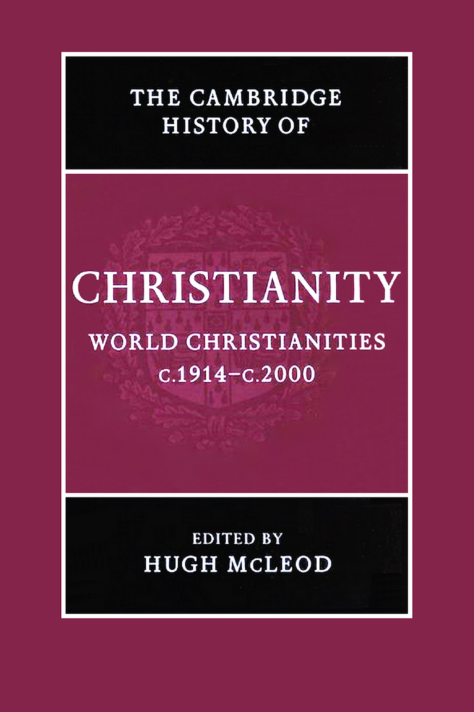

# 卷首资料

<!-- PDF page 1; original page unnumbered -->

<!-- PDF page 2; original page unnumbered -->

## 世界基督教：约1914—约2000年

二十世纪见证了与基督教历史上任何时期同样剧烈的变化。在数百年来作为基督教核心地区的欧洲，各教会因迫害与世俗化而遭受严重损失；但在非洲与亚洲部分地区，教会却迅速增长。本卷全面叙述了这个世纪世界各地天主教、新教与独立教会的历史。在这一世纪，基督教真正成为一种全球性宗教。本卷由来自多个国家的专家共同撰写，覆盖范围广泛。第一编关注具有世界影响的制度与运动，包括教皇制度、普世教会运动与五旬节运动。第二编叙述世界各地区的基督教历史。第三编从国际视角讨论若干选定主题，包括礼拜的变迁、与犹太人和穆斯林的关系、科学与艺术，以及性别与性。

**休·麦克劳德（Hugh McLeod）**是伯明翰大学教会史教授。其著作包括Piety and poverty: working class religion in Berlin, London and New York 1870–1914（1996）与Secularisation in western Europe 1848–1914（2000）。他担任国际基督教史研究委员会（CIHEC）主席，该组织是基督教史学家的国际组织。

<!-- PDF page 3; original page unnumbered -->

## 剑桥基督教史

《剑桥基督教史》按年代全面叙述基督教从起源到当代的发展，涵盖神学、思想、社会、政治、区域与全球等各个方面。每一卷都独立地对相应时期的学术研究作出重要贡献，整套丛书则构成一部大型学术参考著作。本丛书远不止叙述西欧基督教及其分支的历史，而是力求提供全球视野。从早期开始，东方基督教与科普特基督教就获得充分重视；在较晚的时期，非洲、远东、新大陆、南亚以及其他非欧洲地区的基督教发展，也得到适当论述。各卷讨论民众虔敬与基督教信仰的非正式表达，并把基督徒养成、礼拜与灵修的社会学问题置于广阔的文化背景中考察。基督教与其他主要信仰之间的关系，也始终是全书关注的问题。这套丛书将为学者与学生提供宝贵资源。

### 各卷一览

| 卷名 | 主编 |
| --- | --- |
| 起源至君士坦丁 | 玛格丽特·M.米切尔、弗朗西丝·M.扬 |
| 君士坦丁至约600年 | 温里希·勒尔、弗雷德·诺里斯、奥古斯丁·卡西戴 |
| 中世纪早期基督教：约600—约1100年 | 托马斯·诺布尔、朱莉娅·史密斯 |
| 西欧基督教：约1100—约1500年 | 米里·鲁宾、沃尔特·西蒙 |
| 东方基督教 | 迈克尔·安戈尔德 |
| 改革与扩张：1500—1660年 | 夏伯嘉 |

<!-- PDF page 4; original page unnumbered -->

| 卷名 | 主编 |
| --- | --- |
| 启蒙、复兴与革命：1660—1815年 | 斯图尔特·J.布朗、蒂莫西·塔克特 |
| 世界基督教：约1815—1914年 | 布赖恩·斯坦利、谢里丹·吉利 |
| 世界基督教：约1914—约2000年 | 休·麦克劳德 |

<!-- PDF page 5; original page unnumbered -->

（原书此页空白。）

<!-- PDF page 6; original page unnumbered -->

## 剑桥基督教史

**第九卷：世界基督教（约1914—约2000年）**

主编：休·麦克劳德（Hugh McLeod）

<!-- PDF page 7; original page unnumbered -->

## 出版资料

剑桥大学出版社

剑桥、纽约、墨尔本、马德里、开普敦、新加坡、圣保罗

英国地址：The Edinburgh Building, Cambridge CB2 2RU, UK。

美国版由剑桥大学出版社纽约分社出版。

出版社网址：http://www.cambridge.org

本书信息：http://www.cambridge.org/9780521815000

© Cambridge University Press 2006

本书受版权保护。除法律规定的例外，以及相关集体许可协议允许的范围外，未经剑桥大学出版社书面许可，不得复制本书任何部分。

2006年初版。

于英国剑桥大学印刷厂印制。

英国图书馆备有本书编目记录。

ISBN-13：978-0-521-81500-0，精装。

ISBN-10：0-521-81500-2，精装。

剑桥大学出版社不对本书提及的外部或第三方网站网址能否持续有效及其准确性承担责任，也不保证这些网站的内容现在或将来准确、适宜。

<!-- PDF page 8; original page vii -->

## 原书目录

| 内容 | 原书页码 |
| --- | --- |
| 地图目录 | xi |
| 插图目录 | xii |
| 撰稿人简介 | xiii |
| 1．导论——休·麦克劳德 | 1 |
| 2．二十世纪初的基督徒生活——休·麦克劳德 | 15 |

**第一编 制度与运动**

| 章节 | 原书页码 |
| --- | --- |
| 3．教皇制度——约翰·波拉德 | 29 |
| 4．普世教会运动——戴维·M.汤普森 | 50 |
| 5．基督教、殖民主义与传教——凯文·沃德 | 71 |
| 6．五旬节运动与灵恩运动——艾伦·安德森 | 89 |
| 7．非洲与亚洲的独立教会运动——艾伦·安德森、Edmond Tang | 107 |

<!-- PDF page 9; original page viii -->

**第二编 变迁的历程**

| 章节 | 原书页码 |
| --- | --- |
| 8．第一次世界大战——迈克尔·斯内普 | 131 |
| 9．欧洲基督教会与政治（1914—1939年）——马丁·康韦 | 151 |
| 10．拉丁美洲（约1914—约1950年）——克里斯托弗·阿贝尔 | 179 |
| 11．非洲基督教：从世界大战到非殖民化——奥格布·U.卡卢 | 197 |
| 12．加勒比与欧洲的非洲离散群体：从奴隶解放前到当代——罗斯维特·格尔洛夫 | 219 |
| 13．两次世界大战之间的美国基督教——科琳·麦克丹内尔 | 236 |
| 14．澳大利亚、新西兰与太平洋的基督教会（1914—1970年）——凯瑟琳·马萨姆 | 252 |
| 15．欧洲第二次世界大战中的天主教与新教——安德鲁·钱德勒 | 262 |
| 16．冷战、美国霸权与基督教民主主义的黄金时代——黛安娜·柯比 | 285 |
| 17．六十年代的宗教激荡——迈克尔·沃尔什 | 304 |
| 18．西方基督教的危机：走向后基督教时代？——休·麦克劳德 | 323 |

<!-- PDF page 10; original page ix -->

| 章节 | 原书页码 |
| --- | --- |
| 19．东欧剧变与后共产主义时代的开端——菲利普·沃尔特斯 | 348 |
| 20．拉丁美洲基督教的转型（约1950—2000年）——爱德华·L.克利里 | 366 |
| 21．宗教与种族主义：围绕种族隔离、“吉姆·克劳”与南非种族隔离制度的斗争——史蒂夫·德·格鲁希 | 385 |
| 22．后殖民时代非洲的基督教——戴维·马克斯韦尔 | 401 |
| 23．南亚（1911—2003年）——钱德拉·马拉姆帕利 | 422 |
| 24．东南亚的基督教（1914—2000年）——约翰·罗克斯伯勒 | 436 |
| 25．东亚——理查德·福克斯·扬 | 450 |

> 译校说明：原目录列有第20章，但所提供的源PDF没有这一章正文。其原书366—384页共19页缺失，后续须补齐。

**第三编 社会与文化影响**

| 章节 | 原书页码 |
| --- | --- |
| 26．礼拜仪式——布赖恩·D.斯平克斯 | 471 |
| 27．“他者” | 483 |
| 27.1．基督徒与犹太人的关系（1914—2000年）——丹尼尔·R.兰顿 | 483 |
| 27.2．基督徒与穆斯林的关系——戴维·托马斯 | 494 |
| 27.3．基督徒与佛教徒、印度教徒的关系——戴维·奇瑟姆 | 502 |
| 27.4．宗教神学——戴维·奇瑟姆 | 508 |

<!-- PDF page 11; original page x -->

| 章节 | 原书页码 |
| --- | --- |
| 28．财富与贫困——邓肯·B.福雷斯特 | 514 |
| 29．男性与女性 | 534 |
| 29.1．婚姻与家庭——阿德里安·撒切尔 | 534 |
| 29.2．同性恋——戴维·希利亚德 | 546 |
| 29.3．父权制与女性解放——皮尔约·马尔科拉 | 555 |
| 29.4．作为女性空间的教会——皮尔约·马尔科拉 | 562 |
| 30．基督教与科学——彼得·J.鲍勒 | 569 |
| 31．文学与艺术 | 582 |
| 31.1．文学与电影——戴维·贾斯珀 | 582 |
| 31.2．二十世纪的音乐与基督教——安德鲁·威尔逊－迪克森 | 592 |
| 31.3．基督教与艺术——尤塔·温岑特 | 599 |
| 31.4．教堂建筑——奈杰尔·耶茨 | 607 |
| 32．榜样——休·麦克劳德 | 618 |
| 33．二十世纪末的基督徒生活——休·麦克劳德 | 636 |
| 参考书目 | 648 |
| 索引 | 691 |

<!-- PDF page 12; original page xi -->

## 地图目录

**18.1 欧洲，1999年：欧洲各国成年人口中无宗教信仰者的比例。**原书第326页。

数据来源：Yves Lambert, ‘New Christianity, indifference and diffused spirituality’，载Hugh McLeod与Werner Ustorf编，The decline of Christendom in western Europe, 1750–2000（Cambridge: Cambridge University Press, 2003），第71页；Sinisa Zrinscak, ‘Generations and atheism: patterns of response to communist rule among different generations and countries’，Social compass 51（2004），第221—234页。

**18.2 加拿大，2001年：各省人口中无宗教信仰者的比例。**原书第342页。

数据来源：加拿大人口普查（原文网址：http://www.12.statcan.ca；2004年9月28日访问）。

**18.3 美国，2001年：各州成年人口中无宗教信仰者的比例。**原书第343页。

数据来源：http://www.gc.cuny.edu/studies/key_findings.htm，2004年9月28日访问。

**22.1 非洲，2001年：各国人口中基督徒的比例。**原书第402页。

数据来源：David B. Barrett、George T. Kurian与Todd M. Johnson编，World Christian encyclopaedia，2卷（Oxford: Oxford University Press, 2001）。

<!-- PDF page 13; original page xii -->

## 插图目录

| 图号与说明 | 原书页码 |
| --- | --- |
| 图31.1．牛津新马斯顿圣米迦勒与众天使教堂，1955年 | 609 |
| 图31.2．雷丁潘伯恩学院福克兰群岛纪念礼拜堂，2000年。戴维·罗宾逊摄影 | 615 |
| 图31.3．加的夫兰达夫主教座堂的中殿，可见新管风琴琴箱及《荣耀中的基督》雕塑，1957年 | 617 |

<!-- PDF page 14; original page xiii -->

## 撰稿人简介

**克里斯托弗·阿贝尔（Christopher Abel）**在伦敦大学学院教授拉丁美洲史，对十九、二十世纪的拉丁美洲与加勒比地区著述甚丰。他的研究兴趣包括宗教史、政治史、社会政策史与医疗卫生史。著有Politica, iglesia y partidos en Colombia（Bogotá, 1987），合作主编过多部社会政策史著作，并为《剑桥拉丁美洲史》及联合国教科文组织《拉丁美洲通史》等多卷本著作撰稿。

**艾伦·安德森（Allan Anderson）**是伯明翰大学五旬节研究教授，专门研究非洲与亚洲的五旬节运动及独立教会运动。著有An introduction to Pentecostalism（Cambridge, 2004）、African reformation（Trenton, NJ, 2001）与Zion and Pentecost（Pretoria, 2000），并合作主编Pentecostals after a century（Sheffield, 1999）及Asian and Pentecostal（Oxford, 2005）。

**彼得·J.鲍勒（Peter J. Bowler）**是贝尔法斯特女王大学科学史教授，英国国家学术院院士、爱尔兰皇家学院院士。著作包括Reconciling science and religion: the debate in early twentieth century Britain（Chicago, 2001）。

**安德鲁·钱德勒（Andrew Chandler）**是乔治·贝尔研究所所长、伯明翰女王基金会高级研究员，以及伯明翰大学历史研究学院荣誉讲师。他主编了The moral imperative: new essays on the ethics of resistance in National Socialist Germany 1933–45（Boulder, 1998）、Brethren in adversity: Bishop George Bell, the Church of England and the crisis in German Protestantism, 1933–39（Woodbridge, 1997），以及The terrible alternative: Christian martyrdom in the twentieth century（London, 1998）。曾在English historical review、Leo Baeck institute yearbook等多种期刊发表文章。

**戴维·奇瑟姆（David Cheetham）**是伯明翰大学神学与宗教系神学及宗教间关系讲师。著有John Hick（Aldershot, 2003）及多篇学术论文。

**爱德华·L.克利里（Edward L. Cleary，OP，道明会）**是美国罗得岛州普罗维登斯学院政治学教授兼拉丁美洲研究项目主任。他<!-- PDF page 15; original page xiv -->出版了多部研究拉丁美洲宗教的著作，包括Power, politics and Pentecostals in Latin America（Boulder, 1997）、Crisis and change（Maryknoll, 1985）及Resurgent Voices in Latin America（New Brunswick, NJ, 2004）。他曾任玻利维亚社会研究与行动研究所所长，以及Estudios Andinos编辑。

**马丁·康韦（Martin Conway）**是牛津大学贝利奥尔学院院士及近现代史导师，关于二十世纪天主教著述广泛，包括Catholic politics in Europe 1918–45（London and New York, 1997）。

**邓肯·B.福雷斯特（Duncan B. Forrester）**曾在印度马德拉斯基督教学院和英国苏塞克斯大学任教；自1978年至2001年退休期间，担任爱丁堡大学基督教伦理学与实践神学教授。近期著作包括On human worth: a Christian vindication of equality（London, 2001）及Truthful action: explorations in practical theology（Edinburgh, 2000）。

**罗斯维特·格尔洛夫（Roswith Gerloff）**拥有伯明翰大学博士学位，其论文在欧洲、美洲和加勒比地区深入田野调查的基础上，研究1952—1990年英国的非洲与加勒比教会运动。她创立了黑人与白人基督徒伙伴关系中心，并任首任主任；该中心是不同传统之间开展跨文化神学教育的一个范例。她于2001年任耶鲁大学研究员。在利兹大学，她继续开展一项重要研究，考察欧洲非洲基督徒离散群体的社会、文化与宣教学意义。她在黑人基督教、五旬节研究与跨文化学习等领域的出版物包括：博士论文A plea for British Black Theologies: the black church movement in its cultural and theological interaction（Frankfurt am Main, 1992）；客座主编International review of mission第89卷第354期（2000年7月），主题为‘Open space – the African Christian diaspora in Europe and the quest for community’；主编Mission is crossing frontiers（Pietermaritzburg, 2003）；以及Das schwarze Lächeln Gottes: Afrikanische Diaspora als Herausforderung an Theologie und Kirche（Frankfurt am Main, 2005）。

**史蒂夫·德·格鲁希（Steve de Gruchy）**是夸祖鲁－纳塔尔大学神学与发展项目主任，围绕南部非洲基督教社会伦理开展教学、研究与写作。他关注南非教会反对种族主义和种族隔离制度的斗争史，近期与父亲合作出版了The church struggle in South Africa的二十五周年修订版（London and Minneapolis, 2004）。他也是Journal of theology for southern Africa的编辑。

**戴维·希利亚德（David Hilliard）**是澳大利亚阿德莱德弗林德斯大学历史学高级讲师，在澳大利亚与太平洋岛屿宗教史的多个领域，以及近现代圣公会对同性恋的态度方面发表了多种研究成果。

**戴维·贾斯珀（David Jasper）**是格拉斯哥大学文学与神学教授，2002年获牛津大学神学博士学位。其最新著作为The sacred desert（Oxford, 2004）。

<!-- PDF page 16; original page xv -->

**奥格布·U.卡卢（Ogbu U. Kalu）**曾长期担任尼日利亚大学恩苏卡校区教会史教授，现任芝加哥麦考密克神学院亨利·温特斯·卢斯世界基督教与传教讲席教授。著作包括Power, poverty and prayer: the challenges of poverty and pluralism in African Christianity（Frankfurt am Main, 2000）、Embattled gods: Christianization of Igboland, 1841–1991（Trenton, NJ, 2003）；主编African Christianity: an African story（Pretoria, 2004）。即将出版Clio in sacred garb: essays on Christian presence and African responses, 1900–2000（Pretoria）。

**黛安娜·柯比（Dianne Kirby）**在阿尔斯特大学历史与国际事务学院任教。著有Church, state and propaganda（Hull, 1999），并主编Religion and the Cold War（Basingstoke, 2003）；后者是一部开创性的论文集，探讨关键的冷战时期宗教被赋予的重要全球角色。目前，她正在撰写一部专著，研究哈里·杜鲁门总统建立反对苏联共产主义的宗教阵线的努力。

**丹尼尔·R.兰顿（Daniel R. Langton）**是曼彻斯特大学现代犹太教—基督教关系讲师，在南安普敦大学犹太人与非犹太人关系研究中心完成博士研究。重要著作包括Claude Montefiore: his life and thought（2002），这是一部关于英国自由派犹太教共同创始人、宗教学者及宗教间关系先驱的传记；另有一系列探讨犹太人想象中的使徒保罗的论文。

**钱德拉·马拉姆帕利（Chandra Mallampalli）**是韦斯特蒙特学院历史学助理教授，著有Christians and public life in colonial South India, 1863–1937（London, 2004）。研究领域包括宗教民族主义、世俗主义、皈依、后殖民主义，以及南亚基督教史。

**皮尔约·马尔科拉（Pirjo Markkola）**是芬兰学术院研究员，任职于坦佩雷大学历史系。著作包括Synti ja siveys. Naiset, uskonto ja sosiaalinen työ Suomessa 1860–1920（Helsinki, 2002；《罪与道德：芬兰的女性、宗教与社会工作，1860—1920年》）；另主编Gender and vocation: women, religion and social change in the Nordic countries, 1830–1940（Helsinki, 2000）。

**凯瑟琳·马萨姆（Katharine Massam）**是墨尔本大学联合神学院教会史系主任，著作包括Sacred threads: Catholic spirituality in Australia, 1922–1962（Sydney, 1996）。

**戴维·马克斯韦尔（David Maxwell）**是基尔大学国际史高级讲师、Journal of religion in Africa编辑。著有Christians and chiefs in Zimbabwe. A social history of the Hwesa people ca. 1870s–1970s（Edinburgh, 1999），以及即将出版的African gifts of the Spirit: Pentecostalism and the rise of a Zimbabwean transnational religious movement（Oxford）。他还与英格丽德·劳里共同主编Christianity and the African imagination: essays in honour of Adrian Hastings（Leiden, 2002）。

**科琳·麦克丹内尔（Colleen McDannell）**是盐湖城犹他大学斯特林·M.麦克默林宗教研究讲席教授兼历史学教授。著有Picturing<!-- PDF page 17; original page xvi --> faith: photography and the Great Depression（New Haven, 2004）、Material Christianity: religion and popular culture in America（New Haven, 1998）、The Christian home in Victorian America: 1840–1900（Bloomington, 1986），并与伯恩哈德·朗合著Heaven: a history（New Haven, 1988）。2000年，她获古根海姆基金会研究奖助。

**休·麦克劳德（Hugh McLeod）**是伯明翰大学教会史教授，著作包括Piety and poverty: working class religion in Berlin, London and New York 1870–1914（New York, 1996）与Secularisation in western Europe 1848–1914（London, 2000）。他担任国际基督教史研究委员会（CIHEC）主席，该组织是基督教史学家的国际组织。

**约翰·波拉德（John Pollard）**是剑桥大学三一学堂历史学院士，对近现代教皇制度史著述广泛，尤以The unknown pope: Benedict XV (1914–1922) and the pursuit of peace（London, 1999）及Money and the rise of the modern papacy: financing the Vatican, 1850–1950（Cambridge, 2004）最为著名。

**约翰·罗克斯伯勒（John Roxborogh）**是新西兰但尼丁长老宗教牧学院堂区领袖培训协调员，曾在马来西亚及新西兰圣经学院任教。他是国际宣教学研究协会文献、档案与书目研究小组召集人。

**迈克尔·斯内普（Michael Snape）**是伯明翰大学历史学讲师，也是该校第一次世界大战研究中心成员。目前主要研究约1700—1950年英语世界的宗教与冲突。著作包括The Church of England in industrialising society: the Lancashire parish of Whalley in the 18th Century（Woodbridge, 2003）及God and the British Soldier 1914–1945（London, 2005）。

**布赖恩·D.斯平克斯（Bryan D. Spinks）**是耶鲁圣乐研究所与耶鲁神学院礼仪学教授。最新著作包括Sacraments, ceremonies and the Stuart divines: sacramental theology and liturgy in England and Scotland 1603–1662（Aldershot, 2002），以及Rituals and theologies of baptism: beyond the Jordan（Aldershot, 2005）。1986—2000年，他担任英格兰教会礼仪委员会委员，亦曾任苏格兰教会礼仪学会会长。

**Edmond Tang**是伯明翰大学东亚基督教研究组负责人，任China study journal编辑，发表过关于当代中国基督教的文章，目前研究中国、日本与韩国正在兴起的基督论。

**阿德里安·撒切尔（Adrian Thatcher）**在2004年8月退休前，担任普利茅斯圣马可与圣约翰学院应用神学教授，现任埃克塞特大学基督教伦理学兼职教授研究员。

**戴维·托马斯（David Thomas）**是伯明翰大学神学与宗教系基督教与伊斯兰教研究高级讲师，专门研究基督徒与穆斯林关系史。近期著作包括Early Muslim polemic against Christianity（Cambridge, 2002）与Muslim–Christian polemic during the crusades<!-- PDF page 18; original page xvii -->（Leiden, 2005）。他是布里尔出版社‘The History of Christian–Muslim Relations’丛书总编辑。

**戴维·M.汤普森（David M. Thompson）**是剑桥大学近现代教会史高级讲师、菲茨威廉学院院长，著有Nonconformity in the nineteenth century（London, 1972）、Let sects and parties fall（London, 1980），以及‘The unity of the church in twentieth century England: pleasing dream or common calling?’，载Studies in church history 32（London, 1996）。1994—1996年任教会史学会会长，1996—1997年任联合改革宗教会总会议长。

**尤塔·温岑特（Jutta Vinzent）**是伯明翰大学艺术史系现代与当代艺术及视觉文化讲师。著作包括Identity and image. Refugee artists from Nazi Germany in Britain（Weimar, 2005），以及‘Ars Memoriae und das Exil’，载Wolf-Friedrich Schäufele与Markus Vinzent编，Theologen im Exil – Theologie des Exils（Mandelbachtal and Cambridge, 2001）。

**迈克尔·沃尔什（Michael Walsh）**曾任伦敦大学海思罗普学院图书馆馆长，发表过关于古代晚期教会史及当代教会的多种著述。目前正在修订已故J. N. D.凯利的Oxford dictionary of the popes。

**菲利普·沃尔特斯（Philip Walters）**在伦敦政治经济学院获俄罗斯宗教思想研究博士学位。自1979年起，他在研究共产主义与后共产主义国家的资料和信息中心——凯斯顿研究所，原凯斯顿学院——工作；1984年以来任研究部主任。他就苏联、俄罗斯与东欧的政教关系及宗教生活发表过多篇论文与专书章节，并担任Religion, state & society: the Keston journal编辑，该刊原名Religion in communist lands。

**凯文·沃德（Kevin Ward）**是利兹大学神学与宗教研究系非洲宗教研究高级讲师，曾在乌干达执教多年，研究兴趣集中于东非基督教史。目前正在撰写世界圣公宗共融体的历史。

**安德鲁·威尔逊－迪克森（Andrew Wilson-Dickson）**曾长期在高等教育机构任教，现为自由职业音乐家。他是作曲家、指挥、键盘演奏家及作家，其著作The story of Christian music（Oxford, 1992）已译成十余种语言。

**奈杰尔·耶茨（Nigel Yates）**是威尔士大学兰彼得校区教会史教授兼大学研究中心主任。著作包括Buildings, faith and worship: the liturgical arrangement of Anglican churches 1600–1900（1991；修订版2000）、Anglican ritualism in Victorian Britain 1830–1910（Oxford, 1999），以及即将由牛津大学出版社出版的The religious condition of Ireland 1770–1850。1981—1991年，他任教堂维护理事会执行委员会委员，现任威尔士圣公会教省档案顾问。

<!-- PDF page 19; original page xviii -->

**理查德·福克斯·扬（Richard Fox Young）**是美国新泽西州普林斯顿神学院廷比宗教史讲席副教授，曾在日本明治学院大学东京与横滨校区任教。他对历史及当代基督教与亚洲新宗教之间互动的研究，涉及中国、日本与韩国，发表于Japanese journal of religious studies、Japanese religions与Monumenta nipponica等期刊。
