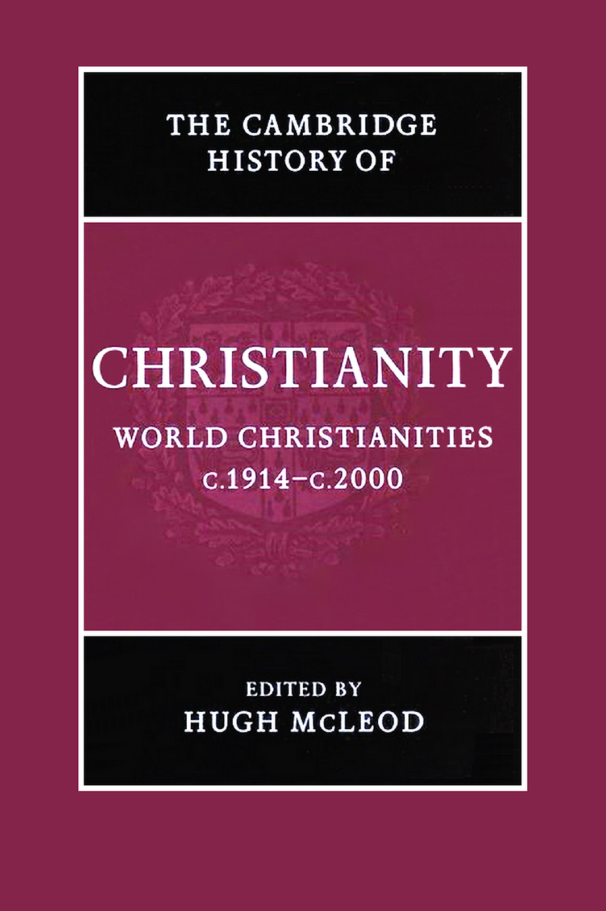

# 卷首资料：英文转换底稿

<!-- PDF page 1; original page unnumbered -->

<!-- PDF page 2; original page unnumbered -->

W O R L D C H R I S T I A N I T I E S

c.1 9 1 4 – c.200 0

The twentieth century saw changes as dramatic as any in

Christian history. The churches suffered serious losses, both

through persecution and through secularisation, in what had

been for several centuries their European heartlands, but grew

fast in Africa and parts of Asia. This volume provides a com-

prehensive history of Catholicism, Protestantism and the

Independent churches in all parts of the world in the century

when Christianity truly became a global religion. Written by a

powerful team of specialists from many different countries, the

volume is broad in scope. The first part focuses on institutions and

movements which have had a worldwide impact, including the

papacy, the Ecumenical movement and Pentecostalism. The sec-

ond provides a narrative of Christian history in each region of the

world. The third focuses on selected themes from an international

perspective, including changes in worship, relations with Jews and

Muslims, science and the arts, gender and sexuality.

HUG H MCLEOD is Professor of Church History at the University

of Birmingham. His publications include Piety and poverty: working

class religion in Berlin, London and New York 1870–1914 (1996) and

Secularisation in western Europe 1848–1914 (2000). He is president

of CIHEC, the international organisation of historians of

Christianity.

<!-- PDF page 3; original page unnumbered -->

T H E C A M B R I D G E H I S T O R Y O F

C H R I S T I A N I T Y

The Cambridge History of Christianity offers a comprehensive

chronological account of the development of Christianity in all its

aspects – theological, intellectual, social, political, regional, global –

from its beginnings to the present day. Each volume makes a

substantial contribution in its own right to the scholarship of its

period and the complete History constitutes a major work of

academic reference. Far from being merely a history of western

European Christianity and its offshoots, the History aims to

provide a global perspective. Eastern and Coptic Christianity is

given full consideration from the early period onwards, and later,

African, Far Eastern, New World, South Asian and other non-

European developments in Christianity receive proper coverage.

The volumes cover popular piety and non-formal expressions of

Christian faith and treat the sociology of Christian formation,

worship and devotion in a broad cultural context. The question

of relations between Christianity and other major faiths is also

kept in sight throughout. The History will provide an invaluable

resource for scholars and students alike.

List of volumes

Origins to Constantine

E D I T E D B Y M AR G AR E T M . MI T CHE L L A ND FR ANCE S M . Y O U N G

Constantine to c.600

ED IT E D B Y W I N RI C H L Ö HR , FRED NORRIS AND AUGUSTINE CASIDAY

Early medieval Christianity c.600–c.1100

E D I T ED B Y TH O M A S N O B L E A N D J UL I A S M I TH

Christianity in western Europe c.1100–c.1500

ED IT E D B Y M I RI RU BI N A N D WA L TE R S I M O N

Eastern Christianity

E D I T E D B Y M I C HA E L A N GO LD

Reform and Expansion 1500–1660

ED IT E D B Y R O N N I E P O- C HI A HS I A

<!-- PDF page 4; original page unnumbered -->

Enlightenment, Reawakening and Revolution 1660–1815

E D I TE D B Y S T E WA R T J. B RO WN AN D T IM O T H Y T AC K E T T

World Christianities c.1815–1914

ED IT E D B Y B R IA N S T AN L E Y A N D S H E RI D A N G I LL E Y

World Christianities c.1914 to c.2000

E D I T ED B Y HU GH MC LEOD

<!-- PDF page 5; original page unnumbered -->

<!-- PDF page 6; original page unnumbered -->

T H E C A M B R I D G E H I S T O R Y O F

C H R I S T I A N I T Y

*

v o l u m e 9

1914 2000

World Christianities c. –c.

*

Edited by

H U G H M C L E O D

<!-- PDF page 7; original page unnumbered -->

CAMBRIDGE UNIVERSITY PRESS

Cambridge, New York, Melbourne, Madrid, Cape Town, Singapore, São Paulo

C AMB RI DGE UN IVERSITY PRESS

The Edinburgh Building, Cambridge CB 2 2 RU, UK

Published in the United States of America by Cambridge University Press, New York

http://www.cambridge.org

Information on this title: http://www.cambridge.org/9780521815000

# Cambridge University Press 2006

This book is in copyright. Subject to statutory exception

and to the provisions of relevant collective licensing agreements,

no reproduction of any part may take place without

the written permission of Cambridge University Press.

First published 2006

Printed in the United Kingdom at the University Press, Cambridge

A catalogue record for this book is available from the British Library

ISBN-13 978-0-521-81500-0 hardback

ISBN-10 0-521-81500-2 hardback

Cambridge University Press has no responsibility for

the persistence or accuracy of URLs for external or

third-party internet websites referred to in this book,

and does not guarantee that any content on such

websites is, or will remain, accurate or appropriate.

<!-- PDF page 8; original page unnumbered -->

Contents

List of maps xi

List of illustrations xii

Notes on contributors xiii

1 . Introduction 1

H U G H M C L E O D

2 . Being a Christian in the early twentieth century 15

H U G H M C L E O D

P A R T I

I N S T I T U T I O N S A N D M O V E M E N T S

3 . The papacy 29

J O H N P O L L A R D

4 . Ecumenism 50

D A V I D M . T H O M P S O N

5 . Christianity, colonialism and missions 71

K E V I N W A R D

6 . The Pentecostal and Charismatic movements 89

A L L A N A N D E R S O N

7 . Independency in Africa and Asia 107

A L L A N A N D E R S O N A N D EDMON D TA NG

VII

<!-- PDF page 9; original page unnumbered -->

Contents

P A R T I I

N A R R A T I V E S O F C H A N G E

8 . The Great War 131

M I C H A E L S N A P E

9 . The Christian churches and politics in Europe, 1914–1939 151

M A R T I N C O N W A Y

10 . Latin America, c.1914–c.1950 179

C H R I S T O P H E R A B E L

11 . African Christianity: from the world wars to decolonisation 197

O G B U U . K A L U

12 . The African diaspora in the Caribbean and Europe from pre-emancipation

to the present day 219

R O S W I T H G E R L O F F

13 . Christianity in the United States during the inter-war years 236

C O L L E E N M C D A N N E L L

14 . Christian churches in Australia, New Zealand

and the Pacific, 1914–1970 252

K A T H A R I N E M A S S A M

15 . Catholicism and Protestantism in the Second World War

in Europe 262

A N D R E W C H A N D L E R

16 . The Cold War, the hegemony of the United States and the golden

age of Christian democracy 285

D I A N N E K I R B Y

17 . The religious ferment of the sixties 304

M I C H A E L W A L S H

18 . The crisis of Christianity in the West: entering a post-Christian era? 323

H U G H M C L E O D

VIII

<!-- PDF page 10; original page unnumbered -->

Contents

19 . The revolutions in eastern Europe and the beginnings

of the post-communist era 348

P H I L I P W A L T E R S

20 . The transformation of Latin American Christianity, c.1950–2000 366

E D W A R D L . C L E A R Y

21 . Religion and racism: struggles around segregation, ‘Jim Crow’

and apartheid 385

S T E V E D E G R U C H Y

22 . Post-colonial Christianity in Africa 401

D A V I D M A X W E L L

23 . South Asia, 1911–2003 422

C H A N D R A M A L L A M P A L L I

24 . Christianity in south-east Asia, 1914–2000 436

J O H N R O X B O R O G H

25 . East Asia 450

R I C H A R D F O X Y O U N G

P A R T I I I

S O C I A L A N D C U L T U R A L I M P A C T

26 . Liturgy 471

B R Y A N D . S P I N K S

27 . The ‘other’ 483

27.1 . Relations between Christians and Jews, 1914–2000 483

D A N I E L R . L A N G T O N

27.2 . Relations between Christians and Muslims 494

D A V I D T H O M A S

27.3 . Relations between Christians and Buddhists and Hindus 502

D A V I D C H E E T H A M

27.4 . Theologies of religions 508

D A V I D C H E E T H A M

IX

<!-- PDF page 11; original page unnumbered -->

Contents

28 . Wealth and poverty 514

D U N C A N B . F O R R E S T E R

29 . Male and female 534

29.1 . Marriage and the family 534

A D R I A N T H A T C H E R

29.2 . Homosexuality 546

D A V I D H I L L I A R D

29.3 . Patriarchy and women’s emancipation 555

P I R J O M A R K K O L A

29.4 . The Church as women’s space 562

P I R J O M A R K K O L A

30 . Christianity and the sciences 569

P E T E R J . B O W L E R

31 . Literature and the arts 582

31.1 . Literature and film 582

D A V I D J A S P E R

31.2 . Music and Christianity in the twentieth century 592

A N D R E W W I L S O N - D I C K S O N

31.3 . Christianity and art 599

J U T T A V I N Z E N T

31.4 . Church architecture 607

N I G E L Y A T E S

32 . Role models 618

H U G H M C L E O D

33 . Being a Christian at the end of the twentieth century 636

H U G H M C L E O D

Bibliography 648

Index 691

X

<!-- PDF page 12; original page unnumbered -->

Maps

18.1 Europe 1999 Percentages of adult population having no religion in 326

European countries

Sources of data: Yves Lambert, ‘New Christianity,

indifference and diffused spirituality’, in Hugh McLeod

and Werner Ustorf (eds.), The decline of Christendom in

western Europe, 1750–2000 (Cambridge: Cambridge

University Press, 2003), p. 71; Sinisa Zrinscak,

‘Generations and atheism: patterns of response to

communist rule among different generations and

countries’, Social compass 51 (2004), 221–34.

18.2 Canada 2001 Percentage of population in each province having 342

no religion

Source of data: Canadian census (http://www.12.statcan.ca,

accessed 28 September 2004).

18.3 United States Percentage of adults in each state having no religion 343

of America 2001 Source of data: http://www.gc.cuny.edu/studies/

key_findings.htm, accessed 28 September 2004.

22.1 Africa 2001 Christians as percentage of population in each country 402

Source of data: David B. Barrett, George T. Kurian

and Todd M. Johnson (eds.), World Christian encyclopaedia,

2 vols. (Oxford: Oxford University Press, 2001).

XI

<!-- PDF page 13; original page xii -->

Illustrations

Fig. 31.1 St Michael and All Angels, New Marston, Oxford, 1955 609

Fig. 31.2 The Falkland Islands Memorial chapel at Pangbourne college, 615

Reading, 2000. Photograph by David Robinson

Fig. 31.3 The nave of Llandaff cathedral, Cardiff, showing the new 617

organ case and sculpture of Christ in majesty, 1957

xii

<!-- PDF page 14; original page unnumbered -->

Notes on contributors

CHRISTOPHER ABEL teaches Latin American history at University college, London, and

has written extensively on Latin America and the Caribbean of the nineteenth and

twentieth centuries. He has research interests in the history of religion, politics, social

policy and health-care; he has published Politica, iglesia y partidos en Colombia (Bogotá,

1987), various co-edited books on the history of social policy, and contributions to such

multi-volume works as the Cambridge History of Latin America and the UNESCO

General History of Latin America.

ALLAN ANDERSON is Professor of Pentecostal Studies at the university of Birmingham,

specialising in Pentecostalism and Independency in Africa and Asia. He is the author of An

introduction to Pentecostalism (Cambridge, 2004), African reformation (Trenton, NJ, 2001) and

Zion and Pentecost (Pretoria, 2000), and co-edited Pentecostals after a century (Sheffield, 1999)

and Asian and Pentecostal (Oxford, 2005).

PETER J. BOWLER is Professor of the History of Science at Queen’s university, Belfast.

He is a Fellow of the British Academy and a Member of the Royal Irish Academy. His

publications include Reconciling science and religion: the debate in early twentieth century

Britain (Chicago, 2001).

ANDREW CHANDLER is Director of the George Bell Institute, Senior Research Fellow at

the Queen’s foundation, Birmingham, and Honorary Lecturer in the school of historical

studies, university of Birmingham. He has edited The moral imperative: new essays on the

ethics of resistance in National Socialist Germany 1933–45 (Boulder, 1998), Brethren in adversity:

Bishop George Bell, the Church of England and the crisis in German Protestantism, 1933–39

(Woodbridge, 1997), and The terrible alternative: Christian martyrdom in the twentieth century

(London, 1998). He has published in many journals, including English historical review and

Leo Baeck institute yearbook.

DAVID CHEETHAM is Lecturer in Theology and Inter-Religious Relations in the depart-

ment of theology and religion, university of Birmingham. He is the author of John Hick

(Aldershot, 2003) and numerous academic articles.

EDWARD L. CLEARY, OP is Professor of Political Science and Director of the Latin

American Studies Program at Providence college, Providence, Rhode Island. He has

XIII

<!-- PDF page 15; original page unnumbered -->

Notes on contributors

published several books on religion in Latin America, including Power, politics and Pentecostals

in Latin America (Boulder, 1997), Crisis and change (Maryknoll, 1985), and Resurgent Voices in

Latin America (New Brunswick, NJ, 2004). He was President of the Bolivian Institute of Social

Study and Action, and editor of Estudios Andinos.

MARTIN CONWAY is Fellow and Tutor in Modern History at Balliol College, Oxford. He

has published widely on twentieth-century Catholicism, including Catholic politics in

Europe 1918–45 (London and New York, 1997).

DUNCAN B. FORRESTER taught in India, at Madras Christian college, in England at Sussex

university, and from 1978 until retirement in 2001 was Professor of Christian Ethics and

Practical Theology in the university of Edinburgh. His recent publications include On

human worth: a Christian vindication of equality (London, 2001) and Truthful action: explora-

tions in practical theology (Edinburgh, 2000).

ROSWITH GERLOFF holds a PhD from Birmingham university on the African and

Caribbean church movement in Britain 1952–90, based on intensive field studies in

Europe, America and the Caribbean, and was the founder and first director of the

Centre for Black and White Christian Partnership, a model of inter-cultural theological

training between different traditions, and a Yale Research Fellow 2001. At Leeds university

she continued with a major study of the social, cultural and missiological significance of

the African Christian diaspora in Europe. Her various publications in the field of Black

Christianity, Pentecostal studies and inter-cultural learning include her doctoral disserta-

tion, A plea for British Black Theologies: the black church movement in its cultural and theological

interaction (Frankfurt am Main, 1992), the 89/354 (July 2000) issue of the International review

of mission (‘Open space – the African Christian diaspora in Europe and the quest for

community’) as guest editor, Mission is crossing frontiers (Pietermaritzburg, 2003), as editor,

and Das schwarze Lächeln Gottes: Afrikanische Diaspora als Herausforderung an Theologie und

Kirche (Frankfurt am Main, 2005).

STEVE DE GRUCHY is the Director of the Theology and Development Programme at the

university of Kwa-Zulu-Natal, where he teaches, researches and writes in the area of

Christian social ethics in southern Africa. He has an interest in the history of the church

struggle against racism and apartheid in South Africa, and has recently collaborated with

his father to publish a twenty-fifth anniversary revised edition of The church struggle in

South Africa (London and Minneapolis 2004). He is also editor of the Journal of theology for

southern Africa.

DAVID HILLIARD is Reader in History at Flinders university, Adelaide, Australia. He has

published in many different areas of the religious history of Australia and the Pacific

Islands and on modern Anglican attitudes to homosexuality.

DAVID JASPER is Professor of Literature and Theology at the university of Glasgow. He

was awarded a Doctorate of Divinity by the university of Oxford in 2002. His most recent

book is The sacred desert (Oxford, 2004).

XIV

<!-- PDF page 16; original page unnumbered -->

Notes on contributors

OGBU U. KALU was for many years Professor of Church History at the University of

Nigeria, Nsukka. He is currently the Henry Winters Luce Professor of World Christianity

and Missions, McCormick theological seminary, Chicago. His publications include

Power, poverty and prayer: the challenges of poverty and pluralism in African Christianity

(Frankfurt am Main, 2000); Embattled gods: Christianization of Igboland, 1841–1991 (Trenton,

NJ, 2003); and (as editor) African Christianity: an African story (Pretoria, 2004). Forthcoming

is Clio in sacred garb: essays on Christian presence and African responses, 1900–2000 (Pretoria).

DIANNE KIRBY lectures in the school of history and international affairs at the university

of Ulster. Author of Church, state and propaganda (Hull, 1999), she also edited Religion and

the Cold War (Basingstoke, 2003), a ground-breaking collection of essays about the

significant global role assigned to religion in the critical Cold War period. She is currently

working on a monograph exploring President Harry Truman’s efforts to create a religious

front against Soviet communism.

DANIEL R. LANGTON is Lecturer in Modern Jewish–Christian Relations at the university

of Manchester. His doctoral studies were at the centre for Jewish/non-Jewish relations at

the university of Southampton. His significant publications include Claude Montefiore: his

life and thought (2002), a biography of the co-founder of Anglo-Liberal Judaism, religious

scholar and pioneer of inter-faith relations; and a series of articles on the apostle Paul in the

Jewish imagination.

CHANDRA MALLAMPALLI is Assistant Professor of History at Westmont college. He is the

author of Christians and public life in colonial South India, 1863–1937 (London, 2004). His areas

of research include religious nationalism, secularism, conversion, post-colonialism and the

history of Christianity in south Asia.

PIRJO MARKKOLA is Academy Research Fellow (Academy of Finland), department of

history, university of Tampere. Her publications include Synti ja siveys. Naiset, uskonto ja

sosiaalinen työ Suomessa 1860–1920 (Helsinki, 2002) (Sin and morality: women, religion and

social work in Finland, 1860–1920); and (as editor) Gender and vocation: women, religion and

social change in the Nordic countries, 1830–1940 (Helsinki, 2000).

KATHARINE MASSAM is Head of the department of church history in the united faculty

of theology at the university of Melbourne. Her publications include Sacred threads:

Catholic spirituality in Australia, 1922–1962 (Sydney, 1996).

DAVID MAXWELL, Senior Lecturer in International History, Keele university, is editor of

the Journal of religion in Africa. He is author of Christians and chiefs in Zimbabwe. A social

history of the Hwesa people ca. 1870s–1970s (Edinburgh, 1999), and African gifts of the Spirit:

Pentecostalism and the rise of a Zimbabwean transnational religious movement (Oxford, forth-

coming). With Ingrid Lawrie he edited Christianity and the African imagination: essays in

honour of Adrian Hastings (Leiden, 2002).

COLLEEN MCDANNELL is the Sterling M. McMurrin Professor of Religious Studies and

Professor of History at the university of Utah in Salt Lake City. She is the author of Picturing

XV

<!-- PDF page 17; original page unnumbered -->

Notes on contributors

faith: photography and the Great Depression (New Haven, 2004), Material Christianity: religion

and popular culture in America (New Haven, 1998), The Christian home in Victorian America:

1840–1900 (Bloomington, 1986), and co-author with Bernhard Lang of Heaven: a history

(New Haven, 1988). In 2000 she received a Guggenheim Foundation Fellowship.

HUGH MCLEOD is Professor of Church History at the university of Birmingham. His

publications include Piety and poverty: working class religion in Berlin, London and New York

1870–1914 (New York, 1996) and Secularisation in western Europe 1848–1914 (London, 2000). He is

president of CIHEC, the international organisation of historians of Christianity.

JOHN POLLARD is Fellow in History at Trinity Hall, Cambridge. He has published

extensively on the history of the modern papacy, most notably The unknown pope:

Benedict XV (1914–1922) and the pursuit of peace (London, 1999), and Money and the rise of

the modern papacy: financing the Vatican, 1850–1950 (Cambridge, 2004).

JOHN ROXBOROGH is Coordinator of Parish Leadership Training at the Presbyterian

school of ministry, Dunedin, New Zealand. He has previously taught in Malaysia and at

the Bible College of New Zealand. He is convenor of the documentation, archives and

bibliography study group of the International Association for Mission Studies.

MICHAEL SNAPE is Lecturer in History at the university of Birmingham and a member

of the university’s centre for First World War studies. His research is currently focused

on religion and conflict in the English-speaking world c.1700–1950. Publications include

The Church of England in industrialising society: the Lancashire parish of Whalley in the

18th Century (Woodbridge, 2003) and God and the British Soldier 1914–1945 (London, 2005).

BRYAN D. SPINKS is Professor of Liturgical Studies at the Yale institute of sacred music

and Yale divinity school. His most recent books are Sacraments, ceremonies and the Stuart

divines: sacramental theology and liturgy in England and Scotland 1603–1662 (Aldershot, 2002)

and Rituals and theologies of baptism: beyond the Jordan (Aldershot, 2005). He served on the

Church of England liturgical commission from 1986 to 2000, and is a former President of

the Church Service Society, Scotland.

EDMOND TANG is Head of the research unit for the study of east Asian Christianity at the

university of Birmingham. He is editor of China study journal and author of articles on

contemporary Chinese Christianity. He is now working on emerging christologies in

China, Japan and Korea.

ADRIAN THATCHER was Professor of Applied Theology at the college of St Mark and

St John, Plymouth, until his retirement in August 2004. He is now part-time Professorial

Research Fellow in Christian Ethics at the university of Exeter.

DAVID THOMAS is Reader in Christianity and Islam in the department of theology

and religion, university of Birmingham, where he specialises in the history of

Christian–Muslim relations. Among his recent publications are Early Muslim polemic

against Christianity (Cambridge, 2002) and Muslim–Christian polemic during the crusades

XVI

<!-- PDF page 18; original page unnumbered -->

Notes on contributors

(Leiden, 2005). He is general editor of the Brill book series ‘The History of

Christian–Muslim Relations’.

DAVID M. THOMPSON, Reader in Modern Church History, university of Cambridge, and

President of Fitzwilliam college, is author of Nonconformity in the nineteenth century

(London, 1972), Let sects and parties fall (London, 1980), and ‘The unity of the church in

twentieth century England: pleasing dream or common calling?’, in Studies in church

history 32 (London, 1996). He was President of the Ecclesiastical History Society, 1994–6,

and Moderator of the General Assembly of the United Reformed Church, 1996–7.

JUTTA VINZENT is Lecturer in Modern and Contemporary Art and Visual Culture in the

department of art history, university of Birmingham. Her publications include Identity and

image. Refugee artists from Nazi Germany in Britain (Weimar, 2005), and ‘Ars Memoriae und

das Exil’, in Wolf-Friedrich Schäufele and Markus Vinzent (eds.), Theologen im Exil –

Theologie des Exils (Mandelbachtal and Cambridge, 2001).

MICHAEL WALSH was formerly Librarian at Heythrop college, University of London.

He has published on a variety of topics in the history of the church in late antiquity and on

the contemporary church. He is currently revising the late J. N. D. Kelly’s Oxford dictionary

of the popes.

PHILIP WALTERS obtained his doctorate in Russian religious thought at the London

school of economics. Since 1979 he has worked at Keston institute (formerly Keston

college), the research and information centre on communist and post-communist coun-

tries; since 1984 he has been Head of Research. He is author of numerous articles and

chapters on aspects of church–state relations and religious life in the Soviet Union, Russia

and eastern Europe and editor of the journal Religion, state & society: the Keston journal

(formerly Religion in communist lands).

KEVIN WARD is Senior Lecturer in African Religious Studies in the department of

theology and religious studies at the university of Leeds. He lectured for many years in

Uganda, and his research interests focus on the history of Christianity in east Africa. He is

presently engaged in writing a history of the worldwide Anglican communion.

ANDREW WILSON-DICKSON is now a freelance musician, having been teaching in higher

education for many years. He is a composer, conductor, keyboard player and author.

His book The story of Christian music (Oxford, 1992) has been translated into more than

ten languages.

NIGEL YATES is Professor of Ecclesiastical History and Director of the university research

centre at the university of Wales, Lampeter. His publications include Buildings, faith and

worship: the liturgical arrangement of Anglican churches 1600–1900 (1991, revd edn 2000),

Anglican ritualism in Victorian Britain 1830–1910 (Oxford, 1999), and a forthcoming study

for Oxford University Press of The religious condition of Ireland 1770–1850. Between 1981 and

1991 he served on the executive committee of the Council for the Care of Churches and he

is currently Provincial Archives Advisor to the Church in Wales.

XVII

<!-- PDF page 19; original page unnumbered -->

Notes on contributors

RICHARD FOX YOUNG is the Timby Associate Professor of the History of Religions at

Princeton theological seminary (Princeton, NJ, USA). A former member of the faculty of

Meiji Gakuin university (Tokyo/Yokohama, Japan), his studies of interactions, historical

and contemporary, between Christianity and the new religions of Asia (Chinese, Japanese

and Korean) have appeared in journals such as the Japanese journal of religious studies,

Japanese religions, and Monumenta nipponica.

XVIII
