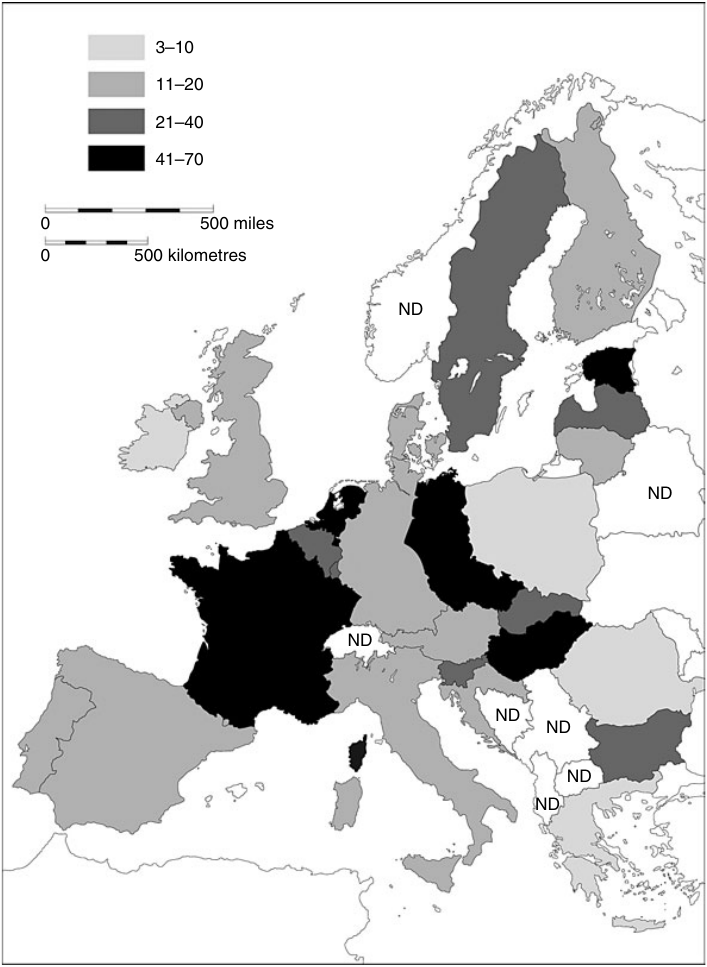
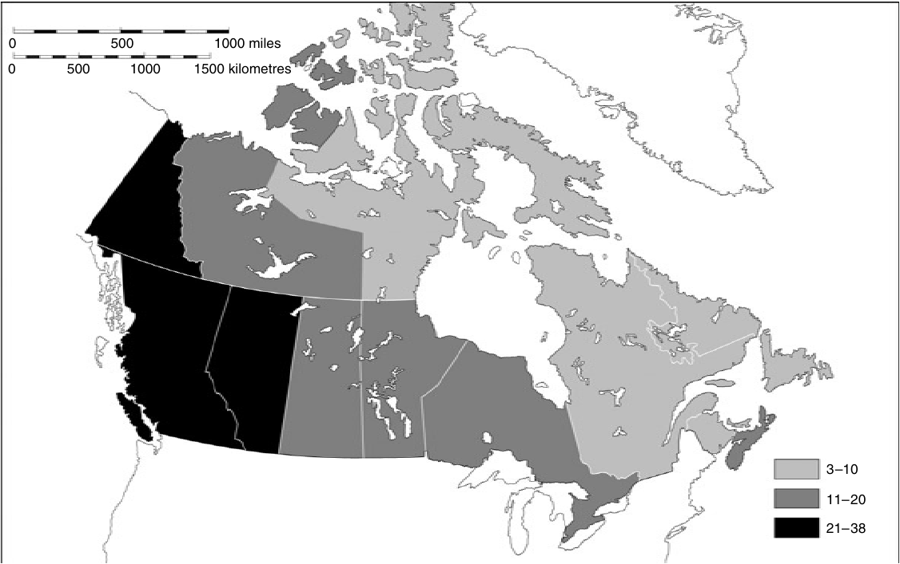
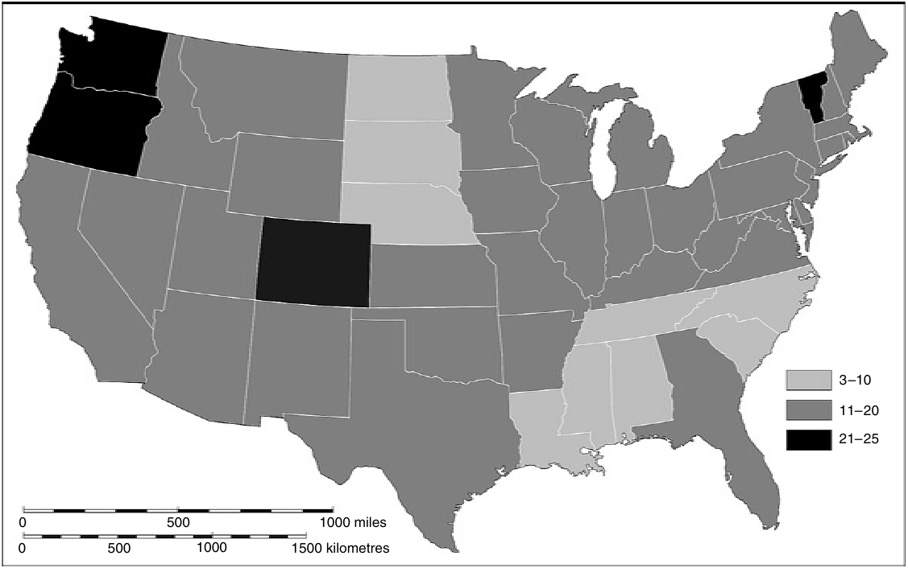

<!-- PDF page 342; original page 323 -->

# 第十八章 西方基督教的危机：走向后基督教时代？

**休·麦克劳德（Hugh McLeod）**

> 原书第323—347页；对应原PDF第342—366页。

1996年，特伦斯·墨菲在一部加拿大基督教史的结尾宣称：“所谓‘基督教世界’的概念，也就是基督教与文化基本融为一体的社会，在加拿大已经一去不复返了。”他接着表示：“当代加拿大社会的决定性现实是多元主义。这不仅包括文化、种族和宗教的多样性，也包括把宽容、承认不同信仰与习俗视为社会的基本价值。”1956年，加拿大人口中有61%的人表示，自己在此前一周曾到宗教场所参加礼拜，因此加拿大在西方国家中属于参与礼拜最积极的国家之一。到1990年，这一比例已降至23%。[^p342-1]虽然仍高于欧洲许多国家，但加拿大人意识到自己的历史已进入新时代，实在不足为奇。

英国参加教会礼拜的比例，即使在维多利亚时代宗教繁荣的顶峰，也从未像加拿大那样高；到1990年，每周出席率约为10%。卡勒姆·布朗在2001年出版、引起广泛讨论的一本书中，甚至采用了更具末日意味的语气。他开篇写道：

> 本书讨论的是基督教英国之死，也就是这个国家核心宗教与道德认同的消亡……让英国皈依基督教，花费了几个世纪……但让这个国家抛弃基督教，却只用了不到四十年。在一千年间，基督教深深渗透人民生活……随后，到了1963年，一种极其深刻的断裂竟相当突然地改变了国家及其人民的面貌，使有组织的基督教开始螺旋式衰退，落到几乎不再具有社会影响的边缘。[^p342-2]

<!-- PDF page 343; original page 324 -->

## 基督教衰退的征象

布朗认为，教会所说的话与人们的生活“无关”，既是教会衰退的原因，也是结果。墨菲则认为，世俗化具有某些积极作用，因为它让教会能够从为既有秩序提供“正当性”的角色，转向“先知”的角色；他赞赏教会在八九十年代就原住民权利及其他社会正义问题所采取的立场。[^p343-3]然而，在大多数方面，英国、加拿大以及许多其他国家的观察者所指出的基督教衰退征象，都大致相同。这包括：基督徒的正统信仰减弱，遵行宗教生活的比例下降；信奉非基督宗教或没有宗教信仰的人增加；基督教与教会对道德、政治和法律的影响衰减。更广泛地说，布朗认为，直到六十年代，英国仍存在一种基督教文化，即使从不上教会的人，其思想和行为也深受影响；而如今这种文化已经消失。

过去四十年间，民意调查机构、政府及教会自己编制的统计资料，为基督教与教会的衰退提供了大量证据。例如，选择在教堂结婚的夫妇，以及为婴儿施洗的人越来越少，反映了很大一部分人口的基督徒身份正在消退。以洗礼为例，自六十年代以来，除爱尔兰，以及资料不全、情形未明的瑞典之外，所有西欧国家的洗礼比例都在下降，尽管降幅相差很大。意大利1970年出生的婴儿中，99%接受天主教洗礼，到2000年仍有92%；西班牙却从99%降至79%，法国从78%降至51%。英格兰接受圣公会洗礼的婴儿比例，从1970年的47%降至1988年的29%，但天主教和自由教会的数字无法取得。瑞士1970年有95%的婴儿接受天主教或新教洗礼，2000年则为65%。[^p343-4]

到2000年，基督教仍遥遥领先，是西欧、北美及澳大拉西亚最大的宗教；但在所有这些地区，千禧年最后四十年间，信奉其他宗教或没有宗教的人都显著增加。1999年，<!-- PDF page 344; original page 325 -->无宗教人口比例最高的是荷兰（54%）、法国（43%）和比利时（37%），其他地方通常在10%至20%之间。[^p344-5]当然，东欧一些前共产主义国家和地区的无宗教人口比例还要高，见地图18.1。法国的穆斯林人口比例远高于其他国家，可能达到8%；英格兰和威尔士的3%则更接近一般情况。“新时代”信仰的增长，或者希拉斯与伍德黑德在对英格兰西北部宗教和“灵性”所作的一项重要新研究中称为“整体性灵性圈”的发展，虽然更难量化，却同样重要。两位作者认为，积极参与者的人数可能仍相对有限，但这个圈子产生的观念，对文化具有广泛影响：媒体、书店里大片的“身心灵”书区、商业街商店出售的产品，都反映了这一点；最重要的表现，则是人们对健康与疾病的态度。[^p344-6]依照这种观点，西方社会未必已变得“世俗”，但其信仰与实践愈来愈难被辨认为基督教。

基督教信仰本身也有所减弱，幅度却远小于宗教实践的下降。由于六十年代以前的资料稀少，很难判断信仰究竟下降了多少，但此后肯定存在下降趋势。例如，一项特别详尽的苏格兰民调资料研究显示，1976年有85%的人自称相信上帝，1997年则为73%。另一方面，各次民调若询问耶稣是否是上帝之子——1981年有69%的人表示相信——回答虽有起伏，却看不出明确趋势。[^p344-7]一组欧洲国家中，1981年有74%的受访者说自己相信上帝，1999年则为68%；十八至二十九岁的群体中，这一比例为60%。相信死后仍有生命的比例维持在43%，但这部分是因为相信轮回的人增加了。[^p344-8]

基督教的社会与政治影响，远比礼拜出席率难以衡量；而那些想强调当今世俗化程度的人，<!-- PDF page 345; original page 326 -->往往通过夸大教会从前的影响来达到目的。不过，有一个领域的教会影响，自六十年代以来确实明显减弱，那就是性道德。新教和天主教都教导，性行为只有在异性婚姻之内才符合道德；这项教导直到<!-- PDF page 346; original page 327 -->约1960年仍具有相当权威，此后却日益受到拒绝或漠视。事实上，许多新教教会已经被迫重新思考其性伦理。同样，天主教会对人工避孕的谴责，甚至也被许多在其他方面十分虔诚的天主教徒置之不理。六七十年代，涉及堕胎、离婚和同性恋的法律普遍趋于宽松。这些改变在天主教国家尤其富有争议；在西方国家中天主教色彩最浓厚的爱尔兰共和国，仍然禁止堕胎。

*地图18.1　1999年欧洲各国成年人口中无宗教者百分比。图例：3—10、11—20、21—40、41—70；ND表示无资料。比例尺单位为英里、公里。原图见PDF第345页。*

四五十年代在西欧许多地方占据主导地位的基督教民主党，如今已不再那么强大。尤其意大利的基督教民主党，在执政四十多年后，于九十年代崩溃。直到六十年代，宗教仍是欧洲许多地方影响投票的最大因素；此后，无论宗教还是另一个关键因素——阶级——其政治重要性都在下降。宗教归属与政治选择依然有相关性，但积极参与宗教的人减少了，持相同宗教信念的人也较少集中在同一地方，因此这些宗教与政治关联的影响已经小得多。不过，在美国，宗教仍是影响投票的重要因素。[^p346-9]

## 六十年代

我已多次提到六十年代，显然，这十年在若干重要方面，是西方宗教史的转折点。尤其在六十年代后期，参加教会礼拜的比例急剧下降，人们对可以替代基督教的东方宗教兴趣增长，一些国家参与基督教人生礼仪的人也减少了。然而，对于如何理解和解释这十年的宗教变化，历史学家与社会学家之间存在深刻分歧。较早的看法，以艾伦·吉尔伯特的论述为鲜明代表，认为世俗化历史悠久，六十年代只是一个发展了数十年、甚至数百年过程的顶点。[^p346-10]吉尔伯特主要关注十九世纪工业化与城市化的影响；社会学家史蒂夫·布鲁斯则将世俗化与<!-- PDF page 347; original page 328 -->宗教改革产生的个人主义联系起来。[^p347-11]另一些人强调启蒙运动、法国大革命、科学兴起，或1900年前后经济、社会及政治的一系列变化。解释西方社会长期世俗化的理论很多，却往往互不相容。

因此，到九十年代，提出新方法的时机已经成熟。一批历史学家作出了回应，包括英国的卡勒姆·布朗、德国的奥拉夫·布拉施克、荷兰的彼得·范罗登，以及比利时的帕特里克·帕斯蒂尔。[^p347-12]他们基本各自独立地得出结论：长期世俗化理论，严重低估了十九世纪和二十世纪上半叶宗教在西方社会的重要性。他们认为，真正的危机直到六十年代才到来，西方社会的世俗化也到那时才真正开始。例如，卡勒姆·布朗承认，英国参加教会礼拜的人至少从十九世纪九十年代起就在减少；但他认为，直到约1960年，基督教“话语”仍占主导地位：它塑造个人对自身生命历程的叙述，灌输罪与内疚的意识，规定体面的观念，尤其界定何谓一个女人。布朗与帕斯蒂尔都认为，约1800至1960年间，妇女在西方社会的宗教生活中居于中心位置。她们是礼拜参加者和宗教组织成员的大多数，防止家中男性偏离教会规定的信仰与行为规范太远，并把信仰传给下一代。一百五十年来，教会依赖女信徒的虔敬与积极投入；而六十年代，妇女开始大批离开教会，整个结构便崩塌了。

布朗与帕斯蒂尔指出，旧有史著严重夸大了十九世纪及二十世纪上半叶的世俗化程度，这一点是正确的。不过，他们又走向另一极端，过度强调这一时期基督教的支配地位。六十年代当然标志着西方社会非基督教化进入一个更激进的阶段；然而，如果此前没有一段重要人口群体逐渐疏离教会的历史，<!-- PDF page 348; original page 329 -->这一切也就不可能发生；这段历史早在十八世纪便已开始。十九世纪及二十世纪初，不同国家、不同社会阶级疏离教会的程度相差很大。1960年的西方世界，在宗教上具有极大的多样性；法国等一些国家，内部地区差异尤其悬殊。六七十年代的新现象在于，基督教实践的衰退影响到所有社会阶级，既影响男人，也影响女人；既影响城市，也影响乡村；几乎遍及所有地区。

六十年代无疑是一个关键时期，布朗和帕斯蒂尔等历史学家的一项贡献，便是清楚揭示了这一点。较早以演进方式解释世俗化历史的方法，过于关注原因，而不够关注具体过程，结果常常忽略特定时期与事件的意义。例如，吉尔伯特完全没有提到，四五十年代英国同大多数西方国家一样，宗教参与曾经回升。[^p348-13]在美国，这段时期被称为“宗教复兴”的年代，于1957年达到高峰：49%的受访者说，自己在此前一周到过教会。[^p348-14]这一时期也出现建堂热潮。欧洲许多国家由于战时轰炸造成破坏，需要新建教堂；美国、加拿大和澳大利亚的建堂则与郊区化有关。无论经费像德国和斯堪的纳维亚那样来自教会税，还是来自私人捐献，大批新建筑都助长了这些年的宗教乐观情绪。

1960年，美国的基督教评论者与其他国家同行一样，仍倾向于相对乐观地看待局面。但变化已经开始，并将在随后十五年间改造宗教版图。我想举四个例子：穆斯林、印度教徒、佛教徒及其他非基督宗教信徒人数增长；基督徒参加礼拜及其他宗教实践的比例下降；公开自称无神论者、不可知论者或其他无宗教者的人数增加；以及以立法标志社会从自称基督教社会，转向多元社会。

## 非基督宗教的增长

伊斯兰教及其他非基督宗教的发展，最初是移民的结果。五六十年代，北欧及<!-- PDF page 349; original page 330 -->欧洲西北部经济繁荣，吸引了来自亚洲和非洲殖民地或前殖民地、土耳其，以及南欧的移民劳工。到七十年代，又有较少量的难民加入，他们逃离战争、政治或宗教迫害，其中既有苏联犹太人、越南天主教徒，也有智利社会主义者与共产党人；既有中东各国的基督徒，也有斯里兰卡的印度教徒。结果，在原先由一支、至多两支基督教传统主导的国家，出现了宗教的大规模混合。天主教的法国涌入大量北非穆斯林；路德宗的瑞典除了穆斯林，也首次有了相当数量的天主教徒与亚述正教徒。在英国，新的多样性不仅表现为内城区闲置教堂改作五旬节派或希腊正教的礼拜场所，还表现为伦敦、伯明翰、莱斯特及其他城市的清真寺、印度教神庙和锡克教谒师所不断增多。美国、加拿大与澳大利亚稍晚才出现这类转变，但九十年代大量移民之后，到2001年，加拿大人口中有5%、美国人口中有1.5%，信奉伊斯兰教、印度教、佛教或锡克教。[^p349-15]

然而，到六十年代后期，“东方宗教”本身也成为时尚，尤其流行于大学校园和“反文化”圈子。最引人注目的例子是披头士乐队——他们或许也是六十年代最广为人知的象征。1967年，他们宣布成为玛哈里希·玛赫西·瑜伽的弟子，前往印度寻求启悟。在美国，禅宗吸引了大批校园激进分子。七十年代初，伯克利的一项调查发现，作者称为“神秘主义者”的那类学生——其定义包括对瑜伽、禅或超觉静坐感兴趣——最可能参与反文化，认同其政治激进主义、毒品与性方面的试验，以及对集体生活的偏好。[^p349-16]

## 参加教会礼拜的衰退

许多经历过六十年代反文化的人，后来仍然喜欢尝试不同的宗教。六十年代看起来“离经叛道”的事，到九十年代已经成为“主流”。据说，美国1946至1964年出生的所谓“婴儿潮”一代，<!-- PDF page 350; original page 331 -->仍具有一种以探索和个人选择为基础的宗教文化。“宗教被看作某种把人锁住、圈住的东西，灵性却释放人，并鼓励表达。”[^p350-17]从六十年代起，“属灵”或“灵性”等用语开始获得新的意义，用来表示与传统基督教部分或完全脱离、但仍与神圣相联系的方式。美国社会学家罗伯特·伍斯诺认为，其中一个重要方面，是从以“安居”为基础的灵性，转向以“寻求”为基础的灵性。八九十年代，美国人对“内在自我”的兴趣增长。大众心理学读物重新发现“灵魂”这类词语，“灵魂的照料”成为一项重要关切。这既包括自我接纳，也确实包含相当程度的自私，同时还伴随着日常生活的神圣化。除对美洲原住民灵性产生浓厚兴趣外，这也是灵性导师、通灵、与天使相遇及濒死体验大为流行的时期。[^p350-18]在英国：

> 灵性……已经成为这个时代的某种流行语……人们说：“我在努力培养自己的灵性一面”，或者“我正在学习与自己的灵性连结”……灵性寻求，不论它究竟意味着什么——不同的人赋予它的意义千差万别——已经成为二十世纪生活的一个主导特征。[^p350-19]

美国定期进行盖洛普民意调查，使我们能够逐年追踪参加教会礼拜比例的下降。1957年，49%的受访者说，自己在此前一周去过教会；经过十多年逐步下降，到1972年，这个数字成为40%。不过，真正巨大的变化发生在年轻一代的习惯上。1957年，二十一至二十九岁人群的礼拜出席率略高于全国平均数，而且各代之间的差别本来很小。到1972年，年轻人中说自己上一周到过教会的只有28%，远低于全国平均。[^p350-20]实际上，新近发表的证据表明，六十年代后期与七十年代初，尤其在天主教徒中，礼拜出席率下降得比<!-- PDF page 351; original page 332 -->盖洛普调查呈现的更快。一些调查让受访者记录此前一周的活动日记，结果显示，提到自己参加教会礼拜的人，从1965至1966年的42%，降至1975年的27%。这种差异似乎是因为，许多人不愿向访员承认，自己去教会的次数没有心目中认为应当去的那么多。[^p351-21]

虽然其他地方的统计较少，但可以确定，五十年代后期和六十年代初，加拿大与英国新教徒的礼拜出席率已经在下降。[^p351-22]到了六十年代后期和七十年代初，衰退却更加迅速、更加普遍；有些向来以高出席率著称的群体，下降幅度甚至具有灾难性。例如，荷兰天主教徒在1965年某一主日参加礼拜的比例，仍高达64%；到1975年，却已降至31%。在原本出席率相对较低的地方，这几年的变化虽然没那么戏剧化，仍十分显著。法国某一主日参加弥撒的人口比例，在1966至1972年间从23%降至17%。与此同时，新教教会的成员大量流失。例如，澳大利亚维多利亚州的圣公会、长老宗与卫理宗，在1961至1976年间，各自损失了约三分之一成员。英格兰青少年接受圣公会坚振礼的比例，则在1956至1976年间减半。[^p351-23]

## 无神论与不可知论的增长

直到六十年代中期，西方国家很少有人愿意在人口普查表上填写、或向民意调查员承认自己没有宗教信仰；荷兰是例外，早在1960年，就有18%的人口宣称没有宗教。在六十年代后期与七十年代初的新气氛中，许多过去将宗教怀疑藏在心里的人，觉得可以公开“表明身份”了。澳大利亚1966年人口普查时，自称无宗教者不足1%；到1976年，却达到8%。这些年，无神论与不可知论也有所增长，尤其在青年与反文化参与者中。《时代》<!-- PDF page 352; original page 333 -->杂志对风向的转变反应极快，著名的“上帝死了吗？”专号在1966年耶稣受难日出版。学生激进分子往往深受马克思主义影响，倾向于把宗教当作无关紧要的事。不过，1968年巴黎学生最著名的领袖丹尼尔·孔—本迪却声称，要废除“等级制”“官僚制”，以及一切“对资讯和知识的控制”，就必须摆脱“犹太—基督教伦理”。七十年代妇女解放运动中，对宗教的攻击更加接近议程核心，因为基督教与犹太教被视为父权制最有影响的正当性来源。

## 宗教、道德与法律

这些年既发生了自下而上的变化，也发生了自上而下的变化。第二次世界大战常被看作“基督教文明”反抗“异教”纳粹的斗争。战争期间及战后初期，人们普遍认为，应当加强西方社会的基督教基础，法律也应体现基督教道德。例如，英格兰与威尔士1944年首次规定，学校必须提供宗教教育，每个上课日必须以一项敬拜活动开始。在西德，废除死刑与严格限制堕胎的法律同时实行；纳粹时代的恐怖过后，这两项措施都被视为重新确认生命的神圣性。法律以基督教为基础的程度和方式，因国家主要信奉天主教还是新教、这些教会多么有力，以及政教是否正式分离而有所不同。然而，即使法国将政教分离原则贯彻得最远，基督教对国家法律仍有重要影响。性、婚姻与家庭法律，最清楚地体现了这些影响。例如，意大利、爱尔兰和西班牙等以天主教为主的国家禁止离婚；许多天主教及新教国家，也严格限制可以离婚的情形。一些天主教国家还限制或禁止出售避孕用品。多数国家除母亲生命受到威胁外，都禁止堕胎。许多国家禁止男性同性性行为；对图书、电影及戏剧的审查也很普遍。新教国家对性和婚姻往往管得较松，却更严厉地限制饮酒与赌博，并提倡遵守主日。国营广播系统，乃至许多独立广播机构，<!-- PDF page 353; original page 334 -->都偏向基督教，尤其偏向它们认定的“主流”基督教形态。

六七十年代，这些法律大都受到挑战；一些国家的宗教在广播与电视中的地位也有变化。世俗主义者自然不满宗教与教会行使的权力，往往是推动修改这些法律的领头者。然而，他们很少强大到足以单独促成改革，需要盟友，而这样的盟友也不难找到。关心某个具体问题的群体，能够发起有力的运动，例如女性主义者要求放宽堕胎法。更广泛地说，六十年代的精英意见，从立法者、法官、报纸编辑、学者，乃至许多神学家与教会领袖的观点中都能看出，深受以下原则影响：个人的人权；国家无权干涉的“私人”领域必须获得维护；以及对不同道德、宗教信念的人群，应当公平相待。英国1957年的《沃尔芬登报告》包含许多这样的思想，并以一句著名的表述，建议将“成年人自愿、私下进行”的同性性行为合法化；不过，这项建议直到1967年才成为法律。约翰·沃尔芬登爵士并不赞同同性恋；支持委员会报告的众多教会领袖之一、坎特伯雷大主教杰弗里·费舍尔，也同样不赞同。但他们已不再认为，应当用法律压制同性恋。[^p353-24]

这一时期立法者中，最一贯倡导此类观点的，是加拿大自由党司法部长、后来的总理皮埃尔·特鲁多。他是一位自由派天主教徒，其思想形成于对家乡魁北克教会的反对；在他看来，那里教会的权力过大。1967年，他提出一整套法律改革，涵盖离婚、同性恋、堕胎、避孕和彩票，意在“让国家退出国民的卧室”。他对议员们说时，措辞更为庄重：

> 我们现在生活在这样一种社会气氛中：人们开始意识到——或许是这个国家历史上的第一次——我们无权把属于神圣社会的观念，强加于公民社会或世俗社会。我们生活于其中的公民社会，其观念

<!-- PDF page 354; original page 335 -->

> 是多元的。我认为，本议会明白，如果试图通过立法，将属于神学或神圣秩序的观念写入这样的社会，那将是一个错误。[^p354-25]

最大的几个新教教会支持这些改革，许多福音派人士却反对。天主教会接受了改革方案的大部分内容，但强烈反对堕胎合法化。在这一时期实行的各项改变中，堕胎至今仍最具争议。天主教的官方立场——也为许多福音派人士认同——是堕胎就是谋杀，因此不可能像其他问题那样妥协。在法国、比利时和意大利等国，堕胎立法都是顶着天主教的强烈反对而通过的。美国最高法院于1973年裁定，许多州已经通过的堕胎法律符合宪法。如今，很少有人会主张撤回六七十年代其他任何一项自由化措施；但堕胎仍充满争议，并可能为共和党赢得选票，因为该党已成为较可能推动“维护生命”立法的政党。与此同时，民主党则完全被视为“支持选择”事业的代表。

六十年代，英国电视也发生了一场革命。1948年，时任英国广播公司负责人的威廉·黑利爵士曾称英国人为“一个基督教国家的公民”，并确认：“英国广播公司是由国家建立的机构，其政策以肯定基督教价值为基础。”五十年代虽然试探性地让人文主义者在广播中发声，重大改变却要到1960年休·格林爵士出任总裁后才发生。他让广播公司体现一种新的风气：不再恭顺，并质疑权威人物与既有制度。开创性的讽刺节目《这一周就是如此》（1962—1963）既温和地拿教会开玩笑，也更加尖刻地攻击政治人物；不过，对宗教更尖锐的批评，要到《巨蟒剧团之飞翔的马戏团》（1969—1975）才出现。格林也放宽对裸体和粗口的限制，为批评传统性道德的人提供平台。他很快成为福音派道德监督者玛丽·怀特豪斯的主要攻击目标。怀特豪斯以“清洁电视”运动起家，成为保守基督教的捍卫者。英国广播公司首任总裁里思勋爵后来在<!-- PDF page 355; original page 336 -->1975年去世前不久，宣称广播公司已成为“不可知论与不道德行为的带头者，尤其是在年轻人中”。实际上，格林领导下的广播公司仍投入相当多时间制作宗教节目，既有大众性的，也有思想性较强的。这既符合当时多元主义与自由辩论的精神，也符合广播公司当时对自身公共责任的理解。[^p355-26]

## 为什么六十年代如此具有爆发性？

在西方大多数地区，1960至1975年间，基督教礼仪与知识融入日常生活节奏的方式，发生了两项重大改变。首先，大批人失去了定期参加教会礼拜的习惯。其次，基督教传给年轻一代的过程发生断裂。一方面，主日学、要理班与坚振预备班衰退；另一方面，教孩子祈祷、给他们讲圣经故事，并在墙上悬挂苦像、圣人画像或圣经场景图画的父母减少了。英格兰北部谢菲尔德大学的学生调查，说明这些变化何其迅速。1961年，不少于94%的学生表示，自己曾受到某种宗教教养；1972年略降至88%，但1985年已降至51%。[^p355-27]这说明，变化最快的是六十年代后期和七十年代。当然，所谓“宗教教养”，在许多情况下或许仅限于送孩子上主日学。然而，五十年代的情形与八十年代愈来愈普遍的情形，仍有显著差别：前者中，基督教虽然往往只占很小部分，却是儿童成长环境中不可回避的一部分；后者中，除了学校宗教教育课，儿童可能几乎从不接触基督教。1990至1991年一项涵盖所有年龄层的调查发现，爱尔兰与意大利自称受过宗教教养的比例仍很高，分别为94%和93%；其他地方明显较低：美国80%，法国与<!-- PDF page 356; original page 337 -->荷兰71%，英国59%，丹麦43%，瑞典31%；瑞典的数字仅略高于爱沙尼亚和白俄罗斯。[^p356-28]

因此，六十年代是决定性变化的时期，这一点毫无疑问。但没有一个单独因素足以解释全部现象。这十年在宗教上如此具有爆发性，是因为五股最初相互独立、后来日益交织的变化潮流汇合了：

1. 人们，尤其过去经济匮乏的人，希望享受新的繁荣，以及它带来的众多物质利益和更丰富的休闲机会。
2. 青年，尤其是中产阶级青年，希望在性与毒品方面进行试验，并拒绝一切清教徒式的约束和工作伦理；在富裕时代，这两者似乎都已多余。
3. 妇女寻求更大自由与自我实现，尤其希望获得更令人满意的工作，以及更大的经济独立。
4. 六十年代初开始的神学激进化。
5. 六十年代中后期的政治激进化。

五十年代后期起，西方大多数地区享有前所未有的繁荣，这是当时许多深远社会与文化变化的前提。这些变化对法国西部、佛兰德、意大利东北部及魁北克等乡村“基督教世界”的冲击，最为剧烈。例如，伊夫·朗贝尔在研究布列塔尼利梅尔泽尔村的经典著作中，展示了这个相对自足、传统深厚的共同体，如何在极短时间内被纳入世俗化大都市的文化轨道。电视于1958年进入村庄，差不多同时，巴黎出版的报刊也更容易买到了。汽车产生了影响：人们可以在星期天去探望远方亲属，或者到海边游玩。农业就业减少也产生了影响，因为工业与服务业劳动者更容易接受外界影响。1958年，成年人定期参加弥撒的比例仍有92%，到1975年却降至55%。[^p356-29]

更一般地说，这些年的繁荣与其他社会变化相互作用，成为新生活方式与价值观出现的催化剂。更好的住房，加上汽车与电视机，促进了以家庭为中心的生活，<!-- PDF page 357; original page 338 -->削弱了共同体联系，以及在相对匮乏时期繁荣起来的共同体组织。政党成员与教会成员同时减少，并非巧合。休闲机会扩大，降低了教会作为社区中心和星期天聚会场所的重要性。与此同时，信贷更容易获得，也降低了维持“体面”的必要；对原本不关心宗教的人而言，体面往往是去教会的主要动机。一项关于英格兰西北部工人阶级家庭的研究，在谈到六十年代礼拜参与的下降时指出：“似乎很少有人经历信仰危机，或与教会发生争执——这两种情况在本世纪早期都曾出现。受访者反而说，自己忙于建立家庭，没有时间去教会，还有其他事要做。”[^p357-30]充分就业又消除了一个主要焦虑来源，使人更容易考虑冒险。这也是六十年代及七十年代初的学生，比此前或此后任何一代都更愿意冒被开除、或考试不及格的风险的原因之一。

避孕药于1960年在美国、1961年在欧洲上市，消除了另一种重大的风险，也是这一时期妇女愿望与身份变化的关键因素。妇女解放运动于六十年代末在美国开始，七十年代初传到欧洲；但在此之前，已有几项重要发展：自五十年代起，已婚妇女参与劳动力市场的比例提高；约从六十年代中期起，已婚妇女生育率下降，未婚妇女性活动增加。这一切对宗教意味着什么，并不完全清楚。许多七十年代女性主义者反感宗教，这一点广为人知；但妇女宗教参与的下降，显然早在六十年代就已开始。妇女不再去教会，往往与男人出于相同原因，不过也可能存在一些女性特有的因素。其一，六十年代的“性革命”可能更深刻地影响了年轻妇女的宗教联系，因为婚前性行为，特别是不打算结婚时，对女人而言比对男人意味着更大的反叛。其二，已婚妇女更多从事有薪工作，单是时间就不够她们带孩子去教会、教孩子祈祷，或履行其他长期被视为好母亲职责的任务。

<!-- PDF page 358; original page 339 -->

六十年代不仅有广泛的社会变化，也有戏剧性、往往令人痛苦的事件。就教会生活而言，没有什么比第二届梵蒂冈大公会议更重大。在与会神长于罗马集会的三年多里，大批平信徒，尤其更多神职人员，热切关注并试图影响罗马的辩论。[^p358-31]进步与保守的压力团体相继形成；1965年会议结束时，人们热切期待教会将发生根本改变。此后确实出现重大变化，却始终不足以满足那些因会议而变得激进的人。1968年的《人类生命》带来沉重打击，既因为教皇决定的内容，也因为作决定的方式：它似乎完全无视会议提出的一切“主教团体性”观念。1969年，世界各地约有三千名神父决定离职。[^p358-32]

新教教会没有任何单一事件产生类似影响，但六十年代神学的激进化，仍造成深远后果。六十年代最受推崇的新教神学家，是迪特里希·朋霍费尔；最有影响的观念，则是经约翰·罗宾逊、哈维·考克斯等作者推广的“无宗教的基督教”。许多神职人员及学生基督徒团体成员所理解的信息，是重要的乃在“世界”中行动。[^p358-33]早在六十年代中期，牧师们便开始放弃堂区牧职，转而投入看来更切合现实的社会运动，或为受压迫群体工作。1968年，政治温度升至沸点，学生基督徒组织也四分五裂：许多成员决定，投身革命才是头等要务，其他一切都只是无关紧要的陪衬。[^p358-34]用1966年被哥伦比亚军方杀害的反叛神父卡米洛·托雷斯的话说：“不是革命者的基督徒，处于大罪之中。”

六十年代确立的大多数趋势，在随后几十年继续发展；例外是当年的政治激进主义在七十年代消退，八十年代又被日益高涨、时而带有民族主义或种族主义色彩的保守主义浪潮淹没。另外两项重要的新发展影响了宗教局势：一是男、<!-- PDF page 359; original page 340 -->女同性恋解放运动；二是约1990年前后开始浮现、涉及神职人员各种“虐待”行为的一系列丑闻。到世纪末，同性恋已成为教会面对的最具争议、最易造成分裂的问题，本卷其他章节将另行讨论。但“虐待”丑闻仍须在这里说几句。它们主要有两类。数量最多、影响最广的，是天主教神父被指控对男童实施性侵的案件。八十年代之前，这类指控很少，至少很少进入公共视野；此后却大量出现，遍及许多国家。相当多的神父或前神父被判监禁。结果，人们对神职人员的信任崩塌，尤其是在爱尔兰这类神职人员原本享有崇高威望的国家。更糟的是，人们发现，教区当局即使知道指控，也经常只是将神父调往另一个堂区或教区，试图掩盖罪行。在美国，教会领导层与深受伤害的天主教平信徒之间，关系尤其紧张；数个教区因面临法律索赔，陷入财务危机，甚至破产。美国高层主教、波士顿的劳枢机，因被指控掩盖其教区神父的罪行，于2002年辞职。根据一项估计，1950至2003年间在美国服务过的所有天主教神父中，4%曾遭性侵指控。[^p359-35]另一类“虐待”指控，则涉及教会机构对院内人员的恶劣待遇，例如爱尔兰修女主持、收容前妓女的机构，或加拿大与澳大利亚的原住民儿童寄宿学校。最重要的例子在加拿大：这些学校被指实施严酷纪律，尤其使儿童为祖先文化感到羞耻。加拿大圣公会声称，前学生提起的诉讼，正使教会面临破产威胁。[^p359-36]

## 结论

西方是否已经进入“后基督教”时代，部分取决于观察角度。在西欧，哀叹自身宗教衰退的基督徒，<!-- PDF page 360; original page 341 -->与热切期待无神未来的世俗主义者，都可能认为一个新时代已经到来，只是各自觉得这是好事还是坏事不同。如果来访者来自另一颗星球，或者其实只需来自一个穆斯林国家或共产主义统治的国家，就会觉得基督教的标志仍然显眼得很。

这些标志在美国最为突出。七十年代起，美国开始与西方世界其他地区分道扬镳。战后“宗教复兴”虽然以美国为主要中心，却也波及其他大多数西方国家；六十年代的宗教危机在美国同样严重，并不逊于其他地方。但七十年代后期及八十年代初，美国参加礼拜及教会成员人数的下降明显放慢，别处却几乎毫不停顿地继续下滑。宗教实践之所以稳定下来，似乎有几个原因。首先，七十年代后期及八十年代，那些在六十年代与七十年代初离开教会的“婴儿潮”一代，有一个不可忽视的少数重新回归：他们成为父母，希望给孩子宗教教养。[^p360-37]不应夸大这种“回归”的规模，但它似乎在美国远比在欧洲常见。其次，这一时期许多西方社会都出现政治保守化的趋势，但在美国，它以别处没有出现的方式，与宗教保守主义结合起来。[^p360-38]第三，七八十年代也是美国宗教上最保守的南方重新崛起的时期，其特征是人口增长、经济繁荣、教育水平提高。这并不意味着美国像欧洲媒体爱说的那样，是一个由宗教保守派统治的国家。更准确地说，它是一个多元社会：宗教保守派与宗教自由派都比欧洲同行更能抵抗世俗化趋势，但世俗主义者也拥有有力的声音，许多人则多少保持中立。美国多样性的程度独一无二，比起欧洲更集中、更同质的社会，更容易让不同的地区、族群和宗派文化蓬勃发展。巨大的地区差异可以举一例说明：美国，以及加拿大，自称无宗教者的比例，在西部远高于平均数；而美国南方和加拿大滨海诸省却维持低位，见地图18.2及18.3。美国的自由企业制度，让各式大学、学院、电视台和广播<!-- PDF page 361; original page 342 --><!-- PDF page 362; original page 343 --><!-- PDF page 363; original page 344 -->电台大量出现，向消费者提供了极丰富的思想与宗教取向选择。[^p363-39]八十年代后期及九十年代初，美国礼拜参与又开始下降，尽管速度缓慢。多数欧洲国家的下降幅度固然大于美国，方向却相同。[^p363-40]而且，北美基督徒虽然比欧洲基督徒更可能积极参与教会生活，到2001年，公开表明世俗立场的人数，已经与许多欧洲国家相近。例如，美国、加拿大与英国自称无宗教者的比例几乎相同，分别为14%、16%和15%。

*地图18.2　2001年加拿大各省人口中无宗教者百分比。图例：3—10、11—20、21—38；比例尺单位为英里、公里。原图见PDF第361页。*

*地图18.3　2001年美国各州成年人口中无宗教者百分比。图例：3—10、11—20、21—25；比例尺单位为英里、公里。原图见PDF第362页。*

即使把目光集中在西欧，也有理由怀疑，二十世纪结束时“后基督教时代”是否已经到来。首先，绝大多数人仍自称基督徒。当然，各国情况差别很大。例如，1999年一项调查发现，爱尔兰共和国89%的受访者自称天主教徒或新教徒，丹麦为88%，葡萄牙85%，芬兰84%，意大利81%。美国2001年有77%的人说自己是基督徒。[^p363-41]英格兰与威尔士大致居于平均水平，2001年人口普查提供了有关两地宗教归属模式的极详细数字：[^p363-42]71.8%是基督徒，5.8%信奉其他宗教，14.8%没有宗教，7.7%未回答。在其他宗教中，穆斯林人数远远最多，其后依次是印度教徒、锡克教徒、犹太教徒及佛教徒。基督徒在北方工人阶级地区，尤其天主教势力较强的地区，以及郊区和乡村最多；在穆斯林、印度教徒和锡克教徒众多的内城区最少，不过这些地方无宗教者的人数也少。南方一些学生与年轻专业人士众多的城市、伦敦北部知识分子的聚集地，以及南威尔士一些旧工业区，基督徒也相对较少；这些地方无宗教者的比例都高于平均数。在较大的城镇与城市中，<!-- PDF page 364; original page 345 -->无宗教者比例最高的是诺里奇（27.8%），最低的是桑德兰（9.6%）。

其次，许多人的基督教身份或许主要是名义上的，但在大多数西方国家的公共机构中，基督教及教会仍然发挥相当重要的作用。法国的政教分离界定最明确，但即使在那里，国家也于1959年开始补助天主教学校。丹麦、芬兰和英格兰等国，仍有国教或法定教会；芬兰甚至有两个，即路德宗和东正教。在其他大多数西方国家，政教虽已正式分离，国家与基督教会之间仍存在种种联系，而且普遍受到接受。[^p364-43]德国、意大利、西班牙和斯堪的纳维亚各国的教会税制度，使教会处于非常有利的财政地位。比利时由国家支付天主教神职人员薪水。军队、医院和监狱的牧灵工作，几乎到处都由国家资助；不过，多数国家如今也资助犹太教与伊斯兰教的牧灵人员，比利时等国还提供人文主义辅导人员。多数国家在公立学校提供宗教教学，但内容和方法差别很大。例如，意大利和德国多数邦采用宗派性教育，瑞典要求保持中立，英格兰与威尔士则强调世界各大宗教的知识。英国、法国、比利时和荷兰等许多国家，都有大量获得国家补助或国家拨款的宗教学校。在德国与比利时，教会在福利体系中居于关键地位，管理许多医院和孤儿院，并雇用相当大比例的社会工作者。

第三，在社会服务与公共辩论的许多领域，基督教和教会继续广泛发挥作用，美国尤其明显。六十年代，教会在民权运动中起了关键作用。七十年代以来，保守派新教徒在组织反对《平等权利修正案》的运动中扮演重要角色——该修正案旨在禁止性别歧视——并围绕其他各种“家庭”议题开展运动。许多州所谓的“宗教右翼”，已在当地共和党内部取得主导影响。虽然招致广泛敌意，他们仍成功改变公共话语的规则，以致<!-- PDF page 365; original page 346 -->有志竞选美国总统的人，必须表明虔敬信仰；竞逐较低职位者，最好也如此。1996年版《美国政治年鉴》显示，在585名州长与国会议员中，只有四人敢于宣称自己没有宗教。

欧洲很少有国家要求立法者宣示虔敬，因此可以推想，那些作出这种宣示的人确实出于真诚。另一方面，公开自称不信者的主要政治人物，也相对稀少；不过，澳大利亚七八十年代的两位总理高夫·惠特拉姆与鲍勃·霍克，都公开自称不可知论者。宗教对投票的影响减弱后，政治人物更容易完全不考虑宗教因素。然而，教会很少愿意退回“私人领域”。拒绝如此退缩的一个突出例子，是八十年代英国各教会与玛格丽特·撒切尔政府长期交锋，最终以英国国教会1985年发表措辞严厉的《城市中的信仰》报告达到高潮。主要争点是贫困、福利与失业。教会认为，撒切尔的政策既不公正，又造成分裂：它让富人更富、穷人更穷，并加剧富裕南方与贫困北方的两极分化。撒切尔回应说，从长远看，“企业文化”的兴起和“依赖文化”的消除，将使所有人受益。双方在移民、外交与国防政策、教育、地方政府等许多其他领域，也有分歧。这些批评在多大程度上削弱撒切尔执政的正当性，并促成她1990年下台，仍可争论。愤世嫉俗者会说，那些谴责她声称“没有所谓社会，只有个人与家庭”的人，到了秘密投票时，往往仍支持她。不过，有两点值得注意。首先，撒切尔显然感到自己的正当性正受侵蚀，否则她就不会觉得必须以著名的“土丘讲道”，回应宗教界的批评者；这个名称来自演讲地点，即苏格兰教会全体大会，其会址位于爱丁堡名为“土丘”的街道。其次，继任者约翰·梅杰确实增加了对内城区的拨款，并试图通过“内城区宗教理事会”，促进与在那里活动的不同宗教团体合作。

教会在公共议题上进行这些引人注目的干预之时，独立的教会机构也继续在某些社会服务领域发挥重要作用。移民与庇护工作尤其如此；如果没有教会的举措，<!-- PDF page 366; original page 347 -->来自非洲和亚洲的寻求庇护者及其他移民，其本已黯淡的处境还会更加糟糕。[^p366-44]神职人员公开反对种族主义和排斥性的庇护政策，并警告人们不要投票支持极右翼政党。在更实际的层面，教会支持了大量帮助寻求庇护者的项目；有时，教会人士还把他们藏在自己家里。

基督教会在整个西方世界仍扮演重要社会角色，因此，现在就说“后基督教时代”已经到来，为时过早。然而，多数教会的积极成员人数，尤其在过去四十年间严重下降，其根基无疑正在受损。尤其严重的是，教会无法吸收足够数量的年轻人。无论神职人员还是积极参与的平信徒，中老年人所占比例都过高。如果不能很快找到弥补这一缺口的办法，更严重的困难就在不远的将来。

## 注释

[^p342-1]: Terence Murphy and Roberto Perin (eds.), A concise history of Christianity in Canada (Don Mills ONT: Oxford University Press, 1996), p. 369; Reginald W. Bibby, Fragmented gods (Toronto: Stoddart, 1990), p. 17.

[^p342-2]: Callum G. Brown, The death of Christian Britain: understanding secularisation 1800–2000 (London: Routledge, 2001), p. 1.

[^p343-3]: 同上, p. 191; Murphy and Perin, Concise history, pp.361 –9.

[^p343-4]: Alfred Dittgen, ‘Évolution des rites religieux dans l‘Europe contemporaine. Statistiques et contextes’, Annales de démographie historique 2 (2003), 111–29; Robin Gill, The myth of the empty church (London: SPCK, 1993), p. 218.

[^p344-5]: Yves Lambert, ‘New Christianity, indifference and diffused spirituality’, in Hugh McLeod and Werner Ustorf (eds.), The decline of Christendom in western Europe, 1750–2000 (Cambridge: Cambridge University Press, 2003), p. 71.

[^p344-6]: Paul Heelas and Linda Woodhead, The spiritual revolution (Oxford: Blackwell, 2004).

[^p344-7]: Clive Field, ‘The haemorrhage of faith? Opinion polls as sources for religious practices, beliefs and attitudes in Scotland since the 1970s’, Journal of contemporary religion 16 (2001), p. 164.

[^p344-8]: Lambert, ‘New Christianity’, pp. 71–2.

[^p346-9]: Barry A. Kosmin and Seymour P. Lachman, One nation under God: religion in contem- porary American society (New York: Crown, 1993), pp. 182–6.

[^p346-10]: Alan D. Gilbert, The making of post-Christian Britain (London: Longman, 1980).

[^p347-11]: Steve Bruce, Religion in the modern world: from cathedrals to cults (Oxford: Oxford University Press, 1995).

[^p347-12]: Brown, Death; Olaf Blaschke (ed.), Konfessionen im Konflikt: Deutschland zwischen 1800 und 1970: ein zweites konfessionelles Zeitalter (Göttingen: Vandenhoeck und Ruprecht, 2001); Peter van Rooden, ‘Long-term religious developments in the Netherlands, c.1750–2000’, in McLeod and Ustorf (eds.), Christendom, pp. 113–29; Patrick Pasture, ‘Christendom and the legacy of the sixties: between the secular city and the age of Aquarius’, Revue d’histoire ecclésiastique 99 (2004), pp. 88–116.

[^p348-13]: Brown, Death, pp. 170–5; David Hilliard, ‘The religious crisis of the 1960s: the experience of the Australian churches’, Journal of religious history 21 (1997), p. 211.

[^p348-14]: Robert Wuthnow, Experimentation in American religion: the new mysticisms and their implications for the churches (Berkeley: University of California Press, 1978), pp. 130–1.

[^p349-15]: www12.statcan.ca；www.gc.cuny.edu/studies/key_findings/htm；访问日期：2004年9月28日。

[^p349-16]: Wuthnow, Experimenation, pp. 156–7.

[^p350-17]: David A. Roozen, Jackson W. Carroll and Wade C. Roof, ‘La génération née après- guerre et la religion institutée: un aperçu sur 50 ans de changement religieux aux Etats Unis’, Archives des sciences sociales de la religion 83 (1993), pp. 41–3.

[^p350-18]: Robert Wuthnow, After heaven: spirituality in America since the 1950s (Berkeley: University of California Press, 1998), ch. 6.

[^p350-19]: M. Brown, The spiritual tourist (London, 1998)，转引自 Steven Sutcliffe and Marion Bowman (eds.), Beyond new age: exploring alternative spirituality (Edinburgh: Edinburgh University Press, 2000), p. 8。

[^p350-20]: Wuthnow, Experimentation, pp. 117–23, 130–1.

[^p351-21]: Stanley Presser and Linda Stinson, ‘Data collection and social desirability bias in self- reported religious attendance’, American sociological review 63 (1998), 137–45.

[^p351-22]: Brown, Death, pp. 188–92; Bibby, Fragmented gods, pp. 15–17.

[^p351-23]: Jan Kerkhofs (ed.), Europe without priests? (London: SCM, 1995), p. 11; Gérard Cholvy and Yves-Marie Hilaire, Histoire religieuse de la France contemporaine, 1930–1988 (Toulouse: Privat, 1988), p. 434; Hilliard, ‘Crisis’, p. 226; Brown, Death, p.191 .

[^p353-24]: G. I. T. Machin, Churches and social issues in twentieth-century Britain (Oxford: Oxford University Press, 1998), pp. 156–8.

[^p354-25]: George Egerton, ‘Trudeau, God and the Canadian constitution’, in David Lyon and Marguerite van Die (eds.), Rethinking church, state and modernity: Canada between Europe and America (Toronto: Toronto University Press, 2000), p. 96.

[^p355-26]: Asa Briggs, ‘Christ and the media’, in Eileen Barker, Karel Dobbelaere and James Beckford (eds.), Secularization, rationalism and sectarianism (Oxford: Oxford University Press, 1993), pp. 267–86.

[^p355-27]: David Bebbington, ‘The secularization of British universities since the mid-nineteenth century’, in George M. Marsden and Bradley J. Longfield (eds.), The secularization of the academy (New York: Oxford University Press, 1992), p. 268.

[^p356-28]: Mattei Dogan, ‘The decline of religious beliefs in western Europe’, International social science journal 143 (1995), p. 411.

[^p356-29]: Yves Lambert, Dieu change en Bretagne (Paris: Editions du Cerf, 1985), pp. 237–55.

[^p357-30]: Elizabeth Roberts, Women and families: an oral history, 1940–1970 (Oxford: Blackwell, 1995), p. 16.

[^p358-31]: J. A. Coleman, The evolution of Dutch Catholicism, 1958–1974 (Berkeley: University of California Press, 1978).

[^p358-32]: Michael Gaine, ‘The state of the priesthood’, in Adrian Hastings (ed.), Modern Catholicism: Vatican II and after (London: SPCK, 1991), pp. 246–54.

[^p358-33]: Hilliard, ‘Crisis’, pp. 212–14, 221–2.

[^p358-34]: Adrian Hastings, A history of English Christianity, 1920–2000 (London: Collins, 2001), p. 549; Cholvy and Hilaire, Histoire religieuse, pp. 345–52.

[^p359-35]: www.boston.com/globe/spotlight/abuse/stories5/021704_study.htm；访问日期：2004年8月2日。

[^p359-36]: www.shannon.thunderbird.com/residential_schools.htm；访问日期：2004年8月2日。

[^p360-37]: Roozen, Carroll and Roof, ‘Génération’, p. 39.

[^p360-38]: Kosmin and Lachman, One nation, pp. 178–82.

[^p363-39]: Bruce, Religion in the modern world, pp. 141–3.

[^p363-40]: Presser and Stinson, ‘Religious attendance’.

[^p363-41]: Lambert, “New Christianity”, p. 71；www.gc.cuny.edu/studies/key_findings/htm；访问日期：2004年9月28日。

[^p363-42]: www.statistics.gov.uk/census2001；访问日期：2004年3月10日。

[^p364-43]: 本节依据 Gerhard Robbers (ed.), State and church in the European Union (Baden-Baden: Nomos, 1996)。

[^p366-44]: 法国的例子，参见 Kay Chadwick, “Accueillir l’étranger: immigration, integration and the French Catholic church”, in Kay Chadwick (ed.), Catholicism, politics and society in twentieth-century France (Liverpool: Liverpool University Press, 2000), pp. 175–96。
