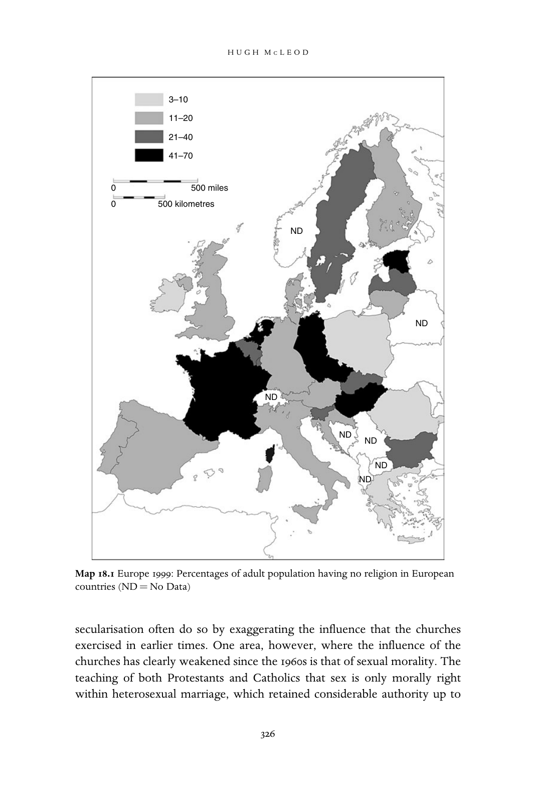
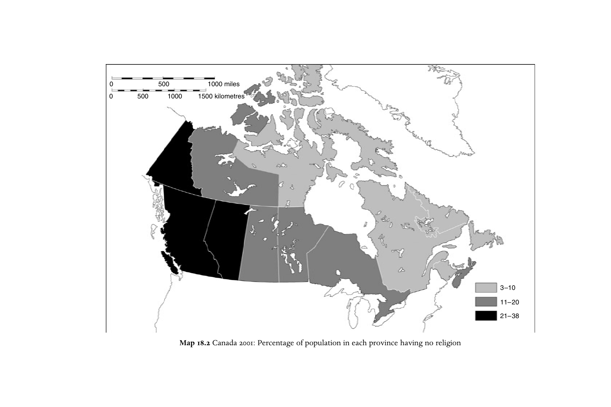
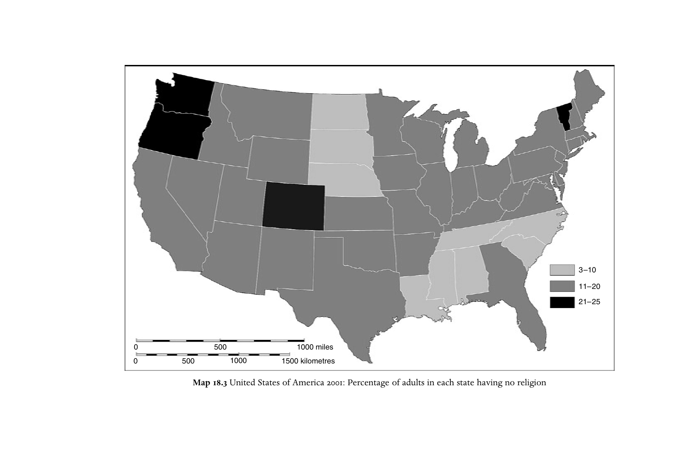

# 西方基督教的危机：走向后基督教时代？：英文转换底稿

<!-- PDF page 342; original page 323 -->

### 18

## The crisis of Christianity in the West:

## entering a post-Christian era?

H U G H M C L E O D In 1996 Terence Murphy concluded a history of Canadian Christianity by declaring that ‘the concept of ‘‘Christendom’’ – that is of a society where Christianity and culture are essentially integrated, is gone for ever in Canada’. He went on to claim: ‘The defining reality of contemporary Canadian society is pluralism, which includes not only cultural, racial and religious diversity, but also the recognition of tolerance and of differing beliefs and customs as a basic societal value.’ In 1956, when 61 per cent of the population said they had attended a place of worship during the preceding week, Canada had ranked among the most strongly churchgoing of Western countries. By 1990 this figure had dropped to 23 per cent.[^p342-1] This was still higher than in many European countries. But it was hardly surprising that Canadians were con- scious of having entered a new era in their history.

In Britain churchgoing had never been as high, even at the peak of the Victorian religious boom, as in Canada, and by 1990 the weekly attendance rate was around 10 per cent. Callum Brown, in a much-discussed book published in 2001, felt able to adopt a more apocalyptic tone. He began:

> This book is about the death of Christian Britain – the demise of the nation’s core religious and moral identity . . . It took several centuries . . . to convert Britain to Christianity, but it has taken less than forty years for the country to forsake it. For a thousand years, Christianity penetrated deeply into the lives of the people . . . Then really quite suddenly in 1963, something very profound ruptured the character of the nation and its people, sending organised Christianity on a downward spiral to the margins of social significance.[^p342-2]

[^p342-1]: Terence Murphy and Roberto Perin (eds.), A concise history of Christianity in Canada (Don Mills ONT: Oxford University Press, 1996), p. 369; Reginald W. Bibby, Fragmented gods (Toronto: Stoddart, 1990), p. 17.

[^p342-2]: Callum G. Brown, The death of Christian Britain: understanding secularisation 1800–2000 (London: Routledge, 2001), p. 1.

<!-- PDF page 343; original page 324 -->

### Symptoms of Christian decline

Brown sees the ‘irrelevance’ of what the churches have been saying as both a cause and a consequence of their decline. Murphy, on the other hand, sees secularisation as having some positive effects, since it has enabled the churches to move from a ‘legitimating’ to a ‘prophetic’ role, and he is approving of the stands they have taken on aboriginal rights and other social justice issues in the 1980s and 1990s.[^p343-3] In most respects, however, the symptoms of Christian decline noted by observers in Britain, in Canada, and in many other countries are much the same. They include the weakening of orthodox belief and diminishing rates of observance among Christians; the growing numbers of those belonging to non-Christian religions or to no religion; and the declining influence of Christianity and the churches on morality, politics and the law. More generally, Brown argues that until the 1960s there was a Christian culture in Britain, which strongly influenced the ways of thinking and behaving even of those who never went to church, but that this has now disappeared.

Statistics compiled by pollsters, by governments and by the churches themselves during the last forty years have provided a mass of evidence for the decline of Christianity and the churches. For instance, the erosion of the Christian identity of a large part of the population is reflected in the declining number of couples marrying in church and of babies being baptised. Taking the example of baptisms, every west European country other than Ireland, and possibly Sweden (where the figures are incomplete), has seen a decline since the 1960s, though the extent of this decline varies greatly. In Italy where 99 per cent of babies born in 1970 were baptised as Catholics, the figure was still 92 per cent in 2000. But in Spain the drop was from 99 per cent to 79 per cent, and in France from 78 per cent to 51 per cent. In England, Anglican baptisms fell from 47 per cent in 1970 to 29 per cent in 1988, though figures for the Catholics and free churches are not available. In Switzerland 95 per cent of babies were baptised either as Catholics or as Protestants in 1970, but 65 per cent in 2000.[^p343-4]

In 2000 Christianity was still by far the largest religion in western Europe, North America and Australasia, but in all these regions of the world there had been a considerable increase during the last four decades of the millennium in the numbers of those belonging to other religions or to none at all. In 1999 the

[^p343-3]: Ibid., p. 191; Murphy and Perin, Concise history, pp.361 –9.

[^p343-4]: Alfred Dittgen, ‘Évolution des rites religieux dans l‘Europe contemporaine. Statistiques et contextes’, Annales de démographie historique 2 (2003), 111–29; Robin Gill, The myth of the empty church (London: SPCK, 1993), p. 218.

<!-- PDF page 344; original page 325 -->

number of those with no religion was highest in the Netherlands (54 per cent), France (43 per cent) and Belgium (37 per cent). Elsewhere the figures were generally between 10 and 20 per cent.[^p344-5] Of course, the numbers with no religion were even higher in some of the formerly communist countries and regions of eastern Europe. (See map 18.1.) France had by far the largest number of Muslims – possibly as many as 8 per cent. England and Wales with 3 per cent was more typical. Less quantifiable, but equally significant, was the growth of ‘new age’ beliefs or of what Heelas and Woodhead, in a major new study of religion and ‘spirituality’ in the north-west of England, have called ‘the holistic milieu’. While the numbers actively involved may still be relatively small, Heelas and Woodhead argue that ideas emanating from this milieu have had a pervasive cultural influence, reflected in the media, in the large ‘Mind, Body, Spirit’ sections in bookshops, in the products sold in high street shops, and most importantly in attitudes to health and sickness.[^p344-6] According to this view, Western societies may not be ‘secular’, but their beliefs and practices are becoming much less recognisably Christian.

There has been some weakening of Christian belief, though much less than the decline of practice. It is difficult to say how great this decline has been, because of the paucity of information from periods earlier than the 1960s, but there has certainly been a downward trend in the period since then. For instance, a particularly thorough study of opinion poll data in Scotland showed that 85 per cent had professed belief in God in 1976, but 73 per cent in 1997. On the other hand various polls which asked if Jesus was the Son of God, a belief professed by 69 per cent in 1981, found fluctuations in the responses, but no clear trend.[^p344-7] In a group of European countries where 74 per cent of those questioned had said in 1981 that they believed in God, the proportion was 68 per cent in 1999, and it was 60 per cent for those aged between eighteen and twenty-nine. Belief in life after death remained unchanged at 43 per cent, but this was partly because of increasing belief in reincarnation.[^p344-8]

The social and political influence of Christianity is a lot harder to measure than church attendance – and those who want to emphasise present-day

[^p344-5]: Yves Lambert, ‘New Christianity, indifference and diffused spirituality’, in Hugh McLeod and Werner Ustorf (eds.), The decline of Christendom in western Europe, 1750–2000 (Cambridge: Cambridge University Press, 2003), p. 71.

[^p344-6]: Paul Heelas and Linda Woodhead, The spiritual revolution (Oxford: Blackwell, 2004).

[^p344-7]: Clive Field, ‘The haemorrhage of faith? Opinion polls as sources for religious practices, beliefs and attitudes in Scotland since the 1970s’, Journal of contemporary religion 16 (2001), p. 164.

[^p344-8]: Lambert, ‘New Christianity’, pp. 71–2.

<!-- PDF page 345; original page 326 -->

secularisation often do so by exaggerating the influence that the churches exercised in earlier times. One area, however, where the influence of the churches has clearly weakened since the 1960s is that of sexual morality. The teaching of both Protestants and Catholics that sex is only morally right within heterosexual marriage, which retained considerable authority up to

<!-- PDF page 346; original page 327 -->

about 1960, has come to be increasingly rejected or ignored since that time. Indeed, many of the Protestant churches have been forced to rethink their approach to sexual ethics. Similarly the Catholic church’s condemnation of artificial contraception is widely ignored even by otherwise devout Catholics. During the 1960s and 1970s there was a widespread liberalisation of laws relating to abortion, divorce and homosexuality. These changes were espe- cially contentious in Catholic countries, and the Irish Republic, the most strongly Catholic of Western countries, continues to ban abortion.

The Christian Democratic parties which dominated much of western Europe in the 1940s and 1950s are no longer so formidable. In particular, the Italian party collapsed in the 1990s after more than forty years in power. Until the 1960s religion was the biggest influence on voting in many parts of Europe, but since then there has been a decline in the political significance both of religion and of class, which had been the other key factor. There are still correlations between religious affiliation and political choice, but with fewer people being religiously active, and fewer concentrations of people with the same religious convictions in the same place, the impact of these religious–political correlations is much less. In the United States, however, religion continues to be an important influence on voting.[^p346-9]

### The 1960s

I have referred several times to the 1960s, and it is clear that this decade marks in some important respects a turning point in Western religious history. The later sixties, especially, saw a sharp drop in churchgoing, a growing interest in Eastern alternatives to Christianity, and, in some countries, declining parti- cipation in the Christian rites of passage. However, historians and sociologists are deeply divided as to how the religious developments in that decade should be interpreted and explained. The older view, of which Alan Gilbert is an eloquent representative, is that secularisation has a very long history, and that the 1960s mark only the culmination of a process which had been developing over decades or even over centuries.[^p346-10]  Gilbert focuses mainly on the impact of industrialisation and urbanisation in the nineteenth century. The sociologist Steve Bruce links secularisation to the individualism

[^p346-9]: Barry A. Kosmin and Seymour P. Lachman, One nation under God: religion in contem- porary American society (New York: Crown, 1993), pp. 182–6.

[^p346-10]: Alan D. Gilbert, The making of post-Christian Britain (London: Longman, 1980).

<!-- PDF page 347; original page 328 -->

stemming from the Reformation.[^p347-11]  Others have highlighted the significance of the Enlightenment, the French revolution, the rise of science or the complex of economic, social and political changes that came about in the years around 1900. Theories of long-term secularisation in Western societies are numerous, but they are often incompatible one with another.

The time was therefore ripe in the 1990s for a new approach. It came from a group of historians, including Callum Brown in Britain, Olaf Blaschke in Germany, Peter van Rooden in the Netherlands and Patrick Pasture in Belgium.[^p347-12]  Largely independently, they each came to the conclusion that theories of long-term secularisation had grossly under-estimated the import- ance of religion in Western societies in the nineteenth century and the first half of the twentieth. The real crisis, they argued, came only in the 1960s, and it was then that the secularisation of Western societies began in earnest. Callum Brown, for instance, accepted that churchgoing was dropping in Britain at least from the 1890s. But he argued that Christian ‘discourse’ remained dominant until around 1960, shaping individual life-narratives, inculcating a sense of sin and guilt, imposing notions of respectability and, in particular, defining what it meant to be a woman. Brown and Pasture both contend that women had a central role in the religious life of Western societies between about 1800 and 1960, forming the majority of churchgoers and members of religious organisations, keeping their menfolk from straying too far from the norms of belief and behaviour prescribed by the church, and passing on the faith to the next generation. For a century and a half the church had depended on the piety and activism of laywomen, and when in the 1960s women started leaving the church in large numbers, the structure collapsed.

Brown and Pasture are right to suggest that the older histories seriously exaggerated the extent of secularisation in the nineteenth century and the first half of the twentieth. However, they go to the opposite extreme by over- stating the dominance of Christianity in this period. The 1960s certainly mark the beginning of a more radical phase of dechristianisation in Western societies. However, this would not have been possible without the ante- cedent history of the alienation from the church of significant sections of the

[^p347-11]: Steve Bruce, Religion in the modern world: from cathedrals to cults (Oxford: Oxford University Press, 1995).

[^p347-12]: Brown, Death; Olaf Blaschke (ed.), Konfessionen im Konflikt: Deutschland zwischen 1800 und 1970: ein zweites konfessionelles Zeitalter (Göttingen: Vandenhoeck und Ruprecht, 2001); Peter van Rooden, ‘Long-term religious developments in the Netherlands, c.1750–2000’, in McLeod and Ustorf (eds.), Christendom, pp. 113–29; Patrick Pasture, ‘Christendom and the legacy of the sixties: between the secular city and the age of Aquarius’, Revue d’histoire ecclésiastique 99 (2004), pp. 88–116.

<!-- PDF page 348; original page 329 -->

population, which had begun in the eighteenth century. The extent to which this happened in the nineteenth and early twentieth centuries varied greatly from country to country, and between different social classes. The Western world in 1960 was highly variegated religiously. In some countries, such as France, there were huge regional differences. What was new about the 1960s and 1970s was the fact that the decline in Christian practice affected all social classes, women as well as men, the country as well as the town, and nearly all regions.

The 1960s were unquestionably a critical decade and one of the achieve- ments of historians like Brown and Pasture has been to make this clear. The older evolutionary approaches to the history of secularisation focused too much on causes and not enough on processes, with the result that the significance of specific periods and events was often overlooked. For instance, Gilbert makes no mention of the fact that the 1940s and 1950s saw an upturn in religious involvement in Britain, as in most Western countries.[^p348-13]  In the United States these were known as the years of the ‘religious revival’, reaching a peak in 1957, when 49 per cent of those questioned claimed to have attended church during the preceding week.[^p348-14]  This period also saw a church-building boom. In many European countries this was made necessary by wartime bomb-damage. In the United States, Canada and Australia, it was linked with suburbanisation. Whether the money came from church taxes, as in Germany and Scandinavia, or from private giving, the many new structures helped to fuel the religious optimism of these years.

In 1960 Christian commentators in the United States, as in other countries, were still inclined to take a relatively favourable view of the situation. But changes were under way which would during the next fifteen years transform the religious landscape. I will mention four examples: the rise in the number of Muslims, Hindus, Buddhists, and those belonging to other non-Christian religions; the decline in churchgoing and other forms of religious practice by Christians; the growing number of professed atheists and agnostics or others with no religion; and legislation intended to mark a shift from a professedly Christian to a pluralist society.

### The growth of non-Christian religions

The growth of Islam, and other non-Christian faiths, was initially a result of immigration. In the 1950s and 1960s the booming economies of northern and

[^p348-13]: Brown, Death, pp. 170–5; David Hilliard, ‘The religious crisis of the 1960s: the experience of the Australian churches’, Journal of religious history 21 (1997), p. 211.

[^p348-14]: Robert Wuthnow, Experimentation in American religion: the new mysticisms and their implications for the churches (Berkeley: University of California Press, 1978), pp. 130–1.

<!-- PDF page 349; original page 330 -->

north-western Europe attracted migrant workers from colonies or former colonies in Asia and Africa, from Turkey and from southern Europe. By the 1970s they were being joined by smaller numbers of refugees from war and from political or religious persecution, ranging from Soviet Jews and Vietnamese Catholics to Chilean socialists and communists, and from Christians in various middle eastern countries to Sri Lankan Hindus. The result was a great mixing of religions in countries which had previously been dominated by one, or maybe two, branches of Christianity. Catholic France saw a huge influx of Muslims from north Africa. Lutheran Sweden now for the first time was home to significant numbers of Catholics and Assyrian Orthodox, as well as Muslims. In Britain the new diversity was reflected not only in the conversion of redundant inner-city churches to Pentecostal or Greek Orthodox places of worship, but also in the growing number of mosques, Hindu temples and Sikh gurdwaras in London, Birmingham, Leicester and other cities. This transformation came a little later in the United States, Canada and Australia, but, following a large immigration in the 1990s, 5 per cent of Canadians and 1.5 per cent of Americans were Muslim, Hindu, Buddhist or Sikh in 2001.[^p349-15]

However, by the later 1960s ‘Eastern religion’ was in fashion, especially on university campuses and in the ‘counter-culture’. The most conspicuous exemplars were the Beatles – perhaps the most universally familiar symbols of the decade. In 1967 they announced that they had become disciples of the Maharishi Mahesh Yogi and were travelling to India in search of enlight- enment. In the United States Zen Buddhism attracted a big following among campus radicals. A survey at Berkeley in the early 1970s found that the students whom the authors termed ‘mystics’, defined by such things as interest in yoga, Zen or transcendental meditation, were those most likely to be involved in the counter-culture with its political radicalism, experimen- tation with drugs and sex, and preference for communal living.[^p349-16]

### The decline in churchgoing

Many people who had experienced the counter-culture in the sixties con- tinued their taste for religious experimentation: what was ‘far out’ in the sixties had become ‘mainstream’ by the nineties. In the United States, it is said that the so-called ‘baby-boomer’ generation, born between 1946 and 1964, is

[^p349-15]: www12.statcan.ca; www.gc.cuny.edu/studies/key_findings/htm, accessed 28 September 2004.

[^p349-16]: Wuthnow, Experimenation, pp. 156–7.

<!-- PDF page 350; original page 331 -->

still marked by a religious culture based on exploration and personal choice. ‘While religion is seen as something which locks you up and encloses you, spirituality liberates and encourages expression.’[^p350-17]  From the sixties, the terms ‘spiritual’ and ‘spirituality’ began to be used in a new sense to indicate ways of relating to the sacred which were partly or wholly detached from traditional Christianity. One important aspect of this, according to the American socio- logist Robert Wuthnow, was a move away from a spirituality based on ‘dwelling’ towards one based on ‘seeking’. The 1980s and 1990s in the United States saw a rising interest in the ‘inner self’. Popular psychology books rediscovered terms like ‘the soul’, and ‘care of the soul’ became a major concern. This included self-acceptance, and indeed a fair amount of selfish- ness, combined with a sacralisation of everyday life. As well as seeing a great interest in native American spiritualities, this was also a big time for spirit guides, channelling, encounters with angels and near-death experiences.[^p350-18] In Britain:

> Spirituality . . . has become a kind of buzzword of the age . . . ‘I’m trying to cultivate my spiritual side,’ people say; or ‘I’m learning to connect with my spirituality’ . . . The spiritual search, what ever that may mean – and it means myriad things to different people – has become a dominant feature of twentieth-century life.[^p350-19]

In the United States regular Gallup polls make it possible to trace the decline in churchgoing year by year. In 1957, 49 per cent of those questioned claimed to have been to church during the preceding week; by 1972, after more than a decade of gradual decline, the figure had dropped to 40 per cent. The really big change, however, was in the habits of the younger generation. In 1957, churchgoing by those aged twenty-one to twenty-nine was margin- ally above the national average, and indeed generational differences were slight. By 1972, young people, 28 per cent of whom said they had been to church in the previous week, were far below the national average.[^p350-20]  In fact, recently published evidence suggests that the drop in churchgoing in the later 1960s and early 1970s, especially among Catholics, was more rapid than the

[^p350-17]: David A. Roozen, Jackson W. Carroll and Wade C. Roof, ‘La génération née après- guerre et la religion institutée: un aperçu sur 50 ans de changement religieux aux Etats Unis’, Archives des sciences sociales de la religion 83 (1993), pp. 41–3.

[^p350-18]: Robert Wuthnow, After heaven: spirituality in America since the 1950s (Berkeley: University of California Press, 1998), ch. 6.

[^p350-19]: M. Brown, The spiritual tourist (London, 1998), as quoted by Steven Sutcliffe and Marion Bowman (eds.), Beyond new age: exploring alternative spirituality (Edinburgh: Edinburgh University Press, 2000), p. 8.

[^p350-20]: Wuthnow, Experimentation, pp. 117–23, 130–1.

<!-- PDF page 351; original page 332 -->

Gallup poll data revealed. Surveys in which respondents kept diaries of their activities during the previous week found that the proportion who men- tioned having attended a church service fell between 1965–6 and 1975 from 42 per cent to 27 per cent. The disparity seems to be due to the unwillingness of many people to admit to an interviewer that they did not attend church as regularly as they felt they ought to.[^p351-21]

Although fewer statistics are available, it is clear that in the later 1950s and early 1960s churchgoing was already falling among Protestants in Canada and Britain.[^p351-22]  But, in the later sixties and early seventies, the decline was much more rapid and general, and in some communities formerly noted for high levels of churchgoing it took catastrophic proportions. For instance, the proportion of Dutch Catholics attending church on a given Sunday was still in 1965 a very impressive 64 per cent; by 1975 the figure had already dropped to 31 per cent. Where churchgoing was already relatively low, the changes in these years were less dramatic, but still very significant. In France the proportion of the population attending mass on a given Sunday fell from 23 per cent to 17 per cent between 1966 and 1972. Meanwhile, Protestant churches were suffering heavy membership losses. For instance, in the Australian state of Victoria the Anglican, Presbyterian and Methodist churches each lost about a third of their members between 1961 and 1976. In England the proportion of teenagers confirmed into the Anglican church fell by a half between 1956 and 1976.[^p351-23]

### The growth of atheism and agnosticism

Until the mid-sixties few people in Western countries were prepared to write on a census form or tell a pollster that they had no religion – except in the Netherlands, where already in 1960, 18 per cent of the population declared themselves without religion. In the new atmosphere of the later sixties and early seventies many of those whose religious doubts had previously been a private matter felt free to ‘come out’. In Australia, fewer than 1 per cent said they had no religion at the time of the 1966 census; by 1976, 8 per cent of the population did so. These years also saw a growth of atheism and agnosticism, especially among the young and those involved in the counter-culture. Time

[^p351-21]: Stanley Presser and Linda Stinson, ‘Data collection and social desirability bias in self- reported religious attendance’, American sociological review 63 (1998), 137–45.

[^p351-22]: Brown, Death, pp. 188–92; Bibby, Fragmented gods, pp. 15–17.

[^p351-23]: Jan Kerkhofs (ed.), Europe without priests? (London: SCM, 1995), p. 11; Gérard Cholvy and Yves-Marie Hilaire, Histoire religieuse de la France contemporaine, 1930–1988 (Toulouse: Privat, 1988), p. 434; Hilliard, ‘Crisis’, p. 226; Brown, Death, p.191 .

<!-- PDF page 352; original page 333 -->

magazine was remarkably quick to recognise the way that the wind was blowing. Its famous ‘Is God dead?’ issue came out on Good Friday, 1966. Student radicals, often strongly influenced by Marxism, were inclined to treat religion as an irrelevance, though Daniel Cohn-Bendit, the most famous leader of the Paris students in 1968, claimed that in abolishing ‘hierarchy’, ‘bureaucracy’ and all ‘control of information and knowledge’, it was neces- sary to get rid of ‘the Judaeo-Christian ethic’. In the Women’s Liberation movement of the 1970s, attacks on religion moved nearer to the top of the agenda, as the Christian and Jewish religions were seen as the most influential legitimators of patriarchy.

### Religion, morality and the law

These years brought changes from above, as well as below. The Second World War had often been seen as a battle for ‘Christian civilisation’ against the ‘pagan’ Nazis. During and immediately after the war there was a wide- spread assumption that the Christian foundations of Western societies needed to be strengthened and that the laws should reflect Christian morality. Thus, for instance, religious education in schools and the starting of the school day with an act of worship were first made compulsory in England and Wales in 1944. In West Germany the abolition of capital punishment went hand in hand with stringent laws against abortion – both measures being seen as a reaffirmation of the sanctity of life after the horrors of the Nazi period. The extent to which and the ways in which the laws were given a Christian basis differed according to whether a country was predominantly Catholic or Protestant, how powerful these churches were, and whether church and state were formally separated. However, even in France, the country that had taken the principle of separation furthest, Christian influences on the nation’s laws remained significant. These influences were seen most clearly in laws relating to sex, marriage and the family. So, for instance, some predominantly Catholic countries, such as Italy, Ireland and Spain, prohibited divorce, and many countries, both Catholic and Protestant, placed strict limits on the circumstances in which divorce was allowed. Some Catholic countries also restricted or outlawed the sale of contraceptives. Most countries prohibited abortion except where the life of the mother was endangered. Many banned the practice of male homosexuality. Censorship of books, films and the theatre was widespread. Protestant countries tended to be less strict in the regulation of sex and marriage, but more severe in their discourage- ment of drinking and gambling and promotion of Sunday observance. State broadcasting systems, and indeed many independent broadcasting systems,

<!-- PDF page 353; original page 334 -->

were biased in favour of Christianity, and specifically what they saw as ‘mainstream’ versions of Christianity.

In the 1960s and 1970s most of these laws came under attack, and in some countries the role of religion in radio and television also changed. Secularists, naturally resentful of the power exercised by religion and the churches, were often among the leaders of the campaigns to change these laws. But secular- ists were seldom powerful enough to effect such changes single-handed. They needed allies, and plenty of these were to be found. Powerful cam- paigns could be mounted by interested groups on specific issues – for instance by feminists in favour of liberalising abortion laws. More generally, elite opinion in the 1960s, as reflected in the views of legislators, judges, newspaper editors, academics and many theologians and church leaders, was strongly influenced by principles of individual human rights, the importance of main- taining a ‘private’ sphere in which the state had no right to intervene, and the need for equity between sections of the population with different moral and religious convictions. Many of these ideas were contained in Britain’s Wolfenden Report of 1957, which, in a famous phrase, recommended the legalisation of homosexual activities by ‘consenting adults in private’, though these recommendations only became law in 1967. Sir John Wolfenden did not approve of homosexuality, any more than did the archbishop of Canterbury, Geoffrey Fisher, who joined many other church leaders in supporting the commission’s report; but they no longer thought it should be suppressed by law.[^p353-24]

Among the legislators of this period, the most consistent advocate of such views was the Canadian Liberal minister of justice, and later prime minister, Pierre Trudeau, a liberal Catholic, whose ideas had been formed in opposi- tion to what he saw as the over-powerful church in his native Quebec. In 1967 he introduced a comprehensive set of legal reforms covering divorce, homo- sexuality, abortion, contraception and lotteries, in a bid to ‘get the state out of the nation’s bedrooms’. In more decorous language, he told members of Parliament:

> We are now living in a social climate in which people are beginning to realize, perhaps for the first time in the history of this country, that we are not entitled to impose the concepts which belong to a sacred society upon a civil or profane society. The concepts of the civil society in which we live are

[^p353-24]: G. I. T. Machin, Churches and social issues in twentieth-century Britain (Oxford: Oxford University Press, 1998), pp. 156–8.

<!-- PDF page 354; original page 335 -->

> pluralistic, and I think this parliament realizes that it would be a mistake for us to try to legislate into this society concepts which belong to a theological or sacred order.[^p354-25]

These changes were supported by the largest Protestant churches, though opposed by many evangelicals. The Catholic church accepted most of the package, but strongly opposed the legalisation of abortion. This remains the most contentious of the changes enacted in this period. The official Catholic view, shared by many evangelicals, is that abortion is simply murder, and that the kinds of compromise that have been agreed on other issues are therefore impossible. In such countries as France, Belgium and Italy, abortion legisla- tion was pushed through against strong Catholic opposition. In the United States, the Supreme Court ruled in 1973 that the abortion laws which many states had already passed were constitutional. While few would now advocate going back on any of the other liberalising measures of the sixties and seventies, this issue remains highly contentious, and a potential vote- winner for the Republicans who have emerged as the party more likely to deliver ‘pro-life’ legislation. Meanwhile the Democrats have become com- pletely identified with the ‘pro-choice’ cause.

The 1960s also saw a revolution in British television. In 1948 the then director of the British Broadcasting Corporation, Sir William Haley, had referred to Britons as ‘citizens of a Christian country’, and affirmed that ‘the BBC – an institution set up by the State – bases its policy upon a positive attitude towards Christian values’. While tentative steps were taken in the fifties towards giving humanists a voice on radio, the major changes came with the appointment of Sir Hugh Greene as director-general in 1960. He identified the BBC with the new mood of irreverence and questioning of authority figures and established institutions. The pioneering satirical pro- gramme That was the week that was (1962–3) included some mild humour at the expense of the churches, as well as more acidic attacks on politicians – though more pointed criticism of religion came with Monty Python’s flying circus (1969–75). Greene also relaxed the restrictions on nudity and swearing, and provided a platform for critics of conventional sexual morality. He soon became the chief target for the evangelical vigilante Mary Whitehouse, who launched her career as champion of conservative Christianity with a cam- paign to ‘Clean Up TV’. Lord Reith, its first director-general, was to claim

[^p354-25]: George Egerton, ‘Trudeau, God and the Canadian constitution’, in David Lyon and Marguerite van Die (eds.), Rethinking church, state and modernity: Canada between Europe and America (Toronto: Toronto University Press, 2000), p. 96.

<!-- PDF page 355; original page 336 -->

shortly before his death in 1975 that the BBC had become ‘the leader of agnosticism and immorality among young people particularly’. In fact, the BBC under Greene continued to devote a considerable amount of time to religious broadcasting, both of a popular and of a more intellectual kind. This was in keeping with the contemporary ethos of pluralism and free debate, as well as the understanding the BBC then had of its public responsibility.[^p355-26]

### Why were the sixties so explosive?

In most of the Western world the years 1960–75 saw two major changes in the ways in which Christian rituals and knowledge of Christianity had been embedded into the rhythms of daily life. First, large numbers of people lost the habit of regularly going to church services. Secondly, there was a break in the process by which Christianity was passed on to the younger generation – partly because of the decline of Sunday schools and of catechism and confirmation classes, partly because fewer parents were teaching their child- ren prayers, telling them Bible stories, and decorating the walls with cruci- fixes and pictures of saints or of biblical scenes. Two surveys of students at Sheffield university in northern England illustrate the rapidity of these changes. In 1961, no fewer than 94 per cent of students claimed to have had some kind of religious upbringing; in 1972 this figure had dropped slightly to 88 per cent; but by 1985 it had already dropped to 51 per cent.[^p355-27]  This suggests that the period of most rapid change was the later sixties and seventies. Of course this ‘religious upbringing’ was probably limited in many cases to the sending of children to Sunday school. However, there is a significant change from the situation in the 1950s where Christianity was an inescapable, if often relatively small, part of the whole environment within which children grew up, to the situation that was increasingly common by the 1980s, where it might be hardly ever encountered except in religious education lessons at school. A survey in 1990–1, which included all age-groups, found that the proportion saying they had a religious upbringing was still very high in Ireland (94 per cent) and Italy (93 per cent), but was significantly lower elsewhere. It was 80 per cent in the United States, 71 per cent in France and

[^p355-26]: Asa Briggs, ‘Christ and the media’, in Eileen Barker, Karel Dobbelaere and James Beckford (eds.), Secularization, rationalism and sectarianism (Oxford: Oxford University Press, 1993), pp. 267–86.

[^p355-27]: David Bebbington, ‘The secularization of British universities since the mid-nineteenth century’, in George M. Marsden and Bradley J. Longfield (eds.), The secularization of the academy (New York: Oxford University Press, 1992), p. 268.

<!-- PDF page 356; original page 337 -->

the Netherlands, 59 per cent in Britain, 43 per cent in Denmark, and 31 per cent in Sweden – a figure only slightly higher than those for Estonia and Belarus.[^p356-28]

So there is no doubt that the sixties were a time of decisive change. But no single factor is sufficient to explain this. This decade was so religiously explosive because of the coming together of five currents of change that were initially independent of one another, but increasingly inter-mingled: (1) the drive, especially by those who had been economically deprived, to

enjoy the new prosperity, with the many material benefits and the

enhanced leisure possibilities that it offered; (2) the desire, especially by middle-class youth, to experiment in sex and

drugs, and to reject all puritanical restraints, together with the work ethic,

both of which seemed redundant in an age of abundance; (3) women’s search for greater freedom and self-fulfilment, especially

through more satisfying work and greater financial independence; (4) the theological radicalisation that began in the early sixties; (5) the political radicalisation of the middle and later sixties.

The unprecedented prosperity enjoyed in most of the Western world from the later 1950s was a pre-condition for the many far-reaching social and cultural changes of that time. The impact of these changes was most dramatic in the rural ‘Christendoms’ of western France, Flanders, north-eastern Italy or Quebec. For instance, Yves Lambert in his classic study of the Breton village of Limerzel showed how within a very short period this relatively self- contained and highly traditional community was brought into the cultural orbit of the secularised metropolis. Television came in 1958 and at about the same time newspapers and magazines published in Paris became more easily available. Cars made a difference: they offered the possibility of spending Sunday visiting relatives living at a distance or going to the seaside. So did the decline in agricultural employment: those working in industry or services were more open to outside influences. The proportion of adults who went regularly to mass was still 92 per cent in 1958, but by 1975 it had dropped to 55 per cent.[^p356-29]

More generally the prosperity of these years interacted with other social changes to provide a catalyst for the emergence of new lifestyles and values. Better homes, with cars and television sets, promoted a family-centred life,

[^p356-28]: Mattei Dogan, ‘The decline of religious beliefs in western Europe’, International social science journal 143 (1995), p. 411.

[^p356-29]: Yves Lambert, Dieu change en Bretagne (Paris: Editions du Cerf, 1985), pp. 237–55.

<!-- PDF page 357; original page 338 -->

weakening community ties and the communal institutions that had flour- ished in periods of relative scarcity. It is no coincidence that membership of political parties was declining at the same time as membership of churches. Expanding leisure opportunities diminished the importance of churches as community centres and Sunday meeting places. Meanwhile, easier credit facilities reduced the need for ‘respectability’ – often a major motive for churchgoing for those otherwise uninterested in religion. A study of working- class families in the north-west of England, noting the decline in churchgoing in the 1960s, commented that ‘few seemed to have experienced a crisis of faith or a dispute with the Church – both situations which had been in evidence earlier in the century. Instead respondents speak of being too busy creating a home to go to church, having other things to do.’[^p357-30]  And full employment took away a major source of anxiety and made risk-taking easier to con- template. Here was one reason why the student generation of the sixties and early seventies was readier than any before or since to risk expulsion or failure in examinations.

The invention of the contraceptive pill, available in the United States in 1960 and in Europe in 1961, removed another major form of risk. It was also a key element in the changes in women’s aspirations and identity in this period. The Women’s Liberation movement started in the United States at the end of the sixties and reached Europe at the start of the seventies. But it was preceded by several important developments: rising participation of married women in the labour market from the 1950s, and, from around the middle of the sixties, declining fertility of married women and rising sexual activity among unmarried women. The implications of all this for religion are not entirely clear. The antipathy to religion of many seventies feminists is well known, but it is clear that the fall in women’s religious activity had already started in the sixties. When women gave up going to church it was often for the same reasons that men gave up. But there may be some more specifically female factors. One is that the ‘sexual revolution’ of the sixties may have had a bigger impact on the religious ties of young women in as much as pre- marital sex, especially if marriage was not intended, involved a bigger act of rebellion by women than by men. The other is that the increasing involve- ment of married women in paid work simply left less time for taking children to church, teaching them prayers, and the other tasks that had long been seen as part of being a good mother.

[^p357-30]: Elizabeth Roberts, Women and families: an oral history, 1940–1970 (Oxford: Blackwell, 1995), p. 16.

<!-- PDF page 358; original page 339 -->

The sixties were a time not only of broad social changes but of dramatic and often traumatic events. So far as church life was concerned, no event was bigger than the Second Vatican Council. In the course of the more than three years that the council fathers met in Rome, large sections of the laity, and even more of the clergy, became keenly involved in following and trying to influence the debates in Rome.[^p358-31]  Progressive and conservative pressure-groups were formed and as the council ended in 1965 hopes were high that the church was going to be transformed. Big changes did follow, but they were never enough to satisfy those who had been radicalised by the council. Humanae vitae came in 1968 as a shattering blow, both because of the nature of the decision taken by the pope, and because of the manner in which it had been taken, in apparent disregard of all the ideas of ‘collegiality’ that had come from the council. Across the world, about 3,000 priests decided to quit during 1969.[^p358-32]

In the Protestant churches there was no one event that had a similar impact. However, the radicalisation of theology in the sixties had far-reaching consequences. The most revered Protestant theologian in the sixties was Dietrich Bonhoeffer and the most influential concept was his ‘religionless Christianity’, popularised by such writers as John Robinson and Harvey Cox. The message as understood by many clergy and members of student Christian groups was that action in ‘the world’ was what matters.[^p358-33]  Already in the mid-sixties, ministers were abandoning parochial ministry to get involved in apparently more relevant forms of campaigning or work with oppressed groups. As the political temperature reached boiling point in 1968, student Christian organisations were torn apart, as many members decided that working for the revolution was the top priority and everything else was an irrelevant sideshow.[^p358-34]  In the words of Camilo Torres, the rebel priest who had been killed by the Colombian military in 1966, ‘The Christian who is not a revolutionary is in a state of mortal sin.’

Most of the trends established in the sixties continued in subsequent decades, with the exception that the political radicalism of those years sub- sided in the seventies and was submerged by a growing tide of conservatism, sometimes tinged with nationalism or racism, in the eighties. Two important new developments which affected the religious situation were first the gay

[^p358-31]: J. A. Coleman, The evolution of Dutch Catholicism, 1958–1974 (Berkeley: University of California Press, 1978).

[^p358-32]: Michael Gaine, ‘The state of the priesthood’, in Adrian Hastings (ed.), Modern Catholicism: Vatican II and after (London: SPCK, 1991), pp. 246–54.

[^p358-33]: Hilliard, ‘Crisis’, pp. 212–14, 221–2.

[^p358-34]: Adrian Hastings, A history of English Christianity, 1920–2000 (London: Collins, 2001), p. 549; Cholvy and Hilaire, Histoire religieuse, pp. 345–52.

<!-- PDF page 359; original page 340 -->

and lesbian liberation movement, and second a series of scandals concerning various forms of ‘abuse’ by clergy which began to surface around 1990. Homosexuality had become the most controversial and divisive issue facing the churches at the end of the century, and it is discussed elsewhere in this volume. But something needs to be said about the ‘abuse’ scandals. These have been of two kinds. The most numerous and the widest in their impact have been cases where Catholic priests have been accused of sexually abusing boys. Allegations of this kind were rare before the 1980s, or at least they seldom came into the public domain. But since that time they have been numerous and have occurred in many different countries. A considerable number of priests or former priests have received jail sentences. The result has been a collapse of confidence in the clergy, especially in countries such as Ireland where their prestige was high. To make matters worse, it emerged that where the diocesan authorities were aware of the allegations, they had often tried to cover up the offences by simply transferring the priest to another parish or diocese. Tensions between the hierarchy and aggrieved Catholic laity have become especially acute in the United States, where several dioceses face financial crisis or even bankruptcy as a result of legal claims. The senior American bishop, Cardinal Law of Boston, resigned in 2002 following allegations that he had covered up crimes by priests in his diocese. According to one estimate, 4 per cent of all the Catholic priests who served in the United States between 1950 and 2003 have been accused of sexual abuse.[^p359-35]  The other kinds of ‘abuse’ accusations concern mistreatment of inmates in church-run institutions, such as homes for former prostitutes, run by nuns in Ireland, or boarding-schools for indigenous children in Canada and Australia. The most important examples have been in Canada, where the schools have been accused of imposing harsh discipline, and especially of making children ashamed of their ancestral culture. The Anglican church in Canada claims that it is threatened with bankruptcy because of legal actions by former pupils in these schools.[^p359-36]

### Conclusion

The question of whether the West is ‘post-Christian’ is partly a matter of perspective. In western Europe, Christians lamenting the decline in their

[^p359-35]: www.boston.com/globe/spotlight/abuse/stories5/021704_study.htm, accessed 2 August 2004.

[^p359-36]: www.shannon.thunderbird.com/residential_schools.htm, accessed 2 August 2004.

<!-- PDF page 360; original page 341 -->

numbers and influence and secularists eagerly looking forward to a godless future could agree that a new era had dawned, whether for good or for ill. A visitor from another planet – or indeed from a Muslim or a communist- ruled country – would have found the signs of Christianity all too visible.

These signs were most evident in the United States which, in the 1970s, had begun to diverge from the rest of the Western world. The post-war ‘religious revival’, though its leading centre was the United States, had also reached most other Western countries. The religious crisis of the 1960s was as much a crisis in the United States as anywhere else. But the decline in churchgoing and church membership slowed down considerably in that country in the later 1970s and early 1980s, while continuing with little interruption else- where. There seem to have been several reasons for this stabilisation of religious practice. First, the later 1970s and 1980s saw a return to the church by a significant minority of those ‘baby-boomers’ who had left in the sixties and early seventies but who, when they became parents, wanted to give their children a religious upbringing.[^p360-37]  The extent of this ‘return’ should not be exaggerated, but it seems to have been a much more frequent occurrence in the United States than in Europe. Second, the trend towards political conservatism that was common to many Western societies in this period was associated with religious conservatism in the United States in a way that did not happen elsewhere.[^p360-38]  Third, the 1970s and 1980s were a period of resurgence for the south, the most religiously conservative region of the nation, marked by population growth, booming economies and rising levels of education. This does not mean that the United States is, as the European media likes to claim, a nation dominated by religious conservatives. Rather, it is a pluralist society, where both religious conservatives and religious liberals have been better able to withstand the secularising trends than in Europe, but where secularists also have a powerful voice, and many people are more or less neutral. The unique degree of diversity in the United States has made it much easier for distinctive regional, ethnic and denominational cultures to flourish than in the more centralised and homogeneous societies of Europe. As an example of the big regional differences, the proportion of Americans (and also of Canadians) saying they had no religion was far above average in the west, while remaining low in the American south and in the Canadian maritime provinces. (See maps 18.2 and 18.3.) American free enter- prise has allowed a multiplicity of universities and colleges, TV and radio

[^p360-37]: Roozen, Carroll and Roof, ‘Génération’, p. 39.

[^p360-38]: Kosmin and Lachman, One nation, pp. 178–82.

<!-- PDF page 361; original page 342 -->

Map 18.2 Canada 2001: Percentage of population in each province having no religion

<!-- PDF page 362; original page 343 -->

Map 18.3 United States of America 2001: Percentage of adults in each state having no religion

<!-- PDF page 363; original page 344 -->

stations to proliferate, offering the consumer a huge choice so far as their ideological and religious ethos is concerned.[^p363-39]  In the later 1980s and early 1990s, churchgoing in the United States was again declining, albeit gradually. Although the decline had been greater in most European countries than in the United States, the trend was in the same direction.[^p363-40]  And while Christians in North America were more likely than those in Europe to be actively involved in their churches, the numbers of declared secularists were by 2001 similar to the numbers in many European countries. So, for instance, the proportions of Americans, Canadians and Britons saying they had no religion were almost identical – 14 per cent, 16 per cent and 15 per cent respectively.

Even if we concentrate on western Europe, there are reasons for doubting that the ‘post-Christian era’ had yet arrived at the end of the twentieth century. First, the great majority of people still claimed to be Christians. The situation admittedly differed considerably from country to country. For instance, a survey in 1999 found that 89 per cent of those questioned in the Irish Republic claimed to be either Catholic or Protestant, 88 per cent in Denmark, 85 per cent in Portugal, 84 per cent in Finland and 81 per cent in Italy. In the United States in 2001, 77 per cent said they were Christian.[^p363-41] England and Wales were more or less average, and the census of 2001 provides highly detailed figures concerning the patterns of religious affiliation in those countries:[^p363-42]  71.8 per cent were Christian, 5.8 per cent belonged to other religions, 14.8 per cent had no religion, and 7.7 per cent gave no answer. Among the other religions, Muslims were by far the most numerous, followed by Hindus, Sikhs, Jews and Buddhists. Christians were most numer- ous in working-class areas in the north, especially in those with a strong Catholic presence, and in suburban and rural districts. They were weakest in inner-city districts, where Muslims, Hindus and Sikhs were numerous, but the numbers with no religion were low. They were also relatively weak in some southern cities with large populations of students and young profes- sionals, in the north London strongholds of the intelligentsia, and in some of the old industrial districts of south Wales, in all of which the proportion with no religion was above average. Among the larger towns and cities the

[^p363-39]: Bruce, Religion in the modern world, pp. 141–3.

[^p363-40]: Presser and Stinson, ‘Religious attendance’.

[^p363-41]: Lambert, ‘New Christianity’, p. 71; www.gc.cuny.edu/studies/key_findings/htm, accessed 28 September 2004.

[^p363-42]: www.statistics.gov.uk/census2001, accessed 10 March 2004.

<!-- PDF page 364; original page 345 -->

proportion with no religion was highest in Norwich (27.8 per cent) and lowest in Sunderland (9.6 per cent).

Second, while the Christianity of many individuals may be largely nom- inal, the role of Christianity and the churches in public institutions in most Western countries remains very considerable. The separation between church and state is most clearly defined in France, though even there state subsidies to Catholic schools were introduced in 1959. Some countries includ- ing Denmark, Finland and England still have a state or established church. (Finland has two: the Lutheran and the Orthodox.) In most other Western countries, there has been a formal separation of church and state, but all sorts of ties between the state and the Christian churches exist and are fairly generally accepted.[^p364-43]  In Germany, Italy, Spain and the Scandinavian countries the church tax system places the churches in a very favourable financial situation. In Belgium the state pays the salaries of the Catholic clergy. State funding of chaplaincies in the armed forces, hospitals and prisons is more or less universal – though most countries now also fund Jewish and Muslim chaplaincies, and some such as Belgium also provide humanist chaplains. Most countries provide religious teaching in state schools, though the con- tent and approach adopted vary considerably as between, for instance, Italy and most German states, where it is confessional, Sweden where it is required to be neutral, and England and Wales where knowledge of the various world religions is emphasised. Many countries, including Britain, France, Belgium and the Netherlands, have considerable numbers of state-subsidised or state- funded religious schools. In Germany and Belgium the church has a key role in the welfare system, managing many hospitals and orphanages and employing a large proportion of social workers.

Third, Christianity and the churches continue to have a wide-ranging role in many areas of social provision and public debate. This is most conspicuous in the United States. In the 1960s the churches played a key role in the Civil Rights movement. Since the 1970s, conservative Protestants have played an important part in organising opposition to the Equal Rights Amendment, which aimed to outlaw discrimination on the grounds of gender, and in campaigning on a wide range of other ‘family’ issues. In many states the so-called ‘religious right’ has acquired a dominant influence within the local Republican Party. While provoking widespread hostility, they have suc- ceeded in changing the rules of public discourse to the extent that professions

[^p364-43]: This section is based on Gerhard Robbers (ed.), State and church in the European Union (Baden-Baden: Nomos, 1996).

<!-- PDF page 365; original page 346 -->

of piety are compulsory for would-be American presidents and desirable for those seeking lesser office. The 1996 edition of the Almanac of American politics revealed that out of 585 state governors and members of Congress only four were bold enough to declare that they had no religion.

Few European countries require professions of piety from their legislators, and one may assume that those who do make such professions are sincere in doing so. On the other hand, relatively few leading politicians are declared unbelievers – though in Australia two prime ministers in the 1970s and 1980s, Gough Whitlam and Bob Hawke, were professed agnostics. As religion has become less important as an influence on voting, it has been easier for politicians simply to leave religious considerations out of account. However, churches have seldom been inclined to retire to the ‘private sphere’. A conspicuous example of this refusal was the long-running battle between the British churches and Margaret Thatcher’s government in the 1980s, culminating in the Church of England’s damning report, Faith in the city (1985). The main issues were poverty, welfare and unemployment. The churches argued that Thatcher’s policies were unjust and divisive, since they had made the rich richer and the poor poorer, and had increased the polarisation between the prosperous south and the deprived north. Thatcher responded that in the long run everyone would benefit from the emergence of an ‘enterprise culture’ and the elimination of the ‘dependency culture’. Differences also arose in many other areas, including immigration, foreign and defence policy, education and local government. How far these criticisms undermined Thatcher’s legitimacy and contributed to her fall in 1990 is open to question. Cynics would point out that those who deplored Thatcher’s claim that ‘there is no such thing as society, only individuals and families’ often continued to support her in the secrecy of the voting-booth. Two points are notable, however. First, Thatcher presumably did feel that her legitimacy was being undermined, since she felt required to answer her religious critics in her famous ‘Sermon on the Mound’ (so-called because it was delivered to the General Assembly of the Church of Scotland, which meets on The Mound, a street in Edinburgh). Second, her successor, John Major, did direct additional funds at the inner cities, and tried to promote co-operation with the various religious groups active there through an Inner Cities Religious Council.

At the same time as these high-profile interventions on public issues, independent church agencies have continued to play a major part in certain areas of social provision. This is particularly so in the field of immigration and asylum, where the bleak situation of asylum-seekers and other immigrants

<!-- PDF page 366; original page 347 -->

from Africa and Asia would be even worse but for church initiatives.[^p366-44]  Clergy have spoken out against racism and exclusionist asylum policies, and have warned against voting for far-right parties. At a more practical level, churches have supported numerous schemes to assist asylum-seekers and in some cases church people have hidden them in their homes.

It is premature to speak of a ‘post-Christian era’ in view of the major social role which the Christian churches still play throughout the Western world. However, their foundations are certainly being undermined by the severe decline in active membership that most have suffered, especially during the last forty years. Particularly serious is the failure to recruit young people in significant numbers. Both clergy and active laity include a heavy over- representation of the middle-aged and the old. Unless ways of addressing this deficit can be found very soon, more serious difficulties lie not very far in the future.

[^p366-44]: For the example of France, see Kay Chadwick, ‘Accueillir l’étranger: immigration, integration and the French Catholic church’, in Kay Chadwick (ed.), Catholicism, politics and society in twentieth-century France (Liverpool: Liverpool University Press, 2000), pp. 175–96.
