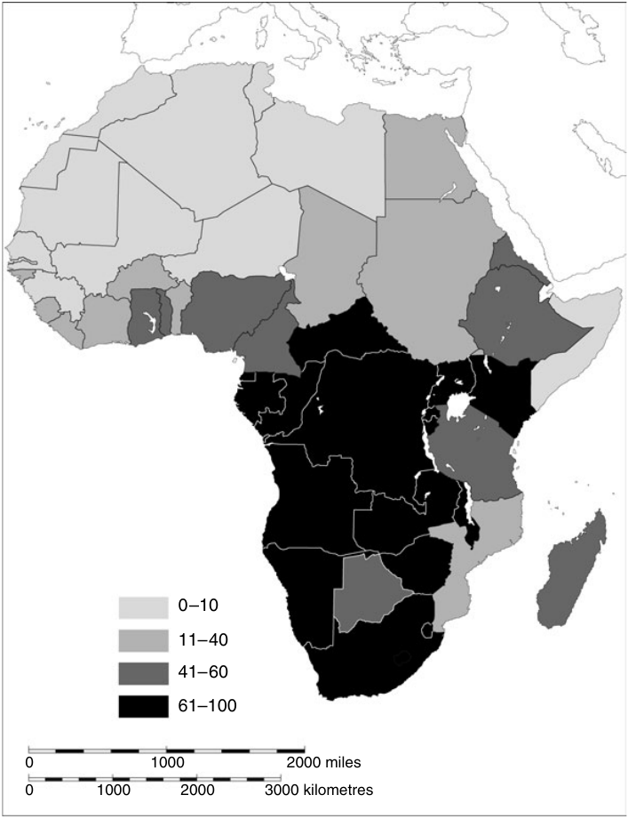

<!-- PDF page 402; original page 401 -->

# 第二十二章 后殖民时代非洲的基督教

**戴维·马克斯韦尔（David Maxwell）**

> 原书第401—421页；对应原PDF第402—422页。

## 引言：背景概述

五六十年代，民族主义运动使撒哈拉以南非洲大部分地区获得政治独立。葡萄牙殖民地与罗得西亚将这一进程阻挡了十年或更久，但到1994年南非种族隔离制结束，整个非洲大陆都已由黑人多数执政。六十年代的许多观察者，原本不会看好由差会发展而来的教会。最坏的情况下，传教教会似乎与殖民主义相互牵连；即使从最好的一面看，它们的立场也含混不清。多数传教士担心，民族主义一旦成功，会促成异教复兴、共产主义，或两者兼有，因此对民族主义避而远之。他们教育了第一代非洲民族主义领袖，帮助造就现代化的非洲精英，却又作为文化帝国主义的代理人，贬低非洲文化。民族主义者独立后，试图接管差会教育，以纠正这一点。学校既是传教策略的核心，传教教会在新非洲国家中似乎很可能衰退。如果说哪里还能看到基督教最光明的前景，似乎也应该是在所谓非洲独立教会（AICs）那里。

然而，基督教在非洲的未来，实际远非黯淡。独立以来，基督徒人数出现惊人增长，各国基督教的力量见地图22.1。1965年，非洲基督徒总数约七千五百万人，到2000年，已增加至约三亿五千一百万人。其中，天主教徒从三千四百万增加至一亿七千五百万，新教徒从二千一百万增加至一亿一千万。虽然到2000年，独立教会已经可以<!-- PDF page 403; original page 402 -->宣称拥有三千四百万成员，却仍不到全体非洲基督徒的十分之一。[^p403-1]

*地图22.1　2001年非洲各国人口中基督徒百分比。图例：0—10、11—40、41—60、61—100；比例尺单位为英里、公里。原图见PDF第403页。*

这样的数量增长，在过去四十年中给全球基督教带来显著改变，使非洲在基督教新的南方中心地带<!-- PDF page 404; original page 403 -->成为一股充满活力的力量。全球圣公宗共融体的情况，能够说明基督教重心南移。1998年兰贝斯会议是圣公会最高层级的咨询机构会议，735名主教中有224名来自非洲，来自英国的却只有139名。会议召开时，尼日利亚受洗圣公会信徒有一千七百万，美国则有二百八十万。[^p404-2]更近一些时候，《星期日泰晤士报》报道：“世界上一个典型的圣公会信徒，是一名二十四岁的非洲妇女。”[^p404-3]天主教会也呈现相似图景。1999年，有正式记录的洗礼共一千八百万次，其中八百万在中南美洲，三百万在非洲；非洲受洗者中，37%是成年人。[^p404-4]

非洲基督教的兴起，不仅改变全球基督教的中心，也从根本上改变了其宗派与神学面貌。如今，新一代非洲基督徒中，有极多人自称“重生者”。他们组成一个多样的联盟，包括福音派、灵恩派与五旬节派，共同相信圣经无谬；更重要的是，他们强调“重生”经历的中心地位。由于非洲重生运动中灵恩派与五旬节派的成分正处上升势头，第三项界定性特征也愈来愈重要，即拥有“圣灵的恩赐”：神医、说方言、驱魔与预言。

非洲当代的基督教版图，与一个世纪前天主教、圣公会、卫理宗、浸礼宗及路德宗等历史悠久的传教教会主导的局面，已很不一样。[^p404-5]它甚至与仅仅三十年前非洲独立教会看来最有活力的教会景象，也几乎不再相似。[^p404-6]重生基督教的爆发式增长难以量化，因为它既横跨历史宗派，也产生新宗派。不过，几个例子有助于说明近来的趋势。到九十年代中期，五旬节教会可能已是加纳最大的新教教会；对肯尼亚首都内罗毕的一项调查发现，神召会是增长最快的教会，年增长率达38%。津巴布韦神召会按信徒人数计，仅次于该国的<!-- PDF page 405; original page 404 -->天主教会。在乌干达，倾向灵恩派的佳音教会与更属五旬节派的全备福音教会，都宣称拥有七百多个堂会，成为全国基督教版图的重要参与者。事实上，在加纳、肯尼亚、南非、乌干达、赞比亚和津巴布韦等国，重生者人数如此众多，领袖如此有影响，以致与圣公会或天主教一样，都是“主流”或“既有体制”的一部分。[^p405-7]

非洲幅员辽阔、极为多样，帝国政策各不相同，进入非洲的传教组织种类惊人，所接触的社会与文化又千差万别，因此当代基督教归属模式十分复杂。例如，赞比亚的新使徒教会源自英国，如今却由德国支持；它是全国第三大教会，1996年宣称有793,934名成员。[^p405-8]赞比亚还有三十万耶和华见证人，使该国“除少数太平洋微型国家之外，耶和华见证人的人口比例高于任何其他国家”。同样，加纳有60%人口自称基督徒，重生信仰已进入并占据大众文化；喀麦隆却仍有多达50%的人坚守传统信仰，重生基督教尚未起飞。甚至不同殖民遗产之间的分界，如今也往往相当模糊。英国殖民政策中的宗教多元主义，冲淡了其许多前殖民地的新教优势；法国与葡萄牙的反教权政府，则让新教在一些后来的葡语、法语国家取得稳固立足点。[^p405-9]

尽管如此，非洲近期基督教史中，仍能辨认出一些重要模式。非殖民化开始以来的四十多年，非洲国家经历了多次政治转型与经济变化。教会既回应这些发展，也帮助塑造它们。它们在反殖民斗争中的作用，至多有限，却深受新独立政权迫切需要的挑战。一党政府或军事统治通常很快出现。有时，这些专制政权产生于族群或地区冲突，甚至内战之后，但更广泛的经济形势是关键的决定因素。非洲领袖很快发现，可支配的经济资源很少；世界石油危机又进一步削弱发展前景。非洲大陆的公共债务<!-- PDF page 406; original page 405 -->在1970至1976年间增长至四倍，因为多数国家没有石油资源，不得不以已上涨六倍的价格进口。人民因变化迟缓而失望，民族主义政党为了巩固地位，继续民族主义斗争时已开始的进程，将公民社会收归掌控。工会、外国企业、传统教会领袖及其他独立权力中心，要么被摧毁，要么被纳入体制。

专制政权一直占据主流，直到八十年代末，多种力量汇合，才促使它们衰亡。柏林墙倒塌与冷战结束，使各国失去东西方的资助者，也失去能为自身提供正当性的共产主义独裁模式。此外，东欧事件激励复苏、重新活跃的公民社会，挑战几近破产的政权。随之而来的是“第二次民主革命”：超过半数撒哈拉以南非洲国家实行政治改革，走向多党民主。教会在这场革命中起了领导作用。然而遗憾的是，八十年代末开始的政治转型十分短暂。在美国主导的新世界里，新政权不得不接受世界银行与国际货币基金组织规定的结构调整方案，实行贸易自由化、私有化和缩减国家服务等新自由主义经济政策。这些政策使少数为跨国公司工作的非洲商人受益，却扼杀本土企业，推高失业，带来新的贫困、犯罪与暴力水平。更糟的是，许多多党政权新当选的领袖，只是上一代政客的“重生”版本。他们对民主的皈依流于表面，与前任几乎无法区分。他们很快学会，在应付国际压力的同时，通过分化反对党、操纵选举与宪法来保住权力，政府实际上又成为一党政权。因此，九十年代中期以来，非洲教会投入了第三次民主革命。这场革命反对“总统第三任期主义”，也就是领袖恋栈不去的倾向；它争取廉洁的“透明度”、选举制度的发展，以及民主政治文化。[^p406-10]非洲国家唯有通过这样的革命，才能重新与公民的需要和愿望相联系。

<!-- PDF page 407; original page 406 -->

## 生存与复兴：最初二十年

独立之际，历史悠久的传教教会相对于新非洲国家，处于弱势。双方关系的一大特点是，教会领袖愿意先相信国家的善意；国家却对教会领袖任何稍带政治意味的言行都很不耐烦。虽然有一些显著例外，许多白人传教士曾默许殖民土地掠夺与移民种族主义，或者至少利用过帝国统治的广大结构，如今便很容易被描绘为干预内政的新殖民主义者。黑人神职人员面对其他不利条件。新教神职训练水平，远不及殖民时期培养黑人精英的差会学校；教育不足的新教神职人员，在面对世故老练的后殖民领导层时，感到自己明显处于下风。非洲天主教神父虽然接受充分的修院教育，但六十年代人数很少，分布稀疏。[^p407-11]也有杰出的非洲教会领袖，例如扎伊尔的马卢拉枢机、喀麦隆的让·佐阿主教，以及乌干达的贾纳尼·卢武姆总主教。这类人物可能成为“除现任总统外，唯一具有全国意义的人物”。[^p407-12]然而，1977年卢武姆遭伊迪·阿明杀害表明，他们最初孤立无援，既少有非洲神职人员支持，也没有组织起来的平信徒基础。

最严重的一些政教冲突，发生在采用马克思列宁主义为官方意识形态的政权。1977年，门格斯图·海尔·马里亚姆在埃塞俄比亚夺权一年后，借助苏联与古巴援助，推行“民族民主革命纲领”。他先对外来教会下手，没收其土地和财产，随后转向正教会。总主教遭逮捕、监禁或撤职，许多教会书籍与礼仪用品被夺走。政府派挑衅者潜入修道院，羞辱僧侣，瓦解修院；重要圣地则改成博物馆。莫桑比克解放阵线1975年获胜后，也开始类似的教会学校与医院国有化。随后四年，联合卫理公会成员减少了40%。即使教会领袖具有强烈民族主义同情，在采用科学社会主义的政权下，也可能遭殃。

<!-- PDF page 408; original page 407 -->

1959年，夸梅·恩克鲁玛实行非洲社会主义时，加纳东部的教会学校也被国有化。但同样令神职人员不安的，是他推行的个人崇拜。在他们看来，他似乎积极鼓励人们把自己视为弥赛亚和救赎者。1961年，他的出生地改成国家圣所。教会也忧虑其政党青年组织“少先队”的效忠誓言。阿克拉圣公会主教理查德·罗斯维尔称，这个青年运动无视“全能上帝的存在及其要求”，随后被免职。[^p408-13]更极端的是，扎伊尔总统蒙博托的“本真化运动”。学校与医院的苦像被新弥赛亚蒙博托的画像取代，圣经名字必须改为真正的非洲名字，圣诞节则被宣布为工作日。[^p408-14]1971年，天主教鲁汶尼昂大学国有化，学校与修院也同样如此。

然而，借用阿德里安·黑斯廷斯的话，传教教会是坚固的船只，令人惊讶地经受住了独立风暴。[^p408-15]到八十年代末，它们已成为非洲国家中有力的存在。第一个原因，是整个时期教会信徒稳步增长，其动力既来自外部，也来自内部。七十年代初，非洲主要基督教思想家提出暂停派遣传教士的呼吁，曾受到广泛宣传，并就依赖问题提出重要疑问；但总体上，许多教会没有理会。在整个后殖民时期，天主教会增长显著，扩展到远远超出前法国、比利时及葡萄牙殖民地的新地区。爱尔兰、法国与荷兰等传统天主教传教士招募地区衰退，却有一千多名波兰新传教士填补空缺。许多人前往天主教增长迅速的坦桑尼亚或肯尼亚。1961年至九十年代，坦桑尼亚天主教徒增加419%；同一时期，肯尼亚天主教人口跃升至二百五十万。[^p408-16]

新教传教也出现新动力，主要由北美人推动。这主要是重生传教士的运动，包括福音派、灵恩派与五旬节派，反映美国基督教内部宗派力量的变化。[^p408-17]其影响最鲜明地表现在<!-- PDF page 409; original page 408 -->葛培理与奥罗尔·罗伯茨的布道大会，以及后来本尼·欣、肯尼斯·哈金和约翰·阿万齐尼等人的活动。但从长远看，影响可能更大的是教会辅助机构，例如“妇女发光团契”、国际全备福音商人团契和哈该学院；它们推动跨宗派合作。虽然运动在八十年代才“起飞”，美英神召会和加拿大五旬节大会等较早的五旬节差会，已做了重要基础工作。它也从更广泛的跨宗派福音派事工汲取力量，例如读经会、学园传道会和导航会。这些机构面向接受中等与高等教育的非洲人；六十年代，为满足新独立国家的需要，这个教育领域迅速扩张。[^p409-18]

来自美国的重生信仰推动力，在肯尼亚、津巴布韦等前移民殖民地较为友善的环境中尤其强大，与之并行的还有本土动力。以津巴布韦非洲神召会领袖以西结·古蒂为例，非洲五旬节派脱离传教运动，建立自己的教会，并在新组织名称中保留一部分原名。非洲精英在高等教育阶段接触重生运动后，也在城市受教育的中产阶级中开始事工，形成尼日利亚救赎基督教会等运动。五旬节运动声势日增，也促使其他人离开主流教会，成立新运动。例如，门萨·奥塔比尔离开圣公会，于1984年建立以加纳为基地的国际中央福音教会。[^p409-19]

事实上，无论在新教会还是旧教会，大多数基督教扩展，都像以往一样，由非洲人发起、由非洲人领导。历史悠久的传教教会内，也有值得注意的正式举措。天主教方面，布干达传教士到布基纳法索工作，扎伊尔修女则进入坦桑尼亚的尼亚姆韦齐人中间。新教方面，使用英语的圣公会进入扎伊尔法语地区沙巴，即加丹加；纳米比亚的奥万博—卡万戈路德宗教会，则在塞内加尔开拓教会。但大多数扩展仍是基层、面对面的传教。地点除了村庄，也扩展到黑人城镇和黑人中产阶级郊区。传播条件与社会流动性提高，使传教者不再限于流动劳工、要理员和传道员，也包括外派的护士、教师和公务员，<!-- PDF page 410; original page 409 -->返乡学生——常有基督徒学生团契或读经会的弟兄同行——以及决心建立农村分支、外出“布道”的城市教会。大量跨国难民流动，尤其非洲之角的难民流动，也间接促成植堂。甚至敌视教会的政权施加的试炼与迫害，有时也带来意外福分，加快本土化与自立。1991年门格斯图政权垮台后，一个庞大而充满活力的地下教会仍然存续。或许，非洲基督教扩展唯一重大的限制，就是伊斯兰教。苏丹北部讲阿拉伯语的穆斯林，与南部黑人基督徒及万物有灵信仰者之间，长期存在冲突；八十年代，政府企图强行实施伊斯兰教法，冲突遂告爆发。

基督徒与穆斯林之间的冲突，也是尼日利亚内战的关键因素。1967年5月，东部地区宣布成立比夫拉共和国、脱离联邦；在此之前，生活在穆斯林北方的伊博族基督徒，接连遭到屠杀。数十万人抛下生计，逃回东部故乡，相信一场伊斯兰“圣战”已经开始。随后三年的冲突中，约一百万人丧生。尼日利亚基督徒南方与穆斯林北方的紧张仍然存在，周期性地转为暴力。[^p410-20]与伊斯兰教的关系，是二十一世纪非洲教会面对的关键问题之一。

自传教事业开始以来，非洲大部分教会，就由远离传教士视线的非洲牧师、要理员和传道员建立与领导，因此，独立时的基督教已经是“民众的”或“本地语言的”基督教。尽管如此，教会仍通过更正式的非洲化举措，化解民族主义者指控它在文化上属于外来者的说法。新教教会率先创新礼仪、训练并擢用非洲神职人员。有时，甚至为了强化这一进程，增设或创设圣职职位，例如尼日利亚卫理公会的做法。但不久，天主教会便取得领先；梵二的讨论与宣告，恰与非洲独立相逢，成为催化力量。许多非洲国家天主教神职人员的非洲化，迅速而深入。1965年，坦桑尼亚主教中非洲人不足四分之一；到1996年，二十九个教区已全部由非洲人领导。天主教的另一项举措，是在<!-- PDF page 411; original page 410 -->金沙萨、利隆圭和内罗毕等神父尤其人手不足的城市，建立基层团体。这些天主教团体由受过正式训练的平信徒推动者领导，政治色彩不如拉丁美洲的基层团体明显，而是着重定期分送圣体，并使信众扎根于教会教导。因此，它们反映了自传教接触之初，就由非洲基督徒建立的无数村庄基督徒共同体的形态。[^p411-21]

非洲化最深刻的领域，是女性圣召。1989年，女修会成员人数至少是男修会成员的五倍。非洲文化如此重视母亲身份，天主教这一女性层面，便意味着与非洲过去强烈的决裂。事实上，非洲化并非没有波折与反讽结果。在津巴布韦，满怀善意的传教神父，往往震惊于前辈引入的露德岩洞、圣牌、圣衣及拉丁语弥撒，没有明白这些事物已经多么深入民间。这种从爱尔兰乡村移植到津巴布韦乡村的农民天主教，不仅具有强大的实际效用，也已深入信众的虔敬生活。它看起来虽然不像恰当的文化适应，却是农民身份的核心；他们被驱逐，为白人移民让出土地时，也带着这套信仰生活一起离开。[^p411-22]其他“自上而下”的文化适应计划，同样遭遇了接受者的抵制，因为后者并不以为然。近代遍及非洲大陆的圣母显现热潮，被认为与民间敬礼受到限制后留下的真空有关。[^p411-23]同样，肯尼亚的独立天主教运动“玛利亚军团”，拥有自己的主教、枢机和教皇，弥撒中使用拉丁语词句；它恰恰兴起于罗马天主教徒放弃拉丁语、改用本地语言之时。在这样的情境中，文化适应的接受者并不把“本土”或“地方”看成自己愿望的体现，而是将它理解为被置于边缘。

最具争议的非洲化案例，涉及赞比亚天主教总主教伊曼纽尔·米林戈。他以驱魔与医治事工，回应民众所感受到的附灵危机。

<!-- PDF page 412; original page 411 -->

许多同事，尤其人数众多的外籍天主教传教士，不相信他的回应真实体现了本土处境，于是向梵蒂冈施压，要求将他撤职；1982年，他终于被撤下。他们的困惑，源于一种只把非洲化理解为纳入传统成分的模式。这种模式所依凭的非洲神学，从文化民族主义汲取灵感，而非从以实证为基础、研究民众基督教的历史人类学出发。约翰·姆比蒂的著作最能代表这种神学：它在延续性中寻求本真性，尤其强调基督教传入前非洲已有一神信仰，把非洲传统宗教描绘为“与基督教基本一致”。[^p412-24]除了强调基督教以前对上帝的信仰，姆比蒂还断言，非洲宗教没有未来时态的观念，也没有创立者、先知或改宗者。非洲宗教与非洲社会相互对应，每一个非洲社会成员都生来属于其宗教。[^p412-25]虽然更具历史意识的学者，已明确驳倒所有这些命题，姆比蒂的著作仍迎合了民族主义政治家与知识分子追求同质化的本能。非洲大学修院与宗教研究系广泛阅读这些著作，第一代非洲神学家又不断重复利用。然而，随着姆比蒂及同事愈来愈多地定居西方，他们的神学也愈来愈脱离现实，执着于文化帝国主义造成的侮辱，普通非洲人却正在与腐败、贫困和政治暴力这些更沉重的问题搏斗。

另一方面，米林戈与独立教会成员、五旬节派，同属另一种周期性净化社会的传统。它通过驱魔、将传统事物妖魔化，以及毁掉被认为受污染的物件，排除传统宗教成分，从而使基督教非洲化。[^p412-26]这类民众基督教强调个人安全，既是切实可行，也是高度成功的文化适应形式。

历史悠久的传教教会，对独立非洲国家赖以存在的“发展”事业，作出了更直接的贡献。在这里，与殖民国家的延续性证明颇有用处。传教教会曾积极参与现代化计划，独立后仍热切希望维持或改造这一角色，尤其在它们失去教育控制权的国家。许多教会采用与国家相同的发展语言及优先事项，走向“非政府组织化”，将活动扩展到<!-- PDF page 413; original page 412 -->供水供电、初级与二级医疗保健、促进妇女自立，以及环境保护。即使失去正式教育控制权，希望通过教会学校扩大教育供给的愿望，仍让差会机构对非洲青年保持巨大影响。整个非洲大陆，教会参与发展大体呈现相似模式。独立后，肯尼亚全国基督教协进会（NCCK）与国家关系更加密切，利用海外捐助联系，为“乡村理工学校”等发展项目筹资，向农民提供实用训练。1969至1980年，扎伊尔天主教会登记的发展项目约有二千三百个。基伍地区的主教成为“某种现代酋长”，协调修建水电坝与机场，资金来自当地出产的咖啡、牲畜及黄金。[^p413-27]

发展在后殖民国家中的中心地位，有助于解释非洲独立教会政治影响的下降。如果新政权起初爱教会，只是看中它的“身体”，独立教会所能提供的，便远不如资源充裕的历史传教教会。独立教会领袖关心个人安全，通过医治、驱魔和祈祷服事信众；对于“现代化发展”，最初能提供的却很少。事实上，它们与许多后殖民国家的关系，一开始就很危险，甚至致命。多哥取缔三十个教会；肯尼亚立法打击边缘宗教运动；津巴布韦国家控制的媒体，则不断批评“教派”不参与初级医疗保健计划。但最重大的冲突，是艾丽斯·伦希娜的伦帕教会，与赞比亚执政的联合民族独立党（UNIP）之间的冲突。独立后不久，伦帕信徒开始相信基督再临迫近，愈来愈退出世界，另居独立村庄。他们需要土地，遂与本巴酋长冲突，战斗中七百人死亡。艾丽斯和丈夫彼得罗斯被监禁，直到分别于1972与1978年去世。乍看或许荒谬，独立教会与后殖民国家发生冲突，恰是因为无视国家。新独立的非洲国家“珍惜自己的权威……害怕别人威胁它对说服与强制手段，以及制定国家政策职能的垄断”。它巩固权力的努力，“往往<!-- PDF page 414; original page 413 -->以发展来取得正当性，也就是承诺实现经济与社会目标……”。因此，当教派及小型宗教团体拒绝参与现代化时，它们实际上是在打击国家占支配地位的意识形态，追问“道德权威究竟在哪里”。[^p414-28]

这一规律也有重要例外，主要在较大的运动中，例如扎伊尔金邦古派、西非哈里斯派，以及南非锡安基督教会（ZCC）。这些运动迅速“老化”；第二代领袖受过更多正式教育，却较少个人魅力，带领组织走向官僚化，使规则和实践标准化、现代化。因此，它们愈来愈像历史悠久的传教教会。在行事特异的蒙博托统治下，金邦古教会深受优待，1971年与天主教会，以及被迫将所有其他新教组织合并而成的基督教会，一同成为扎伊尔三个官方宗教机构。两年前，它已获准加入世界基督教协进会。此外，锡安基督教会和津巴布韦独立教会的普世合一组织“法姆比扎诺”等运动，也确实接受“发展”，参与教育与农业工作。这些组织常强调自己所谓的“本真”资格，吸引热衷保护“本土文化”的西方捐助者。法姆比扎诺运动的先驱之一，是前荷兰改革宗传教士马丁努斯·达尼尔。七十年代以来，新教传教士在一些特别有创造性的支持独立教会的举措背后发挥作用，再次打破两个阵营的界线。

不过，总体上，大量较小、组织松散的非洲独立教会，仍处于非洲国家事务的边缘。虽然第一代非洲专业历史学家曾将它们纳入反殖民“抵抗史”的叙事，实际却证明，它们没有从前想象的那么“独立”，也没有那么“政治化”。[^p414-29]新近研究表明，这些运动产生于西方传教事业内部复兴主义、反既有教会体制的基督教氛围。研究也显示，许多宗派性很强的运动，回避的不只是殖民国家，而是所有国家；中部非洲守望台运动的例子，强有力地说明了这一点。[^p414-30]

<!-- PDF page 415; original page 414 -->

最后，许多第一代非洲领袖具有差会背景，这不仅为发展计划注入重要的基督教内容，也使他们在思想上，更同情历史教会而非独立教会。朱利叶斯·尼雷尔在坦桑尼亚实行的“乌贾马”社会主义纲领，即集体化，很大程度上源于他的天主教信仰。肯尼思·卡翁达的长老宗传统，塑造了他为赞比亚提出的人文主义。曾任卫理宗牧师、后来成为津巴布韦首任总统的卡南·巴纳纳，则发展出明确的发展神学。更重要的是，这类意识形态创新表明，基督教已在多大程度上提供一种道德话语的基本成分，使政治正当性可以建立在其上。恩克鲁玛从马克思列宁主义汲取的非洲社会主义版本，在加纳不太受欢迎；但他运用基督教意象，如“你们要先求政治的国”，却在朋友与敌人中都引起广泛共鸣。基督教观念已进入非洲人的想象，为领袖提供一套有力的价值观。但这些价值也是他们与公民共有的，因此也提供了评判领袖的尺度。在八十年代末非洲第二次民主革命中，这一尺度尤其重要。

## 第二次民主革命中的教会与国家

随着非洲国家衰弱，或者至少失去公民尊重，教会的境遇却在改善。信徒人数倍增，组织体系更加复杂、覆盖更广，并由训练更完善的非洲神职人员充实。尤其在法语非洲，让—马克·埃拉和法比安·埃布西·布拉加等新一代非洲天主教学者，开始提出与前辈很不一样的神学。穷人处境恶化，促使他们既愿意谴责西方新殖民主义，也同样愿意揭露非洲官僚体系的腐败。[^p415-31]西方捐助者日益不信任国家，也转而寻找教会作为援助渠道。国家无法提供医疗与教育服务时，教会看起来是公正、有效、能够提供这些服务的机构。八十年代末，蒙博托被迫把先前国有化的学校交还教会，因为教会远比国家更能经营。在<!-- PDF page 416; original page 415 -->莫桑比克，宗教与世俗非政府组织相对于国家如此强大，甚至主导了发展策略。“独立初期政权相对人道、温和的专制，已让位于种种暴行；谴责这些暴行，并不需要什么高深神学。”[^p416-32]教会大体上已“摆脱与殖民主义的关联”，准备投入斗争。

八十年代末，法语国家开始召开全国制宪会议，天主教主教经常被任命为会议主席。扎伊尔的洛朗·蒙森沃·帕西尼亚主教，于1991年获选主持全国会议，试图阻止国家滑向无政府状态。贝宁的科托努总主教伊西多尔·德索萨，担任共和国高级理事会主席，监督国家向多党选举过渡，成为全国最高权威。

在许多其他国家，教会进入公共领域也同样引人注目。英语国家的先知式批评，往往由教会协进会与历史上强大的宗派共同领导。肯尼亚对莫伊总统最有力的批评，来自一些圣公会主教；他们的讲道充满“旧约先知的烈火”。约翰·朗斯代尔描写，人们如何“以威胁用鞭子与蝎子对付以色列人的罗波安王，或颁布命令后很快后悔、却又无法更改的大流士皇帝，来比喻一党国家中不与任何人商议的统治者”。最著名的戴维·吉塔里主教，即使面对生命威胁，仍“坚持追问令人难堪的问题：面对腐败的土地掠夺，为什么‘没有一个拿伯站出来说不’”。[^p416-33]圣公会主教从肯尼亚全国基督教协进会获得大量支持；协进会本身也愈来愈退出与国家的伙伴关系。在赞比亚，历史悠久的传教教会影响较小，重生基督教却在导致卡翁达下台的事件中发挥关键作用。总统的人文主义哲学，以及对被视为“邪灵性”的印度灵性的探索，成为强大的赞比亚福音团契否定其正当性的重要原因。卡翁达的继任者弗雷德里克·奇卢巴认识到赞比亚重生者的政治力量，便强调自己个人的福音派资历，预示了后来的发展。

最后，教会也参与缔造和平。莫桑比克独立以来，内战不断，先有罗得西亚、后有南非推波助澜；<!-- PDF page 417; original page 416 -->反革命的莫桑比克全国抵抗运动（MNR），利用了莫桑比克解放阵线对有组织宗教的反对。马谢尔总统急需盟友，于1982年向教会伸手，给予它们新角色。继任者若阿金·希萨诺允许教会影响进一步增长，使天主教会有足够分量，从1990年7月起在罗马组织和谈。最终，经梵蒂冈斡旋，双方于1992年10月签署全面和平协议。无论缔造和平还是制定新宪法，历史教会都显示出相当大的政治影响。许多地方，除国家本身外，教会已成为最重要的社会机构。它们拥有庞大信众，人数轻易超过各政党；人员由积极能干的神职人员与平信徒组成；还有全国性结构，可以迅速传播思想与资讯。此外，它们与梵蒂冈、兰贝斯宫及世界基督教协进会有外部联系，可以有力平衡本国政府的压力。这些结构曾使它们在谴责独裁政权、调解交战各方时占有很大优势，但在非洲第三次争取民主文化的革命中，作用却更加暧昧。

## 前线上的教会：暴力、贫困与总统第三任期主义

冷战结束，并未终止外部对非洲的干预，只是改变了干预性质。九十年代，私有化的经济意识形态传遍非洲大陆，开启新时期。西方主导的国际机构坚持，政府收入首先必须用于偿还外债，并把私人主动性置于公共责任之上。国家收缩使公共部门职位减少，失业急剧增长。贸易自由化取消进口保护关税，导致本土制造业衰退，进一步扩大失业大军；外汇日益短缺，则限制新私人企业成长。人口迅速增长，又加重这些困难。土地不足，人们又期待更好生活，青年于是迁往城镇，形成新一轮城市化。但并非每个非洲国家都弱小无力。津巴布韦等国仍很有能力强制公民服从，执政集团在失去民众支持后，借暴力与腐败保住权力。整个非洲大陆，领袖及其追随者都在操纵国家与政党的宪法，以便留任。

<!-- PDF page 418; original page 417 -->

显然，非洲需要另一场更深刻的革命，创造可持续的民主文化。教会资源与影响不断增长，理应发挥关键作用。然而，特伦斯·兰杰指出，历史教会如今反而明显处于不利地位。“等级制与权威，曾使它们在谴责独裁政权时占有很大优势……如今却成为真正展现民主实践的障碍。”[^p418-34]而且，等级结构不仅是不良实践的榜样，还迅速卷入恩庇政治、侍从主义与法团主义，主教与世俗政治人物一样受到牵连。[^p418-35]津巴布韦是突出的例子。九十年代后期，穆加贝总统愈来愈不得人心，保住权力的斗争也愈发孤注一掷。除了广泛舞弊，他还发动由退伍军人与军事化青年领导的一系列非法占地。位于津巴布韦议会旁的圣公会主教座堂，在殖民时代象征政教紧密关系。新当选的哈拉雷主教诺伯特·库农加，积极恢复这种联盟，不加批判地全力支持执政党的土地改革。2002年1月，他宣称，曾夸耀自己拥有“暴力学位”的穆加贝，比自己更像基督徒。天主教会于是承担先知角色，为暴力与压制的受害者发声，正如它过去反对伊恩·史密斯的种族主义移民政权那样。2002年11月，皮乌斯·恩库贝总主教在德班发表丹尼斯·赫尔利讲座，称津巴布韦政府是“法西斯分子”，依靠“谎言、宣传、歪曲事实、半真半假、彻头彻尾的不实之词，以及严重的误导资讯”。

然而，卢旺达才是最令人不安的例子，展示基督教如变色龙般、既能为善也能为恶的特性。1994年，那里发生了针对图西族与温和派胡图族的大屠杀，原文记遇难者为二百万人。屠杀期间，“死在教堂和堂区内的卢旺达公民，比其他任何地方都多”。而且，“杀人者在屠杀间隙，会停下来到祭坛前祈祷”。一些神职人员和教会雇员，明知人们会被杀，仍把他们诱入教堂，或把图西人交出去受死，甚至主动参加行刑队。基督复临安息日会地区领袖埃利兹凡·恩塔基鲁蒂马纳，最终因参与杀戮而被引渡至<!-- PDF page 419; original page 418 -->阿鲁沙的国际刑事法庭。[^p419-36]反过来说，教会领袖也曾参与缔造和平，以及1992年向多党制的过渡；许多人为阻止暴力，英勇牺牲。1996年前四十年中，有二百名非洲神父死于暴力，其中103名来自卢旺达，并曾反对大屠杀。[^p419-37]卢旺达是极端案例，长期受强烈族群化的政治、人口过多、土地不足，以及不稳定邻国困扰；这些邻国先后与卢旺达社会中不同的疏离群体结盟，向其提供武器。然而，无论从哪方面看，卢旺达都是一个高度“基督教化”的国家。大屠杀犯罪者绝大多数受过洗，也接受过某种基督教培育。1991年天主教主教团主席发表的牧函，同样发人深省；它指责天主教会是“泥足巨人”，不愿运用自身力量行善，也不愿改革自身结构。卢旺达比任何其他例子都更清楚地指出，非洲占主导地位的政治文化必须更新。

正是在这一关头，需要考察重生运动。在国家收缩、新自由主义经济、贫困及政治动荡加剧的背景下，其人数迅猛增长。运动中一些大型跨国组织的特征，说明了它何以日益吸引人，以及其社会政治功能。它热切拥抱媒体技术，尤其电子媒体与宗教广播；倾向于形成寡头式教会政府，往往由领袖的大家庭和朋友组成；接受信心福音，从奥罗尔·罗伯茨、T. L. 奥斯本、肯尼斯·哈金与肯尼斯·科普兰的教导出发，主张物质成功是信心与上帝赐福的标志。其领袖特别容易接受现代性的工具和某些价值，尤其自由资本主义价值；运动也把自己描绘为跨宗派、具有全球性质的力量。

电子媒体是运动扩展的关键。在“敬拜商店”，宗教消费者可以买到福音歌曲的录音带与光碟、讲道及大会录像，或最新宗教电影，例如近来的尼日利亚影片《活在捆绑中》《越界》及《末世》。津巴布韦当地电视音乐榜节目 *Mutinhimira weMimhanzi/Ezomgido*，经常让福音音乐与更世俗的<!-- PDF page 420; original page 419 -->音乐同台。因此，泽克斯·马纳察、马亨德雷兄弟及韦巴蒂·韦耶和华等表演者，像著名的邦杜男孩乐队一样属于主流。福音录像展示歌舞，或者更生动的得释放场面，以及人群象征性地“践踏撒但”，吸引力不逊于世俗作品。电子媒体是传福音的重要工具，也帮助重生者占据大众文化。在一个约半数人口不到十五岁的大陆，这一切十分重要。

但这些年轻基督徒，对威权式领袖并不怎么佩服；后者往往与政治人物缔结权宜婚姻。福音派与五旬节派领袖长期受到冷落，如今与世俗领袖来往，既为了取得体面地位与公众认可，也为了使用国家媒体。在这个后社会主义、后民族主义时代，政治人物迫切寻找新的正当性来源，试图取得重生信仰的授权，利用不断壮大的重生者群体。肯尼亚总统丹尼尔·阿拉普·莫伊是突出例子。1992年2月，圣公会领袖吉塔里总主教与肯尼亚全国基督教协进会，正在施压要求多党选举，莫伊的盟友、福音救赎教会领袖，却在电视讲道中对听众说：“天堂就像肯尼亚多年来的情况，只有一个党，而上帝从不犯错……莫伊总统是上帝任命来领导国家的……我们有敬拜自由，可以用任何想要的方式祈祷、唱歌。我们还需要什么呢？”[^p420-38]

然而，在地方聚会层面，遵守纪律的信徒确实参与一种务实、竞争的民主文化。什一奉献及其他捐献记录得精确如数学，确保基层财务问责。礼拜前的查经，在有利于辩论和相互尊重的气氛中讨论圣经；执事与长老选举也十分严谨。组织层级内增设多种角色，使妇女与青年有机会充分参与堂会领导，继而受到鼓励，在职业与公共生活中承担更大责任。[^p420-39]此外，虽然重生教会被指把世间问题属灵化，其通常的属灵劝诫所具有的动摇政治秩序的潜力，却不难想象。“敬畏上帝，不要惧怕人”这类反复出现的劝勉，或者首先效忠一个重新界定地位与公民身份的神圣国度，正如戴维·马丁<!-- PDF page 421; original page 420 -->指出，都可能“剥去权威体系的正当性，让法律成为内在判断与真诚的问题，而非外在遵守的问题”。[^p421-40]重生文化可能对政治产生的改革效果，只有放在长时段中才会显现。[^p421-41]不过，马丁也指出，这场新教运动的意义，主要在文化领域。

从社会学角度看，重生运动更关心社会再生产，也就是促进并维持家庭。这里应当注意，其回应范围极其广泛。一端，源自美国的信心福音强调不受约束地积累财富，为那些凭借国际企业或非政府组织关系、在新自由主义下发达的非洲精英生活方式，提供正当性。另一端，对诚实、节制、自律、个人化、摆脱祖先诅咒，以及传统共食行为的强调，至少为大批流动穷人，在不安全、变动不居的劳动力市场中，提供最大的生存机会。因此，在城市巨型教会之外的黑人城镇与乡村，信心福音有不同意义。这里，五旬节派寻求的是安全，而非富裕；他们指望领袖保护自己免受愤怒的灵体与巫术侵害，并带来生育、医治、工作和稳定婚姻。个人安全也解释了五旬节运动的近亲——非洲独立教会——何以持续具有影响。这些运动强烈强调祈祷、驱魔与医治，对生活在非洲社会边缘的数百万人，仍至关重要。不过，这里也不应把强调圣灵恩赐的教会与其他教会，区分得过于悬殊。正如黑斯廷斯很早就指出，一切教会的首要焦点仍是祈祷，而非政治，它们的民间形态也有许多共同之处。[^p421-42]

非洲重生者跨宗派与全球性的抱负，也反映了自身的需要，以及国家满足这些需要的能力。他们在挂满各国国旗的国际大会中，实践跨国宗教身份，又通过电子与印刷媒体呈现这种身份；这表明，他们已不再相信国家能够带来有意义的变化，也表明，他们希望成为某个庞大、重要事物的一部分。不仅如此，国际联系还能带来急需的资源、就业<!-- PDF page 422; original page 421 -->和海外奖学金。不过，同样的愿望也存在于历史悠久的传教教会中：它们持续向传教士与宗教非政府组织开放，抵抗强加的文化适应；例如，在1980和1995年教皇访问期间，又有数十万人出来迎接若望保禄二世。

换个角度看，国际联系也促成保罗·吉福德所谓的“教会外部依附性”，削弱非洲基督徒的自主，使其依赖美国圣经地带，或者同样依赖罗马与兰贝斯。[^p422-43]这种外部依附经常挑战非洲自主，但国际参与的结果并非总是泾渭分明。非洲基督教领袖往往可以选择并操纵海外赞助者，或利用外来资金建立地方庇护网络，控制自身运动的边界。而西方主导的宗教媒体传达的信息，也常被管理非洲教会的大批传道员、要理员与牧师本地化。这些基层工作者很少、甚至没有专门训练，与信众讲同样的语言，分享其视角，并依赖信众供养。因此，他们也愿意接受地方议程，容易受到来自基层的影响与掌控。

此外，文化流动不只朝一个方向。非洲的视野已经扩展到大陆以外。历史教会的神职人员，通过教区结对计划，参与西方的传教工作；以西结·古蒂、内弗斯·蒙巴等事业有成的非洲重生运动领导者，则在欧美巡回讲道与医治，经常探访本运动离散移民建立的“国际”分支。许多这样的非洲基督徒把自己视为传教士，希望让世俗的西方社会重新道德化，并使其脱离他们认为自由派基督教造成的背道。他们来到西方，不仅标志着非洲在全球基督教中的中心地位，也表明其传教动力已经走完一圈，回到起点。

## 注释

[^p403-1]: 其余属于“正教—科普特教会”类。此类统计分析通常需要的各项保留，在这里同样适用；这些数字应仅用来说明趋势。Bengt Sundkler and Christopher Steed, A history of the church in Africa (Cambridge: Cambridge University Press, 2000), p. 906。

[^p404-2]: Dana Robert, ‘Shifting southward: global Christianity since 1945’, International bulletin of missionary research 24:2 (2000), p. 53.

[^p404-3]: Sunday Times (London), 15 March 2001.

[^p404-4]: Philip Jenkins, The next Christendom: the coming of global Christianity (New York: Oxford University Press, 2002).

[^p404-5]: A. Hastings, The church in Africa 1450–1950 (Oxford: Clarendon Press, 1994).

[^p404-6]: A. Hastings, A history of African Christianity, 1950–1975 (Cambridge: Cambridge University Press, 1979).

[^p405-7]: D. Maxwell, African gifts of the Spirit: Pentecostalism and the rise of a Zimbabwean transnational religious movement (Oxford: James Currey，即出)。

[^p405-8]: Paul Gifford, African Christianity: its public role (London: Hurst & Co., 1998).

[^p405-9]: Paul Freston, Evangelicals and politics in Asia, Africa and Latin America (Cambridge: Cambridge University Press, 2001), p. 107.

[^p406-10]: T. Ranger, “Introduction”, in T. Ranger (ed.), Evangelical Christianity and democracy in Africa (Oxford: Oxford University Press，即出)。

[^p407-11]: Kevin Ward, ‘Africa’, in A. Hastings (ed.), A world history of Christianity (London: Cassell, 1999), p. 227.

[^p407-12]: Hastings, History of African Christianity, p.263 .

[^p408-13]: Sundkler and Steed, The church in Africa, pp. 945–6.

[^p408-14]: Hastings, History of African Christianity, pp. 191–3.

[^p408-15]: 同上, p. 224.

[^p408-16]: Jenkins, The next Christendom, p. 58; Sundkler and Steed, The church in Africa, p. 1001.

[^p408-17]: Paul Gifford, ‘Some recent developments in African Christianity’, African affairs 93:373 (1994), 513–34.

[^p409-18]: Maxwell, African gifts.

[^p409-19]: 加纳的情况，见 Gifford, African Christianity, ch. 3。

[^p410-20]: Cyril Imo, “Evangelicals, Muslims and democracy: with particular reference to the declaration of Sharia in northern Nigeria”, in Terence Ranger (ed.), Evangelical Christianity and democracy in Africa (Oxford: Oxford University Press，即出)。

[^p411-21]: 关于民众基督教或村庄基督教的观念，参见 Hastings, History of African Christianity 及 The church in Africa。

[^p411-22]: D. Maxwell, Christians and chiefs in Zimbabwe: a social history of the Hwesa people c.1870s–1990s (Edinburgh: International African Library, 1999), ch. 3.

[^p411-23]: Elizabeth Isichei, A history of Christianity in Africa: from antiquity to the present (London: SPCK, 1995), p. 328.

[^p412-24]: Ward, ‘Africa’, p. 232.

[^p412-25]: John Mbiti, African religions and philosophy (New York: Praeger, 1969).

[^p412-26]: Maxwell, Christians and chiefs, ch. 3.

[^p413-27]: Sundkler and Steed, The church in Africa, p.967 .

[^p414-28]: S. Cross, ‘Independent churches and independent states: Jehovah’s Witnesses in east and central Africa’, in E. Fashole-Luke, R. Gray, A. Hastings and G. Tasie (eds.), Christianity in independent Africa (London: Rex Collings, 1978), pp. 312–13.

[^p414-29]: 关于非洲独立教会“政治”意义的认识如何变化，参见 T. Ranger, “Religious movements and politics in sub-Saharan Africa”, African studies review 29:2 (1986), 1–69。

[^p414-30]: 非洲独立教会最好的导论，见 Hastings, The church in Africa, ch. 11。关于守望台运动，见 Cross, “Independent churches”。

[^p415-31]: Jean-Marc Ela, African Cry (Maryknoll, NY: Orbis, 1986); F. Eboussi Boulaga, Christianity without fetishes (Maryknoll, NY: Orbis, 1984).

[^p416-32]: Ranger, ‘Introduction’.

[^p416-33]: John Lonsdale, ‘Kikuyu Christianities: a history of intimate diversity’, in David Maxwell (ed.) with Ingrid Lawrie, Christianity and the African imagination: essays in honour of Adrian Hastings (Leiden: Brill, 2002), pp. 189–90.

[^p418-34]: Ranger, ‘Introduction’.

[^p418-35]: L. Sanneh, ‘A resurgent church in a troubled continent: review essay of Bengt Sundkler’s History of the church in Africa’, International bulletin of missionary research 25:3 (2001), p. 115.

[^p419-36]: Timothy Longman, ‘Church politics and the genocide in Rwanda’, Journal of religion in Africa 31:2 (2001), 163–86.

[^p419-37]: Ward, ‘Africa’, p. 230.

[^p420-38]: Paul Gifford, ‘Bishops for reform’, Tablet, 30 May 1992, pp. 672–4.

[^p420-39]: Maxwell, African gifts.

[^p421-40]: D. Martin, Pentecostalism: the world is their parish (Oxford: Blackwell, 2001), p. 12.

[^p421-41]: Gifford, African Christianity, p.348 .

[^p421-42]: Hastings, History of African Christianity, pp. 265, 273.

[^p422-43]: Gifford, African Christianity, pp. 44–7, 148–9.
