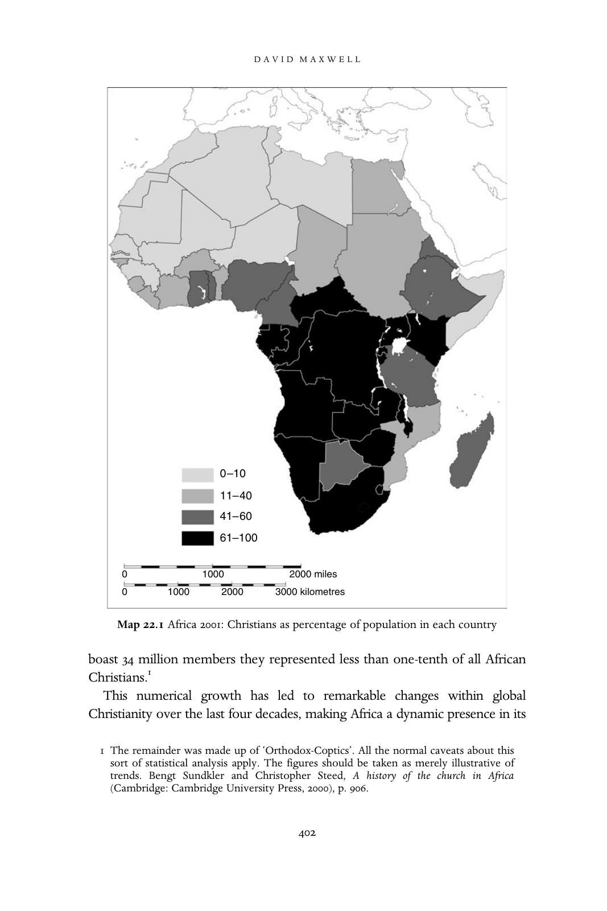

# 后殖民时代非洲的基督教：英文转换底稿

<!-- PDF page 402; original page 401 -->

### 22

## Post-colonial Christianity in Africa

D A V I D M A X W E L L

### Introduction: setting the scene

The 1950s and 1960s witnessed nationalist movements bringing the majority of sub-Saharan Africa to political independence. The Portuguese colonies and Rhodesia stemmed the process for a decade or longer but by 1994 and the fall of apartheid in South Africa the entire African continent was under black majority rule. Many observers in the 1960s would not have rated the pros- pects of the mission-derived churches particularly highly. At worst the mis- sion churches had appeared implicated in colonialism, at best their stance had been ambiguous. Most missionaries feared that a successful nationalism would promote either a revived paganism or communism, or both, and hence shunned it. They had schooled the first generation of African nation- alist leaders and helped create a modernising African elite but as agents of cultural imperialism had simultaneously disparaged African culture. Nationalists had sought to remedy this by seizing control of missionary education at independence. And given that schools were so central to mis- sionary strategy it seemed likely that mission churches would decline in the new African states. If anything Christianity’s future looked brightest with the so-called African Independent churches (AICs).

Yet Christianity’s African future turned out to be far from bleak. Since independence the growth in Christian adherence has been phenomenal. (For the strength of Christianity in different countries, see map 22.1.) Whereas the total number of African Christians stood at approximately 75 million in 1965, by 2000 it had risen to approximately 351 million. Within these figures Catholic adherence had increased from 34 million to 175 million and Protestant numbers had risen from 21 million to 110 million. Although by 2000 Independents could

<!-- PDF page 403; original page 402 -->

boast 34 million members they represented less than one-tenth of all African Christians.[^p403-1]

This numerical growth has led to remarkable changes within global Christianity over the last four decades, making Africa a dynamic presence in its

[^p403-1]: The remainder was made up of ‘Orthodox-Coptics’. All the normal caveats about this sort of statistical analysis apply. The figures should be taken as merely illustrative of trends. Bengt Sundkler and Christopher Steed, A history of the church in Africa (Cambridge: Cambridge University Press, 2000), p. 906.

<!-- PDF page 404; original page 403 -->

new heartland in the South. The case of the worldwide Anglican communion is instructive of Christianity’s southward shift. At the 1998 Lambeth Conference, the highest consultative body of the church, 224 of the 735 bishops were from Africa, compared with only 139 from the United Kingdom. At the time of the conference there were 17 million baptised Anglicans in Nigeria compared with 2.8 million in the United States.[^p404-2] More recently the Sunday Times reported, ‘The average Anglican [in the world] is a 24 year old African woman.’[^p404-3] In the Roman Catholic church a similar picture emerges. In 1999, there were 18 million official baptisms: of these, 8 million took place in Central and South America, 3 million were in Africa, and 37 per cent of the African baptisms were of adults.[^p404-4]

The rise of African Christianity has not just shifted the centre of global Christianity but also radically altered its denominational and theological appear- ance. Today vast numbers of the latest generation of African Christians describe themselves as ‘born again’. They comprise a diverse coalition of evangelicals, charismatics and Pentecostals, who share a belief in the infallibility of scripture and, more importantly, stress the centrality of a ‘born-again’ experience. Given that the charismatic and Pentecostal strands in the African born-again movement are very much in the ascendant, a third defining characteristic grows increasingly important, namely that of possessing the ‘gifts of the Spirit’: divine healing, glossolalia, exorcism and prophecy.

Africa’s contemporary Christian landscape looks very different from a century ago when the historic mission churches – Catholic, Anglican, Methodist, Baptist and Lutheran – dominated the scene.[^p404-5] And it barely resembles the ecclesiastical scene of just three decades ago when African Independent churches appeared to be the dynamic element.[^p404-6] The explosion of born-again Christianity is difficult to quantify in that it cuts across the historic denominations as well as creating new ones. However, a few examples help illustrate recent trends. By the mid-1990s the Church of Pentecost was probably Ghana’s largest Protestant church and a survey of Kenya’s capital, Nairobi, revealed that the Assemblies of God was the fastest-growing church with an annual growth rate of 38 per cent. The Zimbabwe Assemblies of God is second only to the country’s Catholic church in terms of numbers of

[^p404-2]: Dana Robert, ‘Shifting southward: global Christianity since 1945’, International bulletin of missionary research 24:2 (2000), p. 53.

[^p404-3]: Sunday Times (London), 15 March 2001.

[^p404-4]: Philip Jenkins, The next Christendom: the coming of global Christianity (New York: Oxford University Press, 2002).

[^p404-5]: A. Hastings, The church in Africa 1450–1950 (Oxford: Clarendon Press, 1994).

[^p404-6]: A. Hastings, A history of African Christianity, 1950–1975 (Cambridge: Cambridge University Press, 1979).

<!-- PDF page 405; original page 404 -->

adherents. And in Uganda both the Glad Tidings church, which is charismatic in orientation, and the more Pentecostal Full Gospel church claim over 700 assemblies, making them key players in the nation’s Christian scene. Indeed, in states such as Ghana, Kenya, South Africa, Uganda, Zambia and Zimbabwe born-agains are so numerous and their leaders so influential that they are just as ‘mainstream’, or ‘established’, as Anglicans or Catholics.[^p405-7]

Given the sheer size and diversity of Africa, the differences in imperial policy, the extraordinary range of missionary organisations that entered the continent, and the diversity of societies and cultures they encountered, contemporary patterns of Christian adherence are complex. For example, in Zambia, the British-derived, but now German-supported, New Apostolic church is the third largest in the country, boasting a membership of 793,934 in 1996,[^p405-8] and the Zambian population of Jehovah’s Witnesses, 300,000, gives it a ‘higher proportion of JWs than any country other than a few Pacific micro- states’. Likewise, while 60 per cent of Ghanaians claim to be Christian and born-again religion has captured popular culture, as many as 50 per cent of Cameroonians remain staunchly traditionalist and born-again Christianity is yet to take off. Even the fault-lines that run between the colonial heritages are now often quite fuzzy. The religious pluralism of British colonial policy diluted Protestant predominance in many of its former colonies. And anti- clerical governments in France and Portugal gave Protestantism a good foothold in some former Lusophone and Francophone states.[^p405-9]

Nevertheless it is possible to identify significant patterns in Africa’s recent Christian history. In the four decades or more since the beginning of decolo- nisation African states have experienced a number of political transitions and economic shifts. The churches have responded to these developments but also helped shape them. While they played, at most, a limited role in anti- colonial struggles they were profoundly challenged by the exigencies of the newly independent regimes. One-party government or military rule usually arrived quickly. These autocratic regimes sometimes followed ethnic or regional conflict, even civil war, but the broader economic situation was a crucial determinant. African leaders soon discovered that they had few economic resources at their disposal and prospects of development dimin- ished further with the world oil crisis. The continent’s public debts

[^p405-7]: D. Maxwell, African gifts of the Spirit: Pentecostalism and the rise of a Zimbabwean transna- tional religious movement (Oxford: James Currey, forthcoming).

[^p405-8]: Paul Gifford, African Christianity: its public role (London: Hurst & Co., 1998).

[^p405-9]: Paul Freston, Evangelicals and politics in Asia, Africa and Latin America (Cambridge: Cambridge University Press, 2001), p. 107.

<!-- PDF page 406; original page 405 -->

quadrupled between 1970 and 1976 as the majority of states lacked oil resources and were forced to import at prices that had increased six times. Responding to popular disillusionment at the slow pace of change, nationalist parties consolidated their positions by continuing a process begun in nation- alist struggles, that of subsuming civil society. Trade unions, foreign compa- nies, leaders of traditional churches and other concentrations of independent power were destroyed or incorporated.

Autocratic regimes prevailed until the end of the 1980s when a combina- tion of forces led to their demise. The collapse of the Berlin Wall and the end of the Cold War deprived states of Western or Eastern benefactors and of legitimating models of communist dictatorship. Moreover, events in eastern Europe inspired a revived and resurgent civil society to challenge near bankrupt regimes. A ‘second democratic revolution’ ensued as more than half of sub-Saharan African states made political reforms and moved toward multi-party democracy. In this revolution the churches played a leading role. Sadly, however, the political transformation begun at the end of the 1980s was shortlived. In a new world dominated by America the new regimes had to embrace neo-liberal economics of trade liberalisation, priva- tisation and diminished state provision in the form of structural adjustment programmes ordained by the World Bank and International Monetary Fund. While such policies benefited a minority of African businessmen working for international companies they stifled local enterprise, boosted unemploy- ment, and led to new levels of poverty, crime and violence. Worse still, many of the newly elected leaders of multi-party regimes were ‘born-again’ politicians from the previous generation of politicians. Their conversions to democracy proved to be superficial and they were barely distinguishable from their predecessors. Soon they learnt how to stay in power by dividing opposition parties and manipulating elections and constitutions while satis- fying international pressure. Their governments became de facto one-party regimes. Thus from the mid-1990s Africa’s churches have been involved in a third democratic revolution. This revolution is against ‘presidential third termism’ – the tendency of leaders to cling to office. It is a struggle for incorrupt ‘transparency’ and the development of electoral institutions, and a struggle for a democratic political culture.[^p406-10]  Only through such a revolution can African states begin to reconnect with the needs and aspirations of their citizens.

[^p406-10]: T. Ranger, ‘Introduction’, in T. Ranger (ed.), Evangelical Christianity and democracy in Africa (Oxford: Oxford University Press, forthcoming).

<!-- PDF page 407; original page 406 -->

### Survival and revival: the first two decades

At independence the historic mission churches were in a weak position relative to the new African states. Relations were animated by a concern on the part of church leaders to give the state the benefit of the doubt and irritability on the part of the state if church leaders did or said anything even vaguely political. While there had been some notable exceptions, many white missionaries had tacitly accepted the colonial land grab and settler racism, or at the very least made use of the broader structures of imperial rule. Now they could easily be cast as meddling neo-colonialists. Black clerics faced other disadvantages. In Protestant churches the standards of clerical training fell far short of those in mission schools, which had trained black elites in the colonial period. Poorly educated Protestant clergy felt themselves to be at distinct disadvantage when dealing with a sophisticated post-colonial leadership. African Catholic priests did have an extensive seminary education but they were few and far between in the 1960s.[^p407-11] There were some outstanding African church leaders such as Cardinal Malula of Zaire, Bishop Jean Zoa of Cameroon and Archbishop Janani Luwum of Uganda. A man such as one of these acted as ‘the only alternative personality with national significance to that of the current president’.[^p407-12]  But as Luwum’s murder in 1977 by Idi Amin showed, they were initially exposed with few African clergy to support them and no organised base in the laity.

Some of the worst church–state clashes occurred in those regimes that had adopted Marxism-Leninism as official ideology. In 1977, a year after seizing power in Ethiopia, Menghistu Haile Mariam launched his National Democratic Revolutionary Programme with Soviet and Cuban assistance. He began with the expatriate churches, expropriating their lands and property. Then he turned his attention to the Orthodox church. Archbishops were arrested, imprisoned or dismissed and many of the church’s books and liturgical objects were seized. Monasteries were infiltrated with agents-provocateurs to humiliate and subvert the monks, and key sacred sites were turned into museums. A similar process of the nationalisation of church schools and hospitals began in Mozambique in 1975 following the victory of Frelimo. Over the next four years United Methodist church membership declined by 40 per cent. Even church leaders with strong nationalist sympathies could come unstuck in regimes that adopted scientific socialism.

[^p407-11]: Kevin Ward, ‘Africa’, in A. Hastings (ed.), A world history of Christianity (London: Cassell, 1999), p. 227.

[^p407-12]: Hastings, History of African Christianity, p.263 .

<!-- PDF page 408; original page 407 -->

Church schools in the eastern region of Ghana were also nationalised in 1959 under Kwame Nkrumah’s African socialism. But clerics were equally disquieted by the cult of personality he promoted. It appeared to them as if he actively encouraged the idea that he was the messiah and redeemer. In 1961 his birthplace was turned into a national shrine. The church was also disturbed by the oath of allegiance sworn by his party’s youth wing, the Young Pioneers. The Anglican bishop of Accra, the Rt Revd Richard Roseveare, was dismissed after claiming that the youth movement ignored ‘the existence and claims of almighty God’.[^p408-13]  More extreme still were the excesses of the ‘authenticity campaign’ of President Mobutu of Zaire. Crucifixes in schools and hospitals were replaced by the image of the new messiah, Mobutu. Biblical names were to be changed for genuine African names and Christmas Day was declared a working day.[^p408-14]  In 1971 the Catholic Louvanium university was nationalised, and so were schools and seminaries.

Nevertheless, to paraphrase Adrian Hastings, the mission churches were sturdy ships, which weathered the storms of independence remarkably well.[^p408-15] By the late 1980s they had become a forceful presence in African states. The first reason for this was a steady growth in church adherence throughout the period, a growth stemming from both external and internal sources. The widely publicised call for a missionary moratorium mooted by leading African Christian thinkers in the early 1970s raised important questions about depen- dency, but on the whole many churches ignored it. Throughout the post- colonial period the Catholic church witnessed remarkable growth, expanding into new regions well beyond former French, Belgian and Portuguese colonies. Traditional fields of missionary Catholic recruitment such as Ireland, France and Holland declined but more than 1,000 new missionaries from Poland filled the gap. Many of these went to Tanzania or Kenya where Catholic growth was prolific. Between 1961 and the 1990s Catholic numbers in the former increased by 419 per cent, while Kenya’s Catholic population jumped to 2.5 million in the same period.[^p408-16]

There was also a new Protestant missionary impetus, for the most part driven by North Americans. It was predominantly a movement of born-again missionaries, evangelicals, charismatics and Pentecostals, reflecting denomi- national shifts in American Christianity.[^p408-17]  Its effects were most vividly seen in

[^p408-13]: Sundkler and Steed, The church in Africa, pp. 945–6.

[^p408-14]: Hastings, History of African Christianity, pp. 191–3.

[^p408-15]: Ibid., p. 224.

[^p408-16]: Jenkins, The next Christendom, p. 58; Sundkler and Steed, The church in Africa, p. 1001.

[^p408-17]: Paul Gifford, ‘Some recent developments in African Christianity’, African affairs 93:373 (1994), 513–34.

<!-- PDF page 409; original page 408 -->

the crusading activities of Billy Graham and Oral Roberts, and more recently the likes of Benny Hinn, Kenneth Hagin and John Avanzini. But probably more significant in the long term was the work of para-church bodies such as Women’s Aglow, the Full Gospel Business Men’s Fellowship International and the Haggai Institute, which promoted inter-denominationalism. Although the movement ‘took off’ in the 1980s important groundwork had been done by older Pentecostal missions such as the American and British Assemblies of God and the Pentecostal Assemblies of Canada. It also drew force from broader inter-denominational evangelical ministries such as Scripture Union, Campus Crusade and the Navigators, which targeted Africans in secondary and higher education, as this sector rapidly expanded in the 1960s to meet the needs of newly independent states.[^p409-18]

This US born-again impetus, which was particularly strong in the more hospitable environments of former settler colonies like Kenya and Zimbabwe, was matched by a local impetus. African Pentecostals like Ezekiel Guti, leader of the Zimbabwe Assemblies of God Africa, broke away from missionary movements to found their own churches, retaining part of the original name in their new organisations. And African elites, who came into contact with the born-again movement in higher education, began ministries in cities amongst the educated middle classes, forming movements like the Redeemed Christian church in Nigeria. The growing momentum of Pentecostalism caused others to leave mainline churches to found new movements, as was the case with Mensa Otabil, who left the Anglican church to found the Ghana-based International Central Gospel church in 1984.[^p409-19]

Indeed most of the Christian expansion within old or new churches was African initiated and African led, as it always had been. There were noteworthy formal initiatives within the historic mission churches. Within Catholicism, Bugandan missionaries started work in Burkino Faso and Zairian Sisters moved amongst the Nyamwezi in Tanzania. And within Protestantism, the English- speaking Anglican church found its way into French-speaking Shaba (Katanga) Zaire and the Lutheran church of Ovambo-Kavango, Namibia, pioneered churches in Senegal. But most of the expansion was the low-level face-to-face kind. The range of locations expanded to include the township and the black middle-class suburb, alongside the village. And enhanced communication and social mobility swelled the ranks of the proselytisers from labour migrants, catechists and evangelists to include nurses, teachers and civil servants on

[^p409-18]: Maxwell, African gifts.

[^p409-19]: On Ghana see Gifford, African Christianity, ch. 3.

<!-- PDF page 410; original page 409 -->

placement, returning students, often accompanied by their Christian Union or Scripture Union brethren, and urban churches on ‘crusade’ determined to establish rural branches. Church planting also occurred indirectly through the enormous transnational traffic in refugees, particularly in the Horn of Africa. Even the trials and persecutions visited upon the church by hostile regimes sometimes brought unexpected blessings, speeding up indigenisation and self- reliance. When the Meghistu regime fell in 1991 a vast and vital underground church survived it. Perhaps the only major constraint on Christian expansion in Africa is Islam. In Sudan there has long been conflict between the Arabic- speaking Muslim north and the black Christian/animist population in the south, but the conflict erupted in the 1980s when the government attempted to impose Sharia law.

Christian–Muslim conflict was also a key element in the Nigerian civil war. The secession of the eastern region, which declared itself the Republic of Biafra in May 1967, followed a series of massacres of Christian Igbo living in the Muslim north. Hundreds of thousands fled back to their eastern homeland, abandoning their livelihoods in the belief that an Islamic Jihad (holy war) had begun. In the ensuing three years of conflict approximately one million people died. Tensions between Nigeria’s Christian south and Muslim north still pertain, periodically tipping over into violence.[^p410-20]  Relations with Islam are one of the key issues facing the African church in the twenty-first century.

Given that since the beginning of the missionary enterprise the bulk of African churches had been founded and led by African pastors, catechists and evangelists far from missionary eyes, Christianity already was ‘popular’ or ‘vernacular’ at independence. Nevertheless, churches defused the nationalist slur that they were culturally alien through more formal acts of Africanisation. The process of liturgical innovation and the training and promotion of African clergy was led by the Protestant churches. At times clerical offices were multiplied or invented for good measure, as in the case of the Methodist church of Nigeria. But soon the Catholic church took the lead, catalysed by the deliberations and proclamations of the Second Vatican Council with which African independence so neatly coincided. In many African states the Africanisation of Catholic clergy was rapid and far-reaching. In 1965 less than a quarter of bishops in Tanzania were African; by 1996 Africans headed all the twenty-nine dioceses. Another Catholic initiative was the founding of base

[^p410-20]: Cyril Imo, ‘Evangelicals, Muslims and democracy: with particular reference to the declaration of Sharia in northern Nigeria’, in Terence Ranger (ed.), Evangelical Christianity and democracy in Africa (Oxford: Oxford University Press, forthcoming).

<!-- PDF page 411; original page 410 -->

communities in cities such as Kinshasa, Lilongwe and Nairobi where priests were particularly stretched. Led by lay animators with a formal training, these Catholic communities were less overtly political than those in Latin America, focused instead on the regular distribution of the eucharist and the grounding of the faithful in the teachings of the church. As such they mirrored the myriad village Christian communities founded by African Christians since the beginning of the missionary encounter.[^p411-21]

Where the process of Africanisation has been most profound is in female vocations. In 1989 members of female religious orders outnumbered their male counterparts by at least five times. Given the importance African cultures attach to motherhood this feminine aspect of Catholicism represents a strong break with the African past. Indeed, the enterprise of Africanisation has not been without incident and ironic results. In Zimbabwe well- intentioned missionary priests often reacted with horror at the Lourdes grottoes, medals and scapulars, and Latin masses introduced by their fore- bears, not grasping the extent to which they had become popular. Transported from rural Ireland to rural Zimbabwe this peasant Catholicism not only had great instrumental effect but had also become deeply incorpo- rated into the devotions of the faithful. Although it did not look like proper inculturation it was nevertheless central to the identity of peasant farmers, who carried it with them as they were evicted to make way for white settlers.[^p411-22]  Other ‘top-down’ programmes of inculturation met with equal resistance from the unimpressed recipients. The modern efflorescence of Marian apparitions across the continent has been attributed to the vacuum left by the curtailing of popular devotional practices.[^p411-23]  Similarly, the Maria Legio, a Kenyan movement of independent Catholicism with its own bishops, cardinals and pope, and Latin phrases in the mass, emerged at exactly the same time as Roman Catholics abandoned Latin for the vernacular. In such contexts indigenous orlocal is not interpreted by the recipients of inculturation as a reflection of their aspiration but as marginality.

The most controversial case of Africanisation concerned the Zambian Catholic Archbishop Emmanuel Milingo who responded to a popularly perceived crisis of spirit possession with a ministry of exorcism and healing.

[^p411-21]: On the notion of popular or village Christianity see Hastings, History of African Christianity and The church in Africa.

[^p411-22]: D. Maxwell, Christians and chiefs in Zimbabwe: a social history of the Hwesa people c.1870s–1990s (Edinburgh: International African Library, 1999), ch. 3.

[^p411-23]: Elizabeth Isichei, A history of Christianity in Africa: from antiquity to the present (London: SPCK, 1995), p. 328.

<!-- PDF page 412; original page 411 -->

Many of his colleagues, particularly the large expatriate Catholic missionary community, were not convinced that his response was authentic and pres- surised the Vatican for his removal, which came in 1982. Their confusion stemmed from a model of Africanisation that understood the process only as one of incorporation. It was a model informed by an African theology that drew its inspiration from cultural nationalism, rather than an empirically based historical anthropology of popular Christianity. This theology, epitomised by the work of John Mbiti, was a theology of authenticity in continuity, depicting African traditional religion as ‘basically consonant with Christianity’ by empha- sising in particular pre-Christian African monotheism.[^p412-24]  Along with his empha- sis on pre-Christian belief in God Mbiti also asserted that African religion conceived of no future tense and claimed no founders, prophets or converts. African religion corresponded with African society, and every member of African society was born into its religion.[^p412-25]  Although more historically minded scholars conclusively disproved all of these propositions, Mbiti’s work appealed to the homogenising instincts of nationalist politicians and intellec- tuals. It was read widely within seminaries and religious studies departments in African universities, recycled endlessly by first-generation African theologians. However, as Mbiti and his colleagues were increasingly domiciled in the West, so their theology grew more irrelevant, obsessed with the affronts of cultural imperialism while ordinary Africans struggled with weightier issues of corrup- tion, poverty and political violence.

On the other hand Milingo, along with Independent church members and Pentecostals, stood in another tradition of cyclical societal cleansing which Africanised Christianity through the exclusion of traditional religious com- ponents by exorcism, demonisation and the destruction of polluted objects.[^p412-26] In their emphasis on personal security these types of popular Christianity represent both practical and highly successful forms of inculturation.

The historic mission churches made a more straightforward contribution to ‘development’, the raison d’ˆetre of independent African states. Here continuities with colonial states proved useful. Mission churches had actively participated in programmes of modernisation and were keen to maintain or rework that role after independence, especially in states where they had lost control of educa- tion. Often adopting the same language and priorities of development as the states themselves, many churches ‘NGOised’, expanding their activities into

[^p412-24]: Ward, ‘Africa’, p. 232.

[^p412-25]: John Mbiti, African religions and philosophy (New York: Praeger, 1969).

[^p412-26]: Maxwell, Christians and chiefs, ch. 3.

<!-- PDF page 413; original page 412 -->

water and power provision, primary and secondary healthcare, the promotion of female self-sufficiency and care for the environment. Even where they lost formal control of education the desire to expand provision through church schools left mission bodies with enormous influence over African youth. There was a similar pattern of church engagement with development across the continent. After independence the National Christian Council of Kenya (NCCK) moved much closer to the state, using its connections with overseas donors to finance development projects such as ‘village polytechnics’ which provided practical training for peasant farmers. In Zaire in the period 1969–80 the Catholic church registered approximately 2,300 development projects. In Kivu region the bishop established himself as ‘something of a modern chief’, co-ordinating the construction of a hydroelectric dam and an airport financed by the locally produced coffee, cattle and gold.[^p413-27]

The centrality of development to post-colonial states helps explain the declining political influence of African Independent churches. If the new regimes initially loved the church only for its body then the AICs had far less to offer than the well-endowed historic mission churches. Independent church leaders addressed issues of personal security, ministering to their faithful through healing, exorcism and prayer. They initially had little to offer in the way of ‘modernising development’. Indeed, their relations with many post-colonial states opened in a precarious, even deadly, manner. Togo banned thirty churches, Kenya legislated against peripheral religious move- ments, and the state-controlled press in Zimbabwe made ‘sects’ a constant object of criticism for their failure to participate in programmes of primary healthcare. But the most significant clash was between the Lumpa church of Alice Lenshina and Zambia’s ruling United National Independence Party (UNIP). Soon after independence the Lumpa came to believe that the Second Coming was drawing near, and increasingly withdrew from the world into separate villages. Their need for land led to conflict with Bemba chiefs and fighting broke out in which 700 were killed. Alice and her husband, Petros, were imprisoned, where they remained until their deaths in 1972 and 1978 respectively. Perverse as it may at first appear AICs came into conflict with post-colonial states because they ignored them. The newly independent African state was ‘jealous of its authority and . . . fearful of threats to its monopoly over the means of persuasion and coercion, and the function of prescribing national policy’. Its attempts to consolidate power were ‘often

[^p413-27]: Sundkler and Steed, The church in Africa, p.967 .

<!-- PDF page 414; original page 413 -->

legitimised in terms of development – a commitment towards economic and social goals . . .’. Thus when sects and small-scale religious groupings refused to participate in modernisation, they were striking at the hegemonic ideology of the state, questioning where ‘the locus of moral authority’ lay.[^p414-28]

There were important exceptions to this rule, mainly among the larger movements such as the Kimbanguists in Zaire, the Harrisists in west Africa and Zion Christian church (ZCC) in South Africa. Such movements ‘aged’ quickly and under a second generation of more formally educated but less charismatic leaders they bureaucratised, standardising and modernising rules and practices. As such they came to look more and more like the historic mission churches. Under the idiosyncratic Mobutu the Kimbanguist church found great favour, becoming in 1971 one of the three official religious bodies in Zaire along with the Roman Catholic church and the Church of Christ (a forced association of all the other Protestant bodies). Two years earlier it had been admitted to the World Council of Churches. Moreover, movements such as the ZCC and Fambizano, the ecumenical organisation of AICs in Zimbabwe, did embrace ‘development’, participating in educational and agricultural work. Such orga- nisations often played up their supposed ‘authentic’ credentials to appeal to Western donors keen to protect ‘indigenous cultures’. One of the pioneers of the Fambizano movement was the former Dutch Reformed church missionary Martinus Daneel. Since the 1970s Protestant missionaries have been behind some particularly creative initiatives to help Independents, again breaking down the divide between the two camps.

On the whole, though, the bulk of the smaller fluid AICs remain peripheral to the business of African states. Although they were co-opted into the narrative of anti-colonial ‘resistance history’ by the first generation of professional African historians, they have turned out to be rather less ‘independent’ and less ‘political’ than once imagined.[^p414-29]  Recent research shows that such movements arose out of an ambience of revivalist and counter-establishment Christianity within the Western missionary enterprise. It also shows that many of these highly sectarian movements have shunned not just colonial states, but all states, as the case of the Watch Tower movement in central Africa powerfully illustrates.[^p414-30]

[^p414-28]: S. Cross, ‘Independent churches and independent states: Jehovah’s Witnesses in east and central Africa’, in E. Fashole-Luke, R. Gray, A. Hastings and G. Tasie (eds.), Christianity in independent Africa (London: Rex Collings, 1978), pp. 312–13.

[^p414-29]: On the changing understanding of the ‘political’ significance of AICs see T. Ranger, ‘Religious movements and politics in sub-Saharan Africa’, African studies review 29:2 (1986), 1–69.

[^p414-30]: For the best introduction to AICs see Hastings, The church in Africa, ch. 11. On Watch Tower see Cross, ‘Independent churches’.

<!-- PDF page 415; original page 414 -->

Finally, the mission background of many of the first generation of African leaders not only added a significant Christian content to development pro- grammes but also gave them a greater intellectual sympathy with the historic churches rather than the AICs. Julius Nyerere’s socialist programme of ujamaa – collectivisation – in Tanzania owed much to his Catholicism. Kenneth Kaunda’s Presbyterian heritage shaped his brand of humanism for Zambia. And the ex-Methodist minister cum first president, Canaan Banana, developed an explicit theology of development for Zimbabwe. More impor- tantly, this ideological innovation illustrated the extent that Christianity had constituted the elements of a moral discourse upon which political legitimacy could be based. Nkrumah’s version of African socialism, drawing from Marxism-Leninism, found little sympathy in Ghana but his use of Christian imagery – ‘Seek ye first the political kingdom’ – resonated widely amongst friend and foe alike. Christian ideas had captured the African imagination, providing a potent a set of values upon which leaders could draw. But these values they also shared with their citizens and as such they provided a yardstick by which they could be judged. This yardstick became particularly important in Africa’s second democratic revolution at the end of the 1980s.

### Church and state in the second democratic

### revolution

As African states faded, or at the very least lost the respect of their citizens, the fortunes of the churches advanced. The numbers of adherents had multiplied, and their bureaucracies, both more complex and more far reaching, were filled with a better-trained African clergy. In Francophone Africa in particular a new generation of African Catholic scholars such as Jean Marc Ela and Fabien Eboussi Boulaga began to articulate a very different theology from their predecessors. Moved by the worsening condition of the poor they were as willing to speak out against the rottenness of African bureaucracies as they were to condemn the West for its neo-colonialism.[^p415-31]  And as Western donors grew ever more suspicious of states so they looked to the churches as conduits of aid. Churches appeared to be even-handed and efficient institu- tions able to provide services in health and education where states were failing. By the late 1980s Mobutu was forced to return previously nationalised schools to churches which were far more capable of running them. In

[^p415-31]: Jean-Marc Ela, African Cry (Maryknoll, NY: Orbis, 1986); F. Eboussi Boulaga, Christianity without fetishes (Maryknoll, NY: Orbis, 1984).

<!-- PDF page 416; original page 415 -->

Mozambique religious and secular NGOs were so powerful relative to the state that they called the shots in development strategy. ‘The relatively human and moderate autocracy of the early post-independence regimes had given way to excesses which it needed no theological sophistication to denounce.’[^p416-32]  The churches had largely ‘outlived their connection with colo- nialism’ and were ready to enter the fray.

When in the late 1980s Francophone countries began national constitu- tional conferences Catholic bishops were often appointed to chair them. In Zaire, Mgr Laurent Monsengwo Pansiya was elected in 1991 to preside over the national conference, which sought to halt the country’s slide into anar- chy. In Benin, Mgr Isidore de Sousa, archbishop of Cotonou, became the highest authority in the land, when as chairman of the High Council of the Republic he oversaw the transition of the country to multi-party elections.

In many other states the churches’ entry into the public sphere was equally high profile. In Anglophone countries prophetic criticism was often led by a combination of church councils and historically powerful denominations. In Kenya the most articulate criticism of President Moi came from individual Anglican bishops whose sermons were full of ‘Old Testament prophetic fire’. John Lonsdale describes how ‘King Rehoboam, who threatened Israel with whips and scorpions, or the Emperor Darius who enacted a decree of which he soon repented but could not amend, have both been taken to typify the ruler of a one-party state who consults no one’. In the face of threats on his life, the most prominent bishop, David Gitari, ‘persisted in asking awkward questions, why there was ‘‘no Naboth to say No’’ to corrupt land seizures’.[^p416-33] Anglican bishops drew much support from the NCCK, which increasingly drew back from its partnership with the state. In Zambia the historic mission churches had less influence and born-again Christianity played a key role in the events leading to Kaunda’s downfall. The president’s philosophy of humanism and his exploration of ‘demonic’ Indian spirituality were signifi- cant factors in his delegitimation by the powerful Evangelical Fellowship of Zambia. Realising the political clout of Zambian born-agains, Kaunda’s successor, Frederick Chiluba, emphasised his personal evangelical creden- tials, a sign of things to come.

Finally, the church was involved in peace-making. A civil war, stoked by Rhodesia and then South Africa, had raged in Mozambique since independence,

[^p416-32]: Ranger, ‘Introduction’.

[^p416-33]: John Lonsdale, ‘Kikuyu Christianities: a history of intimate diversity’, in David Maxwell (ed.) with Ingrid Lawrie, Christianity and the African imagination: essays in honour of Adrian Hastings (Leiden: Brill, 2002), pp. 189–90.

<!-- PDF page 417; original page 416 -->

in which the counter-revolutionary MNR (Mozambique National Resistance) had exploited Frelimo’s opposition to organised religion. Desperate for allies, President Machel reached out to the churches in 1982 and offered them a new role. His successor Joaquim Chissano allowed their influence to grow further, giving the Catholic church clout to organise peace talks in Rome beginning in July 1990. A general peace accord, brokered by the Vatican, was finally signed in October 1992. In the making of both peace and new constitutions the historic churches had come to show that they had considerable political influence. In many instances they had come to be the most important social institutions in the country beside the state itself. They possessed vast numbers of adherents, who easily exceeded those in political parties, they were staffed by highly motivated and able clergy and laity, and they had nation-wide structures which could rapidly disseminate ideas and information. Beyond this they had external links to the Vatican, Lambeth Palace and the World Council of Churches, which provided a vital counter-balance to local state pressure. These structures, which had given them great advantages in denouncing dictatorial regimes and reconciling warring parties, play a more ambivalent role in Africa’s third revolution for a democratic culture.

### The churches in the frontline: violence and poverty

### and presidential third termism

The end of the Cold War did not bring about a cessation of external interven- tion in Africa, but rather a change in its nature. The economic ideology of privatisation spread across the continent in the 1990s, inaugurating a new era. Western-dominated international institutions insisted that government rev- enue be used first and foremost to pay overseas debts, and elevated private initiative over public responsibility. Unemployment mushroomed as the con- traction of the state reduced the number of public-sector jobs. The removal of protective tariffs on imports through trade liberalisation led to the decline of local manufacturing industries and added further to the army of jobless, while the growing shortage of foreign currency limited the growth of new private enterprise. A fast-growing population aggravated these hardships. In the face of land shortage and hopes for something better, young people migrated to towns and cities in a new wave of urbanisation. But not every African state was a weak state. Those such as Zimbabwe retained a good deal of ability to coerce citizens, its ruling clique acting in a violent and corrupt manner to remain in power in the face of a loss of popular support. Across the continent leaders and their retainers manipulated national and party constitutions to stay in office.

<!-- PDF page 418; original page 417 -->

It was clear that Africa needed another more profound revolution to create a sustainable democratic culture. And given the growing resources and influence of the church it had a pivotal role to play. But as Terence Ranger observes the historic churches were now at a distinct disadvantage. ‘Hierarchy and authority had given them great advantage in denouncing dictatorial regimes . . . they were an obstacle to a genuine manifestation of democratic practice.’[^p418-34]  Moreover, as well as being examples of bad practice hierarchical structures were rapidly drawn into the politics of patronage, clientalism and corporatism, with bishops becoming just as compromised as secular politicians.[^p418-35]  Zimbabwe provides a prime example. As President Mugabe grew increasingly unpopular in the late 1990s so his struggle to remain in power became ever more desperate. Apart from widespread electoral fraud he embarked on a series of illegal land seizures led by war veterans and militarised youth. The Anglican cathedral located beside the Zimbabwean parliament symbolised in colonial times the close relation between church and state. The newly elected bishop of Harare, Nobert Kunonga, actively renewed that alliance, throwing himself uncritically behind the ruling party’s land reform programme. In January 2002 Kunonga declared that Mugabe, who has boasted of having degrees in violence, was more Christian than himself. It was left to the Catholic church to fulfil the prophetic role and speak up for the victims of violence and repression as it had done against the racist settler regime of Ian Smith. In November 2002 Archbishop Pious Ncube delivered the Denis Hurley lecture in Durban. In it he described the Zimbabwean government as ‘fascists’, relying on ‘lies, propaganda, the twisting of facts, half truths, downright untruths and gross misinformation’.

But Rwanda, the scene of the genocide of two million Tutsi and moderate Hutu in 1994, provides the most disturbing example of the chameleon character of Christianity, its capacity for both good and evil. During the genocide ‘more Rwandese citizens died in churches and parishes than any- where else’. Moreover, ‘killers paused during massacres to pray at the altar’. A number of clergy and church employees lured people into churches knowing that they would be killed, turned over Tutsi to be killed, or actively participated in the death squads. The regional leader of the Seventh-day Adventist church, Elziphan Ntakirutimana, was eventually extradited to the

[^p418-34]: Ranger, ‘Introduction’.

[^p418-35]: L. Sanneh, ‘A resurgent church in a troubled continent: review essay of Bengt Sundkler’s History of the church in Africa’, International bulletin of missionary research 25:3 (2001), p. 115.

<!-- PDF page 419; original page 418 -->

International Criminal Tribunal in Arusha for his part in the killings.[^p419-36] Conversely, church leaders had been involved in peace-making and the transition to multi-partyism in 1992. And many died heroically while attempt- ing to stop the violence. Of the 200 African priests who have died violent deaths in the forty years prior to 1996, 103 were from Rwanda and stood against the genocide.[^p419-37]  Rwanda was an extreme example, a country dogged by strongly ethnicised politics, over-population, land shortage, and unstable neighbours who have allied with and armed successive alienated segments of Rwandan society. Yet to all intents and purposes Rwanda is a highly ‘Christian’ country. The vast majority of the perpetrators of the crimes of the genocide had been baptised and had some sort of Christian formation. Equally telling was the pastoral letter issued by the chair of the Catholic Bishops Conference in 1991, which accused the Catholic church of being a ‘giant with feet of clay’, unwilling to use its power for good or reform its own structures. More than any other case Rwanda points to the need to renew Africa’s dominant political culture.

It is at this juncture that the born-again movement needs to be considered. Its numbers have mushroomed in a context of state contraction, neo-liberal economics, poverty and growing political turmoil. The character of some of the larger transnational organisations within the movement points to its growing appeal and its social and political function. It has embraced media technologies, particularly the electronic media and religious broadcasting, with great zeal. It has a tendency to produce oligarchic church governments, often comprising the leader’s extended family and friends. It has adopted the faith gospel, drawing from the teachings of Oral Roberts, T. L Osborn, Kenneth Hagin and Kenneth Copeland to argue that material success is a sign of faith and of God’s blessing. Its leaders are particularly susceptible to the tools and some of the values of modernity, especially the values of liberal capitalism. And it casts itself as inter-denominational and global in character.

The electronic media has been key to the movement’s expansion. In the ‘worship stores’ the religious consumer can buy gospel songs on audiocassettes and CDs, and videotaped recordings of sermons and conventions, or the latest religious film such as the recent Nigerian productions Living in bondage, Out of bounds and Endtime. In Zimbabwe the local television chart show, Mutinhimira weMimhanzi/Ezomgido, regularly features gospel music alongside more secular

[^p419-36]: Timothy Longman, ‘Church politics and the genocide in Rwanda’, Journal of religion in Africa 31:2 (2001), 163–86.

[^p419-37]: Ward, ‘Africa’, p. 230.

<!-- PDF page 420; original page 419 -->

sounds. Performers such as Zecks Manatsa, Mahendere Brothers and Vebati VeJehovah are thus just as mainstream as the famous Bundu Boys. And the gospel videos, depicting singing and dancing or more vivid scenes of deliver- ance or crowds symbolically ‘stepping on Satan’, are just as compelling as secular alternatives. The electronic media is a vital tool in proselytism but it has also helped born-agains capture popular culture. All of this is very important in a continent where approximately half the population is below the age of fifteen.

But these young Christians have been none too impressed with the authoritarian leaders who more often than not have formed marriages of convenience with politicians. Having been cold-shouldered for so long, evangelical and Pentecostal leaders have engaged with secular leaders for respectability and public recognition, as well as access to the state media. And politicians desperate for new sources of legitimisation in this post-socialist, post-nationalist age have sought to secure a born-again mandate and to make use of the growing born-again constituency. The Kenyan president Daniel arap Moi was a prime example. In February 1992, while the Anglican leader, Archbishop Gitari, and the NCCK pressured for multi-party elections, Moi’s ally, the leader of the Gospel Redeemed church, told listeners in a televised sermon: ‘In heaven it is just like Kenya has been for many years. There is only one party – and God never makes a mistake . . . President Moi has been appointed by God to lead the country . . . We have freedom of worship, we can pray and sing in any way we want. What else do we need?’[^p420-38]

However, at the level of the local gathering the disciplined believer does participate in a democratic culture of pragmatism and competition. Local level financial accountability is assured as tithes and offerings are recorded with mathematical accuracy. In pre-service Bible studies scripture is discussed in an atmosphere conducive to debate and mutual respect. And elections for the posts of deacons and elders are conducted with great scrupulousness. Women and youth participate fully in assembly leadership, given opportu- nity to do so through the multiplication of roles within a hierarchy. They are subsequently encouraged to seek greater responsibility in their careers and public life.[^p420-39]  Moreover, although born-again churches have been accused of spiritualising worldly problems it does not take too much imagination to grasp the politically destabilising potential of their standard spiritual injunc- tions. Refrains such as ‘Fear God not man’, or the assertion of first loyalty to a Holy Nation where status and citizenship are redefined, can, as David Martin

[^p420-38]: Paul Gifford, ‘Bishops for reform’, Tablet, 30 May 1992, pp. 672–4.

[^p420-39]: Maxwell, African gifts.

<!-- PDF page 421; original page 420 -->

suggests, ‘divest systems of authority of their justification and turn law into a matter of inward judgement and sincerity, rather than external observance’.[^p421-40] The potentially reforming effects of born-again culture on politics will only be manifest in the longue durée.[^p421-41]  However, as Martin suggests, it is in the cultural sphere that the significance of this Protestant movement lies.

In sociological terms the born-again movement is much more concerned with social reproduction, the promotion and maintenance of families. Here the sheer range of responses should be noted. At one end of the spectrum the emphasis on unfettered accumulation that characterises the American- derived faith gospel legitimates the lifestyles of those African elites who, through connection with international business or NGOs, have prospered under neo-liberalism. At the other, the emphasis on honesty, sobriety, self- discipline, individualisation, breaking free from the curse of one’s ancestors and performing acts of traditional commensality at least offers the vast swathes of mobile poor the greatest chance of survival in an insecure and fluid labour market. Thus, beyond the urban mega-churches, in the town- ships and rural locations the faith gospel has a different meaning. Here Pentecostals seek security rather than prosperity, looking to their leaders for protection against angry spirits and witchcraft and the provision of fertility, healing, work and stable marriages. And personal security explains the abiding influence of Pentecostalism’s cousins, the AICs. These move- ments, with a strong emphasis on prayer, exorcism and healing, remain vital to millions who live on the margins of African societies. Here, however, it is important not to make too gross a distinction between churches emphasising gifts of the Spirit and others. As Hastings pointed out long ago, prayer not politics remains the primary focus of all churches and there are many commonalties between their popular forms.[^p421-42]

The inter-denominational and global aspirations of African born-agains also shed light on their needs and the ability of their states to supply them. Their transnational religious identities, enacted in international conventions where the halls are decked out in international flags, and imaged in the electronic and printed media, point to a loss of faith in the ability of their states to bring about meaningful change. They also point to a desire to be part of something big, part of something that counts. More than that, interna- tional contacts offer the possibility of much-needed resources, employment

[^p421-40]: D. Martin, Pentecostalism: the world is their parish (Oxford: Blackwell, 2001), p. 12.

[^p421-41]: Gifford, African Christianity, p.348 .

[^p421-42]: Hastings, History of African Christianity, pp. 265, 273.

<!-- PDF page 422; original page 421 -->

and scholarships abroad. But these same aspirations are also found in the historic mission churches, in their continued openness to missionaries and religious NGOs; in their resistance to imposed inculturation; and in, for example, the hundreds of thousands who turned out to greet John Paul II during papal visits in 1980 and 1995.

Viewed from another perspective international links foster what Paul Gifford calls ‘ecclesiastical externality’, which disempowers African Christians, making them dependent on the American Bible Belt, or for that matter Rome or Lambeth.[^p422-43]  African autonomy is often challenged by this externality but the results of international engagement are not always clear cut. African Christian leaders can often choose and manipulate overseas patrons or use external funding to build up networks of local patronage and control the boundaries of their movements. And the messages of a Western-dominated religious media are often localised by the armies of evangelists, catechists and pastors who run African churches. These foot soldiers have little or no specialised training, speak the same language as their flocks, share their perspectives and are dependent on them for their maintenance. Hence, they are open to local agendas and vulner- able to capture from below.

Furthermore, cultural flows move in more than one direction. The African vision has extended beyond the continent. Clergy from the historic churches participate in Western mission through diocesan twinning programmes, while highflying African born-again executives like Ezekiel Guti or Nevers Mumba travel US and European preaching and healing circuits, often visiting ‘international’ branches of their movements founded by their diaspora. Many of these African Christians consider themselves missionaries. They seek to remoralise secular Western societies and save them from the supposed apostasy of liberal Christianity. Their arrival in the West signals not only the centrality of Africa to global Christianity but also the fact that its missionary impetus has come full circle.

[^p422-43]: Gifford, African Christianity, pp. 44–7, 148–9.
