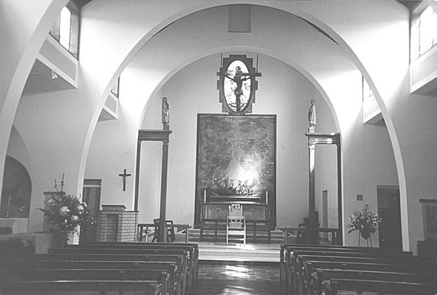
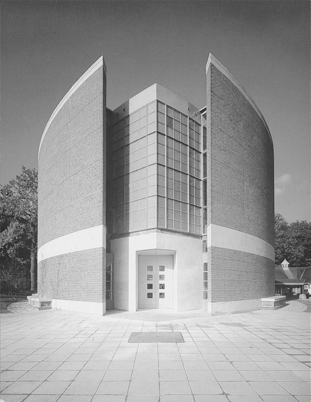
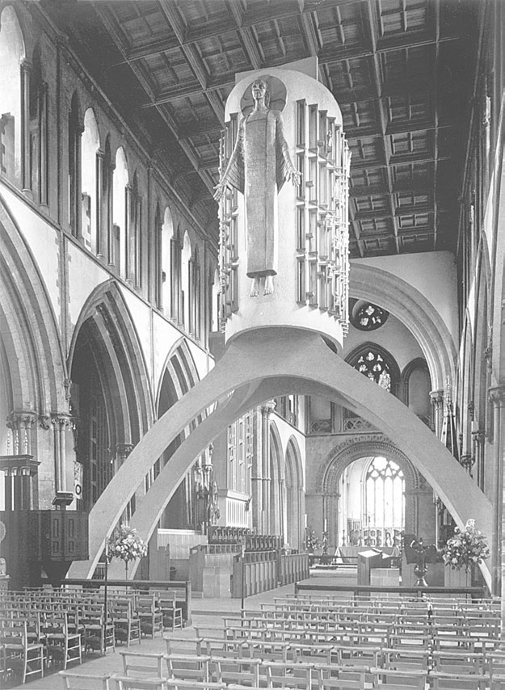

# 第31章 文学与艺术

## 一 文学与电影

戴维·贾斯珀（David Jasper）

### 文学

<!-- PDF page 583; original page 582 -->

1914年第一次世界大战的爆发，标志着19世纪在实质上的终结。随之结束的，还有欧洲伟大宗教小说的时代。这些小说曾反思启蒙运动之后、工业化时代之中基督教经验的变化，其中一个重要背景，便是教会随着殖民列强的兴起而向全球扩张。战争中那些可怕的岁月动摇并侵蚀了神学与信仰。年轻的英国诗人威尔弗雷德·欧文，早在1913年便已离开基督教信仰；他在前线的经历进一步激起了对这一信仰的愤怒与绝望，预示着新世纪的到来。后来，本杰明·布里顿在《战争安魂曲》（1961）中为欧文的诗谱曲，精妙地捕捉到了这种感受。与此同时，充满焦虑的先锋现代主义文学兴起。它攻击现实主义与模仿论，以怀疑的姿态抗议“19世纪包罗一切的宗教与政治框架”。[^p583-1]在詹姆斯·乔伊斯的《斯蒂芬英雄》（1904—1906）中，一位神父对斯蒂芬说，他的文章《艺术与生活》“集现代人的不安与现代自由思想之大成”。20年后，E.M.福斯特在《印度之行》（1924）中，只让印度钱德拉普尔的欧洲传教士以及他们那种“可怜、喋喋不休的基督教”扮演次要角色。

然而，在整个20世纪，即使基督教在教会内部开始衰退，它仍不断萦绕于小说之中。小说则利用文学所享有的自由，向基督教正统观念提出挑战，并以日益成熟的手法<!-- PDF page 584; original page 583 -->被改编成电影。20世纪中叶最引人非议的例子，或许是尼科斯·卡赞扎基斯的《最后的诱惑》（希腊文题名Ὁ τελευταῖος πειρασμός，1955）。这部小说立即被梵蒂冈列入禁书名单，1960年以《基督最后的诱惑》之名译成英文，后来又成为马丁·斯科塞斯1988年那部电影的基础。影片虽有缺陷，却具有挑战性，也带有深刻的神学意味。与此同时，“天主教小说”在整个20世纪仍然蓬勃发展。仅举几例，英国有伊夫林·沃、格雷厄姆·格林，以及较晚近的戴维·洛奇；法国有弗朗索瓦·莫里亚克与朱利安·格林；美国则有弗兰纳里·奥康纳。沃将《故园风雨后》（1945）的主题说成是“神的恩典如何在一群性格各异、却联系密切的人物身上运作”。恩典的作用也处于奥康纳那些哥特式小说的中心。她在《智血》第二版（1962）的说明中写道——这部小说后来还被约翰·休斯顿拍成了一部出色的电影：

> 对一些人来说，相信基督是生死攸关的事。这一点却让另一些读者难以接受，因为他们宁愿认为，信不信并没有多大关系。在这些读者看来，哈泽尔·莫茨〔小说主人公〕的人格完整性，就在于他如此竭力地想摆脱那个衣衫褴褛的身影——那身影在他意识深处，从一棵树移向另一棵树。而在作者看来，哈泽尔的人格完整性，恰恰在于他始终无法摆脱那个身影。[^p584-2]

在小说光谱的另一端，C.S.路易斯那些构思繁复的科幻幻想作品，以及写给儿童的《纳尼亚》系列，持续吸引着数量庞大的读者。吸引他们的，是作者坚定而深厚、但归根结底又相当简单化的基督教信仰。路易斯和他所属的“Inklings”文学社同仁，从自己对早期英语、中古英语文学的研究，以及维多利亚时代小说中的幻想文学传统汲取资源，尤其受到乔治·麦克唐纳作品的影响。同社的J.R.R.托尔金，近年又因其史诗幻想小说《魔戒》（1954—1955）改编电影在商业上的成功，而再度受到极大关注。与此同时，《新约》仍直接影响着各式各样的小说，例如豪尔赫·路易斯·博尔赫斯的《马可福音》——收入其晚期短篇集《布罗迪报告》（1971）——罗伯特·格雷夫斯的《耶稣王》（1946），以及卡赞扎基斯的《基督重钉十字架》（1954）。如同20世纪的美术，文学也常把基督受难的故事，与我们这个时代的战争和悲剧交织在一起。美国作家威廉·福克纳荣获普利策奖的《寓言》（1954），便是一则以第一次世界大战为背景、铺陈展开的<!-- PDF page 585; original page 584 -->受难寓言。在较早研究小说中这一主题的《小说家与受难故事》（1960）中，神学家F.W.迪利斯通为“故事”的力量辩护。他写道：“那些事件发生在1900多年以前，但通过故事，它们变得完全属于当下。我们知道，故事展开的过程，对应着世界各处人类生命的进程；故事所趋向的终点，也总有可能在一个截然不同时代的处境中，找到与之对应的事物。”[^p585-3]美国作家约翰·欧文的《为欧文·米尼祈祷》（1989），是以较富想象力的方式重述福音故事的作品之一。小说中那些带有喜剧色彩的怪异情节，直到欧文“受难”的最后一刻才显出意义：他整个奇特的一生，都在为那个事件作准备。

无论是美国詹姆斯·鲍德温的小说，还是后殖民小说，十字架与受难叙事都为解放文学提供了强大的资源。鲍德温的短篇《去见那个人》（Going to meet the man，原文记为1948），透过一个白人小男孩的眼睛，描写美国深南部一名非裔男子遭受私刑并被吊死的经过，内容暴烈而令人不安。肯尼亚小说家恩古吉·瓦·提昂戈，在未经审判便遭监禁期间，写成《十字架上的魔鬼》（1980），并亲自将它从吉库尤语译出。小说以带有启示录色彩的话语开篇：“伊尔莫罗格——我们自己的伊尔莫罗格——有些人对我说，这个故事太丢脸、太可耻，应该把它藏进永恒黑暗的深处。”罗马尼亚持不同政见的作家彼得鲁·杜米特里乌，在最初用法文出版的小说《隐姓埋名》（Incognito，1962）中，描绘了东欧集团共产主义政权之下，基督教信仰那种几乎不可能的可能性。在苏联的压制之下，借文学的力量维护精神价值的作家，还有亚历山大·索尔仁尼琴，以及基督徒诗人伊琳娜·拉图申斯卡娅。

起源于19世纪法国的普世礼仪运动逐渐发展，推动了宗教戏剧的复兴。这些戏剧大多使用英语，也常以诗体写成；约克等地还开始以现代方式演出中世纪的神迹组剧。其中最著名的作品，是T.S.艾略特的《大教堂谋杀案》（1935）。该剧讲述托马斯·贝克特大主教于1170年遇害的事件，专为在坎特伯雷大教堂演出而作。翌年，查尔斯·威廉斯又写成《坎特伯雷的托马斯·克兰默》，同样在坎特伯雷大教堂的议事厅首演，时间是1936年6月20日。除了这种刻意置于中世纪场所、在历史“现场”呈现基督教往事的作品，迅速发展的无线电<!-- PDF page 586; original page 585 -->广播，也很快开始吸引重要的文学家。1940年2月，英国广播公司宗教广播部主任J.W.韦尔奇，邀请多萝西·塞耶斯为《星期日儿童时间》创作一组讲述主耶稣生平的戏剧。由此产生了《生而为王》（1943）的12部剧作。然而，最初的新闻发布会过后，这组作品便遭到基督教界的敌视。韦尔奇写道：“当那些……耸人听闻、又不准确的报道出现以后，人们甚至没有听过或读过任何一部戏里的一句话……就谴责这些戏剧‘不敬’、‘亵渎’、‘粗俗’，等等。来信者谴责的，是他们既没有看过、也没有听过的戏剧。主耶稣同时代的人曾用来攻击祂的那些话，如今几乎一字不差地被用来攻击塞耶斯小姐。”[^p586-4]这只是福音故事与现代大众媒体关系紧张的一个例子。类似的情况，在广播、电视以及电影的发展史中反复出现。例如，澳大利亚商业电影业的起步，在很大程度上由救世军资助；救世军把电影视为潜在的讲坛，可以用来宣讲福音。实际情况却没有朝这个方向发展，因为电影开始迎合付费观众的需要：他们想得到娱乐和刺激，而不是听人布道、被劝说归信。

较晚近根据福音书创作的戏剧之一，是格拉斯哥诗人埃德温·摩根的三部曲《公元》（A.D.，2000）。该剧为格拉斯哥庆祝千禧年而首演时，也遭到了当地教会团体的反对。摩根并非基督徒，他声明自己的“志向是讲一个好故事”。在剧中，耶稣是“非人道时代中的一个人”。这一人物与福音书叙事中的形象截然不同：他与一名未婚女子生了孩子，而“耶稣所爱的那门徒”则公开以同性之爱向他表达感情。和T.S.艾略特一样，埃德温·摩根首先是一位诗人。20世纪出现了大量受《圣经》启发的诗歌，也出现了许多“基督教诗歌”；与此同时，人们却愈来愈无法确定，这个说法究竟意味着什么。彼得·莱维在《企鹅英国基督教诗选》（1984）的导言中写道：“按最宽泛的定义，基督教诗歌可以是基督徒写的任何诗，可以是在基督教的框架或语言中写成的诗，也可以是在基督教的时代、基督教社会中写成的诗。”[^p586-5]大约半个世纪以前，戴维·塞西尔勋爵在第一部《牛津基督教诗选》（1940）的导言中，却明确认为，诗歌中有一个特定门类可以称为“基督教诗歌”。这个门类排除了<!-- PDF page 587; original page 586 -->人类行为的大片领域，包括性、政治与军事，也几乎不给怀疑和探索留下余地。此外，他相信这类诗歌在第一次世界大战后复兴了，并评论说：“自1918年以来，基督教又重新抬起头来。”[^p587-6]他尤其指的是T.S.艾略特的作品。的确，20世纪英国许多重要诗人都是基督徒，他们的信仰直接激发了大量创作，其中包括W.H.奥登、R.S.托马斯、杰弗里·希尔、杰克·克利莫与戴维·琼斯。

在20世纪早期的法国，皈依天主教的夏尔·佩吉，以富有神学深度的创作，有力地彰显了天主教诗歌。他的重要独白诗《希望奥秘之门》（1910），近年又以英文再版。[^p587-7]在后殖民文学中，基督教诗歌常融入宗教混合的语境。例如，尼日利亚诗人克里斯托弗·奥基格博认为，自己公开宣认的信仰，与其所属的尼日利亚东部伊博人的宗教传统，并不矛盾。事实上，奥基格博在1958年曾说：“当我开始极其认真地对待诗歌时，就好像突然感到一种召唤，要我开始全面履行伊多托首席祭司的职分。”[^p587-8]伊多托是当地的河流女神。

在描写大屠杀的诗歌，以及后来共产主义集团国家的诗歌中，受难叙事那些有力的意象，经常被用来表现无辜受害者的苦难。波兰诗人切斯瓦夫·米沃什，亲自把《一个可怜的基督徒望着犹太隔都》译成英文诗：

> 我该对他说什么——我这个《新约》的犹太人，
> 等候耶稣再临，已经两千年？
> 我残破的身体会把我送到他的眼前，
> 他会把我列在死亡的帮凶之中：
> 未受割礼的人。[^p587-9]

### 电影

商业电影从诞生之日起，便与福音故事和基督教教会的历史保持着既不安稳、<!-- PDF page 588; original page 587 -->又充满活力的关系。“基督教”题材中固然出现过票房极其成功的影片，例如佛朗哥·泽菲雷里执导的《拿撒勒人耶稣》（1977）。不过，即便这部影片，也在公映之前就遭到了根本没有看过它的基要主义团体的谴责。总体而言，福音书在好莱坞史诗电影的框架中，命运并不理想。《纽约客》的一位评论者，谈到乔治·史蒂文斯那部态度虔敬的《万世流芳》（The greatest story ever told，1965）时说：“如果题材不是神圣的，那么，我们对这部电影最宽厚的回应，就是从头到尾笑个不停。”[^p588-10]更为著名的争议，发生在马丁·斯科塞斯把卡赞扎基斯那部本已引起争论的小说《基督最后的诱惑》搬上银幕之时（1988）。这是一部虽有缺陷、却颇为出色而且极其严肃的影片，探索的是耶稣的神性与人性之间的挣扎。《基督最后的诱惑》显示，在商业电影的环境中探讨神学问题，是何等困难。

好莱坞的首要目标毕竟是娱乐。电影凭借一种极其擅长制造幻象的艺术媒介，让观众暂时逃离现实一两个小时。于是，神迹变得轻而易举，只消导演和摄影师略施技巧，便能实现。结果并非总是不佳，但从一开始，电影就强烈地受到一种诱惑：为了宏大的史诗效果而改造基督教故事。甚至早期默片《从马槽到十字架》（1913），便已意识到电影能够向观众展示“真实事物”的潜力。在这部电影中，罗伯特·亨德森—布兰德饰演的耶稣，气派非凡，颇具贵族风范；摄制组还到埃及实地拍摄，让逃避希律追杀的圣家，直接在狮身人面像的阴影下歇息。不过，真正充分发挥基督生平题材的史诗潜力、使其面向广大观众的，是塞西尔·B.德米尔导演的《万王之王》（1927）。影片一开场，就毫不避讳地以衣着暴露的抹大拉的马利亚吸引观众；随后又靠马利亚、加略人犹大与耶稣之间一段难以置信的三角恋情，维持爱情故事的吸引力。这种史诗传统，到20世纪60年代的两部“耶稣传记片”中达到全盛：尼古拉斯·雷的《万王之王》（1961），以及史蒂文斯的《万世流芳》。与此同时，许多史诗片又让耶稣以短暂露面的角色出现，借此增添庄严感。最著名的例子，是极为成功的《宾虚》（1959），改编自刘易斯·华莱士1880年的畅销小说。无论原著还是电影，都以一种奇特、而未被明确承认的方式，延续了批判性地寻找历史中耶稣的研究：作者和<!-- PDF page 589; original page 588 -->导演都花费了很大精力，力求使自己对历史的描写，在每个细节上都“准确”。[^p589-11]

好莱坞之外，较不属于主流的电影，也尝试拍摄福音故事。其中最成功的例子，或许是皮埃尔·保罗·帕索里尼的《马太福音》（Il vangelo secondo Matteo，1966）。这部低成本电影使用不知名演员，直接把《马太福音》的经文改作剧本；影片之所以能够保持连贯统一，部分原因正在于此。两年后问世的另一部意大利电影，瓦莱里奥·祖尔利尼的《坐在他右边》（Seduto alla sua destra，1968），则是一则奇特的寓言：它借福音叙事，描写非洲革命者帕特里斯·卢蒙巴最后的日子。影片在美国以《黑色耶稣》（Black Jesus）之名上映。《星期六评论》报道说：“这部电影并不试图为任何一方作宣传；它只是将我们的时代，与两千年前的一个事件——也可能是神话——联系起来，呈现一个血淋淋的等式。”[^p589-12]与之截然不同、也血腥得多的，是梅尔·吉布森的《耶稣受难记》（原文记为2003）。导演吉布森是一名虔诚、保守的罗马天主教徒。据2003年8月4日的《卫报》报道，他说：“圣灵正通过我来完成这部影片，我只是在疏导交通。”电影描写耶稣生命最后的12个小时，大体上没有使用明星演员；对白采用阿拉米语和拉丁语，因此在这个意义上具有“历史准确性”。影片甚至还未放映，便已受到多个宗教群体的批评，包括基督教福音派、天主教徒与犹太人。

影片极端、甚至近乎无必要的暴力，引起了大量关注；罗马士兵鞭打耶稣的一段，尤其如此。然而，正典福音书的叙事十分节制，与古代同一时期其他酷刑记述形成对照，例如《马加比四书》第6章。[^p589-13]吉布森的影片立足于后一种直陈惨状的传统，以某一种特定的罗马天主教灵修为资源，把耶稣生命最后的几个小时，表现为一场自觉对抗撒但的战斗。它令人极其不安，几乎具有礼仪的性质。《耶稣受难记》没有喜悦，步步紧逼；既深深虔敬，又带有令人不安的窥视意味。它吸引了庞大的观众群，也招来了各式各样的回应。无疑，它是基督生平电影这一类型中的一部重要作品。

<!-- PDF page 590; original page 589 -->

耶稣在幼稚的歌舞片《福音》（Godspell，1973）中，还被化上了小丑妆；在诺曼·杰威森的《万世巨星》（1973）中，则成了摇滚巨星——该剧的舞台版本同样极为成功。英国蒙提·派森喜剧团的《万世魔星》（1979），又把耶稣题材置于讽刺的目光下。这部影片果然招来基督徒团体和各教会的猛烈批评，尤其是那场载歌载舞的钉十字架戏；但它也由此拥有了规模更大的忠实影迷群。事实上，《万世魔星》常常是在尖锐地讽刺教会，以及基督教信仰与实践中的荒谬和极端。例如，人群一齐异口同声地坚持说：“我们每个人都独立思考。”不情愿当弥赛亚的布赖恩，由格雷厄姆·查普曼扮演，从一开始便不断被错当成真正的耶稣——后者由肯·科利饰演。三王走错马厩，面对的却是布赖恩那可怕的母亲“童贞女曼迪”，由特里·琼斯扮演；误认也就从这里开始。在许多方面，影片借用了中世纪神迹剧的喜剧传统。这些戏剧也会一面与福音书叙事并行，一面以滑稽的变奏重新演绎它；韦克菲尔德组剧中著名的《第二牧羊人剧》，便是如此。加拿大法语电影《蒙特利尔的耶稣》（1989），也运用了神迹组剧的传统，取得了出人意料的巨大成功。影片的构思是，一名在剧中扮演耶稣的演员，逐渐具有了耶稣本人的性格，由此“表达一个腐败的现代社会对精神满足的真实需要，以及通过纯粹的艺术表现，实现这种精神满足的可能性”。[^p590-14]

和福音书一样，基督教会的历史在电影中也没有得到格外理想的表现。它太常被装进宏大史诗那种僵硬、过分虔敬的形式之中。例如，哈里·科斯特于1953年根据劳埃德·C.道格拉斯小说改编的《圣袍》，讲述罗马军团护民官马塞卢斯及其奴隶德米特里乌斯的故事，两人分别由理查德·伯顿和维克托·马修尔扮演。马塞卢斯亲眼见到耶稣被钉十字架，随后归信，最后以殉道者的身份死去。电影总要寻找合适题材，以满足商业上对异国情调背景中的性与暴力的需求，因此常常回到中世纪教会，以及宗教裁判所的残酷世界。1986年根据翁贝托·埃科小说改编的《玫瑰之名》就是一例：肖恩·康纳利仿佛一位方济各会的夏洛克·福尔摩斯，调查一座偏远修道院中连续发生的神秘死亡事件。偶尔，电影也能把精湛的制作，与对信仰困境的严肃表现结合起来。例如，弗雷德·金尼曼的《日月精忠》（1966）中，保罗·斯科菲尔德饰演托马斯·莫尔爵士，<!-- PDF page 591; original page 590 -->他拒绝让自己的信念以及对罗马教会的信仰，屈从于亨利八世的任性要求，最后因此被处决；亨利八世由罗伯特·肖扮演。罗兰·约菲的《教会》（1986），则探讨18世纪南美洲葡萄牙、西班牙帝国主义的残酷压迫，以及教会在这些暴行中所扮演的角色。雷·麦卡纳利饰演的教皇使者阿尔塔米拉诺，为了教会的利益，决定关闭面向当地部族的耶稣会传教区，给奴隶贸易的扩张让路。电影严肃地追问：欧洲传教事业将“原始民族”“文明化”，究竟意味着什么？这些问题又被置于热带雨林的视觉背景之中；雨林象征着《圣经》的伊甸园故事，以及纯真失落的母题。[^p591-15]电影也能够运用圣经背景推动叙事，而观众几乎意识不到这些暗示。克林特·伊斯特伍德在出色的三部西部片中，最成功地发挥了这种能力，也可以说用得最为含蓄：它们是《荒野浪子》（1972）、《苍白骑士》（1985）与《不可饶恕》（1992）。每一部都改写了启示录式的主题，第二部的片名及其对《启示录》6章8节的使用，最为明显：“我就观看，见有一匹灰色马；骑在马上的，名字叫作‘死’，阴府也随着他。”没有什么比《不可饶恕》最后15分钟更能诠释这节经文：大威士忌镇的人们遭到那场必要却残酷的报复，观众感到困扰与不安，最后画面在一个风雨交加的黑夜中渐渐隐去。

本节所谈的文学与电影，当然只能是高度选择性的例子。它们呈现了基督教会——连同其《圣经》与信仰——和艺术之间，那种古老而充满问题的关系中的又一幕。自早期教会接过犹太教禁止偶像崇拜的禁令以来，[^p591-16]基督教与艺术这场麻烦不断的恋情，便既激发了创造力与天才之作，也使这类作品受到诋毁。小说家、诗人与剧作家固然从《圣经》和基督教获得灵感，然而，到20世纪，人们依旧怀疑：福音与基督教信念的“真理”，是否在某种意义上被艺术虚构削弱了？即使艺术能够以崭新而切合当代的方式，辉煌地揭示信仰，或者严肃地表达信仰的困境和问题，这种疑虑仍然存在。与此同时，人们始终把小说、诗歌与戏剧视为<!-- PDF page 592; original page 591 -->宗教的侍从。这使得那些以动人、易懂的方式呈现基督教信仰根本要义的作品，持续受到欢迎。英国国教会教义委员会1981年的报告《相信教会》，把“故事”作为核心主题。其中有这样一段话，语气带着几分惊讶：

> 近来的神学……提出了一个我们也许愿意采用的新词：“故事”。和神话一样，“故事”这个词可以有许多不同的含义。一方面，它在基督教的使用中是神圣的：“请把那古老、古老的故事告诉我。”另一方面，它也可以用来拆穿某种说法，譬如有人说，基督教“不过是个故事”，或者“不过是一些古老故事的集合”。在这一章里，我们将试着说明，这个词可以有一种肯定性的用法……[^p592-17]

神学家可以这样说。对于小说家、诗人与剧作家而言，这种肯定态度却始终很危险，尤其当神学问题正居于其创作冲动的中心时。因此，尼科斯·卡赞扎基斯在那部饱受诋毁的《最后的诱惑》的序言开头，写下了这些痛苦、却深具圣经意味的话：

> 基督的双重本质——人想要通达上帝的渴望，这渴望既如此属人，又如此超乎人；或者更确切地说，是人想要回归上帝、与祂合而为一的渴望——对我一直是深不可测的奥秘。这种对上帝的怀想，既如此神秘，又如此真实；它在我体内划开巨大的创口，也开启了汩汩奔涌的泉源。[^p592-18]

对于电影制作人——这群最晚加入艺术家行列的人——问题更为复杂。他们面对的，不只是人们对于眼睛所见之物的古老恐惧，这种恐惧延续着基督教破坏圣像的悠久传统。他们还置身于商业电影的环境中：除了极少数观众寥寥的艺术电影，以及前东欧国家、第三世界国家那些规模相对较小、却常常十分重要的电影业，电影绝对依赖票房成功。此外，电影界又普遍而天真地迷信“如实再现”的观念。所有这些，都把电影逼向一种简化的视野；而另一些人又极容易误解这种视野，他们自己的基督教理解，往往同样简单、僵硬。在基督生平电影中，制片人努力保全耶稣的神性，却很容易把祂与其余人类隔离开来；若耶稣过于人性化，又会因相反的理由而失败。总之，电影处理基督论并不容易。因此，有这样一种说法：

<!-- PDF page 593; original page 592 -->

当尼古拉斯·雷为《万王之王》寻找扮演耶稣的演员时，他最后找到的那个“耶稣”，既不是人，也不是神。他找到的是影迷的梦中情人杰弗里·亨特——相较于雷真正的英雄、真正具有悲剧色彩的詹姆斯·迪恩，亨特不过是一个无关痛痒的继任者。

## 二 20世纪的音乐与基督教

安德鲁·威尔逊—迪克森（Andrew Wilson-Dickson）

本节把东方教会历久不变的传统，与通俗音乐、古典音乐对西方敬拜的影响加以比较；同时也考察音乐如何跨越宗派流动，以及西方基督教敬拜所接受的音乐类型如何逐渐扩大。

最先提出音乐是一种普世语言的人，也许生活在19世纪的欧洲。那时，西方文化依然确信自己的独特与优越。要求人们客观考察其他更古老的音乐传统，即使对伟大的音乐头脑来说，也未免要求过高。因此，即便是大刀阔斧破除成规的革新者柏辽兹，也这样概括欧洲人眼中的中国乐师：“他的音乐，在我们听来可憎、可怖；他唱起歌来像打哈欠的狗，又像吞下鱼刺后呕吐的猫；伴奏的乐器在我们看来，简直就是刑具。”[^p593-19]在英国和美国，这种文化上的自我封闭，又与缺乏想象力的作曲相互呼应，并得到保守听众的助长。世纪末，萧伯纳以“Corno di Bassetto”为名撰写的乐评，对这种处境具有罕见的洞察。

在基督教敬拜那个狭小封闭的世界中，保守主义与精英主义扎根得更深。在海外，向尚未得救的千百万人传福音的传教士，继续把福音与资本主义意识形态、欧洲赞美诗集捆绑在一起。在国内，英国各大教堂受过专业教育的音乐家，则假定自己的圣歌与吟唱方式，就是地方堂区理应追随的理想；对于非国教派的通俗音乐，他们极尽蔑视。

<!-- PDF page 594; original page 593 -->

20世纪的一个特点，是人们跌跌撞撞地走出这种封建式格局，开始试探着接受、甚至赞美敬拜中音乐风格的多样性。另一个变化，本节不作讨论，是对海外传教的本质产生了深刻不同的态度，并承认所有基督徒敬拜者都有权使用本土语言与音乐风格。

### 通俗音乐与西方基督教

东方教会严格限制现代世俗音乐的影响；西方教会在这个问题上，则仍像宗教改革时期那样意见分歧。至少从19世纪中叶以来，大多数西方教会已接纳当地的世俗音乐风格。艾拉·D.桑基是一个典型例子：他采用客厅抒情歌曲的音乐语言，以簧风琴伴奏，写出《九十九只羊》（1874）、《藏身于祢》（Hiding in Thee，1877）等歌曲。这些北美新教布道家举办的大型集会，目的在于使人归信，而非进行礼拜；但其音乐对各地会众的影响，至今仍极为强烈，传播范围远至太平洋岛屿与韩国。事实上，在基督教正在扩张的地区，例如南美洲以及非洲的许多地方，人们也以类似的方式接纳了当地的世俗音乐。下文对新教英语世界的描述，同样可以说明这种情况。

20世纪，福音派自由教会的音乐风格，大致与世俗音乐风尚的变化同步发展。就美国和英国的白人敬拜者而言，世纪初礼拜歌曲的主导风格是歌舞厅音乐，代表人物有查尔斯·亚历山大与霍默·罗德希弗。随后是舞池音乐，例如诺曼·克莱顿，以及协助葛培理布道的乔治·贝弗利·谢伊；较晚近则转向民谣、摇滚与音乐剧。

黑人自由教会也朝类似方向发展，但还汲取了“呼喊式歌唱”（shout）与灵歌所特有的曲目和传统。不过，在20世纪，黑人领唱者和演唱组合，对于创造这个世纪最流行的世俗音乐类型——例如布鲁斯、爵士与灵魂乐——发挥了强大作用，而不只是受这些类型驱动。查尔斯·A.廷德利与托马斯·A.多尔西的歌曲，包括《福音珍珠》（1921）所收的曲目，影响极大。独唱传统不断发展，涌现出玛哈莉亚·杰克逊、詹姆斯·克利夫兰与雪莉·西泽等歌手；声乐组合则有金门四重唱、Mighty Clouds of Joy和Take 6等。整个世纪中，这些音乐持续从和声、节拍的简单，走向更精细复杂的和弦类型，并采用从巴西与非洲文化借来的复杂多重节奏。

<!-- PDF page 595; original page 594 -->

伴随这种演变，敬拜伴奏乐器的使用也发生变化。世纪之初，钢琴成为最主要的室内乐器，亚历山大便偏爱用它。后来，吉他与器乐乐队普遍兴起。到1960年代，这些乐队开始采用电声乐器：先是哈蒙德风琴，它的音色在黑人教会中至今仍随处可闻；随后加入合成器、电吉他、贝斯、架子鼓及各族打击乐器。进入21世纪时，大多数充满活力的福音派教会，都会以这样的编制为敬拜伴奏。

人们不断强调“新”——福音派圈子中常引用《诗篇》96篇与98篇的开头——由此催生了大规模创作、传播新歌的产业。这些歌曲在集中住宿的聚会上首次推出，例如英国的Spring Harvest与Greenbelt、澳大利亚的Hillsong，以及达拉斯的国际敬拜学院大会。随后，地方教会采用这些歌曲，直到它们被另一些新歌取代。歌曲首次面世时，通常由同一个人创作并演唱；1980、1990年代，英国最重要的人物是格雷厄姆·肯德里克。歌词通常采用第一人称，演唱方式则富于装饰。这些歌曲一旦由全体会众共同演唱，便会趋于简化，切分节奏与即兴装饰往往消失。这类音乐虽广泛依靠口耳相传，也借助当代电子手段，以印刷品与录音传播。广播对黑人福音音乐仍是重要媒介；不过，真正彻底改变人们获取曲目方式的，是互联网。

就风格而言，西方基督教歌曲几乎反映了过去一百年间所有的通俗音乐类型，近来甚至包括夜店文化中的音乐。这一切在神学上的根据，都是堕落世界的音乐也有可能得到救赎。路德的愿望，最好地概括了这种想法：他希望“那些在街头、田野、房屋及其他地方演唱的邪恶、烦人的曲调，毫无益处、令人羞耻的歌曲，如果能够配上良善、有用的基督教歌词……便可以失去其有害影响”。[^p595-20]

### 西方音乐与传统

东方教会，尤其希腊、科普特与埃塞俄比亚教会，其礼仪与音乐仍然密不可分，也通过与过去的联系而获得正当性。20世纪在这方面变化甚少：音乐可以新作，也可以加以铺展，但如同圣像，其风格和表现方式<!-- PDF page 596; original page 595 -->都因传统而成为神圣，变化很难察觉。因此，人口流动增多、电视无孔不入的影响所推动的世俗音乐风格的迅速演变，几乎没有影响这些教会的礼仪传统；尽管在某些非礼仪场合，例如青年聚会，人们也许容许使用当地通行的现代乐器与歌曲风格。

在西方，仍有少数人无法容忍通俗音乐沾染礼仪，例如严格的加尔文主义者。他们继续坚持，敬拜中只能用“本地通用语”说出圣经文本，并且不能使用乐器伴奏。例如，刘易斯岛的一些自由教会，或北美南方各州某些改革宗长老会，所唱的旋律，与加尔文1562年《日内瓦诗篇歌集》中刊载的旋律相同，或与之十分接近。其独特的演唱风格，自17世纪以来几乎没有改变。对于这些群体，外界影响始终是一种威胁，而其中一部分人也确实屈从于这种影响。

圣公会的某些部分，也因高度重视传统，而采取自我封闭的立场。由此，圣公会大公派始终停留在大教堂音乐的曲目世界中；带有牛津运动种种象征的合唱团，仍由人们付出相当高的费用来维持。然而，人力正在减少，世纪最后20年又开始引入女童歌手，令传统主义者大为惊愕。

在英国及其前殖民地，皇家教会音乐学院始终是协调堂区唱诗班的主要推动力量。在世纪最后30年间，该组织以及敬拜音乐基金会等团体，扩大了自身工作的范围，鼓励在敬拜中采用管弦乐器，并推动会众歌唱的发展。

### 古典音乐及其影响

第一次世界大战之后的社会动荡与文化不确定性，在欧洲作曲家中引起强烈反应。在音乐厅作品中，一些人仍然处理基督教文本，却对永恒真理进行异乎寻常的审视。他们不再从傲慢与帝国的背景观看这些真理，而常是在邪恶世界较为黯淡的光线中凝视它们。因此，在英国，古斯塔夫·霍尔斯特为有争议的诺斯替派文本谱写了《耶稣赞美诗》（1916）；沃恩·威廉斯则以《约伯》（1930）与《赐我们平安》（1936），把自己的音乐带入一个充满张力的新领域。两位和平主义作曲家迈克尔·蒂皮特与本杰明·布里顿，也从各自的个人立场处理基督教主题。他们最经得起时间考验的作品，是蒂皮特的《我们时代的孩子》（1941），以及<!-- PDF page 597; original page 596 -->布里顿的《战争安魂曲》（1962），后者把安魂弥撒经文与威尔弗雷德·欧文的战争诗交织在一起。欧洲大陆的作曲家，也对类似主题作出贡献，例如博胡斯拉夫·马尔蒂努的《战地弥撒》（1939）、弗兰克·马丁的《地上平安》（In terra pax，1944），以及梅西安的《时间终结四重奏》；最后这部作品于1941年在德国战俘营中写成并首演。

20世纪下半叶，视野发生了变化。1950、1960年代欧洲音乐“先锋派”的晦涩，严重阻碍了大多数听众的欣赏。1945年后这场激进的革命，在施托克豪森、布列兹与泽纳基斯等人手中展开，到1970年代已耗尽力量，取而代之的是对和谐悦耳与可预期性的重新探索。不仅如此，作曲家还开始把这种探索置于灵性语境之中：变化速度缓慢的结构，以及为礼仪经文谱曲，都暗示着这种灵性。有些作曲家迅速从一种状态转向另一种，例如亨里克·戈雷茨基。他极为成功的《第三交响曲》，又称《悲歌交响曲》，作于1976年，随后是《有福之人》（1979）与《求主垂怜》（1981）。还有两位具有东正教背景的作曲家：爱沙尼亚的阿尔沃·帕特，写有《约翰受难曲》（1982—1988）；以及约翰·塔文纳，写有《护佑的面纱》（1987）与《感恩立颂》（1988）。塔文纳的《献给雅典娜的歌》（Song for Athene，1993），在威尔士王妃戴安娜的葬礼结束时演唱，使他获得了非同寻常的赞誉。

英国自由教会与福音派教会的敬拜音乐，基本未受古典音乐发展的影响；但那些传统上与古典音乐联系密切的教会，即罗马天主教会与圣公会，则从上述发展中受益。尽管如此，委约创作新作品所能投入的资源与热情，都在减少。

### 圣公会

在圣公会中，上一个世纪乏善可陈的音乐世界，直到1920年代仍主导着大教堂的敬拜；不过，其技术已更为娴熟，查尔斯·维利尔斯·斯坦福的作品就是一例。沃恩·威廉斯的《弥撒曲》（1921），以及赫伯特·豪厄尔斯从1930年代开始的颂歌谱曲，探索了民歌旋律、以及自然音阶时代以前音乐所使用的调式。随后，肯尼思·莱顿与威廉·马赛厄斯发展出尖锐的音乐语言；本杰明·布里顿与迈克尔·蒂皮特那为数不多、专为礼仪创作的作品——例如前者的《短弥撒》（1959）、后者的《晚祷颂歌》（1961）——则预示着一个对会众听觉更具挑战的时代。较晚近的作曲家，例如乔纳森·哈维（1939年生），继续推进了这一方向。值得注意的是，这些作曲家没有一位是教会雇员。

<!-- PDF page 598; original page 597 -->

以《古今赞美诗》为代表的圣公会赞美诗传统，其音乐上的保守主义，受到桂冠诗人罗伯特·布里奇斯创作的挑战，也受到1906年出版的《英国赞美诗集》的挑战。后者由珀西·迪尔默编辑歌词，拉尔夫·沃恩·威廉斯编辑音乐。沃恩·威廉斯重新引入英国历史上年代久远的优秀音乐，从托马斯·塔利斯、奥兰多·吉本斯等人的艺术音乐，到民歌，也包括他本人的作品。把民歌旋律与赞美诗歌词结合起来，永久地改变了许多教会的赞美诗曲目。同样的编者与马丁·肖合编的《赞美之歌》（1925／1931），继续朝这个方向发展。1950年代出现了另一种使人更不安的变化力量：二十世纪教会轻音乐小组的《二十世纪赞美诗曲调三十首》（1960），深受交谊舞音乐影响。此后，低派圣公会教堂愈来愈多地采用当代音乐语言写成的敬拜歌曲，由器乐小组领奏，与较古老的音乐形式相映衬。布赖恩·雷恩、艾伦·冈特、弗雷德·卡恩、克里斯托弗·艾德尔等优秀作者，更新了传统赞美诗的歌词；但音乐本身，却没有获得相应的活力。

### 欧洲大陆

罗马天主教会历来是艺术的赞助者。照理说，这种地位应当为教会提供积极而有创造性的理由，使其与艺术音乐中的最新思想保持联系。然而，到19世纪后期，教会音乐家受到轻歌剧浅易感伤的诱惑，古诺的礼仪作品就是一例。进入20世纪时，欧洲从事艺术音乐创作的作曲家，认为这种情感姿态已经缺乏生命力，转而走向罗马教会不能、或不愿追随的道路。音乐厅中的调性体系逐渐瓦解，其后提出的种种替代方案，无论在审美还是技术上，都很难适合礼仪。当然也有例外：例如法国作曲家兼管风琴演奏家传统中的杰出人物奥利维耶·梅西安（1908—1992），他在巴黎圣三一教堂任管风琴师60余年；又如让·朗莱（1907—1990）对礼仪音乐的贡献。然而，塑造这些作曲家音乐的，不只是世俗世界动荡而激进的变化，还有教会那种传统悠久、却受到低估的圣咏。庇护十世在1903年的自动手谕中，强烈鼓励人们更深入地认识教会的圣咏遗产。因此，这套单声部曲目，宛如古老油画经学者修复、重现往昔色彩，成为音乐家的强大灵感来源，上述两位作曲家也包括在内。人们盼望圣咏能够普遍传唱，这个愿望从未完全实现；不过，它对<!-- PDF page 599; original page 598 -->作曲家的影响十分显著。由于早于调性体系，圣咏成为更新20世纪和声的一股力量。

在德国，路德宗众赞歌为礼仪作曲家提供了类似的动力。在希特勒的纳粹主义压倒他们之前，一些作曲家，尤其胡戈·迪斯特勒，创造性地推动音乐更新。他们重新出版众赞歌最古老的版本，并遵循17、18世纪作曲家的方法，围绕这些旋律创作新音乐。此后，各教会继续受益于路德改革留下的丰厚音乐资源，产生了一些使传统更为丰富的成果。然而，随着此类资助撤除，维持高水平也正变得十分艰难。

不过，在法国、意大利与西班牙的堂区教堂，音乐资源始终匮乏。神职人员愈来愈担心，礼仪与它本应服务的会众相距太远。一些人不断施压，要求容许以本地语言敬拜，以便重新培养共同体意识，走出虔敬主义的个人化倾向。第二届梵蒂冈大公会议于1963年正式确认了这一方向。拉丁语虽然没有被禁止，却几乎一夜之间从礼仪中消失，延续千年的音乐传统也随之消失。各地教会都不得不围绕少数愿意奉献、又有想象力回应变化的音乐家，提出并采用本地方案。在法国，这一工作的先驱是若瑟·热利诺（Joseph Gelineau，1920年生）。自1950年代以来，他从未间断努力：先出版那些至今仍享盛名的本地语言诗篇谱曲，较晚近又与泰泽团体合作。从1970年代开始，安德烈·古泽不断发展、出版大量堂区合唱音乐，题为《天主子民的合唱礼仪》（La Liturgie Chorale du Peuple de Dieu）。这些音乐来自西尔瓦内修道院的敬拜团体；那里就是他的“礼仪音乐工作坊”。古泽带着合唱团走遍法国，在地方层面鼓励并训练人们。

### 普世合一的趋势

在英国，各宗派的音乐资源愈来愈多地重叠，甚至使人开始怀疑：印制宗派专属的赞美诗集，是否值得，又是否合算。首先，各宗派对传统赞美诗的选择，显示了日益扩大的共同基础。其次，赞美诗之外的音乐，例如诗篇及其他许多礼仪歌曲，愈来愈受到普遍关注，并被收入没有宗派归属的选集，如《宣教赞歌》（Mission praise，1983年起）与《团契之歌》（Songs of fellowship，1991年起）。诗篇歌唱的宗派界线，也不再那样明确。因此，在大教堂之外，圣公会吟唱调的使用正在减少，新的格律化诗篇谱曲，以及偶尔出现的<!-- PDF page 600; original page 599 -->应答式版本，则开始得到采用；传统上，前者属于自由教会的领域，后者属于罗马天主教会的领域。源于新教的赞美诗与曲调，在英国罗马天主教堂中愈来愈受欢迎。大多数赞美诗集，也收录了一部分普世合一的泰泽团体的音乐。自1970年代起，泰泽为新教教会提供了一套偏于默想、而非激情抒发的歌曲；罗马天主教群体则早在数百年前，就已经拥有这样的曲目。

英国教会歌唱近来增加的一个面向，是世界教会的音乐。较早传播这些音乐的，是埃里克·劳特利主编、1980年版的《向主歌唱》（Cantate Domino）；不过，在委托编纂该书的世界基督教协进会之外，这部选集鲜为人知。此后，爱奥那团体的约翰·L.贝尔，编集了多种语言的歌曲，触及范围广得多的敬拜人群，例如《众多而伟大》（Many and great，1990）与《受主差遣》（Sent by the Lord，1991）。这些歌曲在移植过程中不免有所损失，却能对治宗派的自我孤立，也代表一种持续发展的趋势。

总的说来，东方教会小心守护自身传统；西方教会在20世纪的敬拜音乐，却比上一个世纪更加蓬勃发展，在风格与艺术成就上也日益多样。有明显迹象表明，这些音乐材料正自由跨越宗派界线流动，挑战那些阻隔众圣徒团契的传统体制性壁垒。在这个意义上，音乐确实具有成为普世语言的潜力。

## 三 基督教与艺术

尤塔·温岑特（Jutta Vinzent）

20世纪基督教与艺术关系最鲜明的特点，是文化的世俗化，以及随之发生的赞助方式变化：现代艺术宣称自身的自主性，教会在委托创作艺术品方面的作用则逐渐减少。因此，20世纪基督教与艺术的历史，可以沿两条主要线索讲述。一条包括教会委托创作的艺术，简称教会艺术；另一条，是现代与当代艺术中的基督教图像和主题。前一类作品通常保存在教堂中，后一类通常收藏于博物馆与画廊。不过，正如英肯·梅德勒在1997年所观察到的，“当前，教会空间既出现了某种<!-- PDF page 601; original page 600 -->博物馆化，同时也可见……博物馆空间日益神圣化”。[^p601-21]教堂既在字面意义上被用作博物馆，即教堂真的变成博物馆，也在转义的意义上被如此使用，即参观者把教堂建筑及其内部陈设当成博物馆来看。另一方面，人们又怀着一种世俗的敬畏，走进艺术博物馆，正如卡罗尔·邓肯在《文明化的仪式》中所说的。[^p601-22]除了赞助者与作品收藏地点的分别，这种分裂也贯穿不同学科：神学家和艺术史家，似乎关注不同的艺术家、主题与作品。约翰·迪伦伯格根据神学家及其方法与艺术的关系，将他们分为三类。第一类认为艺术与神学工作之间没有关系，例如鲁道夫·布尔特曼与卡尔·巴特；第二类明确阐述二者的积极关系，例如兰登·吉尔基与保罗·蒂利希；第三类则让艺术提供范式，影响神学方法本身的性质，例如汉斯·乌尔斯·冯·巴尔塔萨与卡尔·拉纳。[^p601-23]对于专门研究20世纪的艺术史家，基督教所起的作用则较为次要。

教会与现代艺术的分离，既来自教会对现代艺术的排斥，例如罗马天主教会在1952年向地方教长颁发的一份“训令”中谴责现代艺术，[^p601-24]也来自20世纪艺术品对自主性的追求：艺术品应当凭自身成立，因此应以艺术本身为内容，最好是抽象艺术，由艺术商推广，并在画廊展出。

考察20世纪基督教与艺术关系的一种可能途径，是把焦点放在观看者的感知，而非艺术品本身。例如，著名罗马天主教神学家卡尔·拉纳建议，人们应以宗教的方式观看艺术作品。[^p601-25]他所谓的“宗教性观看”（religiöses Sehen），适用于任何艺术，并不取决于它使用何种图像。然而，观看并不是一种人人相同的<!-- PDF page 602; original page 601 -->经验，它因个人和文化而异。因此，下文对教会艺术与现代艺术的划分，仍以赞助方式和图像内容为依据。

### 教会艺术

教会艺术包括教堂及其装饰，也包括较小型的器物与祭衣。这些物件通常以基督教图像为基础，因此往往是具象的；但也可以是抽象的，例如海因茨·马克（1931年生）为德国凯泽斯劳滕罗马天主教圣特蕾西亚教堂所作的室内设计（1992—1994）。已经完成的教会艺术，自然表现着教会——即堂区或教区的具体群体——希望基督教如何被呈现。其他方案则难以实现。德国海德堡新教圣灵堂围绕约翰内斯·施赖特（1930年生）设计的彩色玻璃窗，持续多年的争论，便说明了这一点；这些玻璃窗直到2002年才最终安装。设计回溯了1421至1623年间，教堂作为图书馆、收藏帕拉蒂纳图书馆藏书的用途：往昔的知识曾在这里被汇集和研究。10扇窗处理20世纪典型的精神、科学、经济与政治议题；其中最明显的例子，或许是以“证券市场”为题的一扇，以及表现DNA螺旋分子结构的“生物学”窗。所有窗画都呈现了所描绘文件的署名复制件。施赖特借这种方式，指出技术进步与人类成就的有限性。

除了作品的主题与风格，实际创作的艺术家是不是信徒，有时也成为一个问题。例如，天主教哲学家雅克·马里坦（1882—1973），虽然关心教会艺术的复兴，却认为，为教会创作的艺术必须出自信徒之手。[^p602-26]

教会需要艺术家制作宗教器物，设计建筑与内部空间。为了回应这种需要，出现了若干期刊，例如德国新教与天主教共同参与、具有普世性质的《艺术与教会》（Kunst und Kirche）、法国的《基督教艺术》（Art chrétien），以及美国的《礼仪艺术》（Liturgical arts）。

通常，为教会制作艺术品的艺术家，并不为现代艺术的经典叙述所知。然而，也有相当数量的教堂，其室内设计出自知名现代艺术家之手。多明我会神父玛里—阿兰·库蒂里耶（1897—1954），从1939年起，为法国夏蒙尼附近阿西的全恩圣母堂，<!-- PDF page 603; original page 602 -->委托现代艺术家创作；参与者大多在法国工作，他是法国首开此风的人。这里完成的作品，包括费尔南·莱热（1881—1954）的《连祷中的圣母》，一幅教堂立面上的马赛克；根据天主教徒乔治·鲁奥（1871—1958）的设计制作的彩色玻璃；亨利·马蒂斯（1869—1954）的《圣多明我》；皮埃尔·博纳尔（1867—1947）的《圣方济各·沙雷氏》；此外还有雕塑家热尔梅娜·里希耶（1902—1959）、立体主义画家乔治·布拉克（1882—1963）、马克·夏加尔（1887—1985）与雅克·利普希茨（1891—1973）的作品。完成后的项目不仅受到赞赏，也遭到法国与罗马反动保守派的攻击。他们批评作品缺少宗教性对象，形式怪异，表现现代的自由与主观性，艺术家又缺乏信仰，或不属于教会。[^p603-27]这一项目，可能影响了教会态度的变化：庇护十二世1947年通谕《天主中保》对艺术的语调尚属平衡，梵蒂冈到1952年却颁发了上文所说的宗教艺术“训令”。

在英国，圣公会考文垂圣米迦勒大教堂，由巴兹尔·斯彭斯（1907—1976）于1954至1962年间，在旧大教堂的废墟旁建起，并委托当时在英国工作的现代艺术家创作。迎接访客的，是雅各布·爱泼斯坦（1880—1959）安装在外墙上的《圣米迦勒与魔鬼》，一座高19英尺的雕塑。内部除了约翰·派珀（1903—1992）设计的洗礼堂彩窗，以及杰弗里·克拉克（1924年生）的受难像，主导整个空间的，则是《荣耀中的基督》：这幅75英尺的壁毯，根据格雷厄姆·萨瑟兰（1903—1980）的设计织成。新教堂与那座仍然巍然的14世纪旧大教堂废墟，成为战后和解的象征。旧堂毁于1940年11月14日晚的德国轰炸。

在美国，得克萨斯州休斯敦的罗斯科礼拜堂，于1971年开放。使这一项目成为可能的，是举世闻名的艺术收藏家约翰·德·梅尼尔（1904年生）与多米尼克·德·梅尼尔（1908—1998）；后者是斯伦贝谢石油服务公司财富的继承人。这座不属任何宗派的礼拜堂，收藏美国抽象表现主义画家马克·罗斯科（1903—1970）的14幅深栗红色／黑色画布。这些抽象色域画，创造出一个向任何宗教开放的现代默想环境。

除了室内设计，教堂本身也由现代建筑师规划。一个著名的例子，是法国朗香的高地圣母堂（Notre Dame du Haut），由勒·柯布西耶（1887—1965）设计，1950至1954年间建成，作为<!-- PDF page 604; original page 603 -->朝圣礼拜堂。其屋顶尤其体现这位现代艺术家的风格。美国加利福尼亚州阿纳海姆的水晶大教堂，则由菲利普·约翰逊（1906年生）设计。他以纽约AT&T总部（1978—1984）毫不掩饰的新乔治王朝式设计而闻名；这座建筑自1992年起称索尼大厦，将后现代建筑的争论带入公共领域。约翰逊的教堂于1980年建成，采用一万多块玻璃，使教堂墙面映照周围环境，造成教堂仿佛正在消隐的印象：它既没有鲜明的基督教建筑特征，也谈不上与这种身份相契合。

这些项目背后有一个信念：教会艺术不一定必须由信徒制作。库蒂里耶认为，过去恰恰是坚持必须由信徒创作，造成了低劣的艺术。这些委托，通常来自现代艺术家与教会中负责项目的人之间的私人友谊。它们不一定代表教会官方的理解，而最常建立在个人倡议之上。

### 现代与当代艺术中的基督教主题

在20世纪“自主的”绘画、版画与雕塑中，基督教主题发挥着重要作用。在不同时期，它们服务于不同目的。以下选取其中几个方面：艺术家把基督当作自我认同的形象，基督教图像的政治运用，以及基督教主题与全球化。除了这些明确运用基督教主题的方式，20世纪某些艺术与基督教之间，也存在隐含的相似性，尤其是对精神性的寻求。这不仅见于艺术作品，也见于艺术家的文字，例如表现主义画家瓦西里·康定斯基（1866—1944）的《论艺术中的精神》，1911年初版的德文题名为Über das Geistige in der Kunst；又如抽象表现主义画家巴尼特·纽曼（1905—1970）的文章《崇高就在当下》。在这篇1948年的文字中，纽曼为了解释自己对现代崇高的理解，明确借助了与基督教的类比，而这些类比又反映着基督教的世俗化：“我们不再以基督、人或‘生命’来建造*大教堂*，而是以我们自己、以我们自己的感受来建造[它们]。”[^p604-28]

#### 艺术家对基督的自我认同

艺术家认同基督，是19世纪发展的结果。随着艺术作品自主性的确立，艺术家自身的角色，也被界定为自主的。他们创造了一种自我形象，把自己塑造成社会的局外人，<!-- PDF page 605; original page 604 -->像基督一样被误解、遭受苦难，后来又将复活并受到崇敬。这背后也许还隐含着另一种观念：作为创造者的上帝，与同样进行创造的艺术家彼此对应。继蓬塔旺画派的保罗·高更、文森特·梵高与埃米尔·贝尔纳，以及法国、德国的象征主义画家，如奥迪隆·雷东、马克斯·克林格等人之后，尤其是表现主义画家，把自己与基督认同起来。

由于精神性具有如此强大的影响，许多表现主义画家都把宗教主题当作“思考世界本质以及自身本质的工具”。[^p605-29]然而，他们并未像19世纪的詹姆斯·恩索尔那样，把宗教事件安排在当代场景中。恩索尔的例子，是1888年绘制的布面油画《基督于1889年进入布鲁塞尔》，现藏洛杉矶J.保罗·盖蒂博物馆。表现主义画家则以自己典型的表现主义风格，运用鲜亮色彩与平面化构图，描绘宗教题材。

恩斯特·巴拉赫与瓦西里·康定斯基，关注基督教信仰和生活的主题。例如，前者1932年的铸石膏作品《读书的修士》，藏于居斯特罗的恩斯特·巴拉赫基金会；后者1911年的纸板油画《诸圣Ⅰ》，藏于慕尼黑伦巴赫美术馆。不过，具体援引《新约》的，则是埃米尔·诺尔德（1867—1956）。

从1909年开始，诺尔德创作了一系列宗教画，被誉为他对20世纪艺术最伟大的贡献。其中最著名的《最后的晚餐》（1909），也是这一系列的第一幅。它是一幅布面油画，现藏哥本哈根丹麦国家美术馆，即皇家美术馆。诺尔德用自己当时惯有的风格表现传统题材，以色彩塑造形象，几乎达到情感爆发的极致。现代主义风格与传统题材的结合，是表现主义的典型特征；这种结合也引起了同时代人的强烈反应。希勒·韦斯特写道，他们认为，诺尔德“既用炽烈的厚涂风格亵渎宗教，又把神圣人物画成了漫画式形象”。[^p605-30]的确，诺尔德的《五旬节》（1909，柏林国家美术馆），不仅被柏林分离派展览评审团拒绝，也遭到了教会和公众的排斥。

虽然诺尔德没有在这些画中把自己画成基督，他却“深切认同自由思想者、‘蒙拣选者’的孤独——这人因特殊的天赋而既蒙福、又受折磨。类似的自我认同，<!-- PDF page 606; original page 605 -->也出现在《最后的晚餐》与《五旬节》等较后的宗教作品中；这些构图都由基督的形象主导”。[^p606-31]认为艺术家隐含地把自己与基督认同起来，这种解释也得到诺尔德自传的支持；自传强调，他从年幼时便怀有深刻的宗教感情。[^p606-32]

#### 世纪中叶基督教图像的政治运用

在被用于政治目的的基督教主题中，最普遍的是钉十字架。第一次世界大战期间，马克斯·贝克曼（1884—1950）广泛探索这个主题，例如布面油画《下十字架》（1917），现藏纽约现代艺术博物馆。

第二次世界大战期间及其后，基督受难不仅用来表现一般的苦难，也用来表现纳粹对犹太人的迫害。由此，一个原本属于基督教的象征，成为受苦犹太人的象征。这见于马克·夏加尔（1887—1985）的许多受难画。他本人也受到国家社会主义者迫害，于1941年5月从马赛逃往美国。自1937年起，钉十字架便作为这样的象征，出现在他的绘画与纸上作品中。在这一系列第一幅完成的画作《白色受难》（1938，布面油画，芝加哥艺术博物馆）中，如同后来许多作品一样，夏加尔把基督表现为犹太人：祂身披犹太人传统祈祷披巾，脚边摆着七枝烛台。围绕祂的，是象征移民的形象，包括徒步逃离和乘船逃离的流亡者；象征反犹暴行的形象，包括燃烧的会堂与妥拉经卷、遭洗劫的村庄；以及象征反抗的形象，即一群没有武器、却奋起抵抗的人。在其他作品中，钉十字架发生在东欧村庄，被钉者则被描绘成当代犹太人，例如《被钉十字架者》（1944，纸本水粉，耶路撒冷以色列博物馆）。夏加尔在这些受难场景中，也加入自画像：有时作为画家，例如《城市之魂》（1945，布面油画，巴黎蓬皮杜中心国立现代艺术博物馆）；有时作为见证者与哀悼者，例如1944年的《被钉十字架者》；但他从不把自己画成被钉十字架的人。夏加尔虽然为教堂制作过艺术品，例如1970年为苏黎世圣母大教堂圣坛部制作的彩色玻璃窗，但大量宗教题材作品，也包括《旧约》题材，既不藏于教堂，也不藏于犹太会堂，而收藏在法国尼斯的夏加尔圣经博物馆。

<!-- PDF page 607; original page 606 -->

20世纪下半叶，钉十字架对艺术家的吸引力并未减弱。弗朗西斯·培根（1909—1992）于1965年绘制了一幅非传统的三联画，突出肉体的痛楚；原文所举作品是《为一次钉十字架所作的三幅习作》（1962，布面油彩掺沙，纽约所罗门·R.古根海姆博物馆）。阿努尔夫·赖纳（1929年生）则从1950年代中期开始，创作了数幅较传统的受难作品，例如《酒十字架》（Weinkruzifix，1957／1978，伦敦泰特现代美术馆）。克雷吉·艾奇森（1926年生）也如此；从1958年起，他在许多画作中使用这一基督教象征，以存在性的方式表现自己的孤独，例如《钉十字架》（1984，伯明翰博物馆与美术馆）。

除钉十字架之外，20世纪其他被用于政治表达的基督教主题，还有象征移民的逃往埃及，例如马克斯·贝克曼的《启程》三联画（1932／1933，布面油画，纽约现代艺术博物馆）；以及表现归乡希望的浪子主题，例如汉斯·费布施的《浪子》（1943，布面油画，私人收藏）。

#### 基督教主题与全球理解

基督教图像的使用一直持续到今天。然而，在一个更加全球化的世界中，这一领域已从基督教主题的研究，扩展为宗教主题的研究，涵盖的不只是亚伯拉罕诸宗教，也包括世界其他宗教。《宗教、艺术与视觉文化》等专著，把基督教与犹太教、伊斯兰教、印度教、佛教并置讨论；新创办的期刊，也更强调宗教，而非基督教，例如波士顿大学1996年创办的《宗教与艺术》。

尽管研究对象扩大，到20世纪末，基督教图像依然有能力激起争议。克里斯·奥菲利的《圣母马利亚》（1996，布面综合材料含象粪，伦敦萨奇画廊）所引发的风波，便是一个例子。1999年，这幅画在纽约布鲁克林艺术博物馆的“感官刺激”展览展出，激起强烈的公众抗议，甚至使时任纽约市长鲁迪·朱利安尼威胁，要削减对博物馆的财政支持。[^p607-33]争议来自奥菲利（1968年生）表现这一始终广受喜爱题材的方式。除了族裔、文化方面的因素，即他的圣母皮肤是黑色的，以及色情语境——她身着程式化的蓝披巾，背景为黄色，其上粘贴杂志中剪下的女性生殖器图片——真正激怒美国公众的，是圣母马利亚<!-- PDF page 608; original page 607 -->那一侧可见的乳房，竟由象粪制成。[^p608-34]这位英籍尼日利亚裔艺术家，此前已在1998年特纳奖展览的作品中使用象粪，并赢得该奖。例如《Afrodizzia》（1996，布面综合材料含象粪，伦敦萨奇画廊）便是如此。比起作品本身，围绕《圣母马利亚》在纽约展出的争论，以及72岁基督徒丹尼斯·海纳对作品的实际攻击——他在纽约展览期间，将白漆泼到画作上——更能显示全球化世界中的文化差异。在非洲文化中，粪便具有精神性的象征意义，代表生育力；西方文化则把它视为污秽。因此，美国公众把这幅画看作哗众取宠与挑衅的象征；而这位实际践行天主教信仰的艺术家，却是在用自己文化传承中的语言，处理一个基督教主题，由此把不同文化的象征结合起来。

## 四 教堂建筑

奈杰尔·耶茨（Nigel Yates）

20世纪的教堂建筑设计充满困难。一方面，建筑师热衷于把世俗公共建筑设计中某些激进的想法，用到教会建筑上；另一方面，神职人员与平信徒深厚的保守倾向，往往抵制这些尝试。重大礼仪改革直到1960年代才真正启动，也使人迟迟感觉不到有必要为新的礼仪要求，重新安排教堂。第一次世界大战刚结束时，罗马天主教欧洲的部分地区，尤其比利时、法国与德国，便已有礼仪改革的动向，随之也产生了设计新型教堂的愿望；但这些动向对基督教世界其余大部分地区影响甚微。直到第二届梵蒂冈大公会议授权对罗马天主教礼仪作全面、彻底的检讨，礼仪态度与教堂建筑设计的重大转变，才开始影响大多数基督教会。普世教会运动的发展，甚至在第一次世界大战之前，就已意味着一个教会的礼仪创新，会对另一个教会产生影响；<!-- PDF page 609; original page 608 -->但在20世纪上半叶，这种影响主要仍是19世纪后半叶那些观念的延续与落实。当时，教堂建筑学运动与礼仪主义，已改造圣公会的敬拜及教堂建筑，继而影响英语世界的其他新教教会。整个20世纪，始终有一些基督教会，例如东正教会及某些较极端的新教教会，完全不受礼仪改革及相应建筑设计共识的影响。不过，在罗马天主教会、圣公会、路德宗与许多改革宗教会内部，1920至1950年代开始试探性出现、1960年代起更有把握地提出的观念，逐渐体现在新教堂的设计，以及旧教堂的重新布置之中。

这些方案推行得如此缓慢，使一些建筑师与神学家深感挫折。在英格兰，其中一批人于1957年组成“新教堂研究小组”；五年后，10名成员在一部极为重要的论文集中表达了这些不满。编者在导论中慨叹：

> 如果今天真有某种东西可以恰当地称为现代教堂建筑，它也仅以胚胎的形式存在。新教堂当然很多：过去几年间，从芬兰到澳大利亚，世界各地兴建了数以百计的新教堂。但其中究竟有多少真正称得上现代建筑，则完全是另一回事。绝大多数教堂本质上仍然向后看；它们只是拿来过去的形式观念，再披上一层鲜艳的新包装。[^p609-35]

哈蒙德心目中这种教堂，几乎无疑就是1955年兴建的新马斯顿圣米迦勒教堂：艺术与建造技术是现代的，礼仪布局却全然传统（图31.1）。哈蒙德及同书作者的一些指责，固然不可否认；不过，他们也能指出欧洲相当数量的建筑，甚至不列颠群岛与美国少数几座建筑，已经尝试让礼仪活动处于教堂中央，而不是置于一座长方形、最好还带侧廊的建筑尽头——后者正是19世纪新哥特式倡导者的理想。第二次世界大战前后，罗马天主教会<!-- PDF page 610; original page 609 -->与圣公会中都出现了一股运动。礼仪作者力图强调，让礼仪活动不再遥远，让平信徒成为参与者而非旁观者，就是恢复基督教敬拜的真正目的；早期教会如此理解敬拜，16世纪宗教改革者也在一定程度上如此理解。

*图31.1 牛津新马斯顿圣米迦勒及诸天使教堂，1955年*

在第二届梵蒂冈大公会议之前，一些罗马天主教评论者，把这样的主张斥为“鲁莽”与“破坏圣像”。[^p610-36]祭坛位于中央、会众从两侧或更多方向围绕它而坐的教堂，仍十分罕见；德国鲁道夫·施瓦茨与埃米尔·施特凡的作品，或法国赖纳·森恩的作品，便是这样的例子。[^p610-37]在爱尔兰，科克特纳十字区的基督君王教堂，由以芝加哥为基地、曾师从弗兰克·劳埃德·赖特的建筑师巴里·伯恩，于1927年设计。它的祭坛仍置于东端，两侧各有一座侧祭坛，不过座位分成四区，斜向这些祭坛安排。在建筑构成方面，基督君王堂“至少超前了30年”。

<!-- PDF page 611; original page 610 -->

更典型地反映爱尔兰罗马天主教趣味的，则是1930至1936年间建造的马林加新古典主义大教堂，甚至还有更晚、1949至1965年建造的戈尔韦大教堂。[^p611-38]在世界许多其他地区，也可以发现罗马天主教徒同样执着于传统建筑风格。英国的例外，是布拉德福德的首批殉道者教堂（1935），以及海滨戈尔斯顿的圣彼得教堂（1939）。前者是一座圆形建筑，讲坛置于中央祭坛之后；后者呈十字形，会众坐在中央祭坛四周。[^p611-39]

对圣公会而言，1950年发起的“堂区与信众”运动，是礼仪改革与新教堂建筑风格的重要催化剂。在其后20年间，星期日的主要礼拜，从晨祷或会众不领圣餐的圣餐咏唱礼，改为堂区全体领餐礼；礼拜后常常、但并非总是，接着举行堂区早餐聚会。这种新型礼拜鼓励平信徒更多参与。早在1920年代后期，便已有初步试验；圣使命会一名成员的一部开创性著作，也曾倡导这种做法。[^p611-40]然而，即便愿意采用堂区领餐礼的观念，大多数圣公会徒也不愿偏离教堂建筑学所确立的布局太远：祭坛在东端，唱诗班位于祭坛与会众之间。米尔山的约翰·基布尔教堂（1936），以及威森肖的圣米迦勒教堂（1937），其平面设计仍体现这种安排。不过，在后一座教堂，座位的布置使大部分会众都能清楚看见圣坛区域。[^p611-41]较早摆脱这种观念、把祭坛放在建筑中央的圣公会教堂之一，是鲍康芒的圣保罗教堂。它由罗伯特·马圭尔与基思·默里设计，1960年开放；唱诗席融入了从三面围绕祭坛的座位之中。[^p611-42]

其他新教教会，并未深受进步圣公会、罗马天主教作者的礼仪思想，或现代教堂设计的影响。虽然20世纪早期某些路德宗教堂，例如斯德哥尔摩的赫加利德教堂（Högalid，1918—1923）与哥本哈根的格伦特维教堂（1921—1926），具有引人注目的现代外观，其内部<!-- PDF page 612; original page 611 -->布局与陈设却极为传统。芬兰一些较晚近的路德宗教堂，例如奥里韦西教堂（1961），建筑本体与陈设都是当代的，但祭坛、洗礼池和讲坛，仍放在一个独立、带栏杆的半圆后殿圣坛区内。不过，座位经过斜向安排，使全体会众都能清楚看见圣坛。在丹麦斯滕戈德教堂（Stengård），独立的砖砌祭坛后设有通向讲坛的台阶，洗礼池位于讲坛前方。如果打开相邻的礼堂，以容纳较大会众，座位便从两个不同方向面向圣坛。加尔文主义者及其他改革宗传统的新教徒，不愿采用现代教堂建筑与礼仪布局思想，主要因为敬拜的核心是讲道，而非圣餐；让会众专注讲坛，已经充分满足了他们的需要。尽管如此，仍有少数有趣的试验，受到圣公会或罗马天主教礼仪运动的影响。荷兰阿尔登豪特（Aardenhout）与纳赫勒（Nagele）的改革宗教堂，在圣坛区分别且均衡地突出讲坛与圣餐桌；阿尔登豪特的会众，又从两个不同方向面对讲坛。瑞士巴塞尔郊区赖纳赫，以及苏黎世附近埃弗雷蒂孔的改革宗教堂，则是L形建筑，讲坛与圣餐桌放在建筑的转角，座位从两个方向面向它们。[^p612-43]苏格兰教会位于格伦罗西斯的圣科伦巴教堂（1960），让会众坐在中央平台的三面，长老和唱诗班则坐在第四面、讲坛之后。讲坛位于平台后部，靠近一角；独立的圣餐桌在前方，洗礼池在讲坛与祭坛之间。1962年建造的泰泽团体教堂，则有中央祭坛，没有固定讲坛，旨在为一套丰富的礼仪提供场所；这种礼仪深受罗马天主教与东正教影响。[^p612-44]

1920年代以来，圣公会与路德宗建筑一个有趣的特点，是试图对传统设计及礼仪布局作现代诠释。一个好例子，是诺福克郡鲍德斯韦尔的诸圣堂（1955）：它以现代方式诠释一座18世纪<!-- PDF page 613; original page 612 -->圣公会教堂的布局，具有三层式讲坛、劳德式祭坛，以及设在西端楼廊的唱诗班。[^p613-45]德国埃森的新教教堂，由奥托·贝特宁于1929至1930年设计，以现代方式诠释17、18世纪传统路德宗建筑，并保留楼廊。讲坛、祭坛与洗礼池前后相继排列，管风琴及唱诗班位于它们之后。[^p613-46]挪威格拉夫贝格特教堂，则以有趣的方式重新诠释传统木板教堂。它是一座向上收束成尖顶的正方形建筑，但内部沿对角线布置，祭坛位于一个转角，座位从两面朝向它。室内四面都有楼廊：在祭坛后方相交的两面墙，楼廊各分成四个独立隔间；另两面墙的楼廊稍长，各分五个隔间。讲坛置于祭坛之后，沿用传统德国式位置；18世纪及19世纪早期，斯堪的纳维亚也偶尔采用这种安排。[^p613-47]

按照彼得·哈蒙德与弗雷德里克·德比斯特的看法，1960年代的教堂建筑，仍然保守得令人绝望。后者把这一时期许多教堂建筑形容为：“本质上向后看，缺乏真实……是古老的、中世纪式、象征性而纪念碑式的教堂建筑观念，与新视野之间的一种妥协……广大信众，无论天主教徒还是新教徒，尚未因此不安。他们很可能甚至没有意识到这一点。”[^p613-48]这一切即将改变。主要催化剂，是第二届梵蒂冈大公会议的礼仪改革：它使1930年代以来欧洲部分地区已经开展的礼仪试验正式化，实际上还在某种程度上走得更远。改革尤其强调会众参与。圣公会也出现极其相似的发展，深受“堂区与信众”运动影响。到1970年代，罗马天主教会与圣公会的倡议，也开始影响其他基督教宗派。不过，与两次世界大战之间一样，在教堂设计上领跑的仍是罗马天主教徒。把利物浦（1967）与布里斯托尔克利夫顿（1973）两座新罗马天主教大教堂，在礼仪上激进得多的设计，与较为保守的圣公会<!-- PDF page 614; original page 613 -->考文垂（1962）及吉尔福德（1966）大教堂相比，非常有意思。就单件陈设而言，考文垂的现代性令人惊叹；但它仍把主祭坛放在长方形建筑的一端，唱诗席位于祭坛与会众之间。相比之下，利物浦与克利夫顿都是圆形建筑。利物浦的会众环绕主祭坛而坐，唱诗班占其中一个区段。[^p614-49]另一座为会众参与敬拜而设计的罗马天主教教堂的好例子，是兰开夏郡莱兰的教堂，同样呈圆形，1964年开放；内部设有阿瑟·杜利制作的独立苦路各站雕塑，以及帕特里克·雷恩蒂恩斯制作的抽象彩色玻璃。[^p614-50]

从1960年代礼仪革命中产生的新建筑思想，一个关键要素是灵活性。礼仪改革者偏爱非正式得多的敬拜方式，因此希望把陈设减到绝对必要的最低限度。建筑师马克·德索瓦热在比利时建造了一组这样的教堂：维勒布鲁克（1963）、埃泽马尔（1964）、阿尔斯霍特（1965）与韦斯特马勒（1967）。它们都有方形祭坛，主礼者可以站在祭坛之后面向信众；另有独立的圣体龛，用来保存圣体。人们认为，除祭坛与圣体龛之外，所有教堂家具都必须“可以移动，使其位置能够按不同种类的礼仪庆典而改变”；同时还应有“完全不设家具、可以自由行动的空间……以供隆重庆典之用”。[^p614-51]此外，人们也希望教堂能够反映其所在环境。在爱尔兰，多尼戈尔的建筑师利亚姆·麦考密克实现了这一点。他“对景观具有天然直觉，他的建筑从周围环境中生长出来……以丰富的、主要源于自然的形式，以及木材、石材与板岩等材料，唤起回应”。[^p614-52]他在伯特设计的圣安古斯教堂（1967）呈圆形，灵感来自附近的格里安南·艾利赫石堡（Grianán of Aileach）。另一座作品，是克里斯洛的圣米迦勒教堂（1971），深受勒·柯布西耶朗香圣母堂的影响。第三座，格伦蒂斯的圣科伦基尔教堂（St Columcille’s，1974），则将座位安排在不同高度。

有些最激动人心的罗马天主教建筑，并不在欧洲或美洲，而在迅速扩展的非洲基督徒群体之中。

<!-- PDF page 615; original page 614 -->

在这里，建筑师不受对传统教堂建筑的怀旧情绪束缚，可以设计本质上重在实用的建筑，有时还融入某些特征，使新建筑与本土语境联系起来。乌干达米蒂亚纳的大教堂，由尤斯图斯·达欣登于1972年设计。它有一座矮塔，可以在其中敲击非洲鼓，召唤人们参加礼拜。建筑由“三个球面区段……组成，代表一种古老的班图建筑象征……整个建筑被设想为一个城市综合体的中心，其中包括学校、社会中心、加尔默罗女修院、神父住宅、堂区礼堂与保健中心”。[^p615-53]

这种多用途综合建筑群，并非只出现在非洲。自1970年代起，世界各地愈来愈多的新建教堂，不再是独立建筑，而成为兼具宗教与世俗功能的建筑群的一部分。有时，人们也利用机会，为既有建筑群增建教堂或小礼拜堂。一个好例子，是雷丁附近潘伯恩学院的福克兰群岛纪念礼拜堂，于2000年3月开放。按照宣传册，它“为纪念所有于1982年在南大西洋丧生者的生命与牺牲而建”，其外形“让人联想到一艘船——呈杏仁形，或称‘mandorla’形——象征祈祷时拢起的双手”（图31.2）。

1960年代的礼仪革命，固然鼓励了许多优秀教堂建筑的产生，却也威胁到既有建筑。一些过分热心的神职人员与平信徒，下定决心不让前人的建筑和陈设，妨碍必要的重新布置。在爱尔兰，基拉尼的罗马天主教大教堂，于1970年拆除了著名维多利亚时代建筑师A.W.N.普金所设计的全部原有陈设。普金在爱尔兰的另一座大教堂——恩尼斯科西大教堂——也遭到同样灾难性的改动；1994年，这些改动得到部分纠正：带顶盖的讲坛与主教座重新安置，大量原有装饰被修复或复制。[^p615-54]此类行动，与日益受到重视的历史建筑保护发生冲突。地方规划机构鼓励保存历史建筑，教会也设立专门机构，例如英国国教会的教堂维护理事会，以及苏格兰教会的艺术事务委员会，以防重要建筑因考虑不周的改造而受损。在美国，<!-- PDF page 616; original page 615 -->历史建筑保护派的影响如此显著，以至于许多幸存的殖民时代教堂，虽然陈设曾在19世纪改变，如今又恢复到原来17或18世纪的面貌。

*图31.2 雷丁潘伯恩学院福克兰群岛纪念礼拜堂，2000年。戴维·罗宾逊摄*

第二次世界大战对英国及欧洲教堂建筑造成的破坏，为战后进行明智的重建，提供了重大机会。

<!-- PDF page 617; original page 616 -->

总体而言，英国教堂的重建，旨在恢复已经失去的东西；欧洲大陆的建筑师，则准备采取更激进的做法。在改造既有建筑、使其适应现代礼仪要求方面，他们也同样如此。好的例子，是杜伊斯多夫的圣罗克教堂，以及科隆的圣毛里求斯教堂。前者在原有中殿及半圆后殿式圣坛部之外，垂直兴建新的中殿与圣坛部，旧圣坛部则改为新的洗礼堂；后者把旧教堂变成一座新扇形建筑之前的露天庭院。[^p617-55]特里尔的新教教堂，自1856年起便设于原罗马皇宫的4世纪王座厅，战争中严重受损。战后，人们乘机以轻盈、宽敞得多的室内空间，取代19世纪沉重的陈设。在这座全市最古老的建筑之一中，成功的现代室内设计带来的效果，并未被特里尔的罗马天主教徒忽视。他们利用第二届梵蒂冈大公会议要求礼仪改革的机会，也以同样成功的方式，重新布置自己的部分教堂。例如，13世纪圣母教堂（Liebfrauenkirche）的十字交叉部下方，便出现了新的圆形圣坛区。在英国，利用旧建筑受损的机会尝试创新，是相当罕见的；兰达夫大教堂就是一个例子。1949至1957年间，乔治·佩斯主持战后重建。中世纪建筑本体得到修复，北侧廊旁增建了一间小礼拜堂；一个由混凝土拱架托起的新管风琴楼台，将唱诗席与中殿分隔开来，正面则用来展示雅各布·爱泼斯坦爵士的《威严中的基督》（图31.3）。

在英国、美国及英语世界的大部分地区，人们不愿富于创造性地改造既有建筑，使之适应现代礼仪要求；结果，许多教堂只能在原有建筑本体内，作出局促、别扭的重新安排。利奇菲尔德圣公会教区几个改造方案，就显示了这一点。不过，伯明翰郊区谢尔登一座教堂的方案较为有趣。当地人口从1930年的400人，增加到1960年的35,000人；方案准备将北侧廊改为圣坛部，在现有中殿南墙之外加建新的中殿，并把旧圣坛部改为侧礼拜堂。[^p617-56]然而，事实仍是：如果说20世纪中叶的教堂建筑，曾经受到<!-- PDF page 618; original page 617 -->过时礼仪思想的束缚，那么最后40年的教堂建筑，则太常以另一种方式回应礼仪改革者的要求——这些方案在礼仪上并不奏效，却又损害了前代留传下来、具有重要价值的建筑。

*图31.3 卡迪夫兰达夫大教堂中殿，可见新的管风琴外壳，以及《威严中的基督》雕塑，1957年*

## 注释

[^p583-1]: Christopher Butler, Early modernism: literature, music and painting in Europe 1900–1916 (Oxford: Clarendon Press, 1994), pp. 1–2.

[^p584-2]: Flannery O’Connor, Author’s Note to the Second Edition of Wise blood (London: Faber and Faber, 1968).

[^p585-3]: F. W. Dillistone, The novelist and the passion story (London: Collins, 1960), pp. 11–12.

[^p586-4]: J. W. Welch, Foreword to Dorothy L. Sayers, The man born to be king: a play-cycle on the life of our Lord and Saviour Jesus Christ (London: Victor Gollancz, 1943), pp. 9–10.

[^p586-5]: Peter Levi (ed.), The Penguin book of English Christian verse (Harmondsworth: Penguin, 1984), p. 19.

[^p587-6]: Lord David Cecil, The Oxford book of Christian verse (Oxford: Oxford University Press, 1940), p. xxxiii.

[^p587-7]: Charles Péguy, The portal of the mystery of hope, trans. David Louis Schindler, Jr (Edinburgh: T&T Clark, 1996).

[^p587-8]: In Marjory Whitelaw, ‘Interview with Christopher Okigbo, 1965’, Journal of Commonwealth literature 9 (1970), p. 36.

[^p587-9]: In George Steiner (ed.), The Penguin book of modern verse translation (Harmondsworth: Penguin, 1966), p. 233.

[^p588-10]: 转引自 Bruce Babington and Peter William Evans, Biblical epics: sacred narrative in the Hollywood cinema (Manchester: Manchester University Press, 1993), p. 1.

[^p589-11]: 关于“历史中耶稣的探寻”研究史的较近综述，参见 Gregory W. Dawes (ed.), The historical Jesus quest (Louisville: Westminster John Knox Press, 2000)。

[^p589-12]: Saturday review, 11 September 1971. 转引自 Roy Kinnard and Tim Davis, Divine images: a history of Jesus on the screen (New York: Citadel Press, 1992), p. 167.

[^p589-13]: 参见 Stephen D. Moore, God’s gym: divine male bodies of the Bible (New York and London: Routledge, 1996), pp. 6–7; Martin Hengel, Crucifixion in the ancient world and the folly of the message of the cross, trans. John Bowden (Philadelphia: Fortress Press, 1977).

[^p590-14]: Kinnard and Davis, Divine images, p.213 .

[^p591-15]: 进一步参见 Vaughan Roberts, ‘Between Eden and Armageddon: institutions, individuals, and identification in The mission, The name of the rose, and Priest’, in Clive Marsh and Gaye Ortiz (eds.), Explorations in theology and film (Oxford: Blackwell, 1997), pp. 180–92.

[^p591-16]: 参见 George Pattison, Art, modernity and faith: towards a theology of art (London: Macmillan, 1991), ch. 2.

[^p592-17]: John Barton and John Halliburton, ‘Story and liturgy’, in Believing in the church: the corporate nature of faith, a report by the Doctrine Commission of the Church of England (London: SPCK, 1981), p. 79.

[^p592-18]: Nikos Kazantzakis, The last temptation, trans. P. A. Bien (London: Faber and Faber, 1975), p. 7.

[^p593-19]: H. Berlioz, À travers chants (Paris: Michel Levy Frères, 1852), ‘Moeurs musicales de la Chine’, pp. 252–8, trans. Nguyen Kim-Oanh and Fredric Lieberman (http://arts.ucsc.edu/faculty/lieberman/Chinese.html).

[^p595-20]: M. Luther, An order of mass and communion for the church at Wittenberg (1525), trans. U. S. Leupold, in Luther’s works (Philadelphia: Fortress Press, 1965), vol. LIII, p.36.

[^p601-21]: Inken Mädler, Kirche und bildende Kunst der Moderne. Ein an F. D. E. Schleiermacher orientierter Beitrag zur theologischen Urteilsbildung, Beiträge zur historischen Theologie 100 (Tübingen: Mohr Siebeck, 1997), p. 33.

[^p601-22]: Carol Duncan, Civilising rituals (London and New York: Routledge, 1995), esp. pp. 7–20.

[^p601-23]: John Dillenberger, A theology of artistic sensibilities: the visual arts and the church (London: SCM, 1986), pp. 217–27.

[^p601-24]: Alaphridus Ottaviani (Adsessor), ‘Instructio. Ad locorum ordinarios: ‘‘De arte sacra’’’ (Acta SS. Congregationum. Suprema Sacra Congregatio S. Officii, part 1), Acta Apostolicae Sedis 44 (1952), 542–5.

[^p601-25]: Karl Rahner, ‘Zur Theologie des Bildes’, in Rainer Beck, Rainer Volp and Gisela Schmirber (eds.), Die Kunst und die Kirchen: der Streit um die Bilder heute (Munich: Bruckmann, 1984), p. 218.

[^p602-26]: Dillenberger, Theology of artistic sensibilities, p.193 .

[^p603-27]: Thomas F. O’Meara, ‘Modern art and the sacred: the prophetic ministry of Alain Couturier, O. P.’, Spirituality today 38 (1986), 31–40.

[^p604-28]: Barnett Newman, Selected writings and interviews (New York: Alfred A. Knopf, 1990), p. 173。斜体与方括号均与原文一致。

[^p605-29]: Peter Vergo and Felicity Lunn, Emil Nolde (London: Whitechapel Art Gallery, 1996), p. 112.

[^p605-30]: Shearer West, The visual arts in Germany, 1890–1937: utopia and despair (Manchester: Manchester University Press, 2000), p. 69.

[^p606-31]: Vergo and Lunn, Emil Nolde, p. 112.

[^p606-32]: Emil Nolde, Das eigene Leben (Berlin: Rembrandt-Verlag, 1931), esp. pp. 49f.

[^p607-33]: S. Brent Plate (ed.), Religion, art and visual culture: a cross-cultural reader (New York and Basingstoke: Palgrave, 2002), p. 1.

[^p608-34]: 同上

[^p609-35]: Peter Hammond (ed.), Towards a church architecture (London: The Architectural Press, 1962), p. 15.

[^p610-36]: P. F. Anson, Fashions in church furnishings 1840–1940, 2nd edn (London: Studio Vista, 1965), pp. 356–67.

[^p610-37]: Hammond, Towards a church architecture, pp. 129–48, 161–71；关于施瓦茨以及受其影响的德国、瑞士建筑师的作品，另参见 Peter Hammond, Liturgy and architecture (London: Barrie and Rockliffe, 1960), pp. 55–65。

[^p611-38]: Richard Hurley, Irish church architecture in the era of Vatican II (Dublin: Dominican Publications, 2001), pp. 23–5, 112–14.

[^p611-39]: Hammond, Liturgy and architecture, pp. 69–70.

[^p611-40]: A. G. Hebert, Liturgy and society: the function of the church in the modern world (London: Faber and Faber, 1935), esp. ch. 9.

[^p611-41]: Hammond, Liturgy and architecture, pp. 71–4.

[^p611-42]: Hammond, Towards a church architecture, pp. 154–8。两位建筑师也都为该论文集撰稿。

[^p612-43]: E. S. Heathcote, Church builders (Chichester: Academy Editions, 1997), pp. 20–1, 84; G. E. Kidder-Smith, The new churches of Europe (London: The Architectural Press, 1964), pp. 23–5, 68–71, 220–5, 274–81；赫加利德教堂内部的照片，见 Hebert, Liturgy and society, plate XIII。

[^p612-44]: Robert Maguire and Keith Murray, Modern churches of the world (London: Studio Vista, 1965), pp. 123–5, 154–7.

[^p613-45]: Hammond, Liturgy and architecture, pp. 106–7.

[^p613-46]: Maguire and Murray, Modern churches, pp. 26–9.

[^p613-47]: Kidder-Smith, New churches of Europe, pp. 229–33.

[^p613-48]: Frederic Debuyst, Modern architecture and Christian celebration (London: Lutterworth Press, 1968), p. 9.

[^p614-49]: W. E. A. Lockett (ed.), The modern architectural setting of the liturgy (Liverpool: Liverpool University Press, 1964), plates 12 and 13.

[^p614-50]: Bryan Little, Catholic churches since 1623 (London: Robert Hale, 1966), pp. 219–21, plates 40(a) and (b).

[^p614-51]: Debuyst, Modern architecture, pp. 55–8, 64, 66.

[^p614-52]: Hurley, Irish church architecture, pp. 48–50, 60–1, 81–3.

[^p615-53]: Heathcote, Church builders, pp. 91–3；关于乌干达姆巴拉（Mbala）一座可作比较的圣公会大教堂，参见 Lockett, Architectural setting, plates 23 and 24。

[^p615-54]: Hurley, Irish church architecture, pp. 115–16, 120–2.

[^p617-55]: Hammond, Liturgy and architecture, pp. 143–4.

[^p617-56]: Gilbert Cope (ed.), Making the building serve the liturgy (London: A. R. Mowbray, 1962), pp. 62–71.
