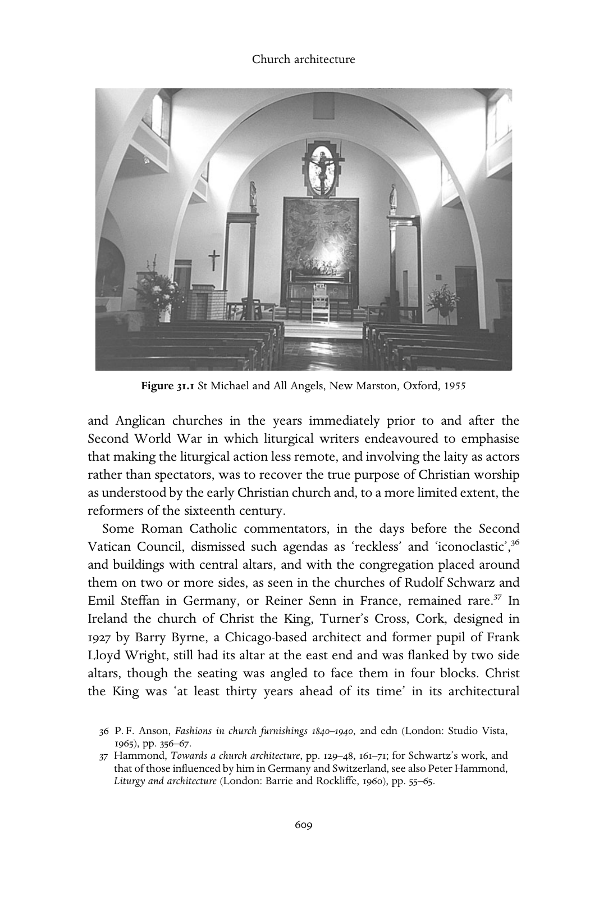
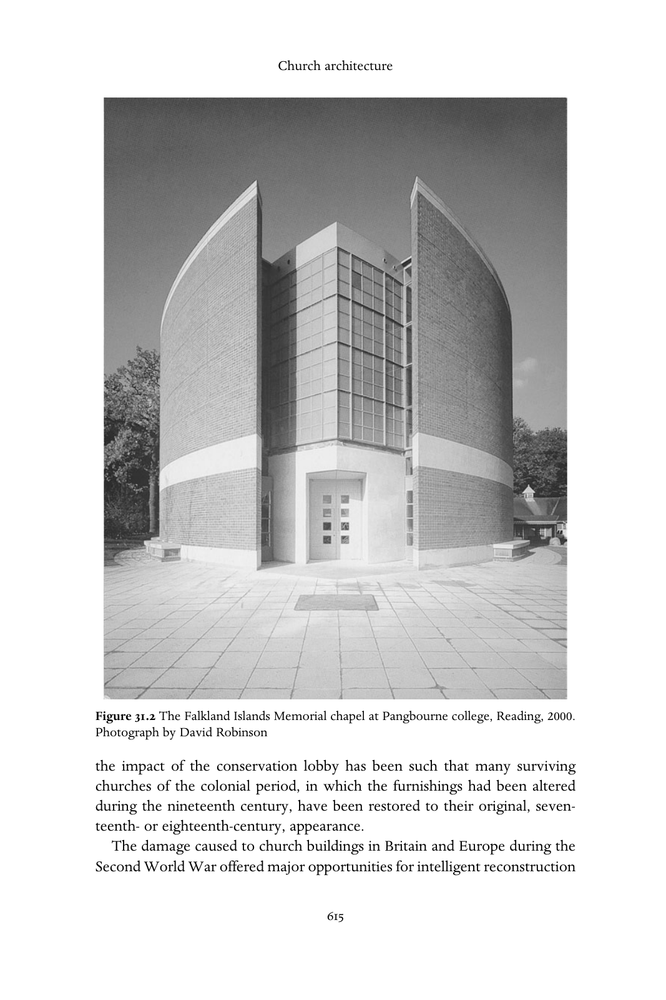
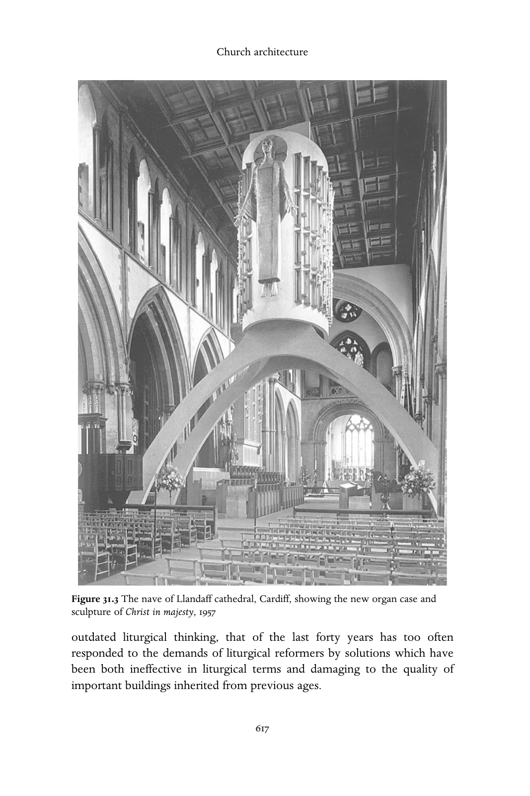

# 文学与艺术：英文转换底稿

<!-- PDF page 583; original page 582 -->

### 31

## Literature and the arts

### I

### L I T E R A T U R E A N D F I L M

D A V I D J A S P E R

### Literature

The outbreak of the Great War in 1914 marked the effective end of the nineteenth century, and with it the age of the great religious novel in Europe and its reflection on the shifting experience of Christianity after the Enlightenment and in the age of industrialisation, not least as the churches expanded globally with the growth of the colonial powers. The terrible years of the war destabilised and eroded theology and belief, and if the young English poet Wilfred Owen had already lapsed from his Christian faith even by 1913, his experiences at the front provoked a rage against the faith and a despair, later to be finely caught in Benjamin Britten’s setting of his poetry to music in the War requiem (1961), that was to herald the new century. At the same time the anxious literature of avant-garde modernism, with its attack on realism and mimesis, emerged in sceptical protest against the ‘totalizing religious and political frame- works of the nineteenth century’.[^p583-1] Stephen, in James Joyce’s Stephen hero (1904–6) is told by a priest that his essay on ‘Art and life’ ‘represents the sum of modern unrest and modern freethinking’. Twenty years later, E. M. Forster in A passage to India (1924) allows only a minor role for the European mis- sionaries in Chandrapore, India, and their ‘poor, chattering Christianity’.

Throughout the twentieth century, however, Christianity, even as it began to fade in the churches, continued to haunt fiction, while the novel challenged

[^p583-1]: Christopher Butler, Early modernism: literature, music and painting in Europe 1900–1916 (Oxford: Clarendon Press, 1994), pp. 1–2.

<!-- PDF page 584; original page 583 -->

Christian orthodoxy with the freedoms of literature and was adapted with increasing sophistication for cinema. Perhaps the most notorious example of this in the mid years of the century is Nikos Kanzantzakis’ Ὁ τελευταῖος πειρασμός (1955), which was immediately blacklisted by the Vatican. Translated in 1960 as The last temptation of Christ, the novel was the subject of Martin Scorsese’s challenging and deeply theological, though flawed, film of 1988. Yet still the ‘Catholic novel’ flourished throughout the twentieth century in the work of such writers as Evelyn Waugh, Graham Greene and most recently David Lodge in Britain, François Mauriac and Julien Green in France and Flannery O’Connor in the USA, to name but a few. Waugh described the theme of his Brideshead revisited (1945) as ‘the operation of divine grace on a group of diverse but closely connected characters’, while the work of grace is central to the gothic fictions of O’Connor, who wrote in her note to the second edition of Wise blood (1962) – which was also made into a fine film by John Huston –:

> That belief in Christ is to some a matter of life and death has been a stumbling block for readers who would prefer to think it a matter of no great consequence. For them Hazel Motes’ [the main character of the novel] integrity lies in his trying with such vigor to get rid of the ragged figure who moves from tree to tree in the back of his mind. For the author Hazel’s integrity lies in his not being able to.[^p584-2]

At the other end of the fictional spectrum, the elaborate science fiction fantasies and children’s ‘Narnia’ books of C. S. Lewis have continued to attract a huge readership, drawn by his deeply held but ultimately rather simplistic Christian faith. Lewis and his fellow ‘Inklings’, among whom J. R. R. Tolkien has recently enjoyed an enormous revival through the com- mercial success of the filming of his epic fantasy The lord of the rings (1954–5), draw on their work in early and middle English literature and the genre of fantasy literature in Victorian fiction, notably that of George Macdonald. At the same time, the New Testament has continued to be a direct influence on fiction in such diverse fictional works as Jorge Luis Borges’ ‘The gospel of Mark’ (in the late collection of stories entitled Dr. Brodie’s report (1971)), Robert Graves’ King Jesus (1946) and Kazantzakis’ Christ recrucified (1954). Literature, like twentieth-century art, has frequently interwoven the passion story with the wars and tragedies our time, as in the American William Faulkner’s Pulitzer Prize-winning A fable (1954), which is an extended parable

[^p584-2]: Flannery O’Connor, Author’s Note to the Second Edition of Wise blood (London: Faber and Faber, 1968).

<!-- PDF page 585; original page 584 -->

of the passion set within the First World War. In an early critical study of this theme in fiction, The novelist and the passion story (1960), the theologian F. W. Dillistone defends the power of ‘story’, writing: ‘The events happened more than 1900 years ago, but through the story they become entirely contemporary. The movement of the story corresponds, we know, to the movement of human life everywhere, and it is always possible that the goal towards which the story leads may find its counterpart with the circum- stances of a wholly different age.’[^p585-3] The American John Irving’s A prayer for Owen Meany (1989) is one of the more imaginative retellings of the gospel story, its comic oddities only made clear in the final moment of Owen’s ‘passion’, the event for which his whole strange life has been a preparation.

The cross and passion have powerfully funded the literature of liberation, either in such work as the novels of James Baldwin in the United States, or in post-colonial fiction. Baldwin’s short story ‘Going to meet the man’ (1948) is a disturbing and violent account of the lynching and hanging of an African American man in the American deep south seen through the eyes of a young white boy. The Kenyan novelist Ngũg̃ı Wa Thiong’o wrote his novel Devil on the cross (1980) – which he himself translated from the G̃ıkũyũ – while detained in prison without trial. Its apocalyptic opening begins with the words, ‘Certain people in Ilmorog, our Ilmorog, told me that this story was too disgraceful, too shameful, that it should be concealed in the depths of everlasting darkness.’ In his novel Incognito (1962), first published in French, the Rumanian dissident writer Petru Dumitriu portrays the impossible pos- sibility of Christian faith under the communist regimes of the eastern bloc. Other writers who have employed the power of literature to sustain spiritual values under Soviet repression are Alexander Solzhenitsyn and the Christian poet Irina Ratushinskaya.

The growth of the ecumenical liturgical movement, beginning in France in the nineteenth century, has encouraged a revival, mostly in English and often in verse, of religious drama and the modern production of the medieval miracle cycles in York and elsewhere. The best known of such plays is T. S. Eliot’s Murder in the cathedral (1935), concerned with the murder of Archbishop Thomas Becket in 1170, and written to be performed in Canterbury cathedral. It was followed in the next year by Charles Williams’ Thomas Cranmer of Canterbury, also first performed in the chapter house of Canterbury cathedral, on 20 June 1936. Alongside such deliberate portrayals of Christian history ‘on site’ in medieval settings, the rapid growth of radio

[^p585-3]: F. W. Dillistone, The novelist and the passion story (London: Collins, 1960), pp. 11–12.

<!-- PDF page 586; original page 585 -->

broadcasting soon began to attract major literary figures. In February 1940, J. W. Welch, director of religious broadcasting for the BBC, asked Dorothy Sayers to write a series of plays on the life of our Lord for the Sunday Children’s Hour. The result was the twelve plays of The man born to be king (1943), which after the initial press conference attracted hostility from Christian quarters, Welch writing that ‘on the appearance of . . . . sensational and inaccurate reports, without having heard or read one line of any of the plays . . . . people condemned the plays as ‘‘irreverent’’, ‘‘blasphemous’’, ‘‘vulgar’’ and so on. These correspondents condemned plays they had never seen or heard, and the language applied to Our Lord by his contemporaries was, almost word for word, now applied to Miss Sayers.’[^p586-4] This is just one example of the uneasy relationship between the gospel story and modern mass media that is repeated time and again in the history of radio and television as well as the cinema. For example, the beginnings of the commercial film industry in Australia were largely funded by the Salvation Army, which saw the cinema as a potential pulpit for their preaching of the gospel. This, however, turned out not to be the case, as films began to cater for the demands of a paying audience who wanted to be entertained and excited rather than preached at and converted.

Among the most recent plays based on the gospels is the trilogy of the Glasgow poet Edwin Morgan, A. D. (2000), which also met with opposition from local church groups on its first performance to celebrate the millennium in Glasgow. Morgan is not a Christian and declared that his ‘ambition [was] to tell a good story’. Jesus is here portrayed as ‘a human figure in an inhuman time’, his character a radical departure from the gospel narratives as he fathers a child by an unmarried woman and is the object of the openly gay affection of ‘the disciple whom Jesus loved’. Edwin Morgan, like T. S. Eliot, is primarily a poet, and the twentieth century saw an outpouring of poetry inspired by the Bible and of ‘Christian verse’, while at the same time there was an increasing uncertainty as to what this exactly meant. Peter Levi writes in his introduction to The Penguin book of English Christian verse (1984): ‘By the vaguest definition, Christian poetry might be any verse written by a Christian, or in a Christian framework or language, in Christian centuries, in a Christian society.’[^p586-5] Some half a century earlier, Lord David Cecil, in his introduction to the first Oxford book of Christian verse (1940), had been clear that there is a specific division of poetry called ‘Christian’, which excludes

[^p586-4]: J. W. Welch, Foreword to Dorothy L. Sayers, The man born to be king: a play-cycle on the life of our Lord and Saviour Jesus Christ (London: Victor Gollancz, 1943), pp. 9–10.

[^p586-5]: Peter Levi (ed.), The Penguin book of English Christian verse (Harmondsworth: Penguin, 1984), p. 19.

<!-- PDF page 587; original page 586 -->

great areas of human behaviour (sexual, political, military) and leaves little room for doubt or exploration. Furthermore, he believed that there was a revival in such poetry after the First World War, remarking that ‘since 1918 Christianity has raised her head again’,[^p587-6] specifically in the writings of T. S. Eliot. Certainly many of the major British poets of the twentieth century were Christian, and their faith directly inspired much of their writings – among them W. H. Auden, R. S. Thomas, Geoffrey Hill, Jack Clemo and David Jones.

In France in the earlier years of the century, Catholic poetry emerged powerfully in the work of the deeply theological convert Charles Péguy, whose great monologue The portal of the mystery of hope (1910) has recently been republished in English.[^p587-7] In post-colonial literature, Christian poetry has frequently been absorbed into a syncretistic context as in the work of the Nigerian poet Christopher Okigbo, a writer who finds no conflict between his professed faith and the religious traditions of his own Igbo peoples of eastern Nigeria. Indeed, in 1958 Okigbo remarked, ‘When I started taking poetry very seriously, it was as though I had felt a sudden call to begin performing my full functions as the chief priest of Idoto.’[^p587-8] Idoto is the local river-goddess.

In the poetry of the Holocaust and later the communist bloc, the powerful images of the passion narratives were frequently used to describe the suffer- ings of innocent victims. The Polish poet Czeslaw Milosz translated his own poem ‘A poor Christian looks at the ghetto’ into English verse:

> What will I tell him, I, a Jew of the New Testament, Waiting two thousand years for the second coming of Jesus? My broken body will deliver me to his sight And he will count me among the helpers of death: The uncircumcised.[^p587-9]

### Film

The commercial cinema has had, from its beginnings, an uneasy but energetic relationship with the gospel story and with the history of the

[^p587-6]: Lord David Cecil, The Oxford book of Christian verse (Oxford: Oxford University Press, 1940), p. xxxiii.

[^p587-7]: Charles Péguy, The portal of the mystery of hope, trans. David Louis Schindler, Jr (Edinburgh: T&T Clark, 1996).

[^p587-8]: In Marjory Whitelaw, ‘Interview with Christopher Okigbo, 1965’, Journal of Commonwealth literature 9 (1970), p. 36.

[^p587-9]: In George Steiner (ed.), The Penguin book of modern verse translation (Harmondsworth: Penguin, 1966), p. 233.

<!-- PDF page 588; original page 587 -->

Christian church. Although there have been huge ‘Christian’ box office successes such the 1977 film Jesus of Nazareth, directed by Franco Zeffirelli (yet even this, before its release, attracted the opprobrium of fundamentalist groups who had never even seen it), on the whole the gospel has not fared well in the context of the Hollywood epic. Of George Stevens’ reverent The greatest story ever told (1965), it was said by a critic in the New Yorker: ‘If the subject matter weren’t sacred, we would be responding to the picture in the most charitable way by laughing at it from start to finish.’[^p588-10]  More notorious was the furore surrounding the release of Martin Scorsese’ film of Kazantzakis’ already controversial novel The last temptation of Christ (1988). A fine, though flawed, and deeply serious film that explores the struggle between Jesus’ divinity and his humanity, The last temptation illustrates the extreme difficulty of exploring theological issues in the context of the com- mercial cinema.

For Hollywood sets out primarily to entertain, the cinema being a means to escape from reality for an hour or two through a medium that is supremely an art of illusion. Miracles then become easy, solved by the sleight of hand of the director and the camera operator. The results have not always been bad, though the temptation to adapt the Christian story for grand epic purposes was strong from the start, and even the early silent film From the manger to the cross (1913) – with its magnificently aristocratic Jesus played by Robert Henderson-Bland – realised film’s potential to show us the ‘real thing’ by filming on location in Egypt, the holy family resting on its flight from Herod in the very shadow of the Sphinx itself. But it was the director Cecil B. de Mille in The King of kings (1927) who realised the full epic potential of the life of Christ for the mass audience, shamelessly attracting the viewers’ attention at the very beginning with a scantily clad Mary Magdalene, and maintaining the romantic interest in an unlikely love triangle between Mary, Judas Iscariot and Jesus. This epic tradition reached its full flowering in the two ‘lives of Jesus’ of the 1960s, Nicholas Ray’s King of kings (1961) and Stevens’ The greatest story ever told. At the same time, the character of Jesus granted an appearance of gravity to a number of epics with a walk-on role, most notably in the hugely successful Ben-Hur (1959), which was based on Lew Wallace’s best- selling novel of 1880. Both book and film represent an odd and unacknowl- edged extension of the critical search for the Jesus of history, as writer and

[^p588-10]: Quoted in Bruce Babington and Peter William Evans, Biblical epics: sacred narrative in the Hollywood cinema (Manchester: Manchester University Press, 1993), p. 1.

<!-- PDF page 589; original page 588 -->

director expended great energy in seeking to ensure that their portrayals of history were ‘accurate’ in every detail.[^p589-11]

Apart from Hollywood, less mainstream cinema has tried its hand at making films of the gospel story, perhaps the most successful example being Pier Paulo Pasolini’s Il vangelo secondo Matteo (The gospel according to St Matthew) (1966), a low-budget production with unknown actors that achieves consistency partly because it simply adapts the text of Matthew as screenplay. Another Italian film, made two years later, Valerio Zurlini’s Seduto alla sua destra (1968) is a strange allegory using the gospel narrative to illustrate the last days of African revolutionary Patrice Lumumba. Screened in America as Black Jesus, it was reported in the Saturday review that ‘the film makes no attempt to propagandize one way or the other; rather, it presents a bloody equation of our time with an event (perhaps myth) of two thousand years ago’.[^p589-12]  Very different, and infinitely more bloody, is Mel Gibson’s The passion of the Christ (2003) of which the director Gibson, a devout conservative Roman Catholic, is reported to have said (in the Guardian for 4 August 2003), that the ‘Holy Ghost was working through me on this film, and I was just directing traffic’. The film portrays the final twelve hours of the life of Jesus, is largely without star actors, and is ‘historically accurate’ inasmuch as the dialogue is in Aramaic and Latin. Before it was even shown, the film attracted criticism from a number of religious quarters – Christian evangelical, Catholic and Jewish.

Much attention has been given to the film’s extreme, even gratuitous, violence, particularly during the scourging of Jesus by the Roman soldiers. However, the restrained narratives of the canonical gospels stand in contrast to other contemporary accounts of torture, for example in 4 Maccabees 6,[^p589-13] and in this latter graphic tradition Gibson’s film stands as a deeply uncom- fortable, almost liturgical, film that draws upon a particular kind of Roman Catholic spirituality, portraying the last hours of Jesus’ life as a self-conscious battle with Satan. Joyless and relentless, at once deeply pious and disturbingly voyeuristic, The passion attracted huge audiences and diverse responses. It is certainly a major contribution to the genre of film lives of Christ.

[^p589-11]: For a recent survey of the history of the ‘quest for the historical Jesus’, see Gregory W. Dawes (ed.), The historical Jesus quest (Louisville: Westminster John Knox Press, 2000).

[^p589-12]: Saturday review, 11 September 1971. Quoted in Roy Kinnard and Tim Davis, Divine images: a history of Jesus on the screen (New York: Citadel Press, 1992), p. 167.

[^p589-13]: See Stephen D. Moore, God’s gym: divine male bodies of the Bible (New York and London: Routledge, 1996), pp. 6–7; Martin Hengel, Crucifixion in the ancient world and the folly of the message of the cross, trans. John Bowden (Philadelphia: Fortress Press, 1977).

<!-- PDF page 590; original page 589 -->

Jesus has also been subjected to clown makeup in the puerile musical Godspell (1973), rock music superstardom in Norman Jewison’s Jesus Christ, superstar (1973) – also a highly successful stage production – and the satirical attention of the British Monty Python in their Life of Brian (1979), which not unexpectedly attracted huge criticism from Christian groups and churches (especially for its all-singing, all-dancing crucifixion scene), and an even larger cult following. In fact, The life of Brian is an often biting satire on the church and the absurdities and extremes of Christian belief and practice, as when the crowd insist with one voice and in unison that ‘we do all think for ourselves’. Brian, the reluctant Messiah (Graham Chapman), is continually being mis- taken for the real Jesus (Ken Colley), from the moment when the three kings go to the wrong stable, to be confronted with Brian’s ghastly mother, the Virgin Mandy (Terry Jones). In many respects the film draws on the comic traditions of the medieval miracle plays which also parallel the gospel narratives with comic variations on them, as in the great Second shepherds play of the Wakefield pageants. The tradition of the miracle cycles is also employed to great, and unexpectedly successful, effect in the French Canadian film Jesus of Montreal (1989), which uses the idea of the actor play- ing the role of Jesus in a play gradually assuming the character himself and thus ‘expressing the genuine need for spiritual fulfillment in a corrupt modern society, and the potential achievement of that spiritual fulfillment through pure artistic expression’.[^p590-14]

Like the gospels, the history of the Christian church has not fared particu- larly well in the cinema, too often subjected to the stilted, over-pious, form of the grand epic, as in Harry Koster’s 1953 adaptation of Lloyd C. Douglas’ novel The robe, which is the story of the Roman tribune Marcellus (Richard Burton) and his slave Demetrius (Victor Mature). Marcellus witnesses the crucifixion, is converted and eventually dies the death of a martyr. Always seeking suitable subjects to satisfy the commercial demands of sex and violence in exotic settings, the cinema has frequently visited the world of the medieval church and the cruelty of the Inquisition, as in the 1986 adaptation of Umberto Eco’s novel The name of the rose, with Sean Connery as a sort of Franciscan Sherlock Holmes investigating a series of mysterious deaths in a remote monastery. Occasionally the cinema has managed to combine fine film- making with serious portrayals of dilemmas of faith, as in Fred Zinneman’s A man for all seasons (1966) in which Paul Schofield portrays Sir Thomas More

[^p590-14]: Kinnard and Davis, Divine images, p.213 .

<!-- PDF page 591; original page 590 -->

refusing to bend his beliefs and faith in the Church of Rome to the whims of Henry VIII (Robert Shaw), and finally suffering execution as a result. Roland Joffé’s The mission (1986) explores the brutal oppression of Portuguese and Spanish imperialism in eighteenth-century South America, and the role played by the church in its atrocities as the emissary of the pope, Altamirano (Ray McAnally) decides, for the sake of church interests, to close the Jesuit missions to the native tribes in order to allow for the expansion of the slave trade. The serious questions that are raised in this film about the ‘civilising’ of ‘primitive peoples’ by European missions are set against the visual backdrop of the tropical forest, representing the biblical Eden story and its motif of lost innocence.[^p591-15]  The capacity of the cinema to employ a biblical background to films that leave the audience barely conscious of the references that are driving the narrative has been most successfully (and arguably most subtly) exploited by Clint Eastwood in his magnificent trilogy of Westerns, High plains drifter (1972), Pale rider (1985) and Unforgiven (1992). In each case there is an adaptation of apocalyptic themes, most overtly seen in the title of the second film and its use of Revelation 6:8, ‘And I saw, and behold, a pale horse, and its rider’s name was Death, and Hades followed him.’ Nowhere is this verse better illustrated than in the last fifteen minutes of Unforgiven, leaving the viewer disturbed and unsettled by the necessary but vicious revenge upon the people of Big Whiskey and a fade-out on a dark and stormy night.

The necessarily highly selective literature and films that have been referred to in this chapter represent a further episode in the ancient, problematic, relation between the Christian church, with its Bible and its faith, and the arts. Since the early church took over the Jewish prohibition of idolatry,[^p591-16] the troubled love affair between Christianity and the arts has been both a provocation and a revilement of works of creativity and genius. As novelists, poets and playwrights have found inspiration in the Bible and Christianity, there remained in the twentieth century the suspicion that the ‘truth’ of the gospel and Christian belief was being somehow undermined by artistic fabrication, even while the arts might gloriously reveal the faith in new and contemporary ways or give serious expression to its dilemmas and problems. At the same time, the enduring sense of the novel, the poem and the play

[^p591-15]: See further Vaughan Roberts, ‘Between Eden and Armageddon: institutions, individuals, and identification in The mission, The name of the rose, and Priest’, in Clive Marsh and Gaye Ortiz (eds.), Explorations in theology and film (Oxford: Blackwell, 1997), pp. 180–92.

[^p591-16]: See George Pattison, Art, modernity and faith: towards a theology of art (London: Macmillan, 1991), ch. 2.

<!-- PDF page 592; original page 591 -->

as handmaids of religion has ensured the continuing popularity of writings that present the fundamentals of Christian belief in attractive and accessible form. The theme of ‘story’ was central to the 1981 report of the Doctrine Commission of the Church of England, Believing in the church, where, in a tone of some surprise, we find the words:

> Recent theology . . . has thrown up a new term which we might want to use: ‘story’. Story, like myth, is a word with many possible meanings. On the one hand, it is hallowed in Christian usage: ‘Tell me the old, old story’; on the other, it can be used in a debunking way, as when people say that Christianity is ‘only a story’ or ‘only a collection of old stories’. In this chapter we shall try to show that it can be used in a positive way . . .[^p592-17]

Theologians may speak thus. For novelists, poets and playwrights such positivity is always dangerous, especially when theological issues lie at the heart of their creative impulse. Thus Nikos Kazantzakis begins the prologue to his much vilified Last temptation with the pained but deeply biblical words:

> The dual substance of Christ – the yearning, so human, so superhuman, of man to attain to God, or more exactly, to return to God and identify himself with him – has always been a deep inscrutable mystery to me. This nostalgia for God, at once so mysterious and so real, has opened in me large wounds

> and also large flowing springs.[^p592-18]

For the film-maker as the most recent newcomer to the company of artists, the problem is even more complex. Not only are there the ancient fears of what the eye sees (in the long tradition of Christian iconoclasm), but the environment of the commercial cinema with its absolute dependence on box office success, except in the case of a very few and little seen art-house films or the relatively small-scale (though often important) film industries of former eastern European or third world countries, and its widely held but rather naive addiction to notions of mimetic truth, has condemned it to a simplified vision that is too easily open to misunderstanding by others whose Christian vision is often itself too simple and rigid. In the lives of Christ, the struggle by film-makers to preserve Jesus’ divine nature too easily detaches him from the rest of humanity, while the too human Jesus fails for the opposite reason. In short, the cinema has not found christology easy. Thus it was said of Nicholas

[^p592-17]: John Barton and John Halliburton, ‘Story and liturgy’, in Believing in the church: the corporate nature of faith, a report by the Doctrine Commission of the Church of England (London: SPCK, 1981), p. 79.

[^p592-18]: Nikos Kazantzakis, The last temptation, trans. P. A. Bien (London: Faber and Faber, 1975), p. 7.

<!-- PDF page 593; original page 592 -->

Ray when he was searching for an actor to play Jesus in King of kings, that he eventually found one who was neither human nor divine: he found the heartthrob Jeffrey Hunter, an anodyne successor to Ray’s real hero, the truly tragic James Dean.

### I I

### M U S I C A N D C H R I S T I A N I T Y I N T H E

### T W E N T I E T H C E N T U R Y

A N D R E W W I L S O N - D I C K S O N This section compares the unchanging traditions of the Eastern churches with the influence of popular and classical music on Western worship. It also observes the migration of music across denominations and a broadening of the musical types accepted in the worship of Western Christianity.

Whoever first suggested music to be a universal language might well have been living in nineteenth-century Europe, in an age when Western culture was still certain of its uniqueness and superiority. At that time, objective examination of other more ancient musical traditions was too much to ask, even of great musical minds. Thus the great iconoclast and revolutionary, Berlioz, summarised the European perception of a Chinese musician: ‘He has a music which we find abominable, atrocious; he sings like yawning dogs, like cats vomiting after having swallowed a fishbone; the instruments accompa- nying the singing seem to us true instruments of torture.’[^p593-19]  In Britain and the United States, such cultural isolationism was complemented by unimagina- tive composition and encouraged by conservative audiences. The music reviews of Corno di Bassetto (George Bernard Shaw) at the end of the century are unusually perceptive of the situation.

Conservatism and elitism were further entrenched in the parochial world of Christian worship. Abroad, missionaries bringing the gospel to the unsaved millions continued to package it with capitalist ideology and a European hymnbook. At home, the educated musicians of British cathedrals assumed their anthems and chanting to be the ideal for local parishes and spared no scorn for the popular music of the nonconformists.

[^p593-19]: H. Berlioz, À travers chants (Paris: Michel Levy Frères, 1852), ‘Moeurs musicales de la Chine’, pp. 252–8, trans. Nguyen Kim-Oanh and Fredric Lieberman (http://arts.ucsc.edu/faculty/lieberman/Chinese.html).

<!-- PDF page 594; original page 593 -->

One feature of the twentieth century is a stumbling journey away from this feudal scene and towards a tentatively emerging acceptance – even a celebra- tion – of the diversity of musical style in worship. Another, not dealt with here, is a profound change of attitude to the nature of foreign mission and the recognition that indigenous languages and musical styles are a right for all Christian worshippers.

### Popular music and Western Christianity

Where the influence of modern secular music is strictly curbed in the Eastern churches, the Western remain as divided on the matter as at the Reformation. From at least as far back as the mid-nineteenth century the majority have embraced local secular styles. Ira D. Sankey was typical in his adoption of the idiom of the drawing-room ballad (‘The ninety and nine’, 1874, ‘Hiding in Thee’, 1877) to the accompaniment of the harmonium. Though the large-scale gatherings of such North American Protestant evangelists were for prosely- tising, not for worship, the musical influence on congregations is still remark- ably strong and spread as far afield as the Pacific islands and South Korea. Indeed, areas of Christian expansion (for example South America and many parts of Africa) have embraced local secular music in a similar manner to the following description which relates to the Protestant English-speaking world.

The musical style of Evangelical free churches has evolved in the twen- tieth century roughly in parallel with changes in secular musical fashion. For white worshippers in the USA and UK, the style of music-hall dominated the worship song in the early part of the century (Charles Alexander, Homer Rodeheaver), followed by music of the dance-floor ((Norman Clayton, George Beverley Shea assisting Billy Graham) and, more recently, folk, rock and musical theatre.

Black free churches moved in a similar direction but also drew on the unique repertoire and traditions of the shout and the spiritual. In the twen- tieth century, however, black song-leaders and ensembles have had a strong hand in creating the most popular secular genres of the century (for example, blues, jazz and soul) rather than being driven by them. The songs of Charles A. Tindley and Thomas A. Dorsey (Gospel pearls, 1921) have been highly influential, with an expanding tradition of solo singing (Mahalia Jackson, James Cleveland, Shirley Caesar) and vocal ensembles (Golden Gate Quartet, Mighty Clouds of Joy, Take 6). Through the century there has been a steady move from harmonic and metrical simplicity to a sophistica- tion of chord-types in complex polyrhythms borrowed from Brazilian and African cultures.

<!-- PDF page 595; original page 594 -->

Alongside this evolution has come a change in the use of instruments to accompany worship. At the beginning of the century the piano became the dominant indoor instrument (it was Alexander’s preferred resource) but later the use of the guitar and instrumental bands became widespread. By the 1960s these featured electric instruments – the Hammond organ (still a ubiquitous sound in black churches) followed by the synthesiser, the electric guitar, bass guitar, drum-kit and ethnic percussion. At the beginning of the twenty-first century most lively Evangelical churches will accompany their worship with such forces.

The insistent emphasis on the ‘new’ (the openings to Psalms 96 and 98 are consistently cited in evangelical circles) has produced a large-scale industry for the creation and dissemination of new songs. These are launched at residential gatherings (such as Spring Harvest and Greenbelt in the UK, Hillsong in Australia or the International Worship Institute Conference in Dallas) and then adopted locally until supplanted by others. The songs in their initial presentation are usually written and sung by the same person (Graham Kendrick was the dominant British figure of the 1980s and 1990s), the text usually in the first person and the vocal style ornamental. Such songs, sung congregationally, become simplified, the syncopations and improvised embellishments tending to disappear. While oral transmission of this music is widespread, contemporary electronic means are used to disseminate it in print and recording. Radio remains an important medium for black gospel music, but it is the internet that has revolutionised access to the repertoire.

Stylistically, Western Christian song has reflected almost every popular musical genre of the previous hundred years, recently including music of the club culture. In all these cases the theological raison d’être is the possibility of redeeming the music of the fallen world. This cannot be better summarised than in Luther’s wish ‘that the evil, vexatious melodies, the useless and shameful songs to be sung in the streets, fields, houses and elsewhere, may lose their bad effects if they can have good, useful Christian texts . . .’[^p595-20]

### Western music and tradition

The liturgies and music of the Eastern churches (Greek, Coptic and Ethiopian in particular) continue to be inextricable, and given validity through links to the past. The twentieth century has seen little change here; music may be newly composed or elaborated, but, like its icons, the style and manner is

[^p595-20]: M. Luther, An order of mass and communion for the church at Wittenberg (1525), trans. U. S. Leupold, in Luther’s works (Philadelphia: Fortress Press, 1965), vol. LIII, p.36.

<!-- PDF page 596; original page 595 -->

hallowed by tradition and change is hard to perceive. The rapidly evolving style of secular music, brought on by the increased mobility of populations and the invasive influence of television, has thus had almost no effect on the liturgical traditions of these churches, even though some non-liturgical contexts (youth meetings, for example) may admit the use of local modern instruments and song styles.

In the West, the tainting of the liturgy by popular music remains anathema to a minority, such as strict Calvinists, who still adhere to the principles that only biblical texts may be uttered in worship, in ‘the vulgar tongue’, and that instrumental accompaniment is unacceptable. The melodies sung by some Free churches in the Isle of Lewis, for example, or in some reformed Presbyterian churches in the southern states of North America, are the same melodies published in Calvin’s Genevan psalter of 1562, or their close relatives, and are sung in a unique style almost unchanged since the seven- teenth century. For such communities, external influences are a constant threat to which a proportion succumb.

Parts of the Anglican church are also isolationist, through the high value placed on tradition. As a result, Anglo-Catholics have continued to inhabit the repertoire of cathedral music, and choirs surrounded by the symbolism of the Oxford movement are still supported, at considerable cost. However, the human resources are diminishing, and in the last twenty years of the century girl singers have been introduced, to the consternation of traditionalists.

The Royal School of Church Music has continued to be the chief engine in Britain and its former colonies for the co-ordination of parish church choirs. In the last thirty years of the century, this organisation (and others such the Music In Worship Foundation) has broadened its brief to encourage the use of orchestral instruments in worship and to develop congregational singing.

### Classical music and its influence

The social upheaval and cultural uncertainty following the First World War found a strong reaction amongst European composers. In the concert hall, a number dealt with Christian texts, but subjected eternal truths to unusual scrutiny, no longer viewed in the context of arrogance and empire but often by the dimmer light of an evil world. Thus in Britain, Gustav Holst set a controversial gnostic text in his Hymn of Jesus (1916), Vaughan Williams moved his music into a new arena of tension with Job (1930) and Dona nobis pacem (1936), and two pacifist composers, Michael Tippett and Benjamin Britten, engaged with Christian themes from their personal perspectives. Their most enduring examples are Tippett’s A child of our time (1941) and

<!-- PDF page 597; original page 596 -->

Britten’s War requiem (requiem texts interlaced with the war poems of Wilfred Owen, 1962). Composers on mainland Europe contributed to similar themes: Bohuslav Martinu’s Field mass (1939), Frank Martin’s In terra pax (1944) and Messiaen’s Quatuor pour la fin du temps (written and first performed in a German POW camp, 1941).

The latter half of the century saw a change of perspective. The obscuran- tism of the European musical ‘avant-garde’ of the 1950s and 1960s created a serious barrier to appreciation by most audiences. This aggressive post-1945 revolution (in the hands of Stockhausen, Boulez and Xenakis, for example) had exhausted itself by the 1970s and its place was taken by a renewed exploration of harmoniousness and predictability. More than that, composers began to explore this in a context of spirituality, suggested by structures with slow rates of change and by the setting of liturgical texts. Composers who have moved precipitately from one state to the other include Henryk Górecki in his hugely successful Third Symphony (‘Symphony of sorrowful songs’, 1976), followed by Beatus Vir (1979) and Miserere (1981), together with two composers of an Orthodox Christian background, the Estonian Arvo Pärt (St John passion, 1982–8) and John Tavener (The protecting veil, 1987, Akathist of thanksgiving, 1988). Tavener received extraordinary acclaim for ‘Song for Athene’ (1993), sung at the close of the funeral of Lady Diana, Princess of Wales.

Where the worship music of the free and Evangelical churches in Britain has remained largely untouched by developments in classical music, those which have had traditionally close contact (Roman Catholic and Anglican) have been beneficially affected by the developments described above, in spite of diminishing resources for, and interest in, the commissioning of new work.

### The Anglican church

In the Anglican church, the lacklustre world of the previous century con- tinued to dominate cathedral worship until the 1920s, though with the greater technical proficiency exemplified by Charles Villiers Stanford. The modality of folk-melody and of music from the pre-diatonic era was explored by Vaughan Williams (Mass, 1921) and by Herbert Howells (canticle settings from the 1930s). The acerbic language of Kenneth Leighton and William Mathias followed, and the few works specifically for the liturgy by Benjamin Britten (Missa Brevis, 1959) and Michael Tippett (Evening Canticles, 1961) heralded an era of greater aural challenge for congregations. This has been taken up by more recent figures such as Jonathan Harvey (b. 1939). Significantly, none of these composers have been employees of the church.

<!-- PDF page 598; original page 597 -->

Musical conservatism in Anglican hymnody, exemplified by Hymns ancient and modern, was threatened by the work of the poet laureate Robert Bridges and by the appearance of the English hymnal in 1906, edited by Percy Dearmer (text) and Ralph Vaughan Williams (music). The latter reintroduced excellent music from far back in British history – from art-music (Thomas Tallis, Orlando Gibbons) to folk-song, as well as his own compositions. The associa- tion of folk-song melodies with hymn-texts has permanently changed the hymn repertoire for many churches. Songs of praise (1925/1931) from the same editors (with Martin Shaw) continued in this direction. An indication of more uncomfortable forces of change came in the 1950s with the Twentieth Century Church Light Music Group’s Thirty 20th-century hymn tunes (1960), strongly influenced by ballroom-dance music. Low Anglican churches have since increasingly adopted worship songs in contemporary idioms (led by an instrumental group) as a foil to older musical forms. Traditional hymnody has been renewed by a number of fine authors (Brian Wren, Alan Gaunt, Fred Kaan, Christopher Idle), though without a corresponding enlivening of music.

### Mainland Europe

The Roman Catholic church’s time-honoured position as a patron of the arts should have given the church a positive and creative reason to be in touch with the latest thinking in art-music. But by the later nineteenth century its musicians were seduced by the easy sentiments of light opera (exemplified by Gounod’s liturgical works). By the beginning of the twentieth century, European art-composers found such emotional gestures sterile, and pursued paths which the Roman church could not, or would not, follow. The disin- tegration of tonality in the concert hall and the many alternatives proposed in its wake were ill suited to the liturgy, aesthetically and technically. There have been exceptions of course: the outstanding figure in the French composer- organist tradition, Olivier Messiaen (1908–92), organist of the Trinité in Paris for more than sixty years, or the contributions to liturgical music by Jean Langlais (1907–90). However, not only were the turbulent and radical changes of the secular world informing the music of these composers, but so was the church’s chant, traditional yet under-valued. In his motu proprio of 1903, Pope Pius X strongly encouraged a deeper awareness of the church’s legacy of its chant. As a result, this monodic repertoire, like an ancient oil- painting restored by scholars to its former hue, became a strong inspiration to musicians, including the two mentioned above. The hope that the chant would become universally sung was never fully realised, but its influence on

<!-- PDF page 599; original page 598 -->

composers has been remarkable; by pre-dating tonality, the chant became a renewing force for twentieth-century harmony.

In Germany, the Lutheran chorale provided a similar impetus for compo- sers for the liturgy. Until the Nazism of Hitler overwhelmed them, a number of composers (notably Hugo Distler) worked creatively towards a musical renewal, republishing the most ancient versions of chorales and composing new music around them, following the methods of seventeenth- and eighteenth- century composers. Since that time, churches have continued to benefit from the generous musical resources that are a legacy of Luther’s reforms, with some enriching results. However, the withdrawal of such funding is making the maintaining of high standards a struggle.

In the parish churches of France, Italy and Spain, however, musical resources have always been thin. Clerics became increasingly concerned by the remoteness of the liturgy to the congregations it was supposed to serve. Some exercised increasing pressure to permit worship in the vernacular, as a move towards a renewed sense of community and away from a pietist individualism. This was formalised by the Second Vatican Council in 1963 and, although not banned, Latin vanished from the liturgy almost overnight and with it the musical traditions of millennia. In every area, churches were forced to propose and adopt local solutions around the few musicians with the dedication and imagination to respond to change. The father of these in France is Joseph Gelineau (b. 1920), who has worked tirelessly since the 1950s, from the publication of his still-famous vernacular psalm-settings to his more recent work with the Taizé community. Since the 1970s, André Gouzes has been developing and publishing an extensive body of parish choral music, La Liturgie Chorale du Peuple de Dieu, springing from the worshipping community at L’Abbaye de Sylvanès, his ‘atelier de musique liturgique’. Gouzes travels widely with his choirs in France to encourage and train at local level.

### Ecumenical trends

In Britain, there is an increasing overlap in musical resources, to the point where the value and expense of printing denominationally specific hymn- books is being questioned. First, their selection of traditional hymns reveals increasingly common ground. Second, the music that lies beyond hymns (psalms and many other types of liturgical song) is of increasing general interest and is contained in compilations with no denominational affiliation (Mission praise (1983 on), Songs of fellowship (1991 on)). Psalm-singing is no longer denominationally so well defined. Thus Anglican chant outside cathedrals is in diminishing use, with new metrical settings and occasional

<!-- PDF page 600; original page 599 -->

responsorial versions (traditionally the province of the free and the Roman Catholic churches respectively) making an appearance. Hymns and tunes of Protestant origin are increasingly popular in British Roman Catholic churches. Most hymnbooks include a selection of the music of the ecumeni- cal Taizé community, which from the 1970s has provided Protestant churches with a meditative rather than passionately expressive repertoire of song (something that the Roman Catholic community has had for centuries).

A recent dimension to British church singing is the music of the world church. The first circulation of this was in the 1980 edition of Cantate Domino, edited by Erik Routley, though little known outside its commissioning organisation, the World Council of Churches. Since then, John L. Bell of the Iona community has compiled a number of songs in many languages which have reached a far wider worshipping public (Many and great, 1990, Sent by the Lord, 1991). Although losing in transplantation, they are an antidote to denominational isolation and represent a continuing trend.

In summary, where the Eastern churches have guarded their traditions jealously, the twentieth century has witnessed a burgeoning of music for Western church worship even greater than the previous century and increas- ingly varied in style and excellence. There are clear signs that this material is migrating freely across denominational boundaries, challenging the tradi- tional constitutional barriers to the fellowship of all saints. In this sense, music does have the potential to be universal.

### I I I

### C H R I S T I A N I T Y A N D A R T

J U T T A V I N Z E N T The most distinct feature of Christianity and art in the twentieth century is the secularisation of culture and thus a change in patronage: while modern art claims autonomy, churches play a diminishing role in commissioning art. Accordingly, the story of Christianity and art in the twentieth century can be told in two major narratives: one narrative encompasses the art commis- sioned by churches, in short church art, the other the story of Christian iconography and themes in modern and contemporary art. Works of the former category are usually kept in churches, those of the latter in museums and galleries, although as Inken Mädler observed in 1997, ‘eine Art

<!-- PDF page 601; original page 600 -->

Musealisierung kirchlicher Räume ist derzeit ebenso zu konstatieren wie die zunehmende Sakralisierung . . . musealer Räume’:[^p601-21]  churches are used as museums in a literal sense (churches become museums) and a transferred sense (visitors to churches treat the building and its content as a museum), and art museums are approached with a secular reverence, as Carol Duncan proclaims in Civilising rituals.[^p601-22]  Apart from the patronage and the holdings of the works, the split also goes through the disciplines: theologians and art historians seem to concentrate on different artists, topics and works. John Dillenberger classifies theologians and their methods in relation to the arts into three types: the first is that in which no relation is seen between the arts and theological work (for example, Rudolf Bultmann and Karl Barth), the second is one in which a positive relation is articulated (for example, Langdon Gilkey and Paul Tillich), and the third is one in which the arts provide paradigms influencing the nature of the theological method (for example, Hans Urs von Balthasar and Karl Rahner).[^p601-23]  For art historians specialising in the twentieth century, Christianity plays a subordinate role.

The division between church and modern art is due to the exclusion of modern art by churches (for example, the Roman Catholic church denounced modern art in an ‘instruction’ for the ordinary of 1952),[^p601-24]  but also to the striving for autonomy of the art object in the twentieth century: art objects should stand for themselves and thus should be dealing with art (preferably abstract), be promoted by art dealers and be exhibited in art galleries.

One possible way of looking at the relationship between Christianity and art in the twentieth century would be to focus on the perception of the spectator rather than on the art objects. The prominent Roman Catholic theologian Karl Rahner, for example, suggests that art works should be viewed religiously.[^p601-25]  His so-called religiöses Sehen (religious seeing) applies to any art regardless of its iconography. Seeing, however, is not a universal

[^p601-21]: Inken Mädler, Kirche und bildende Kunst der Moderne. Ein an F. D. E. Schleiermacher orientierter Beitrag zur theologischen Urteilsbildung, Beiträge zur historischen Theologie 100 (Tübingen: Mohr Siebeck, 1997), p. 33.

[^p601-22]: Carol Duncan, Civilising rituals (London and New York: Routledge, 1995), esp. pp. 7–20.

[^p601-23]: John Dillenberger, A theology of artistic sensibilities: the visual arts and the church (London: SCM, 1986), pp. 217–27.

[^p601-24]: Alaphridus Ottaviani (Adsessor), ‘Instructio. Ad locorum ordinarios: ‘‘De arte sacra’’’ (Acta SS. Congregationum. Suprema Sacra Congregatio S. Officii, part 1), Acta Apostolicae Sedis 44 (1952), 542–5.

[^p601-25]: Karl Rahner, ‘Zur Theologie des Bildes’, in Rainer Beck, Rainer Volp and Gisela Schmirber (eds.), Die Kunst und die Kirchen: der Streit um die Bilder heute (Munich: Bruckmann, 1984), p. 218.

<!-- PDF page 602; original page 601 -->

experience, but differs individually and culturally. Thus the following division between church art and modern art is based on patronage and iconography.

### Church art

Church art encompasses churches and their decoration and smaller objects and vestments. Objects are usually based on Christian iconography and thus are often figurative, but can also be abstract as in the interior design of Heinz Mack (b. 1931) for the Roman Catholic church of St Theresia, Kaiserslautern, Germany (1992–4). Finished works of church art naturally represent the way in which the church (the actual communities of a parish or diocese) wants to have Christianity represented. Other projects will not be realised, as demon- strated by the long-lasting debate around the stained glass windows designed by Johannes Schreiter (b. 1930) for the Protestant Holy Spirit church in Heidelberg, Germany (finally installed in 2002). Drawing back to the usage of the church as a library (housing the Bibliotheca Palatina) between 1421 and 1623, in which knowledge of former times was gathered and studied, the ten windows deal with typical twentieth-century spiritual, scientific, economic and political topics, probably most obvious in the window with the theme ‘stock market’ and that of ‘biology’, the latter showing a DNA-spiral mole- cular pattern. All of the windows present signed copies of the documents portrayed. In this manner Schreiter points out the finite character of technical progress and human achievement.

Apart from the subject and style of the art works, the question as to whether the executing artist is a believer sometimes plays a role. The Catholic philosopher Jacques Maritain (1882–1973), for example, although interested in the revitalisation of art in the church, believed that art for the church must be done by believers.[^p602-26]

The need of the church to have artists who produce its religious objects, architecture and interior design has led to the publication of journals such as the German Kunst und Kirche, an ecumenical journal of the Protestant and Catholic churches, the French Art chrétien and the American Liturgical arts.

Usually artists producing church art are unknown to the canon of modern art. A considerable number of churches, however, have interior designs by well-known modern artists. The Dominican Father Marie-Alain Couturier (1897–1954) was the first in France to commission modern artists (most of

[^p602-26]: Dillenberger, Theology of artistic sensibilities, p.193 .

<!-- PDF page 603; original page 602 -->

them working in France) for Notre Dame de Toute Grâce in Assy (near Chamonix), France, from 1939. Works executed there include The virgin of the litany (a mosaic on the façade) by Fernand Léger (1881–1954), stained glass from designs by the Catholic Georges Rouault (1871–1958), Saint Dominic by Henri Matisse (1869–1954), St Francis of Sales by Pierre Bonnard (1867–1947), and further works by the sculptor Germaine Richier (1902–59), the Cubist Georges Braques (1882–1963), Marc Chagall (1887–1985) and Jacques Lipchitz (1891–1973). The finished project was not only appreciated, but also attacked by reactionary conservatives both in France and in Rome for the lack of a religious object, the strangeness of the forms, the manifestation of modern freedom and subjectivity, and the lack of faith or ecclesial membership of the artists.[^p603-27]  The project may have influenced the change from a balanced tone on art in Pius XII’s encyclical Mediator Dei (1947) to an ‘instruction’ on sacred art issued by the Vatican in 1952, as mentioned above.

In Britain, the Anglican cathedral of St Michael in Coventry, erected by Basil Spence (1907–76) next to the ruins of the old cathedral between 1954 and 1962, commissioned modern artists working in England at the time: the visitor is greeted by a nineteen-foot-high sculpture of St Michael and the devil by Jacob Epstein (1880–1959) on the outside wall; apart from the baptistery window designed by John Piper (1903–92) and a crucifixion by Geoffrey Clarke (b. 1924), the interior of the cathedral is dominated by a Christ in Glory, a seventy-five-foot tapestry woven after designs by Graham Sutherland (1903–80). The new church together with the still monumental ruins of the fourteenth-century old cathedral, hit by German bombing on the night of 14 November 1940, has become a symbol for reconciliation after the war.

In the USA, the Rothko chapel in Houston, Texas, opened in 1971, was made possible by the world-famous art collectors John (b.1904) and Dominique de Ménil (1908–98), the latter being heiress to the Schlumberger Ltd oil service company fortune. The non-denominational church houses fourteen dark maroon/black canvases by the American abstract expressionist Mark Rothko (1903–70). These abstract colour field paintings create a modern meditative environment open to any religion.

Apart from the interior designs, churches have been planned by modern architects: a prominent example is Notre Dame du Haut in Ronchamp, France, designed by Le Corbusier (1887–1965) and built between 1950 and 1954 as a

[^p603-27]: Thomas F. O’Meara, ‘Modern art and the sacred: the prophetic ministry of Alain Couturier, O. P.’, Spirituality today 38 (1986), 31–40.

<!-- PDF page 604; original page 603 -->

pilgrim chapel. The roof in particular is characteristic of the modern artist’s style. The Crystal cathedral (Anaheim, California, USA) was designed by Philip Johnson (b. 1906), known for his unabashedly neo-Georgian plan for the AT&T headquarters in New York city (1978–84); since 1992, the Sony building has brought postmodern architectural debate into the public forum. Johnson’s church was built in 1980 with over 10,000 panels of glass, so that the walls of the church mirror the environment, creating the impression of a vanishing church that is neither distinguished nor consonant as a Christian building.

Behind these projects is the belief that church art should not necessarily be produced by believers (which, for Couturier, had resulted in poor art in the past). The commissions usually result from a personal friendship between the modern artist and those from the churches in charge of the projects. They do not necessarily represent the understanding of the official churches; most often these projects are based on individual initiative.

### Christian themes in modern and contemporary art

Christian themes play an important part in ‘autonomous’ painting, graphic art and sculpture in the twentieth century. At different times, they fulfilled different purposes, of which the following represents a selection: Christ as an identification figure for the artist, the political use of Christian iconography, and Christian themes and globalisation. Apart from these explicit usages of Christian themes, some art of the twentieth century and Christianity have also implicit parallels, particularly the search for the spiritual; this goes not only for works of art, but also for writings by artists, such as the book Concerning the spiritual in art (originally published as Ü ber das Geistige in der Kunst in 1911) by the expressionist Wassily Kandinsky (1866–1944) and the essay ‘The sublime is now’ by the abstract expressionist Barnett Newman (1905–70). In this 1948 writing, Newman explained his concept of the modern sublime by drawing explicit parallels to Christianity that reflect its secularisa- tion: ‘Instead of making cathedrals out of Christ, man, or ‘‘life’’, we are making [them] out of ourselves, out of our own feelings.’[^p604-28] T H E A R T I S T ’ S ID E NTIFIC ATION WI TH C HRI ST The identification with Christ was a result of the nineteenth century which, along with the development of the autonomy of the art work, defined the role of the artist as autonomous; artists invented a self-image as the outsider

[^p604-28]: Barnett Newman, Selected writings and interviews (New York: Alfred A. Knopf, 1990), p. 173. Italics and brackets correspond with the original.

<!-- PDF page 605; original page 604 -->

of society, being misunderstood and suffering as Christ did, who later would resurrect and be revered (an underlying thought may also have been the idea of God as Creator parallel to the artist as creator). Following the Pont-Aven group (Paul Gauguin, Vincent van Gogh and Emile Bernard) and the French and German symbolists (among others Odilon Redon and Max Klinger), it was particularly the expressionists who identified themselves with Christ.

Since the spiritual was such a high influence many expressionists used religious themes ‘as vehicles to consider the essence of the nature of the world and of themselves’.[^p605-29]  However, they did not make the setting con- temporary as did James Ensor in the nineteenth century (e.g., Christ’s entry into Brussels in 1889 of 1888, oil on canvas, J. Paul Getty Museum, Los Angeles), but painted the religious subjects in their typical expressionist style, using bright colours and flat patterning.

While Ernst Barlach (e.g., Monks reading, 1932, cast stucco, Ernst Barlach Stiftung, Güstrow) and Wassily Kandinsky (e.g., All saints I, 1911, oil on card, Städtische Galerie im Lenbachhaus, Munich) focused on themes of Christian belief and life, it was Emil Nolde (1867–1956) who referred specifically to the New Testament.

From 1909, Nolde began a series of religious paintings that were called his greatest contribution to the art of the twentieth century. The most celebrated one is Last Supper (1909, oil on canvas, Statens Museum für Kunst, the Royal Museum of Fine Arts, Copenhagen), which was also the first in this succession. Nolde represents the traditional subject in his usual style of the time, modelling with colour to the extreme of an emotional outburst. The combination of a modernist style with a traditional subject, typical for expressionism, caused, as Shearer West writes, ‘strong reaction among his contemporaries, who felt that he was both desecrating religion through his blazing impasted style and caricatural representations of holy figures’.[^p605-30] Indeed, Nolde’s Pentecost painting (1909, Nationalgalerie, Berlin) was rejected not only by the jury of the Berlin Secession, but also by the church and the public.

Although the artist did not represent himself as Christ in these works, Nolde ‘empathised with the isolation of the freethinker, the ‘‘chosen one’’, both blessed and tormented with special gifts. A similar self-identification

[^p605-29]: Peter Vergo and Felicity Lunn, Emil Nolde (London: Whitechapel Art Gallery, 1996), p. 112.

[^p605-30]: Shearer West, The visual arts in Germany, 1890–1937: utopia and despair (Manchester: Manchester University Press, 2000), p. 69.

<!-- PDF page 606; original page 605 -->

occurs in later religious works such as The Last Supper and Pentecost, in which the figure of Christ dominates the composition.’[^p606-31]  The interpretation of the artist’s implicit identification with Christ is also supported by Nolde’s auto- biography which emphasises the artist’s deep religious feelings from early years.[^p606-32] P O L I TI C A L U S E O F C H R I S T I A N I C O N O G R A P H Y I N TH E M I D D L E O F T HE C E N T U R Y The most popular Christian theme used politically is the crucifixion. During World War I, Max Beckmann (1884–1950) explored it extensively (e.g., Descent from the cross, 1917, oil on canvas, the Museum of Modern Art, New York).

During and after World War II, the crucifixion of Christ was also used not only for suffering in general, but for the Nazi persecution of the Jews. As such, the genuine Christian symbol becomes a symbol for the suffering Jew. This can be seen in the numerous crucifixion paintings by Marc Chagall (1887–1985), who was himself persecuted by the National Socialists (he fled from Marseille to the USA in May 1941). Since 1937 the crucifixion features in his paintings and works on paper as such a symbol. As in many works to follow, in White crucifixion (1938, oil on canvas, the Art Institute of Chicago), the first finished painting of the series, Chagall represents Christ as a Jew (dressed with a talith, the traditional Jewish prayer shawl, and the menorah, the seven-armed candelabrum, at his feet) amongst symbols of emigration (émigrés fleeing on foot and by boat), the pogroms (a burning synagogue and a torah roll, a plundered village) and resistance (a group of fighting, unarmed people). In other works, the crucifixion is set in an eastern European village, while the crucified is depicted as a contemporary Jew (e.g., The crucified, 1944, gouache on paper, Israel Museum, Jerusalem). Chagall includes a self-portrait in these scenes of crucifixion, as painter (e.g., The soul of the city, 1945, oil on canvas, Musée National d’Art Moderne, Centre Georges Pompidou, Paris), witness and mourner (e.g., The crucified, 1944), but never as the crucified himself. Although Chagall produced works for churches (e.g., stained glass windows for the choir of Fraumünster, Zurich, 1970), a large collection of his works with religious themes (also from the Old Testament) are kept neither in a church nor in a synagogue, but in the Chagall Museum of the Bible in Nice, France.

[^p606-31]: Vergo and Lunn, Emil Nolde, p. 112.

[^p606-32]: Emil Nolde, Das eigene Leben (Berlin: Rembrandt-Verlag, 1931), esp. pp. 49f.

<!-- PDF page 607; original page 606 -->

In the second half of the twentieth century, the crucifixion has not lost its attraction to artists: while Francis Bacon (1909–92) painted an unconventional triptych in 1965, highlighting the fleshly pain (Three studies for a crucifixion, 1962, oil with sand on canvas, Solomon R. Guggenheim Museum, New York), Arnulf Rainer (b. 1929) created a few more traditional crucifixions from the mid-1950s (e.g., Weinkruzifix, 1957/1978, Tate Modern, London); so did Craigie Aitchison (b. 1926) who used the Christian symbol in numerous images from 1958, existentially expressing his own loneliness (e.g., Crucifixion, 1984, Museum and Art Gallery, Birmingham).

Apart from the crucifixion, further Christian themes used politically in the twentieth century include the flight to Egypt (e.g., Max Beckmann, Departure triptych, 1932/3, oil on canvas, the Museum of Modern Art, New York) as a symbol for emigration and the prodigal son (e.g., Hans Feibusch, Prodigal son, 1943, oil on canvas, private collection) to express the hope of returning home. C H R I S T I A N T H E M ES A N D GL O B A L U N D E R S T A N D I N G The use of Christian iconography continues until today. However, in a more globalised world, the field has developed from studies on Christian themes to those on religious themes, including not only the Abrahamic religions, but also all world religions: monographs such as Religion, art and visual culture deal with Christianity alongside Judaism, Islam, Hinduism and Buddhism and new journals emphasise religion instead of Christianity, such as the Boston university journal Religion and the arts, founded in 1996.

Despite the broadening of the subject, at the end of the twentieth century Christian iconography still had the power to create controversy, as demon- strated by the dispute around Chris Ofili’s Holy Virgin Mary (1996, mixed material with elephant dung on canvas, the Saatchi Gallery, London). Shown in the exhibition Sensation at the Brooklyn Museum of Art, New York in 1999, the painting evoked such a public outcry that the New York city mayor at the time, Rudy Giuliani, threatened to cut off financial support for the museum.[^p607-33] What caused the controversy was the way in which Ofili (b. 1968) represented the ever-popular subject: apart from ethno-cultural aspects (his Madonna has black skin) and the pornographic context (she wears a stylised blue shawl against a field of yellow on which he pasted magazine cut-outs of female genitalia), what really upset the American public was the representation of

[^p607-33]: S. Brent Plate (ed.), Religion, art and visual culture: a cross-cultural reader (New York and Basingstoke: Palgrave, 2002), p. 1.

<!-- PDF page 608; original page 607 -->

the Virgin Mary with one visible breast made of elephant dung.[^p608-34]  Dung is a material which the British-Nigerian artist had already used in works exhibited at the Turner Prize show in 1998, which he won, for example in Afrodizzia (1996, mixed material with elephant dung on canvas, the Saatchi Gallery, London). More than the work itself, the debate around the Holy Virgin Mary’s exhibition in New York (and the physical attack by a 72-year-old Christian, Dennis Heiner, who threw white paint across the work when exhibited in New York) demonstrates cultural differences in a globalised world: while the dung in African cultures has a spiritually symbolic meaning representing fertility, Western cultures view it as dirt. Thus the American public inter- preted the painting as a symbol of sensation and provocation, while the artist, a practising Catholic, used the language of his inheritance for a Christian theme, thus conjoining symbols of different cultures.

### I V

### C H U R C H A R C H I T E C T U R E

N I G E L Y A T E S The design of church buildings in the twentieth century has been fraught with difficulty. On the one hand architects have been keen to adopt some of the radical ideas seen in the design of secular public buildings in that of ecclesias- tical ones. On the other hand the deep conservatism of both clergy and laity have tended to resist these attempts, and the fact that major liturgical reform did not really get under way until the 1960s also delayed any need to reorder churches to meet new liturgical requirements. Although there were moves towards liturgical reform in parts of Roman Catholic Europe, notably Belgium, France and Germany, and a consequent desire to design a new type of church building, immediately after the First World War, they had little impact on most other parts of the Christian world, and it was not until the Second Vatican Council authorised a complete and radical overhaul of the liturgy of the Roman Catholic church that a major shift in liturgical attitudes and the design of church buildings began to make its impact on most Christian churches. The growth of the ecumenical movement had, even in the period before the First World War, meant that liturgical innovation in one

[^p608-34]: Ibid.

<!-- PDF page 609; original page 608 -->

church had an impact in others, but in the first half of the century that impact was still the working through of the ideas that had transformed Anglican worship and church buildings as a result of ecclesiology and ritualism in the second half of the nineteenth century, and the influence that had had on the other Protestant churches of the English-speaking world. Throughout the twentieth century there were Christian churches, notably the Eastern Orthodox churches and some of the more extreme Protestant churches, in which the consensus about liturgical reform and the consequent design of church buildings had no impact whatsoever. However, within the Roman Catholic, Anglican, Lutheran and many of the Reformed churches, the ideas that had begun to emerge, tentatively between the 1920s and the 1950s and more confidently from the 1960s, were to be expressed in the design of new churches and in the reordering of existing ones.

The slowness with which this programme was adopted proved frustrating for some architects and theologians. In England a number of them formed themselves into a body called the New Churches Research Group in 1957 and five years later ten of their number expressed these frustrations in a very significant volume of essays. In an introductory contribution the editor deplored the fact that

> if anything that can properly be described as modern church architecture exists at all today it does so only in embryonic form. There are plenty of new churches: they have been going up in their hundreds during the last few years all over the world, from Finland to Australia. How many of these churches can really be called modern buildings is another matter altogether. The great majority are essentially backward-looking; they merely take the formal concepts of the past and deck them out in a new brightly coloured wrapper.[^p609-35]

There is little doubt that the sort of church Hammond had in mind was one like St Michael’s, New Marston, built in 1955, where art and construction are modern but the liturgical arrangement wholly traditional (fig. 31.1). Whilst some of Hammond’s allegations, and those of his co-essayists, could not be denied, they were able to draw attention to a significant number of buildings in Europe, and even a few in the British Isles and the United States, in which an attempt had been made to design churches in which the liturgical action was placed centrally within the building rather than at one end of a rectan- gular, and preferably aisled, structure, as had been the ideal of the nineteenth- century neo-gothicists. There was a movement in both the Roman Catholic

[^p609-35]: Peter Hammond (ed.), Towards a church architecture (London: The Architectural Press, 1962), p. 15.

<!-- PDF page 610; original page 609 -->

Figure 31.1 St Michael and All Angels, New Marston, Oxford, 1955 and Anglican churches in the years immediately prior to and after the Second World War in which liturgical writers endeavoured to emphasise that making the liturgical action less remote, and involving the laity as actors rather than spectators, was to recover the true purpose of Christian worship as understood by the early Christian church and, to a more limited extent, the reformers of the sixteenth century.

Some Roman Catholic commentators, in the days before the Second Vatican Council, dismissed such agendas as ‘reckless’ and ‘iconoclastic’,[^p610-36] and buildings with central altars, and with the congregation placed around them on two or more sides, as seen in the churches of Rudolf Schwarz and Emil Steffan in Germany, or Reiner Senn in France, remained rare.[^p610-37]  In Ireland the church of Christ the King, Turner’s Cross, Cork, designed in 1927 by Barry Byrne, a Chicago-based architect and former pupil of Frank Lloyd Wright, still had its altar at the east end and was flanked by two side altars, though the seating was angled to face them in four blocks. Christ the King was ‘at least thirty years ahead of its time’ in its architectural

[^p610-36]: P. F. Anson, Fashions in church furnishings 1840–1940, 2nd edn (London: Studio Vista, 1965), pp. 356–67.

[^p610-37]: Hammond, Towards a church architecture, pp. 129–48, 161–71; for Schwartz’s work, and that of those influenced by him in Germany and Switzerland, see also Peter Hammond, Liturgy and architecture (London: Barrie and Rockliffe, 1960), pp. 55–65.

<!-- PDF page 611; original page 610 -->

composition. Far more typical of Irish Roman Catholic taste were the neo-classical cathedrals of 1930–6 at Mullingar and even later (1949–65) at Galway.[^p611-38]  A similar commitment to traditional building styles among Roman Catholics could be detected in many other parts of the world. English exceptions to this rule were the churches of the First Martyrs in Bradford (1935), a circular building in which the pulpit was placed behind a central altar, and St Peter’s at Gorleston-on-Sea (1939), a cruciform building in which the congregation was placed on four sides of a central altar.[^p611-39]

For Anglicans a major catalyst for liturgical reform and new styles of church architecture was the Parish and People movement, launched in 1950, and the replacement in the two decades that followed of either mattins or a non-communicating sung eucharist as the principal Sunday service by a parish communion, frequently though not invariably followed by a parish breakfast. Early experiments with this new type of service, which encouraged greater participation by the laity, had been made from the late 1920s and had been advocated in a seminal work by a member of the Society of the Sacred Mission.[^p611-40]  However, even when they were happy to adopt the idea of the parish communion, most Anglicans were unwilling to get too far away from the ecclesiological ordering of churches in which the altar was at the east end and the choir was placed between the altar and the congregation. This was still shown in the plans of the John Keble Church at Mill Hill (1936) and St Michael’s at Wythenshawe (1937), though at the latter the seating was arranged so that most of the congregation had a clear view of the sanctuary.[^p611-41] One of the first Anglican churches to break away from this idea and to make the altar central in the building, with the choir stalls incorporated in the seating which surrounds the altar on three sides, was St Paul’s, Bow Common, designed by Robert Maguire and Keith Murray, and opened in 1960.[^p611-42]

The other Protestant churches were not greatly influenced by either the liturgical ideas of progressive Anglican and Roman Catholic writers or modern church design. Though some early twentieth-century Lutheran churches, such as Högalid church in Stockholm (1918–23) and Grundtvig’s church in Copenhagen (1921–6) had striking modern exteriors, their internal

[^p611-38]: Richard Hurley, Irish church architecture in the era of Vatican II (Dublin: Dominican Publications, 2001), pp. 23–5, 112–14.

[^p611-39]: Hammond, Liturgy and architecture, pp. 69–70.

[^p611-40]: A. G. Hebert, Liturgy and society: the function of the church in the modern world (London: Faber and Faber, 1935), esp. ch. 9.

[^p611-41]: Hammond, Liturgy and architecture, pp. 71–4.

[^p611-42]: Hammond, Towards a church architecture, pp. 154–8. Both architects contributed essays to this volume.

<!-- PDF page 612; original page 611 -->

arrangements and furnishings were extremely traditional. In some of the more recent Finnish Lutheran churches, such as that at Orivesi (1961), the furnishings as well as the fabric were contemporary, but the altar, font and pulpit were still placed in a separate, railed, apsidal sanctuary, though the seating was angled so that the whole congregation had a clear view of the sanctuary. The church at Stengård in Denmark had a freestanding brick altar with steps behind to reach the pulpit, and the font in front of the pulpit. Seats faced the sanctuary from two different directions if the adjacent hall was opened to provide for a large congregation. The reluctance of Calvinists and other Protestants of the reformed tradition to adopt modern ideas of church architecture and liturgical arrangement was largely because it was preaching rather than the eucharist which was the core of their worship and their needs had been adequately met by focusing the congregation on the pulpit. Nevertheless there were a few interesting experiments influenced by the Anglican or Roman Catholic liturgical movements. The Dutch Reformed churches at Aardenhout and Nagele had sanctuaries that gave a separate and balanced emphasis to both the pulpit and the communion table, and at Aardenhout the congregation faced the pulpit from two different directions. The Swiss Reformed churches at Reinach, a suburb of Basel, and Effretikon, near Zurich, were L-shaped buildings with their pulpits and communion tables placed in the angle of the building with seats facing them from two different directions.[^p612-43]  St Columba’s Church of Scotland church at Glenrothes (1960) had seating for the congregation placed on three sides of a central platform with seating for the elders and choir on the fourth side, behind the pulpit. The pulpit was placed at the back of the platform, towards one corner, with a freestanding communion table at the front, and the font between the pulpit and the altar. The church of the Taizé community, built in 1962, had a central altar and no fixed pulpit, being designed to be the setting for a rich liturgy with strong Roman Catholic and Eastern Orthodox influences.[^p612-44]

An interesting feature of Anglican and Lutheran architecture since the 1920s has been the attempt to give traditional designs and liturgical arrange- ments a modern interpretation. A good example was All Saints at Bawdeswell in Norfolk (1955), which is a modern interpretation of an eighteenth-century

[^p612-43]: E. S. Heathcote, Church builders (Chichester: Academy Editions, 1997), pp. 20–1, 84; G. E. Kidder-Smith, The new churches of Europe (London: The Architectural Press, 1964), pp. 23–5, 68–71, 220–5, 274–81; photograph of Högalid church interior in Hebert, Liturgy and society, plate XIII.

[^p612-44]: Robert Maguire and Keith Murray, Modern churches of the world (London: Studio Vista, 1965), pp. 123–5, 154–7.

<!-- PDF page 613; original page 612 -->

Anglican building complete with three-decker pulpit, Laudian altar and the choir in a west gallery.[^p613-45]  The Evangelical church at Essen, Germany, designed by Otto Bertning in 1929–30, was a modern interpretation of traditional Lutheran architecture of the seventeenth and eighteenth centuries complete with galleries; the pulpit, altar and font are placed one in front of the other, with the organ and choir behind them.[^p613-46]  The church at Gravberget in Norway was an interesting reinterpretation of the traditional stave church. It was a square building rising to form a spire, but arranged diagonally inside so that the altar was placed in one angle of the building and seating faced it from two sides. Each of the four sides of the interior had a gallery, divided into four separate boxes along the two walls that met behind the altar; along the other two walls a slightly longer gallery was divided into five separate boxes. The pulpit was placed behind the altar in the traditional German position, which had occasionally been used in Scandinavia in the eighteenth and early nineteenth centuries.[^p613-47]

In the 1960s church architecture, according to Peter Hammond and Frederic Debuyst, was still desperately conservative. The latter described much of the church architecture of this period as ‘essentially backward- looking, unauthentic . . . a compromise between the old medieval, symbolic and monumental concept of church building, and the new vision of things . . . The great mass of the faithful, Catholics as well as Protestants, are not yet disturbed by this fact. They are probably not even aware of it.’[^p613-48]  All this was about to change. The major catalyst was the liturgical reforms of the Second Vatican Council which formalised, and indeed went some way beyond, the liturgical experiments that had taken place in some parts of Europe since the 1930s. The emphasis was strongly on congregational participation. These changes were paralleled by very similar developments in the Anglican church, strongly influenced by the Parish and People movement. By the 1970s Roman Catholic and Anglican initiatives were also beginning to have an impact on other Christian denominations. However, as in the inter-war period, it was the Roman Catholics who still made the running in matters of church design. It is interesting to compare the much more liturgically radical designs of the new Roman Catholic cathedrals in Liverpool (1967) and Clifton, Bristol (1973) with their more conservative Anglican counterparts at

[^p613-45]: Hammond, Liturgy and architecture, pp. 106–7.

[^p613-46]: Maguire and Murray, Modern churches, pp. 26–9.

[^p613-47]: Kidder-Smith, New churches of Europe, pp. 229–33.

[^p613-48]: Frederic Debuyst, Modern architecture and Christian celebration (London: Lutterworth Press, 1968), p. 9.

<!-- PDF page 614; original page 613 -->

Coventry (1962) and Guildford (1966). In terms of its individual furnishings, Coventry was a spectacularly modern building, but it was still arranged with the main altar at one end of a long rectangle, and with the choir stalls placed between the altar and the congregation. Liverpool and Clifton were, by contrast, both circular buildings. At Liverpool the congregation was seated around the main altar with the choir forming one segment of this seating.[^p614-49] Another good example of a Roman Catholic church designed for congrega- tional participation in worship was that of Leyland (Lancs), another circular building opened in 1964, and incorporating freestanding stations of the cross by Arthur Dooley and abstract stained glass by Patrick Reyntiens.[^p614-50]

One of the key elements in the new architectural thinking that stemmed from the liturgical revolution of the 1960s was flexibility and the desire to reduce furnishings to the absolute minimum necessary for the much more informal styles of worship favoured by liturgical reformers. A group of such churches was built in Belgium by the architect Marc Dessauvage: Willebroek (1963), Ezemaal (1964), Aarschot (1965) and Westmalle (1967). They were provided with square altars behind which the celebrant could face the people and freestanding tabernacles for the reservation of the sacrament. It was considered essential that all church furniture, apart from the altar and the tabernacle, should be ‘mobile, so that their position can be changed according to the different kind of celebration’, and that there should be ‘space free of all furnishing, where one can move with ease . . . for the solemn celebrations’.[^p614-51] There was also a desire that churches should reflect the environment within which they were built. This was achieved in Ireland by the Donegal architect Liam McCormick, who ‘possessed a natural instinct for landscape, his build- ings grew out of their surroundings . . . calling forth a response in a wealth of mostly natural forms and materials of timber, stone and slate’.[^p614-52]  His church of St Aengus at Burt (1967) was a circular design inspired by the nearby stone fort, the Grianán of Aileach. Another church, St Michael’s at Creeslough (1971), was strongly influenced by Le Corbusier’s Notre Dame de Ronchamp. A third, St Columcille’s at Glenties (1974), had seating at different levels.

Some of the most exciting Roman Catholic architecture was not in Europe or America but in the rapidly expanding Christian communities in Africa.

[^p614-49]: W. E. A. Lockett (ed.), The modern architectural setting of the liturgy (Liverpool: Liverpool University Press, 1964), plates 12 and 13.

[^p614-50]: Bryan Little, Catholic churches since 1623 (London: Robert Hale, 1966), pp. 219–21, plates 40(a) and (b).

[^p614-51]: Debuyst, Modern architecture, pp. 55–8, 64, 66.

[^p614-52]: Hurley, Irish church architecture, pp. 48–50, 60–1, 81–3.

<!-- PDF page 615; original page 614 -->

Here architects were not hidebound by the nostalgia for traditional church buildings, but could design buildings which were essentially practical, and which from time to time would incorporate features designed to relate these new buildings to their indigenous context. The cathedral at Mityana in Uganda, designed by Justus Dahinden in 1972, has a short tower in which African drums can be played to call the people to the services, and comprises ‘three spherical segments . . . which represents an ancient Bantu building symbol . . . The structure is conceived as the focus of an urban complex which includes a school, social centre, Carmelite Convent, presbytery, parish hall and health centre.’[^p615-53]

It was not just in Africa that such multi-purpose complexes were being built. Increasingly, throughout the world, from the 1970s new churches were being constructed as parts of groups of buildings that had both religious and secular functions, rather than as freestanding structures. The opportunity was sometimes taken to build new churches or chapels for existing complexes of buildings. A good example is the Falklands Island Memorial chapel at Pangbourne college, near Reading, opened in March 2000. ‘Built to commem- orate the lives and sacrifice of all those who died in the South Atlantic in 1982’ it is, according to its publicity brochure, ‘reminiscent of the shape of a ship – almond or ‘‘mandorla’’ shaped – denoting hands ‘‘cupped’’ in prayer’ (fig. 31.2).

Whilst the liturgical revolution of the 1960s encouraged much good church-building it also threatened existing buildings in which over-zealous clergy and laity were determined that the architecture and furnishings of previous generations should not be allowed to get in the way of essential reordering. In Ireland the Roman Catholic cathedral at Killarney had all its original furnishings, designed by the distinguished Victorian architect A. W. N. Pugin, removed in 1970. A similarly disastrous reordering at Pugin’s other Irish cathedral, Enniscorthy, was partially reversed in 1994, when his canopied pulpit and episcopal throne were reinstated and much of the original decoration restored or replicated.[^p615-54]  Such action conflicted with a growing emphasis on the conservation of historic buildings, encouraged by local planning authorities, and bodies were set up by the churches, such as the Council for the Care of Churches by the Church of England, or the Committee on Artistic Matters by the Church of Scotland, to prevent such buildings being damaged by ill-considered reordering. In the United States

[^p615-53]: Heathcote, Church builders, pp. 91–3; for a comparable Anglican cathedral at Mbala, Uganda, see Lockett, Architectural setting, plates 23 and 24.

[^p615-54]: Hurley, Irish church architecture, pp. 115–16, 120–2.

<!-- PDF page 616; original page 615 -->

Figure 31.2 The Falkland Islands Memorial chapel at Pangbourne college, Reading, 2000. Photograph by David Robinson the impact of the conservation lobby has been such that many surviving churches of the colonial period, in which the furnishings had been altered during the nineteenth century, have been restored to their original, seven- teenth- or eighteenth-century, appearance.

The damage caused to church buildings in Britain and Europe during the Second World War offered major opportunities for intelligent reconstruction

<!-- PDF page 617; original page 616 -->

in the post-war period. Whereas, on the whole, British churches were rebuilt so as to reinstate what had been lost, in mainland Europe architects were prepared to be more radical, as indeed they were in the adaptation of existing buildings to modern liturgical requirements. Good examples of such adapta- tions were the churches of St Roch, Duisdorf, where a new nave and chancel were placed at right angles to the existing nave and apsidal chancel, the latter being used as a new baptistery, and St Maurice, Cologne, where the former church was used as an open courtyard in front of a new fan-shaped building.[^p617-55] The Protestant church at Trier, which had occupied the fourth-century throne room of the former Roman imperial palace since 1856, was severely damaged during the war. Afterwards advantage was taken to replace the heavy nineteenth- century furnishings with a much lighter and more spacious interior. The impact of this successful modern interior in one of the city’s most ancient buildings was not lost on the Roman Catholics of Trier, who took advantage of the liturgical reforms required by the Second Vatican Council to reorder some of their own buildings in a similarly successful manner, as seen in the new circular sanctuary under the crossing of the thirteenth century Liebfrauenkirche. A rare British example of an attempt to achieve something innovative as a result of damage to the existing building was at Llandaff cathedral, where the work of post-war reconstruction was undertaken under the direction of George Pace between 1949 and 1957: the medieval fabric was restored but the building was given a new chapel off the north aisle and the choir separated from the nave by a new organ loft on concrete arches, the front of which was used to display Sir Jacob Epstein’s Christ in majesty (fig. 31.3).

The reluctance in Britain, the United States and much of the English- speaking world to be creative in adapting existing buildings to modern liturgical requirements has resulted in many churches being awkwardly reordered within their existing fabrics. This was shown in the plans for several reorderings within the Anglican diocese of Lichfield, though a pro- posal for the church in the Birmingham suburb of Sheldon, where the population had increased from 400 in 1930 to 35,000 in 1960, was more interesting. The north aisle was to be turned into the chancel, a new nave built on to the south wall of the existing nave, and the existing chancel turned into a side chapel.[^p617-56]  It is, however, the case that whilst church architecture in the middle years of the twentieth century suffered from the stranglehold of

[^p617-55]: Hammond, Liturgy and architecture, pp. 143–4.

[^p617-56]: Gilbert Cope (ed.), Making the building serve the liturgy (London: A. R. Mowbray, 1962), pp. 62–71.

<!-- PDF page 618; original page 617 -->

Figure 31.3 The nave of Llandaff cathedral, Cardiff, showing the new organ case and sculpture of Christ in majesty, 1957 outdated liturgical thinking, that of the last forty years has too often responded to the demands of liturgical reformers by solutions which have been both ineffective in liturgical terms and damaging to the quality of important buildings inherited from previous ages.

