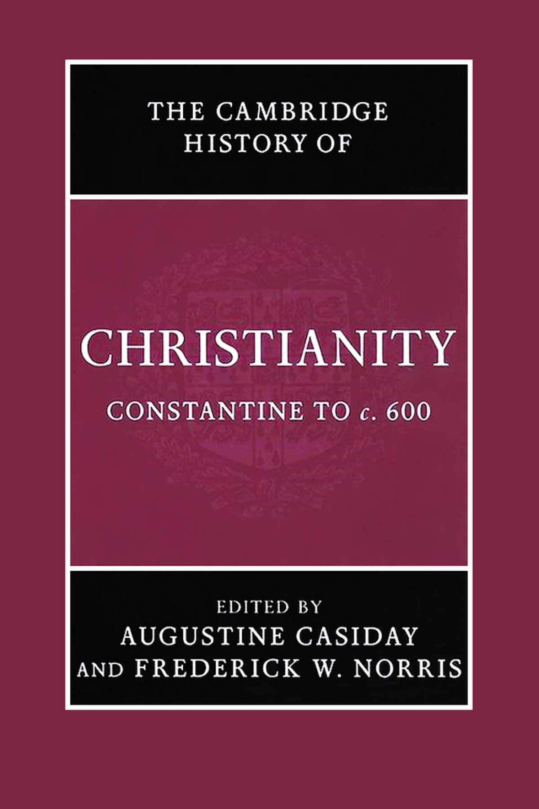
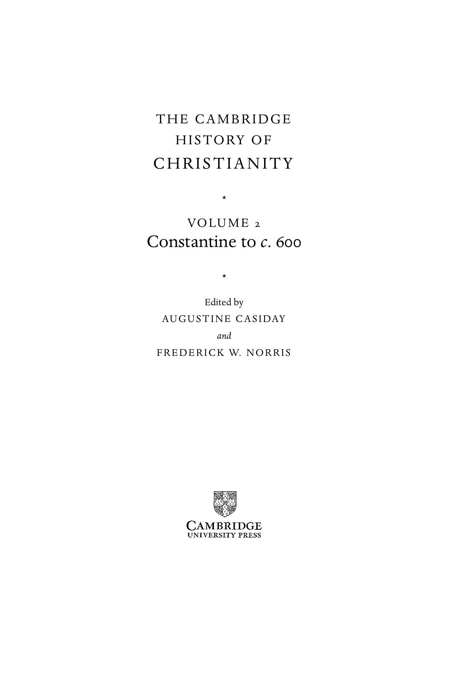
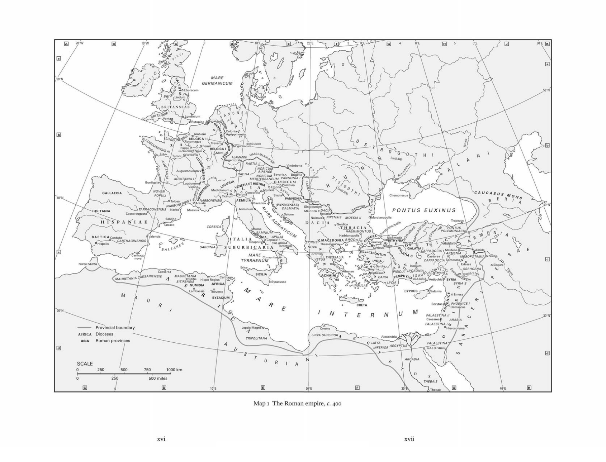
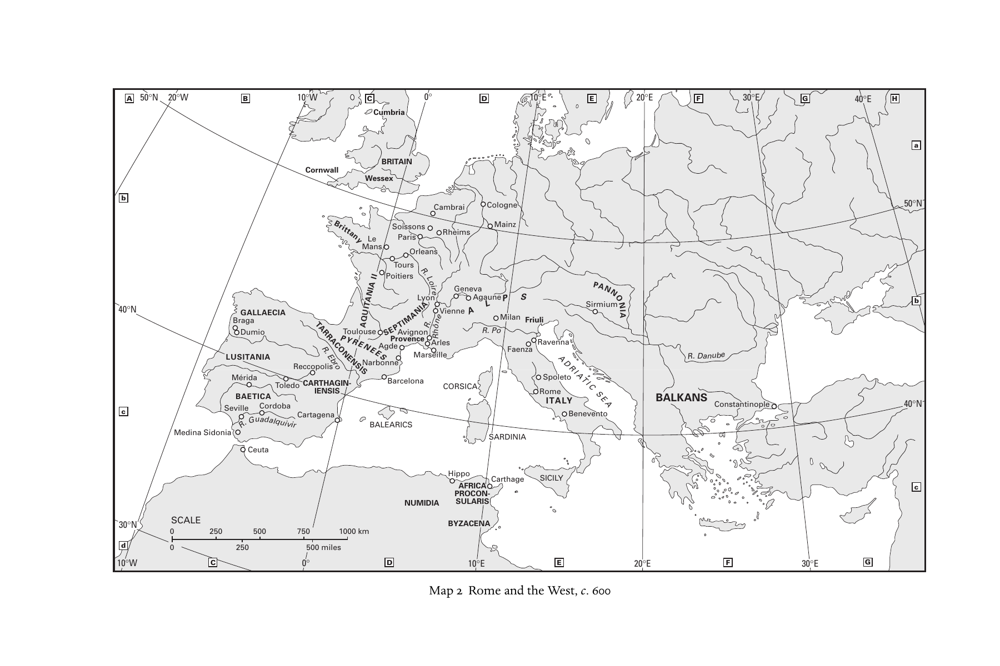
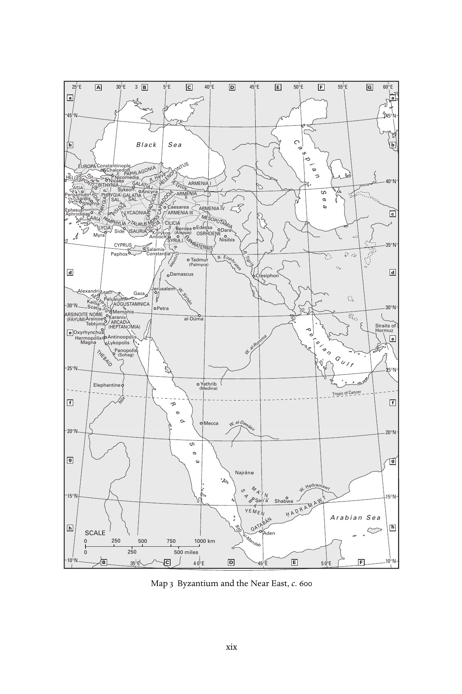
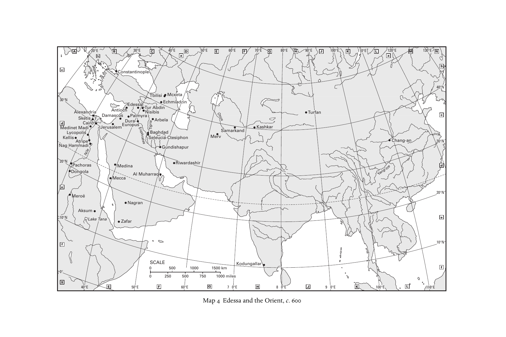

# 剑桥基督教史 第二卷：君士坦丁至约600年

## 中文全译

29章正文、注释及卷首卷末资料已全部译出。

## 目录

- [卷首资料](#frontmatter)
- [缩写表与地图](#abbreviations)
- [引言](#introduction)
- [第1部分 基督教：地域发展](#part-1)
- [第1章 西方的基督教诸形态](#chapter-01)
- [第2章 日耳曼与凯尔特的基督教诸形态](#chapter-02)
- [第3章 希腊世界的基督教诸形态](#chapter-03)
- [第4章 早期亚洲与东非的基督教诸形态](#chapter-04)
- [第2部分 基督教面对争论](#part-2)
- [第5章 古代晚期基督徒与犹太人之间的宗教互动（312—640年）](#chapter-05)
- [第6章 基督教与异教之一：埃及](#chapter-06)
- [第7章 基督教与异教之二：小亚细亚](#chapter-07)
- [第8章 基督教与异教之三：意大利](#chapter-08)
- [第9章 基督教与异教之四：北非](#chapter-09)
- [第10章 基督徒与异教徒之间的思想论争](#chapter-10)
- [第11章 基督教与摩尼教](#chapter-11)
- [第12章 异端学：“异端”与“分裂”的发明](#chapter-12)
- [第3部分 基督教文化与社会](#part-3)
- [第13章 走向基督教文化的界定：古典文学的基督教转化](#chapter-13)
- [第14章 主教与社会](#chapter-14)
- [第15章 主教会议与大公会议](#chapter-15)
- [第16章 教会法的发展](#chapter-16)
- [第17章 教会、社会与政治权力](#chapter-17)
- [第4部分 基督教信仰与实践](#part-4)
- [第18章 论三一](#chapter-18)
- [第19章 七世纪以前的基督论史](#chapter-19)
- [第20章 罪与救恩：经验与反思](#chapter-20)
- [第21章 从安提阿到阿尔勒：处境中的平信徒虔敬](#chapter-21)
- [第22章 圣徒与圣人](#chapter-22)
- [第23章 牧养与纪律](#chapter-23)
- [第24章 性、婚姻与家庭](#chapter-24)
- [第25章 礼仪与教会年的发展](#chapter-25)
- [第26章 圣经诠释](#chapter-26)
- [第27章 禁欲与修道生活之一：东方](#chapter-27)
- [第28章 禁欲与修道生活之二：西方](#chapter-28)
- [第29章 艺术与信仰传播：300—600年的基督教艺术与建筑](#chapter-29)
- [索引](#index)

---

# 卷首资料

> 本节译自原PDF第1—13页。简介、作者任职与丛书计划，均保留原书2007年出版时的状态。

## 封面与书名页

<!-- PDF第1页 -->

**剑桥基督教史**

**第二卷：君士坦丁至约600年**

主编：奥古斯丁·卡西代（Augustine Casiday）、弗雷德里克·W.诺里斯（Frederick W. Norris）

<!-- 原书第v页；PDF第6页 -->

## 本卷简介

<!-- 原书第i页；PDF第2页 -->

《剑桥基督教史》本卷呈现教父基督教的“黄金时代”。经历罗马政府数次迫害之后，基督教成为合法宗教，获得皇帝庇护，最终成为帝国偏爱的宗教。本卷文章讨论古代晚期基督教的迅速转变，特别关注艺术、社会、文学、哲学、政治、宗教间关系及文化等方面。本卷超越简单二分和化约式图式，例如“异端对正统”，力求包容地描述构成当时基督教的多样实践和理论。在适当关注罗马帝国内大公教会兴起的同时，也处理其他主题，例如帝国外基督徒共同体的发展。

奥古斯丁·卡西代，威尔士大学兰彼得分校神学与宗教研究系历史神学讲师。著有《本都的埃瓦格里乌斯》（*Evagrius Ponticus*，2006年）和《圣约翰·卡西安的传统与神学》（*Tradition and Theology in St John Cassian*，2006年），并任《剑桥早期基督教文学史》（2004年）助理编辑。

弗雷德里克·W.诺里斯，以马内利宗教学院世界基督教荣休教授。发表文章二百余篇，与 Everett Ferguson 共同担任《早期基督教百科全书》（*Encylopedia of early Christianity*，1990年；第二版1997年）副主编，并与 A. Malherbe、J. Thompson 合编《处境中的早期教会》（*The Early Church in its Context*，1998年）。

## 丛书说明

<!-- 原书第iii—iv页；PDF第4—5页 -->

《剑桥基督教史》按年代全面叙述基督教从起源至今各方面的发展，涵盖神学、思想、社会、政治、地域和全球层面。每卷都对相应时期的学术研究作出实质贡献，全套构成一部重要的学术参考书。它的目标远不止西欧基督教及其分支的历史，而是提供全球视野。东方及科普特基督教，从早期起就得到充分考虑；后来的非洲、远东、新大陆、南亚，以及其他非欧洲地区的基督教发展，也得到适当覆盖。各卷涵盖大众虔敬与基督教信仰的非正式表达，在广阔文化背景下，考察基督徒形成、敬拜和敬虔的社会学问题。基督教与其他主要信仰的关系，也始终在关注范围内。本丛书将为学者和学生提供极有价值的资源。

| 卷次与书名 | 主编（依本卷原书丛书计划） |
|---|---|
| 1　起源至君士坦丁 | Margaret M. Mitchell、Frances M. Young |
| 2　君士坦丁至约600年 | Augustine Casiday、Frederick W. Norris |
| 3　中世纪早期基督教，约600至约1100年 | Thomas Noble、Julia Smith |
| 4　西欧基督教，约1100至约1500年 | Miri Rubin、Walter Simon |
| 5　东方基督教 | Michael Angold |
| 6　改革与扩张，1500—1660年 | Ronnie Po-chia Hsia |
| 7　启蒙、复兴与革命，1660—1815年 | Stewart J. Brown、Timothy Tackett |
| 8　世界基督教诸形态，约1815—1914年 | Brian Stanley、Sheridan Gilley |
| 9　世界基督教诸形态，约1914至约2000年 | Hugh McLeod |

## 出版资料

<!-- 原书第vi页；PDF第7页 -->

剑桥大学出版社；剑桥、纽约、墨尔本、马德里、开普敦、新加坡、圣保罗。

英国地址：The Edinburgh Building, Cambridge CB2 8RU, UK。美国版由纽约剑桥大学出版社出版。

出版社网站：[Cambridge University Press](https://www.cambridge.org)。本书资料页：[Constantine to c. 600](https://www.cambridge.org/9780521812443)。

© Cambridge University Press 2007。

本出版物受版权保护。除法律规定的例外及有关集体许可协议的条款外，未经剑桥大学出版社书面许可，不得复制本书任何部分。

2007年初版。英国剑桥大学印刷厂印刷。

英国图书馆备有本书目录记录。

美国国会图书馆在版编目资料：

*Constantine to c. 600*／Augustine Casiday、Frederick W. Norris 编。页；厘米。——（《剑桥基督教史》；第2卷）。含参考文献和索引。

ISBN-13：978-0-521-81244-3（精装）；ISBN-10：0-521-81244-5（精装）。

主题：1. 教会史——原始与早期教会，约300—600年。附加款目：I. Casiday, Augustine。II. Norris, Frederick W., 1941–。III. 书名。IV. 丛书。

分类号：BR200.C66 2007；270.2—dc22。控制号：2006100088。

ISBN：978-0-521-81244-3，精装。

剑桥大学出版社不对本出版物所引外部或第三方网站网址的持续有效性或准确性负责，也不保证这些网站的任何内容现在或将来仍然准确、适当。

## 原书目录

<!-- 原书第vii—x页；PDF第8—11页 -->

以下页码沿用原书，中文版重新排版后的页码另见PDF目录。

| 项目 | 作者 | 原书页码 |
|---|---|---|
| 地图目录 | | xi |
| 撰稿人 | | xii |
| 缩写表 | | xiii |
| 引言 | 奥古斯丁·卡西代、弗雷德里克·W.诺里斯 | 1 |
| **第1部分　基督教：地域发展** | | |
| 第1章　西方的基督教诸形态 | 温里希·勒尔 | 9 |
| 第2章　日耳曼与凯尔特的基督教诸形态 | 克努特·舍费尔迪克 | 52 |
| 第3章　希腊世界的基督教诸形态 | 弗雷德里克·W.诺里斯 | 70 |
| 第4章　早期亚洲与东非的基督教诸形态 | 戴维·邦迪 | 118 |
| **第2部分　基督教面对争论** | | |
| 第5章　古代晚期基督徒与犹太人之间的宗教互动（312—640年） | 居伊·G.斯特鲁姆萨 | 151 |
| 第6章　基督教与异教之一：埃及 | 戴维·弗兰克福特 | 173 |
| 第7章　基督教与异教之二：小亚细亚 | 弗兰克·R.特龙布利 | 189 |
| 第8章　基督教与异教之三：意大利 | 米歇尔·蕾妮·萨尔茨曼 | 210 |
| 第9章　基督教与异教之四：北非 | 安娜·莱奥内 | 231 |
| 第10章　基督徒与异教徒之间的思想论争 | 艾伦·布朗 | 248 |
| 第11章　基督教与摩尼教 | 塞缪尔·N. C. 刘 | 279 |
| 第12章　异端学：“异端”与“分裂”的发明 | J. 蕾贝卡·莱曼 | 296 |
| **第3部分　基督教文化与社会** | | |
| 第13章　走向基督教文化的界定：古典文学的基督教转化 | 布朗温·尼尔 | 317 |
| 第14章　主教与社会 | 雷蒙德·范达姆 | 343 |
| 第15章　主教会议与大公会议 | 马克·爱德华兹 | 367 |
| 第16章　教会法的发展 | 肯尼思·彭宁顿 | 386 |
| 第17章　教会、社会与政治权力 | H. A. 德雷克 | 403 |
| **第4部分　基督教信仰与实践** | | |
| 第18章　论三一 | 哈立德·阿纳托利奥斯 | 431 |
| 第19章　七世纪以前的基督论史 | 卡尔-海因茨·乌特曼 | 460 |
| 第20章　罪与救恩：经验与反思 | 奥古斯丁·卡西代 | 501 |
| 第21章　从安提阿到阿尔勒：处境中的平信徒虔敬 | 乔治娅·弗兰克 | 531 |
| 第22章　圣徒与圣人 | 克劳迪娅·拉普 | 548 |
| 第23章　牧养与纪律 | 罗恩·A.格里尔 | 567 |
| 第24章　性、婚姻与家庭 | 戴维·G.亨特 | 585 |
| 第25章　礼仪与教会年的发展 | 布赖恩·D.斯平克斯 | 601 |
| 第26章　圣经诠释 | 保罗·M.布洛尔斯 | 618 |
| 第27章　禁欲与修道生活之一：东方 | 塞缪尔·鲁本森 | 637 |
| 第28章　禁欲与修道生活之二：西方 | 玛丽琳·邓恩 | 669 |
| 第29章　艺术与信仰传播：300—600年的基督教艺术与建筑 | 贝亚特·布伦克 | 691 |
| 索引 | | 726 |

## 地图目录

<!-- 原书第xi页；PDF第12页 -->

| 图号 | 标题 | 原书页码 |
|---|---|---|
| 1 | 约400年的罗马帝国 | xvi—xvii |
| 2 | 约600年的罗马与西方 | xviii |
| 3 | 约600年的拜占庭与近东 | xix |
| 4 | 约600年的埃德萨与东方 | xx |

## 撰稿人

<!-- 原书第xii页；PDF第13页 -->

| 撰稿人 | 原书所列任职单位 |
|---|---|
| 哈立德·阿纳托利奥斯（Khaled Anatolios） | 韦斯顿耶稣会神学院 |
| 保罗·M.布洛尔斯（Paul M. Blowers） | 以马内利宗教学院 |
| 贝亚特·布伦克（Beat Brenk） | 罗马第一大学“智慧大学”；巴塞尔大学荣休教授 |
| 艾伦·布朗（Alan Brown） | 剑桥大学三一学院 |
| 戴维·邦迪（David Bundy） | 富勒神学院 |
| 奥古斯丁·卡西代（Augustine Casiday） | 威尔士大学兰彼得分校 |
| H.A.德雷克（H. A. Drake） | 加利福尼亚大学圣巴巴拉分校 |
| 玛丽琳·邓恩（Marilyn Dunn） | 格拉斯哥大学 |
| 马克·爱德华兹（Mark Edwards） | 牛津大学基督堂学院 |
| 乔治娅·弗兰克（Georgia Frank） | 科尔盖特大学 |
| 戴维·弗兰克福特（David Frankfurter） | 新罕布什尔大学 |
| 罗恩·A.格里尔（Rowan A. Greer） | 耶鲁神学院，荣休教授 |
| 戴维·G.亨特（David G. Hunter） | 艾奥瓦州立大学 |
| 安娜·莱奥内（Anna Leone） | 杜伦大学 |
| 塞缪尔·N.C.刘（Samuel N. C. Lieu） | 麦考瑞大学 |
| 温里希·勒尔（Winrich Löhr） | 汉堡大学 |
| J.蕾贝卡·莱曼（J. Rebecca Lyman） | 太平洋教会神学院，荣休教授 |
| 布朗温·尼尔（Bronwen Neil） | 澳大利亚天主教大学麦考利校区 |
| 弗雷德里克·W.诺里斯（Frederick W. Norris） | 以马内利宗教学院，荣休教授 |
| 肯尼思·彭宁顿（Kenneth Pennington） | 美国天主教大学 |
| 克劳迪娅·拉普（Claudia Rapp） | 加利福尼亚大学洛杉矶分校 |
| 塞缪尔·鲁本森（Samuel Rubenson） | 隆德大学 |
| 米歇尔·蕾妮·萨尔茨曼（Michele Renee Salzman） | 加利福尼亚大学河滨分校 |
| 克努特·舍费尔迪克（Knut Schäferdiek） | 波恩莱茵弗里德里希·威廉大学，荣休教授 |
| 布赖恩·D.斯平克斯（Bryan D. Spinks） | 耶鲁大学圣乐研究所 |
| 居伊·G.斯特鲁姆萨（Guy G. Stroumsa） | 耶路撒冷希伯来大学 |
| 弗兰克·R.特龙布利（Frank R. Trombley） | 卡迪夫大学 |
| 卡尔-海因茨·乌特曼（Karl-Heinz Uthemann） | 阿姆斯特丹自由大学，荣休教授 |
| 雷蒙德·范达姆（Raymond Van Dam） | 密歇根大学 |

〔译校说明：原PDF第3页为空白页。书目题名与编目识别信息保留原文；丛书计划、人员履历和网站责任说明均译自2007年原版，未按现状更新。〕

---

# 缩写表与地图

> 译自原书第xiii—xx页，PDF第14—21页。缩写及文献题名保留原文，并附中文释义，供检索注释和书目使用。

## 缩写表

<!-- 原书第xiii页；PDF第14页 -->

| 缩写 | 原文全称 | 中文释义 |
|---|---|---|
| AB | Analecta Bollandiana | 《博兰学派论集》 |
| ACO | Acta Conciliorum Œcumenicorum | 《大公会议文献》 |
| ACW | Ancient Christian Writers | 《古代基督教作家》 |
| AJP | American journal of philology | 《美国古典语文学杂志》 |
| ANRW | Aufstieg und Niedergang der römischen Welt | 《罗马世界的兴起与衰落》 |
| ATR | Anglican theological review | 《圣公会神学评论》 |
| BAR | British Archaeological Reports | 《英国考古报告》 |
| BASP | Bulletin of the American Society of Papyrologists | 《美国纸草学会会刊》 |
| BCTH | Bulletin du Comité des Travaux Historiques et Scientifiques | 《历史与科学研究委员会会刊》 |
| BETL | Bibliotheca ephemeridum theologicarum lovaniensium | 《鲁汶神学期刊文库》 |
| BHG | Bibliotheca Hagiographica Graeca | 《希腊文圣徒传文献目录》 |
| BHO | Bibliotheca Hagiographica Orientalis | 《东方圣徒传文献目录》 |
| BSNAF | Bulletin de la Société Nationale des Antiquaires de France | 《法国国家古物学会会刊》 |
| BZAW | Beihefte zur Zeitschrift für die alttestamentliche Wissenschaft | 《旧约学杂志》增刊 |
| CCSG | Corpus Christianorum Series Graeca | 《基督教文献集》希腊文系列 |
| CCSL | Corpus Christianorum Series Latina | 《基督教文献集》拉丁文系列 |
| CIL | Corpus Inscriptionum Latinarum | 《拉丁文铭文集》 |
| CJ | Codex Justinianus | 《查士丁尼法典》 |
| CMC | Cologne Mani-Codex (P. Colon. inv. nr. 4780) | 《科隆摩尼古抄本》，馆藏号4780 |
| CollÉFR | Collection de l’École française de Rome | 《罗马法国学院丛书》 |
| CPG | Clavis Patrum Graecorum | 《希腊教父著作目录》 |
| CRAI | Comptes rendus des séances de l’Académie des Inscriptions et Belles Lettres | 《铭文与美文学院会议报告》 |
| CSCO | Corpus Scriptorum Christianorum Orientalium | 《东方基督教作家文集》 |
| CSEL | Corpus Scriptorum Ecclesiasticorum Latinorum | 《拉丁教会作家文集》 |
| CTh | Codex Theodosianus | 《狄奥多西法典》 |
| DACL | Dictionnaire d’archéologie chrétienne et de liturgie | 《基督教考古与礼仪辞典》 |
| DK | Diels, H. and W. Kranz, eds., Die Fragmente der Vorsokratiker | H. Diels、W. Kranz 编《前苏格拉底哲学家残篇》 |
| DOP | Dumbarton Oaks Papers | 《敦巴顿橡树园论文集》 |
| DSp | Dictionnaire de spiritualité ascétique et mystique, doctrine et histoire | 《禁欲与神秘灵修辞典：教义与历史》 |
| Ep(p). | Letter(s) | 书信，单数或复数 |
| FOTC | Fathers of the Church | 《教会诸教父》 |
| GCS | Griechischen christlichen Schriftsteller | 《希腊基督教作家》 |
| GNO | Gregorii Nysseni Opera | 《尼撒的格列高利全集》 |
| GRBS | Greek, Roman and Byzantine studies | 《希腊、罗马与拜占庭研究》 |

<!-- 原书第xiv页；PDF第15页 -->

| 缩写 | 原文全称 | 中文释义 |
|---|---|---|
| H.E. | Historia ecclesiastica (Church history) | 《教会史》 |
| H.L. | Palladius, Historia Lausiaca | 帕拉迪乌斯《劳苏斯史》 |
| Hom. | homily, -ies | 讲道，单数或复数 |
| HTR | Harvard theological review | 《哈佛神学评论》 |
| IGRR | Inscriptiones Graecae ad res Romanas pertinentes | 《涉及罗马事务的希腊文铭文》 |
| ILCV | Inscriptiones Latinae Christianae Veteres | 《古代拉丁文基督教铭文》 |
| ILS | Inscriptiones Latinae Selectae | 《拉丁文铭文选》 |
| Ins.Chr. | Inscriptiones Christianae urbis Romae septimo saeculo antiquiores | 《罗马城七世纪以前的基督教铭文》 |
| JAAR | Journal of the American Academy of Religion | 《美国宗教学会杂志》 |
| JbAC | Jahrbuch für Antike und Christentum | 《古代与基督教年鉴》 |
| JECS | Journal of early Christian studies | 《早期基督教研究杂志》 |
| JRS | Journal of Roman studies | 《罗马研究杂志》 |
| JTS | Journal of theological studies | 《神学研究杂志》 |
| LCL | Loeb Classical Library | 《洛布古典丛书》 |
| LXX | Septuagint | 《七十士译本》 |
| Mansi | J. D. Mansi, ed., Sanctorum conciliorum et decretorum collectio nova | J. D. Mansi 编《神圣会议与教令新汇编》 |
| MEFRA | Mélanges de l’École française de Rome, antiquité | 《罗马法国学院杂刊：古代》 |
| MGH aa | Monumenta Germaniae Historica – auctores antiquissimi | 《德意志历史文献》最古作家系列 |
| MGH leg | Monumenta Germaniae Historica – leges | 《德意志历史文献》法律系列 |
| MGH scr.mer. | Monumenta Germaniae Historica – scriptores rerum merovingicarum | 《德意志历史文献》墨洛温时代史家系列 |
| NHC | Nag Hammadi Codex | 纳格哈马迪古抄本 |
| NPNF | Select Library of Nicene and Post Nicene Fathers of the Church | 《尼西亚及尼西亚后期教父选集》 |
| OCA | Orientalia Christiana Analecta | 《东方基督教论集》 |
| OECT | Oxford Early Christian Texts | 《牛津早期基督教文本》 |
| Or. | Orations | 演说 |
| PG | Patrologia Graeca | 《希腊教父集》 |
| PL | Patrologia Latina | 《拉丁教父集》 |
| PLRE | Prosopography of the Later Roman Empire | 《晚期罗马帝国人物志》 |
| PO | Patrologia Orientalis | 《东方教父集》 |
| Proc. Brit. Acad. | Proceedings of the British Academy | 《英国国家学术院论文集》 |
| Proc. Cambr. Phil. Soc. | Proceedings of the Cambridge Philosophical Society | 《剑桥哲学学会会刊》 |
| Proc. Royal Anthro. Instit. | Proceedings of the Royal Anthropological Institute of Great Britain and Ireland | 《大不列颠与爱尔兰皇家人类学会会刊》 |
| PTS | Patristische Texte und Studien | 《教父文本与研究》 |
| RAC | Reallexikon für Antike und Christentum | 《古代与基督教百科辞典》 |
| RE | Realencyklopädie für protestantische Theologie und Kirche | 《新教神学与教会百科全书》 |
| REL | Revue des études latines | 《拉丁研究评论》 |
| RendPontAcc | Atti della Pontificia accademia romana di archeologia, Rendiconti | 《罗马宗座考古学院会议报告》 |
| RHE | Revue d’histoire ecclésiastique | 《教会史评论》 |
| SA | Studia Anselmiana | 《安瑟伦研究》 |
| SC | Sources chrétiennes | 《基督教文献》 |
| SEA | Studia ephemeridis ‘Augustinianum’ | 《奥古斯丁研究》期刊研究丛书 |
| SEG | Supplementum Epigraphicum Graecum | 《希腊铭文补编》 |
| SH | Subsidia Hagiographica | 《圣徒传研究辅助文献》 |

<!-- 原书第xv页；PDF第16页 -->

| 缩写 | 原文全称 | 中文释义 |
|---|---|---|
| SP | Studia Patristica | 《教父学研究》 |
| SPA | Studien der Patristischen Arbeitsgemeinschaft | 《教父学研究工作组研究丛书》 |
| ST | Studi e Testi | 《研究与文本》 |
| ThPh | Theologie und Philosophie | 《神学与哲学》 |
| TRE | Theologische Realenzyklopädie | 《神学百科全书》 |
| TU | Texte und Untersuchungen | 《文本与研究》 |
| VChr | Vigiliae Christianae | 《基督教守夜》 |
| WSA | Works of St Augustine | 《圣奥古斯丁著作集》 |
| ZAC | Zeitschrift für antikes Christentum | 《古代基督教杂志》 |
| ZÄS | Zeitschrift für Ägyptische Sprache und Alterthumskunde | 《埃及语言与古物学杂志》 |
| ZKG | Zeitschrift für Kirchengeschichte | 《教会史杂志》 |
| ZNTW | Zeitschrift für die neutestamentliche Wissenschaft | 《新约学杂志》 |
| ZPE | Zeitschrift für Papyrologie und Epigrafik | 《纸草学与铭文学杂志》 |
| ZPT | Zeitschrift für Philosophie und Theologie | 《哲学与神学杂志》 |

## 地图

地名沿用地图上的原文标记；各图另附中文图题、图例和地名对照。地图比例尺中的 km 为千米，miles 为英里，°N 为北纬，°E 为东经，°W 为西经。

### 图1　约400年的罗马帝国

<!-- 原书第xvi—xvii页；PDF第17—18页 -->

图例：省界（Provincial boundary）；罗马行省（Roman provinces）；行政区（Dioceses）。比例尺：0、250、500、750、1000千米；0、250、500英里。

| 原图标记 | 中文对照 |
|---|---|
| Scotti | 斯科特人 |
| Picti | 皮克特人 |
| Franci | 法兰克人 |
| Saxones | 撒克逊人 |
| Burgundii | 勃艮第人 |
| Alamanni | 阿拉曼尼人 |
| Marcomanni | 马尔科曼尼人 |
| Suebi | 苏维汇人 |
| Quadi | 夸迪人 |
| Hunni | 匈人 |
| Persae | 波斯人 |
| Illyricum | 伊利里库姆行政区 |
| Italia | 意大利 |
| Ostrogothi | 东哥特人 |
| Visigothi | 西哥特人 |
| Alani | 阿兰人 |
| Sarmatae | 萨尔马提亚人 |
| Visigothi / Ostrogothi (until 376) | 西哥特人／东哥特人，至376年 |
| Mauri | 毛里人 |
| Austuriani | 奥斯图里亚尼人 |
| Sarraceni | 萨拉森人 |
| Britanniae | 不列颠行政区 |
| Britannia I / II | 第一／第二不列颠 |
| Flavia Caesariensis | 弗拉维亚凯撒里恩西斯 |
| Eburacum | 埃布拉库姆，约克 |
| Lindum | 林杜姆，林肯 |
| Londinium | 伦迪尼乌姆，伦敦 |
| Venta | 文塔 |
| Rutupiae | 鲁图皮艾 |
| Galliae | 高卢行政区 |
| Belgica I / II | 第一／第二贝尔吉卡 |
| Germania I / II | 第一／第二日耳曼尼亚 |
| Lugdunensis I / II / III / Senonia | 第一／第二／第三／塞诺尼亚卢格杜嫩西斯 |
| Aquitania I / II | 第一／第二阿基坦尼亚 |
| Novem Populi | 诺文波普利，九族省 |
| Narbonensis I / II | 第一／第二纳尔波嫩西斯 |
| Viennensis | 维恩嫩西斯 |
| Alpes Cottiae | 科提阿尔卑斯 |
| Alpes Maritimae | 滨海阿尔卑斯 |
| Ambiani | 安比亚尼，亚眠 |
| Rotomagus | 罗托马古斯，鲁昂 |
| Parisii | 帕里西，巴黎 |
| Remi | 雷米，兰斯 |
| Metti | 梅提，梅斯（依图拼写） |
| Treveri | 特雷维里，特里尔 |
| Colonia Agrippinensis | 阿格里皮娜殖民城，科隆 |
| Moguntiacum | 莫贡提亚库姆，美因茨 |
| Argentorate | 阿尔根托拉特，斯特拉斯堡 |
| Turoni | 图罗尼，图尔 |
| Augustodunum | 奥古斯托杜努姆，欧坦 |
| Burdigala | 布尔迪加拉，波尔多 |
| Lugdunum | 卢格杜努姆，里昂 |
| Vienna | 维埃纳 |
| Tolosa | 托洛萨，图卢兹 |
| Narbo | 纳尔波，纳博讷 |
| Arelate | 阿雷拉特，阿尔勒 |
| Massilia | 马西利亚，马赛 |
| Hispaniae | 西班牙行政区 |
| Gallaecia | 加利西亚 |
| Lusitania | 卢西塔尼亚 |
| Baetica | 贝提卡 |
| Tarraconensis | 塔拉科嫩西斯 |
| Carthaginiensis | 卡尔塔吉嫩西斯 |
| Caesaraugusta | 凯撒奥古斯塔，萨拉戈萨 |
| Tarraco | 塔拉科，塔拉戈纳 |
| Barcino | 巴尔基诺，巴塞罗那 |
| Valencia | 瓦伦西亚 |
| Corduba | 科尔杜巴，科尔多瓦 |
| Hispalis | 希斯帕利斯，塞维利亚 |
| Carthago nova | 新迦太基，卡塔赫纳 |
| Baleares | 巴利阿里群岛 |
| Italia Suburbicaria | 近郊意大利行政区 |
| Liguria | 利古里亚 |
| Venetia et Histria | 威尼提亚与伊斯特里亚 |
| Aemilia | 艾米利亚 |
| Picenum | 皮凯努姆 |
| Tuscia | 图斯基亚 |
| Campania | 坎帕尼亚 |
| Samnium | 萨姆尼乌姆 |
| Apulia | 阿普利亚 |
| Calabria | 卡拉布里亚 |
| Lucania | 卢卡尼亚 |
| Bruttii | 布鲁提 |
| Corsica | 科西嘉 |
| Sardinia | 撒丁 |
| Sicilia | 西西里 |
| Mediolanum | 米兰 |
| Ticinum | 提基努姆，帕维亚 |
| Verona | 维罗纳 |
| Concordia | 孔科尔迪亚 |
| Aquileia | 阿奎莱亚 |
| Ravenna | 拉文纳 |
| Ariminum | 阿里米努姆，里米尼 |
| Roma | 罗马 |
| Neapolis | 尼阿波利斯，那不勒斯 |
| Capua | 卡普阿 |
| Tarentum | 塔伦图姆，塔兰托 |
| Consentia | 孔森提亚，科森扎 |
| Erice | 埃里切 |
| Syracusae | 叙拉古 |
| Raetia I / II | 第一／第二雷提亚 |
| Noricum Ripense | 河岸诺里库姆 |
| Noricum Mediterraneum | 内陆诺里库姆 |
| Pannonia I / II | 第一／第二潘诺尼亚 |
| Pannonia (Pannoniae) | 潘诺尼亚行政区 |
| Savia | 萨维亚 |
| Valeria | 瓦莱里亚 |
| Dalmatia | 达尔马提亚 |
| Vindobona | 温多博纳，维也纳 |
| Savaria | 萨瓦里亚 |
| Brigetio | 布里盖提奥 |
| Aquincum | 阿奎因库姆 |
| Emona | 埃莫纳 |
| Poetovio | 波埃托维奥 |
| Siscia | 西斯基亚 |
| Sirmium | 西尔米乌姆 |
| Singidunum | 辛吉杜努姆，贝尔格莱德 |
| Salonae | 萨洛纳 |
| Dacia | 达契亚行政区 |
| Dacia Ripensis | 河岸达契亚 |
| Dacia Mediterranea | 内陆达契亚 |
| Moesia I / II | 第一／第二默西亚 |
| Naissus | 纳伊苏斯 |
| Serdica | 塞尔迪卡 |
| Ratiaria | 拉提亚里亚 |
| Thracia | 色雷斯 |
| Haemimontus | 海米蒙图斯 |
| Rhodope | 罗多彼 |
| Europa | 欧罗巴 |
| Scythia | 斯基提亚 |
| Marcianopolis | 马尔基亚诺波利斯 |
| Hadrianopolis | 哈德良堡 |
| Constantinopolis | 君士坦丁堡 |
| Macedonia | 马其顿 |
| Epirus Nova / Vetus | 新／旧伊庇鲁斯 |
| Thessalia | 色萨利 |
| Achaia | 阿凯亚 |
| Thessalonica | 帖撒罗尼迦 |
| Athenae | 雅典 |
| Insulae | 群岛省 |
| Creta | 克里特 |
| Africa | 阿非利加行政区 |
| Tingitania | 廷吉塔尼亚 |
| Mauretania Caesariensis | 凯撒里亚毛里塔尼亚 |
| Mauretania Sitifensis | 西提菲斯毛里塔尼亚 |
| Numidia | 努米底亚 |
| Byzacium | 比扎基乌姆 |
| Tripolitana | 的黎波里塔尼亚 |
| Caesarea | 凯撒里亚 |
| Sitifis | 西提菲斯 |
| Hippo Regius | 王家希波 |
| Carthago | 迦太基 |
| Lambaesis | 兰拜西斯 |
| Theveste | 特维斯特 |
| Lepcis Magna | 大莱普提斯 |
| Libya Superior / Inferior | 上／下利比亚 |
| Cyrene | 昔兰尼 |
| Alexandria | 亚历山大里亚 |
| Aegyptus | 埃及 |
| Arcadia | 阿尔卡狄亚 |
| Thebais | 底比斯省 |
| Thebae | 底比斯 |
| Asiana | 亚细亚行政区 |
| Pontica | 本都行政区 |
| Oriens | 东方行政区 |
| Cilicia I / II | 第一／第二基利家 |
| Asia | 亚细亚省 |
| Lydia | 吕底亚 |
| Caria | 卡里亚 |
| Phrygia I / II | 第一／第二弗里吉亚 |
| Pisidia | 彼西底 |
| Pamphylia | 潘菲利亚 |
| Lycia | 吕基亚 |
| Lycaonia | 吕考尼亚 |
| Isauria | 伊苏里亚 |
| Bithynia | 比提尼亚 |
| Honorias | 奥诺里亚斯 |
| Paphlagonia | 帕夫拉戈尼亚 |
| Galatia I / S. | 第一／萨卢塔里斯加拉太（S.为原图缩写） |
| Hellespontus | 赫勒斯滂 |
| Helenopontus | 赫勒诺本都 |
| Pontus Polemoniacus | 波勒蒙本都 |
| Cappadocia I / II | 第一／第二卡帕多基亚 |
| Armenia I / II | 第一／第二亚美尼亚 |
| Nicomedia | 尼科米底亚 |
| Heraclea | 赫拉克利亚 |
| Nicaea | 尼西亚 |
| Cyzicus | 基齐库斯 |
| Ancyra | 安居拉 |
| Sardis | 萨迪斯 |
| Smyrna | 士每拿 |
| Ephesus | 以弗所 |
| Iconium | 伊科尼乌姆 |
| Tarsus | 塔尔苏斯 |
| Trapezus | 特拉佩祖斯，特拉布宗 |
| Melitene | 梅利提涅 |
| Amida | 阿米达 |
| Samosata | 撒摩撒他 |
| Mesopotamia | 美索不达米亚 |
| Osrhoena | 奥斯若恩 |
| Euphratensis | 幼发拉底省 |
| Syria | 叙利亚 |
| Syria S. | 叙利亚·S.（原图缩写） |
| Phoenice | 腓尼基 |
| Phoenice I | 第一腓尼基 |
| Palaestina I / II | 第一／第二巴勒斯坦 |
| Palaestina Salutaris | 救恩巴勒斯坦省 |
| Arabia | 阿拉伯省 |
| Cyprus | 塞浦路斯 |
| Salamis | 萨拉米斯 |
| Antiochia | 安提阿 |
| Emesa | 埃梅萨 |
| Berytus | 贝鲁图斯，贝鲁特 |
| Damascus | 大马士革 |
| Hierosolyma | 耶路撒冷 |
| Edessa | 埃德萨 |
| Nisibis | 尼西比斯 |
| Singara | 辛加拉 |
| Armenia | 亚美尼亚 |
| Iberia | 伊比利亚，今格鲁吉亚东部地区 |
| Chersonesus | 赫尔松内索斯 |
| Caucasus Mons | 高加索山脉 |
| Mare Germanicum | 日耳曼海，北海 |
| Pontus Euxinus | 黑海 |
| Mare Adriaticum | 亚得里亚海 |
| Mare Tyrrhenum | 第勒尼安海 |
| Mare Internum | 内海，地中海 |
| Rhenus | 莱茵河 |
| Liger | 卢瓦尔河 |
| Rhodanus | 罗讷河 |
| Albis | 易北河 |
| Vistula | 维斯瓦河 |
| Danuvius | 多瑙河 |
| Tanais | 顿河 |
| Borysthenes | 第聂伯河 |
| Euphrates | 幼发拉底河 |
| Tigris | 底格里斯河 |

### 图2　约600年的罗马与西方

<!-- 原书第xviii页；PDF第19页 -->

比例尺：0、250、500、750、1000千米；0、250、500英里。

| 原图标记 | 中文对照 |
|---|---|
| Britain | 不列颠 |
| Cumbria | 坎布里亚 |
| Cornwall | 康沃尔 |
| Wessex | 韦塞克斯 |
| Brittany | 布列塔尼 |
| Cambrai | 康布雷 |
| Cologne | 科隆 |
| Mainz | 美因茨 |
| Soissons | 苏瓦松 |
| Rheims | 兰斯 |
| Paris | 巴黎 |
| Le Mans | 勒芒 |
| Orleans | 奥尔良 |
| Tours | 图尔 |
| Poitiers | 普瓦捷 |
| Aquitania II | 第二阿基坦尼亚 |
| Septimania | 塞普提马尼亚 |
| Provence | 普罗旺斯 |
| Lyon | 里昂 |
| Vienne | 维埃纳 |
| Geneva | 日内瓦 |
| Agaune | 阿高讷 |
| Toulouse | 图卢兹 |
| Avignon | 阿维尼翁 |
| Arles | 阿尔勒 |
| Agde | 阿格德 |
| Marseille | 马赛 |
| Narbonne | 纳博讷 |
| Gallaecia | 加利西亚 |
| Braga | 布拉加 |
| Dumio | 杜米奥 |
| Lusitania | 卢西塔尼亚 |
| Baetica | 贝提卡 |
| Tarraconensis | 塔拉科嫩西斯 |
| Carthaginiensis | 卡尔塔吉嫩西斯 |
| Mérida | 梅里达 |
| Toledo | 托莱多 |
| Reccopolis | 雷科波利斯 |
| Cordoba | 科尔多瓦 |
| Seville | 塞维利亚 |
| Medina Sidonia | 梅迪纳西多尼亚 |
| Cartagena | 卡塔赫纳 |
| Barcelona | 巴塞罗那 |
| Ceuta | 休达 |
| Pyrenees | 比利牛斯山脉 |
| Alps | 阿尔卑斯山脉 |
| R. Ebro | 埃布罗河 |
| R. Guadalquivir | 瓜达尔基维尔河 |
| R. Loire | 卢瓦尔河 |
| R. Rhône | 罗讷河 |
| R. Po | 波河 |
| R. Danube | 多瑙河 |
| Italy | 意大利 |
| Milan | 米兰 |
| Friuli | 弗留利 |
| Faenza | 法恩扎 |
| Ravenna | 拉文纳 |
| Spoleto | 斯波莱托 |
| Rome | 罗马 |
| Benevento | 贝内文托 |
| Pannonia | 潘诺尼亚 |
| Sirmium | 西尔米乌姆 |
| Balkans | 巴尔干 |
| Constantinople | 君士坦丁堡 |
| Corsica | 科西嘉 |
| Sardinia | 撒丁 |
| Sicily | 西西里 |
| Balearics | 巴利阿里群岛 |
| Adriatic Sea | 亚得里亚海 |
| Hippo | 希波 |
| Carthage | 迦太基 |
| Africa Proconsularis | 阿非利加行省 |
| Numidia | 努米底亚 |
| Byzacena | 比扎凯纳 |

### 图3　约600年的拜占庭与近东

<!-- 原书第xix页；PDF第20页 -->

比例尺：0、250、500、750、1000千米；0、250、500英里。Tropic of Cancer 为北回归线。

| 原图标记 | 中文对照 |
|---|---|
| Black Sea | 黑海 |
| Caspian Sea | 里海 |
| Red Sea | 红海 |
| Persian Gulf | 波斯湾 |
| Arabian Sea | 阿拉伯海 |
| Straits of Hormuz | 霍尔木兹海峡 |
| Bab al-Mandab | 曼德海峡 |
| Tropic of Cancer | 北回归线 |
| Nile | 尼罗河 |
| R. Halys | 哈吕斯河 |
| R. Lycus | 吕科斯河 |
| R. Euphrates | 幼发拉底河 |
| R. Tigris | 底格里斯河 |
| R. Orontes | 奥龙特斯河 |
| W. Sirhan | 西尔汉干河谷 |
| W. al-Rumma | 鲁迈干河谷 |
| W. al-Dawāsir | 达瓦西尔干河谷 |
| W. Ḥaḍramawt | 哈德拉毛干河谷 |
| Europa | 欧罗巴 |
| Hellespontus | 赫勒斯滂 |
| Bithynia | 比提尼亚 |
| Paphlagonia | 帕夫拉戈尼亚 |
| Helenopontus | 赫勒诺本都 |
| Galatia I / II | 第一／第二加拉太 |
| Galatia Sal. | 萨卢塔里斯加拉太 |
| Phrygia Pac. / Sal. | 帕卡提亚纳／萨卢塔里斯弗里吉亚 |
| Asia | 亚细亚 |
| Lydia | 吕底亚 |
| Caria | 卡里亚 |
| Pisidia | 彼西底 |
| Pamphylia | 潘菲利亚 |
| Lycia | 吕基亚 |
| Lycaonia | 吕考尼亚 |
| Isauria | 伊苏里亚 |
| Taurus Mons | 托罗斯山脉 |
| Cappadocia I / II | 第一／第二卡帕多基亚 |
| Armenia I / II / III / IV | 第一／第二／第三／第四亚美尼亚 |
| Cilicia I / II | 第一／第二基利家 |
| Cyprus | 塞浦路斯 |
| Syria I / II | 第一／第二叙利亚 |
| Mesopotamia | 美索不达米亚 |
| Osrhoene | 奥斯若恩 |
| Euphratensis | 幼发拉底省 |
| Constantinople | 君士坦丁堡 |
| Chalcedon | 迦克墩 |
| Nicomedia | 尼科米底亚 |
| Nicaea | 尼西亚 |
| Sykeon | 叙凯翁 |
| Ancyra | 安居拉 |
| Pergamum | 别迦摩 |
| Sardis | 萨迪斯 |
| Smyrna | 士每拿 |
| Ephesus | 以弗所 |
| Aphrodisias | 阿佛洛狄西亚斯 |
| Side | 西德 |
| Myra | 米拉 |
| Iconium | 伊科尼乌姆 |
| Caesarea | 凯撒里亚 |
| Korykos | 科里科斯 |
| Antioch | 安提阿 |
| Beroea (Aleppo) | 贝罗埃，阿勒颇 |
| Edessa | 埃德萨 |
| Dara | 达拉 |
| Nisibis | 尼西比斯 |
| Paphos | 帕福斯 |
| Salamis-Constantia | 萨拉米斯—君士坦提亚 |
| Tadmur (Palmyra) | 塔德穆尔，帕尔米拉 |
| Damascus | 大马士革 |
| Ctesiphon | 泰西封 |
| Jerusalem | 耶路撒冷 |
| Gaza | 加沙 |
| Petra | 佩特拉 |
| al-Dūma | 杜马 |
| Alexandria | 亚历山大里亚 |
| Aegyptus | 埃及 |
| Augustamnica | 奥古斯塔姆尼卡 |
| Arcadia (Heptanomia) | 阿尔卡狄亚，七州地区 |
| Arsinoite Nome (Fayum) | 阿尔西诺伊州，法尤姆 |
| Thebaid | 底比斯省 |
| Pelusium | 佩卢西乌姆 |
| Kellia | 凯利亚 |
| Scetis | 斯凯提斯 |
| Memphis | 孟菲斯 |
| Karanis | 卡拉尼斯 |
| Tebtunis | 特布图尼斯 |
| Oxyrhynchus | 俄克喜林库斯 |
| Hermopolis Magna | 大赫尔莫波利斯 |
| Antinoopolis | 安提诺波利斯 |
| Lykopolis | 吕科波利斯 |
| Panopolis (Sohag) | 帕诺波利斯，索哈杰 |
| Elephantine | 象岛 |
| Yathrib (Medina) | 雅斯里布，麦地那 |
| Mecca | 麦加 |
| Najrān | 奈季兰 |
| Maʿīn | 马因 |
| Sabaʾ | 萨巴 |
| Ṣanʿāʾ | 萨那 |
| Yemen | 也门 |
| Qatabān | 卡塔班 |
| Ḥaḍramawt | 哈德拉毛 |
| Shabwa | 舍卜沃 |
| Aden | 亚丁 |

### 图4　约600年的埃德萨与东方

<!-- 原书第xx页；PDF第21页 -->

比例尺：0、500、1000、1500千米；0、250、500、750、1000英里。

| 原图标记 | 中文对照 |
|---|---|
| Constantinople | 君士坦丁堡 |
| Tbilisi | 第比利斯 |
| Mcxeta | 姆茨赫塔 |
| Echmiadzin | 埃奇米阿津 |
| Edessa | 埃德萨 |
| Tur Abdin | 图尔阿卜丁 |
| Nisibis | 尼西比斯 |
| Antioch | 安提阿 |
| Damascus | 大马士革 |
| Palmyra | 帕尔米拉 |
| Dura Europos | 杜拉欧罗波斯 |
| Arbela | 阿尔贝拉 |
| Baghdad | 巴格达 |
| Seleucia-Ctesiphon | 塞琉西亚—泰西封 |
| Gundishapur | 贡迪沙普尔 |
| Riwardashir | 里瓦尔达希尔 |
| Al Muharraq | 穆哈拉格 |
| Alexandria | 亚历山大里亚 |
| Sketis | 斯凯提斯 |
| Cairo | 开罗 |
| Medinet Madi | 麦迪内特马迪 |
| Lycopolis | 吕科波利斯 |
| Kellis | 凯利斯 |
| Atripe | 阿特里佩 |
| Nag Hammadi | 纳格哈马迪 |
| Jerusalem | 耶路撒冷 |
| Pachoras | 帕科拉斯 |
| Dongola | 栋古拉 |
| Meroë | 麦罗埃 |
| Aksum | 阿克苏姆 |
| Lake Tana | 塔纳湖 |
| Medina | 麦地那 |
| Mecca | 麦加 |
| Nagran | 奈季兰 |
| Zafar | 扎法尔 |
| Merv | 木鹿，梅尔夫 |
| Samarkand | 撒马尔罕 |
| Kashkar | 喀什 |
| Turfan | 吐鲁番 |
| Chang-an | 长安 |
| Yang-tze | 长江 |
| Kodungallar | 科东加卢尔 |
| Nile | 尼罗河 |
| Euphrates | 幼发拉底河 |
| Tigris | 底格里斯河 |
| Oxus | 阿姆河 |

---

# 引言

**作者：奥古斯丁·卡西代（Augustine Casiday）、弗雷德里克·W.诺里斯（Frederick W. Norris）**

《剑桥基督教史》第二卷《君士坦丁至约600年》中文译稿

> 原书第1—5页，PDF第22—26页；PDF第27页为空白。引言正文完整翻译，本篇无脚注。章目参见及原书的历史判断依原文保留，疑点另列译校说明。
>
> [引言英文原文](<引言（英文）.md>) · [原书PDF](<../02 君士坦丁至600年.pdf>)

<!-- 原书第1—2页；PDF第22—23页 -->

《剑桥基督教史》本卷各章展现的是教父时代基督教的“黄金时期”。在经历罗马政府一度又一度的迫害之后，基督教成为享有皇帝庇护的合法宗教，最终又成为帝国优待的宗教。所谓大公教会，正是在这一时期，即约300至600年间，从蓬勃而多样的基督教诸形态之中兴起。本卷重新讲述大公教会的故事，也讲述其内部无名大众，以及教会以外难以计数者的故事。

这一时期，基督教迅速发生转变。本卷将从多个方面考察这些变化，具体包括：艺术（第29章）、文化（第12、26—28章）、宗教间关系（第5、1—11章）、文学（第13章）、哲学（第10、18—19章）、政治（第14—17章）、社会（第6—9、17、20—25章），当然还有神学（第18—20章）。这一安排符合现代研究对这段时期所采取的多学科取向；如今，这段时期通常被称为“古代晚期”。因此，本卷各章作者分别来自教义神学、历史神学、社会史、艺术史、礼仪学、考古学、哲学、比较宗教学及语文学等专业领域。

本卷的叙述也遵循当代古代晚期基督教研究的做法，摆脱简单的二分与化约式图解，例如“异端对正统”，转而力求包容地描述构成本时期基督教的种种实践和理论。因而，在存世证据容许的范围内，我们对基督教的论述以兼容并包为目标。作者专业背景的广泛，同样有助于考察范围相应广泛的证据。因此，我们既以相称的篇幅讨论大公教会在罗马帝国内的兴起，也处理其他主题：例如，帝国内基督徒群体在信仰和实践上的分歧，以及帝国境外基督徒群体的发展。

在西方，基督徒开始吸收当地大量的希腊、拉丁文化遗产，其信仰与实践也随之演变，由此奠定了欧洲文化的许多基础（第1章）。后来在中世纪及其后时代有助于教宗制度发展的不少特点，也在这一时期初露端倪。西方基督教的一些基本要素，例如《圣经》正典及其诠释、信经，以及主教、会议与修道生活在基督徒群体中的角色，都在这个时代发展到相当成熟的程度，因此可以说，一种较为宏大的“叙事”正在形成。正如下文有关西方基督教、主教与社会、平信徒虔敬、牧养与纪律，以及性别、婚姻与独身的各章所示，古代晚期基督教不断发展的故事，也呈现了关于文化、家庭与友谊的富有吸引力的见解。

不过，也必须指出，与此同时，对信仰的不同理解，以及为基督教西方服务的不同制度，也在形成。从四世纪末起，日耳曼入侵者把自己的文化和宗教带入罗马帝国晚期社会；在某些情况下，他们带来的还是强大的阿里乌派教会，其起源可以追溯到中欧一些哥特人的归信（见第2章）。日耳曼国王及其社会，与罗马皇帝及其共同体一样，希望有一种强大而统一的宗教力量。在他们的支持下，多样、时而相互竞争的教会，进入欧洲和北非的基督教历史。这些竞争常常带来政治力量的介入；至于把这种介入视为参与还是干涉，则取决于观察者的立场。如果这些阿里乌派入侵者在传播自身信仰方面没有如此成功，既有的西方基督教或许还需更长时间，才能在整个罗马帝国境内形成其帝国式形态。大公教会直到后来才找到使这些阿里乌派基督徒改宗，或压制他们的办法。有些被宣布为异端的群体，例如北非的多纳徒派社群，延续到本卷所述时期临近结束，甚至更晚，其自身的故事也相应发展下去（见第1、9章）。在另外一些形成地域性基督教的地方，基督教则在非罗马文化中实现了本土化，不列颠群岛的凯尔特社会便是如此。这些群体最终也被吸纳进大公教会。

基督徒从中欧和东欧向西迁徙，显然具有重要意义：它把不同的信经带入西欧，也以其他方式推动了西方基督教社会史的发展。

<!-- 原书第3页；PDF第24页 -->

人口迁徙，甚至个人的行旅，在整个基督教历史中都发挥了重要作用。从圣保罗希望前往西班牙传教的愿望，到亚历山大里亚的亚他那修被流放西欧的经历，更不用说那些身份较为卑微、作用却同样重要的送信人的往返，这些行旅网络把整个欧洲联系起来，使基督徒得以广泛传播自己的信仰与实践。

在东欧和近东，基督教又发展出其他叙事（第2章）。东西方教会领袖之间的关系错综复杂，而且时常紧张。东方牧首常因教宗制度一贯坚持正确的信仰而寄望于它；当东方会议作出对斗争中某些参与者不利的决定时，他们也常把罗马当作上诉法庭。不过，教宗有时深陷政治形势，无法采取行动；而且无论如何，罗马的裁断也并非全都得到基督教东方的认可。另一方面，罗马主教偶尔也会反对会议多数派的决定，尤其是在罗马自身的地位受到挑战之时。关于三一、基督论、救恩、教会法、地方敬拜及平信徒虔敬等教义与实践问题的争论，遍及整个地中海盆地。

这些辩论不仅出现在权力大厅与主教会议中，也发生在鱼市和公共浴场里。事实上，早在任何皇帝亲自介入以前，世俗政治与教会政治就已开始在地方层面相互交织。但随着君士坦丁在政治上崛起，他所信奉的基督教，对于帝国得到神圣护佑的意义，开始占据先前皇帝向诸神献祭所具有的位置。君士坦丁并未把任何一种基督教完全确立为帝国的唯一宗教，也没有表现出对基督教德性的深切承诺，甚至继续支持某些异教领袖及其宗教；尽管如此，他给予基督徒的厚遇，尤其是经济特权和慷慨资助，仍使帝国传统宗教处于极为不利的地位。宏伟教堂的兴建计划，彰显了基督徒地位的上升，也说明对富有者和社会显贵而言，扶持基督教具有吸引力。这一趋势既见于君士坦丁本人的建设活动，也见于米兰的安布罗斯等主教的作为，最终体现为查士丁尼遍布帝国的豪华建筑工程。建筑、礼仪与艺术，以及对希腊化修辞和文学形式的吸收，吸引了上层阶级的耳目；他们往往依据自身文化来评价这个较新的宗教（尤见第13、29章）。试图从哲学上为基督教的主张提供辩护，则使基督徒的讨论进入另一条重要的文化传统（第10章）。

<!-- 原书第4页；PDF第25页 -->

当然，并非每位有权势的庇护者都支持基督教。皇帝尤利安在位于360至363年，试图借用自己深恶痛绝的“拿撒勒人”的道德特点，复兴异教。假如他活得更久，基督教的诸多故事可能会大不相同。然而，他在战场上身亡，甚至可能死于自己的一些基督徒士兵之手，其计划因而破灭。狄奥多西二世（401—450年）通过法典中针对异端群体与传统宗教的措施，为基督教确立统治地位定下最终条件。然而，更深入的研究表明，在不同地方，传统宗教的信奉者和遭到排斥的基督徒群体，尽管被宣布为非法，仍然继续存在（尤见第6—7章）。圣徒传记和铭文清楚显示，许多主教始终还在与异教社群及其影响抗争，例如北非便是如此（见第9章）。我们早已知道，他们通过著述反对古典希腊、罗马异教，以及摩尼教徒等群体（第11章）；但更多研究成果显示，主教们几乎每周都得留意其他宗教隐蔽的节庆和秘密敬拜。即使到本时期临近结束，也没有哪个基督徒群体彻底消灭了自己的竞争者。

还须指出，罗马帝国本身的基督教化常常充满动荡与分裂，有时也加剧了与邻近基督徒人口之间的问题。例如，在东地中海，各基督徒派别积极争斗；早期拜占庭统治者确立君士坦丁堡的基督教形态后，又通过征税以及法院中的偏袒，对反对他们的基督徒施加巨大压力。结果，所有相互竞争的基督徒群体都受到削弱，面对七世纪伊斯兰势力的入侵时，便无力抵挡。

《剑桥基督教史》有意以相当篇幅讨论东方及亚洲地区的基督教发展；在这一类综述中，这些领域有时会被忽略。给予它们这样的关注完全恰当，其中一个重要原因是：基督教从早期起就是一种具有全球抱负的传教信仰。然而，地中海世界以外最早的基督教发展，却太常遭到忽视。这令人遗憾，不过也部分可以理解：有关证据相对稀少，而且存世的文学和文献证据使用多种东方语言。即使如此，从本书考察的时代起，基督教已经进入世界上许多文明的历史。讨论这些群体在这一早期时代的经历，也有助于为后续各卷对“世界基督教”的论述奠定基础。

<!-- 原书第5页；PDF第26页 -->

例如，在非洲，埃塞俄比亚基督教在许多意义上都是顽强延续至今的一支，其根基十分深厚。它与努比亚基督教一样，沿尼罗河兴盛，并很快呈现出显著的文化繁荣；但与努比亚基督教不同，埃塞俄比亚的基督教一直延续到现代。埃及的基督教同样延续至今，尽管其群体处于边缘地位，并时常遭受压迫。在本时期结束之前，科普特神学家已经开始阐明一种足以支撑他们数百年的身份认同。在小亚细亚，亚美尼亚与格鲁吉亚在确立自身基督教身份的同时，也塑造了民族身份。叙利亚数百年来一直孕育着富有活力和创造力的神学家。早在君士坦丁掌权以前，基督徒就已在波斯、今日的伊拉克以及印度生活并实践信仰。虽然他们在波斯遭到严厉迫害，当地乃至整个地区的基督徒人数仍在增长。与此同时，某种基督教形态已经进入阿拉伯人之中，至少见于巴勒斯坦和也门，甚至很可能深入阿拉伯半岛内地。不过，甚至在穆罕默德兴起以前，六世纪的一些巴勒斯坦阿拉伯基督徒，就已支持波斯，反对拜占庭基督徒。

我们还有线索表明，至少有一位修士在六世纪进入中国。七世纪初，中国皇帝表达的热情欢迎，显示这位修士传播的基督教信息激起了君主的好奇心；皇帝似乎把它视为“道”的一种迷人而独特的表达，因而能够与之建立联系。

总而言之，在本卷中，我们有意摆脱只凭单一帝国叙事来讲述基督教历史的做法，转而让其他基督教诸形态以其自身的面貌出现。即使其中许多在十九世纪大规模传教扩张以前便已从历史中消失，它们仍然是本时期基督宗教与文化表达繁荣景象的重要组成部分。本卷许多章节，事实上也包括本篇引言的大部分内容，都会使我们自然而然地把注意力放在冲突的实例上；不过，我们也必须意识到，群体内部以及群体之间的交往，并非总是冲突性的，它们也可能，并且有时确实，给彼此带来丰富。

## 译校说明

本引言的相对时间和学术背景，依原书2007年出版时的语境理解。“宗教间关系”后的章目编号，原PDF第22页确实印为“chs. 5, 1–11”；原书第3页关于东欧、近东的段落，又参见“第2章”，而本卷目录把“希腊世界的基督教诸形态”列为第3章。译文保留这些原书参见，没有自行替换。

原书有关进入中国的修士在六世纪来华、以及中国皇帝在七世纪初表达欢迎的年代表述，均依作者原文译出，没有将推定的修订混入正文。引言中的历史解释与因果判断同样保留作者立场。

---

# 第1部分 基督教：地域发展

<!-- PDF第28—29页；第29页为空白。 -->

---

# 第1章 西方的基督教诸形态

**作者：温里希·勒尔（Winrich Löhr）**

《剑桥基督教史》第二卷《君士坦丁至约600年》中文译稿

> 原书第9—51页，PDF第30—72页。正文及181条注释的解释文字完整翻译，章末书目保留原文。地理及教义用语沿用第一卷并作必要区分。
>
> [第一章英文原文](<第01章 西方的基督教诸形态（英文）.md>) · [原书PDF](<../02 君士坦丁至600年.pdf>)

<!-- 原书第9—11页；PDF第30—32页 -->

从君士坦丁到六世纪末，西方基督教的历史既是一部扩展史，也是一部多种基督教形态的形成史。它的扩展缓慢，而且难以追踪。四世纪初，罗马帝国西部的基督教化程度远低于东方，基督徒估计仅占人口的百分之二。[^ch01-1]我们可以根据考古材料、铭文，或主教座数量的增加，对其发展作出初步估量，但仍难建立总体图景。乡村对基督教化的抵抗，大概远比城市人口持久，甚至乡村是否曾彻底成为基督教社会，也值得怀疑；主教或修士的传教活动，即使确曾开展，所起的作用也很有限。相比之下，西方贵族阶层的基督教化已有较为充分的研究。直到四世纪后半叶，基督教才发展出一种与社会精英的意识形态及价值体系相契合的信息，从而吸引了其中许多人。[^ch01-2]

基督教的多样性，部分源自罗马帝国晚期的重大政治变革。其中最重要的变化，或许是帝国东西部日益分离。君士坦丁去世后，帝国在政治上的分治，回应了行政管理的便利，以及莱茵河、多瑙河和波斯边境近乎持续战争所带来的军事需要。政治中心东移，迁至君士坦丁堡。五世纪，各日耳曼民族填补了西方的权力真空。他们的相似派教会散布在意大利、高卢、西班牙和北非，穿插于罗马世界的基督教诸形态之间。[^ch01-3]除某些地区以外，西方在五、六世纪还经历了显著的经济衰退。

君士坦丁许多基督徒继承者的宗教政策，又带来其他重要变化。有些皇帝，例如君士坦提乌斯二世，尤其是查士丁尼，深深介入神学争论，因为他们相信，教义统一是和平与繁荣的基础。然而，君士坦提乌斯二世、芝诺或查士丁尼雄心勃勃地试图确立教义统一，最终却导致基督教分裂成相互分离的群体。面对干预教会事务的皇帝，四世纪科尔多瓦的奥西乌斯，以及五世纪教宗格拉修等主教提出抗议，尤其是在皇帝支持他们的对手之时。从六世纪开始，东哥特、西哥特、勃艮第和墨洛温诸王，部分仿效了基督徒皇帝的宗教政策。由于他们的王国较小，而且内部较为同质，控制教会也就没有那么困难。

这一时期另一个重要因素，是罗马教会的地位。它不断提升并巩固自己在西方的优越地位，甚至试图在更远的地方确立权威。教宗犹利乌斯在任于337至352年，主张自己有权复审东方其他教会的会议裁决；塞尔迪卡的西方会议支持了他的行动。教宗英诺森一世在任于402至417年，宣称彼得既是使徒职分（apostolatus）的起源，也是主教职分（episcopatus）的起源，并要求所有西方教会在纪律事务上遵从罗马。教宗利奥在任于440至461年，他利用已经存在的彼得思想，提出一项兼具神秘性与法律性的主张：教宗是彼得的代理。495年，罗马的一次会议又欢呼教宗格拉修为“基督的代理”（vicarius Christi）；格拉修在任于492至496年。[^ch01-4]罗马关于彼得的思想，与其他竞争性观念发生冲突。例如，查士丁尼把教会设想为一个等级分明的整体，以罗马、君士坦丁堡、亚历山大里亚、安提阿和耶路撒冷五大牧首区为中心；罗马却不承认这一观念。[^ch01-5]由于东西方基督教之间并无明确划定的界限，自四世纪末开始，罗马与君士坦丁堡一直争夺对巴尔干各省的权威，尤其是伊利里库姆。当地政治地理和教会地理的变动格外复杂。教宗西里修斯在任于384至399年、英诺森在任于402至417年期间，罗马宣称，对以帖撒罗尼迦为中心的东伊利里库姆，拥有高于省会主教的权威。即使“帖撒罗尼迦代牧区”在利奥及其继任者时期不再发挥作用，罗马仍支持伊利里亚各教会的自主地位，反对君士坦丁堡。[^ch01-6]

因此，贯穿本时期整个基督教西方的主题包括：政治转型与相互竞争的正统观念的形成，西方贵族的基督教化，以及政治结构和教会结构之间的互动。

## 分裂与尼西亚正统的兴起

<!-- 原书第11—13页；PDF第32—34页 -->

君士坦丁于337年去世后，把统治权留给诸子：君士坦丁二世统治西部大行政区，包括不列颠、高卢和西班牙；君士坦斯统治意大利、非洲、伊利里库姆和默西亚；君士坦提乌斯二世则统治东方以及色雷斯行政区。君士坦丁二世赦免了父亲从各自主教座流放的一些东方主教，包括亚历山大里亚的亚他那修和安居拉的马尔凯卢斯。不过，他们的归来引起困难，不久又遭驱逐。亚他那修和马尔凯卢斯前往罗马，向教宗犹利乌斯申诉，请他推翻东方会议对他们的定罪。罗马会议宣布两人无罪后，亚他那修又促使君士坦斯介入。西方皇帝向兄弟君士坦提乌斯二世提议，共同召集东西方主教举行会议。

342或343年，近九十位西方主教和约八十位东方主教，为此来到塞尔迪卡，即今索非亚。然而，双方从未共同开会；东方主教拒绝修改自己会议的决议，最终退出。[^ch01-7]西方会议在科尔多瓦的奥西乌斯主持下继续，最后颁布二十一条教规。双方分别拟定了两份不同的信经：西方代表签署了一份他们视为对尼西亚信仰有效解释的文本，并为安居拉的马尔凯卢斯的神学辩护；东方主教则传布一份反对这种立场的信经，即所谓第四安提阿公式。[^ch01-8]塞尔迪卡的失败，加剧了两位皇帝原有的竞争。君士坦斯最终威胁说，如果君士坦提乌斯二世不允许亚他那修返回亚历山大里亚，便要对他动武。当时东方皇帝的军队正在与波斯作战，因此作出让步。[^ch01-9]但在350年成为唯一统治者后，君士坦提乌斯又试图拟定一份共同的信经表述，弥合分裂。这种明确制定正统准则的新尝试，带来一段密集拟定妥协信经的时期：第二西尔米乌姆公式，即357年所谓“西尔米乌姆的亵渎”；358年的第三西尔米乌姆公式；359年的第四西尔米乌姆公式；同年里米尼和塞琉西亚的公式；以及360年的君士坦丁堡公式。[^ch01-10]

科尔多瓦的奥西乌斯和罗马的利贝里乌斯，都被卷入君士坦提乌斯雄心勃勃的宗教政策。皇帝怀疑亚他那修犯有叛国罪，因而让353年的阿尔勒会议和355年的米兰会议将他定罪。米兰主教狄奥尼修，与韦尔切利的优西比乌、卡拉里斯，即今卡利亚里的路西弗一样，拒绝参加谴责，因此被流放，由卡帕多西亚人奥克森提乌斯接任。奥西乌斯也拒绝在阿尔勒—米兰的会议决议上签字，但大概未受伤害。357年夏，君士坦提乌斯在驻地西尔米乌姆召集了一次小型主教会议，可能由奥西乌斯主持，希望借一份妥协的信仰公式弥合神学分歧。由此形成的第二西尔米乌姆公式，禁止使用任何以ousia为基础的措辞，例如homousios或homoiousios。[^ch01-11]五位西方主教签署了这一公式：奥西乌斯、里斯本的波塔米乌斯，以及三位伊利里亚主教，即穆尔萨的瓦伦斯、辛吉杜努姆的乌尔萨基乌斯和西尔米乌姆的格尔米尼乌斯。但年迈的奥西乌斯返回西班牙，传播第二西尔米乌姆公式时，却在家乡所在的贝提卡行省遭到抵抗。与此同时，罗马的利贝里乌斯批评阿尔勒和米兰对亚他那修的定罪，因而被流放到色雷斯的庇哩亚。他的高级教士曾宣誓支持他，但皇帝的意志最终占了上风，利贝里乌斯被斐利克斯二世取代。斐利克斯不得人心；无论如何，两年后，利贝里乌斯被迫同时认可对亚他那修的定罪和第二西尔米乌姆公式。君士坦提乌斯随后允许他返回，条件是他与斐利克斯共享主教座。这一政治妥协失败，引发民众骚乱。利贝里乌斯和奥西乌斯签署信经，大概都是为了推动教会的和平与合一。[^ch01-12]尽管得到他们支持，第二西尔米乌姆信经在东西方都遭到反对，最终撤回。

即使如此，皇帝关于教会重新联合的宏大政策，还是在359年分别于意大利里米尼和奇里乞亚塞琉西亚举行的双会中，达到预定高潮。这是古代基督教规模最大的会议之一。第一次会期，四百多位与会主教中的多数，拒绝了提议的“相似派”信经，[^ch01-13]转而认可尼西亚信仰；这是西方主教首次大规模采取这一立场。第二次会期，政治压力以及结束塞尔迪卡分裂的愿望占了上风，西方主教受到推动，撤回先前的反对。他们一致接受新的“相似派”信仰公式，并附加一系列反阿里乌派的绝罚，从而与东方教会恢复联合。[^ch01-14]来自里米尼的西方代表团，又在除夕夜与君士坦提乌斯本人会面时，接受了一份略有差异的相似派信经，确认这一结果。[^ch01-15]不过，值得注意的是，罗马主教座没有参与里米尼会议。

普瓦捷的希拉里曾通过论战小册子攻击君士坦提乌斯的政策。他严厉责备皇帝及其主教顾问，指控他们在里米尼施压，迫使西方主教放弃尼西亚正统，接受阿里乌派异端。罗马的利贝里乌斯则致函其他西方主教，讨论如何接纳相似派的洗礼。[^ch01-16]西班牙、高卢乃至罗马的一些不妥协教士，例如卡拉里斯的路西弗，及埃尔维拉主教格列高利，与那些参与里米尼立场逆转的主教断绝共融。这些人也因路西弗而被称为“路西弗派”。耶柔米论及里米尼—塞琉西亚—君士坦丁堡会议时，留下名言：“全世界痛苦地呻吟，惊讶地发现自己竟成了阿里乌派！”[^ch01-17]在耶柔米和希拉里看来，相似派的正统是通过欺骗强加于西方主教群体的。[^ch01-18]

<!-- 原书第14页；PDF第35页 -->

这一首次试图用信经在整个帝国确立正统的努力，很快遇到困难。君士坦提乌斯于361年去世；在尤利安361至363年的短暂统治之后，西方少数仍捍卫相似派正统的主教，例如米兰的奥克森提乌斯、西尔米乌姆的格尔米尼乌斯、穆尔萨的瓦伦斯和辛吉杜努姆的乌尔萨基乌斯，逐渐被边缘化。[^ch01-19]继尤利安之后的两位基督徒皇帝兄弟，瓦伦提尼安一世和瓦伦斯，似乎支持不同的神学正统：前者在位于364至375年，在西方有节制地支持尼西亚信仰；后者在位于364至378年，在东方捍卫360年君士坦丁堡会议确立的相似派主教群体。虽然东西方教会似乎可能逐步靠拢，但是否能通过相似派正统实现这一目标，却很可疑。如果确实需要共同信经，那么何不回到久负盛名的尼西亚公式，再对它作出解释，消除多数东方主教的抵抗呢？

在西方，普瓦捷的希拉里未能把相似派主教奥克森提乌斯逐出米兰，[^ch01-20]但罗马的达马苏，尤其是米兰的新主教安布罗斯，成为尼西亚正统的支持者。[^ch01-21]然而，罗马坚决支持安提阿保利努斯那个处于分裂状态的尼西亚派教会，使东方的安提阿主教梅利提乌斯，以及凯撒里亚的巴西尔等人感到不安；他们主张对尼西亚信经作出妥协性解释。狄奥多西一世在位于379至395年期间，379年的安提阿会议、381年的阿奎莱亚会议、同年君士坦丁堡的第二次普世会议及382年的续会，以及382年的罗马会议，都认可尼西亚正统，恢复了某种程度的统一。但东西方主教始终没有共同召开一次会议。西方教会重申尼西亚信经，却未明确接受东方对homousios，即“同质”一词的解释。[^ch01-22]380年2月28日，狄奥多西颁令宣布新的正统，以罗马的达马苏和亚历山大里亚的彼得共同作为正统信仰的守护者。[^ch01-23]到四世纪末，帝国各教会在形式上统一接受尼西亚正统，却仍未就其解释达成一致。

## 尼西亚正统与西方基督教诸形态：捍卫与建构

<!-- 原书第14—15页；PDF第35—36页 -->

狄奥多西于395年1月17日去世后，帝国再次分给皇帝的儿子们；他们不是年幼，就是无权。在西方，伽拉·普拉西狄娅等公主，以及汪达尔人斯提利科或罗马人埃提乌斯等强大将领，决定着政策。帝国虽然形式上仍保持统一，东西两半却日益疏远。东方帝国最终得以稳固，而不断瓦解的西方帝国，其最后一位皇帝尼波斯死于480年，见证了多个日耳曼王国的建立。最突出的新统治者，是曾任罗马将军和执政官的狄奥多里克。他在意大利建立东哥特王国，并从511年起，直到526年去世，还统治着高卢南部和西班牙的西哥特王国。在鼎盛时期，狄奥多里克的统治成为一个向外辐射的中心，把原西部帝国领土上新形成的一批日耳曼政权联系起来。

西部帝国瓦解的一个重要后果，是两种基督教正统彼此竞争。它们都产生于君士坦提乌斯和狄奥多西先后整合罗马帝国教会的尝试。日耳曼教会保留传统的相似派正统；最早接受这一正统的乌尔斐拉，是一群居住在罗马领土上的哥特人的主教，也曾签署360年的君士坦丁堡信经。[^ch01-24]相比之下，意大利、高卢、西班牙和北非诸省的罗马基督教诸形态，则坚持尼西亚正统。不过，西部各省的大公派，即尼西亚派基督教，必须与日耳曼统治者的相似派基督教相处。双方关系各异，从宽容到间歇性、时而严厉的迫害都有；宽容尤其见于意大利和高卢，迫害则尤见于北非。

尽管西部帝国缓慢瓦解，西方大公派基督教仍影响着东方持续进行的尼西亚正统的表述与建构。在东方主教和牧首不断变换的联盟中，罗马教会代表西方发挥领导作用，其成效并不一致。最初，罗马支持亚历山大里亚的区利罗，反对君士坦丁堡的涅斯托里乌斯。教宗西克斯图斯在任于432至440年，兴建了宏伟的圣母大殿，奉献给“上帝之母”（dei genetrix，希腊语theotokos）。但区利罗的继任者、亚历山大里亚的狄奥斯科鲁斯，以及修院院长尤提契所持的合一性论立场，[^ch01-25]使罗马与亚历山大里亚出现裂痕。449年，狄奥多西二世似乎倾向支持狄奥斯科鲁斯和尤提契，并打算召集一次全体会议。教宗利奥于是向君士坦丁堡的弗拉维安发出著名的《大卷》，用相当篇幅反驳尤提契的极端合一性论。[^ch01-26]

<!-- 原书第16页；PDF第37页 -->

449年8月，在以弗所举行的所谓“强盗会议”上，狄奥斯科鲁斯恐吓与会主教，迫使他们屈服。利奥的《大卷》没有被宣读，君士坦丁堡的弗拉维安被罢免；不过，在士兵把他拖走之前，他把一份书面申诉交给了罗马代表团。执事希拉里大概是唯一成功返回罗马的罗马使节。461年，希拉里继利奥出任教宗，在拉特兰教堂的洗礼堂制作铭文，感谢自己平安归来。[^ch01-27]

“强盗会议”是罗马的一次严重挫折。然而，450年8月，将军马尔基安继狄奥多西即位；他娶了皇帝的姐姐普尔喀丽亚。马尔基安和普尔喀丽亚决心逆转前任的宗教政策，于451年10月召集新会议，并使会议在迦克墩举行，以便皇帝出席。五百多位主教参加，但西方仅有三位罗马代表，以及来自非洲的两位主教。会议的基督论定义，试图使利奥《大卷》中的基督论语言，与区利罗反对涅斯托里乌斯的第二封信相协调。[^ch01-28]但许多东方主教仍反对尼西亚—迦克墩正统，尤其反感《大卷》。罗马对这次会议的立场始终矛盾：一方面，它捍卫迦克墩的基督论定义和《利奥大卷》；另一方面，它又激烈反对第28条教规。这条教规援引381年君士坦丁堡会议第3条，试图使“新罗马”君士坦丁堡与“旧罗马”地位平等，理由是两者都是首都和皇帝驻地。[^ch01-29]而在罗马看来，其主教的权威，来自教宗是使徒彼得的继承人，甚至是他的代理（vicarius）。教宗利奥坚持尼西亚会议第6条，并把它解释为对自己主教座独特地位的确认。[^ch01-30]

## 迦克墩会议的余波与阿卡基乌斯分裂

<!-- 原书第16—18页；PDF第37—39页 -->

迦克墩会议之后，尼西亚传统内部发生分裂，君士坦丁堡的皇帝和主教不得不面对其后果。他们试图在不废除迦克墩基督论定义的前提下，对合一性论的反对者作出某些让步，使尼西亚—迦克墩基督教重新整合。482年秋，皇帝芝诺致函亚历山大里亚教会，提出一份由君士坦丁堡的阿卡基乌斯拟定的妥协公式。芝诺在位于474至491年。这份声明，即所谓《合一敕令》（Henotikon），坚持尼西亚信经的独一权威，宣布涅斯托里乌斯和尤提契为异端并予以绝罚，同时把区利罗致涅斯托里乌斯的第三封信确立为准则。[^ch01-31]阿卡基乌斯以此为基础，寻求与亚历山大里亚的合一性论牧首彼得·蒙古斯恢复共融；此后，又寻求与安提阿的新任合一性论主教、“漂布工彼得”恢复共融。后者继任卡兰狄翁，卡兰狄翁则因捍卫迦克墩定义而被逐出主教座。但在罗马看来，彼得·蒙古斯是已经受到谴责的异端，也是迦克墩信仰的反对者，因此这些和解举动完全不可接受。484年7月，教宗斐利克斯三世主持罗马会议，罢免彼得·蒙古斯和君士坦丁堡的阿卡基乌斯。一年后，罗马会议也把安提阿的彼得绝罚。[^ch01-32]

罗马反对皇帝强行推行教义妥协的政策，是在东西方政治分歧进一步加深的背景下持续下来的。自493年起，东哥特王狄奥多里克在拉文纳建立宫廷。东哥特诸王虽然名义上从属于君士坦丁堡，却在此后三十年统治意大利，保证了政治稳定、一定程度的繁荣，甚至某种文化兴盛。狄奥多里克希望东方皇帝承认他的统治，却不愿帝国宫廷过多影响意大利。在罗马本城，教会与元老院就应如何处理分裂意见不一。斐利克斯的继任者，教宗格拉修，坚决捍卫罗马立场，甚至要求东方各教会从双联名册中删去阿卡基乌斯的名字。[^ch01-33]

此后，罗马的态度发生变化。497年，罗马元老院首席、贵族费斯图斯，与两位意大利主教一道，率团出使皇帝。[^ch01-34]代表团既带去了狄奥多里克要求皇帝正式承认其王位的请求，也带去了教宗阿纳斯塔修的信。阿纳斯塔修在任于496至498年，他在信中通报自己当选，并请求不再纪念阿卡基乌斯的名字。[^ch01-35]在与亚历山大里亚教会两位使节（apokrisarioi）的谈判中，罗马代表团甚至使对方产生希望，以为教宗可能接受《合一敕令》。[^ch01-36]然而，费斯图斯一行返回罗马时，阿纳斯塔修已经去世。和平倡议随之消失，罗马形势恶化，因为498年竟选出了两位教宗。其中，劳伦提乌斯似乎采取和解立场；另一位西马库斯则继续格拉修的政策。经过长期对峙，以及罗马街头的武装冲突，西马库斯最终胜出。506年，狄奥多里克承认他为合法教宗；西马库斯反对君士坦丁堡的立场，可能对此有所帮助。他在任至514年。

不久以后，政治再次推动了恢复共融的努力。新任东方皇帝查士丁在位于518至527年，[^ch01-37]其侄子兼继承人查士丁尼在位于527至565年；两人都认为，要重振帝国往日的荣耀，恢复教会统一十分重要。当时的形势也有利于和解。于是，查士丁迫使君士坦丁堡的约翰，接受西马库斯的继任者、教宗霍尔米斯达提出的条件。经过短暂谈判，519年春，罗马与君士坦丁堡重新共融。约翰被迫接受霍尔米斯达的公式，其中谴责了阿卡基乌斯、彼得·蒙古斯和漂布工彼得等人。这份教宗公式也追随迦克墩会议，谴责尤提契与狄奥斯科鲁斯，并确认“教宗利奥关于正统信仰所写的一切书信”。此外，约翰接受霍尔米斯达的要求，从本教会双联名册中删去所有被罗马绝罚的人。[^ch01-38]

狄奥多里克不欢迎查士丁的新宗教政策。他怀疑波爱修斯；后者从522年开始担任拉文纳的宫廷事务长官，与君士坦丁堡宫廷关系良好。波爱修斯是一位学识渊博的平信徒神学家，他所接受的尼西亚—迦克墩正统版本，可以与合一性论立场妥协。[^ch01-39]这些关系或许使狄奥多里克警惕。他下令逮捕波爱修斯，把他囚禁在帕维亚，时而施以酷刑，最后又以叛国及巫术罪将其处死。波爱修斯在狱中写下了《哲学的慰藉》。

<!-- 原书第19页；PDF第40页 -->

当查士丁剥夺东方相似派“异端”的教堂时，狄奥多里克迅速作出强硬回应。他派教宗约翰一世率领代表团前往君士坦丁堡，威胁说，如果东方相似派不能收回教堂，而且那些被迫归信尼西亚派的相似派信徒不能撤销改宗，他就要对意大利的大公派采取报复措施。[^ch01-40]狄奥多里克对结果并不满意；代表团返回拉文纳后，他以不忠为由逮捕教宗。约翰死在狱中，作为殉道者安葬。狄奥多里克准备报复拉文纳的大公派教会，但还未实施，自己便于526年8月30日去世。

## 西方的分裂：维吉利乌斯与第五次普世会议

<!-- 原书第19—20页；PDF第40—41页 -->

查士丁尼希望做到前任未能做到的事。他通过与合一性论者对话，推动尼西亚—迦克墩正统，并为这一计划寻求教宗约翰二世的支持；后者在任于533至535年。[^ch01-41]535年，君士坦丁堡新任主教安提穆斯提出，与合一性论者恢复共融，并接受《合一敕令》。536年春，教宗阿加佩图斯一世为东哥特王狄奥达哈德执行政治使命，来到君士坦丁堡。他根据教规，迫使安提穆斯辞职，并按立其继任者梅纳斯；这是教宗首次按立东方主教。[^ch01-42]查士丁尼与梅纳斯，向教宗提交霍尔米斯达公式的扩充版本，证明自身正统。阿加佩图斯则继续约翰二世支持查士丁尼的立场，作为回应。[^ch01-43]

即使教宗与皇帝在这次事件中找到了共同立场，他们联盟中潜藏的问题，也在教宗维吉利乌斯任内显露。维吉利乌斯在任于537至555年，出身贵族：其父是意大利大区长官，兄弟是罗马城市长官。他体现了教宗制度“贵族化”的趋势。[^ch01-44]他曾任罗马驻君士坦丁堡使节，似乎注定会加入查士丁尼的计划。但当皇帝着手拟定一种神学立场，希望充分捍卫尼西亚—迦克墩正统，同时既不屈从“涅斯托里乌斯主义”，又不向激进的合一性论者让步过多时，两人之间便发生问题。皇帝通过敕令推行自己的神学，并强迫主教签署。544或545年，皇帝发表教义论著，谴责“三章”。[^ch01-45]这篇论著在东方教会及非洲流传，并被提交给教宗使节。东方四位牧首虽然深感不安，仍然签署。罗马驻君士坦丁堡使节提出抗议，并与梅纳斯停止共融。查士丁尼命令维吉利乌斯前来君士坦丁堡。教宗被罗马士兵逮捕，随后于545年11月22日乘帝国船只离开罗马，就在东哥特人第二次围城开始之前；这次围城最终取得成功。

维吉利乌斯获悉，罗马、非洲、撒丁岛、希腊及伊利里亚，都广泛反对查士丁尼谴责“三章”。因此，他于547年1月25日抵达君士坦丁堡后开始的谈判，并未取得成功。教宗与牧首相互绝罚，但六个月后又恢复和解。教宗秘密向皇帝表示，愿意谴责“三章”；这或许说明，他先前反对皇帝宗教政策的态度，充其量也是暧昧的。[^ch01-46]他召集七十位、主要来自西方的主教开会，探询他们的意见，却很快中断谈话。查士丁尼的宫廷事务长官要求主教们在一周内提交意见。其中一位主教，是来自非洲、颇具战斗力的赫尔米亚纳的法昆杜斯。他匆忙从一篇较大论著中摘录材料，写成对“三章”的辩护。[^ch01-47]法昆杜斯最终返回非洲比扎凯纳，隐匿行踪，并在此后十五年间继续从那里抵抗查士丁尼。与此同时，维吉利乌斯向梅纳斯致函，即548年4月11日所谓《裁决书》（Iudicatum），谴责“三章”，同时坚持迦克墩会议的有效性。[^ch01-48]

《裁决书》促使西方公开分裂。维吉利乌斯是否向迦克墩的敌人让步过多？达契亚首席主教贝内纳图斯，因为支持《裁决书》而被罢免；非洲的一次会议正式将教宗绝罚；阿尔勒主教、教宗在高卢的代牧奥勒利安则要求解释。皇帝试图压制抵抗，召迦太基的雷帕拉图斯、提帕萨的菲尔穆斯，以及两位比扎凯纳主教，前往君士坦丁堡。

<!-- 原书第21页；PDF第42页 -->

雷帕拉图斯被罢免、流放，由他自己的使节普里莫苏斯取代。菲尔穆斯屈服于压力，却在归途中去世。两位比扎凯纳主教中的一位，普里马修斯，在谴责“三章”后成为比扎凯纳的首席主教。争论仍在继续。查士丁尼重新征服非洲，本来旨在使大公派摆脱相似派的枷锁，却带来了更多迫害。不过，最终他的政策取得成功，非洲基督教统一接受了新的正统。[^ch01-49]

至于维吉利乌斯，550年，他获准撤回《裁决书》，条件是必须以秘密书面誓言，向皇帝保证自己忠于谴责“三章”的立场。[^ch01-50]次年7月，查士丁尼又颁布一道反对“三章”的敕令，并在君士坦丁堡各主要教堂公布。[^ch01-51]教宗认为，神学问题应由会议解决，至少也应征求西方主教的书面答复，因此要求撤下敕令。[^ch01-52]所有仍留在君士坦丁堡的西方主教，包括米兰的达提乌斯，都支持他。与此同时，首都局势已经十分紧张，维吉利乌斯和追随者离开伽拉·普拉西狄娅宫，在圣彼得与圣保罗教堂寻求庇护。551年8月14日，维吉利乌斯拟定绝罚令，针对凯撒里亚的狄奥多若及其追随者，以及君士坦丁堡的梅纳斯和所属主教；他认为，狄奥多若是皇帝政策的幕后推动者。[^ch01-53]不过，教宗暂时没有公布这一命令。皇帝派士兵进入教堂逮捕他。维吉利乌斯紧抱祭坛的柱子，士兵试图拖走这位老人时，祭坛结构破裂，坠落的碎块几乎将他砸死。这一悲惨场面激起旁观者同情，士兵只得撤退。[^ch01-54]教宗返回宫中，此时实际上已成为囚徒。551年圣诞节前两天，他逃往迦克墩，在圣欧斐米娅教堂获得庇护；一个世纪以前，第四次普世会议就在那里举行。

<!-- 原书第22—23页；PDF第43—44页 -->

教宗终于公布对梅纳斯和狄奥多若的绝罚。然而，他们和其他显要的东方主教郑重声明，自己效忠四次普世会议，以及一切有关正统信仰的书信，包括教宗利奥的书信；并宣布，凡针对“三章”所写的东西，全部无效。[^ch01-55]维吉利乌斯解除对东方主教的禁令，返回首都。

但查士丁尼此时希望通过一次会议，完成教会的重新联合。553年5月5日，会议在圣索菲亚大教堂的大厅开幕，约一百五十位主教出席，教宗维吉利乌斯却未参加。西方只有少数经过精心挑选的主教与会。维吉利乌斯及其支持者按照皇帝要求，另行集会，拟定了一份冗长的神学声明，于553年5月14日完成。由此形成的《决议书》（Constitutum），谴责摩普绥提亚的狄奥多若著述中的六十项摘录，即capitula，却没有谴责其本人。[^ch01-56]《决议书》同样没有对居鲁士的狄奥多勒作出个人定罪，同时向皇帝保证，其著述中任何含有涅斯托里乌斯或尤提契错误的部分，都已受到谴责。至于埃德萨的伊巴斯的书信，《决议书》则论证，迦克墩会议已经认定它符合正统。

教宗没有谴责“三章”，因而违背了与皇帝的协议。查士丁尼召开的会议无视《决议书》。第七次会期，一位帝国官员揭露，教宗曾秘密承诺全力支持查士丁尼的宗教政策。皇帝命令从双联名册中删去教宗的名字，与会主教赞同了皇帝的信。[^ch01-57]553年6月2日的最后一次会期，所有主教签署了一份冗长的会议判决，并附十四项绝罚，包括对“三章”的谴责。[^ch01-58]反对的非洲主教遭到流放。维吉利乌斯屈服，于554年2月23日发表第二份《决议书》，认可会议决定的实质内容：谴责摩普绥提亚的狄奥多若和居鲁士的狄奥多勒的著述，绝罚狄奥多若本人，并谴责伊巴斯的书信，此时又把这封信宣布为伪作。[^ch01-59]维吉利乌斯已经信誉扫地，但获准返回罗马；555年6月7日，他在归途中的西西里去世。

他的执事伯拉纠继任。伯拉纠由皇帝任命，受到帝国军队保护，却在556年复活节仅由两位主教按立。虽然他宣称效忠四次普世会议，并为自己参与“三章”争论作出辩解，饱受战争蹂躏的意大利仍然抵抗他，尤其是米兰和阿奎莱亚的省会主教。分裂由此发生。伦巴德人占领期间，米兰主教移居热那亚，阿奎莱亚主教则退往格拉多岛。米兰与罗马直到572年才恢复关系，格拉多与罗马则要等到607年。伦巴德领土上的阿奎莱亚又按立了一位竞争性的省会主教，他继续反对罗马和553年的会议。西哥特西班牙同样无视该会议。这种局面持续了近一个半世纪。约700年以前，分裂终于结束，正如此前哥特人、苏维汇人和汪达尔人的相似派基督教一样。帝国一项失败宗教政策所留下的残余，最终由帕维亚的一次会议加以终结。[^ch01-60]

## 意大利

我们对古代晚期意大利基督教扩展的认识，仍相当粗略。313年罗马会议，只有十六位意大利主教出席。可以推定，五世纪的主教数量显著增加；到六世纪末，约有二百五十个主教座，应当是现实的估计，其中五分之一位于北部。基督教对乡村的渗透，在五世纪有所加强，乡村修道生活显然发挥了一定作用。六世纪，随着狄奥多里克的东哥特王国瓦解而来的政治不稳定，尤其是伦巴德人的入侵，似乎在一定程度上延缓了乡村基督教化。[^ch01-61]

意大利民政行政区，分为以罗马为中心的南部Italia suburbicaria，以及以米兰为中心的北部Italia annonaria。对南部各主教而言，罗马主教就是省会主教。四世纪，米兰则成为北部的教会中心。但五世纪初，皇帝驻地从米兰迁往拉文纳，米兰失去突出地位。从长远看，这使北部教会分成三部分，米兰、拉文纳和阿奎莱亚，分别成为省会主教座。[^ch01-62]

<!-- 原书第24—26页；PDF第45—47页 -->

达马苏366至384年的主教任期，鲜明展现了罗马如何成为西方基督教诸形态中居于首位的教会。[^ch01-63]开端却十分艰难：利贝里乌斯与斐利克斯二世之间的分裂，仍在撕裂教会。利贝里乌斯于366年9月24日去世后，出现两个派别。其中一派或许人数较少，在台伯河西区的尤利乌斯巴西利卡按立了乌尔西努斯；其对手则在卢奇纳的圣洛伦佐教堂选举达马苏。[^ch01-64]达马苏取得拉特兰教堂，并在10月初于此获按立为罗马主教。他促使城市长官维文提乌斯驱逐乌尔西努斯及其两位执事，但民众把他们解救出来，使他们到埃斯奎林山的利贝里乌斯巴西利卡避难。10月26日，达马苏的支持者，一群由教士、战车御手、竞技场杂役和掘墓人（fossores）组成的武装暴民，包围教堂，纵火烧毁，并屠杀了一百六十名男女。他与乌尔西努斯冲突中其他令人不齿的事件，也给此后整个任期蒙上阴影。数次罗马会议，以及381年的阿奎莱亚会议，都处理过这些问题；达马苏则向世俗当局求助，要求压制乌尔西努斯派。373年，一个名叫以撒的人指控达马苏犯有谋杀等罪。皇帝瓦伦提尼安相信指控不实，终止司法程序。378年，罗马会议宣告达马苏无罪，并就教会司法管辖提出详细建议，增强罗马主教在意大利和西部帝国各教会中的地位。会议还建议，使教宗免受城市长官的司法管辖。[^ch01-65]

此后数百年，教宗选举仍然是个问题。如果长老和执事等教士无法就人选达成一致，并没有固定程序解决冲突，于是便发生分裂。其中最严重的，大概是前述五世纪末的“劳伦提乌斯分裂”。[^ch01-66]教宗选举的政治化，也从更广的意义上证明，古代晚期主教职分的声望和重要性不断增长。一方面，地方社会包括容易被操纵的民众、强大却很少意见一致的基督徒贵族，以及往往坚持自身主张的教士。[^ch01-67]另一方面，则有各种地区性及跨地区权力：罗马或拜占庭皇帝、他们派出的各类全权代表，以及日耳曼国王。

尽管面临激烈反对，达马苏仍是一位精力充沛的主教，也是自己那群易于骚动的信众的忠实领袖，虽然手段冷酷。他利用一切可用媒介传播基督教信息，以扩大本主教座的影响，促进教会统一。四世纪后半叶，基督教开始渗透罗马社会的最高阶层；到该世纪最后十年，大批罗马贵族成为基督徒。[^ch01-68]从370年到五世纪末，是罗马基督徒公益施惠活动的黄金时期，基督徒贵族的慷慨捐赠逐渐取代了皇帝的资助。[^ch01-69]新建的各处tituli教堂，其教士负责牧养不断增长的基督徒人口，不仅得到礼仪用具，例如礼服和器皿，更重要的，是获赠罗马城内外、意大利、西西里，乃至远达北非和伊利里库姆的地产。这就是罗马教会教产（patrimonium）的起源；在五、六世纪动荡之中，管理它们必定相当困难。[^ch01-70]地产收益用来维护建筑、支付教士津贴。达马苏时代，一位异教贵族甚至可以开玩笑说，教宗是个颇有吸引力的职业选择。[^ch01-71]

这种新的资助，使达马苏及其继任者能够推行宏大的建设计划，改变城市景观。罗马最初于315年受益于君士坦丁的慷慨，[^ch01-72]此后数十年，皇帝支持的工程远远超过教宗的建设。教宗们开始建立tituli教堂网络。起初规模不大，只有西尔维斯特教堂、马可教堂等小教堂，以及可能由教宗犹利乌斯一世兴建的两座巴西利卡。利贝里乌斯任内，埃斯奎林山又建起一座巴西利卡；达马苏及其继任者时期，建设进一步加强。达马苏装饰圣阿纳斯塔西亚教堂的后殿，在圣彼得教堂修建洗礼堂，还兴建了达马苏教堂，即达马苏的圣洛伦佐教堂。[^ch01-73]法斯奇奥拉教堂，即圣内雷乌斯与圣阿基莱乌斯教堂，以及普登斯教堂，即圣普登齐亚纳教堂，大概也在他任内建成。到了五世纪，尽管经济困难、城市人口减少、饥荒，甚至城市遭到劫掠，建堂活动仍在继续。[^ch01-74]凯莱斯廷一世422至432年、西克斯图斯三世432至440年任内，古城的基督教改造，又以更大规模展开。圣萨比纳、锁链中的圣彼得和卢奇纳的圣洛伦佐等大巴西利卡相继出现，著名的拉特兰洗礼堂和宏伟的圣母大殿也在其中。拉特兰教堂壮观的君士坦丁时代祭坛屏架（fastigium），于410年被哥特人摧毁后得到重建。在这整个过程中，教会一次又一次地从贵族捐赠中获益。[^ch01-75]

不断增长的tituli网络，到五世纪末已有约二十六座教堂，使城市中的教理讲授与牧养更为便利；平民大众成为“上帝的子民”（populus Dei）。达马苏也提倡圣徒敬礼。在狄奥多若、维鲁斯和利奥等能干长老的协助下，他几乎在通往罗马各条道路上的所有重要基督徒墓地，都修建了敬礼圣徒的祈祷所。他翻修君士坦丁兴建的大型殉道者巴西利卡（martyria），将其纳入新的罗马圣徒网络。建筑以华丽铭文装饰，铭文上的格律短诗由教宗亲自撰写，独特字样则由技艺高超的图书馆员富里乌斯·狄奥尼修·菲洛卡鲁斯及其弟子雕制。[^ch01-76]城市空间的基督教化，也伴随着时间的基督教化：君士坦丁统治期间，罗马首次在12月25日庆祝耶稣基督的诞生，这一天原是纪念太阳神“不可战胜的太阳”（sol invictus）诞生的异教节日。新节庆逐渐传播，到386年已经传至安提阿。[^ch01-77]此外，基督教年历中也开始遍布罗马殉道者的纪念日，即他们的dies natales。到五世纪中叶，罗马已成为一座基督教城市，吸引帝国境内外的朝圣者。[^ch01-78]神话中建城双胞胎罗穆卢斯与雷穆斯的异教城市，变成使徒兼殉道者彼得与保罗和谐共处的基督教城市。罗马从异教城市到基督教城市的转型，为意大利、高卢和非洲的其他城市树立了先例。

<!-- 原书第26—28页；PDF第47—49页 -->

在使罗马基督教化的过程中，达马苏及其继任者得到等级分明的教士体系支持。这个体系部分仿效军队和帝国官僚制度，将自幼开始的严格训练，与沿规定晋升途径逐级升迁的机会结合起来。[^ch01-79]主要圣职团体包括声望很高的七执事团，每位执事负责罗马七个教会区域中的一个；[^ch01-80]此外，还有人数多得多、隶属于城内各tituli教堂的长老团。两类职员团体，即公证人（notarii）与辩护人（defensores），尤其从六世纪开始，成为正在形成的教会行政体系的骨干。[^ch01-81]教宗及其机构，日益依赖井然有序的档案和图书馆；它们实际上构成罗马主教座的官僚记忆。这并非罗马教会独有的做法，但罗马档案的规模与质量，使其他地方一旦发生复杂的教会行政和纪律案件，就会前来查询。

罗马也参与了西方神学传统的发展。达马苏的前任利贝里乌斯任内，著名修辞教师马略·维克托里努斯归信基督教。[^ch01-82]他在与诺斯替和新柏拉图主义思想的持续对话中，通过论著与赞美诗，表达了自己独特的三一神学。[^ch01-83]不过，达马苏的主教任期仍是一个转折点。教宗本人赞助耶柔米的一流学术工作。[^ch01-84]他意识到旧拉丁文《圣经》诸译本的缺陷，请耶柔米予以修订。约二十年后，在其他译者帮助下，形成所谓《武加大译本》，即宗教改革以前西方最重要的《圣经》译本。[^ch01-85]达马苏任内，拉丁语也成为罗马教会的礼仪语言。[^ch01-86]希腊文神学著作，尤其是奥利金和盲者狄迪穆斯的一系列圣经注释及其他神学著述，被译成拉丁文，供有学问的教士和罗马贵族阅读。耶柔米发起这一计划，阿奎莱亚的鲁菲努斯后来加入。但从393年起，随着奥利金主义争论爆发，合作中断，两人关系也受到不可挽回的损害。此后十五年，他们展开激烈的文字论战，即使鲁菲努斯于397年离开罗马前往巴勒斯坦，也未平息。耶柔米的朋友马尔切拉和帕马基乌斯，说服在任于399至402年的教宗阿纳斯塔修谴责奥利金的教导。

380至410年间，罗马基督徒贵族的沙龙里，大概处处回响着神学论辩。耶柔米的释经工作，在一个近似上层女性研究班的团体中，获得思想支持和富有见地的回应。成员包括保拉、马尔切拉等禁欲女性，其中一些能够用原文阅读《圣经》。397年，耶柔米宣称，《哥林多前书》1:26已经不再适用于罗马，因为如今有学问、出身高贵的修士很多。[^ch01-87]城市修道生活在罗马兴盛起来，围绕何为真正基督徒生活方式的争论，也十分激烈。并非人人认可耶柔米的看法。放弃禁欲生活的约维尼安，否认禁欲生活方式的优越性，以及马利亚终身童贞。他不仅遭到罗马和米兰会议谴责，被皇帝流放，还引出耶柔米那篇令人难堪的《驳约维尼安》。[^ch01-88]罗马贵族的另一位灵性导师，是来自不列颠的禁欲者伯拉纠。他显然担心，奥古斯丁在《忏悔录》中表达的恩典学说，会削弱人的道德意志。在伯拉纠及其追随者看来，自由意志，即人不可剥夺的选择能力，本身就是使基督徒得以实行禁欲的神圣恩典。[^ch01-89]耶柔米与奥古斯丁攻击伯拉纠，神学论争由此爆发。411年以后，争论在北非、意大利南部、西西里、巴勒斯坦，以及罗马再次展开。整个五世纪，高卢南部各修道院持续讨论奥古斯丁的恩典学说。529年，奥朗日会议就奥古斯丁的恩典与预定学说，界定了较温和的立场，并与教宗及其神学家合作。在彼得的宝座上，杰出的神学家是例外，并非常态。如前所述，利奥在基督论争论中发挥重要作用，也是一位多产的讲道者；格拉修界定了主教权力与君王权力的区别，[^ch01-90]并撰文反对合一性论者；590至604年在任的大格列高利，则是讲道者、能干的行政管理者及传教战略家，著有《约伯记》注释，以及一本供教会领袖使用的手册。

<!-- 原书第28—30页；PDF第49—51页 -->

在意大利各教会中，只有米兰曾与罗马争夺声望，而且为时短暂。安布罗斯374至397年任主教期间，米兰的影响力达到顶峰。安布罗斯是最早一批出身贵族的主教之一：其父曾任高卢大区长官，他本人则曾任利古里亚和埃米利亚两省总督。374年，他继任相似派主教奥克森提乌斯。安布罗斯善于运用传播手段，意志之坚决，不逊于任何教宗。他讲道、著述甚多，也创作赞美诗；其建堂活动，似乎足以与君士坦丁相比，且超过达马苏。[^ch01-91]如前所述，达马苏与安布罗斯在意大利和伊利里库姆推动尼西亚信仰“反攻”，使相似派正统被边缘化。381至382年，阿奎莱亚、罗马和君士坦丁堡的会议之后，尼西亚派在皇帝狄奥多西一世本人支持下占了上风。米兰成为这场重大斗争的地方舞台。

383年，皇帝格拉提安在高卢对抗篡位者马格努斯·马克西穆斯，却被叛徒杀害。马克西穆斯谋划通过充任瓦伦提尼安二世的监护人，取得合法性。安布罗斯与瓦伦提尼安之母尤斯蒂娜身边的要人共同策划，使皇帝和宫廷留在米兰。他成功了，但宫廷驻留米兰又带来问题。尤斯蒂娜及其周围许多人，包括士兵，都信奉360年君士坦丁堡会议的相似派正统。385年3月，安布罗斯被召至皇宫御前会议，奉命把城墙外的一座小教堂，即波尔提亚纳巴西利卡，交给相似派基督徒。他拒绝了。这是386年著名“巴西利卡之争”的序幕，安布罗斯及其信众与宫廷、士兵形成对峙。[^ch01-92]386年1月23日的一道帝国敕令，保证所有相似派基督徒有集会权，并以死刑威胁任何反对者。[^ch01-93]但对安布罗斯而言，尼西亚派和相似派基督教不能在米兰并存。宫廷试图没收波尔提亚纳巴西利卡时，他与民众占据教堂，直到军队撤走。复活节周，宫廷又派士兵征用城内一座教堂，局势再次升级。安布罗斯展现出强大的民众动员能力：他没有公开反对皇帝，却操纵民众，保住了对教堂的控制。[^ch01-94]与此同时，平信徒通过唱赞美诗和《诗篇》坚定意志，奥古斯丁的母亲莫尼卡也在其中。[^ch01-95]最后，安布罗斯和民众胜利。387年，马克西穆斯终于进军意大利，瓦伦提尼安二世及其宫廷从米兰撤往伊利里库姆。马克西穆斯接受尼西亚正统；狄奥多西一世也持这一立场，并在次年击败、杀死篡位者。此后，安布罗斯在本城的地位不再受挑战。在这场冲突中，他已经演练了数年后用来对抗狄奥多西、捍卫主教在教会纪律事务中权威的态度、口号与表述。[^ch01-96]

安布罗斯任内，米兰成为西方基督教世界的思想中心。奥古斯丁于384年抵达，出任修辞学教授，希望在政治行政上谋取前程，并与宫廷高官结交。他接触了一个包括基督徒和异教徒的柏拉图主义圈子，对其灵性及思想发展产生关键影响。在他们影响下，他阅读马略·维克托里努斯译成拉丁文的柏拉图主义著作，很可能是普罗提诺的作品。[^ch01-97]386年，他归向禁欲式基督教哲学，随后与朋友退居米兰附近的卡西基亚库姆庄园，在那里发展出自己的基督教柏拉图主义。奥古斯丁接触的米兰基督徒柏拉图主义者之一，是学识渊博的司祭辛普利基安。他在350年代于罗马与马略·维克托里努斯交好，并鼓励后者公开基督徒身份。辛普利基安也是安布罗斯的灵性导师，并于394年继安布罗斯出任主教。

米兰思想文化的兴盛，到四世纪末似乎已经结束。帝国宫廷迁往拉文纳。约430年，拉文纳成为省会主教座，华丽的新教堂开始展示它新取得的声望。其中一位主教，死于450年的“金言”彼得，以讲道著称。米兰在哥特人、阿兰人和匈人接连入侵之下遭受重创，拉文纳却从493年起成为狄奥多里克的东哥特首都。东哥特统治结束后，到六世纪末，它又成为君士坦丁堡皇帝全权代表，即“总督”（exarch）的驻地。

## 高卢

<!-- 原书第30—31页；PDF第51—52页 -->

高卢基督教，与西班牙基督教一样，到四世纪后半叶才充分进入历史记载。主教座数量的增长，使我们可以推断高卢基督教扩展迅速。314年，十六位高卢主教出席阿尔勒会议。到五世纪初，高卢主教区或许已经超过一百个。[^ch01-98]日耳曼入侵，以及该世纪罗马统治随后的消失，产生了什么影响，难以评估。[^ch01-99]我们不能只描绘普遍衰退的图景，忽视某些地区基督教在人数与地理分布上扩张的迹象。另一方面，许多教会的生活，尤其是高卢北部，确实遭到严重打断。不过，不完整的主教名单是否证明主教座真的长期空缺，仍不清楚。为建立独立王国，西哥特王欧里克阻止大公派教会填补空缺主教座；他在位于466至484年。克莱蒙主教西多尼乌斯·阿波利纳里斯，在475年致艾克斯主教巴西利乌斯的信中抱怨，波尔多、佩里格、利摩日和欧什等主教座，都仍然空缺。西多尼乌斯认为，欧里克威胁着基督教本身的生存。他本人曾遭短期流放，高卢南部另一位神学家、里耶兹的福斯图斯，也同样如此。[^ch01-100]欧里克的继承者阿拉里克二世在位于484至507年，采取不同宗教政策，设想使尼西亚派教会，尤其是其中的元老贵族，与西哥特统治者的相似派教会和平共存；这恰恰是安布罗斯在米兰拒绝的安排。506年，阿拉里克二世颁布所谓《阿拉里克法典摘要》，编纂罗马法律。他采用《狄奥多西法典》第16卷的大量罗马教会法规，当然删去了取缔相似派异端的法律。阿拉里克二世由此试图把罗马的尼西亚派基督教纳入自己的王国。[^ch01-101]

五世纪，高卢地方教会的协调，结合古代晚期的权力政治，引发冲突。直到六世纪新的政治中心稳固，尤其是墨洛温王朝在高卢、西哥特王朝在西班牙的统治确立，才有可能在相应范围内巩固教会组织。会议在界定教会结构和规范方面至关重要。五世纪和六世纪初，省会主教，尤其是阿尔勒主教，时而召集会议；此后，墨洛温和西哥特诸王越来越多地利用会议，整合王国内的教会。这一过程中最严重的争论，涉及阿尔勒的首席地位。[^ch01-102]这座城市的重要性，首先是政治性的。四世纪末，高卢大区长官的驻地，从特里尔迁往阿尔勒。406或407年，汪达尔人、阿兰人和苏维汇人入侵罗马高卢，北部许多罗马贵族逃往阿尔勒。416至418年，皇帝设立高卢七省议会，作为行省贵族的政治基础时，议会也在阿尔勒举行。[^ch01-103]

<!-- 原书第32—33页；PDF第53—54页 -->

四世纪末，阿尔勒主教的主要对手，是维埃纳主教。398年，都灵会议试图达成妥协：维埃纳行省的首席地位，应属于省会主教；如果维埃纳和阿尔勒两主教座继续争执，则应大体分割行省，解决问题。[^ch01-104]但这一裁决未能平息争端。阿尔勒的帕特罗克鲁斯向在任于417至418年的教宗佐西穆斯申诉，要求确立本主教座的首席地位。佐西穆斯宣布，任何高卢教士，如未得到阿尔勒主教签发的正式推荐信（epistula formata），都不得前往罗马。此外，他还通知高卢各教会，阿尔勒省会主教有权在维埃纳行省、纳尔波第一、第二行省，包括滨海阿尔卑斯行省，按立主教；这实际上把阿尔勒确立为罗马在高卢南部的代牧区。[^ch01-105]教宗抬高阿尔勒的努力，成效有限：纳尔波的希拉里一位主教屈服，但维埃纳的辛普利基乌斯、马赛的普罗库鲁斯等其他人，则无视这一决定。

佐西穆斯的继任者博尼法斯一世和利奥一世，都没有确认阿尔勒的首席地位。利奥与在任于430至449年的阿尔勒主教希拉里，在这些问题上发生冲突。希拉里依靠政治和军事精英的支持，晋升主教。他继续都灵会议的工作，拟定会议法规，依先辈规章，为高卢教会提供组织与纪律。439、441和442年，他召集主要来自维埃纳、纳尔波第二及滨海阿尔卑斯行省的主教举行会议，确认阿尔勒高于省会主教的权威，尤其是在按立主教方面。希拉里显然争取到大区长官支持，在高卢南部四处奔走，仓促按立主教。[^ch01-106]对教会抵抗他的城市，他动用军队进入。[^ch01-107]高卢南部的同僚主教，似乎欢迎他维护教会纪律的热忱；但当他对贝桑松主教凯利多尼乌斯采取行动时，却遇到强烈抵抗。凯利多尼乌斯被他罢免后，向罗马上诉，445年获利奥恢复职务。利奥谴责希拉里专横，否定其省会主教权，以及高于省会主教的权利。[^ch01-108]一道帝国敕令确认利奥的干预，并强调罗马对西方地域性基督教诸形态的权威。[^ch01-109]拉文尼乌斯继希拉里担任阿尔勒主教后，利奥依据398年都灵会议的决定，把行省分给维埃纳和阿尔勒。但476年西部帝国结束、阿尔勒落入以图卢兹为中心的西哥特王国后，维埃纳与阿尔勒两主教座，仍继续争夺勃艮第地区的省会主教权。

506年，曾任莱兰修士、后来出任阿尔勒主教的凯撒里乌斯，[^ch01-110]主持阿格德会议。这是在新成立的日耳曼王国中举行的第一次全体会议。阿拉里克二世召集会议，希望完成将尼西亚派大公教会纳入王国的过程。会议通过大量教规，重申并发展较早的会议法规，涉及教士生活、按立资格、主教权威、教产管理、修士与修女规章，以及各类礼仪事项。此后每年应召开一次会议，由西哥特西班牙的主教共同参加。[^ch01-111]阿格德会议，在西哥特领土上建立了一个自主的大公派，即尼西亚派教会，受西哥特王统辖。然而，次年战争爆发，法兰克人与勃艮第人的进攻，使西哥特力量剧烈衰弱。东哥特人介入，阻止勃艮第人推进。此后，阿尔勒省会主教座，以及西哥特人的普罗旺斯，都归东哥特王狄奥多里克统治。476或477年被废除的大区长官职位恢复，长官再次驻阿尔勒。514年，教宗西马库斯任命凯撒里乌斯为自己在高卢和西班牙的代牧。虽然这一任命究竟赋予多少实际权力，并不清楚，但教宗可能试图借此回应新出现的政治与教会地理格局。[^ch01-112]

法兰克大公派国王克洛维，吞并西哥特阿基坦后，采用阿拉里克的创新宗教政策，于511年7月召集奥尔良会议。[^ch01-113]三十二位主教，在波尔多主教主持下出席。国王设定会议议程，并确认其三十一条教规，主要处理实际问题：教会为奴隶和罪犯提供庇护，第1—3条；奴隶被按立为教士，第8条；违法司祭和执事的绝罚，第9条；修院院长服从主教，修士服从院长，第19条；教产及教会收益的管理，第14—16条。第10条促进法兰克统治下新形成教会的整合：相似派西哥特教会的“异端”教士，仅须经过按手，便可获墨洛温大公教会接纳；相似派建筑经重新奉献后，大公派也可以使用。

<!-- 原书第34页；PDF第55页 -->

新成立的勃艮第王国，其教会同样需要在全国层面组织起来。最初一步，发生在原属相似派的西吉斯蒙德国王成为大公派之后。约517年9月，会议在埃保召开。[^ch01-114]两位省会主教发出邀请：维埃纳的阿维图斯，一位杰出的作家和神学家，以及里昂的维文提奥鲁斯。二十二位主教和一位代表阿维尼翁的司祭出席，也有平信徒参加。阿维图斯竭力避免相似派与大公派教会公开冲突，因此颁布的四十条教规，有数条涉及双方关系：第16条便利相似派改宗大公派；第15条规定，大公派高级教士如参加相似派教士的宴会，停止共融一年，而低级教士犯同样过失，则受鞭打；第33条规定，大公派只能要求收回那些先前从自己手中夺走的相似派巴西利卡。[^ch01-115]

523年，东哥特人再次击败勃艮第人，把统治范围扩展到迪朗斯河以北，直到约530年。阿尔勒教省，半个多世纪以来首次重新处于同一政权之下。凯撒里乌斯抓住机会，通过一系列会议，确立自己的省会主教权。这些会议有双重职能：既为教会生活与纪律的各方面制定标准，也充任教士的审判法庭。524年阿尔勒会议，针对堂区数量增加，颁布按立教士的规则；527年卡庞特拉会议惩戒一位年长主教，其决定获得教宗斐利克斯四世确认，并强化乡村堂区；529年11月韦松会议，则赋予执事和司祭更大的讲道、教导角色。这项同样因堂区增加而作出的决定，旨在减轻主教过重的工作负担。[^ch01-116]

<!-- 原书第34—35页；PDF第55—56页 -->

在勃艮第，维埃纳主教抵抗自己那位在阿尔勒忙碌不休的同僚兼对手。528年，他就奥古斯丁颇有争议的神圣预定学说，与凯撒里乌斯发生争执。整个五世纪，高卢，尤其是马赛和莱兰的修道院，对这一问题讨论后形成的共同倾向，是反对严格的预定论。到了六世纪最初二十五年，所谓“斯基泰修士”又使这个问题在高卢，以及北非和罗马重新进入讨论。维埃纳主教在瓦朗斯召集会议，谴责凯撒里乌斯的立场；凯撒里乌斯则于529年7月召集奥朗日会议回应。十四位主教和八位贵族平信徒出席，会议颁布二十五条教规，前有简短序言，后有信仰定义。[^ch01-117]会议界定一种温和的奥古斯丁主义，强调先行恩典，又不削弱基督徒的道德努力。部分会议决定，可能已在罗马预先拟就。531年，教宗博尼法斯确认其正统性。

东哥特人统治普罗旺斯的时日已经不多。法兰克人于534年击败勃艮第人，536年吞并该省，阿尔勒随之归墨洛温王朝统治。随着教会权力中心北移，凯撒里乌斯发现自己被边缘化。墨洛温高卢被分给驻奥尔良、巴黎、兰斯和苏瓦松的诸王。来自这些王国的主教，参加跨行省会议，例如533年的奥尔良会议、549年的第五次奥尔良会议，以及581至583年间的第一次马孔会议，继续511年第一次奥尔良会议的立法工作。其他会议则限于某一王国的主教。克洛泰尔二世重新统一高卢后，各地主教出席614年的巴黎会议，以及626或627年的克利希会议。墨洛温诸王经常召集这些会议，会议与政治之间的互动，也相应地十分复杂。[^ch01-118]

除教会法外，古代晚期的高卢基督教，还把一种主教圣德理想传给中世纪早期。这一理想提供了新的基督教途径，使古代贵族得以保持声望。出身贵族、精力充沛的主教，例如阿尔勒的希拉里或凯撒里乌斯，仅举这两人为例，[^ch01-119]就属于这种新型教会领袖。[^ch01-120]新理想的一个重要方面，是吸收了基督徒的禁欲价值。禁欲生活在高卢早已重要：《安东尼传》很可能就是写给高卢修士读者的。但高卢本地主教禁欲生活未来的发展，却首先由本土圣徒传记预示。

<!-- 原书第36—37页；PDF第57—58页 -->

高卢本土基督徒禁欲生活的第一个代表，是图尔的马丁。苏尔皮基乌斯·塞维鲁于397年出版的《马丁传》，成为古代晚期的“畅销书”。马丁把主教职务与禁欲生活结合起来；他在图尔附近马尔穆捷的修道院，吸引了一批后来成为主教的贵族。[^ch01-121]

410年以前的某个时候，奥诺拉图斯赴东方作禁欲朝圣之后，创立著名的莱兰岛修道院。这座修道院很快成为未来主教的摇篮。[^ch01-122]奥诺拉图斯本人约427年担任阿尔勒主教，前文提到的堂亲希拉里随后继任。五世纪较晚时，莱兰两位院长马克西穆斯和福斯图斯，先后出任里耶兹主教。福斯图斯来自不列颠，是一位颇具战斗力的神学家。他沿袭莱兰的神学传统，解释奥古斯丁的预定论，以维护禁欲生活中的意志自由。马赛的萨尔维安约生活于400至480年，著有《论上帝的治理》；他在出任司祭以前，也很可能是莱兰修士。莱兰的文森特死于450年以前，曾以名言把正统界定为“在任何地方、任何时候、被所有人相信的东西”（quod ubique quod semper quod ab omnibus）；[^ch01-123]他也作为司祭住在这里。莱兰是一座试验场，把东方修道生活的价值，转化为一种禁欲的神恩魅力，使某些人能够成为能干的教会领袖。

这些新型主教是有能力、有抱负的行政管理者，有时承担世俗当局的责任，例如组织把信众的捐献分发给穷人。维南提乌斯·福尔图纳图斯便称赞科隆主教卡伦提乌斯说：“你是穷人的食粮。”卡伦提乌斯死于565或567年。[^ch01-124]会议法规规定，主教的重要职责包括照顾穷人、赎回俘虏，以及饥荒时分发粮食。墨洛温统治下，人们期待主教在国王和大臣面前，为受压迫者说情。主教偶尔也组织修建堤坝或军事防御设施；561年以后去世的特里尔主教尼刻提乌斯，便是例子。[^ch01-125]一些最有才能的罗马行省贵族由此找到新角色：禁欲默观取代了有教养的哲学闲暇生活，追求军事或文官仕途的努力，则转化为禁欲主教的严格生活制度。禁欲价值为有组织的慈善事业提供动力，主教的住所成为其中心。[^ch01-126]有些人出任主教后，仍关心如何组织修道生活。在努尔西亚的本笃以前，阿尔勒的凯撒里乌斯与奥古斯丁并列，是拉丁西方最重要的修道立法者。

## 西班牙

<!-- 原书第37—38页；PDF第58—59页 -->

与高卢一样，西班牙基督教的转折点，是406或407年开始的各日耳曼民族入侵。409年，汪达尔人、阿兰人和苏维汇人翻越比利牛斯山，蹂躏罗马西班牙各省。只有塔拉科行省仍在罗马统治之下。416至418年，已经成为罗马盟友的西哥特军队取得胜利，击退阿兰人和西林汪达尔人。429年，汪达尔人离开西班牙，前往北非。西哥特王欧里克通过468年和472或473年的两次入侵，使西班牙除苏维汇王国和北部巴斯克地区以外，全部归西哥特统治。

尼西亚会议设想的省会主教体系，在罗马西班牙究竟实现到什么程度，难以判断。不过，我们知道，约306年的埃尔维拉会议，有来自三十七个地方教会的十九位主教、二十四位司祭出席，其中多数来自南部行省。对于四、五世纪之交的会议，我们略有所知，之后便没有消息。六世纪西哥特王国时期，会议才重新出现，例如516年的塔拉戈纳会议。在行政结构方面，520年，教宗霍尔米斯达授权塞维利亚省会主教，监督贝提卡和卢西塔尼亚两个教省。[^ch01-127]

六世纪前半叶，尼西亚派大公教会和相似派基督教，在西哥特统治下和平共存。相似派教会时而试图使罗马行省居民改宗。苏维汇王国的大公教会，则基本不受干扰，虽然其召开会议的活动有时可能受到阻碍。约555年，苏维汇王卡拉里克，在修士马丁影响下归信尼西亚派基督教。马丁来自潘诺尼亚，先在加利西亚建立杜米奥修道院，后来成为布拉加省会主教。[^ch01-128]国王归信，使教会与王国整合；561和572年的两次布拉加会议，进一步推动了这一过程。

西哥特人于585年征服苏维汇王国后，这一过程在西哥特统治下继续，但有一个重要差别：西哥特治下的大公派遭到迫害。579年，利奥维吉尔德国王之子赫尔梅内吉尔德发动叛乱。他驻塞维利亚，娶了一位墨洛温大公派公主，大概受妻子及塞维利亚的利安德影响，成为大公派，并寻求与君士坦丁堡结盟。584年，他被击败，入狱后拒绝重新接受相似派基督教，利奥维吉尔德遂开始迫害王国内的大公派。[^ch01-129]国王意在使他们改宗相似派正统，[^ch01-130]从而整合教会与王国。580年，他在托莱多召开会议，准许大公派不经重新受洗，便加入相似派教会。许多平信徒似乎被争取过去，但大公派教士，除极少数例外，仍坚持立场。利奥维吉尔德在586年去世以前，放弃了迫害。次年，继任者雷卡雷德归信大公派；589年，第三次托莱多会议，要求整个西哥特王国同样改宗。雷卡雷德的归信，由此实现了利奥维吉尔德的政治目标。[^ch01-131]

西方贵族归信基督教，尤其是接受基督徒禁欲生活，产生了许多杰出人物。最有争议的，大概是阿维拉的普里西利安。[^ch01-132]他生于350年以前，出身富裕、可能属于元老阶层的家庭，成年后受洗。他宣讲更认真、更禁欲的基督教，呼吁人们更深地认识洗礼的意义，以及魔鬼的作为。普里西利安劝勉人们严格奉行基督教的教导，吸引了同阶层的基督徒男女，大概也超出这一阶层。他在城市中的追随者，到乡间别墅退省，在一段时间里密集研读《圣经》，也包括外典，并接受灵性教导，为基督教年的重大节庆作准备。西班牙南部主教，尤其是奥索努巴，即今法鲁，以及埃梅里塔，即今梅里达的主教，首先发出警报。普里西利安被怀疑信奉诺斯替或摩尼教异端，从事黑巫术与迷信活动。他的运动传到加利西亚，又越过比利牛斯山，进入高卢南部的阿基坦。380年的萨拉戈萨会议批评他，却显然避免定罪。

<!-- 原书第39页；PDF第60页 -->

次年，普里西利安成为阿维拉主教。他的省会主教、埃梅里塔的许达提乌斯，寻求安布罗斯帮助，希望取得帝国敕答，把普里西利安作为异端取缔。普里西利安请求安布罗斯和教宗达马苏听取申辩，未能成功，却确实使格拉提安的敕答被撤销。

普里西利安的一位敌人、奥索努巴主教伊塔基乌斯，在卢西塔尼亚总督以诽谤罪对他提起诉讼后，逃往特里尔。在其影响下，篡位者马克西穆斯命令波尔多会议，调查针对普里西利安的指控。但会议尚未完成工作，普里西利安便向马克西穆斯上诉。马克西穆斯把他和四位支持者交付审判，以巫术罪定罪并处死。[^ch01-133]普里西利安由此成为古代晚期首位公开处决的基督教异端者。在西班牙，他的两位追随者也被处死，其他人则被流放或没收财产。分裂由此形成。有些高卢主教拒绝与特里尔主教斐利克斯共融，因为伊塔基乌斯参与了他的按立。富有神恩魅力的图尔主教马丁批评普里西利安遭处死，也后悔自己改变最初回避斐利克斯的决定。教宗西里修斯与米兰的安布罗斯，同样持批评态度。[^ch01-134]与此同时，在西班牙，尤其是加利西亚，普里西利安被尊为殉道者。即使如此，400年的托莱多会议仍绝罚普里西利安及其著述。除四位主教外，所有与会主教都签署绝罚。加利西亚的领袖主教、阿斯托尔加的辛波修斯，以及其儿子兼辅理主教狄克提尼乌斯，曾传播普里西利安敬礼，最终在压力下让步；但他们，以及他们所按立的主教，都获准保留职务。[^ch01-135]然而，即使托莱多会议以后，普里西利安派分裂仍然持续，尤其在南部。比如561年第一次布拉加会议，颁布十七项反对普里西利安异端的条文，多数只是重复或发展较早的指控。[^ch01-136]到七世纪，仍有普里西利安派存在。

## 非洲

<!-- 原书第39—40页；PDF第60—61页 -->

古代晚期非洲基督教遭遇的迫害、内斗与分裂，比任何其他地区都多。然而，在许多方面，也没有其他地区对西方基督教的未来如此重要；仅奥古斯丁卓绝的天才，便足以保证这一点。非洲通常被视为西部帝国“基督教化”最深的地区。约300年，整个罗马非洲约有二百五十个主教座；到五世纪初，数字猛增至六百五十。[^ch01-137]四世纪，已经罗马化的居民，虽然常常只是表面罗马化，多数显然成为基督徒。[^ch01-138]五世纪初，基督教甚至吸引了一些本土柏柏尔人。[^ch01-139]大公教会组织为六个教省：的黎波里塔尼亚、比扎凯纳、阿非利加行省、努米底亚、锡提菲毛里塔尼亚，以及凯撒里亚毛里塔尼亚。教省会议由任职最久的主教主持；非洲教会的首席主教，即迦太基主教，通常负责召集全体会议。

四世纪，多纳徒派分裂，见下文，使召开全体会议的前景受阻。[^ch01-140]君士坦斯恢复父亲君士坦丁的反多纳徒派政策后，大公派以教省会议，以及345至348年间在迦太基召开的一次全体会议，庆祝通过强制达成的新统一。[^ch01-141]多纳徒派再度兴起，尤其在尤利安皇帝时期，使大公派生活艰难。但到四世纪末，多纳徒派再次承受压力，处于少数的大公教会又恢复会议活动。非洲会议活动的鼎盛时期，出现在强有力的迦太基主教奥勒利乌斯任内，他在任于390至430年。在狄奥多西反异教法规支持下，他把迦太基改造为一座基督教城市。城内多数巴西利卡，都出现在他任内。他的同僚兼朋友奥古斯丁，在多篇讲道中请求捐献，资助当地一座新巴西利卡。[^ch01-142]奥勒利乌斯任内，393年第一次迦太基会议，确认非洲教会的组织结构，并规定：迦太基主教每年应通知其他教会复活节日期，非洲各教会也应每年召开全体会议。397、399、401、402、403、404和405年，又举行全体会议，其中402年在努米底亚的米莱维斯召开；但如此频繁的旅行，对主教十分繁重。因此，407年会议规定，此后仅在必要时召开全体会议。[^ch01-143]

<!-- 原书第41页；PDF第62页 -->

除协调大公派对抗多纳徒派的策略外，这些会议还拟定了一批教会法律，使非洲教会在《圣经》正典、教士纪律、反异教斗争等事务上取得统一。其中重要部分，收入“小狄奥尼修”的教规汇编。[^ch01-144]

受奥古斯丁影响，其他非洲会议谴责伯拉纠异端：416年，米莱维斯和迦太基分别召开会议，418年5月1日，又在迦太基召开全体会议。像不久前对付多纳徒派一样，见下文，非洲主教争取到皇帝支持：418年4月30日，霍诺里乌斯颁布反伯拉纠派敕令。但与罗马的关系，并非始终和谐。419年5月，二百一十七位主教，在奥勒利乌斯主持下召开全体会议，处理西卡·维内里亚司祭阿皮阿里乌斯的案件。他被绝罚后向罗马上诉，教宗佐西穆斯接受其申诉，并把塞尔迪卡会议第3、4条当作尼西亚教规援引。非洲会议重新接纳这位违纪司祭，却向君士坦丁堡、安提阿和亚历山大里亚诸主教座，查核所引教规是否真实。[^ch01-145]非洲教会准备捍卫自身自主权，拒绝罗马干预。[^ch01-146]

数年后，同样局面再次出现，结果也完全相同。424或425年，另一次会议逐出阿皮阿里乌斯；与会主教致函罗马，要求停止干预，甚至制定一条教规，明确禁止向罗马上诉。汪达尔人占领期间，约445年，教宗利奥一世试图介入凯撒里亚毛里塔尼亚各教会的事务。他要求非洲主教全面报告各教会的问题及主教间的和睦状况，向教宗提交；但这一要求，大概从未实现。无论如何，我们知道，525年，汪达尔迫害结束后，约六十位非洲主教在迦太基集会时，确实重申了424或425年的教规。[^ch01-147]

四世纪，非洲基督教因多纳徒派分裂而裂为两方。这场分裂，与埃及的梅利提乌斯分裂类似，源自大迫害期间的事件。[^ch01-148]约308年，一个名叫凯基利安的人当选并获按立为主教，其教会内部的反对者拒绝接受他。一批努米底亚主教支持其敌人，约七十位主教在迦太基一处私人住宅举行会议，绝罚凯基利安。理由之一是，他的三位按立者中，阿夫图格尼的斐利克斯，据称是一位traditor，即曾向当局交出《圣经》和礼仪书的人。他们另立马约里努斯取代凯基利安。[^ch01-149]马约里努斯不久去世，由卡萨埃·尼格拉埃的多纳徒继任，后者显然是凯基利安的敌人。

<!-- 原书第42—43页；PDF第63—64页 -->

虽然发动分裂的努米底亚主教中，也有交出经书者，多纳徒派仍自称为纯洁的殉道者教会，唯有自己的圣礼有效。依他们看，凯基利安的教会已经玷污，其教士并不合法。凯基利安无效的按立，如传染病一般扩散到整个大公教会，使该群体所有其他按立与洗礼都失效。[^ch01-150]作为唯一“真正的教会”，多纳徒派期待皇帝把教堂和教产交给他们。但君士坦丁支持大公派。313年4月，多纳徒派向君士坦丁呈交诉状，详细列出对凯基利安的指控，请求由高卢的裁判者判决。[^ch01-151]君士坦丁召集十九位主教组成审判团，由教宗米尔提亚德主持，三人来自高卢，其余来自意大利。他们于313年10月4日驳回对凯基利安的指控。但多纳徒派上诉，于是君士坦丁在314年8月，于阿尔勒召集另一个审判团，要求自己西部帝国各地区的主教参加。凯基利安出席，多纳徒派也有四位主教参加。他们再次失败，却仍坚持。君士坦丁遂召主教到米兰；316年秋，凯基利安第三次获判无罪。[^ch01-152]

此时，君士坦丁命令双方重新联合。一份史料抱怨，当局企图贿赂多纳徒派，警察和军队实施暴力，并强行亵渎迦太基各教堂。[^ch01-153]在迦太基以外，帝国命令大概被无视。321年，皇帝不情愿地给予宽容，但保证特权仅归大公派。[^ch01-154]君士坦丁似乎不再关心此事，使多纳徒派受到鼓舞，开始迫害大公派，尤其在他们的堡垒努米底亚。他们占据君士坦提亚的一座大公派教堂，君士坦丁曾在那里资助新的大公派巴西利卡，并非法要求大公派教士承担公共义务，结果造成流血。

347年夏，君士坦斯皇帝重申解散多纳徒教会的命令。其建筑和财产被没收，拒绝改宗的主教遭流放。[^ch01-155]多纳徒教会受到严重削弱，迦太基的多纳徒也被流放。这第二次强制重新联合的尝试取得成功，却同时加强了多纳徒派对皇帝的反对。君士坦丁时期，矛头针对凯基利安及其派别，如今皇帝成了敌人。传言四起：两位前来救济穷人的帝国专员，被说成要求人在皇帝像前献祭。多纳徒提出著名的问题：“皇帝与教会何干？”[^ch01-156]仅在迦太基，敕令就引发殉道和骚乱。多纳徒派派往帝国专员处的代表之一马尔库鲁斯，被捕并死于拘押中，由此形成殉道者敬礼。[^ch01-157]

尤利安361至363年的短暂统治中，局势逆转。多纳徒派得到帝国当局支持，通过占领教堂和暴行进行报复。[^ch01-158]多纳徒教会内部出现一支激进团体，即所谓环庐派（circumcelliones）；[^ch01-159]他们四处游走乡村，劫掠大地产寻觅食物，并恐吓大公派。对抗也发生在思想层面。多纳徒派方面，迦太基的帕尔梅尼安宣称，只有真正教会的圣礼，尤其是洗礼，才有效；他也抨击大公派动用军队。米莱维斯的奥普塔图斯回应说，只有普世教会才是真正的教会；至于军事反应，则是多纳徒派咎由自取。[^ch01-160]

<!-- 原书第44—45页；PDF第65—66页 -->

环庐派的宗教战争，与反抗乡村下层阶级处境的起义混合起来。多纳徒派同样卷入柏柏尔首领菲尔穆斯372至375年的叛乱，以及吉尔多397至398年的叛乱。回应菲尔穆斯叛乱时，帝国政府恢复反多纳徒派立法，禁止重新受洗，再次没收其财产（CTh 16.6.1、2）。对多纳徒派的法律压制，在狄奥多西的反异端立法中持续，短暂中断后，又在霍诺里乌斯统治下恢复。从393年起，奥勒利乌斯主持的非洲全体会议，尝试通过和解策略重新联合。大公教会教士严重短缺，因此鼓励多纳徒派主教带领信众加入。大公派计划派代表团前往多纳徒派，劝说他们认识到分裂没有意义。这种温和而渐进的进路，部分受到不知疲倦的奥古斯丁启发。他不遗余力，也不惜笔墨，希望弥合分裂；众多反多纳徒派著述，几乎讨论了分裂的一切历史和神学方面。

尽管地方上取得一些进展，这些和平倡议普遍遭多纳徒派拒绝。最终，404年迦太基会议派代表团赴皇帝处，要求得到保护，并请求实施狄奥多西的反异端立法。[^ch01-161]请求得到批准，相应法律公布（CTh 16.5.38、16.6.3—5、16.11.2）。这又导致更多暴力，帝国支持随后动摇。但410年，皇帝要求召开会议，通过辩论解决争端。会议于411年6月1至8日在迦太基举行，由大公派军官、奥古斯丁的朋友马尔凯利努斯主持。[^ch01-162]辩论十分激烈；不出所料，马尔凯利努斯偏向大公派。他于6月26日发布的敕令严厉规定：拒绝加入大公教会的多纳徒派主教，其教堂没收；不压制环庐派的地主，则失去地产。[^ch01-163]多纳徒派上诉，结果只换来412年1月30日更严厉的法律：所有阶层的多纳徒派，按地位高低分等处以重罚；主人奉命训诫奴隶、鞭打佃农（coloni），迫使他们服从；顽抗的教士被流放，教堂被接管。414年6月17日，又颁布类似法律。[^ch01-164]这些法律说明，多纳徒派并不限于下层阶级。[^ch01-165]措施取得某些成功。汪达尔人430至533年占领期间，史料很少，因此有关多纳徒传统继续存在的资料，也十分有限。但在拜占庭重新征服后，多纳徒派似乎消失了。[^ch01-166]

前文提到汪达尔人的占领。非洲是最后一个经历各日耳曼民族大迁徙的地区。429年，汪达尔王盖塞里克，率汪达尔人和一些阿兰人，总数约八万，越过直布罗陀海峡。[^ch01-167]军事抵抗大体无效，锡提菲毛里塔尼亚和努米底亚的部分地区被占。442年，在最终征服以迦太基为首府的阿非利加行省，以及比扎凯纳和的黎波里塔尼亚后，盖塞里克确立了独立的汪达尔统治。455年以后，王国进一步扩张，并繁荣了近八十年。古代晚期的日耳曼诸王国中，没有一个对大公派的迫害，像相似派汪达尔统治下那样严厉。[^ch01-168]不过，迫害并不均一。盖塞里克把阿非利加行省视为汪达尔人的腹地，希望在那里根除大公派基督教，因而迫害格外激烈。[^ch01-169]为建立宗教上整合的王国，他和继任者基本采用了罗马基督徒皇帝同样的办法。直到457年，大公派主教不断被逐出教堂，迦太基主教也被流放。[^ch01-170]努米底亚与比扎凯纳的大公派教士，受到严密监视。457年以后，迫害加强：禁止按立，没收礼仪器皿和圣书，禁止宗教集会。[^ch01-171]

<!-- 原书第45—46页；PDF第66—67页 -->

政治权宜使迫害时而中止。例如，盖塞里克大概为了与瓦伦提尼安三世改善关系，于454年允许德奥格拉提亚斯获按立为迦太基主教。相反，帝国于460和468年试图摧毁汪达尔王国，失败后都引发新一轮迫害。474年，芝诺皇帝与盖塞里克缔约，迦太基大公派教士因而从流放中归来，福斯图斯巴西利卡也重新开放。但这些暂时放宽，并未根本改变汪达尔人的宗教政策：仍要在阿非利加行省整合相似派基督教。

盖塞里克之子兼继承人胡内里克，同意芝诺请求，准许大公派主教欧根尼乌斯获按立，出掌迦太基；但作为交换，他要求相似派教会享有宗教自由，否则便威胁把大公派主教和教士流放到柏柏尔领土。他不久就把约五千位主教及教士，遣送到努米底亚西南的柏柏尔部落。[^ch01-172]修道院也成为打击目标。484年2月，他安排大公派和相似派主教举行会议，展开辩论。结果如预期，胡内里克仿效412年的反异端法律，颁布敕令：大公教会在汪达尔非洲被宣布为非法，大公派必须改宗相似派基督教。[^ch01-173]主教被流放到王国偏远地区。因此，三十年间，阿非利加行省的大公派主教人数，从一百六十四人减至五十四人。[^ch01-174]

贡塔蒙德484至496年和特拉萨蒙德496至523年统治期间，迫害稍有缓和，大公派主教归来，但仍不准按立新主教。508年，非洲大公派竟敢违抗君王禁令，约一百二十位主教被流放，其中半数前往撒丁岛。当地流放者的灵性领袖，是鲁斯佩的富尔根提乌斯；他出身贵族，既是修士，也是杰出的神学家。515年，特拉萨蒙德国王召他为大公信仰辩护，他因此撰写了数篇反阿里乌派论著。[^ch01-175]最后，特拉萨蒙德的继承人希尔德里克，其母使他成为瓦伦提尼安三世皇帝的外孙，宣布宗教宽容；仅仅十年后，汪达尔王国便覆灭。[^ch01-176]

<!-- 原书第46—47页；PDF第67—68页 -->

尽管如此，努米底亚和比扎凯纳的地方教会，仍像过去一样运作。[^ch01-177]修道生活显然兴盛，修士甚至为遭迫害的领袖提供庇护。[^ch01-178]这段时期，非洲大公派向地中海对岸，尤其是罗马与意大利寻求支持。非洲殉道者甚至在地中海基督徒的梦中发出呼求：据说，殉道主教莱图斯的一次显现，促使查士丁尼重新征服非洲领土。[^ch01-179]在拜占庭统治下重建非洲大公教会，面临诸多困难，各教省要求更大自主权。与其他西方基督教诸形态一样，主教承担行政职能。考古材料证实，查士丁尼大规模重建罗马非洲城市，包括其中的巴西利卡。[^ch01-180]到七世纪初，查士丁尼推行的积极进取的基督教政策，以及军事需要，促使对柏柏尔人的传教努力进一步加强。[^ch01-181]

## 译校说明

本章以复数Christianities强调地域、制度与教义的多样性，依语境译作“基督教诸形态”。Homoian译“相似派”，与homoiousios所表示的本质相似、homoousios所表示的同质作出区分。Miaphysite译“合一性论”，保留作者在讨论尤提契等人物时的具体用法，不用后来的固定宗派分类改写原文。教会史语境中的Catholic译“大公派”或“大公教会”。

原书第11页写君士坦提乌斯于350年成为唯一统治者；第30页写辛普利基安于394年继安布罗斯出任米兰主教，而同章又把安布罗斯任期列为374—397年。译文保留这些原书年代，并将不一致之处在此说明。原书关于鲁菲努斯397年从罗马前往巴勒斯坦，以及凯基利安约308年获按立的说法，也依原文保留。

原书第27页把Marius Victorinus的姓名排成“Liberius Marius, Victorinus”；正文按人物姓名理解为“在利贝里乌斯任内，马略·维克托里努斯……”。涉及教会会议、政权和神学争论的判断，以及作者使用的“操纵”“迫害”等措辞，均保留作者立场。注释中部分定位可能存在原书误植，未以推定的新定位替换。

## 参考文献

作者名、文献题名、刊名和出版定位保留原文；原书各页及条目次序不变。上标版次或分册标记，按原PDF字形保留。

<!-- 原书第47页；PDF第68页 -->

### 原始文献

Ambrose. Letters (CSEL 821–4)

Anonymus Valesianus, in I. König, ed., Aus der Zeit Theoderichs des Großen (Darmstadt, 1997)

Augustine. Against Cresconius (CSEL 52)

Against the letters of Petilian (CSEL 52)

Confessions, ed. J. J. O’Donnell (Oxford, 1992)

Enarrationes in psalmos (CCSL 38, 39, 40)

Letters (CSEL 34¹–², 44, 57, 58)

Codex Justinianus (CJ). Ed. P. Krüger, Corpus iuris civilis (Berlin, 1929¹¹)

Codex Theodosianus (CTh). Eds. T. Mommsen and P. Meyer, theodosiani libri XVI cum constitutionibus Sirmondianis: et leges novellae ad Theodosianum pertinentes, 2 vols. in 3 (Berlin, 1954²); for CTh 16, see now SC 497

Collectio Avellana (CSEL 35)

Concilia Africae a.345 –a.525 (CCSL 149)

Concilia Galliae a.314–a.506 (CCSL 148)

Concilia Galliae a.511–a.695 (CCSL 148a)

Eusebius of Caesarea. H.E. (GCS Eusebius Werke, ii)

Facundus of Hermiane. Defence of the Three Chapters (SC 471)

Ferrandus. Vita Fulgentii (PL 65)

Gaudemet, J. and B. Basdevant, eds. Les canons des conciles Mérovingiens (VIe–VIIe siècles) (SC 353, 354)

Gesta collationis Carthaginis (SC 194, 195, 224, 373)

Hilary of Poitiers. Contra Auxentium (PL 10)

De synodis (PL 10)

Innocent. Letters (PL 20)

<!-- 原书第48页；PDF第69页 -->

Jerome. Against John (PL 23)

Altercatio Luciferiani et Orthodoxi (SC 473)

Letters (CSEL 54, 55, 56)

Joannou, P. P., ed. Discipline générale antique (IVe–IXe s.) (Rome, 1962–3)

Leo. Letters (PL 54)

Liber Pontificalis, ed. L. Duchesne (Paris, 1886, 1892); supplementary volume, ed. C. Vogel (Paris, 1957)

Liberatus. Breviarium (ACO 2.5)

Liberius of Rome. Letters (PL 84)

Maier, J.-L. Le dossier du Donatisme (Berlin, 1987–9)

Optatus. Against the Donatists (SC 412, 413)

Against Parmenian (SC 412)

Rufinus. H.E. (GCS Eusebius Werke, ii)

Sidonius Apollinaris. Letters. Ed. A. Loyen, Sidoine Apollinaire, correspondance (Paris, 1970; 2003年重印)

Sulpicius Severus. Chronica (SC 441)

Dialogus (CSEL 1)

Life of Martin (SC 133)

Thiel, A., ed. Epistolae Romanorum Pontificum genuinae (Brunsberg, 1868), i

Venantius Fortunatus. Carmina (MGH aa 4.1)

Victor of Tunnuna. Chronicon (MGH aa 11)

Victor of Vita. History of the Vandal persecution. Ed. S. Lancel, Victor de Vita. Histoire de la persécution Vandale en Afrique. La passion des sept martyrs. Registre des provinces et des cités afriques (Paris, 2002)

Vincent. Commonitorium (CCSL 64)

Vives, J., ed. Concilios Visigóticos e Hispano-Romanos (Madrid, 1963)

Zosimus. Letters (PL 20)

### 研究文献

Barnes, T. D. ‘Ambrose and the basilicas of Milan in 385 and 386’, ZAC 4 (2000): 282–99

Athanasius and Constantius (Cambridge, MA, 1993)

Constantine and Eusebius (Cambridge, MA, 1981)

Beaujard, B. ‘L’évêque dans la cité en Gaule aux Ve et VI e siècles’, in C. Lepelley, ed., La fin de la cité antique et le début de la cité médiévale (Bari, 1996), 127–45

Bonner, G. St. Augustine of Hippo. Life and controversies (Norwich, 1986²)

Brandenburg, H. The ancient churches of Rome (Turnhout, 2005)

Brennecke, H. C. Hilarius von Poitiers und die Bischofsopposition gegen Konstantius II, PTS 26 (Berlin, 1984)

Studien zur Geschichte der Homöer (Tübingen, 1988)

Burrus, V. The making of a heretic. Gender, authority and the Priscillianist controversy (Berkeley, CA, 1995)

Capizzi, C. Giustiniano I tra politica e religione (Messina, 1998²)

Carletti, C. ‘Damaso I, santo’, in Enciclopedia dei papi (Rome, 2000), i: 349–72

Caspar, E. Geschichte des Papsttums (Tübingen, 1930)

<!-- 原书第49页；PDF第70页 -->

Chadwick, H. Boethius (Oxford, 1990)

The church in ancient society: From Galilee to Gregory the Great (Oxford, 2001)

Priscillian of Avila (Oxford, 1976)

Coskun, A. ‘Der Praefect Maximinus, der Jude Isaak und der Strafprozeß gegen Bischof Damasus von Rom’, JbAC 46 (2003)

Demandt, A. Die Spätantike (Munich, 1989)

Demougeot, É . ‘Gallia I’, RAC 8 (1972): 899–902

Duval, Y. Loca sanctorum Africae. Le culte des martyrs en Afrique du IV e au VIIe siècle, CollÉ FR 58 (Rome, 1982)

‘La manœuvre frauduleuse de Rimini’, in Hilaire et son temps, É tudes augustiniennes (Paris, 1969), 51–103

‘Pélage en son temps’, SP 38 (2001): 95–118

Duval, Y.-M. L’affaire Jovinien, Studia Ephemiridis Augustinianum 83 (Rome, 2003)

L’extirpation de l’arianisme en Italie du nord et en Occident (Ashgate, 1998)

Ennabli, L. Carthage. Une métropole chrétienne du IVe à la fin du VII e siècle (Paris, 1997)

Ferrua, A. Epigrammata Damasiana (Rome, 1942)

Fiocchi Nicolai, V. Strutture funerarie ed edifici di culto paleocristiani di Roma dal IV al VI secolo (Vatican, 2001)

Fontaine, J. Naissance de la poésie dans l’occident chrétien (Paris, 1981)

Grasmück, E. Coercitio. Staat und Kirche im Donatistenstreit (Bonn, 1964)

Grig, L. Making martyrs in late antiquity (London, 2004)

Grillmeier, A. Jesus der Christus im Glauben der Kirche, ii.1 (Freiburg, 1986)

Guidobaldi, F. ‘Roma. Il tessuto abitativo, le “domus” ed i “tituli”’, in A. Carandini, L. Cracco Ruggini and A. Giardina, eds., Storia di Roma. III: L’età tardoantica. II: I luoghi e le culture (Turin, 1993), 69–83

Hadot, P. Marius Victorinus. Recherches sur sa vie et ses œuvres (Paris, 1971)

Halleux, A. de. ‘“Hypostase” et “personne” dans la formation du dogme trinitaire’, Revue d’histoire ecclésiastique 79 (1984): 311–69, 623–70; 重刊于 A. de Halleux, Patrologie et oecuménisme. Recueil d’études (Louvain, 1990), 113–214

Heather, P. ‘Senators and senates’, in A. Cameron and P. Garnsey, eds., The Cambridge ancient history (Cambridge, 1998), xiii: 184–210 at 202–3

Heinzelmann, M. Bischofsherrschaft in Gallien (Munich, 1976)

Kelly, J. N. D. Early Christian creeds (New York, 1995³)

Jerome. His life, writings, and controversies (London, 1998²)

Klauser, Th. ‘Der Ü bergang der römischen Kirche von der griechischen zur lateinischen Liturgiesprache,’ in Gesammelte Arbeiten zur Liturgiegeschichte, Kirchengeschichte und christlichen Archäologie (Münster, 1974), 184–94

Klingshirn, W. Caesarius of Arles (Cambridge, 1994)

Kriegbaum, B. Kirche der Traditoren oder Kirche der Märtyrer? Die Vorgeschichte des Donatismus (Innsbruck, 1986)

Lancel, S. ‘Donatistae’, in Augustinus-Lexikon (1996–2000), ii: 606–38

Saint Augustin (Paris, 1999)

Langgärtner, G. Die Gallienpolitik der Päpste im 5 . und 6. Jahrhundert (Bonn, 1964)

Lepelley, C. ‘Le patronat episcopal aux IVe et Ve siècles’, in E. Rebillard and C. Sotinel, eds., L’évêque dans la cité du IVe au Ve siècle (Rome, 1998), 17–33

<!-- 原书第50页；PDF第71页 -->

‘Saint Léon le Grand et l’église maurétanienne’, in Aspects de l’Afrique romaine (Bari, 2001), 415–31

‘Les sénateurs Donatistes’, in Aspects de l’Afrique romaine (Bari, 2001), 345–56

Lippold, A. ‘Ursinus,’ RE Supplement x (1965): 1141–8

Löhr, W. A. Die Entstehung der homöischen und homöusianischen Kirchenparteien (Bonn, 1986)

Lorenz, R. Das vierte bis sechste Jahrhundert (Westen) (Göttingen, 1970)

McLynn, N. Ambrose of Milan (Berkeley, CA, 1994)

Mandouze, A. Prosopographie chrétienne du bas-empire: Prosopographie de l’Afrique chrétienne (303–533 ) (Paris, 1982)

Markschies, C. Ambrosius von Mailand und die Trinitätstheologie (Tübingen, 1995)

Markus, R. Gregory the Great and his world (Cambridge, 1997)

Mathisen, R. W. ‘Hilarius, Germanus, and Lupus: The aristocratic background of the Chelidonius affair’, Phoenix 33 (1979), 160–9

Meslin, M. Les ariens d’Occident (Paris, 1967)

Modéran, Y. ‘Afrika und die Verfolgung durch die Wandalen’, in L. Pietri et al., eds., Geschichte des Christentums (Freiburg, 2005), iii: 264–99

‘La conversion de Constantin et la christianisation de l’empire romain’, at http://aphgcaen.free.fr/conferences/moderan.htm.

‘Die Kirchen und die byzantinische Rückeroberung. A. Afrika’, in L. Pietri et al., eds., Geschichte des Christentums (Freiburg, 2005), iii: 749–66

Les Maures et l’Afrique romaine (IV e–VIIe siècle) (Rome, 2003)

Moorhead, J. Theoderic in Italy (Oxford, 1992)

Munier, C. ‘Carthage V. Councils’, in Encyclopedia of the early church (1992), i: 146–8

Nauroy, G. ‘Le fouet et le miel. Le combat d’Ambroise en 386’, in Ambroise de Milan. Écriture et esthétique d’une exégèse pastorale (Bern, 2003), 33–189

Noethlichs, K.-L. ‘Iustinianus (Kaiser)’, RAC 19 (2001): 668–773

Nürnberg, R. Askese als sozialer Impuls (Bonn, 1988)

Pack, E. ‘Italia I,’ RAC 18 (1998): 1049–202

Pietri, C. ‘Aristocratie et société cléricale dans l’Italie chrétienne au temps d’Odoacre et de Théodore’, in C. Pietri, ed., Christiana respublica (Rome, 1997), ii: 1007–57

‘Damase, évêque de Rome’, in C. Pietri, ed., Christiana respublica (Rome, 1997), i: 31–58

‘Euergétisme et richesses ecclésiastiques dans l’Italie du IVe à la fin du Ve siècles: L’éxemple romain’, in C. Pietri, ed., Christiana respublica (Rome, 1997), ii: 813–33

‘La géographie de l’Illyricum ecclésiastique et ses rélations avec l’église de Rome (Ve–VIe siècles)’, in C. Pietri, ed., Christiana respublica (Rome, 1997), i: 547–88

Roma Christiana Recherches sur l’église de Rome, son organisation, sa politique, son idéologie de Miltiade à Sixte III (311–440) (Rome, 1976)

Pietri, L., Y. Duval and C. Pietri, ‘Peuple chrétien ou plebs: Le rôle des läıcs dans les élections ecclésiastiques en Occident’, in C. Pietri, ed., Christiana respublica (Rome, 1997), ii: 1059–81

Pontal, O. Die Synoden im Merowingerreich (Paderborn, 1986)

Pricoco, S. L’isola dei santi. Il cenobio di Lerino e le origini del monachesimo gallico (Rome, 1978)

Prinz, F. Frühes Mönchtum im Frankenreich (Darmstadt, 1988²)

Rapp, C. Holy bishops in late antiquity (Berkeley, CA, 2005)

Rebenich, S. Hieronymus und sein Kreis (Stuttgart, 1992)

<!-- 原书第51页；PDF第72页 -->

Rosen, K. ‘Iustinus I (Kaiser)’, RAC 19 (2001): 763–78

Salamito, J.-M. Les virtuoses et la multitude. Aspects sociaux de la controverse entre Augustin et les pélagiens (Paris, 2005)

Salzman, M. R. The making of a Christian aristocracy. Social and religious change in the Western Roman empire (Cambridge, MA, 2002)

Schäferdiek, K. Die Kirche in den Reichen der Westgoten und Suewen bis zur Errichtung der westgotischen katholischen Staatskirche (Berlin, 1967)

‘Der Sermo de passione sanctorum Donati et Advocati als donatistisches Selbstzeugnis’, in Oecumenica et patristica. Festschrift W. Schneemelcher (Stuttgart/Geneva, 1989), 175–98

Schieffer, R. ‘Der Papst als Patriarch von Rom’, in M. Maccarone, ed., Il primato del vescovo di Roma nel primo millennio. Ricerche e testimonianze (Vatican, 1991), 433–51

Schindler, A. ‘Afrika I’, in Theologische Realenzyklopädie (1977), i: 640–700

Schwartz, E. Drei dogmatische Schriften Justinians (Munich, 1939)

Publizistische Sammlungen zum Acacianischen Schisma, Abhandlungen der Bayerischen Akademie der Wissenschaften n.f. 10 (Munich, 1934)

I. Vigiliusbriefe, ii Zur Kirchenpolitik Iustinians, Sitzungsberichte der Bayerischen Akademie der Wissenschaften 1940, Nr.2 (Munich, 1940)

Shaw, B. D. ‘Who were the Circumcelliones?’ in A. H. Merrills, ed., Vandals, Romans and Berbers (Aldershot, 2004), 227–58

Sotinel, C. ‘Emperors and popes in the sixth century’, in M. Maas, ed., The Cambridge companion to the age of Justinian (Cambridge, 2005), 267–90

‘Le personnel episcopal’, in E. Rebillard and C. Sotinel, eds., L’évêque dans la cité du IVe siècle (Rome, 1998), 105–26

Sternberg, Th. Orientalium more secutus. Räume und Institutionen der Caritas im Gallien des 5 . bis 7. Jahrhunderts (Münster, 1991)

Tardieu, M. Recherches sur la formation de l’Apocalypse de Zostrien et les sources de Marius Victorinus (Bures-sur-Yvette, 1996)

Ulbert, T. ‘Hispania I’, RAC 15 (1991): 607–46

Ullmann, W. Gelasius I (492–496) (Stuttgart, 1981)

Ulrich, J. Die Anfänge der abendländischen Rezeption des Nizänums, PTS 39 (Berlin, 1994)

Uthemann, K.-H. ‘Kaiser Justinian als Kirchenpolitiker und Theologe’, in Christus, Kosmos, Diatribe (Berlin, 2005), 257–331

Wallraff, M. Christus Verus Sol (Münster, 2001)

Weckwerth, A. Das erste Konzil von Toledo (Münster, 2004)

Williams, D. H. Ambrose of Milan and the end of the Nicene–Arian conflicts (Oxford, 1995)

Wirbelauer, E. ‘Die Nachfolgerbestimmung im römischen Bistum (3.–6. Jahrhundert)’, Klio 76 (1994): 388–437

Zwei Päpste in Rom (Munich, 1993)

Wolfram, H. History of the Goths (Berkeley, CA, 1988)

## 注释

[^ch01-1]: 参Y. Modéran, ‘La conversion de Constantin’, 5。

[^ch01-2]: 现参M. R. Salzman, The Making of a Christian Aristocracy。

[^ch01-3]: “西方的基督教诸形态”这个用语本身有问题；如果按地理意义理解，它也必须包括非罗马、非拉丁语的基督教。这里虽须提及这些基督教形态的影响，日耳曼与凯尔特基督教仍将留待第2章详细讨论。也应注意，东方还存在一些使用拉丁语的聚居群体，例如耶路撒冷的修道院。

[^ch01-4]: 塞尔迪卡会议，第3、4条教规（Joannou编，Discipline générale antique, i.2: 162–4）；Innocent, Letter 2.1（PL 20: 470）；Gelasius, Letter 30,15（Thiel编，447）；E. Caspar, Geschichte des Papsttums, i: 427–31；R. Lorenz, Das vierte bis sechste Jahrhundert, 82–4；W. Ullmann, Gelasius I。

[^ch01-5]: 参R. Schieffer, ‘Der Papst als Patriarch’。

[^ch01-6]: 相关问题十分复杂。可参C. Pietri, ‘La géographie de l’Illyricum ecclésiastique’。皮埃特里提醒，不应以更适合分析现代国家外交政策的范畴，描述古代晚期地方教会之间的互动。

[^ch01-7]: T. D. Barnes, Athanasius and Constantius, 71–81。

[^ch01-8]: 参J. N. D. Kelly, Early Christian creeds, 274–9；J. Ulrich, Die Anfänge, 26–109。

[^ch01-9]: Rufinus, H.E. 10.20。

[^ch01-10]: Kelly, Early Christian creeds, 283–95。

[^ch01-11]: 普瓦捷的希拉里，De synodis 11。

[^ch01-12]: 早在塞尔迪卡，科尔多瓦的奥西乌斯就是最热衷于达成妥协的人。利贝里乌斯相关书信的真实性，以及他曾签署第二西尔米乌姆公式，已由H. C. Brennecke, Hilarius von Poitiers作出确证。

[^ch01-13]: “相似派”信经宣称，子与父“相似”（希腊语homoios）；它反对尼西亚派关于子与父具有同一实体的立场（homoousios tō patri）。

[^ch01-14]: 这份公式最初于359年10月10日，在色雷斯的尼西亚获十四位西方主教组成的代表团接受。这些主教由会议派往君士坦丁堡，原本是请求皇帝准许会议解散。

[^ch01-15]: 参W. A. Löhr, Entstehung；H. C. Brennecke, Studien。

[^ch01-16]: PL 84: 631。

[^ch01-17]: Jerome, Altercatio Luciferiani et Orthodoxi 19（SC 473: 158）：“ingemuit totus orbis, et Arianum se esse miratus est”。

[^ch01-18]: 参Y.-M. Duval, ‘La manœuvre frauduleuse de Rimini’。

[^ch01-19]: 参M. Meslin, Les ariens d’Occident。

[^ch01-20]: 参希拉里的Contra Auxentium（PL 10: 609–18）。

[^ch01-21]: 参D. H. Williams, Ambrose of Milan；C. Markschies, Ambrosius von Mailand；Y.-M. Duval, L’extirpation de l’arianisme。

[^ch01-22]: 西方尼西亚神学使用“一个实体”（una substantia）与“三个位格”（personae）的说法，东方尼西亚神学则讲“一个存在”（ousia）与“三个hypostases”。术语差异仍未解决。参A. de Halleux, ‘“Hypostase” et “personne”’。

[^ch01-23]: CTh 16.1.2（SC 497: 114–15）。

[^ch01-24]: 参下文第2章。

[^ch01-25]: 参下文第19章。

[^ch01-26]: ACO 2.2.1. 24–33。

[^ch01-27]: ILCV 980。这篇铭文奉献给传福音者圣约翰；希拉里曾在以弗所其圣所祈求帮助。参A. Mandouze, Prosopographie, ii.1: 989–92；H. Chadwick, The church in ancient society, 558–67。

[^ch01-28]: 本段事件由K.-H. Uthemann在下文第19章讨论。

[^ch01-29]: Joannou编，Discipline générale antique, i.1: 90–3。

[^ch01-30]: Caspar, Geschichte des Papsttums, i: 522f., 527–31。

[^ch01-31]: E. Schwartz, Publizistische Sammlungen, 197f.；另见第19章。

[^ch01-32]: 参Collectio Veronensis 5、Collectio Berolinensis 26（Schwartz编，Publizistische Sammlungen, 6–7, 76）；Collectio Avellana 99、70（CSEL 35: 453.2–12, 155–61）；进一步讨论见同书207f.。

[^ch01-33]: Collectio Veronensis 12（Schwartz编，Publizistische Sammlungen, 49–55）；进一步讨论见同书219–26。

[^ch01-34]: 参C. Pietri, ‘Aristocratie et société cléricale’, 1039–40。

[^ch01-35]: Anastasius, Letter 1（Thiel编，615–23）。

[^ch01-36]: Collectio Avellana 102.13（CSEL 35: 472.9–16）；参E. Schwartz, Publizistische Sammlungen, 226–30。

[^ch01-37]: 查士丁的宗教政策，参K. Rosen, ‘Iustinus I’, 766–9，及所附书目。

[^ch01-38]: Collectio Avellana, 159；Appendix IIII（CSEL 35: 607–10；800–1）；参A. Grillmeier, Jesus der Christus, ii.1: 364–8。

[^ch01-39]: H. Chadwick, Boethius, 46–66。波爱修斯只是当时罗马贵族文化开始关心神学的一个突出例子；参Pietri, ‘Aristocratie et société cléricale’, 1030–3。

[^ch01-40]: Liber Pontificalis 55（Duchesne编，i: 275）；Anonymus Valesianus c. 88（König编，92）。狄奥多里克要求的细节并不清楚；参J. Moorhead, Theoderic in Italy, 235–42。

[^ch01-41]: Codex Justinianus 1.1.6, 8（Krüger编，7–8, 10–12）；Collectio Avellana 84（CSEL 35: 320–8）；ACO 4.2: 206–10。查士丁尼的宗教政策，参E. Schwartz, Vigiliusbriefe；C. Capizzi, Giustiniano I；K.-L. Noethlichs, ‘Iustinianus (Kaiser)’, 688–701；Chadwick, The church in ancient society, 612–27；K.-H. Uthemann, ‘Kaiser Justinian’；C. Sotinel, ‘Emperors and popes’。

[^ch01-42]: Liberatus, Breviarium 21（ACO 2.5: 135–6）。

[^ch01-43]: Collectio Avellana 91（CSEL 35: 342–7）。

[^ch01-44]: E. Wirbelauer, ‘Die Nachfolgerbestimmung’, 433–4；PLRE 2: 1166。

[^ch01-45]: 该论著未能保存，但引文由E. Schwartz汇集于Kirchenpolitik, 73–81。关于“三章”，比较第4章。

[^ch01-46]: ACO 4.1: 187–8。

[^ch01-47]: Facundus, Defence of the Three Chapters，序言（SC 471: 140–3）。

[^ch01-48]: 《裁决书》残文，参ACO 4.1: 11–12；Collectio Avellana 299–303（CSEL 35: 316–17）。

[^ch01-49]: Victor of Tunnuna, chron. 551, 552, 555, 556（MGH aa 11: 202–5）。维克托本人热烈捍卫“三章”，先后被流放到巴利阿里群岛、亚历山大里亚等相距甚远之地。参Y. Modéran, ‘Die Kirchen und die byzantinische Rückeroberung’。

[^ch01-50]: ACO 4.1: 198–9。教宗承诺向皇帝检举所有“三章”的支持者；皇帝则保证维护罗马主教座的荣誉和特权。

[^ch01-51]: E. Schwartz, Drei dogmatische Schriften, 72–111。

[^ch01-52]: Schwartz, Vigiliusbriefe, 2.4ff.。

[^ch01-53]: 同书10–15。

[^ch01-54]: 同书4.15ff.；22.8ff.。

[^ch01-55]: Collectio Avellana 83.3–9（CSEL 35: 230–2）。

[^ch01-56]: Collectio Avellana 83（CSEL 35: 230–320）。

[^ch01-57]: ACO 4.1: 202。

[^ch01-58]: ACO 4.1: 207–20, 240–4。会议的其他神学决定，参下文第2、19章。

[^ch01-59]: ACO 4.2: 138–68。

[^ch01-60]: R. Markus, Gregory the Great, 125–42。

[^ch01-61]: E. Pack, ‘Italia I’, 1166–8，讨论主教座统计；1177–82，讨论乡村基督教的扩展。

[^ch01-62]: 同书1168–73。

[^ch01-63]: 参C. Carletti, ‘Damaso i, santo’。

[^ch01-64]: 参A. Lippold, ‘Ursinus’；A. Coskun, ‘Der Praefect Maximinus’，附更新书目。

[^ch01-65]: Pietri, Roma Christiana, i: 741–8。

[^ch01-66]: 参E. Wirbelauer, Zwei Päpste。

[^ch01-67]: L. Pietri等，‘Peuple chrétien ou plebs’。

[^ch01-68]: 参下文第8章。

[^ch01-69]: C. Pietri, ‘Euergétisme’。

[^ch01-70]: 大格列高利590至604年的存世通信，使我们得以稍窥教产的管理；参Markus, Gregory the Great, 112–24。

[^ch01-71]: Jerome, Against John 8。然而，四世纪中叶，罗马教会教产的收益，不超过超级富豪收入的百分之十；参Pietri, ‘Euergétisme’, 822–3。

[^ch01-72]: 参V. Fiocchi Nicolai, Strutture funerarie；H. Brandenburg, Ancient churches of Rome；以及下文第29章的讨论。

[^ch01-73]: C. Pietri, ‘Damase’, 47。

[^ch01-74]: 罗马在410年遭西哥特人、455年遭汪达尔人、472年遭苏维汇人里基默、537年及545年又遭东哥特人围攻、劫掠或占领，等等。

[^ch01-75]: F. Guidobaldi, ‘Roma’, 79–83。另参下文第8章。

[^ch01-76]: 参A. Ferrua, Epigrammata Damasiana；J. Fontaine, Naissance de la poésie, 111–25。

[^ch01-77]: M. Wallraff, Christus Verus Sol, 174–90。

[^ch01-78]: 参C. Pietri, Roma Christiana, i: 617–24。

[^ch01-79]: 尽管塞尔迪卡西方会议第10条教规有规定，其他西方基督教，譬如非洲各教会，并未严格遵循这种圣职晋升阶梯（cursus honorum）。参Leo, Letter 12（PL 54: 645–56），以及C. Lepelley, ‘Saint Léon le Grand’, 427。

[^ch01-80]: 罗马划分为教会区域，首次见于Catalogus Liberianus；它把这一安排归于教宗法比安，任期236至250年。参Liber Pontificalis（Duchesne编，i: 5），并比较Eusebius, H.E. 6.43.11。

[^ch01-81]: C. Sotinel, ‘Le personnel episcopal’。

[^ch01-82]: Augustine, Confessions 8.2–4。

[^ch01-83]: 参P. Hadot, Marius Victorinus；M. Tardieu, Recherches sur la formation de l’Apocalypse de Zostrien。

[^ch01-84]: Jerome, Letter 123.9；J. N. D. Kelly, Jerome, 83。

[^ch01-85]: Kelly, Jerome, 85–90。

[^ch01-86]: Th. Klauser, ‘Der Übergang der römischen Kirche’。

[^ch01-87]: Jerome, Letter 66.4；参S. Rebenich, Hieronymus, 154–80。

[^ch01-88]: Y.-M. Duval, L’affaire Jovinien。

[^ch01-89]: Y.-M. Duval, ‘Pélage en son temps’, SP 38（2001）: 95–118。J.-M. Salamito在Les virtuoses et la multitude中论证，伯拉纠式灵性与罗马贵族的社会价值相契合。

[^ch01-90]: 参下文第17章。

[^ch01-91]: B. Brenk将在第29章进一步讨论。

[^ch01-92]: 这里采用G. Nauroy, ‘Le fouet et le miel’的重建。

[^ch01-93]: CTh 16.1.4；该法律后来被撤销，参CTh 16.5.15。

[^ch01-94]: N. McLynn, Ambrose of Milan。

[^ch01-95]: Augustine, Confessions 9.7.15。在该段中，奥古斯丁还说，安布罗斯此时引入“按东方教会习俗演唱”的赞美诗，措辞据H. Chadwick英译。另参Fontaine, Naissance de la poésie。

[^ch01-96]: 参下文第7章。

[^ch01-97]: S. Lancel, Saint Augustin, 123–6。

[^ch01-98]: 下文参É. Demougeot, ‘Gallia I’。

[^ch01-99]: 参同书920–3。

[^ch01-100]: Sidonius Apollinaris, Letter 7.6（Loyen编，iii: 42–6）。

[^ch01-101]: 西哥特宗教政策的分析，参K. Schäferdiek, Die Kirche, 27–31, 42–55；H. Wolfram, History of the Goths, 197–202。

[^ch01-102]: 参G. Langgärtner, Die Gallienpolitik。

[^ch01-103]: F. Prinz, Frühes Mönchtum, 48f.；P. Heather, ‘Senators and senates’, 202–3。

[^ch01-104]: Concilium Taurinense A.398 c.2（CCSL 148: 55–6）。

[^ch01-105]: Zosimus, Letter 1（PL 20: 642–5），以及Langgärtner, Gallienpolitik, 26–52。

[^ch01-106]: Leo, Letter 10.6（PL 54: 633–4）。参R. W. Mathisen, ‘Hilarius, Germanus, and Lupus’。

[^ch01-107]: Leo, Letter 10.6（PL 54: 633–4）。参M. Heinzelmann, Bischofsherrschaft, 77–84。

[^ch01-108]: Leo, Letter 10.7（PL 54: 634–5）。Mathisen在‘Hilarius, Germanus, and Lupus’中，把此事解释为贵族内部争夺主教座的又一个例子。

[^ch01-109]: Nov. Val. 17，445年7月8日（Mommsen编，CTh ii: 103）。

[^ch01-110]: 参W. Klingshirn, Caesarius of Arles。

[^ch01-111]: Concilia Galliae a.314–a.506（CCSL 148: 189–228）。参Schäferdiek, Die Kirche, 55–67。

[^ch01-112]: Symmachus, Letter 16（Thiel编，728–9）。参Schäferdiek, Die Kirche, 73f.。

[^ch01-113]: Concilia Galliae a.511–a.695（CCSL 148a: 3–19）；参O. Pontal, Synoden, 23–34。

[^ch01-114]: 这座古镇的确切位置并不清楚；参Pontal, Synoden, 36。

[^ch01-115]: Concilia Galliae a.511–a.695（CCSL 148a: 22–37）；参Pontal, Synoden, 34–46。

[^ch01-116]: Concilia Galliae a.511–a.695（CCSL 148a: 43–6, 47–52, 77–81）；参Pontal, Synoden, 52–3, 54–5, 56–8。

[^ch01-117]: Concilia Galliae a.511–a.695（CCSL 148a: 53–76）；参Pontal, Synoden, 61–71。

[^ch01-118]: 参J. Gaudemet、B. Basdevant，SC 353，尤见33–43。

[^ch01-119]: 五、六世纪高卢主教中，元老贵族所占比例，难以估计。对人员来源模式的简明分析，参C. Rapp, Holy bishops, 192–5。这一总体趋势，在意大利和其他地区也可见，只是程度稍弱；参同书188–95；C. Lepelley, ‘Le patronat episcopal’；A. Demandt, Die Spätantike, 445–52。

[^ch01-120]: 参Heinzelmann, Bischofsherrschaft，以及较近的B. Beaujard, ‘L’évêque dans la cité’。

[^ch01-121]: Sulpicius Severus, Life of Martin 10.8（SC 133: 274）；参Heinzelmann, Bischofsherrschaft, 194。

[^ch01-122]: 下文参Prinz, Frühes Mönchtum, 47–87；S. Pricoco, L’isola dei santi，其中40–59页有一份有用的人物志。

[^ch01-123]: Vincent, Commonitorium 2.5（CCSL 64: 149）。

[^ch01-124]: Venantius Fortunatus, Carm. 3.14（MGH aa 4.1: 68.19）；参Th. Sternberg, Orientalium more secutus, 43。

[^ch01-125]: Sternberg, Orientalium more secutus, 41f.；关于尼刻提乌斯，见同书21。

[^ch01-126]: 同书52–104；另参R. Nürnberg, Askese als sozialer Impuls。

[^ch01-127]: T. Ulbert, ‘Hispania I’, 629–31。

[^ch01-128]: 他在教会法方面的工作，参下文第16章。

[^ch01-129]: Schäferdiek, Die Kirche, 140–57。

[^ch01-130]: 利奥维吉尔德显然愿意考虑，在术语上与尼西亚派基督教靠拢；参同书188f.。

[^ch01-131]: Schäferdiek, Die Kirche, 157–92。

[^ch01-132]: 参H. Chadwick, Priscillian；V. Burrus, The making of a heretic。

[^ch01-133]: Sulpicius Severus, Chronica 2.51（SC 441: 344–6）。普里西利安被处死的日期有争议。Chadwick, Priscillian, 132–8，认为最可能是386年夏；T. D. Barnes, ‘Ambrose and the basilicas’, 294–5，则提出384至385年冬。

[^ch01-134]: Sulpicius Severus, Chronica 2.50（SC 441: 342–3）；Dialogus 12–13（CSEL 1: 210–11）；Collectio Avellana 40（CSEL 35: 90–1）；Ambrose, Letter 30.12（CSEL 821: 214–15）。参Chadwick, Priscillian, 145–8, 151–2。

[^ch01-135]: 参Chadwick, Priscillian, 234–9，分析见170–88。托莱多会议的其他工作，现参A. Weckwerth, Das erste Konzil von Toledo。

[^ch01-136]: J. Vives编，Concilios Visigóticos, 67–9。

[^ch01-137]: 不过，Leo, Letter 12.10（PL 54: 654）批评非洲教会，连偏僻小村也设主教。此外，五世纪初，大公派与多纳徒派的斗争，显然导致双方竞争性地设立主教区；参S. Lancel在SC 195: 123–30的评论。

[^ch01-138]: 尤其参A. Schindler, ‘Afrika I’, 644、652，对主教座数量等提供丰富资料。

[^ch01-139]: Modéran, Les Maures et l’Afrique romaine。

[^ch01-140]: 参C. Munier, ‘Carthage V. Councils’。

[^ch01-141]: Concilia Africae a.345–a.525（CCSL 149: 3–10）。

[^ch01-142]: L. Ennabli, Carthage, 148–9；15–44为文献材料汇编。

[^ch01-143]: Concilia Africae（CCSL 149: 269–70；215）。

[^ch01-144]: 多纳徒派会议，没有会议记录或会议法规保存下来。

[^ch01-145]: Concilia Africae（CCSL 149: 89–165；94）。

[^ch01-146]: 418年5月1日的非洲全体会议，在这方面已经说得很明确；参Concilia Africae（CCSL 149: 227）。

[^ch01-147]: Concilia Africae（CCSL 149: 169–72, 266）；Leo, Letter 12.13（PL 54: 656）。参Lepelley, ‘Saint Léon le Grand’。

[^ch01-148]: G. Bonner, St. Augustine of Hippo, 237–311；E. Grasmück, Coercitio；Schindler, ‘Afrika I’, 654–68；S. Lancel, ‘Donatistae’。相关史料及评论，汇集于J.-L. Maier, Le dossier du Donatisme。早期阶段，参T. D. Barnes, Constantine and Eusebius, 54–61，其中有不同的重建意见。

[^ch01-149]: Optatus, Against Parmenian 1.17–20（SC 412: 208–17）；Augustine, Letter 43.2.3（CSEL 34²: 86–7）。315年，君士坦丁命令展开调查，洗清阿夫图格尼的斐利克斯曾交出经书的指控。

[^ch01-150]: 参B. Kriegbaum, Kirche der Traditoren。

[^ch01-151]: Eusebius, H.E. 10.5.15–17、10.6.1–5、10.7.1–2；Augustine, Letter 88.2（CSEL 34: 408）；Optatus, Against Parmenian 1.22（SC 412: 220–3）。

[^ch01-152]: Augustine, Against Cresconius 3.71.82（CSEL 52: 487）；Letter 43.7.20（CSEL 34²: 102）。

[^ch01-153]: Augustine, Letters 88.3、93.4.14、105.2.9（CSEL 34²: 408–9；458–9；601–2）；c. litt. Petil. 2.92.205（CSEL 52: 129–30）；Sermo de passione sancti Donati episcopi Abiocalensis（Maier, Dossier du Donatisme, I: 201–11）。参K. Schäferdiek, ‘Der Sermo de passione sanctorum Donati et Advocati’。

[^ch01-154]: Augustine, brev. Coll. 22.40（CCSL 149A: 303）；Corpus Optati 9（Maier, Dossier du Donatisme, 241–2）。但比较CTh 16.5.1（SC 497: 226）。

[^ch01-155]: Optatus, Against the Donatists 2.15；3.1；Passio Marculi 3（Maier, Dossier du Donatisme, 278–9）；Augustine, Against Crescionius 3.50.55。参Grasmück, Coercitio, 117–18。罗马也出现了一个小型多纳徒教会。

[^ch01-156]: Optatus, Against the Donatists 3.3。

[^ch01-157]: Passio Marculi（Maier, Dossier du Donatisme, 275–91）；Augustine, c. litt. Petil. 2.20.46（CSEL 52: 46–7），及Against Cresconius 3.49.54（CSEL 52: 461–2）。非洲殉道者敬礼，参Y. Duval, Loca Sanctorum Africae；马尔库鲁斯敬礼，参同书ii: 705。另参L. Grig, Making martyrs。

[^ch01-158]: Grasmück, Coercitio, 132–9。

[^ch01-159]: 据Augustine, Enarr. in ps. 132.3，circumcelliones得名于他们在殉道者圣所周围游走，即quia circum cellas vagantur。详细讨论，参Schindler, ‘Afrika i’, 662–5, 8；Shaw, ‘Circumcelliones’。

[^ch01-160]: 参Optatus, Against the Donatists。

[^ch01-161]: Concilia Africae（CCSL 149）, 211–14。

[^ch01-162]: 参S. Lancel的权威版本（SC 194、195、224、373）。

[^ch01-163]: Gesta collationis Carthaginis 3 init.（SC 224: 972–9）。

[^ch01-164]: CTh 16.5.52、54（SC 497: 306–9, 312–17）。R. Delmaire论证，前一项法律实际晚于后一项；参SC 497: 488–92。

[^ch01-165]: 参C. Lepelley, ‘Les sénateurs Donatistes’。基尔塔的多纳徒派主教佩提利亚努斯，拥有vir clarissimus，即显贵的等级；参Mandouze, Prosopographie, 855–68。

[^ch01-166]: 参Lancel, ‘Donatistae’, 621–2。

[^ch01-167]: 下文参Y. Modéran, ‘Afrika und die Verfolgung durch die Wandalen’。

[^ch01-168]: 有关484年以前汪达尔迫害最重要的史料，是非洲主教、维塔的维克托所著History of the Vandal persecution，现已有S. Lancel编纂的权威版本。

[^ch01-169]: Modéran, ‘Afrika und die Verfolgung durch die Wandalen’, 273f.。

[^ch01-170]: Victor of Vita, History, 1.15（Lancel编，103–4）。

[^ch01-171]: 同书1.29、39—40（Lancel编，110, 114–15）。参Modéran, ‘Afrika und die Verfolgung durch die Wandalen’, 274–5。

[^ch01-172]: Victor of Vita, History, 2.3、26—37（Lancel编，123–4, 133–9）。

[^ch01-173]: 同书3.3—14（Lancel编，175–81）。

[^ch01-174]: 参Notitia provinciarum et civitatium Africae i（收于Lancel编，Victor de Vita, 252–4），以及Victor of Vita, History, 1.29（同书110）。分析见Modéran, ‘Afrika und die Verfolgung durch die Wandalen’, 276f.。

[^ch01-175]: Ferrandus, Vita Fulgentii 44–8（PL 65: 139–41）。

[^ch01-176]: Victor of Tunnuna, chron. 523（MGH aa 11: 197）；Ferrandus, Vita Fulgentii 55（PL 65: 145）。

[^ch01-177]: Modéran, ‘Afrika und die Verfolgung durch die Wandalen’, 286。

[^ch01-178]: 同书289。

[^ch01-179]: Victor of Tunnuna, chron. 534（MGH aa 11: 198）。

[^ch01-180]: 证据汇总于Modéran, ‘Die Kirchen und die byzantinische Rückeroberung’, 759–61。

[^ch01-181]: Modéran, Les Maures et l’Afrique romaine, 645–62。

---

# 第2章 日耳曼与凯尔特的基督教诸形态

**作者：克努特·舍费尔迪克（Knut Schäferdiek）**

《剑桥基督教史》第二卷《君士坦丁至约600年》中文译稿

> 原书第52—69页，PDF第73—90页。正文及注释解释完整译出，章末书目保留原文。
>
> [本章英文原文](<第02章 日耳曼与凯尔特的基督教诸形态（英文）.md>) · [原书PDF](<../02 君士坦丁至600年.pdf>)

## 哥特及其他早期日耳曼基督教

<!-- 原书第52—53页；PDF第73—74页 -->

三世纪后半叶，基督教开始在日耳曼世界的哥特人中传播。哥特人于230年代来到黑海以北地区。到270年，他们已经分成两个民族：顿河与德涅斯特河之间的格鲁通吉人，即东哥特人，以及德涅斯特河与奥尔特河之间的特尔文吉人。哥特基督教最早出现的地方，正是后者居住的今日摩尔多瓦及罗马尼亚东部。[^ch02-1]其开端是一批基督徒，他们在257年哥特人入侵罗马的卡帕多西亚行省，即安纳托利亚内陆时被掳走。这些人保住了基督信仰，并传给逐渐融入哥特环境的后代。之所以能够如此，显然是因为他们成功建立起有正式组织的基督徒群体。特尔文吉哥特人占据的哥提亚地区，甚至建立了主教区；325年尼西亚会议上，一位名叫提奥菲鲁斯的主教代表它出席。因此，早期哥特基督教所包含的，并不是已经基督教化的哥特人，而是已经哥特化的基督徒。除卡帕多西亚奠基者的后裔外，其中大概也有其他罗马出身的基督徒。约370年，留存下来一系列哥特基督徒的名字，多数并非日耳曼来源。

332年，君士坦丁大帝成功使特尔文吉哥特人成为罗马帝国的同盟部族，这一发展也有利于其中的基督徒。大概336年，哥特使团来到帝国宫廷时，诵经员乌尔斐拉获祝圣，成为哥特人境内基督徒的主教，可能继提奥菲鲁斯之后任职。主持祝圣的是与君士坦丁宫廷关系密切的尼科米底亚主教优西比乌。乌尔斐拉虽有一个意为“小狼”的哥特名字，实际上却是257年被掳走的卡帕多西亚基督徒的后裔。他显然接受过良好基督教教育，除哥特语外，也懂拉丁语和希腊语。由于哥特基督徒被视为亲近罗马，哥特与罗马的关系一旦破裂，他们便受到威胁。340年代，类似的关系破裂终于导致迫害。乌尔斐拉与大批基督徒遭驱逐，被君士坦提乌斯皇帝安置在帝国边境、伊斯特鲁姆河畔尼科波利斯附近，即保加利亚大特尔诺沃一带。他们在那里形成一个小型哥特族群，由乌尔斐拉兼任宗教和政治领袖。直到六世纪中叶，他们仍以所谓“小哥特人”（Gothi minores）的身份存在。

乌尔斐拉大概在活动的第二阶段，把《圣经》的很大一部分译成哥特语；这实际上是《圣经》首次译成一种口传文化的语言。为此，他创造哥特字母，且无疑建立了一所学校，让教士熟悉这种新媒介。乌尔斐拉的哥特语译本，如今只剩残片。同时，他也参与当时的神学辩论，加入357年以后形成的相似派群体。对手把他们贬称为“阿里乌派”，君士坦提乌斯与瓦伦斯两位皇帝却把他们视为正统而予以支持。此时，乌尔斐拉大概已不再于哥提亚活动；但即使其群体被驱逐，当地仍留有一个散居教会，如今由一批长老领导。369年，哥特人与罗马帝国断绝同盟，哥特基督徒又受到迫害。他们被要求通过参加异教仪式，证明自己的哥特民族身份；许多人拒绝服从，因而殉道。这两次哥特人的迫害，在日耳曼基督教化史上都是特殊事件，因为早期哥特基督教并非起源于统治阶层。

<!-- 原书第53—54页；PDF第74—75页 -->

369年不久以后，一支特尔文吉部落的领袖弗里提格恩，在哥特人内部斗争中寻求罗马支持，因此与臣民一起接受皇帝的宗教。这些事件揭开了哥特基督教化的新篇章。皇帝开始组织传教，把弗里提格恩的决定落实，在其权力范围建立初步的教会组织。然而，375年匈人入侵，特尔文吉民族瓦解，多数特尔文吉人请求移居罗马领土。经东罗马皇帝瓦伦斯同意，他们于376年越过多瑙河，一些格鲁通吉人也如此。不久，基督徒弗里提格恩成为其领袖。但他们在罗马领土上的安置迟迟未能实现，获许的补助没有兑现，哥特人因此数年游荡于巴尔干半岛，沿途劫掠。与此同时，他们形成一个新族群。乌尔斐拉的哥特人没有加入这个新民族，后者到六世纪被称为西哥特人。直到382年，狄奥多西大帝才稳定局面，把这些进入者作为同盟部族，安置于多瑙河边境。

自越界进入罗马帝国后，这些哥特人就被视为基督徒。匈人入侵前不久建立的初步教会组织，经历混乱仍然存续，并适应了一个迁徙民族的处境。这要求教士能够认同哥特人。最初帝国传教团在招募人员时，很可能就吸纳了乌尔斐拉哥特群体培养的教士。他们不仅把哥特语礼仪和哥特语《圣经》传给后来的西哥特人，也教导相似派信经；这一信经在瓦伦斯统治时期，构成东部帝国的官方正统。即使狄奥多西大帝于379年促成转向尼西亚信经，西哥特人与乌尔斐拉的哥特人仍然坚持原有立场。两个哥特教会都隶属于当时正在形成的君士坦丁堡牧首区。380年，相似派的君士坦丁堡主教德摩菲鲁斯被罢免，由一位尼西亚派首席主教取代。哥特教会却继续与德摩菲鲁斯共融，拒绝官方宗教政策的改变，显然把个人忠诚置于制度归属之上。其结果是，此后哥特基督徒被视为“阿里乌派”。他们自称大公派，把对手尼西亚派称为“罗马人”（Romani）。但与君士坦丁堡那个规模不大、内讧不断的阿里乌派群体的联系，不可能持续太久。此后，各阿里乌派教会独立自主，北非汪达尔王国的教会甚至有自己的牧首。

四世纪末，克里米亚博斯普鲁斯，即刻赤海峡一带，一支有自己国王的哥特群体接受大公派基督教，并安排君士坦丁堡主教金口约翰为其祝圣主教。这位新主教名为乌尼拉，是日耳曼名字。关于大量居住于克里米亚的哥特人如何基督教化，没有更多资料；他们的语言直到十六世纪仍有记载。548或549年，塔曼半岛的哥特人向查士丁尼皇帝请求主教时，已经信奉基督教相当长的时间。

<!-- 原书第55—56页；PDF第76—77页 -->

哥特阿里乌派基督教的传播史，只能勾勒大概；它向东西两方扩展。408年，西哥特人向西移动，418年作为西罗马帝国的同盟部族，在阿基坦定居。此后，他们把权力范围扩展到卢瓦尔河，以及西班牙的大部分地区。475年，他们与帝国的联系中断。他们把自己的阿里乌派基督教，传给西方其他几个日耳曼民族。

首先是汪达尔人。他们于406或407年侵入罗马帝国，409至429年居于西班牙南部，429年渡往北非，在今日阿尔及利亚东部、突尼斯和利比亚的北部，建立独立的汪达尔王国。不过，他们仍在西班牙时，就已接受哥特阿里乌派基督教。

另一个日耳曼民族勃艮第人，于五世纪初定居莱茵河上游。436年，他们在那里遭匈人惨败。数年后，罗马把他们作为同盟部族安置于萨伏依，此后他们逐渐扩展统治，进入后来称为勃艮第的地区。虽然早期已接触大公派影响，他们仍在五世纪中叶左右成为阿里乌派。这次改宗哥特阿里乌派基督教，大概与贡迪奥克重建勃艮第王权有关，因为436年失败后，原王室已经灭亡。贡迪奥克出自西哥特贵族，因此是阿里乌派。

苏维汇人于408年侵入西班牙，411年作为同盟部族定居加利西亚。约450年，他们已有一位大公派国王雷基亚尔。但从466年起，他们再次受到西哥特影响，并接受哥特阿里乌派基督教。

最后一个例子表明，阿里乌派西哥特人很可能实行积极的传教政策，意在建立一个日耳曼阿里乌派基督教共同体。但政策并非处处成功。例如，五世纪末，西哥特人试图争取正在崛起的法兰克王克洛维，结果明显失败。507年，法兰克人征服阿基坦，西哥特人及其阿里乌派教会退入西班牙，当地残留的阿里乌派群体则被吸纳进大公教会。

六世纪的东哥特传统声称，西哥特人因为民族亲缘，把自己的基督教形态传给东哥特人和另一个哥特民族格皮德人。但这显然不对，因为西哥特人早在五世纪初就已进入西部帝国。375或376年，匈人摧毁顿河与德涅斯特河之间庞大的东哥特王国后，一个新的东哥特民族在多瑙河下游以北、匈人控制地区形成。376年留在多瑙河以北的特尔文吉人，很可能也融入其中。匈人统治崩溃后，这些东哥特人于456或457年，作为罗马同盟部族，定居潘诺尼亚的德拉瓦河与萨瓦河之间。473年，多数人离开据点，穿行巴尔干半岛，随后于488年，在国王狄奥多里克大帝率领下，经芝诺皇帝认可，进入意大利建立统治。合理的推测是，他们在潘诺尼亚期间，阿里乌派基督教就已扎根。约1940年，匈牙利绍莫吉州哈奇—本德克普斯塔的一处东哥特墓地，发现一块折叠铅片，如今已经遗失。其年代为五世纪末或六世纪初，[^ch02-2]上有哥特语《约翰福音》17:11以下数节。

早期东哥特基督教可能与特尔文吉基督教有关，因为留在匈人控制区的特尔文吉人中，也有基督徒。同时，也可推测东罗马帝国多瑙河边境的哥特影响。一份五世纪初希腊语历表的哥特语译本，提供了这种影响的线索；它大概源于君士坦丁堡的阿里乌派群体，东哥特传统中保存了其中一叶。[^ch02-3]

六世纪，格皮德人也是阿里乌派基督徒。匈人统治于454或455年结束后，他们在蒂萨河与喀尔巴阡山之间建立王国，但其基督教化没有留下记载。

有一种推测认为，六世纪哥特阿里乌派还包括匈牙利平原西部的斯基里人、摩拉维亚南部的赫鲁利人及下奥地利的鲁吉人，甚至进入德国南部；但史料不足以证实。

<!-- 原书第56—57页；PDF第77—78页 -->

伦巴德人较晚才加入日耳曼阿里乌派基督教共同体。六世纪第二个二十五年间，其统治和定居地区的中心，从波希米亚、下奥地利移至潘诺尼亚。到540年代末，至少部分统治阶层被视为大公派。在他们潘诺尼亚时期末的一处墓葬，即匈牙利杰尔—莫雄—肖普朗州贝泽涅，发现一对饰针，上有如尼文铭刻，包含segun，即“祝福”一词。[^ch02-4]它直接或间接源自拉丁语signum，即十字架的标记，通常被视为基督教影响的迹象。自560年代起，阿尔博因国王寻求与东哥特阿里乌派传统相联系，动机应是政治性的：他希望继承已被查士丁尼摧毁的东哥特意大利统治。568年，伦巴德人入侵意大利，随后征服大部分地区，这一愿望终于实现。意大利伦巴德墓中，经常发现缝在织物上、覆于死者身上的金箔十字架；[^ch02-5]它们确能证明基督教传播，却很难据以区分阿里乌派和大公派信仰。从一开始，阿里乌派基督教就在伦巴德人中受到抵抗。一方面，异教因素长期存续；另一方面，大公派影响也很早出现。即使在580年代，奥塔里国王仍认为有必要阻止伦巴德儿童接受大公派洗礼；其继任者阿吉卢尔夫，却让自己的儿子按大公派受洗。

按阿里乌派教会的相似派教义，圣子上帝与圣父上帝相似，两者都是上帝。但这并不排除子从属于父。相似派神学拒绝使用“实体”一词，因此也拒绝尼西亚的homousios，即consubstantialis、“同质”这一表述。此外，它不把圣灵视为上帝。礼仪中，阿里乌派与大公派的教义差别，体现于颂荣的形式。阿里乌派说：“愿荣耀在圣灵中、藉着子归于父”；大公派则说：“愿荣耀归于父、子、圣灵。”此外，阿里乌派要求从其他基督徒群体改宗的人重新受洗，这种源于东方传统的做法，在西方引起反感，因为西方大公教会传统上只要求改宗者已经以形式正确的方式、奉三一之名受洗，甚至承认阿里乌派洗礼。但在日常教会实践及一般人的宗教生活中，双方恐怕很少有什么可以区分的差异。

<!-- 原书第58—59页；PDF第79—80页 -->

由于哥特阿里乌派以这样的方式传播，人们常推测，其信经曾专门适应日耳曼民族文化。然而，这并无真正证据。[^ch02-6]所谓日耳曼阿里乌派中，真正属于日耳曼的因素，只有哥特语礼仪与哥特语《圣经》，它们可以作为阿里乌派基督教文化适应的证据。但不应把它们解释为有意回应日耳曼文化环境的需要，而应理解为东方各教会语言多样性的一种典型结果。过了一段时间，阿里乌派礼拜中，拉丁语似乎与哥特语并行。这从哥特语—拉丁语的圣经抄本，以及一部按哥特范本改编的拉丁语福音选读集，可以看出来。

日耳曼阿里乌派基督教共同体的历史并不长。其衰亡与兴起一样，都紧密联系古代晚期权力政治的现实。拜占庭重新征服北非和意大利后，汪达尔人与东哥特人分别于534、553年失去政治存在，随后也丧失民族身份。567年，随着异教阿瓦尔人推进，格皮德人遭遇同样命运。由此，汪达尔和格皮德的阿里乌派基督教消失。但意大利的东哥特与伦巴德阿里乌派之间，可以推测有一定延续。

勃艮第人的阿里乌派基督教，则在已经信奉大公派的西吉斯蒙德国王掌权后，于517年消亡。西班牙苏维汇王国中，卡拉里克于555年归信，推动转向大公信仰。西哥特王国里，雷卡雷德于587年改宗大公派，589年的第三次托莱多会议，由统治阶层代表，包括几位阿里乌派主教，实施普遍改宗。

大公派影响很早就伴随伦巴德阿里乌派。后者在七世纪逐渐衰退，历时相当长，到佩尔卡特里特国王671至688年在位期间才告完成。六世纪末、七世纪初，出身巴伐利亚公爵家族、因而信奉大公派的王后狄奥多琳达，先后嫁给奥塔里和阿吉卢尔夫。她及从她这一支延伸而来的所谓伦巴德王族“巴伐利亚王朝”，大大加速伦巴德阿里乌派的消蚀。各王国抛弃阿里乌派的政治条件差异很大，但共同背景是：逐步适应一个罗马大公派人数远占优势的环境。

## 凯尔特的基督教诸形态

<!-- 原书第59—60页；PDF第80—81页 -->

基督教最迟于三世纪传入罗马不列颠。罗马时代的考古发现，留有这种新宗教的痕迹。314年，三位不列颠主教签署阿尔勒会议的决议。四世纪末，基督徒平信徒神学家伯拉纠，从不列颠来到罗马；429年，罗马统治结束后，欧塞尔主教日耳曼努斯前往不列颠，意在抵制伯拉纠派倾向。后来的圣徒传传统虽说，日耳曼努斯影响了凯尔特基督教灵性生活的发展，但没有理由把帕特里克，以及不列颠修院院长伊尔图德，都与他联系起来。即使罗马时代临近结束，不列颠的基督教化也尚未完成；偏远的康沃尔甚至可能才刚开始。五世纪后半叶，盎格鲁—撒克逊人入侵，迫使不列颠人西撤，其中一些人甚至远达大陆的阿摩里卡，不久那里也被称为布列塔尼。六世纪写作的不列颠人吉尔达斯，哀叹世俗和宗教领袖双双陷于道德败坏，呼吁他们悔改。但他的哀叹，必须作为其神学解释的一部分来阅读：他把不列颠的命运理解为上帝的试炼。因此，不应赋予这些控诉过大的分量。

事实上，罗马统治刚刚结束之后，不列颠基督教仍能推进，越过以哈德良长城为界的旧罗马边疆。考古材料至少粗略显示，它扩展到克莱德河与泰河一带；但传播的密度，以及形成何种程度的教会组织，仍然未知。

五世纪，不列颠主教尼尼安在坎迪达·卡萨，即加洛韦的惠特霍恩活动。八世纪的记载说，他在罗马受教育，在惠特霍恩兴建石教堂，并葬于当地主教座堂；石教堂有考古证据。[^ch02-7]不过，其所谓罗马教育经历，无疑直到盎格鲁时代，才进入圣徒传传统。这使他能够为盎格鲁教会接受，因为该教会一般认为，不列颠主教不合教规。此外，人们还说尼尼安使南部皮克特人归信；这一传统也应推定为盎格鲁来源。685年以前，南部皮克特人曾受盎格鲁人统治一段时间，其教会事务由西洛锡安阿伯康的修院院长兼主教管理。在这种处境中，声称泰河与福斯河之间皮克特人的不列颠基督教，由盎格鲁教会认可的尼尼安建立，便可以为它辩护，排除不合规范的嫌疑。

被帕特里克绝罚的不列颠基督徒统治者科罗提库斯，早在七世纪就被视为邓巴顿的领主。不过，这一身份认定仍有争议；若属实，它可以证明五世纪斯特拉斯克莱德已传播基督教。后来在当地活动的圣肯提格恩，据《威尔士编年史》记载，死于612年，但大量传说遮蔽了其真实面貌。

五世纪最初三分之一时期，不列颠基督教也在爱尔兰，主要是伦斯特，建立起来。431年，罗马主教凯莱斯廷派帕拉迪乌斯前往爱尔兰基督徒中间，但这次使命的其他情况，无从得知。自七世纪起，不列颠人帕特里克被视为爱尔兰教会的创立者。[^ch02-8]在其传教活动范围以外，是什么力量推动基督教化，仍无答案。帕特里克十五岁时，被爱尔兰海盗从不列颠掳到爱尔兰为奴，六年后逃回故乡。归来后的一次梦中异象，召唤他到爱尔兰传福音；后来，他在不列颠教会获按立为主教，便照着行了。与帕拉迪乌斯不同，他受召服事的不是基督徒，而是异教徒。按立之前，他是否也曾留居高卢，并不清楚；他本人只说，曾暂时离开不列颠。七世纪提雷汉和穆尔胡所作《帕特里克传》中，关于他长期留居大陆的不同生平细节，不过是完善圣徒传中的人物形象。他活动的确切时期有争议。爱尔兰编年史不仅给出不同的卒年，所谓他于432年开始工作的说法，也可能只是后来试图把他的事工与帕拉迪乌斯的使命，在年代上衔接起来。他在爱尔兰北部活动，但具体地点，同样无法确定。帕特里克遭到敌视，不得不通过向部落国王和裁判者送礼，“购买”行动自由。

<!-- 原书第61页；PDF第82页 -->

他的传教面向一切社会阶层，包括农奴；在贵族，甚至部落王族中，也有回应，但没有证据表明，他曾使国王本人归信。他亲自训练助手和教士，预备他们承担工作。

帕特里克使之归信的人中，一些作为“修士”和“基督的童贞女”，过禁欲生活。不过，这并不等于已经很早建立修道院；这群禁欲者仍是主教会众的一部分，而主教会众，传统上正是教会组织的基本单位。这些主教区中的每一个，大概都对应众多小王国中的一个；这些小国称túatha，单数túath。

然而，六世纪中，凯尔特教会逐渐由共住修道生活主导，尽管这种制度何时、如何传入并扩展到不列颠群岛，无法确切追踪。传说重重的伊尔图德，早在五世纪末就建立格拉摩根的兰特威特梅杰修道院。六世纪的不列颠修道院，还包括彭布罗克的圣戴维斯、布列塔尼的多尔，以及格拉摩根的兰卡法恩。它们的创立者戴维、桑孙和卡多克，都被认为是伊尔图德的学生。

在爱尔兰，伦斯特的基尔代尔女修院，约500年这一较早日期便已成立，后来附设修士团体，成为男女分院共处的双修院。其创立归于圣布里吉德。六世纪中叶，又建立一批著名修道院：芬尼安创办的修道学校，发展为米斯的克洛纳德修道院；基亚兰在爱尔兰中部建立奥法利的克隆麦克诺伊斯，成为全国最大修道院之一；孔加尔则在贝尔法斯特湾，创立唐郡的班戈修道院，以严格规章著称。

为基督而作禁欲漂泊（peregrinatio pro Christo）的特色理想，在北爱尔兰修士科伦巴身上表现得格外鲜明。他的名字Colum Cille，意为“教会之鸽”，本章原文亦称他Columban。563年，他从爱尔兰来到爱尔兰王国达尔里阿达在苏格兰的一侧。该王国横跨北海峡两岸，爱尔兰侧是安特里姆，苏格兰侧则为阿盖尔及近海岛屿。他在内赫布里底的爱奥那岛，建立影响深远的修道院，并从那里出发，经皮克特王布鲁德·马克·梅尔孔同意，向北部皮克特人传教。科伦巴与达尔里阿达诸王的密切关系，也说明爱尔兰修道生活的政治意义。[^ch02-9]

<!-- 原书第61—62页；PDF第82—83页 -->

受这种漂泊理想推动，小科伦班约590年从班戈前往法兰克王国，在勃艮第建立吕克瑟伊修道院。[^ch02-10]他常被认为为爱尔兰在大陆的传教活动铺路。不过，这种爱尔兰传教的影响，往往被高估。他前往大陆这一历史使命的真正意义，在于从一开始就吸引了大量法兰克贵族追随。因此，吕克瑟伊成为法兰克王国一场重要修道更新运动的起点；后世一长串类似运动，亦以此为先声。这场运动常被称为“爱尔兰—法兰克运动”，实际上已不再依赖爱尔兰修士。

稠密修道院网络的形成，为爱尔兰基督教修道文化的繁荣提供了框架，其影响遍及整个西欧。同时，修道生活的传播，对地方教会组织也产生重大后果。修道院开始参与牧养，越来越多司祭加入修道运动。一些享有盛誉的修道中心，超越政治边界，聚合起修道院集团，通常称为paruchiae。这一术语原本指省会主教领导的教省，或某位主教的主教区；至少在某些情况下，修道院的paruchiae取代了主教区。在此过程中，修院院长接管教会的管理。他们往往自己也获按立为主教，或把主教的圣礼职能，交给某位已获主教按立的修士。不过，在不列颠教会，组织权仍在主教手中，其中许多人生活于修道团体，并以修道院为据点履行职务。七世纪初，七位不列颠主教面对坎特伯雷的奥古斯丁，拒绝承认他声称拥有的优先地位。

这一时期，一批具有凯尔特特色的教会习俗引发争论，尤其是复活节日期的计算方法。不列颠与爱尔兰沿用自己的传统，西方其他基督教诸形态对此并不熟悉。七世纪初，坎特伯雷的奥古斯丁要求不列颠主教放弃自己的复活节算法，未能成功，问题由此凸显。同样，在法兰克王国，吕克瑟伊的科伦班也因爱尔兰习俗而遭敌视。确定复活节日期，依据所谓复活节周期。这种周期是一段年数，期满后，用于计算复活节的推定春季满月，又落在刚结束周期第一年的同一日期。

<!-- 原书第63页；PDF第84页 -->

大陆和英格兰南部教会采用十九年周期，不列颠与爱尔兰则用八十四年周期。此外，确定复活节日期的其他参数，也有不同设置。因此，多数年份的复活节日期并不相同。而且，在相应情况下，凯尔特人也会在春季满月当天过复活节，不像其他地方惯例，最早也要等到随后的星期日。在凯尔特教会以外，这不仅被视为仪式差异，也被视为异端。人们错误地把它看成二世纪古代基督徒十四日派实践的复兴。这些差异直到凯尔特习俗被放弃才解决；那要晚得多，约在七世纪中叶至八世纪中叶之间。

## 法兰克与盎格鲁基督教的开端

<!-- 原书第63—64页；PDF第84—85页 -->

五世纪末法兰克王克洛维的归信，以及六世纪最后数年肯特王埃塞尔伯特的归信，对西方基督教诸形态后来的发展，逐渐取得根本意义。

法兰克人是一个日耳曼部落联盟，三世纪形成于莱茵河下游以东。五世纪初，罗马莱茵边防崩溃后，他们进入罗马领土定居。约五世纪中叶，定居范围达到索姆河；这一过程中，具有各自国王的新政治单位，取代旧部落。自481或482年起，克洛维最初统治其中一个以图尔奈为中心的小王国。仅数年后，他就征服了高卢北部最后仍处于罗马统治的地区。因此，他把统治范围从法兰克连续定居区以外，向南扩展到卢瓦尔河，进入一个罗马基督教延续从未中断的地带。他将权力中心迁入此地，先是苏瓦松，后来是巴黎。

克洛维掌权时，兰斯省会主教雷米吉乌斯，已经试图向他说明基督徒君王的德性和责任，并提出大公派主教群体愿意合作。更直接影响他的，是妻子克洛提尔德。她虽是勃艮第阿里乌派国王贡多巴德的侄女，却信奉大公派。

对克洛维而言，基督教与异教之间的宗教争论，归结为哪一位神更强大。自君士坦丁时代起，异教统治者考虑归信新信仰时，普遍关心这一问题。一场似乎已经失败的战斗，意外转为胜利后，克洛维认为，自己可以作出有利于基督的回答。最终使天平倾斜的，是他接触了图尔圣马丁敬礼。这对国王必定是极为震撼的经验：此后，圣马丁成为克洛维及其所属墨洛温王朝的主保圣人。克洛维依赖军队领袖的忠诚，与他们商议后，于498或499年圣诞节，在兰斯由雷米吉乌斯主教施洗，大批军中人员也一同受洗。[^ch02-11]

受洗之际，克洛维收到维埃纳主教阿维图斯的贺信；后者是当时勃艮第王国居于领导地位的主教。信中显示，克洛维把自己的洗礼视为对王权的新宗教授权。后来，西法兰克与法国传统，把雷米吉乌斯的傅油，即洗礼传统仪式的一部分，解释成了国王加冕的傅油。

阿里乌派与克洛维周围的大公派一样，也希望争取他。他选择大公派，常被视为纯粹出于政治理由。消灭高卢最强大的政治对手西哥特王国，是一个对他具有重大政治意义的目标。人们常说，选择大公派基督教，使他能够获得西哥特统治下大公派基督徒的支持。但所谓西哥特王国的大公派精英同情法兰克对手，只建立在图尔的格列高利带有偏见的叙述上，并无事实支持。克洛维的选择之所以重要，在于他无情消灭所有竞争性的法兰克国王，把法兰克联盟转变为强大的法兰克王国。这个王国虽有弱点，仍取得并长期保有欧洲的优势地位。

<!-- 原书第64—65页；PDF第85—86页 -->

各日耳曼王国兴起，彻底重绘了西欧政治地图，也造成教会分立。各地域教会形成自己的教会法与礼仪传统。511年，克洛维召集奥尔良会议，其教规证明，国王如今对教会事务主张主权，主教也予以承认。因此，法兰克王国的教会，构成一个新的教会单位。此前，西哥特王国的大公派主教已经走上类似道路。506年阿格德会议，他们在阿里乌派国王阿拉里克二世批准下，自我呈现为新的自主教会，并在祈祷中纪念国王。589年第三次托莱多会议上，西班牙—西哥特教会，也作为自主整体出现。凯尔特教会的发展，是西方基督教世界分立的另一例子。随之而来，罗马教会地位的实际意义有所减弱。

不过，664年，在诺森布里亚有关复活节日期争论中举行的所谓惠特比会议上，已能看出一股相反发展趋势的开端。诺森布里亚王奥斯威决定，在教会实践上遵从罗马范本不可或缺。对他而言，这不是解决规范之间理论冲突，而是在个人宗教层面，归向更强大的庇护者：此处即作为罗马传统见证人的圣彼得。转向罗马范本，只是一个漫长过程的第一阶段。此后，经过八世纪加洛林王国的博尼法斯教会改革，最终形成以罗马教宗制度为中心的西方基督教。

克洛维尚在世时，雷米吉乌斯便设立阿拉斯和图尔奈两个主教区；克洛维卒于511年。但这一试图进入索姆河以北异教法兰克定居区的行动，为时过早，两个主教区当时都未能维持。法兰克人的基督教化，起初只限于亲近国王的统治阶层，以及墨洛温王国内、生活在罗马基督教持续存在地带的法兰克人。不过，基督教似乎相当早便出现在法兰克王国边缘的德国南部地区。六世纪中叶，法兰克人扶植的巴伐利亚阿吉洛尔芬王族，大概从一开始就是基督徒。德国南部早至七世纪前半叶的墓葬，已有伦巴德式金箔十字架，显示来自意大利的阶段性基督教影响。七世纪初，吕克瑟伊的科伦班，在博登湖东岸布雷根茨附近，遇到显然已受洗、却仍参加异教庆典的阿勒曼人。

<!-- 原书第65—66页；PDF第86—87页 -->

无论在法兰克王国异教腹地，还是边缘地区，基督教直到七世纪才在广泛基础上确立。基督教化是个长期过程，在相当程度上，与政治权力的扩张、强化及自我呈现相伴。描述克洛维改宗的史料，早已显示，前基督教宗教在保障今世成功与繁荣生活方面的政治和社会功能，被转移到基督教之中。有些学者把这一过程解释为基督教的日耳曼化，[^ch02-12]但这个观念对理解实际发生的事，帮助不大。从前基督教宗教到基督教的功能延续，是基督教兴起史上的普遍现象；古代和古代晚期世界其他基督教诸形态中，也可以观察到。此外，“日耳曼化”一词还暗示一种错误的浪漫主义观念，即把民族当作天然实体，为历史发展提供不变的背景。[^ch02-13]

不列颠方面，五世纪，被统称为盎格鲁—撒克逊人的日耳曼部落入侵后，在征服地区建立新政治单位。六世纪，一批小王国出现。其中，英格兰南部的肯特，在六世纪末取得优势地位。肯特王埃塞尔伯特娶墨洛温公主伯莎，表明与大陆存在联系。伯莎是法兰克王卡里贝尔特一世的女儿、克洛维的曾孙女。一位名叫柳德哈德的法兰克主教，是她的随员。他为举行教会礼拜，修复坎特伯雷以东一座罗马时代的教堂；这座教堂如今仍在。他把它奉献给墨洛温王朝的主保、图尔圣马丁。

然而，肯特基督教化并非出自法兰克主教柳德哈德，而是始于教宗大格列高利的倡议。他规划、发起前往盎格鲁—撒克逊英格兰的远距离传教；这是古代晚期基督教诸形态史上前所未有的新事业。关于其动机，后来编织出一个传说，[^ch02-14]但他肯定已收到肯特的消息。596年，他派一批罗马修士，在院长奥古斯丁率领下前往英格兰。同时，他向墨洛温诸王请求支持，请他们提供法兰克教士，为奥古斯丁一行担任翻译。奥古斯丁本人，似乎就在前往肯特途中，由一位法兰克主教按立为主教。

<!-- 原书第67页；PDF第88页 -->

597年，这批人抵达肯特，以坎特伯雷为据点开始工作。到同年圣诞节，埃塞尔伯特和大批肯特人已经受洗。奥古斯丁利用坎特伯雷一座旧罗马—不列颠教堂，作为主教区的主教座堂。像罗马的主教座堂，即今日拉特兰的圣约翰大殿一样，它奉献给救主，称为基督堂。他还为过修道生活的座堂教士，建立奉献给圣彼得的修道院，为进一步工作奠定基础。

601年，格列高利向肯特增派助手，带来一份雄心极大的计划，希望依据预设理想重建不列颠教会。奥古斯丁应以坎特伯雷和约克为中心，为整个英格兰建立教省，也把不列颠诸主教纳入其中。此外，格列高利要求国王压制异教崇拜、摧毁其圣所。但紧接第一封信而来的第二封信，修改了这些要求，其中包含常被引用的传教指示，向奥古斯丁推荐以劝服为正确策略，而非强迫：神庙应改为教堂，献祭节庆应转为圣徒与殉道者纪念日。

然而，这项指示是否对实际传教产生很大影响，值得怀疑。约二十五年后，诺森布里亚王埃德温在肯特影响下归信基督教。结果，东赖丁古德曼纳姆一处显然十分著名的异教崇拜中心被焚毁，并未以教堂取代。中世纪早期传教中，摧毁异教圣所仍很常见。在原异教崇拜中心旧址兴建基督教堂，标示传统异教宗教的断裂和新的开端，因此是一种宗教不连续性，而非连续性的标志。

法兰克教士参与早期罗马对肯特的传教，留下持久影响。英、德语言共享的一组基本基督教借词，大概就是这些法兰克人带入英格兰的。例如church一词，苏格兰语为kirk、古英语为cirice、德语为Kirche、古高地德语为kirihha，源自通俗拉丁语的推定形式*cirica*。

<!-- 原书第67—68页；PDF第88—89页 -->

与格列高利的宏图相比，奥古斯丁的实际成就虽有限，仍然可观。他在罗切斯特设立第二个主教区，扩展肯特据点。又使与埃塞尔伯特有亲缘关系的埃塞克斯王塞伯特归信，借其帮助，在伦敦建立奉献给圣保罗的教堂，即圣保罗座堂最早的前身，并在那里设立主教区。[^ch02-15]奥古斯丁未活到见证约618年埃塞尔伯特和塞伯特去世后，埃塞克斯传教事业的崩溃；也未看到肯特教会持续存在一度受异教反扑威胁。最终，肯特教会站稳脚跟，对英格兰基督教的形态产生持久后果。尽管从更大范围看，在七世纪盎格鲁—撒克逊基督教化那段剧烈变化的历史中，与其他参与力量相比，坎特伯雷的重要性后来会有所减弱。

## 译校说明

本章使用“Arian”时，译为“阿里乌派”，同时保留作者对这一标签及所谓“日耳曼阿里乌派”观念的批评；不把所有相关教会的自我认同改写为后来的宗派分类。“大公派”在本章并不等于现代宗派名称。

本章原文把爱奥那修士Colum Cille也称为Columban，另有Columban the Younger；译文以前者“科伦巴”、后者“小科伦班”或“吕克瑟伊的科伦班”加以区分。复活节“推定春季满月”依原文virtual spring full moon，指历表推算所用的月相。

关于克洛维498或499年受洗、埃塞尔伯特与塞伯特约618年去世、2003年普里特尔韦尔墓葬可能属于塞伯特等说法，均保留本书2007年出版语境中的作者表述，不根据后来的研究改写。

## 参考文献

文献作者名、题名、刊名及出版定位保留原文。

<!-- 原书第68页；PDF第89页 -->

### 原始文献

Bede. Ecclesiastical history. Eds. Bertram Colgrave and R. A. B. Mynors, Bede’s ecclesiastical history of the English people (Oxford, 1969)

The earliest Life of Gregory the Great, by an anonymous monk of Whitby, ed. Bertram Colgrave (Cambridge, 1985)

Patrick. Confession and letter to Coroticus (SC 249)

### 研究文献

Böhme, Horst Wolfgang. ‘Goldblattkreuze’, in Reallexikon der germanischen Altertumskunde (Berlin, 1998), xii: 312–18

Brennecke, Hanns Christof. ‘Der sog. germanische Arianismus als, arteigenes’ Christentum,’ in Thomas Kaufmann and Harry Oelke, eds., Evangelische Kirchenhistoriker im ‘Dritten Reich’ (Gütersloh, 2002), 310–29

Charles-Edwards, Thomas Mowbray. Early Christian Ireland (Cambridge, 2000)

Cusack, Carole M. The rise of Christianity in Northern Europe 300–1000 (London, 1998)

Dumville, David N., ed. Saint Patrick (Woodbridge, 1993)

Fletcher, Richard. The conversion of Europe: From paganism to Christianity 371–1386 AD (London, 1997)

Geary, Patrick J. The myth of nations. The medieval origins of Europe (Princeton, 2002)

Geuenich, Dieter. ‘Chlodwigs Alemannenschlacht(en) und Taufe’, in Die Franken und die Alemannen bis zur ‘Schlacht bei Zülpich’ (496/97) (Berlin/New York, 1998), 423–37

Hanson, R. P. C. The life and writings of the historical Saint Patrick (New York, 1983)

<!-- 原书第69页；PDF第90页 -->

Hill, Peter. Whithorn and St. Ninian: The excavation of a monastic town 1984–91 (Stroud, 1995)

Hughes, Kathleen. The church in early Irish society (London, 1966; 重印：1980)

Jedin, Hubert and John Dolan. Handbook of church history (London, 1980)

Lexikon des Mittelalters (Munich, 1980–98) （收有多篇资料丰富的条目）

Mayr-Harting, Henry. The coming of Christianity to Anglo-Saxon England (London, 1991³)

Ní Chatháin, Próinséas. ‘Columba’, Theologische Realenzyklopädie (Berlin, 1981), viii: 154–9

Opitz, Stephan. Südgermanische Runeninschriften im älteren Futhark aus der Merowingerzeit (Kirchzarten, 1980²)

Pearce, Susan Mary, ed. The early church in western Britain and Ireland, BAR British series 102 (Oxford, 1982)

Russell, James C. The Germanization of early medieval Christianity: A sociohistorical approach to religious transformation (Oxford, 1994)

Scardigli, Piergiuseppe. ‘Das Bleitäfelchen von Hács-Béndekpuszta’, in Wilhelm Streitberg, ed., Die gotische Bibel (Heidelberg, 2000⁷), 507–15

Schäferdiek, Knut. ‘Die Anfänge des Christentums bei den Goten und der sog. gotische Arianismus’, ZKG 112 (2001): 295–310

‘Columbans Wirken im Frankenreich (591–612)’, in Heinz Löwe ed., Die Iren und Europa im früheren Mittelalter (Stuttgart, 1982), i: 171–201 (= Schäferdiek, Knut, Schwellenzeit (Berlin/New York, 1996), 349–79)

‘Germanenmission’, Reallexikon für Antike und Christentum 10 (Berlin, 1978): 492–548

‘Gotische Literatur. § 3. Das Kalenderfragment’, Reallexikon der germanischen Altertumskunde (1998²), xii: 451–3

Thomas, Antony Charles. The early Christian archaeology of north Britain (London, 1971)

Christianity in Roman Britain to AD 500 (London, 1981)

Wallace-Hadrill, John Michael. The Frankish church (Oxford, 1983)

## 注释

[^ch02-1]: K. Schäferdiek, ‘Die Anfänge des Christentums bei den Goten und der sog. gotische Arianismus’。

[^ch02-2]: Piergiuseppe Scardigli, ‘Das Bleitäfelchen von Hács-Béndekpuszta’。

[^ch02-3]: Knut Schäferdiek, ‘Gotische Literatur. § 3. Das Kalenderfragment’。

[^ch02-4]: Stephan Opitz, Südgermanische Runeninschriften, 11。

[^ch02-5]: Horst Wolfgang Böhme, ‘Goldblattkreuze’。

[^ch02-6]: 关于以意识形态为动机的哥特阿里乌派观念，比较Hanns Christof Brennecke, ‘Der sog. germanische Arianismus als, arteigenes’ Christentum’。

[^ch02-7]: Peter Hill, Whithorn and St. Ninian。

[^ch02-8]: 唯一可靠史料，是帕特里克本人的著述（SC 249）；另参R. P. C. Hanson, The life and writings of the historical Saint Patrick。

[^ch02-9]: P. Ní Chatháin, ‘Columba’。

[^ch02-10]: K. Schäferdiek, ‘Columbans Wirken im Frankenreich (591–612)’。

[^ch02-11]: 另一种日期507或508年，可能性小得多；比较Dieter Geuenich, ‘Chlodwigs Alemannenschlacht(en) und Taufe’。

[^ch02-12]: James C. Russell, The Germanization of early medieval Christianity。

[^ch02-13]: 比较Patrick J. Geary, The myth of nations。

[^ch02-14]: 比较The earliest Life of Gregory the Great，由惠特比一位匿名修士撰写，第9节（Colgrave编，90–3）。格列高利在罗马奴隶市场遇到年轻盎格鲁人，把他们民族、国王及王国的名字，理解为传教的召唤：Anguli—Angeli Dei，即“盎格鲁人—上帝的天使”；Aelli—Alleluja，接着说Laus enim Dei esse debet illic，即“埃勒，德伊勒王—哈利路亚；那里应当响起对上帝的赞美”；Deire—De ira Dei confugientes ad fidem，即“德伊勒，亨伯河与蒂斯河之间—从上帝的愤怒中逃向信仰”。略有不同的版本，参Bede, Ecclesiastical history 3.1（Colgrave、Mynors编，132–5）。

[^ch02-15]: 2003年，在埃塞克斯滨海绍森德的普里特尔韦尔，发现一座未受扰动的撒克逊统治者墓葬；其中很可能葬的是塞伯特国王。随葬品包括两枚金箔十字架，此前仅见于伦巴德意大利和德国南部。原书写作时，资料暂见伦敦博物馆考古服务机构网站www.molas.org.uk。

---

# 第3章 希腊世界的基督教诸形态

**作者：弗雷德里克·W.诺里斯（Frederick W. Norris）**

《剑桥基督教史》第二卷《君士坦丁至约600年》中文译稿

> 原书第70—117页，PDF第91—138页。正文及注释解释完整译出，章末书目保留原文。
>
> [本章英文原文](<第03章 希腊世界的基督教诸形态（英文）.md>) · [原书PDF](<../02 君士坦丁至600年.pdf>)

<!-- 原书第70—75页；PDF第91—96页。本段末句续下段。 -->

护教者，以及也许少数信徒，曾梦想自己的宗教能够得到政治上的优待；然而，大多数基督徒经历过太多政治噩梦，难以怀有这样的希望。戴克里先皇帝的迫害（303—311年）丝毫没有预示后来会发生什么。他笃信传统宗教，每逢作出重大的军事部署，都要先探知诸神的意愿。异教祭司警告说，宫廷里有基督徒，使他们无法解读诸神的征兆，因而危及他对波斯人的整个战役。这些人能够进入宫廷，表明基督徒在罗马政治与文化圈中的地位有所上升；但他们随时会被撤职、迫害，也说明其地位何等脆弱。他们全都可以被牺牲。拉克坦提乌斯的个人回忆向我们讲述了宫廷中的阴谋；一部科普特语殉道录则记述了安提阿的基督徒显贵家族，包括市议会议员以及驻扎在城外的军团将领，如何被流放到埃及并在那里处死。这些人在宗教和政治上都过于强大，不能让他们留在戴克里先进行东方战争所依靠的补给与兵源基地。[^ch03-1]

君士坦丁选择基督教，并不是因为这能为他赢得治下大多数人的拥护。他在313年的米兰宗教宽容决定中纳入这一信仰，原因复杂，并不明确。米尔维安桥之战前的异象，使他认识到赐予他胜利的基督徒之神。然而，他杀害自己家人的行为，表明他并不十分理解新信仰要求的种种德性。《米兰敕令》涉及的是宽容，所意味着的仅仅是：基督教如今也被列入获准存在的宗教之中。此前的异教皇帝有些对基督教略感好奇，有些曾迫害它；但他们没有一人皈依基督教，也没有人为使这一宗教获得官方认可而努力。

君士坦丁的选择所产生的结果，令基督徒和信奉其他希腊化宗教的人都深感震惊。拉克坦提乌斯（约250—约325年）和凯撒里亚的优西比乌（约260—约339年），原本一直在使自己和他人做好准备，在敌意环伺的环境中生活，并以忍耐和对彼此及邻人的积极关爱来取得胜利。一方面，基督徒吸收了许多真理，以及理解其所处文化的重要范畴，使之成为基督徒生活与神学的一部分。另一方面，抵制希腊罗马宗教，以及这种文化中的许多成分，也是基督徒生存不可或缺的一部分。如今，拉克坦提乌斯和优西比乌都急忙修订自己的看法，追赶这位新皇帝带来的变化。[^ch03-2]

优西比乌对君士坦丁极尽谄媚的赞颂。皇帝支持在东方若干城市兴建大型基督教建筑，也资助其他项目。他的母亲在选定圣地方面起了重要作用，尤其是在耶路撒冷，宏伟的教堂将使这些地方成为圣所。不过，对“正统派”而言，君士坦丁决定推迟受洗，最终又从一位“阿里乌派”主教手中领受这一圣礼，造成了问题；尽管如此，他们仍欢迎他，因为他开启了新的前景，解除了迫害。然而，对全世界的基督教而言，他的行动并不总有如此令人欣喜的后果。由于他优待帝国境内的基督徒，同时仍容许其他宗教存在，他认为自己有理由写信告诫波斯统治者，敦促后者也宽容波斯境内的基督徒。（据我们所知，并没有这样一封信，为敬拜希腊罗马诸神的罗马公民，或可能私下保持自身宗教信仰的商人请求宽待。）结果却十分可怕。波斯人由此推断，君士坦丁视自己为基督徒的保护者，其保护范围甚至包括波斯境内的基督徒，因而对基督徒施行了更猛烈的迫害。一个头脑清醒的统治者，还需要什么更多证据，才会认定内部革命的威胁已经出现呢？[^ch03-3]

严格地说，在君士坦丁统治时期，任何形态的基督教都没有成为罗马帝国唯一的国教。皈依很久以后，皇帝仍然资助厄琉西斯秘仪的一位祭司。他铸造的钱币持续描绘太阳神，而他本人可能仍在敬拜这位神。他的宫殿里还有异教苦修者兼医治者、提亚纳的阿波罗尼乌斯的雕像。不过，在位期间，他有时也摧毁异教崇拜中心，命令军队亵渎圣地，拆掉神庙的门。他视这些人的崇拜为迷信。[^ch03-4] 归根到底，削弱希腊罗马众神崇拜的，是他对基督教压倒性的经济支持，而不是他赞同赋予基督徒法律地位所带来的任何宗教后果。献祭以及维持祭司、神庙的费用都十分昂贵。温和的宽容并不能保证获得所需的资金。

君士坦丁最惊人的成就，是将帝国首都从西方的罗马迁到他在东方建立的新城。此举有多方面原因。罗马控制下的东地中海人口众多，而帝国最危险的敌人是波斯。军队驻在君士坦丁堡，调往叙利亚甚至比从米兰出发更快。东方某些行省经常发生需要应对的动乱。因此，将帝国中心设在东方，行政与军事运作更为有效。

324年，他在历史较为久远、却不大显赫的拜占庭城原址建立首都。它位于岬角，易于防守，又与陆海交通相连。这座新首都——新罗马、君士坦丁堡——后来凭借才干出众的牧首、教会会议、神学文献、礼仪的发展、艺术与建筑，以及众多修道院，在全世界基督徒中赢得声望。它的地位日益突出，以至于在现存古代晚期史料中，它使东方其他大多数基督教中心黯然失色。君士坦丁堡的基督徒皇帝也开始尝试裁定何为“真正的基督教”。

从教会的角度看，拜占庭改建为君士坦丁堡时形成的城市新格局，非同寻常，令人振奋。异教神庙被排除在城外。一座宏伟的基督教巴西利卡式教堂——圣索菲亚教堂——以及其他教堂，耸立于这座大都会的显要位置。君士坦丁在331年要求身为主教兼学者的优西比乌，为君士坦丁堡各教会制作五十部《圣经》，足见他推动基督教的用心之深。[^ch03-5]

## 尼西亚会议（325年）

本时期最早的一批著名神学家中，有阿里乌（256—336年）。他生于利比亚，在安提阿从殉道者卢奇安受教，后来在尼西亚被判定为异端魁首。他先任执事，后在亚历山大里亚的鲍卡利斯教堂担任司祭。在亚历山大里亚，司祭拥有一种不寻常的特权，即推选该城主教；在其他地方，这一职责属于别的主教。因此，阿里乌的地位十分显要。他是一位引人注意的神学家、有影响的讲道者和歌曲作者，曾激起很大波澜。同情阿里乌的教会史家斐洛斯托尔吉乌斯说，这些歌词是“为海上、磨坊和旅途而作，然后谱上曲调”的。[^ch03-6] 其中一部分诗歌收入他的《盛宴》（*Thalia*）。他不仅以圣经和哲学论证自己的主张，也极为高明地使自己的神学适应大众的生活处境。

他认为上帝之子是一位次等的神，其本性与父不同，这一观点说服了一些人。按照他的说法，子在时间以前并不存在。这样，他的基督教信仰仍完整地保持了一神论：只有唯一至高的上帝，即父，掌权。他进一步发展了较早时期一种使子从属于父的神学倾向。他的方案在四世纪的哲学背景下或许显得新颖，却既吸引了一些擅长理性论辩的人，也吸引了一些较为质朴的民众。对这些人而言，无论救恩究竟是什么，都不要求耶稣基督的神性与父的神性具有同一实体。阿里乌主义在亚历山大里亚一部分基督徒中发展起来，帝国其他地区的司祭也赞同阿里乌。[^ch03-7]

阿里乌提出这些教导时，亚历山大里亚的主教是亚历山大（卒于328年）。318年，亚历山大在城中召集教会会议，一百位埃及主教谴责了这些观点，撤销阿里乌以及他在埃及受过按立的追随者的圣职。阿里乌对这一决定并不在意，转而向东地中海的朋友求援；他们都曾在安提阿从卢奇安学习。其中一位朋友、尼科米底亚的优西比乌（卒于342年），全力支持他。阿里乌的教导引发的问题，终于使君士坦丁决定介入。325年，皇帝下令在尼西亚举行会议，以解决争端。通过尼西亚会议，君士坦丁扩大了教会会议的观念，使之成为为帝国所有基督徒作出统一决定的机构。他提供驿车，运送主教们前往尼西亚，并负担旅途中的食宿。他们抵达后，皇帝照料其需要，并提供一座大型建筑作为会场。

我们既不知道究竟有多少主教出席尼西亚会议——可能有220至250位——也不确知由谁主持。为君士坦丁提供意见的西方主教、科尔多瓦的奥西乌斯，可能担任主席；不过，总共只有八位西方主教出席。安提阿以东地区也有少数领袖参加，包括一些亚美尼亚人、尼西比斯的雅各和波斯的约翰。[^ch03-8] 324年安提阿一次教会会议上的主教们，原本提议在安居拉开会；但最后选定尼西亚，是因为它离西方较近，又邻近君士坦丁当时的政治首都尼科米底亚。皇帝本人积极参与会议，因为他和许多前任皇帝一样，相信统一的宗教支柱有助于支撑政府。《尼西亚信经》的早期草稿以洗礼信经为依据，最直接的来源可能是耶路撒冷信经，而不是优西比乌的凯撒里亚信经。无论如何，最终占上风的是亚历山大里亚的亚历山大的立场。君士坦丁公布了会议的二十条教规，主要涉及圣职人员的生活，以及洗礼、按立和圣餐共融的施行。[^ch03-9] 至于阿里乌，会议中占主导地位的群体拒绝接纳他，将他流放。但328年，君士坦丁又将他从流放地伊利里库姆召回。335年，提尔和耶路撒冷的教会会议宣布他是一位正统基督徒，再次承认他的圣职身份。君士坦丁要求君士坦丁堡主教接纳阿里乌，但阿里乌在336年突然去世。

亚历山大去世后，司祭亚他那修继任亚历山大里亚主教。尼西亚会议以前，他已积极参加反对阿里乌的斗争；会议以后，他可能是会议决定最重要的支持者。他坚持自己的观点，也能进一步发展这些观点。他的著作不仅反对阿里乌，也积极阐明他认为的正统信仰。他曾以杀人罪受审，罪证是一只断手；但他的“秘密情报人员”找到了那个被害人，将他带到法庭——此人还活着，而且双手俱全。他五次被皇帝流放（335年、339—346年、356—361年、363年、365/366年）。被逐出埃及时，他利用这些机会传播自己的教导，尤其向西方的基督教领袖宣传。他仿佛是那块岩石，尼西亚正统信仰正是从中凿成的。在担任主教期间，他既与异教徒争斗，也与阿里乌派争斗。[^ch03-10]

麦勒提乌派分裂，是尼西亚会议所处理的另一个埃及问题。在戴克里先迫害期间，有人把教会物资交给罗马军队，或向诸神献祭；对于重新接纳这些人进入教会，分裂运动的领袖麦勒提乌主张更严格的政策。因此，他将一批追随者按立为主教，以维持“纯洁”的教会。亚历山大里亚主教彼得随即将他和这些新主教一起逐出教会。政府此后加剧迫害，彼得殉道，麦勒提乌被发往矿场。麦勒提乌归来后，继续维持这一不受玷污的主教与信徒传承。尼西亚会议决定，麦勒提乌派主教可以在亚历山大里亚的亚历山大领导下任职；任何“大公派”主教去世、主教席位空缺时，他们也可以接任。然而，亚他那修成为亚历山大里亚主教后，这一解决方案便告破裂，麦勒提乌派继续维持其分裂教会。在本书所论的整个时期内，他们的会众和修道院始终存在。这场分裂在许多方面与北非的多纳徒派相似，但所涉及的暴力显然少得多。[^ch03-11]

## 尼西亚会议之后

亚他那修继续为尼西亚的事业而战。他还为埃及最早一批修士中的安东尼撰写了一部带有宣传色彩的传记。在亚他那修笔下，安东尼反对阿里乌；这一说法值得怀疑，但传记的其他部分似乎可信。安东尼自己写的书信表明，他坚定地持守三一信仰。他决定放弃原来的生活时，先安顿好失去双亲的妹妹，然后走进沙漠。离村时，他经过村边，那里已经有修士过着这种生活。[^ch03-12] 事实上，四世纪的一些男女修道者住在城市中，而不是村庄里。约315年，阿蒙（卒于约350年）从亚历山大里亚来到尼罗河三角洲尼特里亚山附近的沙漠，离开了与他通过包办婚姻结合、共同过着节欲生活的妻子。她留在城里，将自己的家组织成一所女修道院。[^ch03-13]

埃及早期修道生活依托于该国的社会环境。农民可能因天气而失去耕地；在某些地区，也会因沙漠部落的袭击而离开土地。早期和后期的修道院，既吸收流离失所者，也吸收生活安定的人。无论是游方、独修，还是在团体（*koinobion*）中生活，修士严守纪律的生活召唤，都吸引了不识字、不会写字的人。不过，受过教育的人也退隐到僻静之处，以探究困扰他们的宗教问题。

<!-- 原书第76—81页；PDF第97—102页。接上段，末段续后文。 -->

埃及早期修道生活在教育程度和社会背景上呈现的混合性，为其发展提供了一个有趣的背景。修道者的智慧，并不限于向普通民众赐予特殊启示；不过，穷人和未受正规教育者的异象与明智判断确实时常出现，《沙漠教父言行录》便显示了这一点。[^ch03-14]

### 遭受攻击的尼西亚派

君士坦丁统治末期，政府与教会的交织已经深入展开。许多基督徒因迫害结束而感到宽慰；皇帝则乐于看到一个日益壮大的宗教力量支持帝国的政治与军事统治。然而，君士坦丁的儿子们在同情尼西亚派和阿里乌派之间摇摆，使基督徒的合一始终很不稳定。

尼西亚会议以后，尼西亚派主教的生活可能十分艰难。在这一时期，耶路撒冷的区利罗（卒于387年）生于巴勒斯坦凯撒里亚的一个基督徒家庭，逐步晋升，成为基督教领袖。他受到本教省省会主教、凯撒里亚主教阿卡基乌斯（任期341—365年）的青睐。早期，阿卡基乌斯是阿里乌派，认为区利罗也有这一倾向，因此乐于推举他为耶路撒冷主教候选人。后来，阿卡基乌斯一度自称尼西亚派，最后却又回到原先的立场。[^ch03-15] 没有证据表明区利罗曾经是阿里乌派；也许他只是默默地让阿卡基乌斯如此以为。[^ch03-16]

区利罗的二十四篇教理讲授，可能于350年在耶路撒冷讲授，使我们得以重要地窥见圣城的教会生活。这些讲授在四旬期进行，主要面向准备受洗者。区利罗先欢迎他们，同时指出，为准备洗礼，必须守密，并履行补赎、祈祷、自律、宽恕他人和阅读圣经等要求。在他看来，救恩的整个过程仍是一个奥秘。第四讲概述基督教教义，第五讲讨论信仰的开端与本质，接下来十二讲则以耶路撒冷信经为纲。

354至355年间，区利罗出售礼仪器皿以赈济穷人，此后阿卡基乌斯与他发生冲突。阿卡基乌斯指控他侵吞财物，357年在凯撒里亚召集教会会议，坚持要求区利罗作出解释。区利罗拒绝出席，因为他不信任阿卡基乌斯，尤其在阿卡基乌斯欺骗过他之后。会议谴责了区利罗；他前往塔尔苏斯，在那里受到善待。359年，皇帝恢复他的耶路撒冷主教席位；但次年，阿卡基乌斯前往君士坦丁堡，控告区利罗，使他再度被罢黜。361年，尤利安皇帝又让区利罗在耶路撒冷复职，很可能是为了确保在基督受死与复活的那座城市，基督徒内部将继续发生纷争。[^ch03-17]

另一位尼西亚信仰的捍卫者，是埃及特穆伊斯的塞拉皮翁（卒于362年以后），他是亚他那修的密友。亚他那修写给他的书信，包含了最早一批认真讨论圣灵的论述。不过，令人注意的是，塞拉皮翁从未使用 *homoousios*，即“同一本性”这个尼西亚用来描述子与父关系的专门术语。他似乎受到奥利金关于地狱的某些说法的影响——奥利金拒绝魔鬼也会得救的主张[^ch03-18]——因为他认为，地狱是失丧者接受教导的地方。他也可能最早见证了基督徒圣髑崇敬的兴起。[^ch03-19] 他还反对摩尼教徒，并显出熟悉其教导的迹象。他的著作帮助别人反驳这一异教宗教或异端；但令人遗憾的是，他并未阅读长篇的摩尼教论著，只读过选文，因此其教义仍有许多不清楚之处。[^ch03-20]

### 尤利安皇帝

对于各种形态的基督教日益增长的声望与权力，最大的威胁来自尤利安皇帝复兴异教的尝试。然而，很少有人懂得留意尤利安（在位360—363年）逐步发展的宗教计划。凯撒里亚的巴西尔（330—379年）和纳齐安祖斯的格列高利（约330—390年）曾与他同在雅典求学；两人都攻击过他及其观点。尤利安在一种“基督徒”领袖与他为敌的环境中长大：他们的政府杀害了他的家人。他没有理由认为自己应当遵循基督教的信仰与实践。他在以弗所求学时，一位导师是仍未放弃古代希腊罗马众神的哲学家；事实上，此人显然认为最好的哲学与那些神明相连。负责尤利安学业的基督教主教，很可能私下信奉异教；其他地方的一些重要主教也如此，例如佩加修斯。这些人直到尤利安被宣布为皇帝时，才公开表示效忠古代祭仪。[^ch03-21] 接受希腊化教育、拥有相应地位的人，被任命为主教时，并不一定已经皈依基督教信仰。有些人接受职位，却继续私下向传统诸神献祭。

尤利安力求重振希腊罗马宗教。他对宽容法律的解释十分高明：《米兰敕令》既已表明，一切宗教都应有平等的崇拜机会，那么，传统希腊化宗教的复兴也应获得机会。要使它重生，就应重建和开放神庙。而要重建，每个异教团体都有权收回原有地基，尤其是构成神庙的那些昂贵石柱。尤利安十分清楚，这种重建需要拆毁许多基督教建筑，因为这些建筑的地基和大量建材，原本就是从异教徒那里取得的。[^ch03-22]

尤利安在位期间，对基督教的评价只有轻微变化，而且主要涉及他认为复兴后的宗教所需要的基督徒团体的特征。他称基督徒为“加利利人”，认为他们极其失败，因为他们的崇拜并不以献祭为中心。声称基督已经一次而永远地承担了这一功能，在他看来十分可笑。就连犹太教仍在继续这种奉献，因此与希腊化宗教更为相似。尤利安送钱、雇工，重建耶路撒冷圣殿；但可能因地下积气引发大火，工程停止了。如果他活得更久，很可能会重新动工。他是个行事务求贯彻的人。

基督徒对陷入困境者——穷人、饥饿者、病人和残障者——的帮助，引起了他的兴趣。事实上，令他愤怒的是，这些在礼仪和神学上都有缺陷的群体，不仅照料自己的贫困者，还几乎照料所有处于脆弱境况的人。尤利安估计，除非自己的改革能够比基督徒更好地服务这些人，否则它一开始就会夭折。[^ch03-23] 要见证四世纪中叶基督徒社会行动的力量，没有人比尤利安更有说服力。他承袭了篡位者马克西米努斯·达亚（卒于313年）的路线；后者曾试图消灭叙利亚与埃及的教会。马克西米努斯也希望恢复异教及其祭司，甚至可能想建立一个异教教会。[^ch03-24]

尤利安还提出一个论点，当时许多人，甚至今天的一些人，都会认为颇有道理：公立学校的教师名单上不应有任何基督徒。他认为，谁都明白，要公正对待一种文学，必须接受作品的价值观，并热忱地传授它们。一个人若不认同希腊经典中蕴含的哲学与宗教，就不可能教授这些经典。尤利安的观点，很可能将个人信念与政治上的机会主义结合了起来。[^ch03-25] 这些决定使所有基督教领袖警惕起来。老阿波利纳里斯及其子阿波利纳里斯（约315—392年）坚持说，他们将把圣经改写成希腊诗歌和对话；后者因基督论而闻名，主张基督不可能有人类的心智或意志，否则他就可能犯错。这样，希腊和希腊化文化的重要意义，就能在基督徒儿童的心灵中歌唱。他们的团体与尤利安的任何追随者一样，都有权拥有希腊文学。一连串基督教神学家撰写新的护教作品，以他们所能调动的最猛烈修辞，攻击“叛教者尤利安”。教堂可能被拆毁，获得希腊教养（*paideia*）的途径可能被剥夺，这样的前景令人恐惧。一些学者认为，纳齐安祖斯的格列高利反对尤利安的两篇演说，是技巧极其高明的谴责文章。[^ch03-26] 然而，基督徒对尤利安的仇恨，在索佐门处理皇帝那场致命的波斯战役时表现得最为清楚。他引述异教徒利巴尼乌斯，后者坚持说，尤利安被自己军队中的一个基督徒杀害。这个故事无论真假，在一些基督徒圈子里，人们都带着自豪讲述它。[^ch03-27]

### 加帕多家诸教父

行奇迹者格列高利（约210—260年）曾在凯撒里亚师从奥利金，后来在加帕多家工作。他可能为老玛克里娜施洗；她是大巴西尔（卒于379年）、巴西尔的弟弟尼撒的格列高利（生于331至340年之间，卒于395年）和妹妹小玛克里娜（约327—379/380年）的祖母。塞巴斯特的优斯塔修（约300—约380年）似乎创立了小亚细亚最早的修道团体。他还创办了第一所收容院，一度至少影响过巴西尔。[^ch03-28] 巴西尔和格列高利兄弟，以及他们的朋友、“神学家”纳齐安祖斯的格列高利（卒于390年），成为具有国际影响的神学家。他们最早的基督教教育与培育，来自坚实的家庭，以及他们所属的充满活力的会众。[^ch03-29]

“神学家”格列高利的母亲农娜，最终使他的父亲老格列高利皈依。老格列高利出身于一个信奉至高神派（*Hypsistarii*）的富裕家庭；这一宗教似乎混合了犹太、波斯和希腊罗马的成分。农娜引导他归信基督教后，家族便与他断绝关系。不过，童年时的格列高利至少会亲身接触过这种异教。这或许也是他撰写激烈的演说攻击尤利安及其统治[^ch03-30]，并警告基督徒防范一切异教的原因之一。晚年，格列高利创作了数量可观的诗歌，都旨在教导基督徒持守信仰，并认领希腊教养为己有。细读他的演说中的不同段落，可以看出他是一位何等敏锐的逻辑学家。他一贯为三一信仰辩护。[^ch03-31] 他是381年君士坦丁堡会议的第二位主席，却在压力下辞职。

考虑到加帕多家诸教父与行奇迹者格列高利的联系，他们成为奥利金最坚定的捍卫者之一，并不出人意料。过去人们只把三位男子算在其中，未将巴西尔与尼撒的格列高利的妹妹包括在内；如今应当称他们为四位。我们对于小玛克里娜的认识，主要来自尼撒的格列高利撰写的一篇论著；他既要藉此纪念她，也要呈现她关于复活与苦难的见解。在这部著作中，他不断称玛克里娜为自己在这些及其他问题上的老师。[^ch03-32] 巴西尔和纳齐安祖斯的格列高利留下了许多书信，使我们能够了解当时的许多问题。若不注意他们如何吸收并调整奥利金的主题，我们就无法理解这四位人物。尽管只有一行文字直接指明，《爱善集》（*Philokalia*）是纳齐安祖斯的格列高利与巴西尔汇编的奥利金选集，但两人很可能就是编者。从他们的著作中可以看出，他们都读过大量奥利金作品。巴西尔就创造的六日准备了九篇引人入胜的讲道。“神学家”只有一篇演说，主要集中于解释某一特定经文；尼撒的格列高利则注释了《雅歌》。他们的圣经注释数量不多，也许是因为奥利金已经写得如此之多。他们的作品大多是演说，或篇幅不等的专题论述。

“神学家”与381年会议在神学上最大的分歧，在于圣灵教义。他坚持认为，公开崇拜中应当称圣灵为“上帝”。（巴西尔曾撰文反对该会议所攻击的新阿里乌派，并写成一部出色的圣灵论著，但他在公开场合并不称圣灵为“上帝”。）格列高利的著作中，有一篇论祭司职分的演说；金口约翰和大格列高利都曾利用它，思考牧养问题。他也关心受压迫者。另一篇演说鼓励基督徒照料穷人和麻风病人，因为耶稣基督为他们而死。麻风病或许是对罪的惩罚，但它也是一种只有灵性最成熟者才能承担的重负。[^ch03-33]

后一篇作品，为巴西尔在加帕多家凯撒里亚城外兴建的伟大社会事业，提供了理念依据，并推动了筹款。[^ch03-34] 巴西尔富裕的家族在紧邻城界的地方拥有土地；他在这里兴建修道院、教堂、主教住所和收容院。起初，这所收容院主要作为朝圣者的中转站；但由于它提供住宿、食物和必要的医疗照护，因此已具备帮助困境中人的条件。370年代，当地发生了一场范围广泛、十分严重的饥荒，收容院成为救济贫困者的医院。瓦伦斯皇帝（在位364—378年）曾与巴西尔及其朋友格列高利争执，最后仍送来经费，因为他知道，这所收容院能有效提供自己行政机构所无法提供的帮助。数千人得到服务。这一事业十分成功，因而备受尊崇；到了七世纪，凯撒里亚繁忙的中心已经迁移到巴西尔的院区。古老的罗马城市则衰落了。[^ch03-35] 这所收容院成为东方其他地方医院的典范。

尼撒的格列高利撰写了多部作品，大多围绕神学问题。他针对优诺米乌斯的攻击最有力；后者主张子与父并非同一本性。尼撒的格列高利超越了其他加帕多家教父。他的灵性洞见或许最为深刻；在所有加帕多家教父中，他的洞见也在后世最常被人追随。[^ch03-36]

这一群体十分关心修道生活。巴西尔和纳齐安祖斯的格列高利都独身不娶。他们起初想在本都建立一处小型退隐地，后来放弃了这个计划。巴西尔提早结束雅典的学业，前往埃及、巴勒斯坦、叙利亚，以及可能沿幼发拉底河一带的修道院参访。他有一次因不服从皇帝的命令，受到罗马官员威胁；巴西尔回答说，这些威胁十分可笑：他没有钱，衣服破烂，身体也已近乎衰竭，这个人还能从他身上拿走什么呢？

<!-- 原书第82—87页；PDF第103—108页。接上段，末段续后文。 -->

希腊传统把修道规则和通行礼仪都归于巴西尔，其中一些确实出自他。“神学家”觉得自己需要时间进行更严格的默观时，便进入塞琉西亚附近的圣特克拉禁欲团体。家族中的女性同样参与修道生活。巴西尔的母亲和妹妹玛克里娜领导一所女修道院，将贫穷妇女从街头吸纳进来，使她们过上更好的生活，并有意平等对待所有人。

### 新阿里乌派

加帕多家诸教父在神学上的主要对手，是安提阿的埃提乌斯（约300—370年）和基济库斯的优诺米乌斯（约325—约395年）。埃提乌斯是一位卓有成就的逻辑学家与神学家，他的立场构成了通常所谓“新阿里乌主义”的支柱。他可能并非出身于基督徒家庭，最初学习金匠手艺；但好奇心与智力天赋，促使他超越了阿里乌在这座大都会的朋友所传授的立场。344至345年间，安提阿的莱昂提乌斯将埃提乌斯按立为执事。他卷入帝国政治角力，因与凯撒加卢斯交好而于354年被流放；后来，加卢斯的弟弟、叛教者尤利安将他召回。尤利安的表亲普罗科皮乌斯叛乱以后，埃提乌斯退出公共生活。他去世后，秘书优诺米乌斯将他安葬在君士坦丁堡。他汇编的一组神学难题，显示出他在哲学和逻辑上的敏锐。这些难题使有些人认为，新阿里乌主义完全是一个哲学神学学派；但它的参与者中有许多主教，并不只是哲学家。[^ch03-37]

优诺米乌斯出身于加帕多家同样卑微的环境，最初学习文书技能；前文已提到，他曾担任埃提乌斯的秘书。但他也在君士坦丁堡、安提阿和亚历山大里亚学习修辞学，并在亚历山大里亚开始为埃提乌斯工作。新阿里乌派的大多数对手，都将攻击集中于优诺米乌斯后期的著作。358年，他受到安居拉会议的谴责；但360年，君士坦丁堡的一次会议又恢复了他的地位。君士坦丁堡主教优多克修斯任命他为基济库斯主教。369至370年，他被瓦伦斯皇帝流放；埃提乌斯死后，他接过新阿里乌派团体的领导权。优诺米乌斯的作品并不像埃提乌斯那样，是紧密凝练的难题，而是较长的论著。他甚至撰写圣经注释。他的论证有力，并以传统和圣经资料作为权威。[^ch03-38]

### 尼西亚派的埃皮法尼乌斯

从尼西亚会议到第一次君士坦丁堡会议，各种基督教形态之间无休止的争斗，在塞浦路斯萨拉米斯的埃皮法尼乌斯（约315—403年）身上表现得十分清楚。他对所有自己认定的异端，都造成了极大的困扰。他驳斥活着或已经去世的神学家，包括阿里乌和奥利金。他生于巴勒斯坦的埃琉瑟罗波利斯，自视为整个地中海地区信仰的裁判者。约335年，他在故乡建立修道院，藉此与巴勒斯坦保持联系，并特别关注耶路撒冷主教座。他从萨拉米斯前往耶路撒冷，试图铲除巴勒斯坦修道院中的奥利金主义时，耶路撒冷的约翰请他讲道。结果，这位客人竟在主教本人的圣堂中，向坐在那里的主教发动攻击！埃皮法尼乌斯于370年代撰写的异端史《药箱》（*Panarion*），组织严密，可能过于信任朋友、过于怀疑敌人；但它确实表明，一位有影响的主教如何理解异端，并提供了无可替代的资料。他著作中的立场，在381年君士坦丁堡会议上获得确认。403年，他甚至不顾教规，前往迦克墩附近的橡树会议，参与谴责“高个子兄弟”——来自埃及、信奉奥利金主义的修士。但当他发现皇帝意在罢黜金口约翰时，便离开会议，死于归途中。[^ch03-39]

## 君士坦丁堡会议（381年）

尼西亚会议本身，以及阿里乌或亚他那修（卒于373年）的去世，都没有确立这些彼此争斗的群体中某一方的优势。冲突持续了更长时间。将近六十年以后，帝国境内的大多数基督徒才持守反阿里乌派的立场。

格拉提安和狄奥多西一世两位皇帝在君士坦丁堡召集会议（381年），讨论一系列问题。一百五十位东方主教出席，其中包括一些亚美尼亚人；但敌圣灵派，即反对圣灵神性的人，在正式会议开始前已经离开。安提阿的麦勒提乌被任命为会议主席，以加强他作为该城合法主教的主张。（凯撒里亚的巴西尔热情支持他，但亚历山大里亚并未完全承认其地位，罗马则拒绝承认。）326年被阿里乌派罢黜的前尼西亚派主教优斯塔修，其追随者也反对麦勒提乌的地位，推举保利努斯为自己的主教。

在君士坦丁堡，麦勒提乌将纳齐安祖斯的格列高利立为该城主教。麦勒提乌突然去世，格列高利便接任主席。亚历山大里亚的彼得质疑格列高利担任该城主教的资格，因为他曾在别处担任主教，调任君士坦丁堡违反了教会法。格列高利抗辩说，巴西尔与阿里乌派斗争期间，他虽被按立为萨西马主教，却从未在那里履行主教职务。他也曾以辅佐主教身份帮助在纳齐安祖斯任职的父亲，但同样从未成为正式主教。然而，彼得的论述颇有说服力，而格列高利又十分敏感。他辞职，并为此类决定猛烈抨击教会会议。[^ch03-40] 涅克塔里乌斯接替他，同时担任君士坦丁堡主教和会议主席。涅克塔里乌斯出身上层，是狄奥多西皇帝的朋友，必须赶快受洗。作为新基督徒，他当然不是格列高利那样的神学家；他的社会地位才是主要资格。

君士坦丁堡的主教职位还面临另一个严重问题。格列高利任主教时，犬儒派的马克西穆斯在君士坦丁堡被非法按立。他是亚历山大里亚的彼得派来的，表面上是协助年迈的格列高利，更可能是让亚历山大里亚在君士坦丁堡拥有一个朋友。他曾相当有帮助，赢得格列高利的称赞；但本次会议第四条教规谴责了他非法接受按立的行为。

第一条教规坚持，325年尼西亚的信仰宣认不可侵犯。新阿里乌派，又称异质派（*Anomeans*），遭到绝罚；阿里乌派或优多克修派也同样受到绝罚。各派都被批评为没有接受上帝之子基督完整的神性，满足于一种从属的、居于次等地位的神性。遭到谴责的还有敌圣灵派，又称半阿里乌派，以及撒伯流派、马尔凯卢斯派、佛提努斯派和阿波利纳里斯派。敌圣灵派认为圣灵的神性与父不同；他们接受子完整的神性，有时被讥称为半阿里乌派。撒伯流派、马尔凯卢斯派和佛提努斯派认为，子和圣灵只是父的不同形态，为特定目的，例如创造或救赎，而显现，之后便回归上帝的统一。阿波利纳里斯派坚持认为，耶稣基督不可能拥有人类的心智或意志，因为任何一项都会威胁道成肉身的目的；耶稣的心智与意志由神性提供。

虽然我们没有君士坦丁堡会议实际议事过程的记录，但第一条教规确实形成了关于耶稣基督的特定立场：确认他是一位与父同具完整神性的神圣位格，并且也取了完整的人性。在与阿波利纳里斯派的讨论中，纳齐安祖斯的格列高利采用了奥利金的一句话，大意是，道成肉身中没有被取纳的人性部分，也就不能得救。[^ch03-41] 第五条教规接受了《西方人信仰书》，也承认宣认“父、子、圣灵具有唯一神性”的安提阿人。所指的这部西方信仰书已经散佚，但它很可能表明，这些东方主教与西方达成了某种一致。[^ch03-42]

学者对于本次会议提出的信经形式，一直存在分歧。通常被认为属于这次会议的信经，直到迦克墩会议（451年）的文献中才出现。[^ch03-43] 这份信仰定义究竟具有何种性质，与可能的来源有何关系，仍是争论的问题。有人提出，“尼西亚”一词所指的整体，比任何一份具体信经表述更广；因此，381年的信经确实可称为《尼西亚—君士坦丁堡信经》。另有人主张，会议有意修改了信经；具体说来，379年的安提阿会议利用《古罗马信经》和《耶路撒冷信经》，编成了381年君士坦丁堡会议采用的信经。也始终存在另一种可能，即本次会议是以其他信经为基础形成它的——或者，本次会议根本没有采用它。[^ch03-44]

本次会议还通过了四条教规。第二至第四条涉及教会结构。第二条规定，各行政区的主教应限于自身辖区：亚历山大里亚限于埃及，东方的主教限于东方，但应承认安提阿的权利；亚细亚限于亚细亚，本都限于本都，色雷斯限于色雷斯。第三条规定，君士坦丁堡作为新罗马，其荣誉地位应紧随罗马之后。第四条则如前所述，规定马克西穆斯不是君士坦丁堡主教。亚历山大里亚日益干预其他辖区，很可能是这三条教规产生的主要原因。[^ch03-45] 不过，381年以后，重要主教座之间的霸权斗争仍在继续。罗马在西方没有持久的竞争者，尽管塞萨洛尼基，尤其米兰的显要主教，在这些城市作为皇帝驻地时，也曾发挥一定影响。如今，君士坦丁堡牧首几乎与罗马教宗平起平坐，因为相较于意大利的教会领袖，他更深地介入东方政治事务，因此有时在东方拥有更大的教会权力。对于君士坦丁堡的兴起，亚历山大里亚主教比罗马更为不满，并不断坚持自身的重要性。亚历山大里亚有悠久的基督教传承，据传始于马可。它在政治与经济上也极其重要，尤其是东地中海的一个主要粮食供应地。

> 译校说明：原文先提到“第五条教规”，此处又说会议通过“四条教规”，本译文保留原有叙述及编号。

### 亚历山大里亚的狄奥斐鲁斯

亚历山大里亚主教狄奥斐鲁斯（任期385—412年）认为，381年君士坦丁堡会议的第二条教规并不完全适用于自己。他精力充沛，行事果断。埃及信奉奥利金主义的“高个子兄弟”，曾与奥利金一起，在狄奥斐鲁斯于401年主持的亚历山大里亚会议上受到谴责。君士坦丁堡主教金口约翰接纳他们后，狄奥斐鲁斯便转而攻击约翰，指责他干预自己的事务。可惜，金口约翰并不喜欢政治，因此很容易成为攻击目标。他严厉的自律已经损害健康，也与基督徒精英的生活方式背道而驰，无论这些人是主教、平信徒、政治领袖，还是修士。他有时称狄奥多西二世的妻子、优多基亚皇后为“再度兴起的耶洗别”，使她极为反感；她于是大力支持狄奥斐鲁斯的一切行动，要让约翰接待“高个子兄弟”成为他最后一次不识时务的举动。[^ch03-46] 约翰受到橡树会议（403年）的谴责。会议在迦克墩郊外举行，有三十六至四十五位赞同狄奥斐鲁斯观点的埃及教会领袖和修士参加。君士坦丁堡民众听说他们钟爱的讲道者被流放，便要求将他召回。城中的一场地震和火灾，仿佛表明上帝支持他们的愤怒。然而，约翰归来后，再次冒犯优多基亚，又被遣离。斗争以他流放小亚细亚并在那里去世而告终。[^ch03-47] 这样，狄奥斐鲁斯主持的两次地方性教会会议，一次在其辖区内，一次在其辖区外，改变了君士坦丁堡与亚历山大里亚两大主教座之间的权力和神学平衡。

> 译校说明：原文将此处皇后写作“Theodosius II’s wife, the empress Eudokia”（狄奥多西二世之妻、优多基亚皇后），并在下一页继续使用Eudokia之名；这里保留原文的人名与身份表述。

狄奥斐鲁斯在埃及的活动影响重大。亚历山大里亚塞拉皮斯神庙的毁坏，虽并非由他策划，却是其任内基督徒所为；由于神庙中包含一座宏大的图书馆，这是一场规模惊人的文化灾难。这些人可能是在回应他对异教徒的言辞攻击。在教会内部，他不仅转而反对沙漠修道生活中的奥利金主义，也像安布罗斯在米兰所做的那样，在城中兴建了许多教堂。[^ch03-48] 412年他去世后，侄子区利罗继任。区利罗后来成为以弗所会议（431年）的关键人物。

### 区利罗与涅斯托里乌斯

区利罗（约375—444年）很可能从青年时期起，便受到叔父狄奥斐鲁斯的教导。403年，狄奥斐鲁斯带他参加橡树会议；他在那里学到，一位熟练的教会政治家可以如何重创敌人。412年他获选为主教时，发生了流血事件；这在亚历山大里亚并不罕见。他很快便与异教徒、犹太人以及埃及总督奥雷斯特斯发生冲突。和叔父一样，他对争议并不陌生。例如，著名异教哲学家希帕提娅被基督徒暴民杀害时，他便受到牵连。教会史家苏格拉底·斯科拉斯提库斯说，这件事“使区利罗和整个亚历山大里亚教会蒙羞”。[^ch03-49] 不过，政府并未控告区利罗，而他当然也无力控制这样的暴民。

君士坦丁堡主教涅斯托里乌斯（任期428—431年），是导致432年会议的一系列事件中的另一位主要人物。他是叙利亚人，很可能在安提阿附近自己居住的修道院里，师从摩普绥斯提亚的狄奥多若（约350—428年）。他在这座大都会的讲道十分出色，为他赢得广泛声誉。428年，狄奥多西二世皇帝召他前往君士坦丁堡任主教，但涅斯托里乌斯很快开始攻击他在其他主教教导中所见的问题。他发展狄奥多若的立场，希望进一步强调基督的人性。在他及支持者看来，作为人的耶稣，并非一种无位格的本性，而是拥有完整人类心智与意志、能主动行动的主体。这个人与基督的神性结合于一个位格之中，但在这一结合中，作为人的耶稣仍能行动。涅斯托里乌斯的随侍司祭在一篇讲道中坚持说，马利亚不是 *theotokos*（“上帝之母”），而是 *christokos*（“基督之母”）；她并没有生出上帝。涅斯托里乌斯并未设法训斥他。这位主教和随侍司祭都深信，他们已经从传统继承或自行形成了足够的哲学术语与神学理由，可以同时维护一个位格的统一，以及人性共同作决定的能力。许多希腊人的大众虔敬，对马利亚被“降格”的冒犯感，与基督被“人性化”相比同样强烈，甚至可能更为深刻。普罗克鲁斯后来担任新罗马主教（434—446年），涅斯托里乌斯应召前来时，他很可能是本地主教候选人之一。428年，他在君士坦丁堡讲道，驳斥涅斯托里乌斯的教导。

> 译校说明：本段原文写“the council of 432”，前段及下文则将以弗所会议定于431年；这里保留原文年份。原文的 *christokos* 也照录。

<!-- 原书第88—93页；PDF第109—114页。接上段，末段续后文。 -->

这篇讲道的部分内容在基督论争论中发挥了重要作用；最后，整篇讲道被收入以弗所会议（431年）的《会议记录》。他还为东方教会撰写了一部《信仰书》，攻击狄奥多若、涅斯托里乌斯等安提阿人的基督论立场。[^ch03-50] 涅斯托里乌斯向罗马上诉，但430年在那里举行的一次教会会议，部分受到区利罗影响，谴责了他的教导。此时，他只能求助于狄奥多西二世皇帝。

## 以弗所会议（431年）

狄奥多西认真对待这次求助，与共治皇帝瓦伦提尼安三世和教宗凯莱斯廷一世一起，召集431年以弗所会议。亚历山大里亚主教区利罗（任期412—444年）对涅斯托里乌斯极其愤怒，两人往来通信；其中一封信列出他针对这位君士坦丁堡主教的十二条绝罚。[^ch03-51] 区利罗率领自己的追随者，很早便抵达以弗所；罗马使节尚未到达，安提阿代表团也因洪水而耽搁。在以弗所主教孟农协助下，区利罗开始了针对涅斯托里乌斯的审理。西方代表抵达后，同意这些决定，因为罗马会议已经谴责了涅斯托里乌斯。结果，涅斯托里乌斯被定罪并罢黜。该会议的文献包括区利罗致涅斯托里乌斯的第二封信、涅斯托里乌斯的答复，以及325年尼西亚的信经。区利罗的第三封信也收入其中，信末是谴责涅斯托里乌斯教导的十二条绝罚。

安提阿的约翰（卒于441年）率支持者抵达时，他已被逐出教会，追随他的人也面临同样的威胁。这些西叙利亚人另立会议，将区利罗和孟农双双逐出教会。[^ch03-52] 不过，区利罗与约翰终于在433年和解。居鲁士的狄奥多勒和约翰起草了联合声明，宣认“耶稣基督，上帝的独生子，是完全的上帝，也是具有理性灵魂与身体的完全的人”，区利罗认可了这一声明。这项协议意味着，区利罗既可以被理解为接受了阿波利纳里斯关于“道成肉身的一个本性”的说法——这句话是通过一份托名亚他那修的伪作传到他那里的——也可以被理解为宣扬耶稣完整的人性。[^ch03-53] 在433年与安提阿的约翰进行联合谈判时，区利罗放弃了针对涅斯托里乌斯的十二条绝罚。

以弗所会议以后，涅斯托里乌斯退回安提阿从前的修道院；但到435年，他的书籍已遭焚烧，到436年，他已被流放到埃及沙漠中的一片绿洲。他活得足够长，写成《赫拉克利德斯书》，反驳了一系列针对他的指控，但没有人听取。我们只通过叙利亚语译本知道这部作品。他可能听说过即将举行的迦克墩会议（451年），似乎也在同一年去世。

涅斯托里乌斯并非以弗所会议唯一的受害者。祈祷派（*Messalians*，又称 *Euchites*），尤其是潘菲利亚的祈祷派，也遭到谴责。他们否认劳动或纪律的重要性，要全身心投入祈祷。426年君士坦丁堡的一次教会会议，已经拒绝了他们。如果他们签署一系列谴责祈祷派的绝罚条款，那么，无论圣职人员还是平信徒，都可获接纳，与教会恢复合一。否则，他们就是异端，必须特别加以监视，以免试图藏身修道院。[^ch03-54]

会议还同意，塞浦路斯主教有权不受外部干预地按立领袖。最后，会议致函各地主教，告知其决定。西方只有五位代表前来，共有197位主教签字。[^ch03-55] 安提阿以东的主教几乎没有出席。只有当基督徒的“普世”（*Oikoumenē*）主要由东地中海团体构成时，这次会议才可被视为完全意义上的“大公”会议。

### 以弗所的后续会议

不到三十年，以弗所再次成为一次重大教会会议的会址。449年召集的这次会议，旨在为君士坦丁堡一位备受尊敬的修士领袖（“大修道院长”）尤提契，以及支持他的亚历山大里亚主教狄奥斯科鲁斯（任期444—451年）的教导辩护；狄奥斯科鲁斯此前是区利罗的总执事。尤提契认为基督只有一个神性，因此这一立场被称为“合一性论”（*Miaphysitism*，源于希腊语“单一本性”）。狄奥斯科鲁斯的观点比尤提契温和，依据是区利罗关于“道成肉身的一个本性”的肯定。会议可能选在以弗所，是因为可以预期，这座城市会支持狄奥多西二世皇帝与区利罗主教，反对涅斯托里乌斯，正如以弗所主教孟农在431年所做的那样。

会议本身极其残暴。代表遭到殴打，君士坦丁堡主教弗拉维安因伤而死。埃及代表团中有一些修士，完全准备好为自己对信仰的理解而致人伤残、杀人。这次会议从未被接纳为大公会议。事实上，教宗利奥一世很快便斥之为“强盗会议”（*latrocinium*），这个名称至今仍用来指称该会议。尽管尤提契拥有强有力的关系——他是皇帝内廷长克里萨斐乌斯的教父——并在以弗所获胜，但两年后，他的基督论在迦克墩遭到决定性的谴责。

## 迦克墩会议（451年）

马尔基安皇帝（在位540—547年）在妻子普尔喀丽亚的支持下，召集451年尼西亚会议；但会议很快改在迦克墩举行，以便更接近君士坦丁堡和皇帝。利奥一世（任期440—461年）反对开会，因为他认为自己的《致弗拉维安书》已经足够；那些顽固的主教应当悔改、认可该书，以免进一步争吵。他担心，更多争论会使教会进一步分裂。在他看来，会议唯一应办的事，就是让被流放的主教归来。他也因匈人阿提拉肆虐西方而极为忧心。不过，马尔基安在得知利奥的疑虑以前，就已经作出决定。因此，利奥派出使节：帕斯卡西努斯、卢肯提乌斯和尤利安三位主教，以及博尼法斯与巴西尔两位司祭。帕斯卡西努斯、卢肯提乌斯和博尼法斯最终主持会议，尤利安则与主教们同席。[^ch03-56]

> 译校说明：原文在此写马尔基安的在位年份为“540–7”；本译文保留这一年份，其与本段451年的会议叙事并不相符。

东地中海主教占绝大多数，人数在五百至六百之间；某些完整的基督教地区，例如亚美尼亚和埃塞俄比亚，则没有代表。[^ch03-57] 第六次会议通过了“信仰定义”，并在皇帝及其随员面前宣布生效。定义特别提及利奥反对尤提契的《信仰书》。尼西亚会议（325年）和君士坦丁堡会议（381年）的信经都得到宣认；区利罗的书信以及对涅斯托里乌斯的谴责再次获得批准。其信仰宣认中增加的若干措辞，尤其例如“同一位真正是上帝，也真正是人，具有理性灵魂与身体；按其神性与父同质，同一位按其人性又与我们同质”，被认为是在支持尼西亚和君士坦丁堡已经表达的信仰。亚历山大里亚的狄奥斯科鲁斯原是会议筹划者之一，却被罢黜，流放到帕夫拉戈尼亚的甘格拉，于454年在那里去世。[^ch03-58]

会议颁布了二十七条教会法教规。会议在许多方面最重要的决定，即“第二十八条教规”，则是一项到第十六次会议才通过的决议。[^ch03-59] 它规定，君士坦丁堡既然是新罗马，其牧首应享有与教宗作为“旧罗马”主教同等的特权；君士坦丁堡在主教座优先次序中应居第二。教宗使节拒绝接受。君士坦丁堡主教阿纳托利乌斯致函教宗，为它辩护。皇帝写信给利奥，请他批准会议。利奥直到453年才作出决定：接受会议，但不接受“第二十八条教规”，声称它不遵守君士坦丁堡第三条教规的规定，也没有充分保障其他古老主教座的特权。[^ch03-60]

迦克墩会议的教规，为教会当时面临的问题与挑战提供了间接证据。会议赋予君士坦丁堡主教在本都、亚细亚和色雷斯按立省会主教的权利，也包括这些地区中服务于非希腊语会众的主教，由此承认了君士坦丁堡在东方的强大影响。其他教规规定，修士不得挑战主教；任何教会领袖都不得将自身案件诉诸世俗法庭；大量聚集于首都的外来修士应被驱逐。他们在各处空置的修道院，不得改成世俗旅舍。司祭不得与异端结婚，发愿守贞的童贞女不得结婚，只有年过四十的妇女才可按立为女执事。教会经费应交由财务管理人，而非主教经手。四处旅行的穷人应持和平书，而不是推荐书。除了教义错误的威胁以外，还有大量错误行为亟待纠正。这些规定清楚表明，基督徒团体十分认真地看待按信仰生活的问题——却也经常做不到。[^ch03-61]

迦克墩神学决定后来获得的复杂回应，在会议期间就已显露先兆。要看区利罗派在会议中的力量，最好的例子或许是专门针对其占优势的埃及地区所采取的措施：一些埃及人没有签署、也没有实质同意利奥的《信仰书》，却因坚持必须等本地区资深主教同意，而没有受到谴责。这一现实政治的实例表明，大家深知埃及尚未转向迦克墩的解决方案；其领袖正小心保护自己的传统。

## 迦克墩会议之后

迦克墩会议（451年）在教义上的结果，是一场激烈争论，与尼西亚会议（325年）之后的争论颇为相似。为了理解后续发展，有必要描述彼此交锋的三大群体——二性论者（或“涅斯托里派”）、反迦克墩派（“合一性论者”）与迦克墩派——以及帝国支持的一次调和各派的尝试。

### 二性论者

二性论者由于支持涅斯托里乌斯，有时被称为涅斯托里派。从431年以弗所会议作出反对他们的决定，以及435年罗马随后颁布法律以后，他们便开始离开帝国。[^ch03-62] 更早一批安提阿神学家，有时被称为“安提阿学派”——这个名称也许会造成误导——强调耶稣基督人性的活动，并倾向按字面阅读经书。不过，必须记住，古代的字面解释不同于现代基要主义的解释。到382年已任塔尔苏斯主教的狄奥多若斯（卒于约390年），是最早的一批领袖之一，也是381年君士坦丁堡会议上的重要人物。他曾在雅典学习哲学，撰写了引人思考的圣经注释，对某些寓意解释表示强烈疑虑。奥利金是他的论辩对象。他对保罗书信的注释残篇，以及经重构的《诗篇》解释，都表明他十分关注圣经叙事，并把旧约看作新约的预型。狄奥多若斯攻击异教，尤其反对尤利安皇帝的努力。他支持麦勒提乌（卒于381年）作为安提阿的尼西亚派主教，反对阿里乌派和阿波利纳里斯派的教导，坚持认为两者都损害了耶稣的人性；此外，阿里乌派还使子的神性成为次等受造物。虽然他的遗著残缺不全，而且某些部分可能经过阿波利纳里斯派插改，但他的观点构成了一种基督论的背景；以弗所会议（431年）和迦克墩会议（451年）谴责涅斯托里乌斯时，也拒绝了这种基督论。[^ch03-63]

摩普绥斯提亚主教狄奥多若（任期392—428年），是安提阿著名异教修辞学家利巴尼乌斯的学生。他关于《尼西亚信经》、《主祷文》、洗礼与圣餐的注释，其叙利亚语译本表明，他支持381年君士坦丁堡会议阐明的尼西亚信仰。他出于与狄奥多若斯大体相同的理由，攻击阿里乌派和阿波利纳里斯派，因此被亚历山大里亚的区利罗怀疑为涅斯托里乌斯的先驱。他也谈到神圣之子和“被取纳的人”各自的行动，坚持应通过“恩典”这一范畴理解道成肉身，而不是采用区利罗和合一性论者特别使用的身体与灵魂的类比。这使他能够更按字面解读许多福音经文，却也使他对耶稣基督位格统一的理解显得薄弱。他大量的圣经注释，如今常常只存叙利亚语或拉丁语残篇；遵从其基督论的东叙利亚（“涅斯托里派”）教会，一直持续使用这些注释。[^ch03-64] 他的著作在以弗所会议（431年）和迦克墩会议（451年）被判为异端，但他本人没有被如此判定。

安提阿人中最后一位著名的希腊语使用者，是居鲁士主教狄奥多勒（任期约428—466年）。他用家产在当地修建桥梁和公共建筑，并在自己的主教区内反对异教与阿里乌主义。他撰写的教会史与修道领袖史，为理解这两个领域提供了重要材料。在以弗所会议（431年），他是二性论立场的主要代表，在那里遭遇了相当大的困难。433年，他为安提阿的约翰与亚历山大里亚的区利罗和解而努力，与约翰合作，起草了最终获得同意的文件。他447年的《乞丐》（*Eranistes*）主要攻击区利罗的基督论，导致他被视为顽固的滋事者，遭到“主教区内软禁”。[^ch03-65] 强盗会议在449年罢黜并流放他，新皇帝马尔基安却于450年使他复职。迦克墩会议（451年）期间，他相当活跃；会议以后，他撰写五卷本《异端史》，循着异端的传承，从一世纪一直叙述到迦克墩会议。他在第四卷宣布尤提契和涅斯托里乌斯都是异端，继而在第五卷宣扬真教会的教导。

<!-- 原书第94—99页；PDF第115—120页。接上段，末段续后文。 -->

不过，狄奥多勒的地位仍受到敌人的质疑；他们确信，安提阿立场与迦克墩信仰之间，和涅斯托里乌斯的立场一样，都无法调和。

然而，东叙利亚基督徒可以把451年的信仰宣言理解为与自身立场足够接近，以至于其中一些人主张，它与全面谴责涅斯托里乌斯的教导并不完全相符。另一些人则反对它，或谨慎地重新解释它。[^ch03-66] 大巴拜（551—628年）熟练运用叙利亚语术语，对耶稣基督中神与人的统一作出更充实的说明，从而深化了与安提阿基督论观点相近的立场。他们也反驳别人称他们为“涅斯托里派”的指控。巴格达的提摩太一世，担任教会总主教（*catholicos*，780—823年）时，承认涅斯托里乌斯基督论的重要性；但他坚持，东叙利亚人关于耶稣基督的看法，更加依赖“神学家”纳齐安祖斯的格列高利的著作，而格列高利也是拜占庭正教的重要教父。东叙利亚人传播基督教也极为积极。在十五、十六世纪葡萄牙与西班牙扩张以前，提摩太所领导的，是地域分布最广的基督教会。他的教会团体从塞浦路斯一直延伸到中国。[^ch03-67]

### 反迦克墩派（合一性论者）

合一性论，即肯定耶稣基督中只有一个完整本性，而且是神性，早在阿波利纳里斯（卒于392年）时便已出现。尽管一些主要的合一性论者在431年以弗所会议上受到谴责，这一立场仍然继续存在。迦克墩会议以后，批判该会议成为他们一项重要的共同事业。对迦克墩会议的反对，在某些没有代表出席会议的地区，例如亚美尼亚和埃塞俄比亚，占据优势；在某些有代表出席的地区，例如埃及，也同样如此。在埃及，一些论战作品可能最初用希腊语写成，以便用对手的语言触及对手；其残篇保存在科普特语历史与圣徒传中。这些资料描写了若干被指控为合一性论者的人。例如，特科乌的马卡里乌斯传记告诉我们，他支持亚历山大里亚的狄奥斯科鲁斯，拒绝接受利奥的《信仰书》和迦克墩会议的决定。（直到今天，埃及教会仍普遍尊敬狄奥斯科鲁斯，视他为圣洁的信仰导师。）马卡里乌斯坚持自己所理解的亚他那修信仰，以及亚历山大里亚的区利罗对此的解释；他主张，教宗利奥与迦克墩会议已经向异端涅斯托里乌斯投降。赫涅斯的司提反则特别关注查士丁尼皇帝试图迫使整个帝国接受迦克墩信仰的行动。一系列这样的圣徒传，将拒绝利奥《信仰书》和迦克墩会议，与著名修道圣人的生平联系起来。[^ch03-68] 埃及的修道院成为区利罗支持者的避风港，在某些情况下也就成为合一性论者的基地。

原本试图远离尘世喧嚣与冲突的修士，可能发现自己正在为因神学立场相同而被迫离开原有修道院的同道提供安全之所；但这些僻静修道院，也为因其他原因逃离家园的人提供庇护。上埃及的白色修道院便是一个好例子，阿特里佩的谢努特于433年至约450年担任院长。它地处偏僻；但尼罗河以西沙漠中的布莱米骑兵侵入东面的农田时，数千人向西逃入白色修道院寻求保护。高效的灌溉和熟练的畜牧，使修道院能够照料一波又一波的贫困者：可能多达四千名修士，为近一万名难民提供物资。谢努特及其修道院在上埃及极有影响，并不仅仅因为它是一所救助困境中人的收容院或医院。院区中最大的建筑至今仍在，使我们能够感受到这一团体所占空间的巨大。不过，比实物遗存更能表明其影响力的，是文字记录；它提及大量修士，以及附近女修道院中的修女，显示这一团体对本地区、甚至很可能更远地区基督徒的影响。[^ch03-69]

谢努特并非不受神学关切影响。在他生平的某些记载中，有一段讲述他陪同亚历山大里亚的区利罗参加以弗所会议，愤怒地与涅斯托里乌斯对峙。如果记载属实，他曾打这位“异端魁首”一记耳光；但即使只是传说，这个故事仍准确表明，这位院长如何看待君士坦丁堡主教。他的权威与热情，确保了科普特教会即便不完全一致，也会紧密遵循区利罗的基督论。因此，谢努特坚持，在耶稣基督内，没有任何人类主体独立行动；无论卑微还是神圣的思想与行动，其主体都是道。[^ch03-70]

亚历山大里亚主教提摩太·埃卢鲁斯（任期457—460年、475—477年）属于反迦克墩派。他的绰号 *aelurus*，既可译作“猫”，也可译作“鼬”，似乎指他身材矮小；这也多少显示出，人们对他的接受带有矛盾心态。在迦克墩，他支持一些合一性论者的温和立场，反对尤提契的极端观点，但仍拒绝二性论的立场。[^ch03-71] 不过，后来他同时绝罚了会议及其信仰宣认。[^ch03-72] 在利奥皇帝采取行动以前，他是埃及的主导力量。利奥已经查明，提摩太拒绝二性论，也不愿追随阿波利纳里斯，否认耶稣基督拥有人类心智与意志；但这位主教仍坚持认为，迦克墩会议作出了错误裁断。459年末或460年初，利奥将他罢黜并流放。[^ch03-73]

### 芝诺的《合一诏书》

芝诺皇帝于474至491年在位，但在利奥一世皇帝遗孀之弟巴西利斯库斯发动叛乱期间，曾失去权力一年（475—476年）。芝诺是伊苏里亚人，曾将自己的军队交由利奥调遣，因而赢得利奥的欢心。他最出名的有两件事。第一件是政治事件。488年，他说服狄奥多里克及其东哥特人离开东方，进入意大利，争夺奥多亚克的王国。东哥特人的迁移，解除了芝诺统治的帝国东部所受哥特威胁的压力，却送给西方一份它很可能宁愿拒绝的礼物。

第二，尽管芝诺本人支持迦克墩会议，他却十分希望安抚反迦克墩派。因此，在君士坦丁堡牧首阿卡基乌斯协助下，他拟定一份旨在调和各派的文件，即《合一诏书》（*Henotikon*，482年）。我们再次看到，一位皇帝试图以权力与威望巩固帝国内部的基督教信仰，因为他需要东方行省的支持；这一次，是合一性论势力强大的地区。阿卡基乌斯与亚历山大里亚牧首彼得·蒙古斯展开谈判。他提议，一方面谴责涅斯托里乌斯及其未能达致完全联合的二性观，另一方面谴责尤提契及其对耶稣人性的摧毁。这些合一谈判应以381年的《尼西亚—君士坦丁堡信经》，以及区利罗针对涅斯托里乌斯的十二条绝罚为基础，但451年会议也应得到接受。

起初，一些反迦克墩派表示支持，计划似乎有望成功。阿卡基乌斯还称赞彼得·蒙古斯是亚历山大里亚牧首。不过，正是由于这一点，加上《合一诏书》未提利奥的《信仰书》，教宗斐利克斯三世于484年将阿卡基乌斯逐出教会。这一绝罚导致阿卡基乌斯分裂，一直持续到519年，即阿卡基乌斯489年去世后三十年。芝诺和阿卡基乌斯争取基督徒合一的尝试，撞上罗马敏感心理的礁石而告覆灭。他们原希望通过不讨论耶稣基督中“本性”或“联合”的定义，巧妙化解《合一诏书》中的困难。[^ch03-74]

反迦克墩阵营最重要的论战者，是安提阿的塞维鲁（约465—538年）。他的作品原以希腊语写成，主要通过叙利亚语保存；这些作品极其重要，不仅因为他自己的神学，也因为它们保存了其对手许多已经散佚的作品残篇。这些对手既包括他所攻击的迦克墩支持者，也包括他不同意的反迦克墩派。他是一位合一性论者，512年成为这座大都会的主教。安提阿大多数居民对他的当选十分满意。[^ch03-75] 他毫无困难地接受前三次会议：尼西亚（325年）、君士坦丁堡（381年）和以弗所（431年）。在他看来，芝诺的《合一诏书》也是正统的；但他在一篇讲道中明确谴责涅斯托里乌斯、尤提契、迦克墩会议（451年）、利奥的《信仰书》，乃至所有宣认“联合以后仍有二性”的人。塞维鲁认为，这种宣认总是意味着接受基督中有两个位格，而他深恶这种严重的异端。他自己持守区利罗的“一个本性”公式。[^ch03-76] 513年安提阿的一次教会会议上，他和其他与会者正式采纳了这些立场。[^ch03-77] 在这两个场合，阿纳斯塔修皇帝（在位491—518年）都期待他不要公开否定迦克墩会议，但他没有这样做。因此，塞维鲁于518年被罢黜。他回到曾经求学的亚历山大里亚，继续著述。塞维鲁反对合一性论者、哈利卡纳苏斯的尤利安（约527年），也反对不朽幻身派（*Apthartodocetae*）；后者认为耶稣的身体自出生起便不可朽坏。这些分歧显示了反迦克墩信仰的多样性。[^ch03-78]

马布格的斐洛克塞努斯（约440—523年）也出席了513年安提阿会议，同样是合一性论事业的伟大支持者，也是一位杰出的神学家。他全部用叙利亚语写作。和塞维鲁一样，他尊敬区利罗为圣人和伟大的导师，称子的降生为“上帝的降生”。涅斯托里乌斯、尤提契和迦克墩会议都是异端；从利奥一世起，所有罗马教宗都是涅斯托里派。[^ch03-79] 又与塞维鲁一样，斐洛克塞努斯被流放，流放期间死于可疑的情况，显然是吸入烟雾而死。

另一位值得注意的合一性论者，是约翰·斐洛波努斯（活跃于520—570年），他在神学、哲学与科学上都有显著成就。即使在神学中，他也接受许多亚里士多德式的实在论观点；但他反对这位斯塔吉拉哲学家关于质料永恒的主张，普罗克鲁斯曾在《论世界的永恒》中为这一主张辩护。作为第一位基督徒物理学家，斐洛波努斯提出了关于光和运动的新观念，其方式与二十世纪物理学探讨的某些主题可以相比。例如，他不接受物理上的二元论，并开始阐述一种关系性的时空观。

查士丁尼在位期间（527—565年），合一性论者得到了一些高层支持[^ch03-80]，这要归功于狄奥多拉皇后的同情。即使城内的伊利里库姆士兵强烈支持迦克墩派，她仍保护来到城中的反迦克墩派修士。[^ch03-81] 她也保护亚历山大里亚的合一性论主教狄奥多西（任期535—536年）；他被迫离职后，在君士坦丁堡居住（536—566年）。狄奥多西的职位被撤，是为了让给新任迦克墩派主教、塔本尼西的保罗。在君士坦丁堡、耶路撒冷、安提阿和亚历山大里亚，官方都安置了迦克墩派主教，以强调迦克墩派表面上的胜利。但即使住在君士坦丁堡，面对皇帝的压力，狄奥多西仍不接受迦克墩会议。538年，他开始为一个独立的反迦克墩教会按立主教。其中一人是雅各·巴拉代乌斯（500—578年）。他也许是反迦克墩派最有成效的传教者，身披破衣，走遍东方；他的绰号便由叙利亚语“马毯”一词衍生而来。他的成功十分惊人；到六世纪末，东方许多地方都出现了合一性论教会，其存在有赖于他的努力。[^ch03-82] 查士丁尼有意派遣迦克墩支持者前往埃塞俄比亚时，狄奥多拉皇后直接促成了合一性论传教士的派遣。[^ch03-83] 查士丁尼决定派以弗所主教约翰，又称亚细亚的约翰（约507—589年），到小亚细亚传教，也许同样有她的一份作用；约翰是一位合一性论修士、史家和传教士。

以弗所的约翰在出发传教以前，曾长期与君士坦丁堡的合一性论难民生活在一起。他声称，自己使八万名东方基督徒接受了他的观点，其中许多人原是孟他努派。这个运动始于二世纪小亚细亚，其领袖可能自认为是圣灵的化身，要带来新的启示。孟他努派一直抗拒他们所认定的世俗力量对教会的侵入。[^ch03-84] 皈依合一性论信仰的人数很可能夸大了，但约翰声称的成功，也得到一个事实的支持：这一时期，孟他努派确实被一个更大的群体吸收。除了推动合一性论基督教，约翰也通过著作为我们提供东方重要人物的资料。[^ch03-85]

### 迦克墩派

虽然迦克墩派的事业得到罗马教宗和君士坦丁堡皇帝的支持，但并非所有迦克墩派都是来自重要主教座的城市神学家。叙利亚人老柱头修士西缅（约390—459年），在教宗利奥一世征询其基督论意见时，曾支持迦克墩会议。他是“柱头圣人”中的第一位，开创了一种被广泛仿效的禁欲形式。他登上安提阿东北一处地方的一根柱子，余生都留在那里。柱子后来加高加大；只有当别人发现他因病或寒冷倒下时，才偶尔将他接下来。食物送上去，排泄物送下来。一个大型修道院群逐渐在他周围形成。在一个极其尊崇圣人的文化中，他使远道而来拜访的人皈依，甚至影响皇帝的决定：狄奥多西二世原打算将安提阿的会堂归还犹太人，西缅抗议，并威胁要走下柱子，皇帝便放弃了计划。[^ch03-86]

另一些修士比西缅更直接地参与争论。亚历山大里亚的涅法利乌斯一例，显示修道者参与了争议的双方。482年，他以合一性论者身份，参加约三万名修士反对迦克墩派统治者的叛乱。他坚持对芝诺《合一诏书》作出强烈反迦克墩的解读；但到507年，他已转向迦克墩立场，并率领修士暴力反抗支持安提阿的塞维鲁的反迦克墩派修士。我们对涅法利乌斯思想的了解，大多来自对他的指控和一些残篇。主要资料是塞维鲁的《致涅法利乌斯演说》（*Orationes ad Nephalium*），不过，其中并没有直接引述涅法利乌斯自己的著作。

<!-- 原书第100—105页；PDF第121—126页。接上段，末段续后文。 -->

他似乎小心避免任何“一个本性”的公式，而发展出简明的二性论措辞。不过，涅法利乌斯也警告，如果粗糙地陈述这一立场，就可能支持涅斯托里派的解读。根据塞维鲁的说法，他汇集了一份文献档案，要证明纳齐安祖斯的格列高利、普罗克鲁斯、金口约翰，甚至亚历山大里亚的区利罗，都曾使用与他相似的语言。塞维鲁也严厉批评涅法利乌斯对圣经经文的解释。[^ch03-87]

塞维鲁的论战作品，还为我们保存了凯撒里亚的语法学家约翰的著述证据。515至518年间，约翰写成一部《辩护书》，如今已经散佚，只剩塞维鲁《反语法学家》中摘录的四十四则残篇。约翰在基督论中运用加帕多家三一论术语 *physis*（“本性”）与 *ousia*（“实体”）。他坚持，要使救恩生效，基督必须既与上帝、也与人 *homoousios*（“同质”）；但他也坚持，这并不意味着存在两个彼此分离的子。为说明这两种本性的统一，他转向区利罗对神圣之道的强调；但即使借鉴区利罗，他仍纠正了区利罗派最尖锐的、源自阿波利纳里斯的“一个本性”语言，从而确保作为人的耶稣拥有实质地位。总之，他的基督论有赖于以区利罗的方式解释迦克墩会议。[^ch03-88]

耶路撒冷的莱昂提乌斯，应与拜占庭的莱昂提乌斯区分，是六世纪极其重要的迦克墩派神学家。528至544年间，他撰写《反一性论者》（*Contra Monophysitas*）及《反涅斯托里派》（*Adversus Nestorianos*）。[^ch03-89] 他的反涅斯托里派论战十分重要，尤其因为它用希腊语保存了一些涅斯托里派资料；这是这一时期此类资料中仅有的非叙利亚语证据。[^ch03-90] 合理的推测是，他对当时神学中自己视为两个极端的攻击之外，原还有第三部分，阐明其自身观点，如今已经散佚。他期待塞维鲁能够接受迦克墩会议，因为他认为会议的表述在实质上与区利罗一致。对他自己而言，他能够接受“三一中的一位受了苦”这一命题，即所谓“神受苦”公式，因为道确实在自己的肉身中受苦。他肯定，两种本性对于救恩都是必要的，因为人性必须被神化。[^ch03-91]

拜占庭的莱昂提乌斯（卒于约543年）于510至520年间进入修道生活；到531年，他已在君士坦丁堡立足，并在532年和536年当地两次教会会议中，代表巴勒斯坦与迦克墩立场。虽然我们对他的背景几乎一无所知，但可以推测，他很可能受过良好教育，熟悉塔尔苏斯的狄奥多若斯与摩普绥斯提亚的狄奥多若的著作。536年以后，他一度回到巴勒斯坦，540年又返回君士坦丁堡。在城中，他作为隐修士，依附于“不眠者”（*Akoimetoi*）修道院生活；该院坚定支持迦克墩基督论。莱昂提乌斯是一位富有创造力的神学家，主张耶稣基督的统一，是通过一个包含两种本性的“位格”（*enhypostasis*）达成的。他的主要著作是《反涅斯托里派与尤提契派三书》（*Libri III contra Nestorianos et Eutychianos*，543—544年）。莱昂提乌斯也与六世纪奥利金主义有关；这一问题我们后面还会讨论。[^ch03-92]

### 查士丁尼皇帝

查士丁尼皇帝（在位527—565年）长期统治期间，出现了一些深刻影响教会的发展。他的军队夺回旧帝国的大片地区，收复北非与意大利，又征服多瑙河沿岸各族，将疆界推向新的范围。[^ch03-93] 与此同时，他在新征服的领土和旧有地区兴建许多教堂。这样，他推动基督教确立地位的范围，甚至超出了狄奥多西二世的成就。

他的法典经修订后于529年公布，试图消除《狄奥多西法典》中被认为彼此矛盾的内容。查士丁尼的法律编纂还包括其他新律、法学评注汇编、法律教科书，以及由盖尤斯等人著作组成的《法学阶梯》。它成为整个中世纪西方教会法发展的规范，也为拜占庭的政教关系模式奠定基础。国家与教会并非完全独立的权力，而是意在共同合作：国家监督人间事务，教会引导灵性需要。用“凯撒教宗主义”解释这种互动，并不恰当。[^ch03-94]

查士丁尼留下的另一项卓越而持久的遗产，是他于532至537年间在君士坦丁堡兴建的宏伟主教座堂——圣索菲亚教堂。它取代了君士坦丁时期的同名教堂，后者在532年尼卡暴动中被焚毁。这座庞大建筑长宽为68米与76米，穹顶高55米，由特拉勒斯的安提米乌斯和米利都的伊西多尔两位建筑师设计。此前从未有人构想过这样的建筑，更不用说完成它。大理石与镶嵌画运用得极其华丽，仅制作陈设便使用超过18,100公斤白银，主祭坛则以黄金制作。[^ch03-95] 君士坦丁堡所铸礼仪金属器物的光辉，今天仍可从锡安出土、陈列在华盛顿特区敦巴顿橡树园的一组器皿中看到。圣索菲亚壮丽的礼仪，影响了东地中海大多数教会。

## 君士坦丁堡会议（553年）

553年5月5日，查士丁尼正是在圣索菲亚主教座堂的大厅召开会议。有两场神学争论需要处理。第一，要就摩普绥斯提亚的狄奥多若、狄奥多勒，以及埃德萨的伊巴斯的基督论主张达成共识；他们那些受到质疑的作品被称为“三章”。对这些著作的不同回应，在原已四分五裂的局势中，造成了进一步的分裂。另一组问题涉及亚历山大里亚的奥利金，以及若干受到他影响的作者的神学。后一组问题究竟是在君士坦丁堡会议本身，还是在预备会议中解决，仍有争议；但毫无争议的是，它们在查士丁尼统治时期是重大问题。

### 奥利金主义

查士丁尼时期关于奥利金主义的辩论，承接了四世纪末的一场较早争论。385年，耶柔米（约342—420年）在罗马巨富妇女保拉（347—404年）及其女儿优斯托基乌姆资助下，在伯利恒建立修道院。保拉希望藉女修道院的生活，或者一所男女分设的双修道院生活，深化自己的信仰。她将大量巨额财富交给教会，便能决定钱款使用的地点与方式，从而避免其所属上层阶级及政府不断施压，要求她使财产留在一般经济流通之中。对她而言，修道誓愿确实使她从日常生活的许多要求中获得解脱。[^ch03-96]

保拉住进修道院后仍掌握可观财富，这一点从她与那些贵族“修女”依然拥有仆人，便可看得很清楚。这些妇女处于一个精细分层的团体顶端；在许多方面，低阶层妇女仍负责杂役。富裕妇女原已受过相当好的教育，因此不仅可以鼓励她们阅读和评注圣经，也可以鼓励她们学习希伯来语。耶柔米十分喜欢与她们相处。这样的交往并不少见：金口约翰和鲁菲努斯也有同样具备教育、财富与修养的女性朋友。[^ch03-97]

鲁菲努斯（约345—410年）来自阿奎莱亚，372年来到埃及。在埃及时，他在亚历山大里亚师从盲人狄迪穆斯，探访沙漠修士，并结识老梅拉尼娅（约342—410年）。与保拉类似，这位极其富裕的妇女同鲁菲努斯一起前往巴勒斯坦，在橄榄山建立一所双修道院。那里十分尊崇奥利金。鲁菲努斯将奥利金的多部作品译成拉丁语，却也因此与耶柔米卷入有关奥利金著作的激烈争论。鲁菲努斯质疑耶柔米早期圣经注释对奥利金思想的使用，而耶柔米并不乐于承受这种质疑。另一方面，耶柔米攻击鲁菲努斯翻译的奥利金《论首要原理》，指控他误译若干段落，并刻意删去可疑部分。耶柔米自己的译本，如今除了一些同样可疑的摘录外，已经散佚。两人的争吵发生在富裕妇女出资兴建的修道院中，表明奥利金主义之争如何使昔日朋友分离，也表明掌握巨大影响力的强势女性，在辩论中发挥何种作用。

本都的埃瓦格里乌斯（345—399年）从379年起，在君士坦丁堡支持纳齐安祖斯的格列高利，直到格列高利离城，并由他按立为执事。他在城中成为颇受欢迎的尼西亚—君士坦丁堡正统信仰的倡导者。离开君士坦丁堡后，他前往耶路撒冷，加入鲁菲努斯和老梅拉尼娅的修道院。到383年，他已来到尼特里亚沙漠，与其他尊崇奥利金的人生活在一起，成为圣马卡里乌斯的学生。他的神学、灵性和禁欲劝诫，在东西方都产生广泛影响。他的学生、东方修道史家帕拉迪乌斯（约365—425年），曾游历东方修道院、后来在马赛附近建立两所修道院的约翰·卡西安（约360—435年），以及堪称其时代最伟大东方神学家的认信者马克西穆斯（约580—662年），都受惠于他。埃瓦格里乌斯也通过著述产生影响。553年君士坦丁堡所特别针对的奥利金主义，正从这些著作获得灵感。遭到绝罚的十五项“奥利金主义”命题，不一定属于553年会议本身，也并不显然代表奥利金本人的思想；但它们的形式与结构，确实来自埃瓦格里乌斯。[^ch03-98]

另一位名字在六世纪辩论中占显著地位的早期作者，是盲人狄迪穆斯（313—398年）。他幼年起便失明，却仍是一位多产神学家，口授了大量作品，并由亚他那修任命为亚历山大里亚教理学校负责人。他是著名教师，鲁菲努斯、耶柔米，以及可能还有纳齐安祖斯的格列高利，都曾来亚历山大里亚向他求教。他原本数量庞大的作品，留存下来并不多，因为反奥利金主义者将他与奥利金、埃瓦格里乌斯一起点名谴责。由于存世著作如此之少，很难确知他们究竟如此反感他的哪些方面。狄迪穆斯的著作可能包括一部详论三一的研究，以及一篇反对优诺米乌斯的作品。[^ch03-99] 他显然力图证明，奥利金的三一思想是可以接受的。耶柔米所译《论圣灵》，原是他唯一存世的作品；直到1941年，工人在开罗以南十六公里的图拉清理采石场时，发现一批纸草抄本。图拉纸草包括狄迪穆斯对《约伯记》、《撒迦利亚书》和《创世记》的注释证据。[^ch03-100] 他寓意性的释经方法，很可能也是六世纪反奥利金主义者最终拒绝他的原因。

### “三章”

当时另一项迫切问题，是迦克墩会议以后持续的基督论争议。查士丁尼希望使迦克墩派与涅斯托里式二性论的任何联系明确划清界限，藉此赢得埃及教会当局的支持；其原因无疑有政治方面，也很可能有神学方面。538年，他谴责摩普绥斯提亚的狄奥多若（卒于428年）本人及其著作，居鲁士的狄奥多勒（卒于460年）反对亚历山大里亚的区利罗（卒于444年）的作品，以及埃德萨的伊巴斯（卒于457年）致波斯主教马里斯的一封信；伊巴斯在信中称赞涅斯托里乌斯。（这些被谴责的著作，统称“三章”。）查士丁尼认为，斯基泰修士和巴勒斯坦神学家所提出的若干具体基督论发展，为解决合一性论者与二性论者的冲突，开辟了一条切实可行的道路。[^ch03-101] 548年，教宗维吉利乌斯也撰写《裁断书》，反对三章。但这些谴责没有得到良好回应：许多西方主教强烈拒绝维吉利乌斯的意见。维吉利乌斯改变立场，甚至将帝国阵营中坚持这些谴责的主教逐出教会。查士丁尼终于在551年放弃谴责“三章”。他原意是推动普世合一，但这份文件适得其反。

### 会议

即使在筹备会议时，皇帝与教宗之间的关系也十分紧张。教宗维吉利乌斯希望在意大利或西西里开会，但查士丁尼决定在君士坦丁堡举行。维吉利乌斯认为多数主教将来自东方，决定不出席。事实上，虽然查士丁尼邀请罗马、君士坦丁堡、亚历山大里亚、安提阿和耶路撒冷派出同等数量的代表，西方在与会主教中所占比例仍然不足。最重要的西方代表团，是来自罗马北非的八位代表。

东方主教座占压倒性多数，与首都和埃及迫切需要恢复良好关系相吻合。查士丁尼需要安抚埃及人，因为埃及长期供应帝国大部分谷物。如果冲突恶化，教会或世俗领袖，甚至一般民众，都可能以中断粮食供应相威胁；这会给整个帝国带来灾难性后果。这一可能性真实得令人不安，因为许多埃及人视迦克墩的决定为亵渎。[^ch03-102] 他们担心，涅斯托里乌斯的支持者可以嘴上宣认信经，实际仍持“联合以后有二性”的观点。即便撇开这种假设情形，埃及人仍认为，耶稣基督中若有一种主动行动的人性，如涅斯托里教义所宣扬的那样，就会摧毁基督统一的位格。

辩论另一方的教宗维吉利乌斯，则不能容忍任何坚持耶稣基督只有一个神性的主张。他认为合一性论教义是异端，要求承认迦克墩会议（451年）是正统的试金石。会议开幕仅九天，他便公布《宪章》，废除并取代自己548年的《裁断书》。《宪章》列举了狄奥多若的六十项错误命题，但教宗拒绝对他本人施以绝罚。

<!-- 原书第106—112页；PDF第127—133页。接上段，至本章正文结束。 -->

这是因为以弗所会议（431年）和迦克墩会议（451年）都没有这样做；宣布死者为异端，也有失妥当。在维吉利乌斯看来，狄奥多勒和伊巴斯都已在迦克墩获判清白。但会议教父们另有看法。他们绝罚摩普绥斯提亚的狄奥多若本人及其著作，并谴责狄奥多勒和埃德萨的伊巴斯的某些作品。教宗维吉利乌斯自然反对，但查士丁尼将他流放，继续按照自己的条件谋求和解。

## 第二次君士坦丁堡会议之后

就恢复基督徒合一而言，查士丁尼的会议并未成功。尽管维吉利乌斯乐观地呼吁所有人团结在迦克墩周围，通过统一的教义声明达成和解，在现实中似乎已无多少希望。甚至多样性中的合一也变得困难，这在很大程度上是由于会议处理奥利金（约185—约254年）本人及其著作的方式。作为一位讲希腊语的埃及人，奥利金是唯一能与奥古斯丁竞争、堪称早期教会思想最深刻且涉猎最广泛的神学家。他死于德修迫害期间所受的伤害，但因为受伤后过了一段时间才去世，因此被视为“认信者”，而非“殉道者”。如果他死在狱中，或许声誉会更好。553年，第二次君士坦丁堡会议第十一条绝罚将奥利金与其他人一起点名谴责。这一谴责需要说明。我们没有确凿证据表明，会议曾讨论他本人及其观点。但如果他的教导成为关切的问题，也并不令人意外，因为他有力的基督论论述，可以支持区利罗或涅斯托里乌斯教义的某些部分。另一方面，将他列入被绝罚者，也可能是后来的插入文字，正如反对奥利金主义的十五条绝罚一样。[^ch03-103] 由于古代最伟大的希腊神学家的名字，以及至少从他著作中选出的若干命题，在第二次君士坦丁堡会议上受到牵累，后来的拜占庭基督徒不得不谨慎对待奥利金。他们较少再求助于他，很可能使希腊神学家受到限制；在某些处境中，他著作所提供的广泛神学资源，本来会极其有用。

另一个深刻问题涉及东叙利亚基督徒。他们拒绝放弃安提阿神学家的作品，并将其中许多译成叙利亚语，保存下来。431年涅斯托里乌斯被谴责时，他们已在帝国之外建立根基，并显出强烈的传教取向。他们的商业路线通向丝绸之路，叙利亚人把基督教一路带到中国。[^ch03-104] 如果我们记得，东叙利亚教会通常无法指望罗马帝国的任何帮助，甚至也不能指望孕育其许多思想的安提阿这座大都会的帮助，那么，其成就的范围便更加惊人。

罗马、君士坦丁堡、亚历山大里亚、安提阿和耶路撒冷这些重要主教座，并没有在553年的决定中找到和谐。538年时，这些主教座似乎都坚定支持迦克墩；这也许并非偶然。[^ch03-105] 查士丁尼原希望会议认可他的构想，并藉会议使这些强大中心也予以认可。罗马和耶路撒冷坚定支持553年君士坦丁堡会议，但首都的争议仍在继续，安提阿则争吵激烈。亚他那修的故乡亚历山大里亚，以及随它一起的埃及，主要持反迦克墩立场。进入七世纪不久，只有罗马和君士坦丁堡仍是基督教强权。其他三座城市落入穆斯林手中，在更广阔基督教世界中的影响大幅削弱。

六世纪后半叶的两件事，预示东方反迦克墩派和迦克墩派基督教都将衰退。[^ch03-106] 566至568年间，达成协议的时机似乎已经成熟，正如540年代那样。566年，反迦克墩派牧首狄奥多西去世，在君士坦丁堡获得盛大而隆重的葬礼。[^ch03-107] 约翰·斯科拉斯提库斯继任。与此同时，两位伟大的反迦克墩派传教者，雅各·巴拉代乌斯和以弗所的约翰，正为自身阵营内部的分裂忧虑。一些反迦克墩神学家坚持三一中三个位格的区别，并使子与圣灵从属于父，其方式令人不安地使人想起四世纪的新阿里乌主义。雅各·巴拉代乌斯和以弗所的约翰，对于这种重新抬头的“三神论”前景，确实感到惊恐；尤其这些“三神论者”决心将观点广泛传播。[^ch03-108] 约翰·斯科拉斯提库斯与这两个反迦克墩团体会谈，得以拟定一个精心构思、双方可以同意的立场。他的地位十分有利，因为合一性论的亚美尼亚教会领袖曾亲赴拜占庭首都，承认约翰是一位正当的基督徒。亚美尼亚总主教此举的动机，尤其在于波斯政府再次攻击他的教会。

这样，约翰牧首面临一项艰难任务：使反迦克墩派与迦克墩派联合。[^ch03-109] 一些反迦克墩神学家愿意为合一而努力，条件是迦克墩派将“出自二性，成为一性”的表述，以及亚历山大里亚的区利罗针对涅斯托里乌斯的十二条绝罚，接纳为规范，并撤销君士坦丁堡常驻会议于536年对安提阿的塞维鲁的拒绝。如果迦克墩派答应这些要求，反迦克墩派就会接受当时在任的安提阿迦克墩派牧首，不再坚持自己的候选人。

查士丁二世皇帝（在位565—568年）指派来自这座大都会、善于谈判的约翰，主持与叙利亚反迦克墩派的讨论。会议在马尔·扎凯修道院举行，那里离叙利亚与波斯边境上的卡利尼库姆要塞不远。约翰的文件列出了各派在君士坦丁堡达成的协议条款。但叙利亚修士对自己的反迦克墩信念充满热情。约翰宣布协议时，他们要求查看文书，并从他手中夺走。君士坦丁堡达成的协议，既没有拒绝利奥的《信仰书》，也没有拒绝迦克墩的信仰宣认，因为当地会谈曾小心避开可能引起争吵的话题。修士们发现，文件没有包括自己根本的信仰表述，便将其撕毁，甚至威胁绝罚那位在君士坦丁堡认可声明的著名传教士雅各·巴拉代乌斯。乡村反迦克墩派对传统的依恋，竟如此深厚。会议就此结束。约翰连下一顿饭也没有吃，便动身前往波斯，进行另一组谈判。

> 译校说明：原文在此将查士丁二世的在位年份写作“565–8”，本译文保留该写法所表示的年份。

马尔·扎凯会谈失败以后，主要受迦克墩派控制的，只剩君士坦丁堡等关键地区、首都以西及以北的某些希腊语地区（位于今天的欧洲）、小亚细亚和巴勒斯坦。然而，即使在这些地区，也存在反迦克墩派聚居点。叙利亚和埃及的多数派都是反迦克墩派，虽然埃及也有迦克墩派。反迦克墩派的传教，继续远远超出拜占庭帝国，向南进入努比亚，向东进入阿拉伯和印度。神学分歧未能调和，使六世纪末的“基督教事业”陷入混乱。任何一个基督教地区，都很可能深深怨恨邻近地区，并在外患来临时拒绝提供帮助。

第二件大事，是一场悲惨的军事灾难。加萨尼人是一个阿拉伯部落联盟，生活在巴勒斯坦与阿拉伯之间的边境。他们在六世纪成为基督徒，持守合一性论信仰。其主教居于阿拉伯诸行省的首府博斯特拉，从542年起被称为“阿拉伯人的主教”。罗马帝国希望与加萨尼人订约，因为他们能够控制其他可能入侵巴勒斯坦的阿拉伯人。罗马对加萨尼人的利益诉求，也可能更直接。例如，提比略皇帝（在位578—582年）正与波斯交战，希望获得的不仅是南方安全保障，因此于580年邀请加萨尼国王蒙齐尔（al-Muhdhir）来到首都。提比略在那里鼓励蒙齐尔攻击波斯。计划于580年发动的入侵，由当时任伯爵（*comes*）、后来成为皇帝（582—602年）的莫里斯指挥。

莫里斯热衷迦克墩信仰，因此出于宗教原因，怀疑反迦克墩派的加萨尼人。他率部抵达波斯边境后，发现横跨幼发拉底河的桥梁已经被毁。蒙齐尔可能不确定拜占庭人最终是否会支持这次行动，于是两面周旋，拆毁了桥梁；但这一点远非显而易见。无论如何，莫里斯认定蒙齐尔是敌人，将他逮捕、审判，并放逐到塞浦路斯。他的家族发誓，绝不再被迫与罗马人谈判。他们加入波斯一方作战，开始袭击巴勒斯坦。因此，早在七世纪穆斯林入侵前数十年，受到伤害的阿拉伯基督徒就已因自尊受损以及可以理解的怨恨，攻击罗马统治下的巴勒斯坦。

## 结论

大量基督徒从一地迁往另一地，作为移民[^ch03-110]、朝圣者[^ch03-111]、修士、主教和神学家，把希腊语世界各地的众多地方性基督教形态联系起来；而且，这种联系超出希腊语世界，约翰·卡西安、埃格里娅和皮亚琴察朝圣者的著作便提醒了我们这一点。到六世纪末，地中海几乎所有基督徒都共有一种由主教、司祭与执事，有时也有女执事构成的组织。主教不仅在教会中，也在更广泛的社会中成为强有力的领袖。地方和大公教会会议试图使不同基督教形态达致统一，但从未完全成功。多种形式的修道生活，塑造了无数基督徒的人生：有人直接成为修士或修女，也有留在世俗生活中的基督徒向他们求教，间接受其影响。修道院“在世界之中，却不属于世界”，有时成为向周围地区传福音者的出发基地。

城市和乡村都兴建教堂与修道院，为希腊基督徒的日常生活提供固定的支点。东罗马人十分喜爱基督教艺术与建筑。[^ch03-112] 大型教堂拔地而起，表明他们在获取社会地位和积累财富方面的成功。希腊基督徒艺术遗产的另一重要组成部分，是其文学。祈祷文集、礼仪和圣诗流传各地，有时也被译成地方语言。神学论著同样被译成不同语言，以便传播，其中某些本身便是优美的作品。甚至这一时代形成的那些伟大而引起分裂的信经，也可视为文化丰碑。

约300至600年间举行的大量教会会议，大多严格限于地区或地方。多数从未获得大公会议的承认，尽管某些会议可以看作重要立场与术语得以提出的“试运行”。[^ch03-113] 关于这个时代最终获承认为大公会议的五次会议——325年尼西亚、381年君士坦丁堡、431年以弗所、451年迦克墩、553年君士坦丁堡——应记住以下几点。第一，它们直接受到皇帝影响，而皇帝希望自己的意愿得到贯彻。[^ch03-114] 第二，参加会议的基督教领袖，围绕各自主教座等级的争吵，往往至少不亚于神学问题上的争论。亚历山大里亚不断与安提阿和君士坦丁堡争斗；安提阿的司祭频繁成为新罗马主教，使这场宿怨在某种程度上简化了。第三，西方参加这些会议的人数始终有限，甚至罗马教会也并非每次都派代表。第四，安提阿以东的主教很少参与这些讨论，即使参加，人数也很少。因此，他们不同的语言与洞见，从未被整合进这些表述中。以弗所会议以后，罗马帝国以外的代表，很少再出现在教会会议上。其中一些人在得知迦克墩的决定后，明确拒绝了它。叙利亚等地的反迦克墩教会举行自己的会议，有时与“大公”会议的决定相抵触。[^ch03-115] 第五，也许最应强调的是：只有当东地中海、欧洲、埃及、埃塞俄比亚及其他地方的基督徒，将这些会议的信经、教规和决定接纳为规范时，它们才获得普遍效力。[^ch03-116]

大公教会的出现，没有摧毁东方基督教丰富的多样性，恰恰因为它无力强制实现完全统一。即便主要的纷争阵营，内部也存在差异。地中海周围还存在其他教会：阿波利纳里斯派否认基督具有人类灵魂、心智或意志；祈祷派坚持，洗礼之后必须不断祈祷；诺瓦提安派在神学上正统，但对于那些在早期迫害中失足、向异教诸神献祭的人，处理方式十分严苛；神受苦派主张三一中的一位被钉十字架；此外还有其他群体。这几项简短举例，远未穷尽基督教东方诸地区中可以见到的多样性。更不用说基督教以外的宗教多样性了：即使基督徒不断使乡村农民皈依，地方异教仍继续存在。[^ch03-117]

毋庸置疑，皇帝对基督教的影响，深刻改变了这一宗教。他们推动某些信仰表达和实践，制定法律以促进“大公”与“正统”基督教的既定立场；社会上层的赞助，还促成了那些当之无愧享有盛名的建筑的兴建，豪华《圣经》的制作，以及华美礼仪的发展。帝国权力塑造了大公教会。不过，获得官方地位也有其危险。这一转变并非总被视为最好的结果，尤其是当时受到皇帝或教会会议攻击的基督徒，更不会如此看待。曾经受迫害、后来掌权的人，往往显出令人遗憾的健忘，转而迫害没有权力的人。基督徒很少对使用强制手段实现自身意志，感到强烈不安。某些基督徒群体得到权力，常常导致其他群体被剥夺权利，有时也因此暴露在非基督徒的威胁之下。被逐出帝国的东叙利亚教会，在波斯人手下遭受极大苦难，因为波斯人视基督徒为第五纵队。另一些时候，基督徒之间的竞争，实际上将相对无权的派别推入非基督教势力的怀抱。查士丁尼式的基督教，使反迦克墩派及其视为异端的其他人如此疏离，以至于中东许多基督徒起初欢迎入侵的穆斯林，视其为解放者。大公教会给予了许多美好馈赠；但它以官方地位为荣，也招致并承受了许多蔑视。

## 参考文献

文献作者名、题名、刊名及出版定位保留原文。

<!-- 原书第112页；PDF第133页 -->

### 原始文献

Acta martyrum: Les actes des martyrs de l’Égypte tirés des manuscrits coptes de la Bibliothèque Vaticane et du Musée Borgia, i, ed. H. Hyvernat (Paris, 1886–7)

Aetius, ‘The Syntagmation of Aetius the Anomean’, ed. and trans. L. R. Wickham, JTS n.s. 19 (1968): 532–69

Ammianus Marcellinus, trans. J. C. Rolfe, LCL (London, 1950–2)

Apopthegmata Patrum, systematic collection (SC 387, 474)

Besa: Life of Shenoute, trans. D. N. Bell (Kalamazoo, MI, 1983)

Codex Justinianus (CJ), ed. P. Krüger. Corpus iuris civilis (Berlin, 1929¹¹)

Codex Theodosianus (CTh), eds. T. Mommsen and P. Meyer. Theodosiani libri XVI cum Constitutionibus Sirmondianis: et leges novellae ad Theodosianum pertinentes (Berlin, 1954²); for CTh 16, see now SC 497.

Corpus notitiarum episcopatuum ecclesiae orientalis graecae, fasc. ii, part ii (Council of Ephesus), eds. E. Garland and V. Lauraent (Kadi-Koey, 1936)

St. Cyrille de Jérusalem: Catéchète, trans. A. Paulin (Paris, 1959)

Cyril of Jerusalem. Mystagogue, trans. A. Doval (Washington, DC, 2001)

St. Cyril of Jerusalem’s lectures on the Christian sacraments, ed. F. L. Cross (Crestwood, NY, 1986)

Decrees of the ecumenical councils, i: Nicaea I to Lateran V (= Conciliorum oecumenicorum decreta, eds. G. Alberigo et al., with English translation), ed. and trans. Norman Tanner (London and Washington, DC, 1990)

Didymus the Blind. On Genesis (SC 233–4)

On Zachariah (SC 83–5)

Diodore of Tarsus. Commentary on Psalms 1–51, trans. R. D. Hill (Boston, MA, 2005)

<!-- 原书第113页；PDF第134页 -->

Dioscorus. A panegyric on Macarius of Tkôw, ed. D. Johnson (CSCO 415–16)

Egeria. Travels (SC 296); G. Röwenkamp and D. Thönnes, Itinerarium = Reisebericht Egeria. Mit Auszügen aus De locis sanctis = Die heiligen Stäaten/Petrus Diaconus, Fontes Christiani 20 (Freiburg, 1995); N. Natalucci, Egeria, Pellegrinaggio in Terra Santa (Bologna, 1999); J. Wilkenson, Egeria’s Travels, newly translated (from the Latin) with supporting documents and notes (Warminster, 1999³)

Epiphanius. The Panarion, trans. F. Williams (Leiden, 1997)

L’Hérésiologie chez Épiphanius de Salamine, trans. A. Pourkier (Paris, 1992)

Eunomius. Eunomius: The extant works, ed. and trans. R. P. Vaggione (Oxford, 1987)

Eusebius. Historia ecclesiastica (GCS – Eusebius Werke, ii); The history of the church from Christ to Constantine, trans. G. A. Williamson, rev. edn. with intro. by A. Louth (New York, 1989)

Life of Constantine (GCS Eusebius Werke, i); trans. Averil Cameron and Stuart G. Hall. Eusebius. Life of Constantine (Oxford, 1999)

Gregory of Nazianzus. Carmina historica (PL 37: 969–1452); see also C. White, ed. and trans., Gregory of Nazianzus. Autobiographical Poems (Cambridge, 1996)

Letters (SC 208)

Orations (PL 35 and PL 36: 12–664); for Gregory’s Orations 4 and 5, see SC 309; for Oration 14, see PL 35: 857–909

Jerome. Lives of illustrious men (TU 14.1)

John of Ephesus. Historia ecclesiasticae pars tertia (CSCO 105–6)

John Malalas. Chronographia, ed. J. Thurn (Berlin, 2000); trans. E. Jeffreys et al. (Melbourne, 1986). Johannes Thurn, ed., Ioannis Malalae Chronographia, Corpus Fontium Historiae Byzantinae (CFHB) 35 (Berlin/New York: Walter de Gruyter, 2000)

Julian. Emperor Julian, trans. S. Lieu, Translated Texts for Historians (Liverpool, 1986)

The Works of the emperor Julian, trans. W. C. Wright, LCL (London, 1913)

Lactantius. Divine institutes, ed. E. Heck and Antoine Wlosok (Saur, 2005); trans. A. Bowen and P. Garnsey, Translated Texts for Historians (Liverpool, 2003)

Macarius the Egyptian, Sämmtliche schriften, ed. and trans. M. Jocham (Kempten, 1878)

Maximus Tyrius. Dissertations, ed. M. B. Trapp (Stuttgart, 1994)

Michael the Syrian. Chronicon, ed. and trans. J.-B. Chabot (Brussels, 1963)

Origen. Dialogue with Heracleides (SC 67)

Pausanius. Description of Greece, trans. W. H. S. Jones and R. Wycherley, LCL (London, 1918–35)

Philostorgius. Historia ecclesiastica (GCS: Philostorgius Kirchengeschichte)

Philoxenus. Letter to the monks of Senoun (CSCO 231–2)

The sayings of the desert fathers: The alphabetical collection, trans. B. Ward (Kalamazoo, MI, 1984)

Serapion of Thumis against the Manichees, ed. R. P. Casey (Cambridge, MA, 1931)

Severus of Antioch. Cathedral homilies (PO 4, 12, 16, 20, 22, 23, 25, 26, 29, 35, 36, 37, 38)

A collection of letters of Severus of Antioch (PO 12, 14)

Socrates. Historia ecclesiastica (GCS, n.f. 1: Sokrates Kirchengeschichte; SC477, 493– )

Sozomen. Historia ecclesiastica (GCS, n.f. 4: Sozomenus Kirchengeschichte)

Stephen, bishop of Heracleopolis Magna. A panegyric on Apollo, archimandrite of the monastery of Isaac (CSCO 394–5)

<!-- 原书第114页；PDF第135页 -->

Symeon the Younger. La Vie ancienne de S. Syméon le jeune, ed. P. van den Ven (Brussels, 1962)

Theodoret. Ecclesiastical history (GCS n.f. 5)

Zacharias Rhetor. Ecclesiastical history (CSCO 83–4, 87–8); Die sogennante Kirchengeschichte des Zacharias Rhetor, ed. K. Ahrens and G. Krüger (Leipzig, 1899)

Life of Severus (PO 2)

### 研究文献

Abramowski, L. ‘Die Christologie Babais des Grossen’, in Symposium Syriacum, Rome 1972 (Rome, 1974), 219–45

‘Ein nestorianischen Traktat bei Leontius von Jerusalem’, OCA 21 (1983): 57–83

‘Streit um Diodor zwischen den beiden ephesianischen Konzilien’, ZKG 66 (1955): 252–87

‘Was hat das Nicaeno-Konstantinopolitanum (C) mit dem Konzil von Konstantinopel zu tun?’, ThPh 67 (1992): 481–513

Abramowski, R. ‘Der theologische Nachlass des Diodor von Tarsus’, ZNTW 42 (1949): 19–69

Allen, P. and C. T. R. Haywood. Severus of Antioch (London, 2004)

Anatolios, K. Athanasius (London, 2004)

Azkoul, M. St. Gregory of Nyssa and the tradition of the fathers (Lewiston, NY, 1995)

Barnes, T. D. Constantine and Eusebius (Cambridge, MA, 1981)

di Berardino, A., ed. Encyclopedia of the early church, trans. A. Walford (Oxford, 1992)

Bunge, G. Evagrius Pontikos, Praktikos oder Der Mönch (Cologne, 1989)

Casiday, A. Evagrius Ponticus (London, 2006)

Chalmers, W. R. ‘Eunapius, Ammianus Marcellanus and Zosimos, on Julian’s Persian expedition’, Classical Quarterly 10 (1960): 152–60

Chediath, G. The Christology of Mar Babai the Great (Kottayam, India, 1982)

Clark, E. ‘Ascetic renunciation and feminine advancement: A paradox of late ancient Christianity’, ATR 63 (1981): 240–75

Jerome, Chrysostom and friends (New York, 1979)

‘The lady vanishes: Dilemmas of a feminist historian after the “Linguistic Turn”’, Church History 67 (1998): 1–31

The Origenist controversy: The cultural construction of an early Christian debate (Princeton, 1992)

Constans, N. Proclus of Constantinople and the cult of the Virgin in late antiquity: Homilies 1–5 , texts and translations, Supplements to VChr 56 (Leiden, 2003)

Croke, B. ‘Justinian’s Constantinople’, in M. Maas, ed., The Cambridge companion to the age of Justinian (Cambridge, 2005), 60–86

Daley, B. ‘Building a new city: The Cappadocian fathers and the rhetoric of philanthropy’, JECS 7 (1999): 431–61

Gregory of Nazianzus (London, 2006)

‘The Origenism of Leontius of Byzantium’, JTS n.s. 27 (1976): 333–69

‘A richer union: Leontius of Byzantium and the relationship of human and divine in Christ’, SP 24 (1993): 239–65

Delehaye, H. ‘Les martyrs d’Égypt’, Analecta Bollandiana 40 (1922): 127–54

<!-- 原书第115页；PDF第136页 -->

Diekamp, F. Die origenistischen Streitigkeiten im 6. Jahrhundert und das 5. Allgemeine Konzil (Münster, 1899)

Diepen, H. M. Douze dialogues de christologie anciennes (Rome, 1960)

Doval, A. J. Cyril of Jerusalem, mystagogue (Washington, D.C., 2001)

Drijvers, J. W. Cyril of Jerusalem: Bishop and city (Leiden, 2004)

Elm, S. ‘Virgins of God’: The making of asceticism in late antiquity (Oxford, 1994)

Fitschen, K. Serapion von Thumis: Echte und unechte Schriften sowie die Zeugnisse des Athanasius und andere, PTS 37 (Berlin, 1992)

Frend, W. H. C. The rise of Christianity (Philadelphia, 1984)

Ginkel, J. van. John of Ephesus. Historian of the sixth century (Gröningen, 1995)

Gockel, M. ‘A dubious Christological formula? Leontius of Byzantium and the anhypostasisenhypostasis theory’, JTS n.s. 51 (2000): 525–32

Goehring, J. Ascetics, society and the desert: Studies in early Egyptian monasticism (Harrisburg, PA, 1989)

Grant, R. M. Eusebius as church historian (Oxford, 1980)

Graumann, T. Die Kirche der Väter: Vätertheologie und Väterbeweis in den Kirchen des Ostens bis zum Konzil von Ephesus 431 (Tübingen, 2002)

Gray, P. T. R. The defense of Chalcedon in the East (451–553) (Leiden, 1979)

‘The legacy of Chalcedon: Christological problems and their significance’, in M. Maas, ed., The Cambridge companion to the age of Justinian (Cambridge, 2005), 227–36

Greatrex, G. ‘Byzantium and the East in the sixth century’, in M. Maas, ed., The Cambridge companion to the age of Justinian (Cambridge, 2005), 477–509

Grillmeier, A. Christ in Christian tradition, i, trans. J. S. Bowden (Atlanta, 1975²)

Christ in Christian tradition, ii. 1, trans. P. Allen and J. Cawte (Atlanta, 1987)

Grillmeier, A., with T. Hainthaler. Christ in Christian tradition, ii.2, trans. P. Allen and J. Cawte (Atlanta, 1987)

Grummel, V. Les regestes des actes du patriarcat de Constantinople, i: Les actes des patriarches; fasc. i, Les regestes de 381 à 751 (Istanbul, 1932)

Haas, F. A. J. de John Philoponus’ new definition of prime matter: Aspects of its background in Neoplatonism and the ancient commentary tradition, Philosophia Antiqua 69 (Leiden, 1997)

de Halleux, A. Philoxène de Mabbog: Sa vie, ses écrits, sa théologie (Louvain, 1960)

‘La réception du symbole œcuménique, de Nicée à Chalcédoine’, Ephemerides theologicae Lovanienses 61 (1985): 1–47; reprinted in A. de Halleux Patrologie et CEcuménisme: Recueil d’études, BETL 93 (Louvain, 1990), 25–67

Harvey, S. A. Asceticism and society in crisis: John of Ephesus and the ‘Lives of the Eastern saints’ (Berkeley, 1990)

‘The sense of a Stylite: Perspectives on Simeon the Elder’, VChr 42 (1988): 376–94

Hauschild, W.-D. ‘Eustathius von Sebaste’, TRE 9 (1982): 547–56

‘Nicäno-Konstantinopolitanisches Glaubensbekenntnis’, TRE 24 (1995): 444–56

Hofmann, F. ‘Der Kampf Päpste von Konzil und Dogma von Chalkedon von Leo dem Grossen bis Hormisdas (451–519)’, in A. Grillmeier and H. Bacht, eds., Das Konzil von Chalkedon: Geschichte und Gegenwart im auftrag der theologischen Fakultät S. J. Sankt Georgen (Würzburg, 1953), ii: 13–94

<!-- 原书第116页；PDF第137页 -->

Hurst, T. ‘The epistles of Timothy I of Baghdad: A study in Christian–Muslim controversy’, Ph.D. dissertation, The Catholic University of America, 1986

Johnson, D. ‘Anti-chalcedonian polemics in Coptic texts, 451–641’, in B. A. Pearons and J. E. Goehring, eds., The roots of Egyptian Christianity (Philadelphia, 1986), 216–34

Kelly, J. N. D. Early Christian creeds (London, 1972³)

Golden Mouth. The story of John Chrysostom: Ascetic, preacher, bishop (Ithaca, NY, 1996)

Kennedy, G. Greek rhetoric under Christian emperors (Princeton, 1983)

Keresztes, P. ‘From the Great Persecution to the Peace of Galerius’, VChr 37 (1983): 379–99

Klauser, T. ‘Hagia Sophia’, RAC 13: 107–18

Krämer, B. ‘Didymos von Alexandrian’, TRE 8 (1981): 1–746

Krausmueller, D. ‘Leontius of Jerusalem, a theologian of the seventh century’, JTS n.s. 52 (2001): 637–57

Krawiec, R. Shenoute and the women of the White Monastery: Egyptian monasticism in late antiquity (Oxford, 2002)

Kupan, I. P. Theodoret of Cyrus (London, 2006)

Labate, L. ‘Nephalius’, in A. di Berardino, ed., Encyclopedia of the early church

Lang, U. M. John Philoponus and the controversies over Chalcedon in the sixth century: A study and translation of the Arbiter (Louvain, 2001)

Layton, R. Didymus the Blind and his circle in late antique Alexandria: Virtue and narrative in biblical scholarship (Urbana, IL, 2004)

Lee, A. D. ‘The empire at war’, in M. Maas, ed., The Cambridge companion to the age of Justinian (Cambridge, 2005), 113–33

Löhr, W. ‘Theophilus von Alexandrian’, TRE 33 (2002): 364–8

Louth, A. ‘Palestine: Cyril of Jerusalem and Epiphanius’, in F. Young et al., eds., The Cambridge History of Early Christian Literature (Cambridge, 2004), 283–8

McGuckin, J. St. Cyril of Alexandria: The Christological controversy: Its history, theology and texts (Crestwood, NY, 2004)

St. Gregory of Nazianzus: An intellectual biography (Crestwood, NY, 2004)

McLeod, F. The roles of Christ’s humanity in salvation: Insights from Theodore of Mopsuestia (Washington, D.C., 2005)

Mainstone, R. Hagia Sophia: Architecture, structure and liturgy of Justinian’s great church (London, 1988)

Martin, A. Athanase d’Alexandrie et l’église d’Egypte au IVe siècle (328–375) (Rome, 1996)

Mathews, T. The early churches of Constantinople: Archaeology and liturgy (University Park, MD, 1971)

Mazal, O. Justinian I. und seine Zeit: Geschichte und Kulture des Byzantinischen Reiches im 6. Jahrhundert (Cologne, 2001)

Meredith, A. The Cappadocians (London, 1995)

Murphy, F. W. and P. Sherwood. Constantinople ii et Constantinople III (Paris, 1974)

Nice, R. L. Saint Sophia in Istanbul: An architectural survey, installments i and ii (Washington, D.C., 1966, 1986)

Norris, F. ‘Eusebius on Jesus as deceiver and sorcerer’, in H. W. Attridge and G. Hata, eds., Eusebius, Christianity and Judaism (Leiden, 1992), 523–40

Faith gives fullness to reasoning: The five theological orations of Gregory of Nazianzen, trans. L. Wickham and F. Williams (Leiden, 1991)

<!-- 原书第117页；PDF第138页 -->

‘Origen’, in P. Esler, ed., The early Christian world (London, 2000), 105–26

‘Timothy I of Baghdad, catholicos of the East Syrian church 780–823’, International Bulletin of Missionary Research 30 (July 2006): 133–6

Norris, R. Manhood and Christ: A study of the Christology of Theodore of Mopsuestia (Oxford, 1963)

O’Leary, D. L. The saints of Egypt (London, 1937; reprint: Amsterdam, 1974)

Pásztori-Kupán, I. Theodoret of Cyrus (London, 2006)

Pelikan, J. Christianity and classical culture: The metamorphosis of natural theology in the Christian encounter with Hellenism (New Haven, 1993)

Pohl, W. ‘Justinian and the barbarian kingdoms’, in M. Maas, ed., The Cambridge companion to the age of Justinian (Cambridge, 2005), 448–76

Rebenich, S. Jerome (London, 2002)

Richard, M. ‘Léonce de Jérusalem et Léonce de Byzance’, Mélanges de science religieuse 1 (1944): 35–88

Ritter, A. M. Das Konzil von Konstantinopel und sein Symbol. Studien zur Geschichte und Theologie des ii Ökumenischen Konzils, Forschung zur Kirchenund Dogmengeschichte 15 (Göttingen, 1965)

Simonetti, M. ‘Acacius of Beroea’, in A. di Berardino, ed., Encyclopedia of the early church

Staats, R. Das Glaubensbekenntnis von Nizäa-Konstantinopel (Darmstadt, 1996)

Stiernon, D. ‘Dioscurus of Alexandria’, ‘Eutherius’, in A. di Berardino, ed., Encyclopedia of the early church

Tabbernee, W. Montanist inscriptions and testimonia: Epigraphic sources illustrating the history of Montanism, Patristic Monograph Series 16 (Macon, GA, 1997)

Teteriatnikov, N. Mosaics of Hagia Sophia, Istanbul: The Fossati restoration and the world of the Byzantine institute (Washington, D.C., 1998)

Torrance, T. The ground and grammar of theology (Charlottesville, VA, 1980)

Trombley, F. Hellenic religion and Christianization, 2 vols. (Leiden, 1993–4)

Vaggione, R. P. Eunomius of Cyzicus and the Nicene revolution (Oxford, 2000)

Voicu, S. ‘Basil of Seleucia’, in A. di Berardino, ed., Encyclopedia of the early church

Weitzmann, K. The icon: Holy images – sixth to fourteenth century (New York, 1978)

Wessel, S. Cyril of Alexandria and the Nestorian controversy: The making of a saint and of a heretic (Oxford, 2004)

Wickham, L. R. ‘Timothy Aelurus: Against the definition of the Council of Chalcedon’, in C. Laga et al., eds., After Chalcedon: Festschrift A. von Roey (Louvain, 1985), 155–66

Wilken, R. L. John Chrysostom and the Jews: Rhetoric and reality in the late fourth century (Berkeley, 1988)

Williams, R. Arius: Heresy and tradition (London, 2001²)

‘Arius and the Meletian schism’, JTS n.s. 37 (1986): 35–52

Zaharopoulos, D. A. Theodore of Mopsuestia on the Bible (New York, 1989)

## 注释

[^ch03-1]: *Acta martyrum*, ed. Hyvernat；D. L. O’Leary, *The Saints of Egypt*, 79–80, 101–3, 135–6；H. Delehay, ‘Les martyrs d’Égypt’。由于这些文本使用科普特语较晚的一种形式——波海里方言，可能是中世纪对穆斯林统治者的挑战，也可能是451年以后，合一性论基督徒借虚构故事攻击信奉迦克墩信仰的罗马统治者；但其中某些日期、地点和姓名与戴克里先时期的迫害相吻合。

[^ch03-2]: 优西比乌的 *Life of Constantine* 洋溢着欢欣，远远超出了他在 *H. E.* 中较为阴郁的情绪。拉克坦提乌斯的 *Institutes* 描写了戴克里先的迫害，但主要着眼于君士坦丁所带来变化的开端。

[^ch03-3]: Constantine, *Epistle to Sapor*，载 Theodoret, *Ecclesiastical history* 1.25。关于波斯基督徒遭受的迫害，参见下文第4章。

[^ch03-4]: T. D. Barnes, *Constantine and Eusebius*, 208–12。

[^ch03-5]: Eusebius, *Life of Constantine* 4.36；T. Mathews, *The early churches of Constantinople* 描述了其中一些教堂。

[^ch03-6]: A. Martin, *Athanase d’Alexandrie*, 189–91；Philostorgius, *H. E.* 2.2。

[^ch03-7]: R. Williams, *Arius: Heresy and tradition*，尤其95–178。

[^ch03-8]: 参见下文第4章。

[^ch03-9]: *Decrees of the ecumenical councils*, ed. and trans. Tanner i: 1–4；J. N. D. Kelly, *Early Christian creeds*, 211–30。

[^ch03-10]: Theodoret, *H. E.* 1.30；K. Anatolios, *Athanasius*。

[^ch03-11]: R. Williams, ‘Arius and the Meletian schism’ 证明，没有证据表明阿里乌与麦勒提乌派存在联系。

[^ch03-12]: 参见下文第27章。

[^ch03-13]: J. Goehring, *Ascetics, society and the desert*, 122–3。

[^ch03-14]: *The sayings of the desert fathers*, trans. Ward。

[^ch03-15]: Jerome, *Lives of illustrious men*, 98。

[^ch03-16]: J. W. Drijvers, *Cyril of Jerusalem: Bishop and city*, 32–42。

[^ch03-17]: 参见译本 *St. Cyril of Jerusalem’s lectures on the Christian sacraments*, ed. Cross，以及 *Saint Cyrille de Jérusalem: Catéchète*, trans. Paulin；*Cyril of Jerusalem. Mystagogue*, trans. Doval 论证这部作品出自区利罗。

[^ch03-18]: F. Norris, ‘Origen’。

[^ch03-19]: Jerome, *Lives of illustrious men* 99。

[^ch03-20]: K. Fitschen, *Serapion von Thmuis*, 23–57，认为塞拉皮翁是埃及摩尼教的良好见证者；但他似乎并不熟悉摩尼教的原始文献，只知道摘要。进一步参见下文第11章。

[^ch03-21]: Julian, *Letter* 19。

[^ch03-22]: *Ammianus Marcellinus*, trans. Rolfe, 22.5.2–4。

[^ch03-23]: Julian, *Letter* 22。

[^ch03-24]: Eusebius, *H.E.* 8.14.7–9及9.9.11–12；P. Keresztes, ‘From the Great Persecution to the Peace of Galerius’。

[^ch03-25]: *CTh* 13.3–5；Julian, *Letter* 22；另参见 *Emperor Julian*, trans. Lieu，内有一位异教徒和两位基督徒的看法。

[^ch03-26]: G. Kennedy, *Greek rhetoric*, 221–3。

[^ch03-27]: Sozomen, *H.E.* 6.1；W. R. Chalmers, ‘Eunapius, Ammianus Marcellanus and Zosimos’。

[^ch03-28]: W. D. Hauschild, ‘Eustathius von Sebaste’。

[^ch03-29]: J. Pelikan, *Christianity and classical culture*。

[^ch03-30]: Gregory Nazianzen, *Ors.* 4及5。

[^ch03-31]: F. Norris, *Faith gives fullness to reasoning*；B. Daley, *Gregory of Nazianzus*。

[^ch03-32]: E. Clark, ‘The lady vanishes’ 提出，尼撒的格列高利是在提出一种试探性的构想，而不是提供他妹妹神学思想的资料。S. Elm, ‘Virgins of God’ 则认为玛克里娜十分重要，甚至可能影响巴西尔对修道生活的理解，因为她的禁欲团体建立得更早。

[^ch03-33]: Gregory Nazianzen, *Or.* 14。

[^ch03-34]: J. McGuckin, *St. Gregory of Nazianzus*, 147–55。虽然这篇演说可能是创设巴西尔中心的纲领性作品，但其力量足以使之独立成篇。

[^ch03-35]: B. Daley, ‘Building a new city’。

[^ch03-36]: A. Meredith, *The Cappadocians*；M. Azkoul, *St. Gregory of Nyssa*。

[^ch03-37]: ‘The Syntagmation of Aetius the Anomean’, ed. and trans. L. R. Wickham。斐洛斯托尔吉乌斯的 *H.E.* 并未将他们的领袖局限于哲学家。

[^ch03-38]: *Eunomius: The extant works*, ed. and trans. Vaggione；R. P. Vaggione, *Eunomius of Cyzicus and the Nicene revolution*。

[^ch03-39]: Epiphanius, *The Panarion*, trans. Williams；*L’Hérésiologie chez Épiphanius*, trans. Pourkier；A. Louth, ‘Palestine: Cyril of Jerusalem and Epiphanius’。

[^ch03-40]: Gregory Nazianzen, *Carmina historica* xi, 1509–1949（PG 37: 1134–66）。

[^ch03-41]: Origen, *Dialogue with Heracleides* 7；Gregory Nazianzen, *Letter* 101。

[^ch03-42]: *Decrees of the ecumenical councils*, ed. and trans. Tanner i: 32。

[^ch03-43]: *ACO* ii.1, 2: 80.3–16。

[^ch03-44]: W-D. Hauschild, ‘Nicäno-Konstantinopolitanisches Glaubensbekenntnis’, 143–79；R. Staats, *Das Glaubensbekenntnis*；A. M. Ritter, *Das Konzil von Konstantinopel und sein Symbol*, 132–208；L. Abramowski, ‘Was hat das Nicaeno-Konstantinopolitanum (C) mit dem Konzil von Konstantinopel 381 zu tun?’。

[^ch03-45]: *Decrees of the ecumenical councils*, ed. and trans. Tanner, i: 31–2。

[^ch03-46]: R. L. Wilken, *John Chrysostom and the Jews*, 97–127, 158–60，反对将约翰视为残酷无情的反犹主义者。

[^ch03-47]: Kelly, *Golden Mouth*, 211–85。

[^ch03-48]: W. Löhr, ‘Theophilus von Alexandrian’。

[^ch03-49]: Socrates, *H.E.* 7.13–6，引文见7.15。

[^ch03-50]: N. Constas, *Proclus of Constantinople*。

[^ch03-51]: J. McGuckin, *St. Cyril of Alexandria*；S. Wessel, *Cyril of Alexandria and the Nestorian controversy*；F. McLeod, *The roles of Christ’s humanity in salvation*, 226–66。

[^ch03-52]: *ACO* i.4: 33–6；i.5: 119–24。

[^ch03-53]: *Decrees of the ecumenical councils*, ed. and trans. Tanner, i: 69–70；H. M. Diepen, *Douze dialogues*, 13–24；I. Pásztori-Kupán, *Theodoret of Cyrus*, 14–18；另见下文第19章。

[^ch03-54]: T. Graumann, *Die Kirche der Väter*, 255–419。

[^ch03-55]: *Corpus notitiarum episcopatuum ecclesiae orientalis graecae*, eds. E. Garland and V. Lauraent, 36及5。

[^ch03-56]: *Decrees of the ecumenical councils*, ed. and trans. Tanner, i: 77–82。

[^ch03-57]: 参见下文第4章。

[^ch03-58]: D. Stiernon, ‘Dioscurus of Alexandria’。

[^ch03-59]: 希腊语教规集还收入第29条（第19次会议的摘要）和第30条（第4次会议的摘要）：*ACO* ii: 467.18–21及467.31–468.6。

[^ch03-60]: F. Hofmann, ‘Der Kampf Päpste von Konzil und Dogma von Chalkedon’；*Decrees of the ecumenical councils*, ed. and trans. Tanner, i: 32（君士坦丁堡会议第三条教规）。

[^ch03-61]: *Decrees of the ecumenical councils*, ed. and trans. Tanner, i: 89, 91–4, 97–100（君士坦丁堡会议，教规4、9、11、14、16、23、24、26、28）。〔译校说明：本注原文将会议名写作Constantinople，正文此处讨论迦克墩教规；保留原文。〕

[^ch03-62]: *CTh* 16.5.66（SC 497: 366–9）。

[^ch03-63]: R. Abramowski, ‘Der theologische Nachlass’；L. Abramowski, ‘Streit um Diodor’；*Diodore of Tarsus*, trans. Hill。

[^ch03-64]: R. Norris, *Manhood and Christ*；D. A. Zaharopoulos, *Theodore of Mopsuestia on the Bible*；McLeod, *The roles of Christ’s humanity in salvation*。他关于小先知书的著作仍有希腊语本存世。

[^ch03-65]: I. P. Kupan, *Theodoret of Cyrus*。

[^ch03-66]: 参见下文第19章。

[^ch03-67]: G. Chediath, *Christology of Mar Babai*；L. Abramowski, ‘Die Christologie Babais des Grossen’；T. Hurst, ‘The epistles of Timothy I of Baghdad’, 108；F. Norris, ‘Timothy I of Baghdad’。

[^ch03-68]: D. Johnson, ‘Anti-chalcedonian polemics’, 221；Dioscorus, *A Panegyric on Macarius of Tkôw*, ed. Johnson；Stephen, bishop of Heracleolis Magna, *Panegyric on Apollo*。

[^ch03-69]: R. Krawiec, *Shenoute and the women of the White Monastery*。

[^ch03-70]: Besa, *Life of Shenoute*。

[^ch03-71]: L. R. Wickham, ‘Timothy Aelurus’。

[^ch03-72]: Zacharias Rhetor, *Ecclesiastical history* 4.3。

[^ch03-73]: P. T. R. Gray, *The defense of Chalcedon*, 22。

[^ch03-74]: P. T. R. Gray, ‘The legacy of Chalcedon’, 224–5。

[^ch03-75]: Zacharias Rhetor, *Vita Severi*（PO 2: 241–2）。

[^ch03-76]: Severus, *Homily* 1（科普特语）（PO 38: 261–3）。

[^ch03-77]: Severus, *Letter* 46 ‘To Hippocrates’（PO 12: 321）。

[^ch03-78]: A. Grillmeier, *Christ in Christian tradition*, ii.1, 281–4；P. Allen and C. T. R. Hayward, *Severus of Antioch*。

[^ch03-79]: Philoxenus, *Letter to the monks of Senoun*（CSCO 232: 38, 63）；A. de Halleux, *Philoxène de Mabbog*；Gray, *The Defense of Chalcedon*, 36–8。

[^ch03-80]: T. Torrance, *The ground and grammar of theology*, 60–1；U. M. Lang, *John Philoponus*；F. A. J. de Haas, *John Philoponus’ new definition*。

[^ch03-81]: B. Croke, ‘Justinian’s Constantinople’, 73, 76。

[^ch03-82]: 参见下文第4章。

[^ch03-83]: 参见下文第4章。

[^ch03-84]: W. Tabbernee, *Montanist inscriptions and testimonia*。

[^ch03-85]: J. van Ginkel, *John of Ephesus*；S. A. Harvey, *Asceticism and society in crisis*。

[^ch03-86]: S. A. Harvey, ‘The sense of a Stylite’。

[^ch03-87]: Gray, *The defense of Chalcedon*, 105–11；L. Labate, ‘Nephalius’。

[^ch03-88]: 参见下文第19章。

[^ch03-89]: M. Richard, ‘Léonce de Jérusalem et Léonce de Byzance’。

[^ch03-90]: L. Abramowski, ‘Ein nestorianischen Traktat’；D. Krausmueller, ‘Leontius of Jerusalem’。

[^ch03-91]: Gray, *The defense of Chalcedon*, 122–41；A. Grillmeier with T. Hainthaler, *Christ in Christian tradition*, ii.2: 271–312；另见下文第19章。

[^ch03-92]: Grillmeier with Hainthaler, *Christ in Christian tradition* ii.2: 181–229；M. Gockel, ‘A dubious Christological formula?’；B. Daley, ‘A richer union’；B. Daley, ‘The Origenism of Leontius of Byzantium’。

[^ch03-93]: A. D. Lee, ‘The empire at war’；另见 W. Pohl, ‘Justinian and the barbarian kingdoms’，以及 G. Greatrex, ‘Byzantium and the East in the sixth century’。后者更侧重于波斯战争。

[^ch03-94]: 参见下文第17章。

[^ch03-95]: R. L. Nice, *Saint Sophia in Istanbul*；T. Klauser, ‘Hagia Sophia’；N. Teteriatnikov, *Mosaics of Hagia Sophia*。

[^ch03-96]: S. Rebenich, *Jerome*；E. Clark, ‘Ascetic renunciation and feminine advancement’。

[^ch03-97]: E. Clark, *Jerome, Chrysostom and friends*。

[^ch03-98]: G. Bunge, *Evagrius Pontikos*；E. Clark, *The Origenist controversy*；A. Casiday, *Evagrius Ponticus*。

[^ch03-99]: B. Krämer, ‘Didymos von Alexandrien’；R. Layton, *Didymus the Blind and his circle*。

[^ch03-100]: Didymus, *On Zachariah*（SC 83–5）；*On Genesis*（SC 233–44）；图拉也发现了《以西结书》和《诗篇》20—44篇的注释，但其作者归属有争议。

[^ch03-101]: Gray, ‘The legacy of Chalcedon’。

[^ch03-102]: O. Mazal, *Justinian I. und seine Zeit*。

[^ch03-103]: *Decrees of the ecumenical councils*, ed. and trans. Tanner, i: 105–6，并未收入那十五条绝罚；V. Grummel, *Les regestes des actes du patriarcat de Constantinople*, i: 245；F. Diekamp, *Die origenistische Streitigkeiten*, 90；F. W. Murphy and P. Sherwood, *Constantinople ii et Constantinople III*, 108–9。

[^ch03-104]: 参见下文第4章。

[^ch03-105]: Gray, *The defense of Chalcedon*, 60。

[^ch03-106]: W. H. C. Frend, *The rise of Christianity*, 873–6。

[^ch03-107]: Michael, *Chronicon* 10.1（ed. and trans. Chabot, 283）。

[^ch03-108]: John of Ephesus, *H.E.* 3.3.10；Michael, *Chronicon* 10.7。

[^ch03-109]: Michael, *Chronicon* 10.3。

[^ch03-110]: 例如，参见下文第8章对米兰位于罗马主要交通干线上的讨论。

[^ch03-111]: 许多朝圣者前往东方圣地。最著名的是埃格里娅，她为同修的姐妹撰写游记，详细记述所见地点与礼仪。

[^ch03-112]: Eusebius of Caesarea, *H.E.* 7.18，告诉我们，在他的城市有一座耶稣医治妇人的青铜雕像，是基督教早期艺术珍品之一。马卡里乌斯·马格涅斯说，所描绘的妇人是贝雷尼刻，或称维罗妮卡，雕像最初位于埃德萨。索佐门（*H.E.* 5.1）和约翰·马拉拉斯（*Chronicle*）都声称亲眼见过它。优西比乌也见过彼得、保罗，甚至耶稣本人的彩绘画像，都是沿用从前异教徒描绘诸神的习惯。Kurt Weitzmann, *The icon*，刊载并描述了本时期的四幅圣像：三幅被认为来自君士坦丁堡，发现于西奈的圣凯瑟琳修道院（图版1，40–1；图版2，42–3；图版8，54–5）；第四幅被认为来自巴勒斯坦（图版7，52–3）。进一步参见下文第29章。

[^ch03-113]: 参见下文第15章。

[^ch03-114]: 参见上文第1章。

[^ch03-115]: 参见下文第4章。

[^ch03-116]: A. de Halleux, ‘La réception du symbole œcuménique’。

[^ch03-117]: 参见下文第7章。

---

# 第4章 早期亚洲与东非的基督教诸形态

**作者：戴维·邦迪（David Bundy）**

《剑桥基督教史》第二卷《君士坦丁至约600年》中文译稿

> 原书第118—148页，PDF第139—169页。正文及注释解释完整译出，章末书目保留原文。
>
> [本章英文原文](<第04章 早期亚洲与东非的基督教诸形态（英文）.md>) · [原书PDF](<../02 君士坦丁至600年.pdf>)

<!-- 原书第118—123页；PDF第139—144页。末段续后文。 -->

## 引言

基督教早期，基督徒商人和士兵沿安提阿以东、亚历山大里亚以南的贸易路线从事各自的营生，讲述自己的故事，基督徒团体也随之发展起来。随后而来的是司祭，更晚才出现组织结构；对史家来说，后者才更容易辨认为基督教会。正如现代移民研究所表明的，移民与商人迁徙时，通常会把宗教一起带走。不过，商人传教者并不善于记录自己的宗教生活，也很少意识到自己生活中的文化复杂性，甚至矛盾。因此，亚洲基督徒团体的记录，通常始于它们引起教会和国家管理者注意之时。

早期亚洲基督徒生活在极其多样的环境中；加诸不同地区的政治统一，有时掩盖了这种多样性。国界很少反映文化边界，尽管随着时间推移，差异逐渐形成。后来的史家很容易辨认语言、宗教与族群的差异。更广泛的文化问题，例如对死亡、污秽、具身存在的理解，包括贫困与禁欲，对再现的理解，包括艺术的功能，对权力的认识，以及群体认同的构成因素，受到的关注较少，却同样至关重要。

在本时期以前及本时期之内，基督徒来到亚洲大多数地区生活，包括今天的土耳其东部、亚美尼亚、格鲁吉亚、阿塞拜疆、叙利亚、伊拉克、伊朗、阿富汗、中亚、中国、巴基斯坦、阿拉伯半岛、索科特拉岛、波斯湾和印度。在这些地区，基督徒通常无法接近政治权力，格鲁吉亚与亚美尼亚是部分例外。在拜占庭，到四世纪末，基督徒已经掌握社会、思想与政治权力的制度机构；亚洲没有发生这种情况。基督徒与权力结构并存，却往往无法进入其中。他们被迫在没有国家补助的情况下，发展自己的制度。他们的信仰有时带来羞辱和死亡。

亚洲基督徒对知识生活的态度，也不同于拜占庭控制下的基督教地区。在高等教育与研究机构得到发展的地方，例如埃德萨、尼西比斯、梅尔夫，以及今土耳其南部图尔阿卜丁的一些修道院，神学家及其辩论占据较核心的位置。然而，在这些中心之外，基督教主要由礼仪、亲属结构、灵性与伦理来界定。因此，《圣经》及对经文的反思、礼仪、圣徒生平、智慧言论和教会会议记录，似乎更居于基督徒生活的中心。在拜占庭直接影响地区以西和以南的神学文本中，神学语言不那么精确。这并非作者能力较差，而只是因为他们没有直接卷入拜占庭盛行的权力斗争。

整个亚洲都存在基督教与其他宗教传统关系所造成的问题。有时，问题在于如何界定。在美索不达米亚北部的大部分地区，马吉安主义也许曾有两个世纪，是基督教传统的主导表达。亚洲基督徒何时开始认为自己与犹太教完全有别，尚不清楚。摩尼与摩尼教徒无疑认为自己延续了基督教传统；他们植根于帕提亚和印度更早的基督教／犹太教施洗传统。这些传统知道并尊重拿撒勒人耶稣的故事，认为他延续了犹太先知，而摩尼又继续了这一传统。由于在罗马基督教的轨道之外发展，摩尼教形成了相当不同的制度与神学传统。摩尼的传统与其他亚洲施洗传统，从未获得西方基督徒接纳；西方人视其为异端竞争者。与琐罗亚斯德教、佛教、儒家及其他地方宗教传统的关系更为复杂，而反映这种互动的证据通常也更隐微。

最后，撰写这一时期亚洲或东非早期基督教的历史，无法采用与西方教会史相同的方式。在西方，从四世纪起，信仰实践者及其文本便进入帝国文化中的优越位置。在亚洲与非洲，文献较少，也更零散；可以说，它们更像一系列小幅剪影，而非完整记录。文献数量差异显著。叙利亚语、亚美尼亚语和格鲁吉亚语资料十分丰富；但对于粟特、中国、印度等重要基督教存在，现存资料很少，只能提供线索。其他地方，包括中亚大部分地区和西藏，资料大多散佚。科普特语和埃塞俄比亚语资料较多，但通常年代较晚，撰写或抄录时间也较近。努比亚资料仅存少数。

不过，到四世纪初，基督教文本与人群已经散布于整个亚洲，以及东非部分非拉丁语、非希腊语地区。要理解这一时期的复杂性，必须从赋予这些群体认同的文本与传统入手。因此，我们将考察美索不达米亚北部的早期发展，重点关注那些能够提示四世纪开端情形的材料。随后，简要讨论资料较充分的四世纪叙利亚与波斯，再转向基督教的民族或族群表达；每一种表达的经历，都随更广泛的社会政治与经济发展而不同。

## 亚洲基督教的开端：模糊的起源

自四世纪起，有关亚洲基督教起源的学术理论与古代传说，一直聚焦于埃德萨，即古今的乌尔法。被称为叙利亚语的基督教阿拉米语变体，在这座城市发展起来；最早的亚美尼亚字母显然也是在这里创制的。虽然埃德萨很可能从基督教最初时期便有基督徒，但关于这一发展，我们所能知道的很少。主要有三种理论：（一）多马传统；（二）阿布加尔—阿代传统；（三）犹太起源说。

### 多马传统

两部早期文本，为多马将基督教带到埃德萨的理论，或其某种变体，提供了一定依据。《多马行传》以叙利亚语记述耶稣的使徒多马，可能成于三世纪初，即226年以前。现存文本版本有叙利亚语、希腊语、亚美尼亚语、阿拉伯语、科普特语和埃塞俄比亚语。最好的文本见证，是较早未经修订的希腊语本。各种基督教与摩尼教文本中，都可以发现对它的暗示。作品内部所指的是西亚与印度。已知与它文学关系最密切的，是叙利亚基督教文本，不过，它似乎也影响了后来的佛教传统。这部作品不同于《多马福音》；后者是一部托名多马的早期福音，曾在早期叙利亚教会以及西方教会中流传。

《多马行传》希腊语本共171章，以多马殉道结束。第1至16章描述门徒划分传教区域。多马被分配到印度，不情愿地以奴隶身份前往。他讲道、驱魔、医治病人、使死人复活，并使王室成员皈依一种禁欲、独身的基督教；故事以贡达法尔王的皈依达到高潮，多马曾把这位国王的财物施舍给穷人。另一位国王米斯代，因多马不断使妇女接受独身生活而愤怒，下令将他处死。圣人的遗骨被用来医治疾病，使人皈依。文本最后叙述，商人将这些遗骨运到埃德萨。

虽然往往无法区分事实与虚构，这部文本仍是亚洲早期教会传福音传统的重要见证，涉及叙利亚，以及今巴基斯坦、阿富汗、印度东北部、伊朗和伊拉克，即昔日贵霜与波斯帝国的地区。它提供了圣诗，如《新娘颂》和《珍珠颂》，也包含重要的礼仪资料。洗濯与傅油，是基督徒庆典的重要特征。傅油时，以“慈悲的母亲”之称呼求圣灵，视其为上帝的女性面向。正如其他叙利亚语资料所使人预期的，禁欲是一种重要、甚至必不可少的德性，基督教皈依者应当接受。这部作品也使我们能够接触亚洲基督徒早期的灵性传统。文本明确呈现一种渐进式的灵性与神学，与亚历山大里亚的奥利金及叙利亚的以法莲并非不同；拉丁及西方基督教作者有时贬称其为“诺斯替”。[^ch04-1]

### 阿布加尔与阿代

第二种传统与一组通信有关，自四世纪巴勒斯坦作者优西比乌撰写《教会史》（1.13；2.6—7）时便已为人所知，声称是耶稣与埃德萨王阿布加尔之间的书信。这些伪信现存叙利亚语、希腊语和亚美尼亚语本，其中阿布加尔请求耶稣到埃德萨医治自己。耶稣拒绝了，却承诺升天以后派一位门徒来医治他。据优西比乌说，多马派出了达太，叙利亚语称阿代。一份名为《阿代教导》的叙利亚语文献声称，耶稣派一位使者带着答复来到埃德萨，使者后来成为医治者和传道者。据说，他绘制了一幅耶稣肖像，四世纪西班牙妇女埃格里娅访问埃德萨时，曾看过这幅画像。这部文本及其续篇《使徒圣马里行传》——记述阿代继承者的努力——可能都来自四世纪。一份归于这两位奠基人物的礼仪文本，《阿代与马里礼仪》，是一篇圣餐感恩经；今天，叙利亚、印度以及散居各地的叙利亚基督徒团体仍在使用。[^ch04-2] 已知第一位叙利亚语基督教神学家巴尔代桑指出，阿布加尔八世（在位约177—212年）皈依后，埃德萨的社会政策发生了变化。有人依据少量证据提出，奥斯若恩也许成为第一个基督教国家。阿布加尔八世在位时，巴尔代桑事业兴盛，并为保护这座城市效力。

### 与犹太教的联系

第三种理论认为，叙利亚早期基督教是在犹太人圈子中发展起来的，如同罗马帝国境内的情形。[^ch04-3] 这一理论得到考古证据、反犹太教的护教文献，以及《阿尔贝拉编年史》等文本的支持；该编年史描述，约100年起，阿尔贝拉城中就有基督徒。那些认为基督教起源于安提阿或巴勒斯坦的传统，看来是正确的；而在拜占庭影响下成为主流的基督教，无疑起源于犹太教内部及从犹太教而来的皈依者，摩尼教也同样如此。至于犹太教在马吉安派和巴尔代桑派基督徒团体发展中的作用，则无法确定。

## 美索不达米亚北部基督教的二、三世纪证据

四世纪以前美索不达米亚北部基督教的现存文献很少，却颇能提供线索。据我们所知，这一时期并没有兴建大型公共教堂；这一事实使有些人低估了四世纪以前当地基督教存在的重要性。文献中提到的基督教堂，最可能应被理解为家庭教会，类似帝国东部边境罗马军城杜拉—欧罗波斯的会堂和教堂。《埃德萨编年史》所说的，大概就是这种情况；它记载，312年的洪水毁坏了一座“基督徒的教堂”。在此以前，学者已在犹太阿拉米语的语言传统基础上，制作最早的叙利亚语圣经译本；到四世纪，这些文本已经过修订。二世纪希腊或叙利亚学者塔提安的《四福音合参》——将四部福音合为一部——很可能是最早在美索不达米亚北部流传的非马吉安派叙利亚语基督教文本。杜拉—欧罗波斯发现了一则《四福音合参》希腊语残篇。该城于256年被波斯人摧毁，其中有一座家庭教会，带有叙利亚语和拉丁语使用者存在的证据。没有关于帕尔米拉基督徒团体的证据；但考虑到它与萨摩萨他的联系，很可能确有这样的团体。

> 译校说明：本段埃德萨洪水的年份，原文作312年；第一卷第19章同一记载作201年。本译文保留两卷各自的写法。

还有几部文本需要提及。第一部，也是最重要的一部，是《各国律法书》。它包含巴尔代桑与学生阿维达——可能是一位马吉安派——的对话，由另一位学生腓力记录。巴尔代桑（约154—222年），在拉丁语资料中称为Bardesanes，是奥斯若恩首都埃德萨的阿布加尔八世宫廷中的基督徒哲学家。犹利乌斯·阿非利加努斯约于212年对他作了一番描写，称他善于射箭，但没有讨论他的神学。原文称，他生前便获优西比乌承认为基督教神学家。巴尔代桑与其子哈莫尼乌斯及弟子，创作了大量原创叙利亚语作品，包括基督教圣诗和神学论著。由于后来的基督教神学家宣布他为异端，其作品大多没有保存下来，只存于批评者的引文，尤其是叙利亚的以法莲与《各国律法书》作者的引文中。一篇天文学论著的残篇，由“阿拉伯人的主教”乔治保存（*Patrologia Syriaca* 2: 612—15）。他的神学被某些人误称为诺斯替，实际上鼓励一种渐进式灵性，与亚历山大里亚的克莱孟相似，并运用希腊与地方的哲学、科学传统，表达信仰与对宇宙的理解。它与伪克莱孟及多马传统之间，存在有趣的平行。四世纪后期，以法莲（306—373年）发现，巴尔代桑派基督徒是强有力的竞争者。[^ch04-4]

关于尼西比斯，一项重要早期文本，是小亚细亚一篇年代在216年以前的墓志铭。它记述阿伯基乌斯前往尼西比斯、在那里遇见基督徒的旅程。

<!-- 原书第124—129页；PDF第145—150页。接上段，末段续后文。 -->

> “我名叫阿伯基乌斯，是那位贞洁牧者的门徒；他在山间与平原牧养羊群……我见过叙利亚的平原和所有村庄，以及幼发拉底河彼岸的尼西比斯。无论何处，我都找到能够交谈的人……信仰处处都先我而到。”[^ch04-5]

遗憾的是，这篇文本除了证明尼西比斯存在基督徒团体，没有再透露任何情况。

另一项重要文本出自拜占庭皇帝尤利安（第41封信），记述其前任皇帝对叙利亚马吉安派村庄进行的屠杀，意在根除这一传统；四世纪后期，以法莲也曾撰文反对该传统。马吉安派基督徒在美索不达米亚北部传福音的细节，已无法得知，没有任何马吉安派资料存世。然而，在四世纪末拜占庭帝国式基督教在该地区确立以前，这些教会一直是西亚一股强大的社会力量。早期叙利亚语文学中，有大量反马吉安派作品。重要作者和作品包括巴尔代桑、伪以法莲的《路加比喻注释》（伪以法莲A）、阿达曼提乌斯的《对上帝的正确信仰》，以及叙利亚的以法莲反驳对手的圣诗与散文。[^ch04-6]

最后，前文提到的《阿尔贝拉编年史》说，阿尔贝拉第二任主教在帕提亚国王霍斯罗埃斯在位期间殉道。这表明，二世纪初，至少在城市层面，已经发展出领导结构。

另一些文本，为美索不达米亚北部早期基督教的神学与灵性特质提供线索；但它们内部没有年代标记，学者对文献的年代与来源分歧很大。其中包括《所罗门颂歌》、《多马福音》、伪克莱孟文集、《十二使徒遗训》、归于梅利托的《护教书》，以及早期摩尼教文本。

三世纪，美索不达米亚北部发生重大动荡。罗马皇帝寻求仿效亚历山大大帝的征服，早已将利益向东推进。到卢基乌斯·维鲁斯皇帝统治时期（165—166年），帝国已向东扩展，将尼西比斯纳入版图。不过，226年以后，萨珊帝国取代帕提亚统治，波斯皇帝开始向西看。沙普尔一世（在位240—272年）攻占边境防线上的罗马要塞，包括256年的杜拉—欧罗波斯，以及埃梅萨、奇里乞亚部分地区，甚至一度短暂占领安提阿。为削弱罗马统治下美索不达米亚北部的经济力量，同时提高波斯的生产力，数以千计的希腊语和叙利亚语村落居民被整体迁走，重新安置于波斯各地。流放者中的基督徒带来了自己的教会结构。许多新村庄同时组织起叙利亚语和希腊语教会，进而吸引波斯本地人归信基督教。希腊语和叙利亚语基督徒被带入波斯的同时，摩尼教徒跟随波斯军队进入罗马帝国，并相当成功地在那里确立了自己版本的基督教。

这些最早资料也已显示出美索不达米亚北部基督教的另一倾向：适应地方思想与文化传统，如巴尔代桑所做的，与彻底拒绝这些传统，如多马传统及后来的以法莲所做的，二者之间存在张力。宗教愿景并不一致，而是通过各文本作者的经历来呈现。即使现存文本数量很少，也足以看出，对早期美索不达米亚北部神学或社会世界观所作的任何概括，都是对复杂资料的简化。

## 四世纪：美索不达米亚北部的教会

四世纪开始时，美索不达米亚北部的大部分地区，牢牢掌握在罗马帝国手中。埃德萨与尼西比斯两座城市，在波斯与罗马帝国间的贸易中享有特权地位；这也许是为了防止帕尔米拉或纳巴泰重新形成。美索不达米亚北部四世纪一位不知名作者，在约359年写成的《全世界与各民族概述》（*Expositio totius mundi et gentium*）中观察道：

> “他们〔尼西比斯人〕富裕，货物充足。他们从波斯人那里取得货物，在罗马人的土地上出售；他们买入的东西，又转而卖给波斯人，唯独青铜与铁除外，因为禁止把青铜和铁交给敌人。”[^ch04-7]

《概述》与以法莲的《论尼科米底亚圣诗》，都将尼西比斯描写为繁荣的城市，有忙碌的商铺、工匠与农人。从以法莲的作品可知，它也与南方未定居的阿拉伯人群存在经济联系。《概述》说，“……他们过着美好的生活”。优越的经济地位，使这些城市的教会得以成为美索不达米亚北部最重要的教会。[^ch04-8]

罗马与波斯交战时，有利的贸易位置却不再那么有利。据一些资料说，波斯人于338年围攻尼西比斯，但遭到成功抵抗。以法莲坚持认为，是尼西比斯主教雅各的领导与祈祷挽救了城市。主教所属的团体，并非当地唯一的宗教存在。宗教生活通常由传统的预言者和医治者主导，基督徒贬称这些职业为“巫师”或“占卜者”。当地有多个基督徒群体：马吉安派、巴尔代桑派、阿里乌派、摩尼教徒，以及帕鲁特派；最后一派以埃德萨主教帕鲁特命名，他获尼西亚派承认。这一群体的信仰，在君士坦丁统治时期成为获认可的基督教版本。当地也有相当重要的犹太人群。资料还提及其他群体，但未提供足够信息，说明其文化认同或宗教立场。

虽然这些城市很可能驻有罗马／拜占庭政府和军队，但基督教神学家没有提到它们，也未提及皇帝崇拜；直到尤利安皇帝（在位372/373年）在埃德萨中央广场竖立一座金牛犊雕像，以侮辱所有基督教派及犹太人。更早时期，政府镇压基督徒时，显然也出现过殉道者。可能成于四世纪的叙事，记录了埃德萨的殉道事件，特别是沙尔贝尔和巴尔萨姆亚的殉道；他们显然死于罗马皇帝德修发动的迫害。文本还说，古尔亚、塞马和哈比卜在罗马皇帝戴克里先统治时期殉道。[^ch04-9]

> 译校说明：本段原文将尤利安的在位年份写作“372/3”，与本卷其他章节的年份不同；此处保留原文。

关于美索不达米亚北部教会中基督徒生活，现存资料只涉及尼西比斯与埃德萨，见于以法莲的著作。教会以主教为首领组织起来。尼西比斯的历任主教是雅各（任期约307/308—约338年）、巴布（卒于340年）、沃洛格塞（任期341—361年）与亚伯拉罕（任期361年—？）。埃德萨则有帕鲁特主教、参加尼西亚会议的艾塔拉主教，以及巴尔塞斯主教；以法莲可能迁居埃德萨以后，也许曾在巴尔塞斯领导下服务。

在叙利亚语文学，以及亚美尼亚、拉丁和拜占庭教会中，尼西比斯的雅各成为良好主教的典范。关于他最重要的资料，是叙利亚的以法莲的作品《尼西比斯圣诗》13至16首；这些诗歌称赞他的德性，却遗憾地没有提供重要的传记或历史资料。根据尼西比斯的以利亚（975—1047年）的《编年史》，雅各于308/309年被祝圣为主教。根据《埃德萨编年史》，他兴建了尼西比斯第一座教堂，时间约在313至320年；继任者沃洛格塞于359年，将教堂旁所建洗礼堂奉献给他的纪念。各种会议名录，使我们能够确定，雅各曾代表尼西比斯参加尼西亚会议。他以反阿里乌派著称。后来的编年史和手稿归于他的作品，包括阿弗拉哈特的讲道，都并非雅各所作。雅各后来成为圣徒传传统中的重要人物。[^ch04-10]

教会的灵性具有浓厚的禁欲色彩。许多皈依者，甚至可能所有皈依者，都承诺过独身生活；这种生活吸引的妇女比男子更多。以法莲哀叹，丈夫往往以此为借口，从附近阿拉伯游牧部落购买妾室。至少一部分教会参与者，组织成“盟约之子”和“盟约之女”两个团体。学者一直困惑于这些群体的确切性质。这并不是后来在埃及基督教与佛教影响下发展出的修道制度，但这些群体似乎是有组织地促进禁欲与灵性发展的尝试。他们可能履行执事性质的圣职服务。妇女参与社会服务、祈祷和禁欲实践，也为礼仪提供音乐，但没有证据表明她们进一步参与其他职能。

四世纪拜占庭亚洲地区最重要的作者，是叙利亚的以法莲。[^ch04-11] 他是四世纪美索不达米亚北部教会历史与文化最重要、最可靠的资料来源。以法莲对整个基督教会的影响，几乎怎么强调都不为过。他的作品被译成亚美尼亚语、格鲁吉亚语、拉丁语、古斯拉夫语、希腊语、阿拉伯语、汉语、科普特语和埃塞俄比亚语。他对叙利亚语教会的影响，很可能是其发展中最具决定性的单一因素。他影响了圣经解释、神学方法、神学内容、正统的界定、礼仪以及圣诗创作。他对叙利亚较古老思想与科学传统的批评，也促成这些传统最终不再能作为解释宇宙的有效方法。

以法莲生于基督徒家庭，最终加入教会，成为“盟约之子”的成员。他从未接受按立。后来资料称他为“执事”，是为了把他纳入教会圣职等级。尽管他声名卓著、影响巨大，我们对其生平所知甚少。后来的圣徒传作者提供了其他资料中所无的细节；据他们说，363年尤利安皇帝在对波斯人的战役中去世后，约维安皇帝将尼西比斯交给波斯人，以法莲遂离开尼西比斯，前往埃德萨。同一批资料称，373年饥荒期间，他在组织与提供救济时去世。

以法莲是一位多产作者。他的作品包括圣经注释、讲道、具有论战性质的散文，以及大量圣诗。现存释经材料中，有唯一完整的《四福音合参》注释；也有一部可能真实出自他的《创世记注释》。叙利亚语、阿拉伯语、亚美尼亚语和埃塞俄比亚语中归于他的其他注释及注释摘录，大概并非真作。《四福音合参注释》的释经，与前文提到的较早叙利亚语神学文本，以及亚历山大里亚的神学反思传统之间，显出延续性。例如，禁欲因反映并促进基督徒灵性的发展，而受到重视。文本有两个层次：耶稣生平与事工的历史叙事层次，以及神学或象征层次。以法莲也认为，自然启示上帝，以及上帝对受造界的旨意。

他的散文作品包括若干讲道和《驳异端》。在《驳异端》中，以法莲批评尼西比斯与埃德萨宗教竞争者所持的灵性与神学进路。受批评者包括摩尼教徒、马吉安派、巴尔代桑派和阿里乌派。他坚持意志自由，并认为基督徒必须不断朝向基督徒的完全，即神化或成圣前进。以法莲批评那些容许、或看似容许决定论或二元论的神学体系。他坚持说，这些神学所引向的上帝观与人性观，使人不可能转化为上帝的形象。在这一点上，他与斐洛、《多马行传》、亚历山大里亚的克莱孟及奥利金有平行之处。以法莲与犹太教的关系相当复杂。他承认犹太人是上帝最初的子民，犹太经书对基督教神学不可或缺，却坚持《希伯来圣经》的重要性只有新约的一半。从一开始，以法莲就与大多数基督徒一样，坚定持守取代论；不过，尤利安皇帝试图重建耶路撒冷犹太圣殿，使基督徒对犹太教的理解趋于激进。363年以后，以法莲变得强烈反犹，拜占庭影响范围内的其他基督教神学家也如此。

以法莲最受欢迎的作品，是为教会中妇女合唱队演唱而作的格律诗。它们让我们得以认识四世纪基督徒的宗教愿景。现存圣诗超过450首，早已按不同主题组织成“组诗”或诗集。他生前，这些诗已被译成希腊语，最后又译成多种语言，包括拉丁语、亚美尼亚语、格鲁吉亚语、古斯拉夫语、科普特语、埃塞俄比亚语、阿拉伯语和汉语。作品真伪问题相当严重，因为许多人试图模仿他的艺术，并使自己的作品冒用他的名字流传。数世纪以来，基督教所有分支都尊他为导师和圣人；能获此殊荣的基督教神学家，只有极少数。

拜占庭统治下美索不达米亚北部的下一代叙利亚基督教，由拉布拉（卒于435年）等领袖领导。他们不惮于利用国家权力与暴民，强制推行基督教正统。拉布拉生于卡尔基斯，父亲是异教徒，母亲是基督徒，约400年皈依基督教。他被祝圣为埃德萨主教，任期411/412至435年。作为主教，他领导了一场针对犹太人、异教徒及被认为是异端者的流血行动。他至少摧毁四座异教神庙和一座会堂，也销毁至少四百部《四福音合参》，代之以叙利亚语《别西大译本》中分别编列的福音书，以符合西方教会的标准。他僵硬的管理方式，以及对异议者的严厉对待，使他树敌甚多。不过，他确实为穷人组织粮食救济，并兴建医护所照顾病人。他显然也编定修道规则，为圣职人员、修士和平信徒的生活方式设立严格准则。

埃德萨的神学家通常支持东叙利亚传统，尊崇塔尔苏斯的狄奥多若斯和摩普绥斯提亚的狄奥多若的教导。在以弗所会议（431年）上，拉布拉延续这一传统，拒绝谴责狄奥多若与涅斯托里乌斯。不过，他后来改变主意，成为亚历山大里亚的区利罗政治路线与神学立场的热心而教条的支持者。随后，他禁止狄奥多若和涅斯托里乌斯的著作进入埃德萨，使他与圣职人员中相当一部分人的冲突进一步加剧。

<!-- 原书第130—135页；PDF第151—156页。接上段，末段续后文。 -->

他处理问题时好争而僵硬的方式，摧毁了埃德萨在学术上的领导地位；可以说，也使叙利亚教会永久分裂。[^ch04-12]

围绕美索不达米亚北部土地与思想控制权的政治斗争，使叙利亚语教会更加依赖希腊基督教作者，或希腊语。例如，金口约翰的讲道被翻译并广泛使用，亚历山大里亚的区利罗、亚他那修、本都的埃瓦格里乌斯和马布格的斐洛克塞努斯等人的圣经及神学作品，也同样如此。马布格的斐洛克塞努斯，是知识分子在这种文化冲突中努力建立神学认同的典型。斐洛克塞努斯，叙利亚名阿赫塞纳亚（Akhsenaya），生于波斯，在埃德萨神学院受教。在这一环境中，他在神学上成为西叙利亚人，并成为该传统的主要神学家。485年，他被祝圣为叙利亚马布格，即希耶拉波利斯的主教，在那里成为有影响的作家与教会政治家。他参与君士坦丁堡的政治阴谋，导致519年被捕、流放，523年去世。他的文学创作十分重要，全用叙利亚语写成，包括《约翰福音》序言、《马太福音》和《路加福音》的注释。现存还有大量讲道、礼仪文本和若干书信。他也委托并主持重新翻译圣经，希望得到一个更准确反映拜占庭圣经文本传统的叙利亚语译本。[^ch04-13]

拜占庭帝国不断变化的宗教政治，使坚持此前被宣布为“真理”的人陷入孤立与危险。因此，西叙利亚人，即431年以弗所会议的信奉者，在六世纪遭帝国迫害而大量损失；肆虐城市与朝圣地的瘟疫，也造成严重打击。这一传统能在拜占庭警察追捕下存续，要归功于带有传奇色彩的雅各·巴拉代乌斯。雅各（约500—578年）生于叙利亚泰拉，是一位司祭之子，进入尼西比斯附近一所修道院，成为修士。527年，他与另一位修士萨尔吉斯被派往君士坦丁堡，为非迦克墩派求情。他在那里似乎受到狄奥多拉皇后保护；皇后为追求影响力，毫不掩饰地将他当作棋子。他在君士坦丁堡停留十五年，后来显然获任名义上的埃德萨主教，这项任命很可能不合教规；他似乎也从未声称拥有这一职位。

离开君士坦丁堡后，他终其余生，隐秘地鼓舞并组织西叙利亚合一性论教会。人们称他“巴拉代乌斯”，叙利亚语作Burd’ano，指他用来伪装的破衣与布片。他重建西叙利亚人的圣职等级与司祭群体。最早资料对其活动的说法——声称他按立了十万名圣职人员！——显然夸大。他的大多数任命不合教规，获任者大多是来自修道院、坚定的合一性论者。然而，他的行动有效，因为他成功获得民众同情，又躲过急于阻止其反对拜占庭教会活动的帝国警察。[^ch04-14]

这样，西叙利亚教会在六世纪结束时，已经与帝国及其教会疏离；而在此前数世纪，它曾如此努力地寻求与之保持一致。

## 波斯的早期基督教

基督教遍布波斯，是多种因素造成的：沿贸易路线发生的迁移与传福音；既有团体对基督教观念的吸收，这也可能与贸易模式有关；以及美索不达米亚北部整个希腊语、叙利亚语团体的强制迁移。到四世纪，这些因素造就了强大的基督教存在，以三种语言分立：希腊语、叙利亚语与波斯语。

随着皈依人数增加，基督徒与马兹达信仰传统的关系恶化。对其不忠于政权的指控，导致殉道。早期基督教殉道文本坚持，基督徒忠于波斯君王；也确实没有证据表明他们不忠。文本显示，基督徒并不总是尊重马兹达信仰的祭坛与火庙。他们被传到法官面前，被迫在巨额罚款、放弃基督教或殉道之间选择。根据文本，基督徒以关于上帝本性与救恩的神学论证回应，并选择殉道。这些文本可能反映，也可能不反映具体法律程序；考虑到被杀基督徒的人数，每人都接受个别审判的可能性值得怀疑。所谓“大迫害”期间，至少三万五千人殉道。大多数殉道事件与现存文本，都可定于沙普尔二世统治时期。[^ch04-15]

除了殉道文本作者以外，最重要且有作品存世的早期波斯基督教作者，是阿弗拉哈特（Aphraates，叙利亚语作Aphrahat）。[^ch04-16] 他在325至345年间，撰写了二十三篇论著。前十篇注明337年，讨论神学问题和基督徒生活方式，重点是禁欲。第十四篇及文集引言，采用书信形式；第十四篇是一封致主教会议的信。这个会议可能就是有时被定于325年、在塞琉西亚—泰西封由帕帕·巴尔·阿盖主持的会议。最后九篇，反映四世纪初波斯基督徒与犹太人之间的争论。最后一篇，即第二十三篇，成于344至345年冬，当时沙普尔二世开始迫害基督徒，也迫害摩尼教徒、犹太人和佛教徒。

这些文本所反映的教会，与四世纪初占主导地位的希腊和拉丁教会差别显著。地方组织围绕“盟约之子”和“盟约之女”展开；这两个群体由受洗、独身的信徒组成。他们应在禁欲、爱上帝与爱邻人方面采取彻底立场。这些早期修道性质的群体，似乎在波斯帝国，以及尤利安以前的美索不达米亚北部教会中，都占有相当大比例。阿弗拉哈特在波斯教会中的角色，无法确定。他无疑与主教们有交流，是一位知识丰富的神学家，但没有证据表明他是主教。他解释圣经的释经方法，与犹太教的拉比传统密切相关。他的神学有一定三一色彩，但没有西方教会所发展的希腊哲学架构支持。

这些论著，有时被称为《证道集》（*Demonstrations*），译成了亚美尼亚语和埃塞俄比亚语，以雅各之名流传，有时明确称尼西比斯的雅各。虽然“雅各”可能是洗礼名或主教名，但没有证据表明这些文本写于尼西比斯，或出自尼西比斯的雅各。它们反映波斯的视角及对波斯生活的了解；这些对于尼西比斯主教来说，只会是很次要的关切，因为尼西比斯在雅各生前属于罗马帝国。

拜占庭采用基督教作为“帝国的黏合剂”，对波斯基督徒产生严重后果。他们先前因为热衷传福音，并拒绝屈从政府与琐罗亚斯德教的要求而受迫害；如今又被怀疑可能是罗马／拜占庭帝国的“第五纵队”，因为其皇帝长期梦想将疆域扩大到亚历山大大帝的边界。第一次处理这一问题的尝试，是塞琉西亚—泰西封会议（399/400年）。[^ch04-17] 会议由迈斐尔卡特的马鲁塔主持，批准了一项暂时停止波斯境内基督徒迫害的谈判成果，也选出以撒，担任塞琉西亚—泰西封主教及总主教。十年后，另一次塞琉西亚—泰西封会议（410年），批准一份信经——并非尼西亚信经——以及一份与会者以为是尼西亚教规的文本。[^ch04-18] 在会议共同召集人以撒和迈斐尔卡特的马鲁塔领导下，波斯教会重新组织，随后宣布独立于拜占庭教会和安提阿主教。这一问题并未就此消失；达迪绍会议（420年）在塔亚耶的马克塔布塔召开，并非在塞琉西亚—泰西封。达迪绍总主教召集会议，是要明确自己在波斯教会中的角色。会议确认塞琉西亚—泰西封主教的首位地位，并再次确认波斯教会独立于拜占庭帝国教会。

总主教职位经常引起争夺。竞争者在政府面前互相角逐，并利用支持自己的主教会议追求权力。在塞琉西亚—泰西封会议（486年），有时称阿卡克会议，即阿卡基乌斯会议，总主教阿卡克确认，取消其对手巴尔扫马召集的贝特拉帕特会议的效力。会议采用一份信经，确认经典的东叙利亚神学，确立主教高于修士的权威，将独身生活限于修士，并禁止圣职人员独身。它再次重申波斯教会独立于拜占庭。

489年，芝诺皇帝关闭埃德萨神学院，因为其教师同情安提阿神学家的思想，尤其是摩普绥斯提亚的狄奥多若与涅斯托里乌斯。应尼西比斯主教邀请，这批神学教师在当地重新组成学院。在纳尔赛和巴尔扫马两位有影响的神学家领导下——两人都著述丰富，积极参与政治——尼西比斯学派成为亚洲基督教会一个强大的思想中心。与受拜占庭思想控制的教会发生神学分裂，改善了波斯教会在波斯帝国内的安全处境。[^ch04-19]

马尔·阿巴一世（卒于552年）的例子，显示了教会彼此之间，以及它们与政府之间的关系。阿巴生于拉丹的哈莱，成长于马兹达信仰，后来皈依基督教。他在埃德萨神学院接受知识训练，游历巴勒斯坦、希腊与埃及，并继续学习希腊语，之后回到尼西比斯任教授。他在尼西比斯当选为东叙利亚教会总主教，任期540至552年。由于不满尼西比斯学院，他在塞琉西亚—泰西封创办一所神学院。整个生涯中，阿巴都积极写作，在多个神学领域有所贡献，也将摩普绥斯提亚的狄奥多若和涅斯托里乌斯的作品，从希腊语译成叙利亚语。[^ch04-20]

他的总主教任期相当艰难，既有教会内部紧张，也有基督徒与波斯政府之间的问题。他努力弥合教会分裂。政府将他流放到阿塞拜疆，他仍从那里领导教会。约548年，他逃离阿塞拜疆的拘禁，回到塞琉西亚—泰西封。他被监禁约三年，551年获释，一年之内便去世。

554年的教会会议，正式采用狄奥多若的《尼西亚信经注释》，作为波斯教会的权威文本。从此，东叙利亚教会通常持二性论立场，尽管神学家的神学语言很少完全一致；首要关切，是与拜占庭保持分离。

尼西比斯思想中心经常出现神学上的活跃争论。六世纪这些争论的核心人物，是来自阿迪亚贝内的赫纳纳，又称哈迪斯巴亚（卒于约610年）。赫纳纳在尼西比斯神学院随某位名叫摩西的人学习后，获任学院教授。他确信，应根据金口约翰的著作，修订摩普绥斯提亚的狄奥多若的释经与神学传统。更激进的是，他接受了东叙利亚教会所绝罚的迦克墩信经。不过，他对该信经的解释仍保持独立：他主张耶稣基督有两种本性，但只有一个位格（*person*）和一个实体（*hypostasis*）。教师、管理者与学生的反对，导致尼西比斯主教保罗将他解职。

尽管争议存在，他仍于572年被任命为尼西比斯神学院院长；585年与596年两次会议试图罢免他，均未成功。他最严厉的批评者大巴拜，撰写一部《道成肉身中的联合》，反驳其思想。他的任命最终导致尼西比斯学院分裂，三百多名学生离校，学院再未恢复原有地位。[^ch04-21]

六世纪拜占庭帝国对西叙利亚合一性论教会的屠杀，使波斯的宗教地理更为复杂。北方山区建立了修道院，一些村庄和城市主要成为合一性论地区。[^ch04-22]

## 众多民族的经历

记载亚洲与东非其他地区基督徒团体历史的资料，差异显著。限于篇幅，这里只讨论在本时期内能够合理界定的主要地理、政治或族群单位，关注阿迪亚贝内、亚美尼亚、格鲁吉亚、印度、埃及的科普特基督徒、努比亚、埃塞俄比亚、南阿拉伯、索科特拉、中亚和中国。

### 阿迪亚贝内[^ch04-23]

阿迪亚贝内有时是波斯与罗马帝国之间独立的缓冲国家，位于奥斯若恩王国以南及以东，首都是伊尔比尔，即阿尔贝拉。当地有大量犹太人口，有时也由犹太君王统治。图拉真皇帝于115至116年夺取该地区后，废除了这些犹太君王。阿迪亚贝内是基督教活动的早期中心，传统将该地区的福音传播归于阿代。

<!-- 原书第136—141页；PDF第157—162页。接上段，末段续后文。 -->

阿迪亚贝内最终在公元二世纪并入帕提亚帝国。其主要资料《阿尔贝拉编年史》，从约100年开始叙述阿尔贝拉早期主教的生平。第二任主教参孙，在帕提亚占领期间被国王霍斯罗埃斯处死。到波斯帝国被萨珊帝国取代时（226年），基督教已经牢固建立。四世纪有两位主教殉道：阿尔贝拉的约翰（343年）与亚伯拉罕（344年）。萨珊人对基督徒的迫害，深刻影响了本地区。四世纪末起，基督教在这里兴盛。后来的叙利亚语编年史，描述了当地兴建的教堂与修道院；但这一地区仅作为萨珊波斯帝国的一个区域存在。

### 亚美尼亚[^ch04-24]

关于亚美尼亚传播基督教的一些传统，将最早的努力归于阿代，据说他于一世纪早期在当地工作；另一些则提出巴多罗买或达太。亚美尼亚的基督徒团体最初何时形成，尚不确定；但就连德尔图良（*Adversus Judaeos* 7.4）也写到亚美尼亚地区的基督徒村庄。那时的亚美尼亚，不仅包括今天的共和国，也包括今土耳其东部的大部分地区。早期圣经译本与礼仪，无疑显示这个国家最初从叙利亚接受福音。与亚洲早期基督教其他地区的发展一样，推动力似乎来自商人与同行者之间的接触；这里的接触对象，看来是希腊和叙利亚教会的成员。

本时期亚美尼亚历史的关键，在于它充当罗马与波斯帝国之间的缓冲国家。三世纪中叶，提里达特三世及其党羽被帕提亚人逼迫，逃往罗马寻求保护。格列高利是一位反帕提亚王公之子，流亡期间住在加帕多家的凯撒里亚，在那里学习基督教并结婚。提里达特三世在罗马协助下复位以后（278—287年），格列高利回到亚美尼亚。他拒绝支持庆祝复位的传统宗教仪式，因而受罚，并引发对基督徒的普遍迫害。传统说，格列高利行出一系列奇迹以后，提里达特三世皈依；格列高利随后返回凯撒里亚，接受主教祝圣。传统相当一致地认为，这个国家决定性的皈依，来自启蒙者格列高利（约240—332年）的努力；他使提里达特三世在三世纪末或四世纪初归信。此后，基督教成为国家支持的宗教。许多早先亚美尼亚宗教领袖的儿子成为圣职人员，圣职人员获得资源供养，并建立学校教授希腊语和叙利亚语。这一转变发生时，琐罗亚斯德教正在萨珊波斯帝国复兴，波斯境内的帕提亚影响则已基本被清除。

启蒙者格列高利的第一位继任者，是他的儿子、修士阿里斯塔克斯。格列高利年事已高，不能远行，由阿里斯塔克斯代表亚美尼亚教会参加尼西亚会议（325年）。不过，最先作为亚美尼亚教会规范而颁行的，却是《亚他那修信经》。[^ch04-25] 阿里斯塔克斯及其他教会领袖，被试图压制基督教的亚美尼亚王公杀害。其弟瓦尔坦继任；根据亚美尼亚史家，他使对波斯作战阵亡等同于殉道。格列高利的孙子胡西克，也在加帕多家的凯撒里亚接受祝圣；但他在亚美尼亚追求社会正义的努力，激怒了提兰王，国王试图撤换他。后来，提兰本人被波斯沙普尔二世俘虏、刺瞎并废黜。新国王阿尔沙克任命格列高利的曾孙纳尔塞斯为亚美尼亚教会领袖。不过，四世纪期间，由于波斯和罗马帝国的压力，以及教会与亚美尼亚统治者围绕主教所认为的道德失范问题发生冲突，教会领导层的动荡仍在继续。

狄奥多西与沙普尔三世（在位384—389年）将亚美尼亚划分势力范围时，三分之二的领土交给波斯。亚美尼亚基督徒受到迫害；部分由于这个原因，亚美尼亚人起而反抗，向狄奥多西求助，最终在约420至439年间，从波斯人那里争得其领袖的国王称号、宗教自由和一些经济利益。尽管局势动荡，亚美尼亚教会仍派代表参加君士坦丁堡会议（381年）和以弗所会议（431年）。亚美尼亚内部也举行教会会议，既谴责祈祷派，又称保罗派，也谴责在波斯马兹达祭司影响下复兴的琐罗亚斯德教。

必须在这一背景下，理解亚美尼亚字母的发展与教会圣职等级的恢复。为了限制外国影响及由此产生的政治后果，人们决定发展亚美尼亚本土的教会基础与文化。五世纪初，马什托茨和萨哈克奉王命创制亚美尼亚字母，并展开雄心勃勃的叙利亚语翻译计划。大量早期叙利亚语文本被译成亚美尼亚语，随后是重要的希腊语作品，以及更晚的阿拉伯语作品。因此，亚美尼亚语文本保存了其他语言中已失传的基督教与犹太教文献，包括斐洛、爱任纽、以法莲、加巴拉的塞维里安、尼西比斯的农努斯等人的作品。原创文学也随之产生。早期亚美尼亚基督教作者包括阿加坦格洛斯、科里翁、科尔布的埃兹尼克、拉扎尔·帕拉埃齐、霍雷涅的摩西，以及启蒙者格列高利。

六世纪关于亚美尼亚教会神学认同的决定，也应理解为一种努力：在与邻国对抗的过程中，争取民族认同。506年，亚美尼亚牧首约翰一世·曼达库尼，在政治首都德温主持教会会议，评估迦克墩会议（451年）的神学决定。[^ch04-26] 除亚美尼亚人外，会议还有格鲁吉亚及高加索其他族群教会的代表。他们因“二性”语言而不安，拒绝迦克墩信经。亚美尼亚教会继续保持合一性论立场，其他教会后来则在压力下回到拜占庭怀抱。这种神学独立受到政治关切的鼓励。拜占庭对亚美尼亚有所图谋，却无力保护它免受南方或东南方的军事侵犯。因此，神学敌意在政治上有用，使亚美尼亚不必再承受因被认为与拜占庭帝国等同而来的责难。自四世纪起，亚美尼亚教会一直起着团结亚美尼亚人、抵御外来压力与影响的作用。

### 格鲁吉亚[^ch04-27]

史家鲁菲努斯声称，约395年从一位格鲁吉亚司祭那里听说，格鲁吉亚的皈依应归功于一名来自加帕多家的基督徒女奴尼诺。她的医治恩赐引起娜娜王后注意。她通过祈祷，并将自己的斗篷披在王后身上，治愈了王后；她也在米里安国王一次狩猎遇险时，帮助挽救了他。两人都皈依。依照尼诺的指示，约330年在姆茨赫塔建成一座教堂。他们请求拜占庭司祭前来任教师；这些人促使格鲁吉亚教会与国家形成更具建设性的关系，有助于应对拜占庭逐渐增长的地区兴趣，以及信奉琐罗亚斯德教的波斯帝国日益迫切的宗教与政治要求。格鲁吉亚教会存在的第一个世纪，始终牢牢处于拜占庭教会轨道之内。

瓦赫坦·戈尔加斯兰王（446—510年）通过参加亚美尼亚主持的506年德温会议，宣示格鲁吉亚教会及国家的独立。该会议同时拒绝迦克墩会议与拜占庭的帝国企图。不过，六世纪末，格鲁吉亚教会在总主教基里翁（任期585—610年）领导下，迫于拜占庭帝国压力，接受迦克墩会议与当时的拜占庭正统。亚美尼亚教会因此将他们逐出教会，这一处分并无实际意义。

### 印度的基督教[^ch04-28]

在我们讨论的时期，南北印度基督教历史的资料都很少，而且存在问题。可能曾经存在的书面文本，已被欧洲天主教和新教力量，或印度宗教派别摧毁。人们仍在努力重新发现这段历史，最终也许能够形成更完整的叙述。现存资料引人探究，却问题重重。希腊语与叙利亚语作者保存了早期传统，提及公元一世纪多马，以及可能的达太、巴多罗买及其同伴的传教。然而，这些传统内部矛盾很多，所含细节既不足以证实，也不足以证伪。一些尼西亚与会主教名录，包括一位代表波斯与印度教会的“波斯的约翰”。这当然可能；到公元一世纪末，南北印度显然已有基督徒团体。二、三世纪，亚历山大里亚的基督教神学家曾在印度学习，很可能持续更久。

从四世纪起，波斯叙利亚语文献提及，波斯与印度的教会之间似乎保持经常联系。考虑到波斯时期印度与美索不达米亚贸易的重要性，这是可以预期的。据说，一位名叫戴维的巴士拉主教（约300年）辞去主教职务，前往印度，有效地从事传福音工作。

南印度的一个基督徒群体“迦拿人”（*Canaites*），自称是一批叙利亚人的后裔；这批人可能有四百个家庭，于345年来到南印度，也许是难民。印度学者也前往埃德萨，其中最著名的是“叙利亚人戴维”，他约于425年将《罗马书》从希腊语重新译成叙利亚语。据记载，约470年，波斯里瓦尔达希尔主教马纳，把一批自己译成叙利亚语的书籍送往印度。到五世纪末，斯里兰卡也可能存在一个基督徒团体，族群属性更加不明。然而，目前没有传统历史资料，能够将这些分散而多样的物质文化残片，以及欧洲、拜占庭和亚洲基督教史家与神学家偶尔的评论，串连成完整叙事。

### 科普特基督教[^ch04-29]

科普特基督教指科普特人的传统。科普特人是埃及土著居民，通常不是希腊人；这一语言称谓可追溯到希腊语 *Aigyptioi*。从基督教早期起，科普特人中便有基督徒，他们的传统在语言与文化方面，通常与亚历山大大帝巩固统治后的希腊人口没有不同。迦克墩会议（451年）的决定，导致狄奥斯科鲁斯一世主教被罢黜。当地民众仍忠于他，并缅怀亚历山大里亚的区利罗（约375—444年）。这些人与其教会，重新组成一个非迦克墩、合一性论的组织。礼仪使用科普特语与希腊语。一个世纪之内，非迦克墩教会已主导埃及宗教与文化生活。大量希腊语文本被意译过来。沿贸易路线，科普特正教会与叙利亚语教会、努比亚、埃塞俄比亚，以及很可能的阿拉伯半岛南部和印度，都有联系。

### 努比亚基督教[^ch04-30]

尽管二十世纪后半叶发掘并保存了大量文本与物质文化遗物，关于努比亚教会的资料仍然零碎。毫无疑问，尼罗河贸易路线沿线很早便有基督徒。不过，努比亚人将基督教接纳为政府正式支持的宗教，是在六世纪中叶。以弗所的约翰描述，支持合一性论的拜占庭皇后狄奥多拉资助一项传教计划，使诺巴里亚王国皈依。另两个努比亚王国很快也随之进入基督教共同体。

### 埃塞俄比亚基督教[^ch04-31]

埃塞俄比亚教会的传统，通常始于两位来自提尔的巴勒斯坦叙利亚语（？）兄弟，弗鲁门提乌斯与埃德修斯，因船难抵达埃塞俄比亚海岸。他们可能一度为奴，后来却在阿克苏姆成为埃塞俄比亚政府的重要官员。弗鲁门提乌斯希望接受与其职责相称的按立，便前往亚历山大里亚；据传统，他在那里由亚他那修按立为埃塞俄比亚主教。后来，阿里乌派的拜占庭皇帝君士坦提乌斯二世，试图用一位阿里乌派主教取代他，但没有成功。铸有埃塞俄比亚君王和十字架的钱币，证明王室在四世纪成为基督徒。

迦克墩会议（451年）之后，埃塞俄比亚教会与科普特人一起拒绝会议决定。此后，美索不达米亚北部与巴勒斯坦对合一性论圣职人员的迫害，使大量修士作为难民长途跋涉到埃塞俄比亚，支持向当地民众传教。到六世纪初，观察者已经能够断言，埃塞俄比亚是一个基督教国家；这一说法很可能夸大。最早从希腊语译成埃塞俄比亚语，即吉兹语（Ge’ez）的工作，可能发生于五世纪。

### 阿拉伯、南阿拉伯、索科特拉与波斯湾[^ch04-32]

从二世纪起，便有记录表明，罗马帝国边境地区的阿拉伯语人口中存在基督徒。这里也再次出现证据：基督教沿着阿拉伯人口与叙利亚、科普特商人之间的商业联系传播。到五世纪，阿拉伯半岛沙漠边缘和海岸沿线，已发展出许多阿拉伯基督教中心。

<!-- 原书第142—144页；PDF第163—165页。接上段，至本章正文结束。 -->

这些中心尤其集中于波斯湾和红海沿岸，基督徒在这里常与佛教商人相遇，有时就在商人村落中；一些地方名称至今仍标示着这些人的存在。

南阿拉伯和索科特拉岛，从基督教早期起就有基督徒。希米亚尔王国是“印度人狄奥斐鲁斯”传教工作的重点；他在四世纪于奈季兰和扎法尔兴建教堂。378年，希米亚尔人摆脱埃塞俄比亚，获得政治独立。就在这时，皈依犹太教的国王祖·努瓦斯开始迫害基督徒。他是波斯的盟友，而波斯正寻求控制南阿拉伯。迫害无疑与基督徒的埃塞俄比亚联系有关。六世纪初，基督徒团体因迫害而遭到严重摧残。523至525年间，埃塞俄比亚军队应拜占庭皇帝查士丁一世建议，远征救援基督徒。尽管起初有所成功——现存叙利亚语、希腊语、亚美尼亚语、格鲁吉亚语、阿拉伯语和埃塞俄比亚语的众多记载都有描述——拜占庭与埃塞俄比亚的影响仍然衰退。575年，南阿拉伯落入波斯帝国控制，一直持续到伊斯兰征服。考古遗址、地名和文本证据，都证明本时期整个阿拉伯语地区存在强大的基督教。不过，材料仍不足以对七世纪以前、有组织基督徒团体三百年的发展，作出连贯叙述。

> 译校说明：原文在378年独立之后，立即叙述祖·努瓦斯的迫害，下文又转至六世纪；本译文保留其原有年代与叙述顺序。

### 中亚[^ch04-33]

连接东方中国、西藏与波斯、贵霜、罗马帝国及印度的贸易路线，经过今天的伊朗北部，以及今阿富汗周围的中亚地区。许多城市长期有犹太团体。例如，埃克巴塔那，即今天的哈马丹，是圣经中以斯帖王后的埋葬地。当地犹太人口众多，以斯帖墓也是朝圣地。摩尼的父母也住在这里；他们显然参与一个施洗派别，该派在公元二世纪可能与基督教有联系。大约同时，巴尔代桑提及，中亚多地，包括贵霜，都有基督徒存在并发挥影响。到五世纪末，包括雷萨伊纳的约翰在内的传教士，已在巴克特里亚的白匈奴人中建立教会。同一时期，东叙利亚主教区在阿姆河沿岸城市，以及尼沙普尔、赫拉特、吉兰和梅尔夫建立。其他主教区则设于卡斯卡尔、撒马尔罕和土库曼斯坦。这些主教区设立时，当地无疑已有基督徒予以支持。591年，拜占庭雇佣兵在波斯北部俘获一些突厥士兵；他们头上刺有十字架，自称基督徒。叙利亚语文本记录这些地区何时纳入东叙利亚教会结构，或何时迎来其他传统，包括亚美尼亚、梅尔基派和西叙利亚传统；但不提供更早发展的资料。希望这一地区的学术考古研究，能够为这段历史提供更多线索。

### 中国[^ch04-34]

关于中国的早期证据颇能提供线索，但目前资料仍然零碎。约180年，巴尔代桑提到中国存在基督徒；考虑到贸易路线上的活动，这并非不合理的可能。无疑，这一时期中国与罗马帝国之间存在政治经济使团往来。到六世纪后期，约578年，一位东叙利亚传教士马尔·塞尔吉乌斯已居于临洮。635年，另一位东叙利亚传教士阿罗本，即A-lo-pen——可能是Abraham、Rabban或Aba——来到中国，奉命组织基督徒，并代表他们觐见皇帝。关于他在当地见到的团体是什么性质，目前没有资料说明；不过，太宗皇帝在位期间（627—649年），准许建立一所修道院，并招纳人员入住。635至781年间最重要的资料，是西安所谓的“涅斯托里派碑”，其中既有中国境内叙利亚与中国基督教领袖的姓名，也有中国基督教文本目录。在中国西部出土的其他早期汉语基督教文献，由佐伯好郎（Y. Saeki）编订，并附照片复制图版。

> 译校说明：本段原文将太宗在位年份写作“627–49”，这里保留原文。

## 结论

四至六世纪，亚洲与东非基督教发展的零碎故事，存在相似之处。正如从一开始那样，商人和传教者带着自己的信仰，沿贸易路线传播基督教。由于这种人与人之间的传递，对文化与神学多样性的接纳程度很高；拜占庭或拉丁西方的残余地区，并未达到同样程度。沿贸易路线和在思想中心，各地的历史经历与影响也彼此相连。另一方面，国际政治和宗教冲突，主要按民族与文化界线，将团体分开。原本旨在统一拜占庭帝国内思想与实践的信经，产生了相反效果。亚洲大部分地区还共有一种处境：与政治和社会权力疏离。在美索不达米亚与波斯这两个亚洲基督教核心地区，基督徒都不曾佯称拥有真正的文化权力或影响。当教会与国家结合时，那是为了确保族群政治生存与文化认同的一部分努力。亚洲基督徒显然很少怀有帝国梦想。生存、实践自身宗教的机会，以及向邻人宣认信仰的机会，才是核心价值。讲述这些团体生活故事的文本与物质文化证据之所以零碎，正是这些更广泛文化现实的结果。

## 参考文献

文献作者名、题名、刊名及出版定位保留原文。

<!-- 原书第144页；PDF第165页 -->

### 原始文献

Assemani, S. E. Acta sanctorum martyrum orientalium et occidentalium (Rome, 1748; reprint: Westmead, 1970)

Bardaisan. The book of the laws of the countries, trans. H. J. W. Drijvers (Assen, 1964)

The book of the Himyarites, ed. A. Moberg (Lund, 1924)

Ephrem. Carmina Nisibena (CSCO 218–19, 240–1)

Hymni de Abraham Qidunaya et Juliano Saba (CSCO 322–3)

Hymni de azymis, de crucifixione et de resurrectione Christi (CSCO 248–9)

Hymni de ecclesia (CSCO 198–9)

Hymni de fide (CSCO 154–5)

Hymni contra haereses (CSCO 169–70)

Hymni de ieiunio (CSCO 246–7)

Hymni de natiuitate (CSCO 186–7)

Hymni de paradiso et contra Julianum (CSCO 174–5)

Hymni de uirginitate (CSCO 223–4)

<!-- 原书第145页；PDF第166页 -->

Sermo de Domino Nostro (CSCO 270–1)

Sermones (CSCO 305–6, 311–12, 320–1, 334–5)

Sermones de fide (CSCO 212–13)

Sermones in Hebdomadam Sanctam (CSCO 412–13)

The eucharistic prayer of Addai and Mari, ed. and trans. A. Gelston (Oxford, 1992)

Expositio totius mundi et gentium (SC 124)

Gregory Barhebraeus. Gregorii Barhebraei Chronicon ecclesiasticum, ed. J. B. Abbeloos and T. J. Lamy (Louvain, 1872–7)

Histoire nestorienne (Chronique de Séert), ed. A. Scher (PO 7.2)

History of the martyrs of Nagrân. Ed. F. M. Esteves Pereira, Historia dos martyres do Nagran: Versão ethiopica (Lisbon, 1899); I. Shahid, The martyrs of Nagrân: New documents (Brussels, 1971)

Hymn of the pearl. Ed. and trans. Johan Ferreira, The hymn of the pearl. The Syriac and Greek texts with introduction, translation and notes (Sydney, 2002)

Julius Africanus. Kestoi. Ed. Jean Pierre Vieillefond. Les ‘Cestes’ de Julius Africanus. Étude sur l’ensemble des fragments avec édition, traduction et commentaires (Florence/Paris, 1970)

Philoxenus. Commentary on John’s prologue (CSCO 380, 381)

Commentary on Matthew and Luke (CSCO 292, 293)

Discourses, ed. and trans. E. A. Wallis Budge (London, 1893–4)

Letter to the monks of Senoun (CSCO 231, 232)

Three letters of Philoxenos of Mabbogh (sc., to Emperor Zeno, to the monks of Beth Gaugal, and to unknown monks), ed. and trans. A. Vaschalde (Rome, 1902)

De Trinitate et incarnatione (CSCO 9, 10)

Synodicon orientale ou recueil des synodes nestoriens, ed. and trans. J. B. Chabot (Paris, 1902)

### 研究文献

Adam, A. Die Psalmen des Thomas und das Perlenlied als Zeugnisse vorchristliche Gnosis, BZAW 24 (Berlin, 1959)

Atiya, A. S. et al. Coptic encyclopedia (New York, 1989)

Baarda, T. The Gospel quotations of Aphrahat the Persian sage (Meppel, 1975)

Black, M. ‘Rabbula of Edessa and the Peshitta’, Bulletin of the John Rylands Library 33 (1951): 203–10

Blake, R. P. ‘Georgian theological literature’, JTS 26 (1924): 50–64

Blum, G. G. Rabbula von Edessa, CSCO 300 Sub. 34 (Louvain, 1969)

Brock, S. The harp of the Spirit (London, 1983²)

The luminous eye: The spiritual world vision of St. Ephrem the Syrian (Kalamazoo, 1992²)

St. Ephrem the Syrian: Hymns on paradise (Crestwood, NY, 1990)

The Syriac fathers on prayer and the spiritual life (Kalamazoo, 1987)

Brun, O. Das Buch der Synhados (Stuttgart, 1990)

Bundy, D. ‘The Anti-Marcionite commentary on the Lucan parables (pseudo-Ephrem A): Images in tension’, Le Muséon 103 (1990): 111–23

‘Bishop Vologese and the Persian siege of Nisibis in 359 C.E.: A study of Ephrem’s Memre on Nicomedia’, Encounter 63 (2002): 55–63

‘Jacob Baradaeus: State of research, a review of sources and a new approach’, Le Muséon 91 (1978): 45–86

<!-- 原书第146页；PDF第167页 -->

‘Jacob of Nisibis as a model for the episcopacy’, Le muséon 104 (1991): 235–49

‘The life of Abercius: Its significance for early Syriac Christianity’, Second century 7 (1989–90): 163–76

‘Missiological reflections on Nestorian Christianity during the Tang dynasty’, in F. Flinn and T. Henricks, eds., Religion in the Pacific era (New York, 1985), 14–30

‘Vision for the city: Nisibis in Ephrem’s Hymns on Nicomedia’, in Richard Valantasis, ed., Religions of late antiquity in practice (Princeton, 2000), 189–206

Cowley, R. Ethiopian biblical interpretation: A study in exegetical traditions and hermeneutics (Cambridge, 1989)

Cureton, W. Ancient Syriac documents (London, 1864; reprint: Amsterdam, 1967)

Dillemann, L. Haute Mésopotamie orientale et pays adjacents (Paris, 1962)

Dinkler, E. R., ed. Kunst und Geschichte Nubiens in christlicher Zeit (Recklinghausen, 1970)

Drijvers, H. J. W. Bardaisan of Edessa (Assen, 1966)

Cults and beliefs at Edessa, Études préliminaires aux religions orientales dans l’empire romain 82 (Leiden, 1980)

East of Antioch (London, 1984)

History and religion in late antique Syria, Collected Studies Series 464 (Aldershot, 1994)

‘Marcionism in Syria: Principles, problems, polemics’, Second century 6 (1987–8): 153–72

England, J. ‘The earliest Christian communities in Southeast and Northeast Asia: An outline of the evidence’, Missiology 19 (1991): 203–15

Farquhar, J. N. ‘The apostle Thomas in North India’, Bulletin of the John Rylands Library 10 (1926): 80–111

‘The apostle Thomas in South India’, Bulletin of the John Rylands Library 11 (1927): 20–50

Fiey, J.-M. Jalons pour une histoire de l’église en Iraq (Louvain, 1970)

Nisibe: Métropole syriaque orientale et ses suffragants des origines à nos jours (Louvain, 1977)

‘Vers la réhabilitation de l’histoire de Karka Bét Slōh’, Analecta Bollandiana 82 (1964): 189–223

Gatherdjian, P. De fidei symbolo quo Armeni utunter observationes (Vienna, 1893)

Gero, S. Barsauma of Nisibis and Persian Christianity in the fifth century (Louvain, 1981)

Gribomont, J. ‘La symbole de foi de Séleucie-Ctésiphon (410)’, in Robert Fisher, ed., A tribute to Arthur Vööbus (Chicago, 1977)

Griffith, S. ‘Ephraem, the deacon of Edessa, and the church of the empire’, in T. Halton and J. P. Williams, eds., Diakonia: Studies in honor of Robert T. Meyer (Washington, D.C., 1986)

Haberland, E. Altes Christentum in Süd-Äthiopien (Wiesbaden, 1976)

Halevi, Menahem ben Shemuel. Matsevet Mordekhai ve-Ester asher ba-’ir (Shushan) Hamadan (Paras): Ha-minhagim ha-shayakhim lah veha-agadot ha-nishma’ot ’aleha ’im he’arot u-veurim mi-tsad ha-mehaber (Jerusalem, 1931)

de Halleux, André. Philoxène de Mabbog: Sa vie, ses écrits, sa théologie (Louvain, 1963)

‘La symbole des évêques perses au synode de Séleucie-Ctésiphon’, in G. Wiessner, ed., Erkenntnis und Meinungen (Wiesbaden, 1978), 161–90

Hidal, S. Interpretatio Syriaca (Lund, 1974)

Honigmann, E. Évêques et évêchés monophysites d’Asie antérieure au VIe siècle (Louvain, 1951)

Hsing Ta. Xi’an and Western culture during the Tang dynasty (in Chinese) (Beijing, 1957)

<!-- 原书第147页；PDF第168页 -->

Jansma, T. Natuur, lot en vrijheid: Bardesanes, de filosoof der Arameërs en zijn images (Wageningen, 1969)

Kleyn, H. G. Jacob Baradaeus: Founder of the Syrian church (Cambridge, 1990; translation from the original Dutch: Leiden, 1882)

Klijn, A. F. J. The Acts of Thomas, Supplements to Novum Testamentum 5 (Leiden, 1962)

Knibb, Michael A. Translating the Bible: The Ethiopic version of the Old Testament (Oxford, 1999)

Labourt, J. Le christianisme dans l’empire perse sous la dynastie Sassanide (224–632) (Paris, 1904)

Lang, D. M. The Georgians (London, 1966)

Lyonnet, S. Les origines de la version arménienne et le Diatessaron (Rome, 1950)

McCarthy, C. St. Ephrem’s commentary on Tatian’s Diatessaron: A translation of the Chester Beatty Syriac MS 709 (Oxford, 1993)

MacCoull, L. S. B. Coptic perspectives on late antiquity (Aldershot, 1993)

McVey, K., trans. Ephrem the Syrian: Hymns (New York, 1989)

Mansour, T. B. La pensée symbolique de Saint Ephrem le Syrien (Kaslik, 1988)

Mathews, E. G., Jr. and Joe Amar, trans. St. Ephrem the Syrian: Prose works, FOTC 91 (Washington, D.C., 1995)

Mingana, A. ‘Early spread of Christianity in Central Asia and the Far East’, Bulletin of the John Rylands Library 9 (1925): 297–371

Mitchell, C. W., E. A. Bevan and F. C. Burkitt, eds. and trans. Prose Refutations (London, 1912, 1921)

‘The early spread of the gospel in India’, Bulletin of the John Rylands Library 10 (1926): 435–510

Moffett, S. H. A history of Christianity in Asia, vol. I: Beginnings to 1500 (San Francisco, 1992)

Mundadan, A. M. From the beginning up to the middle of the sixteenth century, History of Christianity in India 1 (Bangalore, 1984)

Murray, Robert. Symbols of church and kingdom: A study in the early Syriac tradition (Cambridge, 1975; Piscataway, NJ/Edinburgh, 2004²)

Der Nersessian, S. The Armenians (London, 1969)

Neusner, Jacob. Aphrahat and Judaism (Leiden, 1971)

‘The Jewish–Christian argument in fourth century Iran: Aphrahat on circumcision, the Sabbath, and the dietary law’, Journal of ecumenical studies 7 (1970): 282–90

Pearson, B. and J. Goehring, eds. The roots of Egyptian Christianity (Philadelphia, 1986)

Peeters, P. ‘Le début du christianisme en Georgie d’après les sources hagiographiques’, Analecta Bollandiana 50 (1932): 5–58

‘La légende de Saint Jacques de Nisibe’, Analecta Bollandiana 38 (1920): 289–91

‘La Vie de Rabbula, évêque d’Edesse’, Recherches d’histoire et de philologie orientale (Brussels, 1951), 139–70

Pelliot, P. Recherches sur les chrétiens d’Asie centrale et d’Extrême Orient, Œuvres posthumes de P. Pelliot 1, ed. J. Dauvillier et L. Hambye (Paris, 1973)

Petersen, W. L. The Diatessaron and Ephrem Syrus as sources of Romanos the Melodist (Louvain, 1986)

Phillips, G. The doctrine of Addai (London, 1876)

Pigulevskaia, N. Les villes de l’état iranien aux époques parthe et sassanide (Paris, 1963)

Pohan, S. G. Syrian Christians of Kerala (Madras, 1963)

<!-- 原书第148页；PDF第169页 -->

Poirier, P.-H. L’Hymne de la perle des Actes de Thomas, Homo Religiosus 8 (Louvain, 1981)

Quispel, G. Makarius: Das Thomasevangelium und das Lied von der Perle, Supplements to Novum Testamentum 15 (Leiden, 1967)

Roncaglia, M. Histoire de l’église copte (Beirut, 1985)

Ryckmans, J. La persecution des chrétiens himyarites au VIe siècle (Louvain, 1956)

Saeki, P. Yoshiro. The Nestorian documents and relics in China (Tokyo, 1951²)

Sarkissian, K. The Council of Chalcedon and the Armenian church (London, 1965)

Segal, J. B. Edessa the blessed city (Oxford, 1970)

Shinnie, P. L. ‘Christian Nubia’, in J. D. Farge, ed., The Cambridge history of Africa (Cambridge, 1978)

Tarchnisvili, M. Geschichte der kirchlichen georgischen Literatur (Vatican, 1955)

Teixidor, J. Bardesane d’Édesse: La première philosophie syriaque (Paris, 1992)

Thee, Francis C. R. Julius Africanus and the early Christian view of magic, Hermeneutische Untersuchungen zur Theologie 19 (Tübingen, 1984)

Thomson, R. W. Agathangelos: History of the Armenians (Albany, 1976)

Moses Khorenats’i: History of the Armenians (Cambridge, MA, 1978)

Studies in Armenian literature and Christianity (Brookfield, 1994)

Ullendorff, E. Ethiopia and the Bible (London, 1968)

Vööbus, Arthur. History of the school of Nisibis (Louvain, 1965)

The statutes of the school of Nisibis (Stockholm, 1962)

Wiessner, G. Zur Märtyrerüberlieferung aus der Christenfolgung Schapurs II, Untersuchungen zur syrischen Literaturgeschichte 1; Abhandlungen der Akademie der Wissenschaften in Göttingen. Philologisch-historische Klasse, 67 (Göttingen, 1967)

## 注释

[^ch04-1]: J. N. Farquhar, ‘The apostle Thomas in North India’；J. N. Farquhar, ‘The apostle Thomas in South India’；A. Mingana, ‘The early spread of the gospel in India’；A. Adam, *Die Psalmen des Thomas*；A. F. J. Klijn, *The Acts of Thomas*；P.-H. Poirier, *L’Hymne de la perle*；G. Quispel, *Makarius*；*Hymn of the pearl*, ed. and trans. Ferreira。

[^ch04-2]: *The eucharistic prayer of Addai and Mari*, ed. and trans. Gelston。

[^ch04-3]: Robert Murray, *Symbols of church and kingdom*；Jacob Neusner, *Aphrahat and Judaism*。

[^ch04-4]: L. Dillemann, *Haute Mésopotamie orientale et pays adjacents*；H. J. W. Drijvers, *Bardaisan of Edessa*；H. J. W. Drijvers, *Cults and beliefs at Edessa*；H. J. W. Drijvers, *History and religion in late antique Syria*；H. J. W. Drijvers, *East of Antioch*；T. Jansma, *Natuur, lot en vrijheid*；G. Phillips, *The doctrine of Addai*；J. B. Segal, *Edessa the blessed city*；J. Teixidor, *Bardesane d’Édesse*。关于巴尔代桑的一项早期描述，参见犹利乌斯·阿非利加努斯的 *Kestoi*（ed. Vieillefond；英文翻译与评注见Francis Thee, *Julius Africanus and the early Christian view of magic*）。

[^ch04-5]: D. Bundy, ‘The life of Abercius’。

[^ch04-6]: H. J. W. Drijvers, ‘Marcionism in Syria’；D. Bundy, ‘The Anti-Marcionite commentary’。

[^ch04-7]: *Expositio totius mundi et gentium* 22（SC 124: 157–7；评注见235–9）。

[^ch04-8]: D. Bundy, ‘Bishop Vologese’。

[^ch04-9]: S. E. Assemani, *Acta sanctorum martyrum*；W. Cureton, *Ancient Syriac Documents*。

[^ch04-10]: P. Peeters, ‘La Légende de Saint Jacques de Nisibe’；J.-M. Fiey, *Nisibe*；D. Bundy, ‘Jacob of Nisibis as a model for the episcopacy’；D. Bundy, ‘Vision for the city’；Bundy, ‘Bishop Vologese’。

[^ch04-11]: Edmund Beck为CSCO编订了以法莲作品的大规模叙利亚语校勘本，附德语译文，详见下文参考文献。其他材料的译本往往附有十分有用的注释和背景资料，包括S. Brock, *The harp of the Spirit*；S. Brock, *St. Ephrem the Syrian: Hymns on paradise*；C. W. Mitchell et al., *Prose refutations*；C. McCarthy, *St. Ephrem’s commentary on Tatian’s Diatessaron*；E. G. Mathews, Jr. and Joe Amar, trans., *St. Ephrem the Syrian: Prose works*；K. McVey, trans., *Ephrem the Syrian: Hymns*。进一步资料参见S. Brock, *The luminous eye*；S. Brock, *The Syriac fathers on prayer and the spiritual life*；S. Griffith, ‘Ephraem, the deacon of Edessa’；S. Hidal, *Interpretatio Syriaca*；T. B. Mansour, *La pensée symbolique de Saint Ephrem le Syrien*；Murray, *Symbols of church and kingdom*；W. L. Petersen, *The Diatessaron and Ephrem Syrus*。

[^ch04-12]: G. G. Blum, *Rabbula von Edessa*；M. Black, ‘Rabbula of Edessa and the Peshitta’；P. Peeters, ‘La vie de Rabbula, évêque d’Edesse’。

[^ch04-13]: André de Halleux在 *Philoxène de Mabbog* 中，编订了斐洛克塞努斯的著作目录，包括现存手稿信息，并研究有关生平资料，介绍其神学。参考文献中列有斐洛克塞努斯若干作品的版本与译本。

[^ch04-14]: H. G. Kleyn, *Jacob Baradaeus*；E. Honigmann, *Évêques et évêchés monophysites*；D. Bundy, ‘Jacob Baradaeus’。

[^ch04-15]: G. Wiessner, *Zur Märtyrerüberlieferung aus der Christenfolgung Schapurs II*。

[^ch04-16]: Murray, *Symbols of church and kingdom*；Neusner, *Aphrahat and Judaism*；Jacob Neusner, ‘The Jewish–Christian argument in fourth century Iran’；T. Baarda, *The Gospel quotations of Aphrahat the Persian sage*。

[^ch04-17]: 关于这次及下文讨论的教会会议，参见 *Synodicon orientale*, ed. and trans. Chabot；J.-M. Fiey, *Jalons pour une histoire de l’église en Iraq*；J. Labourt, *Le christianisme dans l’empire perse*；O. Brun, *Das Buch der Synhados*。

[^ch04-18]: J. Gribomont, ‘La symbole de foi de Séleucie-Ctésiphon’；A. de Halleux, ‘La symbole des évêques perses au synode de Séleucie-Ctésiphon’。

[^ch04-19]: Fiey, *Jalons pour une histoire de l’église en Iraq*；S. Gero, *Barsauma of Nisibis*。

[^ch04-20]: 关于马尔·阿巴一世，参见 *Synodicon orientale*, ed. and trans. Chabot；Labourt, *Le christianisme dans l’empire perse*；Arthur Vööbus, *History of the school of Nisibis*；J.-M. Fiey, *Jalons pour une histoire de l’église en Iraq*；Fiey, *Nisibe*。

[^ch04-21]: 关于尼西比斯神学院，参见Arthur Vööbus, *The statutes of the school of Nisibis*；Vööbus, *History of the school of Nisibis*；Fiey, *Nisibe*。

[^ch04-22]: 关于本时期的更多细节，参见 *Synodicon Orientale*, ed. and trans. Chabot；Labourt, *Le christianisme dans l’empire perse*；Vööbus, *History of the school of Nisibis*；Fiey, *Jalons pour une histoire de l’église en Iraq*；Fiey, *Nisibe*。

[^ch04-23]: N. Pigulevskaia, *Les villes de l’état iranien*；J.-M. Fiey, ‘Vers la réhabilitation de l’histoire de Karka Bét Slōh’。

[^ch04-24]: S. Lyonnet, *Les origines de la version arménienne et le Diatessaron*；S. Der Nersessian, *The Armenians*；R. W. Thomson, *Agathangelos*；R. W. Thomson, *Moses Khorenats’i*；R. W. Thomson, *Studies in Armenian literature and Christianity*。

[^ch04-25]: P. Gatherdjian, *De fidei symbolo*, 51–62。

[^ch04-26]: 参见K. Sarkissian, *The Council of Chalcedon and the Armenian church*。

[^ch04-27]: P. Peeters, ‘Le début du christianisme en Georgie’；D. M. Lang, *The Georgians*；关于神学文学的发展，参见R. P. Blake, ‘Georgian theological literature’，及M. Tarchnisvili, *Geschichte der kirchlichen georgischen Literatur*。

[^ch04-28]: 关于印度早期基督教，参见S. G. Pohan, *Syrian Christians of Kerala*；A. M. Mundadan, *From the beginning up to the middle of the sixteenth century*；J. England, ‘The earliest Christian communities in Southeast and Northeast Asia’。

[^ch04-29]: M. Roncaglia, *Histoire de l’église copte*；B. Pearson and J. Goehring, eds., *The roots of Egyptian Christianity*；L. S. B. MacCoull, *Coptic perspectives on late antiquity*；尤其A. S. Atiya et al., *Coptic encyclopedia*。

[^ch04-30]: E. R. Dinkler, ed., *Kunst und Geschichte Nubiens in christlicher Zeit*；P. L. Shinnie, ‘Christian Nubia’。

[^ch04-31]: E. Ullendorff, *Ethiopia and the Bible*；R. Cowley, *Ethiopian biblical interpretation*；E. Haberland, *Altes Christentum in Süd-Äthiopien*；Michael A. Knibb, *Translating the Bible*。

[^ch04-32]: *History of the martyrs of Nagrân*，由Esteves Pereira以 *Historia dos martyres do Nagran* 之名编辑，Shahid以 *The martyrs of Nagrân* 之名编辑；*The book of the Himyarites*, ed. Moberg；J. Ryckmans, *La persecution des chrétiens himyarites*。

[^ch04-33]: Bardaisan, *The book of the laws of the countries*, trans. Drijvers；Gregory Barhebraeus, *Gregorii Barhebraei Chronicon ecclesiasticum*, ed. Abbeloos and Lamy；A. Mingana, ‘Early spread of Christianity’；*Histoire nestorienne*, ed. Scher；Hsing Ta, *Xi’an and Western culture*；Menahem ben Shemuel Halevi, *Matsevet Mordekhai ve-Ester*；P. Pelliot, *Recherches sur les Chrétiens d’Asie centrale et d’Extrême Orient*。

[^ch04-34]: Mingana, ‘Early spread of Christianity’；P. Yoshiro Saeki, *The Nestorian documents*；Pelliot, *Recherches sur les chrétiens d’Asie centrale et d’Extrême Orient*；S. H. Moffett, *A history of Christianity in Asia*, vol. I；England, ‘The earliest Christian communities in Southeast and Northeast Asia’；D. Bundy, ‘Missiological reflections on Nestorian Christianity during the Tang dynasty’。

---

# 第2部分 基督教面对争论

<!-- 原书第149—150页；PDF第170—171页。第171页为空白页。 -->

*Christianity contested*

---

# 第5章 古代晚期基督徒与犹太人之间的宗教互动（312—640年）

**作者：居伊·G.斯特鲁姆萨（Guy G. Stroumsa）**

《剑桥基督教史》第二卷《君士坦丁至约600年》中文译稿

> 原书第151—172页，PDF第172—193页。正文及注释解释完整译出，章末书目保留原文。
>
> [本章英文原文](<第05章 古代晚期基督徒与犹太人之间的宗教互动（312—640年）（英文）.md>) · [原书PDF](<../02 君士坦丁至600年.pdf>)

<!-- 原书第151—154页；PDF第172—175页。末段续后文。 -->

## 引言

奥古斯丁称犹太人为 *librarii nostri*，即“我们的书籍保管者”。[^ch05-1] 这一表述不仅指上帝向以色列启示经书，也强调一个事实：五世纪之交，基督徒与犹太人之间深刻、本质而亲密的关系，仍是具体而持久的。六世纪中叶，合一性论阵营的主要教会史家与圣徒传作者以弗所的约翰，记述一位修士来到幼发拉底河以东的山村，问遇见的村民：“你们是基督徒，还是犹太人？”[^ch05-2] 这幅小景表明，在古代晚期近东，有时很难区分基督徒与犹太人。双方可能讲同一种语言，外表也相同。地中海周围很可能普遍如此：这两个彼此疏离的群体之间，通常没有泾渭分明或肉眼可见的区别。希波的奥古斯丁和以弗所的约翰，见证的都是四世纪这一分水岭之后的状况；四世纪曾使犹太教与基督教的关系发生彻底逆转。

事实上，君士坦丁的皈依，只是基督徒与犹太人关系其他深刻转变的序幕，这些转变一直延续到穆斯林征服。君士坦丁以前，犹太教是 *religio licita*，即合法宗教，基督徒却仍处在合法性边缘之外。而且，最近两代学者已经彻底动摇了旧有认识；这一认识受到神学偏见滋养，认为犹太人在70年以后开始大幅走向社会与思想封闭，二世纪初亚历山大里亚、继而巴勒斯坦的流血起义，又加速了这一进程。据说，君士坦丁曾称犹太人为“杀害先知者和弑主者”；[^ch05-3] 他之后不久，情况便开始改变。整个四世纪，基督教迅速从被禁止，转为获宽容，再到享优遇，最后成为国教；与此同时，犹太人的权利与社会地位遭到一系列严重侵害，其融入社会的可能受到大幅限制。如今，犹太教至多只是因为犹太人珍视旧约，才获得容忍；基督徒同时声称，他们在若干重要方面误读旧约。380年，狄奥多西一世在塞萨洛尼基颁布《全体人民敕令》（*Cunctos populos*），使基督教成为国教，此后犹太人在实际生活中成为二等公民，尽管他们并未被剥夺 *cives romani*，即罗马公民身份。在某种意义上，他们已成为“齐米”（*dhimmis*），只是当时尚无这一名称。（388年，狄奥多西禁止基督徒与犹太人通婚。）[^ch05-4] 应当指出，异教徒和异端甚至得不到这种最低限度的宽容。

当然，这种隔离进程并非直线发展。金口约翰386年的八篇“反犹太人讲道”，实际上并不是针对犹太人，而是直接斥责安提阿基督徒内部的犹太化倾向。[^ch05-5] 依哈纳克的看法，这里的犹太人是一种修辞手段：他呈现的是基督徒所恐惧的犹太人。事实上，这些讲道的猛烈程度，恰好显示四世纪末犹太教仍具有多大的吸引力。它也反映，在尤利安重建耶路撒冷圣殿的尝试失败二十年后，这种吸引力仍会激起怎样的恐惧。人们通常认为，金口约翰的谴责可以说反映了犹太教吸引力的最后阶段。或许也应质疑这一看法，追问：犹太人法律与社会地位明显恶化，是否必然意味着犹太人与基督徒之间文化互动的消失？以下将考察基督教化罗马帝国内双方互动的一些方式，也考察萨珊帝国内的互动；在后者，双方都是宗教少数群体。

在早期拜占庭帝国，两群体的人数和法律地位当然无法相比；但共同的圣经遗产，使他们形成某种宗教共同语（*koinē*），并持续交流，远远超出宗教论战。[^ch05-6] 本时期见证拜占庭神学和拉比神学的形成与定型，对两种宗教的未来都至关重要。然而，主要关注神学，会忽略许多历史复杂性。这些接触中的文化相互作用，很多并非专属宗教领域。大多数犹太人，和大多数基督徒一样，都不是神学家；研究宗教互动，必须处理他们交往的多种方式，例如语言、民间传说或巫术。

伊斯兰征服也必须受到认真对待。它再次彻底改变近东和北非各地双方关系的条件。从那以后，犹太人与基督徒作为 *ahl al-kitab*，即“有经人”，多少拥有相同地位：因为持有经书，作为宗教团体而被容忍。更准确地说，也许可以认为，伊斯兰的出现，是基督教与犹太教文化互动的一种结果。穆罕默德了解二者，既拒绝、也使用了各自的部分内容。在某种意义上，“有经人”这一概念本身，是将四世纪以来基督教对犹太人的神学态度，扩展到基督徒以及琐罗亚斯德教徒；帝国法律中的限制，则在伊斯兰的 *ahl al-dhimma*，即受保护民众概念中获得回响。[^ch05-7] 甚至拜占庭帝国对自身的界定，也在宗教与政治上，围绕基督教新兴的竞争者伊斯兰而发展；但至少从宗教角度看，拜占庭认同的直接对照仍是犹太人：既包括他们在当下阴郁而顽固的形象，也包括其神圣王权昔日的荣耀。[^ch05-8]

这里需要作几点限定。首先，这两个群体，或更准确地说，两个群体网络，几乎按任何标准都远非可以直接相比。我们仍不了解古代晚期犹太人的人口情况，但四世纪犹太人数远少于罗马帝国早期；不过，他们很可能从未像某些人估计的那样，占总人口的显著比例。[^ch05-9]

古代基督徒与犹太人的关系，通常被拿来与基督徒和异教徒的关系相比，人们自然倾向聚焦罗马帝国，忘记萨珊帝国也有重要的基督徒团体，包括合一性论者与涅斯托里派。他们作为医生，例如贡迪沙普尔的涅斯托里派医生，以及希腊文学译者，具有一定文化可见度。他们必定与当地犹太团体发生过至少一些接触，因为双方共同使用阿拉米语。其中最重要的一点在于，古代晚期巴比伦犹太团体，通过解释规范性的拉比犹太教，在为巴勒斯坦及各散居地区犹太人界定宗教认同和文化议程方面，起了主导作用。伊斯兰征服以后，这种拉比犹太教逐渐支配犹太人的生活。

犹太人与基督徒直接竞争，有时发生暴力冲突，双方又都声称拥有同一遗产；这些事实常使人关注论战，掩盖其生活许多方面相通的事实。从定义上说，论战文学强调的是分隔之处，忽略两群体众多的一致点。[^ch05-10] 要更充分理解双方的文化互动，古代晚期他们的共同生活（*koinos bios*）具有重要意义。民间传说便是一例。加利特·哈桑—罗凯姆近来展示，如何将米德拉什文学细读为“邻里故事”，从中看到古代晚期加利利犹太人、基督徒，以及其他人共有的日常生活与态度。[^ch05-11]

## 古代晚期犹太人口的分布

本时期，无论东方还是西方，整个基督教罗马帝国内都有重要的犹太团体。基督徒对犹太人的公共与私人态度，显然因地区而异。例如，拜占庭或许存在文化排他性；但西方犹太人较少这一事实，似乎并没有促成更宽容的态度。相反，西方的反犹法律显然更严厉。不过，古代晚期最重要的犹太团体位于罗马帝国之外。例如，阿拉伯有重要的犹太团体，犹太国王祖·努瓦斯（在位517—525年）在那里迫害奈季兰的内古斯基督徒。犹太人尤其也居住在萨珊帝国。

巴勒斯坦是一个特例：它既是犹太人的国土，他们称之为“以色列之地”，也是基督徒的国土，他们称之为“圣地”；后一用语最早出现在六世纪巴勒斯坦的圣徒传文学中。二世纪中叶以后，关于亚历山大里亚以及埃及其他地区的犹太团体，我们所知很少。在北非，从德尔图良到奥古斯丁时代，都有显著犹太团体存在的证据；但其规模与活动情况，我们仍不清楚。

<!-- 原书第155—160页；PDF第176—181页。接上段，末段续后文。 -->

文化生活也包括在这些不清楚的活动之内；现有材料并不足以表明，其规模或活动有多大重要性。德尔图良的思维模式与犹太律法之间存在某些相似，但还不足以据此作更多推论。犹太人若认为自己在房地产交易中受了委屈，可以请求奥古斯丁主教主持公道、提供保护；但他似乎并不很了解犹太人的实践，也没有保持多大兴趣。

西哥特时期的西班牙也有犹太团体；但这里稀少的证据同样足以提示，到伊斯兰入侵时，这些团体正在缩小。七世纪塞维利亚的伊西多尔，似乎不曾遇见过犹太人。整个罗马帝国内，犹太人都构成少数群体，而基督徒则以多数派自居。只有在萨珊帝国，这一不平衡才被打破；在那里，犹太人与基督徒都是少数群体，在许多方面颇为相似。对于古代晚期幼发拉底河流域的双方关系，这一重要情形很值得关注。

四世纪以后，关于一般犹太人，尤其关于犹太人与基督徒关系的证据，有两种：考古和文学。前者有时可用来使文学资料所提供的认识更为清晰。[^ch05-12] 拜占庭巴勒斯坦的考古资料相当丰富，而散居地区犹太会堂或墓葬纪念物的遗存则很少。至于犹太文献，除了巴勒斯坦和美索不达米亚产生的文学，我们一无所有；还应加上写在碗或纸草上的各种巫术铭文。另一方面，基督教文本提供的证据主要是神学性的，包括圣经释义、灵性劝诫、讲道，以及论战和神学论著。这些资料之外，还应加上帝国法律，尤其《狄奥多西法典》和《查士丁尼法典》中的规定；它们使我们得知许多日常实践与观念。

## 公民宗教，还是经典宗教？

谈到群体时，我们往往假定，这本来就是犹太人与基督徒宗教表达的自然形式。[^ch05-13] 但不应将这两个特殊群体，与更广泛的背景割裂。古代世界的宗教，首先是国家和公共生活的事务。从埃及、巴比伦到罗马，宗教崇拜的核心都是公共性的。耶路撒冷圣殿体现了古代公民宗教的以色列版本；瓦罗的 *religio civilis* 观念，最清楚地表达了这种宗教。圣殿被毁后，犹太教经历深刻转变，宗教在很大程度上内在化，宗教生活则以会堂崇拜，以及群体内学习《妥拉》为中心。当然，早期基督徒在团体内部过宗教生活，因为其信仰的任何公开表达都被禁止。君士坦丁接纳基督教时，以为这一新信仰能有利地取代旧有诸神崇拜，为帝国提供一种新的公民宗教。当然，这是一个严重误算，马基雅维利对此看得十分清楚：基督教宣讲另一个天上的国度，实际上并不适合作为公民宗教。

和犹太教一样，基督教本质上也是一种以书籍为基础的群体宗教。[^ch05-14] 基督教经书被译成多种语言，在帝国内外流传。这样的群体网络，与能够为帝国提供统一原则的公民宗教背道而驰。事实上，四至七世纪间，整个地中海地区的经济活动与长距离交通显著衰退，有些时候甚至十分剧烈。海上贸易等指标，与此直接相关。犹太教和基督教推动的古代晚期宗教群体增长，是这一整体衰退的重要标志之一，却仍缺乏充分研究。

基督教化帝国的另一特征，是宗教作为区别于文化其他方面的领域，在认同观念中获得新的核心地位。从希腊化时代起，认同通常以包括宗教在内的文化来表述。传统族群认同框架，在很大程度上被更宽广的视野取代。认同不再必然与生俱来，而可以选择。一个人只需讲希腊语或拉丁语，便能将自己认同为一个具有普世规模的社会的成员。正如人可以接受一种文化，也可以进入一种新宗教。自亚历山大时代起，皈依已是一种获得承认的可能性。[^ch05-15] 然而，随着基督教获胜，皈依的性质发生极其重大的改变。罗马帝国内其他宗教，包括秘仪崇拜在内，除犹太教以外，都不像基督教那样，坚持以真理为宗教核心。现在，选择被赋予其他地方所没有的后果。

对宗教认同的新强调，使一种本质上以群体为基础的认同得以发展。这种新的群体认同，仍常未被认识，却对正确理解古代晚期基督徒与犹太人的宗教互动至关重要。事实上，尽管少数派犹太人与多数派基督徒之间差异深刻，两群体的关系却以双方共同把自己理解为宗教团体为基础。宗教精英努力建立并维持各自团体自主、封闭的边界，而日常交往却不断侵蚀这些边界。

四世纪基督教获得根本性的新地位，在犹太教中并非全无对应：只有到那时，拉比运动才成功地将自身看法施加于绝大多数犹太人。此前，犹太公众的信念与态度似乎比后来更为松散未定，常常持有混合性信仰，与拉比神学并不吻合。[^ch05-16]

一些学者，尤其雅各布·诺伊斯纳，沿着罗斯玛丽·拉德福德·鲁瑟的思路，后来又有丹尼尔·博亚林追随，注意到犹太人与基督徒直到四世纪，才第一次拥有明确认同。因此，对诺伊斯纳而言，犹太教与基督教的历史相遇发生于四世纪。[^ch05-17] 在他的分析之外，还应加上同一时期犹太与基督教知识文化的出现。前者本质上是双语的：巴勒斯坦与美索不达米亚都使用希伯来语和阿拉米语；后者则通过多种语言表达，至少包括希腊语、拉丁语、叙利亚语、科普特语、亚美尼亚语和波斯语。这两个因素的结合，解释了双方新互动的力量。

## 犹太教与基督教的结构比较

四世纪的犹太教与基督教，都是经历过深刻转变的宗教。它们本质上是献祭宗教，但属于一种特殊类型，因为实际上并没有献祭发生。结构上，这两种宗教当然差异极大，因为犹太人中没有祭司和修士。由此，会堂或经学院（*beit ha-midrash*）成为多功能的、“跨学科”的文化活动中心；基督教没有相当的机构，因为崇拜与文化通常仍明确区分，前者在教堂，后者在修道院。

二者原本都是末世论宗教，但其末世动力都多少被中和，如今只限于偶尔爆发的弥赛亚主义，或被边缘化的群体。双方都在一个仍主要依赖口传的文化环境中，确立自己作为“经书宗教”的地位。特别是犹太人，以及伊朗人等其他近东文化，关于书籍的观念本身，在很大程度上仍是口头的。拉比编订书籍，却不把它们写成文字。最后同样重要的是，犹太教与基督教都已在此前数世纪成功确立正统。异议倾向以不同方式被宣布为异端，并遭边缘化。在基督徒中，这些群体如今正像异教徒一样，被直接排除于法律之外。于是，犹太人成为基督教帝国内唯一获官方许可的异议宗教群体。从一种有力视角看，基督教可以被视为犹太教异端；但如今它反过来压倒“旧以色列”（*vetus Israel*），仿佛将犹太教变成了一种基督教异端。

## 基督教帝国内犹太人与基督徒的互动

四世纪末起，犹太人的法律与社会处境都严重恶化。双方群体间的暴力日益常见，当局在依法保护犹太人，以及被动乃至主动支持基督徒暴民之间犹豫不决；暴民的行动常得到主教祝福。388年，米兰主教安布罗斯致狄奥多西一世的一封著名，或更准确地说，臭名昭著的书信，反对皇帝惩罚焚毁幼发拉底河畔卡利尼库姆会堂的责任人。为了加强论证，安布罗斯列举犹太人曾焚毁教堂的城市：加沙、阿斯卡隆、贝鲁特和亚历山大里亚。卡利尼库姆事件的结果，似乎促使皇帝们在法律文件中重申，犹太人有权不受阻碍地在会堂聚会；例如，狄奥多西本人便于393年如此规定。

可以举出两个教会政策阻止双方社会交往的例子。四世纪初在西班牙举行的埃尔维拉会议，禁止基督徒与犹太人通婚。461至491年间在高卢举行的瓦讷会议说，基督徒吃“〔犹太人的〕食物，是可耻而亵渎的”。这样做，仿佛是把犹太人对与基督徒社会接触的严格限制，反过来施加在犹太人身上。

关于针对犹太人的暴力浪潮，直至强迫皈依，一份格外引人注目的文献，是梅诺卡主教塞维鲁撰写的非凡书信。在《论犹太人的信》中，塞维鲁叙述岛上犹太团体于418年如何皈依基督教。双方一场论战很快变为街头冲突，最后会堂被烧毁。不过，塞维鲁指出，基督徒纵火者十分小心，将圣书从火中救出。他在记述末尾报告，会堂焚毁后的几天，540名犹太人因担忧性命而皈依基督教，最终在会堂废墟上建起教堂。即便不能对这篇文本的所有细节照单全收，它仍是新局势的象征，反映犹太人地位的深刻恶化。同样在418年，一道帝国敕令禁止犹太人，即“按照犹太迷信生活的人”，加入军队。不过，同一敕令也重申，他们有权担任法律辩护人和市议会议员。

## 巴勒斯坦的发展

如前所述，巴勒斯坦构成特例。从一开始，皇帝直接下令进行的基督教化，在这里就相当密集。尤其是地理面貌，因一系列教堂点缀景观而改变，将它界定为“圣地”。耶稣、他的母亲，以及族长们在世时曾亲临而使之成圣的地方，成为地标，强调犹太人的“应许之地”——用耶柔米的说法，即 *terra repromissionis*——如今已成为“真以色列”（*verus Israel*）之地。这种土地的转变，在加利利或希伯仑等处可以看见，但在耶路撒冷最为明显。犹太人被异教罗马皇帝逐出这座城市以后，官方仍不准他们进入。因此，人们或许会以为，拜占庭巴勒斯坦不可能是犹太文化繁荣之地。然而，证据却显示相反情况。文学创造力产生了一系列令人印象深刻的作品。《巴勒斯坦塔木德》于四世纪在提比哩亚编订；《创世记大注释》和《利未记大注释》等一些主要米德拉什作品，来自五世纪巴勒斯坦。会堂诗歌 *piyyut* 也起源于此。例如，已知第一位具名的礼仪诗人（*paytan*，源于希腊语 *poiētēs*）约瑟·本·约瑟，生活在五世纪初的巴勒斯坦。

耶柔米从380年代起居于耶路撒冷与伯利恒，直到419年去世；他在巴勒斯坦继续与拉比及犹太皈依者对话，这种对话早在罗马便已开始。他保持犹太人联系的主要兴趣，是知识性的。首先，他需要他们教授希伯来语；尽管不断努力，他始终未能完全掌握这门语言。其次，他希望从他们那里了解圣经文本各种诠释与释经传统。“希伯来原文的真确性”（*Hebraica veritas*）是耶柔米的座右铭，使他在一个并不特别欣赏，甚至不理解这种追求的世界里，显出语文学家的独特面貌。[^ch05-18] 事实上，他与奥古斯丁的通信表明，后者始终无法理解耶柔米努力按希伯来原文阅读圣经的做法。（这里的耶柔米似乎是一个孤独人物，在与犹太人交往方面也是如此；但他是在追随更早的释经家奥利金。）这些接触似乎并没有帮助耶柔米对犹太人产生同情。事实上，经常接触从来不是解决族群、宗教或群体紧张的灵丹妙药。

> 译校说明：本段原文将耶柔米卒年写作419年，第三章作420年；此处保留本章原文。

考古遗存常常比论战作品更积极地反映群体间互动，也显示了犹太团体的兴盛；这些团体并不回避周围世界的文化影响。犹太人与基督徒都住在城镇和村庄中，原则上耶路撒冷除外。提比哩亚在420年以前是犹太族长的所在地，基督教在那里传播，似乎一度受到抑制。村庄往往混居，但同村两群体似有分隔的倾向。尤其拜占庭巴勒斯坦的会堂镶嵌画，显示出令人印象深刻的运用非犹太主题的能力。尽管这些主题并不直接属于基督教，但它们有时很可能反映基督徒中的用法，因而回应双方的论战式对话。贝特阿尔法会堂地板上的“捆绑以撒”（*Akedah*）图像，可能就是一例。亚伯拉罕献以撒在古代晚期犹太人中的重要性，很可能反映这一主题在基督徒中的核心地位；对基督徒而言，以撒以及公羊，都是耶稣基督的预型（*typos*），或“未来之事的奥迹”（*sacramentum futuri*）。[^ch05-19]

### 米德拉什与链式注释

希伯来语米德拉什文学，是一种自成一类的文学体裁，诞生于古代晚期，并在整个中世纪继续发展。它通过口头创作和编订，后来才写成文字，这使文本的确切断代十分困难。

<!-- 原书第161—166页；PDF第182—187页。接上段。PDF第186页首行已据原PDF补回。 -->

不过，仍可以确定，一些最早、最重要的米德拉什文集，来自拜占庭巴勒斯坦。近来尼古拉斯·德朗格再次提出，米德拉什这种体裁，与教父解释圣经的系列汇编，即“链条”（*catenae*），有显著相似之处。[^ch05-20] 恰巧，最早的链式注释也成于五世纪末或六世纪初的巴勒斯坦。加沙的普罗科皮乌斯（约465—约530年）显然开创了这一体裁，将不同释义编织成一种连续解释，保留各家的措辞。[^ch05-21] 两种现象之间存在某种接触，是可以设想的；但不能忘记它们共同的基础：如加沙所显示，是“世俗”文化，而不是“异教”文化。然而，只有比较研究，才可能寻求关于两者联系的答案。

对于米德拉什文学形成所涉及的神话创作过程，我们仍远未理解。我们甚至不知道它们最初的目的：米德拉什文集是否是为准备讲道而提供“原材料”？显然，它们属于拉比教育（*paideia*）中的传授与背诵内容；否则，在写成文字以前便不可能保存。不同米德拉什显示，作者至少对基督教教义有所模糊认识。这是否表明，它们的编订，是要为基督教圣经解释提供犹太人的答复？同样，链式注释最初的功能，我们也仍不清楚，尽管它们很可能用于讲道。

### 诠释实践与共同生活

无论如何，这两种体裁都显示，拜占庭巴勒斯坦的犹太人与基督徒，虽然用不同语言阅读和注释同样的文本，却在多大程度上共享十分相似的诠释传统。事实上，共同生活（*koinos bios*）的观念，不应只指生活的物质方面，也应包括思想与灵性生活，以及心智和宗教生活的模式。当然，对于拜占庭巴勒斯坦的所有不同群体，包括撒马利亚人、希腊化多神教徒和贝都因多神教徒，都可以提出这种思想与灵性共同生活的论证；但对犹太人与基督徒，更是如此。

对会堂礼仪诗（*piyyut*）与拜占庭礼仪诗（*kontakia*）的比较研究，才刚刚开始，也可能照亮拜占庭巴勒斯坦少数与多数文化之间的互动。在这两个例子中，我们面对的都是高度精巧、起源仍不明确的文学体裁。会堂礼仪诗的听众，必定是受过教育、熟记圣经的犹太人。应注意，这个词本身，便见证该现象所属的文化适应过程。塞思·施瓦茨提醒我们，礼仪诗明确证明六世纪巴勒斯坦礼仪实践的拉比化；他也指出，我们不知道这一实践究竟多么普遍。[^ch05-22]

史蒂文·鲍曼沿着九至十世纪巴比伦人皮尔科伊·本·巴博伊的思路，推测礼仪诗提供了一种通过诗歌摘要学习律法的合法方式，因为它是在法律容许的会堂崇拜中进行的。这一论点考虑到查士丁尼禁止学习 *deuterosis* 的法律；该词并非专指《米示拿》，而是泛指注释。[^ch05-23] 553年，查士丁尼《新律》第146号禁止研究 *deuterosis*。这条法律还干预犹太崇拜，此前闻所未闻：它要求使用特定圣经译本，并威胁那些否认复活、最后审判和天使的人。查士丁尼还强迫犹太人受洗。该《新律》也许是皇帝报复犹太人支持多纳徒派与阿里乌派西哥特人的举措。普罗科皮乌斯告诉我们，圣殿珍宝正是在那时从罗马运到君士坦丁堡。

也应将会堂礼仪诗与其他种类的基督教诗歌，例如以法莲的圣诗，一起分析。毕竟，从金口约翰可知，至少在四世纪末的安提阿，基督徒参加会堂礼仪的程度，超出了圣职人员所能接受的范围。拜占庭巴勒斯坦或其他地方，也可能出现相似态度。407年，狄奥多西、阿卡狄乌斯和霍诺里乌斯颁布法律，反对一个“前所未闻、名为敬天者（*caelicolae*）”的群体所犯的“迷信新罪行”。这个活跃于五世纪初的群体，其名称可能表明，他们是古代犹太化者的后继者，即 *theosebeis*，或 *yir’ei shamaim*（*phoboumenoi*、*metuentes*）。

## 语言环境

无论对基督徒还是犹太人，罗马帝国的政治边界都远不等于语言边界。北非、意大利、高卢或西班牙的犹太人讲拉丁语，却很少留下反映其思想或文学创造力的文字痕迹。帝国东部的大城市，例如小亚细亚的城市，犹太人讲希腊语。然而，在包括巴勒斯坦的近东，他们通常与本地基督徒一样，讲阿拉米语；基督徒发展了自身的阿拉米语形式，即叙利亚语。从这个意义上说，巴勒斯坦可能造成误导，因为当地基督教精英常讲希腊语，犹太精英也懂希腊语——奥利金在滨海凯撒里亚与拉比交往，显然用希腊语进行——但希腊语不是后者的书面表达语言。不过，在叙利亚的东方地区，犹太人与基督徒多少共享阿拉米语；它长期以来都是当地通用语。罗马与萨珊政治边界两侧都如此。

双方语言格局的本质差异，当然在于各语言所占的分量。主要的基督教思想家，用希腊语，有时也用拉丁语表达神学。（其他基督教文学，尤其叙利亚语，还有科普特语与亚美尼亚语，虽极其丰富，却仍处于帝国政治权力中心的边缘。）相比之下，东方犹太人的文学创造，发生于阿拉米语与希伯来语。那些强大的希腊语或拉丁语犹太团体，竟没有留下任何文学遗存。约瑟夫·尤斯图斯·斯卡利杰早已注意到，希腊化犹太文学文化惊人地消失了；直到今天，这仍是历史之谜。从表面看，拜占庭帝国的犹太团体，原应是希腊化犹太教的直接继承者。

对叙利亚北部与美索不达米亚的犹太及基督徒团体而言，共享语言显然很有意义；双方都是有时受到迫害的少数群体，地理接近又增加了一定程度的文化互相影响，以及文学作品彼此依存的可能。学者长期在叙利亚语文学中寻找拉比影响的证据。四世纪，最早一批重要叙利亚语作者之一、号称“波斯贤者”的阿弗拉哈特，在《证道集》中保留了拉比释经传统的多种痕迹。[^ch05-24]

## 经书、释经与认同

犹太人与基督徒共有的，当然首先是犹太经书，尽管基督徒只通过译本阅读它。但圣经也是使双方分离的事物。在很大程度上，二者文化关系的历史，就是圣经解释中双方论战的历史。关于古代晚期基督教释经所受犹太影响，已有大量讨论。君特·施滕贝格恰当地指出，早期学术研究对教父依赖拉比一事，曾提出“极其过度的主张”。另一方面，他补充说，古代晚期犹太释经可能受到的基督教影响，却从未得到系统探究。当然，不能假定这种关系是对称的。[^ch05-25] 总体而言，从犹太人流向基督徒的信息，很可能多于反方向；有时是直接的，例如奥利金与耶柔米这两个明显例子，都告诉我们，他们利用犹太“本地知情者”；有时是间接的，例如阿弗拉哈特作品中米德拉什的回响，或安布罗斯作品中斐洛的回响。

对犹太教的关切，在基督教神学中占核心地位，反过来却并非如此。然而，犹太人无疑痛苦地意识到，基督教取得显著成功：它先声称拥有他们的经书，继而征服帝国，最后开始以十分具体的方式羞辱他们。同样，他们必定知道，基督教神学家至少如何解释某些关键经文。因此，在某些情况下，犹太圣经解释反映了基督徒的理解，而且意在反驳它。

塞思·施瓦茨近来提出，如果拜占庭巴勒斯坦的犹太生活显得如此兴盛，是因为帝国的基督教化，是他所谓“犹太人重新犹太化”的主要原因之一。[^ch05-26] 皇帝使犹太人边缘化的同时，也赋予他们力量。换言之，在异教罗马帝国内，犹太人可以采取的文化与宗教姿态，范围受到的限制小得多；对他们而言，折衷意味着文化适应。在基督教帝国内，皇帝在基督徒中推行宗教僵化与整齐划一，将任何偏离的教导或行为定义为异端，并赋予严厉法律后果；这也影响了犹太人，使他们比以往任何时候更被定义为一个群体。在这个群体内部，“正统化”过程也排挤并试图消除一切偏离。因此，只有到四世纪，我们才能谈论一种单一犹太文化的出现。同样，马丁·古德曼将四世纪末称为犹太人“不确定性的终结”。他认为，在此以前，对于拉比证据是否适用于拉比直接圈子以外，应始终抱持严重怀疑。[^ch05-27]

施瓦茨的有力论证，将古代晚期犹太文化的勃发，看作以复杂方式回应罗马帝国逐步基督教化的结果。然而，他的研究没有说明，同时期巴比伦地区塔木德运动的意义。虽然巴比伦犹太团体没有给我们留下考古遗存，但可以假定，《巴比伦塔木德》所反映的文化繁荣，并不仅限于文学。我们也必须寻找萨珊帝国内双方的文化互动。在那里，这种互动或许更容易研究，因为我们面对两个颇可相比的少数群体；遗憾的是，由于资料极度匮乏，研究仍只能具有相当强的推测性。在这一背景下，值得提及巴列维语对基督徒的称呼：*tarsak*，字面意思是“敬畏者”。什洛莫·派恩斯提出，可从这一名称看到伊朗基督教起源的痕迹，即基督教可能经由当地犹太团体发展起来。[^ch05-28] 美索不达米亚的犹太人与基督徒，共享阿拉米语；这一重要事实，在很大程度上解释了他们在东方的文化关系。

事实上，正如J. B.塞加尔早已指出的：

> “基督教早期在美索不达米亚的推进，是在犹太人已经准备好的土地上进行的。很大程度上，正是美索不达米亚犹太人的思想与文化资源，使埃德萨教会中的阿拉米传统，能够置身于五世纪以前那些激烈神学争论之外。”

塞加尔补充说，“随着时间推移，犹太与基督徒团体已经彼此远离”。[^ch05-29] 我们不应只在明确的神学和诠释学中，也应在神秘神学与实践中，寻找巴比伦犹太人与基督徒的文化互动。

## 神秘主义中的相似性

古代晚期双方宗教互动的另一个例子，体现于早期基督教与犹太神秘主义文本、传统之间某些显著相似之处。“清心的人有福了，因为他们必得见上帝。”（《马太福音》5:8）《登山宝训》的第六福，为两千年的基督教神秘主义设定了议程。在基督教领域，观看上帝是可能的，但有若干条件，既涉及纯洁，也涉及内在性。这一福也指明，基督教观看上帝理想的起源，在于《登山宝训》的犹太背景。和基督教一样，拉比犹太教也诞生于一世纪。因此，从比较角度研究两种宗教神秘主义的早期发展，应该会有帮助。

在犹太神秘主义最初阶段，格尔肖姆·肖勒姆曾误称其为“犹太诺斯替主义”，[^ch05-30] 可以辨认三条主要的观看路径：

1. 观看上帝的身体，通常称为 *Shi’ur Qoma*，即“身量”。
2. 观看上帝的宫殿，或多个宫殿，即 *Hekhalot* 文学。
3. 观看上帝的宝座车，即 *Merkavah*，指《以西结书》第1章。

众所周知，发展这些主题的古代晚期希伯来语文本，极难准确断代。我们不得不停留于“长时段”（*longue durée*），最多只能指出，早期犹太神秘主义的主要主题，与各种教父文本之间，共有的路径及结构相似性。不过，这些相似似乎主要在本时期形成，尤其在较少受到柏拉图主义思维模式影响的基督教环境中；柏拉图主义允许人们将神秘之见（*visio mystica*）理解为完全属灵的。在我们的视角中，重要的是强调，即使神秘传统起源更早，在本时期仍继续存在。

对古代晚期犹太与基督教神秘传统之间结构和主题相似性的初步调查，已提供足够的间接证据，说明双方接触的可能性。[^ch05-31] 只有系统研究资料，才能确定教父的相关表述，在多大程度上反映他们了解拉比资料或传统。最后仍须限定：相似与平行，不一定表明影响，因为我们处理的是两个同样植根于圣经解释的传统。此外，所需的持续研究，必须探讨古代晚期双方神秘传统的生活处境（*Sitz im Leben*）。脱离背景的文本没有意义。真正重要的问题，涉及这些文本在宗教实践中的功能。归根结底，我们应当更好理解的，是双方宗教互动史中令人困惑的一章。

<!-- 原书第167—170页；PDF第188—191页。至本章正文结束。 -->

### 教育与神学文化

从犹太人与基督徒神秘主义立场之间接触的少量例子，或许可以作适当调整，推及其他文化接触领域。至少从资料所能让我们知道的来看，神秘经验是知识分子，或至少宗教上出类拔萃者的事情。在教育、宗教律法和神学领域，合理地说，可以预期双方精英之间存在某种文化互动。双方虽深不对称，因为在罗马帝国，基督徒代表掌权的宗教，而犹太人没有祭司、修士或修女，但相似之处仍然存在。

论战材料也许更难使用，因为我们没有任何一个独立的犹太声音，从基督徒那里听到的，通常也是他们写作反犹作品时愿意说的内容。至少在巴比伦，犹太人多年来建立了某种教育系统，即经学院（*yeshivot*）或塔木德学院；但其组织原则，与尼西比斯等东方基督教学院极不相同。差异本质上源于犹太人的文学经典中没有希腊哲学，以及由此产生的神学思想表达上的巨大反差。除了皈依基督教的犹太人以外，这两个神学教育系统，必定一直相当难以互通；本时期我们没有听说基督徒皈依犹太教。东西方的修道院都开始提供一种并行教育，放弃以古典教养为基础。没有希腊哲学，犹太神学在很大程度上保持隐含状态，集中于宗教律法；另一边，基督徒集中于神学讨论，通常与反对各种异端的斗争相连，主要把法律留给帝国立法。

### 民间虔敬与巫术

必须考察民间虔敬、巫术与圣人的整个领域。在这里，双方关系的证据，比神学或神秘思想中的证据明确得多，尽管资料的缺乏比其他地方更为严重。作适当调整后，犹太圣人在自身团体中扮演的角色，与基督教圣人在其团体中的角色相似。“民间宗教”在许多方面是一个有问题的概念，预设了一种可疑的两层等级结构；但无论在城市还是乡村，确实存在一个“中间地带”、一种“宗教共同语”，犹太人与基督徒以及其他人在其中相遇。这种宗教“共同体”最清楚的例子，大概就是巫术信念与实践的作用。埃及出土的希腊语和科普特语巫术纸草，显示相当程度的宗教混合，以及对炫示犹太或“听起来像希伯来语”的含神名词语和名称的兴趣。古代晚期美索不达米亚阿拉米语巫术碗的新发现，凸显基督徒、犹太人、琐罗亚斯德教徒，以及曼达派、摩尼教徒等其他人的共同实践。[^ch05-32]

古代晚期基督徒与犹太人真正共有的基础，与其说是旧约——它反而是双方不断冲突的主要原因——不如说是他们与地中海、近东其他团体共享的地带，一种不反映任何特定宗教认同的“第三者”（*tertium quid*）。巫术实践试图驯服的无数不可见精灵，其实既不属于上帝领域，也不属于撒但领域。它们只是宇宙结构的一部分，与太阳、月亮、雨水和干旱一样客观存在。

在不同而相互冲突的神学与族群认同之下，古代晚期地中海和近东存在一种“宗教共同语”。犹太人、基督徒及其他人，在这一宗教“共同体”中相遇，并不冲突，因为他们共享其中隐含的前提。这一共同体主要就是巫术信念与实践。至少在古代世界，几乎无法把宗教与巫术分开；然而，学者过于经常地假定，巫术属于“民间宗教”，使神学的较高领域保持“不受影响”。《迦勒底神谕》的作用，以及神术在后期新柏拉图主义中的位置，足以使人严重怀疑这种看法。在古代晚期，巫术显然向上流动，变得更容易为包括知识分子在内的上层阶级接受。教父与拉比当然都强烈谴责巫术，通常将其视为他者的、异己而可疑危险的宗教行为。但仔细观察可见，他们自身的态度，也接受巫术思想与实践的原则。近来研究显示，巫术在巴勒斯坦和巴比伦犹太人中广泛传播，也包括拉比。在沙漠修士中，巫术力量同样属于圣人神恩的一部分。从埃及经过巴勒斯坦到巴比伦，咒语、程式、碗与纸草，使我们得以窥见广泛的巫术主题与实践。在这方面，巫术与神秘主义之间有一些明显联系，在犹太和基督教文本中都有反映。

在寻找双方传递知识的直接渠道时，还应提及最后一点。如今看来越来越可能：犹太基督教团体远在四世纪以后仍然存在，而过去通常认为它们已在四世纪消失。例如，直到八世纪上半叶，大马士革的约翰还知道死海沿岸一个犹太基督教团体。[^ch05-33] 即便它们的规模与地理位置使其十分边缘化，其存在本身仍不能忽视，也不可能不影响人们所理解的基督徒与犹太人的边界。

## 伊斯兰的影响

最后，我们可以追问，到本时期结束时，犹太人与基督徒的关系，比起开始时，意义是更大还是更小？毫无疑问，它已经不同。在基督教化罗马帝国内，犹太人如今显然已被压至一个多少稳定的最低点，处于完全无力、饱受羞辱的状态；这种处境将持续一千多年，至少直到犹太人获得解放。在拉丁西方和希腊东方，他们引起神学家兴趣的程度，似乎都比以前小得多。基督徒已不再像五世纪狄奥多勒所描述的那样，期待他们皈依；狄奥多勒当时指出，在一个见证各种遥远民族皈依基督教的普世世界中，犹太人构成了令人不安的不和谐音。与前代相比，基督教作者对犹太教及犹太释经传统，显然知道得少得多。后来的拜占庭和拉丁论战文学，在很大程度上反映了这一局面。

然而，近东的情况不同，因为在新的伊斯兰帝国内，基督徒也轮到被降至与犹太人相似的处境。对东方基督徒而言，如今的对手是以实玛利，而非以色列。对大马士革的约翰来说，最坏的异端是最新出现的异端，即以实玛利人的异端。[^ch05-34] 犹太人似乎并未使他过分关切。不过，拜占庭帝国内的基督徒也分享这一态度；他们如今寻求在与新兴伊斯兰竞争的关系中，重新界定自身的宗教与政治身份。外部竞争者，即穆斯林，在很大程度上取代了内部竞争者，即犹太人。

681年编订的希腊语反犹论战作品《大马士革的战利品》，显示了双方关系的新场域。辩论场景发生于城市的公共空间，不仅有各种基督徒与犹太人，也有撒拉森人、异端和撒马利亚人在场。这里呈现整个群体谱系，以共同自我界定为“经书宗教”而相连，仿佛进行一场诠释学上的礼仪比武（*joute courtoise*）。很快，阿拉伯语将取代希腊语和阿拉米语，成为东方唯一的通用语，使犹太人在数世纪之后，重新进入共享的知识生活，因而更新犹太辩证神学，使之与基督教思想并驾齐驱。犹太人与基督徒如今都成为齐米团体，很快将通过密集的翻译运动，参与重新界定文化与宗教生活的框架。双方由此有可能建立新的知识关系。不过，那是另一个故事。

## 参考文献

文献作者名、题名、刊名及出版定位保留原文。

<!-- 原书第170页；PDF第191页 -->

### 原始文献

Eusebius. Life of Constantine (GCS Eusebius Werke, i)

John of Ephesus. Lives of Eastern saints (PO 17–19)

The Palestinian catena on Psalm 118 (SC 189–90)

Severus of Minorca. Letter on the conversion of the Jews, ed. S. Bradbury, OECT (Oxford, 1996)

Trophies of Damascus (PO 15)

### 研究文献

Bowersock, G. W., P. Brown and O. Grabar, eds. Late antiquity: A guide to the classical world (Cambridge, MA, 1999)

Bowman, S. ‘The Jews in Byzantium’, in Steven Katz ed., The Cambridge history of Judaism (Cambridge, 2006), iv: 1035–52

Boyarin, D. Dying for God: Martyrdom and the making of Christianity and Judaism (Stanford, CA, 1999)

Cohen, J. Living letters of the law: Ideas of the Jew in medieval Christianity (Berkeley, 1999)

Cohen, Sh. ‘Jews and Judaism in the Greco-Roman world’, in Robert Kraft and George Nickelsburg, eds., Early Judaism and its modern interpreters (Atlanta, 1986), 33–56.

<!-- 原书第171页；PDF第192页 -->

Dagron, G. Emperor and priest: The imperial office in Byzantium, trans. Jean Birrell (Cambridge, 2003)

Fattal, A. Le statut légal des non-musulmans en pays d’Islam (Beirut, 1955)

Fowden, G. ‘Religious communities’, in G. W. Bowersock, Peter Brown and Oleg Grabar, eds., Late antiquity: A guide to the post-classical world (Cambridge, MA, 1999), 82–106

Fredriksen, P. and O. Ir Shai. ‘Christian anti-Judaism, polemics and policies: From the second to the seventh century’, in S. Katz, ed., The Cambridge history of Judaism (Cambridge, 2006), iv: 977–1035

Fürst, A. Hieronymus: Askese und Wissenschaft in der Spätantike (Freiburg, 2003)

Gonzalez Salinero, R. Biblia y polemica antijuida en Jeronimo (Madrid, 2003)

Goodman, M. ‘Jews and Judaism in the Mediterranean diaspora of the late-Roman Period: The limitations of evidence’, Journal of Mediterranean studies 4 (1994), 205–24

Hasan-Rokem, G. Tales of the neighborhood: Jewish narrative dialogues in late antiquity (Berkeley, 2003)

Kennedy, H. ‘Syria, Palestine and Mesopotamia’, in A. Cameron, B. Ward-Perkins and M. Whitby, eds., The Cambridge ancient history (Cambridge, 2000), xiv: 588–611

Külzer, A. Disputationes Graecae contra Judaeos: Untersuchungen zur byzantinischen antijüdischen Dialogliteratur und ihrem Judenbild (Stuttgart, 1999)

de Lange, N. ‘Jews and Christians in the Byzantine empire: Problems and prospects’, in D. Wood, ed., Christianity and Judaism (Oxford, 1992), 15–32

‘Midrach et Byzance. Une traduction française du Midrash Rabba’, Revue de l’histoire des religions 206 (1989): 171–81

Linder, A. The Jews in Roman imperial legislation (Detroit, 1987)

McGing, B. ‘Population and proselytism: How many Jews were there in the ancient world?’, in J. R. Bartlett, ed., Jews in the Hellenistic and Roman cities (London, 2002), 88–106

Naveh, J., and Sh. Shaked. Magic spells and formulae: Aramaic incantations of late antiquity (Jerusalem, 1993)

Neusner, J. Judaism and Christianity in the age of Constantine: History, Messiah, Israel, and the initial confrontation (Chicago, 1987)

Nock, A. D. Conversion: The old and the new in religion from Alexander the Great to Augustine of Hippo (Oxford, 1933)

Parkes, J. The conflict of the church and the synagogue: A study in the origins of antisemitism (London, 1934; reprint: New York, 1981)

Pines, Sh. The Iranian name for Christians and the ‘God-fearers’ (Jerusalem, 1967)

Sahas, D. J. John of Damascus on Islam: The “heresy of the Ishmaelites” (Leiden, 1972)

Scholem, G. Jewish Gnosticism, Merkabah mysticism and Talmudic tradition (New York, 1960)

Schwartz, S. Imperialism and Jewish society, 200 bce to 640 ce (Princeton, 2001)

‘Rabbinisation in the sixth century’, in P. Schaefer, ed., The Talmud Yerushalmi and Greco-Roman culture, Texte und Studien zum antiken Judentum 71, 79, 93 (Tübingen, 1998–2002), iii: 55–69

Segal, J. B. ‘Mesopotamian communities from Julian to the rise of Islam’, Proceedings of the British Academy 41 (1955), 109–39

Stemberger, G. ‘Exegetical contacts between Christians and Jews in the Roman empire’, in M. Sæbø, ed., Hebrew Bible/Old Testament: The history of its interpretation (Göttingen, 1996), i: 569–687

<!-- 原书第172页；PDF第193页 -->

Stroumsa, G. G. ‘Christ’s laughter: Docetic origins reconsidered’, JECS 12 (2004): 267–88

‘Early Christianity, a religion of the book?’, in M. Finkelberg and G. G. Stroumsa, eds., Homer, the Bible and beyond: Literary and religious canons in the ancient world, Jerusalem Studies in Religion and Culture 2 (Leiden, 2003), 153–73

‘Gnostics and Manichaeans in Byzantine Palestine’, SP 18 (1985): 73–8

‘Religious contacts in Byzantine Palestine’, Numen 36 (1989): 16–42

‘To see or not to see: On the early history of the visio beatifica’, in P. Schäfer, ed., Wege mystischer Gotteserfahrung/Mystical approaches to God (Oldenburg, 2006), 67–80

‘Vetus Israel: Les juifs dans la littérature hiérosolomitaine d’époque Byzantine’, Revue de l’histoire des religions 205 (1989): 115–31

Wilken, R. L. John Chrysostom and the Jews: Rhetoric and reality in the late fourth century (Berkeley, 1983)

## 注释

[^ch05-1]: Augustine, *Enn. Ps.* 56.9，参见40.14及同作者 *Hom.* 5.5，转引自J. Cohen, *Living letters of the law*，第1章，注35。

[^ch05-2]: John of Ephesus, *Lives of Eastern saints* 16（PO 17: 234）。

[^ch05-3]: Eusebius, *Life of Constantine* 4.27。

[^ch05-4]: 关于涉及犹太人的法律，参见A. Linder, *The Jews in Roman imperial legislation*。

[^ch05-5]: 参见R. L. Wilken, *John Chrysostom and the Jews*，第3、4章。

[^ch05-6]: 参见G. G. Stroumsa, ‘Religious contacts in Byzantine Palestine’。

[^ch05-7]: 参见A. Fattal, *Le statut légal des non-musulmans en pays d’Islam*。

[^ch05-8]: 关于拜占庭的反犹论战，参见A. Külzer, *Disputationes Graecae contra Judaeos*。关于拜占庭皇帝与以色列王权的关系，参见G. Dagron, *Emperor and priest*。

[^ch05-9]: 参见B. McGing, ‘Population and proselytism: How many Jews were there in the ancient world?’。

[^ch05-10]: 参见P. Fredriksen and O. Ir Shai, ‘Christian anti-Judaism, polemics and policies: From the second to the seventh century’。

[^ch05-11]: G. Hasan-Rokem, *Tales of the neighborhood*。

[^ch05-12]: 例如，参见H. Kennedy, ‘Syria, Palestine and Mesopotamia’；Sh. Cohen, ‘Jews and Judaism in the Greco-Roman world’。

[^ch05-13]: 参见G. Fowden, ‘Religious communities’。

[^ch05-14]: 参见G. G. Stroumsa, ‘Early Christianity, a religion of the book?’。

[^ch05-15]: 参见A. D. Nock的经典著作 *Conversion*。

[^ch05-16]: 参见S. Schwartz, ‘Rabbinisation in the sixth century’。

[^ch05-17]: 参见J. Neusner, *Judaism and Christianity in the age of Constantine*，及D. Boyarin, *Dying for God*。

[^ch05-18]: 关于耶柔米与 *hebraica veritas*，参见A. Fürst, *Hieronymus: Askese und Wissenschaft in der Spätantike*, 102–6，参考书目见316–17；另见R. Gonzalez Salinero, *Biblia y polemica antijuida en Jeronimo*, 53–91。

[^ch05-19]: G. Stroumsa, ‘Christ’s laughter: Docetic origins reconsidered’。

[^ch05-20]: N. de Lange, ‘Midrach et Byzance. Une traduction française du Midrash Rabba’。进一步参见N. de Lange, ‘Jews and Christians in the Byzantine empire: Problems and prospects’。

[^ch05-21]: 参见 *The Palestinian catena on Psalm 118*（SC 189: 7）。

[^ch05-22]: S. Schwartz, *Imperialism and Jewish society*, 263。

[^ch05-23]: S. Bowman, ‘The Jews in Byzantium’。

[^ch05-24]: 早已见J. Parkes, *The conflict of the church and the synagogue*, 276–8。雅各布·诺伊斯纳声称阿弗拉哈特与拉比毫无共同之处，仍是孤立的声音。

[^ch05-25]: 参见G. Stemberger, ‘Exegetical contacts between Christians and Jews in the Roman empire’。

[^ch05-26]: Schwartz, *Imperialism and Jewish society*，尤其第3部分第1章。

[^ch05-27]: M. Goodman, ‘Jews and Judaism in the Mediterranean diaspora of the late-Roman period’。

[^ch05-28]: Sh. Pines, *The Iranian name for Christians and the ‘God-fearers’*。

[^ch05-29]: J. B. Segal, ‘Mesopotamian communities from Julian to the rise of Islam’。

[^ch05-30]: G. Scholem, *Jewish Gnosticism, Merkabah mysticism and Talmudic tradition*。

[^ch05-31]: 参见G. G. Stroumsa, ‘To see or not to see’。

[^ch05-32]: 参见J. Naveh and Sh. Shaked, *Magic spells and formulae: Aramaic incantations of late antiquity*。

[^ch05-33]: 参见G. G. Stroumsa, ‘Gnostics and Manichaeans in Byzantine Palestine’。

[^ch05-34]: 参见D. J. Sahas, *John of Damascus on Islam*。

---

# 第6章 基督教与异教之一：埃及

**作者：戴维·弗兰克福特（David Frankfurter）**

《剑桥基督教史》第二卷《君士坦丁至约600年》中文译稿

> 原书第173—188页，PDF第194—209页。正文及注释解释完整译出，章末书目保留原文。
>
> [本章英文原文](<第06章 基督教与异教之一：埃及（英文）.md>) · [原书PDF](<../02 君士坦丁至600年.pdf>)

<!-- 原书第173—177页；PDF第194—198页。末段续后文。 -->

最先引人注意的，是早期科普特艺术文物：十字架采用古代象形文字中“生命”的形状；基督教得胜的象征，与古老沙漠兽类并置；墓室里满是古典宁芙与英雄；圣徒身着铠甲、骑在马上，挥舞武器对抗恶魔性的混沌，正如几个世纪以前的荷鲁斯神。[^ch06-1] 显然，埃及对基督教的吸收，以富有创造力的方式进行，挑战了旧有的“皈依”观念。基督教化当然不只是十九世纪许多史家所判断的那样，让农民得以保留外教旧习；但它也不是精神真理来到一个失去诸神与神庙的文化中那么简单。本质上可以说，三至六世纪间，一种独特的基督教在埃及形成，既通过与活跃的本土宗教表达传统对话，也只是通过“身在其间”——在一片土地上生根，人们在那里从事与前代相同的工作，并要求任何宗教体系都同样关注自己的需要。

## 地方层面的基督教化与宗教混融

为了理解埃及的基督教化，以及这一过程与本土宗教发生的冲突，需要暂作区分：一边是文本、书面信经表述与中央权威的基督教；另一边是村落当地组合形成的诸种基督教，它们由日常需要、本地教会或修道人物，以及区域传说所塑造。这两个领域绝非彼此分离，因为修士与圣徒故事、仪式传统等地方表达，影响着识字的中央文化；而城市中心发展出的文本、礼仪与正统观念——这些本身也常互相竞争——又深刻影响村落文化。不过，基督教化涉及的，与其说是“施加影响”，不如说是“加以吸收”，甚至“综合形成”：地方宗教领袖，主动将中央观念与宗教形式，以及周围关于圣地、有效仪式和圣人的传统，组合成一个连贯的宗教世界。这种相互作用，与罗伯特·雷德菲尔德、麦金·马里奥特等人类学家在印度、墨西哥和安第斯观察到的“大传统”与“小传统”，颇为相似。[^ch06-2]

而且，这两种文化方式，无论地方的，还是中央／书面的，也各自建构一种不同的“外教”：也就是对旧有、遭到拒斥而又可能暗中为害的宗教方式的想象，这些方式位于正当或可接受宗教实践的边缘。在晚期罗马埃及，这是一项特别复杂的文化工作，因为数世纪以来，各地的“宗教”一直是一个在本地保持连贯的集合，由熟悉的图像、神名、圣所与仪式专家组成，来源既有埃及传统，也有希腊罗马传统。即使基本参照框架通常是埃及的，铭文与纸草仍可能以克洛诺斯、艾翁、涅墨西斯、阿佛洛狄忒或德墨忒尔之名呼求诸神。对于许多埃及知识分子，无论其宗教取向是传统的还是基督教的，以希腊化形态讨论诸神及其崇拜与神话，都是最有说服力的。因此，在建构一个能够从中央视角辨认的非基督教宗教实践领域时，领袖通常指出这些特征：使用雕像，以埃及名或更常见的希腊名敬拜旧神，延续官方崇拜，但采用希腊式献祭的夸张刻画，或者几乎任何不同于官方实践的事情。甚至关于基督的非正统观念，也可能被贴上“外教”标签。在地方世界，“外教”可能包括古代神庙院区及祭司仪式，有时也包括被视为希腊式的宗教实践；但通常不包括小型圣所的敬拜，或渗透古代晚期社会经验的动作、传说与节庆时间。整个古代晚期埃及文化中，“外教”逐渐成为一种人为且不断变化的建构，只是偶尔与四、五世纪持续存在的真实本土宗教相符。因此，为免读者以为这一用语背后必有一个实际群体，我们将用古旧的“外教”（*heathen*），而不是更通常的“异教”（*pagan*），来指基督教作者所塑造的本土宗教形象。

在界定一种由全能祝福、圣像与圣徒构成的基督教时，主教与修士难免将某些地方传统标为应受谴责的外教，同时保留另一些，视为建构基督教文化不可或缺。古代诸神及其圣所虽常被妖魔化，新的基督教世界观却也依靠熟悉的观念：有害与有益的力量、仪式效力，以及与神圣存在沟通。将新意识形态放入传统仪式力量模式之中加以调适，这一不可避免的过程，可以称为“宗教混融”（*syncretism*）；但只能在它涉及本土地方行动者的主动性，以及真正面对新世界观权威的意义上使用，不能沿用旧有的“异教残余”或“本地人误解”的含义。混融是基督教化的本质，而非副产品。事实上，即使基督教圣人最激烈地将旧神及其居所妖魔化、驱除并拆毁，其背后也可说存在混融：在这一过程中，他们以遭到拒斥的形式保留旧神，甚至利用更古老的辟邪仪式模式，来努力击退那些神。[^ch06-3]

## 姓名与地点中的宗教认同

人们开始具有某种基督教认同，最早的重要迹象，出现在命名实践中。四世纪后半叶，卡拉尼斯、赫尔莫波利斯、狄奥尼西亚斯、阿尔西诺埃及埃及其他若干城市的纸草文献显示，许多儿童不再以埃及诸神命名，而以圣经与福音人物，如以利亚、马利亚、保罗，以及一位表面看来属于一神信仰的“上帝”命名，科普特语称 *noute*。这对于民众的“皈依”意味着什么？是排他地效忠基督教、拒斥旧神，还是人们仅仅希望，基督徒名字能在地方圣所与节庆所得保护之外，为婴儿增添某种保护力量？是圣经文本与教会讲道在上埃及影响日增，还是关于基督教英雄与圣名的折衷性民间传说繁盛，正如后来数世纪仪式咒语中所见；这些故事并非取代，而是补充祖先与诸神的故事？命名证据向史家提出多种解释，超出了旧有新教观念所设想的家庭情感性“皈依”。

更重要的是，对于某些城市基督徒命名实践的证据，必须与同样重要的另一组证据相权衡：在埃及其他地方，本土神庙崇拜，以及它们实行的多种传统仪式，仍在延续，包括节庆巡行与庆典、各种神谕、神像便携圣龛的开合、维持对尼罗河的敬拜，以及发放护符与诸神祝福。即使三世纪经济崩溃以后，许多崇拜活动规模已经缩减，埃及传统宗教仍然吸引热忱的民众虔敬。我们可从神庙墙壁关键部位刻下的 *proskynēmata*，即“敬拜题记”，看出这一点：它们通常用希腊语，有时是华丽而合乎格律的诗节，但更多时候只是简单姓名，如“桑斯诺斯”、“塔博尔博卢之子帕努凯姆”。直到四世纪中叶，阿比多斯对古老丰饶神贝斯的崇拜，仍吸引来自整个地中海世界以及埃及本地的朝圣者与敬拜题记。直到489年，在亚历山大里亚城外的梅努提斯，“医治者伊西斯”崇拜仍承诺神恩与梦中启示。在埃及遥远南部边境的菲莱神庙，公开敬拜伊西斯一直持续到六世纪中后段，并且数世纪以来，与一个小型基督教崇拜群体共处同一院区。这些是埃及宗教延续最著名的中心；它们不仅提示还存在其他更地方性的崇拜，也显示埃及宗教转变本质上并不整齐划一。[^ch06-4]

## 在埃及景观中构想基督教

即使神庙崇拜已明显衰落、建筑开始倒塌，仍可看到，人们以多种方式，把神庙视为景观中蕴含力量的地点。阿比多斯的门农神庙曾有贝斯神谕；君士坦提乌斯二世皇帝将其关闭一个世纪以后，人们仍畏惧或尊重它，将它视为恶魔贝斯的居所。圣徒传作者记述，阿比多斯的修士摩西在一次戏剧性驱魔中，亲自与这灵体对抗。神庙在村民心中是特别标出的建筑。这种持续力量，不仅可从圣徒传记忆的驱魔故事中推知，也可从埃及神庙角落，以及传统上被视为有力量的外部各处，至今可见的无数刮痕推知。这些刮痕主要来自神庙衰落以后的时期，显示人们主动而敏锐地从景观中寻求祝福：他们触摸、刮取古代建筑或地点的物质遗痕，并在想象中将其与力量及保护相连。一位五或六世纪匿名而严苛的教会观察者说，“有些〔人〕在城乡行可憎之事。据说，有人用污秽的水、竞技场的水、剧场的水……为孩子洗濯”。[^ch06-5] 甚至城市公共表演场所，也可能这样被吸收利用，以水保存某地的力量。

基督教既没有排斥，也没有取代本土宗教的这一方面。基督教化要求基督教观念融入景观，继而发展出基督教的神圣景观。在埃及，这一过程并不只是为旧圣所重新祝圣。虽然偶尔可见此类证据，即埃及神庙改而奉献给基督教圣人，但更多时候，建于埃及神庙中的基督教圣所，似乎只是接收了实用、位置优美的建筑，并不认为古建筑仍可能带有某种神秘力量。[^ch06-6] 相反，新的基督教景观以圣徒之地为中心：科卢图斯这样的殉道者，梅纳斯这样的文化英雄，法尔舒特的亚伯拉罕这样的本地圣人，以及从外地迎来的圣髑，如“医生”约翰与居鲁士。早在三世纪，在帝国宗教敕令之下，一位匿名基督教作者便构想一片受折磨身体组成的景观，其中医治之血如泉涌流，其存在本身就能使大地丰饶、太阳升起、甘露降下（《以利亚启示录》）。四世纪，亚他那修主教以尖刻笔调描写，埃及基督徒即使不清楚尸体是否属于圣人，仍对它们极其崇敬。他认为，急于找到更多圣徒来圣化城镇，激发了荒谬的圣髑“发现”。直到五世纪，严厉的院长谢努特仍痛斥民众持续热衷寻找圣髑、探访殉道者圣所。然而，恰在此时，教会全面接纳圣徒崇敬：推动圣髑寻获与迁奉；发展驻站礼仪，使人们把自身景观理解为一个真正的天上保护者网络；资助编写殉道录，在圣徒节庆中朗读。因此，已经接受基督教权威与道德模式的团体，如今可以理解，例如，村庄的保护圣人怎样曾是外教时代的士兵；他怎样宣认信仰，因而在沿尼罗河缓慢行进的受难路上，失去皮肤、鲜血与双眼；又怎样承诺越来越多地临在于自己的圣所，为一切朝圣者医治并赐下启示。

<!-- 原书第178—182页；PDF第199—203页。接上段，末段续后文。 -->

通过礼仪巡行、殉道者圣所以及殉道文学，埃及人开始透过景观——树木、村落与建筑——来理解基督教。[^ch06-7]

还有另一种媒介，使埃及基督徒感到基督教是埃及的事物，是景观与传说的一部分，那就是科普特文学。从历史叙事，如冈比西斯传说、《亚历山大传奇》和尼基乌的约翰的《编年史》，到圣经次经，如《以撒遗训》、《雅各遗训》、《约伯遗训》，以及《巴多罗买在绿洲城的宣讲》等使徒行传类作品，穆斯林征服时已繁盛的科普特文学，重申埃及关于重大历史事件的重要传统，例如波斯和希腊统治的开始，同时将这段历史与早期基督教的神圣事件和英雄交织。有时，它们甚至把福音中的英雄带到埃及本土。关于传福音者马可及亚历山大里亚基督教创立的故事，圣家在埃及的旅程——接续《马太福音》2:13—29——以及施洗约翰与以利亚不断向沙漠隐修士显现的故事，都使这片景观在基督教史诗中占据核心位置。因此，科普特语与教会传统，至少对修道作者而言，有助于创造一种近乎民族性的意识形态。埃及成为圣徒、正统与外来劫掠之地。[^ch06-8]

## 仪式传统的基督教化

对于古代晚期地中海世界的许多人，宗教提供一种布局与解释，使人能够辨认、运用超自然力量，以达实际目的，例如健康、安全、成功和处理社会紧张。埃及与古代其他地方一样，本地崇拜和仪式专家，长期通过护符、神谕敕令、特殊图像与仪式表演，回应这些需要。正如民众对神圣景观的关注一样，对有效“祝福”来源的兴趣，也是埃及宗教的一部分，修士、主教和教会作者尤其必须应对。基督教作者常建构一种暗中为害的埃及“巫术”，作为基督教仪式力量的反面；这种夸张形象，依据古典观念中埃及是巫师之乡的想法。他们对埃及仪式的攻击明确而有距离感，唤起一个充满传奇定型人物的虚构世界。

耶柔米的《希拉里翁传》与伪克莱孟的《克莱孟传奇》，描写年轻基督徒，或尚未皈依的灵性寻求者，被引诱进入埃及祭司的恶魔巫术。面对埃及民众仪式实践的极大多样性，亚他那修《安东尼传》也许提供了另一种回应。安东尼仅凭十字架标记，就驱魔、医治并赐福；这与“巫术”所用的仪式物品和咒语的复杂拼合，形成对照：

> “我，Abrasax，将予救助。Abrasax就是我！Abrasax abrasichou，帮助小索菲娅—普里斯基拉。抓住并除掉来到小索菲娅—普里斯基拉身上的东西：若是寒颤，抓住它！若是幻影，抓住它！若是精灵，抓住它！……”[^ch06-9]

这样，埃及宗教的仪式形式可以被拒斥，被描述为妖术、低等虔敬、恶魔崇拜。不过，从古代晚期大量以纸草和皮革制作的基督徒护符可知，要把基督教力量表现为具体而有效的东西，所用技术往往正包括早期神庙祭司曾经制作的那种专业拼合：

> “当N、N之子，受这油涂抹之时，你必须从他身上除去一切疾病、一切病痛、一切巫术、一切药剂、一切灾祸、一切疼痛、一切男性灵体与一切女性灵体……愿它们全都被驱散，藉着Eloie Elemas Sabaoth Abaktani Abanael Naflo AKRAMACHAMARI的力量，藉着那位在科亚克月29日降临祭坛者，以及那位像鸽子降临约旦河水面者的力量。他必须降在N身上，保护他脱离一切邪恶。掌管N，他为此加封。阿帕·阿努普已为这油加封。米迦勒是代求者。耶稣基督是赐予N医治者，使他全身更新，像乐园中央的生命树，一生如此，是的，是的，立刻，立刻！”[^ch06-10]

因此，同样反对“巫术”的谢努特，在五世纪可以十分明确地抱怨：一位“大修士”竟用狐爪、鳄鱼牙和蛇头制作护符，教会长老也分发圣油与圣水。[^ch06-11] 我们由此开始看见，与埃及宗教的竞争，往往归结为修士、圣所侍者、司祭和抄写员的仪式创造力；这些人在景观中代表基督教权威，拥有各自不循常规的力量组合。通过这些专家的日常努力，掌握仪式力量的埃及诸神荷鲁斯、伊西斯、托特和贝斯，逐渐被圣维克托、圣科卢图斯、马利亚、基督、加百列和米迦勒取代。（有些五或六世纪科普特语咒术手册，实际上同时包含两套神圣存在：一部分是基督与米迦勒，另一部分是荷鲁斯与伊西斯。）[^ch06-12] 到五世纪，就连谢努特这样显要的领袖，在反对非正统实践时，也不知该往哪里着力。一时，他可能在本地区残存的外教中看到“巫术”；下一刻，他又斥责基督徒自身队伍中的不当仪式。

## 基督教与占卜需要

在埃及社会，神庙崇拜最基本的功能之一，是占卜：通过某种仪式场景，了解主神对社会难题的判断。人们可能看到神像在巡行圣舟上移动，或从供人留宿求梦的房间中的神像发声，或发出书面答复。占卜是诸神参与政治与社会生活的仪式方式，界定它们在社会中的力量；和其他传统社会一样，它把传统宇宙观表达在日常生活的背景中。因此，在亚他那修《安东尼传》第23及31至33节中，与圣人力量相对照的“恶魔”的主要能力，是预告将来事件、确认来者，并报告尼罗河每年涨水的情况。亚他那修并未嘲笑这些服务；事实上，他把恶魔的占卜能力归于飞行迅速。相反，他反映了埃及人，乃至整个地中海世界的人们，以多种方式为自身行为与经历寻求更宏大、神圣框架的事实。

关于二至五世纪埃及宗教的许多证据，确实来自占卜世界，显示人们通过多种媒介维持与神圣世界的接触。这一时期希腊语和世俗体埃及语“巫术”纸草的大量咒术，寻求神圣洞见、答复或显现，通常遵循以埃及神庙实践为基础的仪式框架。四、五世纪两大崇拜——阿比多斯的贝斯与梅努提斯的伊西斯——特别以神谕闻名。延续到三世纪的大量纸草、考古和文学证据，也证明占卜是埃及神庙实践中基本而核心的特征。据说，甚至亚他那修也曾解释亚历山大里亚塞拉皮斯神庙庭院中乌鸦的叫声，不过带着讽刺：它预告尤利安皇帝之死。[^ch06-13]

因此，亚他那修巧妙地将隐修士安东尼安置于埃及占卜领域，绝非他整体上将圣人推举为典范性上帝之友时，无关紧要的附带安排。占卜似乎正是沙漠圣人影响社会的主要领域：在民事仲裁的框架内，解释基督教权威。[^ch06-14] 四世纪吕科波利斯的约翰，在《埃及修士史》（*Historia monachorum in Aegypto*）中，被赞为各地朝圣者的先知，告知他们的事情，与过去向神庙神谕询问的完全相同；甚至包括早先曾使罗马对神庙和占卜者震怒的政治问题：政治阴谋的结局、军事行动的成败、旅人的安全、村落犯罪的罪犯、尼罗河涨水的时间及由此产生的收成。另一位四世纪修士住在布舍姆村，人们对他的记忆则不那么赞赏：

> “他告诉人们尚未发生的事情，后来它们便发生了。总而言之，他通过这些预言控制他们。事实上，如果人们的全部财物丢失了，他就对他们说：‘到某个地方去，你们就会找到。’他们前往，便找到了。他也会告诉他们，战争何时发生，多少人将死去；事情正如他所说的发生。”[^ch06-15]

在教会记忆中，这位修士最主要的罪，其实是教导平信徒实行极端的性禁欲。他的预言主张并未被全盘否定，只是因过度自信而遭讥讽。事实上，圣人原本就被期待提供这些服务。通过传递超越世界的知识，他们证明自己与上帝相连。

埃及基督教领袖在一种宗教世界观中工作；这种世界观假定并期待诸神向信徒说话，无论通过梦和异象、圣人的预言，还是圣书。亚他那修反对那些受末世启示派别兜售的隐秘异象文本诱惑的人，主张圣经应作为占卜的主要来源。[^ch06-16] 不过，大约五世纪起，朝圣者带着预知和代求的要求，前往圣所求助圣殉道者时，获得了一种与圣者沟通的新方法：发放神谕“签条”。这是埃及沿用数千年的仪式技术；求问者将一个问题写成两种可能答案，呈交神明。神明，或者如今的圣徒，返回正确签条，签条也由此成为接受者的护身符。抄写员与圣所侍者协助这一过程。科卢图斯、斐洛克塞努斯和莱昂提乌斯等圣徒的圣所，兴起并繁荣着签条神谕。请求被表述为直接向上帝呼求，显示教会之手将基督教正统悄然带入这一全然埃及式的仪式实践：

> “我们保护者圣斐洛克塞努斯的上帝啊，如果你命令我们把阿努普带到你的医院，请彰显〔你的〕力量，让答复出来。”[^ch06-17]

早一代史家曾把这种混融，视为基督教几乎被外教仪式淹没；如今，我们可以把这些实践理解为，在景观中赋予基督教认可与明确形态。正如拉丁美洲一样，本土仪式传统赋予基督教一种贴合文化景观肌理的声音，而非一种分离而强加的声音。[^ch06-18]

## 基督徒对埃及宗教的建构：妖术与暴行

地方宗教具有流动性，以神圣景观和实用仪式为基础，因此对教会领袖而言，它是一个难以捉摸，尽管确实可辨认的对手；同时，它也是一种可塑性材料，使民众得以辨认并吸收基督教的力量模式。因此，地方宗教不能为基督徒的自我界定提供有效对照。针对真实崇拜实践的攻击很少见，谢努特对沙伊神民间崇拜的抨击便是难得一例。沙伊是一位城市命运之神；谢努特报告，帕诺波利斯的人在家中围着灯举行这种崇拜。[^ch06-19] 这里的异质实践属于民间虔敬，而非祭司献祭。到五世纪，基督教意识形态需要通过反对一个明确敌人来界定自身，即一种“外教”、一种拥有完整神庙崇拜的有组织宗教。不过，这些崇拜大多不得不由记忆与夸张形象建构。五至六世纪《特科乌的马卡里乌斯颂赞》中，对“科托斯”神崇拜的描写，就是这种夸张发明的一个例子。

<!-- 原书第183—186页；PDF第204—207页。接上段，至本章正文结束。 -->

颂赞声称，一座与基督徒邻居共存的神庙及其民众崇拜，掩护了血腥献祭：祭司引诱基督徒儿童，在祭坛上宰杀，再取出内脏，制作寻宝用的魔法竖琴。五世纪，这一地区很可能确有阿伽托斯·戴蒙神，即埃及的沙伊神的崇拜，与基督徒共存；但它不大可能从事此类暴行。然而，暴行故事使圣人马卡里乌斯拆毁该崇拜场所的行为获得正当性。四世纪末起，基督教领袖对埃及神庙崇拜日益不宽容，很可能伴随殉道者传说复兴而出现，尤其是关于殉道者拒绝献祭的传说。这种复兴，由尤利安试图在361年重振一种精英化的神庙异教所引发。献祭开始被视为邪恶而具有掠夺性，神庙则危害基督徒社会。基督徒拆毁神庙，将拯救社会，并开启一个完美的基督教世界。[^ch06-20] 曾在希腊化文学中被浪漫化的秘密走廊和庄严祭司仪式，如今在狄奥多西法令与地方传说中，成为妖术之地，是最具颠覆性、最嗜血意义上的“巫术”。故事热衷于闯入密室，揭露血迹斑斑的祭坛与可怖雕像，将其塑为危及城市稳定的形象。[^ch06-21]

## 表达宗教差异的暴力；希腊文化知识阶层的命运

四世纪修士出于灵性动机攻击神庙崇拜的各种传说，很少具有可核实的历史真实性；但它们容许我们认为，此类行为确曾以个别方式发生。例如，一则传说中，阿波罗修士凭咒语力量，使赫尔莫波利斯的神像巡行停下；另一则中，马凯多尼乌斯摧毁菲莱的神圣猎鹰。[^ch06-22] 暴力的转折点出现在四世纪末的亚历山大里亚，此前，禁卫长官基涅吉乌斯·马特尔努斯（384—388年）曾发动一场不循常规的毁庙行动。随后不久，狄奥斐鲁斯就任亚历山大里亚牧首（385年），狄奥多西皇帝又颁布严厉的新反神庙敕令（391年及以后）；此时城中基督徒与非基督徒暴民之间的紧张日益加剧，也很容易被煽动。

在狄奥斐鲁斯看来，基督徒城市需要基督教的基础设施，一种由教堂构成的新神圣地形。据传，在准备一座巴西利卡式教堂的地基时，工人发现一个秘密地窟，里面有人祭残骸。狄奥斐鲁斯利用这一发现，将某些旧圣所神像带到亚历山大里亚街上，举行嘲弄式巡行。这种象征攻击的力量，足以煽动城中非基督徒组成暴民。帝国军队将他们击退后，他们退入宏大的塞拉皮斯神庙大厅，军队奉命夺取建筑。在攻入神庙过程中的某一时刻，一名士兵自行毁损神像的行为，引发狂热的毁像与拆毁浪潮，蔓延全城，最后以拆解神庙中宏大的塞拉皮斯金与象牙神像，并将碎片公开展示而告高潮。

基督徒欢呼这些事件是基督战胜埃及外教，而希腊文化知识阶层则哀叹其为宇宙性灾难。这个阶层包括索西帕特拉、安东尼努斯与希帕提娅等人，他们在亚历山大里亚和帕诺波利斯领导学派，更多属于尤利安“异教复兴”的城市文化，而非传统形式的埃及宗教。然而，他们常以某种刻意展现的怀旧，将传统神庙认领为自己的神圣空间。因此，塞拉皮斯神庙这样的地中海宗教遗产丰碑的倒塌，带上末世色彩；它所象征的不是地方性的敬拜，而是祖传虔敬最美好、最超越的一面。哲学家优纳皮乌斯说，“某种神话般无形的黑暗，将统治地上最美丽的事物”。[^ch06-23]

391年的事件，似乎影响了整个尼罗河上下游的埃及，当然远远超出城市，哪怕这种影响只持续约十年。亚历山大里亚的宗教与宗教政治，固然长期沿着不同于上埃及各种传统神庙体系的轨道运行，即使希腊化文学与图像已成为埃及城市宗教生活中不可分割的部分。而且，四世纪末以前基督徒毁像行为的证据，反映的都是很地方化的乡村表达：圣人以驱魔方式展示力量，村民暴动损毁“恶魔性”神像。但塞拉皮斯神庙倒塌的冲击波，延伸到乡村，可能迫使基督徒与非基督徒分开。例如，390年代后期，院长谢努特似乎针对阿特里佩及附近神庙发动讨伐，试图促使本地区人们明确效忠一方——基督或魔鬼。[^ch06-24] 据说，他的门徒与受其提携者，阿比多斯的摩西和特科乌的马卡里乌斯，接过了他的反外教斗争；不过，他们的传说将暴力描写为更多旨在保护基督徒，而非挑衅外教徒。整个五世纪初，亚历山大里亚本身继续发生暴力示威与冲突。许多暴力带有宗教色彩，尤其受到区利罗主教（任期412—444年）的煽动。仅415年便可见：犹太人被逐、会堂被焚；尼特里亚修士涌入，攻击区利罗的死敌罗马总督；哲学家希帕提娅被公开杀害并肢解。[^ch06-25]

489年，梅努提斯医治者伊西斯的崇拜，在与一个小型基督教医治圣所共存半个世纪后遭到摧毁。发动暴力的并非修士，而是“爱劳者”（*philoponoi*），一个狂热的基督徒兄弟团体。他们既获得主教批准突袭，也得到修士同行。后者来自埃纳通修道院，显示出战胜埃及神像中恶魔的专长，吟唱诗篇对抗雕像的力量。然而，据史家兼目击者米提利尼的撒迦利亚记述，这场毁像与拆毁表达的紧张，与其说是基督教对抗埃及崇拜，不如说是基督徒对抗希腊文化知识阶层，背后还流动着基督徒内部神学敌意。这座郊区神庙，自塞拉皮斯神庙倒塌以来一个世纪都未受威胁，也未引人注意；如今，它被用来展示那些据称与外教知识分子相连的欺骗性外教把戏，从而在神学与修道团体分裂之时，为激发基督徒团结提供便利焦点。在复杂得多的紧张关系中，传统神庙成了替罪羊。

事实上，毁庙没有消除埃及宗教的基本情感，这些戏剧性攻击，也没有使希腊文化知识阶层一蹶不振。他们的学派继续存在，虽然规模缩小，并逐渐脱离埃及神庙宗教。五、六世纪，我们看到阿斯克勒庇亚德斯与霍拉波隆等人，试图依附现存圣所，并为自己重新创造祭司传统；另一些人，如希帕提娅的学生叙内西奥斯和诗人农努斯，则采用基督教表达方式写作。[^ch06-26]

## 结论：建构并实体化外教他者

到四世纪中叶，埃及宗教在基督教对手眼中，大体上难以界定。一些崇拜仍以缩减后的华丽形式延续，提供节庆巡行、神谕，以及关注尼罗河涨水的仪式，也几乎不反对当地的基督教实践。除此之外，普通人的传统宗教态度，集中于景观、时间与节庆、健康和保护仪式，以及任何有力的辨知神圣指引的方法。埃及古代晚期宗教的证据表明，基督教领袖并未反对这一传统宗教领域，而是依其方式表达基督教：殉道者圣所组成的新景观，以基督教语言表达的医治与保护咒术，基督教占卜中心。然而，圣徒传也显示，教会将外教崇拜夸张描写为恐怖的流血献祭剧场，这种形象同样塑造了人们对埃及崇拜的认识；塞拉皮斯神庙摧毁之后数十年，这类夸张形象使毁像暴力获得认可。对实施这些行为的修士和“爱劳者”而言，拆毁外教崇拜场所，铲除了尤利安的记忆与传说中戴克里先的恐怖。拆毁净化了景观，同时迫使那些可能自认为参与两种宗教的人选择立场；这种双重参与的情形，当然既可能，也很典型。最后，对传统神庙的拆毁和毁像，为激烈分裂的群体提供了共同焦点的可能性。

## 参考文献

文献作者名、题名、刊名及出版定位保留原文。

<!-- 原书第186页；PDF第207页 -->

### 原始文献

Apocalypse of Elijah, eds. A. Pietersma et al. (Missoula, MT, 1981)

Apophthegmata patrum, alphabetical collection (PG 65)

Athanasius. Festal letters (CSCO 150–1)

Life of Anthony (SC 400)

(pseudo-)Athanasius. Homily on the Virgin. Ed. L.-Th. Lefort, ‘L’homélie de S. Athanase des papyrus de Turin’, Le muséon 71 (1958): 5–50

pseudo-Dioscorus. Panegyric of Macarius of Tkow (CSCO 415–16)

Eunapius. Lives of the philosophers. In W. C. Wright, The lives of the Sophists. Philostratus and Eunapius, LCL (London, 1922)

Historia monachorum in Aegypto. Ed. A.-J. Festugière, Historia Monachorum in Aegypto: Édition critique du texte grec (Brussels, 1961)

Palladius. Historia Lausiaca, Coptic recension. Ed. M. Chaîne, ‘La double recension de l’Histoire Lausiaque dans la version copte’, Revue de l’Orient chrétien 25 (1925/6), 232–75

<!-- 原书第187页；PDF第208页 -->

Paphnutius. History of the monks of Upper Egypt. In E. A. Wallis Budge, ed., Miscellaneous Coptic texts. Coptic texts, vol. v, parts 1 & 2 (London, 1915; reprint, New York, 1977), 1: 432–95; also trans. Tim Vivian. Cistercian Studies 140 (Kalamazoo, 2000)

Rufinus. Historia ecclesiastica (GCS Eusebius Werke, ii)

Shenoute. ‘Acephalous work’, in Tito Orlandi, ed., Shenute: Contra Origenistas (Rome, 1985)

‘The Lord thundered’, in Émile Amélineau, ed., Œuvres de Schenoudi (Paris, 1909)

‘Those who work evil’, in Émile Amélineau, ed., Œuvres de Schenoudi (Paris, 1909); L.-Th. Lefort, ‘La chasse aux reliques des martyrs en Égypte au IVe siècle’, La nouvelle Clio 6 (1954): 225–30

Socrates. Historia ecclesiastica (PG 67)

Sozomen. Historia ecclesiastica (GCS, n.f. 4: Sozomenus Kirchengeschichte)

Zachariah of Mitylene. Life of Severus (PO 2)

### 研究文献

Athanassiadi, Polymnia. Damascius: The Philosophical history (Athens, 1999)

Bagnall, R. S. ‘Combat ou vide: Christianisme et paganisme dans l’Égypte romaine tardive’, Ktema 13 (1988): 285–96

‘Religious conversion and onomastic change’, BASP 19 (1982), 105–24

Baumeister, Theofried. Martyr invictus: Der Martyrer als Sinnbild der Erlösung in der Legende und im Kult der frühen koptischen Kirche (Münster, 1972)

Behlmer, Heike. ‘Ancient Egyptian survivals in Coptic literature: An overview’, in A. Loprieno, ed., Ancient Egyptian literature: History and forms (Leiden, 1996), 567–90

Betz, H., ed. Greek magical papyri in translation (Chicago, 1986)

Brakke, David. Athanasius and the politics of asceticism (Oxford, 1995)

‘Canon formation and social conflict in fourth-century Egypt: Athanasius of Alexandria’s thirty-ninth Festal letter’, HTR 87 (1994): 395–419

Brown, Peter. ‘The rise and function of the holy man in late antiquity’, JRS 61 (1971): 80–101; reprinted in Peter Brown, Society and the holy in late antiquity (London, 1982)

Cameron, Alan. ‘Wandering poets: A literary movement in Byzantine Egypt’, Historia 14 (1965): 470–509

Doresse, Jean. Des hiéroglyphes à la croix: Ce que le passé pharaonique a légué au christianisme (Istanbul, 1960)

Drake, H. A. ‘Lambs into lions: Explaining early Christian intolerance’, Past and present 153 (1996): 3–36

Dunand, Françoise. ‘Miracles et guérisons en Égypte tardive’, in Nicole Fick and Jean-Claude Carrière, eds., Mélanges Étienne Bernand (Paris, 1991), 235–50

Religion populaire en Égypte romaine (Leiden, 1979)

Emmel, Stephen L. ‘From the other side of the Nile: Shenute and Panopolis’, in A. Egberts, B. P. Muhs and J. van der Vliet, eds., Perspectives on Panopolis: An Egyptian town from Alexander the Great to the Arab conquest (Leiden, 2002), 95–113

Fögen, Marie Theres. Die Enteignung der Wahrsager (Frankfurt, 1993)

Fowden, Garth. ‘Bishops and temples in the Eastern Roman empire, a. d. 320–435’, JTS 29 (1978): 53–78

Frankfurter, David. ‘The consequences of Hellenism in late antique Egypt: Religious worlds and actors’, Archiv für Religionsgeschichte 2 (2000): 162–94

<!-- 原书第188页；PDF第209页 -->

‘Introduction: Approaches to Coptic pilgrimage’, in Pilgrimage and holy space in late antique Egypt (Leiden, 1998), 3–48

Religion in Roman Egypt: Assimilation and resistance (Princeton, 1998)

‘Syncretism and the holy man in late antique Egypt’, JECS 11 (2003): 339–85

‘Voices, books, and dreams: The diversification of divination media in late antique Egypt’, in Sarah Iles Johnston and Peter Struck, eds., Mantikê. Studies in ancient divination (Leiden, 2005), 233–54

Geffcken, Johannes. The last days of Greco-Roman paganism, trans. Sabine MacCormack (Amsterdam, 1978)

Haas, Christopher. Alexandria in late antiquity: Topography and social conflict (Baltimore, 1997)

Heil, Johannes, ed. Vom Tempel zur Kirche (Leiden, forthcoming)

Horsley, G. H. R. ‘Name change as an indication of religious conversion in antiquity’, Numen 34 (1987): 1–18

Kippenberg, Hans G. ‘Magic in Roman civil discourse: Why rituals could be illegal’, in Peter Schäfer and Hans G. Kippenberg, eds., Envisioning magic: A Princeton seminar and symposium (Leiden, 1997), 137–63

Marriott, McKim. ‘Little communities in an indigenous civilization’, in Village India: Studies in the little community (Chicago, 1955), 171–222

Meyer, Marvin, and Richard Smith, eds. Ancient Christian magic: Coptic texts of ritual power (San Francisco, 1994)

Papaconstantinou, Arietta. Le culte des saints en Égypte des Byzantins aux Abbassides. L’apport des sources papyrologiques et épigraphiques grecques et coptes (Paris, 2001)

Redfield, Robert. The folk culture of the Yucatan (Chicago, 1941)

Peasant society and culture: An anthropological approach to civilization (Chicago, 1956)

Richter, Siegried G. Studien zur Christianisierung Nubiens (Wiesbaden, 2002)

Sallnow, Michael J. Pilgrims of the Andes: Regional cults in Cusco (Washington, DC, 1987)

Thelamon, Françoise. Païens et chrétiens au IVe siècle: L’apport de l’‘Histoire ecclésiastique’ de Rufin d’Aquilée (Paris, 1981)

Vivian, Tim. Four desert fathers: Pambo, Evagrius, Macrius of Egypt & Macarius of Alexandria (Crestwood, NY, 2004)

Wilfong, Terry G. ‘The non-Muslim communities: Christian communities’, in C. Petry, ed., The Cambridge history of Egypt (Cambridge, 1998), i: 175–97

Wipszycka, Ewa. ‘La christianisation de l’Égypte aux IVe–VIe siècles. Aspects sociaux et ethniques’, Aegyptus 68 (1988): 117–65

‘Le nationalisme a-t-il existé dans l’Égypte byzantine?’, Journal of juristic papyrology 22 (1992): 83–128

‘La valeur de l’onomastique pour l’histoire de la christianisation de l’Égypte’, ZPE 62 (1986): 173–81

## 注释

[^ch06-1]: 例如，参见J. Doresse, *Des hiéroglyphes à la croix*。

[^ch06-2]: Robert Redfield, *The folk culture of the Yucatan* 及 *Peasant society and culture*；McKim Marriott, ‘Little communities in an indigenous civilization’；Michael J. Sallnow, *Pilgrims of the Andes*。

[^ch06-3]: 参见David Frankfurter, ‘Syncretism and the holy man’。

[^ch06-4]: 命名证据：R. S. Bagnall, ‘Religious conversion’；参见G. H. R. Horsley, ‘Name change’；Ewa Wipszycka, ‘La valeur de l’onomastique’。经济崩溃的影响：R. S. Bagnall, ‘Combat ou vide’。延续的崇拜：D. Frankfurter, *Religion in Roman Egypt*。

[^ch06-5]: pseudo-Athanasius, *Homily on the Virgin* 92, 95（ed. Lefort, 35–6）。

[^ch06-6]: J. Heil, ed., *Vom Tempel zur Kirche*。

[^ch06-7]: *Apocalypse of Elijah* 4–5；Athanasius, *Festal letters* 41–2；*Life of Anthony* 90–1；Shenoute, ‘Those who work evil’（ed. Lefort, 225–30）。一般讨论参见T. Baumeister, *Martyr invictus*；Arietta Papaconstantinou, *Le culte des saints en Égypte*；David Frankfurter, ‘Introduction’。

[^ch06-8]: 关于科普特文学中的埃及传统与“民族化”倾向，参见H. Behlmer, ‘Ancient Egyptian survivals’；Terry G. Wilfong, ‘The non-Muslim communities’；Ewa Wipszycka, ‘Le nationalisme’。

[^ch06-9]: *P. Lund. Univ. Bibl.* IV.12, inv.32；译文见H. Betz, ed., *Greek magical papyri*, 302。

[^ch06-10]: Berlin kopt. 11347；译文见M. Meyer and R. Smith, eds., *Ancient Christian magic*, 117–19。

[^ch06-11]: Shenoute, ‘Acephalous work’ A14（ed. Orlandi, 18–21）。

[^ch06-12]: 例如Meyer and Smith, *Ancient Christian magic*, 95–7。

[^ch06-13]: *Apophthegmata patrum*, Epiphanius；Sozomen, *H.E.* 4.10。

[^ch06-14]: 参见Peter Brown, ‘The rise and function of the holy man’；Frankfurter, *Religion in Roman Egypt*, 145–97，尤其184–93。

[^ch06-15]: Palladius, *H.L.* 17，科普特语校订本（ed. Chaîne, 246）；译文见Tim Vivian, *Four desert fathers*, 110。

[^ch06-16]: Athanasius, *Festal letter* 39；参见David Brakke, ‘Canon formation and social conflict’。

[^ch06-17]: *P. Oxy* 1150；译文见Meyer and Smith, *Ancient Christian magic*, 52–3。

[^ch06-18]: Papaconstantinou, *Le culte des saints en Égypte*, 336–9；David Frankfurter, ‘Voices, books, and dreams’。

[^ch06-19]: Shenoute, ‘The Lord thundered’（ed. Amélineau, i: 379）。

[^ch06-20]: 沙伊：Shenoute, ‘The Lord thundered’（ed. Amélineau, i: 379）；儿童献祭崇拜：pseudo-Dioscorus, *Panegyric of Macarius of Tkow* 5；对献祭的恐惧与不容传统崇拜的态度：H. A. Drake, ‘Lambs into lions’。

[^ch06-21]: 参见 *CTh* 16.10.12。一般讨论见Marie Theres Fögen, *Die Enteignung der Wahrsager*, 40–5, 222–53，以及Hans G. Kippenberg, ‘Magic in Roman civil discourse’。

[^ch06-22]: 阿波罗：*Historia monachorum* 8；马凯多尼乌斯：Paphnutius, *History of the monks of Upper Egypt* 29–36。

[^ch06-23]: Eunapius, *Lives of the philosophers* 471；参见Rufinus, *H.E.* 2.22–30；Socrates, *H.E.* 5.16；一般讨论见Françoise Thelamon, *Païens et chrétiens*, 247–59。关于希腊文化知识阶层，参见Polymnia Athanassiadi, *Damascius*，以及David Frankfurter, ‘The consequences of Hellenism’。

[^ch06-24]: Stephen L. Emmel, ‘From the other side of the Nile’。

[^ch06-25]: Socrates, *H.E.* 7.13–15；一般讨论参见C. Haas, *Alexandria in late antiquity*, 295–316。

[^ch06-26]: 参见Johannes Geffcken, *The last days of Greco-Roman paganism*；Alan Cameron, ‘Wandering poets’。

---

# 第7章 基督教与异教之二：小亚细亚

**作者：弗兰克·R.特龙布利（Frank R. Trombley）**

《剑桥基督教史》第二卷《君士坦丁至约600年》中文译稿

> 原书第189—209页，PDF第210—230页。正文及注释解释完整译出，章末书目保留原文。
>
> [本章英文原文](<第07章 基督教与异教之二：小亚细亚（英文）.md>) · [原书PDF](<../02 君士坦丁至600年.pdf>)

<!-- 原书第189—193页；PDF第210—214页。末段续后文。 -->

四帝共治时期，以及其后李锡尼、君士坦丁与其诸子建立的继承政权之下（284—361年），小亚细亚具有广泛的宗教多样性。在占绝大多数的希腊异教人口之间，重要的犹太人与基督徒团体，居于城市及其辖地。约300年，基督徒只是极小的少数，大多数城市可能占5%至10%；但尼科米底亚、欧梅内亚等某些地方，以及弗里吉亚各地村落，基督徒人数众多。[^ch07-1] 其制度扩张反映在一个事实中：325年，小亚细亚约一百五十个主教座的代表，参加尼西亚会议。这对当地异教神庙崇拜构成严重的意识形态挑战。神庙祭司职位，由依靠农业庄园积累巨大财富的市议会议员担任。与农业周期有关的祖传崇拜，被认为是维持“诸神和平”的基础；这种和平的主要表现，是自然力量的规律性。忽视这些崇拜，被认为会引发周期性破坏农业生产的气象灾难。马克西米努斯·达亚皇帝312年的一道敕令，相当详细地概括了这一神学论证。[^ch07-2]

文法、修辞与希腊教养教育，为市议会议员的宗教观点提供意识形态基础，是他们抵制基督教观念的关键因素；尤其当彼此冲突的神学，对神的本性、宇宙起源和伦理等具体问题提出竞争性解释时，更是如此。希腊教养的重要性，在四世纪中叶于安居拉教授修辞的忒弥斯提乌斯的著作中格外明显，也见于许多基督教铭文。[^ch07-3]

四世纪标志小亚细亚异教徒与基督徒关系的关键转变。第二次四帝共治的东方皇帝伽列里乌斯与马克西米努斯·达亚，制定利用国家权力加强传统崇拜效忠的政策。“大迫害”试图强迫基督教圣职人员献祭，摧毁地方教会的制度结构。本地异教崇拜重新组织，每个行省首府设一位大祭司，监督城乡神庙祭司。直到312年，斯特拉托尼基亚祭司仍持续献祭，显示这一政策的实行。这是在回应312年4月6日于萨尔迪斯公布的一道帝国批复：邀请希腊城市驱逐当地基督徒，以确保诸神和平。[^ch07-4] 铭文还显示，三世纪末或四世纪初，多里莱翁仍有祭司职位；约313至314年，弗里吉亚上滕布里斯河谷仍有大祭司兼先知埃皮廷卡诺斯。[^ch07-5] 一篇311或312年的铭文，记录吕基亚和潘菲利亚诸城的请愿，要求驱逐基督徒，称他们是一群被新宗教之病逼疯（*manikoi*）的人，这种宗教违反祖传诸神崇拜。四帝统治者亲自推动了这次申诉的政治措辞与时机。[^ch07-6]

> “……至神圣的诸位皇帝啊，我们族群的诸神，以其一切善行回报人类，因此，人们为在一切事务中无往不胜的诸位皇帝永久安全而崇拜它们。我们认为，宜诉诸〔你们〕不朽的统治权，请求制止那些长期执迷于这种疾病、陷入疯狂的基督徒，不再容许他们以可疑而新奇的崇拜，违犯对诸神应有的〔敬拜〕。倘若你们神圣而永久的认可向所有人颁令……一切人都应为我们永恒而不朽的帝国利益，致力于我们族群诸神的崇拜……便将有助于此。”

四帝统治者与市议会议员的合作，激起基督徒攻击希腊神庙。这是在回应教堂遭到摧毁；毁教堂首先发生于尼科米底亚皇宫对面的基督教巴西利卡式教堂。例如，《安居拉的圣狄奥多图斯传》报告，一群基督徒拆毁了该城辖地中的阿耳忒弥斯圣区。[^ch07-7] 优西比乌提到，303年一座不具名的弗里吉亚城镇被毁，居民大多是基督徒。由于欧梅内亚出土的三世纪基督教铭文异常众多，人们将这座城镇认定为欧梅内亚。[^ch07-8] 尼科米底亚是戴克里先驻地，也是迫害敕令最先公布的地方；大量殉道叙事，提示首都存在可观的基督徒人口，发生过许多处决。[^ch07-9] 比提尼亚乡村铭文，同样提到尼科米底亚周边有基督徒。[^ch07-10] 亚美尼亚塞巴斯特四十殉道者的历史可靠记载，年代稍晚，属于李锡尼时期（308—324年）。[^ch07-11] 一位名叫M.犹利乌斯·欧格尼乌斯的人，是库埃萨市议会议员，也在彼西底总督属下任文官；马克西米努斯·达亚迫害期间，他拒绝献祭，受到酷刑。他活了下来，后来担任主教二十五年，并约于340年树立宏大墓志铭，纪念自己的生涯。[^ch07-12] 313年大迫害结束后，一些三世纪殉道者的石棺重新刻上铭文，作为胜利姿态，例如潘菲利亚西利翁的圣特里比米斯石棺。[^ch07-13]

四世纪早期及中期基督徒团体的地理范围，可以通过科提艾翁、欧梅内亚、尼西亚、新伊苏里亚和普鲁西亚斯等城市遗址的墓志铭估量。[^ch07-14] 四世纪初基督教铭文，也见于乡村遗址，例如弗里吉亚今天的切什梅利泽比尔和居吕科伊、伊苏里亚新伊苏里亚辖地中的迪内克塞拉伊、比提尼亚的卡洛斯阿格罗斯，以及吕高尼亚的金迪拉兹。[^ch07-15] 弗里吉亚库尔德科伊村发现的一组铭文特别重要，反映一个四世纪上半叶接受基督教的家族内部的宗教分歧。[^ch07-16]

约343至381年，小亚细亚各城市举行的众多行省会议，反映基督徒团体的发展。[^ch07-17] 老底嘉与甘格拉会议的教规，处理异教习俗侵入基督徒实践所引起的礼仪与纪律问题。当地异教节庆的庆祝，使大量慕道者严重分心。[^ch07-18] 这些季节性活动包括神像巡行、仪式舞蹈和蹈火，即女祭司在炽热煤炭上行走而毫无痛感的实践。[^ch07-19] 一个较重要的节日是“阿耳忒弥斯之篮”，甚至到五世纪中叶仍在庆祝。[^ch07-20] 习惯性向异教神明献祭，使基督徒面临背教危险。甘格拉会议一条教规提到，异教神庙有祭肉可供取得。[^ch07-21] 应对接触异教崇拜的一个重要补救措施，是傅油驱魔。[^ch07-22] 这是洗礼及其后获认可的仪式，也被视为对抗恶魔的武器；人们认为，恶魔导致疾病与社会失序行为。[^ch07-23] 此外，圣职人员被禁止参加爱筵；爱筵类似以基督教化形式举行的异教献祭，因为它涉及在教堂中安放卧榻。[^ch07-24]

老底嘉会议禁止参与安纳托利亚的天使崇拜。在叙利亚、弗里吉亚和希腊宗教，以及当地犹太教与基督教中，这些存在被视为近乎神圣的：

> “基督徒不可离弃上帝的教会，外出呼求天使的名字，举行被禁止的聚会。若有人被发现从事这种秘密偶像崇拜，就当受绝罚，因为他离弃了我们的主、上帝之子耶稣基督，转向偶像崇拜。”[^ch07-25]

基督教的天使崇敬，间接由此发展而来。圣米迦勒便是好例子；其图像借自大母神库柏勒的配偶阿提斯—门，到五世纪初，其崇敬聚会已常见于弗里吉亚和彼西底。[^ch07-26] 基督教以前的天使，常在圣泉（*hagiasmata*）受敬拜；人们认为，这些充满灵力的泉水，属于阿提斯等冥界神明，其领域同时包括天界与地下。在歌罗西附近的科奈，基督徒紧邻弗里吉亚异教徒的圣所，建立相互竞争的圣所，并与前基督教崇拜“共处”（*synoikism*），敬拜自己的天使。[^ch07-27] 五世纪，格尔米亚等地转向基督教天使崇敬，但少数异教徒仍继续在那里敬拜其天使。[^ch07-28] 呼求基督那些近乎神圣的朋友代求的崇敬，包括殉道者、基督教天使和旧约族长，则稍晚出现。六世纪，非基督教天使仍被呼求，其名见于护符，以及划定耕地界限的界石；人们在这些界石上，命令那些被认为驱动满载冰雹的云层的恶魔，离开神圣边界、转而退去。[^ch07-29] 基督教以前的文化中，也有异教徒与基督徒共同拒绝的成分，例如凯撒里亚的巴西尔教规所谴责的巫术实践。[^ch07-30] 老底嘉会议禁止主教与普通圣职人员成为巫师、术士或占星者，也禁止圣职人员制作护符；这类金属辟邪物品，常刻混融性的程式与不知名天使的名字。[^ch07-31] 只有在获承认的基督教朝圣地，才容许制作。

乡村教堂与教会人员数量过少，无法保证慕道者充分吸收毫不妥协的一神信仰教导。不过，希望受洗的慕道者，应每周接受经书与教规教导，表明更高程度的投入。老底嘉会议建立派遣乡村巡行司祭的制度，这些人称为 *periodeutai*，协助这些会众。[^ch07-32] 这取代了早先的做法：无论城市、村落或乡间庄园，凡有规模可观的基督徒团体，便设立主教。后一种格局，是基督教在没有监督的情况下进入乡村的产物。弗里吉亚纳科莱亚辖地中的奥尔基斯托斯，就是这样一个地方。君士坦丁大帝的一道批复，准许它脱离异教的纳科莱亚，赋予它半独立、近似城市的地位。[^ch07-33]

老底嘉教规的制定者，知道基督徒与异教徒之间存在友好的社会关系。他们禁止主教、圣职人员、修士和平信徒去浴场，并援引哈德良（在位117—136年）的一条法律，表明连异教徒中也认为浴场应受指责。[^ch07-34] 思想较传统的基督徒，自然会与异教邻居共同参加城市、宗教和家庭活动。

> 译校说明：本段哈德良在位年份，原文写作“117–36”，此处保留。

<!-- 原书第194—198页；PDF第215—219页。接上段，末段续后文。 -->

基督徒被要求在婚宴上谨慎饮食，避免狂乱跳跃与舞蹈；许多婚宴是在异教家庭中举行的。[^ch07-35] 这也许是对异教崇拜中礼仪舞蹈的过度反应，尤其针对狄俄尼索斯与库柏勒仪式所伴随的狂热。[^ch07-36]

361年11月，尤利安取得独掌大权的地位，小亚细亚的异教市议会议员极其热烈地欢迎；帕加马一篇皇帝崇拜奉献铭文，便显示了这一点。[^ch07-37] 异教神庙的制度结构虽已削弱，却尚未消失。尤利安约354年的一封信，称赞特罗阿斯的亚历山大里亚基督教主教佩加修斯，他曾引导尤利安参观特洛伊战争英雄的圣所。尤利安发现神庙完整无损，献祭仍在进行，而佩加修斯默许这一切。主教的言论，部分出于地方爱国情怀，部分出于对荷马与希腊教养的热爱。他也许在君士坦提乌斯二世统治时期接受洗礼、加入圣职，以逃避市议会议员承担的财政负担，同时仍保持希腊式虔敬。[^ch07-38] 至于佩加修斯亲自献祭的故事，可能应归于敌人的诽谤。

尤利安致佩西努斯库柏勒圣区大祭司阿尔萨基乌斯的另一封信，规定祭司行为及女神财务管理的标准，要使库柏勒“教会”对异教徒与基督徒同样更有吸引力。传统初熟果实奉献在324年李锡尼败亡后中断，献祭直到最近才重新开始。如今，尤利安命令祭司与神庙管理员，像基督徒一样接待旅人、照料墓地。祭司也应遵守与基督教司祭和主教同样高的道德标准。尤利安提供皇室庄园收入，支付那些另做营生的库柏勒祭司的薪资，使神庙拥有全职“圣职人员”。他甚至承诺，倘若“全体人民再次成为众神之母的祈求者”，还会追加钱款。[^ch07-39] 他希望异教祭司树立良好榜样，从而扭转人们归附基督教的趋势。他对加拉太异教村落的关切，反映某些乡村地区基督教进展缓慢。

以弗所的哈德良神庙，在一次地震后得到修复，可能就是358年的地震；人们利用已有材料，在内部加入新的浮雕饰带。饰带D段很可能来自尤利安时期，可能表现皇帝本人，一位中等身高、着军装的男子；他的父亲，一位较高、披着类似托加长袍斗篷的男子；以及他的祖父、被神化的君士坦提乌斯一世。[^ch07-40] 它是小亚细亚现存最晚的一批前基督教宗教艺术实例之一。

加帕多家凯撒里亚大主教巴西尔（370—379年）的通信，反映四世纪末城市环境中，异教与基督徒团体的关系。作为一位基督徒希腊文化学者，巴西尔撰写劝勉文章《劝青年如何从希腊文学获益》，旨在保护学生免受异教希腊文学中颠覆性内容的影响。他的意见特别涉及荷马；荷马诗歌已成为异教希腊神学的经典，与柏拉图一起，是巴西尔通信中最常引用的作者。[^ch07-41] 巴西尔书信有许多古典典故。他在374年致加帕多家总督安提帕特的信中提及《奥德赛》，并使用形容词 *kourotrophos*，即“养育之母”；这是阿耳忒弥斯与赫卡忒的称号，这些神明在四世纪末小亚细亚仍受敬拜。[^ch07-42] 其他可能被援引的作者和作品，包括诗人西摩尼德斯、伊索、阿里斯托芬、亚里士多德、欧里庇得斯、希罗多德、忒奥弗拉斯托斯、第欧根尼·拉尔修的哲学家传记，以及普鲁塔克等晚期希腊化道德作家。[^ch07-43] 大多数包含希腊教养典故的书信，是写给异教与基督徒公职人员，而非圣职人员。[^ch07-44]

巴西尔的神学通信，给人以基督教在加帕多家文化和人口上占优势的印象，但这具有误导性。他经常提到 *chōrepiskopoi*，即乡村司祭，提示乡村基督徒会众还不够多，不足以支持兴建教堂并设置司祭与执事。[^ch07-45] 巴西尔抱怨，这些乡村司祭不能有效执行“教父们的教规”。[^ch07-46] 他曾拜访山区一次司祭聚会，但加帕多家乡村基督教的扩展，仍难以量化。370年代初，他收到许多请求进入副执事职的申请，申请者主要是希望逃避征兵的男子。[^ch07-47] 后来，巴西尔在致以哥念的安斐罗基乌斯的教规书信中，对加入圣职制定严格规定。370年代，凯撒里亚教会似乎仍有许多慕道者。巴西尔提到基督教洗礼时，往往是敦促尚未受洗的成年人接受洗礼，另一些时候则解释灵魂在神圣领域的命运。[^ch07-48] 他的熟人、将军兼执政官阿林泰乌斯临终前领受这一圣礼时，他使用“重生”（*palingenesis*）一词指洗礼。[^ch07-49]

巴西尔关心基督徒重新陷入异教崇拜的问题。这一点，可从他于374至375年致安斐罗基乌斯的三封教规书信中的禁令列表衡量。[^ch07-50] 八十四条教规针对受洗基督徒，而非慕道者。有些规则涉及献祭，另一些涉及巫术与投毒；从事这些行为的人，广义上都归为“偶像崇拜者”。[^ch07-51] 巴西尔对安斐罗基乌斯说：“如果心智受恶魔损害，就会敬拜偶像，或转向其他不敬神的形式。”[^ch07-52] “接受基督徒之名以后侮辱基督”，以及“蔑视基督、违犯救恩奥秘”的过错，其背后似乎是献祭，即事后否认自己的洗礼。[^ch07-53] 后一种情况下，犯错者只有临死时才能重新领受圣礼。如此严厉的惩罚，提示新受洗基督徒在公共或私人异教节庆时，仍以团体成员身份参加献祭。另一条教规则引用基督徒之神对人类的爱（*philanthrōpia*），建议宽待认真履行补赎者。[^ch07-54] 袭扰帝国的蛮族敌人，往往不是基督徒，似乎还强迫俘虏献祭。巴西尔将这视为减轻罪责的因素。他对此的规定，部分依据行奇迹者格列高利的教规书信；后者是回应三世纪中叶海上哥特人和萨珊国王沙普尔一世的袭扰而公布的：[^ch07-55]

> “由于许多人在蛮族入侵时，违背自己对上帝的信仰，履行蛮族誓言，在巫术偶像前品尝了供给他们的某些不法之物，应依教父们已经公布的教规加以管教……那些并无重大迫不得已的原因，却背叛对上帝的信仰、接触恶魔之桌、起异教誓言的人，〔应接受更长期的补赎〕。”

格列高利与巴西尔都明确说到“巫术偶像”，提示某些被禁止的献祭，发生在加帕多家与亚美尼亚边地；据记载，四、五世纪那里居住着大量琐罗亚斯德教徒。[^ch07-56] 巴西尔致萨拉米斯的埃皮法尼乌斯的报告，没有提到火庙；但当时加帕多家无疑仍有这种神庙。[^ch07-57] 加帕多家科马纳奉献者的含神名姓名显示，密特拉及其他伊朗神明，属于本地众神；[^ch07-58] 不过，人们使用相应希腊神明的惯用名称敬拜它们。[^ch07-59]

安纳托利亚的礼仪实践，在某些方面影响基督徒民间宗教。格利凯里乌斯的故事，可能就是一例。他担任韦内萨乡村公社的执事，身穿奇特袍服，吸引一群当地青年与未婚女子追随；这些人在本地一次节庆聚会（*synodos*）上跳舞并大声喧闹，受到批评。巴西尔没有告诉我们，该活动属于基督教还是异教礼仪年历。他谴责格利凯里乌斯把会众带入深渊（*barathron*，与 *bathos*、*bothron* 相近）。[^ch07-60] 这个词很可能暗指安纳托利亚宗教中具有灵力意义、充满气体的地下水道与洞穴，其保护神有时是阿提斯或库柏勒。[^ch07-61]

巴西尔会众中的家庭，有时会因宗教归属而分裂。他举出贵族家庭儿子接受洗礼的两个例子。一位名叫狄奥尼修，其母仍是异教徒；另一位是异教徒哈马提乌斯之子，巴西尔劝其父放下怨恨：

> “既然〔你的儿子〕宁取我们基督徒的上帝，即真正的上帝，而舍弃你们族群众多、通过物质象征受敬拜的神明，就不要对他发怒，反而应赞赏他灵魂的高贵……”[^ch07-62]

显然在婚后接受基督教的妻子，不得以丈夫不信为由离婚，但对于男子没有对应规定。[^ch07-63] 异教徒与基督徒的婚外关系，看来颇受注意，因为规定禁止异教徒与女执事发生性关系。[^ch07-64]

巴西尔知道，巫术实践既存在于基督徒团体内部，也存在于外部。他谴责巫术与投毒；二者都涉及献用稀有植物、昆虫，以及从新近死去的尸体中取出的器官。[^ch07-65] 这很可能解释了他为何禁止盗墓；但也有一些献祭，是要借助地下神明，发现墓中埋藏的财富。[^ch07-66] 术士故意留下巫术物质的痕迹，吓唬目标受害者，引起焦虑。获认可的补救方式是基督教驱魔；然而，受洗者有时仍向占卜者求助，请他们进入家中，找出巫术物质并行洁净仪式。[^ch07-67] 希腊语巫术纸草中最常见的一类咒术，是爱情咒：施术者束缚一个精灵，使它纠缠自己渴望的人，直至发生肉体结合。巴西尔把它与投毒、甚至堕胎等看似不同的行为联系起来：[^ch07-68]

> “即使有人为另一目的调配可疑药物，却造成死亡，我们仍认定这种行为出于故意。妇女常这样行事：用某些咒语和巫术束缚，努力使男子受其控制，给他们使心智昏暗的药物。因此，这些妇女杀人时，虽然意图一事、结果却是另一事，但由于其追求本身可疑而受禁止，仍被列为故意杀人者。因此，提供堕胎药的妇女本身也是杀人者，服用杀胎毒药的人也是如此。”

巴西尔斥责向神谕宣示者、占卜者和乡村巫者求问，却亲自实行基督教解梦。他曾为一位元老或市议员阶层的妇女解释梦境，并给予劝告。

<!-- 原书第199—203页；PDF第220—224页。接上段，末段续后文。 -->

他劝她培养那种可以“真正”看见上帝的异象。[^ch07-69] 这或许是在温和提醒，不要让希腊式解梦取代阅读基督教经书。巴西尔严厉批评受雇解梦者，担心他们的宣言可能煽动对自己的批评。[^ch07-70] 他的教规却从未谴责基督教梦占。另一次，巴西尔劝告一名男子，提防一种也许受“恶魔怂恿”而起的民间迷信，认为水的本性中存在灵异力量（*ta automata*）。[^ch07-71] 他可能指一眼圣泉，其医治之水属于某位冥界神明的保护领域。

鲁菲尼亚奈的许帕提乌斯（卒于446年）传记表明，直到约443至446年，基督教仍在向乡村推进。400年4月3日，他在迦克墩辖地的一座庄园，建立圣彼得与圣保罗修道院。[^ch07-72] 其传记提供大量实例，显示修道团体进驻，如何导致前基督教宗教衰亡。430年代，许帕提乌斯以“与我一同战斗”这一响亮口号，召集当地大修道院长，进军迦克墩，要阻止剧场中奥林匹亚节的庆祝。节庆本会包括体育、文学与音乐比赛，也是在私人住宅献祭的时机。在与大主教欧拉利乌斯激烈会谈时，许帕提乌斯威胁说，将亲身攻击计划出席的君士坦丁堡城市长官，破坏节庆，并在基督徒官员手下殉道。结果，节庆取消了。[^ch07-73] 此举表明，对于容忍献祭的问题，强硬禁欲者与教会圣职等级之间存在分歧；据说大主教曾说：“没有人强迫你献祭，你就只是想死吗？你是修士，坐下来，让事情就此结束。这是我的事务。”[^ch07-74] 许帕提乌斯的一位同伴，据说换了一种说法：“奥林匹亚节，这个撒但的无耻节日，充满偶像的疯狂，同时又是使基督徒滑倒、遭受毁灭的东西。”[^ch07-75]

鲁菲尼亚奈修士在乡村采取激烈措施。许帕提乌斯每逢听说某棵圣树受敬拜，就命人砍下焚烧。这样，乡民“部分地”成为基督徒。[^ch07-76] 某些地区盛传阿耳忒弥斯活动的故事。人们认为，这位女神中午在树丛中，由小恶魔环绕而临朝，攻击闯扰其圣地的旅人。据说许帕提乌斯曾见过她显现：

> “〔许帕提乌斯〕前往比提尼亚内地、雷巴斯河所在之处。当时正有……污秽的阿耳忒弥斯之篮，〔这一节庆〕乡间每年举行，人们五十天不走上大道。他想出行时，当地人对他说：‘你往哪里去，人哪？恶魔会在路上遇到你。不要走，许多人已经被捉。’他听了，微笑着说：‘你们怕这些东西，但我有基督作旅伴。’……〔他〕遇到一个极老的妇人，有十个人那么高，边走边纺线，并牧放猪群。他见到〔异象〕，就以〔十字架〕为自己作印，站着向上帝祈祷。她立刻不见，猪群也狂奔而逃；许帕提乌斯安然通过。”[^ch07-77]

许帕提乌斯曾斥责一名戴着阿耳忒弥斯“三尾腰带”来到修道院的人。[^ch07-78] 乡村异教徒仍继续献祭，例如修道院附近一座可能是神庙的建筑中，住着一群四十名男子。[^ch07-79] 消除巫术效果，是许帕提乌斯的经常活动之一。他曾把一位占卜者引到修道院，与他谈了一会儿，随后将他拘禁于一间修士斗室。此人承认向天使献祭：“如果有人向我提起某事，当夜便立即向我启示；我就分别告诉他们，去偶像神庙献一头牛、一只羊或一只鸟。并且，如果有天使向我启示某事，我便告诉人。”[^ch07-80]

许帕提乌斯照料许多君士坦丁堡文官，有些是异教徒，有些是基督徒；他们的政治敌人通过巫术咒语和投毒，使他们生病。其中有显贵安提奥库斯，以及皇帝内廷长乌尔比基乌斯的部属和朋友。[^ch07-81] 许帕提乌斯用油在他们身上画十字架，将其安置在修道院，有时带往殉道者圣所，以求医治。他欢迎异教徒，并施行许多洗礼。[^ch07-82] 例如，一位名叫埃格尔修斯的异教文官，遗失一些公文；修士准确预言文件能够找回，此人便接受洗礼。[^ch07-83] 许帕提乌斯简短概括自己的一切活动，说：“基督教不是偶然的事”；又说：“争战不是对抗血肉，而是对抗邪恶的魔灵。”[^ch07-84]

阿佛洛狄西亚斯，即“阿佛洛狄忒之城”，是卡里亚行省首府，也是异教徒与基督徒长达一个世纪意识形态冲突的场所。直到查士丁尼大帝统治初期，其市议会议员仍虔诚信奉异教。行省总督在铭文中提及异教祭司头衔，鲜少，甚至从不使用十字架。直到约450年，第一位可明确辨认为基督徒的总督，才驻于阿佛洛狄西亚斯。[^ch07-85] 塔提安是最后一批异教东方禁卫长官之一，任期388至392年；五世纪初，他的孙子重新竖立雕像，纪念这位著名祖先。[^ch07-86] 君士坦丁堡大主教与世俗当局对此怀疑，却无能为力，只能在官方通报与教会文件中，带着敌意，将城市改称斯陶罗波利斯，即“十字架之城”。[^ch07-87] 人们认为，市议会议员同情或参与了484年莱昂提乌斯与伊卢斯反对芝诺皇帝的叛乱。[^ch07-88] 阿佛洛狄忒神庙可能正是在这一时机改为教堂；考古与建筑资料提示，改建时间在450年以后。[^ch07-89] 建筑标上十字架，以示新局势；许多异教雕像遭到毁损，神明与祭司的鼻子被齐整凿掉。[^ch07-90] 到六世纪初，基督教胜利已成为政治事实。阿纳斯塔修皇帝统治时期的一篇欢呼铭文宣告：“基督徒的信仰得胜！”[^ch07-91]

帝国基督教化的最后阶段，开始于查士丁尼大帝统治时期；529年，他的法律要求每个帝国公民接受洗礼。[^ch07-92] 534年的法典编纂，重申此前法律对献祭的禁令。[^ch07-93] 处在慕道团体边缘的人，有时不情愿、也未受多少教导，就加入教会。专门任命的帝国官员调查顽固的异教徒，对其中一些判处流放或死刑；萨尔迪斯的呈奏官兼帝国法官许佩雷基乌斯的铭文，便显示这种情况。[^ch07-94] 以弗所异教雕像与公共纪念物上的众多十字架标记，很可能来自这一时期。圣徒传较少提及献祭，转而记述乡村吸收前基督教仪式的情况；这一过程有时称为“异教仪式的基督教化”（*Ritenchristianisierung*）。[^ch07-95] 查士丁尼资助以弗所的约翰，完成亚细亚、卡里亚、吕底亚和弗里吉亚的基督教化。由于他在约536至566年间为多达八万人施洗，并兴建约九十八座教堂、十二所修道院，获得“毁像者”和“异教事务主管”的绰号。[^ch07-96] 他摧毁许多圣树，以及任何仍举行献祭的残存神庙。其中有达雷拉的伊索德罗米亚母神圣区，位于特拉勒斯上方卡里亚崎岖山地中。[^ch07-97]

直到圣锡安的圣尼古拉（卒于565年）时代，我们对吕基亚教会的制度生活所知甚少。[^ch07-98] 尼古拉的年长亲属，在行省首府米拉的辖地建立一些乡村修道院。尼古拉在其中的圣锡安，可能是今天的卡拉贝尔，成为修士。乡村人口此时已正式接受基督教，但其教规与经书方面的文化适应，未赶上法律要求。米拉辖地中，很少乡村教堂建筑似乎早于六世纪初。因此，乡村人口仍极度敬畏灵异树木与泉水，普遍相信它们是阿耳忒弥斯等冥界神明的居所。

《圣锡安的尼古拉传》指出乡村宗教心理的一些典型例子。最重要的，是普拉科马村一棵巨大古柏；它可能位于某座圣区附近，原本属于神庙的土地上。据说，其中有“一个不洁偶像的灵”，干扰村民农作，“摧毁人和土地”。这“灵”很可能是本地阿耳忒弥斯；她是希腊众神中最不友善的神明之一，人们认为她攻击任何走近其乡村圣所的人。[^ch07-99] 普拉科马村民接受基督教后，异教献祭大概已经中断；但人们仍认为，这位仪式长期受遵行的神明，正在惩罚村民，可能使收成毁坏。尼古拉命人砍树，驱除灵体，再用木料为圣锡安新教堂盖屋顶。阿尔纳班德翁村也有一个相似故事，涉及一眼“古泉”（*archaia pēgē*）；它很可能位于圣区，居住着一位地下或冥界神明：

> “我们有一眼古泉。一名妇人出去打水，不洁的灵把她投进泉中，她便死了。我们和四足牲畜都陷于危险，因为从那以后，水被搅动，变得混浊。恐惧攫住我们。没有人敢走近那眼泉，我们和四足牲畜都将灭亡。”[^ch07-100]

村民觉得，自己没有献祭，惹怒这位不具名的神，心怀愧疚；他们认为，这就是妇人溺死、泉水受泥沙污染的原因。尼古拉的仪式没有使他们安心，因为最终，他们请他占卜寻找别处隐藏的地下水。他传教的一项核心任务，是使乡民相信，自己以基督之名掌控这些地质现象。

尼古拉觉得，必须将基督教化的献祭引入吕基亚村庄小教堂。传记作者列出他前往举行这些礼仪的众多地点，坚称献祭是在模仿大卫王。前基督教仪式包括铺设卧榻、宰牲，以及分发饼与酒。圣职人员使用大型巡行十字架，标明仪式的基督教一面。[^ch07-101] 将传统献祭移入基督教堂，修士便使农民符合查士丁尼禁止献祭的法律。

铭文证据提示，加拉太村落在四世纪正经历基督教化。[^ch07-102] 通过圣狄奥多若（卒于613年）的传记，可以得知它们六世纪后期的情况。他是叙凯翁村圣乔治修道院的产权所有者兼院长；该村位于阿纳斯塔西奥波利斯辖地，靠近萨尔加里乌斯河（Sargarius）上的罗马桥。

<!-- 原书第204—205页；PDF第225—226页。接上段，至本章正文结束。 -->

关于冥界神明的传统观念，一直持续到狄奥多若青年时代。他曾拜访一片圣林，看看那些在“荒诞传闻”中被广为讲述的阿耳忒弥斯显现，是否仍在发生：

> “他听说一个约八英里外、名为阿尔凯亚的地方，人们无法接近，因为喧传阿耳忒弥斯与许多恶魔住在那里，害人至死。他惊讶于这种传闻，跑到那地方……整个下午都待在被认为属于阿耳忒弥斯之处。藉着基督的作为，没有任何邪恶活动显现，他便回到〔圣乔治的〕殉道者圣所。”[^ch07-103]

成为成熟修士后，狄奥多若关注清除村庄中的巫师与术士。据说，他曾使一位名叫狄奥多图斯·库拉普斯的人，烧掉巫术书籍，接受洗礼。[^ch07-104] 其他时候，狄奥多若也访问村庄驱魔。六世纪经济乡村化的一个后果，是村庄中兴建活动增多。乡村营造者经常拆用安纳托利亚乡间异教墓葬的石灰岩块。大多数村民知道与墓地有关的禁忌；墓志铭呼求冥界诸灵折磨破墓者。[^ch07-105] 出现这类事情时，村民有时会在自认遭守墓灵攻击以后，陷入一种“附身”行为，包括毁屋、杀死农畜，以及看似无意义地大笑。狄奥多若经常受召，通过集体和个别驱魔，使村民平静。他呼求自己修道院的保护圣人圣乔治、上帝之母和基督来施行此事。[^ch07-106]

六世纪末，安纳托利亚基督教已具有正式的正当实践，但其来源是混合的。较早的异教仪式及起源解释仍在延续，但基督教崇拜程式取代了旧有异教呼求。例如，人们接受以辟邪圆圈保护耕地，抵御携带冰雹的云层和泛滥河水；掌控这些现象的神明，则降为恶魔。不过，从民间文化中清除异教神名，仍被证明十分困难。691至692年的特鲁洛会议有一条教规，禁止在布鲁马利亚节呼求狄俄尼索斯之名；这一历法节日，与将发酵葡萄酒倒入瓶中的活动相连。[^ch07-107] 资料也提及其他异教神明。九世纪君士坦丁堡牧首佛提乌斯提到，向地神盖亚献占卜祭，以发现埋藏财宝，以及希腊中部敬拜 *baityloi*，即陨石的情况。[^ch07-108] 此外，耶路撒冷的科斯马斯提及，八世纪卡里亚仍继续为敬奉库柏勒实行仪式性阉割。[^ch07-109] 就小亚细亚人口接受洗礼而言，基督教化的形式工作到六世纪末已完成；但村庄全面适应地中海城市规范，是一个更长的过程，甚至到二十世纪初，在某些村庄仍未完成。[^ch07-110]

## 参考文献

文献作者名、题名、刊名及出版定位保留原文。

<!-- 原书第205页；PDF第226页 -->

### 原始文献

Basil. Letters. Ed. Yves Courtonne, Saint Basile. Lettres (Paris, 1957, 1961, 1966)

Bidez, J., and F. Cumont, eds. Imperatoris Caesaris Flavii Claudii Iuliani epistulae, leges, poemata, fragmenta varia (Paris, 1922)

Callinicus of Rufinianae. De vita S. Hypatii liber (Leipzig, 1895); SC 177

Codex Justinianus (CJ). Ed. P. Krüger, Corpus iuris civilis (Berlin, 1929)

Cosmas of Jerusalem. Scholia in Gregorii Nazianzeni carmina (PG 38: 341–680)

Damascius. Das Leben des Philosophen Isidors von Damaskios aus Damaskos, trans. R. Asmus (Leipzig, 1911)

Vitae Isidori reliquiae, ed. C. Zintzen (Hildesheim, 1967)

Eusebius. Historia ecclesiastica (SC 31, 41, 55, 73)

George the Monk. Vie de Théodore de Sykéôn, ed. A.-J. Festugière, SH 48 (Brussels, 1970)

Hagios Nikolaos. Der heilige Nikolaos in der griechischen Kirche, ed. G. Anrich (Leipzig, 1913–17)

Hefele, C. J. Histoire des conciles d’après les documents originaux, trans. H. Leclercq (Paris, 1907–49)

John of Ephesus. Historia ecclesiastica, pars tertia. (CSCO 105, 106)

Julian. The works of the emperor Julian, trans. W. C. Wright, LCL (London, 1913)

The life of St. Nicholas of Sion, eds. I. Ševčenko and N. Ševčenko (Brookline, MA, 1984)

Photius. The Letters of Photius, ed. J. N. Baletta (London, 1864)

Procopius. De bellis. Ed. J. Haury and G. Wirth, Procopius. Opera omnia (Leipzig, 1962–4), i–ii

Strabo. The Geography of Strabo, trans. H. L. Jones, 3 vols., LCL (London, 1917–32)

### 铭文与纸草文集

Drew-Bear, T., ed. Nouvelles inscriptions de Phrygie (Zutphen, 1978)

Monumenta Asiae Minoris antiqua, eds. W. M. Calder et al. (Manchester, 1928–56)

<!-- 原书第206页；PDF第227页 -->

Papyri Graecae magicae: Die griechischen Zauberpapyri, eds. K. Preisendanz et al. (Stuttgart, 1973–4)

Recueil des inscriptions grecques-chrétiennes d’Asie Mineure, ed. H. Grégoire (Paris, 1922; reprint: Chicago, 1980)

Roueché, C. Aphrodisias in late antiquity (London, 1989); available on-line: http://insaph.kcl.ac.uk/ala2004/refer/concord.html

Sardis VII. Greek and Latin inscriptions. Part i, eds. W. H. Buckler and D. M. Robinson (Leiden, 1932)

### 研究文献

Anderson, J. G. C. ‘Exploration in Galatia cis Halym’, Journal of Hellenic studies 19 (1899): 52–134, 280–318

‘Paganism and Christianity in the Upper Tembris valley’, in W. M. Ramsey, ed., Studies in the art and archaeology of the Eastern Roman provinces (Aberdeen, 1906), 183–227

Barnes, T. D. Constantine and Eusebius (Cambridge, MA, 1981)

Bayliss, R. Provincial Cilicia and the archaeology of temple conversion, BAR International Series 1281 (Oxford, 2004)

Brixhe, C. ‘Interactions between Greek and Phrygian under the Roman empire’, in J. N. Adams, M. Janse and S. Swain, eds., Bilingualism in ancient society. Language contact and written text (Oxford, 2002), 246–66

Buckler, W. H., W. M. Calder and C. W. M. Cox. ‘Asia Minor, 1924. i. – Monuments from Iconium, Lycaonia and Isauria’, JRS 14 (1924): 24–84

‘Asia Minor, 1924. v. – Monuments from the Upper Tembris valley’, JRS 18 (1928): 21–40

Buresch, K. Klaros. Untersuchungen zum Orakelwesen des späteren Altertums (Leipzig, 1889; reprint: Aal, 1973)

Cabrol, F., and H. Leclercq, eds. Dictionnaire d’archéologie chrétienne et de liturgie (Paris, 1903–50)

Calder, W. M. ‘Colonia Caesareia Antiocheia’, JRS 2 (1912): 78–109

‘Corpus inscriptionum neo-Phrygianum’, Journal of Hellenic studies 31 (1911): 161–215

‘Corpus inscriptionum neo-Phrygianum. – ii’, Journal of Hellenic studies 33 (1913): 97– 104

‘Early Christian epitaphs from Phrygia’, Anatolian studies 5 (1955): 25–38

‘The Eumenian formula’, in W. M. Calder and J. Keil, eds., Anatolian studies presented to William Hepburn Buckler (Manchester, 1939), 15–26

‘A journey through the Proseilemmene’, Klio 10 (1901): 323–42

‘Julia-Ipsus and Augustopolis’, JRS 2 (1912): 233–66

‘Philadelphia and Montanism’, Bulletin of the John Rylands Library 7 (1922–3): 336–54

‘Studies in early Christian epigraphy’, JRS 10 (1920): 42–59

‘Studies in early Christian epigraphy: ii’, JRS 14 (1924): 85–92

Chaniotis, A. ‘Zwischen Konfrontation und Interaktion: Christen, Juden und Heiden im spätantiken Aphrodisias’, in A. Ackermann and K. E. Müller, eds., Patchwork (Bielefeld, 2002), 83–127

Chuvin, P. Chronique des derniers päıens: La disparition du paganisme dans l’empire romaine, du règne de Constantine à celui de Justinien (Paris, 1991)

<!-- 原书第207页；PDF第228页 -->

Coleman-Norton, P. R. Roman state & Christian church (London, 1966)

Cormack, R. ‘The temple as cathedral’, in C. Roueché and K. T. Erim, eds., Aphrodisias papers: Recent work on the architecture and sculpture (Ann Arbor, 1990), 75–88

Cox, C. W. M. ‘Bishop Heortasius of Appia’, in W. M. Calder and J. Keil, eds., Anatolian studies presented to William Hepburn Buckler (Manchester, 1939), 63–6

Cumont, F. ‘Les anges du paganisme’, Revue d’histoire des religions 72 (1915): 159–82

Deichmann, F. W. ‘Frühchristliche Kirchen in antiken Heiligtümern’, Jahrbuch des Deutschen Archäologischen Instituts 54 (1939): 105–36

Dodds, E. R. Pagan and Christian in an age of anxiety (Cambridge, 1965)

‘Theurgy’, in The Greeks and the irrational (Berkeley, 1951), 283–311

Drew-Bear, Th. and Ch. Naour. ‘Divinités de Phrygie’, in W. Haase, ed., Aufstieg und Niedergang der antiken Welt 2.18.3 (Berlin, 1990), 1907–2044

Erdmann, K. ‘Feuerheiligtum-Kreuzkuppelkirche’, in A. Alföldy et al., eds., Neue Beiträge zur Kunstgeschichte des 1. Jahrtausends, (Baden-Baden, 1952), i: 52–70

Erim, K. T. ‘Portrait sculpture at Aphrodisias’, in C. Roueché and K. T. Erim, eds., Aphrodisias papers: Recent work on the architecture and sculpture (Ann Arbor, 1990), 152–60.

Erim, K. T. and R. R. R. Smith. ‘Sculpture from the theatre: A preliminary report’, in K. T. Erim and R. R. R. Smith, eds., Aphrodisias papers 2 (Ann Arbor, 1991), 67–98

Feld, O., and H. Weber. ‘Tempel und Kirche über der korykischen Grotte (Cennet Cehennem) in Kilikien’, Istanbuler Mitteilungen 17 (1967): 254–78

Fleischer, R. ‘Der Fries des Hadrianstempels in Ephesos’, in Festschrift für Fritz Eichler zum achtzigsten Geburtstag (Vienna, 1967), 23–71

Frend, W. H. C. The archaeology of early Christianity. A history (London, 1996)

Geffcken, J. The last days of Greco-Roman paganism, trans. S. MacCormack (Amsterdam, 1978)

Gough, M. ‘The Church of the Evangelists at Alahan’, Anatolian studies 12 (1962): 173–84

‘A temple and church at Ayas (Cilicia)’, Anatolian studies 4 (1954): 49–64

Hahn, J. Gewalt und religiöser Konflikt (Berlin, 2004)

Halkin, F. Actuarium Bibliothecae Hagiographicae Graecae, SH47 (Brussels, 1969)

Bibliotheca Hagiographica Graeca 1–2, SH8a (Brussels, 1957)

Hanson, R. P. C. ‘The transformation of pagan temples into churches in the early Christian centuries’, Journal of Semitic studies 23 (1978): 257–67

Harl, K. W. ‘From pagan to Christian in cities of Roman Anatolia during the fourth and fifth centuries’, in T. S. Burns and J. W. Eadie, eds., Urban centers and rural contexts in late antiquity (East Lansing, 2001), 301–22

Harnack, A. von. Die Mission und Ausbreitung des Christentums in den ersten drei Jahrhunderten (Leipzig, 1924)

Harper, R. P. ‘Tituli Comanorum Cappadociae’, Anatolian studies 18 (1968): 93–147

Hasluck, F. W. Christianity and Islam under the sultans (Oxford, 1929)

Hellenkemper, H. ‘Die Kirche im Tempel: Zeustempel und Paulus basilica am Kalykadnos’, in Orbis Romanus Christianusque ab Diocletiani aetate usque ad Heraclium: Travaux sur l’antiquité tardive rassemblés autour des recherches de Noël Duval (Paris, 1995), 191–203

Honoré, Tony, Tribonian (London, 1978)

Hunt, D. ‘Julian’, in Averil Cameron and P. Garnsey, eds., The Cambridge ancient history (Cambridge, 1998), xiii: 44–77

Jaeger, W. Early Christianity and Greek paideia (Cambridge, MA, 1961)

<!-- 原书第208页；PDF第229页 -->

Joannou, P.-P. La législation impériale et la christianisation de l’empire romaine (311–476), OCA 192 (Rome, 1972)

Joannou, P.-P., ed. Discipline générale antique (IVe–IXes.) (Rome, 1962–3)

Jones, A. H. M. The later Roman empire 284–602: A social, economic and administrative survey (Oxford, 1964)

Jones, C. P. ‘A family of Pisidian Antioch’, Phoenix 36 (1982): 264–71

Kirsten, E. ‘Artemis von Ephesus und Eleuthera von Myra mit Seitblick auf St. Nicolaus und auf Commagene’, in S. Sahin et al., eds., Studien zur Religion und Kultur Kleinasiens: Festschrift für Karl Dörner (Leiden, 1978), ii: 457–88

Kitzinger, E. ‘The cult of images in the age before iconoclasm’, DOP 8 (1954): 83–150

Lane Fox, R. Pagans and Christians (London, 1986)

Lawson, J. C. Modern Greek folklore and ancient Greek religion (Cambridge, 1910)

Lee, A. D. Pagans and Christians in late antiquity. A sourcebook (London, 2000)

Lemerle, P. ‘L’histoire des Pauliciens d’Asia mineur d’après les sources grecques’, Travaux et mémoires 5 (1973): 1–144

Mango, C. ‘Germia: A postscript’, Jahrbuch der Österreichischen Byzantinistik 41 (1991): 297–300

‘St. Michael and Attis’, Deltion tês Christianikês Etaireias 12 (1984): 39–62

Mitchell, S. ‘The life of Saint Theodotus of Ancyra’, Anatolian studies 32 (1982): 93–113

‘Maximinus and the Christians in A. D. 312: A new Latin inscription’, JRS 78 (1988): 105–24

Momigliano, A., ed. The conflict between paganism and Christianity in the fourth century (Oxford, 1963)

Mullen, R. L. The expansion of Christianity. A gazetteer of its first three centuries (Leiden, 2004)

Musurillo, H., ed. Acts of the Christian martyrs (Oxford, 1972)

Ramsay, W. M. Cities and bishoprics of Phrygia (Oxford, 1895)

‘The Tekmorian guest-friends: An anti-Christian society on the imperial estates at Pisidian Antioch’, in Studies in the history and art of the Eastern Roman provinces (Aberdeen, 1906): 305–77

Robert, L. ‘Didymes à l’époque byzantine’, Hellenica 11–12 (1960): 495–502

‘Villes et monnaies de Lycie’, Hellenica 10 (1955): 188–222

Rochow, I. ‘Die Heidenprozesse unter Kaisern Tiberios II. Konstantinos und Maurikios’, in F. Winkelmann et al., eds., Studien zum 7. Jahrhundert in Byzanz (Berlin, 1976), 120–30

‘Zu einigen oppositionellen religiösen Strömungen i: Zur Rolle der Anhänger antiker Kulte und Bräuche’, in F. Winkelmann, ed., Byzanz im 7. Jahrhundert (Berlin, 1978), 227–55

Saradi-Mendelovici, H. ‘Christian attitudes to pagan monuments in late antiquity and their legacy in later Byzantine centuries’, DOP 44 (1990): 47–61

Schneider, C. M. ‘Leibestätigkeit als Strafe: Bemerkungen zu einer Inschrift an Sardis’, in P. Wirth, ed., Polychordia: Festschrift Franz Dölger zum 75 Geburtstag (Amsterdam, 1966), i: 284–9

Sheppard, A. R. R. ‘Pagan cult of angels in Roman Asia Minor’, Talanta 12–13 (1980–1): 77–101

Smith, R. R. R. ‘Archaeological research at Aphrodisias 1989–1992’, in C. Roueché and R. R. R. Smith, eds., Aphrodisias papers 3 (Ann Arbor, 1996), 9–72

<!-- 原书第209页；PDF第230页 -->

‘Late Roman philosophers’, in K. T. Erim and R. R. R. Smith, eds., Aphrodisias papers 2 (Ann Arbor, 1991), 144–58

Snyder, G. Ante pacem. Archaeological evidence of church life before Constantine (Macon, 1985)

De Ste. Croix, G. E. M. The class struggle in the ancient Greek world from the archaic age to the Arab conquest (London, 1981)

Tabbernee, W. Montanist inscriptions and testimonia. Epigraphic sources illustrating the history of Montanism (Macon, 1997)

Trombley, F. R. ‘Christianisation of rite in Byzantine Anatolia: F. W. Hasluck and continuity’, in D. Shankland, ed., Anthropology, archaeology and heritage in the Balkans and Anatolia: The life and times of F. W. Hasluck 1878–1920 (Istanbul, 2004), ii: 55–75

‘The destruction of pagan statuary and Christianization (4th–6th c. c.e.)’, in S. Herbert, E. Friedland and Y. Eliav, eds., The sculptural environment of the Roman Near East: Reflections on culture, ideology and power (Louvain, forthcoming)

Hellenic religion and Christianization c. 370–529 (Leiden, 1993–4; reprint: 1995, 2001)

‘The imperial cult in late Roman religion (c. a.d. 244–395): observations on the epigraphy’, in J. Hahn, ed., From temple to church (Berlin, forthcoming)

‘Monastic foundations in sixth-century Anatolia and the role in the social and economic life of the countryside’, Greek Orthodox theological review 30 (1985): 45–59; reprinted with corrections in N. M. Vaporis, ed., Byzantine saints and monasteries (Brookline, MA, 1985), 45–59

‘Paganism in the Greek world at the end of antiquity: The case of rural Anatolia and Greece’, HTR 78 (1985): 327–52

‘Religious experience in late antiquity: Theological ambivalence and Christianization’, Byzantine and modern Greek studies 24 (2000): 2–60

‘Religious transition in sixth-century Syria’, Byzantinische Forschungen 20 (1994): 153–95

Whitby, M. ‘John of Ephesus and the pagans: Pagan survivals in the sixth century’, in M. Salomon, ed., Paganism in the later Roman empire and in Byzantium (Cracow, 1991), 111–31

Wischmeyer, W. ‘M. Iulius Eugenius. Eine Fallstudie zum Thema “Christen und Gesellschaft im 3. und 4. Jahrhunderte”’, ZNTW 81 (1990): 225–46

## 注释

[^ch07-1]: T. Drew-Bear, ed., *Nouvelles inscriptions*, no.48等。

[^ch07-2]: A. D. Lee, *Pagans and Christians*, 77f。

[^ch07-3]: *SEG* 6, no.17；*SEG* 27, no.847；W. Jaeger, *Early Christianity and Greek paideia*。

[^ch07-4]: Lee, *Pagans and Christians*, 78f。

[^ch07-5]: *SEG* 38, nos. 1303, 1307；*SEG* 43, no.943。

[^ch07-6]: *CIL* 3, nos. 12132及13625b；*ILCV*, no.1a–b。

[^ch07-7]: S. Mitchell, ‘The life of Saint Theodotus of Ancyra’, 96。

[^ch07-8]: Drew-Bear, *Nouvelles inscriptions*, no.48等；Leclercq, ‘Euménie’, *DACL* 5.1: 734–44。

[^ch07-9]: Eusebius, *HE* 9. 9a. 1. 5。*BHG*, 27, 39, 134, 135, 198, 296, 462, 548, 549, 572, 616, 1219, 1273, 1325y, 1412z, 1544, 1781, 2053, 2058, 2139, 2173, 2464。*BHO*, 63, 129, 163, 173, 254, 286, 370, 551, 835, 1182。

[^ch07-10]: *SEG* 20, no.35；*SEG* 28, no.1037；*SEG* 29, no.1321；*SEG* 37, no.1072。

[^ch07-11]: H. Musurillo, *Acts of the Christian martyrs*, 354–61。

[^ch07-12]: W. Wischmeyer, ‘M. Iulius Eugenius’。

[^ch07-13]: *SEG* 38, no.1440B。

[^ch07-14]: *SEG* 6, no.466；*SEG* 15, no.796；*SEG* 20, no.35；*SEG* 28, no.1129；*SEG* 29, nos. 1321, 1324。

[^ch07-15]: *SEG* 6, nos. 480, 488, 491；*SEG* 13, no.544；*SEG* 19, no.719；*SEG* 20, no.35；*SEG* 37, no.1072。

[^ch07-16]: *SEG* 6, nos. 137–40。

[^ch07-17]: P.-P. Joannou, ed., *Discipline générale antique*。

[^ch07-18]: Trombley, *Hellenic religion and Christianization*, ii: 129–31；慕道者：老底嘉会议，教规19、31。

[^ch07-19]: Strabo, *Geography* 12.2.7；老底嘉会议，教规39；R. Lane Fox, *Pagans and Christians*, 102–67。

[^ch07-20]: Strabo, *Geography* 13.4.5；Callinicus, *De vita S. Hypatii* 45。

[^ch07-21]: 甘格拉会议，教规2。

[^ch07-22]: 驱魔者：老底嘉会议，教规24、26。

[^ch07-23]: 同上，教规26、48。

[^ch07-24]: 同上，教规27、28。

[^ch07-25]: 同上，教规35；*ILS*, no.8882。

[^ch07-26]: Theodoret of Cyrrhus, *In Coloss.* 2.18（PG 82: 613）；C. Mango, ‘St. Michael and Attis’。

[^ch07-27]: Trombley, *Hellenic religion and Christianization*, i: 153–6；ii: 82f。

[^ch07-28]: *SEG* 6, no.73；C. Mango, ‘Germia’。

[^ch07-29]: *Recueil des inscriptions grecques-chrétiennes d’Asie Mineure*, ed. Grégoire, no. 341 ter及评注。

[^ch07-30]: 参见下文。

[^ch07-31]: 老底嘉会议，教规36。

[^ch07-32]: 同上，教规57。

[^ch07-33]: *CIL* 3, no.352；参见 *SEG* 43, no.941。

[^ch07-34]: 老底嘉会议，教规30。

[^ch07-35]: 同上，教规53。

[^ch07-36]: Trombley, ‘Christianisation of rite’, 63f。

[^ch07-37]: *ILS* 751 = *CIL* 3.7088。

[^ch07-38]: Julian, *Ep.* 19。

[^ch07-39]: 同上，22。

[^ch07-40]: R. Fleischer, ‘Der Fries des Hadrianstempels in Ephesos’, 23–71。这项研究的作者并未明确认同这些人物辨识。有关人物是D8、D9和D12，见31–4页及图版17。我认为，被神化的人物是神君士坦提乌斯一世。他站在一位似为赫拉克勒斯的人物身旁；赫拉克勒斯是四帝共治中君士坦提乌斯一世一支的保护神。我认为，穿军装的人物是尤利安（D12）；他曾作为高卢军事指挥官表现出色。其周围是雅典娜、阿佛洛狄忒与赫卡忒等女神。尤利安无疑特别尊崇作为哲学女神的雅典娜，也在神术家、以弗所的马克西穆斯影响下尊崇赫卡忒。这些看法是暂定的。更完整讨论参见F. R. Trombley, ‘The imperial cult’（待刊）。

[^ch07-41]: Basil, *Epp.* 14, 74, 135, 147。

[^ch07-42]: 同上，186。

[^ch07-43]: 同上，3–5, 8, 9, 14, 63, 135, 140, 189, 291, 334。

[^ch07-44]: 同上，3–5, 9, 14, 63, 74, 147, 186, 189, 334。

[^ch07-45]: 铭文：Harper, ‘Tituli Comanorum Cappadociae’, no. 8.06。

[^ch07-46]: Basil, *Ep.* 54。

[^ch07-47]: 同上。

[^ch07-48]: 同上，10, 175, 269。

[^ch07-49]: 同上，269。

[^ch07-50]: 同上，188, 199, 217。

[^ch07-51]: 关于“亵圣”（*hierosylia*）：Basil, *Ep.* 199，教规44；关于“偶像崇拜”：Basil, *Ep.* 233。

[^ch07-52]: Basil, *Ep.* 233。

[^ch07-53]: Basil, *Ep.* 199，教规45；*Ep.* 217，教规73。

[^ch07-54]: Basil, *Ep.* 217，教规74。

[^ch07-55]: 同上，教规81。

[^ch07-56]: Basil, *Ep.* 258；Lee, *Pagans and Christians*, 169–73。

[^ch07-57]: Procopius, *De bellis* 1.17.18；F. W. Deichmann, ‘Frühchristliche Kirchen in antiken Heiligtümern’, 129, no.62。

[^ch07-58]: Harper, ‘Tituli Comanorum Cappadociae’, nos. 1.01, 2.02, 2.04, 2.05, 2.11, 3.01, 5.24, 5.25, 6.10。

[^ch07-59]: 同上，nos. 2.05, 3.02（公元三世纪）。

[^ch07-60]: Basil, *Epp.* 169, 170。

[^ch07-61]: Damascius, *Epit. Phot.* 131（ed. Zintzen, 176；trans. Asmus, 78及174）；参见Basil, *Ep.* 74。

[^ch07-62]: Basil, *Epp.* 10, 276。

[^ch07-63]: Basil, *Epp.* 188，教规9。

[^ch07-64]: Basil, *Epp.* 199，教规44。

[^ch07-65]: Basil, *Epp.* 217，教规65。

[^ch07-66]: Basil, *Ep.* 199，教规49。

[^ch07-67]: Basil, *Ep.* 217，教规83。

[^ch07-68]: Basil, *Ep.* 188，教规8；关于投毒者，另见教规2、7。

[^ch07-69]: Basil, *Ep.* 283。

[^ch07-70]: Basil, *Epp.* 210, 211。

[^ch07-71]: Basil, *Ep.* 298。

[^ch07-72]: Callinicus, *De vita S. Hypatii* 8.7。

[^ch07-73]: 同上，33。

[^ch07-74]: 同上，33.5–8。

[^ch07-75]: 同上，33.16。

[^ch07-76]: 同上，30.1。

[^ch07-77]: 同上，45。

[^ch07-78]: 同上，43.3–8。

[^ch07-79]: 同上，43.16–23。

[^ch07-80]: 同上，43.12。

[^ch07-81]: 同上，12.4–9；22.20。

[^ch07-82]: 同上，36.1–2。

[^ch07-83]: 同上，40.27–36。

[^ch07-84]: 同上，48。

[^ch07-85]: Roueché, *Aphrodisias*, no.42。

[^ch07-86]: 同上，no. 37。

[^ch07-87]: 同上，no. 42。

[^ch07-88]: Trombley, *Hellenic religion and Christianization*, ii: 20–9, 60f。

[^ch07-89]: Cormack, ‘The temple as cathedral’；关于安纳托利亚神庙改建名录，参见Bayliss, *Provincial Cilicia*, 124–9。

[^ch07-90]: 本人于2004年9月21日观察；关于雕像，参见K. T. Erim, ‘Portrait sculpture at Aphrodisias’；K. T. Erim and R. R. R. Smith, ‘Sculpture from the theatre: A preliminary report’；R. R. R. Smith, ‘Late Roman philosophers’；R. R. R. Smith, ‘Archaeological research at Aphrodisias 1989–1992’。

[^ch07-91]: Roueché, *Aphrodisias*, no.61。

[^ch07-92]: 所涉法律为 *CJ* 1.11.9及1.11.10；Honoré, *Tribonian*, 46f；参见Coleman-Norton, *Roman state & Christian church*, 1048–50。

[^ch07-93]: *CJ* 1.10。

[^ch07-94]: *Sardis VII. Greek and Latin inscriptions*, no.19；参见F. R. Trombley, ‘Religious transition in sixth-century Syria’, 180–2。

[^ch07-95]: Kirsten, ‘Artemis von Ephesus’, 465。

[^ch07-96]: John of Ephesus, *HE* 2.45及 *Lives of the Eastern Saints*（PO 18: 681）；Trombley, ‘Paganism’, 329–34。

[^ch07-97]: John of Ephesus, *HE* 3.36；F. R. Trombley, ‘Paganism’, 329。

[^ch07-98]: *SEG* 17, no.714；*SEG* 40, no.1278。

[^ch07-99]: *Vita S. Nicolai* 13–14；Trombley, *Hellenic religion and Christianization*, ii: 78f。

[^ch07-100]: *Vita S. Nicolai* 16。

[^ch07-101]: 同上，54–7；Robert, ‘Villes et monnaies’, 197–200；Trombley, ‘Paganism’, 339。

[^ch07-102]: *SEG* 6, no.75。

[^ch07-103]: George the Monk, *Vita S. Theodori Sykeon* 16。

[^ch07-104]: 同上，37–8。

[^ch07-105]: *IGRR* 4, no.1281；*SEG* 32, nos. 1288–9。

[^ch07-106]: George the Monk, *Vita S. Theodori Sykeon* 114。

[^ch07-107]: 特鲁洛会议，教规62（ed. Joannou, *Discipline générale*, 198–200）。

[^ch07-108]: Photius, *Epistula* 1. 20（PG 102: 788）；Damascius, *Epitome Photiana* 203（ed. Zintzen, 276）。

[^ch07-109]: Cosmas of Jerusalem, *Scholia in Gregorii Nazianzeni carmina*（PG 38: 502）。

[^ch07-110]: Lawson, *Modern Greek folklore*。

---

# 第8章 基督教与异教之三：意大利

**作者：米歇尔·蕾妮·萨尔茨曼（Michele Renee Salzman）**

《剑桥基督教史》第二卷《君士坦丁至约600年》中文译稿

> 原书第210—230页，PDF第231—251页。正文及注释解释完整译出，章末书目保留原文。
>
> [本章英文原文](<第08章 基督教与异教之三：意大利（英文）.md>) · [原书PDF](<../02 君士坦丁至600年.pdf>)

<!-- 原书第210—214页；PDF第231—235页。末段续后文。 -->

意大利基督教的传播，与帝国其他各地一样，从君士坦丁皇帝皈依起，得到帝国支持的巨大帮助。毕竟，君士坦丁晚年声称自己经历异象，并逐渐将其理解为基督徒之神赐予胜利的征兆，地点就在意大利；准确地说，在罗马以北米尔维安桥附近。[^ch08-1] 从这位皇帝开始，此后数世纪大体不间断，帝国的支持、金钱与特权，不断流入意大利基督徒团体及其制度机构。主教群体尤其受益于帝国的慷慨与关注。四、五世纪，意大利各城市主教，逐渐承担日益显著的社会与政治角色。

不过，若认为300至600年间，意大利基督教传播及随之而来的多神教衰亡，完全依赖皇帝或主教的影响，将造成误导。事实上，用简单的自上而下影响模式解释宗教变化，忽略了古代晚期社会与宗教生活的现实。宗教与政治确实紧密相连，但四、五世纪没有哪位皇帝能够作为独裁者统治，也没有哪位主教能够在缺少元老、城市和军事精英赋予合法性的支持时，控制自己的羊群；正是这些精英组成晚期罗马城市政府与帝国官僚机构。476年最后一位西方皇帝退位后数世纪，这些高地位人士仍在意大利政治与社会生活中发挥主导作用。事实上，相比皇帝，城市与元老精英更能为意大利城市生活提供持续性。因此，意大利上层阶级的基督教化，对于理解基督教如何在这一地区传播、扎根和发展，十分重要。意大利精英的皈依，是宗教变化的一项重要标志；一旦“精英”——如我们将看到的，尤其在罗马，也在整个意大利——皈依，就可以宣布帝国已是基督教的。

关于君士坦丁米尔维安桥异象以前，意大利基督教地位的一般认识，凸显理解精英皈依的重要性。312年以前，帝国内基督徒是少数，据估计不超过总人口的10%，且西方人数比东方更少。[^ch08-2] 一切证据表明，基督教最先在意大利城市传播。然而，罗马虽有充分证据证明存在基督徒团体，以及一位可以声称拥有圣彼得主教座的主教，却没有可靠证据显示312年以前有大型公共聚会场所。君士坦丁以前，元老贵族中可确证的基督徒极少；尽管312年以前，基督徒确实已见于意大利城市精英，[^ch08-3] 大多数上层阶级，与一般人口一样，是在君士坦丁统治以后一个半世纪内皈依的。

本章聚焦意大利三个不同而重要城市中的三种社会精英：罗马的元老贵族、阿奎莱亚的行省城市精英，以及米兰的帝国官僚上层阶级。三城精英都在四、五世纪接受基督教，但所走道路与所接纳的基督教不同。罗马的元老精英，即拥有“显贵者”（*clarissimus*）等级的男女，似乎是这三类高地位人群中最抗拒宗教变化的一群。他们的资源与传统深植于公民多神教，是意大利最后一批皈依的精英。他们逐渐接受的基督教，用仿维吉尔诗句发声，如教宗达马苏为罗马殉道者墓葬所作的铭文；它是一种吸收传统价值的基督教。

与罗马相反，阿奎莱亚的城市精英，似乎从四世纪早期起便对基督教开放。他们缺乏元老阶层的独立传统，资源有限，似乎深受移居当地的希腊语东方人和犹太人影响，也受活跃于该地区的若干著名基督教元老家族榜样的影响。米兰高地位人士则显得是三城精英中最愿接受基督教者；到四世纪末，那里几乎已无异教存在的证据。米兰上层的皈依，显示基督徒皇室宫廷驻居当地的影响；宫廷深深卷入城中尼西亚派与反尼西亚派的冲突。帝国介入与派系斗争强化效忠，加速米兰精英的基督教化。事实上，四世纪末米兰主教安布罗斯，利用城内冲突，进一步促使精英皈依尼西亚基督教，即西方占主导的基督教版本。

罗马、阿奎莱亚与米兰精英的基督教化虽有不同，却有一个问题，触及他们在意大利宗教转变中共同角色的核心：庇护与赞助（*patronage*）。文字和铭文资料，明确表明精英作为城乡庇护者与捐助者的重要性。数世纪以来，高地位人士一直是罗马社会的主要赞助者，作为祭司或捐助者，在公共异教圣所与仪式中承担领导角色。上层人士通过庇护与祭司身份，表达并提升自己在罗马社会中的地位和荣誉。在意大利，贵族家族将与城市、崇拜相连的庇护关系，代代相传。皇帝宣布支持基督教以后，意大利精英将在这一新崇拜中扮演何种角色？在米兰、罗马等某些城市，庇护者的角色尤其富有争议，因为显要公民争取声望时，面对强大主教的激烈竞争。各城贵族如何回应庇护的可能，对当地乃至整个意大利基督教的发展，产生持久影响。

意大利精英的皈依，是渐进的变化过程；皇帝与主教的鼓励，通过精英特有的制度、观念和行为而发挥作用。第一步，是异教徒逐渐离开异教制度。同时，皇帝与教会领袖努力使高地位人士相信，改变宗教既不会损害他们的社会尊荣，也不会破坏其社会地位所依托的制度。本质上，他们使基督教在某些关键方面，符合交往精英的地位关切。例如，慈善被解释为与上层庇护观念一致的行为。观察意大利上层的基督教化，可以看到，基督教信息如何被塑造，以回应精英关切。本质上，精英基督教化的同时，基督教也贵族化了。与此同时，意大利这三座不同城市形成的基督教，也参与了某些贯穿整个古代晚期基督教的帝国性趋势。

## 罗马的元老精英

四世纪初，罗马元老精英将宗教精力投入异教诸神。君士坦丁公开支持基督教以后，这种情况仍继续。四世纪中叶《全世界与各民族概述》的匿名作者观察罗马人，说：“他们敬拜诸神，但尤其敬拜朱庇特与太阳神。”[^ch08-4] 340年执政官瓦莱里乌斯·普罗库卢斯等贵族的荣誉雕像上，异教祭司职位与公职并列，醒目而自豪地被记载。[^ch08-5] 多神教的公民传统，为公共崇拜的延续提供有力理由：为国家诸神之益而举办的竞技、节庆与建筑项目，也为了国家之益。384年，异教元老西马库斯敦促基督徒皇帝继续支持公共崇拜，因为它“如此长久地有益于国家”。[^ch08-6]

对罗马元老贵族而言，坚持异教崇拜是社会认同的一部分；他们及其家族，以赞助者与祭司身份，与特定崇拜保持强有力而公开的纽带。例如，罗马一位上层父亲奥勒利乌斯·维克托·奥根提乌斯及其儿子们，信奉密特拉；其中一子还自豪宣告，自己为神建造了崇拜场所，一座洞窟，并资助其敬拜。[^ch08-7] 有些家族认为，家族成员中有人担任太阳神祭司，是荣誉所在。[^ch08-8] 家族与异教崇拜的这些纽带，不限于罗马城，而延伸到整个意大利及以外的城市，并可代代相传。[^ch08-9]

深深依恋多神教传统的罗马元老贵族，拥有物质与社会资源，能够在基督徒皇帝和主教日益施压促其皈依时，维持宗教活动。元老院远离如今位于米兰的宫廷，有利于自主；罗马元老院也以独立于帝国影响为傲。事实上，罗马虽不再是帝国首都，仍是一个伟大的文化与经济城市中心，元老院对本身经济与政治需要的掌控日益增强。四世纪皇帝通常接受罗马元老院的自主，原因之一是依赖元老贵族控制城市平民。此外，元老贵族几乎无法实际掌握军队，因此不被视为可能篡夺皇权的人。

这些社会与制度因素，有助于解释，四世纪上半叶罗马似乎经历了一段相对和平的调适期，异教精英与推动基督教化的皇帝、主教彼此相处，而基督教逐渐被罗马社会吸收。其中最有说服力的迹象之一，是四世纪为罗马城编制的豪华《354年历书》。正如其宽容的城市环境，历书把异教节日与占星符号的插图，同圣人、殉道者的安葬纪念日名录，纳入同一部为罗马基督徒精英成员制作的书中。[^ch08-10] 同样，圣科斯坦察教堂或拉丁大道地下墓窟等基督徒墓葬环境中，包含异教图像，也显示罗马上层社会观念的流动与共同生活的现实。

四世纪后半叶，罗马元老精英承受的社会与政治皈依压力增强。从君士坦丁起，基督徒皇帝通过建筑项目、法律与公开宣言表达对基督教的支持，同时贬低异教崇拜。这些基督教化努力的强度，在四世纪随着各位皇帝的倾向而变化。

<!-- 原书第215—219页；PDF第236—240页。接上段，末段续后文。 -->

皇帝本人的处境，也会影响这种强度；但总体而言，帝国政策试图通过法律，限制被认为冒犯基督徒的某些异教实践，尤其宰牲献祭。《狄奥多西法典》保存的最早限制异教献祭法律，年代为341年，其语言体现了君士坦丁之子、热烈支持基督教的君士坦提乌斯二世的公开立场：

> “让迷信停止，让献祭的疯狂被根除；若有人胆敢违反我们父亲、神圣皇帝的法律，以及我们仁慈的这一敕令，举行献祭，就应立即对他施以适当的惩罚与判决。”[^ch08-11]

帝国宣言声势强烈，支持基督教、攻击异教，同时也将荣誉与官职授予基督徒精英及主教。事实上，帝国特权使罗马主教及整个意大利的主教，成为城市中最有声望的人物之一。他们新的社会声望，一项标志是免税与免除公共服务的特权。更引人注目的创新，是主教甚至获准在教堂释放奴隶，以及裁决基督徒与非基督徒之间的争端。[^ch08-12] 这些荣誉最初由君士坦丁授予，后由继任皇帝扩大，使主教近似国家官员。因此，异教元老维提乌斯·阿戈里乌斯·普雷泰克斯塔图斯，对罗马主教达马苏打趣，也就不足为奇：“让我当罗马主教，我马上就做基督徒。”[^ch08-13] 到四世纪末，罗马主教职位的声望如此之高，以至史家阿米安努斯·马尔凯利努斯（27.4.3）谈到争得此位者时说，他“必能通过贵族妇女的馈赠而富有，乘坐舒适马车，衣着华丽，举办规模足与王者筵席匹敌的宴会”。

基督教声望增长，皇帝又愿意荣誉加身、擢升基督徒及其领袖，这影响了罗马异教精英。383年，异教元老西马库斯抱怨，有人出于仕进野心而远离异教祭坛。[^ch08-14] 这一评论反映更广泛的社会与宗教变化，罗马精英家族的皈依资料，也提供佐证。罗马图尔基乌斯家族的皈依，就是好例子。该家族可追溯至300年补任执政官L.图尔基乌斯·塞孔杜斯。其成员是显要城市官员，包括362/363年罗马城市长官、别称阿斯特里乌斯的L.图尔基乌斯·阿普罗尼安努斯等异教徒。然而，四世纪后半叶，一些家族成员开始接受基督教：异教徒图尔基乌斯·阿普罗尼安努斯，与基督徒妇女阿维塔结婚，并于约400年皈依。[^ch08-15] 因此，异教仪式与庆典虽在罗马延续，城市精英却逐渐离开异教崇拜，因为他们意识到，维持这些传统的社会与政治负担日益加重。[^ch08-16]

君士坦丁以后罗马精英皈依的最显著方面之一，是缺少异教徒与基督徒公开发生肢体冲突的证据。其他城市，如亚历山大里亚，双方曾发生暴力；罗马基督徒内部也有暴力。我们虽未听说罗马双方有此爆发，却不应认为城中不存在宗教冲突。380年代的罗马，留下双方资料最充分的言语交锋之一。382年，格拉提安皇帝果断打破此前帝国宽容异教崇拜的政策。他没收维持异教崇拜的收入，将遗赠祭司团与维斯塔贞女、用于维持异教仪式庆典的财产转入国库，并取消异教宗教人员免除强制公共义务的特权。同年，他命令移走罗马元老院议事堂中的胜利女神祭坛。[^ch08-17] 次年，格拉提安被推翻，其十三岁的弟弟、软弱继任者瓦伦提尼安二世即位，异教元老贵族看到公开捍卫国家宗教的机会。时任罗马城市长官西马库斯，于384年7月代表元老院，向在位皇帝提交政务报告，请求恢复帝国宽容异教崇拜的政策，并重新安放胜利女神祭坛。米兰主教安布罗斯听说这一请求，写信反对。最后，驻居米兰的皇帝拒绝了异教徒的请求。

帝国政策改变后，并未爆发暴力，尽管罗马某些异教精英无疑愤怒而忧虑。据说，宗教怨恨使罗马一位主要贵族尼科马库斯·弗拉维安努斯，支持篡位者欧根尼乌斯夺取西方帝国控制权。394年弗里吉杜斯河畔，欧根尼乌斯与狄奥多西一世军队决战时，人们呼求异教诸神援助欧根尼乌斯；但冲突关键显然是西方帝国的统治权，而非捍卫异教。狄奥多西获胜后，没有异教徒被记为因宗教而死，也没有专门针对异教徒的血腥报复。[^ch08-18] 欧根尼乌斯战败，使狄奥多西独掌西方帝国；原文接着说，在随后的十年间，这位积极进取的皇帝通过了最严厉、最苛刻的反异教崇拜法律。随着狄奥多西成功，正统基督教被接纳为国教。

> 译校说明：原文在394年胜利之后使用“in the ensuing decade”（随后十年）的说法；此处保留这一时间表述。

在狄奥多西治下、四世纪最后十年，罗马元老精英大量皈依。根据文学资料，皈依需要皇帝积极介入。六世纪异教史家佐西穆斯与四世纪基督教诗人普鲁登提乌斯都声称，狄奥多西皇帝394年弗里吉杜斯河胜利后，来到罗马，说服上层阶级“抛弃先前的错误”，即异教。普鲁登提乌斯说，元老院出于自由意志、毫无强迫，投票支持基督教；佐西穆斯却声称恰好相反，没有人服从皇帝号召。[^ch08-19] 现代史家对这次访问、其年代及意图争论不休；但这些叙事证明，当时争议焦点为何，以及罗马元老精英皈依对时人的重要性。铭文与人物群体研究证据，有力支持文本所暗示的皈依年代：到五世纪最初四分之一，基督教已成为罗马元老精英中的主导宗教。[^ch08-20] 即使410年哥特人洗劫罗马，某些批评者将其归因于主要公民未维持异教传统，也未能扭转这一趋势。

若接受四世纪末至五世纪初作为罗马元老上层皈依的年代，那么，说服多数精英放弃异教生活，花了将近一个世纪。这个过程的关键，是基督教地位上升，以及主教、皇帝愿意向贵族保证，皈依既不使其社会地位下降，也不破坏支撑其地位的制度。但是，皈依基督教后，罗马元老精英还能履行传统的庇护者社会角色吗？

### 罗马精英作为庇护者与宗教领袖

直到君士坦丁时期，罗马才有第一批大型公共基督教建筑。[^ch08-21] 皇帝兴建规模宏大、装饰华丽的公共崇拜场所，表明对新宗教的支持。拉特朗圣约翰大殿等巴西利卡式教堂，建于城中以住宅为主、地位却较高的地区，即罗马上层人士的绿地带，成为基督教受优遇地位的象征。君士坦丁以后一个世纪，几乎每位主教都在罗马兴建教堂或殉道者圣所。通往罗马的每条主要道路上，数世纪以来贵族都为死者兴建精美坟墓；如今，皇帝与主教以相称的华丽墓葬巴西利卡，纪念教会殉道者为英雄。[^ch08-22]

这种营建活动，以吸引重视身份的元老精英的方式，提升基督教在城中的声望，也使罗马上层能够担任捐助者。皇帝以榜样，主教以直接呼吁，鼓励元老贵族承担传统上受尊崇的庇护者角色，但如今置于基督教背景中。例如，罗马贵妇阿纳斯塔西娅与丈夫获得尊荣，并获准装饰一座附属于圣彼得大殿的建筑，可能在达马苏任主教期间（366—384年）。[^ch08-23] 出身贵族、担任显要城市长官职位的隆吉尼安努斯，兴建一所洗礼堂，可能就在圣阿纳斯塔西娅教堂旁。[^ch08-24] 罗马元老帕马基乌斯（卒于410年）在罗马港口奥斯提亚兴建收容旅舍（*xenodochium*）；四世纪后半叶，他与妻子还捐资兴建罗马凯利乌斯山上的圣约翰与圣保罗教堂。五世纪中叶，强大阿尼基乌斯家族的富裕妇女德梅特里娅斯，在拉丁大道距罗马三英里处，为圣司提反兴建教堂。[^ch08-25]

除了传统营建活动，罗马元老精英也被鼓励施舍。元老帕马基乌斯在圣彼得大殿为穷人举办宴席，表明传统庇护行为被引向新的受众；按照诺拉的保利努斯那句醒目的话，这项行为将使他在真正“高贵”的人中得到承认，即组成“天上元老院”的先知、使徒与殉道者。[^ch08-26] 主教深知自己的听众，因此经常强调这些行为的回报。四世纪倡导施舍的讲道，其论证指向捐助者的灵性福祉；穷人面目模糊，很少得到关注。[^ch08-27] 这种慈善观念很适合罗马贵族听众，我们听说富人以空前慷慨的行为回应：据说，富有的小梅拉尼娅向“美索不达米亚、叙利亚、整个巴勒斯坦与埃及”分发款项，简言之，向“整个西方和东方”捐助；她把整座岛屿都给了教会。[^ch08-28] 主教虽强调，基督教庇护不同于异教徒的做法，因为它出于谦卑，既非骄傲，也非自怜，但罗马相当多精英仍把它看作传统角色的延续。[^ch08-29]

基督教在罗马取得社会地位是渐进的，必须面对根深蒂固、依恋传统的异教贵族而上升。这些因素有助于解释，为何君士坦丁以后约一个世纪，罗马元老精英才接受基督教。直到五世纪，圣职生涯才成为罗马上层家庭可行的选择。四世纪罗马主教，没有一位出身社会特权背景；496年，西马库斯家族成员阿纳斯塔修获选，才第一次出现贵族家族出身的教宗。[^ch08-30] 到五世纪末，精英地位原本与公民多神教相连的认同，已经完全转移到基督教。不过，罗马元老贵族仍属于意大利最后皈依的一批精英。

<!-- 原书第220—224页；PDF第241—245页。接上段。 -->

阿奎莱亚的高地位城市人士，则经历明显不同的道路。

## 阿奎莱亚的城市精英

阿奎莱亚位于意大利东北部的威尼提亚，是意大利大城之一。奥索尼乌斯约于388年撰写《城市序列》（*Ordo urbium*）时，赞美其城墙与港口，将其排在意大利第四、帝国第九。阿奎莱亚作为跨阿尔卑斯地区与地中海贸易的中转点，受益而发展；北方生产的货物，经此运往东方帝国、罗马、阿非利加或伊利里亚。[^ch08-31] 与周围城市一样，阿奎莱亚吸引大量移民，尤其犹太人与希腊语东方人，其中叙利亚人的证据最多。据估计，四世纪初，阿奎莱亚及本地区人口约10%至20%，是希腊语东方人与散居犹太人。[^ch08-32] 带希腊、叙利亚与犹太姓名的铭文，证实移民涌入，有助于解释当地宗教格局。犹太人与基督徒之外，三、四世纪这里还出现多种秘仪崇拜的信众。[^ch08-33]

三世纪末并延续到四世纪的基督徒团体，包括一些这样的东方移民。有些相当富有，至少附近波埃托维奥，即今普图伊的三世纪末主教维克托里努斯，如此表示。[^ch08-34] 财富带来社会尊重，其中一些基督徒很可能属于本地精英。然而，无论人数多少、身份如何，阿奎莱亚富裕基督教显贵并未留下记录。和罗马一样，君士坦丁时期以前，没有证据表明当地基督徒团体拥有主要公共崇拜场所，或名义教堂。直到《米兰敕令》以后，阿奎莱亚的基督徒团体与主教，才着手兴建大型公共崇拜场所。基督徒人数增长、巴西利卡兴起，使古代资料中的阿奎莱亚享有意大利基督教向西扩展第一中心的声誉。[^ch08-35] 到四世纪第二个十年，我们已能辨认富裕平信徒作为赞助者活动；其中一些大概属于城市精英，因为没有证据表明他们拥有元老身份。

### 阿奎莱亚精英作为赞助者

罗马精英皈依有文字记述，阿奎莱亚城市上层的证据，却主要来自考古。幸运的是，我们拥有很能说明问题的记录，显示城市贵族如何开始赞助当地兴建的巴西利卡。三座主要巴西利卡中，年代从四世纪至五世纪末的镶嵌地面，明确记录地方赞助活动，值得较详细考察。

阿奎莱亚三座现存纪念性公共基督教建筑中，最早的是主教座建筑群，又称狄奥多若建筑群；其第一层镶嵌地面，定于君士坦丁皈依以后不久，即313至319年。[^ch08-36] 镶嵌地面的统一与组织性，使学者认为设计受到集中控制，大概由圣职人员，甚至主教本人监督；主教的具名及“有福者”（*felix*）称号，为镶嵌地面提供年代下限（*terminus post quem*），而狄奥多若卒于319年。这里特别有趣的是，狄奥多若没有出资铺地；南室一篇铭文表明，“狄奥多若藉上帝与羊群之助”，使镶嵌地面得以完成。巴西利卡地面呈现约十四位捐助者的姓名与肖像。以捐献面积判断，有些人相当富有。例如，数位平信徒各自捐献的镶嵌面积，大致相当于一位名叫雅努阿里乌斯、同样大概是平信徒的捐助者名下所记的880罗马平方尺。南室镶嵌画中男女的衣着，也显示这些平信徒捐助者的财富。[^ch08-37] 他们很可能是已经基督教化的城市精英。

> 译校说明：原文使用“Roman feet”，但随后以平方米换算铺地面积，故此处及以下按面积单位译为“罗马平方尺”。本段年代术语“terminus post quem”照原文保留。

第二座巴西利卡与墓葬纪念物相连，位于古城中心以南仅两公里处，为四世纪后半叶至五世纪初，阿奎莱亚城市上层基督教化提供进一步认识。这座图利奥地块巴西利卡（*Basilica del fondo Tullio*），保存约十二位捐助者姓名。其中三人姓名明显为希腊或叙利亚形式：阿纳托利乌斯、马尔科斯与欧提基乌斯，各自只负担较少铺地，33罗马平方尺，约2.9平方米。如其他地方所见，这片地面提示，阿奎莱亚基督徒团体中有一些财富不多的东方人，可能是新近移民。

不过，团体也包括一些十分富裕的本地基督徒平信徒捐助者，如普里梅尼乌斯与莱昂提娅夫妇。他们在此负担约300罗马平方尺，即约27平方米的镶嵌，又为阿奎莱亚附近莫纳斯特罗的基督教巴西利卡，负担约200罗马平方尺，即约18平方米的地面。这对夫妇很可能属于城市精英；虽然富有，却没有证据显示二人具有元老身份，或担任能赋予“显贵者”等级的高官。他们并非唯一的赞助者。斯普伦多尼乌斯与希拉拉、农诺苏斯与塞维里娅娜两对平信徒夫妇，也很可能属于城市贵族，各自捐献200罗马平方尺，即约18平方米的镶嵌。[^ch08-38]

从镶嵌地面判断，到五世纪初，基督教已深植阿奎莱亚本地上层。第三座现存基督教巴西利卡，莫纳斯特罗巴西利卡（*Basilica del Monastero*），位于古城墙稍外，其镶嵌地面可分两个阶段，分别为五世纪初与后半叶。三十九位捐助者中，有极富裕的赞助者。尤其维克托与忒奥塞贝斯，两人大概是希腊出身的户主，捐献2000罗马平方尺，即约180平方米地面；普罗布斯与塞维拉夫妇，则捐献1000罗马平方尺，即约90平方米。[^ch08-39] 这些数额表明，我们见到的，很可能是当地城市精英中最富有的成员。依照地位观念，最富裕捐助者希望通过金钱贡献，展示自身在团体中的位置。

早在313年，阿奎莱亚及周边显贵就愿支持这些赞助行为，不仅提示接受基督教的时间早于罗马元老阶层，也更为普遍。东方与犹太移民涌入，也许促成了阿奎莱亚的开放；它无疑赋予基督徒团体独特的希腊与东方认同。事实上，以姓名判断，一些捐助者是希腊语东方人或归信基督教的犹太人，可能迁来以前已经是基督徒。

虽然阿奎莱亚的基督教上层可以夸耀许多精美巴西利卡与镶嵌地面，他们并没有罗马元老精英拥有的资源或财富。另一个有趣之处是，与罗马或米兰不同，阿奎莱亚赞助者名录没有富裕基督徒妇女单独捐助的情况。相反，捐助者只在家庭单位内记录，或作为夫妇，或作为户主。这种更保守、家庭性的基督教赞助模式，可能反映当地行省城市上层财力相对有限，也可能反映行省社会更保守。

阿奎莱亚城市精英没有罗马元老精英的自主性与独立传统，而依靠更富有、更强大的元老等级人士，获得庇护与恩惠。活跃于当地的这些强大元老贵族家族中，有一些是基督徒。例如，我们知道，罗马最有影响的基督徒元老家族之一阿尼基乌斯家族，在阿奎莱亚扮演重要角色，担任城市庇护者，并持有地产。该家族一位五世纪成员阿尼基娅·乌尔菲娜，很可能获得葬于此城的荣誉。[^ch08-40] 四世纪威尼提亚总督帕雷科里乌斯·阿波利纳里斯，在阿奎莱亚兴建一座被认定为使徒巴西利卡的建筑。[^ch08-41] 罗马另一有影响的基督徒元老家族佩特罗尼乌斯家族，也在阿奎莱亚及周边担任官职、提供赞助；[^ch08-42] 基督徒优西比乌斯家族同样如此。在被认定为该家族地产的地方，发现了一名家族儿童的墓，内有一批刻铭银匙与珠宝。这座墓葬纪念物，提示城市基督徒精英如何在阿奎莱亚周围传播宗教的一种方式。[^ch08-43] 事实上，人们普遍认为，富裕地主应对庄园上乡村人口的宗教生活负责。[^ch08-44] 在乡村，以及阿奎莱亚这样的城市，基督徒元老阶层提供行为榜样，将基督教呈现为一种高地位选择；这些因素很可能使阿奎莱亚城市精英更加开放地接受基督教。

到五、六世纪，阿奎莱亚地区已有证据表明，拥有“显贵者”等级的元老赞助基督教。例如，维琴察一座奉献给圣斐利克斯与圣福尔图纳图斯的教堂，得到名叫斐利克斯的显贵元老，以及托里布斯、伊莫拉两位元老阶层妇女支持；一位名叫萨洛尼乌斯·毛里库斯的 *vir laudabilis*，即“可赞之士”，很可能也是元老，另出资铺设部分镶嵌地面。[^ch08-45] 五世纪捐助者中出现显贵者，提示地区精英与基督徒团体都发生重要变化。显然，基督徒团体声望上升，因为成员如今包括显贵者；其中一些由本地城市贵族晋升。因此，阿奎莱亚基督徒团体，如今拥有地位更高、赞助本地教会的成员群体。当地圣职人员此时似乎也来自上层，因为我们发现，一些圣职人员向教会大量捐献；这表明，如同五世纪罗马，教会领导层正从本城富裕显贵中招募。[^ch08-46]

和罗马元老精英一样，阿奎莱亚城市精英在主教敦促下，担任赞助者。四世纪末阿奎莱亚主教克罗马提乌斯的讲道，在许多方面代表了当时向意大利主要阶层提出的一般论证：

> “若有人被贪婪的恶欲压迫，它比灵魂任何其他疾病更沉重——因为使徒说，贪财是万恶之根——他就需要关于善行的训诫，使他知道，除非从贪婪转向怜悯，从贪欲转向慷慨，否则不能得医治。”[^ch08-47]

克罗马提乌斯把传统罗马对贪婪具有道德破坏性的批评，改造进基督教框架，以财富作为行善手段而为其辩护。他强调这类行动对捐助者的益处，鼓励阿奎莱亚城市上层赞助。就此而言，他的论证确实典型，聚焦慈善作为自我改善与得救的途径。如果可以通过阿奎莱亚镶嵌地面判断，他的观点颇有说服力。但对这种劝说最开放的精英，是米兰的精英。

## 米兰的帝国官僚精英

<!-- 原书第224—229页；PDF第245—250页。接米兰节标题，至本章正文结束。 -->

戴克里先的共治皇帝马克西米安（在位293—305年），选择米兰作为四帝共治首都，可以从晚期罗马帝国政治与军事格局理解。米兰靠近边境，位于东西与南北大道交叉点，连接巴尔干与高卢、阿非利加及罗马与阿尔卑斯山口及莱茵地区。皇帝以米兰为基地，既可亲自回应莱茵河彼岸的威胁，也可维持东西帝国之间的交通。君士坦丁战胜马克森提乌斯后不久，正是在这座四帝共治首都，与东方共治皇帝李锡尼会面；胜利者在制定其他法律的同时，拟定迫害以后的基督徒宽容政策。该政策后来由李锡尼公布，传统上却称为《米兰敕令》。[^ch08-48]

皇室宫廷继续以米兰为权力所在地。从君士坦斯、君士坦提乌斯二世，一直到原文所说的狄奥多西二世，皇帝们出征后返回这里，不时驻居，管理西方帝国，时间介于340与402年。皇帝及宫廷存在，使米兰地位、规模增长，为当地行省人士开启新机会。最可靠估计显示，人口由四世纪以前的三万至五万人，增至十三万至十五万人。[^ch08-49] 到四世纪末，米兰已享有富裕而重要城市的声誉，拥有“无数优雅宅邸”；作为帝国首都，以及利古里亚总督、意大利禁卫长官和意大利行政区长官的驻地，它也如其所需，拥有“能干、善辩、性情愉快”的精英阶层。[^ch08-50]

> 译校说明：原文写马克西米安在位“293–305”，并在340—402年的宫廷驻居叙述中使用“Theodosius II”之名；本译文保留。

四世纪皇室在米兰的存在，有助于解释，为什么城市与贵族如此容易、如此早、又如此大规模地接受基督教。基督徒皇帝鼓励、支持同信仰者进入宫廷与官僚机构。如果一个人是来自米兰、寻求向上流动的行省人士，能在皇帝在场时参加教会礼仪，便有好处。米兰基督徒团体增长多少、多快，很难确定，因为313年敕令以前，其起源与范围证据不足。执事保罗声称，米兰主教座由使徒彼得的使者阿纳托利乌斯建立，缺乏历史真实性。[^ch08-51] 不过，到四世纪后半叶，城中基督徒团体已大到能够支持两个相争派别。事实上，宫廷助长内部纷争，大力促使米兰在当时政治与神学争论中扮演主导角色。这些争论也有助于上层皈依，因为它们强化对强大基督教领袖的效忠；其中最成功者，也许是四世纪末主教安布罗斯。

米兰基督徒团体分为两种竞争性的基督教。一方传统上被称为“正统”，支持《尼西亚信经》规定、亚历山大里亚的亚他那修倡导的基督与父同质观念。反对者则认为，基督只是与父相似。这一立场在古代被贬称“阿里乌派”，常与东方人相连；现代学术用语有时称之为反尼西亚派。双方都向驻米兰皇帝请求支持；许多统治者效法君士坦丁，确实介入，偏向其中一方。冲突的核心人物，是君士坦提乌斯二世。353年地位巩固后，他支持反尼西亚派，擢升该派的奥克森提乌斯为米兰主教。尽管意大利大多支持尼西亚的主教反对，此人仍得到米兰足够多基督徒与瓦伦提尼安一世宽容宫廷的支持，留任至374年去世。

奥克森提乌斯去世，米兰亲尼西亚派看到推举自身候选人的机会。双方冲突很快变成街头公开战斗。一位担任埃米利亚执政官级总督的官员，被派去平息骚乱。这位官僚本身也是贵族，当时只是慕道者，却成为妥协候选人：安布罗斯接受洗礼，并于374年12月8日被祝圣为主教。他很快令反尼西亚派失望，因为他迅速显露自己是强烈的亲尼西亚支持者，并成为四世纪整个意大利推动基督教化最积极的主教之一。

安布罗斯对西方年轻共治皇帝格拉提安（359—383年，在位375—383年）的影响如此之大，使皇帝虽然早期宽容反尼西亚派，却到378年末改变看法，接受安布罗斯强烈的亲尼西亚立场。安布罗斯的立场及支持他的精英团体，也许最戏剧性的展示，是386年圣周为捍卫尼西亚正统与主教权威而斗争。安布罗斯拒绝将波尔提亚纳巴西利卡，交给反尼西亚基督徒团体庆祝复活节。这直接违抗年轻皇帝瓦伦提尼安二世386年新近颁布的法律（*CTh* 16.1.4），后者保障反尼西亚派公开崇拜的权利。作为报复，帝国军队包围米兰主教座巴西利卡；安布罗斯继续举行礼仪，带领会众整夜不间断地唱圣诗。皇帝与其反尼西亚派母亲尤斯提娜退让。[^ch08-52]

安布罗斯捍卫尼西亚基督教与主教自主，部分成功于西方统治者软弱、宫廷混乱，但同样很大程度上，由于他能使米兰强有力的亲尼西亚基督徒精英团体团结支持自己。团体中有许多强大的男女，不少深植于帝国官僚与宫廷。事实上，“每逢星期日，主教的巴西利卡里，必定出现许多御前会议中熟悉的面孔”。[^ch08-53] 安布罗斯的会众包括贝尼沃卢斯等人；他富裕虔诚，曾任文书长（*magister memoriae*），宁愿辞职，也不参与起草有利阿里乌派的法律。许多人曾积极服务国家，退休后定居米兰，如前高级书记官（*tribunus et notarius*）尼肯提乌斯。他们熟谙政治，例如寻求上升的阿非利加人庞提基安努斯，担任帝国特派官（*agens in rebus*）；还有才华出众的修辞学教授、未来的圣人奥古斯丁，为任教来到米兰。宫廷与主教吸引思想兴趣浓厚的人来此，如前高卢禁卫长官马利乌斯·狄奥多若，新柏拉图主义的主要倡导者，于399年在米兰担任执政官。这些富有、有影响的男子，为安布罗斯传播尼西亚基督教的努力，提供可信度与思想、政治支持。他们使米兰不断增长的上层基督徒团体进一步壮大，日益团结支持积极拥护尼西亚的主教。

### 米兰的赞助

面对这样享有声望、日益增长的团体，安布罗斯效仿罗马主教，热切兴建宏伟崇拜场所。米兰已有一座位于中心的大型教堂，新巴西利卡（*Basilica Nova*）；昂贵装饰提示，最初出资者是皇帝，很可能在350年代。即使洗礼堂本身不出于安布罗斯，他也负责巴西利卡洗礼堂的奉献铭文。此外，他负责兴建城墙外三座大型巴西利卡：安布罗斯巴西利卡，即圣安布罗斯教堂，与使徒巴西利卡，即圣纳扎罗教堂，到386年完成；童贞女巴西利卡，即圣辛普利基安诺教堂，则在他397年去世前不久规划。[^ch08-54] 三者均在通往米兰的主要道路上；这一格局似乎有意呼应罗马城外殉道者巴西利卡，也为不断增加的皈依者与朝圣者提供空间。建造仓促、材料较廉，可能表明资金大多来自安布罗斯家族。[^ch08-55] 不过，米兰精英的额外支持与馈赠，也装点这些教堂；安布罗斯巴西利卡内，一位身份不明高官的精美石棺，便是证据。[^ch08-56]

米兰富裕虔诚的男女，回应主教慈善训诫，乐于承担城中捐助者与庇护者角色。安布罗斯确实指示属下主教，讲道应鼓励行善：“让他们〔你们的会众〕学会寻求善行的财富……财富之美，不在富人的钱袋，而在他们对穷人的扶助。”[^ch08-57] 米兰的上层基督教庇护者受到鼓励，安心在获认可的基督教背景中，延续传统上为城市支出的方式。像罗马一样，米兰妇女也成为赞助者。例如，富有的达埃达利娅，“出身显贵，世俗财物丰厚”，墓志铭不仅赞美她是奉献守贞者，也称赞她对穷人的慈善，因此赢得“贫困者之母”的称号。[^ch08-58] 她在安布罗斯巴西利卡醒目的埋葬位置，进一步表明，城市精英如何发挥关键作用，使尼西亚基督教成为男女社会声望的主要来源。

## 结论

君士坦丁以后一个世纪，意大利基督教的传播，大体是城市现象。考察三个重要城市精英的回应，凸显尼西亚基督教如何成为意大利城市中的规范。一旦城市精英皈依，他们便成为促成宗教变化的重要力量。在主教与皇帝敦促下，意大利上层带头使庄园上作为佃农生活，以及住在其控制村庄中的乡村异教徒皈依。[^ch08-59] 这样，基督教在君士坦丁以后一个世纪，传播并在意大利取得主导地位。

## 参考文献

文献作者名、题名、刊名及出版定位保留原文。

<!-- 原书第229页；PDF第250页 -->

### 原始文献

Ambrose. Letters (CSEL 82)

De officiis, ed. Ivor J. Davidson (Oxford, 2001)

Ammianus Marcellinus. Ed. W. Seyfarth. Ammiani Marcellini rerum gestarum libri qui supersunt (Leipzig, 1999)

Augustine. Letters (CSEL 34, 44, 57, 58)

Ausonius. Ordo urbium nobilium. In H. G. E. White, trans., Ausonius, LCL (London: 1919–21)

Chromatius. Sermons (CCSL 9a)

Codex Theodosianus 16 (SC 497)

Eusebius. Ecclesiastical History (GCS Eusebius Werke, ii)

Life of Constantine (GCS 7 Eusebius Werke, i)

Expositio totius mundi et gentium. In R. Valentini and G. Zucchetti, eds., Codice topografico della città di Roma (Rome, 1940–53)

Ferrua, A. Epigrammata Damasiana (Rome, 1942)

Inscriptiones christianae urbis Romae septimo saeculo antiquiores: nova series, ed. I. B. de Rossi and A. Silvagni (Rome, 1922– )

Jerome. Against John of Jerusalem (PL 23)

Tractatus in psalmos (CCSL 78)

Lactantius. On the deaths of the persecutors (SC 39)

Liber pontificalis, ed. L. Duchesne (Paris, 1886, 1892); supplementary volume, ed. C. Vogel (Paris, 1957)

Life of Melania the Younger (SC 90)

Paulinus of Nola. Carmina (CSEL 30)

Prudentius. Psychomachie; Contre Symmaque, Œuvres t. iii, ed. M. Lavarenne (Paris, 1948)

Symmachus. Letters, ed. J. P. Callu (Paris, 1972–2002)

Relationes, ed. R. H. Barrow, Prefect and emperor: The Relationes of Symmachus, a.d.384 (Oxford, 1973)

Victorinus of Poetovium. On the apocalypse (SC 423)

Zosimus. New history, ed. F. Paschoud (Paris, 1971–89)

### 研究文献

Bratož, R. Il cristianesimo Aquileiese prima di Costantino: fra Aquileia e Poetovio, trans. M. Rener, ed. S. Tavano and L. Pani (Udine, 1999)

<!-- 原书第230页；PDF第251页 -->

Budischovsky, M.-C. ‘Dieux et cultes d’origine égyptienne dans l’espace adriatique’, in C. Delplace and F. Tassaux, eds., Les cultes polythéistes dans l’Adriatique romaine (Bordeaux, 2000), 239–61

Caillet, J. P. L’évergétisme monumental chrétien en Italie et à ses marges d’après l’épigraphie des pavements de mosaïque (IVe–VIIe siècle) MEFRA Suppl. 75 (Rome, 1993)

Cantino Wataghin, G. ‘Christianisation et organisation ecclésiastique des champagnes: L’Italie du nord aux IVe–VIIIe siècles’, in G. P. Brogiolo, N. Gauthier and N. Christie, eds., Towns and their territories between late antiquity and the early middle ages (Leiden, 2000), 209–34

Colish, M. ‘Why the Portiana? Reflections on the Milanese basilica crisis of 386’, JECS 10 (2002): 361–72

Cracco Ruggini, Lellia. ‘Religiosità e chiese nelle Venezie (II–V secolo)’, Antichità Altoadriatiche 47 (2000): 17–42

Croke, B. and J. Harries. Religious conflict in fourth-century Rome: A documentary study (Sydney, 1982)

Drake, H. A. Constantine and the bishops. The politics of intolerance (Baltimore, 2002)

Hedrick, Charles W., Jr. History and silence. Purge and rehabilitation of memory in late antiquity (Austin, 2000)

Jones, A. H. M., R. Martindale and J. Morris. The Prosopography of the later Roman empire (Cambridge, 1971–92)

Krause, Jens-Uwe. Spätantike Patronatsformen im Westen des römischen Reiches (Munich, 1987)

Krautheimer, Richard. Three Christian capitals: Topography and politics (Berkeley, 1983)

Lane Fox, Robin. Pagans and Christians (New York, 1986)

Lizzi, R. ‘Ambrose’s contemporaries and the Christianization of Northern Italy’, JRS 80 (1990): 156–73

McLynn, N. Ambrose of Milan (Berkeley, 1994)

MacMullen, R. Christianising the Roman empire: A.D. 100–400 (New Haven, 1981)

Matthews, J. Western aristocracies and imperial court ad 324–425 (Oxford, 1975)

Mirabella Roberti, M. Milano Romana (Milan, 1984)

Monfrin, F. ‘À propos de Milan chrétien. Siège episcopal et topographie chrétienne IVe–VIe siècles’, Cahiers archéologiques 39 (1991): 7–46

Piétri, C. ‘Aristocratie et société clericale dans l’Italie chrétienne au temps d’Odoacre et de Théodoric’, MEFRA 93 (1981): 417–67

Ramsey, B. ‘Almsgiving in the Latin church: The late fourth and early fifth centuries’, Theological Studies 43 (1982): 226–59

Salzman, M. R. The making of a Christian aristocracy: Social and religious change in the Western Roman empire (Cambridge, MA, 2002)

On Roman time: The Codex-Calendar of 354 and the rhythms of urban life in late antiquity (Berkeley, 1990)

Sotinel, C. Identité civique et christianisme: Aquilée IIIe–VIe siècles, BEFAR 324 (Rome, 2005)

Villa, L. ‘Aspetti e tendenze della prima diffusione del cristianesimo nel territorio Aquileiese alla luce dei dati archeologici’, Antichità Altoadriatiche 47 (2000): 391–437

White, L. M. The social origins of Christian architecture (Valley Forge, PA, 1990)

## 注释

[^ch08-1]: Eusebius, *Life of Constantine* 3.47；不同叙述见优西比乌的 *Ecclesiastical history*，以及Lactantius, *On the deaths of the persecutors* 44.5。关于君士坦丁皈依的参考文献极为庞大。对于异象及其史学的一项良好现代讨论，参见H. Drake, *Constantine and the bishops*, 9–19。

[^ch08-2]: R. MacMullen, *Christianising the Roman empire*, 5, 25–42；Robin Lane Fox, *Pagans and Christians*, 268–9, 272。

[^ch08-3]: 关于君士坦丁以前的基督徒元老精英，参见M. R. Salzman, *The making of a Christian aristocracy*, 3 n. 9。关于阿奎莱亚等地城市精英中的基督教，见下文。

[^ch08-4]: *Expositio totius mundi et gentium*（ed. Valentini and Zucchetti, i: 265）：‘colunt autem et deos ex parte Iovem et Solem’。

[^ch08-5]: *CIL* 6.1690 = D.1240；*CIL* 6.1691及1693 = D. 1241。

[^ch08-6]: Symm. *Rel.* 3.3：‘repetimus igitur religionum statum, qui reip. Diu profuit’。

[^ch08-7]: Aur. Victor Augentius 2，见 *PLRE* i: 125；其子Tamesius Olympius Augentius 1，见 *PLRE* i: 124–5；Aemilianus Corfo Olympius 14，见 *PLRE* i: 646。另见罗马贵族妇女保利娜，她为新近去世的丈夫Vettius Agorius Praetextatus建造墓碑，列出他的众多祭司职位，以及二人共同参与的入门仪式，*CIL* 6.1779 = D. 1259。

[^ch08-8]: Salzman, *The making of a Christian aristocracy*, 64；奥勒良于274年建立自己的太阳神崇拜，并挑选家族担任 *pontifices Solis*，即太阳神祭司团成员时，希望诉诸元老精英的家族自豪感。这个群体一直到四世纪末，仍继续履行这一角色。

[^ch08-9]: 例如，四世纪末，小尼科马库斯·弗拉维安努斯被称为那不勒斯的 *patronus originalis*；这一头衔赋予他荣誉公民身份，从而使他成为该城社会与宗教生活的主要庇护者。这项荣誉很可能由其继承而来，参见D. 8985，以及Jens-Uwe Krause, *Spätantike Patronatsformen*, 27ff。

[^ch08-10]: M. R. Salzman, *On Roman time*, 23–60。

[^ch08-11]: *CTh* 16.10.2，君士坦提乌斯二世奥古斯都致马达利安努斯；译文据B. Croke and J. Harries, *Religious conflict in fourth-century Rome*, 19。君士坦提乌斯的法律，提及一条未能保存下来的君士坦丁法律。

[^ch08-12]: 关于从君士坦丁起皇帝授予圣职人员豁免，参见 *CTh* 16.2；关于主教司法权被认为“神圣”且终局有效，参见 *CTh* 1.27.1（年代为318年）。

[^ch08-13]: 耶柔米在 *Against John of Jerusalem* 8中，将此话引作达马苏的话：‘Facite me Romanae urbis episcopum et ero protinus Christianus.’〔译校说明：本注原文说“Damasus’ remark”，而正文将此话归于普雷泰克斯塔图斯；保留这一差异。〕

[^ch08-14]: Symmachus, *Letter* 51：‘Fuerit haec olim simplex divinae rei delegatio: nunc aris desse Romanos genus est ambienti.’“从前，把神圣事务交托他人或许尚属单纯；如今，罗马人不赴祭坛，已成为一种求进之术。”

[^ch08-15]: Salzman, *The making of a Christian aristocracy*, 80–1。

[^ch08-16]: Salzman, *On Roman time*, 205–9。

[^ch08-17]: 415年一条法律提及这道敕令，*CTh* 16.10.20。移走祭坛，是西马库斯第三篇 *Relatio* 及安布罗斯第17、18封书信的主题。

[^ch08-18]: 关于这场战役及其解释，参见Salzman, *On Roman time*, 233–5；C. Hedrick, Jr., *History and silence*, 39–57。

[^ch08-19]: Prudentius, *Against Symmachus* 1.506–23；Zosimus, *New History* 4.59。

[^ch08-20]: Salzman, *The making of a Christian aristocracy*, 73–81。

[^ch08-21]: L. M. White, *The social origins of Christian architecture*, 5–30。

[^ch08-22]: Zosimus, *New history* 4.59。

[^ch08-23]: *ILCV* n.s. 2, no.4097 = *Epigrammata Damasiana* 94–6。

[^ch08-24]: *ILCV* 92；Flavius Macrobius Longinianus，城市长官400—402年，*PLRE* ii: 686–7。

[^ch08-25]: *Liber pontificalis* 47.1（ed. Duchesne, i: 238）；另见 *PLRE* ii: 351–2中的Demetrias；关于帕马基乌斯，参见 *PLRE* i: 663。

[^ch08-26]: Paulinus of Nola, *Carm.* 21.202–24（CSEL 30.164–5）。

[^ch08-27]: B. Ramsey, ‘Almsgiving in the Latin church’。

[^ch08-28]: 梅拉尼娅是基督教慷慨的典范，参见 *Life of Melania the Younger* 19（SC 90: 162–9）。

[^ch08-29]: Ambrose, *De officiis* 1.30；Jerome, *Tract. in ps.* 133.164–74；其他文本见Salzman, *The making of a Christian aristocracy*, 206 n. 36。

[^ch08-30]: C. Piétri, ‘Aristocratie et société clericale’。

[^ch08-31]: Lellia Cracco Ruggini, ‘Religiosità e chiese nelle Venezie’, 31。

[^ch08-32]: R. Bratož, *Il cristianesimo Aquileiese*, 471–6。

[^ch08-33]: M. C. Budischovsky, ‘Dieux et cultes d’origine égyptienne’。

[^ch08-34]: 参见Victorinus of Poetovium, *On the apocalypse* 3.3（SC 423: 62.1–7）。

[^ch08-35]: R. Lizzi, ‘Ambrose’s contemporaries’, 164。

[^ch08-36]: 我采用J. P. Caillet, *L’évergétisme monumental*, 123–33对这些镶嵌的断代。

[^ch08-37]: Caillet, *L’évergétisme monumental*, 131–7。奉献铭文中的关键短语有多种解释；我遵循通说，将 *poemnio* 理解为平信徒羊群，狄奥多若在其帮助下完成地面与建筑。C. Sotinel, *Identité civique et christianisme*, 86–7，质疑雅努阿里乌斯铭文的早期断代；但对其他未具名捐助者，原文所称的“Constantian”年代没有疑问。〔译校说明：原注使用Constantian一词，此处保留，以便与其前文年代叙述对照。〕

[^ch08-38]: 同上，146–57。

[^ch08-39]: 同上，184–7。

[^ch08-40]: Sotinel, *Identité civique*，讨论为该家族作为城市庇护者而奉献的雕像基座，以及五世纪铭文很可能的真实性。

[^ch08-41]: 帕雷科里乌斯·阿波利纳里斯的纪念物有铭文证据，*CIL* 5.1582；Caillet, *L’évergétisme monumental*, 144–6。

[^ch08-42]: Salzman, *The making of a Christian aristocracy*, 258；Piétri, ‘Aristocratie et société clericale’, 89–137。

[^ch08-43]: L. Villa, ‘Aspetti e tendenze della prima diffusione del cristianesimo’, 391–4。

[^ch08-44]: 例如，狄奥多西392年的法律，*CTh* 16.10.12.2–3，要求乡村地主负责执行地产上的异教崇拜禁令。另参见奥古斯丁称赞帕马基乌斯说服佃农接受“正确的”基督教：Augustine, *Letter* 48.1（写于401年）。

[^ch08-45]: Piétri, ‘Aristocratie et société clericale’, 119 n. 115；另见 *CIL* 5.1952 = Diehl 121。

[^ch08-46]: 阿奎莱亚教会的书记兼辩护人马克西穆斯，与其兄弟、显贵者阿涅卢斯及父母一起出资，重建的里雅斯特郊外巴西利卡；Piétri, ‘Aristocratie et société clericale’, 132 n. 175。

[^ch08-47]: Chromatius, *Sermon* 12.7（CCSL 9a.56）。

[^ch08-48]: Drake, *Constantine and the bishops*, 193–8。

[^ch08-49]: F. Monfrin, ‘À propos de Milan chrétien’, 19；虽然米兰增长规模无法确定，城中巨大的粮仓支持这是一座蓬勃发展城市的看法，参见M. Mirabella Roberti, *Milano Romana*, 75–7。

[^ch08-50]: Ausonius, *Ordo urbium nobilium*（trans. White, i: 272）。

[^ch08-51]: Monfrin, ‘À propos de Milan chrétien’, 9–12 n. 12。

[^ch08-52]: M. Colish, ‘Why the Portiana?’, 363–4。皇帝与母亲可能又坚持几个月，直到安布罗斯于同年6月17日发现圣格尔瓦修斯与圣普罗塔修斯的遗骨。

[^ch08-53]: N. McLynn, *Ambrose of Milan*, 220。

[^ch08-54]: R. Krautheimer, *Three Christian Capitals*, 69–71。

[^ch08-55]: McLynn, *Ambrose of Milan*, 69。

[^ch08-56]: Matthews, *Western aristocracies*, 198–200。

[^ch08-57]: Ambrose, *Letter* 36[2].26（CSEL 82².17）；另见Lizzi, ‘Ambrose’s contemporaries’, 156–73。

[^ch08-58]: 墓志铭见 *ILCV* 1700；另见McLynn, *Ambrose of Milan*, 221–2。

[^ch08-59]: Lizzi, ‘Ambrose’s contemporaries’, 156–73；G. Cantino Wataghin, ‘Christianisation et organisation ecclésiastique des champagnes’。

---

# 第9章 基督教与异教之四：北非

**作者：安娜·莱奥内（Anna Leone）**

《剑桥基督教史》第二卷《君士坦丁至约600年》中文译稿

> 原书第231—247页，PDF第252—268页。正文及注释解释完整译出，章末书目保留原文。
>
> [本章英文原文](<第09章 基督教与异教之四：北非（英文）.md>) · [原书PDF](<../02 君士坦丁至600年.pdf>)

<!-- 原书第231—235页；PDF第252—256页。末段续后文。 -->

基督教在北非的传播，伴随多个层面的复杂互动，起初发生于异教徒与基督徒之间，后来随着分裂出现，也发生在教会内部。北非基督教化的结果，是圣职人员逐步取得宗教及世俗、经济权力。本章综合这一过程的主要阶段，特别关注圣职人员的角色、其数世纪间的转变，以及基督教化对社会与经济的影响。证据将同时来自文字与考古资料。

## 异教与基督徒团体

北非最早的基督徒团体，经常与本地异教传统互动，并作出回应。奥古斯丁生平若干事件，描写这种互动。总体而言，四世纪异教传统仍然十分活跃，是奥古斯丁的主要对手之一。例如，他在《论上帝的应许与预言》（*Liber de promissionibus et predicationibus Dei*）3.38提到一个强大的异教团体。按照这里的叙述，基督教圣职人员决定在迦太基凯莱斯蒂斯神庙上方兴建巴西利卡，引发异教徒反抗。[^ch09-1] 这场起事促使军官乌尔苏斯彻底拆毁神庙，在原址兴建新教堂。私人及公共建筑中发现的若干具有明确异教图像的镶嵌画，也证实异教实践仍在延续。迦太基所谓“会所”（*schola*）中发现一幅狄俄尼索斯场景，建筑可能建于五世纪初，显示当时仍有积极敬奉这位神的信众。[^ch09-2] 北非一些城市的剧场与圆形竞技场，仍吸引众多观众，奥古斯丁所提的布拉雷吉亚便是如此。[^ch09-3]

有些异教传统，演变为基督教传统。异教徒在坟墓上设宴、庆祝死者忌日的做法，在基督教传统中继续。仪式使用混有水与酒的饼，先由来访者食用（*epulis praegustandi*），再给予死者（*largiendis*）。德尔图良认为，墓地宴席是一种与死者联合的仪式。[^ch09-4] 奥古斯丁则完全拒绝这一实践，强调其与异教传统的联系。他在数篇讲道中提到，这些祖先祭礼（*parentalia*）在多种纪念场合举行，即圣徒纪念、亡者纪念和殉道者纪念，分别称 *memoriae sanctorum*、*memoriae defunctorum*、*memoriae martyrum*。四世纪，这一习俗在北非十分普遍，尽管米兰与帝国其他地区已将它禁止。[^ch09-5] 例如，我们知道，迦太基“庆祝”居普良忌日以前，曾有歌舞。[^ch09-6] 392年，奥古斯丁致函迦太基主教奥勒利乌斯，建议禁止此俗；397年，一次教会会议立法反对。[^ch09-7] 约十五年后，奥古斯丁暗示，仍有少量这类宴席存在，且更可能被视为守夜礼。[^ch09-8] 然而，约411年，这一传统似乎只在多纳徒派教会中存续，而在大公派中消失。证据是，411年迦太基会议讨论了这一问题及其他问题，大公派和多纳徒派双方大量主教参加，包括奥古斯丁。[^ch09-9]

## 在罗马北非推动大公基督教

早期基督徒与本土异教传统互动的种种文化调适，经常因教会内部问题而更为复杂。奥古斯丁说：“朋友们，你们必须知道，〔异教徒〕的低语怎样与异端、犹太人的低语结合。异端、犹太人和异教徒：他们结成一个统一体，对抗我们的统一体。”[^ch09-10] 大公教会针对异教徒，也针对犹太人，甚至尤其针对其他基督徒的战斗姿态，十分醒目。异教徒在罗马北非历史中日益不明显时，那些自觉不与罗马共融的基督徒，逐渐填补其“他者”位置。例如，奥古斯丁上述言论的历史背景，是一场已肆虐近一个世纪的重大危机；它使非洲教会被分裂撕开，直到411年会议才最终加以处理。

彼得·布朗概括道：“分裂教会的兴起——始于311年的迦太基，到奥古斯丁时代已赢得大多数非洲基督徒——造成一种局势，使强制问题以经典形式呈现：这个教会不仅遭到禁止，而且在奥古斯丁任主教期间，它的会众受到官方压力，要求加入大公教会。”[^ch09-11] 到400年，大公教会已获得特权，能够让其对手受到不同程度的压制。《狄奥多西法典》中多项法律，有利于大公教会的优势地位。[^ch09-12] 法律规定，对违反大公教会道德的行为，可剥夺公民权、排除公职等，加以惩罚。有些行为受到逐渐加重的惩罚：异端被罚款，后来更严厉的处罚，即没收财产并流放，又扩展到通过重洗“玷污”大公圣礼的多纳徒派圣职人员。[^ch09-13] 异教神庙被没收，出入受限制，雕像应予摧毁，尽管考古证据似乎不能确认这些措施确已实施。异端教堂交给大公派，非法聚会场所则被没收。[^ch09-14]

官方镇压基督教，引发了多纳徒派争议。该争议席卷北非，而四世纪初，北非只部分基督教化。运动起源于戴克里先迫害；这场迫害于305年3月结束，就在戴克里先与马克西米安退位以前。迫害期间，基督徒被要求将圣书交给城市当局；拉丁语“交出”一词 *traditio*，在这一背景中广泛使用。许多基督徒拒绝服从，但一些圣职人员和主教为免遭迫害，交出宗教文本，以及祭衣、圣杯等礼仪物品。迫害结束后，围绕迫害期间与国家合作的司祭能否重新进入教会，出现争议。多纳徒支持者称他们为 *traditores*，字面是“交出者”，这里特指“叛徒”，坚持他们必须重新受洗，方可接纳。[^ch09-15] 311年，凯基利安获选为迦太基新主教，但多纳徒派视他为叛徒。[^ch09-16] 努米底亚圣职人员因此反对其当选，后来另选努米底亚撒哈拉边缘卡萨埃尼格拉埃的多纳徒。多纳徒很快获得迦太基与努米底亚反对凯基利安势力的支持。然而，罗马主教米尔提亚德斯于313年支持凯基利安，多纳徒受到谴责。尽管如此，北非舆论仍强烈支持多纳徒。

“君士坦丁和平”以后，数位继任皇帝试图解决问题，先流放多纳徒主教、没收其财产，[^ch09-17] 后来又推动重新联合；前述411年迦太基会议，正以此为目标。政府支持凯基利安一派，最终具有决定性。347年，君士坦斯皇帝宣布，多纳徒派与大公派在格拉图斯主教权下和解。[^ch09-18] 这导致多纳徒主义在迦太基与阿非利加行省突然衰落。[^ch09-19] 从348年起，大公教会开始上升。不过，仍有文献证明，多纳徒派存续至六世纪初。[^ch09-20] 尤其汪达尔与拜占庭时期，多纳徒团体在努米底亚继续活动。艾因齐拉拉在汪达尔时期的一篇圣彼得与圣保罗使徒奉献铭文后，有“{semper De}o laus et g{loria}”的程式，即“永远赞美上帝，并归荣耀于他”；[^ch09-21] 这很可能是多纳徒派的惯常劝勉，表明他们仍然存在。[^ch09-22] 艾因古拉卜一篇五世纪铭文，也发现同样证据。[^ch09-23]

虽然局势有时逆转，例如多纳徒派可能参与约372或375年、397/398年两次重大政治叛乱，[^ch09-24] 以及尤利安皇帝于361至363年从流放中召回多纳徒领袖，使其凯旋归来，但整个运动从四世纪中叶起，仍走向衰落。398年叛乱之后，这种衰弱变得不可逆转。

意大利的危险局势，以及各日耳曼部落入侵帝国西方行省，加速了衰落。世俗当局试图使社会更统一、消除冲突，分裂群体承受越来越大压力。许多日耳曼入侵者是阿里乌派基督徒，因此，汪达尔统治非洲期间，大公派与多纳徒派都受到迫害。奥古斯丁介入，也在大公教会重新确立中发挥重要作用。到399年，他已积极反对多纳徒派六年：393年撰写《反多纳徒派诗篇》（*Psalmus contra partem Donati*），[^ch09-25] 约三年后又作《反多纳徒书信》（*Contra epistolam Donati*）。[^ch09-26]

## 圣职人员与教会权力

支撑大公教会权力上升的社会，已不同于帝国时期的古典社会。社会本身及其土地管理制度，都发生转变。[^ch09-27] 建立能够保障圣职人员经济独立的教产，有助于教会逐渐取得权力。

<!-- 原书第236—240页；PDF第257—261页。接上段，末段续后文。 -->

圣职人员财产与庄园的增长，究竟经过哪些阶段，并不容易辨认，因为资料只保存一部分。考古上，也很难发现这一现象对城乡景观的影响。不过，布埃纳卡萨·佩雷斯近来确认，这一过程在北非很可能不早于四世纪。[^ch09-28] 尽管资料有时难以解释，仍可辨认若干阶段。首先，313年“君士坦丁和平”以后，《教宗名录》记载，君士坦丁把北非、希腊与西西里的一些土地，捐给拉特朗洗礼堂。[^ch09-29] 他在这些行省捐献的土地，全是 *massae*，即若干 *fundi* 庄田合并而成的大庄园，[^ch09-30] 位于土地肥沃、靠近道路网络和水源的地方。[^ch09-31]

私人捐献，无疑增加了北非圣职人员的财产。奥古斯丁对某些馈赠提供精确信息；但北非其他地区，遗憾地因文献不足，无法详细叙述整个过程。关于希波，奥古斯丁提到执事塞维鲁、赫拉克利乌斯，以及司祭莱波里乌斯的捐献，也提到教会所属一些庄田。[^ch09-32] 巴拿巴捐出的维克托里亚嫩西斯庄田，其先后过程清楚。巴拿巴是希波一位司祭，在捐给教会之前，曾试图以每年四十索利都金币出租，未能成功。[^ch09-33] 同一背景中，奥古斯丁也提到有人捐房给他的教会。另一方面，一些财产是购买的，例如赫拉克利乌斯执事代表希波教会购入的别墅。[^ch09-34] 迦太基大公派主教奥勒利乌斯，也为阿非利加行省私人向教会捐献，提供类似证据。[^ch09-35]

有些财产虽被提及，却没有说明教会何时、如何取得。北非瓦伽的领地便是如此。四世纪，它已属于教会持产，但我们不确知何时、如何成为教产。[^ch09-36] 另一些情况下，轶事有助于理解教会及大公派对捐献的态度，却无法充分照亮教会逐步取得财产的过程。小梅拉尼娅一例，在这方面颇为重要。[^ch09-37] 她与丈夫皮尼安努斯想把继承财产捐给教会，因而一度来到非洲分配。这些持产极其庞大，比塔加斯特辖地更大，包括“一座别墅，许多从事金银加工的工匠，以及两位主教，一位大公派，一位异端”。[^ch09-38] 奥古斯丁、阿利皮乌斯和奥勒利乌斯建议，夫妇应将房屋与收入捐给教会，这些可以永远延续。这体现一个原则：圣职人员通常更喜欢金钱、收益或建筑捐献，而非土地。[^ch09-39]

还有一个因素，可能直接吸引富裕地主进入圣职：教会获免除多种财政责任。[^ch09-40] 不过，这些好处究竟多大，很难衡量。而且，当这些地主管理土地时，往往无法确定，他们是在以圣职人员，还是以地主身份行事。这远在“圣彼得教产”（*patrimonium Petri*）形成以前；教宗格拉修到五世纪末，才作出第一次建立它的尝试。[^ch09-41] 正如勒佩莱观察，四世纪主教仍是“私人”；各教会及其财产很可能独立管理。[^ch09-42]

考察圣职人员参与经济活动的证据，能更清楚了解罗马北非教会的地位。某些教会会议记录，[^ch09-43] 要求圣职人员远离房产管理或代理经营（*administratio vel procuratio domorum*），实际上也要远离一切世俗事务（*saecularia negotia*），避免充当承租经营者（*conductores*）或代理管理人（*procuratores*），这些术语下文还会出现，也不要过多前往定期集市（*nundinae*）。[^ch09-44] 资料还涉及代理管理人的活动。科伦多认为，北非的代理管理人控制大片区域（*regiones*），而非单一大地产（*latifundium*，又称 *saltus*）。[^ch09-45] 因此，他们可能作为所有者或承租人，管理广大领地。四世纪主教影响甚大，经济力量必定可观。这也解释了教会会议及《狄奥多西法典》中，为何指责圣职人员过度卷入商业和土地管理。这些责难要求他们主要关注宗教职责，显然意在限制其权力。

圣职人员充当承租经营者，还关系到古代晚期北非土地管理与组织的另一面。主要经韦拉证明，帝国这一地区古代晚期的主要土地占有形式，是永佃制，原文作 *enphyteusis*。[^ch09-46] 在这类协议中，承租经营者又称永佃承租人（*enphyteuticarius*），可以无限期占有土地，协议条款永远不得变更。主教、执事与司祭常兼具两种管理身份：起初作为承租经营者，后来作为永佃承租人。奥古斯丁提到一位此类圣职人员、多纳徒派主教克里斯皮努斯，并哀叹皇帝竟把土地租给多纳徒派。[^ch09-47] 撇开宗教问题，这一信息证实，主教乃至其他圣职人员，直接从皇帝处租地。克里斯皮努斯承租的土地，位于阿非利加行省迈杰尔达河谷广大皇室庄园（*saltus Imperiales*）地区，必定很大，可能包括约二十户佃农（*coloni*），或用奥古斯丁的话说，“约八十人”（*octoginta ferme animas*）。作为多纳徒派主教，他强制大庄园上所有劳动者重洗，这也很能说明问题。[^ch09-48] 这提示土地经营给圣职人员带来双重好处：财产增加，信徒人数也增加。

由此还可看到，罗马北非土地管理的另一实际因素：永佃承租人能够作为主人（*dominus*）行事。有些兼任承租经营者的主教，在所控土地中滥权，例如富萨拉主教安东尼努斯。[^ch09-49]

罗马北非修道院的存在，也需要考虑。修道院在埃及尤其重要，但对阿非利加行省这类建筑，我们所知不多。缺少明确的大公派修道院考古证据，也许是因为主教住宅兼作修道院。例如，波西迪乌斯把奥古斯丁住宅描写为修道院，并大致指出其他主教仿效这一做法。[^ch09-50] 奥古斯丁这类“圣职人员修道院”，未必具有可单独辨认的建筑特征。无论如何，其他资料证明修道团体确实存在。我们知道，四世纪末，迦太基的奥勒利乌斯捐给塔加斯特修士一些土地。[^ch09-51] 此外，《富尔根提乌斯传》2至3节记载，六世纪初，修道院在北非不断增多。

## 汪达尔入侵与阿里乌派迫害

439年，属于日耳曼阿里乌派的汪达尔人进入迦太基。汪达尔诸王对北非大公教会态度不同，迫害与宽容交替，有时甚至出现在同一统治期。阿非利加行省的大公派所受迫害，可能比其他地方更严厉；比扎凯纳与的黎波里塔尼亚几乎没有迫害。[^ch09-52] 莫德朗辨认汪达尔时期两个主要阶段：第一阶段始于439年，以483至484年大迫害达到高潮；第二阶段，对大公派态度较为友善。[^ch09-53]

资料说，盖塞里克军队劫掠后，只有希波、基尔塔与迦太基三处教会幸存。[^ch09-54] 盖塞里克开始长期迫害大公派及残存多纳徒派。[^ch09-55] 迦太基的雷斯提图塔教堂，以及两座居普良教堂，改为阿里乌派教堂。他还夺取其他宗教建筑，包括圣徒教堂与巴西利卡、殉道者墓地和修道院。[^ch09-56] 440至454年，迦太基大公派主教座空缺，随后任命德奥格拉提乌斯，但三年后他被流放。直到芝诺与汪达尔人订约（481年）以后，该主教座才再次有人就任。[^ch09-57] 胡内里克（477—484年）召集所有大公派与阿里乌派主教，于483年5月开会。《非洲行省与城市名录》（*Notitia provinciarum et civitatum Africae*）列出约466位与会主教。[^ch09-58] 胡内里克把原本限制多纳徒派的法律，转而施加于许多大公派主教，迫其在改宗与流放之间选择。贡塔蒙德（在位484—496年）统治下，一些大公派主教于492年遭放逐，教堂则由阿里乌派接管。[^ch09-59] 不过，大公派在思想上仍占优势，特拉萨蒙德（在位496—523年）以后，再没有阿里乌主义的辩护者出现。[^ch09-60]

<!-- 原书第240—244页；PDF第261—265页。接上段，至本章正文结束。 -->

希尔德里克允许流放主教归来，大公派教堂重新出现，并准许525年在比扎凯纳的琼卡与苏费斯举行教会会议。[^ch09-61] 格利梅尔（在位530—534年）沿用同样做法。贝利撒留将军于533年击败汪达尔人，重新确立大公教会。

从考古追踪这一时期大公教会的命运，十分困难。建筑由大公派转归阿里乌派控制，不留痕迹。被没收的财产，无论元老持产、大公教会持产，还是阿非利加行省土地，几乎都无法详细查明。[^ch09-62] 从439年和477年起至523年，484年可能例外，汪达尔人的做法只是接管教堂，并在阿非利加行省禁止大公派崇拜。

> 译校说明：原文此处时间表达作“From 439 and 477 until 523”，本译文保留其中各年份及连接方式。

要界定大公派或阿里乌派团体的存在与权力，颇具挑战。四世纪北非异教团体仍很活跃，并延续到汪达尔时期；但入侵前已开始的衰败，在汪达尔统治期间完成。神庙遭遗弃或改作他用。相比之下，尽管大量大公派财产被没收、主教频繁流放，大公派教堂与修道院仍新建或修复。汪达尔人自己也需要教堂。提比乌卡、塔拉出现新教堂，苏费图拉有两座新堂，当地贝拉托尔主教的教堂则扩建；贝拉利斯马约尔一座巴西利卡，也得到修复。[^ch09-63] 萨布拉塔广场中，在民用巴西利卡上兴建的教堂，可能来自汪达尔时期，既可能属大公派，也可能属阿里乌派。[^ch09-64] 图布尔博马尤斯的凯雷伊斯（Caereis）神庙上方兴建的教堂，以及希尔登贡斯巴西利卡，因为附近墓葬有日耳曼姓名，被定于五世纪。[^ch09-65] 其他建筑，则只能笼统定在四世纪末或五世纪初。

## 拜占庭时期

北非大公基督教虽因分裂与异端兴起而屡遭挫折，拜占庭时期却作为查士丁尼基督教帝国的一部分，变得十分强大。这种新地位，代表北非基督教化的顶点。其首要特征，是城乡兴建大量纪念性教堂。宗教建筑成为教会权力的象征，正如神庙和广场曾代表罗马帝国。它们是聚会场所，筑防时也是居民遇险可以躲避的防御建筑。[^ch09-66] 同时，丰富镶嵌与装饰，醒目展示大公教会的财富。

为此，查士丁尼发起营建计划，以富丽宏伟的教堂，重新组织、装饰北非众多城市。活动规模如此之大，以至普罗科皮乌斯把《建筑志》第六卷全卷献给非洲。[^ch09-67] 他撰写该书，是要庆祝查士丁尼作为“通过胜利恢复国家者、城市建造者、真信仰支持者、法律编纂者、内部和谐与外部和平带来者、边疆巩固者”的成就。[^ch09-68] 非洲物质遗存使这一描写获得可信度。普罗科皮乌斯对迦太基营建提供详细信息。[^ch09-69] 尤其提到，在行省总督宫殿中兴建一座奉献给童贞女上帝之母的教堂，以及名叫曼德拉基翁的筑防修道院；两座建筑的辨识都不确定。[^ch09-70] 除教堂细节外，他还提供以狄奥多拉皇后命名的浴场兴建、城墙修复与壕沟开挖的信息。换言之，迦太基在拜占庭恢复统治期间，经历深刻重组；合理推测，查士丁尼时期实际开展的活动还更多。普罗科皮乌斯对迦太基的描写，可以与其关于的黎波里塔尼亚大莱普提斯营建计划的叙述对照。[^ch09-71] 对莱普提斯，他特别强调教堂，因为目标是凸显查士丁尼的神圣灵感。兴建宗教建筑，可以看作推动正统信仰的一种尝试。[^ch09-72]

拜占庭经济证据的研究，[^ch09-73] 显示主教承担重要世俗责任。[^ch09-74] 皇帝亲自介入新主教的选举。[^ch09-75] 在非洲，如同其他地方，主教实际上成为拜占庭城镇主要世俗官员。[^ch09-76] 考古记录提示，六世纪末起，教堂与生产联系更紧。有些教堂显然扩建，以纳入榨油设施，或为手工业提供空间。例如，苏费图拉，即斯贝特拉的圣格尔瓦修斯、圣普罗塔修斯与圣特里丰巴西利卡，第五号巴西利卡中，一座橄榄榨油设施横跨穿越城市的主要街道而建。[^ch09-77] 宗教纪念建筑与榨油设施之间，显然存在联系。罗马帝国其他地区，也记录了生产中心，尤其陶器、玻璃和砖的生产，与教堂之间的关系。[^ch09-78] 至少有些作坊，是有意设立，生产装饰教堂的材料；其他情况下，这些中心显然由教会自身用于生产商品。

主教重要性的另一指标，是他们在北非的总数，为帝国最多。与其他罗马行省相比，非洲早在三世纪就拥有庞大主教群体。[^ch09-79] 行省组织有利于这一趋势。泽乌吉塔纳城市聚落众多，需要建立许多主教区。突尼斯东北部独立城市彼此不远，1200平方公里内约有160座城镇。主教也被安置于许多乡村聚居点，甚至部落领地。[^ch09-80] 非洲教会的诸多分裂，又加剧主教区的增殖。达到高峰时，北非同时约有七百位主教。

希拉克略统治期间（610—641年），教会面对基督中一个或两个意志的一志论争议。危机影响极广。考古证据显示，七世纪末，教堂逐渐遭到遗弃。因此，阿拉伯人698年攻占迦太基时，大公派团体已严重削弱。与教堂有关的考古资料尤其难解释，因为这些建筑大多在十九世纪末至二十世纪初发掘，当时很少收集地层信息。因此，目前仍无法厘清阿拉伯人到来时，大公教会的确切处境。我们不能确定，教堂究竟在入侵前已衰败，还是像约旦等其他地区一样，在阿拉伯统治的第一个世纪仍继续存在。

## 参考文献

文献作者名、题名、刊名及出版定位保留原文。

<!-- 原书第244页；PDF第265页 -->

### 原始文献

Augustine C. litt. Petiliani (CSEL 52)

City of God (CCSL 47, 48)

Confessions, ed. J. J. O’Donnell (Oxford, 1992)

Enarrationes in Psalmos (CCSL 38, 39, 40)

Letters (CSEL 34¹–², 44, 57, 58, 88)

Psalmus contra partem Donati (CSEL 51)

Sermons (PL 38, 39)

Concilia Africae a.345–a.525 (CCSL 149); for the Council of Carthage, 411, in particular, see S. Lancel’s edition, SC 194, 195, 224, 373

(ps.–?) Ferrandus. Life of Fulgentius (PL 65: 117–50)

Gerontius. Life of Melania. Ed. P. Laurence, Gérontius. La vie latine de saint Mélanie (Jerusalem, 2002)

Liber pontificalis, ed. L. Duchesne (Paris, 1886, 1892); supplementary volume ed. C. Vogel (Paris, 1957)

Optatus. De scismate Donatistorum (SC 412, 413)

Passio Maximiani et Isaaci (PL 8: 767–74)

Paulinus of Nola. Carm. (PL 61: 437–710).

Possidius. Life of Augustine. Ed. A. A. R. Bastiaensen, Vite dei Santi: Vita di Cipriano, Vita di Ambrogio, Vita di Agostino (Milan, 1975)

Procopius. De aedeficiis. Ed. J. Haury and G. Wirth. Procopius. Opera omnia (Leipzig, 1962–4), iv

Prudentius. Peristephanon (PL 60: 275–590)

Symmachus. Letters, ed. J.-P. Callu (Paris, 1972– )

Tertullian. De spectaculiis (SC 332)

<!-- 原书第245页；PDF第266页 -->

Victor of Vita, ed. S. Lancel. Victor de Vita. Histoire de la persecution vandale en Afrique. La passion des sept martyrs. Registre des provinces et des cités afriques (Paris, 2002)

### 研究文献

Alexander, M. A., A. Ben Abed Khader, D. Soren and M. Spiro. Thuburbo Majus. Les mosaïques de la region et mise à jour du catalogue de Thuburbo Maius et les environs. 2.4. Les mosaïques de Ain Mziger, Bir Chana, Draa Ben Jouder et Zaghouan (Tunis, 1994)

Bagnall, R. S. Egypt in late antiquity (Princeton, 1993)

Bejaoui, F. ‘Nouvelles données archéologiques à Sbeitla’, Africa 14 (1996): 37–63

Brown, P. Augustine of Hippo. A biography, rev. edn. (London, 2000)

Religion and society in the age of Saint Augustine (London, 1972)

Buenacasa Pérez, C. ‘La creación del patrimonio ecclesiástico de las iglesias norteafricanas en época romana (siglos ii–v): Renovación de la visión tradicional’, Sacralidad y arqueologia: homenaje al Prof. Thilo Ulbert, Antigüedad y cristianismo 21, eds. J. Ma. Blázquez Martínez and A. González Blanco (Murcia, 2004)

Cameron, Averil. 1982. ‘Byzantine Africa – the literary evidence’, in J. H. Humphrey, ed., Excavations at Carthage 1978 conducted by the University of Michigan. Carthage VII (Ann Arbor, 1982), 29–62

Procopius and the sixth century (London, 1985)

‘Vandal and Byzantine Africa’, in Averil Cameron, Bryan Ward-Perkins and Michael Whitby, eds., The Cambridge ancient history (Cambridge, 2000), xiv: 552–69

Carton, L. ‘Les lignes d’auges des églises et d’autres monuments de l’Afrique ancienne’, in Recueil des notices et memoires de la société archéologique de Constantine (1915): 81–91

Courtois, Ch. Les Vandales et l’Afrique (Aalen, 1964)

Durliat, J. ‘Les attributions civiles des évêques byzantins: L’exemple du diocèse d’Afrique (533–709)’, in Akten XVI Internationalen Byzantinistenkongress (Vienna, 1982): 73–84

‘Évêques et administration municipale au VIIe siècle’, in C. Lepelley, ed., La fin de la cité antique et le début de la cité médiévale de la fin du IIIe siècle à l’avènement de Charlemagne (Bari, 1993), 273–86

‘Les grandes propriétaires africains et l’état byzantin’, Les cahiers de Tunisie 29 (1981): 517–22

Duval, N. ‘Afrique’, Antiquité tardive 8 (2000): 386–91

Les églises africaines à deux absides (Paris, 1973)

‘Encore sur les monuments à auges d’Afrique: Tébessa Khalia, Hr. Faraoun’, MEFRA 88 (1976): 929–59

‘L’état actuel des recherches archéologiques sur Carthage chrétienne’, Antiquité tardive 5 (1997): 309–47

‘Études d’archéologie chrétienne nord-africaine: xvi. Une basilique chrétienne à deux absides à Sabratha (Tripolitaine)? La Basilique I: Une révision récente’, Revue des études augustiniennes 33 (1987): 269–301

‘L’évêque et la cathédrale en Afrique du nord’, Actes du XI congrès international d’archéologie chrétienne (Lyon, 1989), ii: 345–403

‘Les monuments chrétiens de Carthage’, Corsi di cultura sull’arte Ravennate e Bizantina 19 (1972): 95–104

‘L’urbanisme de Sufetula-Sbeïtla en Tunisie’, ANRW ii, 10.2 (1982): 596–632

<!-- 原书第246页；PDF第267页 -->

Duval, N. and J. C. Golvin. ‘Haidra à l’époque chrétienne. Le monument à auges et les bâtiments similaires’, CRAI (1972): 133–73

Duval, Y. ‘Densité et répartition des évêchés dans les provinces africaines au temps de Cyprien’, MEFRA 96 (1984): 493–521

Ennabli, L. La Basilique de Carthagenna et le locus de sept moines de Gafsa (Paris, 2000)

Carthage. Une métropole chrétienne du IV à la fin du VII siècle (Paris, 1997)

Les inscriptions funéraires chrétiennes de Carthage, ii: La basilique de Mcidfa, CollÉFR 62 (Rome, 1982)

De Francesco, D. ‘Chiesa Romana e proprietà fondiaria nel suburbio tra il IV secolo e l’età gregoriana. Riflessioni e problemi’, in P. Pergola, R. Santangeli Valenzani and R. Volpe, eds., Il suburbio di Roma dalla crisi del sistema delle ville a Gregorio Magno, CollÉFR 311 (Rome, 2003), 515–43

‘Le donazioni costantiniane nell’Agro Romano’, Vetera Christianorum 27 (1990): 47–75

Frend, W. H. C. The Donatist church (Oxford, 1952, 1971²)

The rise of the Monophysite movement (Cambridge, 1972)

Gavigan, I. I. De vita monastica in Africa septentrionali inde a temporibus S. Augustini usque ad invasiones Arabum, Biblioteca Augustiniana Medii Aevi – Series ii (Rome, 1962)

Giardina, A. ‘Carità eversiva: Le donazioni di Melania la Giovane e gli equilibri della società tardoromana’, Studi storici 29 (1988): 127–42

Gilliard, F. D. ‘Senatorial bishops in the 4th century’, HTR 77 (1984): 153–75

Harries, J. and I. Wood. The Theodosian Code. Studies in the imperial law of late antiquity (London, 1993)

Hugoniot, Chr. Rome en Afrique. De la chute de Carthage aux débuts de la conquête arabe (Paris, 2000)

Hurst, H. The sanctuary of Tanit at Carthage in the Roman period (Ann Arbor, 1999)

Jaïdi, H. ‘Remarques sur la constitution des biens des églises africaines à l’époque romaine tardive’, in A. Chastagnol, S. Demougin and C. Lepelley, eds., Splendidissima civitas. Études d’histoire romaine en hommage à François Jacques (Paris, 1996), 169–91

Kolendo, T. ‘La hiérarchie des procurateurs dans l’inscription d’Ain-el-Djemala (CIL VIII, 25943)’, REL 46 (1968): 319–29

Lancel, S. ‘L’affaire d’Antoninus de Fussala: Pays, choses et gens de la Numidie d’Hippone, saisis dans la durée d’une procédure d’enquête épiscopale’, in Les lettres de Saint Augustine découvertes par J. Divjak (Paris, 1982), 267–85

Leone, A. ‘Topographies of production in North African cities during the Vandal and Byzantine periods’, in L. Lavan and W. Bowden, eds., Theory and practice in late antique archaeology (Leiden, 2003), 255–87

Leone, A. and D. J. Mattingly. ‘Vandal, Byzantine and Arab rural landscapes in North Africa’, in N. Christie, ed., Landscapes of change. Rural evolutions in late antiquity and early middle ages (Aldershot, 2004), 135–63

Lepelley, C. ‘Deux témoignages de Saint Augustin sur l’acquisition d’un domaine impérial à bail emphytéotique’, BCTH 17B (1984): 273–83

‘Le patronat épiscopal aux IVe et Ve siècles: Continuités et ruptures avec le patronat classique’, in É. Rebillard and C. Sotinel, eds., L’évêque dans la cité du IVe au VIe siècle. Image et autorité, ColléFR 248 (Rome, 1998), 17–33

Leschi, L. ‘Basilique et cimitière donatistes de Numidie’, Revue africaine 68 (1936): 35–47

<!-- 原书第247页；PDF第268页 -->

Mahjoubi, A. Recherches d’histoire et d’archéologie à Henchir el-Faouar, Tunisie: La cité des Belalitani Maiores (Tunis, 1978)

Marazzi, F. I ‘patrimonia Sanctae Romanae Ecclesiae’ nel Lazio (secoli IV–X): Struttura amministrativa e prassi gestionali (Rome, 1998)

Martorelli, A. ‘Riflessioni sulle attività produttive nell’età tardoantica e altomedievale: Esiste un artigianato ecclesiastico?’, Rivista di archeologia cristiana 75 (1999): 571–96

Mazzarino, S. Antico, tardoantico ed era costantiniana (Rome, 1974)

Millar, F. ‘Italy and the Roman empire: Augustus to Constantine’, Phoenix (1986): 295–318

Modéran, Y. ‘L’Afrique et la persécution vandale’, Histoire du christianisme (Paris, 1998), iii: 247–78

‘L’établissement territorial des vandales en Afrique’, Antiquité tardive 10 (2002): 87–122

Les Maures et l’Afrique romaine (IVe–VIIe siècle), Bibliothèque des Écoles françaises d’Athènes et de Rome 314 (Rome, 2003)

Monceaux, P. Histoire littéraire de l’Afrique chrétienne depuis les origines jusqu’à l’invasion arabe (Paris, 1920)

Séance du 8 Juillet, BSNAF (1903): 283–5

Nestori, A. ‘Una ipotesi sugli edifici “à auges” africani’, RendPontAcc 53–4 (1980–2): 313–23

Picard, G.-Ch. La Carthage de St. Augustin (Paris, 1967)

Pietri, C. Roma Christiana. Recherches sur l’église de Rome, son organisation, sa politique, son idéologie de Miltiade à Sixte III (311–440) (Rome, 1976)

‘Une schola de collège à Carthage’, CRAI (1952): 215–18

Prévot, F. Recherches archéologiques franco-tunisienne à Mactar. V. Les inscriptions chrétiennes, CollÉFR 34 (Rome, 1984)

Pringle, D. The defence of Byzantine North Africa (Oxford, 1981)

Saxer, V. Morts, martyrs, reliques en Afrique chrétienne aux premiers siècles. Les témoignages de Tertullien, Cyprien et Augustin à la lumière de l’archéologie africaine (Paris, 1980)

Vera, D. ‘Conductores domus nostrae, conductores privatorum. Concentrazione fondiaria e redistribuzione della ricchezza nell’Africa tardoantica’, in M. Christol, S. Demougin, Y. Duval, C. Lepelley and L. Pietri, eds., Institutions, société et vie politique dans l’empire romain au IV siècle ap. J.C., CollÉFR 159 (Rome, 1992), 465–90

‘Enfiteusi, colonato e trasformazioni agrarie nell’Africa Proconsolare del tardo impero’, Africa Romana 4 (1988): 267–93

‘Massa fundorum. Forme della grande proprietà e poteri della città in Italia fra Costantino e Gregorio Magno’, MEFRA 11.2 (1999): 931–1025

‘Terra e lavoro nell’Africa romana’, Studi storici 4 (1988): 967–92

## 注释

[^ch09-1]: 这座建筑的确切位置，尚未辨明。关于迦太基宗教建筑辨识问题，参见L. Ennabli, *Carthage*，及N. Duval, ‘L’état actuel des recherches archéologiques sur Carthage chrétienne’。

[^ch09-2]: 对这座建筑功能的讨论十分充分，例如Picard, ‘Une schola de collège à Carthage’，以及 *La Carthage de St. Augustin*, 180。

[^ch09-3]: Augustine, *Sermo* 301.1：“布拉的弟兄们啊，你们四周，几乎一切邻近城市中，不敬神的放纵都已沉寂。可耻之事作为商品，只在你们这里留存，你们不感羞耻吗？你们难道乐于在谷物、酒、油、牲口、羊群，以及市场或集市上贩卖的一切之外，还买卖可耻之事吗？也许外乡人正为这些交易而来，人们便说：‘你找什么？滑稽艺人、娼妓？布拉就有。’”原文末句为‘Quid quaeris? Mimos, meretrices? Bulla habes.’

[^ch09-4]: Tertullian, *Spect.* 13.2–5。关于这一方面，参见V. Saxer, *Morts, martyrs, reliques en Afrique chrétienne*, 134–5。

[^ch09-5]: Augustine, *Conf.* 6.2。事实上，奥古斯丁母亲385年想在米兰举行墓地宴席，却被安布罗斯禁止，是著名事件；参见Saxer, *Morts, martyrs, reliques en Afrique chrétienne*, 134–5。

[^ch09-6]: 关于迦太基奉献给居普良的教堂问题，参见N. Duval, ‘Les monuments chrétiens de Carthage’；N. Duval, *Les églises africaines à deux absides*；Ennabli, *Carthage*。

[^ch09-7]: Augustine, *Letters* 22.3及16.57–8。

[^ch09-8]: Augustine, *City of God* 8.27。

[^ch09-9]: 关于会议的完整分析，参见Lancel编订的会议记录版本：SC 194。

[^ch09-10]: Augustine, *Sermo* 62.18，译文据P. Brown, *Religion and society*, 303；另见P. Brown, *Augustine of Hippo*。

[^ch09-11]: Brown, *Religion and society*, 303。

[^ch09-12]: 同上，438。关于 *CTh*，参见J. Harries and I. Wood, *The Theodosian Code*。

[^ch09-13]: *CTh* 16.5.21；进一步参见Brown, *Religion and society*, 303ff。

[^ch09-14]: *CTh* 16.10.18、16.10.19（年代为407/408年）；16.5.43、16.6.2、1。

[^ch09-15]: 这以居普良的思想为基础：教会之外没有 *salus*，即救恩，或健康，因此这些人需要被重新接纳进入团体。

[^ch09-16]: 君士坦丁312年在米尔维安桥战胜马克森提乌斯后，也支持凯基利安。

[^ch09-17]: 参见Augustine, *Letter* 105.9：‘Legem contra partem Donati dedit severissimam.’“他颁布了极其严厉、反对多纳徒派的法律。”

[^ch09-18]: *Passio Maximiani et Isaaci* i（PL 8: 768）。

[^ch09-19]: Optatus, *De scismate Donatistorum* 3.1；*Passio Maximiani et Isaaci*（PL 8: 768）；W. H. C. Frend, *The Donatist church*, 177–82。

[^ch09-20]: Frend, *The rise of the Monophysite movement*, 2。

[^ch09-21]: *CIL* 8, no.17746。

[^ch09-22]: Frend, *The Donatist church*，第2版。

[^ch09-23]: 关于此教堂，参见Leschi, ‘Basilique et cimitière donatistes de Numidie’。进一步分析多纳徒派在汪达尔与拜占庭时期的延续，参见Frend, *The Donatist church*, 308。

[^ch09-24]: 参见Frend, *The Donatist church*, 197–9, 220–6；关于多纳徒领袖可能与叛乱领袖结盟的说法，参见S. Mazzarino, *Antico, tardoantico ed era costantiniana*, 438，其引 *CTh* 16.5.52。

[^ch09-25]: *PL* 43: 25–52。

[^ch09-26]: 历史资料提及这部作品，但它未能保存。

[^ch09-27]: 关于国家与贵族关系的转变概况，参见F. Millar, ‘Italy and the Roman empire: Augustus to Constantine’；关于土地管理，参见A. Leone and D. J. Mattingly, ‘Vandal, Byzantine and Arab rural landscapes in North Africa’。

[^ch09-28]: C. Buenacasa Perez, ‘La creación del patrimonio ecclesiástico de las iglesias norteafricanas en época romana’；其他行省也记录了类似趋势，例如埃及，参见R. S. Bagnall, *Egypt in late antiquity*。

[^ch09-29]: Ed. Duschesne, i: 175。文献列举“非洲境内”庄园及其收益如下：Mucario地区的Iuncis大庄园，800索利都（DCCC）；Captitano地区的Capsis大庄园，600索利都（DC）；Mimnense地区的Varia Sardana大庄园，500索利都（D）；Cryptalupi地区的Camaras大庄园，405索利都（CCCCV）；努米底亚的Numas大庄园，720索利都（DCCXX）；努米底亚的Sulphorata大庄园，720索利都（DCCXX）；努米底亚的Walzari产油大庄园，910索利都（DCCCCX）。关于意大利捐献及主要特征，参见D. De Francesco, ‘Le donazioni costantiniane nell’Agro Romano’, 69。

[^ch09-30]: 关于 *massae* 的定义，参见D. Vera, ‘Massa fundorum’。

[^ch09-31]: D. De Francesco, ‘Chiesa Romana e proprietà fondiaria nel suburbio’；关于罗马教会在意大利持产的概况，参见Pietri, *Roma Christiana*。奥古斯丁（*En. in Ps.* 49.9；*Sermo* 306.2及311）与普鲁登提乌斯（*Peristephanon* 13.76–87）都提到北非Candida大庄园。根据其叙述，258年有三百名基督徒在那里殉道；诺拉的保利努斯也提到此事（*Carm.* 19.44），卡拉马发现的一篇铭文同样载有记述，V 2070。但此例没有确切证据证明该土地属于教会。

[^ch09-32]: Augustine, *Sermo* 356。

[^ch09-33]: 参见Augustine, *Sermo* 356.15。

[^ch09-34]: Augustine, *Sermo* 356.5、7、10。另参见H. Jaïdi, ‘Remarques sur la constitution des biens des églises africaines’, 174及注29。

[^ch09-35]: 此例的捐献者，原以为自己不能生育，因此捐献。后来，奥勒利乌斯得知此人生了儿子，便退还捐献；Augustine, *Sermo* 355.5；另见Jaïdi, ‘Remarques sur la constitution des biens des églises africaines’, 188。

[^ch09-36]: Symmachus, *Letter* 1.68（ed. Callu, i: 380）：“西马库斯致兄弟凯尔西努斯·提提安努斯：祭司团司库鲁福斯，向你陈述团体的委托；保存瓦伽庄园的职责，特别托付给了这个团体。”原文关键语为‘retinendi Vaganensis saltus cura legata est’。

[^ch09-37]: 参见A. Giardina的详细研究，‘Carità eversiva’。

[^ch09-38]: Gerontius, *Life of Melania* 21.16 ss.：“她还捐出一处收益极丰的产业，甚至大于该城本身；其中有浴场，许多工匠、金匠、银匠和铜匠；还有两位主教，一位属我们的信仰，另一位属异端。”〔译校说明：正文原文写villa，意为别墅，本注拉丁引文作balneum，意为浴场；两处分别照译。〕

[^ch09-39]: Jaïdi, ‘Remarques sur la constitution des biens des églises africaines’, 181。

[^ch09-40]: 关于圣职人员免除城市公共义务（*munera municipalia*），参见F. Marazzi, *I ‘patrimonia Sanctae Romanae Ecclesiae’*, 23 n. 9。关于元老出身的圣职人员，另见F. D. Gilliard, ‘Senatorial bishops in the 4th century’。

[^ch09-41]: 关于罗马教会教产的建立，参见Marazzi, *I ‘patrimonia Sanctae Romanae Ecclesiae’*。

[^ch09-42]: Lepelley, ‘Le patronat épiscopal aux IVe et Ve siècles’, 17。

[^ch09-43]: 例如，参见迦太基会议（345—348年）第6条（CSEL 149: 6）；*Breviarium Hipponiense* 15（CSEL 149: 38）；*Canones in causa Apiarii* 150（CSEL 149: 122）。

[^ch09-44]: Mansi, iii: 948, xliii：*de clericis, qui extra necessitatem ad nundinas vadunt*，即“论那些没有必要而前往集市的圣职人员”。

[^ch09-45]: T. Kolendo, ‘La hiérarchie des procurateurs dans l’inscription d’Ain-el-Djemala’；D. Vera, ‘Enfiteusi’, 288。

[^ch09-46]: Vera, ‘Enfiteusi’, 273；问题概况参见Leone and Mattingly, ‘Vandal, Byzantine and Arab rural landscapes in North Africa’, 153–4。

[^ch09-47]: Augustine, *C. litt. Petiliani* 2.83.184（CSEL 52: 114）及 *Letter* 66；*CTh* 5.15.15；另见Lepelley, ‘Deux témoignages de Saint Augustin’。

[^ch09-48]: 奥古斯丁把这件事说成丑闻，尽管克里斯皮努斯所做的，恰好也是奥古斯丁向朋友建议的做法：*En. in Ps.* 54.13；*Letters* 58（帕马基乌斯）、89（费斯图斯）、112（多纳徒）、251（潘卡里乌斯）。另见D. Vera, ‘Conductores domus nostrae, conductores privatorum’, 475。

[^ch09-49]: S. Lancel, ‘L’affaire d’Antoninus de Fussala’；Vera, ‘Conductores domus nostrae, conductores privatorum’, 483–4。安东尼努斯当时管理一位罗马元老阶层妇女的土地。

[^ch09-50]: Possidius, *Life of Augustine* 22.1–7。

[^ch09-51]: 参见Jaïdi, ‘Remarques sur la constitution des biens des églises africaines’, 176 n. 46；关于北非修道院，另见Gavigan, *De vita monastica*。

[^ch09-52]: Ch. Courtois的 *Les Vandales et l’Afrique* 采用新方法，主张汪达尔征服并无破坏性。但Y. Modéran, ‘L’Afrique et la persécution vandale’, 254，以及‘L’établissement territorial des vandales en Afrique’, 107，驳斥了将此看法应用于整个北非的做法。

[^ch09-53]: Modéran, ‘L’Afrique et la persécution vandale’, 254。

[^ch09-54]: Possidius, *Life of Augustine* 23。

[^ch09-55]: Modéran, ‘L’Afrique et la persécution vandale’, 252，将迫害解释为汪达尔政府巩固权力目标的一部分，尤其在泽乌吉塔纳。

[^ch09-56]: Victor of Vita, 1.4。

[^ch09-57]: 瓦伦提尼安二世要求进行这次选举：Victor of Vita, 1.25–6。〔译校说明：原注明确写Valentinian II，保留原文。〕

[^ch09-58]: 四十五位大公派主教来自泽乌吉塔纳，而同样受汪达尔统治的凯撒里亚毛里塔尼亚，却有不成比例的一百二十位。泽乌吉塔纳迫害极其严厉，其他地区统治者则更宽容。

[^ch09-59]: Victor of Vita, 3.2；后来，贡塔蒙德强迫大公派改宗，同上，3.14。

[^ch09-60]: Modéran, ‘L’Afrique et la persécution vandale’, 254，认为贡塔蒙德与特拉萨蒙德时期迫害仍继续，但暴力程度较低。

[^ch09-61]: Mansi, viii: 636。

[^ch09-62]: Modéran, ‘L’établissement territorial des vandales en Afrique’, 102 n. 111（Victor of Vita, 1.12–14）；Modéran, ‘L’Afrique et la persécution vandale’，以及‘L’établissement territorial des vandales en Afrique’, 107，尝试辨认这些财产。

[^ch09-63]: F. Bejaoui, ‘Nouvelles données archéologiques à Sbeitla’, 40；Duval, *Les églises africaines à deux absides*, 163–7；Mahjoubi, *Recherches d’histoire et d’archéologie*, 228–33。

[^ch09-64]: Duval, ‘Études d’archéologie chrétienne nord-africaine: xvi’, 288。

[^ch09-65]: M. A. Alexander et al., *Thuburbo Majus*, 159；F. Prévot, *Recherches archéologiques*, 45–58。

[^ch09-66]: D. Pringle, *The defence of Byzantine North Africa*。

[^ch09-67]: 该卷很可能未完成，所用资料质量与可靠性各异；Averil Cameron, ‘Byzantine Africa – The literary evidence’, 33。

[^ch09-68]: Procopius, *Aed.* 1.1.6–11，译文据Averil Cameron, *Procopius and the sixth century*, 86–7。营建活动不仅产生宗教建筑群，也包括堡垒，进一步参见Pringle, *The defence of Byzantine North Africa*。

[^ch09-69]: Procopius, *Aed.* 6.5.8–11。

[^ch09-70]: 参见Ennabli, *Carthage*，及Duval, ‘L’état actuel des recherches archéologiques sur Carthage chrétienne’；关于曼德拉基翁，参见H. Hurst, *The sanctuary of Tanit at Carthage in the Roman period*。

[^ch09-71]: Procopius, *Aed.* 6.4.1–11。

[^ch09-72]: 参见Cameron, ‘Byzantine Africa – The literary evidence’, 34。

[^ch09-73]: J. Durliat, ‘Evêques et administration municipale au VIIe siècle’。

[^ch09-74]: 迦太基在这方面特殊。铭文证明，它仿效罗马，划为若干教会区域，可能由奥勒利乌斯于四世纪末至五世纪初划定。资料在提及教会会议时，于403、404、407、409、410年说到这些区域（CCSL 149: 203, 208, 211, 214, 220）。此外，奥古斯丁两篇讲道提及第三区（*regio iii*；PL 38: 116）。我们掌握的其他所有提及这些区域的信息，都属于拜占庭时期。

[^ch09-75]: J. Durliat, ‘Les attributions civiles des évêques byzantins’；另见J. Durliat, ‘Les grandes propriétaires africains et l’état byzantin’。

[^ch09-76]: Durliat, ‘Évêques et administration municipale au VIIe siècle’。

[^ch09-77]: 关于这一方面的一些评论，参见A. Leone, ‘Topographies of production in North African cities’, 264–5；关于拜占庭苏费图拉的城市布局，参见N. Duval, ‘L’urbanisme de Sufetula-Sbeïtla en Tunisie’。

[^ch09-78]: 综合讨论参见A. Martorelli, ‘Riflessioni sulle attività produttive nell’eta tardoantica e altomedievale’。

[^ch09-79]: N. Duval, ‘L’Évêque et la cathédrale en Afrique du nord’, 345。

[^ch09-80]: Y. Duval, ‘Densité et répartition des évêchés’。资料证明，自四世纪起，本地部落开始基督教化，奥古斯丁提到其中一些，参见Modéran, *Les Maures et l’Afrique romaine*, 512–31。

---

# 第10章 基督徒与异教徒之间的思想论争

**作者：艾伦·布朗（Alan Brown）**

《剑桥基督教史》第二卷《君士坦丁至约600年》中文译稿

> 原书第248—278页，PDF第269—299页。正文及注释解释完整译出，章末书目保留原文。
>
> [本章英文原文](<第10章 基督徒与异教徒之间的思想论争（英文）.md>) · [原书PDF](<../02 君士坦丁至600年.pdf>)

<!-- 原书第248—252页；PDF第269—273页。希腊文已对照原PDF恢复。末节续后文。 -->

## 基督徒与异教徒论争的性质

### “基督徒”与“异教徒”之间的思想论争

把古代晚期的“异教”与“基督教”并置，并不是比较两个同类事物。“基督教”指一种特定宗教传统，无论在具体形态还是意义上，都以承认被钉十字架、复活的拿撒勒人耶稣为基督和主，作为根基。[^ch10-1] 相比之下，“异教”不加区分地划出整个希腊罗马宗教信念、神话、礼制与仪式的范围，[^ch10-2] 其中各种现象分别源于希腊、罗马、小亚细亚、埃及、美索不达米亚和波斯。[^ch10-3]

这种缺乏明确性的情况，来自“异教徒”一词本身。以 *paganus* 泛指希腊罗马宗教，原本就是四、五世纪拉丁基督教正统的一项创新；这个词此前指“低等者”。这构成基督教成功尝试的一部分：它通过词语划分，使自己区别于从最初时期起便环绕自身的前基督教罗马帝国宗教世界。[^ch10-4]

因此，说到“基督徒与异教徒的思想论争”，我们所关心的，不是两个信仰群体善于表达的代表之间的辩论。相反，它指古代晚期基督徒与所有既非基督徒、亦非犹太人的人，在宗教问题上发生的全部思想论辩。

### 论争的形式

尽管异教内部如此异质，古代晚期双方的思想论争，却具有相当一致性，因为它总是参照当时柏拉图主义哲学思想的框架进行。这一框架，在形式上统一了双方的讨论与论证。异教徒在框架内部表达自己；基督徒则把基督教——其首要概念框架属于犹太教后期的末世启示思想——以批判方式，与异教知识分子视为当然的框架联系起来。

### 真正的逻各斯、表象与寓意

这一柏拉图主义框架的核心，是存在真正的逻各斯（*logos*，意义），与按字面理解的诗人神话（μῦθοι）之间的对立。这一区别可追溯至前苏格拉底哲学。[^ch10-5] 它决定了一种基本立场：凡宗教依附于诗歌神话的字面阅读，便受到批判性反对。

在这一框架内，神话，以及通过神话表达的异教宗教，凭借寓意解释方式得到挽救；这种方式源于希腊化斯多亚主义。[^ch10-6] 其前提是一种信念：古人曾拥有包含存在之真正逻各斯的智慧，如今普遍被遗忘。[^ch10-7] 古人以象征表达这种本体论；后来诗人不理解这些象征，便把它们纳入虚构故事。[^ch10-8] 因此，神话按字面看来虽是无稽之谈，内部却隐藏古人真正的本体论；对诗歌神话中适当部分，运用寓意解释技巧，便可以恢复它。[^ch10-9] 更进一步，异教宗教实践既以神话话语表达，就不必被理解为演出似是而非的胡言，而可被认识为象征性行动方式，通过它，人使自身符合真正的存在。

## 神话解释的形态结构

### 一、存在与生成，灵魂与身体

实践中，异教神话与仪式的寓意解释，就是通过古代晚期柏拉图主义哲学思想，解释异教。这种柏拉图主义概念构型的根本，是永恒存在（*ousia*）与时间性生成（*genesis*）的对立，主要由柏拉图界定。[^ch10-10] 对中期对话中的柏拉图而言，理解一个抽象词，例如“正义”“善”“美”的意义（*logos*）时，所认识的是一个“理型”（*Form*）或“理念”（*Idea*）。理型是超越时间、非物质的存在（*ousia*），特定而可变的物质存在者，藉此成为存在者（*onta*）。这些存在者，通过“分有”（*methexis*、*koinōnia*）理型而存在。[^ch10-11]

理型作为存在，正是人理解处于生成中的物质存在者时所把握的东西，因此，存在被等同于可理解者，生成（γένεσις）则等同于物质与感性。这又奠定柏拉图主义区分灵魂与身体的基础。灵魂属于可理解领域，身体属于感官领域。身体作为有形者会死，灵魂作为自我运动者却永恒；因此，灵魂先于身体存在，也将在身体灭亡后继续存在。[^ch10-12] 人的同一性系于灵魂，而非身体。被认为与神圣者有“亲缘”的，是灵魂而非身体；[^ch10-13] 灵魂处于身体之中，或被理解为惩罚，[^ch10-14] 或被理解为自然必然性（*anankē*）的结果。[^ch10-15] 无论哪种，其与身体的联系都不幸，人的圆满要求灵魂脱离身体。

### 二、神圣理智

柏拉图本人将理型理解为独立存在者。然而，后来的柏拉图主义者拒绝这一观念，自公元前一世纪起，将理型学说与亚里士多德关于最高、神圣理智本原（*archē*）的观念结合。对亚里士多德，这一本原是个别非物质存在（*ousia*），被理解为纯粹自我反思的理智，即“思想着自身的思想”（νόησις νοήσεως）。[^ch10-16] 如今，柏拉图主义者把理型，等同于这一最高理智的思想。[^ch10-17] 理型又等同于真正的存在，而非生成，因此，这一理智被等同于存在本身，并与生成领域对立。

### 三、创造

不过，这一理智与宇宙创造的关系，在柏拉图主义者中存在争议。在《蒂迈欧篇》，柏拉图以神话方式描绘宇宙：它在过去某个时刻，由造物匠创造；造物匠以理型为理想模型，[^ch10-18] 用先存质料铸造世界，使之成为有灵魂的存在；[^ch10-19] 过程中形成 *chronos*，即由天球旋转衡量、有规律的循环时间。[^ch10-20] 后来的柏拉图主义者，都试图使自己的创造解释与此相连，但做法各异。有些把造物匠等同于理智本原，从而将神圣理智理解为创造者；另一些则认为，造物匠从属于神圣理智，因为他注视的理型，是神圣理智的思想内容。此外，他们也争论，有灵魂世界的创造，是否应如《蒂迈欧篇》神话所述，理解为发生于时间之中，[^ch10-21] 还是必须视为永恒的“创造”；后一立场的理由是，理智本原既等同于永恒理型，本身便必须永恒，因此不能在时间中行动。[^ch10-22]

### 四、超越理智的太一与善

同样，人们对神圣理智——无论如何理解——是否就是最高本原，意见不同。在《理想国》，柏拉图认为，“善的理型”超越所有其他理型；后来，他将其等同于“太一”。[^ch10-23] 其他理型既被认定处于存在层次，善的理型便被断言为“超越存在”（ἐπέκεινα τῆς οὐσίας）。[^ch10-24] 而存在，正是人在理解某物时所理解的内容；善的理型既超越存在，也就超越定义、逻各斯与可理解性。因此，柏拉图将太一／善，设定为超出理智所能达到的最高本原。

后来的柏拉图主义者将理型等同神圣理智，却在此处如何追随柏拉图的问题上摇摆。柏拉图把最高本原等同于善，意味着价值应等同于在本体上接近最高本原；后来的柏拉图主义者全都同意。但他们如何将太一／善与神圣理智相连，则有分歧。有些认为二者应等同；[^ch10-25] 另一些则将太一／善，设为高于、超越神圣理智的实存（*hypostasis*），[^ch10-26] 从而主张最高本原，以不可理解的方式，超出理智能力所及。[^ch10-27] 随着古代晚期发展，后一立场逐渐占优势。

### 五、眷顾、精灵与神圣性

那些将太一尊为超越理智之最高本原的柏拉图主义，视为当然的是，太一并不施行眷顾：它太过崇高，无法直接涉及物质世界的秩序安排。[^ch10-28] 不过，超越性的理智能否被理解为施行眷顾者，仍有争议。[^ch10-29] 否认直接眷顾的人，认为世界由神明与精灵中介治理。这些中介被设想处于本体等级中段，位于超越本原与可变世界之间，神明在等级上高于精灵。[^ch10-30] 然而，一般柏拉图主义者都预设精灵存在；毕竟，柏拉图曾说苏格拉底本人有一位精灵。[^ch10-31] 精灵、诸神与最高本原虽有区别，却全被视为“神圣”（*theios*），因为希腊语中，神圣只是意味着不死，且具有超越人类自然能力的力量。[^ch10-32]

### 六、宗教与人的圆满

由此可以理解，人们如何看待异教宗教与人的圆满之间的联系。

<!-- 原书第253—257页；PDF第274—278页。接上段，末段续后文。 -->

人的圆满，被认定为达到最有价值者，即最高的神圣本原。这种达到，既在于实现与神圣者相似（*homoiōsis*），也在于与之联合（*henōsis*）。[^ch10-33]

把这一目标与坚持异教仪式联系起来的，是神圣本原超越而遥远的观念。人类若无援助，无法触及这些本原，因此不能直接达到，只能通过精灵中介。这样，异教仪式便获得正当性：人通过参与仪式，寻求并取得实现自身圆满所必需的精灵中介。[^ch10-34]

## 异教徒拒绝基督教

### 论战性地拒绝基督教

这一柏拉图主义思想框架，提供双方辩论的概念基础。历史上，论争始于基督教最初数世纪；异教知识分子反对基督教，因为其某些根本方面，不能在这一框架中得到连贯理解，因此必须以 *alogon*，即无理而无意义，予以拒绝。[^ch10-35] 二世纪塞尔苏斯的《真理之言》（*Alēthēs logos*）、三世纪波菲利的《反基督徒》（*Contra Christianos*），以及四世纪叛教者尤利安的《反加利利人》（*Contra Galileos*），典型地代表这一传统。至少到五世纪中叶，这些作品仍在被阅读与反驳；448年，官方下令焚烧《反基督徒》。

除了出于政治动机指控基督徒不忠于帝国外，异教知识分子攻击基督教的基础，是否认基督教经书存在任何正当的寓意解释。[^ch10-36] 由此，他们嘲笑经书叙事在形而上学上荒谬，[^ch10-37] 并为圣经解释提出许多释经疑难（*aporiai*）。[^ch10-38] 他们拒绝福音向不敬神者的呼召，理由是，诸神善待义人，而非罪人。[^ch10-39]

除此之外，更根本的是，异教知识分子以道成肉身与复活不符合古代晚期柏拉图主义为由，拒绝这些基督教信仰。按照柏拉图主义思想的构型，价值等同于在本体上接近最高本原。因此，质料被认为在存在中最远离最高本原，便是价值最低的存在方式。由此，在这一思想框架内，已经拥有一切有价值者的最高神圣存在，在道成肉身中使自己与无价值质料结合，毫无道理；[^ch10-40] 有福者非物质的灵魂，在死亡使其脱离身体后，又通过肉体复活与身体永恒重合，也毫无道理。[^ch10-41]

### 本体论保守主义

然而，总体而言，基督教在政治上获胜，意味着除了叛教者尤利安短暂统治，四至七世纪异教徒并不能自由撰写论战作品反驳基督教。相反，这一时期，异教知识分子与基督教的互动主要是间接的：他们保守地维持并阐述以柏拉图主义本体论解释宗教的方式。在基督教帝国内，公开坚持这些与基督教根本不相容的理解，构成一种安静却坚定的思想拒绝。这正是本时期异教知识分子在思想上回应基督教的主要方式。

### 三世纪哲学中的反仪式倾向

但这种反基督教哲学的主要形式，并非由专门反基督教的论证决定，而是由它拒绝三世纪普罗提诺及其弟子波菲利哲学中某些一元论与反仪式趋势而决定。这些趋势不否认异教诸神与精灵存在，却认为呼求、祈求它们，与达到人的圆满无关；[^ch10-42] 只有哲学生活，才能使人圆满。

#### 一、普罗提诺

对普罗提诺而言，最高本体本原直接临在于自我核心，[^ch10-43] 因此，自我可以通过孤独地转向内在与上方，达到这些本原，从而达到自身存在的圆满，即“孤独者趋向孤独者”（μόνου πρὸς μόνον）。[^ch10-44] 人转向自身灵魂；由于灵魂最高点始终留在理智领域，便在自身形而上学的顶端，发现理智这一实存的临在。[^ch10-45] 此外，人超越自己，放下一切他异性，甚至理智的他异性，与最高实存太一联合。[^ch10-46] 这种上升至联合，不需第三方中介，[^ch10-47] 因此，祈求诸神与精灵，进而一般异教仪式，都没有必要。

这一立场的根本，在于普罗提诺认为，“距离”与“遥远”是属于有形体本体领域的空间范畴，不适用于更高、超越身体的存在层次。[^ch10-48] 理智与太一这些最高本原，既超越身体领域，本身便无所不在；因此，在本体上既不遥远，也不与人相隔。[^ch10-49] 相反，人于自身最高点，在本体上与理智实存联合，[^ch10-50] 由此也与直接构成理智的太一相连。[^ch10-51]

#### 二、波菲利

波菲利进一步激化了对等级性遥远的拒绝，将太一、理智和灵魂这些主要实存，像伸缩套筒一样压合，直至融合。普罗提诺原本坚持，它们虽不分离，却有区别。[^ch10-52] 首先，灵魂与理智的区别被彻底否认。[^ch10-53] 其次，通过对理智作三重分析，太一与理智融合。太一被理解为纯粹存在（*hyparxis*、*einai*），[^ch10-54] 其活动（*energeia*）作为生命发出，[^ch10-55] 又作为理智活动返回太一，[^ch10-56] 从而使理智实存构成“存在—生命—理智活动”（*hyparxis–zōē–noēsis*）三重结构。[^ch10-57] 因此，太一是理智的第一个结构环节，而非遥远地超越理智。

这种压合，与波菲利坚定地将人的同一性安置于灵魂，而非身体或灵魂身体复合体之中，[^ch10-58] 相结合，意味着人与最高本原之间没有本体等级隔开：人是灵魂／理智，最高本原则是以太一为第一环节的理智。通过理智的内转与上升，便可完全达到最高本原，不需参与异教仪式。（因此，波菲利虽然试图正面解释异教宗教现象，[^ch10-59] 却始终未能找到一种与自身本体论相一致、普遍证成异教的方式。）[^ch10-60]

## 扬布利科斯的哲学异教传统

拒绝普罗提诺与波菲利这种对仪式的淡漠，并在四至七世纪成为异教知识分子保守规范的，是叙利亚哲学家、卡尔基斯的扬布利科斯所建立的传统；他曾是波菲利的学生。其奠基作品是带论战性质的《论秘仪》（*De mysteriis*），回应波菲利对异教仪式实践提出的各种批评。扬布利科斯把自己的答复，呈现为埃及人与迦勒底人神秘入门教导（*mystagōgia*）的综合阐释。他认为，这些教导是希腊智慧的基础，[^ch10-61] 提供理解异教宗教所据的真正逻各斯。[^ch10-62] 他及继承者试图通过阐述一种本体等级，证明异教仪式的必要性：人要达到最高本原、获得圆满，便需要通过仪式呼求中间存在者，由它们居间协助。

### 一、重新解释分有

为扬布利科斯传统反对波菲利的等级论证成，并构成其基础的形而上学立场，是否认一个本体等级层次，能够临在于另一层次之中。这通过重新解释柏拉图主义传统的“分有”语言而实现。

对柏拉图，许多存在者分有一个理型，意味着这个理型不分割地临在于它们之中，并在本体上构成它们。按此模式，被分有者（*to metechomenon*）因为属于存在（οὐσία），而非生成（γένεσις）领域，便具有自身存在（*kath’ auto*）。但它又直接、不分割地临在于分有者（*metechon*）中，因此也存在于另一个处于生成、而非存在层次的他者之中（*eis allo*）。这样，在分有关系中，分有者便有一个更高本体层次的存在，以构成其本体的方式，直接临在于自身。

与此相反，扬布利科斯传统把分有理解为三重关系，涉及分有者（*to metechon*）、被分有者（*to metechomenon*），以及不被分有者（*to amethekton*）。[^ch10-63] 如今，自身存在者是不被分有者；它产生被分有者，后者则只存在于他者，即分有者之中。具体分有情形下，有一个不被分有者，产生多个被分有者，每个被分有者都与一个分有者共存。[^ch10-64] 不被分有的原因，是一个“单元”（*monad*），产生一个被分有者的“序列”（*seira*、*taxis*），各分有者则分有该序列中的被分有者。[^ch10-65]

进一步，在被分有者的序列中，不被分有者的因果结果又分两种：一种是内部完整的被分有者（αὐτοτελῶν ὑποστάσεων），另一种是以自身以外的事物为其实体存在之所的照射（ἐλλάμψεων ἐν ἑτέροις τὴν ὑπόστασιν κεκτημένων）。[^ch10-66] 这一区分涉及实存（*hypostasis*）的层次，而非内容。所有被分有者，在内容上，都属于它们所由发出的单元的本体层次。但那些作为照射的被分有者，并不实存于该本体层次，而实存于分有它们的分有者的本体层次。反过来，内部完整的被分有者，使分有它们的分有者，在这些被分有者自身的层次实存。这又意味着，一个存在者的实存层次，可能高于其内容层次。

由此产生两项后果。

<!-- 原书第258—262页；PDF第279—283页。接上段。 -->

一方面，实存层次高于某一特定存在者的存在，并不直接临在于它内部；内部所临在的，只是更高层次的照射，而照射在实存上属于该存在者自身的层次。另一方面，一个存在者，可以分有另一实存者，从而实存于所分有者的更高层次。由此产生三点：（一）扬布利科斯传统否认普罗提诺所谓通过个体转向内在达到圆满的可能；（二）它主要针对波菲利，重新肯定一种多层、渐次的本体等级；（三）它认为，圆满等同于以太一为顶点的神圣层次，而只有异教神术仪式，才可使人达到。

### 二、拒绝通过转向内在达到圆满

在此基础上，扬布利科斯传统拒绝普罗提诺关于内转而使人圆满的理解，因为更高实存层次的实存，并不临在于一个存在者内部。人实存于具身灵魂层次，因此，太一、理智或其他任何神圣本原，都不临在于人之中，内部所有的只是它们的照射。由此，任何这类本原，都不能通过毫无援助的内转而达到。

### 三、重新肯定本体等级

基于这种对分有等级的一般理解，扬布利科斯传统的哲学家强调，等级中有数个不同层次。他们不仅拒绝波菲利将本体等级压合，也在柏拉图主义者此前所区分的层次之外，辨认若干新层次。

#### （一）灵魂

首先，针对波菲利，扬布利科斯与继承者强烈坚持灵魂和理智的区别。[^ch10-67] 动机在于，相信纯粹理智既永恒，就需要中介，把它与感性实在的时间世界相连。[^ch10-68] 此中介就是灵魂，被理解为本质永恒，活动却具有时间性。[^ch10-69]

如此设定理智与灵魂两种秩序的区别，依扬布利科斯传统的形而上学原则，意味着必有一个理智序列，也有一个灵魂序列。不被分有的理智，产生可被分有的理智；不被分有的灵魂，产生可被分有的灵魂。每个理智性灵魂，尤其最高的不被分有的灵魂，都分有一个自足完整的理智，因而实存于它所分有的理智所处层次。其他灵魂只拥有理智的照射，因此，若为自足完整灵魂，便实存于灵魂层次；若为不完整灵魂，则实存于分有它们者的较低层次。

而且，分有自足完整理智的灵魂，既实存于超越灵魂的层次，便实现自身所能有的最高理智活动，即在时间中持续不息的理智活动，而非间断或周期性活动。[^ch10-70] 反过来，这意味着没有持续不息理智活动的灵魂，并不分有自足完整的理智，至多拥有在灵魂层次实存的理智照射。[^ch10-71] 人正是如此。因此，理智的实存层次，绝不直接临在于人的灵魂；直接临在人之中的，只是以灵魂方式存在的理智照射。[^ch10-72] 由此，没有人的灵魂能够转向内部，发现存在的最高本原，无论如今已不被分有的理智、太一，或扬布利科斯传统后来增加的其他最高本原。人只能在自身找到照射的结果，它们实存于灵魂自身的本体层次。

#### （二）理智

在理智层次，扬布利科斯传统把波菲利将理智分为存在（ὄν）、生命与理智的三重分析，与普罗提诺否认理智能构成最高本原的立场结合。但他们进一步激化区别，将存在、生命和理智，分别视为三个独立实存：存在在本体上先于生命，生命又先于理智。[^ch10-73] 主要动机，是拒绝普罗提诺将理智活动与可理解者等同，因为理智的对象必须先于理智。因此，存在（ὄν）被等同于“可理解者”（*to noēton*）；[^ch10-74] 理智则是“能理解者”（*to noeron*）。[^ch10-75] 居于二者之间的生命，被赋予居中名称：“既可理解又能理解者”（*to noēton kai noeron*）。[^ch10-76]

由此，存在、生命与理智，各构成独立序列。每一序列以一个不被分有的单元为首，即不被分有的存在、生命、理智；它产生该序列可被分有的各项，即可被分有的存在者、生命、理智。其中有些与单元实存于相同本体层次，有些实存于较低层次。例如，一个可被分有的存在者，可以自足完整，实存于存在层次；也可以是只能在较低灵魂层次实存的照射，因而只在灵魂本体层次实存。

#### （三）一元体与太一

扬布利科斯传统认为，每个存在者都是“一个”存在者，这意味着每个存在者分有统一性，也就是分有太一这一实存（ὑπόστασις）。因此，按照其分有观，必须区别不被分有者、被分有者和分有者。每个存在者，就其是一个存在者而言，都是分有者，分有一个由不被分有者所产生的被分有者。不被分有者作为单元，居于被分有者序列之首。太一于是被视为一个不被分有的原因，由它产生可以被分有的诸“一”，即一元体（*henades*）；[^ch10-77] 每个一元体被一个存在者分有，使它成为一个存在者。

而且，依照该传统的序列观，必须将自足完整的一元体，与仅作为照射、在较低存在层次实存的一元体区别。例如，使一个实存的人类灵魂成为一个灵魂的一元体，是只在人类灵魂中实存的照射，因而处于灵魂本体层次。它的实存层次，远低于在存在层次以上实存的自足完整一元体。

#### （四）太一与不可言说者

扬布利科斯传统内部，唯一显著意见分歧，在于太一是否确为最高本原。扬布利科斯本人，以及后来的达马斯基乌斯，认为并非如此。太一之外，还有更高本原，只能称为πάντῃ ἄρρητος，原文英译为“完全无限定者”。[^ch10-78] 理由是，统一性只有相对于多样性才有意义，因此不能是超越相对性的绝对本原；太一之外，必须存在一个绝对本原，太一由之作为太一而发出。[^ch10-79] 但对叙利亚努斯和普罗克鲁斯，不必设定太一之外的本原，因为只有太一产生的一元体，才是与多相对的一；太一本身，完全超越这种相对性。[^ch10-80]

> 译校说明：原文希腊语πάντῃ ἄρρητος与本节标题“Ineffable”均指向“不可言说”，但括号中英译明确作“entirely unlimited”；此处保留原文差异。

### 四、通过神术达到圆满

扬布利科斯传统先否认内转达到圆满的可能，又增殖本体等级，使人与最高本原相隔多个本体阶段，随后仍肯定，人的圆满就在于达到最高本原；而这通过异教仪式实现，仪式被理解为神术（θεουργία）。[^ch10-81]

#### （一）对实在的三重分析

这种通过神术达致圆满的理解，基础是存在本质上具有三重结构的原则。对扬布利科斯传统，实在是三重循环，从一个单元（*monas*）的停留（*monē*），经过向多（*plēthos*）的发出（*proodos*），再到这多返回（*epistrophē*）自身的单元源头。[^ch10-82]

因此，这一传统认为，来自某原因的存在者，即分有某不被分有者之被分有者的分有者，不仅从原因发出，也返回该原因，并通过返回，达到自身之善。[^ch10-83] 在绝对意义上，这意味着一切存在，从保持停留的太一发出，再回到太一。[^ch10-84] 但它也普遍适用于每个序列：序列众多成员，由它们所出的单元发出，再返回该单元。[^ch10-85] 它同样适用于每个存在者。特定存在者分有某单元的结果，就其在性质上与单元相同，说它“停留”（*menein*）于单元；就其不同于单元，说它从单元“发出”（*proeinai*）；就其转向作为源头的单元，说它“返回”（*epistrephein*）单元。[^ch10-86] 因此，无论存在者序列，还是个体存在者本身，都在本体上，由停留、发出与返回的三重循环构成。

根据这一三重存在分析，扬布利科斯派能够进一步增殖本体等级。停留—发出—返回的三重结构，不仅整体应用于存在、生命、理智三种实存，使存在等同停留，生命等同发出，理智等同返回；也分别应用于每种实存。因此，存在、生命、理智各自在内部，由其自身的μονή-πρόοδος-ἐπιστροφή三重循环构成。此外，这些内部三重结构，还各有更多重性。存在内部三个三重结构，每个又被视为三重；生命内部三个也是如此；理智的前两个三重结构，则进一步各分三重。因此，存在与生命实存，各是九项构成的九元组合，而理智是七项构成的七元体。

#### （二）最高本原与异教诸神的等同

本体等级由此进一步增殖，扬布利科斯传统便能把异教诸神，与等级中不同存在相等同。[^ch10-87] 太一被等同于柯罗诺斯（Chronus）。存在三重结构中第一项的次级三重结构，被视为由以太神、混沌和俄耳甫斯宇宙卵组成；第二项的次级三重结构，则等同于俄耳甫斯传统中的金犬、卵膜与云；第三项的次级三重结构，等同于法涅斯、埃里卡派乌斯与墨提斯等神明。

细分后的生命实存，也有类似等同。生命三重结构中第一项的次级三重结构，据说包含俄耳甫斯的三位夜神；第二项是乌拉诺斯神，第三项是俄耳甫斯的百臂巨人。同样，理智第一项的三重细分，被认定为三位“父”：克洛诺斯（Kronos）、瑞亚与宙斯。宙斯等同于柏拉图的造物匠，但并不被认为在时间中创造，因为对扬布利科斯传统，世界永恒。[^ch10-88] 理智第二项的三重细分，等同于三位库瑞忒斯；第三项没有内部三重结构，等同于泰坦诸神。在这里可以看到，从以太神到泰坦的所有神明，占据的本体空间，正是普罗提诺及某些较早柏拉图主义者，仅仅等同于神圣理智实存的领域。

<!-- 原书第263—267页；PDF第284—288页。接上段。 -->

这一层次以下，是超宇宙与宇宙内诸神的层次。宙斯延伸到这些层次，其中还包括波塞冬、普路托、阿耳忒弥斯、珀耳塞福涅、雅典娜、阿波罗、科里班忒斯、赫淮斯托斯、德墨忒尔、赫拉、赫尔墨斯、阿佛洛狄忒、赫斯提娅与阿瑞斯。这些神按功能与等级，分为造物诸神，塑造宇宙；赋生诸神，为宇宙注入生命；提升诸神，帮助产生的存在者返回其本原；以及纯净诸神（*achrantoi*），确保造物诸神与其造物之间，保持适当程度的本体分离。

本体等级中，这些诸神以下，是精灵性存在者层次，包括天使、精灵与英雄，充当诸神和人类、自然实在之间的中介。[^ch10-89] 每个精灵，传递超宇宙与宇宙内神明的神圣活动的某个具体方面。因此，精灵是一个膨胀的本体论与神学等级的最低阶梯；这一等级如此繁复，以至普罗提诺和波菲利通过理智内转达到太一的任何观念，都被排除。

诸神与精灵的主要区别，在于各自实存的层次。诸神实存于一元体层次，也就是说，每个神都是一个一元体：一种可被分有的统一体，以不可分有的太一为单元；不同较低层次的存在者，分有它并在其中取得实存。[^ch10-90] 然而，精灵实存于理智层次，其一元体是统一性的照射，而非自足完整的统一体。[^ch10-91]

#### （三）人的圆满作为通过神术达到诸神

一切存在者的圆满，都是太一，因为一个存在者的圆满，是构成它的停留—发出—返回三重结构的完成。它返回的，是构成自身的各序列的单元。较低本体层次存在者属于多个序列，因此有多种通过返回而完成的圆满。但是，除了以太一为单元的那个序列外，所有其他序列的单元，本身也都属于这一序列。因此，它是最终序列，每个存在者的最终圆满，在于返回其首端，即太一。[^ch10-92] 达到太一这一原初统一性，是每个存在者的最终圆满；因此，太一就是善本身。[^ch10-93] 但诸神既是自足完整的一元体，也正实存于使一切存在者圆满的太一统一性中。它们在与太一的统一中，也彼此统一。因此，一切受造存在的圆满，既在于与太一统一，也就意味着与那些早已联合于此统一性的诸神联合。[^ch10-94] 由此，人的圆满，就在于实现与太一及其他诸神的联合。[^ch10-95]

然而，人并不实存于一元体层次，因此自身没有独立上升到该层次的本体资源，只能借助更高力量。对扬布利科斯派，诸神提供这种帮助，直接由它们作为神明而来。每个神由于接近太一，即善本身，便以超越实体的方式为善；[^ch10-96] 作为善者，它对以自身为首的序列成员，施行眷顾（*pronoia*）与爱（*philia*）。[^ch10-97] 换言之，诸神作为不同序列之首，行动以“统一分有〔它们〕者”。[^ch10-98] 同样，精灵秩序整体从属于神明，便将这种活动传递给精灵以下的存在层次。而这种眷顾，无非就是力量（*dynamis*）的洋溢，它首先构成低于神明的受造存在，因为这种存在，不仅是停留，也是发出与返回的三重循环。[^ch10-99]

不过，由于（一）结果的力量不等同其原因；[^ch10-100] （二）一个序列后面的各项，不如前面的完善；[^ch10-101] （三）力量分散到众多存在者之间，会自动减弱；[^ch10-102] 因此，一个序列较低层次中的力量，小于较高层次。在实在最低层次，使人返回最高层次的力量，被削弱并分散到众多存在者中。这里，它最强地呈现于序列复合成员的“特性”（*idiotai*）中，正是这些特性，使成员成为其所属序列的成员。[^ch10-103] 这些存在者，只有在拥有使其隶属该序列的特性时，才拥有返回的力量，因此，这种力量特别与这些“特性”等同。[^ch10-104]

这为神术提升提供基础。神术家联合不同特性，从而联合各自的力量。藉着联合的行动，他自己成为一种可以称为“综合的”“在行动中实现的”特性，在自身容纳由所联合各特性之力量组成的返回力量。[^ch10-105] 若这种力量足够强，便使神术家返回到该返回力量所指目标的实存层次。普罗克鲁斯作如下类比：“……若把预先加热的灯芯，放在灯下、离火焰不远之处，你会看见它虽然没有接触火焰，仍燃烧起来，因为火焰向下传递。”[^ch10-106] 通过这种返回，神术家取得一种神圣活动（*energeia*），藉此开始在返回所达的更高本体层次实存。[^ch10-107]

返回之所以可能，取决于返回者与其所趋实存层次的单元，拥有共同之物。然而，人自身包含一切较高本体层次的照明，即以照射形式拥有一元体，所谓“理智之花”，[^ch10-108] 以及存在、生命、理智。因此，按照扬布利科斯派解释，人类灵魂可以一路返回一元体的神圣性。[^ch10-109] 因为理智、生命、存在与一元体各层次，已经存在于人类灵魂内，神圣活动便可能激发灵魂，使人开始在这些层次中实存。

不过，这种神术提升必须逐级发生。依扬布利科斯派，较低的停留—发出—返回循环，必须先完成，产生它的较高循环，才可能完成。[^ch10-110] 因此，神术有不同层级，每层适用于实存层次，比它将使灵魂返回的层次低一级的人类灵魂。

正是在这里，扬布利科斯传统为异教仪式辩护。他们认为，仪式就是以神术操持具身特性，旨在使参与者，如今作为神术家的灵魂，返回理智层次，即精灵实存的层次。[^ch10-111] 这构成神术第一层级。[^ch10-112] 然而，超出此层级，神术成为非物质灵魂返回理智以上的神圣层次，即生命、存在，最后太一；因此，它完全是“理智性而无形体”的事情，不涉及献祭。[^ch10-113] 这种神术既超越理智，也超越作为理智性、推论性活动的哲学，达到超理智信仰（*pistis*）的层次，在超越逻各斯的沉默中与诸神联合。[^ch10-114] 当然，这种上升超越仪式，并不妨碍扬布利科斯传统肯定异教神话、礼制与仪式，因为只有通过异教仪式，才能进入更高神术层级。

这种等级性、神术性的形而上学，是四至七世纪古代晚期异教的特征。它既是哲学性的，为神话提供逻各斯，也忠于异教柏拉图主义以哲学解释宗教的基本结构，事实上为其中一切事物保留位置。它彻底属于异教，不仅认可神话，也认可仪式实践；其前提则鲜明反对基督教。它持续设定一种价值等级，使质料如此没有价值，以至道成肉身与身体复活都无意义。此外，它坚持结果必低于原因，否认子与父同质的可能；又坚持传统的世界永恒观，拒绝从无创造。

## 基督徒拒绝异教

### 基督教护教

教会最初数世纪，基督徒通过撰写护教作品（*apologiae*），回应异教徒对基督教的论战性反对。他们既辩护以抵御批评，也提出自身针对异教的反对论证。[^ch10-115] 二、三世纪，这一传统包括殉道者游斯丁、塔提安、雅典那哥拉、克莱孟、德尔图良和奥利金的作品；四世纪上半叶，在凯撒里亚的优西比乌规模宏大的《福音预备》与《福音证明》中达到高潮；五世纪上半叶，奥古斯丁的《上帝之城》也代表其高峰。[^ch10-116] 五世纪中叶起，基督教获胜，意味着基督徒不再迫切需要撰写新的反异教护教论著。

较早的护教，通过凸显双方争论的根本思想问题，设定本时期基督徒与异教思想交锋的概念范围。异教徒批评基督教叙事荒谬，这应被驳回。[^ch10-117] 希腊神话被斥为不可成立。[^ch10-118] 古人寻求的古代本体论，被说成实际上是希伯来人的智慧。[^ch10-119] 反对神话多神教，必须维护唯一父神的神圣君权。[^ch10-120] 与柏拉图主义本体论相反，不应把灵魂视为不朽。[^ch10-121] 创造不应理解为塑造先存质料，而应承认，它是由上帝意志从无而成。[^ch10-122] 时间不应被认为循环，而应是线性。[^ch10-123] 宇宙应被视为上帝亲自眷顾安排的秩序。[^ch10-124] 罗马帝国的胜利，应被基督徒支持，视为符合神圣经纶（*oikonomia*）。[^ch10-125]

四、五世纪基督教论争文学，虽继续提出这些观点，它们却不是帝国基督教时期的新东西，主要是在重述早期护教。因此，它们不能说明四至七世纪基督徒与异教思想交锋的独特之处。独特性不在护教对抗，而在基督徒形成本体论，向异教贬斥者表明，基督教并非无理而无意义，实际上可以被连贯表达，显示存在真正的逻各斯。

<!-- 原书第268—271页；PDF第289—292页。末段续后文。 -->

### 基督教本体论的形成

四至七世纪，恰是正统基督教通过七次大公会议所表达的神学，对异教所谓基督教无法作连贯本体论表述的指控，作出决定性回应的时期。不过，它通过中介、间接回应：纠正早期逻各斯神学的各个方面，拒绝从这种神学发展出的阿里乌主义与奥利金主义。之所以这构成对异教的回应，是因为逻各斯神学本身，就是回应基督教本体论不连贯指控的尝试，事实上是第一次重要尝试：它提供异教反对者声称不可能存在的东西，即基督教连贯的本体论表达。纠正逻各斯神学、拒绝它那些理解有误的后继发展时，本时期正统基督教本质上接纳了这项计划。因此，它自己的本体论表述，也就通过中介，回应了异教对于基督教不可能有连贯本体论的反对。

## 神性

### 一、父、子与圣灵的神性

四至七世纪正统基督教这种本体论的自我表达，始于四世纪初阿里乌拒绝柏拉图主义宗教解释框架中，神性具有不同本体等级的观念。依照基督教经书，也与较早逻各斯神学相反，[^ch10-126] 阿里乌坚持只能有一个神性，必须被理解为实存于最高本体层次。[^ch10-127]

由此，阿里乌得出结论：从父发出、在耶稣基督中成为肉身的道，只是受造者，而非上帝。[^ch10-128] 但这一结论，正统基督教不能接受。按照正统，基督拯救我们脱离罪、死亡与败坏，恢复我们与上帝的共融，并通过把我们纳入自身而使我们神化。[^ch10-129] 然而，只有上帝，而非任何受造者，能如此恢复我们、使我们与上帝联合，因为一个存在者，不能使某物与本体上超越自身、因而超出自己联合能力者联合。[^ch10-130] 成为肉身的道既确实实现这种联合，在耶稣基督中成为肉身的道，就必定具有神性。进一步，神性既只有一个，道必与父上帝共享同一神性，因而实存于与父相同的本体层次。换言之，道必须与父共享同一存在或本质（*ousia*）；父与子必须同质（*homoousios*）。[^ch10-131]

同样，我们藉从父经子倾注而出的圣灵，被纳入基督并神化，因此，圣灵也必须像子一样具有神性。否则，圣灵就不能在我们的神化中扮演任何角色，因为只有上帝能使人神化。[^ch10-132] 因而，圣灵必须与父、子同质（ὁμοούσιος）。[^ch10-133]

从否定面说，亚他那修与加帕多家教父在四世纪决定性阐明的这些肯定，根本拒绝了柏拉图主义的分级神圣实存观。一方面，如今明确宣告，神性不能有等级：一切实存层次低于第一本原者，都不应被视为神。另一方面，柏拉图主义者坚持，在神性最高本体层次，有且只有一个实存；正统基督教却肯定，那里有三个位格（*hypostases*），全都拥有同一神圣本质（*ousia*）。

> 译语说明：本节进入三一论语境后，hypostasis按其神学用法译为“位格”；前文哲学体系中主要译为“实存”。

这些肯定并未解决，反而使异教关于基督教能否形成连贯本体论表达的问题更尖锐。正统基督教还须在本体论上说明，父、子、圣灵三个具有因果关系的位格，如何共有同一神圣本质；也须说明，人的圆满如何就在于藉耶稣基督，与这样理解的神性联合。

### 二、圣三一

基督教与异教知识分子都同意，神性最高本体层次，应等同于善，并被承认为超越人的知识与语言；对基督徒而言，当然也只有这一神性层次。可被认识或概念化，预设具有界限（πέρας、ὅριον、περιγραπτόν），才能成为知识或语言的主题。[^ch10-134] 但一物只能被其对立面限定，因此，神性既全然为善，只有恶才能限定它。[^ch10-135] 然而，恶不可能在本体上先于善，因为恶寄生于善。[^ch10-136] 所以，神性作为善，不可能在本体上受限定；它必定无限，超越边界，因而超越知识与概念。[^ch10-137]

正统派论证，这意味着，肯定父、子与圣灵三个位格各自具有神性，并无不连贯之处。

首先，子与圣灵源于父，并不意味着其位格在实存上低于神的层次。因为“生出”与“倾注而出”是语言概念；既然神性超越语言与思想，这些概念，以及“不受生”“受生”“倾注而出”等用语，都不能涉及神性本身。[^ch10-138] 因此，神性不能等同于“不受生性”，就像也不能等同于“受生性”或“倾注而出性”；不能因此说，只有“不受生”者才是神，或只有“受生”“倾注而出”者才是神。于是，父、子、圣灵在本体上，以不受生、受生与倾注而出的方式相关，并不妨碍各自具有神性。

其次，这不违反只有一个神性，而非三个神性的肯定。一方面，严格说来，父、子、圣灵共享的神性，就是其共同（*koinon*）的本质。[^ch10-139] 这本质恰恰作为共同者，是一而不分割的，因此只有一个神性，而非三个。[^ch10-140] 另一方面，为什么谈彼得、雅各和约翰时，我们不说是一个人，而说三个人？因为人的活动（*energeiai*），并非完整、不分割地表达人的本质，而是在堕落存在的冲突处境中，不完整、分裂、彼此对立地表达。因此，人并不按照人性的统一而实存，而是按个体分裂，分别实存。正因这种个体分裂，三个人才被称为三个人，而非一个人。[^ch10-141]

父、子、圣灵却不是如此；他们以神的方式实存，完全处于神性的共融之内，并依此而存在（κοινωνία τῆς φύσεως）。[^ch10-142] 因此，圣三一中，诸位格的神性与活动绝对共同，并且“不因位格数目而分割”。[^ch10-143] 本性的统一，没有被堕落存在方式扭曲，父、子、圣灵依其本性，构成一位上帝，而非三位神。

## 神化

### 一、纳入基督

正统基督教理解，人的圆满，在于耶稣基督使人神化；其本体论表达，采用万物在耶稣基督中末世合一的观念。耶稣基督作为上帝之道，一切受造存在，都藉他而造、为他而造。[^ch10-144] 一切受造界，藉圣餐纳入他的身体而得圆满；通过这种“总归”，上帝“在万有中成为一切”。[^ch10-145]

### 二、受造存在在基督中的本体圆满

对正统基督教，这一关于受造界圆满的说明（*logos*），应严格等同于受造存在整体意义（*logos*），以及每个特定受造者意义（λόγος）的真正实现。一方面，存在者由神圣意志自由创造，[^ch10-146] 因此，其本体构成，恰是这一意志的表达。[^ch10-147] 另一方面，上帝意志本身具有意义（*logikos*），因此，神圣意志的每一种表达，都是某个意义（*logos*）的表达。由此，每个存在者真正的本体意义，即内在于存在者自身的意义，恰是构成它的、具有意义的神圣意愿。[^ch10-148] “一切本性的定义，就是其本质活动的逻各斯。”[^ch10-149]

<!-- 原书第271—275页；PDF第292—296页。接上段，至本章正文结束。 -->

上帝对每个受造者的意志，其实现都在于纳入耶稣基督，因此，这种纳入，就是每个受造者内在意义在本体上的实现。耶稣基督由此是神圣的道（*Logos*，意义），同时构成神圣创造意志的最终内容，以及受造存在最终的本体意义。受造者的诸逻各斯（*logoi*），由道构成，并在道中实现；各逻各斯，都是对道的分有。因此，“一‘道’是众多逻各斯（λόγοι），众多逻各斯又是一‘道’”。[^ch10-150]

对正统基督教，存在于基督中达到本体圆满的这一理解，意味着一种特定的受造存在本体论。一切受造存在，以纳入基督为目的（*telos*）。因此，每个存在者自身拥有运动（*kinēsis*），因为它趋向作为目标的基督身体；这是其圆满，也就是运动的安息（*stasis*）。[^ch10-151] 时间是被计量的运动，[^ch10-152] 因而在本体论上，被理解为对有意义、按目的组织的运动（κίνησις）的计量；受造存在依此趋向被纳入基督。因此，与基督联合，就意味着超越时间。与基督联合的存在者，由于分有基督，像麦基洗德一样，“无始无终……拥有……内住上帝之道赐予的神圣生命，它永恒，不受任何形式死亡的限制”。[^ch10-153] 由此，与异教哲学的时间理解相反，时间不应被视为循环，也不是全然消极的本体处境：它是具有时间性的受造存在，走向在基督中本体圆满的可计量道路。

万物在基督中的本体合一，在他道成肉身的经纶中实现。他克服受造秩序内部的分裂，也克服受造与非受造之间的分裂。这种合一，包含克服若干根本二分（*diaireseis*）：男／女、乐园／人居世界（*oikoumenē*）、天／地、可理解者／感性者、受造／非受造。[^ch10-154] 合一的本体场所是人；人自身包含前四种二分的要素，能够使它们联合，又能通过爱，使它们与非受造的神性联合。[^ch10-155] 在基督中实现的这种本体合一，既是人的圆满，人按本性，便应构成这样的存在之纽带（*syndesmos*）。堕落的人没有这样做，是因为背离了使自身存在趋向圆满的自然运动。这导致一种存在方式：两性因欲望而分裂、对立；不圣洁使人居世界与乐园隔开；恶德使天与地分离；无知切断感性存在领域与天使理智领域；自爱（*philautia*）又使人远离就是爱（*agapē*）的上帝。[^ch10-156]

道成肉身的经纶中，基督在自身位格内，从本体上重新联合存在的诸分裂。他取纳人性时，道直接使自身与前四种受造二分的要素联合。通过生、死、复活与升天，他使这些要素联合，虽仍不同，却不再分裂。藉童贞降生，他克服两性对立；藉死与复活，消除乐园和人居世界的分隔；藉升天，联合天地；藉穿越天使行列而达于父，恢复感性与天使领域的统一；藉返回父，使已在自身完全联合的受造界，与神性联合。[^ch10-157]

### 三、在基督中的神化

人的神化，就是按这种本体论理解的。人藉洗礼恩典，蒙收纳为子，并被纳入基督。[^ch10-158] 这一纳入，包含神化的全部丰盛，但仍是潜能性的。通过洗礼，人领受圣灵恩赐，因而能够依其本性运动，即按人本性固有、并已在基督中完美充分实现的合一存在方式生活。[^ch10-159] 具体说，曾经堕落的人如此运动，就意味着其存在方式，从原有的情欲、不圣、恶德、无知与自爱，转为基督所显明的方式：超脱性欲、圣洁、有德，认识诸存在者真正的逻各斯，尤其被对上帝无私的爱所充满。受洗者藉圣灵力量，在自身自由中积极实现这种转变到什么程度，潜能中的神化便实现到什么程度，基督也在他内成为肉身。[^ch10-160] 只要确实如此，“整个人便分有整个上帝”，[^ch10-161] 因为他按逻各斯（*kata logon*），在行动中实现自己通过分有而与基督联合。

### 四、拒绝异教哲学本体论

这一切，意味着基督教全面拒绝异教哲学本体论。首先，扬布利科斯传统对分有的三重理解被拒绝。一方面，每个存在者的逻各斯，都直接分有道；道并不遥离世间诸存在者的逻各斯。另一方面，所有受造存在，直接在道的位格成为肉身中被取纳，并在其中，通过分有而圆满。因此，神性直接临在于一切存在者，而非居于本体等级高点，只能通过因果中介，间接触及较低存在层次。（并非没有本体等级差异，而是这一等级不决定道成肉身中，神与人的联合。）

其次，因此，对基督徒而言，唯一的三一神性，直接眷顾物质世界。[^ch10-162] 眷顾不是某个从属存在者的工作，也不只是道的工作，因为三一中本质的统一，意味着眷顾行动由父、子与圣灵共同施行。

第三，异教关于沿形而上学等级进行神术上升的理解，也被拒绝。对基督徒，与基督联合当然经过时间、逐渐发生；但这是一种分有基督程度的渐进，而非攀登通向基督的层层等级。

第四，异教贬抑身体、把真正人的位格存在等同于脱离身体灵魂的观念，被拒绝。因为身体也在耶稣基督中，直接纳入神性。如果人的圆满，在于充当纽带，将受造界各方面与神性相连，那么，人本质上就是有身体的。因此，人的位格存在，不能等同于脱离身体的灵魂；后者只能被视为不自然，因而欠缺的状态。[^ch10-163]

第五，拒绝异教对于存在、生命、理智等等级性实存的主张，并不意味着放弃“存在”“生命”与“理智”的语言。因为受造界所有存在者的一切本体特征，其全部意义或逻各斯，都先存于作为其原因、不可分割的三一。因此，圣三一的存在本身，可称“存在”“生命”和“理智”。但同样，神性既超越语言，也必超越这些用语。由此，一般而言，上帝既“无名，却又拥有一切存在者之名”。[^ch10-164] 就超越语言的本质而言，他无名；但他又由其活动得名，即他对我们的积极临在，我们藉这些活动分有他。[^ch10-165]

因此，四至七世纪基督教对知识性异教，主要以间接方式回应，其性质便是如此。

## 参考文献

文献作者名、题名、刊名及出版定位保留原文。

<!-- 原书第275页；PDF第296页 -->

### 原始文献

Albinus. Introductio in Platonem (Intr.). Ed. K. F. Hermann, Platonis dialogi secundum Thrasylli tetralogias dispositi (Leipzig, 1853), vi: 147–51

Alcinous. Epitome. Ed. P. Louis, Albinos. Épitom (Paris, 1945)

Apuleius. De Deo Socratis. Ed. J. Beaujeu, Apulée. Opuscules philosophiques (Du dieu de Socrate, Platon et sa doctrine, Du monde) et fragments (Paris, 1963)

Aristotle. Metaphysics (Meta.). Ed. W. D. Ross (Oxford, 1953²)

Athanasius. Contra Arianos (Contr. Ar.). Ed. H. G. Opitz, Athanasius Werke (Berlin, 1940), ii.1: 87–168

De decretiis Nicaenae synodi (De synod.). Ed. H. G. Opitz, Athanasius Werke (Berlin, 1940), ii.1: 1–45

Epistula ad Adelphium (Adelph.) (PG 26: 1072–84)

Epistulae quattuor ad Serapionem (Ad Serap.) (PG 26)

De incarnatione (Inc.) (SC 199)

De synodis Arimini in Italia et Seleuciae in Isauria (Syn. Arim. et Sel.). Ed. H. G. Opitz, Athanasius Werke (Berlin, 1940), ii.1: 231–78

Athenagoras. Legatio. Ed. W. R. Schoedel (Oxford, 1972)

Augustine. De civitate Dei (CCSL 47, 48)

De doctrina Christiana. Ed. R. P. H. Green (Oxford, 1996)

Basil of Caesarea. Contra Eunomium (PG 29: 497–669, 672–768)

Epistulae (Ep.). Ed. Y. Courtonne, Saint Basile. Lettres (Paris, 1957–66)

De Spiritu Sancto (SC 17bis)

Cicero. De natura deorum. Eds. O. Plasberg and W. Ax (Stuttgart, 1961)

Clement. Protrepticus (Prot.) (SC 2²)

<!-- 原书第276页；PDF第297页 -->

Cornutus. De natura deorum. Ed. C. Lang, Cornuti theologiae Graecae compendium (Leipzig, 1881): 1–76

Cyprian. Ad Donatum (SC 291)

Damascius. De principiis. Ed. C. É . Ruelle, Damascii successoris dubitationes et solutiones (Paris, 1889–99), i: 1–324; ii: 1–4

Diels, H. and W. Kranz, eds. Die Fragmente der Vorsokratiker (DK) (Berlin, 1951⁶)

Dionysius the Areopagite. De divinis nominibus (PG 3: 585–984)

Epiphanius. Panarion (GCS Epiphanius, Bände 1–3)

Eusebius. De laudibus Constantini (GCS Eusebius Werke, Band 1: 195–259)

Praeparatio evangelica (GCS Eusebius Werke, Band 8)

Gregory of Nazianzus. De providentia (PG 37)

De Spiritu Sancto (Or. 31). Ed. J. Barbel, Gregor von Nazianz. Die fünf theologischen Reden (Düsseldorf, 1963), 218–76

De theologia (Or. 28). Ed. Barbel, Gregor von Nazianz, 62–126

Gregory of Nyssa, Ad Ablablium (GNO 3/1)

Contra Eunomium (GNO 1/2)

De hominis opificio (De hom. op.) (PG 44: 124–256)

De vita Mosis (Vit. Mos.) (SC 1ter)

Hesiod. Opera et dies. Ed. F. Solmsen, Hesiodi opera (Oxford, 1970): 49–85

Iamblichus. De mysteriis (Myst.). Ed. É . des Places, Jamblique. Les mystères d’Égypte (Paris, 1966)

Irenaeus. Adversus haereses (SC 34, 100, 152–3, 210–11, 263–4, 293–4)

Jerome. Letters (CSEL 54, 55, 56)

Julian. Caesares. Ed. C. Lacombrade, L’empereur Julien. Oeuvres complètes (Paris, 1964), ii.2: 32–71

Contra Galilaeos. Ed. C. J. Neumann, Juliani imperatoris librorum contra Christianos quae supersunt (Leipzig, 1880)

Justin. Apologia. Ed. E. J. Goodspeed, Die ältesten Apologeten (Göttingen, 1915), 26–77

Lactantius. Divine institutes. Eds. E. Heck and Antoine Wlosok (Saur, 2005)

Lucian. Jupiter tragoedus. Ed. A. M. Harmon, Lucian (Cambridge, MA, 1915; reprint: 1960), ii: 90–168

Maximus the Confessor. Ambigua (PG 91: 1032–1417)

Capita de caritate (PG 90: 960–1080)

Epistulae (PG 91: 364–649)

Mystagogia (PG 91: 657–717)

Quaestiones ad Thalassium (PG 90: 244–785)

Scholia in corpus Areopagiticum (PG 4: 15–432, 527–76)

Maximus of Tyre. Dialexis. Ed. H. Hobein, Maximi Tyrii philosophumena (Leipzig, 1910)

Minucius Felix. Octavius. Ed. B. Kytzler (Stuttgart, 1992²)

Origen. Contra Celsum (SC 132, 136, 147, 150)

De oratione (GCS Origenes Werke ii: 297–403)

Philoponus. De aeternitate mundi. Ed. H. Rabe (Leipzig, 1899)

Plato. Apologia Socratis. Ed. J. Burnet, Platonis opera (Oxford, 1900), i

Cratylus. Ed. Burnet, Platonis opera i

Phaedo. Ed. Burnet, Platonis opera i

<!-- 原书第277页；PDF第298页 -->

Phaedrus. Ed. J. Burnet, Platonis opera (Oxford, 1901), ii

Respublica. Ed. J. Burnet, Platonis opera (Oxford, 1902), iv

Timaeus. Ed. Burnet, Platonis opera, iv

Plotinus. Enneades. Eds. P. Henry and H.-R. Schwyzer, Plotini opera (Leiden, 1951–73)

Plutarch. De animae procreatione in Timaeo. Ed. C. Hubert, Plutarchi moralia (Leipzig, 1954), vi.1: 143–88

De defectu oculorum. Ed. W. Sieveking, Plutarchi moralia (Leipzig, 1929), iii: 59–122

De Iside et Osiride. Ed. W. Sieveking, Plutarchi moralia (Leipzig, 1935), ii.3: 1–80

Porphyry. De antro nympharum, Arethusa Monographs 1 (Buffalo, NY, 1969)

Contra Christianos. Ed. A. von Harnack, Porphyrius. Gegen die Christen, Abhandlungen der preussischen Akademie der Wissenschaften, Philosoph.-hist. Kl. 1 (Berlin, 1916)

Epistula ad Anebonem. Ed. A. R. Sodano, Porfirio. Lettera ad Anebo (Naples, 1958)

Ad Marcellam. Ed. W. Pötscher (Leiden, 1969)

De philosophia ex oraculis. Ed. G. Wolff, Porphyrii de philosophia ex oraculis haurienda (Berlin, 1856; reprint: Hildesheim, 1962)

In Platonis Parmenidem commentaria. Ed. P. Hadot, Porphyre et Victorinus (Paris, 1968) ii: 64–112

Deregressuanimae. Ed. J. Bidez, ViedePorphyre,lephilosophenéo-platonicien:Aveclesfragments des traités Per̀ı agalmátôn et De regressu animae (Leipzig, 1913)

De vita Plotini. Eds. P. Henry and H.-R. Schwyzer, Plotini opera (Leiden, 1951), i: 1–41

Proclus. De aeternitate mundi, ap. Philoponus (q.v.); see now the Greek text, with trans. and commentary, and the Arabic version of Argument I, prepared by Helen S. Lang, A. D. Macro and J. McGinnis (Berkeley, 2001)

Elements of theology. Ed. E. R. Dodds (Oxford, 1963²)

In Platonis Alcibiadem I. Ed. L. G. Westerink, Proclus Diadochus. Commentary on the first Alcibiades of Plato (Amsterdam, 1954)

In Platonis Timaeum commentaria. Ed. E. Diehl (Leipzig, 1903–6; reprint: Amsterdam, 1965)

De sacrificio et magia. Ed. J. Bidez, Catalogue des manuscrits alchimiques grecs (Brussels, 1928), vi: 148–51

Theologia Platonica. Eds. H. D. Saffrey and L. G. Westerink, Proclus. Théologie platonicienne (Paris, 1968–97)

Sallustius. De deis et mundo. Ed. G. Rochefort, Saloustios. Des dieux et du monde (Paris, 1960)

Seneca. Epistulae. Ed. L. D. Reynolds (Oxford, 1965)

Simplicius. In libros Aristotelis de anima commentaria (De an.). Ed. M. Hayduck (Berlin, 1882)

Stobaeus. Ecloge. Eds. O. Hense and C. Wachsmuth, Ioannis Stobaei anthologium (Berlin, 1884–1912)

Syrianus. In metaphysica commentaria. Ed. W. Kroll (Berlin, 1902)

Tatian. Oratio ad Graecos. Ed. E. J. Goodspeed, Die ältesten Apologeten (Göttingen, 1915): 268–305

Tertullian. Adversus Hermogenem. Ed. J. H. Waszink (Utrecht, 1956)

De jejunio (CCSL 2: 1257–77)

Ad nationes (CCSL 1: 9–75)

Theodoret of Cyrrhus, De providentia (PG 83.556–773)

Theophilus. Ad Autolycum. Ed. R. M. Grant (Oxford, 1970)

<!-- 原书第278页；PDF第299页 -->

### 研究文献

Armstrong, A. H., ed. Classical Mediterranean spirituality: Egyptian, Greek, Roman (New York, 1986)

Benko, S. ‘Pagan criticisms of Christianity during the first two centuries ad’, in H. Temporini and W. Haase, eds., Aufstieg und Niedergang der römischen Welt (Berlin, 1980), xxiii.2: 1055–1118

Boys-Stones, G. R. Post-Hellenic philosophy: A study of its development from the Stoics to Origen (Oxford, 2001)

Brown, Peter. ‘Pagan’, in G. W. Bowersock, P. Brown and O. Grabar, eds., Late antiquity: A guide to the postclassical world (Cambridge, MA, 1999), 625

Chauvin, P. A chronicle of the last pagans: Revealing antiquity (Cambridge, MA, 1990)

Daniélou, J. Gospel message and Hellenistic culture (Philadelphia, 1973)

Dodds, E. R. The Greeks and the irrational (Berkeley, 1951)

Pagan and Christian in an age of anxiety: Some aspects of religious experience from Marcus Aurelius to Constantine (Cambridge, 1965)

Dulles, Avery. A history of apologetics (London, 1971)

Geffcken, J. The last days of Greco-Roman paganism (Amsterdam, 1978)

Grant, R. M. Greek apologists of the second century (Philadelphia, 1988)

Guthrie, W. K. C. A history of Greek philosophy (Cambridge, 1962–81)

Kannengeisser, Charles. Handbook of patristic exegesis: The Bible in ancient Christianity (Leiden, 2004)

de Labriolle, P. La réaction päıenne: Étude sur le polémique antichrétienne du Ier au vie siècle (Paris, 1934)

Lewy, Hans. Chaldaean oracles and theurgy: Mysticism, magic and Platonism in the later Roman empire, ed. Michel Tardieu (Paris, 1978²)

Loudovikos, N. Ἡ εὐχαριστιακὴ ὀντολογία. Τὰ εὐχαριστιακὰ θεμέλια τοῦ εἶναι, ὡς ἐν κοινωνίᾳ γίγνεσθαι, στὴν ἐσχατολογικὴ ὀντολογία τοῦ ἁγίου Μαξίμου τοῦ Ὁμολογητῆ (Athens, 1992)

MacMullen, R. Paganism in the Roman empire (New Haven, 1981)

Pannenberg, Wolfhart. Jesus – God and Man, trans. L. L. Wilkins and D. A. Priebe (London, 1968)

Pelikan, J. The Christian tradition: A history of Christian doctrine (Chicago, 1971–89)

Saffrey, H.-D. and L. G. Westerink, ‘Introduction’, in H.-D. Saffrey and L. G. Westerink, eds., Proclus, théologie platonicienne (Paris, 1968), ix–clxv

Wilken, R. L. The Christians as the Romans saw them (New Haven, 1984)

Wilkins, Michael J. ‘Christian’, in D. N. Freedman et al., eds., Anchor Bible dictionary (New York, 1992), i: 925–6

## 注释

[^ch10-1]: Michael J. Wilkins, ‘Christian’；Wolfhart Pannenberg, *Jesus – God and Man*, 53–88。

[^ch10-2]: 参见R. MacMullen, *Paganism*；A. H. Armstrong, ed., *Classical Mediterranean spirituality*。

[^ch10-3]: 例如，参见Lucian, *Jup. trag.* 8f., 12；Athenagoras, *Leg.* 14；Eusebius, *De laud. Const.* 13.4f.；Minucius Felix, *Octavius* 6.1中的诸神名录。

[^ch10-4]: 参见Peter Brown, ‘Pagan’。

[^ch10-5]: 例如，参见Xenophanes, DK 21b 11–16；Heraclitus, DK 22b 1、2；Parmenides, DK 28b 1.29–30、2.3–5、6.1–2、7.3。

[^ch10-6]: 参见Charles Kannengeisser, *Handbook of patristic exegesis*, i: 248–55；G. R. Boys-Stones, *Post-Hellenic philosophy*。

[^ch10-7]: 因此，Cornutus, *De natura deorum* 35.75.18–76.5说：“古人并非平凡之人，而能理解宇宙，并倾向在对宇宙的哲学讨论中使用象征与谜语。”参见Aristotle, *Meta.* Λ.8, 1074b1–14；关于这种思维方式的一般背景，参见Hesiod, *Op. et dies* 106–201。

[^ch10-8]: 参见Cicero, *Nat. deor.* ii.63、70。

[^ch10-9]: 这类释义的例子，见Plutarch, *Is. et Os.*；Porphyry, *Ant. nymph.*；参见Sallustius, *Deis et mundo*, 3–4。

[^ch10-10]: Plato, *Tim.* 27e–28a。

[^ch10-11]: Plato, *Phaedo* 65d–e、100c。

[^ch10-12]: Plato, *Phaedr.* 245b–e。

[^ch10-13]: Plato, *Phaedo* 80a。

[^ch10-14]: Plato, *Crat.* 400c；*Phaedo* 62b。

[^ch10-15]: Plato, *Resp.* 617d。

[^ch10-16]: Aristotle, *Meta.* Λ.9, 1074b34–6；Λ.7, 1072b14–31。

[^ch10-17]: Albinus, *Intr.* 4；Atticus，转引于Eusebius, *Praep. ev.* 15.13.4–5；Alcinous, *Epit.* 9–10；Seneca, *Ep.* 65.7；Plotinus, *Enn.* v.5；Syrianus, *In meta.* 106.26–107.1。

[^ch10-18]: Plato, *Tim.* 29a。

[^ch10-19]: 同上，34b–37a。

[^ch10-20]: 参见W. K. C. Guthrie, *History*, v: 299。

[^ch10-21]: 持此见解者如Plutarch, *De an. proc. in Tim.*；Atticus，转引于Eusebius, *Praep. Ev.* xv.6。另参见Proclus, *In Tim.* i.276–7、381–2，对较早持此立场作者的回顾。

[^ch10-22]: 如Calvisius Taurus，转引于Philoponus, *De aet. m.* vi.21（ed. Rabe, p. 186.17）；Albinus, *Intro.* 10、14；Proclus, *Aet. mund.*。

[^ch10-23]: 参见Aristotle, *Meta.* A.6, 987b14–35。

[^ch10-24]: Plato, *Resp.* 509c。

[^ch10-25]: 例如Plutarch, *Is. et Os.* 77, 382c；Numenius of Apamea，转引于Proclus, *In Tim.* 3.103.28–32。

[^ch10-26]: 参见Plotinus, *Enn.* v.1。

[^ch10-27]: 如Alcinous, *Epit.* 4、10。

[^ch10-28]: 参见Apuleius, *Deo Socr.* 3。

[^ch10-29]: 关于强烈支持神圣理智确实施行眷顾的柏拉图主义者，参见Plutarch, *De def. or.* 30, 426c；Atticus，转引于Eusebius, *Praep. Ev.* xv.5。

[^ch10-30]: 参见Maximus of Tyre, *Dial.* 57.8。

[^ch10-31]: Plato, *Apol.* 31d；参见Apuleius, *Deo Socr.*。

[^ch10-32]: 参见E. R. Dodds, *Pagan and Christian*, 74。

[^ch10-33]: 例如Plato, *Tim.* 176b；Iamblichus, *Myst.* 1.12。

[^ch10-34]: 这种论证，尤其见Maximus of Tyre, *Dial.* 8.8c–d；参见8.8a–f、11.12a–e。

[^ch10-35]: 参见P. de Labriolle, *La réaction païenne*；J. Geffcken, *The last days of Greco-Roman paganism*；R. L. Wilken, *The Christians as the Romans saw them*；P. Chauvin, *A chronicle of the last pagans*；S. Benko, ‘Pagan criticisms of Christianity during the first two centuries ad’。

[^ch10-36]: 例如Celsus，转引于Origen, *Contr. Cels.* 4.48–51；Porphyry，转引于Eusebius, *Hist. Eccl.* 6.19。

[^ch10-37]: Origen, *Contr. Cels.* 1.28。

[^ch10-38]: 这在异教作品中处处可见。例如，参见Porphyry，转引于Jerome, *Ep.* 57.8–9；Julian, *Contr. Gal.* 1.214–15，对《以赛亚书》7:14的讨论。

[^ch10-39]: Origen, *Contr. Cels.* 3.59；参见Julian, *Caes.* 336B。

[^ch10-40]: 参见Origen, *Contr. Cels.* 4.14；Porphyry, *Contr. Chr.* fr.77。

[^ch10-41]: 参见Origen, *Contr. Cels.* 5.14。

[^ch10-42]: 参见Porphyry, *Vit. Plot.* 10。

[^ch10-43]: 参见Plotinus, *Enn.* vi.4.14.17ff。

[^ch10-44]: Plotinus, *Enn.* vi.9.9.51。

[^ch10-45]: Plotinus, *Enn.* V.1.10。

[^ch10-46]: Plotinus, *Enn.* vi.9.7–11。

[^ch10-47]: 例如，参见Plotinus, *Enn.* v.1、vi.9中上升的描述。

[^ch10-48]: 参见同上，vi.1.1–4、14、vi.2.15–16。

[^ch10-49]: 例如同上，vi.4.3（论理智）及iii.9.4（论太一）。

[^ch10-50]: 参见同上，vi.4.14。

[^ch10-51]: 参见同上，v.1.11。

[^ch10-52]: 参见同上，ii.9.1。

[^ch10-53]: 参见Iamblichus，转引于Stobaeus, *Ecl.* 365.16–1。

[^ch10-54]: Porphyry, *In Parm.* 12.23–7。

[^ch10-55]: 同上，14.7–8。

[^ch10-56]: 同上，14.19–20。

[^ch10-57]: 同上，14.15–16。

[^ch10-58]: 参见Porphyry, *Ad Marcellam* 280.22。

[^ch10-59]: 尤其参见Porphyry, *De philosophia ex oraculis*、*De regressu animae*，以及 *Epistula ad Anebonem*。

[^ch10-60]: 参见Augustine, *Civ. Dei.* 10.32。

[^ch10-61]: Iamblichus, *Myst.* 1.1.2–3。

[^ch10-62]: 同上，1.1.4。

[^ch10-63]: 以下参见Proclus, *El. theol.* 23–4；另见 *El. theol.* 67–9；Proclus, *In Tim.* i.426.3ff。

[^ch10-64]: 参见Proclus, *In Tim.* ii.252.21ff.、312.30ff.；Proclus, *In Alc.* 65.16ff。

[^ch10-65]: Proclus, *El. theol.* 21。

[^ch10-66]: 同上，64。

[^ch10-67]: Iamblichus，转引于Stobaeus, *Ecl.* 1.36.5–21。

[^ch10-68]: 参见Proclus, *El. theol.* 29、55。

[^ch10-69]: 参见同上，191。

[^ch10-70]: 同上，175、184、211。

[^ch10-71]: 同上，211。

[^ch10-72]: Proclus, *In Tim.* 3.333.28ff.；*El. theol.* 211；Simplicius, *De an.* 6.12–17。

[^ch10-73]: Proclus, *El. theol.* 101。

[^ch10-74]: 同上，161。

[^ch10-75]: Proclus, *Th. Plat.* 5.1.5。

[^ch10-76]: 同上，4.1.5。

[^ch10-77]: 参见Proclus, *El. theol.* 113–16。

[^ch10-78]: Iamblichus，转引于Damascius, *De princ.* 1.86。

[^ch10-79]: 参见Damascius, *De princ.* 1.4–6。

[^ch10-80]: 参见Proclus, *El. theol.* 20、123。

[^ch10-81]: 关于θεουργία一词，参见Hans Lewy, *Chaldaean oracles and theurgy*, 461–6；E. R. Dodds, *The Greeks and the irrational*, 283–311。

[^ch10-82]: Proclus, *El. theol.* 35。

[^ch10-83]: 同上，31.32–4。

[^ch10-84]: 同上，13。

[^ch10-85]: 同上，21、23。

[^ch10-86]: 同上，30、31。

[^ch10-87]: 这里我依循普罗克鲁斯的说明。参见Lewy, *Chaldaean oracles and theurgy*, 483–4；H.-D. Saffrey and L. G. Westerink, ‘Introduction’, lxv–lxix。另参见Iamblichus, *Myst.* 8对埃及神明的解释。

[^ch10-88]: 参见Proclus, *Aet. mundi*。

[^ch10-89]: Proclus, *In Tim.* 3.152–67。

[^ch10-90]: Proclus, *El. theol.* 114。

[^ch10-91]: Iamblichus, *Myst.* 1.15.45。

[^ch10-92]: Proclus, *El. theol.* 33.11–19；100。

[^ch10-93]: 参见同上，31–4、13。

[^ch10-94]: 同上，113。

[^ch10-95]: Iamblichus, *Myst.* 10.1。

[^ch10-96]: Proclus, *El. theol.* 119。

[^ch10-97]: 同上，120；Iamblichus, *Myst.* 1.12.42。

[^ch10-98]: Proclus, *El. theol.* 13。

[^ch10-99]: 同上，27、81。

[^ch10-100]: 同上，7。

[^ch10-101]: 同上，36。

[^ch10-102]: 同上，61。

[^ch10-103]: 同上，145。

[^ch10-104]: 参见Iamblichus, *Myst.* 3.17。

[^ch10-105]: 参见同上，1.15。

[^ch10-106]: Proclus, *De sacr. et mag.* 149。

[^ch10-107]: Iamblichus, *Myst.* 1.12、2.9。

[^ch10-108]: 例如Proclus, *Th. Plat.* 1.3。

[^ch10-109]: 参见Iamblichus, *Myst.* 5.22.230。

[^ch10-110]: Proclus, *El. theol.* 38。

[^ch10-111]: Iamblichus, *Myst.* 5.15.219。

[^ch10-112]: 同上，5.14–15。

[^ch10-113]: 同上，5.18。

[^ch10-114]: 同上，2.11.96–7；参见Proclus, *In Alc.* 357。

[^ch10-115]: 关于这些作品，参见Pelikan, *Christian tradition*, i: 27–41；Dulles, *Apologetics*, 22–71。另参见J. Daniélou, *Gospel message and Hellenistic culture*；R. M. Grant, *Greek apologists*。

[^ch10-116]: 对本书讨论的数世纪，另可提及Arnobius, *Adversus nationes*；Lactantius, *Divinae institutiones*；Prudentius, *Contra Symmachum*；Eusebius, *Theophania*；Athanasius, *Contra gentes*；John Chrysostom, *Demonstration to Jews and Greeks that Christ is God*；Gregory of Nazianzus, *Orationes contra Julianum Imperatorem*；Macarius Magnes, *Apocriticus*；Cyril of Alexandria, *Contra Julianum Imperatorem*；Theodoret of Cyrrhus, *Graecarum affectionem curatio*。

[^ch10-117]: 例如，参见Theophilus, *Autol.* 2.22；Lactantius, *Inst.* 4.8.3。

[^ch10-118]: 例如Athenagoras, *Leg.* 21.3；Theophilus, *Autol.* 1.9；Clement, *Prot.* 2.39.1；Tertullian, *Nat.* 2.12.17；Cyprian, *Donat.* 8。

[^ch10-119]: 例如Justin, *1 Apol.* 59–60；Origen, *Contr. Cels.* 6.19；Theophilus, *Autol.* 1.14；Augustine, *Doct. Chr.* 2.28.43；Clement, *Prot.* 6.70.1。

[^ch10-120]: Irenaeus, *Adv. haer.* 2.30.9。

[^ch10-121]: Tatian, *Orat.* 13。

[^ch10-122]: Theophilus, *Autol.* 2.4、2.10；Tertullian, *Hermog.* 21.2；Clement, *Prot.* 4.63.3。

[^ch10-123]: Origen, *Contr. Cels.* 4.67。

[^ch10-124]: Tertullian, *Jejun.* 4.1；Origen, *Orat.* 6.3。

[^ch10-125]: Tertullian, *Nat.* 2.17.19；Eusebius, *De laud. Const.*，多处。

[^ch10-126]: Athenagoras, *Leg.* 10.5；Justin, *1 Apol.* 13；Origen, *Contr. Cels.* 5.39、6.61。

[^ch10-127]: Arius，转引于Athanasius, *De synod.* 16.4.3–6；Arius，转引于Epiphanius, *Panarion* 3.157.15–16。

[^ch10-128]: 参见注127。

[^ch10-129]: 例如Athanasius, *Inc.* 54；*Adelph.* 4；*Contr. Ar.* 1.38。

[^ch10-130]: Athanasius, *Inc.* 20；Athanasius, *Syn. Arim. et Sel.* 51。

[^ch10-131]: Athanasius, *Syn. Arim. et Sel.* 50。

[^ch10-132]: Athanasius, *Ad Serap.* 1.24。

[^ch10-133]: Gregory of Nazianzus, *Or.* 31.10。

[^ch10-134]: 同上，28.10。

[^ch10-135]: Gregory of Nyssa, *Vit. Mos.* 2.236–7。

[^ch10-136]: Dionysius the Areopagite, *Div. nom.* 4.18–35。

[^ch10-137]: Gregory of Nyssa, *Vit. Mos.* 2.235–8；参见Gregory of Nazianzus, *Or.* 28.4、17。

[^ch10-138]: Basil of Caesarea, *Contr. Eun.* 1.5–17；Gregory of Nyssa, *Ad Ablab.*（GNO 3/1.56–7）。

[^ch10-139]: Basil, *Ep.* 214.4。

[^ch10-140]: Gregory of Nyssa, *Ad Ablab.*（GNO 3/1.40）。

[^ch10-141]: Gregory of Nyssa, *Ad Ablab.*（GNO 3/1.47）；*De hom. op.* 16–18；Maximus the Confessor, *Amb.* 41（PG 91:1309A）、42（1340Cff.）；Maximus the Confessor, *Ad Thal.* 61（PG 90: 636B）。

[^ch10-142]: Basil, *Spir. Sanct.* 18.47。

[^ch10-143]: Gregory of Nyssa, *Ad Ablab.*（GNO 3/1.47–8）。

[^ch10-144]: 《歌罗西书》1:15—17；参见Maximus, *Amb.* 7（PG 91: 1080B）。

[^ch10-145]: 《哥林多前书》15:28；《以弗所书》1:10、23；参见Maximus the Confessor, *Amb.* 7（PG 91: 1092C, 1096C, 1097A）；另见N. Loudovikos, *Ἡ εὐχαριστιακὴ ὀντολογία*, 33–84。

[^ch10-146]: 例如，参见Athanasius, *Contr. Ar.* 1.33、2.2。

[^ch10-147]: Dionysius, *Div. nom.* 5.8（PG 3: 824C）。

[^ch10-148]: 参见Maximus the Confessor, *Amb.* 7（PG 91: 1085A–B）。

[^ch10-149]: 同上，5（PG 91: 1057B）。

[^ch10-150]: 同上，7（PG 91: 1081C）。

[^ch10-151]: 同上，7（PG 91: 1069B, 1073B）。

[^ch10-152]: Maximus, *Schol. in Div. Nom.* 5.8（PG 4: 336A–B）。

[^ch10-153]: Maximus the Confessor, *Amb.* 10（PG 91: 1144C）。

[^ch10-154]: Gregory of Nyssa, *Contr. Eun.* 1.270–2、3.6.62–7；Maximus the Confessor, *Amb.* 41（PG 91: 1304D–1305A）。

[^ch10-155]: Maximus the Confessor, *Amb.* 41（PG 91: 1305A）。

[^ch10-156]: 参见同上，41（PG 91: 1305C–1308C）。

[^ch10-157]: 同上，41（PG 91: 1308D–1309D）。

[^ch10-158]: Maximus the Confessor, *Cap. car.* 4.73；*Myst.* 24（PG 91: 712B）。

[^ch10-159]: Maximus the Confessor, *Myst.* 24（PG 91: 712B）。

[^ch10-160]: Maximus the Confessor, *Ep.* 2（PG 91: 401B）；*Amb.* 10（PG 91: 1113B–C）。

[^ch10-161]: Maximus the Confessor, *Amb.* 7（PG 91: 1088C）。

[^ch10-162]: 参见Gregory of Nazianzus, *De prov.*（PG 37）；Theodoret of Cyrrhus, *De prov.*（PG 83: 556–773）。

[^ch10-163]: Maximus the Confessor, *Amb.* 7（PG 91: 1100A–1101C）。

[^ch10-164]: Dionysius, *Div. nom.* 1.7（PG 3: 596C）。

[^ch10-165]: 例如Basil, *Ep.* 234.1。

---

# 第11章 基督教与摩尼教

**作者：塞缪尔·N. C. 刘（Samuel N. C. Lieu）**

《剑桥基督教史》第二卷《君士坦丁至约600年》中文译稿

> 原书第279—295页，PDF第300—316页。正文及注释解释完整译出，章末书目保留原文。
>
> [本章英文原文](<第11章 基督教与摩尼教（英文）.md>) · [原书PDF](<../02 君士坦丁至600年.pdf>)

<!-- 原书第279—283页；PDF第300—304页 -->

摩尼的宗教于三世纪兴起于美索不达米亚南部的犹太—基督教环境；那是一个文化与宗教相互混融的时代。它最初由来自波斯帝国叙利亚语地区的传教者传入罗马帝国时，异教皇帝指责它是一种企图摧毁帝国道德基础的波斯宗教；基督教领袖则攻击它是一种诺斯替式异端，既包含浓厚的马吉安主义成分，又混合了许多异教和外来因素，主要是伊朗因素。在中亚吐鲁番，以及埃及的梅迪内特·马迪和凯利斯（达赫莱绿洲的伊斯曼特·哈拉布）发现的摩尼教自身文献表明，摩尼教是一种具有普世取向的宗教，其创立并非为了模仿，而是为了超越古代晚期其他主要宗教，将它们的信众纳入自己门下。在梅迪内特·马迪一份科普特语文献保存的重要传教宣言中，摩尼宣称：

> 我所拣选的教会，在十个方面胜过先前的教会。
>
> 首先：［……那些使徒］被派到他们那里，历经辛劳，拣选了一个教会。他们中有些只来到……；另一些则独自来到……；每一个来到的人，都在他们显现的地方和城市，［拣选了他们所拣选的］教会。在西方拣选教会的，他的教会没有传到东方；在东方拣选教会的，他所拣选的群体没有来到西方。因此，其中有些人的名字并未在其他城市显扬。
>
> 然而，我的盼望，我自己的盼望：它已获安排，既要传到西方，也要传到东方；人们用每一种语言听见它宣讲的声音，它在所有城市受到宣扬。在这第一点上，我的教会胜过先前的教会：因为先前的教会是按地方、按城市拣选的。我的教会，我自己的教会：它已获安排，要从所有城市出发，它的福音要传遍每一个国度。
>
> ［第二］：我的教会，凭着我在其中向你们揭示的智慧和……而超越它们。我已将这［无可衡量的］智慧写在圣书中，写在伟大的《福音书》和其他著作中，好使它在我离去后不被改动。我如何将它写在书中，［也］就如何命人将它绘制成图。的确，在我之前来到的所有［使徒］，我的弟兄们：［他们没有］像我这样把自己的智慧写进书里。［他们也没有］像［我］这样，把自己的智慧绘制在《图画书》中。我的教会［也在这另一点上］超越它们，因为它优于先前的教会。
>
> ［第三：我的］教会，从今以后要长存，并在全世界显明；因为［……先前的］教会在按照……被揭示出来之后，扩展开来，却只在世上存留了［短短一段时间］。后来，它们……［使徒们离开了］世界；然而，他们的教会……在他们之后留了下来，依照他们的样式存在。可是，我的教会，我自己的教会：它已经显明，从今以后再［不］能被隐藏；它已经稳固，不能被动摇，要持续到世界的终结。
>
> 第四：先前所有教会的著作、智慧、启示、比喻和诗篇，都已从各处汇集起来，传到了我的教会。它们增益了我所揭示的智慧，就像水加在水上，汇成众水。同样，古代的书籍也增益了我的著作，成了伟大的智慧；所有古代世代，都未曾说出过这样的智慧。他们没有像我这样写下、揭示这些书籍。
>
> 第五：先前使徒所宣讲的迫害、试探和患难；他们亲自预言，这些必定临到这个教会。看哪，它们果然照所记载的发生了！［然而，它］始终坚强。它坚持抵抗了［一切］试探；它没有被征服，也没有被击退。你们当知道，那各不相同的钉十字架与患难，以及彼此各异的屠杀，并未发生在所有教会中。它们发生在我的教会中，因为它优于所有其他教会。[^ch11-1]

其余五个理由保存得很差。不过，在摩尼作为普世宗教领袖的自我认同中，核心是他自称“耶稣基督的使徒”；在西方摩尼教文献里，他有时还被视为保惠师的化身。虽然随着这一宗教向东横越中亚传播，摩尼很快就成了一位佛陀，但在吐鲁番发现的摩尼教文献中，他最重要的称号仍然是“光明使者”。在这一点上，他预示了穆罕默德，因为在古代晚期的犹太—基督教环境中，没有其他宗教领袖作出过这样诉诸使徒传承与神圣渊源的宣称。这种所声称的使徒联系，也意味着，在君士坦丁之后的罗马帝国中，这一宗教能够以一种基督教形态扩展。

## 摩尼与“施洗派”

摩尼的父母原籍帕提亚的哈马丹，后来迁往阿苏里斯坦（美索不达米亚南部），起初定居于帕提亚的冬都泰西封。在那里，摩尼的父亲帕蒂克皈依了一个施洗教派，接受其严格的禁欲教导。一份十世纪阿拉伯语文献将这个教派称为穆格塔西拉（Mughtasilah），意为“给自己施洗的人”。帕蒂克皈依时（约216年），他的妻子玛丽亚姆正怀着摩尼；后来，他把这个孩子也带入了教派。我们对摩尼生命最初二十年的了解，主要依赖希腊语的《科隆摩尼古抄本》（Cologne-Mani Codex，简称CMC）。这部小巧的羊皮纸册页本，尺寸仅38×45毫米，每页却可容纳多达二十七行文字，最初可能来自吕科波利斯地区的一座墓葬。它用希腊语记述了摩尼的生平，带有半自传性质，由其最早门徒所作的见证汇编而成，本意是作为一部摩尼教会成长与扩张史的前篇。抄本开头几页残缺不全，叙述少年摩尼从自己的神圣孪生者或伴侣（希腊语syzygos）那里领受特殊灵知。后来，少年摩尼因自行不再遵守教派的规条而受到质问；这些规条要求信徒采集蔬菜，并以仪式性的清洗使之洁净。他援引与一位名叫阿尔卡赛奥斯（Alchasaios，原文如此）的人有关的若干事件，为自己辩护；他和同派施洗者都认为，此人是这个教派的创始人：

> “如果你们如今因洗礼的事指控我，那就继续吧；我会根据你们自己的规条，以及你们领袖所得的启示，向你们证明，你们不可给自己施洗。”
>
> 因为你们规条的创立者阿尔卡赛奥斯（原文如此）就阐明了这一点。你们看，他有一次到水中洗浴，看见一个人出现在泉水里。那显现的人对他说：“你的牲畜凌辱我，难道还不够吗？连你自己也糟践［我的地方］，侵害我的水！”
>
> 阿尔卡赛奥斯［感到惊讶］，便对那显现的人说：“世上的淫乱、污秽和不洁都被抛到你身上，你却毫无异议。可是，你竟然因我而悲伤！”它回答说：“那些人或许都不认识我是谁。但你自称是上帝的仆人，是个义人，为何你也不尊重我呢？”阿尔卡赛奥斯于是大吃一惊，没有在水里洗浴。
>
> 很久以后，他又想在一处水域洗浴，便吩咐门徒去找一个水［少］的地方，好在那里洗浴。门徒为他［找到了］这样的地方。当他［准备］洗浴时，又在那泉水里看见一个人显现。它对他说：“我们和湖里（字面作‘海’，即湖泊或河流）的那些水是一体的。现在你来到这里，要侵害我们、凌辱我们。”阿尔卡赛奥斯大为惊恐不安，任凭头上的污泥干结，然后将它［抖］掉。
>
> ［摩尼又］讲述，阿尔卡赛奥斯怎样把犁［放好备用］，然后走［到］那里。然而，［大地］发出了声音，对他说：“［为什么］你要从我身上取利？”阿尔卡赛奥斯于是拿起那曾向他发声的土块，流泪亲吻，将它们抱在怀中，开始说道：“这是我主的肉和血”（《马太福音》26:26–27）。
>
> 摩尼又说，阿尔卡赛奥斯碰见门徒正在烤饼，那饼便向他说话。他于是命令，此后不可再烤饼。[^ch11-2]

摩尼在犹太—基督教环境中长大，或许可以解释他为何熟悉某些犹太教与基督教经书。他和追随者广泛使用福音书文本——可能借助一部类似塔提安《四福音合参》的合编本——以及保罗书信集。他很可能是在反抗教派教导中的犹太因素时，通过阅读马吉安的著作接触到这些书信。

## 摩尼的灵知

摩尼很早就受到犹太—基督教的影响，这一点几乎没有疑问。然而，他教导的核心却是一套神话，与主流犹太—基督教教导很少呼应，尽管其中一些主要主题在犹太教秘传文献和诺斯替著作中可以找到类似之处。摩尼教的二元论，首先是身体与灵的二元论：身体完全邪恶，灵则是神性的一部分。为了说明善恶如何在人类被创造之前便已混合，摩尼发展出一套繁复、具有多神性质的宇宙生成神话，讲述黑暗势力在原初时期入侵光明王国。光明王国由“伟大之父”统治，他是一切善、美和尊贵的体现，其国度与战争和苦难的恐怖完全隔绝。它由五种光明元素组成：气、风、光、水、火；同时也有五个居所：灵智、知识、理性、思想、思虑。黑暗王国则由黑暗之君统治；他被描绘为一个形貌多变的怪物，其地狱般的国度充满欲望与争斗。

光明王国并未为战争作准备，甚至没有自卫的装备，因此，它的统治者必须召出其他神祇，履行这种陌生的职责。他从自己里面召出生命之母，她也称作“大灵”；生命之母又召出原人，以五种光明元素武装他。在最初的交战中，原人被黑暗势力压倒，陷入如死一般的沉睡；他的光明元素铠甲，也有一部分被黑暗诸统治者吞食。伟大之父于是又召出一系列神祇，营救原人。其中，活灵带着他所召出的五个儿子——光辉守护者、尊荣大王、光明阿达玛斯、荣耀之王和阿特拉斯——降下，以穿透一切的声音呼唤原人；原人于是回应，苏醒过来。这使原人与伟大之父重新团聚，也开启了一套复杂的救赎过程，要把作为光明微粒、被囚禁在黑暗诸统治者身体里的光明元素解救出来。

十层天和八重大地被创造出来，黑暗诸统治者被囚禁在其下部。接着，又有一位神祇被召出，即雌雄同体的第三使者；他／她以自己的美貌引诱男性和女性统治者，促使他们通过射精或流产，排出囚禁在体内的光明微粒。这些微粒落到大地上，产生了植物和动物。一个由风轮、水轮、火轮组成的复杂系统被建造出来，并由它们驱动；主要的行星和恒星随后开始运行，将光明微粒送回最初的居所。获救的光明微粒经由荣耀之柱运送，它的可见形态就是银河。光明微粒被向上吸取、提炼、升华，同时沿银河从月亮输送到太阳。这两个天体既是接收光明微粒的站点，也是运送它们的船舶。因此，月亮周期性的盈亏，就是这些光明微粒迁移造成的。光明微粒最终从太阳前往大建筑师创造的新大地。这个由原人统治的新大地，或称乐园，与光明王国并非同一个地方，却由相同的质料构成。它的主要作用，是为那些被召出的神祇及其解救的光明提供居所，使光明王国得以远离纷乱。

<!-- 原书第284—289页；PDF第305—310页，至“光明理智”段落末 -->

黑暗之君因这场显然的失败而恼怒，创造了一对男女恶魔。男魔吞食那些流产所生的后代，从而把它们体内的光明微粒摄入自己身体；随后与女伴交合，由她生出第一个男人亚当和第一个女人夏娃。他们是小宇宙，即大宇宙的精确缩影，因为两者都包含光明与质料的混合。

亚当被质料弄得又盲又聋，既不了解，也忘记了自己遥远的神圣起源。他的灵魂被牢牢捆绑在受诅咒的身体中，确实已经“失去知觉”。就在这时，超越世界的耶稣前来帮助他；摩尼教徒用叙利亚语称他为Yishô’ Zîwâ，即“光耀耶稣”或“光明耶稣”。对摩尼教和诺斯替主义而言，耶稣的作用在范围上都明显涉及整个宇宙；而他正以这种方式，履行人们更为熟悉的教师与驱魔者职能。他向亚当显明高处的伟大之父，也显明亚当自己的本我：它被抛到野兽的齿前，被狗吞食，与一切存在之物混合并囚禁其中，被锁在黑暗的败坏之内。耶稣又扶起亚当，使他吃生命树的果实；亚当由此充分认识到，自己神圣的灵魂被囚禁在有罪的身体中。为了将这些成分分离，第三使者召出“荣耀之柱”，使光明微粒可以沿柱攀升。它们先进入月亮，月亏时被送到太阳，再从那里前往乐园。最后，又有一个新的乐园为光明诸神建造起来。当世上的光明微粒已经得到充分净化，可以聚合成最后的“雕像”时，世界的终结便开始了。一场遍及宇宙的大火燃烧1,468年，最后，黑暗被压缩成一个团块（希腊语bolos），某些有罪的灵魂仍留在其中。

在物质宇宙中，光明长期受到质料的囚禁；摩尼教徒把这看作一种被钉十字架的状态，并以“受苦的耶稣”（Jesus patibilis）将其人格化。对那些已被摩尼的灵知照亮的人，这一观念具有重要的实践后果。他们的责任，是成为解放光明的工具。为此，个人必须自觉努力追求德行，并避免任何可能伤害光明、或延长其囚禁的行为。因此，摩尼教徒被要求遵守“五诫”——禁食、施舍、不杀生、不食肉、贫穷——以及“三封”，即“口、手、胸”的封印。当然，严格遵守这些规条，只有少数被拣选者才能做到，因此，教派由两个层次组成：选民力求遵守全部律法；听者则可以结婚、生育和积聚财富，只要他们供给选民日常所需。

## 摩尼教正典

摩尼是一位著述极其丰富的作者，他迫切希望自己的教导能在身后留存；教派后来将他的一组著作尊为正典：

1. 《活福音》
2. 《生命宝藏》
3. 《论说》（Pragmateia）
4. 《奥秘书》
5. 《巨人书》
6. 《书信集》
7. 《诗篇与祷文》

除此以外，摩尼教徒还有一部以图画说明摩尼宇宙生成教导的书，在中古伊朗语文献中称为Ardahang。在1930年于梅迪内特·马迪发现的科普特语摩尼教册页抄本中，这七部正典著作只有《书信集》出现。然而遗憾的是，在这部抄本尚未得到修护、拍照之前，它便在第二次世界大战结束时遗失了。即便如此，少数残存书叶仍保存了约二十四封书信；凯利斯还发现了数量相近的其他书信，如今正分别进行整理出版。[^ch11-3]

教父们知道大多数正典著作的名称，因此，这些著作的引文既保存在论战文字中，也保存在摩尼教文献里。《科隆摩尼古抄本》两次引用《活福音》（65.23–68.5及68.5–69.8）；不过，第一次引自序言的文字，在吐鲁番出土的两件中古伊朗语残片中保存得更加完整：

（a）中古波斯语本[^ch11-4]

> 题头：他教导《福音》的阿列夫章。[^ch11-5]
>
> （她曾受到赞颂，愿她继续受到赞颂，）光明童女，一切智慧的首领。
>
> 圣教会曾受到、也正受到赞颂，凭父的力量，凭母的赞美，并［凭子的智慧］；赞颂也临到真实话语的宣讲者与听者。（下空八行。）愿赞美与尊荣归于父、子、圣灵，以及［圣书。］
>
> ［……缺失约十五行……它教导眼睛与］耳朵，教导真理的果实。（下空八行。）
>
> 我摩尼，耶稣这位友人的使徒，奉父、真实上帝的旨意而来；我由他而生，……他在一切之后，凡已经存在和将要存在的，都靠他的力量站立。蒙福者领受这个（好）消息，智慧者认识它，强者披戴它（即以它为铠甲），有学问者［认为（？）］它更好……

第一段引文赞美了两位基督教并不认识的女性神祇，由此可以确定这部著作具有多神性质。毫无疑问，《活福音》所记载的摩尼教版本的耶稣生平，与基督教福音书中的记载并不相同。

## 罗马帝国基督教环境中的摩尼教

摩尼赢得了萨珊王朝万王之王沙普尔一世的支持，获准在此时疆域已大幅扩张的波斯帝国传播自己的宗教。正是在埃德萨、尼西比斯和帕尔米拉等边境城市取得的传教成功，将这一宗教带入罗马帝国。摩尼一直受到波斯宫廷的庇护，直到巴赫拉姆一世即位。这位君主将摩尼投入监狱，摩尼在那里受酷刑而死，时间约为276年。摩尼教徒每年在宝座节纪念摩尼殉道；这是摩尼教历法中最重要的节日，届时要将摩尼的画像放在一个特设的平台（bema，宝座）上。这一节日与基督徒庆祝复活节的日期相近。按照奥古斯丁的说法，这意味着，从基督教皈依摩尼教的人，会以当年珍视逾越节庆典的同样热忱，庆祝宝座节。[^ch11-6]

关于摩尼教在罗马东方传教活动的最早记载之一，是一位基督教领袖发出的牧函，警告信徒提防追随摩尼“疯狂”的人；“疯狂”一词在希腊语中与摩尼的名字构成双关：

> 摩尼教徒又［诋毁婚姻，说］人若［不］结婚，就做得好。［保罗］说，不结婚的人［做得更好；］但奸夫和淫［乱者是邪恶的，这一点从］圣经［已很清楚；我们从中得知，婚姻受到上帝的尊重，但他厌恶淫］乱者和奸夫。因此显然，［他也定罪于］那些敬拜受造物、［……与］木头和石头［行淫］的人。并不是说上帝没有命令我们［惩治作］恶的人；他的话是：［若在耶和华你上帝赐给你的一座城里，发现有男人或女人］，行了耶和华你上帝眼中看为恶的事，敬拜［太阳或天上任何众星，］这在耶和华你上帝面前乃是可憎的事。凡作［这些事的人，都是耶和华］你上帝［所憎恶的］。
>
> 而摩尼教徒显然敬拜［受造物（？他们）］在诗篇中［所说的］，在主面前也是可憎的［……他们说：“我也没有］把它（即饼）投入炉中；是别人把这个拿来给我，我吃了，并没有罪。”由此，我们很容易得出结论：摩尼教徒充满了这样的疯狂；尤其是这篇《向饼申辩》，本身就是一个满心疯狂之人的作品。
>
> 正如我先前所说，我从落入我手中的那份摩尼教徒的疯狂文书里，简短摘引了这些，使我们能提防那些以欺骗与谎言潜入我们家中的人，尤其是那些被他们称为“选民”、受到他们尊崇的女人；显然，因为他们需要这些女人的经血，去行其疯狂的可憎之事……[^ch11-7]

早期传教者虽然努力把摩尼教宣扬为一种更优越的基督教，他们声称自身教导以圣经为依据的能力却受到限制，因为他们不能在摩尼的教导上妥协；他们必须照其正典著作的规定，抄录、传播这些教导。信徒必须按字面接受摩尼宇宙生成神话在历史上和科学上的真实性，因为只有它，才能为教派的两层结构与禁欲生活提供依据。这种“极权式灵知”不容许对摩尼教神话作寓意解释。摩尼教导最早的批评者之一，新柏拉图主义者吕科波利斯的亚历山大指出：

> 此外，摩尼教徒远远超过了那些神话编造者；后者阉割乌拉诺斯，虚构克洛诺斯那渴望夺权的儿子针对父亲所策划的阴谋，或者还是讲这个克洛诺斯，让他吞食自己的孩子，再讲他如何被石头的假象欺骗。摩尼教徒公然引入质料与上帝交战的故事，他们的话难道不属于同一类吗？而且，他们甚至不以象征意义来理解它；不像荷马在《伊利亚特》中描写宙斯乐于观看诸神彼此争战，借此表明世界由相互调适的异质元素组成，它们有时居于支配地位，有时又被支配。[^ch11-8]

这种字面理解引出了一个重要问题：摩尼教徒虽然与一神论的基督教关系密切，却是否把自己看作多神论者？凯利斯出土的希腊语《流出诸神祷文》，为摩尼教自我界定的这一重要方面提供了引人入胜的新材料。这篇文字写在一块木板的正反两面；它的希腊文文笔之佳，使其不大可能是译文，因此很可能原本就是用这种语言写成的。[^ch11-9]祷文开头赞美众光的伟大之父，即伟大之父，摩尼教神系中最主要的神：

> 我以纯洁的思想敬拜、颂扬众光的伟大之父。以无诡诈的话语，赞颂并尊崇你、你的威严，以及全然蒙福的诸永世。因为你在荣耀中成全了它们的根基。你的力量、荣耀、光明、话语、威严、坚立的诸永世，以及你的一切旨意，都受到了赞颂。因为你是上帝，是一切恩惠、生命与真理的根基。[^ch11-10]

然而，祷文作者随后又赞美其他摩尼教神祇，并毫不犹豫地称他们为诸神（theoi）：

> 我敬拜、颂扬一切神、一切天使、一切光辉、一切发光者、一切力量；他们出自伟大而荣耀的父，存立于他的圣洁中，在他的光中得到滋养，从一切黑暗和恶意中得到洁净。[^ch11-11]

尽管具有这种多神教导，凯利斯的摩尼教社群仍将自己视为真正的基督徒；三世纪末、四世纪初，这里是一个偏远的地方。达赫莱绿洲既没有强求宗教一致的压力，也缺少行政强制，使当地摩尼教社群得以发展自己的教义，无须按照普遍趋向一神论的潮流，重新调整其宇宙生成论内在的多神性质。凯利斯三号房屋中发现了一份采用次阿赫米姆方言、内容为保罗《罗马书》2:6–29的通行经文，[^ch11-12]表明这个教派阅读新约文本，并且很可能把它们作为用科普特语表达摩尼教文献的文体范本。他们也将自己称为“圣教会的成员，光明理智（Nous）的儿子和／或女儿”。[^ch11-13]光明理智是一位神圣的使者和启明者，常见于梅迪内特·马迪出土的科普特语摩尼教自身文献，也见于中亚的中古伊朗语、古突厥语和汉语文本。然而，在教父们——甚至包括奥古斯丁——大量反对这个教派的著作中，却从未提到他。显然，这些教父，包括奥古斯丁在内，在论战中可能根本不知道“光明理智”，而且可以肯定并不理解他的意义。

<!-- 原书第289—294页；PDF第310—315页，自“教父与摩尼教”至正文末 -->

## 教父与摩尼教

针对基督徒的大迫害结束后，罗马帝国迎来了一段宗教和平时期，摩尼教徒也从中受益。这个教派几乎在罗马帝国各地都获得了信众，尤其是在叙利亚、美索不达米亚、埃及、北非和意大利。基督教领袖很快便开始撰文攻击它，尤其要反驳其宣称，即该派殉道的创始人带有“先知的印记”。最流行的反摩尼教著作之一《阿尔凯劳斯行传》，将摩尼描写为一个失败的先知：他未能治好波斯国王的儿子，因此被关入监狱。他越狱逃入罗马帝国，却在卡尔卡尔（Carchar，是否即卡莱Carrhae？）的一场公开辩论中，败给名叫阿尔凯劳斯的基督教主教。后来，他又被波斯人抓获，因先前曾贿赂狱卒帮助自己逃脱而受到酷刑，并被活活剥皮。[^ch11-14]这一版本的摩尼生平，附有其教导的概要，流传甚广。[^ch11-15]埃皮法尼乌斯等论战者对这个教派创始人的攻击，几乎完全以《行传》提供的资料为基础。[^ch11-16]

摩尼教传教者以尊崇自身经典著称；然而，教派的秘密性质，加上官员销毁没收的摩尼教书籍，使教父们往往无法直接接触这一教派自身的文献。最早用希腊语撰写的两部反摩尼教论著，分别出自波斯特拉的提图斯[^ch11-17]和特穆伊斯的塞拉皮翁；[^ch11-18]两者对摩尼教著作的了解，都只来自间接材料，而且似乎都使用了类似的摩尼教引文集。这部引文集很可能由基督教会编纂，目的正是反驳摩尼教。塞拉皮翁、提图斯和埃皮法尼乌斯都攻击摩尼教导中的二元论意涵，尤其是摩尼教宇宙戏剧第一幕所显露的那些。然而，我们很难确定，他们攻击的是摩尼教真正持守的教义，还是为了反驳而从二元论的一般前提推演、虚构出来的假定教义。[^ch11-19]埃皮法尼乌斯使用了从《阿尔凯劳斯行传》衍生的摩尼教宇宙生成论概要；[^ch11-20]他只是嘲笑其神话细节，认为这些细节清楚表明伟大之父无力影响黑暗势力，也证明摩尼教神系中的其他神祇，与异教神谱和神话中的诸神并无二致。[^ch11-21]

在基督教论战者中，若论对摩尼教的了解，显著的例外当然是希波的奥古斯丁。他在迦太基求学和任教时，曾有九年身为摩尼教听者。他是唯一为我们保存了相当数量摩尼本人著作摘录的教父，安提阿的塞维鲁也许是另一个例外。[^ch11-22]尤其值得注意的，是一段引自《生命宝藏》（Thesaurus）的长文，以及相当多引自《根本书信》（Epistula fundamenti）的片段；后者很可能是摩尼正典书信之一。他与米莱乌的浮士德的友谊，使他得以亲眼观察一位摩尼教传教者如何工作；浮士德是摩尼教辩论者中学识最渊博的人。奥古斯丁对浮士德《申辩》的长篇反驳，是研究摩尼教与反摩尼教双方如何看待基督教经书权威的宝贵材料。

论战者与摩尼教徒之间的一个争论领域，是耶稣这一形象；他在东方和西方摩尼教文献中都占据显著位置。他既是诺斯替式的救主或启明者，也是历史上的弥赛亚，预示着摩尼。然而，摩尼教徒厌恶人的受孕与出生，因此认为，基督如果由女人所生，即使她是童贞女，也不可能具有神性。上帝之子取了人性，就会被邪恶玷污。作为神圣存在，他从未真正死在十字架上；摩尼教徒认为，他只是佯死。他的受苦是一种相似的表象，是我们灵魂获救的范例。站在远处嘲笑被钉十字架之基督的，是那恶者，而并非其他诺斯替教师所说的真正基督。作为“光明耶稣”，他也是被奴役之光明的救赎者，与生命之母、活灵一道，帮助把获释的光明微粒从月亮运往太阳。最后，作为“受苦的耶稣”，他又使被“钉”在质料中的光明微粒所受的苦难人格化。[^ch11-23]因此，在三一论等基本教义问题上，浮士德这样的摩尼教传道者，能够使用一种相似却不完全相同的神学语言：

> 我们敬拜一位神，以全能的父上帝、他的儿子基督、圣灵这三重称号称呼他。虽然这三者是同一位，我们也相信，父特有的居所在至高或首要的光中，保罗称之为人不能靠近的光；子则是他的第二重光，或可见的光。照使徒所说，子自身又有两重，因为使徒称基督为上帝的能力、上帝的智慧；我们相信，他的能力住在太阳里，他的智慧住在月亮里。我们也相信，圣灵这第三重威严，将他的宝座和居所安置在整个大气圈中。大地因他的影响和灵的注入而受孕，生出受苦的耶稣；他悬在每一棵树上，是人类的生命与救恩。你们虽然如此猛烈地反对这些教导，你们的宗教却与我们的相似：你们赋予饼和酒的神圣性，正如我们赋予一切事物的神圣性。这就是我们的信仰；如果你们愿意，将有机会听到更多。[^ch11-24]

教派不承认旧约相当大一部分内容对于救恩具有必要性；鉴于古代晚期大多数基督徒对旧约之约态度矛盾，这种立场显然会在辩论中赋予它优势。而且，摩尼教徒自称真正的基督徒，他们的依据并不是修订基督教的基本教义，而是坚持基督教的本质在于行为而非教义。浮士德声称自己接受福音，但他所说的福音，是基督的宣讲；他所说的基督的宣讲，则仅指道德命令。因此，基督教的本质是道德，不是神学。浮士德立即强调：承认一种教义，远比服从一整套严格的道德命令容易：

> 你接受福音吗？——你问我是否接受它，而我很清楚，我接受它，因为我遵守它的命令。倒不如让我问你：你似乎并未显出任何接受福音的迹象，你接受它吗？我已经离开父母、妻子、儿女，以及福音所命令舍弃的其他一切（《马太福音》19:29），你却问我是否接受福音？除非你仍不知道，所谓福音究竟是什么。因为福音无非就是基督的诫命。我已经弃绝金银，甚至不再在腰带里留存铜钱。我以每日的食物为足，不顾虑明日所需，不担忧如何填饱肚腹或遮蔽身体（《马太福音》10:9以下及6:25以下），你却问我是否接受福音？你在我身上看见了构成福音的基督八福（《马太福音》5:3以下），却问我是否接受它？你看见我贫穷、温柔、爱好和平、内心清洁、哀恸，甘受饥渴，并为义遭受迫害和憎恨，却怀疑我是否接受福音？[^ch11-25]

摩尼教的禁欲生活，在实际表现上与基督教的禁欲生活如此相似，因此，摩尼教徒认为自己的形式更为优越，并非毫无道理：它要求所有选民都遵行禁欲，而且将其视为获得完全救恩不可或缺的条件。教派严格的道德命令，源于对人的身体，尤其是其性功能，持彻底否定的看法，而不是源于追求个人圣洁的愿望。再者，摩尼教徒将我们所知的宇宙视为黑暗诸统治者欲望的产物，因此，他们关于灵魂随后被囚禁于质料中的理论，正是试图解释人身上善与恶的混合。这一解释使神性与人类都不必承担作为邪恶源头的责任，对年轻的奥古斯丁极具吸引力，无疑也吸引了许多其他人；因此，必须在思想上全力加以反驳。

在古代晚期的基督教神学家看来，摩尼教二元论消除或削弱了道德责任，因为它假定，恶像善一样，具有真实的实体性存在；恶之所以出现在人的生命中，是由于人的构成中混合了两种性质不同的实体。有些神学家沿袭保罗的悲观看法，认为人性因亚当的堕落而衰弱、败坏；与之不同，反对摩尼教二元论的基督徒必须从坚持人性本善开始辩护，并认为恶是行为受到不健全意志引导的结果。摩尼教徒会主张，自然灾害，如地震和火山喷发，以及人间灾难，如战争和屠杀，都源于一个邪恶的第一原理；面对这种说法，提图斯这样的教父就会为基督教关于仁慈创造主上帝的立场辩护。他认为，许多人类苦难的根源，在于人的贪婪与过有罪生活的倾向；禁欲的生活和和平的心态能够缓解许多这类问题。而且，死亡带给基督徒的，既有他们与罪争战的结束，也有享受操练德行之成果的机会；这些成果在敬虔者死后归于他们。[^ch11-26]

大教宗利奥（在位440—461年）的反摩尼教著作，着重讨论了摩尼教的禁欲与祭仪实践；他是唯一主动向这一教派发起攻势的教宗。登上圣彼得宝座后不久，他便收到一份报告，称摩尼教徒举行某些淫秽仪式；他立即下令全面调查。若干男女摩尼教选民被传唤到一个委员会面前，在审讯中承认犯下了骇人罪行，包括由一位摩尼教主教安排，让一名青年和一个十岁女孩举行仪式性交合。在讲道中，利奥指出，摩尼自称保惠师是虚假的，因为圣灵早在五旬节便已赐给使徒。他还指出，摩尼教徒过度禁食，源于他们否认基督的人性，而非真正的禁欲原则。他也攻击摩尼教徒对占星术的兴趣，认为这是一种宿命论。尤其是，摩尼教徒构建自己的经典正典时，既依据基督教正典经书，也依据基督教伪经。[^ch11-27]利奥调查委员会的结论，随即促使当时在位的皇帝下令逮捕摩尼教徒，并严惩犯有亵渎圣物之罪者；他们还宣布，加入这一教派构成公罪。[^ch11-28]

在基督教帝国的环境中，教派中一部分成员可能逐渐发展为一个哲学学派，或一场极端禁欲运动；他们更加依靠不断重新解释摩尼教导的本质，而非严格遵循创始人的正典著作。摩尼教徒自身与原始文献的联系日益松弛，再加上前面提到的基督教反对者对摩尼教文献的无知，使四、五世纪重大神学辩论中越来越容易随意用“摩尼教徒”一词辱骂对手。甚至像安提阿的塞维鲁这样坚决反对摩尼教的人，也被作为摩尼教徒施以咒诅。[^ch11-29]查士丁尼发动的严厉迫害，标志着教派及其对手双方使用摩尼教经典的时代终结。[^ch11-30]后来，拜占庭和中世纪西方持正统立场的教士，正是以这种除去神话并加以净化的摩尼教版本作为异端原型，攻击新诺斯替教派，如小亚细亚的保罗派、巴尔干的波格米勒派、意大利的帕特里尼派，尤其是朗格多克的卡特里派。

## 参考文献

文献作者名、题名、刊名及出版定位保留原文。

<!-- 原书第294页；PDF第315页 -->

### 原始文献

说明：“M＋数字”是摩尼教文献残片所用的一种抄本编号；这些残片以摩尼文字书写，收藏于柏林的若干机构和博物馆。

Acta Archelai (GCS 16)

Alexander of Lycopolis. Contra Manichaei opiniones disputatio, ed. A. Brinkmann (Leipzig, 1895)

Augustine. Contra epistulam fundamenti (CSEL 25¹)

Contra Faustum (CSEL 25¹)

Codex Theodosianus (CTh). Eds. T. Mommsen and P. Meyer, Theodosiani libri XVI cum Constitutionibus Sirmondianis et leges novellae ad Theodosianum pertinentes (Berlin, 1954²)

Cologne Manichaean Codex. Eds. L. Koenen and C. Römer, Der Kölner Mani-Kodex (Über das Werden seines Leibes), Kritische Edition aufgrund der von A. Henrichs und L. Koenen besorgten Erstedition (Opladen, 1988)

Epiphanius. Panarion (GCS: Ancoratus und Panarion)

Eustathius the Monk. Epistula de duabus naturis adversus Severum (CCSG 19)

Leo the Great. Tractatus septem et nonaginta (CCSL 138, 138a)

Mani, Kephalaia, eds. H.-J. Polotsky, A. Böhlig and W.-P. Funk (Stuttgart, 1940– )

Prayer of the Emanations. Ed. R. G. Jenkins, ‘The Prayer of the Emanations in Greek from Kellis’, Le muséon 108 (1995): 243–63

Serapion of Thmuis. Contra Manichaeos. Ed. P. P. Casey, Serapion of Thmuis against the Manichees, Harvard Theological Studies 15 (Cambridge, MA, 1931)

Severus of Antioch. Cathedral homily 123 (PO 29)

Titus of Bostra. Adversus Manichaeos. Ed. P. A. de Lagarde, Titi Bostreni quae ex opere contra Manichaeos edito in codice Hamburgensis servata sunt (Berlin, 1859)

Zachariah of Mitylene. Life of Severus (PO 2: 1–115)

<!-- 原书第295页；PDF第316页 -->

### 研究文献

Fitschen, K. Serapion von Thmuis, Echte und Unechte Schriften sowie die Zeugnisse des Athanasius und Anderer, PTS 37 (Berlin, 1992)

Gardner, I. M. F., ed. Kellis literary texts, i, Dakhleh Oasis Project: monograph 4 (Oxford, 1996)

Gardner, I. M. F., Anthony Alcock and Wolf-Peter Funk, eds. Coptic documentary texts from Kellis, i, Dakhleh Oasis Project: monograph 9 (Oxford, 1999)

Gardner, I. M. F. and S. N. C. Lieu, eds. Manichaean texts from the Roman empire (Cambridge, 2004)

Klein, W. Die Argumentation in den griechisch-christlichen Antimanichaica (Wiesbaden, 1991)

Lieu, S. N. C. ‘An early Byzantine formula for the renunciation of Manichaeism’, JbAC 26 (1983): 152–218

Manichaeism in Mesopotamia and the Roman East (Leiden, 1994)

Manichaeism in the later Roman empire and medieval China (Tübingen, 1992²)

MacKenzie, D. N. ‘I, Mani . . .’, in H. Preißler and H. Seiwert, eds., Gnosisforschung und Religionsgeschichte, Festschrift für Prof. Kurt Rudolph (Marburg, 1994), 183–98

Nagel, P. ‘Neues griechisches Material zu Titus von Bostra’, in H. Ibscher, ed., Studia Byzantina (Berlin, 1973), ii: 285–350

Roberts, C. H., ed. and trans. Catalogue of the Greek and Latin papyri in the John Rylands Library Manchester, Vol. III: Theological and literary texts (Manchester, 1938)

Schipper, H. G. and J. van Oort. Leo Magnus, sermones et epistulae, Corpus Fontium Manichaeorum, Series Latina 1 (Turnhout, 2000)

Vermes, M. Hegemonius, Acta Archelai, Manichaean Studies 4 (Turnhout, 2001)

## 注释

[^ch11-1]: Mani, *Kephalaia* 154（Polotsky等编，370–1）；Gardner译文，见I. M. F. Gardner and S. N. C. Lieu, eds., *Manichaean texts from the Roman empire*, 265–6。本章使用如下编辑符号：圆括号（ ）表示作者补入的解释；方括号［ ］表示原文的缺损。

[^ch11-2]: *Cologne Manichaean Codex* 94.1–97.10（Koenen and Römer编，66–8）；Lieu等译文，见Gardner and Lieu, *Manichaean texts from the Roman empire*, 63。

[^ch11-3]: 如今已经遗失的《书信抄本》，其残存书叶所保存的书信，目前正由W.-P. Funk整理。凯利斯书信正由I. M. F. Gardner整理，将收入达赫莱绿洲项目的出版物。

[^ch11-4]: M17（D. N. MacKenzie编译，‘I, Mani...’, 184及186–90）。

[^ch11-5]: 中古波斯语：‘rb。据阿拉伯语文献记载，摩尼的《福音书》分为二十二章，每一章依闪米特字母表中的一个字母命名。

[^ch11-6]: Augustine, *Contra epistolam fundamenti* 8（CSEL 25¹: 202–3）。

[^ch11-7]: P. Rylands Greek 469，第12–34行；C. H. Roberts译文，*Catalogue of the Greek and Latin papyri*, 43。

[^ch11-8]: Alexander of Lycopolis, *Contra Manichaei opiniones disputatio* 10（Brinkmann编，16.9–20）；Lieu译文，见Gardner and Lieu, *Manichaean texts from the Roman empire*。

[^ch11-9]: 参见Jenkins编，‘The Prayer of the Emanations in Greek from Kellis’。

[^ch11-10]: *Prayer of the Emanations*，第2–14行；Jenkins译文，255。

[^ch11-11]: *Prayer of the Emanations*，第15–22行；Jenkins译文，255。

[^ch11-12]: P. Kell. Copt. 6（I. M. F. Gardner编，*Kellis literary texts*, i: 82–4）。

[^ch11-13]: P. Kell. Copt. 31.1–4（I. M. F. Gardner等编，*Coptic documentary texts from Kellis*, i: 209–11）。

[^ch11-14]: *Acta Archelai* 62–7（GCS 16: 82–97）；M. Vermes译文，*Hegemonius*, 140–51。

[^ch11-15]: 另见Lieu, *Manichaeism in Mesopotamia and the Roman East*, 132–52。

[^ch11-16]: Epiphanius, *Panarion* 66.1–31（GCS版，iii: 13–31）。

[^ch11-17]: Titus of Bostra, *Adversus Manichaeos*；关于提图斯作为资料来源的价值，尤其参见P. Nagel, ‘Neues griechisches Material zu Titus von Bostra’。

[^ch11-18]: Serapion of Thmuis, *Contra Manichaeos*；关于塞拉皮翁，尤其参见K. Fitschen, *Serapion von Thmuis*, 19–57及164–204（译文）。

[^ch11-19]: 关于目前已知全部希腊语反摩尼教著作的出色综合述，见W. Klein, *Die Argumentation in den griechisch-christlichen Antimanichaica*。

[^ch11-20]: *Acta Archelai* 7–13（GCS 16: 9–22）＝Epiphanius, *Panarion* 66.25–31（GCS版，iii: 53–72）。

[^ch11-21]: Epiphanius, *Panarion* 66.46–9（GCS版，iii: 83–7）。

[^ch11-22]: 见Severus, *Cathedral homily* 123（PO 29: 124–88）；这篇讲道原本以希腊语写成，尽管如今只有叙利亚语传本存世。塞维鲁引自摩尼一部未具名的著作；他的引文似乎比希腊语反摩尼教作品中常见的引文完整得多，也更加真实可靠。

[^ch11-23]: Augustine, *c. Faust.* 20.11（CSEL 25¹: 550）。

[^ch11-24]: Augustine, *c. Faust.* 20.2（CSEL 25¹: 536）。

[^ch11-25]: Augustine, *c. Faust.* 5.1（CSEL 25¹: 271）。

[^ch11-26]: Titus of Bostra, *Adv. Manich.* 2.24（de Lagarde编，41.4–42.30）。

[^ch11-27]: Leo the Great, *Tractatus* 16.4（CCSL 138: 64）及*Tractatus* 9.4（138: 37）；尤其参见H. G. Schipper and J. van Oort, *Leo Magnus, sermones et epistulae*, 11–16及39–51，其中汇集了利奥有关摩尼教的全部相关材料。

[^ch11-28]: CTh, *Leges Novellae Valentiniani* 18（Mommsen and Meyer编，ii: 103–5）。

[^ch11-29]: Zachariah of Mitylene, *Life of Severus*（PO 2: 349）；另见Eustathius the Monk, *Epistula de duabus naturis adversus Severum* 3（CCSG 19: 413）。

[^ch11-30]: 参见S. N. C. Lieu, ‘An early Byzantine formula for the renunciation of Manichaeism’。

---

# 第12章 异端学：“异端”与“分裂”的发明

**作者：J. 蕾贝卡·莱曼（J. Rebecca Lyman）**

《剑桥基督教史》第二卷《君士坦丁至约600年》中文译稿

> 原书第296—314页，PDF第317—335页。正文及注释解释完整译出，章末书目保留原文。
>
> [本章英文原文](<第12章 异端学：“异端”与“分裂”的发明（英文）.md>) · [原书PDF](<../02 君士坦丁至600年.pdf>)

<!-- 原书第296—299页；PDF第317—320页，至“尼西亚争论”之前 -->

异端学是一种论战性的神学文类，通过对立性的界定和教会排斥，申明何为真正的基督教教义。四至六世纪，基督教正统与罗马政治权力的结合，在现代人看来，很容易显得是一桩糟糕的联姻。皇帝们因宗教人士无法为保护国家而达成可强制执行的共识，深感恼怒；他们与那些因地方传统和城市动乱而日益分化的主教合作，参与了一场以帝国正统为目标、利害攸关的博弈。罗马帝国前所未有的宗教异议立法，与晚期帝国官僚体系和法律的总体扩张交织在一起。在这种政治环境中，异端越来越不只是教会事务或严肃的神学挑战，也成为公共安全问题，因为正确的信仰与敬拜被认为能够确保社会的统一和稳定。异端学的分类，往往成为确立或维持共同边界的手段。然而，与信经及帝国法律的发展相伴的，是神学和政治日益复杂；因此，至少在北非、叙利亚和埃及，冲突仍因地区关切与地方神学传统而持续。

这一时期，随着较早的基督教教派结构让位于大公会议，以及越来越精细的神学界定，异端学这一文学体裁也发生了变化。我们可以把异端学读作一种排他意识形态的政治主张，它通过将“他者”妖魔化、排斥并使之失声来表达自己。耐人寻味的是，这种读法可能只是对护教式历史叙事的负面翻读：后者把正统描绘成一个逐渐发展的核心，不断抵御外来侵入。[^ch12-1]实际的历史过程，并不符合这种二分范畴在分析上所显出的清晰性。异端学不仅仅是在为既定信仰或权力作防御性的宣告；它还揭示了古代基督徒认同不断建构过程中，那些富有创造性的神学界定与社会焦虑。我们可以在历史语境中考察贴标签、建构谱系等修辞手法，以及文化史、思想目录等文学体裁；它们揭示的不只是社会或宗教上的驱逐尝试，也有针对罗马社会多元与差异等当代文化问题所进行的神学协商。教会的统一与教义的清晰，既需要维护，也仍有待实现。因此，对错误进行越来越细密的分类，既反映了神学传统的活力，也反映了晚期帝国对罗马生活与思想所进行的普遍编纂和整理。

## 古代晚期有关争辩与认同的文类

在最初三个世纪，异端学发展为一种基督教文学话语，通过界定、反驳神学错误，确保正确的信仰与排他的身份认同。像古代晚期许多其他产物一样，它混合了多种地方文化和宗教传统；统一的罗马帝国使这些传统彼此对话。例如，第二智者运动的作者，便主张希腊文化是古老的普世传统。[^ch12-2]二世纪罗马的殉道者游斯丁，将圣经中受魔鬼启发的假先知形象，与支撑哲学学派完整性的师承序列联系起来，开始把原本中性的、表示派别或选择的词hairesis，作为指认基督教错误的魔性标签，即“异端”。在希腊文化中，给对手贴上错误或创新的标签，建构谱系以证明他们的传承不合法，都是公认的辩论手段。然而，游斯丁在《护教篇》中，把魔鬼启发与教义错误结合，在真理与“异端”之间划出鲜明的属灵和末世边界；里昂的爱任纽在《驳斥一切异端》中延续了这一做法。这种神学范畴，当然也映照着他们早期教派社群在宗教和社会层面所持守的严格边界。能带来救恩的信仰，不可能是一项中性的选择。凡作出不同选择、或属于不同社群的人，都确实被描绘成与魔鬼有关。

“异端者”的形象，还经由修辞进一步塑造：一方面受到道德指控，被说成欺骗、不忠、两面三刀、淫乱；另一方面又被指责违背社会规范，如迷信、精英主义、攀附权势、剽窃和叛逆。这些文学策略——贬损而排斥的标签、道德指控，以及被归于魔鬼、因此置于传统之外的谱系——成为基督教思想与生活中对神学对手分类的基础。[^ch12-3]这些负面形象，以强烈对比凸显了使徒传承在救恩上的真实性，强调真正教义恒久不变，以及社群本质上的统一。后来发展出的异端手册和记录神圣先辈的二联名录，是这些早期个人论战手法的扩充及其公开编定。正如下文将讨论的，这些后来出现的综合性手册产生了问题：有些先辈在早期谱系或地方环境中本被视为正统，如今却被收入异端手册，或被排除在二联名录之外。

四至六世纪，神学权威与帝国权威的中央机构发展起来，改变了基督徒处理统一与多样性的教派性做法。四世纪以前，并无中央机构或政治程序来规范信仰；地方社群之间的交流，形成了神学和教会共识的网络。由于基督教在地理上分布广泛，教义差异本就内在于其中；随着文献逐渐确立共同信仰和正在形成的边界，这些差异才慢慢受到规范。在关于复活节日期的一场争论中，爱任纽指出：“我们在禁食上的差异，证实了我们在信仰上的一致。”[^ch12-4]地方传统根植于最早传教者留下的谱系与实践，也往往在与他人的争论中，以防御姿态加以界定，例如迦太基的居普良与罗马的司提反之间关于洗礼的冲突。

自四世纪起，神学争论成为公共事件，往往持续很久，其间不断召开新的代表性会议，由皇帝召集并强制落实。参与者也变成了代表地方传统的强大城市主教，一座城市有时有好几位，而不再是主要通过文字交锋的个别家庭教会领袖或教师。上帝与救恩的问题本身十分复杂，不同神学传统又难以完全调和，因此，无论从政治还是神学角度，持久共识都迟迟不能达成，这并不奇怪。处于防御地位的主教诉诸自己所继承的地方信仰，拒绝被纳入敌方编排的教义谱系：“我们既不是阿里乌的追随者——因为我们身为主教，怎么会追随一个长老呢？——也没有接受任何不同于起初所陈明之信仰的其他信仰形式……”[^ch12-5]作为一种带有攻击性的冲突语言，异端学被有意用于产生经过盘算的效果，也被用于划定边界，使那些经过妥协、往往仍不稳定的核心界定获得意义。

在修辞上，传统内部使徒教导的这种统一中的多样性，也借助与“外部”宗教传统的界线来建立。基督徒自觉地把关于合法传承和真实教导的争论，置于古代宗教与社会关于古老性和普世性的文化辩论之中。因此，把犹太教斥为“过时”，把哲学斥为“多元”或“人为”，都是为了把基督教界定为唯一超越性真理的唯一合法代表，即使它显然也包含这些传统的某些成分。将某种异端与犹太教或希腊文化的特征联系起来，在释经辩论中有时或许适切，却也在修辞上把对手推向社群边缘，并且日益强化一种观念：单一而普世的真理，只在基督教中得到启示。

所以，在优西比乌看来，基督教在本质上既非犹太教，也非希腊文化，而是两者最初的源头；因此，人们可以在传统地中海文学中看见基督教的预表。相比之下，埃皮法尼乌斯则认为，犹太教和希腊文化并不是不完整的传统，而是与基督教唯一真理相敌对的异端。由于后来发生的入侵，大马士革的约翰又把伊斯兰教加入异端名单。[^ch12-6]尽管塞尔苏斯、波菲利和尤利安曾雄辩地为希腊文化辩护，基督教仍凭借自身的古老性与普世性，将自己界定为唯一合法的宗教传统。因此，这种超越性与古老性，又容许它在一定程度上合法使用这些传统，并与之综合；然而，失去平衡便会造成异端。异端学既是基督教内部关于神学表述的争论，也是更广阔的罗马环境中关于宗教吸纳与权威的争论。[^ch12-7]

<!-- 原书第299—302页；PDF第320—323页，“尼西亚争论”全节 -->

## 尼西亚争论

尼西亚争论持续了六十多年，通过信经和会议，最终从根本上重塑了基督教神学与教会权威。历史学家如今不再在这一世纪复杂的辩论中，把一种不言自明的正统与异端相对照，而是追溯经过几代人的神学争辩之后，一种关于道成肉身与三一的新表述如何逐渐出现。这场争论起源于318—320年亚历山大里亚的一次地方神学冲突，双方是长老阿里乌与其主教、亚历山大里亚的亚历山大。在描述子如何出于父时，两人都自称是传统的真正代表：阿里乌反对主教强调永恒生出，认为他似乎不够谨慎，模糊了父与子在本性上的区别；亚历山大则指责阿里乌否认子的神性。两人都使用异端学范畴，通过否定来为自己试图界定的神学表述划定边界，排斥诺斯替、摩尼教或撒伯流派的表述；这些标签在埃及基督教争论史上早已流行。[^ch12-8]因此，正面的神学教导，是在一系列负面标签的作用下塑造、组合而成的。他们也把这些标签加在彼此身上：亚历山大指责阿里乌的思想是“犹太式”和“希腊式”的，并否认自己的神学是“撒伯流派”的。[^ch12-9]

君士坦丁将这场冲突视为教师之间无关大局的哲学分歧，认为他们应当为了帝国和平而妥协；然而，双方仍继续以教导的谱系和使徒真理为基础建立联盟。尼西亚会议主要也以否定方式展开工作，这并不奇怪。那份为父与子的永恒合一辩护的简短表述，纳入了homoousios（同质）这一颇受怀疑、又鲜为人知的词，主要是为了排除已经拒绝它的阿里乌。信经还首次附上咒诅条款，以界定哪些神学表述不可接受，并赋予这种界定以法规效力。[^ch12-10]

争论继续进行时，作为历史人物的阿里乌很快就被抛在一旁；但作为论战范畴，他却成为一切否认子具有本质神性之教导的永恒原型。336年阿里乌突然去世后，亚他那修将阿里乌的神学，也因而将他的谱系，附加在尼西亚的反对者身上，以败坏他们的声誉。一个被视为统一异端群体的“阿里乌派”，就这样为后来的史学创造出来，尽管他们唯一的共同点，只是不接受尼西亚。[^ch12-11]建构这一异端体系，仍遵循旧有规则：指责某种教义来自魔鬼、出于哲学思辨，并与传统之外的人相联系。

正统异端学作者的动机和风格各不相同：亚他那修坚决把一切偏离亚历山大所持尼西亚信经的意见都归于魔鬼；耶路撒冷的区利罗则将正统界定为嗣子论与撒伯流主义这两个神学极端之间的中间立场。[^ch12-12]同样重要的是，与“阿里乌”的争论，又开启了围绕安居拉的马尔凯卢斯和阿波里拿留的新神学辩论；这些人对“阿里乌主义”的攻击，从其他立场看又显得不足。在东方，对于那些捍卫父与子本质合一的人，“撒伯流主义”仍是一个有力的标签。[^ch12-13]

在论战中，人们开始诉诸“纯朴”与“经书”，借此与好争辩的哲学争端形象拉开距离；问题在于，各方都声称自己遵循古老的使徒传统、对经书的正确解释，以及禁欲实践。事实上，他们的共同点多于争议点；耐人寻味的是，这反而使有关差异的讨论更加激烈。[^ch12-14]凯撒里亚的巴西尔尝试通过扩充分裂与异端的用语，区分各种分歧。他指出，许多派别彼此分离，是因为纪律或领导权问题，而非教义；在如此复杂的时代，必须谨慎行事。[^ch12-15]最后，随着城市派别支持辩论的不同阵营，控制民众或公众的参与成为新的关切；指责对方制造混乱或暴力，成为争取皇帝支持的重要武器。[^ch12-16]

经过亚他那修于362年在亚历山大里亚所作的神学妥协，以及狄奥多西于381年在君士坦丁堡对尼西亚表述的强制推行，尼西亚正统逐渐确立。尼西亚信经作为具有定论性质的基督教宣言，享有广泛权威；人们不再把它仅仅当作一份简短、防御性的信仰陈述，而是将其接受为普世的信仰告白，正面界定上帝的本性与活动。对某些神学教导或人物的谴责，如今由立法固定、由皇帝强制执行，因而赋予了这些关于“异端”的文学形象越来越强的社会效力。较早的罗马法，曾以巫术与迷信等范畴划定宗教边界。[^ch12-17]虽然某些异端仍沿袭这种分类，例如优诺米乌斯派被与巫术联系起来，但新的发展已按危害程度划分等级，并规定相应惩罚。优诺米乌斯派失去了社会地位与财产，却没有像后来基督教历史中那样遭到处决或流放。然而，“基督徒”这一名称，只保留给正统信徒；同时代的异端，则在名称与传承上被接入传统的错误谱系，从而被置于外部。

尼西亚危机最后一项持久遗产，是451年迦克墩会议援引《尼西亚—君士坦丁堡信经》，以及此后基督论争论各方继续使用它，作为传统正统的标志。虽然《尼西亚信经》本已足够，四世纪新出现的异端，却要求人们在当时的争论中扩展信经；拒绝迦克墩会议的人，首次将《尼西亚信经》纳入敬拜，以此表明自己的正统性。[^ch12-18]到了六世纪，儿童已将《尼西亚信经》用于学校练习。[^ch12-19]

<!-- 原书第302—305页；PDF第323—326页，至东方基督论争论之前 -->

## 成为问题的先辈与错误目录

如果会议正通过主教的行动，为地方教会设定新的普世准则，那么，教义规范的确立，也就不可避免地显露出过去与当下的“异端”。埃皮法尼乌斯写作时，基督徒正因阿波里拿留的基督论错误，在安提阿陷入尖锐分裂；阿波里拿留曾经是尼西亚的捍卫者。埃皮法尼乌斯在沙漠里接触到的多种教义，也反映在他的写作中。在百科全书式的异端学著作《药箱》（Panarion）里，他坚持，唯有教会的正统信仰，才是各种异端毒物的解药：“我要告诉你们各派的名称，揭露他们不法的行为，如同揭露毒药与有毒物质；同时，也要为它们配上解药，医治那些已经遭咬伤的人，并为将有此经历的人提供预防之法。”[^ch12-20]正如玛莎·努斯鲍姆指出的，医学论证关切的是健康与复原：真理已为人所知，然后由专业人员施用于病人。[^ch12-21]

如前所述，埃皮法尼乌斯的百科全书将基督教以外的所有传统都归为“异端”，并提供谱系与神学反驳。值得注意的是，他也纳入了原文所称的“当代人物”，如阿波里拿留或奥利金；按当时的标准，人们知道他们已从正统转入错误。在埃皮法尼乌斯包罗一切的视野中，外部错误与内部错误被合并为一种对救恩真理的反抗，即异端。异端既是外部的反对力量，也是潜伏在传统内部、藏于貌似圣洁者身上的毒素。[^ch12-22]

> 译校说明：本段将奥利金与阿波里拿留一同列入“当代人物”，保留原文用语。奥利金生活于三世纪，早于四世纪的埃皮法尼乌斯。

埃皮法尼乌斯标志着异端学的百科分类达到了一个新层次。[^ch12-23]各种错误手册相继编成、传抄，以归纳并控制神学上的多样性，与正在形成的教会法相呼应。因此，四世纪末，埃皮法尼乌斯的著作被节略为《概要》（Anakephalaios）；后来出现的拉丁语手册，包括布雷西亚的斐拉斯特里乌斯的著作、奥古斯丁于428年写成的《论异端》，以及匿名的《预定论者》（Praedestinatus，432年）。马赛的根纳迪乌斯于五世纪末撰写了《反对一切异端》。在东方，这类作品也扩充了埃皮法尼乌斯的内容，以回应教会围绕迦克墩会议产生的新分裂，以及摩尼教和伊斯兰教的出现。因此，大马士革的约翰将《概要》扩展到一百种异端。新的文化运动，被安置进原初真理与错误的谱系之内。

不用说，这种界线分明、包罗万象的文学分类，并不能规范所有冲突；许多冲突仍通过神学综合与审慎协商来处理。伊丽莎白·克拉克表明，围绕亚历山大里亚的奥利金展开的争论，交织着教会野心、禁欲实践、社会网络和神学问题。[^ch12-24]奥利金的属灵与神学著作虽然富于思辨，却流传很广；连亚他那修这样的人物，也曾引用他来支持尼西亚正统，安东尼和卡帕多细亚诸教父也借鉴了他的教导，用于禁欲实践。对奥利金寓意解释的攻击，包含了一种担忧：他的属灵释经，会削弱身体的转化，而这一转化对禁欲修行者至关重要；这种攻击，也标志着一种与教会实践相协调、对释经进行新的控制的趋势。

四世纪的争论同时涉及尼西亚正统、经书翻译和禁欲实践，卷入其中的有颇具影响的圣经学者、曾经仰慕奥利金的耶柔米，以及亚历山大里亚的狄奥斐鲁斯和埃皮法尼乌斯。后来的教会史家苏格拉底，将埃皮法尼乌斯描绘成一个虽然虔诚，却头脑简单、爱管闲事的人。他既因不了解地方状况而受批评，也因对神学先辈判断严苛而受批评。[^ch12-25]凯撒里亚的巴西尔同样提醒他，正统本身所容许的理解范围相当宽广。[^ch12-26]埃皮法尼乌斯把正统呈现为公共安全问题，认为既须监管内部良心，也须守卫外部边界。实际上，并不是人人都同意；随着后果不断升级，论战既可以是有力的武器，也可以成为一种需要细致掌握的工具。[^ch12-27]然而，谴责神学先辈以确保当代界定的做法，将在帝国正统持续建构的过程中，成为一项重要实践。

## 地方传统与帝国共识

四世纪的冲突，给一个在地理和文化上彼此分化的宗教共同体，留下了由帝国强制推行教会会议决定的制度。宗教异议在罗马法中首次被分类、纳入秩序。诉诸古老性和主教职的使徒传承，以及朝圣、圣所和礼仪传统，不仅加强了更广泛的基督教，也强化了它在地方的具体形态。特别是在五世纪，多纳徒派争论和东方的合一性论教会，反映出地方实践与传统的力量；会议或帝国敕令并不容易将它们撼动。耐人寻味的是，会议和敕令实际上可能进一步界定、巩固地方实践，使之反抗更广大教会将它视为“异端”的判断。

多纳徒派争论自四世纪初延续至五世纪，在北非时起时落。它既根植于非洲特有的传统，也与303年帝国最后一次迫害期间围绕迦太基社群的教士丑闻有关。“真正”教会与“受污染”教会之间的冲突，呼应着德尔图良和居普良早期的著作，以及与罗马的司提反之间尚未解决的争执。在古代基督教地理多样的环境中，有一种本土教会传统从未受到挑战：教会的圣礼和身份不可侵犯，而且独一无二。这些北非人被依其领袖多纳徒之名称为“多纳徒派”，并被描绘成“纯洁主义者”和“严苛主义者”；实际上，他们代表了居普良与德尔图良留传下来的圣经和末世遗产。他们相信，信徒背教，会损害教会本身作为圣灵居所的身份。[^ch12-28]

多纳徒派争论中的暴力，耐人寻味地回响着受迫害时代教会的热忱。像亚他那修一样，当帝国裁决对他们有利时，他们接受帝国权力；反之，在他们看来，国家不过是在继续先前异教统治者的迫害。乡村地区的广泛支持，以及对财富的批评，也揭示了新兴的、普世性的帝国教会与地方教派传统之间的重要差异。提科尼乌斯和奥古斯丁关于救恩共同体具有混合性质的著作，则揭示了北非在社会和神学层面的张力。[^ch12-29]

正如有关神学先辈的争论所示，人们必须对帝国教会内部的新分裂加以区别。这场冲突的持久、激烈，以及双方关系的密切，使奥古斯丁修订了继承而来的“异端者”范畴。他得出结论，多纳徒派并非异端者，而是“分裂者”，因为他们与教会分离，不是由于教义错误，而是由于缺乏爱德或纪律。耶柔米则认为，分裂最终会导致错误和异端。[^ch12-30]对某些多纳徒派信徒来说，害怕被一个败坏的教会同化，以及忠于自身传统，使他们无法达成长久的妥协。411年迦太基会议后，帝国对这一运动施以强制，使其成为少数派，却未能将这一运动本身消除。

<!-- 原书第305—309页；PDF第326—330页，自东方基督论争论至正文末 -->

地方传统与暴力，也一直困扰着东方教会持续进行的基督论争论。亚历山大里亚与君士坦丁堡之间的教会竞争，先前曾使狄奥斐鲁斯与金口约翰发生冲突，如今则在区利罗与涅斯托里乌斯之间，爆发为公开的教义战争。区利罗热情捍卫亚历山大里亚关于“成为肉身的一个道”的虔敬传统；然而不幸的是，这在旁人看来，可能容纳了先前已在阿波里拿留身上受到谴责的、神人本性混合的问题。事实上，那个“一性”的表述，来自一篇冒用亚他那修之名的阿波里拿留派伪作。涅斯托里乌斯在安提阿传统的“二性”基督论中受教，成为君士坦丁堡主教后，满怀捍卫真信仰、抵御异端的热忱。他压制了一座阿里乌派教会，并试图纠正民间敬虔中“上帝之母”（theotokos）这一称号，因为担心它与异教发生联系。涅斯托里乌斯虽然不能容忍神学错误，却区分了那些只是困惑的人，与那些属于阿里乌派或摩尼教等特定异端类别的人。[^ch12-31]在随后的冲突中，优西比乌和区利罗等涅斯托里乌斯的反对者，将他的教导与撒摩撒他的保罗相对照，显示其相似性；区利罗甚至劝民众，不要服从一位异端主教。[^ch12-32]

调和这两大传统的尝试最终带来妥协，但那已是在431年以弗所会议之后，涅斯托里乌斯被罢黜、流放以后。然而，451年迦克墩会议的和解神学，虽然试图结合亚历山大里亚与安提阿双方的基督论洞见，也诉诸备受尊崇的《尼西亚信经》，却仍未被东方教会普遍接受。因此，人们通过建构圣洁或受魔鬼影响的神学家谱系，为自己对迦克墩的正统解释辩护。区利罗曾编纂一部摘录集，既展示应当如何理解道成肉身，也用来确证一种特定的历史理解。[^ch12-33]狄奥多勒则在《异端传说汇编》（Haereticarum fabularum compendium）中，回应并捍卫安提阿的先辈狄奥多若斯和狄奥多若。值得注意的是，他不再采用论战性的谱系模式，转而认为，冲突以及相互让步，都是辨认真理所必需的过程。[^ch12-34]

这些彼此对立的摘录集，既是建构地方谱系的实践，也显示出一种持续有力的正统观：正统的依据在于地域和时间上的广泛性。然而，在东方，基督教仍按地区和神学发生分裂；埃及、亚美尼亚和叙利亚的合一性论教会，拒绝作为帝国正统的迦克墩表述。543—544年，查士丁尼皇帝在“三章”争论中，咒诅了摩普绥提亚的狄奥多若及其著作、居鲁士的狄奥多勒的某些著作，以及伊巴斯致马里斯的书信。[^ch12-35]这道敕令试图通过谴责与涅斯托里乌斯有关的安提阿神学家，向合一性论者保证迦克墩的正统性。它在东方并未成功，尤其是在东叙利亚基督徒[^ch12-36]和埃及人中；同时，它还引发了与教宗的危机，因为教宗认为此举是在批评罗马对二性的维护，因而加以拒绝。

耐人寻味的是，这一举措部分也是为了转移人们对查士丁尼谴责奥利金的注意；在那次谴责中，奥利金是通过后来的禁欲神学家埃瓦格里乌斯的解释来理解的。然而，奥利金也在死后，于553年第五次大公会议受到谴责。因此，圣徒与异端首领的名单，既支撑了神学话语的边界，也界定了教会共同体。同样重要的是，异端标签也被加在迦克墩争论的双方身上：捍卫者被称为“涅斯托里乌斯派”，反对者被称为“摩尼教徒”，以图揭露他们的错误。[^ch12-37]因此，谱系和标签被用来限定对那份信仰定义的解释范围。

## 修辞与政治中的妖魔化：伯拉纠与普里西利安

近年的研究经常指出，为正统反驳之需而建构出一个名为“伯拉纠主义”的异端神学体系，显示出后期正统内部文字交锋的激烈程度。[^ch12-38]一场关于人在基督徒生活中意志作用的禁欲争论，升级为国际性冲突，既反映了奥古斯丁思想警觉而富于创造的一面，也反映了对基督徒生活和制度之理解的变化。伯拉纠传统地教导一种合作性的恩典，认为其中必然包括个人努力；这种教导在较早的基督教和当时的禁欲实践中，大体十分常见。伯拉纠认为奥古斯丁《忏悔录》中有一种消极的宿命论，因此在《论本性》中，为人性具有不犯罪的能力辩护。

后来，奥古斯丁将这部乐观的著作，与谴责伯拉纠门徒凯莱斯提乌斯更极端神学的文字一同阅读，随后以《论本性与恩典》回应，反驳伯拉纠神学所蕴含的意义。伯拉纠在巴勒斯坦狄奥斯波利斯的一次会议上成功自辩，此后便从历史视野中消失；然而，他的神学“体系”仍继续受到耶柔米和奥古斯丁的攻击。北非的两次主教会议谴责了一些神学命题，并将一份加注的《论本性》送交教宗英诺森，请求他也作出谴责。只有当这种神学被描述为一场“秘密运动”时，伯拉纠才受到霍诺里乌斯皇帝谴责，其追随者被逐出罗马。许多意大利主教既在神学上，也在政治上，反对北非有权为罗马界定正统；他们自称是“受到正统迫害的正统”。[^ch12-39]埃克拉努姆的尤利安把奥古斯丁描绘成一个未曾真正改过的摩尼教徒；奥古斯丁在神学上对他的回应，则是从建构或思辨，转向维护传统的核心。[^ch12-40]将伯拉纠的教导妖魔化并加以夸大，是一种排除手段的一部分：它从“正统”中排除的，不只是实际教导，也包括神学上的可能性。

西方围绕普里西利安生平与教导的争论，也反映出主教和禁欲者对于经书研读及实践的理解发生了重要变化，同时反映了基督徒生活中“摩尼教”这一致命指控的作用。[^ch12-41]自295年戴克里先谴责摩尼教徒以来，他们一直受到迫害，同时又不断作为禁欲传教者取得成功。摩尼教徒提供了一种对基督教的二元论解释，最终因其幻影说基督论和宇宙论而冒犯其他人。因此，在这一世纪复杂的争论中，凡是对禁欲实践或宇宙论表现出过度兴趣的人，都很容易被贴上这个论战标签。

因此，普里西利安争论涉及主教对严格禁欲实践、与女性交往，以及使用伪经文献的不安，很容易招来“摩尼教徒”或“巫师”的标签。争论起初是西班牙一场地方冲突，对手是他的主教许达提乌斯；普里西利安很快就从一位独立的私人禁欲者，被妖魔化为摩尼教徒和巫师。这些指控成立后，他试图到罗马和米兰恢复名誉，却遭当地主教拒绝接见。不幸的是，新皇帝马克西穆斯利用围绕普里西利安的争论，展示自己不容异端的立场。两次审判之后，他被定罪，最终因巫术罪遭到处决。

安布罗斯和图尔的马丁虽然谴责了这次处决，但“普里西利安主义”这一异端学标签，却开始被用来代表危险的内部人物，并与诱惑女性的诺斯替者联系起来。否定他的生活与教导，成为耶柔米等禁欲者维护自身处于社会边缘的生活方式的一种手段；普里西利安所代表的，是一个因思辨被视为巫术或摩尼教，而被置于可接受边界之外的人。在这里，异端首领可以被援引为危险或叛逆个人主义的代表；它所威胁的，既有公开的主教正统，也有父权社会本身的结构。[^ch12-42]通过妖魔化来解释当时的制度与神学问题，如今已成为一种能够真正致人于死地的击败对手的手段。

## 结语

在宗教史中，文学形象与社会现实之间的联系总是复杂的；而异端学在西方历史中的负面力量，更使历史解释问题复杂化。古代异端学既是多样化基督徒社群在文学中的反映，也是一股塑造神学认同的能动力量。不过，我们仍须谨慎，不应假定某些社群与某些界定之间，始终存在稳定的对应或发展关系。基督教异端学以错误目录、圣徒与异端者二联名录的形式发展，映照出四至六世纪教会在公共领域的扩张，以及帝国法律权力的集中。论战性的文学范畴与标签，由帝国立法编定，又在异端学手册中按照历史叙述加以分类。神学错误日益复杂，既反映出中央集权帝国的威权社会，也反映出神学争论越来越精细、越来越纷乱。

耐人寻味的是，基督教的教派性起源，造就了强烈的地方传统；只有通过协商，既就神学核心，也就边界取得一致，才能将它们结合成脆弱的统一。这种基督教普世性与多样性之间的张力，使得通过异端这一魔性对立面来确立神学与文化边界，变得更加重要。当代异议经常与古代异端者联系起来，以强化真理与错误之间鲜明而永恒的区分。其他宗教传统也被赋予了一部观念史，使之与原初、普世的基督教真理处于负面关系。然而，这些标签与分类的历史，提供了重要线索，显示基督教如何与周围文化协商，以及由此产生的神学创造性，甚至创新；论战中将双方推向两极的修辞，有时会掩盖这些过程。

奥古斯丁即使在准备编写自己的异端手册时，也承认，凡可疑立场都指认为“异端”，在牧养上存在危险。[^ch12-43]在禁欲生活的多样性、基督教各大中心不同的传统，以及个人思想创造性之中，稳定是通过使神学思想与古老启示相协调而加以规范，并通过移动边界来界定它，才得以实现的。“分裂”这一范畴逐渐发展为一个中间地带，用以标记重要分歧，却不将人作为“异端者”排除。因此，持续不断的争论，既见证了基督徒生活长久的活力，也见证了权力政治。异端学并非一套恒定不变的文学传统，而是一种实现文化吸纳、历史书写和社会稳定的动态手段。

## 参考文献

文献作者名、题名、刊名及出版定位保留原文。

<!-- 原书第309页；PDF第330页 -->

### 原始文献

Athanasius. Athanasius Werke, Band iii.1: Urkunden zu Geschichte des Arianischen Streites, ed. H.-G. Opitz (Berlin, 1934–5), 318–28

Augustine, Letters (CSEL 34, 44, 57, 58)

Basil, Letters. Ed. Yves Courtonne, Saint Basile. Letters (Paris, 1957, 1961, 1966)

Epiphanius of Salamis. Panarion (GCS 25, 31, 37)

Eusebius. Historia ecclesiastica (GCS Eusebius Werke, ii)

Socrates. Historia ecclesiastica (GCS, n.f. 1: Sokrates Kirchengeschichte; SC 477, 493– )

<!-- 原书第310页；PDF第331页 -->

### 研究文献

Abramowski, L. ‘Die Streit um Diodor und Theodor zwischen den beiden ephesinischen Konzilien’, ZKG 67 (1955–6): 252–87

Allen, P. ‘Monophysiten’, TRE 23: 219–33

‘The use of heretics and heresies in the Greek church historians: Studies in Socrates and Theodoret’, in G. Clarke, ed., Reading the past in late antiquity (Rushcutters Bay, 1990), 265–89

Bammel, Caroline. ‘Peacemaking and religious tolerance in the early church,’ in Tradition and exegesis in the early Christian writers (London, 1995), 1–13

Barnard, L. ‘The criminalization of heresy in the later Roman empire: A sociopolitical device?’, Journal of legal history 16 (1995): 121–46

Becker, Adam H. and Annette Yoshiko Reed, eds. The ways that never parted. Jews and Christians in late antiquity and the early middle ages (Tübingen, 2003)

Benoit, J. J. Saint Jérôme et l’hérésie (Paris, 1999)

Bowersock, G. Hellenism in late antiquity (Ann Arbor, 1996)

Boyarin, D. Border crossings. The partition of Judaeo-Christianity (Philadelphia, 2004)

Brisson, J.-P. Autonomisme et christianisme dans l’Afrique romaine de Septime Sévère à l’invasion vandale (Paris, 1958)

Brown, P. ‘Pelagius and his supporters: Aims and environment’, JTS n.s. 19 (1968): 93–114; reprinted in P. Brown, Religion and society in the age of Saint Augustine (London, 1972)

Power and persuasion in late antiquity: Towards a Christian empire (Madison, WI, 1992)

Augustine of Hippo. A biography, rev. edn. (London, 2000)

Brox, N. ‘Häresie’, RAC 13: 248–97

Bunge, G. ‘Origenismus-Gnostizismus: Zum geistesgeschichtlichen Standort des Evagrios Pontikos’, VChr 40 (1986): 24–54

Burns, J. P. Cyprian the bishop (London, 2001)

Burrus, V. ‘The heretical woman as symbol in Alexander, Athanasius, Epiphanius, and Jerome’, HTR 84 (1991): 229–48

The making of a heretic. Gender, authority, and the Priscillianist controversy (Berkeley, 1995)

Cameron, A. Christianity and the rhetoric of empire: The development of Christian discourse (Berkeley, 1991)

‘Heresiology’, in G. Bowersock, Peter Brown and Oleg Grabar, eds., Late antiquity. A guide to the postclassical world (Cambridge, MA, 1999), 488–90

‘How to read heresiology’, Journal of medieval and modern studies 33 (2003): 471–92

‘Texts as weapons: Polemic in the Byzantine Dark Ages’, in A. Bowman and G. Woolf, eds., Literacy and power in the ancient world (Cambridge, 1994), 198–215

Chadwick, H. ‘Florilegium’, RAC 7 (1969): 1131–60

‘Orthodoxy and heresy from the death of Constantine to the eve of the first Council of Ephesus’, The Cambridge ancient history (Cambridge, 1998), xiii: 562–80

Clark, Elizabeth A. The Origenist controversy. The cultural construction of an early Christian debate (Princeton, 1992)

Constantelos, D. J. ‘Justinian and the Three Chapters controversy’, Greek Orthodox theological review 8 (1962): 71–94

<!-- 原书第311页；PDF第332页 -->

Crouzel, Henri. ‘Origenism’, Encyclopedia of the early church, ed. Everett Ferguson (New York, 1997), 623–4

Dechow, J. Dogma and mysticism in early Christianity (Macon, 1988)

Elm, Susanna. ‘The dog that did not bark: Doctrine and patriarchical authority in the conflict between Theophilus of Alexandria and John Chrysostom of Constantinople’, in L. Ayres and G. Jones, eds., Christian origins. Theology, rhetoric and community (London, 1998), 68–93

‘The polemical use of genealogies: Jerome’s classification of Pelagius and Evagrius Ponticus’, SP 33 (1997): 311–18

Evans, R. Pelagius: Inquiries and reappraisals (London, 1968)

Frend, W. H. C. The Donatist Church (Oxford, 1952, 1971²)

Garnsey, P. and C. Humfress, The evolution of the late antique world (Cambridge, 2001)

Goehring, J. Ascetics, society, and the desert. Studies in early Egyptian monasticism (Harrisburg, PA, 1999)

Gray, P. The defence of Chalcedon in the East (451–553) (Leiden, 1979)

Gregory, T. Vox populi. Violence and popular involvement in the religious controversies of the fifth century a.d. (Columbus, 1979)

Grillmeier, Aloys. Christ in the Christian tradition. From Chalcedon to Justinian I (Atlanta, 1987)

Guillaumont, A. Les ‘Kephalaia gnostica’ d’Évagre le Pontique et l’histoire de l’origénisme chez les grecs et chez les syriens (Paris, 1962)

Halleux, A. de. ‘La réception du symbole œcuménique, de Nicée à Chalcédoine’, Ephemerides theologicae Lovanienses 61 (1985): 1–47; reprinted in A. de Halleux, Patrologie et œcuménisme: Recueil d’études, BETL 93 (Louvain, 1990), 25–67

Hanson, R. The search for the Christian doctrine of God (Edinburgh, 1988)

Harvey, S. Ashbrook, ‘Nestorianism’, Encyclopedia of early Christianity², 806–9

Hass, C. Alexandria in late antiquity (Baltimore, 1997)

Hefele, C. J. A history of the councils of the church, trans. H. N. Oxenham and W. R. Clark (Edinburgh, 1871–96)

Humfress, C. ‘Heretics, laws on’, in Bowersock et al., Late antiquity, 490–1

‘Roman law, forensic argument and the formation of Christian orthodoxy (III–VI centuries)’, in S. Elm, E. Rébillard and Antonella Romano, eds., Orthodoxie christianisme histoire. Orthodoxy Christianity history (Rome, 2000), 125–47

Inglebert, H. ‘L’histoire des hérésies chez les hérésiologues’, in B. Pouderon and Y.-M. Duval, eds., L’historiographie de l’église des premiers siècles (Paris, 2001), 105–25

Les romains chrétiens face à l’histoire de Rome (Paris, 1996)

Jacobs, A. Remains of the Jews. The Holy Land and Christian empire in late antiquity (Stanford, 2004)

Le Boulleuc, Alain. La notion d’hérésie dans la littérature grecque IIe–IIIe siècles (Paris, 1985)

Lienhard, J. ‘Basil of Caesarea, Marcellus of Ancyra and “Sabellius”’, Church history 58 (1989): 157–67

Lieu, S. N. C. Manichaeism in the later Roman empire and medieval China: A historical survey (Tübingen, 1992²)

Lim, R. ‘Christian triumph and controversy’, in Bowersock et al., Late antiquity, 196–218

Public disputation, power, and social order in late antiquity (Berkeley, 1995)

<!-- 原书第312页；PDF第333页 -->

Löhr, W. ‘Catalogues of heretics’, in Siegmar Döpp and Wilhelm Geerlings, eds., Dictionary of early Christian literature, trans. M. O’Connell (New York, 2000), 276–7

‘Pelagius’ Schrift De natura: Rekonstruktion und Analyse’, Recherches augustiniennes 31 (1999): 235–94

‘Schisma’, TRE 30: 129–30

Louth, A. St. John Damascene: Tradition and originality in Byzantine theology (Oxford, 2002)

Lyman, R. ‘Arians and Manichees on Christ’, JTS n.s. 40 (1989): 493–503

‘Ascetics and bishops: Epiphanius on orthodoxy’, in S. Elm, E. Rébillard and Antonella Romano, eds., Orthodoxie christianisme histoire. Orthodoxy Christianity history (Rome, 2000), 149–61

‘The making of a heretic: The Life of Origen in Epiphanius Panarion 64’, SP 31 (1997): 445–51

‘Origen as ascetic theologian: Orthodoxy and authority in the fourth century church’, in W. Bienert and U. Kuhneweg, eds., Origeniana septima (Louvain, 1999), 187–94

‘The politics of passing: Justin Martyr’s conversion as a problem of “Hellenization”’, in K. Mills and A. Grafton, eds., Conversion in late antiquity and the early middle ages (Rochester, NY, 2003), 36–60

‘A topography of heresy: Mapping the rhetorical creation of Arianism’, in M. R. Barnes and D. H. Williams, eds., Arianism after Arius (Edinburgh, 1993), 45–62

McClure, J. ‘Handbooks against heresy in the West from the late fourth to the late sixth centuries’, JTS n.s. 30 (1979): 186–97

McLynn, N. ‘Christian controversy and violence in the fourth century’, Kodai³ (1992): 15–44

Maier, H. ‘Private space as the social context of Arianism in Ambrose’s fourth century Milan’, JTS n.s. 45 (1994): 72–93

‘The topography of heresy and dissent in late fourth century Rome’, Historia 44 (1995): 232–49

Maier, J. L. Le dossier du donatisme, TU134–5 (Berlin, 1987)

Markus, R. ‘Christianity and dissent in Roman North Africa: Changing perspectives in recent work’, in D. Baker, ed., Schism, heresy and religious protest (Cambridge, 1972), 21–36

The end of ancient Christianity (Cambridge, 1990)

‘The legacy of Pelagius: Orthodoxy, heresy and conciliation’, in R. Williams, ed., The making of orthodoxy. Essays in honour of Henry Chadwick (Cambridge, 1989), 214–34

Saeculum: History and society in the theology of Saint Augustine (Cambridge, 1970/1989)

Meredith, T. ‘Orthodoxy, heresy and philosophy in the latter half of the fourth century’, Heythrop journal 16 (1975): 5–21

Noethlichs, K-L. Die gesetzgeberischen Massnahmen der christlichen Kaiser des vierten Jahrhunderts gegen Häretiker, Heiden und Juden, Dr. Theol. dissertation (Cologne, 1971)

Norris, F. ‘Three Chapters’, Encyclopedia of Early Christianity², 1129–30

Nussbaum, M. The therapy of desire. Theory and practice in Hellenistic ethics (Princeton, 1994)

Paschoud, F. ‘L’intolérance chrétienne vue et jugée par les païens’, Cristianesimo nella storia 11 (1990): 545–77

Pelikan, J. The Christian tradition: A history of the development of doctrine. Vol. I: The emergence of the catholic tradition (100–600) (Chicago, 1971)

Pourkier, A. L’hérésiologie chez Épiphane de Salamine (Paris, 1992)

<!-- 原书第313页；PDF第334页 -->

Rees, R. Pelagius. A reluctant heretic (Woodbridge, Suffolk, 1988)

Richard, M. ‘Notes sur les florilèges dogmatiques du Ve et du VIe siècle’, Actes du VIᵉ Congrès Internationale d’Études Byzantines (Brussels, 1950), i: 307–18

Rousseau, P. Basil of Caesarea (Berkeley, 1998)

Sahas, D. John of Damascus on Islam (Leiden, 1972)

Shaw, B. ‘African Christianity: Disputes, definitions and “Donatists”’, in Orthodoxy and heresy in religious movements: Discipline and dissent (Lewiston, NY, 1992), 5–34

Sillett, H. M. Culture of controversy: The Christological disputes of the early fifth century, PhD dissertation, University of California, Berkeley, 1999

‘Orthodoxy and heresy in Theodoret of Cyrus’ Compendium of heresies’, in S. Elm, E. Rébillard and Antonella Romano, eds., Orthodoxie christianisme histoire. Orthodoxy Christianity history (Rome, 2000), 261–73

Simon, M. ‘From Greek hairesis to Christian heresy’, in W. Schoedel and R. Wilken, eds., Early Christian literature and the classical intellectual tradition (Paris, 1979), 101–16

Skarsaune, Oskar. ‘A neglected detail in the Creed of Nicaea (325)’, VChr 41 (1987): 34–54

Speyer, W. Büchervernichtung und Zensur des Geistes bei Heiden, Juden und Christen (Stuttgart, 1981)

Tengström, E. Donatisten und Katholiken: Soziale, wirtschaftliche und politische Aspekte einer nordafrikanischen Kirchenspaltung (Göteborg, 1964)

Tilley, M. The Bible in North Africa. The Donatist world (Minneapolis, 1997)

Turner, H. ‘Nestorius reconsidered’, SP 13 (1975): 306–21

Vaggione, R. Eunomius of Cyzicus and the Nicene revolution (Oxford, 2000)

Vanderspoel, J. ‘The background to Augustine’s denial of religious plurality’, in H. A. Meynell, ed., Grace, politics and desire (Calgary, 1990), 179–93

Wermelinger, O. Rom und Pelagius: Die theologische Position der römischen Bischöfe im pelagianischen Streit in den Jahren 411–432 (Stuttgart, 1975)

Whitmarsh, Tim. Greek literature and the Roman empire. The politics of imitation (Oxford, 2001)

Wiles, M. ‘Attitudes to Arius in the Arian controversy’, in M. R. Barnes and D. H. Williams, eds., Arianism after Arius (Edinburgh, 1993), 31–44

Wilken, R. ‘Monophysitism’, Encyclopedia of Early Christianity², 776–8

Williams, Rowan. ‘Defining heresy’, in A. Kreider, eds., The origins of Christendom in the West (Edinburgh, 2001), 313–35

‘Does it make sense to speak of pre-Nicene orthodoxy?’, in Rowan Williams, ed., The making of orthodoxy. Essays in honour of Henry Chadwick (Cambridge, 1989), 1–23

Winkler, D. Koptische Kirche und Reichskirche: Altes Schisma und neuer Dialog (Innsbruck, 1997)

## 注释

[^ch12-1]: 可比较R. Lim在*Public disputation, power, and social order in late antiquity*中主要从政治角度对教条化基督教所作的分析，与J. Pelikan在*The emergence of the catholic tradition*中的护教性论述。A. Cameron在‘How to read heresiology’中讨论了这些问题。

[^ch12-2]: 见G. Bowersock, *Hellenism in late antiquity*；Tim Whitmarsh, *Greek literature and the Roman empire*。

[^ch12-3]: A. Le Boulleuc, *La notion d’hérésie*。

[^ch12-4]: Eusebius, *H.E.* 5.24.13；另见Caroline Bammel, ‘Peacemaking and religious tolerance in the early church’，以及R. Williams, ‘Does it make sense to speak of pre-Nicene orthodoxy?’。

[^ch12-5]: 关于随《安提阿信经》（341年）一同发出的书信，见R. Hanson, *The search for the Christian doctrine of God*, 285。西方主教也抗议被与阿里乌联系起来，见同书，123–5。

[^ch12-6]: 关于优西比乌和埃皮法尼乌斯，见A. Jacobs, *Remains of the Jews*, 44–8；D. Boyarin, *Border crossings*, 205–6；D. Sahas, *John of Damascus on Islam*。

[^ch12-7]: 关于护教学与异端学，见H. Inglebert, *Les romains chrétiens*，以及R. Lyman, ‘The politics of passing’。

[^ch12-8]: 见阿里乌致亚历山大的书信（Opitz编，*Urkunde* 6）。关于埃及的诺斯替基督教，以及围绕“撒伯流主义”指控而与狄奥尼修发生的争论，见Hanson, *The Search for the Christian doctrine of God*, 190–3；R. Lyman, ‘Arians and Manichees on Christ’。

[^ch12-9]: 阿里乌致亚历山大的书信，第4及46节（Opitz编，*Urkunde* 14）。

[^ch12-10]: O. Skarsaune, ‘A neglected detail in the Creed of Nicaea (325)’。

[^ch12-11]: M. Wiles, ‘Attitudes to Arius in the Arian controversy’。

[^ch12-12]: R. Lyman, ‘A topography of heresy’。

[^ch12-13]: J. Lienhard, ‘Basil of Caesarea, Marcellus of Ancyra and “Sabellius”’。

[^ch12-14]: R. Vaggione, *Eunomius of Cyzicus and the Nicene revolution*, 100以下。

[^ch12-15]: W. Löhr, ‘Schisma’。

[^ch12-16]: T. Gregory, *Vox populi*。

[^ch12-17]: 有关异端的立法汇集于CTh 16；另见K-L. Noethlichs, *Die gesetzgeberischen Massnahmen der christlichen Kaiser*，以及Caroline Humfress, ‘Roman law’。

[^ch12-18]: H. Chadwick, ‘Orthodoxy and heresy from the death of Constantine’；A. de Halleux, ‘La réception du symbole œcuménique’；P. Gray, *The Defence of Chalcedon in the East*。

[^ch12-19]: 纸草文献O.Heid.Inv. 419，载于P. Garnsey and C. Humfress, *The evolution of the late antique world*, 134。

[^ch12-20]: Epiphanius, *Panarion*，序言1；A. Pourkier, *L’hérésiologie chez Épiphane*。

[^ch12-21]: M. Nussbaum, *The therapy of desire*, 494–6。关于埃皮法尼乌斯的医学意象，见R. Lyman, ‘Origen as ascetic theologian’。

[^ch12-22]: R. Lyman, ‘The making of a heretic’。

[^ch12-23]: W. Löhr, ‘Catalogues of heretics’。

[^ch12-24]: Elizabeth A. Clark, *The Origenist controversy*。

[^ch12-25]: Socrates, *H.E.* 6.10。关于君士坦丁堡的事件，Jon Dechow在*Dogma and mysticism in early Christianity*, 408–13中有所讨论。

[^ch12-26]: Basil, *Letter* 258.3；参见Philip Rousseau在*Basil of Caesarea*中的评论。

[^ch12-27]: R. Lyman, ‘Ascetics and bishops’；S. Elm, ‘The dog that did not bark’。

[^ch12-28]: M. Tilley, *The Bible in North Africa*。

[^ch12-29]: W. H. C. Frend, *The Donatist Church*；R. Markus, *Saeculum*, 105–26。

[^ch12-30]: Löhr, ‘Schisma’；W. Löhr, ‘Pelagius’ Schrift De natura’。

[^ch12-31]: 关于涅斯托里乌斯的热忱，见Socrates, *H.E.* 7.21，以及P. Allen, ‘The use of heretics and heresies’。关于争论中的策略，见Gregory, *Vox populi*, 81–127。

[^ch12-32]: H. M. Sillett在*Culture of controversy*, 5–56中，概述了涅斯托里乌斯如何逐步被贴上拥有一个“学派”的“异端者”标签。

[^ch12-33]: H. Chadwick, ‘Florilegium’；L. Abramowski, ‘Die Streit um Diodor und Theodor zwischen den beiden ephesinischen Konzilien’。

[^ch12-34]: Helen Sillett, ‘Orthodoxy and heresy in Theodoret of Cyrus’ Compendium of heresies’。

[^ch12-35]: C. J. Hefele, *A history of the councils of the church*, iv: 29–365。

[^ch12-36]: 见上文第四章。

[^ch12-37]: 关于将阿纳斯塔修一世皇帝指为“摩尼教徒”的指控，见Garnsey and Humfress, *The evolution of the late antique world*, 163。

[^ch12-38]: 以下论述参见Peter Brown, *Augustine of Hippo*, 343–6；Robert Markus, ‘The legacy of Pelagius’；Löhr, ‘Pelagius’ Schrift De natura’。

[^ch12-39]: Markus, ‘The legacy of Pelagius’, 215。

[^ch12-40]: Brown, *Augustine of Hippo*, 396–7。

[^ch12-41]: 以下论述参见V. Burrus, *The making of a heretic*。

[^ch12-42]: V. Burrus, ‘The heretical woman as symbol’；H. Maier, ‘The topography of heresy and dissent’。

[^ch12-43]: Augustine, *Ep.* 222。

---

# 第3部分 基督教文化与社会

<!-- 原书第315—316页；PDF第336—337页。第337页为空白页。 -->

*Christian culture and society*

---

# 第13章 走向基督教文化的界定：古典文学的基督教转化

**作者：布朗温·尼尔（Bronwen Neil）**

《剑桥基督教史》第二卷《君士坦丁至约600年》中文译稿

> 原书第317—342页，PDF第338—363页。正文及注释解释完整译出，章末书目保留原文。
>
> [本章英文原文](<第13章 走向基督教文化的界定：古典文学的基督教转化（英文）.md>) · [原书PDF](<../02 君士坦丁至600年.pdf>)

<!-- 原书第317—321页；PDF第338—342页，至“六位重要人物”之前 -->

古代晚期的文化，是古典异教形式与新发展起来的基督教形式的一种奇特混合。本章仅讨论古代晚期文学文化的若干方面，考察基督教兴起在多大程度上影响了传统的希腊—罗马文学形式。基督教作者对自己所继承的希腊化文学与哲学遗产，采取了不同态度。下文将按文类，考察四世纪中叶至六世纪的文学创作。我将分析六位用希腊语或拉丁语写作的教父，分别如何处理这些文类。最后，我将简要讨论基督教文化向东扩展，对叙利亚语、亚美尼亚语和科普特语社群产生的影响；这些社群受到希腊化遗产的约束相对较小。[^ch13-1]

## 引言

四至六世纪那些作品传世的基督教作者，将希腊—罗马的修辞与哲学进行了非凡的综合。这些传统源自雅典的黄金时代，即公元前五、四世纪柏拉图和亚里士多德的时代。毫无疑问，古代晚期文学文化受到这些早期希腊影响的塑造。新柏拉图主义、中期柏拉图主义和斯多亚主义对柏拉图及亚里士多德哲学思想的接受，深刻影响了下文所考察的所有基督教作者。四世纪新建立的基督教罗马帝国中，教师与作者所继承的哲学传统，固然影响深远；但除此以外，最初由希腊人采用、又经罗马模仿者发展的文学表达形式，也以不同面貌延续在古代晚期基督教文学几乎所有文类之中。两种文化共有的文类，包括注释、书信、论著、公开演说、传记、史学和诗歌。基督教的出现，又催生了讲道和摘录集等新的混合形式。这个新兴主导文化所创造的、具有独特基督教性质的文类，只有礼仪赞美诗、朝圣日记和修道文学等通俗形式。

贯穿所有这些文学形式的一条共同线索，是基督教经书具有根本的重要性。它们包括《七十士译本》——希伯来经书的希腊语译本，其中纳入了犹太—希腊化次经——以及希腊语新约。新约以希腊语流传下来，而非使用耶稣和犹太人所说的阿拉姆语，也非使用罗马帝国的官方语言拉丁语，这对基督教文化及其文学未来的形态，具有重大意义。[^ch13-2]亚历山大里亚宗主教亚他那修，在367年的《复活节书信》中，列定了包含二十七卷书的新约正典。[^ch13-3]不同基督徒社群就犹太—希腊化次经的地位达成一致，则花费了更长时间；起初，西方比东方更愿意接受它们。基督教文化，尤其是其文学方面，以经书为根基。经书是拜占庭文学典故与引文最丰富的来源。对于以注释和讲道形式出现的圣经释义，这一点不言自明；但正如我们将看到的，基督教经书也以较不显眼的方式，影响了其他文学体裁。

不同释经技巧，逐渐成为特定学派的特征。其中包括亚历山大里亚学派，以及与之竞争的安提阿学派。前者是一所希腊哲学学派，采用斯多亚主义解释古典与哲学文本的思辨和寓意方法，并将其运用于经书；[^ch13-4]后者则是一所修辞学派。所谓安提阿的解释取向，其代表实际上不过是一群在神学上各不相同、联系松散的人物，包括阿里乌、撒摩撒他的保罗、大数的狄奥多若斯、涅斯托里乌斯和摩普绥提亚的狄奥多若。它与后来所谓字面或“历史”的释经方法联系在一起，相比文本所表达的观念，更关注文本本身。[^ch13-5]在叙利亚语传统中，埃德萨学派接受了摩普绥提亚的狄奥多若的预表式方法；由此，五世纪末又产生了尼西比斯学派。在叙利亚语神学家纳尔赛领导下，尼西比斯学派一直兴盛至七世纪初，直到今天仍被誉为“中世纪伟大的学术机构之一”。[^ch13-6]

六世纪，这一传统产生了非洲的尤尼卢斯。他在君士坦丁堡，师从尼西比斯讲师、波斯人保罗，学习尼西比斯式的解释方法。[^ch13-7]尤尼卢斯写成了颇具影响的小册子《神圣律法的规范教导》（Instituta regularia divinae legis），为学习释经的学生提供了一部以安提阿方法为基础的入门读物。这部著作在六世纪四十年代“三章”争论期间传入拉丁西方。卡西奥多鲁斯（约485—580年）促成了它在中世纪早期西方修道院中的广泛流行。[^ch13-8]

罗马元老卡西奥多鲁斯，在拉文纳东哥特宫廷度过成功的仕宦生涯后，受到尼西比斯学派启发，在爱奥尼亚海沿岸的维瓦里乌姆修道院，建立了自己的基督教学术与教学中心。他在君士坦丁堡结识了查士丁尼的司法官尤尼卢斯，从他那里得知尼西比斯的尝试。在世俗学校逐渐被修道院学术中心取代之际，卡西奥多鲁斯归信后的主要作品——《学术纲要》（Institutiones）、《教会史作者集》（Auctores historiae ecclesiasticae，一部对先前基督教史著的节编），以及《诗篇释义》（Expositio Psalmorum）——都是他有意为建设罗马基督教文化所作的贡献。事实上，六世纪三十年代，他早先曾尝试在教宗阿加佩图斯帮助下，在罗马建立一所基督教学校；这一尝试直到约二十年后维瓦里乌姆修道院创立，才结出果实。[^ch13-9]

学校在传播新的基督教文化方面，其重要性无论如何强调都不过分，尽管具体运作细节仍难以确知。[^ch13-10]神学教育似乎掌握在教士或修士手中；在有财力的年轻人就读的学校里，他们与异教徒并肩任教。所有男孩和一部分女孩，从六岁左右起接受文法教育，也就是读写和句法训练；重点是文学经典，在拉丁西方学习维吉尔，在希腊东方学习荷马。比这些文学经典更加重要的，是圣经，尤其是《诗篇》；人们像背诵维吉尔和荷马一样，将其熟记在心。[^ch13-11]男孩约从十四岁起学习修辞。凯撒里亚的巴西尔写给侄辈、讨论他们如何接受异教文学教育的论著《致青年：论阅读异教书籍》，仍是我们从基督徒角度了解这一主题最有价值的资料。[^ch13-12]年轻人还可以继续学习哲学和“四艺”，即算术、音乐、几何与天文学。[^ch13-13]

与学校有关的两个重要事件，界定了本章考察的时间范围：一是尤利安皇帝于362年颁布的教育敕令，赋予皇帝任命教师的权力；[^ch13-14]二是查士丁尼皇帝（在位527—565年）于529年关闭世俗学校。同一年，努尔西亚的本笃建立了蒙特卡西诺修道院，标志着学术的衣钵已从世俗哲学家传到基督教修士手中。

尤利安皇帝因放弃自幼所受的基督教信仰，被称为“背教者”。355年夏天，他曾与纳齐安祖斯的格列高利同在雅典学校求学。在361至363年、不到两年的统治中，他力图复兴希腊诸宗教。他的改革包括恢复异教神庙原有的用途、取消教士特权、在公职任用中歧视基督徒，以及将教会财富收归国家。[^ch13-15]教育敕令之后，尤利安又颁布一份敕答，禁止基督徒教授古典文学，因为他们并不相信自己所教的内容。[^ch13-16]尤利安试图切断基督徒与古典文化正在建立的联系，重新铸造这种文化与传统宗教之间的纽带。[^ch13-17]在批评基督教的《反加利利人》中，尤利安指责基督徒兼取希腊宗教与犹太教最糟糕的特征。[^ch13-18]他宣称，在逻辑、医学和哲学研究方面，希伯来文化低于希腊文化。[^ch13-19]他攻击基督教经书，认为它们不足以教导勇气、审慎与正义。[^ch13-20]如果基督徒当真相信自己的圣书更加优越，他们就不该允许任何人阅读古典文学。[^ch13-21]尤利安之后，基督徒之所以能够成功地重新吸纳古典文化，恰恰在于他们将其与古典宗教分离。

尤利安短暂地试图恢复异教宗教与文化往日的荣耀，此后便再无非基督徒皇帝。帝国大多数机构的基督教化持续推进，以至于438年，狄奥多西一世宣称，帝国中已没有异教徒；这一说法无疑是错误的。[^ch13-22]帝国基督教的顶点，可以从查士丁尼在529年没收雅典著名哲学学校的基金、将其关闭的举动中看出。[^ch13-23]他禁止在罗马、贝鲁特和君士坦丁堡以外教授法律，并规定所有教师都必须是基督徒。这与尤利安的改革尝试恰好相反。

> 译校说明：原文此处写作“438年，狄奥多西一世”。狄奥多西一世已于395年去世；438年属于狄奥多西二世在位时期。译文保留原书的年号与人名，并注明这一不一致。

<!-- 原书第321—326页；PDF第342—347页，六位作者生平全节 -->

## 早期基督教文学创作中的六位重要人物

在简要分析前面列出的文学体裁之前，需要先介绍它们最杰出的代表。本章选取六位重要作者：耶柔米、米兰的安布罗斯、希波的奥古斯丁、金口约翰、纳齐安祖斯的格列高利，以及居鲁士的狄奥多勒。前三位使用拉丁语，后三位使用希腊语。他们共同代表了教父黄金时代，即四世纪中叶与五世纪的精华。虽然他们出身于不同宗教背景，既有异教，也有基督教，但都受过古典演说术教育。作为基督徒，他们对希腊化传统的态度具有深刻的矛盾性，反映出他们希望取其精华，舍弃对灵性生活无益部分的愿望。

### 斯特里敦的耶柔米（347—419年）

耶柔米的早年生活，体现了一个皈依基督教的人，可以如何善用自己所受的异教修辞训练。[^ch13-24]他生于达尔马提亚与潘诺尼亚交界处的斯特里敦，在罗马接受修辞教育，也在那里归信基督教。他在特里尔学习神学。拉丁修辞的巨匠西塞罗，是他世俗教育的主要典范。对西塞罗而言，雄辩与智慧同义，[^ch13-25]无论为了什么目的练习修辞，本身都是一种哲学。对新的基督教修辞而言，这样一位异教典范应当有多重要？耶柔米的梦境故事，揭示了他的两难。[^ch13-26]他梦见自己被带到审判庭，一位审判者，即上帝，问他是什么身份。他回答说，自己是基督徒。“那坐在审判席上的说：‘你说谎。你是西塞罗的信徒，不是基督徒。你的财宝在哪里，你的心也在那里’”（《马太福音》6:21）。

于是，耶柔米在梦中放弃了对西塞罗及一切异教文学的依恋，发誓说：“主啊，如果我再拥有或阅读世俗著作，我就是否认了你。”[^ch13-27]这种对立颇为有趣，表明一个基督徒若要摆脱一切世俗主义的指控，必须在多大程度上偏离通常的教育模式与修辞实践。耶柔米与罗马教士关系恶化后，于386年退居伯利恒。他在那里成为西方最多产的基督教文学作者与译者之一。他依据希腊语《七十士译本》，着手修订旧拉丁文旧约；又直接依据希伯来经书，译出第二种拉丁文版本。在这项工作中，得以利用奥利金《六栏对照本》，给了他极大帮助。这部从希伯来文译出的新拉丁文旧约，加上他早先修订的福音书，成为标准本，即《武加大译本》。[^ch13-28]此外，他还留下大量书信、论著、讲道与圣经注释。他翻译并续写了凯撒里亚的优西比乌的《编年史》，写了三部禁欲圣徒传，还编成一部记载杰出基督教作者及其著作的目录《名人传》。

> 译校说明：本节将耶柔米卒年写作419年，与本卷第五章相同；第三章写作420年。此处保留本节原文。

### 米兰的安布罗斯（约339—397年）

米兰主教安布罗斯的任期约为374—397年；他似乎曾参加该城一个新柏拉图主义读书圈。374年被推举为米兰主教之前，他曾成功出任意大利北部埃米利亚与利古里亚省总督；按照他本人的说法，这次推举并非出于自愿。[^ch13-29]他当时虽仅登记为慕道者，却接受了洗礼，迅速经过各级圣职，八天后便被祝圣为主教。身为总督时，安布罗斯享有很高的世俗地位；成为主教后，他在与教会和国家其他领袖交往时，也保持了这种地位。最著名的事例，是他迫使狄奥多西皇帝为屠杀帖撒罗尼迦市民而公开补赎。他与异教元老西马库斯，围绕是否在元老院恢复胜利祭坛而冲突，并最终获胜；这表明罗马统治机构对待自身异教过去的态度，发生了不可逆转的变化。

安布罗斯的讲道、九十一封书信、论著、圣经注释和葬礼演说，显示出他在公共场合运用修辞的高超效力。[^ch13-30]他与米兰阿里乌派社群的冲突，以及四世纪八十年代中期双方争夺主要教堂使用权的“巴西利卡争端”，[^ch13-31]促使他写出了最早的拉丁语赞美诗。奥古斯丁对他的雄辩，以及对三种修辞风格的掌握，给予了最高赞誉。[^ch13-32]

### 希波的奥古斯丁（354—430年）

奥古斯丁也可能遭到“西塞罗信徒”的指责，因为他之所以拥抱基督教，有赖于先前阅读西塞罗的《霍尔滕西乌斯》。虽然母亲莫妮卡从小按基督教信仰养育他，他在青年时代却选择追随摩尼教。[^ch13-33]十九岁时，他在迦太基学习修辞，为追求雄辩而读起《霍尔滕西乌斯》。这部作品在他心中点燃了对智慧的爱；正如他在《忏悔录》中所说，希腊人称这种爱为“哲学”。[^ch13-34]随后，他又研究学院派。多年以后，他才接受基督的呼召；在此期间，他先在非洲教授修辞，383年起转至罗马，后来又接受米兰的修辞教授职位。他在那里结识安布罗斯主教，在其教导下登记为慕道者，并于386年受洗。

奥古斯丁于391年被按立为司祭，396年成为希波主教。他写出了灵性自传《忏悔录》，以及叙述上帝贯穿历史之作为的宏大史著《上帝之城》。临终前，他在《订正录》中，留下了关于自己圣经注释与论著的记录。他的书信与讲道，只有一小部分保存下来。他众多的作品，显示出能够按照听众调整修辞风格的能力。例如，《论灵魂的大小》（De quantitate animae）和《论善的生活》（De bona vita）等早期哲学作品，让人想起讨论类似主题的拉丁经典。《论教师》则采取苏格拉底式对话的形式，对话者是他与儿子阿德奥达图斯。

### 纳齐安祖斯的格列高利（约330—约390年）

纳齐安祖斯的格列高利被称为“神学家”，既是修辞大师，也是诗人。[^ch13-35]他的父亲老格列高利，曾任卡帕多细亚纳齐安祖斯的主教；他很好地学会了如何将古典修辞用于基督教事业。他这样描述基督教修辞家的目的：“论说那道时，要善于措辞，并在两个方向上都不越过中道。”[^ch13-36]他短暂担任君士坦丁堡宗主教期间（379—381年），发表了许多精彩讲道，包括《五篇神学演说》。[^ch13-37]年轻时，格列高利曾与尤利安、凯撒里亚的巴西尔同在雅典学习修辞与哲学。

卡帕多细亚三教父，即纳齐安祖斯的格列高利、巴西尔及其弟弟尼撒的格列高利，其三一论著都以新柏拉图主义传统为基础，并深受研究奥利金和亚历山大里亚的亚他那修的影响。纳齐安祖斯的格列高利与巴西尔，试图通过一部选编奥利金著作的《爱善集》（Philokalia），保存他将柏拉图主义基督教化的尝试。他们共同致力于“转化希腊哲学与文学遗产，并将其纳入正在形成的基督教文化”。[^ch13-38]他们面对的挑战，是把希腊文化中具有多神和宿命论性质的哲学原则，调整到新的、以基督为中心的神学之中。格列高利后来写了一篇激烈反对尤利安的护教演说，即第四篇演说；他在其中捍卫对希腊语言的研习，称其为“真正希腊文化的最高表达”。[^ch13-39]除了讲道、演说和诗歌，他还留下了大量书信。

### 金口约翰（约349—407年）

金口约翰先任安提阿司祭，后任君士坦丁堡主教（398—404年）。他最为人熟知的，也许是讲道和论著；这些作品使他赢得“金口”（希腊语Chrysostomos）的称号。他在出生地安提阿，师从一位异教演说家接受修辞训练；人们相当有把握地将这位教师认定为利巴尼乌斯。[^ch13-40]十八岁完成学业后，他接受洗礼，成为支持尼西亚的梅勒提乌斯主教的助手。他在一个禁欲修习所（asketerion）接受教导，随后在山中度过六年，严格从事禁欲修行。他于386年受按立，之后十一年担任当时占优势的尼西亚派的司祭。397年，他离开这个教区，赴君士坦丁堡担任宗主教。

在君士坦丁堡，他的牧养与政治计划，既触怒亚历山大里亚主教狄奥斐鲁斯，也得罪了多个权势集团的成员。403年，狄奥斐鲁斯通过阴谋使约翰被罢免并流放；但阿卡狄乌斯皇帝立即将他召回。不到一年后，他又被放逐到亚美尼亚。407年，在被押送到更远的伊比利亚途中，他去世了。他现存的所有书信，都写于流放期间，下文还将讨论。[^ch13-41]

### 居鲁士的狄奥多勒（约383—约460年）

居鲁士的狄奥多勒被称为“最后的护教者”，生于安提阿，在当地一所修道院学校接受教育，师从金口约翰和摩普绥提亚的狄奥多若。[^ch13-42]双亲去世后，他进入尼刻尔特的一所修道院，七年后成为叙利亚城镇居鲁士的主教。就这样，狄奥多勒离开修道院的独居生活，投身教区的繁忙事务。他按照异教的仁爱行善传统（philanthropia），积极自费兴办公共工程，[^ch13-43]也积极迫害在自己教区中十分兴盛的异端。[^ch13-44]

狄奥多勒最著名的，是参与了在晚年将他卷入其中的基督论争论。在449年以弗所“强盗会议”上，亚历山大里亚的狄奥斯科鲁斯领导的合一性论派，将他罢黜并强制流放。马尔基安皇帝将他召回后，他谴责了涅斯托里乌斯，最终于451年迦克墩会议上获准复职。在这段时期，他按照苏格拉底传统，写成一部基督论对话《乞丐》（Eranistes）。像其余五位作者一样，他的圣经注释与讲道，见证了他身为主教的教导职责。他现存约250封书信，十四世纪时为人所知的数量却有其两倍；这些信写给许多收信人，但在社会与地理范围上相当有限：主要来自近东，通常是上层世俗官员或教会官员。[^ch13-45]他编写了一部涵盖323至428年的《教会史》、一部叙述叙利亚修士的《修道史》（Historia religiosa），以及一部反对异教的论著；下文还将讨论后者。

<!-- 原书第326—331页；PDF第347—352页，文学体裁至“史学”之前 -->

## 古代晚期的基督教文学体裁

基督教吸纳异教文类，最有趣的方面在于，它们如何调整这些形式，使之适应新的受众与新主题。本节将考察基督教作者与既有文类的连续性，以及他们引入的创新和颠覆。为说明每一类别，我将从前述六位作者中，选取一两位的作品加以讨论。

### 经书注释

圣经注释同时受到犹太传统与希腊化传统启发。约于200年首次写定的犹太米德拉什传统，对《塔纳赫》，即希伯来圣经，所作的解释可分为两类：一类关乎《妥拉》，具有律法性质；另一类则不涉及律法。正如后来基督教的注释一样，这些传统接受多种解释方式，从字面或直接意义，到奥秘意义，不一而足。新柏拉图主义注释者对待柏拉图著作的方式，与犹太人和基督徒对待经书的方式大致相同。[^ch13-46]例如，哲学家普罗提诺（205—270年）的《九章集》，试图将柏拉图思想中的张力与不一致，呈现为“完全合理而一致”。[^ch13-47]奥古斯丁是一个很好的例子，显示有教养的基督徒如何努力理解希伯来和希腊经书中的种种难解之处。他通过《旧拉丁译本》阅读这些经书的译文；这个版本后来被耶柔米的《武加大译本》取代。

奥古斯丁尝试撰写《创世记》注释，历时三十八年，从《驳摩尼教的创世记注释》（De Genesi contra Manichaeos，简称GnM）和未完成的《创世记字义注释》（De Genesi ad litteram，简称GnI）开始；后者后来被《创世记字义注释十二卷》（De Genesi ad litteram libri duodecim，简称GnL）取代，最后以《论基督教教义》（De doctrina christiana，简称DCC）达到顶点。[^ch13-48]随着象征释经技巧的成熟，他在这些作品中对字义释经限度的理解，发生了显著变化。他用来表达这种区别的术语也各不相同：从“属肉体”与“属灵”的解释（GnM 1.19.30），到本义与寓意义（GnL 8.2.5）；从字面与隐喻意义（DDC 2.32），到字面与寓意意义（Retr. 1.18）。在GnM 2.2.3中，奥古斯丁说要按字面理解文本，“正如字句本身所表达的那样”；但在GnL中，字面意义“似乎包含一种高度精密、颇具形而上学性质的解释，并非我们通常所谓的字面意义”。[^ch13-49]对奥古斯丁而言，“字面意义超越文本的字句”。[^ch13-50]

在GnL第一卷第1节，奥古斯丁概述了他处理文本四重意义的方法：寓意、历史、预言和道德。一段叙事，既可以合理地从历史意义理解，也可以从象征意义理解。正如他所说：“没有一个基督徒敢说，这段叙事不可从象征意义理解。”[^ch13-51]在最早的《创世记》注释GnM中，他将这种层次的理解归于“属灵的信徒”。然而，在GnL中，他把属灵解释呈现为唯一可能的解释，从而对所有经书读者提出更高要求，也比GnM采取了更少精英主义色彩的立场。

在奥古斯丁的圣经释义手册《论基督教教义》（396—426年）中，我们看见这位成熟的主教再次坚持：读者有责任，正确区分经书的字面意义与隐喻意义；他已在《创世记字义注释》中强调过这种区分。每一节经文都须按其自身特点处理，读者有责任决定，其意义应当取字面的“平实意义”，还是取象征意义，抑或两者兼取。读者的解释应建立在细致研究之上，并牢记他在第二卷提出的诠释原则，以及第三卷中经他处理的提科尼乌斯规则。年轻时刚归信的他，曾将经书与西塞罗庄重的散文比较，因其低下的文体而感到排斥。[^ch13-52]到了主教生涯的成熟时期，至少在涉及经书时，他已将智慧与雄辩区分开来。[^ch13-53]

### 书信

基督徒精英之间的书信往来，具有许多与古典时代相同的目的。书信用来建立或加强影响力与庇护赞助的网络：例如，信可以随礼物送达，也可以为某人提供私人推荐。对于主教，写信在牧养领域还有若干额外功能：一封信可以就纪律或教义事务作出裁决，也可以向羊群中的一员提供灵性劝告。

古典的慰藉文体（consolatio），起初是一种写给遭受损失或不幸之人的安慰信；其中，“致流放者的慰藉”（consolatio ad exulem）专门安慰被放逐者，借助斯多亚哲学，劝他们在逆境中忍耐。这类书信也能起到自我安慰的作用：流放者把斯多亚哲学的教训，应用于自己的处境。基督教作者融入犹太流亡文学的主题，以及具有独特基督教性质的上帝眷顾观念，调整了这些因素。基督教慰藉文中自以为正当的语气，也同样见于奥维德、西塞罗和小塞涅卡等异教作者的流放作品。[^ch13-54]

在金口约翰流放期间的书信中，[^ch13-55]我们发现，牧养关切正在与内省和自怜的倾向搏斗。在写给个别朋友、教士，以及其他在他缺席时能够影响会众方向之人的牧函中，约翰主要关心的是，收信人应当同样回信，表明他的来信已得到重视并被遵从。[^ch13-56]这就是约翰在流放中寻求的安慰：知道自己即使不在场，仍能有效干预教会事务。

金口约翰写给丧亲的城市长官斯图狄乌斯的安慰信，即第197封书信，适合与古典范式比较。在相似处境中，约翰也借助哲学寻求安慰。他请求这位“聪慧而富有哲学经验”的朋友，平静面对兄弟的死亡。逝者的德行，应当带来相当大的安慰。他对德行的这种态度，以及对现世生命的轻视，既具有斯多亚性质，也具有基督教性质。[^ch13-57]然而，他对死亡的一贯解释，明显偏离了斯多亚传统：死亡并非生命的终结，而是永生的开始。他劝斯图狄乌斯欢喜，不要悲伤；[^ch13-58]有德而敬虔的生活，将确保不朽。

约翰的学生、居鲁士的狄奥多勒所写的安慰信，也在斯多亚与犬儒哲学框架内，展示了基督教处理悲伤的新方式。[^ch13-59]然而，即使在写给爱任纽主教的这类安慰信中，“修辞传统的专横”仍然起支配作用，造成一种不协调：狄奥多勒一面强调基督教观点，一面又坚持，哲学推理才是医治丧亲之痛的正确药方。[^ch13-60]在这里，新的基督教态度与其异教先辈之间的张力，同样清楚可见。

### 讲道

本章引言将讲道列为一种“混合”文类，因为其中包含颂词、释经、道德论说，以及古典公开演说常用的其他修辞技巧。讲道在希腊语中称ὁμιλία，在拉丁语中称sermo，是在礼仪场合发表、预先准备或即席作出的讲话。所谓“案头讲道”，是“以讲道形式写成，却旨在供私人阅读或研习”的作品。[^ch13-61]因此，讲道的源流十分广泛，从异教的劝诫讲论（diatribe），到犹太释经，都包括在内。异教劝诫讲论，可以追溯到游方犬儒—斯多亚传道者所作的道德劝善。伦理教师的学校对话，以及推罗的马克西穆斯（125—185年）等巡游哲学家的演讲，也采用了这种讲论形式。[^ch13-62]

学者尚未确立基督教讲道与犹太—希腊化劝诫讲论，或三、四世纪讲道式米德拉什之间的历史联系；然而，在这两种较早传统中，都出现了模仿人物、变换说话者声音等对话特征，指向这种关联。[^ch13-63]拉比对希伯来圣经中非律法部分的解释，主要在讲道场合发表。这些米德拉什，对圣经宇宙论、传说和比喻，作哲学或奥秘性阐释，也解释节期与禁食日的礼仪场合。

基督教讲道的内容，同样十分多样，从释经材料，到道德伦理论说，再到颂扬特定人物或圣徒，不一而足。在传世的讲道集中，节庆讲道与颂赞讲道占主导地位。[^ch13-64]必须指出，这些讲道是在圣道礼仪中，向尚未入教者与已受洗者共同发表的；此后，慕道者才被请出教堂，在圣餐礼仪期间不得在场。洗礼前数周，还会向慕道者连续发表一系列教理讲道。六世纪以后，教理讲道衰落，讲道材料总体上也变得稀少。

讲道通常是主教的专属职责，尽管显然，像金口约翰这样有天赋的传道人，在安提阿尚任司祭时便获准讲道。讲道可以长达三个小时，是展示修辞才华的场合，因此也吸引了一定公众兴趣；即使听众在讲道期间必须站立，除非他们十分富有。有时会有好几位讲道人依次发言。金口约翰抱怨，在君士坦丁堡，他必须与竞技场的赛马和剧院的演出争夺听众。[^ch13-65]

金口约翰的讲道与论著，涉及基督徒日常生活中的问题，如司祭职、婚姻与童贞、殉道者，也明确警告信徒提防异教文化，例如《反竞技与剧院》这篇讲道。安布罗斯的情况，则尤其清楚地显示出讲道与释经、论著之间的交叉：只有四五篇作品以讲道本身的形式传世，尽管他的许多著作，都以讲道材料为基础。[^ch13-66]

### 道德与教义论著

论著是一种旨在给予道德伦理教导，或阐明某项教义立场的文章。道德论著往往以古典主题为基础，却带有独特的基督教旨趣。例如，安布罗斯《论教士的职责》（De officiis ministrorum，377—391年？）以西塞罗《论职责》为范本，同样分为三卷，但讨论的是教会职务，而非世俗职务。它向米兰教士提供道德教导，说明哪些德行与其职分相称。[^ch13-67]其中包括斯多亚主义的四项基本德行：正义、节制、坚忍和审慎。其他论著则处理特别具有基督教性质的主题，如童贞；安布罗斯曾为此撰写四部论著。[^ch13-68]这些作品通常以讲道材料为基础，面向基督徒受众。

教义论著则面向异教徒、犹太人，或持异端观点的基督徒。狄奥多勒反对异教的《希腊病症疗治》（Graecarum affectionum curatio），是第一类的好例子。在这部作品中，狄奥多勒大量借用摘录集，下文还将讨论，拿希腊哲学家的文字与讨论同一主题的经文比较，力图使前者失去信誉。他借此将希腊学问中的不一致讽刺性地展示出来，与“启示的平静确信”形成对照。[^ch13-69]他的立场是“先有信仰，后有知识”。[^ch13-70]到了448年，狄奥多勒已能宣称，自己的教区再无异端。[^ch13-71]

<!-- 原书第331—336页；PDF第352—357页，自“史学”至“诗歌与赞美诗”之前 -->

### 史学

基督教史学与李维的《自然史》等较早史著，表现出强烈的连续性，但又有一个决定性差别：基督教历史书写根植于护教，因为它旨在揭示上帝实行其人类救赎计划的经纶。[^ch13-72]在本章所考察的时期，奥古斯丁的《上帝之城》（412—426年），也许是基督教重新运用史学技巧最清楚的例子。奥古斯丁在序言中写道，他需要向异教批评者解释，上帝怎么会允许410年阿拉里克洗劫罗马这样的灾难发生，由此受到启发而写作。他试图证明，罗马人的异教神祇从未给予他们任何保护；为此，他从基督教立场，对罗马历史作了一次负面的重写。他从罗马异教胜利观的神圣文本——维吉尔《埃涅阿斯纪》——入手，指出罗马诸神与其说是保护者，不如说更需要被保护。[^ch13-73]接着，他从贺拉斯、撒路斯提乌斯、李维、琉善等作者那里举例，解构那套叙事：罗马精英在命运引领、诸神保护之下，战胜了自己的敌人。

> 译校说明：原文将《自然史》列为李维的著作，译文照录。《自然史》通常指老普林尼的作品，此处作者与书名的搭配有误。

奥古斯丁明确以基督教立场重述历史，偏离了第一位基督教编年史家、凯撒里亚的优西比乌所立下的先例；后者的《教会史》力图从亚伯拉罕出生起，确立犹太—基督教传统的古老性。然而，两者仍可比较，因为奥古斯丁与优西比乌都将基督教护教融入历史叙述。耶柔米则更严格地沿袭优西比乌的方法：他的《编年史》在325年以前，是对优西比乌的拉丁文改写，又补述了此后直到378年的事件。狄奥多勒的《教会史》涵盖324年至428／429年，主要关注教会事务。

异教作者继续反对将历史事件解释为上帝眷顾之手的彰显。阿米阿努斯·马尔凯利努斯写出一部异教历史，批评三至五世纪的基督教领袖人物，并对尤利安充满赞誉。六世纪初，异教徒佐西穆斯为回应基督教对历史的修订，写成《新史》，叙述罗马帝国最初四个世纪的历史，止于410年8月罗马被洗劫之前。佐西穆斯也对历史事实作了自己的修订，改变君士坦丁归信等关键事件的日期，使之适合他的叙事；他将罗马的崩溃，归因于它忽视异教献祭。[^ch13-74]

### 公开演说

利巴尼乌斯颇为自得地记述，尤利安即位后，“预言之术重新得到应有地位，演说之术又受到赞赏”；[^ch13-75]这反映了一种普遍感受：基督教导致古典文化的一颗明珠，即公开演说，趋于衰落。基督教作者善用古典演说的某些类别，例如展示性修辞，即赞扬或责难的演说，在公共场合为自己的宗教辩护，或批评对手；纳齐安祖斯的格列高利第四篇演说，即反对尤利安的护教演说，便是一例。近来，有人提出了颇具说服力的论证，说明古希腊演说的另外两个分支，尤其有助于完整理解纳齐安祖斯的格列高利的四十五篇演说。这两类分别是司法或法庭演说，旨在影响听众的判断；以及议事演说，旨在教导。[^ch13-76]

展示性演说的一个次类是颂词，即赞扬新近去世之人的演说。纳齐安祖斯的格列高利第四十三篇演说，是为朋友凯撒里亚的巴西尔所作的颂词；[^ch13-77]它尤其值得注意，因为它提供了巴西尔在凯撒里亚、君士坦丁堡，继而在雅典受教育的资料；在雅典，他结识了同学格列高利。格列高利掩饰不住对雅典的敬仰，称它为“一座真正的黄金之城，一切美好事物的提供者”。然而，他随即转而批评两人在那里所受教育的徒劳，显露出态度的矛盾。[^ch13-78]另一方面，在君士坦丁堡，“古典精英主义已被基督教信仰克服”。[^ch13-79]正是在君士坦丁堡，金口约翰发表了一系列反犹太人的演说，典型地体现了这一时期基督徒的反犹立场。

### 摘录集

这种由基督教作者开创的文类，这里只作简述。摘录集收集教父权威的佐证文本，用以证明神学争论中某一方或另一方的正统性。虽然更早几个世纪已有古典哲学文本的摘录集，并成为亚历山大里亚的革利免等作者的重要资源——他们不易获得完整原典——[^ch13-80]但以这种汇集方式证明某一神学论点，则始于狄奥多勒。在约447年写成的《乞丐》中，他以正统发言者和异端者“乞丐”之间的对话为形式，提供了一束引文的“花束”，用来反驳基督只有一个本性的教义。这种教义称作“合一性论”，在论战中则被称为“单性论”；在以弗所“强盗会议”和迦克墩会议中，人们将它归于他的对手。迦克墩会议之后，狄奥多勒又编成《异端传说汇编》，从五世纪基督论争论的视角，反对当时的主要异端：阿里乌主义、优诺米乌斯主义、禁欲派，以及马吉安派诺斯替主义。[^ch13-81]

摘录集也常被附在教会会议记录之后。它们可能包含伪作，或将文本假托给比原作者更具声望的人物。其目的是表明，“正统”立场继承了前辈，因此没有创新的嫌疑，而创新被视为与异端无异。这类摘录集不同于连锁注释（catenae）；后者是一种文本注释方法，起源于异教徒加沙的普罗科皮乌斯。基督教连锁注释汇集对特定经文的各种解释，像链条一样将它们串在一起。

### 传记与自传

早期基督教传记最好的例子，也许是耶柔米于392／393年写成的《名人传》。它大致仿照拉丁文学白银时代作者苏埃托尼乌斯的罗马诗人传记《论诗人》，以及《论文法家与修辞家》。耶柔米在序言中说，他希望“为我们的作者做他［苏埃托尼乌斯］在记述杰出世俗作者时所做的事”。[^ch13-82]他仔细指出，在希腊与罗马作者之中，这类事业具有怎样的先例。他严格聚焦于著名的基督教作者，即“曾发表任何值得记忆之圣经著述的人”；[^ch13-83]条目从使徒西门·彼得开始，以他本人作结。其他重要作者，如以“伪安布罗斯”（Ambrosiaster）之名为人所知的匿名学者，则未获提及。

耶柔米也借机对自己的敌人说了几句刻薄话，而他的敌人并不少。例如，他这样写安布罗斯：“米兰主教安布罗斯仍在写作。既然他还活着，我就暂不评判，免得一旦发表意见，便因奉承或说实话而受责备”（《名人传》124）。[^ch13-84]耶柔米此前已指控安布罗斯在《论圣灵》中抄袭希腊文献；他改用泰伦提乌斯的一句成语，评论这部作品说：“我看见从希腊文的好东西中，取出了拉丁文的坏东西。”考虑到耶柔米本人如此深受奥利金影响，他指控任何人剽窃，都颇具讽刺意味。[^ch13-85]

耶柔米用这样一种近似现代的文学批评标准衡量同时代作者，是不同寻常的。正如前面讨论摘录集时所说，大多数基督教作者遵循希腊—罗马传统，追求的是与基督徒先辈的连续性，而非原创性。尽管有种种缺点，《名人传》仍代表第一次尝试，较为完整地编出基督教作者目录；它由此见证了一种日益增强的自觉：基督教文学创作正在发展自身的传统。它明确针对那些“向基督狂吠的疯狗”，即异教徒塞尔苏斯、波菲利、尤利安及其追随者；他们“以为教会中没有哲学家，没有演说家，没有学问之士”。[^ch13-86]

基督教散文自传始于奥古斯丁的《忏悔录》（397—401年）。前九卷记述了他如何逐渐皈依母亲莫妮卡所信的基督教，以386年受洗为高潮。《忏悔录》展现了一种亲密性，以及作者愿意向读者分享内心世界的态度；对五世纪的拉丁文读者而言，这是全新的。奥古斯丁透过从罪走向救恩的视角，审视早年生活中最琐碎的事情，例如婴儿时在乳母胸前与他人争奶。在希腊世界，修辞家利巴尼乌斯的《生平》，是较早的异教自传范例；不过，它不大可能直接影响了奥古斯丁。纳齐安祖斯的格列高利在390年以前，也写了好几首自传诗。其中最长的一首，曾被人拿来与奥古斯丁《忏悔录》比较，但因其诗歌形式而独树一帜。

### 圣徒传

基督教传记的一个特殊类别，是圣徒传记，即圣徒生平（vitae）。基督教圣徒传的发展，是为了满足三、四世纪修道运动中的敬虔需求。其前身既包括二、三世纪的殉道者行传，也包括苏埃托尼乌斯《十二凯撒传》等异教传记。圣洁男女的传记，将主教或禁欲者描绘为基督的效法者，供个人和修道社群阅读。最早的基督教圣徒传，是亚历山大里亚的亚他那修于四世纪中叶写成的埃及安东尼传。安东尼在沙漠中独自克服肉体欲望的争战，被描绘成与真实或想象中的魔鬼作战。它广受欢迎，很快成为众多模仿者的范本。

大多数圣徒传，都按照一套程式，风格化地叙述圣徒生命中的关键时刻：年少时热爱哲学、轻视世俗追求；决定拥抱禁欲生活，或独居，或进入共住修道院，同时放弃世俗财物；不情愿地承担属灵领导职责；圣徒的灵性教导；与魔鬼争战；受到世俗当局迫害；欣然迎接死亡，往往由圣徒本人预先告知；死后又有奇迹，证明其圣洁。女性圣徒传的一个罕见例子，是《玛克里娜传》，作者为她的弟弟尼撒的格列高利。

在波菲利为三世纪新柏拉图主义哲学家普罗提诺撰写的《普罗提诺传》中，也能找到其中一些惯常主题。[^ch13-87]波菲利（232—305年）虽然敌视基督教，这部传记也面向异教精英读者，但他对老师生平与教导的记述，预示了四世纪基督教圣徒传的许多特征：如普罗提诺轻视身体（1–2），热爱智慧，即哲学（3），退居乡间庄园实践哲学（5及12），吸引门徒（7），其中也包括女性（9）。甚至在普罗提诺显示超自然的洞察能力时（11），还能看见奇迹的因素。这些相似之处，证明新柏拉图主义与斯多亚理想，在基督教禁欲生活中延续下来。

其他通俗文学包括朝圣日记，例如四世纪修女埃格里娅前往圣地旅行的记述；它至今仍是了解东方礼仪实践的宝贵资料。[^ch13-88]耶柔米以优西比乌《地名录》为基础，写成《地名之书》（Liber locorum）和《名称之书》（Liber nominum），描述圣地具有属灵意义之处的希伯来名称与遗址，也可以归入这一类别。

自四世纪起，修道文学极为兴盛，包括会规（regulae）、圣言集，以及修道史著。例如，狄奥多勒《修道史》由大约三十位叙利亚修士及三位修女的传记构成；[^ch13-89]另有匿名的《埃及修士史》。这些作品也用于敬虔实践。

<!-- 原书第336—339页；PDF第357—360页，自“诗歌与赞美诗”至正文末 -->

### 诗歌与赞美诗

赞美诗也可以被描述为一种通俗文学。纳齐安祖斯的格列高利的诗歌极为精致，通常具有某种教义目的；例如，他关于婚姻的诗，是整个基督教文献中对婚姻制度最动人的赞颂之一，也因这类作品罕见而更显突出。相比之下，赞美诗通常面向学识较少的受众，为礼仪使用而写作。东方和西方的赞美诗传统，都可以追溯到古希腊与罗马的影响。[^ch13-90]

在西方，基督教赞美诗传统被认为始于安布罗斯。他最早的赞美诗于386年发表，时值他竭力遏制米兰阿里乌派的斗争达到高潮。这些诗歌旨在维持尼西亚会众的士气，当时他们举行通宵守夜，以抵抗对手。[^ch13-91]归于安布罗斯名下的众多赞美诗中，只有四首获得学者一致认可。[^ch13-92]它们的影响很快传遍西方。

大致同一时期，在东方，叙利亚的以法莲也在创作礼仪赞美诗，以人人都能掌握的简明形式，传达复杂的神学真理。他在这方面取得了极大成功。狄奥多勒治下居鲁士的各教会，经常使用叙利亚语赞美诗。[^ch13-93]这就把我们带到了东方其他更具独特性的文学创作的发展。

## 东方多样的基督教文学

大多数独具基督教性质的文类，最初并非产生于拉丁语或希腊语，而是出自其他语言，或在那些语言中独立出现；叙利亚语的礼仪赞美诗传统便是如此。这种原创性，可以归因于它们在地理和文化上远离罗马与希腊文化中心。与此同时，叙利亚文化的双语性，即叙利亚语与希腊语并用，也必须被视为促进文化交流的重要条件。例如，有证据表明，与叙利亚的圣咏诗人罗曼诺斯有关、从五世纪末到七世纪流行于君士坦丁堡的希腊语孔塔基翁赞歌（kontakia），受到了以法莲赞美诗的影响。[^ch13-94]正如《所罗门颂歌》的例子所表明的，“叙利亚语诗歌不仅为希腊语创作提供范本，也被直接译成希腊语。”[^ch13-95]

现存最早的一些经书译本，是叙利亚语和亚美尼亚语的福音书版本。五世纪末的亚美尼亚史著《亚美尼亚人史》（Patmut’iwn Hayoc‘），点缀着许多圣徒传段落，其中包含首次在基督教环境中出现的古典母题；有些后来成为圣徒传文学普遍使用的母题。[^ch13-96]早期修道文学，例如科普特语与叙利亚语传统中的《沙漠教父言行录》（Apophthegmata patrum），也在埃及、叙利亚以及更远地区拥有广泛读者。

圣安东尼的七封书信，现存科普特语、希腊语、格鲁吉亚语、拉丁语、叙利亚语，以及较晚的阿拉伯语版本。[^ch13-97]这些书信反映出的安东尼形象，与《安东尼传》中的形象有细微却重要的差别。后者是第一部基督教圣徒传，对东西方产生了巨大影响；例如，它在奥古斯丁归信的过程中发挥了关键作用。[^ch13-98]最早的修道会规，是三世纪以科普特语写成的《帕科米乌斯会规》；它在东西方共住修道社群中，催生了许多模仿之作，包括凯撒里亚的巴西尔的《小修道规集》和《大修道规集》，[^ch13-99]以及希波的奥古斯丁的会规。

> 译校说明：原文将《帕科米乌斯会规》写成于“三世纪”，此处照录；帕科米乌斯的修道事业通常置于四世纪。

## 结语

基督教作者毫不犹豫地在希腊—罗马文化的修辞与哲学基础上继续建设，同时加以调整，使之服务于自己的神学目的，包括护教、牧养、论战与释经等关切。有些文类的形式被接收，内容则发生变化，如书信，尤其是安慰信。古典的论著、颂词和文本注释形式，又产生了基督教的混合文类。

这里讨论的文类，也被用来面向比古典范式更广泛的受众；古典范式通常以精英为对象。基督教文本的听众和读者，从各阶层基督徒会众，到异教与犹太精英、精英皈依者、帝国领袖、非正统基督徒和禁欲实践者，无所不包。四世纪中叶至五世纪基督教文学的一个重要特征，是新旧教养之间碰撞所产生的冲突因素。纳齐安祖斯的格列高利珍视自己所受的异教经典教育，在第四十三篇演说中对此大加赞扬，却又在其他场合予以批评。耶柔米、奥古斯丁、狄奥多勒和凯撒里亚的巴西尔，对于作为自身教育基础的异教文本，表现出更强的矛盾态度。他们采用适合自己的部分，舍弃其余。

他们遵循巴西尔给侄辈的劝告，倾向于有选择地使用异教文学，只取对灵性有益之处，如同蜜蜂从花中采蜜：[^ch13-100]“因为这些［蜜蜂］并不一视同仁地接近所有花朵，也不会试图将自己落上的花完整带走；它们只取适合自己工作的那一部分，其余则不加触动。”基督教文化的蜂巢，保存了异教先辈的花蜜，并以之为养分；这些古典修辞大师，表面上遭到轻蔑，私下里却常受仰慕。

通过富于创造性地吸纳古典文类——文本注释、书信形式、演说、论著、传记和历史——教父作者在讲道、圣徒传、摘录集、赞美诗及修道文学领域，发展出新的和混合的形式。随着正在兴起的基督教文化在四、五世纪获得支持与信心，其日益增长的文学产出，显示出对希腊化遗产的一次成功转化。六世纪，世俗教育衰落，雅典哲学学校的关闭象征着这一变化；基督教作者在维持希腊—罗马文学传统方面的作用，因此更加关键。然而，在远离文学与城市中心之处，尤其是在修道社群中，如今已确立主导地位的基督教文化，仍以原创形式蓬勃发展，不断演变，以满足分布广远、持续增长的受众需求。

## 参考文献

文献作者名、题名、刊名及出版定位保留原文。

<!-- 原书第339页；PDF第360页 -->

### 原始文献

Ambrose. De officiis, ed. Ivor J. Davidson (Oxford, 2001)

Athanasius of Alexandria. Festal letters. Trans. A. Campani, Lettere festali. Atanasio di Alessandria (Milan, 2003)

Augustine. De civitate Dei (CCSL 47, 48)

Confessions, ed. J. J. O’Donnell (Oxford, 1992)

De doctrina christiana, ed. and trans. R. P. H. Green (Oxford, 1995); trans. E. Hill, Teaching Christianity (New York, 1996)

De Genesi ad litteram libri duodecim. Eds. P. Agaësse and A. Solignac, La Genèse au sens littéral en douze livres, Œuvres de S. Augustin 48 (Bruges, 1972); trans. ACW 41, 42

On the literal interpretation of Genesis, trans. FOTC84

Two books on Genesis against the Manicheans, trans. FOTC84

<!-- 原书第340页；PDF第361页 -->

Basil of Caesarea. Ad adolescentes de legendis libris gentilium. Ed. Nigel Wilson, Saint Basil on the value of Greek literature (London, 1975); trans. Roy J. Deferrari and Martin McGuire, St Basil. The letters, iv: Address to young men on reading Greek literature, LCL (London, 1934; reprint, 1970)

Cicero. De inventione libri duo. Ed. Guy Achard, Ciceron. De l’invention (Paris, 1994)

Clement of Alexandria. Paedagogus (SC 70, 108, 158)

Egeria. Travels (SC 296)

Gregory of Nazianzus. Faith gives fullness to reasoning: The five theological orations of Gregory Nazianzen, trans. and ed. Frederick W. Norris et al. (Leiden, 1991)

Homily on the nativity of Christ, trans. Nonna Verna Harrison, in Valantasis, Religions of late antiquity in practice, 443–53

Oration 43. Ed. F. Boulenger, Discours funèbres en l’honneur de son frère Césaire et de Basile de Césarée (Paris, 1908)

Orations 4–5, ‘Against Julian’ (SC 309)

Jerome. On illustrious men, trans. FOTC100

The letters of St Jerome; ACW33

John Chrysostom. Against the games and theatres. Trans. W. Mayer and P. Allen, John Chrysostom, The Early Church Fathers (London, 2000)

Julian ‘the Apostate’. Against the Galileans. Trans. Elizabeth Geraldine Burr, in Valantasis, Religions of late antiquity in practice, 143–55

Libanius. Autobiography and selected letters, trans. A. F. Norman, LCL (Cambridge MA, 1992)

Paulinus of Milan. The life of Saint Ambrose. Trans. B. Ramsey, Ambrose (London, 1997)

Plotinus. Enneads, trans. A. H. Armstrong, LCL (London, 1966)

Porphyry. On the life of Plotinus and the order of his books, trans. Valantasis, in Religions of late antiquity in practice, 50–61; also in M. Edwards, trans., Neo-Platonic saints: The lives of Plotinus and Proclus by their students (Liverpool, 2000)

Synesius of Cyrene. Correspondence, ed. Antonio Garzya (Paris, 2000)

Theodoret of Cyrrhus. Correspondence (SC 40, 98, 111, 429)

Eranistes; trans. FOTC106

A History of the monks of Syria, trans. R. M. Price (Kalamazoo, MI, 1985)

Thérapeutique des maladies helleniques (SC 57)

Zosimus. New history, trans. Ronald T. Ridley (Sydney, 1982; reprint, 2004)

### 研究文献

Allen, Pauline. ‘Some aspects of Hellenism in the early Greek church historians’, Traditio 43 (1987): 368–81

‘The Syrian church through a bishop’s eyes: The letters of Theodoret of Cyrrhus and Severus of Antioch’, SP 42 (2006): 3–22

Bais, Marco. ‘Presenza di topoi classici in pagine agiografiche armene’, in Alfredo Valvo, ed., La diffusione dell’eredità classica nell’età tardoantica e medievale. Forme e modi di trasmissione (Alessandria, 1997), 19–30

Bielawski, M. and D. Hombergen, eds. Il monachesimo tra eredità e aperture, SA140 (Rome, 2004)

<!-- 原书第341页；PDF第362页 -->

Brown, Peter. Augustine of Hippo. A biography (Berkeley, CA, 2000²)

Cameron, Alan. ‘The last days of the academy of Athens’, Proceedings of the Cambridge philological society 195 (n.s. 15) (1969): 7–29

Claassen, Jo-Marie. Displaced persons. The literature of exile from Cicero to Boethius (Madison, WI, 1999)

Cochrane, Charles Norris. Christianity and classical culture: A study of thought and action from Augustus to Augustine (London, 1944; reprint, 1957)

Cunningham, Mary B. and Pauline Allen, eds. Preacher and audience. Studies in early Christian and Byzantine homiletics (Leiden, 1998)

Delmaire, R. ‘Les lettres d’exil de Jean Chrysostome. Études de chronologie et de prosopographie’, Recherches augustiniennes 25 (1991): 71–180

Glucker, John. Antiochus and the late academy (Göttingen, 1978)

Hägg, Tomas and Philip Rousseau, eds. Greek biography and panegyric in late antiquity (Berkeley, 2000)

Harrison, Carol. Augustine: Christian truth and fractured humanity (Oxford, 2000)

Heine, Ronald E. The commentaries of Origen and Jerome on St Paul’s epistle to the Ephesians (Oxford, 2002)

Jaeger, Werner. Paideia: The ideals of Greek culture, trans. Gilbert Highet (New York, 1939–44)

Kelly, J. N. D. Golden Mouth: The story of John Chrysostom – ascetic, preacher, bishop (Ithaca, NY, 1995)

Jerome: His life, writings and controversies (London, 1975)

Lamberton, Robert. Homer the theologian (Berkeley, 1986)

Lattke, Michael. Hymnus. Materialien zu einer Geschichte der antiken Hymnologie (Freiburg, 1991)

Lemerle, P. Le premier humanisme byzantin. Notes et remarques sur enseignement et culture à Byzance des origines au Xe siècle (Paris, 1971); Byzantine humanism, trans. H. Lindsay and A. Moffatt, Byzantina Australiensia 3, rev. edn. (Canberra, 1986)

Maas, Michael, ed. Exegesis and empire in the early Byzantine Mediterranean: Junillus Africanus and the Instituta regularia divinae legis (Tübingen, 2003)

McGuckin, John A. St. Gregory of Nazianzus: An intellectual biography (Crestwood, NY, 2001)

McLynn, Neil. Ambrose of Milan (Berkeley, 1994)

Marrou, Henri-Irénée. A history of education in antiquity, trans. G. Lamb (London, 1956³)

Mathews, Edward G. ‘Excursus on the schools of Antioch and Nisibis’, in Michael Maas, ed., Exegesis and empire in the early Byzantine Mediterranean: Junillus Africanus and the Instituta regularia divinae legis (Tübingen, 2003), 94–111

Metzger, Bruce. The canon of the New Testament: Its origins, development, and significance, repr. with corr. (Oxford, 1988)

Milovanović, C. ‘Sailing to Sophistopolis: Gregory of Nazianzus and Greek declamation’, JECS 13 (2005): 187–232

Neil, B. ‘Exploring the limits of literal exegesis: Augustine’s reading of Gen. 1:26’ Pacifica 19 (2006): 144–55

Norris, F. ‘Your honor, my reputation: St. Gregory of Nazianzus’s funeral oration on St. Basil the Great’, in Thomas Hägg and Philip Rousseau, eds., Greek biography and panegyric in late antiquity (Berkeley, 2000), 140–59

<!-- 原书第342页；PDF第363页 -->

O’Donnell, James J. Cassiodorus (Berkeley, 1979)

Pelikan, Jaroslav. Christianity and classical culture: The metamorphosis of natural theology in the Christian encounter with Hellenism (New Haven, 1993)

Divine rhetoric: The Sermon on the Mount as message and as model in Augustine, Chrysostom and Luther (Crestwood, NY, 2001)

Pollman, Karla and Mark Vessey, eds. Augustine and the disciplines: From Cassiciacum to Confessions (Oxford, 2005)

Ramsey, Boniface. Ambrose (London, 1997)

Rousseau, Philip. The early Christian centuries (London, 2002)

‘Moses, monks, and mountains in Theodoret’s Historia religiosa’, in M. Bielawski and D. Hombergen, eds., Il monachesimo tra eredità e aperture, SA140 (Rome, 2004), 323–46

Rubenson, Samuel. The letters of St. Antony. Monasticism and the making of a saint (Minneapolis, 1995)

Runciman, Steven. Byzantine civilization (Cleveland, 1956; reprint, 1970)

Schucan, L. Das Nachleben von Basilius Magnus ad adolescentes: Ein Beitrag zur Geschichte des christlichen Humanismus (Geneva, 1973)

Silvas, Anna. The Asketikon of Basil the Great (Oxford, 2005)

Stewart-Sykes, Alastair. ‘Hermas the prophet and Hippolytus the preacher: The Roman homily in its social context’, in Mary B. Cunningham and Pauline Allen, eds., Preacher and audience, Studies in early Christian and Byzantine homiletics, 33–63

Tompkins, Ian G. The relations between Theodoret of Cyrrhus and his city and its territory, with particular reference to the letters and Historia religiosa, DPhil dissertation, University of Oxford, 1993

Uthemann, Karl-Heinz. ‘Forms of communication in the homilies of Severian of Gabala: A contribution to the reception of the diatribe as a method of exposition’, in Mary B. Cunningham and Pauline Allen, Preacher and audience. Studies in early Christian and Byzantine homiletics, 139–77

Valantasis, Richard, ed. Religions of late antiquity in practice (Princeton, 2000)

Valvo, Alfredo, ed. La diffusione dell’eredità classica nell’età tardoantica e medievale. Forme e modi di trasmissione (Alessandria, 1997)

Wagner, Sr M. Monica. ‘A chapter in Byzantine epistolography. The letters of Theodoret of Cyrus’, DOP 4 (1948): 119–81

Wilken, Robert Louis. The Christians as the Romans saw them (New Haven, 1984)

The spirit of early Christian thought – seeking the face of God (New Haven, 2003)

Young, Frances M. ‘The rhetorical schools and their influence on patristic exegesis’, in R. Williams, ed., The making of orthodoxy: Essays in honour of Henry Chadwick (Cambridge, 1989), 182–99

## 注释

[^ch13-1]: 非常感谢Pauline Allen教授对本章初稿提出意见。

[^ch13-2]: Jaroslav Pelikan, *Christianity and classical culture*, 3；Pelikan大量借鉴了W. Jaeger的经典著作*Paideia*。

[^ch13-3]: Athanasius, *Letter* 39.18（Campani译，511）；关于新约正典的复杂历史，见Bruce Metzger, *The canon of the New Testament*。

[^ch13-4]: 见Frances M. Young, ‘The Rhetorical Schools’。在亚历山大里亚学派被基督教思想家，尤其是革利免和奥利金接手之前，犹太哲学家斐洛已经将这些方法用于圣经文本。

[^ch13-5]: Edward G. Mathews, ‘Excursus on the schools of Antioch and Nisibis’, 97。

[^ch13-6]: 同上，102。

[^ch13-7]: Junillus, *Instituta regularia divinae legis*，序言1，载于Michael Maas编，*Exegesis and empire*。

[^ch13-8]: Mathews, ‘Excursus on the schools of Antioch and Nisibis’, 102及111。

[^ch13-9]: James J. O’Donnell, *Cassiodorus*, 179写道：“事实上，证明古代传统修辞学校仍然存在的最有力直接证据，是卡西奥多鲁斯本人在《学术纲要》开篇所说的话……：‘我看见人们如此热切地追求世俗学问，以至于许多人相信，这些学问会为他们带来此世的智慧；我承认，我深感不安：世俗典籍享有卓越教育传统的恩惠，圣经却竟然没有公共教师’（*Inst.*，序言1）。这段话显然意味着，世俗学校确实一直兴盛到卡西奥多鲁斯本人的中年时期。”关于在罗马创办基督教学校的尝试，另见O’Donnell, *Cassiodorus*, 108及182。

[^ch13-10]: P. Lemerle, *Le premier humanisme byzantin*，以及其修订英文版*Byzantine humanism*, 43–79，是了解早期拜占庭教育的宝贵资料。

[^ch13-11]: 昔兰尼的叙内修，曾任托勒密斯主教，约410—414年；他夸耀自己的侄辈每天能学会五十行荷马诗句。

[^ch13-12]: *Saint Basil on the value of Greek literature*，Wilson编。

[^ch13-13]: 在这些基础学习之外，还可以专修法律、医学或物理学。见Steven Runciman, *Byzantine civilization*, 178–9；更广泛的讨论，见H. I. Marrou, *A history of education in antiquity*。

[^ch13-14]: 敕答文本见CTh 13.3.5。

[^ch13-15]: ‘Julian “the Apostate”. Against the Galileans’，Burr译，144。

[^ch13-16]: 尤利安的第36封书信表达了这样的看法。

[^ch13-17]: R. L. Wilken, *The Christians as the Romans saw them*, 175–6。

[^ch13-18]: Julian, *Against the Galileans* 42E；Burr译文，146。

[^ch13-19]: Julian, *Against the Galileans* 221E；Burr译文，152。

[^ch13-20]: Julian, *Against the Galileans* 229E；Burr译文，153。

[^ch13-21]: Julian, *Against the Galileans* 229C（Burr译，152）：“如果阅读你们自己的经书已经足够，你们为什么还要品尝希腊人的学问？”

[^ch13-22]: Runciman, *Byzantine civilization*, 29。

[^ch13-23]: Alan Cameron, ‘The last days of the academy of Athens’；John Glucker, *Antiochus and the late academy*。

[^ch13-24]: J. N. D. Kelly, *Jerome*，是一部出色的综合性与文学性传记。

[^ch13-25]: Cicero, *De inventione* 1.1，转引自J. Pelikan, *Divine rhetoric*, 17。

[^ch13-26]: 耶柔米在第22封书信第30节中，描述了自己的梦。

[^ch13-27]: 正如T. C. Lawler所提醒的，不应将这段梦境叙述，当作耶柔米对这一问题的最终说法（ACW 33.1: 243–4）。

[^ch13-28]: Kelly, *Jerome*, 162。

[^ch13-29]: 关于安布罗斯的世俗与教会生涯，见Neil B. McLynn, *Ambrose of Milan*。

[^ch13-30]: Boniface Ramsey, *Ambrose*, 55–68，对安布罗斯的作品提供了有用的概述。他指出（55），只有四五篇讲道以讲道本身的形式传世，尽管经重新加工的讲道，构成了安布罗斯许多论著与释经作品的基础。

[^ch13-31]: 关于“巴西利卡争端”，见同上，25–9。

[^ch13-32]: Augustine, *De doctrina christiana* 4.21.50（Hill译，233，略作修改）：“……也就是说，按照题材的需要，或平实清楚地［说］，或使用较为华美绚丽的语言，或充满火热的力量……”

[^ch13-33]: 奥古斯丁的权威传记，是Peter Brown的*Augustine of Hippo*。

[^ch13-34]: Augustine, *Confessiones* 3.4.7–8。

[^ch13-35]: John A. McGuckin, *St. Gregory of Nazianzus*，对格列高利的生平与神学贡献有出色论述。

[^ch13-36]: Gregory of Nazianzus, *Oration* 42.13（译文见NPNF ii, 7: 390）；转引自Pelikan, *Divine rhetoric*, 22，注24。

[^ch13-37]: Gregory, *Orations* 27–31；F. Williams和L. Wickham将其译出，F. Norris撰写评注，合刊于*Faith gives fullness to reasoning*。

[^ch13-38]: 这是Nonna Verna Harrison在其所译纳齐安祖斯的格列高利*Homily on the nativity of Christ*, 443中的说法；该篇讲道即格列高利的第38篇演说。

[^ch13-39]: Gregory, *Oration* 4.103（SC 309: 252–4）；转引自Pelikan, *Christianity and classical culture*, 176。

[^ch13-40]: 这段约翰生平简述，依据Wendy Mayer and Pauline Allen, *John Chrysostom*, 5–11。

[^ch13-41]: 同上，196。

[^ch13-42]: M. Monica Wagner修女，‘A chapter in Byzantine epistolography’, 125。

[^ch13-43]: P. Allen, ‘The Syrian church through bishop’s eyes’。

[^ch13-44]: 例如，见Theodoret, *Letter* 81（SC 98: 196–8）。

[^ch13-45]: Wagner, ‘A chapter in Byzantine epistolography’, 126–7；另见Ian G. Tompkins, *The relations between Theodoret of Cyrrhus and his city and its territory*, 26–30。

[^ch13-46]: 另见Robert Lamberton, *Homer the theologian*。

[^ch13-47]: 这是A. H. Armstrong在洛布古典丛书版*Plotinus. Enneads*, i: xiii序言中的说法。

[^ch13-48]: 本段讨论依据拙文‘Exploring the limits of literal exegesis: Augustine’s reading of Gen. 1:26’。

[^ch13-49]: Roland J. Teske在FOTC 84: 17–18，注39中的说法。

[^ch13-50]: *La Genèse au sens littéral en douze livres*，Agaësse和Solignac编，40。

[^ch13-51]: Augustine, *The literal meaning of Genesis* 1（ACW 41: 19）。

[^ch13-52]: Augustine, *Confessiones* 3.5.9。

[^ch13-53]: Augustine, *De doctrina christiana* 4.7.21。

[^ch13-54]: J.-M. Claassen, *Displaced persons*, 26指出，异教慰藉文与奥古斯丁在《忏悔录》中自我贬抑的姿态有所不同。

[^ch13-55]: 现存约240封，见J. N. D. Kelly, *Golden Mouth*, 260。R. Delmaire在‘Les lettres d’exil de Jean Chrysostome’中，对这些信、收信人及写作日期作了全面概述。

[^ch13-56]: 例如，第117封书信（Mayer和Allen译，199）、第197封（同上，200）、第203封（同上）、第212封（同上，200–1）、第217封（同上，202）、第34封（同上，203–4）；另见致彭塔迪娅的第185封书信（PG 52: 716），以及致布里松的第190封书信（PG 52: 718）。

[^ch13-57]: John Chrysostom, *Letter* 197（Mayer和Allen译，199）：“因为你知道人间事务易逝的本性，知道世事如河水流动，也知道只有那些怀着坚定盼望、舍下现世生命的人，才应被视为有福。”

[^ch13-58]: John Chrysostom, *Letter* 197（Mayer和Allen译，200）。

[^ch13-59]: 见Wagner, ‘A chapter in Byzantine epistolography’, 157–60。

[^ch13-60]: 同上，160。

[^ch13-61]: Mary B. Cunningham and Pauline Allen, *Preacher and audience*, 1。

[^ch13-62]: K.-H. Uthemann, ‘Forms of communication in the homilies of Severian of Gabala’, 139。

[^ch13-63]: 同上，150–1；Alastair Stewart-Sykes, ‘Hermas the prophet and Hippolytus the preacher’，指出劝勉式预言的重要性；这种预言向先知所属会众提供指导，见于《黑马牧人书》等极早期基督教讲道中。

[^ch13-64]: Cunningham and Allen, *Preacher and audience*, 6。

[^ch13-65]: John Chrysostom, *Against the games and theatres*（Mayer和Allen译，119–25）。

[^ch13-66]: Ramsey, *Ambrose*, 55。

[^ch13-67]: 见Ivor J. Davidson在*Ambrose. De officiis*中对文本所作的评注。

[^ch13-68]: 这些论著是*De virginibus*、*De virginitate*、*De institutione virginis*及*Exhortatio virginis*。

[^ch13-69]: Lemerle, *Byzantine humanism*, 46。

[^ch13-70]: Theodoret, *Thérapeutique des maladies helleniques* 93（SC 57¹: 128），转引自Lemerle, *Byzantine humanism*, 46，注5。Philip Rousseau在‘Historia religiosa’, 324中认为，狄奥多勒在这部作品中，将对历史的正确解释（historia）与信念或信仰（pistis）极紧密地联系起来。

[^ch13-71]: Theodoret, *Letter* 81（SC 98: 196.21–4）。

[^ch13-72]: 见Pauline Allen, ‘Some aspects of Hellenism’，其中概述护教，即“反对希腊文化的论证以及对希腊文化的回应”，如何塑造优西比乌、苏格拉底和狄奥多勒的历史著作。关于他们对教养（paideia）的态度，Allen评论说：“优西比乌和狄奥多勒的《教会史》，与他们的某些其他作品相比，古典引文和典故较少；这一事实似乎表明，他们认为，在教会史中，必须淡化这种教养的展示。”

[^ch13-73]: Augustine, *De civitate Dei* 1.3。

[^ch13-74]: 例如，君士坦丁的归信被移至326年，使其军事成功显得属于异教时期；而阿里乌主义与325年尼西亚会议则完全未被提及。见*Zosimus: New history*，Ridley译，xiii–xiv及157，注64。

[^ch13-75]: Libanius, *Autobiography* 119（Norman译，185）。

[^ch13-76]: Celia Milovanović, ‘Sailing to Sophistopolis’；Milovanović认为（232），“格列高利的许多演说，是半虚构的司法与议事类演说。因此，它们遵循已牢固确立的希腊演说练习传统，并与埃利乌斯·阿里斯提德的做法密切相关；后者又回望柏拉图，将其视为文学典范。”

[^ch13-77]: 载于*Discours funèbres en l’honneur de son frère Césaire et de Basile de Césarée*，Boulenger编。

[^ch13-78]: Lemerle, *Byzantine humanism*, 48，注11。

[^ch13-79]: 第42篇演说第11节；转引自Pelikan, *Christianity and classical culture*, 172。

[^ch13-80]: Henri-Irénée Marrou在亚历山大里亚的革利免*Paedagogus*版本的导论中（SC 70: 66–73）得出结论：我们能肯定革利免直接研读过原文的作者，只有荷马和柏拉图。

[^ch13-81]: Tompkins, *The relations between Theodoret of Cyrrhus and his city and its territory*, 238。

[^ch13-82]: Jerome, *On illustrious men*，序言（FOTC 100: 1）。

[^ch13-83]: 同上。

[^ch13-84]: 转引自Ramsey, *Ambrose*, 53。

[^ch13-85]: 例如，见Heine, *The commentaries of Origen and Jerome*。

[^ch13-86]: Jerome, *On illustrious men*，序言（FOTC 100: 2）。

[^ch13-87]: 英译本见M. Edwards, *Neo-Platonic saints*；Richard Valantasis的部分译文，见其*Religions of late antiquity in practice*, 50–61。

[^ch13-88]: Egeria, *Travels*（SC 296）。

[^ch13-89]: 关于禁欲者在叙利亚教会生活中的位置，见Rousseau, ‘Historia religiosa’。

[^ch13-90]: 见Michael Lattke的权威研究*Hymnus*。

[^ch13-91]: Paulinus of Milan, *The life of Saint Ambrose* 13（Ramsey译，*Ambrose*, 201）。

[^ch13-92]: Ramsey, *Ambrose*, 65；这四首是*Aeterne rerum conditor*、*Iam surgit hora tertia*、*Deus creator omnium*和*Intende qui regis Israel*（Ramsey译，167–73）。作者归属不确定而最著名的作品，包括*Exultet*和*Te Deum*。

[^ch13-93]: Tompkins, *The relations between Theodoret of Cyrrhus and his city and its territory*, 134。

[^ch13-94]: Tompkins，同上，132–3，概述了支持这一联系的证据。

[^ch13-95]: 同上，134。

[^ch13-96]: Marco Bais, ‘Presenza di topoi classici in pagine agiografiche armene’；Bais所举的例子之一，是东罗马皇帝瓦伦斯：在聆听宗主教涅尔塞斯讲道时，他被描写为摆出沉思哲学家的姿态。这一形象，也出现在一部五世纪末的希腊语《阿尔塞尼乌斯传》中，该书迄今尚未整理出版。

[^ch13-97]: Samuel Rubenson, *The letters of St. Antony*, 15–34，考察了这些版本之间的关系。

[^ch13-98]: Augustine, *Confessiones* 8.12.29；参见8.6.15，讨论它对特里尔两位宫廷官员归信的影响。

[^ch13-99]: 见Anna Silvas近来的译本与研究，*The Asketikon of Basil the Great*。

[^ch13-100]: Basil, *Ad adolescentes de legendis libris gentilium* 4（Wilson编，23，42–6；Deferrari和McGuire译，*St Basil. The letters*, iv: 391，略作修改）。类似形象也见于Theodoret, *Thérapeutique des maladies helleniques* 1.126（SC 57: 136）。

---

# 第14章 主教与社会

**作者：雷蒙德·范达姆（Raymond Van Dam）**

《剑桥基督教史》第二卷《君士坦丁至约600年》中文译稿

> 原书第343—366页，PDF第364—387页。正文及注释解释完整译出，章末书目保留原文。
>
> [本章英文原文](<第14章 主教与社会（英文）.md>) · [原书PDF](<../02 君士坦丁至600年.pdf>)

<!-- 原书第343—349页；PDF第364—370页，至元老出任主教段落末 -->

“我也是主教，由上帝任命。”君士坦丁这样形容自己，大概是想逗一逗宫廷里的主教。他的希腊语足够熟练，知道episkopos可以构成一个巧妙的双关：他们是负责教会内部事务的“主教”，而他则是其他一切事务的“监督”。这句俏皮话表明，第一位基督教皇帝尊重主教和教会人士；然而，它也是一个相当尖锐、又有些空洞的玩笑。四世纪初，基督教在罗马社会中既不普及，也不具影响力，主教与教士的数量很可能相对有限。325年著名的尼西亚会议，有二百多位主教出席；他们大多来自东方行省，西方只有寥寥数人。君士坦丁为自己作了一个很合算的选择，因为四世纪初，大多数人仍在教会之外。[^ch14-1]

在古代晚期，君士坦丁及随后诸帝的庇护，以完全出乎预料的方式，改变了主教及其角色。较早几个世纪，主教人数有限；如今，帝国中几乎每座城市都有主教，古典城市作为主教座延续下来。这些主教及许多较低级教士，主要来自地方显贵阶层，因此，教会等级体系越来越把人从市政官职吸引过去。较早几个世纪，主教之间主要通过书信、拜访和偶尔召开的会议保持松散联系；如今，他们发展出以帝国行政体系为范本、更为广泛的组织。这种新等级体系的巩固，使人更加重视与圣职服务有关的一些新态度，如野心与竞争；这些态度似乎与基督教理想相抵触。

较早几个世纪，主教及其会众在罗马社会中处于边缘地位；如今，基督教皇帝愿意任用教会人士担任法官与使节。随着财力增加，主教创立慈善机构，兴建教堂与圣所，主持节庆。最终，在君士坦丁堡，主教成为足以与皇帝相提并论的人物；在西方，他们成为蛮族国王的竞争者。古代晚期，基督教不仅成为旧罗马世界的主导宗教；随着主教接管或认可越来越多名义上属于世俗的活动，基督教灵性也成为占支配地位的世界观。

## 从城市到主教座

罗马社会在行政与文化上的基石，是城市。四世纪初，东部帝国或许约有九百座城市，西部超过一千座；最密集的区域集中在地中海核心地带，如意大利中部、高卢南部、北非、希腊中南部、小亚细亚西部，以及叙利亚、巴勒斯坦和埃及的一些地区。其中少数城市，无论人口还是面积都很大，如罗马、君士坦丁堡、亚历山大里亚、安提阿和迦太基。有些规模中等，以港口、帝国官员驻地或教育中心著称。绝大多数则相当朴素，每座城市都有一个不大的建成城区，管理周围乡村领地及附属村落。君士坦丁以后，几乎每座城市，甚至某些村庄，都有了获祝圣的主教。由于教义争论常常导致对立主教被祝圣，有些城市有两位，甚至更多主教。大公教会与多纳徒派之间的争论，实际上使北非主教人数增加了一倍；451年迦克墩会议之后，反对该会议的教会兴起，使整个地中海东部出现彼此竞争的主教。从四世纪后期到五世纪后期，教义争论最激烈的时期，罗马帝国任何一个时点的主教人数，都远远超过两千。

这些主教大多与他们所服务的城市和村庄一样，卑微而普通。每个人都有自己的小毛病与执迷。在本都偏僻的腹地，阿马塞亚的一位主教，长时间仔细研究伟大的德摩斯梯尼的典范演说；而在古典文化腹地高卢南部，卡奥尔的一位主教，则费力地背诵旧约中无穷无尽的家谱。主教有许多正式职责，包括选任和监督教士、管理财务，以及经营慈善基金。作为地方庇护者，他们在帝国官员面前代表自己的城市和个别市民。然而，他们首要的任务，是属灵职事，尤其是举行礼仪与讲道。

每一周，在罗马帝国各地，主教和司祭都要发表数以千计的讲道，与数以百万计的教区信徒一起举行礼仪。接受主教职，便意味着承诺终身服事与奉献。在祝圣仪式上，新主教确实能够感到，这份职分沉重的属灵分量正落在自己的肩头。一位年轻、而且十分饥饿的禁欲者，完全知道主教重担可能多么苛刻，因为他也受到同样的“监督”使命驱使：

> 我是厨房、酒馆、餐桌和杯盘的主教。酒若苦涩，我就将它逐出教会；但好酒，我就喝。我也是锅子的主教。若是少了盐或其他调料，我就撒进去，调好［食物］，然后吃掉。这就是我的主教职，我的祝圣来自食欲的渴求。[^ch14-2]

这一城市网络，曾承担罗马帝国许多重要的行政职能，首先是维持秩序与征收帝国赋税。但自三世纪后期起，帝国行政的变化，挑战了这些城市继续运作的能力。戴克里先认可多位合法皇帝同时存在，增加了帝国宫廷的数目。他与四帝共治中的其他皇帝，通过分割行省、增加行政层级，使帝国行政体系的规模扩大了一倍以上。随后，他们招募更多秘书与官僚，供职于宫廷、大区长官、行政区长官及行省总督所属部门。除了行政体系的扩张，他们还大幅扩充军队。这些改革必然加重国家资源的压力，城市只得付出代价。为供养更庞大的行政机构与军队，皇帝截取了更多市政收入；这些收入原本来自捐赠地产的租金、地方税和通行税。

几个世纪以来，地方显贵一直以担任城市官员、出任市议会中的市议员（decuriones）为荣。作为官员与市议员，他们既负责城市行政，也承担帝国义务，如征税、为军队征募新兵。作为私人赞助者，他们还用自己的财富，为城市建筑、竞技及其他公共设施提供资金。作为回报，感激的同胞称颂他们为恩人，并以公共献辞纪念他们。然而，这些行政改革之后，城市服务的费用与责任，越来越成为一种强制义务和沉重的经济负担。如今，许多地方显贵试图逃避市议员职务。

帝国行政体系一方面要求地方显贵担任市议员，另一方面又增加了逃避此项义务的途径。较富有的行省精英，有更多机会进入帝国行政体系任职，取得更高品级；地位较低的显贵，也可以在宫廷部门、官署幕僚和行省机构中担任秘书或办事员，或者在军队中成为士兵与军官。君士坦丁将君士坦丁堡建成新都后，为与罗马历史悠久的元老院相匹配，新都需要新的元老。东方行省的地方精英离开故乡，迁往“新罗马”。四世纪五十年代末，君士坦丁堡元老院约有三百名成员；八十年代，已达两千。无论是成为首都元老院成员、担任高官，还是长期服务于帝国文官体系，只要取得元老品级，就能免除市议员义务。

君士坦丁将类似豁免给予主教与教士，实际上使圣职服务变得与在帝国行政机构和军队任职同样有吸引力、同样重要。据其子君士坦提乌斯所说，教士“非凡德行”的回报，是“永久豁免”。最后一位异教皇帝尤利安，当然曾试图取消这项特权；后来的基督教皇帝作了修改和限制，却没有撤回豁免。这种对基督教的尊重，产生了重大的、也许并非出于本意的政治与社会后果。自四世纪起，现存资料中那些出身已知的主教，大多数来自地方显贵阶层；如果没有圣职，他们本应担任市政官员和市议员。[^ch14-3]

一些最著名的主教，也是最能说明问题的例子。四世纪初，纳齐安祖斯的格列高利的父亲，很可能是卡帕多细亚纳齐安祖斯的一位市议员。但他目睹君士坦丁为赴尼西亚会议的主教提供资助后，便皈依基督教，很快成为家乡的主教。随后，他的儿子们采取不同策略，逃避市政义务。一个获邀加入君士坦丁堡元老院，开始在帝国行政体系中任职；另一个，即格列高利本人，先作司祭，后来时断时续地担任主教，其中一段任期在君士坦丁堡。

凯撒里亚的巴西尔家族，在小亚细亚中部各处拥有庄园，过去曾在三个不同行省纳税。然而，家中几个儿子，没有一个担任市议员。巴西尔先成为司祭，继而成为凯撒里亚省会主教；格列高利任尼撒主教；彼得成为塞巴斯提亚主教。金口约翰的祖辈，包括他的父亲，都是文官。在北非，奥古斯丁的父亲是地位不高的市议员；奥古斯丁本人曾试图在米兰以修辞教师为业，后来返回非洲，先成为司祭，再成为希波主教。六世纪初的安提阿主教塞维鲁，其父是市议员，祖父却已经当过主教。

主教职对市议员而言，实际上成了如此有吸引力的出路，以至于有人甚至付钱，确保自己能获祝圣。五世纪初，小亚细亚西部的一些主教，被迫承认行贿：“我们认为这是一个合适的办法，好使我们有望摆脱市议会的服务义务。”然而，这些主教并不为自己的腐败行为羞愧。虽然即将被罢黜，他们更担心的，却是回家后可能遭遇的怒火：“我们希望拿回付出的金子。我们中有些人不得不卖掉妻子的衣服。”利用这种豁免，只需一两代人，便可将市议员家族转化为教士家族。[^ch14-4]

有些地方显贵先在帝国行政体系中任职，后来改弦更张。基齐库斯主教埃琉西乌斯，先前曾供职于宫廷；纳齐安祖斯的格列高利宣称，他的弟弟已决定放弃在比提尼亚管理帝国收入的财务官职，转去另一个天上的“宫廷”服务。对这些较低级官员来说，主教和教士地位的提高，使圣职成为帝国行政职务之外，一项可以接受的选择。其他世俗出身，显然较难与主教职融合。只有少数退伍军人成为主教；最著名的是图尔的马丁。他从军近二十五年，役期已很长，但四世纪后期担任图尔主教的任期，还要更长。高卢教士团似乎愿意吸纳退伍军人。另一位，是马丁较年轻的同时代人维克特里基乌斯，他成为鲁昂主教。

同样，在四世纪，很少有元老或曾在帝国行政体系中担任高官的人加入圣职。这样做的人，通常立即成为主教。最著名的是安布罗斯；他的父亲曾任高卢权势很大的大区长官。他本人在374年被欢呼推举为米兰主教时，正担任意大利北部一个行省的总督。另一位是涅克塔里乌斯；381年，狄奥多西皇帝提拔他为首都主教时，他是君士坦丁堡的一位元老。[^ch14-5]

然而，随着主教职日益显赫，越来越多地方显贵取得元老品级，也有更多元老成为主教。五世纪四十年代初，居鲁士同时担任东方大区长官与君士坦丁堡城市长官，登上帝国行政体系的顶峰。失势后，他成为弗里吉亚科提埃乌姆的主教。对他来说，主教职是一项合适的闲职，即使只是暂时的。这种转变，在五世纪的高卢也许最为明显；罗马统治的收缩，意味着取得元老品级的地方贵族，进一步在帝国行政体系担任高官的机会减少。五世纪初，日耳曼努斯先任行省总督，后任欧塞尔主教。五世纪中叶，西多尼乌斯在担任罗马城市长官后返回高卢，成为克莱蒙主教。五世纪后半叶，图尔连续三任主教，都出自一个元老家族。

最终，有些大家族成为主教世家，连续几代产生主教，有时就在同一座城市。“我怀了一位主教。”一位孕妇向吃惊的丈夫宣布；他们的儿子，是六世纪中叶的里昂主教尼刻提乌斯。六世纪后期，格列高利成为图尔主教时，声称此前历任主教中，除了五人，其余都是自己的亲属。[^ch14-6]

这些元老成为主教时，也将贵族意识形态的某些语言与理想带了过来。保利努斯是一位高卢显贵，曾在意大利担任行省总督，后来选择禁欲生活。他将此后担任诺拉主教视为晋升：“当我被称为元老时，我所拥有的，哪一样比得上如今在这里被称为穷人时所拥有的？”阿尔勒的希拉里有一次，贬低一位前任主教的家族关系，转而称赞他新的教会谱系：“贵族身份的顶峰，是被列在上帝的儿子之中。”正如地方显贵可以进入教士团，在避开市议员义务的同时保持市政影响力，显赫元老如今也能通过成为主教，保存、甚至提升自己的高贵身份。担任主教，带来了与在帝国行政体系中担任高官同样的荣誉与尊严。[^ch14-7]

<!-- 原书第349—353页；PDF第370—374页，自古典城市转变至等级体系的流动限制 -->

古典城市的转变，是晚期罗马帝国史的重大主题之一。大多数城市延续下来，地方显贵也是如此。在东方，虽然市议会在五世纪之后大体消失，市议员仍继续履行市政与帝国义务。在西方，某些蛮族王国的市议员仍负责征税。尽管表面上有这些连续性的迹象，城市的政治用途与观念意义，却已大不相同。它们的政治事务越来越受到外力支配：东部帝国由行省总督支配，西方蛮族王国由王室官员支配，而各地又都受到最显赫的地方地主支配。一旦城市依赖国家官员提供的公共资源，以及富裕地方庇护者的私人慷慨，它们便失去了大量自治权；而正是这些自治权，曾使它们对罗马帝国行政如此有用。

因此，主教的兴起无法与古典城市的根本转变分开，尽管两者究竟如何互动，难以确定。如果城市衰落源于那些抽走城市资源、又为地方显贵在帝国行政体系提供其他出路的政治决定，那么，主教便是城市失败的受益者。在这种情况下，戴克里先及其他发动这些行政改革的异教皇帝，对于协助主教领导地位兴起，便应分得一些并非出于本意的功劳。但如果帝国庇护使基督教如此有吸引力，令越来越多市民，尤其是显贵，愿意放弃市政责任而服务教会，那么，基督教兴起便是侵蚀城市的一股推动力。在这种情况下，君士坦丁及其后的基督教皇帝，对于削弱那些对帝国成功治理至关重要的城市，也应承担一些同样并非出于本意的责任。无论何者为因、何者为果，古代晚期主教兴起与古典城市转变，都是相辅相成的过程。[^ch14-8]

主教与教士最主要的动机，仍是属灵上的委身。即使奥古斯丁这位或许是当时最伟大的思想家，也细心到愿意穿上一位妇人为亡弟织的长衣，只因为知道这会给她安慰。但在实践奉献的过程中，教士也能够提高自己在地方的声望与权威。对资财有限者，圣职提供向上社会流动的可能；对地位较高的地方显贵，主教职或圣职则提供横向社会流动的可能。他们可以把担任主教或教士，视为避开沉重市政责任、同时保留造福城市能力的机会。贵族意识形态被吸收进来，意味着甚至元老及其后裔，也可能被主教职吸引。主教兴起既是宗教转变，也是社会与政治过程。[^ch14-9]

## 等级体系与竞争

正如主教角色在传统古典城市环境中发展，教会组织也与帝国行政结构相对应。这种对世俗等级体系的模仿，强化并明确了主教及其主教座之间的等级。四世纪初，帝国已被划为一百多个行省，每省由一位总督管理。教省与这些世俗行省相对应，各省首府的主教，成为省会主教。这些省会主教负责召集教省会议，解决主教之间，或主教与其教士、会众之间的争端。他们对省内其他主教也具有某种管辖权，任命新主教须得到其同意。特定主教被承认为省会主教，是因为其主教座作为行省首府，在世俗行政上居于显要地位。

世俗与宗教等级之间的对应，并非总是顺畅。旧有竞争不断重现。二世纪末的一场内战中，尼科米底亚人支持塞普提米乌斯·塞维鲁皇帝，尼西亚人则支持他的一位对手。一百年后，戴克里先皇帝曾驻于尼科米底亚，将其作为东方都城。尼科米底亚主教，是包含尼西亚在内的那个行省的省会主教。然而，325年那次伟大的大公会议，在尼西亚举行；于是，在迦克墩会议上，尼西亚主教试图争取省会主教品级。

新的竞争也不断出现。在世俗行政中，凯撒里亚是巴勒斯坦的一个行省首府。省内城市之一耶路撒冷，受益于君士坦丁及其后虔诚皇帝的资助，成为前往圣地的朝圣者最重要的目的地。然而，尼西亚会议早已坚持，尽管有“古老传统”，耶路撒冷仍须从属于凯撒里亚。教会等级体系力图与世俗行政保持对应，因此与新的神圣朝圣地理不相协调。迦克墩会议最终也将耶路撒冷主教列为宗主教，使其与罗马、君士坦丁堡、安提阿和亚历山大里亚的主教并列。[^ch14-10]

某些城市的主教如此持续地彼此敌对，以至于竞争显然已经获得了自身的动力。卡帕多细亚被分省时，提亚纳成为新行省首府，当地主教随之取得省会主教品级；凯撒里亚的巴西尔对此十分不满。这位新的省会主教则带着自己的“一伙强盗”，在路上拦截巴西尔以作报复。双方继任者继续争执，为极其细微的特权争吵，使旁观者将之斥为“某种可鄙的权利主张”。不出所料，在每个重要问题上，这些主教都站在对立阵营。

在金口约翰是否适合担任君士坦丁堡主教的争议中，提亚纳主教支持约翰，凯撒里亚主教则与约翰的对手通信。431年以弗所会议上，凯撒里亚主教支持亚历山大里亚主教区利罗，提亚纳主教则支持君士坦丁堡主教涅斯托里乌斯。会议之后，胜利的凯撒里亚主教试图将对手赶出提亚纳。过去，城市与地方领袖在罗马秩序中争夺品级与地位；如今，他们在教会秩序中同样激烈地竞争。这套由城市与主教组成的等级体系，往往并未解决分歧，反而强化旧有竞争，创造新的仇怨。[^ch14-11]

教会组织虽可能模仿帝国行政体系，却在几个重要方面与之不同。最明显的是，它的规模更大。自戴克里先统治以来，皇帝通过增设行省与总督、增加行政区长官和大区长官等高级层级，以及扩充这些官员和宫廷的幕僚，大幅扩大帝国行政规模。每位行省总督手下，低级官僚可多达一百人；每位大区长官的幕僚，可达一千人。四世纪末，大区长官、行政区长官和总督等高级官员，约有125人；其幕僚超过17,000人，另有约5,500人在宫廷部门担任优厚职位，还有数千人担任较低职务。这些官僚职位中，许多都是四世纪新设的。

两千多位主教，每个人都有自己的教士团。教士数量因城市而异，差别很大。大多数城市很小，主教只管理一支不大的圣职队伍，包括司祭、执事、副执事、读经员和掘墓人。省会主教的主教座堂拥有较多人员，可达六十人以上。那些管理广阔周边领地的城市，教士团还包括更多在地方教堂和圣所服务的司祭与执事。凯撒里亚的巴西尔所属教士中，有五十位“乡村主教”；他们想必牧养着卡帕多细亚广大皇室庄园与牧场上的劳作者。

最大城市的主教，则拥有不断扩充的庞大教士团。五世纪末，迦太基有五百多名教士。六世纪中叶，查士丁尼皇帝下令，将君士坦丁堡的人员定为“古时的数目”，即485名教士，包括60名司祭、100名执事、90名副执事、110名读经员、25名歌咏员、100名守门人，另有40名女执事。真正令人惊讶的是，这个新总额竟是缩减后的规模，而且只包括主要教士。查士丁尼还批准一个八百人的团体，负责安排合宜的葬礼。[^ch14-12]

君士坦丁之后一百年，帝国中主教和教士的总数，约相当于罗马军队规模的三分之一，甚至可能达到一半，而且肯定超过帝国行政体系中的官员和官僚人数。这些主教与圣职职位中，也有许多是四世纪新设的。帝国行政机构和军队的扩张，早已使帝国及其城市资源紧张；如今，这个庞大的主教与教士群体，又增加了财政负担。

与帝国行政体系相比，第二个重要区别，在于任期与态度。帝国行政体系从宫廷向下，延伸到行省和城市。即使在较低层级，人们也借帝国部门中的职位，提高品级、声望与财富。升迁欲望推动人们任官，他们希望从一个职位升到另一个职位。在高层，任期相对较短，总督通常任一两年，行政区长官和大区长官任期较长；担任下一个、希望更加显赫的职位之前，他们往往会长时间回归私人生活。因此，帝国行政等级承认抱负与竞争的存在。但皇帝通过保证低层定期晋升，以及高层职位较快轮换，确保显赫元老与行省显贵都有广泛参与的机会，从而保持相对和谐。

相比之下，教会等级体系向上只到城市层面。这些城市随后可能组成教省，有些主教成为省会主教，所有主教也都参加会议，但他们的活动重点仍在自己的城市。主教服务的视野是地方性的。此外，主教和教士终身任职，不能偶尔退休、随后再回来。教士本应一直附属于最初受按立的城市；有些人可以横向转到其他城市担任主教。但一旦成为主教，就应终身忠于自己的主教座。主教座就是主教的妻子。

理论上，没有野心与竞争，应当使这些有限的期待和严格的限制变得可以接受。实际上，这些限制很容易导致混乱，甚至怨恨。在小主教座长期任职的主教，会比自己的省会主教资历更深、声望更高。格列高利三十多岁成为图尔省会主教时，发现一位资深属下主教，正勤勉地把自己的主教座变成“新罗马”：他以圣彼得和圣保罗的圣髑，为一座新主教座堂举行奉献礼。小主教座的杰出主教，却不能被调升为省会主教。如果主教寿命太长，主教座便不会在适当时候空缺，合格的低阶教士可能永远不能成为主教。

低阶教士虽然可以在圣职等级中晋升，但四世纪后期至五世纪初，罗马主教试图使这种晋升有序化，坚持应按标准圣职序列，规定每一级的最低任期。这些建议的范本，是“世俗官职”与军队等级；在军队中，即使将军也必须先当新兵。因此，教会组织虽然凭借庞大规模，可能在底部那一大池低阶圣职中容纳许多人，但终身任期与调动限制，却严重压缩了出色教士和小主教座主教向上晋升的可能。教会等级体系相对停滞，并不能顺畅地将人提拔到越来越显赫的职位。[^ch14-13]

<!-- 原书第354—357页；PDF第375—378页，大主教座竞争至“灵性与世俗社会”之前 -->

在大城市服务，显然能在声望与品级上带来巨大优势；大城市的主教，很快升到教会等级体系顶端。四世纪，在东部帝国，安提阿是一座十分重要的城市。它不仅是基督教实际的诞生地，在基督教传统中，以耶稣的追随者首次被称为基督徒之地著称；尼西亚会议也早已承认，其主教拥有某种区域管辖权。此外，安提阿还经常是皇帝的驻地，如与波斯作战的君士坦提乌斯、尤利安和瓦伦斯。然而，邻近各省已有自己的省会主教；这些邻近主教非但不愿向安提阿主教座让出首位，反而常常围绕其主教职位谋划。安提阿主教职如此重要，以至于四世纪，曾有两位、三位，甚至四位代表不同派别的对立主教争夺这个职位。

亚历山大里亚成为影响更大的主教座。它的主教声称，对整个埃及拥有省会主教权；即使埃及已被划为若干较小行省，这一主张仍然不变。他们还将这种权利伸向邻近的昔兰尼加地区，并用巨额财富加强管辖。狄奥斐鲁斯主教以用贿赂的“芳香”掩盖野心的“恶臭”而臭名昭著。为确保431年以弗所会议的决定得到支持，亚历山大里亚的区利罗向君士坦丁堡宫廷人员分送了一千多磅黄金，以及大量地毯、毡毯、壁毯、帘幕、坐垫和象牙宝座。因此，这些埃及的新法老拥有巨大影响力，很容易插手整个东部帝国的教会事务。[^ch14-14]

君士坦丁堡的建立，对亚历山大里亚主教构成了尤其直接的挑战。至少起初，君士坦丁堡在教会等级中的重要性，完全来自它在帝国行政体系中对皇帝的重要性。尼西亚会议没有拜占庭主教出席。然而，拜占庭作为新都君士坦丁堡正式启用后，成为东方皇帝及其他官员最重要的驻地。381年在君士坦丁堡举行的大公会议，终于承认这座城市作为“新罗马”的显赫地位，并规定首都主教享有“荣誉上的优先地位”，“仅次于罗马主教”。这次会议还将安提阿与亚历山大里亚主教的权力，分别限制在东方行政区，即从托罗斯山脉到埃及的地区，以及埃及行政区。由此推论，君士坦丁堡主教在其他东方行政区，拥有优先地位；这些行政区包括希腊和几乎整个小亚细亚。会议以帝国行政结构为指导，抬高了君士坦丁堡这些新兴主教的声望，并限制了亚历山大里亚和安提阿主教的权力。[^ch14-15]

亚历山大里亚主教输不起。事实上，君士坦丁堡会议召开前不久，亚历山大里亚的彼得主教，便试图将自己的候选人安插为首都主教。五世纪初，亚历山大里亚的狄奥斐鲁斯，在宫廷和小亚细亚西部主教中，动员反对君士坦丁堡金口约翰的力量；约翰很快被流放。431年以弗所会议上，亚历山大里亚的区利罗反对君士坦丁堡的涅斯托里乌斯及其神学；涅斯托里乌斯很快被流放。449年以弗所会议上，亚历山大里亚的狄奥斯科鲁斯密谋，促成君士坦丁堡的弗拉维安被罢黜。迦克墩会议终于罢免了狄奥斯科鲁斯。亚历山大里亚及其主教地位下降，使许多人松了一口气。一位爱开玩笑的人建议，在区利罗墓上放一块巨石，免得他和那些爱插手事务的徒子徒孙再回来。[^ch14-16]

凌驾于所有这些城市之上的，是罗马。作为政治中心，罗马早在戴克里先和君士坦丁统治时，就已经衰落。它的人口减少，纪念性建筑常需修缮，皇帝很少驻在那里，甚至很少访问。旧都虽在248年以盛大的竞技和演出，庆祝建城一千周年，到了348年下一个百年纪念，却几乎没有庆祝。一位史家叹息：“人们对罗马城的关切，竟然日益衰减到如此地步。”如果像君士坦丁堡一样，它在世俗行政中的重要性决定其教会声望，那么，罗马的前途似乎颇为有限。[^ch14-17]

然而，罗马在教会等级体系中的重要性，反而不断上升。尼西亚会议实际上曾以罗马为榜样，说明亚历山大里亚在埃及的首位权。君士坦丁兴建教堂、给予丰厚礼物和捐赠地产，为后世皇帝立下先例。罗马主教掌握这些广泛资源，惯常声称对意大利南部各省拥有省会主教权。此外，他们还将自己呈现为使徒彼得的继承人，攫取了更具普世性的首位权。

君士坦丁堡会议界定君士坦丁堡、亚历山大里亚和安提阿主教各自权力的一年后，罗马主教达马苏，便以圣彼得的权威为依据，主张自己的优先地位。这种先位，根本超越一般会议的任何讨论：“罗马圣教会优先于其他教会，不是由于教规中的决定；它是凭借福音所记我们主与救主的话语，取得首位权。”五世纪中叶，罗马的利奥尤其强调，罗马主教在教会事务中具有首位权，因为他们是圣彼得完整权利的继承者。随着人口下降、政治作用缩小，罗马成为一座鬼城；然而，历史记忆与使徒传说，仍站在它这一边。[^ch14-18]

在西部帝国，罗马作为使徒主教座，当然没有对手。因此，其他城市的主教，常在地方争端中向罗马主教求援。例如，阿尔勒主教反复向罗马申诉。随着罗马在高卢北部的行政体系崩溃，阿尔勒成为高卢大区长官驻地。其主教借城市世俗地位的提升，争取自己的省会主教地位得到承认；他们也开始推广圣特罗菲穆斯敬礼。这位传说中的阿尔勒第一任主教，据说是由罗马主教派往高卢的。

五世纪初，罗马的佐西穆斯扩大阿尔勒对邻近某些行省的管辖，牺牲了纳博讷、马赛和维埃纳的省会主教权。然而，后来的罗马主教更加谨慎，很快撤销这些特权。五世纪中叶，连瓦伦提尼安三世皇帝也斥责阿尔勒主教希拉里，指其放肆而“非法大胆”。希拉里不仅没有承认对“使徒主教座”，即罗马，应有的“尊崇”，还试图通过自己那“一伙武装暴徒”，强行安插新主教。[^ch14-19]

在罗马世界，行省显贵不断争夺声望与影响力。家乡城市是竞争的舞台，地方名流在其中谋求官职与荣誉。城市也接受这些显贵的慷慨资助；他们借此争取支持、展示卓越。与此同时，城市之间也在争夺声望与权威。随着罗马统治扩展，皇帝或其行政官员往往成为最后仲裁者；他们赐予新名称与头衔，分配祭祀和祭司职位，或仅仅通过访问，给予城市荣耀。

在晚期罗马帝国，基督教兴起，为行省显贵和城市提供了延续传统竞争的新媒介。人们如今争相成为教士、成为主教，甚至调往更显赫的主教座。城市如今谋求成为省会主教座，或扩大教会权力。以圣职序列和主教座等级为形式的等级体系，深刻妨碍了和谐、普世基督徒共同体的建立。正如帝国早期一样，“在宗教的幌子下，城市陷入争斗而分崩离析”。[^ch14-20]

在这些竞争中，有些城市甚至改变名称，证明地位已经提升。在卡帕多细亚，凯撒里亚的名称来自奥古斯都·凯撒，是一个帝国性名称；这似乎使它稳获行省首府和省会主教座的地位。但提亚纳成为卡帕多细亚另一个行省首府，因而也成为省会主教座后，便希望采用更有分量的基督教名称“基督城”（Christoupolis），超越对手的帝国性名称。在基督教帝国，“基督的城市”可以胜过“凯撒的城市”。[^ch14-21]

<!-- 原书第357—361页；PDF第378—382页，至日常事务去世俗化段落末 -->

## 灵性与世俗社会

个人虔敬，无疑促使基督教皇帝给予主教和教士庇护与资助。但皇帝提高主教的地位与影响力，也可能另有政治理由。从一开始，皇帝便须提防挑战者，例如那些代表古老罗马共和国传统、又在帝国行政体系中任职的显赫元老。为削弱元老的集体声望，皇帝提拔骑士和行省显贵担任高官，有时甚至依靠获释奴隶、奴隶的建议，偶尔还依靠自己的母亲、妻子和情妇。古代晚期，有些皇帝在宫廷中提拔宦官，并任用蛮族担任军官。

宦官与蛮族受到青睐的首要原因，也适用于主教和教士：他们虽是亲近顾问，却不能取代皇帝。自四世纪初起，教会等级体系愈加显赫、有影响力，部分原因在于，皇帝希望扶植另一股力量，制衡罗马社会中元老、军事统帅等其他显赫群体。在皇帝看来，主教和教士适合作顾问与代理人，因为他们像帝国早期的骑士、获释奴隶和奴隶，以及晚期帝国的宦官与蛮族一样，不会成为皇帝。至少在理论上，他们没有政治野心。

君士坦丁及其后的基督教皇帝，很快便认可主教参与世俗事务。一个明显例子，是对主教审理的利用。主教长期以来便调解自身会众内部的争端；如今，皇帝将这种调解规定为正式法庭审理，向各种民事争讼开放。君士坦丁允许主教应一方请求便受理案件；不过，五世纪初已要求双方同意选择这一审理场所。裁决不得上诉，世俗官员应负责执行主教决定。奥古斯丁虽然更愿意审理涉及教士或教会争议的案件，偶尔也处理纯粹民事问题。在一封信中，他提出一连串有关雇用与买卖童工的问题，想必是在准备裁决某宗案件。这些法律细节，只使他感叹，自己不得不花太多时间进行法律仲裁：“我们被迫忍受这些好争吵之人的争讼。”[^ch14-22]

奥古斯丁受过广泛教育，似乎对罗马法有所了解。其他主教则在审理时，让专业律师担任顾问。但大多数主教，对罗马法的精细之处十分无知；在东方行省，他们也不懂拉丁语。亚伯拉罕的母语是叙利亚语，既不懂希腊语，也不懂拉丁语，但五世纪初担任卡莱主教时，仍裁决了许多诉讼案件。“有些争讼者，他劝他们和解；那些不听温和训导的人，他则加以强制。”

即使略懂罗马法的主教，也可能拒绝它。纳齐安祖斯的格列高利指出，罗马法虽然容许离婚，“离婚却完全不合我们的法律”。“罗马法律过严而苛刻，我们的法律则有益而宽厚。”由于主教常以圣经先例和教会关切为裁决基础，在地方层面，寻求正义越来越属于牧养责任与基督教灵性的一个方面，而非严格适用罗马法典的问题。[^ch14-23]

基督教皇帝也愿意增强教会及其主教的财力。如今，教会可以合法拥有财产；庄园收入补充了个人奉献，以及有时包括粮食在内的政府补助。不出所料，君士坦丁对各教会非常慷慨。在罗马，他将分布于帝国各处的庄园捐给教会，每年租金收入超过四百磅黄金；又以银器、金制枝形灯和斑岩柱，装点教堂内部。有些私人恩人，包括主教本人，也几乎同样慷慨。纳齐安祖斯的格列高利，将大部分财产留给卡帕多细亚家乡的教会；富有的女继承人小梅拉尼娅，将一座巨大的庄园捐给北非的塔加斯特。

这种财产积累，当然是渐进的；四世纪，大多数主教座的资源仍很有限。尼撒的格列高利有一次，为不得不就兴建新圣所的工人工资讨价还价而道歉，解释说自己贫穷。然而，富裕家族的资产可能在几代人中分散，教会却通过遗赠与馈赠，不断获得更多财产。在大型主教座，年收入相当可观，其中许多交给主教自行支配。即使在加拉太的小城阿纳斯塔修波利斯，六世纪后期的主教，每年也有五磅黄金的收入；这超过文法教师、修辞教师和医生的薪酬，与行省总督相当。[^ch14-24]

主教将资源用于造福城市。一个显著益处，是照顾穷人。许多主教因供养穷人而享有声望，创立或监督救济所和医院，发放金钱与食物补助。诺拉主教保利努斯临终时，仍记得出钱购买衣服，捐给穷人。这种救济工作如此成功，以至于非基督徒也深受触动。四世纪中叶，尤利安皇帝有一次建议，异教祭司应仿效基督徒，为外来者设立旅舍；他还愿意提供粮食和酒。然而，他从自己的异教经书，即荷马史诗中引用佐证，来说明慷慨施予的正当性，这已无法与圣经命令相比；圣经要求人向无助者施予慈善与怜悯。

随着教会资源增加，基督教慈善不断扩展。五世纪初，加沙主教波菲利，每日供养所有穷人，无论本地市民还是外来者。在高卢，教会人士登记那些从教堂和圣所获得支持的穷人。七世纪初，亚历山大里亚教会的名册，包含7,500名接受慈善救济的人。[^ch14-25]

城市所得的另一益处，是新教堂与圣所的建造。帝国早期，基督徒很难融入罗马世界的城市社会。他们常把教堂与圣所建在城郊，这鲜明地说明了他们早先的边缘地位。329年，纳齐安祖斯的格列高利的父亲成为当地主教时，接手的是一座“荒野而鄙陋”的教堂。他出资兴建一座“美丽而属天”的新教堂，形为八角，周围有两道回廊，上覆穹顶。这座辉煌新堂，是基督教在家乡取得胜利的醒目标志，也顺带彰显了其家族的显赫。

在加沙，“旧教堂”位于城墙之外。四世纪末，波菲利作为新主教到来时，当地人在道路上铺满蒺藜与污物；他带会众出城到教堂后，回来却发现城门已被锁上。最终，在君士坦丁堡宫廷支持下，基督徒拆毁城内异教圣所，在“加沙中心”兴建一座宏大的新教堂。主教在这些古老城市中地位日益突出，最明显的标志，便是教堂与圣所构成的新天际线。[^ch14-26]

有时，主教和会众并不是进入城内接管城市，反而是城市追随他们迁往郊区。在卡帕多细亚，巴西尔在凯撒里亚城外建立大型建筑群，包括教堂、主教和教士住所、旅客招待所、医院和贫民救济所。不出所料，这座“新城”以巴西尔本人之名，称为巴西利亚。五、六世纪，图尔主教反复修缮安放圣马丁墓的宏大教堂。结果，大多数朝圣者忽略城内主教座堂，转而拜访城墙之外、郊区中的这座圣所。即使在罗马，许多重要教堂也位于城市边缘，靠近城墙或在城墙之外。五世纪初，耶柔米回忆自己早年在罗马居住的日子，暗示了这些新重点：“卡庇托利山的金光已经污秽。人们经过异教圣所的废墟，匆忙奔向殉道者之墓。”在城市地形布局上，基督教城市往往是古典城市颠倒过来的图像。[^ch14-27]

与这套新教会地理相伴的，是礼仪时间的重新安排。基督教节庆与游行，如今取代市政仪式和异教庆典。图尔主教们兴建新教堂和圣所时，也重订礼仪节期与年度游行的日程，纳入复活节、圣诞节等普世基督教节日，以及高卢地方圣徒和外来圣徒的纪念日。在罗马世界各地，基督徒社群敬礼新的圣徒，包括传说中的使徒创始人、当地殉道者和前任主教。

最终，节庆多到似乎扰乱了日常生活。高卢中部埃沃的一名男子，决定不参加一位古怪隐士的节庆：“你们以为，一个满足食欲时从树上滑落的人，已被列入天使的行列，因此应该当作圣徒敬礼吗？”此人留在家中酿啤酒，结果房屋烧毁，为自己的不敬付出代价。主教当然会在这些节庆中，在教堂主持仪式；因此，新的神圣地理的建构，以及新的神圣时间的施行，都有力地加强了城市中的主教权威。[^ch14-28]

古代晚期，主教逐渐支配了古老古典城市、乃至整个罗马社会中越来越多的活动。他们的直接参与，慢慢使司法施行、慈善推广、建筑工程资助和市政仪式庆祝，转化为基督教灵性与虔敬的体现。从皇帝和国王的宫廷，到贫民的苦难，日常生活的所有方面，如今都以基督教教导的期待加以衡量。基督教的主导地位，甚至界定了不信的本质，因为异教徒或多神论者，可以被恰当地、简明地界定为“非基督徒”。主教日益显赫，使罗马社会，以及五世纪之后的后罗马社会，其日常事务实际上发生了去世俗化。如今，统治者与知识分子必须费力重新发明一种观念：存在一个不受基督教世界观支配的、非神圣的世俗社会。

<!-- 原书第362—363页；PDF第383—384页，正文末 -->

甚至战争也成为主教的事务。几个世纪以来，战争与暴力强制的使用，一直由皇帝及其军队垄断。但随着北部漫长边境上的蛮族压力，以及东部边境上的波斯压力增加，军队被调走，地方显贵偶尔尝试用私人军队提供区域保护。有时，主教带头保卫自己的城市。五世纪初，上埃及叙埃涅（Syene）主教面对游牧民袭击，请求狄奥多西二世皇帝，将当地驻军置于自己指挥之下。

其他主教则动用自身资源。在高卢北部，六世纪中叶的特里尔主教尼刻提乌斯，反复与法兰克国王冲突。这些国王被震慑得无可奈何：尼刻提乌斯不仅用三十座塔楼加固自己的巨大城堡，其武器还包括圣髑和自己的投石机。地中海另一边，五世纪初，另一位主教同样展现了军事勇武。在幼发拉底河以东与波斯人的一场战斗中，优诺米乌斯主教在其主教座狄奥多西波利斯的城墙上，指挥一架投石机。据史家狄奥多勒所述——他本人也是叙利亚主教——上帝如今保护罗马皇帝，所凭借的不是军队的力量，而是这位主教的英勇。甚至他那毁灭性的武器，也再次提醒人们，基督教世界观如何取代了罗马视角。如今，基督教国度真正的捍卫者，是主教及其主保圣徒：优诺米乌斯那架可怕的投石机，名叫“使徒多马”。[^ch14-29]

五世纪中叶，一位皇帝成为主教。455年，阿维图斯在高卢贵族，以及定居高卢西南部的西哥特人支持下，被拥立为皇帝。一年后，他被推翻，成为意大利北部皮亚琴察的主教。[^ch14-30]

从皇帝转为主教，阿维图斯是唯一的例子。但越来越多其他统治者，也可能以主教领导方式为世俗治理的典范。大格列高利于590年成为罗马主教。他此前曾任罗马城市长官，是旧都最高的世俗官员；后来成为修士和执事，并在君士坦丁堡住了几年。格列高利是第一位成为罗马主教的修士。祝圣后不久，他便写了一部论著，试图调和自己偏爱的默观生活，与新承担的牧者责任。

他的解决方法，是把两者结合：个人的默观，为牧者的公共职事作准备。这种表述，安慰了积极从事牧养工作的主教，因为默观既是他们的过去，也是未来目标。它也排除了人因个人野心与骄傲而成为主教的可能。领导的本质是服务：“所有治理者，都应当因帮助人，而非因命令人而感到喜悦。”格列高利坚持，主教服务须有谦卑；这一主张在中世纪西方影响深远，既影响主教与教士，也影响国王与世俗官员。七世纪初，罗马主教霍诺里乌斯建议，诺森布里亚国王应阅读“你们的传道者”格列高利的作品。既然人们将格列高利《牧者之书》视为世俗统治者的手册，那么，第一个英语译本出自一位基督教君王——威塞克斯的阿尔弗雷德国王——便不足为奇。[^ch14-31]

统治者的另一个典范，当然是第一位基督教皇帝君士坦丁本人。他在表述自身权威时，自称主教，大概曾暗自发笑。但恰恰是这种带着居高临下意味的双关，暗含主教实际上可以与皇帝相提并论的意思，使主教领导方式逐渐成为整个基督教世界国王与皇帝的榜样。

狄奥多西皇帝以一位新君士坦丁的姿态，开始了自己的统治。登基时，他穿上君士坦丁的皇袍；统治期间专断的行为，也不时令人想起前任对教会事务的插手。395年去世后，狄奥多西与君士坦丁同葬于君士坦丁堡。然而，不久，这些皇帝便与东方首都的宗主教，共享同一陵寝。无论死后还是生前，皇帝如今都须承认主教的权威与声望。

狄奥多西或许曾在米兰与安布罗斯对抗，但最终似乎承认了主教的优越地位。安布罗斯回忆皇帝临终的情景时说：“在最后一口气时，他还在要我。”奥古斯丁也是如此：在他本人成为主教很久以前，就立即认出了安布罗斯的权威。“那位上帝的人，像父亲一样欢迎我，以十足的主教方式（satis episcopaliter），珍爱我的到来。”对于后来的基督徒领袖，无论教会人士、皇帝还是国王，古代晚期的伟大主教都已立下标准，教他们如何“像一位称职的主教那样”治理。[^ch14-32]

## 参考文献

文献作者名、题名、刊名及出版定位保留原文。

<!-- 原书第364页；PDF第385页 -->

### 原始文献

Ambrose. De obitu Theodosii (CSEL 73)

Asterius of Amaseia. Homiliae, ed. C. Datema. Asterius of Amasea. Homilies I–XIV (Leiden, 1970)

Augustine. Confessiones, ed. J. J. O’Donnell (Oxford, 1992)

Epistulae (CSEL 34¹–², 44, 57, 58)

Epistulae∗ (CSEL 88)

Aurelius Victor. De Caesaribus, ed. F. Pichlmayr and R. Gruendel (Leipzig, 1970)

Bede. Historia ecclesiastica. Eds. Bertram Colgrave and R. A. B. Mynors, Bede’s Ecclesiastical history of the English people (Oxford, 1969)

Codex Theodosianus. Eds. T. Mommsen and P. Meyer, Theodosiani libri XVI cum Constitutionibus Sirmondianis: Et leges novellae ad Theodosianum pertinentes (Berlin, 1954²); 关于CTh 16，现可参见SC 497

Cyril of Alexandria. Breve directorum ad mandatarios Constantinopolim missos (ACO i.4.2)

Damasus. Explanatio fidei, in C. H. Turner, ed., Ecclesiae occidentalis monumenta iuris antiquissima: Canonum et conciliorum graecorum interpretationes latinae (Oxford, 1904), i.1.2

Eusebius. Vita Constantini (GCS 7 Eusebius Werke, i)

Fortunatus. Carmina (MGH aa iv.1)

George the Monk. Chronicon, eds. C. de Boor and P. Wirth (Stuttgart, 1978²)

Georgius of Sykeon. Vita Theodori Syceotae. Ed. A. J. Festugière, Vie de Théodore de Sykeôn, SH 48 (Brussels, 1970)

Gregory the Great. Regula pastoralis (SC 381, 382)

Gregory of Nazianzus. Carmina (PG 37)

Epistulae. Ed. P. Gallay, Saint Grégoire de Nazianze. Lettres (Paris, 1964–7) and SC 208

Orationes (PG 35, 36; also SC 247, 250, 270, 284, 309, 318, 358, 374, 405)

Will, in ed. J. Beaucamp, ‘Le testament de Grégoire de Nazianze’, in L. Burgmann, ed., Fontes minores x, Forschungen zur Byzantinischen Rechtsgeschichte 22 (Frankfurt, 1998), 1–100

Gregory of Nyssa. Epistulae (SC 363)

Gregory of Tours. Historiae (MGH scr.mer. i.1)

In gloria confessorum = Miracula viii (MGH scr.mer. i)

Vita patrum = Miracula vii (MGH scr.mer. i)

Hilary of Arles. Sermo de vita Honorati (SC 235)

Jerome. Epistulae (CSEL 54, 55, 56)

Julian. Epistulae. Ed. W. C. Wright, The works of the emperor Julian, LCL (London, 1923), iii

Justinian. Novellae. Eds. R. Schöll and G. Kroll, Corpus iuris civilis 3 (Berlin, 1928⁶)

Leontius of Neapolis. Vita Iohannis Eleemosynarii. Ed. A. J. Festugère, Léontios de Néapolis. Vie de Syméon le Fou et Vie de Jean de Chypre, Bibliothèque archéologique et historique 95 (Paris, 1974), 343–409

Liber pontificalis, ed. L. Duchesne (Paris, 1886, 1892); supplementary volume, ed. C. Vogel (Paris, 1957)

<!-- 原书第365页；PDF第386页 -->

Mark the Deacon. Vita Porphyrii. Eds. H. Grégoire and M.-A. Kugener, Marc le Diacre. Vie de Porphyre, évêque de Gaza (Paris, 1930)

Notitiae graecae episcopatuum. Ed. G. Parthey, Hieroclis Synecdemus et Notitiae graecae episcopatuum (Berlin, 1866; reprint, Amsterdam, 1967), 55–261

Palladius. Dialogus de vita Iohannis Chrysostomi (SC 341, 342)

Historia Lausiaca. Ed. C. Butler, The Lausiac history of Palladius, II. The Greek text edited with introduction and notes, Texts and Studies 6.2 (Cambridge, 1904); see also G. J. M. Bartelink, ed., Palladio. La storia lausiaca (Milan, 1974)

Paulinus of Nola. Carmina (CSEL 30)

Possidius. Vita Augustini. Ed. A. A. R. Bastiaensen, Vite dei santi: Vita di Cipriano, Vita di Ambrogio, Vita di Agostino (Milan, 1975)

Severus of Antioch. Epistulae. Ed. and trans. E. W. Brooks, The sixth book of select letters of Severus, patriarch of Antioch, in the Syriac version of Athanasius of Nisibis (London, 1902–4)

Sozomen. Historia ecclesiastica (GCS, n.f. 4: Sozomenus Kirchengeschichte)

Tacitus. Annales, ed. H. Goelzer (Paris, 1938)

Theodoret of Cyrrhus. Commonitorium ad Alexandrum Hierapolitanum, Collectio Casinensis 134 (ACO I.4.2, reprinted with French translation in SC 429)

Epistula ad Iohannem Antiochenum cum mortuus esset Cyrillus (ACO iv.1)

Historia ecclesiastica (GCS, n.f. 5: Theodoret Kirchengeschichte)

Historia religiosa (SC 234, 257)

Uranius. De obitu Paulini (PL 53)

Valentinian III Novellae 17 (= Leo the Great, Letter 11; PL54: 636–40)

Victor of Vita. Historia persecutionis Africanae provinciae. Ed. S. Lancel, Victor de Vita. Histoire de la persecution vandale en Afrique. La passion des Sept Martyrs. Registre des provinces et des cités afriques (Paris, 2002)

Vita Melaniae iunioris. Ed. P. Laurence, Gérontius. La Vie latine de Sainte Mélanie (Jerusalem, 2002)

Zachariah Scholasticus. Vita Severi (PO 2)

Zosimus. Epistulae (PL 20)

### 研究文献

Brown, P. Augustine of Hippo: A biography (London, 1967)

Poverty and leadership in the later Roman empire (Hanover, NH, 2002)

Dagron, G. Naissance d’une capitale: Constantinople et ses institutions de 330 à 451 (Paris, 1974)

Feissel, D. and K. A. Worp. ‘La requête d’Appion, évêque de Syène, à Théodose II: P. Leid. Z revisé’, Oudheidkundige Mededelingen uit het Rijksmuseum van Oudheden te Leiden 68 (1988): 97–111

Frend, W. H. C. The rise of the Monophysite movement (Cambridge, 1972)

Haas, C. Alexandria in late antiquity: Topography and social conflict (Baltimore, 1997)

Jones, A. H. M. The later Roman empire 284–602: A social, economic and administrative survey (Norman, OK, 1964)

Klingshirn, W. E. Caesarius of Arles: The making of a Christian community in late antique Gaul (Cambridge, 1994)

Liebeschuetz, J. H. W. G. Decline and fall of the Roman city (Oxford, 2001)

<!-- 原书第366页；PDF第387页 -->

McLynn, N. B. Ambrose of Milan: Church and court in a Christian capital (Berkeley, 1994)

Markus, R. A. The end of ancient Christianity (Cambridge, 1990)

Gregory the Great and his world (Cambridge, 1997)

Mathisen, R. W., ed. Law, society, and authority in late antiquity (Oxford, 2001)

Pietri, C. Roma christiana: Recherches sur l’église de Rome, son organisation, sa politique, son idéologie de Miltiade à Sixte III (311–440), CollÉFR 224 (Rome, 1976)

Rapp, C. Holy bishops in late antiquity (Berkeley, CA, 2005)

Rebillard, E. and C. Sotinel, eds. L’évêque dans la cité du IVe au Ve siècle, CollÉFR 248 (Rome, 1998)

Sterk, A. Renouncing the world yet leading the church (Cambridge, MA, 2004)

Trout, D. E. Paulinus of Nola: Life, letters, and poems (Berkeley, 1999)

Van Dam, R. Becoming Christian: The conversion of Roman Cappadocia (Philadelphia, 2003)

Families and friends in late Roman Cappadocia (Philadelphia, 2003)

Leadership and community in late antique Gaul (Berkeley, 1985)

## 注释

[^ch14-1]: 君士坦丁的俏皮话，见Eusebius, *Vita Constantini* 4.24。

[^ch14-2]: 关于德摩斯梯尼，见Asterius of Amaseia, *Homiliae* 11.1。关于旧约，见Gregory of Tours, *Historiae* 5.42。关于监督，见Palladius, *Historia Lausiaca* 35.10。

[^ch14-3]: “非凡德行”：CTh 16.2.16。尤利安：CTh 12.1.50＝13.1.4。A. H. M. Jones, *The later Roman empire*, 923–4：“高级教士中的绝大多数，即城市的执事、司祭和主教，都来自中等阶层、专业人士、官员，尤其是市议员阶层。”

[^ch14-4]: 卡帕多细亚主教们的生涯，见R. Van Dam, *Families and friends*。金口约翰之父：Palladius, *Dialogus de vita Iohannis Chrysostomi* 5。奥古斯丁之父：Augustine, *Confessiones* 2.3.5；Possidius, *Vita Augustini* 1。塞维鲁之父：Zachariah Scholasticus, *Vita Severi*（PO 2: 11）。行贿：Palladius, *Dialogus de vita Iohannis Chrysostomi* 15。

[^ch14-5]: 基齐库斯的埃琉西乌斯：Sozomen, *H. E.* 4.20.2。纳齐安祖斯的格列高利之弟：Gregory of Nazianzus, *Orationes* 7.15。

[^ch14-6]: 怀孕之语：Gregory of Tours, *Vita patrum* 8.1。

[^ch14-7]: Paulinus of Nola, *Carmina* 21.458–9。Hilary of Arles, *Sermo de vita Honorati* 4。

[^ch14-8]: J. H. W. G. Liebeschuetz, *Decline and fall*, 138：“‘主教的兴起’……是城市政治制度和古典政治文化衰落的另一面。”

[^ch14-9]: Augustine, *Epistulae* 263。

[^ch14-10]: 尼西亚的主张：ACO ii.1.3: 57–62（416–21）。耶路撒冷与凯撒里亚：尼西亚会议第7条教规。耶路撒冷成为宗主教座：ACO ii.1.3: 5–7（364–6）。

[^ch14-11]: 强盗：Gregory of Nazianzus, *Orationes* 43.58。可鄙的主张：Severus of Antioch, *Epistulae* 2.2。围绕金口约翰的争议：Palladius, *Dialogus de vita Iohannis Chrysostomi* 9。驱逐对手：Theodoret of Cyrrhus, *Commonitorium ad Alexandrum Hierapolitanum*（ACO i.4.2: 87；SC 429: 157–8）。

[^ch14-12]: 卡帕多细亚的乡村主教：Gregory of Nazianzus, *Carmina* 2.1.11.447。迦太基教士：Victor of Vita, *Historia persecutionis Africanae provinciae* 3.34。君士坦丁堡：Justinian, *Novellae* 3.1、43.1。

[^ch14-13]: 南特的斐利克斯：Fortunatus, *Carmina* 3.8.20。世俗范本：Zosimus, *Epistulae* 9.2（PL 20: 671a）。

[^ch14-14]: 狄奥斐鲁斯的恶臭：Palladius, *Dialogus de vita Iohannis Chrysostomi* 8。区利罗的礼物：Cyril of Alexandria, *Breve directorum ad mandatarios Constantinopolim missos*（ACO i.4.2: 224–5）。

[^ch14-15]: 新罗马：君士坦丁堡会议第3条教规。

[^ch14-16]: 巨石：［Theodoret of Cyrrhus,］*Epistula ad Iohannem Antiochenum cum mortuus esset Cyrillus*（ACO iv.1: 135–6）。

[^ch14-17]: 关切日减：Aurelius Victor, *De Caesaribus* 28.2。

[^ch14-18]: 罗马的优先地位：Damasus, *Explanatio fidei*（Turner编，i.1.2: 156）。

[^ch14-19]: 对希拉里的斥责：Valentinian III, *Novellae* 17（PL 54: 637）。

[^ch14-20]: 竞争：Tacitus, *Annales* 3.63。

[^ch14-21]: 提亚纳称为基督城：*Notitiae graecae episcopatuum* 1.21、250。

[^ch14-22]: 童工：Augustine, *Epistulae* 24∗。关于主教法庭，见R. W. Mathisen编，*Law, society, and authority*。

[^ch14-23]: 关于罗马法的看法：Gregory of Nazianzus, *Epistulae* 78.6、144.4。卡莱的亚伯拉罕：Theodoret of Cyrrhus, *Historia religiosa* 17.8。

[^ch14-24]: 君士坦丁给予罗马教堂的捐赠：*Liber pontificalis* 34。纳齐安祖斯的格列高利遗嘱：Beaucamp编。梅拉尼娅的捐赠：*Vita Melaniae iunioris*（拉丁语本）21。尼撒的贫穷：Gregory of Nyssa, *Epistulae* 25.16。阿纳斯塔修波利斯的薪酬：Georgius of Sykeon, *Vita Theodori Syceotae* 78。

[^ch14-25]: 诺拉的保利努斯：Uranius, *De obitu Paulini* 3。异教旅舍：Julian, *Epistulae* 22。加沙：Mark the Deacon, *Vita Porphyrii* 94。亚历山大里亚：Leontius of Neapolis, *Vita Iohannis Eleemosynarii* 1（Festugière编，348）。

[^ch14-26]: 纳齐安祖斯的教堂：Gregory of Nazianzus, *Orationes* 1.6、18.16。加沙的教堂：Mark the Deacon, *Vita Porphyrii* 17、20、53。

[^ch14-27]: 罗马卡庇托利山：Jerome, *Epistulae* 107.1。

[^ch14-28]: 节庆：Gregory of Tours, *In gloria confessorum* 80。

[^ch14-29]: 叙埃涅的阿皮翁：D. Feissel and K. A. Worp, ‘La requête d’Appion’。尼刻提乌斯的城堡：Fortunatus, *Carmina* 3.12。优诺米乌斯的投石机：Theodoret of Cyrrhus, *H. E.* 5.37.5–10。

[^ch14-30]: Gregory of Tours, *Historiae* 2.11。

[^ch14-31]: 所有治理者：Gregory the Great, *Regula pastoralis* 2.6。你们的传道者：Bede, *H. E.* 2.17。

[^ch14-32]: 君士坦丁的皇袍：George the Monk, *Chronicon* 9.8。陵寝：Sozomen, *H. E.* 2.34。最后一口气：Ambrose, *De obitu Theodosii* 35。安布罗斯的权威：Augustine, *Confessiones* 5.13.23。

---

# 第15章 主教会议与大公会议

**作者：马克·爱德华兹（Mark Edwards）**

《剑桥基督教史》第二卷《君士坦丁至约600年》中文译稿

> 原书第367—385页，PDF第388—406页。正文及注释解释完整译出，章末书目保留原文。
>
> [本章英文原文](<第15章 主教会议与大公会议（英文）.md>) · [原书PDF](<../02 君士坦丁至600年.pdf>)

<!-- 原书第367—370页；PDF第388—391页，至尼西亚会议段落末 -->

德尔图良写道：“在希腊世界各行省，会议由各教会派人聚集而成”（《论禁食》3.6）。拉丁语ab universis ecclesiis，只能指同一地区内的各教会，[^ch15-1]因为自耶路撒冷“使徒会议”以来，如今已过去1,950年，却从未有一次，所有教会的领袖都在同一个地方聚会。在德尔图良时代，这种聚会也许可以想象，但若无皇帝命令，几乎不可能召集；若无皇帝资源，也难以维持。我们所听闻的会议，通常都是地方会议；其中最常见、因而最少被记述的，无疑是主教与长老举行的小型闭门会议，就教区内部某一事务作出裁定。随后，主教可以把判断告知其他主教，例如塞拉皮翁在安提阿没收《彼得福音》时所作的那样（优西比乌，《教会史》6.12）。如果某项决定触及其他会众的利益，为其辩护的文字，便可能发给整个行省的教士，而不仅是主要主教座。

> 译校说明：本段《论禁食》的引文定位，原书作3.6；第十六章注7引用同一处文字时作13.6。译文分别保留各章编号。

即便如此，维克托的那封信——宣布在罗马废止小亚细亚的复活节日期——目的也是要求服从，而非引发辩论（同上，5.24.9）。维克托此前已取得小亚细亚以外主教的签名，同意在首都实行统一复活节日期的议定书；他们的会谈几乎可以称为普世性的，但没有留下会议记录。[^ch15-2]非洲主教的与会人数更多，来源却较为单一；他们几乎每年聚集，认可其省会主教、迦太基的居普良的决议。这些会议的程序表明，它们仿照罗马元老院：先点名，再提出议案，然后要求每位代表依次说出placet（赞成）或non placet（不赞成）。[^ch15-3]然而，即使主教人数升至九十或更多，也没有记录任何“不赞成”。这些议会像地方会议一样，是主教的扩音器；若说有何不同，那就是它们比当时政治机构更加不容异议。

审查异端者的法庭，在形式上更有争辩意味，但结果同样确定。现存最长的例子，是奥利金的《与赫拉克利德的对话》。奥利金作为学识最渊博的长老，被特邀参加，目的在于促使被告撤回意见，或通过反驳他，为主教们前来宣告的判决提供正当性。在针对波斯特拉的贝里卢斯时，奥利金也以同样身份参与（优西比乌，《教会史》6.33.1–2）。但这类事件中最大的一次，发生在他去世数年以后：一位名叫马尔基翁的修辞教师，代表邻近行省八十位主教，揭露安提阿主教撒摩撒他的保罗的错误基督论。

如此联手对付一位主教同僚，前所未有；其后续同样没有先例。审判者无法执行罢黜决定，于是向异教皇帝奥勒良求助，并取得成功（同上，7.30.19）。有关皇帝干预及其原因的记述，被送往罗马和亚历山大里亚主教；皇帝本人，则把选择保罗继任者的任务交给罗马。因此，人们看清了，没有君主善意，便无法克服顽抗；而君主若不牵涉基督教世界其他部分，也不会行动。[^ch15-4]奥勒良之后半个世纪，内战、帝国分裂和迫害，阻碍了普遍性会议的召开。等到动乱平息，主教再次聚会，他们的目的，已不再是审判某一个犯错者，或就某一种习俗取得一致，而是寻找一剂良药，医治那些遗留下来、继续加重教会苦难的一切弊病、怨愤和分裂。

## 从迫害时期到君士坦丁堡会议

在东西方已知最早颁布教规的会议，是西班牙埃尔维拉会议，召开于295至314年之间某一年的5月15日，通常定为305或306年。归于该会议的八十一条教规中，也许只有前二十一条，可视为这次会议的产物。其中一条规定，女主人若鞭打奴隶致死，须接受一段时期的补赎（第5条）；另一条规定，使用黑巫术者，终身逐出教会（第6条）。[^ch15-5]出席者有十九位主教、二十四位司祭，其中包括科尔多瓦的奥西乌斯。他在约五十年后去世之前，还将参与尼西亚（325年）、塞尔迪卡（343年）和西尔米乌姆（357年）等重要会议。我们无法说明这些决定如何执行，因为此时还没有任何世俗君主成为基督徒。

第一次能够宣称奉皇帝命令召集的会议，是314年阿尔勒会议。此前，罗马的米尔提亚德主持了一次意大利与高卢主教会议，宣告凯基利安无罪，君士坦丁被请求复审这一判决。[^ch15-6]君士坦丁否认自己有权推翻教会集会的裁决，于是致信西方各省主教；遵命赴会者的姓名，列于会议记录。无论皇帝是否亲自到会，[^ch15-7]会议通过认可服兵役、要求复活节庆祝一致，照顾了他的利益。凯基利安在迦太基的任职，先由同僚确认，后由君士坦丁认可；皇帝还通过私下讯问，消除了自己的疑虑。然而，罗马的西尔维斯特没有出席。主教写信将裁决告知这位“弟兄”时，带着半分讽刺地遗憾他未到场；不过，他们已在没有他核准的情况下，将这些裁决公布出去。

在东方，313年李锡尼战胜马克西米努斯·戴亚之后召开的会议，既不需要教宗，也不需要皇帝权威背书。安居拉会议对那些在迫害中失足者，按过失轻重规定惩罚；新凯撒里亚会议的主要关切，则是规定如何逐出、又如何恢复那些在和平时期犯严重罪行的人。[^ch15-8]几年之后，教义再度成为会议关注的对象：亚历山大里亚的亚历山大，说服埃及教士，谴责其长老阿里乌为异端者。[^ch15-9]阿里乌的追随者不过六位长老和两位主教，但他找到一个盟友，即尼科米底亚的优西比乌主教；后者召开行省会议，推翻埃及的判决。李锡尼禁止召开会议（优西比乌，《君士坦丁传》1.51.1），使这两大主教座之间的争论沉寂，却未能医治分歧。

324年，君士坦丁接手此事。他的行为，与处理多纳徒派时一样，体现了一种信念：强大的君主，应当造就强大的主教。在安提阿举行的预备会议上，审问若干主教同僚的，不再是奥利金或马尔基翁那样特邀参加的长老，而是科尔多瓦的奥西乌斯。他发现，这些人追随阿里乌已走得很远，竟否认父上帝与其子具有共同本性。[^ch15-10]

325年6、7月，奥西乌斯再次出席尼西亚集会。二百多位高级教士赴会，其中只有六位的主教座位于西方；然而，自那以后，历史学家始终同优西比乌一样，将它称为第一次大公会议（《君士坦丁传》3.6.1）。苏格拉底告诉我们，会议有三个目标：确定复活节日期，就基督本性达成共识，解决亚历山大里亚的梅利提乌斯派分裂（《教会史》1.8）。其中两项，王座与祭坛携手合作：按照优西比乌的说法，将homoousios（同质）一词加入信经的，是君士坦丁；会议之后，坚持不得在犹太逾越节时纪念基督之死，而须依照罗马阴阳合历计算的，也是他（优西比乌，《君士坦丁传》3.17–19）。

教会的合一，应在礼仪中表现出来；这一原则又得到教规加强。教规规定，悔改的撒摩撒他的保罗的追随者，只有再次受洗，才能恢复共融；但对罗马长老诺瓦提安的严苛派追随者，却没有同样要求。同时，它们要求梅利提乌斯派服从亚历山大（亚他那修，《论尼西亚会议决议》36），确认每位省会主教在本省的权威（第6条），甚至禁止主教由一个主教座调往另一个，试图抑制教士野心（第15条）。这些规定宣告，只有一个严守权力等级和尊卑秩序的大公教会训导体系，才能维系这种在基督里的共同服从。[^ch15-11]

<!-- 原书第370—374页；PDF第391—395页，自尼西亚会后争论至西方会议一节之前 -->

按照亚他那修的说法，此后十年间，接连出现伪装成会议的密谋，都是阿里乌派策划，旨在罢免某些在尼西亚会议上或会后反对他们的主教。像268年的撒摩撒他的保罗一样，被告同时受到行为与教义方面的指控；也像他一样，安提阿的优斯塔修和君士坦丁堡的保罗，都在自己的城市被降黜（亚他那修，《阿里乌派史》4、7）。皇帝虽表示同意，却未亲自到场；不过，335年对亚历山大里亚主教亚他那修的审理，受到皇帝使节监督。

推罗的案件遵循了正规的司法程序；亚他那修声称，自己的朋友在公开法庭上驳倒了控告者。然而，尽管埃及人抗议，使节也不情愿，审判者仍决意判他有罪。遭到罢黜判决后，他直接逃往首都，表明自己已经掌握新的权力格局。他不如314年的凯基利安幸运，被君士坦丁流放；短暂获免之后，这道决定又被君士坦丁的继承人君士坦提乌斯二世确认。[^ch15-12]

亚他那修声称，君士坦提乌斯不断干预教会争执，使自己深感震惊（《阿里乌派史》52）。君士坦提乌斯也许可以回答：在一切权力安排中，较强的一方自立法律；尼西亚本身，也是其父造成的既成事实。简言之，历史就是最终占上风者，而亚他那修的言辞，过于带有多纳徒对君士坦斯皇帝无礼的味道。我们已经看到，教会曾从元老院和法庭汲取治理原则；一位基督教君主认为自己有权以特别制裁，撤销或强化惯行，也就不足为奇。当然，同样可以预料的是，教士一旦找到自己的声音，也就会珍视教士自主权的观念。

341年在安提阿聚会、反驳安居拉的马尔凯卢斯的主教，强力宣告自己的主教权威，仿佛不是王权使他们摆脱了亚他那修。他们针对阿里乌主义的指责，反问说：“我们身为主教，怎么会追随一个长老？”他们颁布了一份信经，省略了homoousios（同质）这一标志词（亚他那修，《论诸会议》22）。罗马主教犹利乌斯回信反驳他们；除了多纳徒派以外，所有人都完全同意他以拉丁西方省会主教的身份发言（亚他那修，《申辩》21–35）。他传唤东方人来罗马说明案情，抬高了自己主教座的权利主张。东方人没有前来，于是共同在位的君士坦斯和君士坦提乌斯介入，将两人领土之间的桥梁塞尔迪卡，定为普遍性会议的地点。

东方人共约八十位，以西方一派蓄意搁置亚他那修的罢黜判决为由退出会议。[^ch15-13]他们重申了一份信经；东方代表团此前曾在君士坦提乌斯位于特里尔的宫廷呈交它，却未成功。他们公布通函，绝罚犹利乌斯及其追随者，对皇帝政策如此不加顾及，竟承认多纳徒为迦太基主教。[^ch15-14]西方人虽然挥舞着皇帝召集会议的权威，却借机扩大罗马的特权（塞尔迪卡会议第3、4条教规），并扩展尼西亚禁止主教迁座的第15条教规（本次会议第1条）；这被认为针对已故的尼科米底亚的优西比乌。[^ch15-15]会议的两部分，都打击了世俗君主的主导地位。不过，多纳徒派后来在非洲恢复自身自由时，约345—348年，大公派主教格拉图斯主持的会议，又为帝国调兵镇压提供了正当性。

351年的西尔米乌姆会议，将安居拉的马尔凯卢斯的门徒福提努斯逐出当地的主教职位（亚他那修，《论诸会议》27），没有引起太大反感。然而，争论蓬勃发展，派别不断增加。君士坦提乌斯二世如今统治东西方，怀疑亚他那修与篡位者马格嫩提乌斯有关。他准备流放这位亚历山大里亚主教，便促使米兰的一次会议谴责亚他那修。357年，君士坦提乌斯策划“西尔米乌姆亵渎信条”，禁止使用ousia（本质），因而也禁用homoousios；科尔多瓦的奥西乌斯、罗马的利贝里乌斯，以及众多东方主教在其上签名（亚他那修，《论诸会议》28）。

359年，在皇帝指导下，两次会议确认了这一禁令；不过，里米尼的西方大公派发出抗议，塞琉西亚的大多数主教，则拒绝皇帝提出的相似派信经，重申341年安提阿会议的信经（亚他那修，《论诸会议》7–13、29–30）。360年君士坦丁堡会议上，连这一保留也被撤回；凡坚持子与父之间的关系不止于“相似”的主教，都被剥夺职位（亚他那修，《论诸会议》30）。因此，361年君士坦提乌斯去世，亚他那修被尤利安恢复主教座后，立即召开自己的会议，捍卫尼西亚和西方塞尔迪卡会议的决定，也就毫不奇怪（《致安提阿人书》3）。这次会议也试图调解安提阿的分裂：大多数西方人认为，保利努斯是优斯塔修的继任者；东方人则偏爱梅勒提乌斯，他曾受君士坦提乌斯庇护，如今却已成为同质论者。

其他事务，由行省或地方集会处理，无须君主协助。例如，甘格拉会议的教规，约343年，限制禁欲者的行为；大致同一时期，老底嘉会议首次以会议名义发布经书目录，但未收入《启示录》。[^ch15-16]其他规定，禁止司祭放债取息，禁止平信徒与亲属结婚，或与异端者同桌用餐。我们之所以了解这些事件，是因为四世纪末教会模仿法学家，编纂了会议立法摘要。

并非每条地方教规都成为普世法律，因为认可教规，也就意味着认可主持者；反之，主持者地位的任何薄弱之处，也会损伤会议权威。因此，安提阿的弗拉维安（任期381—404年），可能希望通过谴责“祈祷派”，巩固自己的主教名位。这个名称，被加在一些默观者身上：他们通过无形象祈祷追求上帝，被认为显示出对圣礼和教士其他职事的轻视。然而，佛提乌斯认为，其会议的分量不如388年西德审判祈祷派的那次；在那里，以哥念的安斐罗基乌斯以策略挫败了他们。[^ch15-17]也许直到431年以弗所会议，他们才遭受不可逆转的失败。[^ch15-18]

同质论派在379年和381年获胜，无疑部分是因为整个世界已感疲惫，部分是因为狄奥多西和格拉提安两位皇帝意见一致；但最主要的原因，是皇帝政策受到一个警觉的主教联盟塑造，这个联盟把《尼西亚信经》当作护符。格拉提安愿意让罗马主教，向西方各省同时规定法律与真理；但379年，他亲自主持了一场正统之争。这场争论到381年阿奎莱亚会议结束，同质论派的斗士米兰的安布罗斯，击败了相似派。[^ch15-19]会议遵循罗马诉讼原则，却又相当松动，使安布罗斯得以带着被告身份到达阿奎莱亚，最后以控告者身份离开。[^ch15-20]

他的雄辩得到君主支持，驯服了西方；但在东方，须由大狄奥多西的力量，平息他于381年召到君士坦丁堡的一百五十位主教的争吵。[^ch15-21]会址的选择，虽然使这个新的省会主教座很受抬举，却冒犯了那些更古老的主教座。[^ch15-22]皇帝亲自出席，并以敕令确认会议决定（CTh 16.1.3）。然而，罗马主教没有表示同意。

第一位主持者纳齐安祖斯的格列高利，是热忱的尼西亚派；但人们发现他违反尼西亚禁止主教迁座的教规后，他辞职了。他以文字抨击会议的徒劳，借此报复；[^ch15-23]七十年后，教会才重新承认君士坦丁堡会议最持久的遗产：在《尼西亚信经》中增加关于圣灵的条款，并保证基督的统治永无穷尽。次年，东方主教再次在君士坦丁堡集会，致信同一时期由教宗达马苏召集的罗马会议，确认自己的神学教导。

<!-- 原书第374—376页；PDF第395—397页，西部帝国晚期的教宗与会议全节 -->

## 西部帝国晚期的教宗与会议

拉丁语会议的记录，保存得更为细致、持久。在这类文献上，非洲与其他文学领域一样，尤其丰富，尽管它未能像迦太基首席主教奥勒利乌斯于393年在希波所倡议的那样，每年召开一次会议。事实上，此后下一次留下会议记录的，是397年第二次迦太基会议；它确认希波的决定，并确立非洲的经书正典。[^ch15-24]大公性，或更实际地说，反对多纳徒派，是决定谁能参加这些留下记录之会议的筛网。它们确实具有大公性：这可从《格拉提安教令集》频频称许它们，以及其裁决被列入692年拜占庭特鲁洛会议教规等事实看出。[^ch15-25]然而，多纳徒派也定期举行集会，不仅咒诅大公派，也咒诅自身共融内部的不满者。

双方有一点相同：问题应在本省审理。418年5月1日，迦太基的一次大公派会议，将一条长期奉行的原则写成文字：不得向非洲以外上诉。[^ch15-26]这一原则早在419年会议上便受到考验。那次会议之所以召开，是因为长老阿皮阿里乌斯被判多项重罪后，向罗马上诉，而佐西穆斯主教推翻了行省裁决。非洲人申明自己的权利时，他援引一条“尼西亚”教规，声称罗马主教有权复审同僚的判决。非洲人不知道有这样一条规定，任何希腊文记录中也都没有。最后查明，罗马所持文本，将塞尔迪卡教规附加在尼西亚教规之后。[^ch15-27]

多纳徒派的反对者，可以用一项经验性标准证明大公性：他们与罗马共融，因此也与那些同罗马没有冲突的东方会众共融。然而，处理伯拉纠派时，非洲人先自行决定何为大公信仰，再要求基督教世界其余部分表示同意。415年，巴勒斯坦狄奥斯波利斯会议宣告伯拉纠无罪。非洲的代言人奥古斯丁，以希腊人不了解他最有害的著作为由，为他们开脱；但当佐西穆斯本人也是希腊人，在罗马再次宣告无罪时，非洲人便愤怒了。佐西穆斯在神学上远非奥古斯丁对手，被迫让步。418年5月1日，迦太基会议谴责伯拉纠和凯莱斯提乌斯，因为他们教导，人类受造之初便会死亡，始祖之罪只败坏了他本人。[^ch15-28]

排除多纳徒派，可能预先影响了结果：那位靠自己的洁净仪式，试图漂白基督长袍的纯洁主义者，本来会是这位平信徒异端者的天然支持者；后者相信，我们可以靠自己的热忱，逃脱亚当带来的羁绊。最后，411年，多纳徒派应大公派主教奥勒利乌斯召请，来到迦太基参加会议。[^ch15-29]尽管会议坦率审查了君士坦丁时期的档案，人数却早已确保结果：点名时，多位大公派主教能够宣称：“我没有对立者。”多纳徒派不理会这次会议获得的普世认可；而大公派内部又出现新裂痕，促使迦太基历次会议颁令，反对被绝罚教士的顽抗，以及在祭坛使用陌生祷文。直到伊斯兰教获胜，基督教在北非受到扼杀，分裂才告消失。

西班牙一长串会议，始于380年萨拉戈萨对普里西利安的定罪。[^ch15-30]这位多姿多彩、也许遭到误判的异端首领，躲过即时惩罚，却于381年被告发到西方僭主马格努斯·马克西穆斯那里；波尔多会议确认指控后，他于385年被斩首（苏尔皮基乌斯·塞维鲁，《编年史》2.49.5–6）。然而，其教派依然兴盛。400年第一次托莱多会议归于它的错误，包括占星术、混淆子与父，以及将人类灵魂神化。[^ch15-31]

> 译校说明：本段将380年萨拉戈萨会议表述为对普里西利安“定罪”；本卷第一章则说，会议批评他，但显然避免定罪。两处均按各章原文保留。

西方其他会议的主要目标，是通过秩序保存合一。教宗英诺森，在一场平息高卢分裂之会议的附加文书中，主张凡一省内部无法解决的争端，都应由罗马独任仲裁。[^ch15-32]但这一原则在高卢的实行，既受到主教座之间竞争的阻碍，也受到“半伯拉纠派”教师顽固立场的阻碍；他们坚持，信心出于自愿，行为则依赖上帝。

都灵会议（397年以后）、普罗旺斯里埃会议（439年）、奥朗日会议（441年）和韦松会议（442年）的规定，首先关乎严重罪人的和解，以及约束不守法或野心勃勃的教士。[^ch15-33]另一组以第二次阿尔勒会议之名流传的教规，包含许多针对异端者与作恶者的惩罚；最后一条，单独给予该城省会主教座地位，而此前都灵的一项权宜裁决，曾要求它与维埃纳共享这一地位。[^ch15-34]

这一时期，教义问题留给私人争论；不过，一次年代不明的会议，委派日耳曼努斯和卢普斯，作为大公派使者前往不列颠。他们在那里召集了已知岛上最早的一次会议；按照比德的保证，经过坦率争辩，伯拉纠的异端在其本土遭到谴责（比德，《教会史》1.17）。

<!-- 原书第376—379页；PDF第397—400页，通向迦克墩之路全节 -->

## 通向迦克墩之路

在东方，两座大城的仇怨，启动了一连串影响深远的集会。402年，在小亚细亚迦克墩附近举行的“橡树会议”上，君士坦丁堡主教金口约翰，被亚历山大里亚的狄奥斐鲁斯及其三十六位同党传讯。由于不容辩护，约翰很容易便被判犯有不合规按立、非法庇护逃亡者，以及惯常冒犯其他主教等罪。[^ch15-35]罗马的英诺森表示反对（帕拉迪乌斯，《对话》12–15），阿卡狄乌斯皇帝也犹豫不决，直到被告猛烈抨击皇后，自招流放。狄奥斐鲁斯得偿所愿，却付出了不小代价：后世普遍认为，金口约翰即使并非无辜，也比他好得多，更像一个基督徒。

> 译校说明：本段将橡树会议置于402年，照原文保留；第十三章对金口约翰被罢黜的相关叙述，作403年。

古代见证人对428年获任君士坦丁堡主教的涅斯托里乌斯，评价不同。他几乎一上任，就发现自己接待了两群避难者：一群是遭罗马禁止的伯拉纠派，另一群是被逐出亚历山大里亚的不满者；狄奥多西二世皇帝，将后一群人的上诉交托给他。罗马的凯莱斯廷认为，涅斯托里乌斯唯一的责任，是接受其教会上级的判决；[^ch15-36]亚历山大里亚的区利罗，则拒绝接受一个被自己视为异端者之人的仲裁。区利罗向凯莱斯廷解释，涅斯托里乌斯的错误，在于把作为道的基督，与作为人的耶稣分离，声称只有道生于上帝，只有人生于马利亚。[^ch15-37]

如果由此推论，耶稣这个人是通过与道合作而得救，那便是一种新的伯拉纠主义。迦太基最近对一位名叫莱波里乌斯者的审判，似乎预示这种异端正在复发；[^ch15-38]因此，狄奥多西应涅斯托里乌斯请求，拟在以弗所召开会议时，凯莱斯廷便任命区利罗作自己的代表。

这次会议本意是一次普遍性会议，但皇帝只通过使节掌控。区利罗率埃及人按时抵达；安提阿的约翰领导的一个较小团体，倾向于支持涅斯托里乌斯，却耽搁了。安提阿人到达时，发现区利罗已违背使节意愿，开始会议。涅斯托里乌斯拒绝面对一个完全由控告者组成的审判团，因此被缺席判处罢黜。区利罗写给他的两封信，被奉为规范；伯拉纠派的凯莱斯提乌斯受到谴责。安提阿的约翰另设自己的法庭，罢黜区利罗；但多数人指责约翰蓄意拖延，声称自己的会议行为，既满足正义，也符合凯莱斯廷的命令。[^ch15-39]狄奥多西将会议移至迦克墩延期举行；区利罗与约翰在433年签署和解信式后，皇帝恢复了区利罗的职位，也免除约翰的罪责。[^ch15-40]然而，涅斯托里乌斯仍被流放。被记忆为这次“第三次大公会议”主持者的，是区利罗与凯莱斯廷，而非他们的皇室赞助者。

和解信式的关键语句，是“就人性与我们同质，就神性与父同质”。448年，在君士坦丁堡主教弗拉维安主持的一次会议上，修士尤提契对此提出异议。弗拉维安谴责他，并将决定通知罗马；尤提契则向狄奥多西上诉。449年，罗马的利奥发出一封信，[^ch15-41]为弗拉维安的裁决背书，也因此以自己的权威凌驾其上。但利奥的使节抵达时，发现正置身狄奥多西召集、由亚历山大里亚的狄奥斯科鲁斯主持的第二次以弗所会议。

尽管罗马人行使否决，会议最后仍为尤提契平反，罢黜弗拉维安。弗拉维安遭到埃及宗主教支持者的严重殴打，不久去世。利奥的信未被宣读；他将这次会议称为“强盗会议”（Latrocinium）。他接受、却并非由他提出的补救办法，是451年在马尔基安与普尔喀丽亚支持下召开的第四次大公会议，即迦克墩会议；狄奥多西已于前一年去世。

若非马尔基安与普尔喀丽亚坚持制定新表述，会议程序本会在利奥批准对狄奥斯科鲁斯的审判与罢黜后结束。[^ch15-42]神学问题在新的会期中讨论，先宣读325年《尼西亚信经》，以及其381年的后继信经。区利罗的书信和433年和解信式，再次获得认可；经过激烈辩论，所有与会者都被要求同意，利奥致弗拉维安的信，与这些试金石相一致，否则将受咒诅。最后形成的所谓“定义”，其实更像一段阐释：区利罗式地确认人与道是一位，同时并列说明两个本性存在的条款，一条取自和解信式，一条取自《利奥大卷》。[^ch15-43]

皇帝可以赋予会议权威的原则，在序言中确立：它将第一次大公会议归于君士坦丁，第四次归于马尔基安和瓦伦提尼安。同时，迦克墩诸教父提及第三次会议时，将凯莱斯廷的名字与区利罗并列，却完全不提狄奥多西二世，也暗示，在世俗君主缺席时，认可决定的权力，可以转归使徒主教座。

被任命审判狄奥斯科鲁斯的人中，有居鲁士的狄奥多勒；他曾为涅斯托里乌斯辩护，并在强盗会议上遭到罢黜。随后一道决定，撤销强盗会议几乎所有裁决，埃德萨的伊巴斯也从中受益。[^ch15-44]耶路撒冷的尤韦纳利斯，从支持狄奥斯科鲁斯转而支持会议，保住了主教座，却没有保住会众的好感（撒迦利亚，《教会史》3.3）。454年，埃及人任命提摩太·埃卢鲁斯，继承狄奥斯科鲁斯的职位；然而，即使他坦然放弃尤提契，同僚主教仍坚持，其任命无效。458年，他被流放；475年，第三次以弗所会议后，篡位者巴西利斯库斯恢复了他的职位。[^ch15-45]不久，巴西利斯库斯被推翻，小亚细亚主教为参加该会议而悔改，亚历山大里亚再次陷于孤立（埃瓦格里乌斯，《教会史》3.9）。

涅斯托里乌斯的基督论可以被驱逐，却无法被压制。在波斯，他的支持者召开会议，确立了一个新教会的独立地位；这也是最早在帝国之外举行的会议之一，而该教会后来延续了很久。[^ch15-46]教宗利奥接受并维护迦克墩会议的教义立场，却反对第28条教规。它规定，在今后会议中，君士坦丁堡居第二位，似乎暗示，罗马享有首位，只因它曾是帝国首都，而非凭借其不可剥夺的使徒主教座地位。[^ch15-47]

<!-- 原书第379—381页；PDF第400—402页，罗马陷落后的西方王国全节 -->

## 罗马陷落后的西方王国

罗马已不再是世界的女主人，尽管利奥似乎几乎没有意识到；教宗制度则因竞争者被剪除而愈加高大。非洲汪达尔国王着手压制大公派，因为后者与正在瓦解的帝国其他残余势力，维持着危险联系。484年，胡内里克国王安排大公派与“阿里乌派”在迦太基辩论后，以法律力量支持相似派信经。他说，这份信经由里米尼和塞琉西亚的一千位圣徒制定（维塔的维克托，《汪达尔迫害史》3.5）。政府的敌意，有时反而有利于神学反思；例如523年，在鲁斯佩的富尔根提乌斯带领下，一群流放撒丁岛的高级教士，合写论著，维护奥古斯丁的拣选理论，反对高卢的“半伯拉纠派”。[^ch15-48]

同一年，在比扎凯纳的云卡，当地首席主教利贝拉图斯，说服属下主教授予自己某些权利，侵入了迦太基的特权。新国王减轻了大公派的负担；525年，非洲其他行省的主教到迦太基集会，协助首席主教博尼法修制止这种僭越。[^ch15-49]536年，这个行省已经被拜占庭重新征服，大公派主教从迦太基致信查士丁尼，请求归还财产，并禁止其教士迁往意大利，因为如今已无患难，可以为这种逃离提供理由。[^ch15-50]

高卢的主教会议，继续谴责教士的贪婪和放纵；这本身也证明，会议无力遏制它们。506年阿格德会议的惩处规定，[^ch15-51]在511年奥尔良会议和517年埃帕翁会议上得到加强。[^ch15-52]与此同时，修道院被劝告，不要轻视自己那些放荡的主教。在阿里乌派、异教，甚至大公派的专制统治者之下，教士袍与修士兜帽，都承受不起彼此争吵。518至523年间举行的里昂会议，建议以修院作为避难所，收容那些未能使敌意君主归信的司祭。[^ch15-53]

529年，高卢神学与非洲神学得到调和：奥朗日会议[^ch15-54]否认人能够协力促成自身救恩，默默反驳了里埃的浮士德约于470年，在阿尔勒说服同僚认可的决定。

在西班牙，西哥特人压迫大公派。516年，只有十位主教在塔拉戈纳聚会，禁止高于副执事级别的教会人士结婚。[^ch15-55]阿马拉里克国王在位第五年，即527年，八位代表在托莱多集会；尽管如此，他们仍相信，自己禁止把任何圣职责任委托给平信徒，是在代表整个教会发言。[^ch15-56]561年布拉加的一次地方会议，最终谴责普里西利安派；572年的另一次会议，则处理教会秩序与纪律问题。[^ch15-57]

雷卡雷德国王接受大公信仰后，在王权支持下，仿照罗马皇帝召集的大公会议召开主教会议，才成为可能。589年，大公派和阿里乌派主教都在世俗官员强制下，被召到托莱多，要求共同庆祝西哥特民族归信尼西亚正统。[^ch15-58]会议立法由王室敕令确认。

<!-- 原书第381—383页；PDF第402—404页，拜占庭与教宗制度至正文末 -->

## 拜占庭与教宗制度

教宗制度只承认君士坦丁堡的皇帝为君主；当西部帝国被日耳曼入侵者淹没时，它将自己置于东方事务的首位。482年，芝诺皇帝颁布声名狼藉的《合一诏书》（Henotikon），即“合一信式”，试图与合一性论者和解（埃瓦格里乌斯，《教会史》3.16）。这道敕令在亚历山大里亚受到欢呼，但当地主教彼得借机贬斥迦克墩定义时，君士坦丁堡的阿卡基乌斯和罗马的斐利克斯，都被请求审理他的过失。

罗马的绝罚与咒诅判决，同时附上对阿卡基乌斯的责备；他是《合一诏书》主要作者之一，不愿与彼得断绝共融。[^ch15-59]阿卡基乌斯仍不服从，于是被斐利克斯主持的法庭谴责。[^ch15-60]大约这一时期，一次罗马会议最初拒绝开会，坚持狄奥多里克的召集，必须由教宗西马库斯到场确认；此后，它规定，涉及教士的案件，只能由上帝的职事人员审理。[^ch15-61]

519年，在查士丁皇帝要求下，东方宗主教谴责阿卡基乌斯，与教宗霍尔米斯达恢复共融，两座首都之间的裂痕才得到弥合（《阿韦拉纳文集》115、160、167）。然而，这些年中，安提阿、亚历山大里亚和君士坦丁堡的地方会议，始终用咒诅与论战互相攻击。合一性论者，即主张道成肉身后基督只有一个本性的人，在安提阿占上风；但芝诺的和解政策被查士丁撤销后，他们遭到打击。

查士丁的继承人查士丁尼，于531年召双方代表到首都。会谈结束时，局面与开始时大致相同；他于是决心，此后自己来做神学家。533年，他认可并说服罗马接受“神受苦”命题：“三一中的一位受苦。”然而，在与合一性论者走到这一步之后，他又允许自己扶植的君士坦丁堡宗主教梅纳斯，将他们的领袖斥为异端者。[^ch15-62]

543年，查士丁尼确信，唯有大公会议才能使教会合一；然而，他仍试图预先引导会议讨论，致信梅纳斯，谴责三位早已去世、声名狼藉的二性论者。摩普绥提亚的狄奥多若，即使不是涅斯托里乌斯的直接教师，也至少是其导师，却从未在会议中受审；伊巴斯和狄奥多勒之所以在迦克墩恢复名誉，只因其罢黜不合法，并非因为著作健全。查士丁尼要求，三人的著作都应公开受到谴责，也包括奥利金的作品；狄奥斐鲁斯攻击金口约翰时，曾有意加重奥利金的恶名。[^ch15-63]

553年，第二次君士坦丁堡会议，对这四人作出身后咒诅，另附对十五项命题的谴责。那些命题未署任何人名，却与查士丁尼在543年信中归于奥利金的十一项，大体一致。

罗马的维吉利乌斯在会前已明确表示，不同意诋毁死者。被囚于拜占庭，未能折断他的意志；但会议威胁将他的名字也加入谴责时，他便签署了会议决定。[^ch15-64]这次后来被称为第五次大公会议的集会，没有试图安抚涅斯托里乌斯派，也未能阻止576年七十位主教组成的“公会”，在埃及安立一位新的合一性论宗主教。[^ch15-65]

不过，会议对奥利金的判决，592年在安提阿一次主教会议上得到支持。在判词中，宗主教以法莲提到较早在安提阿和加沙召开的会议；这些会议，似乎曾启发查士丁尼543年的信。[^ch15-66]然而，与任何其他主教座一样，安提阿也不愿靠一道命令就接受教导。565年，查士丁尼支持“不坏幻影说”异端，认为基督所取的肉身，不同于普通人的肉身；安提阿便带领东方教会提出抗议（埃瓦格里乌斯，《教会史》4.39–40）。

> 译校说明：原书此处确实写作592年，已对照PDF保留。本段将该年安提阿会议、以法莲的判词及影响543年信函的较早会议联系起来，具体年代关系需进一步复核。

查士丁尼于565年去世。他漫长而警觉的统治，一方面证明，东方会议的权力，不会超过皇权愿意给予它的支持；另一方面，也证明皇帝本人无法违逆坚定的教士团，强行贯彻意志。在此期间，罗马已经明白，自己要么成为拜占庭的附庸，要么另寻赞助者。六世纪最后四分之一，这个问题终于有了答案：拜占庭再次将意大利放弃给蛮族；蛮族应罗马自身要求归附于它，因为他们把罗马看作帝国唯一尚未倒下的支柱。

## 参考文献

文献作者名、题名、刊名及出版定位保留原文。

<!-- 原书第383页；PDF第404页 -->

### 原始文献

Athanasius. Apologia de sua fuga. Ed. H. G. Opitz, Athanasius Werke (Berlin, 1935–41), ii.1; SC 56

De decretis Nicaenae synodi, ed. Opitz, ii.1

Historia Arianorum, ed. Opitz, ii.1

Synods, ed. Opitz, ii.1

Tome to the Antiochenes (PG 26)

Avellana collectio. Epistulae imperatorum, pontificum, aliorum (CSEL 35)

Bede. Historia ecclesiastica. Eds. Bertram Colgrave and R. A. B. Mynors, Bede’s Ecclesiastical history of the English people (Oxford, 1969)

Concilia Africae, a.345–a.525 (CCSL 149)

Concilia Galliae, a.314–a.506 (CCSL 148)

Concilia Galliae, a.511–a.695 (CCSL 148a)

Cyril of Scythopolis. Life of Sabas (TU 49)

Eusebius. Church history (GCS Eusebius Werke, ii)

Life of Constantine (GCS Eusebius Werke, i)

Evagrius Scholasticus. Church history. Eds. J. Bidez and L. Parmentier, Euagrius. The Ecclesiastical history (London, 1898; reprint, Amsterdam, 1964); trans. M. L. Whitby, The Ecclesiastical history of Evagrius Scholasticus (Liverpool, 2000)

Faustus of Riez. Letters (CSEL 21)

Gesta Conlationis Carthaginis (CCSL 149a)

Gregory of Nazianzus. Carmina (PG 37)

Hilary of Poitiers. Against Valens and Ursacius, fragments (CSEL 65)

Innocent. Letters (PL 20)

Life of Daniel the Stylite. Ed. H. Delehaye, Les saints stylites, SH 14 (Brussels, 1923)

Nestoriana: Die Fragmente des Nestorius, ed. F. Loofs (Halle, 1905)

Optatus. Against the Donatists (SC 412, 413)

Origen. Dialogue with Heraclides (SC 67)

Palladius. Dialogue on the life of John Chrysostom (SC 341, 342)

Photius. Bibliotheca, ed. and trans. R. Henry (Paris, 1959–91)

<!-- 原书第384页；PDF第405页 -->

Sebeus of Bagratunik’. Histoire d’Heraclius, trans. and ed. F. Macler (Paris, 1904)

Socrates. Church history (GCS, n.f. 1: Sokrates Kirchengeschichte; SC477, 493– )

Sozomen. Church history (GCS, n.f. 4: Sozomenus Kirchengeschichte)

Sulpicius Severus. Chronicle (CSEL 1)

Tertullian. On fasting (CCSL 2)

Theodoret. Church history (GCS n.f. 5)

Victor of Vita. Vandal persecution. Ed. S. Lancel, Victor de Vita. Histoire de la persecution vandale en Afrique. La passion des Sept Martyrs. Registre des provinces et des cités afriques (Paris, 2002)

Zacharias Rhetor. Church history (CSCO 83–4, 87–8)

### 研究文献

Arnold, D. W. H. The early episcopal career of Athanasius (Notre Dame, 1991)

‘Atti del colloquio internazionale sul concilio di Aquileia’, Antichità Altoadriatiche 21 (1981)

Badet, P. and D. DeDecker. ‘Historicité et actualité des canons disciplinaires du concile d’Antioche’, Augustinianum 37 (1997): 315–25

Barnes, T. D. Athanasius and Constantius: Theology and politics in the Constantinian empire (Cambridge, MA, 1993)

Baum, Wilhelm and Dietmar Winkler. The apostolic church of the East: A concise history (London, 2003)

Chadwick, H. ‘Ossius of Cordova and the presidency of the Council of Antioch’, JTS n.s. 9 (1958): 292–304

Priscillian of Avila. The occult and the charismatic in the early church (Oxford, 1976)

Diepen, H.-M. Les Trois Chapitres au Concile de Chalcedoine (Oosterhuit, 1953)

Flemming, J., ed. Akten der ephesischen Synode vom Jahre 449 (Göttingen, 1917)

Frend, W. H. C. The rise of the Monophysite movement (Cambridge, 1972)

Grillmeier, A. Christ in Christian tradition, part II: Church of Constantinople in the sixth century, Vol. II. From the Council of Chalcedon (451) to Gregory the Great (590–604), trans. J. Cawte and P. Allen (Oxford, 1995)

Hefele, C. Histoire des conciles d’après les documents originaux, trans. H. Leclercq (Paris, 1907–49)

Hess, H. The early development of canon law and the Council of Serdica (Oxford, 2002)

Jonkers, E. J. Acta et symbola conciliorum quae saeculo quarto habita sunt (Leiden, 1954)

Kelly, J. N. D. Golden Mouth: The story of John Chrysostom, ascetic, preacher, bishop (London, 1995)

Kulikowski, M. E. ‘Two councils of Turin’, JTS 47 (1996): 159–68

McLynn, N. B. Ambrose of Milan (Berkeley, 1994)

Martínez Díez, G. and F. Rodriguez, eds. La colección canónica Hispana (Madrid, 1966–92)

Munier, C. ‘Un canon inédit du XXe concile de Carthage’, Revue des sciences religieuses 40 (1966): 113–26

‘Canones conciliorum Africae qui in Gratiani Decreto citantur, cum indicatione fontium’, Monumenta iuris canonici, series C, subsidia 5 (Vatican, 1976), 3–10

‘La tradition littéraire des dossiers africains (345–525)’, Recherches augustiniennes 10 (1975): 3–22

<!-- 原书第385页；PDF第406页 -->

Percival, H. R. The seven ecumenical councils of the undivided church (London, 1900)

de Riedmatten, H. Les actes du procès de Paul de Samosate: Étude sur la christologie du IIIe au IVe siècle (Fribourg, 1952)

Sieben, H. J. Die Konzilsidee in der alten Kirche (Paderborn, 1979)

Smith, Thomas A. De gratia. Faustus of Riez’s treatise on grace and its place in the history of theology (Notre Dame, 1990)

Stead, G. C. ‘Marcel Richard on Malchion and Paul of Samosata’, in H. C. Brennecke, E. L. Grasmück and C. Markschies, eds., Logos. Festschrift für Luise Abramowski (Berlin, 1993), 140–50

Stewart, Columba. ‘Working the earth of the heart’: The Messalian controversy in history, texts, and language to a.d. 431 (Oxford, 1991)

Tanner, N. and J. Alberigo. Decrees of the ecumenical councils (London, 1990)

Thompson, E. A. The Goths in Spain (Oxford, 1969)

Turner, C. J. ‘Arles and Rome’, JTS 17 (1916): 236–47

## 注释

[^ch15-1]: 见H. Hess, *The early development of canon law*, 10。有关大公会议史的通论，包括C. Hefele, *Histoire des conciles*；H. R. Percival, *The seven ecumenical councils of the undivided church*；E. Schwartz编，ACO i；H. J. Sieben, *Die Konzilsidee in der alten Kirche*。

[^ch15-2]: Eusebius, *Church history* 5.22–24.1，记载波利克拉底出席会议，却未说他签署了协议。

[^ch15-3]: Hess, *The early development of canon law*, 17–29。

[^ch15-4]: 关于审理程序，见H. de Riedmatten, *Les actes du procès de Paul de Samosate*；G. C. Stead, ‘Marcel Richard on Malchion and Paul of Samosata’。

[^ch15-5]: E. J. Jonkers, *Acta et symbola*, 5–23；关于学界争论，见P. Badet and D. DeDecker, ‘Historicité et actualité’。

[^ch15-6]: 见Optatus, *Against the Donatists* 1.25，附录4；或许也可参见1.22。在C. Munier所编较长版本中（CCSL 148: 9–22），附有补充教规和大量签名名单，却没有提到主持会议的官员，也没有批评缺席的教宗。

[^ch15-7]: 在Optatus附录4的结句中，主持者的名字已经脱落。

[^ch15-8]: Jonkers, *Acta et symbola*, 28–38。

[^ch15-9]: 关于阿里乌拒绝承认子是上帝，见亚历山大的书信，载于Theodoret, *Church history* 1.3及Socrates, *Church history* 1.6；并参见阿里乌的辩护书信，载于Theodoret, *Church history* 1.5及Sozomen, *Church history* 1.15。

[^ch15-10]: H. Chadwick, ‘Ossius of Cordova’。

[^ch15-11]: 教规见Jonkers, *Acta et symbola*, 39–47。

[^ch15-12]: 见Athanasius, *Apologia* 71–86，并参见D. W. H. Arnold, *The early episcopal career of Athanasius*，以及T. D. Barnes, *Athanasius and Constantius*。

[^ch15-13]: 见Hess, *The early development of canon law*, 105–11。

[^ch15-14]: Hilary of Poitiers, *Against Valens and Ursacius* 1.2.1。由于这封信寄往迦太基，他们也许意在助长分裂；此时，他们是君士坦提乌斯二世的臣民，西方则由其兄弟君士坦斯统治。

[^ch15-15]: Jonkers, *Acta et symbola*, 61–73。

[^ch15-16]: Jonkers，同上，81–96，将甘格拉会议定于343年，但容许老底嘉会议召开于341至381年之间任何一年。

[^ch15-17]: Photius, *Bibliotheca* 52；参见C. Stewart, *Working the earth of the heart*, 24–42。由于弗拉维安攻击祈祷派的日期不明，我们无法确定，他是否已被普遍承认为主教。

[^ch15-18]: N. Tanner and J. Alberigo, *Decrees of the ecumenical councils*, i: 66–7。

[^ch15-19]: 见‘Atti del colloquio internazionale sul concilio di Aquileia’。

[^ch15-20]: N. B. McLynn, *Ambrose of Milan*, 124–37所作的分析。

[^ch15-21]: 关于这次会议晦暗难明的历史，见Socrates, *Church history* 5.8；Sozomen, *Church history* 7.7；尤其是Theodoret, *Church history* 5.9–13。有关会议决定，包括信经，见Tanner and Alberigo, *Decrees of the ecumenical councils*, i: 21–35。

[^ch15-22]: 见第3条教规（Tanner and Alberigo, *Decrees of the ecumenical councils*, i: 32），关于给予君士坦丁堡、后来由迦克墩确认的特权。

[^ch15-23]: Gregory of Nazianzus, *Carmen* 2.1.7–9（PG 37: 1024–9）。

[^ch15-24]: C. Munier, ‘La tradition littéraire’, 9。

[^ch15-25]: Munier, ‘La tradition littéraire’, 1；以及C. Munier, ‘Canones Conciliorum Africae’, 3–10。

[^ch15-26]: 迦太基会议（525年），引用418年会议（CCSL 149: 227）；并参见所引424年会议：“不可有人胆敢向罗马教会上诉”（‘Ut nullus ad Romanam ecclesiam audeat appellare’，同上）。关于此事，也见C. Munier, ‘Un canon inédit’。

[^ch15-27]: 见*Concilia Africae*（CCSL 149: 91–4）。419年的法典，批准了397年规定的经书正典（同上，142），不区分其他地方所区分的旧约希伯来文书卷和希腊文书卷。

[^ch15-28]: *Concilia Africae*（CCSL 149: 74–7）。

[^ch15-29]: *Gesta Conlationis Carthaginis*，包含会议记录及奥古斯丁的*Brevis collatio*。

[^ch15-30]: 见PL 84: 315–18，以及H. Chadwick, *Priscillian of Avila*, 12–15。关于第一次托莱多会议（400年），见同书，171–219；关于推定在395年召开的第二次萨拉戈萨会议，见同书，27–30。

[^ch15-31]: G. Martínez Díez and F. Rodriguez编，*La colección canónica*, iv: 340–4。

[^ch15-32]: Innocent, *Letter* 2（PL 20: 269–81）。

[^ch15-33]: *Concilia Galliae 314–506*（CCSL 148: 52–104）。

[^ch15-34]: CCSL 148: 111–25；另见C. J. Turner, ‘Arles and Rome’。关于都灵会议的次数、这一裁决的日期，以及引发它的行省治理创新，见M. E. Kulikowski, ‘Two councils of Turin’。

[^ch15-35]: 指控表见SC 342: 100–14；J. N. D. Kelly译文，*Golden Mouth*, 299–301。

[^ch15-36]: Schwartz, ACO i.1.5；*Nestoriana*，Loofs编，170。

[^ch15-37]: Schwartz, ACO i.1.6。

[^ch15-38]: Hefele, *Histoire des Conciles*, ii.1: 215–17。

[^ch15-39]: 会议程序见Schwartz, ACO i；Tanner and Alberigo, *Decrees of the ecumenical councils*, i: 37–74。

[^ch15-40]: Tanner and Alberigo, *Decrees of the ecumenical councils*, i: 69–70。

[^ch15-41]: 第128封书信，更常称作《利奥大卷》：Tanner and Alberigo, *Decrees of the ecumenical councils*, i: 77–82。译校说明：原书此处确实标作128，对照PDF后保留；这一书信编号需另行复核。

[^ch15-42]: 完整会议程序见ACO ii，并参见Tanner and Alberigo, *Decrees of the ecumenical councils*, i: 77–103。

[^ch15-43]: Tanner and Alberigo, *Decrees of the ecumenical councils*, i: 86。

[^ch15-44]: 见H.-M. Diepen, *Les Trois Chapitres*, 75–98。

[^ch15-45]: W. H. C. Frend, *Monophysite movement*, 154–5、159–61、170–2。

[^ch15-46]: 关于塞琉西亚会议，见亚美尼亚史家Sebeus, *Histoire d’Heraclius*，Macler编译（Paris, 1904），113。关于这一教会的一般性介绍，现可参见Wilhelm Baum and Dietmar Winkler, *The apostolic church of the East*。

[^ch15-47]: A. Grillmeier, *Christ in Christian tradition*, ii.2: 120–49。

[^ch15-48]: Hefele, *Histoire des conciles*, ii.2: 1058。

[^ch15-49]: CCSL 149: 255–81。

[^ch15-50]: Hefele, *Histoire des conciles*, ii.2: 1136–9。

[^ch15-51]: 关于列举禁止婚姻之亲等的教规，见CCSL 148: 227。

[^ch15-52]: *Concilia Galliae 511–695*（CCSL 148a: 1–37）。

[^ch15-53]: CCSL 148a: 39。

[^ch15-54]: CCSL 148A: 59及63。关于浮士德，见T. A. Smith, *De gratia*, 57–60，引用浮士德第1、2封书信。

[^ch15-55]: Martínez Díez and Rodriguez, *La colección canónica*, iv: 268–81；但关于日期，晚于推定编者塞维利亚的伊西多尔所定者，见E. A. Thompson, *The Goths in Spain*, 33。

[^ch15-56]: 蒙塔努斯书信，载于Martínez Díez and Rodriguez, *La colección canónica*, iv: 359。

[^ch15-57]: PL 84: 561–77。第二次会议规定，应依尼西亚第5条教规，各省每年召开两次会议，惩戒犯错教士。

[^ch15-58]: Martínez Díez and Rodriguez, *La colección canónica*, v: 54–73；但关于日期——伊西多尔作627年——再参见Thompson, *The Goths in Spain*, 33。

[^ch15-59]: Zacharias Rhetor, *Church history* 5.10–6.7；Evagrius, *Church history* 3.16–22；*Life of Daniel the Stylite* 70–85；Frend, *Monophysite movement*, 174–83。

[^ch15-60]: 见*Avellana collectio*中第70封书信。

[^ch15-61]: 见MGH aa xii: 416–32。

[^ch15-62]: 见Frend, *Monophysite movement*, 267–75。

[^ch15-63]: 关于奥利金，见Evagrius, *Church history* 4.38，以及Whitby的注释（*The Ecclesiastical history of Evagrius Scholasticus*, 242–9）。关于“三章”，见Grillmeier, *Christ in Christian tradition*, ii.2: 419–29。查士丁尼的信，见Schwartz, ACO 3: 189–91。

[^ch15-64]: Hefele, *Histoire des conciles*, iii.1: 1–40及133–50。

[^ch15-65]: Frend, *Monophysite movement*, 327，引用John of Ephesus, *Church history* 4.12。

[^ch15-66]: Hefele, *Histoire des conciles*, ii.2: 1174–81，引用Cyril, *Life of Sabas* 85。

---

# 第16章 教会法的发展

**作者：肯尼思·彭宁顿（Kenneth Pennington）**

《剑桥基督教史》第二卷《君士坦丁至约600年》中文译稿

> 原书第386—402页，PDF第407—423页。正文及注释解释完整译出，章末书目保留原文。
>
> [本章英文原文](<第16章 教会法的发展（英文）.md>) · [原书PDF](<../02 君士坦丁至600年.pdf>)

<!-- 原书第386—390页；PDF第407—411页 -->

教会法诞生于一些对法律与信仰之间关系深感矛盾的社群。支配早期基督徒社群的，是习惯，而非一套成文法律；这些习惯，又受到口传传统和圣经的启发。基督徒安排生活，所依据的并非某种基督教法律，而是社群与个别信徒的属灵目标。圣保罗写信给罗马基督徒；他们熟悉罗马国家制定的法律，也生活在其下。他提醒他们，对基督的信仰，以寻求救恩取代犹太律法（《罗马书》7:1–12、10:1–11）。他又尖锐地提醒加拉太人：律法不能使人在上帝面前成为配得者；只有信仰能使义人获得生命（《加拉太书》3:11–12）。使徒时代之后，人们对保罗的话作了更广泛的解释。后来的教会法学家，将其运用于世俗法，甚至教会法本身。他们在个人信仰与良心，以及法律的严厉之间，形成了一种张力；这种张力，在宗教法中从未、也永远不会得到完全解决。

五个多世纪以来，基督徒社群一直没有一套全面的成文法律。因此，在早期教会中，作为治理教会，甚至治理大量基督徒社群之规范体系的“教会法”，并不存在。在一定程度上，罗马国家早已规范宗教实践；四世纪初，帝国开始基督教化，它自然也为教会立法。自君士坦丁起，罗马皇帝颁布敕令，规范基督教会事务。西方教会只是逐渐才开始将自己理解为一个团体：有权制定规则，治理自身，并在社会中履行独立司法职能。

在东方，统治希腊语君士坦丁堡的罗马皇帝，持续为教会机构立法、加以规范，直到帝国于1453年覆亡。但自六世纪起，拜占庭教会法便已开始与民法融合。最早的法律汇编，只收录教会规范，即“教规”，或者只收录世俗规范，即“法律”。六世纪末至七世纪初，拜占庭教会法学家将两类来源结合起来；这些汇编称为nomokanons，即“法律—教规汇编”，但这个名称直到十一世纪才普遍使用。

## 使徒与会议时代

最初三个世纪，基督徒从福音书与圣经汲取规则和规范。有些社群编写“手册”，为基督徒生活的各方面提供指导，只有少数流传下来。[^ch16-1]最早的手册之一，是《十二使徒遗训》；它为礼仪、圣礼，以及禁食等平信徒实践制定规则。[^ch16-2]这部作品很可能用希腊语，为一个叙利亚社群写成。它自称包含十二使徒的教导，处理礼仪与纪律问题。

三世纪，归于希波吕托斯、却可能出自他人之手的《使徒传统》，详细叙述了罗马基督徒社群的仪式与实践。[^ch16-3]它说明如何祝圣主教、按立司祭与执事，以及施行洗礼。同在三世纪，一位不知名作者，为叙利亚基督徒社群写成《使徒训导》。[^ch16-4]它用叙利亚语写成，后来被收入其他汇编，尤其是四世纪末的《使徒宪章》。[^ch16-5]《使徒宪章》8.47包含一组八十五条教规，即《使徒教规》；后来，这些条文也单独流传，并进入教会法汇编。

这些极早期基督教文本，有几个共同特点。它们的权威来自使徒起源，而非教会机构；它们从经书与实践汲取规范，关注基督徒纪律、敬拜和教义；它们旨在为教士，也在一定程度上为平信徒，提供指导手册。然而，它们并非法律条文的汇编。基督徒虽然已有罗马法作为模式和范例，早期社群却尚未具备相应制度结构，也没有一种会促使他们为自身制定法律规范的团体认同感。

最重要的材料窗口，让我们了解基督徒社群的结构与习惯，是所谓教牧书信，即《提摩太前书》和《提多书》。其不知名作者借这些书信，为早期基督徒社群确立规则，写作时则声称拥有保罗的权威。在《提多书》1:5中，作者提醒提多，自己将他留在克里特，是为了纠正需要纠正的事，并在每座城市设立长老（希腊语presbyteroi），治理社群。长老只能结婚一次，子女应当是基督徒，不可奢侈度日或道德败坏。《提多书》作者列出episkopos的资格，作者将这个希腊词释为“管家”：谦卑、良善、节制、和平、审慎、好客（《提多书》1:7–8）。

这份德行清单，是为管理那些在家庭中聚会、不时接待其他社群传教者的小型基督徒社群而设。这些监督与自己的教会如同结为夫妻，不应四处迁移。《提摩太前书》作者，进一步说明早期社群的治理细节。他醒目地将教会称为“上帝的家”（oikos theou），也就是“永生上帝的教会”（《提摩太前书》3:15）。这些比喻暗示，教会像希腊或罗马家户一样组织起来。

《提摩太前书》作者为控告教士的案件制定程序规范；几个世纪以来，这些规则一直保留在教会法传统中。只有两三个见证人能够证实指控，基督徒才可控告长老（presbyteroi，《提摩太前书》5:19）。这一段，也说明基督徒如何从旧约汲取程序规范。《申命记》19:15早已规定，给人定罪，须有两三个见证人。此外，《提摩太前书》5:20，要求以公开羞责惩戒罪人：对作恶者，应公开责备，使他们所受的羞辱，对其他人起到警戒作用。

新约书信，是最早教会法规范的主要来源；然而，当基督徒社群开始在整个地中海世界发展为更庞大、更复杂、联系更紧密的组织结构时，这些书信作为指导，便远远不足。如果希腊—罗马家户（domus）是早期基督教会的组织范本，那么，希腊—罗马公共集会，很可能为早期基督徒集会提供了程序与制度模式。这些教会集会，为作出教义和纪律决定、争取社群同意，以及为地方社群建立规范，提供了场所。它们很早便成为教会治理的一部分。后来的教父，尤其是金口约翰，虽然曾以《使徒行传》第15章，为会议集会提供依据，现代学者却认为，该章所描述的耶路撒冷聚会，不能称为“会议”或“主教会议”。[^ch16-6]没有证据表明，在二世纪末以前，不同社群的基督徒曾聚集，共同决定纪律或教义事务。尽管如此，他们无疑经常通过会众集会，解决本地社群内部的问题。

确立教规规范的教会集会，在东西方几乎同时出现。三世纪初，德尔图良记载，人们举行会议（concilia），以裁断问题，代表“整个基督徒之名”（repraesentatio totius nominis Christiani）。这些集会究竟是什么性质，学界有所争论，但无疑，它们为基督徒社群颁布规范、作出决定。[^ch16-7]我们知道，三世纪初，小亚细亚的以哥念、叙纳达、波斯特拉及其他地方，都曾举行集会。该世纪后半叶，集会更为常见。

阿格里皮努斯主教主持的迦太基会议，可定于220至230年之间，是我们拥有充分资料的第一次西方集会。居普良提供的资料表明，与会者处理了有关洗礼法律规则的问题。他还提到另一次会议，因兰拜西斯主教普里瓦图斯的罪行，将其谴责。居普良任迦太基主教期间，主持多次会议，并以此治理北非各教会。[^ch16-8]251年，他召集会议，为那些因迫害而弃绝信仰的基督徒，制定恢复共融的规则。次年，他召集六十七位主教，再次处理和解问题，以及婴儿洗礼。他写信给一位名叫菲杜斯的人，告知会议采取的措施；这是现存最早的会议书信。[^ch16-9]此后，居普良担任主教期间，即248／249至258年，迦太基几乎每年都召开会议。

会议挑战了正在发展的单一主教权威，因为它限制主教自由治理本教会的能力。基督徒社群中，逐渐形成一种信念：所有地方教会，都应遵循某些规范与程序。尽管如此，居普良认为，主教应享有很大的行动自由，并强力宣称自己只向上帝负责。他与教宗司提反，就分裂者和异端者洗礼的有效性争执时，地方主教控制与普遍规范之间的内在冲突，无论规范来自中央权威，还是来自会议，都引出了一个教会论与服从的问题，困扰教会达数世纪之久。

256年，居普良主持的会议否认异端洗礼有效后，他对教宗司提反的回应，揭示了他对任何旨在治理整个教会的教规或规范观念所持的矛盾态度：

> 我们在这件事上，不强迫任何人；我们不制定任何法律（legem）。因为每一位被任命的领袖，在治理教会时，都有自由按照自己的意愿和判断行事，只须有朝一日为自己的行为，向主交账。[^ch16-10]

居普良不承认任何教会法体系。如果人们以一种不合当时时代的问题问他，他很可能会反对：教会应有一个教士与平信徒都须服从的统一法律体系。

到了四世纪，主教已确立自身作为地方教会管理者的地位。他们也认识到，自己有责任在会议中治理邻近教会事务，并面对涉及普世教会利益的问题。在东西方，会议都成为颁布规范的主要载体，规管教士生活和教会组织。

正是在四世纪，这些集会制定的条文，开始被称为“教规”，来自希腊词κανών，进入拉丁语后成为canon。在希腊语中，canon并不表示“法律”，只表示“直尺”或“规则”。[^ch16-11]正如我们将看到的，四世纪会议立法主要关注教会结构与教士纪律。现存最早一组会议立法条文，来自约306年埃尔维拉会议；埃尔维拉又称伊利贝里，是一座曾位于西班牙格拉纳达附近的小镇。会议处理广泛问题，从教士独身到背教，都有裁决。虽然通常归于该会议的八十一条教规，可能是四世纪伊比利亚半岛随后数次会议的产物，但可以确定，它们的重点是教士与平信徒的性道德。[^ch16-12]埃尔维拉是第一个规定司祭须独身的西方会议。然而，它的教规流传不广。

<!-- 原书第391—393页；PDF第412—414页 -->

314年，君士坦丁皇帝在西方阿尔勒城召集会议，以解决北非多纳徒派争论。这是一次规模相对较大的集会，有三十三位主教，以及许多低阶教士。会议颁布二十二条教规，并送交教宗西尔维斯特，内容涉及不同问题。例如，复活节日期应按罗马习惯确定（第1条）；第9条纠正非洲人认为异端洗礼无效的看法；外地主教来到罗马时，应给他们一座教堂，举行圣餐（第19条）。[^ch16-13]阿尔勒是第一个未报告平信徒参与会议程序的西方会议。埃尔维拉与阿尔勒两次会议，可视为通往后来会议形态的里程碑：在那里，教士意志成为教规规范唯一合法的来源。[^ch16-14]

这一早期阶段，东方会议召开得更加频繁。314年，受安提阿教会影响的各城主教，在加拉太的安居拉聚会。会议颁布二十五条教规，涉及许多新近问题，如教士纪律、教产转让、贞洁、兽交、通奸、谋杀和巫术。[^ch16-15]从这份清单可以看出，主教试图解决的，是各东方教会当下必然关切的零散问题。后来的会议延续这种不成体系的立法做法，从不尝试为基督徒社群制定全面规范。

315至319年间，另一次会议在新凯撒里亚举行；这是安居拉以东、靠近黑海的一个基督徒社群。同样，会议没有制定系统规范，教规涉及不同主题：司祭受按立后不得结婚（第1条）；重婚者须补赎（第3条）；不得将孕妇排除于洗礼之外（第6条）；司祭最低年龄定为三十岁（第11条）；一个社群的执事人数，限于七位（第15条）。[^ch16-16]这两次早期东方会议，虽然从未被视为大公会议，其教规却被接受为规范，后来收入东西方许多教会法汇编。

324年战胜李锡尼后，君士坦丁决定在东方召开帝国会议，解决亚历山大里亚长老阿里乌的教导所引起的教义争论。不久，325年6月，约二百五十位主教聚集于比提尼亚城镇尼西亚，参加君士坦丁的会议；西方教士很少到场。会议不仅颁布信经，也向亚历山大里亚教会发出会议书信，并制定二十条教规。

尼西亚会议的二十条教规，最终成为基督教会的普遍规范。它们似乎仍处理零散主题，但重点是教会纪律、结构与组织。自愿阉割自己的人，不得进入圣职（第1条）；禁止迅速提拔皈依者进入教会等级，使慕道者在成为司祭与主教之前，先有一段考验期（第2条）。这项规则后来有所修改，在紧急必要时，允许新受洗的基督徒被提升为教士。主教、司祭与执事，不得与女性同住，除非是亲属（第3条）；教士不得放债取息（第17条）。其他教规处理重新失足的军人（第12条）、给临终者施予圣餐（第13条）、教士背教（第10条）及平信徒背教（第11条）。

第4至6条设想了一套与罗马行省组织平行的教会结构。第6条确认，亚历山大里亚主教对埃及、利比亚与五城地区主教的权威，并把亚历山大里亚的特权与罗马相比较。主教与教士须留在最初受按立的教会（第15、16条）。这种禁止主教迁座的规定，落实了一项遍及古代教会的规范，成为古代晚期少数普遍受到尊重的教会法通则之一。在早期教会，主教很少迁座。中世纪早期，一位主教绝不可能成为教宗，因为调往罗马，就会违反会议教规。在早期教会确立的所有规范中，禁止主教迁座，是少数被后世教会彻底放弃的规范之一。

尼西亚教规清楚呈现了以“单一主教制”为特征的教会等级结构。每省由一位省会主教领导；他与省内主教，每年召开两次会议，裁决教会纪律事务。会议是该省最高教会法庭（第5条）。第18条确立教士内部等级：主教与司祭高于执事，这一秩序不容破坏，尤其是在圣餐等礼仪仪式中。[^ch16-17]

四世纪后半叶，希腊语会议法令汇编，开始在东西方流传。[^ch16-18]原始汇编没有一部保存下来，但通过后来的汇编，我们仍能相当确定地了解其内容，尽管其中有些后来汇编，也只存译本。最古老的会议法令集，称《东方教规汇编》（Corpus canonum Oriente，又称Syntagma Antiochenae或Syntagma canonum），其最初版本，很可能于约342—381年在安提阿编成。它采用年代编排；在发展早期，安居拉（314年）、新凯撒里亚（314／325年）、甘格拉、安提阿与老底嘉（343—380年）等会议的教规，被加入其中。后来，尼西亚（325年）、君士坦丁堡（381年）和迦克墩（451年）普遍性会议的教规，也被合并进去。[^ch16-19]这部汇编，为所有后来的拜占庭教会法汇编奠定基础。六世纪，它又补入以弗所（431年）、迦太基（418年）和塞尔迪卡（343年）会议的教规。

在西方，最早的会议法令汇编，可追溯至五世纪初。它已不存，但可用后世汇编的文本重建。《非洲—罗马教规汇编》（Corpus canonum Africano-Romanum），很可能源于非洲教会与罗马主教座之间的一场争论。417／418年，阿非利加行省一位名叫阿皮阿里乌斯的司祭，就自己的绝罚，向教宗佐西穆斯上诉。教宗作出有利于他的裁决，并引用尼西亚会议教规，证明罗马可以仲裁上诉案件，为干预提供依据。非洲教会强烈反对这种权利，要求东方送来真实的尼西亚教规副本。这些文本证明，佐西穆斯引用的是343年塞尔迪卡会议的教规，而非尼西亚教规。[^ch16-20]

也许就在这时，非洲人编成了一部真实会议教规集，送往罗马，几年后又在那里得到修订与扩充。《非洲—罗马教规汇编》包含希腊语《教规汇编》的拉丁语译文，以及若干毫不妥协地强调罗马主教座首位权的文本。[^ch16-21]拉丁语和希腊语汇编，为后来的教会法汇编者提供了权威文本。正如汉密尔顿·赫斯指出的，这些汇编可能“为人们逐渐接受教会法典的观念，准备了道路”。[^ch16-22]

<!-- 原书第394—397页；PDF第415—418页，至克雷斯科尼乌斯汇编段落末 -->

## 基督教世界最早的教会法汇编

直到四世纪，旧约与新约、真实及托名的使徒传统、习惯，以及主教会议和其他教会会议的教规，构成教会规范的四大主要来源。这些来源，无论合起来还是单独来看，都不构成一种“教会法”。例如，会议立法的焦点与主题过于狭窄，无法成为一般性教会法体系的基础。四世纪期间，基督教会又出现了两种权威规范来源：教父著作，以及主教书信，尤其是罗马主教书信。

在东方教会，“教父教规”在381至451年之间的某个时期，被承认为规范，后来收入教会法汇编。它们由东方教父写给特定人士的答复书信（rescripts）或其他著作组成。五六会议，即692年的特鲁洛会议，其第2条教规列出十二位主教与宗主教，认可其文字具有权威效力；其中包括亚历山大里亚历任大主教狄奥尼修（卒于264／265年）、彼得（卒于311年）、亚他那修（卒于373年）和区利罗（卒于444年），卡帕多细亚凯撒里亚大主教巴西尔（卒于379年），以及尼撒主教格列高利（卒于394年）。[^ch16-23]最重要的，是巴西尔写给以哥念主教安斐罗基乌斯的“教规书信”。它们被划为八十五条教规，按主题摘出，再收入教会法汇编。[^ch16-24]六世纪东方教会法汇编中，这些主教书信，与会议教规并列。

在拉丁西方，四、五世纪出现了平行发展，使教宗教令书与会议教规具有同等地位。这些书信，是教宗答复有关教会教义、纪律与治理问题的请求。请求的形式，仿照送交罗马皇帝、讨论具体法律问题的类似书信（rescripta）。四世纪，西方主教已开始转向罗马，为纪律和教义问题寻求答案。教宗西里修斯（在位384—399年）致塔拉戈纳主教希梅里乌斯的一封信，是现存最早的例子，显示教宗如何答复来自远离罗马之地的一系列问题。原书将塔拉戈纳注为“今西班牙萨拉戈萨”。[^ch16-25]

希梅里乌斯此前曾写信给西里修斯的前任、教宗达马苏（在位366—384年）。他询问异端施洗是否有效、施行洗礼的规则、如何对待重新陷入异教的基督徒，以及如何惩罚犯淫乱罪的修士与修女。达马苏还未回信便去世，西里修斯成为教宗后不久作了答复。教士独身与节欲，是伊比利亚教会的问题；西里修斯用很长篇幅，处理已婚司祭与执事在按立后，继续与妻子生育子女的情况。教宗命令：此后愿意节欲的司祭，可以保留教会职位；不愿节欲者，则须剥夺全部权力与职分。

> 译校说明：原书将Tarragona（塔拉戈纳）与Saragossa（萨拉戈萨）相等同；本段照录其地点解释，并标出这处地名疑点。

这封信的若干要素，此后数世纪一直是教宗教令书的特征。西里修斯指出，信曾在他与其他教士面前，在弟兄集会中仔细宣读（in conventu fratrum sollicitius legeremus），暗示他与教士公开讨论了希梅里乌斯所提问题。教宗与教廷人员商议，后来成为教廷惯例。

十二世纪，教宗开始定期以这样的措辞作出决定：“经我们弟兄［枢机］的建议，我们应当规定”（de consilio fratrum nostrorum debemus statuere，教宗亚历山大三世，在位1159—1181年）；或者像教宗英诺森三世（在位1198—1216年）为后世教令书确立的公式：“经我们弟兄的建议，对于此类事务，我们决定如下答复”（de consilio fratrum nostrorum taliter in hujusmodi duximus respondendum）。教宗教令书的效力与权威，建立在罗马主教的声望与首位权，以及罗马基督徒社群的支持之上。西里修斯时代，社群由“弟兄集会”（conventus fratrum）代表；英诺森三世时代，则由枢机团代表。

教令书结尾，西里修斯请求希梅里乌斯，将此信转发给伊比利亚半岛所有同僚主教。即使在如此早期，教宗已认为，自己的书信能够为远离罗马的地区，确立权威规范。几乎立即，教宗书信集便开始在西方教会流传。八封教宗教令书，构成这些早期汇编的核心。[^ch16-26]西里修斯的信之后，接续有教宗英诺森一世、佐西穆斯和凯莱斯廷的书信。虽然现存没有一部抄本只包含这部小型书信集，教宗利奥一世，却很可能在自己一封信中提到过它。[^ch16-27]因此，教宗教令书与会议教规一道，成为基督教会的规范来源。

五世纪的特征，是罗马逐渐接受东方会议教规。希腊会议教规被译成拉丁语，作为权威文本广泛流传。到了教宗格拉修一世在位时期（492—496年），西方教会法规范的来源，已分散在不同语言与册页抄本之中。人们首次尝试编纂一部教会法文本汇编。最著名的一次，出自世纪末来到罗马的博学希腊人小狄奥尼修（Dionysius Exiguus）。他精通拉丁语和希腊语，因此首项任务，是为希腊会议文本提供新的准确译文。他至少完成了两种希腊教会会议教规译文，以三个版本发表；第三版仅能通过一部抄本间接得知。

小狄奥尼修以前面提过的古老希腊语《教规汇编》为基础，加入《使徒教规》，以及与419年迦太基会议相关的教规和书信；按年代排列文本，并附主题索引，便利查阅。[^ch16-28]教宗霍尔米斯达（在位514—523年）委托编纂的第三版，也是最终版，在书中并列希腊文和拉丁文，使读者能够对照。这部汇编如今已不存。他还编成一部包含四十一封教宗教令书的集子，按年代收入从西里修斯（在位384—399年）到阿纳斯塔修二世（在位496—498年）的教令。

会议教规集的早期版本，以及教令书集，很可能都编写于所谓“劳伦提乌斯分裂”期间；这次分裂深深撕裂了罗马教会。小狄奥尼修最终把两部作品合成一部教规汇编，学者称为《狄奥尼修汇编》（Collectio Dionysiana）。它并非正式批准的教会法规范集；直到十三世纪，私人汇编仍是保存、传播教会法文本的唯一载体。然而，这部作品流传很广，欧洲图书馆至今仍保存三十四部抄本，数量之多十分惊人。

后来的教会法学家，又为《狄奥尼修汇编》增补内容。更重要的是，教宗哈德良一世（在位772—795年），向查理曼送去一部增补本，后来称《狄奥尼修—哈德良汇编》（Collectio Dionysiana-Hadriana）。加洛林时代虽然也使用其他教会法文本集，这一版本在九至十一世纪的北欧，却极受欢迎；迄今已发现一百多部抄本。小狄奥尼修确立了四世纪希腊东方会议教规与教宗教令书的地位，使它们成为西方拉丁教会法的基础。

一位名叫克雷斯科尼乌斯的意大利教士，在小狄奥尼修的工作基础上，又编成一部教会法汇编，很可能在六世纪，日期并不十分确定。与小狄奥尼修的年代编排不同，克雷斯科尼乌斯编成了最早采用系统编排的汇编之一，按三百个主题排列。[^ch16-29]在写给委托者利贝里努斯主教的序言中，他说明，作品旨在实用。系统编排，是为了使教会法律易于查阅，不仅供无知者和学生使用，也供负责审判的法官使用，这些人很可能就是主教。他以按立圣礼起首，也以之作结，中间则涉及婚姻、教士纪律及其他问题。为方便查阅材料，他在卷首附上列明主题与来源的索引。

克雷斯科尼乌斯称这部汇编为《会议教规协调集》（Concordia canonum conciliorum）。他通过编排和索引，使之协调。然而，将会议教规和教宗书信中的复杂规范，归纳到几个基本主题之下，他只取得了有限成功。[^ch16-30]五个世纪后，博洛尼亚另一位教会法学家格拉提安，将再次尝试以系统方式，使教会法协调一致。在克雷斯科尼乌斯时代，教会法尚十分年轻，来源也太有限，还不需要他调和彼此冲突的意见与文本；当时尚无重大冲突，要求他费力解决。

<!-- 原书第397—400页；PDF第418—421页，正文末 -->

教会法汇编，产生于西方不同的基督教形态之中。伊比利亚半岛与罗马的高卢行省，在这方面尤其多产。这些地区，是古代晚期罗马学术与文化的重要中心。我们掌握五、六、七世纪伊比利亚教会会议的资料；会议所颁教规被收集起来，加入已接受的东方会议文本之中。这种广泛、频繁的立法活动，产生的最重要汇编，是《西班牙汇编》（Collectio Hispana）。[^ch16-31]

它有时被归于塞维利亚的伊西多尔，但最早版本，出自七世纪上半叶一位匿名教会法学家，最可能在633至636年之间编成。它在欧洲广泛流传，尤其在法国与意大利北部。711年阿拉伯入侵之后，它甚至被译为阿拉伯语，并以不同修订本，继续对伊比利亚教会发挥重要作用。直到十二世纪，它仍是一部重要汇编，留下许多抄本。《西班牙汇编》影响了加洛林领地的教会法集。它建立在前人学术基础上，如布拉加大主教马丁（卒于580年）所编的小型教规集。马丁从东方会议教规取材，将内容分为两大主题：一类涉及教士，一类涉及平信徒。[^ch16-32]

在高卢，阿尔勒与高卢南部其他主教，也举行了许多教会会议。阿尔勒成为高卢南部最重要的罗马城市：395年，皇帝将大区长官驻地从特里尔迁至阿尔勒；五世纪头四分之一期间，阿尔勒发展为高卢行政首府。[^ch16-33]一连串能干的主教，又把该城变成强大的教会中心。[^ch16-34]这些高卢会议的教规被汇集，再以其他会议和教宗教令补充。

最重要的高卢汇编，是《古高卢汇编》（Collectio vetus Gallica）。[^ch16-35]它于七世纪初编成，很可能在里昂附近。作者并不确定，但可能是里昂主教埃特里乌斯。像克雷斯科尼乌斯的《会议教规协调集》一样，它按主题编排；虽然在阿尔卑斯山以北也有人传抄、使用，流传范围却远不及《狄奥尼修汇编》或克雷斯科尼乌斯的《协调集》。埃特里乌斯主要关心会议召开、教士纪律、省会主教权利，以及教产保护。

六世纪以后，教会法汇编者开始将地方会议收入集子。这一发展的意义在于，一些不知名会议的教规，最终进入格拉提安《教令集》及其他中世纪盛期的标准汇编。处理教会法问题时，教会法学家逐渐习惯使用广泛来源。

## 希腊语教会法汇编

小狄奥尼修在罗马工作约五十年后，一位来自安提阿的司祭、约翰·斯科拉斯提库斯，收集教会法文本，编成一部新集子，名为《五十题汇编》（Collectio L titulorum）。[^ch16-36]他借鉴了一部如今已失传的较早汇编《六十题汇编》（Collectio LX titulorum）。其主要来源，是已经确立的希腊会议教规传统，从较早的尼西亚、安居拉和甘格拉会议，到较晚的第一次君士坦丁堡会议与迦克墩会议。这部分内容，与小狄奥尼修的汇编非常相似。

然而，约翰还加入东方教父凯撒里亚的巴西尔的著作；西方当时尚未认可这些文本为教会法来源。他将巴西尔两封所谓“教规书信”，即第199与217封，划为六十八章，按主题系统编排。他把全部材料安排在五十个题目之下，第一题是应给予宗主教的尊崇，最后即第五十题，则涉及祈祷规范与复活节日期。

约翰·斯科拉斯提库斯的《五十题汇编》（Synagoge），在东方教会的地位，类似小狄奥尼修汇编在西方的地位。它是东方最古老、也是最早具有重要地位的教会法汇编。它出自私人编纂，但所有后来的希腊教会法汇编，都以之为基础，或将其作为来源。小狄奥尼修将教宗书信引入，使其成为与会议教规平等的教会法来源；约翰则确立教父著作，主要是东方教父著作，作为汇编中的权威来源。后来，692年的第三次君士坦丁堡会议，即特鲁洛会议，规定东方教父著作与会议教规具有同等法律权威。

> 译校说明：原文此处将692年特鲁洛会议称作“第三次君士坦丁堡会议”；本章前文则使用“五六会议”之称。译文保留原书各处名称，并标明差异。

约翰也从帝国立法取材。查士丁尼于533—534年完成其伟大法典编纂时，将有关教会治理与教士纪律的立法，放在《查士丁尼法典》开头。颁布《民法大全》后，他又在《新律》中，制定了大量涉及教会事务的法律。约翰·斯科拉斯提库斯从《新律》摘取八十七段，编成所谓《八十七题汇编》（Collectio LXXXVII titulorum），使这些材料“教规化”。约翰后来担任君士坦丁堡宗主教（565—577年），其职位给汇编在希腊教会中带来声望与权威。三百年后，圣美多迪乌斯将他的《五十题汇编》译成斯拉夫语；此后，它成为斯拉夫与俄罗斯教会建立法律体系的基础文本。

西方教会法学家，也在六世纪开始将教父著作收入汇编。直到九世纪，西方汇编才开始纳入罗马法片段，但这些文本主要涉及程序法。因此，到约900年，东西方教会法的所有来源，已在不同程度上趋同，只有一个重要例外：东方不承认教宗书信具有权威。从中世纪早期拉丁语与希腊语教会法汇编对来源的选择，可以清楚看出教宗首位权这个争议问题。这种张力，直到1054年拉丁与希腊教会分裂时，才告解决。

## 参考文献

文献作者名、题名、刊名及出版定位保留原文。

<!-- 原书第400页；PDF第421页 -->

### 较早的教会法史著与参考工具书

Dictionnaire de droit canonique, 7 vols. (Paris, 1924–65)

García y García, Antonio. Historia del derecho canónico, 1: El primer milenio (Salamanca, 1967)

Gaudemet, Jean and Gabriel Le Bras, eds. Histoire du droit et des institutions de l’église en occident:

Vol. i: Gabriel Le Bras. Prolégomènes (Paris, 1955)

Vol. ii: Jean Dauvillier. Les temps apostoliques: Ier siècle (Paris, 1970)

Vol. iii: Jean Gaudemet. L’église dans l’empire romain: IVe–Ve siècles (Paris, 1958)

Jaffé, P., ed. Regesta pontificum romanorum (Leipzig, 1885–8 reprint Graz, 1956)

Maassen, Frederick. Geschichte der Quellen und Literatur des canonischen Rechts im Abendland, 1; Die Rechtssammlungen bis zur Mitte des 9. Jahrhunderts (Graz, 1870; reprinted, 1965)

Stickler, A. M. Historia iuris canonici latini, 1: Historia fontium (Turin, 1950)

Van Hove, A. Prolegomena. Commentarium Lovaniense in Codicem iuris canonici (Malines/Rome, 1945²)

### 近年的早期教会法通史

Brundage, James A. Medieval canon law. The medieval world (London, 1995)

Erdö, Péter. Storia della scienza del diritto canonico: Una introduzione (Rome, 2000)

Ferme, Brian Edwin. Introduzione alla storia del diritto canonico: 1: Il diritto antico fino al decretum di Graziano, Quaderni di Apollinaris 1 (Mursia, 1998)

Gallagher, Clarence. Church law and church order in Rome and Byzantium: A comparative study, Birmingham Byzantine and Ottoman Monographs 8 (Aldershot, 2002)

Gaudemet, Jean, Sources du droit de l’église en occident du IIe au VIIe siècle (Paris, 1985)

Sources du droit de l’église en occident du VIIIe au XXe siècle: Repères canoniques, sources occidentales (Paris, 1993)

Kéry, Lotte. Canonical collections of the early middle ages (ca. 400–1140): A bibliographical guide to the manuscripts and literature, History of Medieval Canon Law (Washington, DC, 1999)

<!-- 原书第401页；PDF第422页 -->

Larrainzar, Carlos. Introducción al derecho canónico, Instituto de Derecho Europeo Clásico, serie B: monografías (Santa Cruz de Tenerife, 1991)

Reynolds, Roger. ‘Law, canon: To Gratian’, Dictionary of the middle ages (New York, 1986), vii: 395–413

Van de Wiel, Constant. History of canon law, Louvain Theological and Pastoral Monographs 5 (Louvain, 1991)

### 专题研究与史料选目

Aimone, P. V. ‘Le falsificazioni simmachiane’, Apollinaris 68 (1995): 205–20

Apostolic constitutions (SC 320, 329, 336)

Barlow, C. W., ed. Martini episcopi Bracarensis opera omnia (New Haven, 1950)

Benesevic, V. N., ed. Ioannis Scolastici Synagoga L titulorum (Munich, 1937)

Collins, Raymond F. ‘The origins of church law’, The jurist 61 (2001): 134–56

Concilia Africae a.345–a.525 (CCSL 149)

Concilia Galliae a.314–a.506 (CCSL 148)

Concilia Galliae a.511–a.695 (CCSL 148a)

Connolly, R. H., ed. Didascalia apostolorum. The Syriac version translated and accompanied by the Latin Verona fragments (Oxford, 1929; reprint, 1969)

Cyprian. Letters (CSEL 3²)

Didache (SC 248)

Dix, G. and H. Chadwick, eds. The Treatise on the apostolic tradition of St. Hippolytus of Rome (London, 1992³)

Gauthier, A., O.P. Roman law and its contribution to the development of canon law (Ottawa, 1996)

Hess, Hamilton. The early development of canon law and the Council of Serdica (Oxford, 2002)

Humfress, Caroline. ‘Advocates’, ‘Defensor ecclesiae’, ‘Heretics, laws on’, ‘Law courts’ and ‘Law schools’, in G. W. Bowersock, P. Brown and O. Grabar, eds., Late antiquity: A guide to the postclassical world (Cambridge, MA, 1999): 277–8; 405–6; 490–1; 540–1

‘A new legal cosmos: Late Roman lawyers and the early medieval church’, in P. Linehan, and J. Nelson, eds., The medieval world (London, 2001), 557–73

Jasper, Detlev and Horst Fuhrmann. Papal letters in the early middle ages. History of medieval canon law (Washington, DC, 2001)

Joannou, P. P., ed. Discipline générale antique (IVe–IXe s.) (Rome, 1962–3)

Klingshirn, W. E. Caesarius of Arles. The making of a Christian community in late antique Gaul (Cambridge, 2004)

Martínez Díez, G. and F. Rodríguez, eds. La colección canónica Hispana (Madrid, 1966–92)

Mordek, Hubert. ‘Karthago oder Rom? Zu den Anfängen der kirchlichen Rechtsquellen im Abendland’, in R. J. Cardinal Castillo Lara. Studia in honorem Eminentissimi Cardinalis Alfonsi M. Stickler, Studia et Textus Historiae Iuris Canonici 7 (Rome, 1992), 359–74

Kirchenrecht und Reform im Frankenreich: Die Collectio Vetus Vallica, die älteste systematische Kanonessammlung des fränkischen Gallien: Studien und Edition, Beiträge zur Geschichte und Quellen des Mittelalters 1 (Berlin, 1975)

Ohme, H. Kanon ekklesiastikos, Arbeiten zur Kirchengeschichte 67 (Berlin, 1998)

Schwartz, E. ‘Die Kanonessammlungen der alten Reichskirche’, in Gesammelte Schriften (Berlin, 1960), iv: 177–205

<!-- 原书第402页；PDF第423页 -->

Die Kanonessammlung des Johannes Scholastikos, Sitzungsberichte der Bayerischen Akademie der Wissenschaften (Munich, 1933)

Selb, W. ‘Die Kanonessammlungen der orientalischen Kirchen und das griechische Corpus canonum der Reichskirche’, in H. Lentze and I. Gampl, eds., Speculum iuris et ecclesiarum: Festschrift für Willibald M. Plöchl zum 60. Geburtstag (Vienna, 1967), 371–83

Sieben, H. J. Die Konzilsidee in der alten Kirche, Konziliengeschichte, Reihe B (Paderborn, 1979)

Siricius. Letter to Himerius of Tarragona (PL 13: 1131–47)

Somerville, Robert and Bruce C. Brasington. Prefaces to canon law books in Latin Christianity: Selected translations, 500–1245 (New Haven, 1998)

Strewe, A., ed. Die Canonessammlung des Dionysius Exiguus in der ersten Redaktion, Arbeiten zur Kirchengeschichte 16 (Berlin 1931)

Tertullian. De jejunio (CCSL 2)

Voellus, G. and H. Justellus. Biblioteca iuris canonice veteris (Paris, 1661)

Zechiel-Eckes, Klaus. Die Concordia canonum des Cresconius, Freiburger Beiträge zur mittelalterlichen Geschichte 5 (Frankfurt am Main, 1992)

## 注释

[^ch16-1]: 概述见B. E. Ferme, *Introduzione*, 45–56。

[^ch16-2]: 见W. Rordorf和A. Tuilier的版本：SC 248。

[^ch16-3]: G. Dix and H. Chadwick编，*The Treatise on the apostolic tradition*。

[^ch16-4]: R. H. Connolly编，*Didascalia apostolorum*。

[^ch16-5]: SC 320、329、336。

[^ch16-6]: H. J. Sieben, *Die Konzilsidee*, 415–23，讨论耶路撒冷聚会，以及四世纪如何将它作为会议行动的范本。

[^ch16-7]: Tertullian, *De jejunio* 13.6；见Hamilton Hess, *Early development*, 10–15，尤其10–11及其参考文献。

[^ch16-8]: 见Hess, *Early development*, 17–20。

[^ch16-9]: Cyprian, *Letter* 64。

[^ch16-10]: Cyprian, *Letter* 72.3, 2（译文见ACW 47: 54）；并见Hess, *Early development*, 19、32–3。

[^ch16-11]: 见H. Ohme, *Kanon ekklesiastikos*。

[^ch16-12]: Hess, *Early development*, 40–2，讨论埃尔维拉立法的文本问题。

[^ch16-13]: CCSL 148: 9–13。

[^ch16-14]: Hess, *Early development*, 44。

[^ch16-15]: P.-P. Joannou, *Discipline générale antique*, i.2: 56–73。

[^ch16-16]: 同上，i.2: 75–82。

[^ch16-17]: Joannou, *Discipline générale antique*, i.1: 23–41。

[^ch16-18]: Hess, *Early development*, 69–75，讨论会议法令的起草与发布。

[^ch16-19]: 见Schwartz, ‘Die Kanonessammlungen der alten Reichskirche’；关于安提阿汇编在东方诸教会中的影响，见W. Selb, ‘Die Kanonessammlungen der orientalischen Kirchen’。

[^ch16-20]: Hess, *Early development*, 55–6。

[^ch16-21]: Mordek, ‘Karthago oder Rom?’。

[^ch16-22]: Hess, *Early development*, 82。

[^ch16-23]: Joannou, *Discipline générale antique*, i.1: 120–5。

[^ch16-24]: 同上，ii: 92–195；现代版本中，巴西尔这些信的编号为188、199和217。

[^ch16-25]: 关于“第一封”教宗教令书这一复杂问题的最新分析及完整书目，见D. Jasper and H. Fuhrmann, *Papal letters*, 28–32。

[^ch16-26]: Jasper and Fuhrmann, *Papal Letters*, 22–6。

[^ch16-27]: P. Jaffé编，*Regesta pontificum romanorum*, JK 402。

[^ch16-28]: 小狄奥尼修第一部汇编，由A. Strewe整理出版，见*Die Canonessammlung*。第二部只见于G. Voellus and H. Justellus, *Biblioteca iuris canonice veteris*, i: 101–74（会议）及183–248（教令书）。

[^ch16-29]: K. Zechiel-Eckes, *Die Concordia canonum*；关于克雷斯科尼乌斯的序言，见Robert Somerville and Bruce C. Brasington, *Prefaces to canon law books*中的翻译与解释。

[^ch16-30]: Zechiel-Eckes, *Die Concordia canonum*, 50–65。

[^ch16-31]: G. Martínez Díez and F. Rodríguez编，*La colección canónica Hispana*。

[^ch16-32]: 见Ferme, *Introduzione*, 96；以及C. W. Barlow编，*Martini episcopi Bracarensis opera omnia*。

[^ch16-33]: W. E. Klingshirn, *Caesarius of Arles*, 53–4。

[^ch16-34]: 关于阿尔勒作为教会法中心的重要性，其证据见Jasper and Furhmann, *Papal letters*, 32–3。

[^ch16-35]: Hubert Mordek, *Kirchenrecht und Reform*。

[^ch16-36]: V. N. Benesevic编，*Ioannis Scolastici Synagoga*；另见E. Schwartz, *Die Kanonessammlung des Johannes Scholastikos*。

---

# 第17章 教会、社会与政治权力

**作者：H. A. 德雷克（H. A. Drake）**

《剑桥基督教史》第二卷《君士坦丁至约600年》中文译稿

> 原书第403—428页，PDF第424—449页。正文及注释解释完整译出，章末书目保留原文。
>
> [本章英文原文](<第17章 教会、社会与政治权力（英文）.md>) · [原书PDF](<../02 君士坦丁至600年.pdf>)

<!-- 原书第403—405页；PDF第424—426页 -->

本卷所涵盖时期的开端附近，著名的“教会史之父”、凯撒里亚主教优西比乌，写了两篇演说，赞扬君士坦丁统治的成就。接近这一时期末尾，另一位基督教教士、执事阿加佩图斯，则向查士丁尼皇帝献上一系列关于王权的箴言。[^ch17-1]这两部作品，恰好可以勾勒教会在这几个世纪中所经历的巨大变化：它从边缘走向中心，不仅进入罗马宗教思想的中心，也进入社会与政治思想的中心。

传统上，这一故事常用基督教“天生的不宽容”，以及帝国的“皇帝教宗制”来叙述，同时解释伴随这一进程而来的、对传统宗教的无情压制，以及国家侵入教会领域的行为。但是，借用一个原为迥异情境而造的说法，这些概念连它们毫无用处的日子，也已拖得太久了。优西比乌与阿加佩图斯的著作，为另一个更复杂、却也有趣得多的故事打开道路；它涉及帝国意识形态、基督徒认同，以及人口结构的扰动，而我们直到近来才开始认识这些扰动的影响。

## 天国的映像

优西比乌两篇作品中的第一篇，是《论圣墓》。335年9月，君士坦丁在耶路撒冷兴建的宏伟圣墓教堂，举行长达八日的奉献节庆典，这篇演说正是为此写成。[^ch17-2]表面上，它回应那些批评者：他们认为，这座建筑浪费帝国资源，而且“简直有失尊严”。实际上，演说主要是一篇为道成肉身作辩护的长文。第11章中，优西比乌着手说明，基督教带来了诸多益处。他高声宣告，以前人类饱受战争、冲突和分裂困扰；如今，整个世界却在一位统治者和一位上帝之下，和平地统一起来。

在优西比乌看来，这绝非偶然。作为上帝计划的一部分，“两种伟大的力量——那时成为君主政体的罗马帝国，以及基督的教导——仿佛从同一起点出发，立刻驯服一切，使众人和解为友。两者由此在同一时间、同一地点，一同开花”（第16章5–6节）。

罗马与基督教共同承担使命的观念，在此播下种子，并在第二篇演说中结出果实。336年夏天，君士坦丁登基三十周年庆典结束时，优西比乌发表了这篇演说。他在其中提出，帝国不仅是上帝计划的一部分，实际上也是天上王国在人间的映像；皇帝通过效法神圣君王而统治：“他如此按照天国的样式装备自己，仰望上方，引导下界事务，依照原型掌舵”（第3章5节）。在一连串比较中（第2章），他将道在天界的行动，与君士坦丁在地界的行动相对应；继而宣告，皇帝——他反复称之为“上帝的朋友”——“已将地上王国，塑造成天上王国的样式”。[^ch17-3]

两个世纪后，表面上似乎变化不大。阿加佩图斯给查士丁尼的劝诫，写于皇帝527年即位至狄奥多拉548年去世之间；他一开始便使用这一主题，证明其意义仍然持续。从开篇将“地上权力的权杖”比作“天上王国的样式”起，皇帝与神明关系密切的主题，便贯穿他七十二个题目的劝诫，并在拜占庭统治的数世纪中不断回响。[^ch17-4]

皇帝是“由神造成的虔敬之像”（ἄγαλμα，第5节）；“就其尊位所附的权力而言”，他“如同上帝”（第21节）。他是世界之眼（第46节），像太阳一样的发光体（第51节），并且“从上帝领受王权之杖”（第61节）。这些措辞似乎充分证实了西方学者过去的假定：东方基督徒注定处于屈从地位；这种状况，被归结为“皇帝教宗制”。然而，只有忽略古代国家的宗教性质，更忽略古代晚期世界对这种国家的特定理解，才能得出这种结论。

“皇帝教宗制”预设两个截然不同的实体：世俗国家与属灵教会，各自拥有明确的权威领域。问题发生在世俗统治者，即凯撒，声称对教会拥有权威，因而像教宗一样行事之时。但“皇帝教宗制”是现代词语，教会与国家的区分，同样是现代的。古代国家本身，始终是一种宗教机构；无论属于何种政体，所有古代统治者的一项首要职责，都是维持神明的善意。[^ch17-5]如果说异教徒与基督徒有一点意见一致，那就是：这种善意，是决定一件事能否成功的唯一最重要因素。在晚期帝国，这一点尤其突出；出于多种原因，皇帝合法性越来越与某位神圣盟友或伴侣（comes）的眷顾相联系。[^ch17-6]

古代与现代国家之间的这种差异，很容易被忽略；它的重要意义在于，现代人十分自然地作出的区分，例如“宗教”与“政治”职务，或“教会”与“国家”，对古人而言却毫无意义。同一批官员，既履行今天我们会称为世俗的职责，也负责维持诸神的善意。不言而喻，这些是国家的诸神，是被认为与本国政体具有特殊关系的神祇。[^ch17-7]第一位罗马皇帝奥古斯都接受最高祭司（pontifex maximus）称号时，他及其继承人，也承担了维持这种神人关系的首要责任。因此，皇帝职位具有一种神圣性；考察基督徒与帝国的关系时，无论君士坦丁以前还是以后，都不能轻易低估它。

<!-- 原书第406—407页；PDF第427—428页，至“基督教皇帝”之前 -->

古代晚期政治理论逐渐形成的共识，只会增强这种神圣性。古典政治分析将政体划为三种基本类型：民主制、贵族制、君主制，以及与之对应的败坏形式：暴民政治、寡头政治、僭主制。但到古代晚期，单一统治者在西方已占主导数百年，在东方则更久。因此，君主制被视为唯一可行的政体。[^ch17-8]其他选择，即使进入考虑，也只用来从反面衬托君主制的好处。

例如，优西比乌在演说中满怀信心地断言：“君主制胜过一切其他宪制与治理形式。”他又嘲笑“建立在平等基础上的多头统治”，认为它是无政府状态与内战的根源（LC 3.6）。第一位基督教皇帝，也以一种典型的君士坦丁式推理，呼应这种观点：他指出多神教缺乏明确的指挥层级，以此捍卫自己选择一神论的决定。他问：“应当首先向哪一位祷告和恳求，最后又向哪一位？”

> 我怎么能特别敬奉一位，而不冒犯其他神？如果我感谢一位赐予某种人间恩惠，就会诋毁那位反对此事的神。我该期待从哪一位那里，得知危机的原因与解决办法？又假定，我们通过启示或神谕得到答复，但事情不在他们能力范围之内，而属于另一位神……愤怒、争斗和彼此指责，就会随之而来；出于贪欲，没有谁会满足于自己的份额或地位，直至一切彻底混乱。[^ch17-9]

多神论带来不和。只有一神论，才能在人间创造统一与和谐，映照天上领域的统一与和谐。

由于这种共识，古代晚期思想家关注的，不是政体的多样，而是统治者的差别。君主的德行至关重要，因为正是凭借德行，他才能维持与神明的纽带，而这一纽带对于成功统治不可或缺。罗马从希腊化世界诸君主国继承的一条政治思想传统认为，统治者的责任，是在臣民面前显现为天上王国的样式或映像（εἰκών）。真正与虚假的统治者，甚至可以根据他们在多大程度上激发臣民德行来区分。正如一篇此类论说所言：“仅仅观看一位好国王，就应当对观看者的灵魂产生影响，不亚于笛声或和谐乐音。”[^ch17-10]

这种映像性质，使皇帝的德行成为政治分析最重要的因素，也使赞颂皇帝的演说，成为进行政治对话的手段。[^ch17-11]几个世纪以来，这些德目的内容变化不大。正如元老院曾向第一位皇帝奥古斯都献上金盾，“因为他的勇武、宽仁、公正与虔敬”（virtutis clementiaeque iustitiae et pietatis causa），三百年后，演说家仍继续赞扬皇帝的勇敢、宽仁、正义和虔敬，以及仁爱、宽宏大量与远见等其他可贵德行。然而，演说表面上虽然平淡相似，熟练的演说家却能调整各项德目的分量，或以不同方式加以展开，就某位统治者的能力与政策，传递重要信号。[^ch17-12]

因此，皇帝或许可被置于天上，魔鬼却仍像往常一样，藏在细节里。

<!-- 原书第407—412页；PDF第428—433页，“基督教皇帝”全节 -->

## 基督教皇帝

正确理解优西比乌与阿加佩图斯修辞的一把钥匙，是认识古代国家始终是一种宗教机构。另一把钥匙，则是学会理解，在专制政体中应当如何进言和警告。现代人听到这些演说，容易只听出空洞奉承；但熟悉专制运作的人知道，赞美与批评一样，也可以成为约束手段，而且往往更有效。提醒一位行为有误的君主，好国王通常应具备哪些标准，也许就能促使他改弦更张；即使不能，仪式性地聆听这种劝告，也会使他公开承诺，认可这些标准。因此，尽管演说表面上乏味，我们仍有理由将它们读作权力协商的记录。另一个理由，则在于优西比乌和阿加佩图斯这样的基督教演说者，如何重新运用并界定传统德目。

例如，优西比乌在LC 5.4宣称，君士坦丁“由上帝赋予天生德行”，使他“满有智慧、善良、公正、勇敢、虔敬、爱上帝”（ἀποτελεσθεὶς σώφρων, ἀγαθός, δίκαιος, ἀνδρεῖος, εὐσεβής, φιλόθεος），实际上成为一位“哲学王”（φιλόσοφος βασιλεύς）。他显然在借用希腊化王权的标准用语，这里还加入柏拉图对于理想统治者早已广为流传的界定。然而，随着这些常见主题展开，一个新重点逐渐出现：虔敬，即pietas（εὐσέβεια），如今成为核心德行。[^ch17-13]

优西比乌说，君士坦丁是一位“心志高尚、通晓神圣事务的君王”，他“追求高于今生之事”，并“以虔敬行一切事”（πάντα τε σὺν εὐσεβείᾳ πράττων）。[^ch17-14]在古典时代，pietas意味着对人和诸神尽责任；这里，它的含义更狭窄，也更接近现代人熟悉的意思。君士坦丁的虔敬，使他“像一位良师教导学生一样，向臣民传授最高君王的神圣知识”（LC 5.8）。虔敬，是皇帝与神明之间特殊关系的基础。优西比乌说，正因君士坦丁虔敬，上帝才允许他拥有如今正在庆祝的三十年统治（LC 2.5）。使皇帝成为“上帝朋友”的，是虔敬。

两篇演说对虔敬的强调，都代表演说者与听者之间一项微妙交易。优西比乌用赞颂之辞，也同时划定皇帝应当遵循的行为准则：“凡真正有理由拥有君王称号的人，都在自己的灵魂中，以那遥远王国为典范，塑造了王者德行”（LC 5.2）。皇帝不仅应带领臣民归向上帝，也应颁布“真正虔敬的法律”（LC 5.8）。为使讯息深入人心，优西比乌把这种真正王权与其反面相比较，直截了当地警告：

> 那远离这些德行、否认普世君王的人，那既不承认灵魂的天父、也不采取合乎君王身份之举止的人，反而将混乱与羞耻纳入灵魂，以野兽之心换掉王者的仁爱；……那把自己交给这一切的人，即使有时被认为以专横权力统治，也从未真正有理由拥有君王的称号。（LC 5.2）

两个世纪后，阿加佩图斯也对查士丁尼说了类似的话：

> 由神造成的虔敬之像啊，你当知道：上帝认为你配得的厚赐越多，你就越有责任，向他作出相称的回报。（第5节）
>
> 既然你已从上帝领受王权之杖，就当思考，如何回报赐你此礼的那一位；正如他在所有人之中优先拣选你，你也应热切地在一切之上尊崇他。（第61节）

这些劝诫的锋芒，在于一个未明说的问题：谁来判断法律是否“虔敬”？对被认为“不虔敬”的法律，又会有何反应？与对虔敬本身的新强调相比，这种隐含威胁，更使优西比乌与阿加佩图斯区别于同文类的古典作品。到了四世纪，异教皇帝与君士坦丁这样的基督教皇帝一样，也需要展示与神明的联系。[^ch17-15]即使皇帝实际上是个野蛮人，这种后来被称作“君主之镜”（speculum principis）的文类，也允许演说者赞颂其荣誉感与好学之心；他们希望，通过举起这样一面镜子，让统治者学会从中辨认自己的面容。

异教演说家也可以警告，恶政会带来灾祸。但这里的区别，在于能否强制落实。向异教皇帝发表这类演说的文人和知识分子，代表一个极重要的群体：皇帝依赖这些精英的支持，维持既定秩序，确保税收不断。然而，如果进言对象选择不听劝告，他们却几乎无从应对。小普林尼曾向一位传统意义上的“贤帝”发表典范性演说；他长篇称颂图拉真治下元老院的自由，以及皇帝对元老意见的尊重。但说到那些行为较差的皇帝会有什么后果，他最多只能警告：他们死后会后悔。[^ch17-16]

这种毫无威力的制裁，比完全没有制裁还糟；无疑正因如此，许多这类演说者，宁愿着重描写听取劝告之后会有的积极结果。但优西比乌是主教，阿加佩图斯是执事；他们都代表一个机构，即基督教会，其身份认同，与罗马元老院有相似之处。稍加思考便会发现，对皇帝的评判——决定他们究竟被记忆为天国映像，还是野兽——如今掌握在教士手中。

此外，基督教最初几个世纪的独特发展，使这个机构具备独立行动和行事的能力；自共和国末期以来，元老便不再拥有这种能力。君士坦丁的安排，又赋予教士提供合法性认可的权威；正是这种权威，曾使元老院成为元首制的重要伙伴。他同时给予教士的庇护赞助资源，可以与传统精英竞争，并最终取代后者。[^ch17-17]这一时期，主教也越来越承担地方精英，以及尤其在西方的帝国行政官员，无法履行的市政职责。

因此，优西比乌与阿加佩图斯的劝诫中，隐含着一种警告：皇帝若不能达到这些要求，就会冒着疏远一个支持群体的风险；这个群体既能够，也确实会撤回支持。正如T. D.巴恩斯所言，实际上，“到四世纪末，基督教正统已被加入合法皇帝所须具备的传统德目清单”。[^ch17-18]

皇帝与主教对于彼此关系的这种理解差异，是五世纪前后两次爆炸性对抗的共同根源；两事相隔不到二十年。第一次，发生在390年大狄奥多西的军队与帖撒罗尼迦市民之间一场灾难性冲突之后；冲突造成无辜平民被大规模屠杀。[^ch17-19]按照后来流传的故事，安布罗斯站在狄奥多西与米兰教堂入口之间，拒绝皇帝入内，直到他通过十分公开的补赎，谦卑自己。

十四年后，性情激烈的君士坦丁堡主教金口约翰，与优多基亚皇后展开类似意志较量，但结果却是流放，最终死亡。由于结局不同，两件事后来被用作例证，说明西方基督教的独立，与东方基督教的屈从。然而，这是一种十分选择性的解读，忽视了重要的具体条件。

例如，西方那次冲突中，安布罗斯可以依靠团结的教士团，以及一群忠诚会众；他们的忠诚，经过数十年重大对抗而铸成。狄奥多西则距其固定宫廷君士坦丁堡数百英里，显然是外来者，因此更容易受到安布罗斯这类挑战的冲击。即便如此，现代学者仍倾向认为，安布罗斯大胆行动之所以成功，是因为双方都能获益；它实际上给狄奥多西一个机会，以恢复统治信任的方式，将一件破坏性极大的事件抛在身后。[^ch17-20]

相反，在君士坦丁堡，金口约翰恰恰面对安布罗斯可以不予理会的整个帝国权力机构，还面对一个分裂的教士团；反对他的领袖，是强大的亚历山大里亚主教。尽管障碍重重，在最终屈从于那种热血激烈的修辞之前——他年轻时在安提阿担任司祭，还曾谴责过这种修辞——他已成功向君士坦丁堡一些最有权势的人物，申明教会优先地位，取得辉煌胜利。[^ch17-21]耐人寻味的是，如果这种解读正确，安布罗斯那一漂亮举动，短期受益者是国家，而非教会；金口约翰的对抗，则恰好相反。只有宫廷向民众压力让步，同意认可他为圣徒，争端才得到解决。

然而，即使不考虑这些纷杂细节，对本章而言，两次交锋真正重要的地方，也不在不同结局，而在两位主教行动所依据的共同前提。他们都在回答君士坦丁安排留下的一个问题。直截了当地说，在基督教帝国中，教会是帝国的一部分，还是帝国是教会的一部分？安布罗斯与金口约翰都认为，后者才是实情。

尚任安提阿司祭时，金口约翰便坚持，即使君王的头，也掌握在祭司手中；安布罗斯则明确训诫年轻的瓦伦提尼安二世：“皇帝在教会之内，不在教会之上。”[^ch17-22]面对狄奥多西一世，安布罗斯更加坚决。帖撒罗尼迦事件之前，有一场道德基础远不那么光彩的对抗；米兰主教逼迫狄奥多西，放过东部边境城镇卡利尼库姆会堂被毁一事。他自比拿单，将狄奥多西比作大卫；他尤其善于利用希伯来圣经中的颠覆性讯息：只有国王自己服从祭司与先知时，人们才应服从国王。[^ch17-23]

每一次，主教都在试探这种新局面的限度：君士坦丁将一种宗教移入公共领域，而它此前一直被局限在个人选择的私人领域，即使这种私人存在，也只是勉强获得容忍。由于这项变化，国家在某种程度上，要负责维护教会；教会也反过来承担相应责任。皇帝与主教如今共同负责维持与神明的关系，这正使权力分配成为如此微妙的问题。[^ch17-24]这一局面的新颖性，提供了肥沃土壤，使一种始终隐含于基督教思想的理论，得以开花，开始结果。

这一变化的长远影响，远远超过两次对抗的直接结果。

<!-- 原书第412—417页；PDF第433—438页，“权威与权力”全节 -->

## 权威（auctoritas）与权力（potestas）

优西比乌与阿加佩图斯，为我们打开了进入古代晚期思想世界的门。这些基督教作者，无论在奉承还是提出要求时，都借鉴一个悠久传统；它帮助我们看清，“皇帝教宗制”等词，实际上多么不合当时时代。他们也表明，在这个新的基督教帝国，教士演说者提出善政榜样时，那些榜样便成为可以强制落实的标准。然而，有一个问题，他们始终不说：谁代表上帝发言？古代晚期世界坚信，神明会经常介入人类日常事务，因此这不只是理论问题。那个世界没有人会这样措辞，但在我们这个时代看来，显然，凡被承认拥有这种权威的人，就能够运用巨大权力。

涉及安布罗斯与金口约翰的冲突，须在这一语境中理解，因为只关注不同结局，会掩盖故事中最具革命性的部分。两位主教都没有主张“教会”与“国家”分离；这是后世概念，被过于草率地倒读进这些对抗。他们主张的，是在一个仍被理解为同时包含教会与国家的领域中，自己的权威应居首位。将他们的立场，与另外两位著名的、主张教会独立于皇帝监督的辩护者比较，这种区别最为清楚。

在金口约翰大胆宣称主教权威优先、米兰的安布罗斯戏剧性展示其潜力以前，一些与宫廷计划不合的人，已开始小心、却越来越自信地提出：存在一个超出传统国家边界的宗教权威领域。亚他那修对君士坦丁之子君士坦提乌斯二世的批评，广为人知；但在这里，意义较小，因为那些批评只针对有限的信徒群体。直接向皇帝发言时，亚他那修小心地留在传统思想边界以内。[^ch17-25]

另有两份文件更为重要，因为它们直接致送皇帝：一封是科尔多瓦的奥西乌斯于343年，写给君士坦提乌斯二世的信；另一封是约一个半世纪以后，教宗格拉修一世写给阿纳斯塔修的信。在第一封中，曾任君士坦丁早期顾问的奥西乌斯，敦促皇帝之子记住：

> 上帝将帝国交在你手中，将教会事务委托给我们。正如篡夺你统治的人，违背上帝所设的秩序，你也必须谨慎，免得因擅自承担教会事务，而被追究更大罪责。经上记着：“凯撒的物当归给凯撒，上帝的物当归给上帝。”因此，我们未被赋予行使地上权力的资格；皇帝啊，你也未被赋予属灵权威。我写这些，是关心你的救恩。[^ch17-26]

格拉修致阿纳斯塔修的信，更进一步，提出一条原则：“统治这个世界的有两种力量——主教的神圣权威（auctoritas），以及皇帝的王者权力（potestas）。”[^ch17-27]

格拉修对“两种权力”的区分，虽然更广为人知，但对各自时代而言，奥西乌斯的信要大胆得多。耶稣在《马太福音》22:21中的话，至多只是表示对世俗事务不予关切；此前，人们只将它用于纳税等狭窄的义务问题，也就是最初引出这句话的情境，或像《彼得前书》那样，用于一般义务。奥西乌斯用它区分两个独立的权威领域，也就是今天我们如此清楚地知道的“教会”与“国家”，赋予经文更广泛的政治含义，用以提出对统治者权力范围第一次清晰表述的限制。[^ch17-28]然而，这次突破的意义，还在未来；在他写作之时，他对独立宗教权威领域的主张，与安布罗斯和金口约翰的努力相比，显得黯淡。

像奥西乌斯一样，安布罗斯与金口约翰，确实也在古代国家中，为独立教士团这一现象争取位置。但他们远非主张两个领域分开，而是在一个同时具有宗教与世俗性质的国家框架内思考。将金口约翰与奥西乌斯对“凯撒的物当归给凯撒”的解释比较，便能看清差别。金口约翰认为，耶稣说这话，当然绝不意味着，追随者应服从与“虔敬”（εὐσέβεια）不相容的法律。因此，良善的基督徒，会以上帝法律为标准，检验皇帝的一切命令。[^ch17-29]这样，他将奥西乌斯的区分倒转过来：所主张的，不是两种义务分开，而是一种义务优先于另一种。

同样深刻的含义，也隐于安布罗斯的立场；最清楚的例子，却不是帖撒罗尼迦事件，而是更早由他挑起、围绕卡利尼库姆会堂被毁的冲突。金口约翰的理论，暗含一种威胁：帝国法律与神圣法律冲突时，基督徒甚至必须不服从皇帝。安布罗斯则明说了这项威胁；宗教要求与公共秩序冲突时，他告诉狄奥多西，“判断应当让位于信仰”。

他唤起任何基督教皇帝最恐惧的两种噩梦，使这一点更加有力：被贴上迫害者标签，以及失去对动荡城市民众的控制。安布罗斯警告，狄奥多西即将把卡利尼库姆主教变成殉道者，并十分明显地暗示，倘若如此，就不能指望教士继续履行调节公众激情的传统角色。[^ch17-30]每一次，主教都是通过主张自己的属灵权威，优先于皇帝传统上行使的权威，试探基督教在国家中所获新角色的限度。

还有一个更重要的区别。奥西乌斯与格拉修的信，都是由皇帝侵入他们视为教会内部事务的领域所引起。奥西乌斯写信，是回应君士坦提乌斯二世以流放亚他那修、强行实现神学统一的做法；格拉修则回应有人要求罗马，与君士坦丁堡主教分享在基督教宗主教座中的首位。换言之，两者都是防御措施，旨在保护教会决策程序，免受被认为过度强横的国家干预。

这种动机，更凸显安布罗斯与金口约翰的大胆：他们在两件事中的行动效果，都是将教会权威伸入奥西乌斯与格拉修都乐于承认属于国家的领域。帖撒罗尼迦事件，被安布罗斯说成牧养问题；相比之下，狄奥多西命令修复卡利尼库姆会堂，只是维护公共秩序，安布罗斯几乎没有理由为此向皇帝施压。

387年著名的“雕像暴乱”之后，金口约翰在安提阿发表的一系列有力讲道，也显露同样态度。事件发生后，年老的弗拉维安主教，前往皇帝处求情；约翰则向惊恐、焦急等待狄奥多西反应的城市讲道，鼓励他们从主教对皇帝拥有的道德影响力中获得勇气；这一立场，完全符合他自己的理论。金口约翰的论证如此热烈，最令人惊讶的特点，反而经常被忽略：并不是他不断宣称主教在道德上更优越，而是弗拉维安为之出使的事情——因税收而暴乱——无论直接还是间接，都与教会无关；它完全属于传统城市当局的领域。[^ch17-31]

按照这一区分解读，格拉修致阿纳斯塔修的信，从安布罗斯与金口约翰已争取的阵地，大大后退了一步。他为教会主张的主教管辖权，被限制在礼仪，即“施行可敬的奥秘”（pro erogandis venerabilibus... mysteriis）。即使只争取这一相对狭窄的领域，他也必须承认，主教反过来认可、服从皇帝对公共领域的统治，因为那同样出于神圣安排。[^ch17-32]

但后退不等于溃败。格拉修用来区分教会与帝国力量的术语，auctoritas，大致指“声望”或道德权威，以及potestas，即强制力量，在罗马政治思想中具有强大能量。恰恰是这些词，被第一位皇帝奥古斯都用于区别自己所行使的权力：公元前27年那次著名的漂亮举动之后，他放下独裁权，接受元老院委托，奉其要求统治。[^ch17-33]这段故事，刻在他命人立于陵墓所在地的青铜铭板上，又在整个帝国复制。

铭板也许未能保存到格拉修时代，但这种区别显然保存下来了。奥古斯都指的是，他希望人们认为，自己辞让权力的举动，使统治权的性质发生了明确变化。人们不再因为他是罗马最强大的人而服从他，而是因为他最为公正。这正使格拉修采用同一区分时，具有锋芒。他将差异应用于皇帝与祭司所行使权力的性质，实际上把第一位皇帝为自己，也隐含地为其继承人所攫取的道德权威，转归教士团。格拉修如今是在说，政府必须依靠教会，获得道德合法性。

因此，他几乎以无法同金口约翰区别的语言宣称，在两种权力中，“祭司的重担远为沉重，因为审判之日，他们甚至必须为统治者的行为，向主交账”。因此，他接着说，阿纳斯塔修必须承认：“你在品级上优先于所有人；但在宗教事务上，陛下的虔敬，必须让位于那些人的领导，因为你自己的救恩，取决于他们的行动。”[^ch17-34]

归根到底，格拉修对“两种权力”的区分，受金口约翰与安布罗斯思想的影响，少于受奥古斯丁思想的影响。《上帝之城》拒绝天上与地上领域之间的纽带，决定性地重新引导了西方基督教思想。[^ch17-35]随着帝国在西方影响减弱，格拉修信件显示出，教会官员如何在这一时期，有意识地开始同时承担帝国的地位与职能。

无论东西方，皇帝过于频繁、或过于公开地干预祭司领域，都很危险。考虑到西方学者对东方独立性的看法，有一点颇具反讽：许多世纪中，东方教会实际显示出的周旋能力，远远超过西方同道。安布罗斯与狄奥多西的对抗，成为持久神话，但毕竟只是神话；在东方，君士坦丁堡主教却真的不止一次，将皇帝挡在教堂门外。[^ch17-36]

更重要的问题是：在这个教会拥有如此权威的新格局中，当安布罗斯这样的主教侵入世俗事务，皇帝是否也能获得同样多的保护？

<!-- 原书第417—421页；PDF第438—442页，至伽列里乌斯解释大迫害段落末 -->

## 天上与人间

在新的基督教帝国中，对传统宗教的压制，是本章所有主题——教会、社会与权力——的交汇点。法典保存了自君士坦丁时期起，对传统宗教实践日益严厉的惩罚；文学史料则因其生动抗议狂暴修士的袭击，而被广泛引用。一份敌对记述将这些修士描写成“一副人样，过的却是猪一样的生活”。[^ch17-37]这些记载，以不那么含蓄的方式，记录基督教进入公共领域；对它们的传统解释，即基督教天生的“不宽容”，尤其迫切地需要重新思考。

然而，在这个最重要的主题上，优西比乌与阿加佩图斯，却不是那么可靠的向导。问题在于，两人说明帝国权力运用的方式，存在显著差异。对优西比乌而言，皇帝正投入一场反对多神论与偶像崇拜的宇宙性战斗。他装备着从上方赐下的旗帜，“以战争之法，征服并惩戒真理的可见敌人”；与此同时，他在神圣领域的对应者，也与那些“曾飞行于大地上空、感染人类灵魂”的不可见力量，进行相同战斗（LC 2.3；参见7.1、12）。他没收神庙宝藏，压制多神信徒的放荡（LC 8）。

阿加佩图斯完全不谈这类活动，要传达的讯息截然不同。对他而言，没有什么比慈善与关怀穷人，更能证明皇帝统治的正当性。他告诫查士丁尼，要赢得“不可战胜之王权”的冠冕，“你还必须获得向穷人行善（εὐποιΐα）的花冠”（第53节）。在一项激进的财富再分配呼吁中，阿加佩图斯认为，若社会一边是“饱食所苦”的富人，一边是“饥饿所毁”的穷人，这便是不健康的社会；只有通过税收，即“减去与加上的疗法”，以平等取代不平等，才能恢复健康（第16节）。正如阿加佩图斯不谈压制优西比乌所谓“真理的敌人”，他激进的社会议程，在优西比乌演说中，也无处可寻。问题正在这里。

优西比乌充满战斗意味的言辞，强化了一种看法：基督徒抓住君士坦丁归信带来的机会，推行长久以来珍视的计划，使自己成为帝国唯一的宗教；一个顺从的皇帝为他们助力。用诺曼·贝恩斯的著名措辞说，皇帝始终如一的目标，是“基督教的胜利，以及罗马国家与基督教会的结合”。[^ch17-38]反之，阿加佩图斯的训诫中没有这种议程，便意味着到查士丁尼时代，那些宗教继续存在与否，已不再是问题。遗憾的是，这一结论，与我们所知两位皇帝的政策，并不相符。

312年那场传统上被认为促使君士坦丁改变信仰的胜利后不久，他在米兰会见东方同僚李锡尼。李锡尼随后向比提尼亚总督，报告两人在会议中达成的决定；这一文件，后来被称为《米兰敕令》。[^ch17-39]两位共治皇帝试图平息一场危机：前任戴克里先决定强迫基督徒遵循传统国家宗教实践，引发了它。基督徒对“大迫害”的抵抗，使帝国动荡了整整十年左右；君士坦丁与李锡尼希望明确表示，他们将遵行不同政策。从今以后，基督徒获得敬拜自身神明的“自由而绝对的许可”；迫害期间没收的财产，应立即归还，费用由帝国国库承担。

因这些规定，文件通常被描写为基督徒自由的宪章；它确实如此。但其他条款，范围更为广泛。皇帝们反复申明，目的在于让所有臣民，都自由“追随各自愿意信奉的任何宗教”。他们极其审慎地保持中立，将自己限制于最一般的神明称谓，只说“最高神明”（summa divinitas），并以“凡存在于天上居所的神明”（quicquid [est] divinitatis in sede caelesti）等语句，表现出对多样性的开放；与前任的教条主义相比，这令人耳目一新。学者对此意见不一，但可以提出有力论证：除了下文将讨论的一个例外，君士坦丁在整个统治期内，都遵循了这种多元政策。[^ch17-40]

另一方面，查士丁尼则与基督教强制那漫长、悲哀历史中，两件最令人震惊的事情联系在一起：决定关闭柏拉图学园，以及下令剥夺非基督徒的公民特权。[^ch17-41]两者都发生在他即位之初，恰好接近阿加佩图斯最可能写作的时期；此后，清洗和迫害事件又贯穿他的统治。因此，无论优西比乌热衷压制异教，还是阿加佩图斯对此缺乏兴趣，都无法准确反映各自皇帝听众的优先关切。

学者不难理解查士丁尼的全面措施。按照解释基督教成功的标准说法，他的行为很容易预测，实际上甚至不可避免，因为基督教一神信经，伴随着对其他敬拜神明方式的不容忍。这种看法，至少可追溯至吉本；他把不宽容，列为基督教获胜的五个原因之一。[^ch17-42]不宽容当然是解释的一部分，但其表面合理性——基督徒不就是只承认一位神、拒绝所有其他神吗？——掩盖着深刻矛盾。例如，它依赖另一种同样看似合理的观念：既然多神论者敬拜多位神，他们必定天生宽容。

君士坦丁的多元政策，与这些观念却很难相容。学者不得不施展非凡巧思，挽救这一论点，甚至声称第一位基督教皇帝，毕竟从未真正成为基督徒。但矛盾不止于此。例如，上文使用强制作为宗教政策工具的，恰恰是异教徒戴克里先。若不是一种观念如此流行，这一矛盾本应更容易被发现：到戴克里先时代，异教徒已意识到，他们正与基督徒陷入只能有一个胜者的“生死”斗争。非常时期，需要非常手段。[^ch17-43]

在纯粹理论层面，这种论证有一定说服力；但即使在理论层面，它也无法说明，戴克里先以前的数世纪中，基督徒为何曾遭遇虽零星、却真实存在的异教迫害。值得肯定的是，吉本至少尝试处理这一矛盾；但他的答案，是热心基督徒挑衅了宽容当局，这几乎无异于“归罪受害者”。[^ch17-44]

还有一个更严重的缺口。双方知识分子固然可能看出两种宗教体系之间不可调和的差异，但充分证据表明，其他人认为可以找到中间道路（via media）：有些基督徒十分愿意与异教邻人和睦相处，也有些异教徒，对加诸基督徒的强制措施感到震惊、反感。[^ch17-45]一种先入之见的迷雾，遮蔽了重要事实：只有基督教地位确立以后，异教雄辩才开始致力于宽容主题；而在这样做时，它又大量借用基督教论证。[^ch17-46]

与其说“不宽容”这一解释错误，不如说它不足。它建立在神学论证之上；即使作为神学论证，也不完整，因为它没有尝试解释：一个最具革命性的诫命，是以爱回报仇恨，又培养出真信仰无法强制这一强大传统的宗教，为何未能找到一条更为多元的成功道路。

四世纪埃尔维拉会议的教规，在两个方面提供线索。首先，主教禁止与异教邻人共用华服、参加公共献祭，说明某些身份的基督徒，与异教邻人相处十分自在，甚至自在得超出主教可接受的程度。其次，也是最重要的，主教不肯认可激进行为；他们拒绝将殉道者称号，给予那些攻击异教神庙而死的人，“因为我们既未在福音中读到，也从未发现使徒做过这种事”（in Evangelio scriptum non est neque invenietur sub apostolis unquam factum，第60条）。

传统上，这次会议被定于四世纪最初十年；但有一种可信论证认为，现存形式的教规，是整个四世纪一系列会议决定的汇编。[^ch17-47]这些原则指导主教决策的时间越晚，不宽容论便越不足。因为它实际上将激进群体确立为规范性的基督徒，相应地把其他人贬作“半基督徒”，认为他们的归信没有完全生效，从而掩盖了贯穿四世纪大部分时间的激烈争论。需要回答的问题，是基督徒热忱为何转而以抵抗行为，而非爱的行为表现出来。答案不在神学倾向中，而在更广泛的政治过程领域。

正如前面对古代晚期国家性质的讨论所示，这个国家，在今天我们轻易划为“宗教”与“世俗”的世界之间，不承认边界。皇帝一向是最高宗教权威，其首要责任，是确保神明得到应有的敬奉。戴克里先的副手伽列里乌斯，在自己试图结束大迫害时解释，这恰恰是那项灾难性政策的动机：“我们先前曾力求依照罗马人的古老法律和公共纪律，将一切拨归正轨，并确保那些放弃祖先生活方式的基督徒，也恢复健全心智。”[^ch17-48]

<!-- 原书第421—425页；PDF第442—446页，正文末 -->

君士坦丁将自己的效忠，转向基督教的上帝，却没有改变对自身职责的理解。《米兰敕令》在其他方面，无论多么开创先河，仍受这种古代国家观念约束。两位皇帝在文件倒数第二句中解释，他们决定给予宗教选择自由，因为：“这样，正如上文所说，我们在如此重大事务中已经体验到的神明恩惠，就会永远继续，使我们的事业与公共福祉一同昌盛。”[^ch17-49]人间繁荣与天上眷顾之间的纽带，由皇帝充满感召力的权力居中维系，依然完好无损。

耐人寻味的是，为强制打开大门的，是未能摆脱古代政治思想，而非基督教的不宽容。一旦君士坦丁承认，基督教的上帝是对帝国福祉负责的神明之一，他便有义务运用权力，确保这位上帝以正确方式，得到应有敬奉。由此出现了君士坦丁同意的一种强制：不是压制异教徒，而是压制偏离正轨的基督徒，即异端，那臭名昭著的“披着羊皮的狼”，或用现代术语说，“内部敌人”。划时代的尼西亚会议后，君士坦丁流放阿里乌及少数支持他的主教；这一决定，让亚他那修极为欣喜，直到十年后，他自己也被流放。

主教首次能够把国家强制力量，用于反对教义错误的斗争，却未看出：一旦共识转移，他们自己的信仰也可能被视为异端，这种力量便可能转而对付自己。相反，只须迈出一小步，而且完全合乎当时的理路，就能把古代国家的逻辑，转向昔日的迫害者，不仅使镇压传统宗教，甚至使强迫人敬拜基督，都获得神圣认可。奥古斯丁是著名例子：起初，他依据传统基督教理由反对强制，认为只有甘愿的心才能接受上帝；后来却改变主意，因为，嗯，强制有效。[^ch17-50]

基督徒社群的独特性质，也发挥重要作用。与几乎所有其他古代宗教相比，基督徒以一组信仰界定自己，而非凭祖传联系或实践。西方思想如今已如此浸透犹太—基督教视角，以至于难以想象，基督教在这一点上，与古代世界传统宗教的差别有多根本。差别与其说在讯息的神学内容中，虽然其中确实有许多足以使非基督徒迟疑之处，不如说在耶稣界定、组成自身社群的方式中。

传统宗教以城市或亲属群体为基础：人们敬拜某些神，是因为自己的城市或家族尊崇它们。耶稣却从陌生人中建立运动。福音书反复记载，他强调，追随者应依据另一套标准，彼此联系。例如，《马可福音》3:33–35中，有人告诉他，母亲与弟兄在外面找他，他回答：“谁是我的母亲和弟兄？凡遵行我天父旨意的，就是我的母亲、弟兄、姊妹和父亲。”耶稣的追随者共享的是一种思想认同，而非同一个家族。用现代术语，借本尼迪克特·安德森的话说，他们是一个“想象的共同体”；[^ch17-51]彼此认同的基础，是共享历史叙事，更是共同委身于一组信仰。

这一差别对宗教思想的影响，早已为人理解：基督教引入一种“归信”的需要，而传统宗教大体没有这种需要。[^ch17-52]然而，这项变化的社会含义，很少得到充分说明。以较为中性的语言，将基督教视为一种社会运动，能够带来许多认识。

基于思想认同、而非出生建立的社群，有若干优势。首先，它不限于特定地理地点；其次，生育对人口增长施加的限制，也不适用：增长只受非成员有多大意愿加入运动的限制。实际上，唯一可能妨碍增长的，是入会要求的严格程度。洗礼前漫长的学习与审查过程，以及成员必须遵守、否则便遭驱逐的严厉规范，确实令人望而生畏；但它们与只能在出生时满足的亲属要求，或加入帝国某些秘仪宗教所须具备的财富不同，只要动机足够强，任何人都能达到。具有高度吸引力讯息的运动，可以经历惊人的增长期。即使只是达到四世纪初那看似不大的规模，基督教在此前三个世纪，也须平均每年增长3.4%，或每十年约增长40%。[^ch17-53]

这种增长，也带来不利之处。无论多少准备和训练，都无法弥补社群成员从出生起，在其中长大所获得的文化熏陶。基督徒自己也承认这一事实。在记述五世纪初主教的《加沙的波菲利传》中，会众对他以争议性手段，强制大量皈依者成为基督徒，表达了严重疑虑。波菲利并不否认，他们担心新信徒可能“带着疑惑前来”；但他随即补充，这些人的子女，会因在正确的群体中长大而得救。[^ch17-54]

要使基督徒在四世纪初达到哪怕罗马人口的10%，都需要强劲增长。因此，君士坦丁以前的任何一代中，即使成年后才加入社群的人不占过半数，也很可能是基督徒人数最多的一类。君士坦丁以后的时期，情况更是如此：皇帝眷顾不仅移除了先前抑制入会的不利因素，尤其对帝国精英而言，还使成为基督徒，既时髦又有利。大量新成员，可能使任何群体不稳定；对基督教这样以正确持守信仰体系为首要要求的思想性群体，成年皈依者构成的威胁更大。

二十世纪五十年代，梵蒂冈地下发掘出一片君士坦丁时代墓地，其中一幅壁画，说明了原因：画面表现太阳的四马战车，两匹马被后来的建筑毁去；驾车的是耶稣，其形象叠加在太阳之上，太阳光芒以十字架形式向外放射。[^ch17-55]环境无疑属于基督教，但显然，这位基督徒墓主，是通过流行的太阳崇拜，走向这一信仰的。

因此，这幅画提醒我们，无论成年皈依者对新信仰多么真诚依恋、受过多少训练，都不可避免地带来一系列既有信念与预设。它们未必与新信仰不相容，却可能将新信仰引向至少在接纳他们的社群看来，不受欢迎的方向。这种内在的不稳定倾向，加上四世纪的异端战争，极大强化了主教作为羊群裁判者与保护者的角色。要理解爱与忍耐的讯息，如何被抵抗与压制的讯息取代，应当从这里寻找。

像一切成功的群众运动一样，基督教拥有多面讯息，能够适应变化的处境。对基督徒而言，与爱仇敌这一核心诫命同样重要的，是抵抗撒但及其一切作为的义务。理论上，两种义务不相排斥；实际上，却可以大致理解为，它们促成了对外部非基督徒世界的两种不同回应。

抵抗撒但，就意味着怀疑地看待不信者世界，因为那是撒但居住的地方。这种做法，鼓励排他与隔离；如果要与撒但的世界交往，也会采取对抗形式，包括抵抗，甚至攻击。连仇敌也要爱的诫命，则鼓励另一种动力：主动接近不信者，带给他们上帝爱与救恩的讯息。对这些基督徒而言，外部社群被视为受到误导，而非邪恶。

广义而言，两种讯息都是基督教获胜所必需的。如果没有调适与使人归信的动力，基督徒很可能一直只是一个排他、孤立的小群体，类似《死海古卷》的作者群体。如果没有通过拒绝撒但及其领域，而设立的坚实边界与限制，他们又可能被吸收到与基督教竞争的某一种宗教混融的一神信仰之中。

在危机时刻，在内外威胁并存之际，激进者的恐惧，获得更大可信度。君士坦丁与狄奥多西一世之间的半个世纪，正是这样的引爆时期之一。因此，恰在这一阶段，基督徒激进者——那些始终对其他信仰采取攻击与敌意态度的社群成员——取得上风，并不足为奇。在这种两极化情境中，温和者十分脆弱。真正令人惊讶的，是另一条传统，即真信仰不可强制，竟然坚持了那么久。

大力宣扬安布罗斯与金口约翰榜样的结果，是连皇帝都被教导，要为维持和平而让步。300年，由戴克里先迫害开始的过程，到六世纪，以基督教皇帝发动迫害告终。两者政策，都源于古代国家观念，更源于其中统治者的角色。此后数世纪，国家应对公民道德与灵性福祉负责的观念，越来越淡薄；但它继续为争论提供思想基础：在塑造公民的过程中，现代国家究竟应扮演什么角色？

## 参考文献

文献作者名、题名、刊名及出版定位保留原文。

<!-- 原书第425页；PDF第446页 -->

### 原始文献

Agapetus the Deacon, ed. and trans. R. Riedinger. Agapetos Diakonos, Der Fürstenspiegel für Kaiser Iustinianos (Athens, 1995)

Ambrose. Epistulae (PL 16)

Sermo Contra Auxentium (= Letter 75a; PL 15)

Ekthesis (P6 86: 1164–85)

Athanasius. Historia Arianorum. Ed. H. G. Opitz, Athanasius Werke, ii. i,183–230.

Augustine. Retractationes (CCSL 57)

In Matthaeum homiliae 1–90 (PG 57)

Chrysostom. Ad Populum Antiochenum homiliae 1–21 (PG 49: 15–222)

Pro Babylas (SC 362)

Codex Justinianus, ed. P. Krüger. Corpus iuris civilis (Berlin, 1929¹¹)

Constantine. Oratio ad sanctorum coetum (GCS Eusebius Werke, i: 154–82)

Eunapius. Vitae philosophorum, trans. W. C. Wright, LCL (London, 1922)

Eusebius. Historia ecclesiastica (GCS Eusebius Werke, ii)

De laudibus Constantini (GCS Eusebius Werke, i)

Praeparatio euangelica (GCS Eusebius Werke, viii)

Gelasius. Epistulae (PL 49)

Lactantius. De mortibus persecutorum, ed. and trans. J. L. Creed (Oxford, 1984)

Libanius, Oratio 30 ‘Pro templis’, in Libanius. Selected works, trans. A. F. Norman, LCL (London, 1977), ii

<!-- 原书第426页；PDF第447页 -->

Mark the Deacon, Life of Porphyry, bishop of Gaza. Eds. H. Grégoire and M.-A. Kugener, Marc le Diacre. Vie de Porphyre, évêque de Gaza (Paris, 1930)

Martínez Díez, G. and F. Rodriguez, eds. La colección canónica Hispana, IV: Concilios Galos, concilios hispanos: primera parte (Madrid, 1987)

Pliny the Younger, Letters and Panegyricus, trans. B. Radice, LCL (London, 1969)

Rogers, R. S. et al., eds. Caesaris Augusti Res gestae et Fragmenta (Detroit, 1990²)

Russell, D. A. and N. G. Wilson, eds. and trans. Menander Rhetor (Oxford, 1981)

Stobaeus. Anthologium, eds. C. Wachsmuth and O. Hense (Leipzig, 1884–1912; reprint: Berlin, 1958)

### 研究文献

Al-Azmeh, A. Muslim kingship: Power and the sacred in Muslim, Christian and pagan polities (London, 1999)

Anderson, B. Imagined communities, rev. edn. (London, 1991)

Ando, C. ‘Pagan apologetics and Christian intolerance in the ages of Themistius and Augustine’, JECS 4 (1996): 171–207

Barker, E. From Alexander to Constantine: Passages and documents illustrating the history of social and political ideas, 336 b.c.–a.d.337 (Oxford, 1956)

Social and political thought in Byzantium: From Justinian I to the last Palaeologus (Oxford, 1957)

Barnes, T. D. Athanasius and Constantius: Theology and politics in the Constantinian empire (Cambridge, MA, 1993)

‘Constantine’s prohibition of pagan sacrifice’, AJP 105 (1984): 69–72

‘Two speeches by Eusebius’, GRBS 18 (1977): 341–5

Baynes, N. H. Constantine the Great and the Christian church (London, 1972²)

Born, Lester K. ‘The perfect prince according to the Latin panegyrists’, AJP 55 (1934): 20–35

Brown, P. Poverty and leadership in the later Roman empire (Hanover, NH, 2002)

Power and persuasion in late antiquity: Towards a Christian empire (Madison, WI, 1992)

Cameron, Alan. ‘The last days of the Academy at Athens’, Proc. Cambr. Phil. Soc. 195 (1969): 7–29

Cameron, Averil. Christianity and the rhetoric of empire (Berkeley, 1991)

Caner, D. F. Wandering, begging monks: Spiritual authority and the promotion of monasticism in late antiquity (Berkeley, 2002)

Charlesworth, M. P. ‘The virtues of a Roman emperor: Propaganda and the creation of belief’, Proc. Brit. Acad. 23 (1937): 105–33

Chesnut, G. F. The first Christian histories: Eusebius, Socrates, Sozomen, Theodoret and Evagrius (Macon, GA, 1986²)

‘The pattern of the past: Augustine’s debate with Eusebius and Sallust’, in J. Deschner et al., eds., Our common history as Christians: Essays in honor of Albert C. Outler (New York, 1975), 69–95

‘The ruler and the Logos in Neopythagorean, Middle Platonic and Late Stoic political philosophy’, ANRW ii, 16:2 (Berlin, 1978), 1310–32

<!-- 原书第427页；PDF第448页 -->

Dagron, G. Emperor and priest: The imperial office in Byzantium, trans. J. Birrell (Cambridge, 2003)

Delatte, L. Les traités de la royauté d’Ecphante, Diotogène et Sthénidas (Liège, 1942)

Dörries, H. Constantine and religious liberty, trans. Roland Bainton (New Haven, 1960)

Drake, H. A. ‘Constantine and consensus’, Church history 64 (1995): 1–15

Constantine and the bishops: The politics of intolerance (Baltimore, 2000)

In praise of Constantine: A historical study and new translation of Eusebius’ tricennial orations (Berkeley, 1976)

Errington, R. M. ‘Themistius and his emperors’, Chiron 30 (2000): 863–904

Felton, D. ‘Advice to tyrants: The motif of “enigmatic counsel” in Greek and Roman texts’, Phoenix 52 (1998): 42–54

Fowden, G. Empire to commonwealth: Consequences of monotheism in late antiquity (Princeton, 1993)

Gannagé, Emma et al., eds. The Greek strand in Islamic political thought, published as Mélanges de l’Université Saint-Joseph 57 (2004)

Garnsey, P. ‘Religious toleration in classical antiquity’, in W. J. Shiels, ed., Persecution and toleration (Oxford, 1984), 1–27

Gibbon, E. The decline and fall of the Roman empire, ed. J. Bury (London, 1909–14)

Goodenough, E. R. ‘The political philosophy of Hellenistic kingship’, Yale classical studies 1 (1928): 55–102

Gordon, R. ‘Religion in the Roman empire: The civic compromise and its limits’, in M. Beard and J. North, eds., Pagan priests: Religion and power in the ancient world (Ithaca, NY, 1990), 235–55

Grabar, A. Early Christian art (ad 200–395), trans. S. Gilbert and J. Emmons (New York, 1968)

Grant, M. From imperium to auctoritas: A historical study of the Aes coinage in the Roman empire, 49 b.c.–a.d. 14 (Cambridge, 1946)

Henry, Patrick, III. ‘A mirror for Justinian. The Ekthesis of Agapetus Diaconus’, GRBS 8 (1967): 281–308

Hopkins, K. ‘Christian number and its implications’, JECS 6 (1998): 184–226

Kolb, F. ‘Der Bussakt von Mailand: Zum Verhältnis von Staat und Kirche in der Spätantike’, in H. Boockmann et al., eds., Geschichte und Gegenwart: Festschrift für Karl Dietrich Erdmann (Neumunster, 1980), 41–74

Leach, E. ‘Melchisedech and the emperor: Icons of subversion and orthodoxy’, Proc. Royal Anthro. Instit. 1972 (London, 1973): 5–14.

Lepelley, C. ‘Le patronat épiscopal aux IVe et Ve siècle: Continuités et ruptures avec le patronat classique’, in É. Rebillard and C. Sotinel, eds., L’évêque dans la cité du IVe au VIe siècle. Image et autorité, CollÉFR 248 (Rome, 1998), 17–33

Lizzi, R. ‘The bishop, vir venerabilis: Fiscal privilege and status definition in late antiquity’, SP 34 (2001): 125–44

McLynn, N. Ambrose of Milan (Berkeley, 1994)

Maraval, P. Eusèbe de Césarée, la théologie politique de l’empire chrétien: Louanges de Constantin (Paris, 2001)

Momigliano, A., ed. The conflict between paganism and Christianity in the fourth century (Oxford, 1963)

Nock, A. D. Conversion (Oxford, 1933)

<!-- 原书第428页；PDF第449页 -->

‘The emperor’s divine comes’, JRS 37 (1947): 102–16

Price, S. R. F. ‘Between man and God: Sacrifice in the Roman imperial cult’, JRS 70 (1980): 28–43

Rapp, C. Holy bishops in late antiquity (Berkeley, 2005)

Setton, K. Christian attitude towards the emperor in the fourth century (New York, 1941; reprint: 1967)

Ševčenko, I. ‘Agapetus East and West: The fate of a Byzantine mirror of princes’, Revue des études sud-est européennes 16 (1978): 3–44

Sperandio, A. and P. Zander. La tomba di San Pietro. Restauro e illuminazione della Necropoli Vaticana (Milan, 1999)

Stark, R. The rise of Christianity: A sociologist reconsiders history (Princeton, 1997)

Stephens, J. ‘Ecclesiastical and imperial authority in the writings of John Chrysostom: A reinterpretation of his political philosophy’, PhD dissertation, University of California, Santa Barbara, 2001

Suberbiola Martinez, J. Nuevos concilios Hispano-Romanos de los siglos III y IV: La colección de Elvira (Málaga, 1987)

Thesleff, H. ‘On the problem of the Doric Pseudopythagorica: An alternate theory of date and purpose’, in K. von Fritz, ed., Pseudepigrapha I: Huit exposés suivis de discussion (Geneva, 1972), 57–102

Toynbee, J. and J. Ward Perkins, The shrine of St. Peter and the Vatican excavations (New York, 1956)

Wallace-Hadrill, A. ‘The emperor and his virtues’, Historia 30 (1981): 298–323

Wallraff, M. Christus Verus Sol: Sonnenverehrung und Christentum in der Spätantike, Jahrbuch für Antike und Christentum, Ergänsungsband 32 (Münster, 2001)

Washburn, D. ‘The Thessalonian affair in the fifth-century histories’, in H. Drake, ed., Violence in late antiquity: Perceptions and practices (London, 2006), 215–24

Whitby, M., ed. The propaganda of power: The role of panegyric in late antiquity, Mnemosyne Supp. 183 (Leiden, 1998)

## 注释

[^ch17-1]: *Agapetos Diakonos*，Riedinger编译；约一半文本的译文，见E. Barker, *Social and political thought in Byzantium*, 54–61。

[^ch17-2]: 这篇演说，我称为*De sepulchro Christi*，与优西比乌*Laus Constantini*的文本混合流传；后者下文简称LC，演说在那里成为第11–18章。为避免混淆，我保留传统编号。现存形式可能包含优西比乌两个月后，在君士坦丁堡向君士坦丁再次发表时所作的修改。两篇演说的文本，见GCS 7（＝*Eusebius Werke*, i），195–259。译文取自H. A. Drake, *In praise of Constantine*。关于日期与场合，见Drake，同书，40–3；T. D. Barnes, ‘Two speeches by Eusebius’；P. Maraval, *Eusèbe de Césarée, la théologie politique de l’empire chrétien*, 29–36。

[^ch17-3]: Eusebius, LC 4.4。关于皇帝作为上帝的朋友（φιλός，希腊文依原书），例如见LC 1.6、2.1、2.2、2.3、2.4、5.1、5.4。在大约二十年前写成的*Praeparatio evangelica*中，优西比乌以φιλός τῷ θεῷ一语，即“上帝的朋友”，形容最早的希伯来人。例如见PE 7.4、8。这些人不需要宗教立法，因为他们的灵魂天然纯洁：PE 7.5–6。

[^ch17-4]: Agapetus, *Ekthesis*，第1节。关于日期，见Patrick Henry III, ‘A mirror for Justinian’, 283。关于阿加佩图斯的影响，见I. Ševčenko, ‘Agapetus East and West’。

[^ch17-5]: 《牛津英语词典》所录最早用例，出自1890年4月*Edinburgh review*的一篇文章，作者用该词描述查士丁尼的统治。另见G. Dagron, *Emperor and priest*，第9章。

[^ch17-6]: A. D. Nock, ‘The emperor’s divine comes’；另见H. A. Drake, *Constantine and the bishops*，第3章。

[^ch17-7]: S. R. F. Price, ‘Between man and God’；R. Gordon, ‘Religion in the Roman empire’。

[^ch17-8]: Emma Gannagé等编，*The Greek strand in Islamic political thought*，从不同方面讨论这一问题。另见G. Fowden, *Empire to commonwealth*；A. Al-Azmeh, *Muslim kingship*。

[^ch17-9]: 出自通常称为《致圣徒的演说》（Oratio ad sanctorum coetum）的一篇演说，3.3–4（GCS – *Eusebius Werke*, i: 156–7）。

[^ch17-10]: 出自一篇归于希腊化思想家狄奥托格涅斯的论说，由Stobaeus, *Anthologium* 4.7.62引用（Wachsmuth和Hense编，iv: 265–70）；E. Barker译文，*From Alexander to Constantine*, 366。另见G. F. Chesnut, *The first Christian histories*，第7章。E. R. Goodenough, ‘The political philosophy of Hellenistic kingship’，虽已较旧，仍有价值。关于真实性，见H. Thesleff, ‘On the problem of the Doric Pseudopythagorica’；L. Delatte, *Les traités de la royauté*。

[^ch17-11]: Averil Cameron, *Christianity and the rhetoric of empire*, 129。

[^ch17-12]: 古代晚期的一部手册，见D. A. Russell and N. G. Wilson编译，*Menander Rhetor*。近来的研究，见R. M. Errington, ‘Themistius and his emperors’；M. Whitby编，*The propaganda of power*；D. Felton, ‘Advice to tyrants’。Lester K. Born, ‘The perfect prince according to the Latin panegyrists’，以及M. P. Charlesworth, ‘The virtues of a Roman emperor’，仍有价值。关于是否存在一套德目“正典”的疑问，见A. Wallace-Hadrill, ‘The emperor and his virtues’。奥古斯都盾牌上的措辞，见Robert S. Rogers等编，*Caesaris Augusti Res gestae et Fragmenta*，第34节。

[^ch17-13]: Chesnut, *The first Christian histories*，第10章。

[^ch17-14]: LC 5.8；另见其“丰盛的虔敬”（εὐσεβείας ὑπερβολῇ，LC 7.12）。

[^ch17-15]: Nock, ‘The emperor’s divine comes’, 114；G. F. Chesnut, ‘The ruler and the Logos’。

[^ch17-16]: Pliny the Younger, *Panegyricus* 53.5（Radice译）：“那些带来灾难之统治者的亡魂，无论何时何地，都无法从后世的诅咒中得到安宁。”

[^ch17-17]: 见P. Brown, *Poverty and leadership*；C. Lepelley, ‘Le patronat épiscopal’；R. Lizzi, ‘The bishop, vir venerabilis’。

[^ch17-18]: T. D. Barnes, *Athanasius and Constantius*, 174。

[^ch17-19]: 各种人数记载不一；即使最常被接受的五千人，也应存疑。见N. McLynn, *Ambrose of Milan*, 315–23；Daniel Washburn, ‘The Thessalonian affair’。

[^ch17-20]: McLynn, *Ambrose of Milan*, 323；P. Brown, *Power and persuasion*, 112。

[^ch17-21]: 与盖纳斯和阿卡狄乌斯皇帝对抗时，金口约翰无需像安布罗斯那样动员会众，也取得重要胜利；见J. Stephens, ‘Ecclesiastical and imperial authority’，第4章。在讨论安提阿殉道主教巴比拉斯的作品中，金口约翰将《撒母耳记下》16:7示每责骂大卫时的言语放纵（γλώσσης ἀκολασίαν），与真正的直言自由（παρρησία）相对照：*Pro Babylas* 38（SC 362: 138）。

[^ch17-22]: Ambrose, *Ser. c. Aux.*（PL 15: 1018）：“皇帝在教会之内，不在教会之上”（‘Imperator enim intra Ecclesiam, non supra Ecclesiam est.’）。关于金口约翰，见*Ad populum Antiochenum homiliae* 3.2（PG 49: 50）。

[^ch17-23]: 《申命记》17:18，要求国王服从祭司的法律。另见Edmund Leach, ‘Melchisedech and the emperor’。

[^ch17-24]: 关于古代晚期的权威分配，现可参见C. Rapp, *Holy bishops in late antiquity*。

[^ch17-25]: 正如Kenneth Setton所说：“对皇帝怀有恶感，是一回事；站在神圣御前说皇帝坏话，则完全是另一回事”：*Christian attitude towards the emperor in the fourth century*, 103。关于亚他那修在《阿里乌派史》与《致君士坦提乌斯的申辩》中，如何分别描写君士坦提乌斯二世，见同书78–9。

[^ch17-26]: 奥西乌斯的信，载于Athanasius, *Historia Arianorum* 44.7–8（Opitz编，ii.1: 208）；拉丁语译文见PL 8: 1328–32。

[^ch17-27]: Gelasius, *Ep.* viii *Ad Anastasium imperatorem*（PL 59: 41–7）。

[^ch17-28]: Dagron, *Emperor and priest*, 158。

[^ch17-29]: Chrysostom, *In Matthaeum homiliae* 70／71（PG 58: 656）。

[^ch17-30]: Ambrose, *Ep.* 40.11（PL 16: 1105）：“判断应当让位于信仰”（‘Cedat oportet censurem devotioni.’）。

[^ch17-31]: Stephens, ‘Ecclesiastical and imperial authority’, 62所指出。

[^ch17-32]: PL 59: 42C。

[^ch17-33]: Rogers等编，*Caesaris Augusti Res gestae et Fragmenta*，第34节：“此后，我在权威上超过所有人，在权力上却不比那些与我同任官职的同僚更多。”拉丁原文的碑刻补字形式照录：*Post id tem[pus a]uctoritate [omnibus praestiti, potest]atis au[tem n]ihilo ampliu[s habu]i quam cet[eri qui m]ihi quoque in ma[gis]tra[t]u conlegae f[uerunt.* 另见M. Grant, *From imperium to auctoritas*。

[^ch17-34]: PL 59: 42AB。

[^ch17-35]: G. Chesnut, ‘The pattern of the past’。

[^ch17-36]: Dagron, *Emperor and priest*, 104–10。

[^ch17-37]: Eunapius, *Vitae philosophorum* 472（Wright译）。同样著名的，是修辞家利巴尼乌斯对修士的描写：“这个穿黑袍的部族，吃得比大象还多”：第30篇演说第8节（Norman译，ii: 107）。关于帝国控制修士的努力，现可参见D. F. Caner, *Wandering, begging monks*。

[^ch17-38]: N. H. Baynes, *Constantine the Great and the Christian church*, 83，注57。

[^ch17-39]: Lactantius, *De mort. pers.* 48.2–12，保存了敕令全文。优西比乌也在*H.E.* 8.17中，收入其希腊语译文。译文取自J. L. Creed, *Lactantius. De mortibus persecutorum*。Creed在123页比较两个版本。关于文件意义，见H. Dörries, *Constantine and religious liberty*；F. Kolb, ‘Der Bussakt von Mailand: Zum Verhältnis von Staat und Kirche in der Spätantike’。

[^ch17-40]: 对立观点，见H. A. Drake, ‘Constantine and consensus’；T. D. Barnes, ‘Constantine’s prohibition of pagan sacrifice’。

[^ch17-41]: 公民资格：CJ 1.11.10；Alan Cameron, ‘The last days of the Academy at Athens’。

[^ch17-42]: E. Gibbon, *Decline and fall*，第15章（Bury编，ii: 3）。

[^ch17-43]: 突出的例子，见A. Momigliano编，*The conflict between paganism and Christianity in the fourth century*。

[^ch17-44]: Gibbon, *Decline and fall*，第16章（Bury编，ii: 87）。

[^ch17-45]: Drake, *Constantine and the bishops*, 245–50。

[^ch17-46]: P. Garnsey, ‘Religious toleration in classical antiquity’，是一项基础研究。关于宽容的语言，见C. Ando, ‘Pagan apologetics and Christian intolerance in the ages of Themistius and Augustine’。

[^ch17-47]: J. Suberbiola Martinez, *Nuevos concilios Hispano-Romanos*；教规见G. Martínez Díez and F. Rodriguez编，*La colección canónica Hispana*, IV: 233–68。

[^ch17-48]: Lactantius, *De mort. pers.* 34.1（Creed译，53）。

[^ch17-49]: 同上，48.11。

[^ch17-50]: Augustine, *Retractationes* 31。

[^ch17-51]: B. Anderson, *Imagined communities*，一部具有分水岭意义的著作。

[^ch17-52]: 经典研究是A. D. Nock, *Conversion*。

[^ch17-53]: R. Stark, *The rise of Christianity*, 7；参见K. Hopkins, ‘Christian number and its implications’, 193。

[^ch17-54]: Mark the Deacon, *Life of Porphyry* 72–3。这部《传记》存在问题，至少部分内容，写成时间远晚于其自称时代；但在这个例子中，较晚日期，会使这段对话反映的疑虑，更有说明力。

[^ch17-55]: M号陵墓，即尤利乌斯家族墓；见M. Wallraff, *Christus Verus Sol*, 158–65。近来的修复，见A. Sperandio and P. Zander, *La tomba di San Pietro*。较早研究，见J. Toynbee and J. Ward Perkins, *The shrine of St. Peter and the Vatican excavations*, 72以下；A. Grabar, *Early Christian art*, 80。

---

# 第4部分 基督教信仰与实践

<!-- 原书第429—430页；PDF第450—451页。第451页为空白页。 -->

*Christian beliefs and practices*

---

# 第18章 论三一

**作者：哈立德·阿纳托利奥斯（Khaled Anatolios）**

《剑桥基督教史》第二卷《君士坦丁至约600年》中文译稿

> 原书第431—459页，PDF第452—480页。正文及注释解释完整译出，章末书目保留原文。
>
> [本章英文原文](<第18章 论三一（英文）.md>) · [原书PDF](<../02 君士坦丁至600年.pdf>)

<!-- 原书第431—434页；PDF第452—455页，至尼西亚会议首段末 -->

## 四世纪三一论争的背景

四世纪教会继承了一种三一论述传统；虽然缺乏概念界定，它却已深深融入教会的敬拜与宣讲。早期基督徒与犹太人一样，都是严格的一神论者，毫无保留地遵从《申命记》6:4的“示玛”：“以色列啊，你要听，耶和华是我们的上帝，唯独耶和华。”然而，他们相信耶稣基督是救主，表达这种信仰时，却称耶稣为上帝的子、道和智慧，并认为他通过赐予上帝的灵，使门徒领受得儿子名分的恩典（参见《加拉太书》4:4–7）。

最初几个世纪的基督教神学反思，将上帝独一的认信，与门徒生活由父、子、灵构成的三重形态，结合起来；但对概念清晰与逻辑综合的重视程度，并不一致。第一次重要争论，试图将基督徒经历上帝为三一的经验加以概念化，使神的合一与三者区分这两项重点协调起来，发生于三世纪。

德尔图良（活跃于约200年）、希波吕托斯（约170—约236年）和诺瓦提安（三世纪中叶），都反对一种教导：它坚持上帝绝对单一，将父、子、灵之间的区别，削弱到仅是显现方式的程度。德尔图良坚持，上帝的合一，本身就须通过三一“经纶”来解释；他尝试区分术语，使人能够以一神论的三一观谈论上帝：父、子、灵在“实体”“状态”与“权能”（substantia, status, potestas）上为一，却在“位阶”“形态”与“样式”（gradus, forma, species）上为三。[^ch18-1]

德尔图良、希波吕托斯与诺瓦提安之后，那种认为上帝是绝对单一存在、子与灵只是神圣活动方式的观念，逐渐与一位“撒伯流”，以及撒摩撒他的保罗联系起来。这两位三世纪人物的著作，均已失传；我们只能通过对手转述，了解他们。然而，他们的影响如此之大，以至于表述基督教上帝教义时，宣称拒绝“撒伯流式”、并与“撒摩撒他人”相符的合一观，成了必不可少的做法。

奥利金深刻领会了这一教训。他堪称三世纪最伟大、影响最深远的神学家，其教导在四世纪三一论争中投下巨大身影。他鲜明强调，父、子、灵是不同的实存（hypostases），并强调子永恒地由父而生。奥利金谈论三个实存之间不同程度的超越性，但严格区分神圣三一与受造界。

更具重大后果的是，他推测，上帝通过先存的道与智慧，永恒行使主权；这就要求，始终存在一个受上帝统治的受造界。这种推理，似乎表明，子即道永恒地由父而生，与受造界永远存在，两者有内在联系；父通过道，对受造界行使主权。[^ch18-2]奥利金关于受造界永远存在的教导，受到严厉批评，尤其是三世纪后期，奥林波斯的美多迪乌斯所作的批评；由此，从无创造的教义，被推到神学反思前沿。

这一发展，为提出如下问题准备了条件：肯定唯一上帝独有的无起源地位（agennêtos），是否必然要求断言，子由父而来，也涉及某种“从无创造”？因此，四世纪初君士坦丁开始统治时，基督教论述已有一套三一语法可用，却仍受概念歧义困扰：相对于受造界，究竟应如何恰当理解父、子、灵的关系？

## 四世纪的三一论争

四世纪三一论争，构成基督教上帝教义发展过程中，最具决定性的形成时期。四世纪史家苏格拉底，对争论的爆发提供了一种可信叙述。他告诉我们，一位埃及司祭阿里乌，反对亚历山大里亚主教亚历山大关于“圣三一合一”之奥秘的宣讲。[^ch18-3]亚历山大的教义，显著强调奥利金关于子永恒由父而生的教导。相比之下，阿里乌把奥利金对三一内部真实区别的强调，与坚持唯一无起源、非受生上帝绝对单一的立场结合起来。

因此，我们虽可以谈论神圣三一，但只有第一位，才是真实、完全的上帝。这个由地位不等的实存（hypostases）构成的三一，其合一在于意志，而非实体。这种教义，并不等于否认子的神性；相反，它认可一套超越性的分级结构，在其中，可以谈论神圣领域内部程度上的不同。

二世纪基督教护教者的思想中，已有这种框架；在柏拉图主义形而上学中，它也十分普遍。从中期柏拉图主义发展到新柏拉图主义的过程中，人们越来越强烈地强调，第一原理相对于较低神性层次的遥远超越。[^ch18-4]这种神性模式的流动性，使阿里乌能够将经书赋予子的神圣尊荣，与对圣经一神论的严格解释，保持平衡。

既然无起源的上帝，与凭神圣意志从无而来的受造界之间，有一道界线，子就必须被归入后者。因此，他由父而生，是受造存在的第一个、也是最高实例。奥利金坚持，所有受造物本性可变，并具有道德自决的自由；沿着这一路径，阿里乌认为，子本性也可变。然而，因上帝预见他的功德，子获赐无与伦比的神圣荣耀份额，因此，他的神圣地位，是恩典而非本性的结果。

阿里乌与亚历山大的争论，既受到埃及教会内部派别的制约与加剧，也受到埃及基督教传统中不同神学论述风格的影响；那些派别，可追溯至戴克里先迫害时期。然而，君士坦丁实现的政治统一，以及争议问题在基督教教导中的核心地位，都使争论迅速越出埃及，传遍罗马帝国。324年，君士坦丁击败东方对手李锡尼，成为唯一皇帝；他很快着手处理这场教会争论对统一造成的威胁。

325年，教会会议在尼西亚召开。阿里乌与亚历山大，以及主要来自帝国东方的其他主教与神学家，共同出席。会议拒绝阿里乌“曾有一时，子并不存在”的口号，断言子由父而生，与受造物被造，属于不同层次：“上帝出于上帝，光出于光，真上帝出于真上帝，受生而非被造。”它用homoousios，即“同一实体”，形容子与父的关系。与其说，这是一项积极描述神圣存在的尝试，不如说，它是一项否定式宣告，旨在排除一切认为子从无被造的说法。

<!-- 原书第434—438页；PDF第455—459页，至论本质相似用语段落末 -->

基督徒的想象，往往把尼西亚会议描绘为：凭着受启发而认信的homoousios，亚他那修式“正统”战胜了“阿里乌异端”。然而，尼西亚的接受过程，远比这种叙述曲折。实际上，至少短期而言，会议造成的混乱多于解决的问题；而在会后最初阶段，阿里乌与亚他那修都不是主要人物。即使那些对尼西亚教导感到不自在的人，也觉得阿里乌“曾有一时，子并不存在”的口号令人尴尬。表述另一套不同于尼西亚的神学，其领导任务，落到尼科米底亚的优西比乌、凯撒里亚的优西比乌，以及阿斯特里乌斯手中。

尼科米底亚的优西比乌，早年支持阿里乌，却避免说子从无而来。他自己的神学强调，神圣称号“非受生者”（agennēton），只适用于一位。他警惕一切传递实体的语言，认为它暗示“两个非受生者”，或以物质方式，把神圣实体分割。子由父的意志产生，在实体与权能上不同于父，却通过“意向相似”，与父结合。[^ch18-5]

凯撒里亚的优西比乌，是著名教会史家，也是奥利金神学上的门徒；他同样不接受阿里乌关于子从无而来的教义。但他也拒绝奥利金关于子永恒受生的教导。奥利金以“分有”框架表述三一合一；优西比乌却沿袭中期柏拉图主义，强调第一原理不可接近的超越性，将其称为“不被分有者”。[^ch18-6]凯撒里亚的优西比乌曾勉强同意尼西亚的homoousios；但他自己的教义，常以子是“父实体的像”来表达，其核心关切，是维持父对子清楚的优先地位。

阿斯特里乌斯的教义，也在几个重要方面不同于阿里乌。他不仅避免说子从无而来，还把子认作父“实体、意志、荣耀与权能的不变之像”。[^ch18-7]这决定性地修改了阿里乌关于父无可比拟的强调。此外，阿里乌认为，上帝并非始终是父；阿斯特里乌斯以另一观念取代之：父性作为一种先于子受生的生出能力，可以永恒地述说于上帝。然而，他也与阿里乌共享重要立场：子不是神圣本质不可分割的一部分，而是由父的意志产生的受造物。

阿斯特里乌斯与两位优西比乌，虽然都曾在某个阶段支持阿里乌，其神学却不能简单归约为阿里乌的神学。因此，所谓“阿里乌主义”，并无一种统一、连贯的神学体系，作为客观指称对象。四世纪，主要是安居拉的马尔凯卢斯与亚历山大里亚的亚他那修，设计出这个标签，用以反对所有这类神学：它们承认多个严格从属的实存，并把子与父的关系，理解为意志而非实体的合一。

尼西亚会后的数十年间，帝国东西方在教会政治、教义重点和术语方面，出现不同趋向。然而，这条分界线，只能在粗略、一般意义上使用，而且有一个显著例外：亚历山大里亚教会，在教义上更属于西方。此外，西方主教也逐渐受到两位东方人的主导，即安居拉的马尔凯卢斯，与埃及人亚他那修。

安居拉主教马尔凯卢斯出席尼西亚会议，并以鲜明的一体论方向，解释其教导。上帝是单一存在，是一个位格（prosopon），不能对其作任何复数性表述。对于经书赋予耶稣的大量称号，马尔凯卢斯的神圣独一论坚持：除“道”这一称号外，它们全部只适用于道成肉身以后。道与上帝不相区别，正如人的话与说话者不相区别。它在创造行动中被说出，只有在道成肉身中，才与上帝发生区分。基督的救赎工作完成、子服从父时，这种区分便会终止（参见《哥林多前书》15:28）。

马尔凯卢斯通过谴责阿斯特里乌斯的教义，表述自己的神学；后者认为，子是由父意志产生、处于从属地位的实存。他自己的神学，以及把它呈现为尼西亚真正解释的尝试，使许多人觉得，尼西亚教义至少与阿里乌教导一样成问题。权威人物凯撒里亚的优西比乌，将他斥为“新的撒伯流”；336年，君士坦丁堡的一次主教会议将他罢黜。流亡罗马期间，他与同为流亡者的亚他那修联手，展开针对那些被他们称为“阿里乌派”者的论战。

亚他那修年轻时，以执事身份陪同主教亚历山大，出席尼西亚会议。328年，他继任亚历山大，成为亚历山大里亚主教，开始统领埃及教会长达四十六年的任期，其中有十七年流放。然而，直到四世纪四十年代初，即尼西亚会议约十五年后，他写成《驳阿里乌派演说》，我们才拥有他持续、公开反驳“阿里乌主义”的作品。

亚他那修采用马尔凯卢斯的论战策略，将所有从属论神学都归为“阿里乌派”，也认可用“一个实存”描述父与道的关系；但他对这一关系的理解，却明显不同。一个关键、却常被忽略的线索，是他在《驳阿里乌派演说》中，如何处理经书给予子的各种称号（epinoiai）。马尔凯卢斯只接受“道”适用于基督先存；亚他那修则充分运用一系列其他经书称号，如子、像、智慧、光辉，表明父与子永恒的相互关联。[^ch18-8]因此，神性内部的区分，是亚他那修上帝教义的本质特征，而马尔凯卢斯的教义，则排除了这一点。

四世纪四十年代，马尔凯卢斯与亚他那修，一同处于东西方紧张关系的中心。两次会议清楚反映了差异：341年安提阿会议，以及343年塞尔迪卡会议。前者召开之前，教宗犹利乌斯与东方主教，曾就召集罗马会议谈判，却未成功。东方主教另在安提阿集会，愤然否认自己追随阿里乌。但他们主要的神学对手，是马尔凯卢斯；他们坚持父、子、灵是三个实存，以反驳他的教义。他们避谈实体合一，使用圣经的“像”这一术语，描述父与子的关系（参见《歌罗西书》1:15）。三一合一以道德、而非存在论语言表达：“在和谐中为一。”

西方皇帝君士坦斯召集的塞尔迪卡会议，最初也希望使东西方聚在一起。但西方坚持亚他那修与马尔凯卢斯应与会，东方主教不能接受，双方遂分别开会。在塞尔迪卡，西方主教捍卫两人；马尔凯卢斯已说服与会者，相信自己的观点遭“阿里乌派”歪曲。

塞尔迪卡颁布的信仰告白，主要旨在将一切形式的从属论，作为“阿里乌主义”排除。凡削弱子之神性的观念，均被禁止；父、子、灵的合一，则表述为“一个实存”。正如两次会议所表明的，这时“正统”三一论与异端“阿里乌”从属论之间，并无一条清楚分界。相反，强调神圣合一，与强调三一内部不可化约的区分，构成辩证张力。但问题更复杂，因为强调合一时，可能带有形态论意味，如马尔凯卢斯；强调三一的区别时，也可能出现从属论解释，如阿斯特里乌斯。

到了四世纪五十年代，几种界定更加鲜明的神学立场出现，累积推动争论走向更清楚的解决。凯撒里亚的阿卡基乌斯，即优西比乌的继任者，与安提阿的优多克修斯，站在一场运动的前沿；这场运动加强阿里乌教义中的从属论，即使拒绝“阿里乌派”标签，也拒绝子“从无”被造的教义。这种神学根源在凯撒里亚的优西比乌，而非阿里乌本人，却明确坚持，子是受造物，是父意志的产物。

它常以经书中关于成肉身之道的人性限制的记载为依据，毫不回避地重申父对子无可比拟的优越，又进一步说明，灵则低于子。它偏好用homoios描述子与父的关系，即子与父“相似”，但这种相似，被作强烈的从属论理解。在君士坦提乌斯皇帝庇护下，这种“相似派”神学，在五十年代东西方一系列会议中得到表达。357年西尔米乌姆会议达到高潮：它公然拒绝尼西亚的homoousios语言，也毫不掩饰从属论：“没有人不知道，这就是大公教义：父与子是两位，父更伟大，子则与父交付其下的一切，一同处于服从地位。”[^ch18-9]

埃提乌斯与优诺米乌斯所提出的神学，有更鲜明的从属论，有时被称为“新阿里乌主义”。事实上，它在关键方面不同于阿里乌，最明显的是：阿里乌认为，子不认识父；它却教导，一切理性受造物，都能认识上帝的实体，而且这种知识显明于神圣名称中。对两人而言，最核心、揭示神圣本性的名称，是agennêtos，即无起源、非受生。因此，子既是受生的，就与真正上帝具有不同本性。上帝非受生的本性，排除了无论在神内部生出、还是道成肉身行动中，传递存在的任何可能。与相似派不同，埃提乌斯，尤其优诺米乌斯，并不回避将ousia，即本质或实体的语言，应用于上帝；他们借此毫不动摇地宣告，父与子的存在地位，有无可比拟的差异。

五十年代反尼西亚从属论的激进表达，催生了重要的反向神学潮流。马尔凯卢斯的继任者、安居拉的巴西尔，虽然仍回避尼西亚的homoousios，却坚持，必须将子与父的关系，表述为“按本质相似”（homoios kat’ ousian），以排除子具有受造物地位。这种立场，后来以homoiousios，即“本质相似”的口号为人所知，尽管巴西尔本人未使用这个词。

亚他那修则走得更远，在五十年代成为尼西亚的主要倡导者。在《论尼西亚会议决议》（De decretis）中，他反对那些因尼西亚术语不见于经书而加以拒绝的人，为会议辩护。他解释，尼西亚主教是被迫采用这个词，以守护经书语言的本意。这个本意，显于道、智慧、光辉等子的经书称号；它们把子呈现为与父之存在彼此关联。尼西亚的homoousios，是排除一切将受造物地位加于子之经书解释的唯一方式。即使“本质相似”的语言，在安居拉的巴西尔神学中并无从属论意味，也仍不足，因为它为相似派解释留下可能。[^ch18-10]

<!-- 原书第438—441页；PDF第459—462页，至ousia与hypostasis区分段落末 -->

随着五十年代推进，东方皇帝君士坦提乌斯影响下的教会政治发展，削弱了“本质相似派”的地位，使亲尼西亚与反尼西亚双方进一步两极化。359年，他召集一次东西方分别开会的双重会议：西方代表在意大利里米尼集会，东方代表则在安提阿附近的塞琉西亚集会。提交两次会议的信经，通常称为359年5月22日的“注明日期信经”，试图调和两种神学：相似派拒绝父与子共享实体的语言，安居拉的巴西尔则主张本质相似。

但西方会议只是重申忠于尼西亚；东方与会者分为相似派和巴西尔追随者，未能达成共识。君士坦提乌斯随后迫使两次会议，签署一个改订的“注明日期信经”，以相似派方向解决争议：只说子与父“相似”，省去原有“在一切方面”的限定。360年，相似派阿卡基乌斯又在君士坦丁堡主持会议，将安居拉的巴西尔及其追随者罢黜。

五十年代反尼西亚立场日益明确，尼西亚支持者也联合起来，试图在相信子与灵具有完全神性的人之间，协商共识。这样的共识，要求更清楚地说明，如何以非形态论方式解释尼西亚的homoousios；还须促成那些都愿认信子与灵完全神性、却使用不同术语者彼此和解：homoousios相对于homoios kat’ ousian，即“按实体相似”，以及“一个实存”相对于“三个实存”。

亚他那修这一时期的著作，留下了这种神学外交的重要痕迹。他是尼西亚父子合一认信的主要倡导者，却也澄清，上帝是三一，“不只在名称和言语表达上如此，而在实在与真理上是三一。正如父是‘那自有者’（《出埃及记》3:14），同样，他的道也是‘那自有者，是在万有之上的上帝’（《罗马书》9:5）。圣灵也并非不存在，而是真实地存在、实存。”[^ch18-11]他还承认，遵循安居拉的巴西尔“本质相似”语言的人，实质上与他自己尼西亚式的教导相符，[^ch18-12]尽管他仍更偏好homoousios的语言。

普瓦捷的希拉里于六十年代初写成的《论三一》中，也有相似的和解姿态。他谨慎解释homoousios，澄清父与子的真实区别，避免形态论的阴影；对homoiousios之合法性的容许，他比亚他那修还要明确。[^ch18-13]

362年，亚他那修在亚历山大里亚主持会议，是走向亲尼西亚共识的重要发展。会议处理两位亲尼西亚主教之间出现的分裂：保利努斯认信“一个实存”，梅勒提乌斯认信“三个实存”。会议决定，只要同时维护合一与区别，既不意味着“阿里乌式”从属论，也不意味着“撒伯流式”形态论，两种用法都可容许。

因此，亚历山大里亚会议的术语宽容，建立在双方都承认对方强调之重点有效的基础上；无论重点是实体合一，还是三个神圣实存不可化约的真实存在。然而，术语共识的缺乏，继续削弱对宽容的承诺；而把hypostasis与prosopon，或拉丁语persona，相结合的尝试，又进一步考验了这种承诺。

凯撒里亚的巴西尔与耶柔米的书信，显示出亚历山大里亚会议看似解决问题后，仍然紧张的历史。[^ch18-14]巴西尔起初也对尼西亚的homoousios感到不安，认为它容易被作形态论解释。他接受这个词的条件，是同时建构一组配套术语，说明上帝的三重性：父、子、灵各自是不同的实存（hypostasis），具有独特的实存方式（tropos hyparxeôs）。

支持梅勒提乌斯的巴西尔，要求保利努斯追随者，采用“三个实存”的语言，保护尼西亚神学免受撒伯流式解释。“保利努斯派”并非不理解这项关切，却认为，只要承认三一中的每一位，都有独特位格，即prosopon，就足以回应。但巴西尔认为，这种策略不足，因为prosopon也可以只指“角色”或“显现”，因此连撒伯流派也能同意这种认信：

> 仅仅数算位格（prosopa）之间的不同，还不够。也必须承认，每一位格（prosopon），都存在于真实的实存（hypostasis）之中。没有实存、只有位格的幻象，甚至撒伯流也不否认。他说，同一位上帝，虽是一个主体，却按每一场合的需要而转变，因此时而被称为父，时而被称为子，时而被称为圣灵。[^ch18-15]

与此同时，耶柔米也卷入争论。他向教宗达马苏，对“三个实存”的语言表示震惊与反对，并把三一表述为“一个实体，三个位格”（una substantia, tres personae）。耶柔米对巴西尔和梅勒提乌斯这套语言的不安，很容易解释，因为希腊词hypostasis，可以逐字仿译为拉丁语substantia，即实体。

在这些压力下，巴西尔开始坚持，ousia与hypostasis，必须在意义上有所区别。正如耶柔米抗议的，这种区别颇为新颖，因为两词一向常作同义词使用。然而，建构这一差异，极有价值：两个词都以肯定存在为基础，从而确保三一内部的合一与区别，获得同样根本的存在论地位。

与此同时，巴西尔以共同与特殊的关系，区分两词。因此，ousia指存在的合一；hypostasis则指特殊的存在方式，在三者各自身上，都有不可化约的区别。这样，尼西亚的homoousios，得到另一项同等强调的补充，即三一上帝内部的区别。

> 译校说明：为呈现本章所述术语形成过程，前文将hypostasis译为“实存”，与prosopon／persona的“位格”相区分。后文讨论定型的三一公式时，hypostasis也将采用通行的“位格”译法；不同汉译对应的是作者正在说明的术语语义变化。ousia则依上下文译为“本质”或“实体”。

<!-- 原书第441—445页；PDF第462—466页，圣灵争论至君士坦丁堡信经解释末 -->

五十年代后期开始的另一个重要发展，使亲尼西亚三一论得到更清楚的界定：圣灵地位的问题，被推到前景。阿里乌与亚历山大争论父子关系之后，尼西亚会议提及圣灵时，仿佛只是在最后补上一句：“我们也信圣灵。”阿里乌本人很少讨论圣灵，虽然无疑把灵视为受造物。在明确表述子相对于父的从属地位时，相似派与优诺米乌斯也坚持，灵又从属于子，不是敬拜对象。

但圣灵从属论，并不总与子的从属论结合。五十年代后期与六十年代，有些群体一面肯定子与父平等，一面仍主张灵从属。这包括两种运动，追随者被称为“转义派”（Tropici）与“马其顿派”。

前者是一群埃及基督徒，主要依据经书，将灵置于父与子之下。最重要的经文是《阿摩司书》4:13，先知传达上帝的话：“我，就是立定雷霆、创造灵的……”；《撒迦利亚书》1:9：“那在我里面说话的天使如此说……”；以及《提摩太前书》5:21：“我在上帝、基督耶稣和蒙拣选的天使面前，嘱咐你……”对手给他们加上“转义派”这个贬称，讥讽他们在论证中运用经书的修辞格或“转义”。

根据这些经文，转义派断定，灵作为一位天使被造，是上帝“服役之灵”的首领（参见《希伯来书》1:14）。其推理也以一个前提为基础：子与父的平等，由受生关系构成；灵既不具备与父的这种关系，就在神圣本性之外。他们又把这一点化为修辞反问：如果灵属于神圣本性，就必须是另一个子，作为子的兄弟，甚至是子的儿子，因而成为父的孙子。

“马其顿派”因君士坦丁堡主教马其顿尼乌斯得名，尽管他与这种教义的联系很薄弱；更重要的代表，实际是塞巴斯提亚的优斯塔修。马其顿派也在“本质相似”的框架下，相信子具有完全神性，却不敬拜灵，也不认信灵的神性；其经书和逻辑依据，大致类似转义派。

主要由亚他那修与凯撒里亚的巴西尔，反驳了这些关于灵的从属论观点。亚他那修认为，否认圣灵神性者的释经论证，似是而非：《阿摩司书》提及受造的灵，所指不是神圣之灵，而是受造物的灵。既然经书把上帝创造与圣化的工作，归给圣灵，灵就必须是上帝。此外，这项工作，通过圣灵参与施行的洗礼圣事，在个别基督徒身上完成。如果灵不是上帝，洗礼就不能成为进入神圣生命的入门。亚他那修分析经书语言的模式，得出结论：“灵相对于子，在本性与次序上的关系，正如子相对于父的关系。”[^ch18-16]至于子受生，与灵由父而来的关系，两者究竟有何区别，他选择保持否定神学式的沉默。

在《论圣灵》中，巴西尔沿着亚他那修的推理，认为经书记载的灵之名称与行动，表明其神性；他也充分讨论，灵在基督徒洗礼中的作用。埃提乌斯认为，礼仪介词的差别——“从父、借子、在灵中”——表明本质不同；巴西尔则指出，每一个介词，在经书中都分别用于三者，以回应这一论证。

然而，最终巴西尔避免直接称圣灵为“上帝”或homoousios，而选择用更贴近敬拜经验的语言，说明相同意思：灵与父、子“享有同等尊荣”（isotêmos）。[^ch18-17]西方尼西亚教义的捍卫者，在著作中重复了亚他那修与巴西尔的许多论证；但希腊传统对灵之发出所持的否定神学式保留，在西方已被削弱，因为那里开始提到，灵由父与子双重发出。[^ch18-18]

马其顿派争论以后，明确认信圣灵完全神性，成为东西方正在扩展的亲尼西亚共识中，另一项重要成分。然而，东西方在政治上的分化继续存在。强力支持相似派的君士坦提乌斯，于360年去世。短暂继位的堂弟尤利安，已放弃基督教，试图清除帝国中的基督教影响；之后是约维安，他短暂统治期间，显露出偏爱亲尼西亚派的迹象。

364年，帝国权威再次分割，东方归瓦伦斯（在位364—378年），西方归瓦伦提尼安（在位364—375年）。瓦伦斯积极推动相似派事业，瓦伦提尼安则实行不干预政策，不过同情尼西亚立场。375年去世后，瓦伦提尼安由儿子格拉提安继承；后者采取普遍宽容政策。

更具决定意义的继承，发生在瓦伦斯死后；378年阿德里安堡战役中，他死于哥特人之手。379年继位的狄奥多西，很快表明，自己强力支持正在形成的亲尼西亚共识。380年，他颁布Cunctos populos敕令，宣布父、子、灵具有同一神性，是帝国官方教义；381年1月，又颁布Nullius haereticis敕令，明确禁止反尼西亚派在教堂聚会。因此，召开亲尼西亚会议的条件已具备；会议于381年，在君士坦丁堡举行。

> 译校说明：本段将君士坦提乌斯卒年写作360年；本卷第十五章作361年。此处保留本章原文。

君士坦丁堡会议约有一百五十位东方主教出席。除约三十位“马其顿派”主教外，绝大多数已同情亲尼西亚神学。会议尝试与马其顿派协商，却未能奏效，他们退出了会议。第1条教规重新确认尼西亚会议，并咒诅一切拒绝子或灵具有完全、平等神性的人，点名“优诺米乌斯派”“阿里乌派”，以及“半阿里乌派”，后者指接受子完全神性、却不赋予灵同样地位的人。

会议同样拒绝马尔凯卢斯及其西方门徒福提努斯的形态论，也拒绝阿波里拿留的教导；后者断言，成肉身的道，没有取一个完整的人类灵魂。451年迦克墩会议上，该城的总执事宣读一份信经，宣布它是君士坦丁堡会议的信仰告白。因此，《迦克墩会议记录》向我们提供了君士坦丁堡信经的第一份官方记载，其文如下：

> 我们信独一的上帝，全能的父，创造天地与一切有形、无形之物；
>
> 我们信独一的主耶稣基督，上帝的独生子，在万世以前由父所生；光出于光，真上帝出于真上帝，受生而非被造，与父同质；万有都是借着他而有。他为我们人类，为我们的救恩，从天降临，由圣灵与童贞女马利亚成肉身，成为人；在本丢·彼拉多手下，为我们被钉十字架，受难、埋葬，依圣经所言，第三日复活，升天，坐在父的右边；还要在荣耀中再来，审判生者与死者，他的国永无穷尽；
>
> 我们信圣灵，为主、赐生命者，由父发出，与父及子，同受敬拜、同受荣耀，曾借先知说话；
>
> 我们信独一、神圣、大公、使徒性的教会。我们承认赦罪的独一洗礼；我们等候死者复活，以及来世的生命。阿们。[^ch18-19]

迦克墩以前，很少有明确材料，提到君士坦丁堡会议制定过一份信经；因此，一些现代学者质疑，这份信经是否真在那次会议颁布。但现代研究的共识是，迦克墩会议的见证正确。此前缺少“君士坦丁堡信经”的记载，可以这样解释：会议并不认为自己的信仰告白是一份新信经，而只视为尼西亚信仰的重述。[^ch18-20]君士坦丁堡会议也很可能借鉴了一份较早的西方信经；后者是对《旧罗马信经》的亲尼西亚重述，又扩充了圣灵神性的认信。[^ch18-21]

君士坦丁堡对较早西方信经的修订，高度浓缩了凯撒里亚的巴西尔处理此问题的内容与形式。它不采用存在论术语宣布灵的神性，而是把神圣称号和活动归于灵——“主、赐生命者”——并确认，灵作为受尊崇与敬拜的对象，与父、子平等。

除了圣灵认信的发展，尼西亚与君士坦丁堡两份信经之间，还有多种不同，支持存在一份中间信式、后来由君士坦丁堡修订的理论。其中有两项尤其重要：第一，省略尼西亚对那些称子与父属于不同“实存”（hypostasis）者的咒诅，反映362年亚历山大里亚会议所实现的术语和解；第二，增加基督国度永无终结的声明。后一项，为反驳人们所认为的马尔凯卢斯教义而加入：神圣活动从单一者扩展为三者，最终将在末世重新收回单一者；因此，基督的国度，也会重新合入父的国度。

<!-- 原书第445—448页；PDF第466—469页，至卡帕多细亚术语获正式接纳段落末 -->

## 卡帕多细亚与奥古斯丁的综合

君士坦丁堡信经，标志着尼西亚会议被接受的决定性时刻。然而，这一接受涉及若干澄清与重新解释，使教会三一信仰在概念上的发展，远比尼西亚当时可能达到的程度成熟。在东方，卡帕多细亚神学家，为这种理解提供表达：凯撒里亚的巴西尔、其弟尼撒的格列高利，以及他们的朋友纳齐安祖斯的格列高利。三人的神学视野并不完全一致，但共同重点足够多，足以称为卡帕多细亚“综合”。在西方，奥古斯丁将围绕尼西亚会议之辩论的成果，纳入一个原创综合，对西方传统产生巨大影响。

理解卡帕多细亚综合，最好将之视为对五十年代开始、由埃提乌斯与优诺米乌斯推动的反尼西亚发展的回应。如前所述，这种神学的根本原则，是“非受生者”或“非生成者”（agennêtos）这个名称，揭示神圣本质。卡帕多细亚三一思想的很大部分，可以理解为从两个方面处理这一前提：第一，坚持对神圣本质的认识，只能通过经验神圣活动而间接获得，不能靠理智直接包揽神圣本性；第二，澄清agennêtos所表明的，是上帝内部关系的次序，而非神圣本质。

第一个问题，涉及神学认识论；卡帕多细亚版本，强烈强调上帝不可理解。尼撒的格列高利教导神圣本质无限，使这一重点成为对柏拉图哲学传统的原创贡献；该传统在大多数情况下，原本回避将无限属性用于神。优诺米乌斯派断言，人心通过理解神圣名称，能够包揽神圣实体；卡帕多细亚教父则坚持，上帝本质不能被心智界定，正如不能被质料界定。

但卡帕多细亚的否定神学，也由另一项坚持补充：认识上帝是必要的，而且可以确信，上帝能通过积极关系或敬拜而被认识；敬拜，是人向外回应神圣启示所显荣耀的行动。[^ch18-22]从人论角度看，这种认识与神化过程相伴展开。从神学角度看，这种认识论，要求神圣本质通过创造与救恩工作中显明的神圣活动，得到揭示。因此，卡帕多细亚三一神学的大量释经工作，旨在表明，子与灵的工作是神圣工作，因而显示他们属于神圣本质。最关键、最首要的原则，是活动的合一，表明本质的合一。[^ch18-23]

一旦依据这一原则，确认父、子、灵作为神圣活动的共同施行者而平等，便能正确安置“非受生者”这一神圣称号的意义。它不能被理解为对神圣本质的穷尽表述，以致将子与灵排除；他们的神圣活动，见证他们同享神圣本质。但这些相同活动，以及命名它们的经书称号，也显示神圣行动内部的关系次序；因此，“非受生者”称号，必须被置于这一次序中。

在这个框架内，它表示父在神圣存在内部，作为子与灵之源头的首要地位，因而也是上帝面向受造界之“运动”的起源原则：“良善意志有一个运动与趋向，从父而出，借着子，至于灵……那些共同、不可分割、彼此相联地施行神圣权能与活动，照管我们和整个受造界的，我们不能将其数算为三位上帝。”[^ch18-24]

因此，神圣名称须分为两类。一类涉及整个神圣本质；这一本质不可界定，却显明为统一的能动作用。另一类涉及构成神圣本质的神内关系；它们同样不可理解，却也显明于构成统一能动作用的、有次序的关系之中。

因此，神圣本质显于神圣活动的原则，使我们能够断言，父、子、灵同等属于神圣本质，而不声称已穷尽理解或定义这一本质：“关于父的本质，无论你的判断以何种方式提示什么——因为我们确信，非物质者高于一切概念，不可能将任何确定概念强加于其上——你都应同样用之于子，也用之于灵。”[^ch18-25]

这段尼撒的格列高利的话，帮助我们把卡帕多细亚教父那备受称道的贡献，放回语境之中：他们以“一个本质，三个位格”（mia ousia, treis hypostases）的公式，为三一争论提供术语上的解决。实际上，这一确切表述，在卡帕多细亚神学中并不常见，只是试图同时表达神性内部合一与区别的多种版本之一。[^ch18-26]然而，建构语言框架，分别指明神圣存在的合一，以及父、子、灵之间的真实区别，确是解决四世纪三一争论的关键一步。

如前所述，主要负责规范hypostasis与ousia区分的巴西尔，以共同与特殊的关系，理解两者。[^ch18-27]这种语言，可能使人以为，他所理解的三一合一，仅是“属类上的合一”；但这种说明，不能充分顾及他拒绝将数目应用于三一，以及强调上帝独一ousia为具体实在的立场。[^ch18-28]此外，另外两位卡帕多细亚教父，也明确否认“三一的社会类比”适切。[^ch18-29]

更好的理解，是按卡帕多细亚教父自己的概念来读他们：ousia与hypostasis的术语区分，指向上帝不可测透的奥秘；这奥秘，通过父、子、灵彼此关联地共同施行的单一神圣活动，显明出来。

“一个本质，三个位格”的公式，未被纳入君士坦丁堡信经；但卡帕多细亚神学所建构、支撑这一公式的概念框架，却是会议接受尼西亚的重要成分。这套术语在会议层面的正式接纳，见于553年第二次君士坦丁堡会议第1条教规；它密切呼应第一次君士坦丁堡会议，在382年发出的会议书信。

<!-- 原书第448—452页；PDF第469—473页，奥古斯丁与波爱修斯综合至基督论一节之前 -->

直到相当近的时期，现代研究习惯在上帝教义方面，将卡帕多细亚教父与奥古斯丁鲜明对立。[^ch18-30]据说，前者从三个位格开始，奥古斯丁则从一个本性开始。但两方面都不准确。仅看某一文本的写作次序，卡帕多细亚教父从神圣本性奥秘开始，并不罕见。[^ch18-31]另一方面，奥古斯丁也有文本，从经书所叙子的使命与灵的使命，开始阐述基督教上帝教义。他的经典论著《论三一》，正以这种方式开篇；这部作品约从400年到420年，历经二十年写成，代表他在这一主题上的成熟教导。

在这部著作中，奥古斯丁针对两种立场，发展三一神学：反尼西亚者把子与灵置于从属地位，以及柏拉图主义者拒绝道成肉身。他将旧约中的神显，分析为神圣自我启示的象征（similitudines）。这一“象征体系”，在道成肉身这个最高象征中达到顶点：道的人性，以象征方式揭示其自身与父、灵共有的神圣本性。子在道成肉身中的使命，伴随着灵的使命；灵为子作证，使子被认识。

奥古斯丁与卡帕多细亚教父，接受同一项基础原则：活动不可分割，表明本质合一。[^ch18-32]在《论三一》第一至四卷，他说明，父、子、灵同等、却各有区别地，共同施行创造与救恩的神圣活动，因此属于独一神圣本质。

第一至四卷反思子与灵的使命，如何揭示上帝的三一性之后，奥古斯丁在第五卷，转向应以何种概念框架，恰当表述这种三一性。他以论战姿态进入主题，回应“阿里乌派”的论证：既然“非受生者”与“受生者”的称号，揭示父与子本性不同，就不能把两者视为同质。这一被呈现为“阿里乌派”的立场，与奥古斯丁自己的回应，都采用亚里士多德的“实体”与“偶性”范畴，也都以神圣单纯性为基础，排除把偶性归于神圣本质。

奥古斯丁这样呈现“阿里乌派”论证：若凡可真实述说于上帝的，都就实体而言（secundum substantiam），而非就偶性而言，那么“非受生者”与“受生者”，必须指向不同实体。与此前的纳齐安祖斯的格列高利一样，他主张，两种称号既不表示神圣实体，也不表示偶性，而表示关系。但奥古斯丁似乎更清楚这一立场的逻辑困难，因为在亚里士多德体系中，“关系”属于偶性范畴。

他未明确提出这项反对意见，却给出克服它的理由。他解释，“偶性”涉及实体可变的属性。在受造物中，凡不是就实体述说的，都必须作为偶性归于该物。但对上帝，任何事都不能以偶性方式述说，因为上帝里面没有任何可变之处。关系，并非以偶然属性方式述说于上帝，因为神圣关系永恒、不变。

这样，奥古斯丁调整了亚里士多德范畴的逻辑，使之服从圣经语言。圣经以父与子谈论上帝，这些是关系性术语；它同时表明父与子永恒、不变，因而不能被理解为偶性：

> 父之所以称父，只因他有子；子之所以称子，只因他有父。因此，这些说法并非就实体而言，因为两者都不是就自身，而只是就对方来称说。它们也不是就偶性而言，因为称他们为父与子，所表示的东西，永恒不变地属于他们。因此，作父虽然不同于作子，实体却没有不同，因为这些称号不是以实体方式，而是以关系方式给予；然而，这种关系也不是偶性，因为它不改变。[^ch18-33]

奥古斯丁也知道，卡帕多细亚教父曾区分两类语言：一类指向共同之处，另一类指向父、子、灵之间的区别。在他自己的术语中，诸位格共有的东西，适用于每一位“自身”（ad se）；各有区别的，则适用于每一位相对于其他位的关系（ad invicem）。[^ch18-34]因此，智慧与权能等神圣本性属性，都适用于每一位格“自身”，但位格名称，指向神性内部的关系。

无论从活动合一推论本质合一，还是尝试在神圣本性之共同性，与相互关系所显区别之间，划定术语界线，奥古斯丁都只是体现了四世纪后半叶，东西方共同发展的主流亲尼西亚神学。他个人的天才，在另外两项对西方传统影响深远的教义中，更加突出：他如何刻画圣灵，以及人身上的三一映像。两者都吸收了西方传统已有因素，却得到更强有力的呈现。

在圣灵教义方面，奥古斯丁的圣经释义，受到普瓦捷的希拉里早期解释推动，使他将灵描写为“恩赐”（donum，参见《约翰福音》4:10、《使徒行传》8:20），以及神圣的“爱”（参见《罗马书》5:5）。这两种刻画，决定其关于灵双重发出的教导：灵的发出，是父与子相互的爱，作为神圣恩赐倾注出来。然而，他也明确表示，父是这种发出的“首要本原”；子作为共同本原的地位，来自父，因此是“出于本原的本原”（principium de principio）。[^ch18-35]

与灵双重发出的教导一样，奥古斯丁关于人身上三一映像的教义，也成为西方与东方三一反思传统最显著的区别标志之一。然而，他反思这一映像的起点，与卡帕多细亚教父的神学姿态，有相似之处。他同样高度强调，上帝不可理解、无可比拟；对上帝的认识，只能通过关系与分有神圣生命来获得。三一信仰的挑战，是即使我们无法构想任何其他事物以同样方式为三而一，仍须相信三一上帝。

奥古斯丁的计划，与其说在构造一个客观的、关于神圣三一性的类比表象，不如说在寻找一条进入与三一上帝关系的道路，从我们自身内在经验，延伸至上帝不可测透的奥秘：“不过，我们所问的是：可以从什么我们已知事物的相似或比较而相信，使我们能够爱那仍未知的上帝？”[^ch18-36]

根据圣经关于人按上帝形象受造的教导，并受到柏拉图主义观念的部分影响——真正自我，位于人的理智层面，而非身体层面——奥古斯丁试图在人类意识的结构本身，找到通向三一上帝的道路。在尼西亚教义引导下，通过自我反思的上升，他在心智中记忆、理智与意志相互内住的区别中，找到进入神圣三一奥秘的路径。然而，这种三一映像，只有在心智被正确引向记念、理解与爱上帝时，才得以完成。[^ch18-37]

此外，这种有序趋向，不能只靠努力与操练实现，而须通过相信基督的救赎工作。正是在信仰中关注基督的历史工作，心智才被引入三一上帝永恒实在的真理。[^ch18-38]

奥古斯丁对后世西方三一反思传统的影响，几乎无论如何估计都不会过高。他以理智的发出与爱的发出，刻画人身上的三一映像；阿奎那接受了这种刻画，并比奥古斯丁更加直接地，将其应用于神圣存在。[^ch18-39]在本书所讨论的时期，奥古斯丁影响的主导地位，已可从波爱修斯（约480—约524年）的作品看出。波爱修斯既是政治家，也是神学家，后来被西方中世纪传统视为权威来源；他将自己的三一神学，呈现为奥古斯丁思想种子所结的果实。

尤其在他本人反思中结果的，是这位前代主教，在《论三一》第五卷，对三一述谓所作的分析。波爱修斯主要关心，迦克墩之后，应如何恰当表述基督人性与神性的联合。人们试图强调这种联合的救恩意义，尤其以“三一中的一位在肉身中受苦”等口号表达；这又重新引起，如何表述三一合一与区别的关切。

为回应这些关切，波爱修斯通过亚里士多德范畴，澄清教会的三一教义。他认为，位格之间的区别，不构成数目差异，因为同一种类事物的数目不同，源于偶性不同。但上帝中没有偶性，因为上帝是纯形式，不混杂质料，而质料才是偶性的基底。像奥古斯丁一样，他将三一区别，置于关系范畴。

他认为，三一内部关系次序不造成差异；核心论证，建立在内在与外在述谓的区分上。关系被视为外在述谓，适用于两物比较，却不影响所比较之物的实体：“因此，不能说，关系述谓本身，会在被述说的事物中，增添、减去或改变任何东西。”[^ch18-40]此外，他指出，关系述谓不仅适用于主人—奴隶这样不同的事物，也适用于彼此相似的事物。

经过这些技术性的理性推演，波爱修斯最终仍不得不以否定神学的方式作结。三一诸位格之间的相似，完全独特，“因为一切会朽坏、转瞬即逝的对象，天然具有他异性”。[^ch18-41]人要对这种超越实在有所理解，便须抽离一切物质形象。

波爱修斯的进路，专注于可用来表述三一教义内容的逻辑工具。他的贡献，在于分析那些为表达教义而形成的关键术语，如实体、关系与位格；最后一词，被他著名地界定为“理性本性的个体实体”。[^ch18-42]按后世标准看，他对三一关系的反思，似乎未充分整合“关系”与“实体”范畴；阿奎那后来将神圣位格理解为“自立的关系”（subsistent relations），则完成并补充了他的思考。[^ch18-43]

<!-- 原书第452—456页；PDF第473—477页，三一与基督论争论至正文末 -->

## 三一与“基督论”争论

“三一神学”与“基督论”的区分，是相对现代的现象。在这一框架内，人们通常谈论四世纪的“三一争论”，以及五、六世纪的“基督论争论”。这种区别，有足够的实用性：君士坦丁堡会议之后，基督教思想的主流，的确以三一平等与合一为前提，在五、六世纪更集中地思考，基督人性与神性之间的关系。但若将两者看作可以分开的两组辩论，就极具误导性。

三一争论最根本的问题，始终是耶稣基督的身份；它们之所以出现，正因为经书认定耶稣基督，是父的子、道，以及差遣圣灵者，而这些认定，嵌入三一语言之中。即使把基督论问题，狭义界定为基督人性与神性之间的关系，它也一直是这场辩论不可分割的部分。

除了热切关怀圣经一神论，反尼西亚神学的逻辑，也大量依赖一种假设：那位成为人、经历受苦者，不可能是完全超越的上帝。另一方面，尼西亚神学则必须坚持，人性没有损害道完全的超越性。它也通常包含亚他那修有力提出的救恩论证：只有耶稣的最终身份完全位于神性之内，他才真正能够成就人类的救恩与神化。

四世纪整个三一辩论期间，神学家都努力平衡两项要求：救恩要求上帝与人类亲身相联，神学则要求神圣超越。这项任务，必然涉及三一与基督论教义的不同配置，并往往在广泛教义领域，产生不同结果；从如何理解上帝与世界的关系，到肯定或否认基督具有人类灵魂，皆在其内。

老底嘉主教阿波里拿留，是一个重要例子，在“三一”与“基督论”争论之间，构成某种桥梁。[^ch18-44]他是亚他那修的朋友、忠实学生，以及比他年轻的同时代人，捍卫尼西亚，猛烈攻击“阿里乌派”教义。同时，他也拒绝马尔凯卢斯的形态论，肯定三个不同位格，即hypostases或prosopa，不可化约。他认为，在成肉身的道中，逻各斯取代人类灵魂；这一教义，旨在同时反对阿里乌与马尔凯卢斯。[^ch18-45]

通过断言，耶稣基督以道的不变性，取代人类灵魂的可变性，阿波里拿留决定性地反驳阿里乌关于子作为受造物，本性可变的教导。同时，他的基督论，也反对马尔凯卢斯坚持，将成肉身之道与父之间的一切区别，严格放在耶稣人性之中，以避免把区别加于神性。后一立场，使马尔凯卢斯强调耶稣完整的人性，并充分呈现其与神性之差异所造成的张力；对手由此指控他教导“两个子”。

阿波里拿留的基督论，旨在以强烈强调联合的基督论，反对这种“二位格式”（dyoprosopic）基督论；在他的模式中，不变的道，是耶稣这个人的唯一主体。因此，神圣超越的不变性，得到维护；与此同时，救恩中亲身相联的原则，也得到确认：上帝保持不变，却取了人类肉身，并把自身的不变性赐给它。

当然，反对者指出，这样的相联只是幻象，因为按此模式，与道联合的，并非人性完整结构。在卡帕多细亚教父反对阿波里拿留基督论的论战中，我们发现一种救恩性的联合模式，同时包含三一与基督论主张。只有那位完全是上帝、毫无保留地拥有神圣本性者，与我们完整的人性联合，人类救恩才得以实现：“不要让他们否认我们的完全救恩……保留完整的人，并使之与神性相混合，好使完整的我都得益处。”[^ch18-46]

同一种辩证关系，即同时维护神圣超越，以及上帝为拯救而与人类亲身相联，也处于五、六世纪基督论争论的中心。参与这些辩论的所有重要派别，都接受尼西亚的三一教义，因此一致认为，耶稣基督最终应被认定为，与父平等的子、道和智慧。分歧在于，究竟如何理解这种身份认定。

428年爆发的区利罗与涅斯托里乌斯争论，双方都把问题表述为如何正确解释《尼西亚信经》，这一点十分重要。涅斯托里乌斯不安于“上帝之母”（theotokos）称号，以及区利罗把神圣之道认定为耶稣人性主体的方式，源于担心这会损害神圣不变性与超越性。他回引《尼西亚信经》，责备区利罗：“神圣的教父合唱团，并未说，那同质的神性能够受苦，也未说，那与父同永恒的神性，直到刚才才出生。”[^ch18-47]

区利罗同样坚持神圣不受苦性，但他的根本回应是：基督教讯息的中心，超出仅仅重申神圣超越；它还肯定，超越的上帝如今直接与人性相联，成为人类处境的亲身主体。对区利罗而言，尼西亚的意义，在于将经书关于耶稣生活、死亡和复活的记载，纳入对上帝之道身份本身的认定：“如今，这伟大、神圣的会议，宣称那位独一的子本人……降下，成为肉身，成为人，第三日复活，又升入诸天。”[^ch18-48]431年以弗所会议，支持区利罗的解释。

451年迦克墩会议，将三一争论中形成的术语区分，转用于对耶稣基督既为人、又为神的双重认定。尼西亚的homoousios，不仅用来认定永恒之道与父的关系，也用来认定成肉身之道与人类的关系。耶稣基督的人性与神性，区分为两个“本性”（physes），又因同在一个具体主体或“位格”（hypostasis, prosopon）中，而联合起来。

然而，这并未解决一个歧义：这种主体的合一，究竟位于何处？553年，第二次君士坦丁堡会议，试图以区利罗式方向解决它，将迦克墩的“一个位格”，认定为子永恒的位格。

四至六世纪这一关键时期，三一与基督论辩论的复杂性背后，有一种起决定作用的救恩视野：完全超越的上帝，在耶稣基督中亲自承当人的处境时，人类便得以获救，并分有神圣生命，即神化。

这种视野的逻辑，要求以尼西亚的homoousios，认信基督完全、毫无保留的神性；在迦克墩，确认基督人性与神性的真实；在以弗所和第二次君士坦丁堡会议，将人的处境，归于上帝位格本身这一主体。这一时期教义纷争中心的宣告，由叙利亚执事、神学家以法莲，以简明诗律表达出来：

> 正是他，
> 由神性而生，本乎他的本性，
> 又由人性而生，非本乎他的本性，
> 也由洗礼而生，那不是他所惯有的；
> 为使我们，
> 由人性而生，本乎我们的本性，
> 又由神性而生，非本乎我们的本性，
> 也由灵而生，那不是我们所惯有的。[^ch18-49]

## 参考文献

文献作者名、题名、刊名及出版定位保留原文。

<!-- 原书第456页；PDF第477页 -->

### 原始文献

Alexander of Alexandria. Letter to Alexander of Byzantium (he philarchos). Ed. H. G. Opitz, Athanasius Werke, iii/1, Urkunde 14; trans. W. Rusch, Trinitarian controversy

Letter to all bishops (henos somatos). Ed. H. G. Opitz, Athanasius Werke iii/i, Urkunde 4b; trans. W. Rusch, Trinitarian controversy

Ambrose. On the Holy Spirit (De Spir.) (CSEL 79); NPNF 2, x

Apollinaris. Detailed confession of the faith (Kata meros pistis). Trans. Hans Lietzmann, Apollinaris von Laodicea und seine Schule (Tübingen, 1904)

Asterius of Cappadocia. Syntagmation. Trans. M. Vinzent, Asterius von Kappadokien. Die theologischen Fragmente (Leiden, 1993)

Athanasius. Letters to Serapion concerning the Holy Spirit (Ad Serap.). (PG 26: 529–676); trans. C. R. B. Shapland, The letters of Saint Athanasius regarding the Holy Spirit (London, 1951)

On the Council of Nicaea (De decretis), ed. H. G. Opitz, Athanasius Werke, ii.1; trans. K. Anatolios, Athanasius (2004)

On the Councils of Ariminum and Seleucia (De synodis), ed. H. G. Opitz, Athanasius Werke, ii.1; NPNF 2, iv

Orations against the Arians (c. Ar.). Eds. K. Metzler et al., Athanasius Werke, i.1. (Berlin, 1998); NPNF 2, iv

Augustine. Against Maximinus (c. Max.). (PL 42); WSA i.18 (1995)

On the Trinity. (CCSL 50, 50a); trans. Edmund Hill, The Trinity, WSA (New York, 1990)

Basil of Caesarea. Against Eunomius. (SC 299, 305)

Letters. Ed. Yves Courtonne, Saint Basile. Lettres (Paris, 1957, 1961, 1966); FOTC 13, 28

On the Holy Spirit (De Spiritu Sancto) (SC 17); trans. David Anderson, St. Basil the Great. On the Holy Spirit. (Crestwood, NY, 1980)

Boethius. The theological tractates, trans. H. F. Stewart, E. K. Rand and S. J. Tester. LCL (Cambridge, MA, 1973)

Cyril of Alexandria. Letters. Ed. L. Wickham, Cyril of Alexandria. Selected letters (Oxford, 1983)

Ephrem the Syrian. Homily on our Lord (CSCO 270, 271); FOTC 91

Epiphanius of Salamis. Panarion (GCS 25, 31, 37); trans. F. Williams, The Panarion of Epiphanius of Salamis (Leiden, 1987)

Eunomius of Cyzicus. Apology. Ed. and trans. Richard P. Vaggione, Eunomius. The extant works (Oxford, 1987)

<!-- 原书第457页；PDF第478页 -->

Eusebius of Caesarea. Against Marcellus (GCS 4)

Preparation for the gospel (Prep. ev.) (PG 21); ed. E. H. Gifford, Eusebii Pamphili evangelicae praeparationes, libri iv, 4 vols. (Oxford, 1903)

Eusebius of Nicomedia. Letter to Paulinus of Tyre (Opitz, Werke iii/I, Urkunde 8)

Gregory of Nazianzus. Letters (Ep.). Ed. P. Gallay, Saint Grégoire de Nazianze. Lettres. (Paris, 1964, 1967)

Orations (Or.). (SC 250); trans. Frederick W. Norris, Lionel Wickham and Frederick Williams, Faith gives fullness to reasoning: The five theological orations of Gregory Nazianzen (Leiden, 1991)

Gregory of Nyssa. Against Eunomius. GNO 1, 2; NPNF ii.5

Catechetical oration (Cat. or.) SC 453; tr. Cyril Richardson in Edward R. Hardy, ed., Christology of the later fathers, Library of Christian classics (Philadelphia, 1954), 268–325

To Ablabius on not three Gods (Ad Abl.). GNO 3¹; trans. Cyril Richardson in Edward R. Hardy, ed., Christology of the later fathers, Library of Christian Classics (Philadelphia, 1954), 256–67

Hilary of Poitiers. On the synods (De syn.) (PL 10); NPNF ii.9

On the Trinity (SC 443, 448); FOTC 25

Marcellus of Ancyra. Fragments. Trans. M. Vinzent, Markell von Ankyra. Die Fragmente. Der Brief an Julius von Rom, Supp. VigChr 39 (Leiden, 1997)

Origen. On first principles (De princ.) (SC 252, 253, 268, 269, 312); trans. Henry Butterworth, Origen: On first principles (Gloucester, MA, 1973)

Socrates. Ecclesiastical history (H. E.) (PG 67); NPNF ii.2

Tertullian. Against Praxeas (Adv. Prax.). Trans. Ernest Evans, Tertullian’s treatise against Praxeas (London: SPCK, 1948)

Thomas Aquinas. Summa theologiae, ed. P. Caramello (Taurini, 1948)

### 研究文献

Abramowski, L. ‘Was hat das Nicaeno-Constantinopolitanum (C) mit dem Konzil von Konstantinopel 381 zu tun?’, ThPh 67 (1992): 481–513

Anatolios, K. Athanasius, Early Church Fathers (London, 2004)

Athanasius. The coherence of his thought (London, 1998)

‘“When was God without Wisdom?” Trinitarian hermeneutics and rhetorical strategy in Athanasius’ SP （待刊）

Arnold, Johannes. ‘Begriff und heilsökonomische Bedeutung der göttlichen Sendungen in Augustinus De trinitate’, Recherches augustiniennes 25 (1991): 3–69

Ayres, L. Nicaea and its legacy. An approach to fourth-century Trinitarian theology (Oxford, 2004)

‘“Remember that you are Catholic” (serm. 52, 2): Augustine on the unity of the triune God’, JECS 8 (2000): 39–82

Barnes, Michel René. ‘Augustine in contemporary Trinitarian theology,’ Theological studies 56 (1995): 237–50

‘The fourth century as Trinitarian canon’, in L. Ayres and G. Jones, eds., Christian origins: Theology, rhetoric, and community (London, 1998), 47–67

The power of God: Dynamis in Gregory of Nyssa’s Trinitarian theology (Washington, DC, 2000)

<!-- 原书第458页；PDF第479页 -->

‘Re-reading Augustine’s theology of the Trinity’, in S. T. Davis, D. Kendall and G. O’Collins, eds., The Trinity: An interdisciplinary symposium on the doctrine of the Trinity (Oxford, 1999), 145–76

Barnes, M. R. and D. H. Williams, eds. Arianism after Arius (Edinburgh, 1993)

Barnes, T. D. Athanasius and Constantius (Cambridge, MA, 1993)

Beck, E. Ephräms Trinitätslehre: Im bild von Sonne/Feuer, Licht und Wärme, CSCO Subsidia 62 (Louvain, 1981)

Behr, J. The Nicene faith (Crestwood, NY, 2004)

Brachtendorf, J. Die Struktur des menschlichen Geistes nach Augustinus: Selbstreflexion und Erkenntnis Gottes in ‘De trinitate’ (Hamburg, 2000)

Brennecke, H. C. Hilarius von Poitiers und die Bischofsopposition gegen Konstantius II. Untersuchungen zur dritten Phase des arianischen Streites (337–361), PTS 26 (Berlin, 1984)

Studien zur Geschichte der Homöer: Der Osten bis zum Ende der homöischen Reichskirche (Tübingen, 1988)

Chevalier, I. Saint Augustin et la pensée grecque. Les relations trinitaires (Fribourg, 1940)

Daley, Brian E. ‘Divine transcendence and human transformation: Gregory of Nyssa’s anti-Apollinarian Christology’, SP 32 (1997): 87–95

‘Revisiting the “Filioque”: Roots and branches of an old debate’, Pro ecclesia 10 (2001): 31–62

Drecoll, Volker Henning. Die Entwicklung der Trinitätslehre des Basilius von Cäsarea: Sein Weg vom Homöusianer zum Neonizäner (Göttingen, 1996)

Halleux, André de. ‘“Hypostase” et “personne” dans la formation du dogme trinitaire’, (c. 375–381) RHE 79 (1984): 313–69, 625–70; reprinted in André de Halleux, Patrologie et œcuménisme: Recueil d’études, BETL 93 (Louvain, 1990), 215–68

‘Personnalisme ou essentialisme trinitaire chez les pères cappadociens?’, Revue théologique de Louvain 17 (1986): 129–55, 265–92; reprinted in André de Halleux, Patrologie et œcuménisme: Recueil d’études, BETL 93 (Louvain, 1990), 113–214

Hanson, R. P. C. The search for the Christian doctrine of God. The Arian controversy 318–381 ad (Edinburgh, 1988)

Kannengiesser, C. Athanase d’Alexandrie, évêque et écrivain: Une lecture des traités contre les Ariens (Paris, 1983)

Kelly, J. N. D. Early Christian creeds (London, 1972)

Kopecek, T. A. A history of Neo-Arianism (Philadelphia, 1979)

Lienhard, Joseph T. ‘The Arian controversy: Some categories reconsidered’, Theological studies 48 (1987): 415–36

Contra Marcellum: Marcellus of Ancyra and fourth century theology (Washington, DC, 1999)

‘Ousia and hypostasis: The Cappadocian settlement and the theology of “one hypostasis”’, in S. T. Davis, D. Kendall and G. O’Collins, eds., The Trinity: An interdisciplinary symposium on the doctrine of the Trinity (Oxford, 2000), 99–121

Löhr, Winrich. Die Entstehung der homöischen und homöousianischen Kirchenparteien: Studien zur Synodalgeschichte des 4. Jahrhunderts (Bonn, 1986)

‘A sense of tradition: The Homoiousian church party’, in M. R. Barnes and D. H. Williams, eds., Arianism after Arius (Edinburgh, 1993), 81–100

Lorenz, R. Arius judaizans? Untersuchungen zur dogmengeschichte Einordnung des Arius (Göttingen, 1979)

<!-- 原书第459页；PDF第480页 -->

Louth, Andrew. ‘The use of the term idios in Alexandrian theology from Alexander to Cyril’, SP 19 (1987): 198–202

Lyman, Rebecca J. Christology and cosmology: Models of divine activity in Origen, Eusebius, and Athanasius (Oxford, 1993)

McGuckin, J. A. Saint Gregory of Nazianzus: An intellectual biography (Crestwood, NY, 2001)

St. Cyril of Alexandria. The Christological controversy. Its history, theology, and texts (Crestwood, NY, 2004)

Markschies, Christoph. ‘Was ist lateinischer “Neunizanismus”?’ ZAC 1 (1997): 73–95

Martin, Annick. Athanase d’Alexandrie et l’église d’Égypte au IVe siècle (328–373), CollÉFR 216 (Rome, 1996)

Meredith, Anthony. The Cappadocians (Crestwood, NY, 1996)

Meslin, Michel. Les Ariens d’Occident (Paris, 1967)

Mühlenberg, E. Die Unendlichkeit Gottes bei Gregor von Nyssa (Göttingen, 1966)

Norris, Richard A., ed. The Christological controversy (Philadelphia, 1980)

Opitz, H. G., ed. Athanasius Werke (Berlin, 1934–41)

Otis, Brooks. ‘Cappadocian thought as a coherent system’, DOP 12 (1955): 95–124

Patterson, Lloyd G. Methodius of Olympus: Divine sovereignty, human freedom, and life in Christ (Washington, DC, 1997)

Prestige, G. L. God in patristic thought (London, 1952)

Ricken, Friedo. ‘Zur Rezeption der platonischen Ontologie bei Eusebios von Kaisareia, Areios und Athanasios’, ThPh 53: 321–52

Ritter, Adolf-Martin. Das Konzil von Konstantinopel und sein Symbol (Göttingen, 1965)

Rousseau, Philip. Basil of Caesarea (Berkeley, 1994)

Rusch, William G. The Trinitarian controversy (Philadelphia, 1980)

Sesboüé, Bernard and Joseph Wolinski. Le Dieu du salut. Histoire des dogmes, tome 1 (Paris, 1994)

Simonetti, Manilo. La crisi ariana nel IV secolo, SEA 11 (Rome, 1975)

Spoerl, Kelley McCarthy. ‘Apollinarian Christology and the anti-Marcellan tradition’, JTS n.s. 45 (1994): 545–68

Studer, Basil. The grace of Christ and the grace of God in Augustine of Hippo: Christocentrism or Theocentrism, trans. M. J. O’Donnell (Collegeville, MN, 1997)

Trinity and incarnation: The faith of the early church (Edinburgh, 1993)

Tetz, Martin. Athanasiana: Zu Leben und Lehre des Athanasius (Berlin, 1995)

‘Zur Theologie des Markell von Ancyra’, ZKG 75 (1964): 217–70

‘Zur Theologie des Markell von Ancyra II’, ZKG 79 (1968): 3–42

Torrance, Thomas F. The Trinitarian faith (Edinburgh, 1988)

Turcescu, Lucian. ‘Prosopon and hypostasis in Basil of Caesarea’s Against Eunomius and the Epistles’, VigChr 51 (1997): 374–95

Vaggione, Richard P. Eunomius of Cyzicus and the Nicene revolution (Oxford, 2000)

Widdicombe, Peter. The fatherhood of God from Origen to Athanasius (Oxford, 1994)

Williams, Rowan. Arius: Heresy and tradition (London, 2001²)

‘Sapientia and the Trinity: Reflections on the De trinitate’, in B. Bruning, M. Lamberigts and J. van Houten, eds., Collectanea Augustiniana: Mélanges T. J. Van Bavel (Louvain, 1990), 317–32

## 注释

[^ch18-1]: Tertullian, *Adv. Prax.* 2。

[^ch18-2]: Origen, *De princ.* 1.2.9、10。

[^ch18-3]: Socrates, *H.E.* 1.5。

[^ch18-4]: 见R. Williams, *Arius*, 192–7。

[^ch18-5]: Eusebius of Nicomedia, *Letter to Paulinus* 3。

[^ch18-6]: Eusebius of Caesarea, *Prep. ev.* 7.12.2。

[^ch18-7]: Asterius，残篇10。

[^ch18-8]: 见K. Anatolios, ‘“When was God without Wisdom?”’。

[^ch18-9]: 《西尔米乌姆第二信经》（357年）；R. P. C. Hanson译文，*The search for the Christian doctrine of God*, 345。

[^ch18-10]: Athanasius, *De synodis* 53。

[^ch18-11]: Athanasius, *Ad Serap.* 1.28。

[^ch18-12]: Athanasius, *De synodis* 41。

[^ch18-13]: 同上，71。

[^ch18-14]: 以下讨论见André de Halleux, ‘“Hypostase” et “personne”’。

[^ch18-15]: Basil, *Ep.* 210.5。

[^ch18-16]: Athanasius, *Ad Serap.* 1.21。

[^ch18-17]: Basil, *De Spiritu Sancto* 6.13。

[^ch18-18]: 参见Epiphanius, *Panarion* 62.4.1；Ambrose, *De Spir.* 1.11.120。

[^ch18-19]: Hanson译文，*The search for the Christian doctrine of God*, 816。

[^ch18-20]: 完整讨论，见J. N. D. Kelly, *Early Christian creeds*, 296–331。

[^ch18-21]: 这是L. Abramowski, ‘Was hat das Nicaeno-Constantinopolitanum (C) mit dem Konzil von Konstantinopel 381 zu tun?’所提出的论点。

[^ch18-22]: Gregory of Nazianzus, *Or.* 28.9、17；Basil, *De Spiritu Sancto* 1.2。

[^ch18-23]: 关于这一原则对亲尼西亚神学的重要性，见M. R. Barnes, ‘Rereading Augustine’s theology of the Trinity’。

[^ch18-24]: Gregory of Nyssa, *Ad Abl.*（GNO 3¹: 48–9）；E. R. Hardy译文，*Christology of the later fathers*, 262。

[^ch18-25]: （伪）Basil, *Ep.* 38.3；FOTC 13: 86–7。

[^ch18-26]: 见J. T. Lienhard, ‘Ousia and hypostasis’。

[^ch18-27]: Basil, *Ep.* 214.4。

[^ch18-28]: Basil, *De Spiritu Sancto* 17.41；并见Hanson, *The search for the Christian doctrine of God*, 696–9中的讨论。

[^ch18-29]: Gregory of Nazianzus, *Or.* 31.15；Gregory of Nyssa, *Ad Abl.*（GNO 3¹: 47–8）。

[^ch18-30]: 关于对这一假设的批评，见M. R. Barnes, ‘Augustine in contemporary Trinitarian theology’。

[^ch18-31]: 见Gregory of Nazianzus, *Or.* 27；Gregory of Nyssa, *Cat. or.*，序言。

[^ch18-32]: 见Barnes, ‘Rereading Augustine’s theology of the Trinity’；L. Ayres, ‘“Remember that you are Catholic”’。

[^ch18-33]: Augustine, *Trin.* 5.6.7；Hill译文，192，略作修改。

[^ch18-34]: Augustine, *Trin.* 5.11.12。

[^ch18-35]: Augustine, *c. Max.* 2.17.4；*Trin.* 15.17.29。

[^ch18-36]: Augustine, *Trin.* 8.5.8；Hill译文，248。

[^ch18-37]: Augustine, *Trin.* 14.11.15。

[^ch18-38]: 同上，13。

[^ch18-39]: 参见Aquinas, *Summa theologiae* i-i，qu. 27，ar. 1–5。

[^ch18-40]: Boethius, *De Trin.* 5.17–9；Stewart等译，27。

[^ch18-41]: Boethius, *De Trin.* 6.22–4；Stewart等译，31。

[^ch18-42]: Boethius, *Contra Eutychen* 3；Stewart等译，*Boethius*, 85。

[^ch18-43]: Aquinas, *Summa Theologiae* i-i，qu. 29，ar. 4。

[^ch18-44]: 关于阿波里拿留在基督论辩论中的重要作用，见本卷第19章。

[^ch18-45]: 以下讨论，得益于Kelley McCarthy Spoerl, ‘Apollinarian Christology and the anti-Marcellan tradition’。

[^ch18-46]: Gregory of Nazianzus, *Ep.* 101.33–6。

[^ch18-47]: 致区利罗的第二封书信；Richard A. Norris译文，*The Christological controversy*, 136。

[^ch18-48]: 致涅斯托里乌斯的第二封书信；Norris译文，*The Christological controversy*, 133。

[^ch18-49]: Ephrem, *Homily on our Lord* 2.1；译文见FOTC 91: 276。

---

# 第19章 七世纪以前的基督论史

**作者：卡尔-海因茨·乌特曼（Karl-Heinz Uthemann）**

《剑桥基督教史》第二卷《君士坦丁至约600年》中文译稿

> 原书第460—500页，PDF第481—521页。正文及注释解释完整译出，章末书目保留原文。
>
> [本章英文原文](<第19章 七世纪以前的基督论史（英文）.md>) · [原书PDF](<../02 君士坦丁至600年.pdf>)

<!-- 原书第460—464页；PDF第481—485页 -->

圣经最早对耶稣的认信，多种多样，却彼此相联。他是弥赛亚，是以色列盼望的实现，也是上帝统治在末世的成全；同时，他也是摩西所应许的先知，以及智慧传统中的教师。他的死亡，彰显上帝的救恩；他的复活，宣告他活着。因此，当基督徒社群从作为上帝话语的旧约，走向基督教圣经时，这些不同基督论也联系起来。然而，在不断变化的处境中，围绕使徒宣讲的更广泛理解，仍产生了多样的基督论认信。

基督徒的信仰，很快便由盼望上帝亲自救赎自己而决定。社群从旧约先知得知，独一的救恩之神（《以赛亚书》43:11、45:21、63:9），在耶稣基督中带来救恩。这位耶稣，就是上帝在人间的临在（见《巴拿巴书信》3.35–37）。〔译校说明：此处原文作《巴拿巴书信》3.35–37；下文讨论马尔凯卢斯时，相应经文作《巴录书》3:35–37。两处均保留原书标注。〕现存最古老的希腊语讲道《克莱孟二书》说：“弟兄们，我们应当像看待上帝、审判生者与死者的主一样，看待耶稣基督。我们不可轻看自己的救恩。”这与《巴拿巴书》的话相应：上帝是救主（《以赛亚书》49:7）；他是主（Kyrios），为我们受苦，使基督徒成为摩西之约真正的继承者。[^ch19-1]

这种并置、却得以协调的主张，即旧约一神论与相信耶稣基督为救赎者，催生了最初的基督教神学。现代研究有时把它描绘为异端性的、具有形态论性质的神格唯一论；但实际上，它重现了大公教会的教义。当罗马的希波吕托斯（卒于235年）与德尔图良（卒于220年以后）反对它时，它正是多数人的信仰公式：耶稣基督是上帝。他的神性与父的神性并无不同；这一一神论，维护上帝的“独一主权”（monarchia）。例如，教宗泽菲里努斯（在位198／199—217年）教导：“我只认识一位上帝，就是耶稣基督；除他以外，并无另一位受胎、能够受苦的上帝。”

## 神与人合一认信的起源：阿波里拿留及其历史前提

《约翰福音》序言最初几节，认信独一上帝，也认信作为道的耶稣基督为上帝与救主，因而成为道的神学的出发点。然而，以“神格唯一论”方式表述这种道的神学，既不符合《约翰福音》序言本义，也不符合殉道者游斯丁、奥利金或德尔图良的道的神学。他们认为，道是第二个、从属的神性存在，或独一上帝的存在方式；这被称为从属论，或“二层理论”。

相比之下，神格唯一论者把道，呈现为上帝的智慧，属于唯一上帝或父，是内在于他、显现于创造与道成肉身中的能力。他们不在上帝自身内部，提出存在论区别。对手称他们为“圣父受苦论者”，暗示他们相信，被钉十字架的是超越的上帝，而非救主耶稣基督。对手也指责，神格唯一论会把父、子、圣灵，认作独一父上帝的纯粹显现。

虽然希波吕托斯与德尔图良早已攻击这种教义，但直到四世纪初，这一立场才普遍遭到拒绝。早期教会的异端学作者，将之归于某位撒伯流；他是三世纪罗马的一位诺埃图斯派教师，我们对他几乎一无所知。

诺瓦提安的《论三一》，证明原初神格唯一论传统仍在延续。他与撒伯流划清距离，回应这种“新神学”的“二层理论”，并就上帝内部而言，确立父与子存在本体区别。自251年起，诺瓦提安成为罗马的对立教宗。虽然他把子视为“父之后的第二位格”，从属于父，但其指导性的信仰准则（regula），却以《约翰福音》17:3为依据：“永生就在于，认识你、唯一真实的上帝，以及你所差来的耶稣基督。”

依《约翰福音》1:14，基督是上帝，也是人。他是“上帝的道”，是“独一无二上帝”的独生子；按照神格唯一论者对《约翰福音》1:1下半节的解释，他也是上帝。父借着他救赎人类。在他以前，“除父以外，别无存在”；他“在父里面，先于一切时间而无时间性地存在，并在父愿意时从他而出”。

诺瓦提安既认信独一上帝，也认信耶稣基督为上帝。他的道的神学，将子在父里面的存在，视为永恒。这种在时间以前的孕育与生出，只有在如下意义上，才能与独一上帝协调：子所是一切，即道、智慧、能力、光，都“从父”领受；因此，他仅被称为“传递而来的神性”（divinitas tradita）。这种神性，是一种“由父传递、与子分享的能力”，又由子重新归还父，即独一真实上帝（《哥林多前书》15:28）。

但诺瓦提安没有说明，子之神性的这种观念，以救恩历史为依据，如何能与子永恒由父发出相一致；也没有阐明，“父之后的第二位格”观念，如何能确立反神格唯一论神学所强调的父子区别。

神格唯一论神学的不同形式，一直延续到四世纪相当晚的时候。它认为，道内在于独一上帝，不具存在论差异，并据此解释325年尼西亚认信。正是在反对这种神学时，基督论辩论真正的主题出现：神与人的合一，如何发生在独一的耶稣基督中？认信独一主耶稣基督，如何能表明，神与人的联合真实，而且神性与人性都真实存在？

这一辩论，追问人们如何理解道成肉身，因而也追问尼西亚对上帝独生子的认信：他与父，即独一上帝和创造主，同一本质（homoousios），并为我们的救恩，成为“肉身和人”（《约翰福音》1:14）。

### 阿波里拿留的批判及其前史：亚他那修、马尔凯卢斯与诺埃图斯

老底嘉的阿波里拿留（约310—390年），成为这类追问的焦点。他对自己正发展之立场背后的神学假设，只是部分自觉。他认信成肉身的道，是耶稣的人性实在，即肉身，与独一上帝之道在存在层面的联合；由此，他与两种神学立场交锋。

第一，他拒绝阿里乌派的主张：凡圣经叙述基督的属人之事，都属于道本身。这不仅涉及描写他虚己的卑微语句（《腓立比书》2:7），也包括复活与升天中“所取得之荣耀”的宣称（《腓立比书》2:9）。

第二，他反对一种基督论，把基督的人性实在，即“肉身”，与神性分开，仿佛童贞女所生的身体或“肉身”，独立于道。当时，安居拉的马尔凯卢斯等神学家，以这种立场，对抗阿里乌派，维护尼西亚认信，也支持神格唯一论的道的神学。

阿波里拿留将这两种立场，与他认为由尼西亚界定的教会教义传统区分时，并未意识到它们的历史背景。而且，他未充分认识，那套既决定两种立场、也决定自身立场的神学问题传统。也就是说，他认信，成肉身的道，是一切基督论语句的主体，因而也是一切区分上帝与受造物的对立述谓的主体：“同一位，可见又不可见，受造又非受造，可变又不可变。”

对他与同时代人而言，将这些对立述谓，归于同一主体，只是重申教会传统教导。他们未意识到，这种将基督认信为上帝与救赎者的形式，可追溯到早期教会与诺斯替主义的争论。尤其是，他们对士每拿的诺埃图斯反诺斯替的信仰准则，一无所知；而这项准则，对后世基督论辩论，有强大却大体不可见的影响。

#### 与亚他那修一同反对阿里乌主义

阿波里拿留强调基督论述谓的对立性质，正是为在卑微的语句中，强调神性。“独一成肉身的道，在身体中可见；虽然作为上帝，他不可见。”“他在奴仆的形态中虚己（《腓立比书》2:7），虽然在其神圣本质中，并未虚己，而且不可改变。”这种对成肉身之道神性的理解，决定了他的基督形象。

在这一切上，阿波里拿留只是追随所有尼西亚基督徒的“共同教师”，亚历山大里亚的亚他那修（约293—373年），并以其反阿里乌的圣经释义为前提。在亚他那修释经中，圣经所说耶稣基督一切属人、可变与暂时之事，都与“基督的肉身”相联，而不像阿里乌派那样，归于道本身。它把神圣与属人的语句，区分为关于两个不同主体的陈述，即道与人耶稣，后者就是“肉身”，尽管两者在道成肉身中，不可分离地联合。

然而，这仍牢牢处于“自上而下的基督论”框架：道是救恩中的主动主体，最终是一切关于基督之经书陈述的单一具体主体。一切纯属人的，都“按肉身”述说于他；“肉身”得荣耀、被高举，则被理解为“道将一切属人之事取为己有”的结果。

亚他那修以这样的说法，确立其释经：“神性在肉身中居住”，因此取了一个身体，作为在世界中行动的适当工具；他如此理解《歌罗西书》2:9。由于道“通过属于自己的身体，完成属于自己的工作”，即新约见证的奇迹，因此，一切“属于肉身之事，都述说于道”（《驳阿里乌派》3.31）。若依《约翰福音》1:14，“道成了肉身，住在我们中间”，那么，“道成为一个人，而非进入一个人”（3.30）。

首先，耶稣不是一位受启示感动的人，与先知不同。其次，道将“肉身”取为己有（idiopoieisthai），连同其身体所受的一切苦难（3.33）。因此，信徒认识到，以神圣方式和以属人方式行动的“两者”，都出于“同一位”（3.35）。

圣经中关于道与“肉身”的一切，最终都在述说这一位，即成肉身的道与上帝之子。这一观点，决定亚他那修的基督形象。他始终在道里面，看见属人的一面。凡属人之事，都不是像阿里乌派所说，“按神性”述说于他，而是“按肉身”。因此，亚他那修在《驳阿里乌派》中，既区分出基督论述谓的最终主体，即成肉身的道，也为圣经两类述谓，分别区分出两个主体，即纯属神圣者与纯属人者。

在致哥林多主教埃皮克提图斯的书信中，亚他那修表述相同立场。对尼西亚信仰（fides Nicaena）而言，悖论在于：“受苦者与不受苦者，是同一位”，即道。他作为上帝，不可受苦，却又受苦，因为属于他的身体受苦。虽然道如此将其取为己有，成肉身者的身体，却未变为“与神性同一本性”，或同质（homoousios）。一些未具名的基督徒，持有后一看法；《致埃皮克提图斯书》反驳了他们。

阿波里拿留知道这封信。五世纪基督论争论最激烈之际，它将在亚历山大里亚与安提阿两种基督论传统，是否正统的辩论中，发挥决定作用。阿波里拿留的支持者和反对者，都可能以一种方式理解他的教导，使其类似亚他那修在信中反驳的立场。但阿波里拿留认为，自己与亚他那修对成肉身之道的认信，没有差别。

<!-- 原书第465—469页；PDF第486—490页，至阿波里拿留认信一节之前 -->

#### 反对安居拉的马尔凯卢斯

不过，在与马尔凯卢斯划清界线时，阿波里拿留超越了亚他那修。亚他那修从未详细思考，神圣与属人如何在成肉身者中联合；对他而言，这不是阿里乌争论中的问题。在这方面，他与安提阿的优斯塔修一致。后者很可能卒于337年以前，虽然也有人提出其他日期，如343／345年，或370年；他确立的反阿里乌释经，后来导向安提阿对基督二性的认信。

阿波里拿留的处境不同。他认为，尼西亚认信与亚他那修关于道将“肉身”取为己有的观点，无法同马尔凯卢斯教导协调。对亚历山大里亚的亚他那修而言，独一上帝之子，是“上帝与人，两者为一”，也是“同时为两者”。他的反阿里乌释经，排除任何认信两个分离主体，即上帝之道与人耶稣的基督论；它强调独一的位格（prosopon）、本性（physis）与实存（hypostasis），而非认信它们各有两个。

对阿波里拿留，这种造成双重主体的基督论，不能声称忠于《尼西亚信经》；它是一种“自下而上的基督论”。它不是认信成肉身的上帝，而将人耶稣理解为一位受上帝感动者（entheos），道在他里面行动，却未在存在层面临在，因而也未真正成肉身。像异教徒与犹太人一样，这些基督徒不承认，那位“由女人所生者”（《加拉太书》4:4）具有神性。

早年，也许在341年以前，阿波里拿留已攻击马尔凯卢斯及其门徒、西尔米乌姆主教福提努斯。他沿用凯撒里亚的优西比乌（卒于339年）首先发展出的论证，认定这种基督论之父，是三世纪安提阿主教撒摩撒他的保罗；268年会议最终以异端罪，将保罗逐出教会。

优西比乌的批判，本身又有先行背景，即反对神格唯一论或撒伯流主义的论战；这种论战，通过独一上帝内部的存在论区别，表述道的神学。德尔图良、希波吕托斯，以及看来也包括诺瓦提安，都表达这一立场，尽管在最后一人身上，较早观念仍然保留。

对马尔凯卢斯而言，道作为上帝的能力（dynamis），永恒地存在于独一上帝内部，先在创造、后在道成肉身中，由上帝而出。两种情况下，他都是能动的力量（energeia）。独一上帝将自己的单一性（monad），扩展、延伸为父与子的二重性，即二元体（dyad）。区别存在于单一性的扩展中，因此，上帝“只在活动（energeia）上”成为二元体。

按照《哥林多前书》15:28，“万有既服了他，那时子也要自己服那叫万有服他的，叫上帝在万有之中，为万有之主”，这种二元性将在救恩历史终结时取消。但这不影响独一上帝，因为他仍“不可分割”地保持单一。马尔凯卢斯拒绝在独一上帝唯一实存内部，作存在论层面，即存在本身层面的区分，以削弱阿里乌道的神学的激进从属论。由于不承认道在创造与道成肉身的活动中，具有与父并列的独立存在，他便无法在道与所取的人耶稣之间，为道成肉身确立存在论关系。

阿波里拿留接受了优西比乌的论战结论：像撒摩撒他的保罗一样，马尔凯卢斯不能认信耶稣基督是上帝，只能认信一个“从下而来”“出于地”的存在，显然只是一个受上帝感动的人。

由于马尔凯卢斯属于神格唯一论传统，他不承认自己为尼西亚信仰所作辩护，有此缺陷。对他而言，基督是上帝，因为他是救主。依基督徒解释，《巴录书》3:35–37关于上帝“在地上显现”的经文，指向基督；他被膏为救主，他的工作，就是父的工作。从自己的立场出发，马尔凯卢斯明确拒绝，将基督视为一个仅仅受感动的人。

#### “悖论中的独一者”：诺埃图斯反对诺斯替派分离基督与耶稣

如前所述，亚他那修、阿波里拿留及同时代人，都未认识到：他们认信独一成肉身之道，为所有基督论语句的单一主体，实际上遵循反诺斯替神格唯一论的传统。士每拿的诺埃图斯，活跃于二世纪中叶，通过其信仰准则，创造了一种对立述谓公式，后来对大公教会，即catholica的历史，产生强大影响。[^ch19-2]

**诺埃图斯的对立述谓**

诺埃图斯的信仰准则（regula fidei），没有子在时间以前出生的观念，只知道他由童贞女所生（《路加福音》1:35）。虽然在后世读者看来，这可能奇怪，但诺埃图斯将童贞女生子，归于唯一上帝，即父。这份准则，将这位上帝界定为“悖论中的独一者”；他是单一主体，既适用于哲学中的神圣述谓，也适用于与之相对立的、圣经关于耶稣基督的陈述。准则文本保存在罗马的希波吕托斯《驳斥一切异端》中，其中收有若干讲道片段：

> 宇宙之父、上帝，是独一的一位，
> 不可见，却在显现于世时，成为可见，
> 不可理解，却在子里面，可以理解，
> 未曾受胎，却在由童贞女所生时，受到孕育，
> 不可受苦，却为我们受苦，
> 不死，却在肉身中，为我们而死。

这些对立述谓，刻画上帝作为救赎者的来临与受苦。诺埃图斯的准则，为神学确立了一条“神受苦”语言传统，即谈论上帝受苦的语言。只有忘记其起源，忘记彼此相对的主张，悖论式地归于同一神圣主体，才会把这种语言误解为否认神圣超越。例如，二世纪，撒狄的梅利托在《逾越节讲道》中，安提阿的伊格那丢书信的作者，以及里昂的爱任纽，都采用了它。

独一上帝“在肉身中”，也就是在救主耶稣基督中，可见、可理解、可受苦、可死。作为救主，他“在灵中”（pneuma），不可见、不可理解、不受苦、不死。他是“同一位上帝……向看见他的人，被见证为子，因为他由童贞女所生；他仍是父，对于能够理解的人，没有隐藏任何事”。

诺埃图斯以这一公式，要把大公教会对独一上帝、以及救主耶稣基督神性的认信，与诺斯替教师瓦伦廷学派的基督论，及其救主降下、升上的神话区分开来。对瓦伦廷门徒，以及一般基督教诺斯替者而言，救主从圆满全体（pleroma），即神圣超越领域，降入一个完全不同的宇宙，后来再穿越行星诸层，重新上升；掌管行星的诸主，并不知道他，那些诸主，本身就是造物主的天使。

这位救主“不可见、不可触、不受苦”，因此，他与“出生并受苦”的耶稣，是“另一个人”（爱任纽）。通过不同表达与措辞，[^ch19-3]诺斯替者实际上将独一救主分为两个形象：来自上方的基督，与来自下方的耶稣。有些诺斯替者，例如瓦伦廷派的提奥多图斯，还将他分为两种因素或成分，可以称为本性：一边是属灵的基督，另一边是有形基督受苦的身体，即“肉身”。对诺斯替者而言，凡出于圆满全体的，都不参与受难。

有些人甚至说，被钉十字架的不是耶稣；耶稣取了古利奈的西门的外貌，旁观并嘲笑宇宙诸主，即造物主的天使。因此，一位诺斯替者会在十字架上看见两个形象：“一位在木上欢喜大笑——另一位，人们正击打他的手脚。”第一位是“活的耶稣”，第二位是“他的肉身部分，即那个受辱的替身”。又有第三位前来，揭示事件的意义，他是“在圣灵中织成的救主”（NHC vii: 3）。[^ch19-4]

诺埃图斯坚持，受苦者与唯一真实上帝是同一位，由此认信受苦者为上帝与救主；他坚决反对把这位救主撕裂为两个形象或“两种本性”，即不变实体与可变显现（NHC vii: 4）。

**关于基督为单一主体的两种理解**

诺埃图斯把独一上帝与救赎者，认信为对立述谓的同一主体；其影响，可见于罗马的希波吕托斯与迦太基的德尔图良所发展的“新道的神学”。脱离诺埃图斯之名，以及原初反诺斯替语境之后，这种认信成为共同财富，因而也成为尼西亚信仰中基督论的基础。由于具有悖论性质，它排除了在基督论中，采用简单化的“神受苦”语言。

然而，对这些对立述谓之单一主体的认信，允许出现两种关于独一成肉身之道的基督观：

1. 一种理解，强调他同时是上帝与人、不可见与可见。因此，神圣尊荣的陈述，适用于作为上帝的他；同时，圣经中卑微的陈述，指向作为人的他。希波吕托斯与德尔图良所表述的对称性基督形象，体现这一观点。德尔图良以极简练的方式，为奥古斯丁与大教宗利奥的基督论铺路：基督显明为“同一位格中的上帝与人，保存两种实体各自的特性，因此，他里面的灵，即上帝，施行属于自己的工作；肉身则忍受属于自己的苦难”。

2. 另一种理解，在强调基督神性的同时，把圣经的卑微语句，强化为对立述谓。阿波里拿留沿着亚他那修的道路，如此说：“独一成肉身的道，在身体中可见，虽然作为上帝，他不可见……虽然他是真实上帝……虽然按其神圣本质，他……不可改变。”阿波里拿留始终着眼成肉身的道，着眼上帝，“新人”存在于他里面。因此，他的基督形象，是非对称的，也容易被指采用简单化的“神受苦”语言。

在后一理解中，所有基督论语句的单一主体，是成肉身的道。依阿波里拿留，那种在基督中区分神与人的理解，实际上取消同一主体的合一，将基督分为两个主体（dihairesis）。因此，对他而言，它意味着一种像撒摩撒他的保罗那样，“自下而上的基督论”。

两种基督观的差别，由阿波里拿留显露，并在亚历山大里亚与安提阿的基督论中受到争辩。它导致彼此排斥的基督论认信，最终产生相互误解、互指异端。事情如此发展，尽管两种传统，都赞同“自上而下的基督论”，都诉诸尼西亚，都声称自己属于尼西亚正统。它们一致维护独一基督为同一主体，将基督受苦与神性区分，并保存上帝的不受苦性（apatheia）。作为上帝，救赎者基督不能受苦。

<!-- 原书第469—473页；PDF第490—494页，阿波里拿留的基督论认信全节 -->

## 老底嘉的阿波里拿留的基督论认信：沿袭并超越亚他那修

像安居拉的马尔凯卢斯一样，老底嘉的阿波里拿留，也能动人地书写基督作为救主的神性，例如《概要》（Anakephelaiosis）。然而，与马尔凯卢斯不同，他强调神人之间存在论的合一，认信“被犹太人钉十字架的是上帝”，在十字架上，“上帝自己死了”，尽管上帝作为上帝，不能受苦。

成肉身者作为上帝，不可改变；通过取奴仆形态（《腓立比书》2:7），他进入虚己，即自我倒空的处境。被取者，并非在上帝旁边，另有一位受苦、受祈求者，而是上帝的肉身、上帝的身体，因为“他与属于自己的身体，不可分离”。在这一意义上，基督的身体是非受造的，与上帝具有“同一实体”（homoousios）。即使在联合中，身体与神性的本性都未改变，这仍然成立。

阿波里拿留拒绝谈论“人耶稣”，只承认先存者在道成肉身中，为自己加上一种与人相似的形态！就“真正意义上构成耶稣基督的特征”而言，他并不“与我们同一本性”（homoousios）。只有成肉身者拥有一个不与“肉身”冲突的“不可变理智”，人类救恩才有保证。成肉身者无须任何禁欲操练，便实现“纯粹德行”，达到完全无罪；人类的救恩，有赖于此。

这种理智，只能是作为上帝理智的道本身；道成肉身时，没有取人类理智。因此，阿波里拿留否认，基督在“上帝成肉身的理智”中，具有人类理性灵魂。他由此排除把基督理解为受上帝感动之人的“自下而上基督论”。他从经书找到依据，例如客西马尼的事件（《马太福音》26:36–39）。亚他那修的反阿里乌释经，在这里确认上帝只有一个意志，将基督的抵抗、惧死和服从，理解为给信徒的神圣教育之戏剧，即经纶（oikonomia）。阿波里拿留接受这一解释，却由此推断，基督没有人类理智。成肉身者“作为上帝”受苦；只有他，能够救赎人类。

这种认信语言，尤其其中的神受苦说，可能听来具有挑衅性，特别是在亚他那修反阿里乌释经所提供的限定，被忽略时。但必须指出，阿波里拿留一再强调这些限定。此外，如果他只对基督的灵魂保持沉默，而非明确否认其存在，也不会震惊那么多同时代人。

亚他那修虽然可以沿用圣经语言，谈论基督的灵魂，但对他而言，灵魂“并非神学论证中的因素”。[^ch19-5]在这一点上，他一方面与凯撒里亚的优西比乌一致；后者不仅放弃奥利金关于灵魂先存的观念，也放弃其基督灵魂的教导，这与所谓奥利金派，如本都的埃瓦格里乌斯（约345—399年）不同。[^ch19-6]另一方面，亚他那修在此甚至也与阿里乌派对手一致。他们把经书记载基督一切心理经验，归于道本身，即“成肉身”的道。亚他那修引用的阿斯特里乌斯语句表明，阿里乌派救恩论也预设这种理解；它将救恩建立在道不变地服从父意志之上，因而隐含对基督灵魂的否认。[^ch19-7]

然而，明确否认基督具有理性灵魂，只在第二代阿里乌派那里，才清楚可见。他们否认尼西亚关于道成为人的认信，只谈道成为肉身。他们认为，独一基督若有人类灵魂，就在道的理智之外，引入第二个理智，因此破坏基督“一个复合本性”的合一。

但第一代阿里乌派似乎已主张这种“无灵魂的基督”；尼西亚会议后不久，安提阿的优斯塔修便反对它。首先，为抵御“基督仅是人”的看法，即psilanthropism，他区分两个本性：上帝之道，与“基督的人”。其次，他强调这个人具有理性灵魂。“无灵魂的基督”，不可能成为“救恩之因”（《希伯来书》5:8–9）。[^ch19-8]

阿波里拿留的基督论，包含了431年以弗所会议期间，彼此冲突的亚历山大里亚与安提阿基督论所争辩的一切问题与观念。实际上，他之后东方的一切争论，都在与他、以及他所继承的基督论问题传统对话。因此，他值得详细研究。

他否认基督具有人类理解力，因而否认其人类灵魂，受到东西方一致反对，被谴责为异端。然而，亚他那修373年去世后，阿波里拿留对基督论联合的看法，即道是一切基督论陈述的唯一主体，这本来就是源于亚他那修的观念，却对亚历山大里亚的区利罗（卒于444年）及其非对称基督形象，具有决定意义。

区利罗尤其受到阿波里拿留派伪作影响，即阿波里拿留及其门徒的作品，却以亚历山大里亚的亚他那修、教宗斐利克斯（卒于273／274年）和教宗犹利乌斯（337—352年）之名传播。

阿波里拿留认信成肉身者为“唯一上帝、唯一实存、唯一位格”，也称之为“上帝之道成肉身的一个本性”。因此，他创造的，正是区利罗后来偏爱的公式。451年迦克墩会议以后，“合一性论者”也用同一公式概括认信；他们被对手在论战中，不准确地称为“单性论者”。

通过“成肉身者独一的本性”这一公式，阿波里拿留要强调，作为道成肉身的单一主体，“同一位”是上帝与人，“同时为两者”，“两者为一”。他排除两个子的认信，一位为上帝之子，另一位为“出自马利亚”的人子。因此，他拒绝说“两个本性”或“两个位格”（prosopa），也不接受基督，即上帝成肉身的理智，具有独立人类理智。

因此，就基督论陈述的逻辑而言，他反对马尔凯卢斯，坚持“一切属身体之事与一切神圣之事”，本身都只有一个主体。他认为，这符合圣经语言，因为经书表明，道已把“肉身”取为己有。

阿波里拿留将“基督论陈述的逻辑”，建立在神与人存在论的合一（henotes）或联合（henosis）之上。对他而言，新约所见证的“独一生命”的统一，显示“上帝”与“人”彼此“相通”；即使各自保存区别双方的特征差异，“各按自己的名称”，两者仍联合着。

因此，“基督的肉身”具有两项特征。一方面，由童贞女所生，是真实的人；另一方面，因与道联合，又超越人类本性。《腓立比书》2:9与《约翰福音》17:5宣告的这种提升，称为“荣耀”。因此，“肉身”与道，共有某些属性（idiomata）。

与阿里乌派争论时，亚他那修未曾压低基督被高举的事实，但可以理解，他也未刻意强调。阿波里拿留不同。谈论属性的共有或相通（koinonia）时，他区分三类圣经语句。除分别只适用于神性或肉身的语句，还有第三类结合性语句。它们共同地（koinôs）[^ch19-9]述说于道与“肉身”，也就是述说于作为独一主体的整体。这些结合性语句，包括基督的奇迹、被高举与得荣耀，也正是阿波里拿留在基督论认信中强调的内容。

为确保道与肉身不可分离的统一中，仍有区别，阿波里拿留运用混合的概念，即krasis（融混）与mixis（结合）；德尔图良在西方已使用过，先前哲学中也已存在。[^ch19-10]道成肉身中，神性保持不变。因为上帝的能力（《路加福音》1:35）“完成道成肉身的工作”，却仍是上帝的能力。

“同样，上帝之道在人间度过属人生活时，保留其神圣无所不在，因为他完成一切，同时又以特殊方式，与肉身混合。”在成肉身者中，“非受造存在，与受造者混合”。这种混合，被比作人体内身体与灵魂的混合；其中，两者均保留自己的性质或属性。他认为，道成肉身中，更应保留区别，因为神性在其不变性中，仍保持不受混淆。因此，混合范畴的用途，是使人能够将成肉身者，认信为“悖论中的独一者”。

阿波里拿留反复使用这一人论范式，[^ch19-11]排除基督中任何一种会使属于上帝或肉身的东西，变为按其本性不适合它之物的混合。沿哲学传统，他将后一类混合称为synchysis，即混淆。[^ch19-12]他也采用奥利金已提出的比喻：铁在火中烧红。对他而言，铁就是基督身体；与道联合，道在此比作火，身体却仍是身体，“虽然他把神圣效能，赐给能够碰触他的人”。

他的混合观，隐含“部分与整体”的存在论，但用于基督论语句时，又有所限定。他的同时代人，乃至现代学者，并不总认识到这一点。在个别人构成中，身体与灵魂是不完整部分，因为按各自本性，它们彼此补足。这种“本性上的相属”（symphyia），并不存在于成肉身者；因此，基督中各部分的属性，更应得到保存。

由此，阿波里拿留可以使用综合、以及作为整体之一者的观念，却不把道与“肉身”理解为不完整部分。然而，他排除“两个完整存在”的联合，也就是两个子：上帝之子与一个人子。因为那样一个人，并不因与道联合，才获得存在；童贞女所生的这一位，却正是如此。

<!-- 原书第474—480页；PDF第495—501页，至亚历山大里亚与安提阿的对抗一节之前 -->

## 对阿波里拿留的批判：走向涅斯托里乌斯危机

阿波里拿留之后，东方基督论的历史，实质上是一部不断同他划定界线的历史。争论中，出现了两种认信，分别来自亚历山大里亚和安提阿。428年，君士坦丁堡围绕玛利亚“上帝之母”（theotokos）的称号，发生争议，两种认信由此正面冲突。皇帝任命的君士坦丁堡主教涅斯托里乌斯，原是安提阿的修士和司祭；他发表一系列讲道，介入争论。他不反对“单纯的信徒”使用theotokos，却坚持在讲道和礼仪中，只称呼、尊崇玛利亚为基督之母。“玛利亚没有生下一位神。我不能敬拜一个出生、死亡，又被埋葬的神。”

亚历山大里亚宗主教区利罗认为，这“使众教会跌倒”，于是攻击涅斯托里乌斯，向罗马通报，从而开启了导向两种基督论对抗的进程。区利罗虽然认信基督具有理性灵魂，却延续阿波里拿留的区分：一种是符合尼西亚会议的“自上而下基督论”；另一种是“自下而上基督论”，将“肉身”理解为独立于上帝之道的存在，因而“仅仅是人”，即唯人论（psilanthropism）。这样便把神与人分开，引入两个子。通过这项论战性区分，区利罗既认可阿波里拿留的观念，也认可其论证。

### 不同的声音：概览

376／377年，安提阿爆发围绕阿波里拿留的辩论。当时，三个都遵循尼西亚信仰的基督徒社群，彼此竞争：（1）保利努斯领导的旧尼西亚派，他们珍视优斯塔修反阿里乌主义的斗争记忆，长期与安居拉的马尔凯卢斯保持教会共融；（2）梅勒提乌斯的新尼西亚派社群；（3）以维塔利斯为主教、与后一社群关系密切的阿波里拿留派。约在此时，萨拉米斯的埃皮法尼乌斯来到安提阿。虽然保利努斯在他眼中并无分量，这位搜捕异端者仍认为，保利努斯对阿波里拿留派的控诉有理。随后，在与维塔利斯交谈时，埃皮法尼乌斯发现，阿波里拿留派否认基督具有理性灵魂。他立即将这种异端，写入篇幅浩大的异端学百科全书《药箱：驳一切异端》（Panarion adversus haereses）；该书不久后出版（Pan. haer. 77）。

在这次安提阿事件以前，可能已有两位匿名作者在亚历山大里亚，撰文批判阿波里拿留的基督论；两篇作品以亚他那修之名保存下来。其中一篇，将对涅斯托里乌斯危机产生影响。[^ch19-13]

在卡帕多西亚，阿波里拿留的基督论也遇到激烈反对。381年，纳齐安祖斯的格列高利告诫会众，提防阿波里拿留派的活动。382年，尼撒的格列高利（约335—395年）依据自己的二性基督论，攻击阿波里拿留的教导；其基督论强调道成肉身的悖论，以及“不混淆的混合”、道将属人者取为己有等观念。

尼撒的格列高利提出一种开创新途的说法：基督中的“新人”，是第一个、也是唯一一个“在其灵魂与身体中”，具有某种“实存方式”的人；这一方式，由创造此人的神圣力量（dynamis）产生，而这力量“贯穿”混合者的整个本性。格列高利的提议，将影响六、七世纪的神学家，如拜占庭的莱昂提乌斯与认信者马克西穆斯。另一方面，在《反驳》（Antirrhetikos）中，他尚不敢谈论基督的单一位格（prosopon）。但在两年前，他反对新阿里乌派、基齐库斯的优诺米乌斯时，已纯粹依据圣经，引入这一观念。在反阿波里拿留的论证中，他引用“人类学范式”，把每一个具体的人，说成由两种本性构成的“独一位格”。

另一种批判，来自安提阿的新尼西亚派，产生了最大的历史影响。塔尔苏斯的狄奥多若斯（卒于394年以前）与摩普绥提亚的狄奥多若（约352—428年），在论道成肉身的著作中，详尽展示自己的基督形象。这种基督论，形成于同阿里乌主义的交锋；它强调基督这个人为“神与人”，因此从一开始，就有别于亚他那修和阿波里拿留的释经。

狄奥多若斯自378年起，任塔尔苏斯主教，肯定至少写过一篇反对阿波里拿留的作品；这位老底嘉神学家，则至少两次提笔反驳他。狄奥多若斯现存残篇，除一篇外，全部出自两份文献汇集。我们所知的一切资料，都使用过它们；它们很可能同出于阿波里拿留追随者编成的一份汇集。因此，很难恰当重建狄奥多若斯的基督论。

不过，有一点很清楚：他拒绝阿波里拿留用来解释道与肉身合一的“混合”说。在狄奥多若斯看来，这种混合，无法保全基督中神与人的各自属性。但应注意，阿波里拿留并不接受这一批判，因为他的“混合”观念，恰恰旨在保全基督的神圣与属人属性。纳齐安祖斯的格列高利与尼撒的格列高利，对自己的基督论“混合”观念，也作同样主张。

为抵御阿波里拿留派的神受苦说，狄奥多若斯采用辩证论证。他借用阿波里拿留派反对“两子”神学的论据，却与他们不同，拒绝以“同一位”表达神圣与属人述谓的对立。即便像亚他那修和阿波里拿留那样，明确补充：神圣述谓“按神性”归于一个主体，属人述谓“按人性”归于同一主体，他也不肯如此表述。亚他那修及追随他的阿波里拿留派，其决定性观念是：上帝之道在道成肉身中，将一切属人者取为己有。这完全不属于狄奥多若斯的思想。他在此遵循源自优斯塔修的安提阿反阿里乌释经传统。

狄奥多若斯区分“按本性为上帝之子的上帝之道”，与“大卫之子”，后者是“出于玛利亚的子”，即优斯塔修所说的“基督的人”。“按其本性，〔这个人〕是大卫之子；按恩典，却是上帝之子。”不过，两者“是一个子”。对“出于玛利亚的人”所献的神圣敬拜，是因为上帝在他里面居住或临在，而给予他作为“道之圣殿”的尊荣。

这些措辞，符合阿波里拿留派所理解的“两子”教义形象。他们认为，这种教义出自一些支持尼西亚正统者；这些人却将道成肉身，理解为真正成为人、取得人类灵魂。阿波里拿留派把这些措辞，收入狄奥多若斯教导的文献汇集，大概正是为证实自己在异端学上的成见。

不过，狄奥多若斯残篇中的一些说法，偶尔显出更细致的立场。他接受，在圣经关于基督的陈述中，上帝被称为人，人被称为上帝。这种经书用法，不应使人混淆：“须知，上帝之道之所以被称为人，是因为他居住在人子里面。”这种内住，并不意味上帝变成人，或人变成上帝。这是对两种本性本身所作的陈述；或者，按阿波里拿留答辩时对狄奥多若斯立场的转述，是一些不具共同意义——koine eponymia——的句子。狄奥多若斯反对阿波里拿留所谓属性相通的观点。[^ch19-14]

但他并未主张，两种本性是两个主体，在“一个子”这一更高统一中，仍彼此分离。相反，在他看来，圣经的术语，表达神与人的“共同称谓”，而其依据，是道内住于“出于玛利亚的人”。

然而，亚历山大里亚的区利罗，读出了另一层意思：狄奥多若斯谈论两个本性与两个子，一个在时间中由玛利亚所生，一个在时间以前由父所生，却将两者并列，仿佛神与人“各自独立存在”（kat’ idian）。按区利罗的理解，狄奥多若斯虽然谈论“独一基督”，却把基督之名，专门保留给上帝之道。因为，他说，人子是凭上帝恩典而成为基督，只因上帝所给的尊荣，才是基督。因此，区利罗认为，狄奥多若斯确实主张一种联合，“但并非我们所认信的联合”。

在唯一并非出自阿波里拿留派文献汇集的残篇中，狄奥多若斯说，玛利亚确实生了一个人；然而，如童贞受孕所表明，这人“与道相联”。因为与道联合，她被称为上帝之母（theotokos）。

### 摩普绥提亚的狄奥多若

如果忽略安提阿传统基督论语言的语境与特征，便可能将其基督论，误解为认信两个子、两个位格（prosopa）。438年，亚历山大里亚的区利罗发现摩普绥提亚的狄奥多若的作品时，正是步阿波里拿留派后尘，将这一误解强加于它。甚至R. A. Sullivan等现代学者，也从区利罗的立场解释狄奥多若的基督论。狄奥多若因而被视为，只是为区利罗所攻击的涅斯托里乌斯主义铺路。

狄奥多若约于382年，撰写《论道成肉身》（De incarnatione），反对阿里乌、优诺米乌斯及阿波里拿留。依据该书的两种传承形式，尤其L. Abramowski称为“解释狄奥多若的症结”的那一文本，很难得出不受其他教义兴趣覆盖、且恰当的狄奥多若基督论图景。同狄奥多若斯残篇一样，阿波里拿留派又在这里忙于将语句插入《论道成肉身》；狄奥多若在该书出版三十年后，报告过此事。

因此，要作批判性论述，尤其必须考虑狄奥多若的《约翰福音注释》与洗礼教理讲授。尽管后者面向慕道者，而非神学家，并且仅存叙利亚语译本；其唯一抄本，似乎还表现出特定的教义意图。

狄奥多若采用prosopon观念，延续安提阿释经与诠释学传统。他特别在反阿里乌派论战中，使用这一观念，以强调基督论主体根本上的合一；神圣与属人的述谓，都归于这个主体。由此，他倡导安提阿基督论的基本公式：“两个本性，一个位格（prosopon）。”他确认，圣经述说基督的本性及其区别，是“将它们关联于一个独一位格”。

经书关于永恒之子、以及由玛利亚所生之子的一切话，都归于“独一的子，因而也归于独生上帝之子在先存中的荣耀，以及在道成肉身中被取、在复活中被高举之人的尊荣”。依据《腓立比书》2:10，后者有权接受敬拜。这样，被高举的人，分享神圣特权：他在一个位格中受敬拜。对狄奥多若，圣经中二性共有的独一prosopon，是“因敬拜而为一”；因为“独一的子”，所以不可分离，因而也是礼仪中独一的prosopon。[^ch19-15]

这与狄奥多若反优诺米乌斯著作的一段残篇一致：“我们主基督的prosopon，表示尊荣、伟大与敬拜。”狄奥多若在此，意在排除prosopon的第二种含义，即“标识实存，以及我们每个人所是的存在”。所以，“彼得”“保罗”这些名字，表示他们的“prosopon与实存”；而“基督”之名，表示上帝之道，通过“在人性中”的启示所创造的那个prosopon：“他将自己〔神圣〕实存的尊荣，与可见者结合。”

因此，在《约翰福音》5:23的注释中，那个人，即玛利亚之子，“受与父及〔永恒〕之子同样的尊荣”。狄奥多若说，这是因为他“在对上帝之道的敬拜中，〔与后者〕联合”。上帝在基督中居住，“仿佛[^ch19-16]在自己的子里面”。狄奥多若以“神性的工作，它在人性中成就一切”，解释此事。这里，神性的工作，所起作用类似亚他那修与阿波里拿留的“取为己有”（oikeiosis、idiopoiesis）观念。

“敬拜中的一个prosopon”这一说法，旨在将狄奥多若的“二性的一个prosopon”观念，与阿波里拿留对“成肉身之道的实存之一个本性”的敬拜，区别开来。

狄奥多若在许多地方，作为释经者，使用技术性术语。例如，他说，有些圣经陈述，应按ex persona hominis assumpti，即“从被取之人的主体来”阅读，其中“出于玛利亚的人”，作为prosopon出现。[^ch19-17]这些陈述，有别于“复合”陈述，后者同时述说某种只能适用于上帝本人的内容。因为“两者”不能“同时”述说于“一个本性”，所以，凭“相联”（synapheia），两者必定指向一个为双方所共有的prosopon，即prosopon koinon。在这个prosopon中，“神与人在独一基督中联合”。

### 危机以前的结果：两种基督论视角、两种观念——取为己有与内住于子

决定安提阿基督论的，是诉诸“神与人共同的一个prosopon”，而非成肉身的道。对称性，支配着安提阿的基督形象。其中有两个本性：一个属于上帝，他“仿佛在自己子里面那样，居住于一个人里面”；一个属于他们在福音书中所见、“出于玛利亚的人”。凡不认识基督真实实在者，都将后者仅仅看作受上帝感动的人。只有信徒，才认识到，上帝在这个人里面，“如在自己的子里面一样居住”。

在这一意义上，安提阿神学家同样排除“自下而上的基督论”。R. A. Norris等人，将其共同prosopon的对称性，描述为“二元论”。同亚历山大里亚及阿波里拿留的非对称基督论一样，安提阿基督论，也扎根于反阿里乌取向的圣经释义。安提阿神学家不具有上帝之道，将一切属人者取为己有的动态观念。因此，他们并非从道这一边，看道成肉身，而是考虑上帝自由作为与意旨的结果（apotelesma）：在“仿佛在自己的子里面”的内住中，取一个人为子。

区分这两大基督论的，首先是释经视角及对敬拜的态度，然后才是各自用来证成宗教立场、排除另一种诠释学的观念。狄奥多若斯与狄奥多若对安提阿基督论的表述，即便与优斯塔修有关，若不考虑他们对阿波里拿留的反对，也无法理解。至于阿波里拿留，是否从与狄奥多若斯的辩论中有所获益，看来不大可能。

在涅斯托里乌斯危机中，两种基督论的代表，是否仍各自困在自己的视角中？他们是否一心只想推行自己的认信？他们是否只在政治处境逼迫下，才寻求妥协公式？抑或，他们各自能够在对话中，从对方视角，认识到自身认信的相对性？

<!-- 原书第480—484页；PDF第501—505页，亚历山大里亚与安提阿的对抗 -->

## 亚历山大里亚与安提阿的对抗

涅斯托里乌斯（约381—451年）于428年，出任君士坦丁堡宗主教后，挑起有关玛利亚“上帝之母”称号的争论。他以讲道介入，诉诸自己熟悉的安提阿基督论。亚历山大里亚的区利罗，则动用当时可用的舆论手段干预。出于教会政治的考虑，区利罗远非公正的仲裁者；他对涅斯托里乌斯抱有强烈偏见。他向涅斯托里乌斯发出三封正式书信，并在第三封后，附上十二条绝罚，作为“最后通牒”。

### 作为论证交锋的涅斯托里乌斯危机

涅斯托里乌斯在“上帝之母”称号中，看到阿波里拿留主义的潜在危险。这样称呼玛利亚，破坏“本性的区别”，[^ch19-18]并使两性的相联（synapheia），不再是尊荣与敬拜上的，而成为本性上的相联，因而成为混合（krasis、mixis）。

#### 危机初期涅斯托里乌斯的教导，以及区利罗的最后通牒

在反阿里乌释经传统中，涅斯托里乌斯像老底嘉的阿波里拿留一样，区分关于耶稣的三类陈述。但与阿波里拿留相反，他认为，这恰好证成二性基督论。圣经有三类陈述：（1）关于神性；（2）关于人性；（3）同时关于两者。涅斯托里乌斯坚持，圣经可以谈论永恒的上帝之子，也可以谈论玛利亚所生的人。这构成最先的两类。

此外，他说，圣经将基督的受苦与死亡，不是同神性，而是同“基督、子或主（Kyrios）”相联。基督，作为某项陈述的主体（onoma prokeimenon），表示“神与人”两者，因而表示两个本性。“子”与“主”的称号，也是如此。它们可以充当全部三类陈述的主体，因为，正如涅斯托里乌斯致区利罗书所说，它们表示“某种共同的东西”（koina tina）。

如涅斯托里乌斯常在讲道中所说，基督是“不可见者与可见者”。对所有人而言，基督是“隐藏者〔上帝〕，以及可见地显现者”；但像摩普绥提亚的狄奥多若也强调的，基督不可见的实在，只有信徒认识，犹太人、魔鬼等并不认识。涅斯托里乌斯因隐藏者，而敬拜可见者，因为后者与上帝不可分离地相联，并启示上帝。

区利罗在第三封信中，会引用这些命题，因为在他看来，这显示涅斯托里乌斯实际上教导两个基督。依区利罗所言，涅斯托里乌斯否认一种联合，而正是这种联合，才能使“独一的基督耶稣、独生子”（《约翰福音》1:14、18），即区利罗所理解的道，“连同其肉身，一起受敬拜”。

区利罗如此说，却未承认、甚至可能未考虑，涅斯托里乌斯紧接着就说：“我区分本性，然而我敬拜独一者。”涅斯托里乌斯所指，是摩普绥提亚的狄奥多若所说“敬拜中的独一prosopon”，尽管在讲道中，他没有以这一含义，使用prosopon一词。他只用prosopon，标识具体的本性，例如说，基督“取了本性的prosopon”。

#### 区利罗的“按实存联合”与prosopon

在涅斯托里乌斯的术语中，将本性视为prosopon的观念，已不再明确地与原有释经语境相联。[^ch19-19]区利罗在致涅斯托里乌斯第二书中，使用“按实存（hypostasis）联合”的说法，发动攻击；他此前已在措辞激烈的《驳涅斯托里乌斯》（Contra Nestorium）中，引入这一表达。现在，他在这封信中，首次、也是最后一次，一贯地使用它，将道成肉身解释为取肉身为己有。

依据这种联合，受敬拜的是道，而不是“作为人、与道一起”的基督。对区利罗，取为己有，意味着“道成了肉身”（《约翰福音》1:14），而不是“把一个人的prosopon与自己联合”。因此，他说，“按实存联合”，排除将本性理解为prosopa的联合，也就排除基督中的“prosopa联合”，从而使称玛利亚为“上帝之母”，成为正当。

#### 涅斯托里乌斯反对区利罗对虚己主体的理解，以及取为己有的观念

涅斯托里乌斯在答复中，放弃“本性的prosopon”这一观念，只表明，基督这一称号，“仿佛在一个独一的prosopon中，标识不受苦与受苦的实体（ousiai）”（见上文注16）。依据尼西亚认信，以及保罗《腓立比书》2:5–8，虚己的主体是基督，是“两个本性共有之名”，而非道。因为，对于后者，保罗不可能说，他死在十字架上（《腓立比书》2:8）。通过这一述谓，两种本性“在一个独一的prosopon中”的区别，得以不混淆地保存；独一的子之身份，并未分割。

这一prosopon，或“独一prosopon的相联（synapheia）”，是涅斯托里乌斯用来回应区利罗“按实存联合”的表达。他说这话时，指向区利罗的论战著作《驳涅斯托里乌斯》。区利罗在该书中，正用过同一说法，借此指控涅斯托里乌斯，把独一基督“分成两个prosopa与实存”。

区利罗的依据，是涅斯托里乌斯或安提阿神学家上述教导，即“基督”“子”“主”，是onomata koina，是神与人共有的称号。他的理解，仿佛涅斯托里乌斯及安提阿传统，使用这些称号，指独立的实存或位格所共有者，表示某种类似共同体的东西。当涅斯托里乌斯以三类圣经陈述论证时，区利罗怀疑其中分离了实存或prosopa，因为涅斯托里乌斯将有些圣经陈述，只归于道本身，另一些只归于“由女人所生者”（《加拉太书》4:4）本身，因而似乎归根结底，只承认两类陈述。

必须认识到，涅斯托里乌斯为安提阿传统，引入了一些新东西。在答复结尾，他接过区利罗批判中的“取为己有”观念，并在下述意义上接受它：这一术语，把上帝内住的观念，描述为神与人的相联（synapheia）。但他同时排除，对取为己有之结果的一种特定理解。

他用oikeiotes一词，标识这种取为己有；涅斯托里乌斯危机的拉丁文文献汇集中，大多将它译为familiaritas。这一词，也用于区利罗亲自为罗马委托翻译的《论道成肉身释义》（Scholia de incarnatione）译本。[^ch19-20]因此，对涅斯托里乌斯，取为己有的结果，不能成为超越之道与被取之人之间，某种本性上的亲缘关系。因为，就自然或存在论意义而言，出生、受苦与死亡等“肉身属性”，必须排除于道所实行的取为己有之外。自然或存在论的取为己有，会是一种异教观念，由阿波里拿留、阿里乌这样的异端提出。

只要区利罗的观念，意指神性在基督中居住，被取之人是其圣殿、因而属于上帝，涅斯托里乌斯就可以接受。后来，在致马布格的亚历山大书信中，他更精确地界定，哪一种取为己有的观念，在自己看来正确。此信反映431年以后，安提阿开始的讨论，涉及区利罗的取为己有观念，以及亚他那修致埃皮克提图斯书。

#### 区利罗第四条绝罚

区利罗附有十二条绝罚的第三封信，即“最后通牒”，于430年11月30日，抵达君士坦丁堡。它没有提供新东西，也未考虑涅斯托里乌斯对第二封信的答复。引人注意的是，区利罗在此，还将“按实存联合”，称为“按本性联合”或“自然联合”。第三条绝罚清楚显示，对他而言，“本性”与“实存”两个观念，可以互换。因为，他在这里指控涅斯托里乌斯的，并非人们所预期的“分离本性”，而是分离“实存”。

对亚历山大里亚与安提阿对抗的历史，起决定作用的是区利罗第四条绝罚。如在论战著作《驳涅斯托里乌斯》中一样，涅斯托里乌斯受到谴责，也是因为他将圣经关于基督的陈述，分配给“两个prosopa或实存”。按区利罗的读法，他只将神性或至高权能的陈述，应用于道；将卑微的陈述，应用于“仿佛一个人，在……道之外，被独立看待”。

区利罗在此，没有提第三类圣经陈述。他确信，全部圣经陈述，都在述说道，因为道是虚己的独一主体；也正因此，是独一的prosopon，是上帝之道成肉身的独一实存。所以，对他而言，严格说只有两类：至高权能的陈述，以及卑微的陈述。

#### 涅斯托里乌斯对最后通牒的反应：一个奇特公式

从涅斯托里乌斯431年3月25日所讲的一篇道（CPG 5716），可看出他对区利罗挑衅性第三封信的反应。这篇道，同时回应君士坦丁堡的普罗克鲁斯一篇讲道（CPG 5800）。普罗克鲁斯后来接替涅斯托里乌斯，任君士坦丁堡宗主教（434—446年）；在那篇堪称教会修辞典范的讲道中，他认信成肉身的上帝与上帝之母（theotokos）。

相对而言，涅斯托里乌斯刻意采用朴素风格；他检视普罗克鲁斯的一句话，其中主张，基督作为成肉身的道，为人类救恩，被立为大祭司。普罗克鲁斯以此，公开表示赞同区利罗第三封信的第十条绝罚；那一条，是针对涅斯托里乌斯某篇讲道而发。

讨论普罗克鲁斯讲道中的这一句时，涅斯托里乌斯试图解释自己的基督论：基督有两个本性，然而作为子，他是一。为此，他说自己认信“两个本性的两个实存”。这话出自涅斯托里乌斯之口，令人意外；最适合将它理解为，对区利罗第三封信第三条绝罚，作出的恼怒或讥讽性回应。区利罗在那里，谴责任何“在联合后分割实存”的人。

### 对涅斯托里乌斯的谴责及其后果

第三次大公会议，即以弗所会议（431年），由区利罗主持，安提阿神学家缺席。会议罢黜涅斯托里乌斯，批准区利罗致涅斯托里乌斯第二书，却没有批准第三书，即附十二条绝罚的最后通牒。第三封信只被宣读，后来录入会议记录。与区利罗会议对立的东方安提阿神学家，特别集中反驳第三封信的十二条绝罚。这或许促成查士丁尼皇帝（在位527—565年）及某些同时代人的印象：区利罗第三封信，也已获以弗所会议批准。

区利罗攻击涅斯托里乌斯，因而也攻击安提阿传统，结果使普世教会分成两营：一方是区利罗的追随者，他还获得罗马、因而西方基督教的支持；另一方则是安提阿神学家的支持者。在两方艰难的通信中，人们始终谈论不和、分歧，以及两种无法调和的观点（dichonoia）。

双方都试图建立和平的基础。安提阿神学家希望区利罗撤回绝罚，并诉诸亚他那修致埃皮克提图斯书，以求恰当理解尼西亚认信。区利罗作出让步，解释第三封信中的十二条绝罚，只针对涅斯托里乌斯，并非安提阿传统。在此后的事态发展中，他始终以这一意义，坚持致涅斯托里乌斯第三书。但他本人也寻求走出僵局，寻找一项公式，表明安提阿神学家并不持涅斯托里乌斯同样的思想。

<!-- 原书第485—489页；PDF第506—510页，至迦克墩信仰定义引文结束 -->

安提阿神学家同意罢黜涅斯托里乌斯，并谴责其教导，却未确切说明自己指什么；此后，和平之路便打开了。433年，经埃梅萨的保罗斡旋，双方达成和平。这里关注的，是促使区利罗与安提阿神学家走向《和解信式》的思想，而非支撑决议的政治运作。

### 433年的联合

安提阿神学家，准备以《和解信式》同区利罗相向而行，又不作屈服，其程度可从埃梅萨的保罗，在亚历山大里亚公开所讲的两篇道（CPG 6365–6）看出。保罗指出，安提阿基督论与亚他那修致埃皮克提图斯书，根本一致。区利罗也准备妥协；他回应保罗第二篇讲道、并将之放入自身视角的讲道（CPG 5247），显示他愿意在多大程度上，回应对方的神学关切。

安提阿神学家在《和解信式》中，[^ch19-21]接受“上帝之母”称号，并在《尼西亚信经》的主体问题上，与区利罗妥协。他们认信“两个本性的联合”，二性在其中保持不混淆，因而维护自己的立场，却放弃传统术语“相联”（synapheia）。为证成二性不混淆地联合的观点，[^ch19-22]他们回到对圣经中基督论陈述的传统分类。

于是，他们区分：（1）某一类陈述，传统，即“神学家们”，将它们解释为表达“某种共同的东西”，因为这些陈述“仿佛〔hōs，见上文注16〕关联于一个独一的prosopon”；（2）另外两类陈述，传统将之理解为作出“区别”（注18），因为它们“仿佛（hōs）应用于本性”。其中一类，将“神圣陈述，归于基督的神性”；另一类，将“卑微陈述，归于他的人性”。

区利罗在以Laetentur开头、通常称为《和平书》的信中（CPG 5339），接受并解释这一信式，将道引为道成肉身或虚己的主体。但他如此做时，也接过安提阿神学家的措辞，说道在其成肉身中，“仿佛在一个独一的prosopon中，被认识”。联合以后，安提阿神学家仍指责，他依赖阿波里拿留；为反驳这一异议，他排除混合观念。他与安提阿神学家一起，认信“不混淆的联合”（asynchytos henōsis），却同时引入取为己有的论证；后者虽未出现在《和解信式》中，却得到亚他那修致埃皮克提图斯书支持。

安提阿神学家在《和解信式》后，附上一份亚他那修致埃皮克提图斯书，其原本来自优斯塔修派的旧图书馆。区利罗现在也将自己的抄本，附于《和平书》后；它抄自亚历山大里亚古老档案中的一份范本。他说，这样做，是要给安提阿神学家提供一份未经窜改的范本。

后来，他说得更明确，声称埃梅萨的保罗的文本，蓄意删改，是为证明亚他那修与涅斯托里乌斯一致。他坚持，原信实际上反驳涅斯托里乌斯。J. Lebon虽然相信，可依据这封信现存的双重传承，区分安提阿与亚历山大里亚两种修订本，[^ch19-23]但这一问题，仍须进一步研究。

联合以后，区利罗感到，自己必须为《和解信式》辩护，因而必须澄清，涅斯托里乌斯的教导与安提阿神学家的教导，有何不同。从历史学家的立场看，他未能证实自己试图藉以澄清区别的那三点（CPG 5340）。他的努力，主要围绕取为己有的观念展开。

如区利罗《论道成肉身释义》清楚显示，在432／433年冬，他仍确信，主张基督中“神与人相分离”的，不只是涅斯托里乌斯，也包括安提阿神学家，即便他们谈论上帝将一切属人者取为己有。“他们认为，神与人各自独立存在（kat’ idian），[^ch19-24]将本性彼此分离。”因此，他们只能“以关系的方式”，理解取为己有，不能将之理解为存在层面的联合；而正是这种联合，使认信道自身为虚己主体、将一切卑微陈述归于他，成为正当。

联合以后，区利罗仍避免使用“共同prosopon”的观念，并总体回避“相通”（koinonia）的概念；对安提阿神学家，后者构成第三类圣经陈述的特征。然而，在《论道成肉身释义》中，他使用koinopoieisthai与koinon等词，因而也论及“神与人共有的某物”。在这些地方，他描述的不是安提阿神学家的观念，而是自己的。他为与安提阿神学家的谈判，撰写《释义》，并于433年，将拉丁语译本送往罗马。

值得观察的是，与希腊语原文不同，译文有些地方，有利于二性论理解，特别是提到operationes communes，即共同的行动，以及communis passio，即共同的受苦的段落。教宗利奥，将这些措辞，纳入自己的基督论；除此之外，其基督论遵循奥古斯丁。[^ch19-25]正因为这些收入《致弗拉维安大卷》（Tomus ad Flavianum）的措辞，利奥将在迦克墩会议（451年）上遇到批评。

区利罗写道：“道一方面，将属于肉身的一切……取为己有；另一方面，将他里面神圣力量的作为，传达给自己的肉身。”道如此，能在肉身中施行奇迹。送给利奥的拉丁语译本，将神圣力量的传达——koinopoieisthai——转写为“共同行动”的实现，以及“神圣威严与肉身共同产生的作为”。此外，区利罗在《释义》中，继续使用将一切属人者“取为己有”的观念，说明“肉身”、因而诸般受苦，为道所固有。但译文却说，受苦是道与其肉身共有之事，即communis passio。这对“神与人共有者”的主题，所贡献甚少，产生的后果却很丰富。

## 第四次大公会议：迦克墩会议

对于导向迦克墩会议的诸事件，这里只关注其中直接有助于理解会议《信仰定义》（Definitio fidei）的部分。

### 走向迦克墩

首先须提君士坦丁堡宗主教普罗克鲁斯（在位434—446年）与弗拉维安（在位446—449年）的认信公式。普罗克鲁斯在一篇讲道中（CPG 5822），区分本性与实存的观念。[^ch19-26]在独一的子中，他看见两个本性，联合于一个独一的实存。[^ch19-27]弗拉维安又在独一实存的观念上，加上独一位格（prosopon）。两人为与涅斯托里乌斯划清距离，都将两种基督论结合；两人都如此解释，以弗所所认可的“按实存联合”观念。

两个阵营中，对433年联合的反对，引发围绕塔尔苏斯的狄奥多若斯与摩普绥提亚的狄奥多若的争议，因而也引发关于安提阿传统正统性的争议；更具体地说，就是它同涅斯托里乌斯教导，究竟接近与否。

区利罗444年去世后，继任者狄奥斯科鲁斯推行强硬的政治议程，力求使人接受“完整的区利罗”，尤其是其倡导合一性基督论、附有十二条绝罚的第三封信。这一议程，在449年8月以弗所所谓“强盗会议”上，取得成功。会议为修道院长尤提契恢复名誉；这位激进的单性论者，曾于448年，遭弗拉维安绝罚。

尤提契像极端阿波里拿留派一样，并受前述伪作影响，否认基督的“肉身”具有人类本性，即否认它“与我们的肉身同质”。然而，这表面上的胜利，导致亚历山大里亚与罗马的反涅斯托里乌斯联盟破裂。教宗利奥在449年6月的《大卷》中，确认君士坦丁堡的弗拉维安，对尤提契立场所作的谴责。

在这一局势下，为恢复帝国内部宗教和平，必须满足三个条件。（一）必须接受第三次大公会议，即以弗所会议，对区利罗的解释。（二）维护区利罗权威的同时，也必须保留对涅斯托里乌斯的谴责。（三）罗马作为安提阿的新盟友，实际上也是其自然的神学盟友，必须同意可能的妥协；因为罗马与安提阿，都赞同一种“对称性”基督论，其中的位格观念，来自圣经释义。这三个条件，勾勒出皇帝交给迦克墩会议的任务。

### 迦克墩的信仰定义

起初一份信式，因罗马使节与安提阿神学家反对，而告失败；此后，皇帝威胁，将会议迁往罗马。在这一压力下，一个委员会在圣优菲米娅小堂，拟订会议的教义决议；大会未经进一步讨论，便予接受。

文件在导言中说，325年的《尼西亚信经》，足以符合431年以弗所会议的要求。为证成这一点，委员会以区利罗致涅斯托里乌斯第二书和《和平书》为起点，因为，如委员会所说，两者一致。委员会将两封信，都称为“区利罗的会议书信”，意即：一方面，对431年以弗所所作涅斯托里乌斯谴责的解释；另一方面，对《尼西亚信经》的解释，都应依据它们，才能理解其中所意指的内容（ennoia）。如此，会议避免对区利罗的绝罚，采取立场。

会议以此方式，将431年以弗所会议的决议，理解为澄清过程的开端，而非最终结论；区利罗对433年《和解信式》的理解，对这一过程很重要。这为会议，解释区利罗本人、同时以区利罗为基础，拟订自己的《信仰定义》，打开道路。[^ch19-28]也使会议得以如自身所说，“恰当地”“经过某种调适”，将教宗利奥《致弗拉维安大卷》，同区利罗的两封会议书信结合。因此，它也能同时将尤提契与涅斯托里乌斯的教导，谴责为异端。

为此，会议在《信仰定义》中，并置区利罗与利奥的措辞。《定义》表述极其细密，全文构成一个句子；语言上的参差，表明编辑仓促。

《定义》经稍作节略，内容如下。保留行号，以便下文讨论：

> 1　因此，遵循圣洁诸教父，我们众人同声教导，认信同一位子，
> 我们的主耶稣基督；同一位……真正为上帝……也真正为人，
> 按其神性，与父同质（homoousios），
>
> 5　同一位，按其人性，与我们同质（homoousios）；
> 凡事与我们相同，惟有罪除外〔《希伯来书》4:15〕……
> 同一位基督、子、主、独生者，
> 被认识为在两个本性中，不混淆（asygchytōs）、不改变、不分割（adihairetōs）、不分离；
>
> 10　本性的区别（diaphora），绝未因联合而取消，
> 相反，两种本性的属性，得以保存，并会合于一个独一的位格，也就是[^ch19-29]实存；
> 他不分开，也不分割为两个位格，
> 而是同一位独生子、上帝、主耶稣基督，
>
> 15　正如先知从起初所教导，……
> 也如主耶稣基督亲自教导我们，
> 并如诸教父〔尼西亚〕的信经，向我们传下的。

<!-- 原书第489—492页；PDF第510—513页，信仰定义释义，至迦克墩的接受一节之前 -->

《定义》将利奥针对尤提契、保全二性独特性的认信（第11—12行），与区利罗的措辞结合。区利罗式措辞，维护其本人为反对涅斯托里乌斯而强调的联合观，避免人误解为“本性区别，因联合而被取消”（第10行）。插入的词句，为《定义》关于基督二性的陈述，提供依据。因此，区利罗是首要来源，利奥的陈述，则通过区利罗来理解。

同时，迦克墩拒绝两种误解：第一，通过狄奥斯科鲁斯的单性基督论，解释区利罗；第二，主张利奥所说两个本性，就是涅斯托里乌斯关于两个子或两个位格的教导。

会议在利奥的公式中，加入独一实存的观念，认可君士坦丁堡的普罗克鲁斯与弗拉维安，对“按实存联合”的解释。如此，它表明，亚历山大里亚与安提阿的基督论，可能调和。利奥的公式，是否表达了一种超越双方立场的观点，因而在两者间起中介作用？还是说，它最终只是像433年《和解信式》一样，形成妥协，因而实际上支持安提阿基督论？这一问题，仍然悬而未决。

《定义》引入更具包容性的称号，“同一位子，我们的主耶稣基督”，作为认信主体。随后，他被并列称为“基督”与“上帝之道”；同时，又遵循尼西亚认信，被称为“独生子”（《约翰福音》1:14、18）。如此，迦克墩将区利罗式基督论，与安提阿／西方基督论的视角结合。

尼西亚所认信的“上帝独一之子”，“从天降下，成为肉身，取了一个人”；他作为“神与人”，既是“基督”，也是“成肉身的道”。作为基督，他“在两个本性中，被认识”。通过这句话，会议诉诸塞琉西亚的巴西尔的公式；巴西尔此前在会上，已依据区利罗致涅斯托里乌斯第二书，为它辩护。如巴西尔一样，会议希望排除一切混合（synchysis、krasis），从而排除合一性基督论。但巴西尔也像迦克墩一样，认为431年以弗所会议，已拒绝归于涅斯托里乌斯的“本性分离”，即两个子，或基督论述谓的两个独立主体的教导。这解释委员会，为何将著名的“不混淆、不改变、不分割、不分离”四个副词，编入巴西尔的公式。

### 《利奥大卷》在迦克墩的接受

塞琉西亚的巴西尔认信，“独一基督，在两个本性中被认识”，这引出有关433年《和解信式》中，三类圣经陈述的问题。迦克墩会议接过这一问题，试图通过《信仰定义》，保护亚历山大里亚和安提阿两种基督论的关切。但在定义中，它略去“取为己有”、“诸本性在prosopon中的相通（koinonia）”或“共同prosopon”等观念，以及任何为之所作的论证。这样，它避免唤起此前失败的尝试，即通过改造、重新解释对方术语，以求妥协。

依据会议记录，无法回答会议何以如此。会议是否期望，各方未来不再借助这些负担沉重的观念，寻求两种基督论的结合？可以确定，它们之所以被排除，是因为，对于会议意图达成的两种基督论结合，似乎并无必要；会议将《利奥大卷》引入《定义》，并以此解释《大卷》，正是为达成这种结合。因为，只有在《大卷》符合区利罗两封会议书信、因而可依据区利罗来解释的范围内，会议才引入它。

这与《信仰定义》的导言声明一致：它“经过某种调适”，将《大卷》与区利罗的两封信“结合”。会议在《定义》中，以区利罗为基础，希望“协调”利奥与区利罗，并保全已结合者，却不解释，是什么使结合成为可能。委员会是否认为，只要对“取为己有”与“相通”等观念的依据，保持沉默，就足够了？

将两种基督论直接结合的方案，存在多深的问题，在会议期间就已显现：伊利里库姆与巴勒斯坦的主教，对《利奥大卷》提出三点疑虑，并从区利罗式基督论的视角，指责利奥潜藏涅斯托里乌斯主义。[^ch19-30]

为回应这些疑虑，会议领导者试图避开对《利奥大卷》的批判，表明利奥与区利罗一致。除不同救恩论之外——会上也曾触及这一主题——辩论涉及区利罗如何接受433年《和解信式》；伊利里库姆与巴勒斯坦主教，尤其无法使其与教宗的两项陈述协调。

一方面，问题在于利奥对基督诸行动的看法：每种本性，“与另一者相通”，实行自己固有的作为。另一方面，问题在于他的说法：基督虽然是“神与人的一个位格”，其中仍须区分某种二重性，它确立“神与人共有的某物”（commune in utroque）。利奥所举例子，是双方共有的羞辱（contumelia），以及双方共有的荣耀（gloria）。

须注意，当会议领导者不知如何继续时，著名安提阿神学家、居鲁士的狄奥多勒，援引区利罗《论道成肉身释义》，表明利奥与区利罗的一致。他如此，正好指出利奥所用来源：耶稣基督中神圣与属人本性，在行动和受苦上的相通观念，就取自这里。

如果利奥谈神与人共有的某物，那么，用安提阿术语说，他指的是两者共同的prosopon；用他在《大卷》中接过的奥古斯丁措辞说，则是“在两个本性中，每一个都被认识的”那种合一（unitas）。会议可以通过塞琉西亚的巴西尔的措辞，同意这一点。甚至涅斯托里乌斯也不会反对，尤其其第二篇《辩护》（CPG 5751），显示了这一点。

如433年《和解信式》所描绘，人在圣经中，读到这里所谓“复合”陈述时，可以认识这种“位格的合一”。因为，按利奥所说，“神圣威严，取了卑微者”，十字架的羞辱与复活的荣耀，就是神圣与属人本性共有之事。在这一共有者中——必须补充，它始终是个悖论——“应认识到位格在二性中的合一”。

概括而言，使亚历山大里亚同罗马、安提阿分离的，是术语差异；它来自两种不同的反阿里乌释经传统，以不同基督论视角为基础。即便迦克墩的《信仰定义》，试图结合两种解释，使它们分离的东西，仍然存在。会议所以达成结合，是因为它在利奥的公式中——该公式强调，二性各自的特征得以保全，并在一个位格中会合——增补：“也就是[^ch19-31]在一个独一的实存中。”

<!-- 原书第492—497页；PDF第513—518页，迦克墩的接受至正文结束 -->

## 迦克墩的接受

迦克墩的《信仰定义》，容许两种解释，一种区利罗式，一种利奥式。按利奥式解释，安提阿遗产完整保留。因此，叙述迦克墩接受史时，不宜将“严格迦克墩主义”，与其他接受方式区分。因为，如果存在“严格迦克墩主义”，它只能是单纯重复《定义》，或者试图强调两种基督论的共同之处，消除《定义》所结合者之间的区别。每当采取后一方式，总有一方获胜。

M. Richard、Ch. Moeller和A. Grillmeier等学者——这里只举最著名者——支持“严格迦克墩主义”的观念，并想在资料中找到它；他们实际上，将迦克墩等同于利奥式解释。除其他关切外，他们还意图为六世纪，更确切说，为查士丁尼的基督论，[^ch19-32]引入“新迦克墩主义”观念；这一基督论，经第五次大公会议，接受为教会教导。他们认为，与“严格迦克墩主义”不同，“新迦克墩主义”未能维护迦克墩《信仰定义》的文字与精神。

然而，从历史视角看，“新迦克墩主义”，是区利罗式迦克墩解释的胜利。[^ch19-33]

亚历山大里亚，与罗马—安提阿的视角差别，仍然存在。区利罗式解释，强调道是道成肉身的主体，将救恩工作，描述为道的行动。他从童贞女、并在童贞女里面（《路加福音》1:35；《马太福音》1:20），创造“新的存在”，将一切属人者，惟“罪除外”（《希伯来书》4:15），取为己有，使之成为属于自己的实在。[^ch19-34]

这一传统中的神学家，寻求更深理解道成肉身的主体，即独一实存。他们的任务，是以具体的宗教内容，充实区利罗仿佛凭空引入的“按实存联合”。他们希望，从联合、并在联合中，认识二性的各自特征如何保全，使信徒在聆听或阅读圣经叙事、使徒宣讲时，也能领会这一点。

独一实存，决定“新迦克墩主义”、“二性一能论”与“一志论”的基督论思想。从宗教直观的视点看，若将二性的实存联合，视为基督奇迹与受苦中所显独一行动及意志的基础，这一联合才是真实的。对“学理神学”而言，若独一实存，能证成或导出“成肉身者的独一实存性活动（energeia）”与“独一实存性意志（thelēsis）”等观念，它才是真实的。[^ch19-35]

利奥式解释，主要关注保全两个本性，即上帝的超越性，以及“在人与上帝之间作中保的人耶稣基督”（《提摩太前书》2:5），对救恩工作的贡献。问题涉及双方，因而涉及“基督，神与人”。救恩涉及上帝，也涉及中保。他是唯一无辜者，如利奥与摩普绥提亚的狄奥多若所说；通过自己遭受的不义死亡，他打破魔鬼对死亡的权利主张，为人类打开与上帝同在的新未来。

除这种法律取向的观念外，也可引入其他理由，强调基督属人行动的意义。例如，可在基督顺服上帝救恩意志中、在神与人的对称关系中，辨认这种意义。在这一传统中，迦克墩《信仰定义》的独一实存，在一定程度上，仍然空泛，即便这一观念，被视为不言自明地接受，并等同于“神与人的一个〔共同〕位格”。但信徒在此受到的宗教感动，不与道成肉身之实存观念相联，而与“神与人独一位格”的形象相联。他们读圣经、在圣言礼仪中遇见他时，看见这一位格。

为此，利奥式解释的倡导者，反对查士丁尼皇帝对“三章”的谴责：摩普绥提亚的狄奥多若、居鲁士的狄奥多勒反区利罗著作，以及埃德萨的伊巴斯致马里斯书。他们全属安提阿传统，都曾以某种方式，反对亚历山大里亚的区利罗的神学。

利奥式解释者，赞同在反阿里乌释经背景中确立的狄奥多若基督论。他们没有从中，看出那种依据区利罗论战、由异端学构造出来的涅斯托里乌斯主义。他们不理解，自己的对称性基督论，何以会被怀疑倡导两个子的认信。对他们而言，人耶稣也不只是先知，或受感动的人，而是上帝所差的救赎者，因而是“神与人”，是上帝独一的子。

因此，七世纪一位神学家，如西奈的阿纳斯塔修，可以将三类圣经陈述的区分，放入区利罗口中。既然433年《和解信式》有这一区分，他便可依据这份简短信式，以某种正当理由，援引“完整的区利罗”，支持自己对称性的基督形象。显然，这并不妨碍他，称耶稣为“我们的上帝”。[^ch19-36]

正如利奥式迦克墩解释，不能无视区利罗，区利罗式解释，也不能丢弃《利奥大卷》。随着时间推移，其后果是：区利罗传统，恰恰鉴于两种不同救恩论，修正了区利罗。它发现“人耶稣”，将之纳入道取为己有的观念。如此，它试图保全属人个体性在其存立中的实在，并将之与成肉身之道实存的、作为位格的独立存立，区别界定。

在518年以前不久，文法学家约翰写下一部作品，奠定这一修正的基础。[^ch19-37]他将迦克墩《定义》，理解为同时谴责两种立场。他认为，《定义》通过同时拒绝尤提契与涅斯托里乌斯，以辩证方式，只坚持基督具有双重的同质性（homoousion），即各方面完全的神圣与属人实体（ousiai）。它们“不混淆”，由此排除尤提契；但又“不分割”，由此引入区利罗对涅斯托里乌斯的批判。

两种实体，作为其所有实存共有者（koinon），“在基督中不混淆”地存在；但它们又“在基督中不分割”，因为道成肉身只有一个主体，即道。他从道成肉身的第一个时刻，已将基督的属人存在、即其“肉身”，与自己联合。因此，这“肉身”与道的实存，不可分割；就其独特性而言，它不是一个单纯的人，而是区别于一切其他属人个体的、个别的实体。

与一切其他属人个体不同，这“肉身”在道里面，拥有构成其个体性的一切。圣经关于基督所说的一切，“凡神圣者，基于道〔作为上帝〕的本性，属于他；凡属人者，则因在实存内的联合（enhypostatic union），属于他”。因为，他的“肉身”，在他里面拥有自己的实存。“我在两个联合而个别的实体中，认识独一基督”，即“神与人”的基督。两者的联合，是“基督独一的位格、独一的实存”。

因此，文法学家约翰，区分个体性与作为位格。后者在真正意义上，意指独立存立，即“自在且自为地存立”。[^ch19-38]依据这一区别，作者在人类学中，找到基督论范式。对他而言，人是身体与灵魂两个个别本性，“在单一实存中”不混淆、却不分割的合一。

在文法学家约翰那里，关于基督二性的一切陈述，都与区利罗动态的救恩历史视角相联，即“独一成肉身之道”，将一切适合人耶稣基督、即其“肉身”的东西，取为己有。正如约482年，在亚历山大里亚出版的《区利罗摘录集》（Florilegium Cyrillianum），[^ch19-39]已经主张的那样，约翰在这一意义上，将迦克墩《定义》，理解为对区利罗基督论的接受。

在最重要的合一性论神学家、安提阿的塞维鲁看来，这两部作品，即《摘录集》与约翰的《辩护》，都未达目标。塞维鲁任安提阿宗主教于512—538年，518年后流亡，是卓越的基督论史专家。他先在献给“爱真理者”区利罗的《爱真理者》（Philalethes）中，随后在流亡期间的《驳文法学家》（Liber contra Grammaticum）中，表述自己的批判。

拜占庭的莱昂提乌斯与耶路撒冷的莱昂提乌斯的著作，也应放在区利罗特有的视角中理解。对耶路撒冷的莱昂提乌斯，基督论的大主题，是基督中人类本性的神化；这一人性，在实存联合中，仍保全其个体性。只有这种联合，才能排除单性论者所提出的混合；后一混合，会产生单一的神人本性。

拜占庭的莱昂提乌斯，试图系统解释迦克墩，因此追问“第一原理”或公理。唯有这些原理本身的可信性，才能证明迦克墩与之相应的那一教义。为实现这一点，他集中于前述基督论的人类学范式。

有些学者试图将他，认作另一位莱昂提乌斯：后者在531至543年间，见于文献，是巴勒斯坦修士之一，传播553年遭谴责的奥利金主义，因而以本都的埃瓦格里乌斯的理智（nous）基督论，为核心主题。这项认同，未能令人信服。[^ch19-40]拜占庭的莱昂提乌斯，即使在早期作品中，强调本性的保全，并在此范围内，阐述一种对称的基督形象，他仍从区利罗式视角出发。如他后来针对批评者所强调的，在道中联合的区利罗式视角，比任何其他视角都更丰富，同时也是最高可能程度的联合。

采取这一立场，拜占庭的莱昂提乌斯，接近认信者马克西穆斯（约580—662年）一个非凡观念：人性与上帝联合得越深，便在其固有者上，实现得越充分。对马克西穆斯，这一洞见，是针对基督的属人存在产生的。

查士丁尼时代的迦克墩辩护者，特别是安提阿的阿纳斯塔修一世（在位559—570年、593—598／599年），强调基督人性的神化、基督神人的活动，以二性在独一实存中的合一为基础。以这一神学及其接受为背景，便能理解认信者马克西穆斯的神学发展：它是一个趋向某种立场的过程，既保留区利罗以救恩历史为重心的动态视角，又试图辨明、尤其强调“人耶稣基督”（《提摩太前书》2:5）的救恩意义。

一方面，约640年，马克西穆斯开始将基督在客西马尼的惧死与顺服，理解为人耶稣在生存中所面对的困境，以及他的自由行动。他从中认识到，人对救赎所作的决定性贡献。[^ch19-41]凭这一重要洞见，他虽然没有明说，却恰当地回应居鲁士的狄奥多勒等安提阿神学家的意图。

另一方面，《利奥大卷》坚持二性的共同作为，促使马克西穆斯修订对基督活动与意志的理解；这一修订，在六世纪区利罗传统框架中进行。[^ch19-42]通过强调两种迦克墩解释的共同之处，马克西穆斯为挽救自己仍深植其中的区利罗式解释，于640年以后，形成对独一实存的定义，从根本上，不再用宗教直观内容充实它。

因为，马克西穆斯主张，这些内容，始终与本性相关；而实存，作为最终独立存立的原则，有别于个体性，只能被理解为“空的”或“形而上学的”，即一种自我或中心，原则上不用本性范畴加以界定。[^ch19-43]人努力以恰当方式，思考基督为“新人”、而此人即上帝的认信，并维护上帝道成肉身的悖论；在这一努力达到高点时，早期教会的基督论，也抵达恰当的终点。

## 参考文献

文献作者名、题名、刊名及出版定位保留原文。

<!-- 原书第497页；PDF第518页 -->

### 原始文献

Apollinarius of Laodicea, Opera, in H. Leitzmann, ed., Apollinaris von Laodicea und seine Schule (Tübingen, 1904)

Athanasius. Contra Arianos. Ed. H. G. Opitz, Athanasius Werke (Berlin, 1935–41), ii.1.

‘Letter to Epictetus’. Ed. G. Ludwig. Athanasii Epistula ad Epictetum (Jena, 1911)

ps.-Athanasius. De incarnatione contra Apollinarium libri II (PG 26: 1093–1165)

Cyril of Alexandria. Contra Nestorium

<!-- 原书第498页；PDF第519页 -->

Homily 3: ‘De Paulo Emeseno’ (ACO i.1.4)

Letter of peace (‘Laetentur’) (ACO i.1.4)

Letter to Acacius (‘ep. 40’) (ACO i.1.4)

Letters to Nestorius (‘epp. 2, 4, 17’) (ACO i.1.1)

Scholia de incarnatione (ACO i.5.1)

Epiphanius. Panarion adversus haereses (GCS 25, 31, 37)

Epistle of Barnabas (SC 172)

Eustathius of Antioch. Works (CCSG 51)

Formula of union (433) (ACOi.1.4)

Havelaar, H. W. The Coptic Apocalypse of Peter, TU144 (Berlin, 1999) (= NHC vii)

Hippolytus of Rome. Refutatio omnium haeresium (PTS 25)

Leo. Tomus (ACO ii.2, iv.1)

Nestorius. Apologia (‘Liber Heraclidis’). Ed. P. Bedjan, Nestorius, Le livre d’Héraclide de Damas (Paris, 1910)

Sermon 27: ‘In commemoratione sanctae Mariae’ (ACO i.5)

Novatian. De Trinitate (CCSL 4)

Paul of Emesa. Homiliae II de nativitate Alexandriae habitae (ACO i.1.4)

Proclus. Homily 1: ‘De laudibus s. Mariae’ (ACO i.1.1)

Homily 23: ‘De dogmate incarnationis’. Ed. C. Martin, ‘Un florilège grec d’homélies christologiques des IVe et Ve siècles sur la Nativité’, Le muséon 4 (1941): 44–8

Severus of Antioch. Philalethes (CSCO 133–4)

Liber contra Grammaticum (CSCO 93–4, 101–2, 111–12)

Theodore of Mopsuestia. De incarnatione. Ed. H. B. Swete, Theodori episcopi Mopsuesteni in epistolas B. Pauli commentarii (Cambridge, 1882), ii.

### 研究文献

Abramowski, L. ‘Zur Theologie Theodors von Mopsuestia’, ZKG 72 (1961): 263–93

Dalmais, I. H. ‘L’innovation des natures d’après S. Maxime le Confesseur’, SP 15 (1984): 285–90

Drobner, H. R. Person-Exegesis und Christologie bei Augustinus (Leiden, 1986)

Evans, D. B. Leontius of Byzantium. An Origenist Christology (Washington, DC, 1970)

Galtier, P. ‘Saint Athanase et l’âme du Christ’, Gregorianum 36 (1955): 555–89

Gray, P. T. R. The defense of Chalcedon in the East (451–553) (Leiden, 1979)

Gregg, R. C. and D. E. Groh. Early Arianism: A view of salvation (London, 1981)

Grillmeier, A. Christ in Christian Tradition, i; ii.1; ii.2; ii.4 (London, 1975–96); Jesus der Christus im Glauben der Kirche ii.3 (Freiburg, 2002)

Guillaumont, A. Les ‘Kephalaia Gnostica’ d’Évagre de Pontique et l’histoire de l’origénisme (Paris, 1962)

Halleux, A. de. ‘La définition christologique à Chalcédoine’, Revue théologique de Louvain 7 (1976): 3–23, 155–70；重刊于 A. de Halleux, Patrologie et œcuménisme: Recueil d’études, BETL 93 (Louvain, 1990), 445–80

Harnack, A. ‘Monarchianismus’, RE. 13 (1903), 303–36

Heinzer, F. Gottes Sohn als Mensch (Fribourg, 1980)

Hespel, R. Le florilège cyrillien réfuté par Sévère d’Antioche (Louvain, 1955)

<!-- 原书第499页；PDF第520页 -->

Hübner, R. M. Die Einheit des Leibes Christi bei Gregor von Nyssa. Untersuchungen zum Ursprung der ‘physischen’ Erlösungslehre (Leiden, 1974)

Der Paradox Eine. Antignostischer Monarchianismus im zweiten Jahrhundert (Leiden, 1999)

Die Schrift des Apolinarius von Laodicea gegen Photin (Pseudo-Athanasius, Contra) und Basilius von Caesarea, PTS 30 (Berlin, 1989)

Lang, U. M. John Philoponus and the controversies over Chalcedon in the sixth century (Louvain, 2001)

Lebon, J. ‘Altération doctrinale de la “Lettre à Épictète” de saint Athanase’, RHE 31 (1935): 713–61

Léthel, F.-M. Théologie de l’agonie du Christ. La liberté humaine du Fils de Dieu et son importance sotériologique mises en lumière par saint Maxime le Confesseur (Paris, 1979)

Liébaert, J. Christologie. Von der Apostolischen Zeit bis zum Konzil von Chalkedon (451) (Freiburg, 1965)

Lorenz, R. ‘Die Christusseele im Arianischen Streit’, ZKG 94 (1983): 1–51

Mühlenberg, E. Apollinaris von Laodicea (Göttingen, 1969)

Norris, R. A. Manhood and Christ. A study in the Christology of Theodore of Mopsuestia (Oxford, 1963)

Otto, S. Person und Subsistenz. Die Philosophische Anthropologie des Leontius von Byzanz (Munich, 1968)

Richard, M. ‘Saint Athanase et la psychologie du Christ selon les Ariens’, Mélanges de science religieuse 4 (1947): 5–54

Rose, E. Die manichäische Christologie (Wiesbaden, 1979)

Rudolph, K. Die Gnosis (Göttingen, 1978)

Seibt, K. Die Theologie des Markell von Ankyra (Berlin/New York, 1994)

Sullivan, R. A. The Christology of Theodore of Mopsuestia (Rome, 1956)

Torrance, I. R. Christology after Chalcedon: Severus of Antioch and Sergius the Monophysite (Norwich, 1988)

Uthemann, K.-H. ‘Anastasius Sinaites’, in G. Conticello and V. Conticello, eds., La théologie byzantine et sa tradition, i (Turnhout, 待刊)

‘Das anthropologische Modell der hypostatischen Union’, Kleronomia 14 (1982): 283–312

‘Das anthropologische Modell der hypostatischen Union bei Maximus Confessor: Zur innerchalkedonischen Transformation eines Paradigmas’, in F. Heinzer and C. Schönborn, eds., Maximus Confessor, Actes du Symposium sur Maxime le Confesseur (Fribourg, 1982), 223–33

Christus, Kosmos, Diatribe. Themen der frühen Kirche als Beiträge zu einer historischen Theologie (Berlin/New York, 2005)

‘Definitionen und Paradigmen in der Rezeption des Dogmas von Chalkedon bis in die Zeit Kaiser Justinians’, in J. van Oort and J. Roldanus, eds., Chalkedon: Geschichte und Aktualität, SPA 5 (Louvain, 1997), 5–122

‘Eustathios von Antiochien wider den seelenlosen Christus der Arianer’, ZAC (待刊)

‘Kaiser Justinian als Kirchenpolitiker und Theologe’, Augustiniamum 39 (1999): 5–83

‘Der Neuchalkedonismus als Vorbereitung des Monotheletismus. Ein Beitrag zum eigentlichen Anliegen des Neuchalkedonismus’, SP 29 (1997): 373–413

<!-- 原书第500页；PDF第521页 -->

‘Zur Rezeption des Tome of Leo in und nach Chalkedon. Wider den dogmenhistorischen Begriff “strenger Chalkedonismus”’, SP 34 (2001): 572–604

书评：J. H. Declerck, ed., Eustathii Antiocheni (CCSG 51), Jahrbuch der Österreichischen Byzantinistik 54 (2004): 279–82

Voorgang, D. Die Passion Jesu und Christi in der Gnosis (Frankfurt-am-Main, 1991)

Winkelmann, F. Der monenergetisch–monotheletische Streit (Frankfurt-am-Main, 2001)

Wolfson, H. A. The philosophy of the church fathers. Faith, Trinity, incarnation (Cambridge, MA, 1970³)

## 注释

[^ch19-1]: 参见《巴拿巴书》14:4–9，其中引有《以赛亚书》42:6–7、49:6–7、61:1–2。

[^ch19-2]: 见R. M. Hübner, *Der Paradox Eine*。Hübner承认，前代学者已经提出其论点；例如A. Harnack, ‘Monarchianismus’。

[^ch19-3]: 良好论述，见K. Rudolph, *Die Gnosis*, 162–78。

[^ch19-4]: 参见H. W. Havelaar, *The Coptic Apocalypse of Peter*, 177–80；D. Voorgang, *Die Passion Jesu*，提供了全面的材料汇集。

[^ch19-5]: A. Grillmeier如此概括M. Richard, ‘Saint Athanase’，所引发的讨论。然而，J. B. Liébaert, *Christologie*, 73，注68，以及P. Galtier, ‘Saint Athanase et l’âme du Christ’，仍值得阅读。

[^ch19-6]: 埃瓦格里乌斯认为，基督是那始终与上帝之道联合的理智（nous），与其他一切属灵存在不同；因此，他没有像其他存在那样，在反叛上帝时，作为灵魂进入身体。道成肉身于耶稣的，是这个基督或理智，而非道，目的是拯救堕落灵魂。更多细节，见A. Guillaumont, *Les ‘Kephalaia Gnostica’*, 117–18、151–6。

[^ch19-7]: R. C. Gregg and D. E. Groh, *Early Arianism*；但须注意，作者认为阿里乌主要关切是救恩论，而非激进一神论，这一论点已受到后续研究拒绝。

[^ch19-8]: 有关优斯塔修基督论的文本基础，因一批先前未知摘录的出版，大大扩展。这些摘录出自一部论著，居鲁士的狄奥多勒曾从中取出唯一一段引文，声称阿里乌派否认基督具有人类灵魂。参见J. H. Declerck所编优斯塔修作品，CCSG 51: 63–126；K.-H. Uthemann对Declerck的书评；以及K.-H. Uthemann, ‘Eustathios von Antiochien’。

[^ch19-9]: 阿波里拿留所用术语，是epikoinonein。

[^ch19-10]: 简述见H. A. Wolfson, *The philosophy of the church fathers*, 374–85。

[^ch19-11]: 关于这一范式作为基督论论证的历史，参见U. M. Lang, *John Philoponus*, 101–34及其书目。

[^ch19-12]: 参见注10。

[^ch19-13]: 参见CPG 2231所列的两篇著作。两者在批判中，都像下文所论尼撒的格列高利一样，反对道降入阴间的神学见解；这项见解，不仅阿波里拿留持有，亚他那修与阿里乌派也持有。他们像安提阿的优斯塔修一样（注8），将降入阴间，归于基督的灵魂。

[^ch19-14]: 见上文注7。

[^ch19-15]: L. Abramowski, ‘Zur Theologie Theodors’。

[^ch19-16]: 这里的“仿佛”（希腊语hōs），是涅斯托里乌斯危机中，安提阿神学家的标准术语。它源自一种释经用法：以惯用的诠释学术语prosopon，指称某项陈述的主体。如果述谓指“肉身”，那么肉身便是该陈述的prosopon。对于指向道本身的述谓，也是如此。但若某个述谓，指向“神与人”，便可像安提阿神学家那样，保留上述两个prosopa——“上帝之道”与“被取的人”——的术语，说复合陈述，指向“仿佛一个prosopon”。“在其中，两种本性被认识。”如果像尼撒的格列高利（见上文）、奥古斯丁（见下文）及433年《和解信式》（见下文）那样，将prosopon观念，专用于独一基督，而对最先提到的两个prosopa，使用“本性”观念，说它们“在独一prosopon中被认识”，那么，“本性”一词便获得双重含义：一方面，作为述谓主体，它指具体个体，即“上帝之道”与“肉身”；另一方面，它指按本质或概念，构成神与人之特征者，即一切神圣或属人的述谓。

[^ch19-17]: 参见注16。

[^ch19-18]: 在安提阿神学家的术语中，dihairesis一词，若涉及两个本性，起初意指“区别”；若涉及两性的联合，则意指“分割”。在走向迦克墩的过程中，区利罗引入的术语用法，占据优势，即在第一种情况下，只使用diaphora。

[^ch19-19]: 见上文注16。

[^ch19-20]: CPG 5225。

[^ch19-21]: 文本见ACO i.1.4: 8.19–9.8；区利罗在《和平书》4–5中复述（ACO i.1.4: 17–20）。

[^ch19-22]: 在这里，以及本章其余所有谈到排除混合之处，所排除的，都是特定类型的混合，即synchysis，这也是阿波里拿留已经不接受的。

[^ch19-23]: Lebon, ‘Altération doctrinale’。

[^ch19-24]: 在《论道成肉身释义》的译文中，此处译为in parte。

[^ch19-25]: 关于奥古斯丁的基督论，见H. R. Drobner, Person-Exegesis und Christologie。

[^ch19-26]: Proclus, Homily 23.11（ed. Martin, 46.10–13）。

[^ch19-27]: ACO ii.1.1: 114.9–10。

[^ch19-28]: 在这一意义上，迦克墩的基督论，是区利罗式的。参见A. de Halleux的基础研究，‘La definition christologique à Chalcédoine’。

[^ch19-29]: 会议所用的kai，是解释性kai，即以区利罗的hypostasis术语，解释利奥的位格观念。

[^ch19-30]: 关于以下讨论，更详细见K.-H. Uthemann, ‘Zur Rezeption’, 582–93。

[^ch19-31]: 见注29。

[^ch19-32]: 参见K.-H. Uthemann, ‘Kaiser Justinian’。

[^ch19-33]: 关于教义史中术语使用的问题，参见K.-H. Uthemann, ‘Neuchalkedonismus’, 373–9。

[^ch19-34]: 这一解释，大多与所谓物理性或神秘性救恩理论相联。参见R. M. Hübner, Die Einheit des Leibes Christi。

[^ch19-35]: 参见Uthemann, ‘Neuchalkedonismus’；F. Winkelmann, Der monenergetisch-monotheletische Streit。

[^ch19-36]: 进一步见K.-H. Uthemann, ‘Anastasius Sinaites’。

[^ch19-37]: 关于以下讨论，见K.-H. Uthemann, ‘Definitionen’。

[^ch19-38]: 关于其出发点，以及同亚里士多德述谓理论的持续关系，见同上，83–7。

[^ch19-39]: R. Hespel, Le florilège cyrillien。

[^ch19-40]: D. B. Evans最近试图证明莱昂提乌斯的奥利金主义（Leontius of Byzantium），几乎遭其他学者一致拒绝。

[^ch19-41]: 参见F.-M. Léthel, Théologie de l’agonie du Christ。

[^ch19-42]: 参见Uthemann, ‘Neuchalkedonismus’, 404–11。

[^ch19-43]: 参见K.-H. Uthemann, ‘Das anthropologische Modell der hypostatischen Union bei Maximus Confessor’；‘Das anthropologische Modell der hypostatischen Union’。为理解这一点，须注意马克西穆斯从卡帕多西亚诸教父继承、进一步发展的区别：界定一种本性者（logos），与其存在方式（tropos）。这里，存在方式，意指每种本性，总以个别方式存在。在基督中，存在方式，标识人性的更新，因而以如下事实为基础：道作为独一上帝的一个实存，也是这一人性的实存。关于此点，见F. Heinzer, Gottes Sohn als Mensch，以及I. H. Dalmais, ‘L’innovation des natures’。

---

# 第20章 罪与救恩：经验与反思

**作者：奥古斯丁·卡西代（Augustine Casiday）**

《剑桥基督教史》第二卷《君士坦丁至约600年》中文译稿

> 原书第501—530页，PDF第522—551页。正文及注释解释完整译出，章末书目保留原文。
>
> [本章英文原文](<第20章 罪与救恩：经验与反思（英文）.md>) · [原书PDF](<../02 君士坦丁至600年.pdf>)

<!-- 原书第501—504页；PDF第522—525页，至教理讲授与正统一节之前 -->

“人子来，为要寻找、拯救失丧的人”（《路加福音》19:19）。〔译校说明：原书此处标19.19；所引经文对应19:10。〕鉴于对主之使命的这一描述，基督徒将救恩与罪，看作生活的主导主题，是可以理解的。事实上，这些主题如此无所不在，有关讨论的形式，也像基督教自身一样多样。

这近乎普遍的存在，使我们极难以一种兼顾地中海沿岸与近东各处证据的方式，理解这一主题。试图在丰富资料中找到路径时，很容易采用地区争论的范畴，继而将地方关切，赋予普遍意义。一条可行之路，是考察基督徒如何看待洗礼。洗礼本身，也同样广泛传播，被认为是救恩过程的重要一步，实际上也是基督徒身份的源头。

在解释、准备与庆祝这一圣礼时，各类基督徒，都强烈面对罪与救恩的作用过程；这些经验，反过来塑造他们思考救恩的习惯。[^ch20-1]洗礼及其周边事件，为我们提供重要证据，说明这一时期的基督徒，如何理解罪、采取何种措施应对罪，以及如何构想救恩。

关于早期基督徒洗礼观的记录，以多种形式保存下来，如教理讲授、礼仪及其注释、朝圣者日记、赞歌与书信。就教理讲授而言，耶路撒冷的区利罗与摩普绥提亚的狄奥多若，那些名副其实享有盛名的讲道，只是其中两组。类似教导，也见于希波的奥古斯丁、纳齐安祖斯的格列高利、金口约翰早年在安提阿的讲道、迦太基的阔德武尔特德乌斯（Quodvultdeus）、安提阿的塞维鲁，以及维罗纳的芝诺。

其余资料，同样来自众多作者，地理与年代跨度，令人印象深刻。资料丰富，降低了某些歪曲的可能：例如，将五世纪高卢有关始祖罪的地方争论——中世纪奥古斯丁主义的术语，由此而来——视为同时代基督徒整体主要关切与兴趣的可靠指标。相反，如果考察广泛资料，便会遇到代表普遍趋势的教父观点，涉及人类如何与上帝分离、又如何与他和好。

## 背景

基督徒赋予仪式性洗濯以宗教意义，远非创举。圣经洁净律法，早已规定以沐浴求洁净，例如《利未记》15:5、15。昆兰施行洁净的仪式性洗濯，见《社群规则》（1QS）3.5，参约瑟夫斯《犹太战争》2.8.7.137–42。该社群记录，也已明确将此实践，与入会、洁净及理解相联（《社群规则》4.21–2）；我们这一时期的基督徒，保留并扩展这些要素。

其他群体，也同样重视仪式洁净。我们对摩尼背景的了解，虽不如所愿丰富，但很清楚，他成长于一个施洗教派。该教派声称，一位名叫厄尔克赛（Elchasai）的人，是其创始人之一，并广泛、频繁施洗。按《科隆摩尼古抄本》记载，摩尼曾反对他们，竟然给蔬菜施洗！[^ch20-2]

崇奉大母神（Magna Mater）、库柏勒或密特拉等东方神祇的人，也遵行一种洁净仪式，安敦尼王朝时期，它已在罗马确立。这仪式称taurobolium或criobolium，依所用祭牲是公牛还是山羊而定；仪式在祭牲血中进行。受仪者礼成返回，成为taurobolio criobolioq[ue] in aeternum renatus。[^ch20-3]不过，谨慎者仍可在二十年以后，更新仪式效力。[^ch20-4]总之，洗濯是多种古代晚期宗教社群奉行的习俗，显然并非基督教独有的仪式。

基督徒通过将洗礼，呈现并解释为参与基督的死亡，赋予它独特性质。保罗清楚建立这一联系；他关于生命、死亡、更新，以及参与基督死亡的教导，由其洗礼论述贯穿起来，尤其见《罗马书》第6章。后世进一步丰富这些联系，将基督自己的受洗——“下入深处”——解释为其降入阴间的预示。[^ch20-5]这种主题联系，还只是开端，最终将形成由象征与事件交织的复杂图景。

在更实际的层面，早期基督教文献显示，基督徒很早便开始发展洗礼程序及其解释。[^ch20-6]在使徒之后的世代，洗礼已与教会等级、使人得以纯洁生活的赦罪，以及圣餐相联。[^ch20-7]若接受伯纳德主教对《所罗门颂歌》来源所作的有力论证，那么，从“诗人不断强调，最近才向自己开放的神圣恩典特权”中，或可找到二世纪末，回应洗礼效果的一些动人证据。[^ch20-8]

到君士坦丁时代的安排确立时，基督徒已有丰富资源，可从洗礼角度，讨论罪与救恩。

## 走近重生之水

洗礼，是取得教会完整成员身份之相关礼仪的顶点，因此之前，有几项重要仪式。依据地中海各地证据，可提出如下概括性轮廓：登记为学习者、随后接受教导，审查，数次驱魔，弃绝撒但、宣誓效忠上帝，正式洗礼，穿上白衣，傅油，以及领圣餐。这一时期的大部分时间里，施洗通常是复活节庆典中，固定的组成部分；不过，如下文将见，也有例外。

登记往往在受洗前许多个月，有时甚至一年以上，便已进行，以留出充分时间，接受教导与训练。学习者，即“慕道者”，有时已被视为属于教会，尽管这种归属，并不完整，或有所欠缺。

这种不完整成员身份，有两个方面：一方面，慕道者可被看作在社群中，享有特定地位，使他们有别于不信者；另一方面，依其定义，慕道者的地位，又低于完全入教的信徒。即便如此，有些信徒，多年以慕道者身份，保持与教会的联系。但这类情形，愈来愈成为特例，因此，我们首先应关注逐渐形成的常规：在一段有限、密集的教导以后，完全加入社群。

<!-- 原书第504—508页；PDF第525—529页，教理讲授与正统全节 -->

### 教理讲授与正统

给慕道者的教导，即“教理讲授”，提供他们在弃绝魔鬼、拥抱基督里的生活以后，所需的知识、道德与属灵资源。主要教导工具，是教理讲道；大斋期内，高级教士向认真表示希望成为基督徒的人，发表这类讲道。通常由主教讲授，如耶路撒冷的区利罗；埃格里娅的《游记》，也提及这一做法。但有时由司祭讲授，例如金口约翰在安提阿作教理讲道时，便是司祭。

讲道的常规内容，包括对圣经字面及属灵意义的阐释。[^ch20-9]学习者，往往由保人陪同；有些情况下，保人似乎也承担额外教导。[^ch20-10]其他基督徒，也可能参加。约390年，几位来自叙利亚乡间的修士，碰巧在金口约翰的一系列讲授期间，来到安提阿。他便利用这个机会，提及苦修者所作的弃绝，具体说明自己敦促慕道者遵行的生活方式。环境如此，为金口约翰提供一个绝佳机会，劝勉慕道者过道德生活。

但叙利亚语修士的到来，也显示教理讲授期间，可能出现的某种意外情形。尤其在基督教近东，有时讲授的听众，混合了讲希腊语、叙利亚语与拉丁语的人。金口约翰以其典型而出色的修辞，借此证明，即便语言与文化，使基督徒彼此有别，信仰仍超越这些差异。[^ch20-11]

不过，克服语言障碍的，可能是比五旬节恩赐，更平常的事。埃格里娅说，现场有一位司祭，为讲叙利亚语者翻译；其余在场者，可能是修士、修女，则按需要，承担拉丁语翻译。[^ch20-12]听众的国际性构成，恰好映照教导的大公目标。通过道德、信仰基本条目与圣经阐释的教导，慕道者被引入一个跨越文化的社群。援引共同制定、力求确立地中海各地合一的信经，进一步强化这种世界性。[^ch20-13]

信经，在基督徒的形成中，发挥重要作用。教理讲授者，概述并解释信经；慕道者“将之刻在心的肉版上”，须在归信后续阶段背诵。[^ch20-14]这种对正确认信的强调，自然也意味强调正确理解与正确程序；但对正统洗礼，应赋予多少重要性，东方与西方基督徒，后来形成各具特征的差异。

在基督教东方，通常做法，是将此前任何洗礼，视为无效，不予承认。因此，异端或分裂派基督徒，经洗礼被接纳；须注意，这被理解为洗礼，而非重新施洗。例如，金口约翰强烈讲道，反对阿里乌派洗礼。[^ch20-15]几位早期西方教士，也持相当类似观点：诺瓦提安、德尔图良与居普良，都认为正确信仰，是有效洗礼不可缺少的要素。[^ch20-16]

在他们看来，没有对上帝的正确信仰，便施行的洗礼，不赋予圣灵救赎性的临在；这种洗礼，实际上奉一个并不存在的神之名举行。这种思想，也解释纳齐安祖斯的格列高利，为何在反对敌圣灵派时，依据洗礼仪式中呼求圣灵的事实，论证其神性：因为上帝在洗礼中作工，呼求圣灵，便意味圣灵是上帝。这里，实践产生理论。[^ch20-17]

大亚他那修，敏锐地提出反对阿里乌派洗礼的论证：“他们意欲受洗，归入并不存在者，因而一无所得；他们与受造物结盟，就不会从受造界得到帮助。”[^ch20-18]后来一位同情阿里乌立场的人物优诺米乌斯，或许正为回应如此尖锐的批评，改变礼仪用语。对其追随者，施洗时宣告归入基督之死，而非奉三一之名。[^ch20-19]这一修改，使优诺米乌斯能够强调，基督死亡的中介作用，从而确保对洗礼，作有意义且一贯的解释，并抵御对手；代价则是放弃《马太福音》的洗礼公式。

迟至约500年，罗马仍有人以类似论证，拒绝阿里乌派洗礼。[^ch20-20]但这并不典型。总体而言，西方对异端或分裂派洗礼的看法，循另一轨迹发展。大体说来，在基督教西方，异端或分裂派基督徒，往往由主教按手在头上，接纳进入大公教会共融，而非施洗。[^ch20-21]

第一次阿尔勒会议（314／315年）决议，正式确立这一做法：无论分裂还是异端，都不使正确施行的洗礼无效；所谓正确施行，是依《马太福音》28:19，采用三一公式。[^ch20-22]该会议本身，以及通常的拉丁立场整体上，都可归因于罗马人对帝国迫害的特有回应，其中，仪式洁净与污染，地位极为突出。

有人声称，一个受玷污的教会，会通过原本应拯救其信徒的仪式，反而污染他们。[^ch20-23]面对这一主张，奥古斯丁逐渐确认，任何三一洗礼，本身都是圣洁的，因为基督在其中作工，不受施礼教士罪行影响。[^ch20-24]如同许多时候一样，奥古斯丁这一看法，并非个人独有：希腊语与叙利亚语资料，也证明存在类似观点，认为亲自施洗者，是基督。[^ch20-25]

这不意味，任何洗礼，都将导向救恩，因为分裂或异端的小群体，不能有效促进、维系基督徒生活。然而，奥古斯丁坚持，这些社群的洗礼，应受尊重；西方基督徒，广泛接受这一点。鲁斯佩的富尔根提乌斯，延续这一思路，称“重复施洗”为值得流泪的“大罪”，同时却拒绝认为，分裂或异端洗礼，最终可能导向救恩。[^ch20-26]

在强调正确信仰的同时，对正确行为的强调，也同样强烈。金口约翰不倦讲道，强调甚至在受洗以前，就须过节制、道德正直、配得基督徒身份的生活。狄奥尼修对“光照奥秘”的高度凝练描述，强烈暗示，保人应确信，拟成为基督徒者的生活方式适宜；不过，他未提审查，即教士检验、询问受洗候选者的更正式程序。[^ch20-27]

即便如此，仍可明显看出一项有力预设：候选者不仅要学习神学公式与道德诫命，还应在受洗前，就于德性生活中进步。信仰与实践必须整合，是教理讲授者信息中的常规要求，实际上，也是这一时期基督教思想的普遍要求。

<!-- 原书第508—511页；PDF第529—532页，神秘转化、道德革新全节 -->

### 神秘转化、道德革新

关于道德正直与理解增长的预设，并不意味对无援助的人类能力，抱持乐观观点，或其他任何特定判断。应记得，慕道者已在教会中，占有指定位置，尽管比方说，相较领圣餐的信徒，其位置更远一些。换言之，慕道者，因其慕道者身份，已与基督，享有某种关系。

然而，虽然慕道者已在基督徒社群中有分，洗礼仍使其地位，发生根本改变。如金口约翰所说：“下到水里的那个人，出来时，已是另一个人；他洗去一切罪污，脱下旧皮衣〔参《创世记》3:21〕，穿上王袍。”[^ch20-28]将洗礼描述为表面的洁净或改变，相当常见；毕竟，它是一种仪式性洗濯。[^ch20-29]但这不应误导我们，以为人们将改变，视为肤浅。金口约翰再次谈这一主题时，说得更明确：

> 上帝的恩典，进入这些灵魂，将它们重新塑造、改造，使它们不同以往。它没有改变实体，却重新造就其意愿（tēn proairesin metaseuasasa），不再容许心智的法庭，容纳错误观念；恩典驱散蒙蔽眼睛的迷雾，使他们如实看见，邪恶丑陋的形状，以及德行光辉的美。[^ch20-30]

特穆伊斯的塞拉皮翁，也将这种改变，描述为建立与天使的共融，将人的地位，从属肉体改为属灵。[^ch20-31]

既然这种改变，被认为如此深刻，受洗后的罪，便成为我们大多数作者，面临的尖锐问题。“亚美尼亚人的使徒”、启蒙者格列高利，直指要点：受过洗者，“不会第二次被更新”。[^ch20-32]维罗纳的芝诺，留下的洗礼言论，堪称古代现存最精练者。他敦促羊群：“趁着还能饮用，放心喝吧……赶紧、虔诚地装满器皿，使你们总有足够的水；最先要记住，绝不可洒出一滴，也不能再次来取。”[^ch20-33]

金口约翰的信息，同样直截了当，但也明确提供一种赦罪途径：悔改。[^ch20-34]杰出的科普特主教与神学家、绍泰普的鲁福（Rufus of Shotep，活跃于约575—600年），追随这一点，如下劝勉听众：

> 愿慕道者，思想自己经洗礼之洗而重生；愿信徒，用悔改之泪，洗去罪孽，留意以怜悯的精神，省察灵魂。你若如此改正自己，以悔改整顿灵魂……又以善行实践，装饰心智，你的灵魂，就会从义的仓库，得到滋养；那时，圣洁无瑕的新郎，就会渴慕它。[^ch20-35]

这里真正重要的，显然是保罗的原则：“一主，一信，一洗……”（《以弗所书》4:5）：罪只经洗礼，赦免一次。

耶柔米这样富有胆识的人，或会以对成就的自信预言，吸引一位年轻的受教者；真正大胆的人，甚至可能坚持，实际无罪，是可以达到的。[^ch20-36]但我们多数资料，态度更为复杂：既鼓励德行，也承认失足的可能。居普良将之归于信心不足，使魔鬼得以返回。[^ch20-37]特穆伊斯的塞拉皮翁认识到，即便弃绝撒但以后，性情与生活方式的易变，仍是严重问题，唯有上帝介入，才能纠正。[^ch20-38]

鲁斯佩的富尔根提乌斯，讨论此问题时，有益地强调，这些处境中所需的谦卑。当人愿意承认自己的罪，寻求“灵魂的医生”医治时，这种谦卑，便在发挥作用。[^ch20-39]对与富尔根提乌斯大致同时代的修士马可，罪来自未能恰当地遵守诫命；人既已为遵守诫命这一目的，获得自由，就应以配得这一身份的方式行事：“圣洗确实代表完全，却不能使不守诫命的人完全……因此，圣洗相对于我们，是完全的；我们相对于它，却不完全。”[^ch20-40]

马可在此，延续马卡里乌斯的主张：基督徒享有洗礼所存入的恩典，也有责任，培养这份恩典。[^ch20-41]希腊神学在这类问题上的精致思辨，顶点可见于认信者马克西穆斯的答复：塔拉修向他提出的，基本上也是受洗后犯罪的问题。

> 在我们里面，从上帝而生的方式，有两重：一种赐下收养为子的恩典；这恩典，潜在地（dynamei）完全临在于从上帝而生者。另一种，则完全通过积极实行（kat’ energeian），引入那种恩典：它有意地（gnōmikōs），将从上帝而生者的全部自由选择，转向生育他的上帝。

因为第二种“出生”，不会自动随之发生，只在积极追求基督徒德行与知识以后发生，所以，有人即便经历第一次“出生”，仍有趋向罪的意愿（gnōmē）。除非、直到意愿，“通过参与在积极努力中显明的神圣奥秘，完全充满圣灵”，[^ch20-42]它仍将继续产生罪。基督徒日常经验，因此具有一种深刻、持久的张力：一边是洗礼带来的更新，一边是每天面对的试探。

<!-- 原书第511—516页；PDF第532—537页，重生与更新，至延迟洗礼讨论之前 -->

## 重生与更新

洗礼后基督徒生活中，这种持续的张力，可以理解为上帝之国临近的标志。在已经考察的洗礼与救恩论述中，尤其在受洗后犯罪的讨论中，多数作者都视为当然：在一种非常真实、虽不完整的意义上，基督徒已经回到乐园。洗礼仪式，强化这一点：进入教会，本身就是进入上帝临在，甚至更大胆地说，是进入天国。这项教会论主张的末世与社会维度，都值得关注。

### 进入乐园

在教父时代，新受洗者随即领圣餐，是广泛习俗。[^ch20-43]七世纪安提阿的塞维鲁《洗礼仪轨》，给出意味深长的解释：“亚当在乐园中，未尝过的果实，如今放入你们口中。”[^ch20-44]这一评论，标示圣礼的神秘解释，与更早关于新受洗者属天身份的观念，汇合之处。

奥利金早已说过，“经神圣洗礼重生者，被安置在乐园，即教会中，实行其中的属灵工作”。[^ch20-45]巴西尔指出，“未受洗礼印记者”，不可能升入天国；可与此比较的，是耶路撒冷的区利罗，反复坚持洗礼打开乐园之门。[^ch20-46]通过洗礼进入乐园的观念，一直保持到九世纪，如摩西·巴尔·凯法《论洗礼奥秘》24，含蓄表达：“进入至圣所，表示进入亚当被禁止接近的生命树。”[^ch20-47]

提供机会，让注释者将洗礼比作乐园之门的，并非只有圣餐。摩普绥提亚的狄奥多若，也以同样方式，评论施洗主教所穿白色细麻衣：“他不穿平日衣服，穿着精细、明亮的麻布礼服。他穿新衣，表示你正在进入的新世界；耀眼的外观，表示你将在来世发光；轻盈的质地，象征那个世界的精微与恩美。”[^ch20-48]

新受洗者，也穿白色细麻衣。Frederic van der Meer颇有道理地解释，为何选麻布——这种“清凉的植物制品”：自毕达哥拉斯派以来，它作为仪式洁净的象征，就已流行。“它象征他们自己内在的洁净，以及如今承诺遵行的无瑕生活。”[^ch20-49]不过，遵循狄奥多若的评论，或可再进一步。很容易设想，其解释也扩展到新受洗者：衣服不仅在外部，表示内在状态；它更在当下，显现未来的光辉。

### 得救者的共同联结

进入洗礼中的新生命，也同时意味着进入社群。[^ch20-50]新受洗者必须完成的背诵与复述要求，是确保他们认同社群标准的手段。如前文顺带提到的，候选者在努力过程中，有保人支持。保人不仅为候选者担保，也同他们一起，参加教理讲授。[^ch20-51]

比起教理讲授者，保人大概更容易接近。狄奥尼修设想，保人回答候选者所提问题；摩西·巴尔·凯法，甚至将保人描述为“‘教师’，因为他必须教导他〔候选者〕，如何在教会场所内行事，以及如何遵行虔诚的禁欲实践”。[^ch20-52]如此，他们最能为洗礼这一“契约”（synthēkē），充当担保者。[^ch20-53]

在婴儿洗礼中，保人的“担保者”角色，更为明显。教父时代，有抵制婴儿洗礼的证据，例如德尔图良。不过，他的反对，范围有限：他希望洗礼，出于经过考虑的选择，而儿童显然做不到。他对此的最后一句话，是“让他们能够认识基督时，再成为基督徒”。[^ch20-54]

相比之下，奥利金赞许这一做法，甚至将其归于使徒起源，发出回响于早期基督教诸世纪的声音。他着眼于《诗篇》50〔51〕:5，“在我母亲怀胎时，就有了罪”，说：“也正因此，教会从使徒领受传统，甚至为幼儿施洗。因为，那些被托付神圣奥秘之秘密的人，知道每个人里面，都有罪与生俱来的污秽，须用水与圣灵洗去。”[^ch20-55]

儿童，作为人，被认为卷入人类堕落的处境。[^ch20-56]因此，这种与上帝分离的不幸共同处境，得到相应回应：归属于追求敬虔的社群，带来喜乐的和好。

应注意，即便拒绝遗传罪观念的基督徒，也并不忌讳，对被认为无罪的儿童，采用不同的洗礼公式。[^ch20-57]〔译校说明：本句依原文“would not scruple to use a different baptismal formula”译出；但注57所引伯拉纠，明确要求婴儿与成人，使用相同的圣礼语词。正文与注释不一致，两处均保留。〕这些主张，出现在关于亚当之罪后果的争论背景中；西方基督徒，反复接过这一争论。

这一时期，参与争论最著名的人物，是耶柔米、奥古斯丁、伯拉纠与凯莱斯提乌斯；其他人也有贡献，如叙利亚人鲁菲努斯、迦克墩的安布罗斯、约翰·卡西安、莱兰的文森特、阿基坦的普罗斯珀，以及埃克拉努姆的尤利安。不能将争论的复杂性，简化为奥古斯丁与伯拉纠的两极对立；这种简化，势必牺牲几十年中，出现并时常彼此冲突的丰富视角。[^ch20-58]不过，在奥古斯丁一方，与伯拉纠、凯莱斯提乌斯另一方，围绕婴儿洗礼的具体争辩中，仍可看出整体讨论的轮廓。

婴儿洗礼，在奥古斯丁关于亚当遗传罪的立场中，地位突出。他将仪式本身的形式，包括浸水前的驱魔，都视为有意义、直截了当的真实。因此，他问：“若魔鬼根本不在〔婴儿〕里面，〔保人〕怎能宣告，他弃绝魔鬼？若他从未离开上帝，又怎能说转向上帝？若他未被归任何罪，又怎能说，他相信赦罪，以及其他信仰内容？”[^ch20-59]我们没有证据显示，伯拉纠派曾正面回应这些难题。他们关于洗礼对婴儿所起效果的主张，缺乏奥古斯丁对圣礼所作敏锐神学解释的说服力。

总体上，他们拒绝认为，在缺乏理解与意志之处，可以归罪。对伯拉纠、所谓“西西里匿名作者”，以及凯莱斯提乌斯，不出于意愿的，就不可能是罪。[^ch20-60]他们对罪之起源的解释，说明为何拒绝将罪归于婴儿；婴儿尚无能运作的意志，被视为自明。因此，伯拉纠及志同道合者，优先看待有同意能力之成人的理性与意愿。

这一点，在埃克拉努姆的尤利安声称，自由意志，使人从上帝那里获得“解放”时，最为清楚。[^ch20-61]他在此追随伯拉纠，后者主张，选择能力，使我们成为“自有权利者”（sui iuris）。[^ch20-62]伯拉纠派的道德分析，从成年与理性行动能力开始；其理想，是一个自主之人，以敬虔方式行事。

奥古斯丁的理想不同。对他，自主能够导向敬虔这一观念，本身毫无希望。他认为，人性因始祖罪，深受创伤。他对未受洗婴儿遭定罪的严酷看法，广为人知：他们受永恒惩罚，虽是“最轻微的”。[^ch20-63]但人们较少认识到，基督徒婴儿，在何种程度上，象征奥古斯丁对基督教的一项重要洞见。

奥古斯丁在母亲怀中吃奶的婴儿身上，看到受造物完全依赖创造主的形象。[^ch20-64]这一温暖、充满爱的形象，适用于完全成熟的基督徒，不亚于基督徒婴儿；他们都同样依赖上帝扶持的爱。

这种对社群根本平等的认识，有助理解，奥古斯丁为何认为，洗礼圣礼，即便理解为“信仰的圣礼”，也以同样方式，应用于所有人：每一种善，包括意愿与信心，最终都必须来自上帝圣灵。[^ch20-65]因为，救恩首要是神圣行动，婴儿不会仅仅因不能自行说话、行动或相信，便在原则上有别于成人。成人经洗礼得救，也非由于自己的言说、行动或信心，而因上帝在洗礼中作工。

保人、乃至整个教会，能够代表婴儿行动；奥古斯丁承认这种情况下洗礼的效力，丝毫不比承认成人洗礼的效力，更困难。对成人与婴儿一样，“圣者与信徒的整个群体”，完整参与救恩过程。也正因此，异端或分裂社群，可以施行恰当洗礼，却无法支持如此受洗者，走过基督徒生活艰辛的朝圣旅程。[^ch20-66]

社群内，这些相互支持的联系，不可缺少。因此，保人代婴儿所作的声明，受到极认真看待。事实上，有证据显示，人们强烈认为，保人的誓愿，对新受洗基督徒，具有约束力，即便他后来长大成人；这远在任何形式的坚振仪式，见于文献以前。[^ch20-67]所有这些情况，显现一种可能：整个社群，尤其保人及主礼者，能够代表无法自行行动的儿童，采取行动。

<!-- 原书第516—518页；PDF第537—539页，延迟洗礼及代他人行动，至庆祝救恩一节之前 -->

这一时期，使婴儿洗礼日益突出的因素之一，必定是它恰好配合另一项受到支持的事业：反对拖延受洗。显赫男子，常延迟请求洗礼。最醒目的例子，或许是君士坦丁皇帝；优西比乌将他的决定，描述为极认真看待洗礼所赋仪式洁净的一种方式。[^ch20-68]他或许是对的。但也无理由怀疑，许多其他罗马男子，可能受实际考虑驱动；他们拖延受洗，为的是应对彼此竞争的效忠关系。[^ch20-69]

然而，同时也无理由怀疑，人们可能真诚持有上述信念：对这一改变生命的事件，那本身是一种完全可以理解、实际上也虔敬的态度。许多慕道者共享这一信念，似乎极有可能。出于类似理由，虔诚基督教家庭的子弟，或至少母亲是虔诚基督徒的子弟，有时要等青春热情消退，才接受洗礼；安布罗斯与奥古斯丁，便是例子。[^ch20-70]

在这一背景下，金口约翰，不用说安布罗斯与奥古斯丁本人，都严厉抨击，他们眼中拖延受洗所显的贫乏。[^ch20-71]故意延迟受洗者，被描绘为：最好说，是不确定自己效忠何方；最坏说，则是积极投机。作为慕道者，停留社群边缘，渐被视为逃避洗礼“契约”所带责任的一种方式。这股呼吁全心委身基督及其教会的热潮，自然也支持将婴儿带到洗礼池前的虔敬习惯。

另一种社群明显参与洗礼的处境，是为重病、甚至可能无意识者施洗。北非已知发生过几起此类事例。例如，奥古斯丁著名地讲述，年轻时一位朋友，曾遭遇此事。那青年后来康复；但奥古斯丁取笑他，竟接受这一仪式时，朋友深感冒犯。奥古斯丁回顾此事，对自己当年幼稚的行为，深感羞愧。[^ch20-72]

后来，奥古斯丁将这一习惯，比作给婴儿施洗：“……这对他们会有益，因为，从其基督教信仰，已知他们的意愿；所以，他们受洗，与意愿尚未成熟的婴儿受洗，是同一方式。”[^ch20-73]这一实践，包括要求有些证据，显示病中慕道者的意愿或意图，通过第三次迦太基会议（397年）教规34，在非洲大公教会确立，并由418年会议教规45，再次确认。[^ch20-74]

几十年后，迦太基的执事费兰杜斯，向鲁斯佩的富尔根提乌斯提问，这一问题，再度出现。他问：一个人完成全部教理课程，却患上使人衰弱、最终致死的疾病，被抬到洗礼池，“仿佛婴儿”那样受洗，这样的洗礼，是否正当？富尔根提乌斯，作肯定答复。[^ch20-75]

因此，在所有这些情况中，我们都看到，愿意代表他人行动的态度。它最清楚地，见于婴儿或病弱者受洗，因为他们无法自行行动；但同样适用于保人，更普遍提供的支持。从进入社群的那一刻起，帮助别人，如帮助不能自助者，就是建立基督徒社群的根本。

如此，洗礼将受洗者，联入基督徒共融，具有水平方向的维度；也将他们联于上帝，建立垂直联系。在实际意义上，这些联系，对基督徒得救，都是不可缺少的。

前文提到，奥古斯丁、富尔根提乌斯等人，尽管承认基督在非大公教会的洗礼中作工，仍极强调归属大公教会。洗礼所建立、通向其他基督徒、尤其通向上帝的关系网络，说明他们那种违反直觉的立场：上帝在教会内持久的临在，使留在教会内的基督徒，得以获救。但基督徒，究竟怎样联于上帝？作者们默想基督在约翰手中受洗时，答案最为清楚；在这一过程中，他们对基督自身洗礼的解释，也塑造其对基督徒洗礼的一般理解。

<!-- 原书第518—521页；PDF第539—542页，庆祝救恩及主显节，至成为受膏者一节之前 -->

## 庆祝救恩

对基督受洗的默想，在纪念这一事件的神显节（Theophany；拜占庭传统中，也称主显节，Epiphany）圣诗中，获得最充分形式。思考基督为人类所成就的一切，尤其通过谦卑接受洗礼，所成就的一切，以及他如何由此产生信徒社群时，东方基督徒尤其注目于受洗后的傅油。

他们将这傅油，或称“圣油傅抹”（chrismation），视为洗礼仪式不可分割的部分。因为，凡人正是通过被圣油傅抹，才得以参与那使基督成为基督的受膏。因此，我们将依次考察，洗礼礼仪庆祝的两个方面：纪念基督受洗的节日，以及洗礼傅油。

### 主显节

基督徒思考洗礼意义时，常回到基督受洗的礼仪庆祝，从中汲取启发。传统上，基督受洗，不只是解释其追随者受洗意义的出发点；后来，它也提供机会，让人非常精确地主张，基督怎样既像、又不像其追随者。如此，关于基督受洗的释经与赞歌，成为基督徒阐明救恩理解的重要来源。

在实际层面，基督受洗与基督徒洗礼的联系，也极具吸引力，甚至需要付出努力，才能维持复活节施洗的常规。到五世纪中叶，西西里在主显节举行的洗礼，似乎已多于复活节期。[^ch20-76]为何这一日期，如此吸引人？

圣保罗提出深具影响的主张：洗礼，是参与基督之死的方式，见《罗马书》6:1–11；古代洗礼仪式，常出现这些经文。殉道者时代，这一联系，可用惊人直接的方式实现。例如，殉道的慕道者，应按基督徒安葬，因为“他在自己的血中受洗”。[^ch20-77]这样的洗礼，直接就是对基督的完全见证，也是真实参与基督之死。

在本时期之初，断续的官方迫害过去之后，基督徒继续将基督受洗，与其追随者受洗相联。在启蒙者格列高利的教理讲授中，已可见直接主张：

> 所以，上帝之子前来，接受洗礼，为一切将受洗者，确立洗礼；他传下这一传统，向众人启示救恩，使人理解、认识他，并由此，向世界开启他赐生命的真理教导。[^ch20-78]

格列高利说，基督受洗，“为所有人确立洗礼”，其简洁，颇为优美。但最终，基督自己的洗礼，同他所“确立”的众人洗礼，究竟有何关系，成为细密讨论的主题。

例如，到六世纪，有些神学家，准备提出更精细的主张：基督之死，实际上成全他自己的洗礼，并规定，基督受的，是基督徒洗礼。摩普绥提亚的狄奥多若论证，基督既无罪，就不是受约翰的洗，因为后者是“为赦罪”（《马可福音》1:4）；相反，他受的是“我们的洗礼，并将它预先呈现”，即“用圣灵与火”受洗，见《约翰福音》1:26／《马太福音》3:11。[^ch20-79]

稍后，西班牙一篇匿名主显节讲道，将署名安布罗斯、或为伪作的《赞歌》第7首的一些要素，与以弗所会议（431年）、迦克墩会议（451年）的基督论原则结合，形成一项非凡论述：基督自身的受洗，如何使水成圣，使世界能经这些水得救。[^ch20-80]

马布格的斐洛克塞努斯，也描述基督受洗，与一般基督徒洗礼的关系。他像与自己时代相近的摩普绥提亚的狄奥多若一样，坚持基督受“我们的洗礼”，尽管基督并不需要受洗。[^ch20-81]实际上，斐洛克塞努斯，将“我们的洗礼”与基督受洗，联得如此紧密，以至可理解为暗示：正是基督自身的受洗，使其牺牲之死，能经基督徒洗礼圣礼，供他们参与。[^ch20-82]

有意思的是，斐洛克塞努斯在信仰陈述中，经常特指，耶稣在约旦河受洗。亚美尼亚资料，追随这一主张。[^ch20-83]在希腊语与拉丁语作者中，优西比乌记述，君士坦丁受到感动，希望在约旦河受洗时，似乎也显示对基督受洗地点的类似关切。[^ch20-84]主要依据他的见证，人们已常说，朝圣者前往巴勒斯坦，重要目的之一，是受洗。基督徒希望将自己的洗礼，扎根于基督受洗，是否可能因此受到激励，寻求在约旦河受洗？

事实上，只有零星证据，显示这种实践；朝圣受洗是否曾是常见活动，值得怀疑。[^ch20-85]我们可以合理确信，对多数基督徒，基督受洗与自身洗礼的圣礼联系，不必借基督受洗地点，予以强化。相反，证据显示，他们更关心，在自身洗礼中，发现基督为恢复人类残破处境，所带来的力量，正在作工。

基督通过道成肉身，承担作人所涉及的一切，为的是医治这一切；[^ch20-86]与此观念一致，有些基督徒，或许认为，这力量由基督作为人的受洗，得到启动，尽管我不知道，有何资料如此声称。清楚的是，这一时期，基督徒普遍偏好某些象征联系。

总体而言，基督徒宁愿在复活节施洗，将自己的洗礼，与基督复活相联，而非在主显节施洗，与基督受洗相联。这一选择隐含的象征与圣礼联系，或有助解释，为何没有真正证据，显示这一时期的基督徒，会特意寻求在约旦河受洗，以确保自己的洗礼，与基督的洗礼相接。

即便如此，对耶稣自身受洗的礼仪庆祝，显然丰富基督徒对救恩的思考，尤其强化如下信念：洗礼效果，是上帝的工作。因此，洗礼中发生的，是一次神显，即上帝的显现；他为自己的子民，施行救恩。

<!-- 原书第521—526页；PDF第542—547页，成为受膏者及结论，至正文结束 -->

### 成为受膏者

上帝为之施行救恩的子民，得到什么结果？回答这一问题的现有证据，引导我们，从道德实践与属灵理解，走向可广义称作神秘经验的领域。基督徒相信，通过在生活中实现洗礼恩典，如修士马可、马卡里乌斯等人所述，他们将享有与上帝的亲密关系。

洗礼，是这一过程的决定性事件；亚略巴古的狄奥尼修，将洗礼解释为“上帝在基督徒里面出生的、最神圣的奥秘”，清楚显示这一点。[^ch20-87]斐洛克塞努斯也说，经洗礼，“上帝〔成为〕在万有中，万有在上帝中”。[^ch20-88]鉴于这些主张，争论的产生，或许不可避免。

斐洛克塞努斯本人，在谴责司提反·巴尔·苏代利的教导时，积极参与确立神秘语言正当用法的界限。司提反是埃德萨修士，约512—515年，定居巴勒斯坦。斐洛克塞努斯，致信埃德萨两位司祭亚伯拉罕与俄瑞斯特斯，警告他们，司提反的末世教导，有普救论与泛神论倾向。

最初引起关切的，是据称司提反，在修室墙上写道：“一切本性，都与神圣本质同质。”[^ch20-89]他表述自己的观点时，使用当时流行、从本都的埃瓦格里乌斯著作寻求启发的思想。[^ch20-90]但斐洛克塞努斯，抵制这些思想所含的推论：圣彼得与犹大，将享同样荣耀；异教徒受洗，是多余的；得救者，将有与上帝相同的本性。[^ch20-91]

大致同时、同一地区，激烈争论正酣。虽然原始资料，不足以令人满意地概览局势，但似乎一个主要问题，是基督徒能否在非常真实的意义上，成为“与基督同等者”。无论是否真有任何人，曾持这些观点，都非常清楚，正统领袖感到，必须回应。

谴责这一泛神论、普救论末世观，目的之一，是确立界限，使基督徒能在其中，继续吸收我们已考察的救恩神学遗产。排除将属人与神圣本性，直接等同；断然主张，与基督平等，并非可能的结果；总之，拒绝一种对奥利金思想的可能解释——它经埃瓦格里乌斯传递，并很可能由后来的热心者改造——正统教父由此，提供参照框架，使某些传统主张，能够保全，并按高度明确的基督论与三一正统标准，得到理解。

六世纪中叶的辩论，至少部分关注，将一项来自礼仪的重要神学洞见，与教义神学的标准原则调和。若将这一过程，看作文化保守或神学惰性，所迫成的整理工作，就错了；它代表对思想遗产的创造性吸收。应考察这一遗产的若干具体例子。

耶路撒冷的区利罗，毫无顾虑地说，受洗基督徒，既如此有分于基督，“便恰可称为受膏者〔Christs〕”。[^ch20-92]这一大胆肯定，并非怪论。一篇归于亚他那修、年代约在五世纪末或六世纪初的洗礼讲授中，教理讲授者，如此向听众，解释圣油效果：“这是为使你与他〔基督〕有分，显明你也同样受膏；[^ch20-93]这受膏，真正比一切都芬芳。”[^ch20-94]

这一主张的回响，在英语中有所减弱。在叙利亚语版本中，毫无疑问，在希腊语原文中，也是如此，反复出现的“傅油、受膏”一词，属于同一个语义范围，其中包括“基督”一词，其字面意思，是“受膏者”。因此，洗礼傅油，使基督徒成为“另一个基督”。

若以为“另一个基督”的主张，仅仅出于语言压力与语义回响，就错了。德尔图良能用希腊语撰写论著，虽然那些作品，如今已失传；他完全知道，希腊语christos的含义，但即便如此，也未主张，洗礼傅油，使人变成“受膏者〔christs〕”。[^ch20-95]奥古斯丁虽然坚持，傅油使基督徒与基督联合，在这方面，也比这里考察的任何希腊教父，都更审慎。[^ch20-96]

西方教父，为何未进一步发展此主题，并非不言自明。但这种重点差异，或有助解释，希腊传统为何没有像拉丁传统那样，发展出单独的傅油仪式。在西方，傅油较早便成为主教专职，如教宗英诺森致德肯提乌斯书所说。[^ch20-97]对东方基督徒，洗礼傅油与有分于基督的紧密联系，会排除这一发展。

不过，须谨防沿文化与政治界线，作轻率对比；这些界线，常有变动，无论如何，也从未不可穿越。远比表面术语差异重要的，是有关“成为受膏者”的属灵过程，存在惊人的一致。对此，我们发现深刻相似，尤其在必须谦卑承认自己有罪这一点上。

如安布罗斯说，“投靠基督洗礼者，承认自己是人”。[^ch20-98]洗礼，预设认识自己的堕落处境，换言之，预设谦卑。金口约翰，从默想《马太福音》11:29，宣讲同样信息。[^ch20-99]这两处引文，与前文有分于基督的主张，形成鲜明对照；而这对照，有力说明这一时期，人们如何看待救恩。

这些洞见，围绕圣保罗的劝告：“你们务要在主面前谦卑，主就必叫你们升高。”〔译校说明：原书此处归于圣保罗；所引句见《雅各书》4:10。〕承认自己是人，即悲伤地承认罪，更尤其喜乐地承认，自己是上帝的作品，基督徒便通过洗礼圣礼，由上帝重新创造。如此，被纳入“基督的身体”，又被圣油傅抹，有罪者便按基督生活，成为另一个“受膏者”。[^ch20-100]

在认信者马克西穆斯娴熟的处理下，这一教导的表述，能够消除归于司提反·巴尔·苏代利的基督论问题；无论如何，早期教父著作若被作另一种解释，也可能出现同样问题。按马克西穆斯的教导，基督徒不会在任何意义上，变得“与基督平等”；相反，他谈论基督徒，经上帝恩典，体验上帝自身的生命。[^ch20-101]

这一清晰有力的教导，可以反用于我们对洗礼的基督论阐释：基督徒所拥有的一切属基督者，始终本来属于基督，只因恩典，才属于基督徒。这一普遍主张，或许对整个基督徒生活，如此基础，因而通常不被注意；但对东正教与东方诸教会的基督徒，对傅油的强调，使它格外鲜明。

依据已见材料，说基督徒经傅油，从上帝领受一种源于基督的身份，并不夸张。从四世纪到六世纪，众多主题，被融入洗礼，使之在概念上丰富起来。因此，这一时期文献中，对罪与救恩的思考，常具有洗礼性质，并不奇怪。但若认为，这一观点，虽然可能显得奇异，却是东方基督教、或中世纪早期独有的遗产，也许过于仓促。

1881年5月15日，杰拉德·曼利·霍普金斯，在利物浦一次讲道中，提出类似主张：“基督自己，只有一位，只活过、死过一次；但圣灵，使每个基督徒，成为另一个基督，一个继后的基督（AfterChrist）……”[^ch20-102]或者，如他在《当翠鸟燃起火光，蜻蜓迸出焰彩》中，更有力地表达：

> 我还要说：义人，行义；
> 守着恩典，使一切行止，都成为恩典；
> 在上帝眼前，活出他在上帝眼中的所是——
> 基督。因为，基督在万千地方显现，
> 在不属他的肢体中可爱，在不属他的眼睛中可爱，
> 透过人的面庞，向父显明。[^ch20-103]

## 结论

前文中，我们注意教父基督教“黄金时代”，洗礼话语的典型特征，因为它们，阐明教父对罪与救恩的观念。由此，注意力被引向教理讲授、书信、论著及礼仪规程。

这些资料显示，人们持续努力，参照基督的生命，理解基督徒生活。实际上，正如刚才所见，许多东方基督徒，以及多亏霍普金斯，也包括不少利物浦基督徒，受到积极鼓励，相信洗礼使他们成为“另一些基督”。但在这里，如同其他地方，这种鼓励，都以明确阐述的基督教正统原则，为框架。

信经的主要功能之一，确切说，也是基督徒初次接触信经时，所听教理讲授的主要功能之一，就是确保，人经洗礼，与上帝深具个人性的相遇，不止于深具个人性，而实际上，成为基督徒进入新的圣礼社群的时刻。

由于洗礼带来的更新，这一新社群，被描述为返回乐园：洗礼之水，洗去此前使上帝受造物，与他分离的一切罪，无论集体还是个人的。

## 参考文献

文献作者名、题名、刊名及出版定位保留原文。

<!-- 原书第526页；PDF第547页 -->

### 原始文献

Ambrose. De Elia (CSEL 32²)

Hymns. Ed. J. Fontaine, Ambroise de Milan. Hymnes (Paris, 1992)

De sacramentiis. Ed. H. Chadwick, St Ambrose on the sacraments (London, 1960)

Athanasius. Letters to Serapion on the Holy Spirit (PG 26). Trans. K. Anatolios, Athanasius (London, 2004)

Orations against the Arians. Eds. K. Metzler et al., Athanasius Werke i.1 (Berlin, 1998); trans. K. Anatolios, Athanasius (London, 2004)

ps.-Athanasius. ‘Baptismal address’. Ed. Sebastian Brock, ‘A baptismal address attributed to Athanasius,’ Oriens Christianus 61 (1977): 92–102

Augustine. De adulterinis coniugiis (CSEL 41)

Against the letter of Parminian (CSEL 51)

Against the letter of Petilian (CSEL 52)

On baptism (CSEL 51)

City of God (CCSL 47, 48)

Confessions, ed. J. J. O’Donnell (Oxford, 1992)

Divjak letters (CSEL 88)

Free will (CCSL 29)

On the grace of Christ and original sin (CSEL 42)

On human perfection in righteousness (CSEL 42)

Incomplete work against Julian (CSEL 85, PL45)

Letter 98 (CSEL 34²)

On the merit and remission of sins and on infant baptism (CSEL 60)

On nature and grace (CSEL 60)

Tractates on John (CCSL 36)

Bernard, J. H. The Odes of Solomon, Texts and Studies 8, 3 (Cambridge, 1912)

Brock, Sebastian. ‘Some early Syriac baptismal commentaries’, OCP 46 (1980): 20–61

Canons of Hippolytus (TU 6⁴)

Caspari, C. P., ed. Briefe, Abhandlungen und Predigten aus den zwei letzten Jahrhunderten des kirchlichen Alterthums und dem Anfang des Mittelalters (Christiania, 1890; 重印： Brussels, 1964)

Clement. Excerpta e Theodoto (SC 23)

Cologne Mani-Codex. Eds. L. Koenen and C. Römer, Der Kölner Mani-Kodex (Über das Werden seines Leibes), kritische Edition aufgrund der von A. Henrichs und L. Koenen besorgten Erstedition (Opladen, 1988)

<!-- 原书第527页；PDF第548页 -->

‘The community rule (1QS)’. Trans. G. Vermes, The Dead Sea Scrolls in English (London, 1995⁴), 69–89

Concilia Africae a.345 –a.525 (CCSL 149)

Cyprian. Letters (CSEL 3²)

(ps.-?)Cyprian. On rebaptism (PL 3)

Cyril of Jerusalem. Catecheses (PG 33)

Diadochus. Gnostic chapters (SC 5)

Didache (SC 248)

Dionysius. Ecclesiastical hierarchies (PTS 36). Trans. C. Luibheid, Pseudo-Dionysius: The complete works (New York, 1987)

Egeria. Travels (SC 296)

Ephrem. Hymn of the baptized; trans. NPNF 2, xiii

Hymns on the faith (CSCO 154–5)

Eusebius. Life of Constantine (GCS Eusebius Werke i). Trans. Averil Cameron and Stuart G. Hall, Eusebius. Life of Constantine (Oxford, 1999)

Férotin, Marius, ed. Liber ordinum: Le liber ordinum en usage dans l’église wisigothique et mozarabe d’Espagne du cinquième au onzième siècle (Paris, 1904)

Fulgentius. On the faith (CCSL 91a)

On the forgiveness of sins (CCSL 91a)

Letters (SC 487 and PL 65)

Gregory the Illuminator. Teaching. Trans. Robert W. Thomson. The teaching of St Gregory. An early Armenian catechism (Cambridge, MA, 1970)

Gregory of Nazianzus. Letter 101 (SC 208: 36–68)

Orations (PG 35, 36; SC250, 318)

Gregory of Nyssa. On Song of Songs (GNO 6)

Hermas. Precepts (SC 53)

Ignatius. To the Smyrnians (SC 10)

Innocent. Letters (PL 20)

Jacob of Sarug. ‘On the baptism of Constantine’. Ed. A. L. Frothingham, ‘L’omelia di Giacomo di Sarug sul battesimo di Costantino imperatore’, Atti della Reale Accademia dei Lincei, anno. cxlxxx, ser. 3, Memorie della Classe di Scienza Morale, Storiche e Filologiche, vol. 8 (Rome, 1883): 167–242

Jerome. Letters (CSEL 54, 55, 56)

John Cassian. Incarnation (CSEL 17)

John Chrysostom. Baptismal homilies (SC 50); trans. ACW 31

Homiliae in Matthaeum (PG 58)

Homilies P.-K. Ed. A. Papadopoulos-Kerameus, Varia Graeca sacra (St Petersburg, 1909; 重印： Leipzig, 1975)

John the Deacon, Epistola ad Senarium. Ed. André Wilmart, Analecta reginensia, ST59 (Rome, 1933): 170–9

Josephus. Jewish War, LCL (Josephus, ii–iii) (London, 1927–8)

Justin. Apology (PTS 38)

Labbé, P. and N. Coleti, eds. Sacrosancta concilia ad regiam editionem exacta (Venice, 1728–33)

Lauchert, F., ed. Die Kanones der wichtigsten altkirchlien Concilien: nebst den apostolischen Kanones (Freiburg, 1896)

<!-- 原书第528页；PDF第549页 -->

Laws of Receswinth (MGH leg ii.1)

Leo the Great. Letters (PL 54)

Letter of Barnabas (SC 172)

Macarius. Great letter. Ed. W. Jaeger, Two rediscovered works of ancient Christian literature (Leiden, 1954)

Mark the Monk. On holy baptism (SC 445: 296–396)

On the incarnation (SC 455: 252–314)

Maximus. Ad Thalassium (CCSG 7). Trans. Robert Louis Wilken and Paul Blowers, Saint Maximus the Confessor: On the cosmic mystery of Jesus Christ (Crestwood, NY, 2003)

Moses bar Kepha. The mysteries of baptism. Trans. R. A. Aytoun, ‘The mysteries of baptism by Moses bar Kepha compared with the odes of Solomon’, The expositor ser. 8.2 (October 1911): 338–58

Optatus. Against the Donatists (SC 413)

Origen. Commentary on Romans (PG 14)

Dialogue with Heracleides (SC 67)

Homilies on Exodus (SC 321)

Selecta in Genesim (PG 12)

Paulinus. Life of Ambrose. Ed. A. A. R. Bastiaensen, Vite dei santi: Vita di Cipriano, Vita di Ambrogio, Vita di Agostino (Milan, 1975)

Pelagius. On the faith (PL 15)

To Demetrias (PL 33)

Philoxenus of Mabbug. Commentary on John’s Prologue (CSCO 380, 381)

Fragments of the commentary on Matthew and Luke (CSCO 392–3)

To Abraham and Orestes. Ed. A. L. Frothingham, Jr., Stephen bar Sudaili, the Syrian mystic and the book of Hierotheos (Leiden, 1886), 28–48

Rufus of Shotep. Homilies on the Gospels of Matthew and Luke, ed. and trans. J. Mark Sheridan, OSB (Rome, 1998)

Serapion of Thmuis. Euchologium (TU 17)

Socrates. Historia ecclesiastica (GCS, n.f. 1: Sokrates Kirchengeschichte; SC477, 493– )

Sozomen. Historia ecclesiastica (GCS: Sozomenus Kirchengeschichte)

Tertullian. On baptism. Ed. and trans. E. Evans, Tertullian’s homily on baptism (London, 1964)

Theodore of Mopsuestia. Catechetical homilies. Eds. Raymond Tonneau and Robert Devreesse, Les homélies catéchétiques de Théodore de Mopsueste, ST145 (Vatican, 1949)

Thomas Aquinas. Summa theologiae, ed. P. Caramello (Taurini, 1948)

Zeno. Invitations (CCSL 22)

### 研究文献

Beck, Edmund, OSB. ‘Le baptême chez Saint Éphrem’, L’Orient syrien 1 (1956): 111–37

Bianchi, Ugo and Maarten J. Vermaseren, eds. La soteriologia dei culti orientali nell’impero Romano (Leiden, 1982)

Bonner, Gerald. ‘Baptismus paruulorum’, in Cornelius Mayer et al., eds., Augustinus-Lexikon (Basel, 1986–), i: 592–602

Brock, Sebastian. ‘Baptismal themes in the writings of Jacob of Serugh’, Symposium Syriacum 1976, OCA 205 (Rome, 1978): 325–47

<!-- 原书第529页；PDF第550页 -->

Brown, Peter. The body and society (New York, 1988)

Burns, J. Patout. Cyprian the bishop (London, 2001)

Camelot, T. ‘Sacramentum fidei’, in Augustinus magister (Paris, 1954), ii: 891–6.

Casiday, A. M. C. Tradition and theology in St John Cassian (Oxford, 2006)

Charlesworth, J. H. The Odes of Solomon (Oxford, 1973)

Cumont, Franz. Textes et monuments figurés relatifs aux mystères de Mithra (Brussels, 1896–9)

Day, Juliette. Baptism in early Byzantine Palestine, 324–451, Joint Liturgical Studies (Cambridge, 1999)

Dondeyne, A. ‘La discipline des scrutins dans l’église latine avant Charlemagne’, Revue d’histoire ecclésiastique 28 (1932): 5–33, 751–87

Finn, Thomas M. Early Christian baptism and the catechumenate: Italy, North Africa, and Egypt (Collegeville, MN, 1992)

Early Christian baptism and the catechumenate: West and East Syria (Collegeville, MN, 1992)

Fisher, J. D. C. and E. J. Yarnold, ‘The West from about ad 500 to the Reformation’, in C. Jones et al., eds., The study of the liturgy (London: 1992²), 144–52

Graffin, François, SJ. ‘La catéchèse de Sévère d’Antioche’, L’Orient syrien 5 (1960): 47–54

Green, Matthew. ‘Initium omnis peccati superbia: Augustine on pride as the first sin’, University of California publications in classical philology 13, no.13 (1949): 407–32

Greshake, Gisbert. Gnade als konkrete Freiheit: Eine Untersuchung zur Gnadenlehre des Pelagius (Mainz, 1972)

Gribomont, Jean. ‘La catéchèse de Sévère d’Antioche et le Credo’, Parole d’Orient 6–7 (1975–6): 125–58

Grillmeier, Aloys. ‘Die Taufe Christi und die Taufe der Christen. Zur Tauftheologie des Philoxenos von Mabbug und ihrer Bedeutung für die christliche Spiritualität’, in Hans auf der Maur Jorg, ed., Fides sacramenti – sacramentum fidei (Assen, 1981), 137–75

Guillaumont, Antoine. Les Képhalaia Gnostica d’Évagre le Pontique et l’histoire de l’Origenisme chez les grecs et chez les syriens (Paris, 1962)

Harrison, Carol. Augustine: Christian truth and fractured humanity (Oxford, 2000)

Hopkins, Gerard Manley. The poetical works of Gerard Manley Hopkins, ed. N. Mackenzie (Oxford, 1990)

The sermons and devotional writings of Gerard Manley Hopkins, ed. C. Devlin (London, 1959)

Jeanes, Gordon. The day has come! Easter and baptism in Zeno of Verona (Collegeville, MN, 1995)

Kopecek, Thomas. A history of Neo-Arianism (Cambridge, MA, 1979)

Lattke, M. Die Oden Salomos in ihrer Bedeutung für Neues Testament und Gnosis (Göttingen, 1986)

Lieu, S. N. C. Manichaeism in the later Roman empire and medieval China (Tübingen, 1992²)

Lorié, L. Th. A. Spiritual terminology in the Latin translations of the Vita Antonii (Nijmegen, 1955)

Luttikhuizen, Gerard P. The revelation of Elchasai (Tübingen, 1985)

Norris, Frederick et al. Faith gives fullness to reason: The five theological orations of Gregory of Nazianzen, Supp. VChr 13 (Leiden, 1991)

‘Deification: Consensual and cogent’, Scottish journal of theology 49 (1996): 411–28

Roten, P. de. Baptême et mystagogie. Enquête sur l’initiation chrétienne selon s. Jean Chrysostome (Münster, 2005)

<!-- 原书第530页；PDF第551页 -->

Russell, Norman. The doctrine of deification in the Greek patristic tradition (Oxford, 2004)

Sevrin, J.-M. Le dossier baptismale séthien: Études sur la sacramentaire gnostique (Quebec, 1986)

Slenczka, Wenrich. Heilsgeschichte und Liturgie: Studien zum Verhältnis und Heilsteilhabe anhand liturgischer und katechetischer Quellen des dritten und vierten Jahrhunderts (Berlin, 2000)

Vaggione, R. P. Eunomius of Cyzicus and the Nicene revolution (Oxford, 2000)

van der Meer, F. Augustine the bishop. Church and society at the dawn of the middle ages (New York, 1965)

Varghese, Baby. Les onctions baptismales dans la tradition syrienne, CSCO 512 (subs. 82) (Louvain, 1989)

Whitaker, E. C. Documents of the baptismal liturgy (London, 1970²)

Yarnold, Edward, SJ. The awe-inspiring rites of initiation: The origins of the R. C. I. A. (Edinburgh, 1994²)

## 注释

[^ch20-1]: 这一点，在希波的奥古斯丁对婴儿洗礼的神学分析中，尤为明显，见下文。

[^ch20-2]: CMC 80.1–3、80.23–82.23、88.13–5；进一步见S. N. C. Lieu, Manichaeism in the later Roman empire and medieval China, 35–50；但也须留意G. P. Luttikhuizen, The revelation of Elchasai, 220–2，所提出的审慎意见。

[^ch20-3]: “经公牛血浴与羊血浴，重生至永恒。”

[^ch20-4]: 铭文证据，见CIL, vl.i: 97、98（条目510、512）；密特拉仪式的描述，见F. Cumont, Textes et monuments, i: 334–5。另见Ugo Bianchi and Maarten J. Vermaseren, eds., La soteriologia dei culti orientali，诸篇研究。

[^ch20-5]: 例如，Origen, Homilies on Exodus 5.2（SC 321: 154–6）；进一步见J. H. Bernard, The Odes of Solomon, 32–9。

[^ch20-6]: 例如，《十二使徒遗训》9.5，以及《巴拿巴书信》，尤其16.8。

[^ch20-7]: 例子分别取自Ignatius, To the Smyrnians 8.2；Hermas, Precepts 4.3；Justin, Apology 1.66.1。虽然目前提到的作者，属于逐渐发展的基督教正统传统，但如此思考洗礼，并非正统派独占。亚历山大里亚的克莱孟某些著作，保留零散证据，显示有人将基督的死亡与洗礼，作强有力的解释，作为复杂诺斯替基督教综合体系的组成部分。见Clement, Excerpta e Theodoto 76–86（SC 23: 198–212）。关于塞特派诺斯替主义中的洗礼，进一步见J.-M. Severin, Le dossier baptismale séthien。

[^ch20-8]: Bernard, The Odes of Solomon, 3；参J. H. Charlesworth, The Odes of Solomon, vii。进一步讨论，尤其见M. Lattke, Die Oden Salomos, bd. 3。

[^ch20-9]: 例如，Egeria, Travels 46.2（SC 296: 308）。

[^ch20-10]: 例如，Dionysius, Eccl. hier. 2.2.2（PTS 36: 70）；Egeria, Travels 45.2、46.1（SC 296: 306、308）。关于奥古斯丁时代希波的洗礼与教理讲授，一段温暖的描述，见F. van der Meer, Augustine the bishop, 347–82。

[^ch20-11]: Chrysostom, Baptismal homilies 8.1–6（SC 50: 247–51）。

[^ch20-12]: Egeria, Travels 47.3–4（SC 296: 314）；她所说alii fratres et sorores grecolatini, qui latine exponunt eis，即“其他通希腊语与拉丁语、为他们用拉丁语解释的弟兄姊妹”，很可能是修士与修女，见L. Th. A. Lorié, Spiritual terminology, 39。尽管此处提及拉丁语，在场西方人，为受洗而来东方的可能性，并不大。他们大概是朝圣者，希望参加讲授，得到更多造就；见Juliette Day, Baptism in early Byzantine Palestine, 38–9。

[^ch20-13]: 例如，Chrysostom, Baptismal homilies 1.19–24（SC 50: 118–21）。

[^ch20-14]: 引文取自匿名加洛林时代摘录集；执事约翰的Epistula ad Senarium，保存在其中（见Wilmart所编Epistula，第159页）。按Egeria, Travels 46.3（SC 296: 308–10），信经的解释，在大斋期第五周以后进行。

[^ch20-15]: Chrysostom, Baptismal homilies 1.22、2.26（SC 50: 119–20、147–8）。

[^ch20-16]: Tertullian, On baptism 15（ed. and trans. Evans, 32–4）；Cyprian, Letters 69–75（CSEL 3²: 749–827）；关于诺瓦提安，见Cyprian, Letter 73.2（CSEL 3²: 779–80）。

[^ch20-17]: Gregory of Nazianzus, Or. 31.28、33.17（SC 250: 330–2及SC 318: 194–6）；进一步见Norris对Or. 31.28的注释，Faith gives fullness to reason, 207–9。

[^ch20-18]: Athanasius, Orations against the Arians 2.43（trans. Anatolios, 138）；另见Athanasius, Letters to Serapion on the Holy Spirit 1.30（trans. Anatolios, 229）：“传给我们的三一信仰，是一个；使我们与上帝联合的，正是这一信仰。凡从三一中减去任何一位，只奉父之名、只奉子之名，或奉父与子之名、却排除圣灵受洗者，什么也领受不到，仍然空虚，未得成圣；他如此，那位看似施行祝圣者，也如此。毕竟，这是在三一中施行的祝圣！”

[^ch20-19]: 见Socrates, H.E. 5.24（GCS, n.f. 1, 306–7）；Kopecek讨论此段，A history of Neo-Arianism, ii: 397–400。他还指出（i: 160–1），早一代时，其他阿里乌派洗礼仪式，显然已经修改，以避免三次浸水，或避免呼求子与圣灵。关于优诺米乌斯，现见R. P. Vaggione, Eunomius of Cyzicus and the Nicene revolution。

[^ch20-20]: John the Deacon, Epistola ad Senarium §9（ed. Wilmart, 176）。

[^ch20-21]: 因此，教宗司提反，按Cyprian, Letter 73.1（CSEL 3²: 778–9）所引，坚持此类情况的传统规制，是按手，特意强调，不是施洗。

[^ch20-22]: 教规8，见P. Labbé and N. Coleti, eds., Sacrosancta concilia, i: 1451–2。

[^ch20-23]: 这是多纳徒派的观点，见Augustine, Against the letter of Parminian 2.5.10–13.27（CSEL 51: 55–79）；可与上引居普良书信，作有益比较。进一步见J. P. Burns, Cyprian the bishop。

[^ch20-24]: Augustine, Against the letter of Petilian 2.37.88（CSEL 52: 73–4）；On baptism 4.12.18、5.4.4（CSEL 51: 244、265–6）；参Tractates on John 5.18、6.7（CCSL 36: 51、57）：“犹大施洗的人，基督为他们施洗”；“若彼得施洗，是〔基督〕施洗；若保罗施洗，是他施洗；若犹大施洗，是他施洗。”另见Optatus, Against the Donatists 5.6.1–7.13（SC 413: 140–50）。Carol Harrison从奥古斯丁对基督教社会的理解出发，很好地呈现其洗礼观，Augustine, 144–57。

[^ch20-25]: 例如，Chrysostom, Hom. in Matt 50.3（PG 58: 507）：“你受洗时，不是他〔教士〕为你施洗，而是上帝，以不可见的力量，扶住你的头”；Baptismal homilies 2.10（SC 50: 138–9；trans. ACW 31: 46–7）：“施行这一切的，不是一个人，而是圣灵的恩典，使水的本性成圣，并与司祭的手一起，触碰你的头。”又参Theodore of Mopsuestia, Cat. hom. 14.15（ST 145: 432），以及Brock研究的三部西叙利亚语注释，‘Some early Syriac baptismal commentaries’, §xiv, 42–3。

[^ch20-26]: Fulgentius, On the forgiveness of sins 1.22.1，以及On the faith 43–4（CCSL 91a: 671、740–2）。

[^ch20-27]: Dionysius, Eccl. Hier. 2.2.2（PTS 36: 70）。关于“审查”，见Egeria, Travels 45.3–4（SC 296: 306）；John the Deacon, Epistola ad Senarium §4（ed. Wilmart, 173）；A. Dondeyne, ‘La discipline des scrutins dans l’église latine avant Charlemagne’。狄奥尼修或许审慎地略去审查，因为他相信，教士应像上帝一样，慷慨赐下自己的礼物，Eccl. hier. 2.2.3（PTS 36: 71）。

[^ch20-28]: Chrysostom, Baptismal homilies 2.25（SC 50: 147；trans. ACW 31: 52）。

[^ch20-29]: 例如，一个反复出现的意象，是洗礼使埃塞俄比亚人变白。它大概受腓利为干大基女王的太监施洗启发，巧妙颠覆关于埃塞俄比亚人改变肤色的一条古老格言，参《使徒行传》8:26–39、《耶利米书》13:23，尽管仍带有种族主义意味。见Gregory of Nyssa, On Song of Songs 7（GNO 6: 205）；参Ephrem, Hymns on the faith 83.4–5，‘On the pearl’（CSCO 154: 255），原注拉丁译文意为：“腓利看见，埃塞俄比亚来的太监，坐在车上。他阅读时，光明的羔羊，从字句中迎向那黑人。埃塞俄比亚人受洗，披上光，明亮地离去。／他训导、教诲，使黑人变白；埃塞俄比亚人，成为子所有的黑色珍珠。他向自己的父，献上一顶珍珠闪耀的冠冕。”关于圣以法莲教导的总体介绍，见E. Beck, ‘Le baptême chez Saint Éphrem’。

[^ch20-30]: Chrysostom, Baptismal homilies 4.14（SC 50: 190；trans. ACW 31: 71–2）。

[^ch20-31]: Serapion of Thmuis, Euchologium 2.11（TU 17: 3b）。

[^ch20-32]: Gregory the Illuminator, Teaching 454（trans. Thomson, 102）。

[^ch20-33]: Zeno, Invitation 7（CCSL 22）；关于芝诺，见Gordon Jeanes, The day has come!。

[^ch20-34]: Chrysostom, Baptismal homilies 3.23（SC 50: 164；trans. ACW 31: 63，略作修改）：“有赦免，但不会再次通过〔洗礼的〕洗濯，得到赦免。”不过，悔改可使“从前领受这恩赐的人”，重获洗礼的光辉，同上5.24（SC 50: 212；trans. ACW 31: 90）。

[^ch20-35]: Rufus of Shotep, On Matthew 67（trans. Sheridan, 162–3）。

[^ch20-36]: Jerome, Letter 130.9（CSEL 56: 189）：“但让我们不谈悔罪，以免轻易犯罪。它是海难后，供不幸者抓住的第二块木板；但贞洁的童女，保全了船。”这一思想，因“天使博士”的转述而广为人知，也常遭宗教改革者攻击，Summa Theologiae iii, qu. 84, art. 6, Sed contra：“耶柔米说，悔罪是海难后的第二块木板。”直接呼吁无罪的例子，见伯拉纠派讲道‘On the possibility of not sinning’，收入C. P. Caspari, ed., Briefe, 114–22。

[^ch20-37]: （伪作？）Cyprian, On rebaptism 16（PL 3: 1199）：“显然，魔鬼在洗礼中，因信徒的信心，被驱逐；若后来信心衰退，它便返回。”

[^ch20-38]: Serapion, Euchologium 2.9：“不断保守他的性情与〔生活〕方式，不致改变。”

[^ch20-39]: 见Fulgentius, Letter 7.5–6，‘To Venantia’（SC 487: 264–6）。

[^ch20-40]: Mark the Monk, On holy baptism 2.7–8、5.208–9（SC 445: 298、342）；Diadochus, Gnostic chapters 76–9（SC 5: 134–7），有相近讨论。

[^ch20-41]: Macarius, Great letter 2（ed. Jaeger, 233–4）。

[^ch20-42]: Maximus, Ad Thalassium 6（CCSG 7.69–70；trans. Wilken and Blowers, 103，略作修改）。

[^ch20-43]: 例如，Chrysostom, Baptismal homilies 2.27（SC 50: 148–9），以及Denys, Eccl. hier. 2.3.8（PTS 36: 78）。

[^ch20-44]: 引自Bernard, The Odes of Solomon, 21；该仪轨，呼应以法莲Hymn of the Baptized 17（trans. NPNF 2, xiii: 283）：“亚当在乐园里，未尝的果实，今日喜乐地，放入你们口中。”

[^ch20-45]: Origen, Sel. in Genesim（PG 12: 100.28）。

[^ch20-46]: Cyril, Procatechesis 15, Catechesis 19.9。

[^ch20-47]: Trans. Aytoun, 357；关于巴尔·凯法（约819—903年），进一步见Baby Varghese, Les onctions baptismales, 230–44。

[^ch20-48]: Theodore of Mopsuestia, Cat. hom. 13.17。

[^ch20-49]: Van der Meer, Augustine the Bishop, 369。至少在迦太基洗礼仪式中，慕道者在正式洗礼前，脱下羊毛衣服，并踩在脚下；这一观察，进一步支持其主张。按van der Meer的解释，这意味彻底拒绝属世者、接受属天者。

[^ch20-50]: 到七世纪，西哥特西班牙，会以粗暴的政治举措，援引这一原则，命令其诸王国内，全部犹太人受洗。见Laws of Receswinth 12.2.3（MGH leg ii.1: 413–14）。

[^ch20-51]: Chrysostom, Baptismal homilies 2.15–16（SC 50: 141–3）；Theodore of Mopsuestia, Cat. hom. 12.16（ST 145: 347–9）；Egeria, Travels 45.2、46.1（SC 296: 306、308）。

[^ch20-52]: Moses bar Kepha, Mysteries of baptism 3d（trans. Aytoun, 346–7）。

[^ch20-53]: Chrysostom, Baptismal homilies 2.17–21（SC 50: 143–5）；参Moses bar Kepha, The mysteries of baptism 3b（trans. Aytoun, 346）。

[^ch20-54]: Tertullian, On baptism 18（ed. and trans. Evans, 38–9）。

[^ch20-55]: Origen, Commentary on Romans 5.9、11（PG 14: 1017）。

[^ch20-56]: 参Cyprian, Letter 64.5（CSEL 3²: 720）。居普良在此报告，252年迦太基会议与会主教，积极建议婴儿受洗：“……一个刚出生、尚未犯任何罪的婴儿，只因按亚当在肉身中出生，便在第一次出生时，染上古老死亡的感染。”

[^ch20-57]: 例如，Pelagius, On the faith 7（PL 15: 1718）：“我们坚持一个洗礼，断言它应以同样的圣礼语词，为婴儿施行，也为成人施行。”参Caelestius，见于Augustine, On the grace of Christ and original sin 2.5.5（CSEL 42: 169–70）。

[^ch20-58]: 从奥古斯丁在世时，到第二次奥朗日会议（529年），关于其著作接受史（Rezeptionsgeschichte）的大量研究，都以我在此不赞同的两极图式为基础；传统上，这导致人们使用“半伯拉纠主义”，作为历史解释范畴。学者愈来愈否定这一范畴，但很多时候，底层的两极对立，仍未经挑战。关于“半伯拉纠主义”，如何基于奥古斯丁神学具有规范性这一可疑假设，成为不合时代、歪曲事件的标签，一项全面批判，以及对该时期一位重要人物的深入分析，挑战传统两极化的研究，见A. M. C. Casiday, Tradition and theology in St John Cassian。

[^ch20-59]: Augustine, On the merit and remission of sins and on infant baptism 1.34.63（CSEL 60: 64）。

[^ch20-60]: Pelagius, On nature，见于Augustine, On nature and grace 30.34（CSEL 60: 258）；Sicilian Anonymous, ‘Hon tuae’ 1，收入C. P. Caspari, ed., Briefe, 6；Caelestius，见于Augustine, On human perfection in righteousness 2.1（CSEL 42: 4）：“首先，应问那否认人能无罪者：任何所谓罪，究竟是可以避免的，还是不能避免的？若不能避免，就不是罪；若可以避免，人就能不犯那可以避免的罪。因为，没有任何理性或正义，容许人甚至将绝无可能避免之事，称为罪。”

[^ch20-61]: Julian，见于Augustine, Incomplete work against Julian 1.78（CSEL 85: 93）：“自由意志，使人从上帝那里获得解放；它在于犯下罪、以及避免罪的可能。”

[^ch20-62]: Pelagius, To Demetrias 4（PL 33: 1101）。鉴于伯拉纠这一主张，可以拒绝Gisbert Greshake的断言，即按pelagisch思想，人类自由并不随之带来脱离上帝。见Greshake, Gnade als konkrete Freiheit, 65–6；关于pelagisch与pelagianisch之间的区别，见27页注3。这一很好的区分，在英语中不存在。

[^ch20-63]: Augustine, On the merit and remission of sins and on infant baptism 1.16.21（CSEL 60: 20）。

[^ch20-64]: 参Augustine, Confessions 4.1.1（ed. O’Donnell, i: 33）：“没有你，我之于自己，除了引向自己败亡的向导，还能是什么？即便在最好的状态，我又是什么，除了吮吸你的乳汁、以你为食，而你是永不朽坏的食粮？任何人，若只是一个人，究竟又算什么？”

[^ch20-65]: 因此，Augustine, Free will 3.23.67.227–8（CCSL 29: 314–15）；On baptism 4.24.31（CSEL 51: 259–60）；尤其Letter 98.2（CSEL 34²: 521–3）；参Camelot, ‘Sacramentum fidei’。

[^ch20-66]: 见Augustine, Letter 98.5（CSEL 34²: 526–7）。

[^ch20-67]: 见Cassian, Incarnation 6.3–23（CSEL 17: 327–51）。他在此阐释安提阿洗礼信经，要求涅斯托里乌斯忠于它，即便那信经，是他幼年时，保人代为诵读的。要使这种修辞，产生任何效果，卡西安必定认为，多数人都相信，保人的誓愿，甚至在儿童成年以后，仍约束他。Mark the Monk, On the incarnation 40（SC 455: 298），有针对未具名对手的类似论证。

[^ch20-68]: Eusebius, Life of Constantine 4.61–4；进一步见Averil Cameron与Stuart G. Hall的讨论，Eusebius. Life of Constantine, 340–1。萨鲁格的雅各，‘On the baptism of Constantine’（ed. Frothingham），借君士坦丁患麻风病的传说，间接强调洗礼的〔仪式〕洁净作用。

[^ch20-69]: 因此，Peter Brown, The body and society, 342；他参引埃尔维拉会议教规45，见F. Lauchert, ed., Die Kanones der wichtigsten altkirchlien Concilien, 20，以及Augustine, Divjak letters 2.4.1–7、7.4（CSEL 88: 11–12、14）：“哦，菲尔穆斯，你的志向如此不坚定……”

[^ch20-70]: Paulinus, Life of Ambrose 7（ed. Bastiaensen, 60–2）；Augustine, Confessions 1.11.17（ed. O’Donnell, i: 9–10）。应记得，安布罗斯被民众拥戴为米兰主教时，尚未受洗；可与之比较的，是381年，被擢升至君士坦丁堡显赫主教座的涅克塔里乌斯，另一位尚未受洗的显贵。见Sozomen, H.E. 7.8（GCS – Sozomenus, 310–11）。

[^ch20-71]: Chrysostom, Hom. P.-K. 1.4–11；另见Ambrose, De sacramentiis 3.13及De Elia 22.83–5（CSEL 32²: 463–5）；关于奥古斯丁，见上文注68。

[^ch20-72]: Augustine, Confessions 4.4.8（ed. O’Donnell, i.35–6）。

[^ch20-73]: Augustine, De adulterinis coniugiis 1.26.33（CSEL 41: 380）。

[^ch20-74]: 397年会议，见CCSL 149: 335；418年会议，见PL 67: 195。

[^ch20-75]: 见Fulgentius, Letters 11、12（PL 65: 378–87）。

[^ch20-76]: 447年，大利奥希望根除这一做法，极力将主显节纪念基督受洗，与复活节纪念其死亡及复活，严格区分；基督受死时，被刺肋旁流出“赎价之血，与洗礼之水”。见其Letter 16（PL 54: 695–704）。不过，利奥的论证，并不完全有说服力，也有若干令人困惑的沉默。例如，他对西西里习俗的评价，停留于断言传统实践与罗马先例，显著没有回应，西西里习俗可能具有的任何理由。他试图将主显节，重新解释为纪念贤士朝拜，几行之内，不提基督受洗，似乎在转移话题。利奥看来，在对抗一股相当有力的思潮：认为基督受洗，意义深刻，所以纪念这事的日子，适宜施洗。

[^ch20-77]: Canons of Hippolytus 101（TU 6⁴: 91）。

[^ch20-78]: Gregory the Illuminator, Teaching 420（trans. Thomson, 91）。

[^ch20-79]: 因此，Theodore of Mopsuestia, Baptismal homily 3.23–5，引自3.23。

[^ch20-80]: 这篇讲道，保存在Liber ordinum中，其结尾的语气与精细程度，代表全篇，ed. Férotin, 526：“但这一天，不仅有星辰流光的明亮，照耀贤士面庞；也有基督许多神迹的能力，闪耀光辉。因为就在这天，基督进入约旦河流，以自己身体的浸入，使河水成圣；不是他自己需要通过洗濯，洁净肉身，而是要以神圣气息，使众水成圣，在其中，以圣洗洗净受恶习污染的世界。”

[^ch20-81]: Philoxenus, Commentary on John’s Prologue（CSCO 381: 158–9）。

[^ch20-82]: Philoxenus, On Matthew, frag. 13（CSCO 392: 19；trans. 393: 16–17）：“他受了我们的洗礼，因为他将把它赐给我们，因为它是他死亡与复活的预型。正如他死了、复活，成为我们中，从死者中初熟的果子〔参《哥林多前书》15:20〕，他也为我们的洗礼，神圣地受洗，随即将它赐给我们。”进一步见A. Grillmeier, ‘Die Taufe Christi und die Taufe der Christen’。

[^ch20-83]: 见Grillmeier, ‘Die Taufe Christi und die Taufe der Christen’, 140–1，注7。

[^ch20-84]: 优西比乌有关君士坦丁受洗的记述，见上文注68。

[^ch20-85]: 见Day, Baptism in early Byzantine Palestine, 38–9。

[^ch20-86]: 因此，Origen, Dialogue with Heracleides 7（SC 67: 71–2），以及Gregory of Nazianzus, Or. 29.19（SC 250: 216–18）、Letter 101（SC 208: 36–68）。

[^ch20-87]: Dionysius, Eccl. hier. 4.2.11（PTS 36: 102）。

[^ch20-88]: Philoxenus, On Matthew, frag. 12（CSCO 392: 19；393: 16）。

[^ch20-89]: Philoxenus, To Abraham and Orestes（ed. Frothingham, 42–3）。

[^ch20-90]: 见A. Guillaumont, Évagre le Pontique, 302–32；但司提反教导，有多少应归于埃瓦格里乌斯，仍可质疑。人可以不同意Guillaumont，将某些思想与体系，归于埃瓦格里乌斯本人，同时感激其研究的广度与深度。关于司提反，Frothingham开创性的Stephen bar Sudaili, the Syrian mystic，仍有价值。

[^ch20-91]: Philoxenus, To Abraham and Orestes（ed. Frothingham, 30、32）。

[^ch20-92]: Cyril of Jerusalem, Cat. 21.1（= Cat. myst. 3.1；PG 33: 1088）。

[^ch20-93]: mšiha；Brock注：“即christos，受膏者。”

[^ch20-94]: （伪作）Athanasius, ‘Baptismal address’ §11（ed. Brock, 101–2）。关于希腊语与叙利亚语基督教资料中的傅油，一项出色研究，见Varghese, Les onctions baptismales。

[^ch20-95]: 他能使用这一词，从Tertullian, On baptism 7（ed. and trans. Evans, 16–17），即可看出：“所以，〔大祭司〕被称为一个christ，来自chrism，即〔希腊语的〕‘傅油、受膏’；我们的主，也由此得到自己的称号。”但他未将这一原则，用于基督徒。

[^ch20-96]: Augustine, City of God 20.10。

[^ch20-97]: Innocent, Letter 25，‘To Decentius’（PL 20: 551–61）。埃尔维拉会议（306年）教规38，有一个有趣平行：在紧急情况下（in necessitate），甚至容许平信徒，为慕道者施洗；但规定，若新受洗者存活，就应带到主教面前，“使他可以通过按手，得以成全”（ed. Lauchert, 19）。到执事约翰，约500年，答复某位塞纳里乌斯时，基督徒受洗、却未傅油便死亡的可能性，已令人关切。见Epistola ad Senarium §14（ed. Wilmart, 178–9）。关于傅油发展为独立圣礼，见J. D. C. Fisher and E. J. Yarnold, ‘The West from about ad 500 to the Reformation’。

[^ch20-98]: Ambrose, De sacramentiis 3.2.14（ed. Chadwick, 27）：“所以，投靠基督洗礼者，承认自己是人。”

[^ch20-99]: 见Chrysostom, Baptismal homilies 1.28–31（SC 50: 122–4）。

[^ch20-100]: 对神化（theōsis）的一项当代评价，恰当强调其社群维度，见F. Norris, ‘Deification: Consensual and cogent’。

[^ch20-101]: 见Maximus, Ad Thalassium 6（CCSG 7: 70–1；trans. Wilken and Blowers, 104）：“对那些经历〔第二种方式〕出生的人，圣灵取其全部自由选择，将之彻底从地上迁往天上；并通过努力取得的真知识，以我们上帝与父的福乐光芒，转化心智，使心智，被认为是另一个‘神’，因为在其状态中，它经恩典，体验上帝自身并非去体验、而在其本质中就是的那一实在。”

[^ch20-102]: G. M. Hopkins, Sermons and devotional writings, 100。

[^ch20-103]: G. M. Hopkins, Poetical works, 141。

---

# 第21章 从安提阿到阿尔勒：处境中的平信徒虔敬

**作者：乔治娅·弗兰克（Georgia Frank）**

《剑桥基督教史》第二卷《君士坦丁至约600年》中文译稿

> 原书第531—547页，PDF第552—568页。正文及注释解释完整译出，章末书目保留原文。
>
> [本章英文原文](<第21章 从安提阿到阿尔勒：处境中的平信徒虔敬（英文）.md>) · [原书PDF](<../02 君士坦丁至600年.pdf>)

<!-- 原书第531—532页；PDF第552—553页 -->

君士坦丁皇帝，使基督教合法化，为基督徒虔敬生活，开启新时代。城市游行、华丽教堂与修道定居点，使这一宗教少数群体，更为可见。帝国宽容以后，神学家愈益深入思考道成肉身，即相信上帝在基督的位格中，使人的身体成圣。

朝圣中心、圣髑，以及后来圣像的增多，使上帝进入物质的观念，得到更丰富表达：不只进入一个身体，而是多个身体；不只进入一个地方，而是受造世界及其一切。在这启示的戏剧中，基督徒探索，身体如何通过每一种身体感官，以及在空间中的移动，认识上帝。禁欲运动，对身体的强烈审察与规训，反映这种道成肉身的推动力。然而，普通基督徒的生活，也可同样反映它；他们从未设想，自己要退出、逃离现世稠密的关系网络。

尽管这一宗教，在当时更为可见，普通基督徒的“声音”，仍难恢复。著名主教与教会领袖，大量写信给平信徒精英。但除极少例外，平信徒写给这些领袖的信，并未保存。普通基督徒的日常生活与虔敬细节，浮现在圣者传记的边缘。向平信徒听众所讲的道，也可让人洞见城市现实，但不可避免地，是通过讲道者的眼睛。[^ch21-1]

尽管有这些偏向，讲道仍是少数在平信徒大量聚集的场合，发表的基督教文类之一。近来的讲道研究，揭示关于听众多样性，以及他们与讲道者互动的宝贵信息。即使讲道者，流露规定行为的倾向，其规劝也常对地方现实，有所让步；因此，对历史学家，讲道既是金矿，也是雷区。

与平信徒书面资料稀少相联的，是另一项挑战：在一个以苦修者更为闻名的时代，定位平信徒。对没有放弃食物、家庭、性或金钱的基督徒，“平信徒虔敬”一语，或许近乎矛盾修辞。如讲道者金口约翰（349—407年），有次想象一位会众说：“我不可能活在世间，身处如此多忧虑，却还能得救。”[^ch21-2]牧者常将平信徒，置于禁欲英雄的阴影下；他们有这种绝望，并不难想象。即便受禁欲理想塑造，平信徒男女，仍可期望，通过不同于修道规程之严苛操练的方式，认识上帝。

地点与救恩之间，这种充满紧张的关系，为调查平信徒虔敬，提供有用框架。如禁欲运动以沙漠为强有力象征，平信徒在四至六世纪，也通过地点界定自身，并改造这些地点。正如亚历山大里亚的亚他那修（约293—373年）的名言所说，禁欲生活，使“沙漠成为城市”；平信徒虔敬，也重新塑造家庭、坟墓与教堂。

因此，本文将平信徒虔敬，视为置于空间中的现象，而不主要以行为界定它。有些教会领袖，对过紧地将基督徒身份，系于地点的实践，表达保留。著名例子，是尼撒的格列高利（约335—395年），对朝圣的批评：“改变地点，并不会使人更接近上帝”（Ep. 2）。这种批评，并未使平信徒，减缓在自家、教堂与城市中，“更加接近”的努力。试图淡化圣地的这些举动，提醒我们，合法化以后的几个世纪，基督徒敬虔，已深深地与地点相系。

地点，尤其家庭、教堂与坟墓，可以构成考察平信徒虔敬的框架。参照这些地方，我们可以调查，哪些实践与心态，构成平信徒虔敬，也可思考，地点何以不只提供实践的背景，甚至塑造实践。建成空间，可揭示敬虔的许多特征，例如聚会的通常规模、身体如何穿过空间，以及何种感知，塑造该空间中的虔敬。

同样值得追问，虔敬如何改造现有空间。例如，家庭中的虔敬，如何转化那个空间，或唤起其他空间？又如，教堂建筑，如何调整，以容纳新的虔敬现实？因此，描述平信徒虔敬，就是为它定位。

<!-- 原书第533—536页；PDF第554—557页，家庭敬虔全节 -->

## 家庭敬虔

“在家中忙碌，也要使自己不忽略灵魂”，阿尔勒的凯撒里乌斯（约470—542年），在大斋期如此劝告会众（Serm. 196.2）。以敬虔为务，延伸至家庭生活许多方面。从给新生儿命名，到墙上装饰，家是基督徒出生、形成的地方。直到五世纪相当晚时，洗礼仍是留给成熟成人的仪式；基督徒虔敬实践，使许多人初识信仰。

因此，教会领袖自任指导父母，养育基督徒孩子，并不奇怪。例如，金口约翰提醒父母，应明智选择婴儿名字。他说，有些家庭习惯点燃几盏灯，给每盏灯一个名字，再选燃烧最久之灯的名字，盼望孩子同样长寿（Hom. in 1 Cor. 12.13）。相形之下，殉道者、主教或使徒，能为养育孩子、为人父母，提供更好典范。

大斋期中，基督徒寻求适当虔敬实践的建议。亚历山大里亚的亚他那修、阿尔勒的凯撒里乌斯等教会领袖，建议基督徒，将复活节前四十天，用于采用一套禁欲规程，包括祈祷、守夜、节制性生活、禁食、虔敬阅读、慈善与待客。[^ch21-3]

对有些人，这些实践不止限于大斋期。卡帕多西亚神学家、纳齐安祖斯的格列高利（约329—389／390年），在颂赞戈尔戈尼娅的悼词中，回忆姐姐“有理解地吟唱诗篇……阅读、解释，并适时记起神圣言语”。他指出，她如此热切跪拜，以至膝盖“长出厚茧，仿佛与地面相连；她以痛悔的心、谦卑的灵，在眼泪中，洗净污点”。[^ch21-4]

除祈祷、唱诗与守夜，基督徒也被劝告，在家中培养其他虔敬实践。对受过教育的精英，金口约翰提倡，以私人阅读和书写，作为虔敬形式。他质问会众：“告诉我，你们中有谁，在家时，曾将基督徒的书拿在手中，逐一阅读其中内容，研究经书？”（Hom. in Ioh. 32）他仍经常劝会众，每周留出一天，研读下次聚会，将宣读的福音选段。

“寻找安静的时间与地点”，金口约翰另一次劝告，使基督徒能像在内室斟酌案情的法官，在床帷之内默想（Hom. in Matt. 42）。现存这一时期的微型书册与护符，也说明，小书可被用于虔敬实践：放在口袋里，或作为坠饰，挂在颈上。[^ch21-5]有些护符，是将福音或诗篇的开头几句，写在小片纸草、皮革或木片上。360年老底嘉会议教规36，谴责佩戴经书文字，表明这一实践，已足够广泛，值得教会关注。

家中夜晚，为守夜提供理想时机。金口约翰长篇颂扬夜间祈祷，劝“男女双方”，成为观看的眼睛：注视一切，却不被任何人看见。夜间醒来者，可在寂静中，默想创造主与末后之事（Hom. in Act. 26）。白天，男女操心家务秩序；但依金口约翰，到了夜里，神圣“家室”的美，更清晰地显现。

静谧黑暗，引灵魂痛悔，也引向超越。他描绘默观之眼的路径：起初，陷入黑暗，后来，看见上方星辰，使天穹每颗星，都仿佛“一万只眼睛”；再从窗口向外，看见寂静街道，随后回到室内，默想沉睡的身体，怎样仿佛躺在坟墓中。

这些景象，鲜明留在心中时，未眠者便可“屈……膝，发出叹息”，向上帝恳求怜悯；上帝“更受夜间祈祷感动”。他最后说，夜间祈祷，可将沉睡的家，改造成警醒的教堂。如果夫妻一起如此祈祷，甚至孩子，也在能够保持清醒的范围内参加，家庭就会“整夜成为教堂”。

基督徒还找到其他方式，在家中仿效教堂。最近，在亚历山大里亚科姆·迪卡（Kom el-Dikka）发掘的一座房屋，提供鲜明例子，显示六世纪末家庭中，教堂与家居空间的整合。[^ch21-6]这座房屋，考古人员称之为D宅，位于主要街道旁，有两层或更多，朝街设工场与陈列间，上方有栏杆。

进入房屋，首先见到一条16米长的露天庭院，两边各有五间房。对我们最有意思的，是公共空间。底层墙上，至少有九个精致十字架，毫无疑问，这是基督徒住宅。此外，附近出土约150只带圣梅纳斯图像的小瓶，说明基督徒居民与朝圣者，常来这一街区。

庭院还拥有一幅技艺精湛的壁画，描绘坐宝座的圣母与圣婴，两侧似乎是天使长，以及一位圣者或赞助人。图像与埃及教堂、修道院装饰，极为相似，显示公共空间，对私人图像的影响。附近石凳，以及壁画旁两个用于悬灯的铁支架，使考古学家认为，庭院兼作祈祷室，即专供共同祈祷的空间。

教堂还以其他方式，越过家庭界限。金口约翰劝会众中，较富有的成员：“在家中，为穷人做一个小箱……放在你站着祈祷的地方附近……每次进去祈祷，先放入施舍，再献上祈祷”（Hom. in I Cor. 48.7）。富人习惯，在教堂门口遇见穷困者；如今，他们受到鼓励，重新想象施舍。一项在进入教堂区域前，例行敷衍的仪式，一旦移入家庭，就可能像祈祷前洗手一样频繁。[^ch21-7]

家中施舍箱，象征城市贫困，进入安提阿富有基督徒的室内。图像，也反映虔敬空间的这种交融：一位深受爱戴的主教的肖像，装饰碗盏、首饰，以及安提阿基督徒房间的墙壁。[^ch21-8]基督教象征，不只是装饰，也提供保护与纪念的契机。

灯上，有十字架与神圣字母，例如chi-rho，以基督希腊语名字头两个字母，组成的花押。一把六世纪银匙，柄上带petros之名，可能属于一套十二把的银匙，每把带一位不同使徒的名字。[^ch21-9]遥远圣所的图像，也重现在家中。这些祝福物（eulogiae），通常是小纪念物，或装有接触过圣者、圣地之水、油、土的微型瓶；它们以能远离其来源的圣者祠所或圣地，仍医治病人而闻名。

除来自其他虔敬场所的实物外，还应注意，日常家庭空间与用品上，常见的丰富象征。灯具、器皿、墙饰与衣服，常带十字架、花押及圣者肖像，用以禳避灾祸。后来，这类图案，进入教堂墙壁与门口，说明其力量，超出家庭。

这些图像证据，让我们重新理解，要求基督徒将教堂实践，引入家庭的讲道。从养育孩子，到夜间守望，家庭都有可能，承接甚至取代，通常与教堂相联的虔敬活动。不过，试图用家庭代替教堂的努力，例如限制妇女参加守夜，或限制家庭祈祷室聚会，看来注定失败；至少，反复立法管制这些实践，显示了这一点。

但对许多基督徒，家庭与教堂，都不是可以互换的。教堂为家庭提供榜样，家庭也同样是预备人进入教堂的训练场。例如，阿尔勒的凯撒里乌斯，教导会众，应在家中及城市里，借施舍、解决争端、认罪，并节制性生活，为弥撒作准备，然后才能前去领圣餐（Serm. 14.2、16.2、188.6、229.4）。

因此，家庭不只是教堂生活的卫星，更是一个节点，复杂的教堂与圣所网络，在此相交。在转向这一更广泛网络之前，值得考察教堂，如何作为基督徒自我形成的空间。

<!-- 原书第536—541页；PDF第557—562页，教堂全节 -->

## 教堂

合法化后的几十年中，许多城市天际线，迅速改变。君士坦丁推行积极的教堂兴建计划，继任者一直延续至六世纪。[^ch21-10]以当时罗马会堂为范本，许多基督教堂，起初是纵向建筑，有前厅、中殿，以及另一端的半圆后殿。一代人之内，平面规模，更加宏大，包括以柱廊分隔的数条侧廊。这一纵向布局，虽有地区差异，在四世纪，始终沿用。

巴西利卡，是使基督徒彼此看见的重要空间，也通过日常礼拜、每周两次的讲道、守夜、唱诗、纪念活动与节日庆祝，塑造基督徒身份。如此反复习行，使教堂，用金口约翰的话说，成为转化个人的真正“染缸”（Hom. in Act. 29）。

为理解空间形态，与其中礼仪的关系，我将集中考察拜占庭神圣礼仪。巴西利卡的线性设计，有效服务这一仪式的目标。四世纪，礼仪已包括一系列游行，或称“入堂”，以及展示。[^ch21-11]

第一次入堂时，民众加入主礼者、手持福音书的执事，以及持烛教士，一起进入教堂。他们从前厅，穿过中殿。平信徒留在中殿与侧廊，教士继续前往后殿。主礼者向人群致意，登上后殿座位，然后开始圣言礼仪，即一系列圣经诵读，间以诗篇吟唱与讲道。

虽然在教堂中，被分置不同区域，平信徒仍能相当充分地接近仪式。读经者，沿着solea行进；这是一条伸入中殿的专用通道。执事手捧福音书行进时，成群平信徒，伸手越过通道，触摸它；在一位观察者眼中，这仿佛海浪，拍打半岛。

未受洗的基督徒，被遣散，教堂门关闭时，圣言礼仪结束。但直到此刻，所有会众，都完整目睹教士与主礼者的行动。无论有什么围栏，标出专用空间，其高度，都不足以遮挡平信徒视线。

对已受洗者，这种开放，延续至礼仪第二部分，即“大入堂”或“奥秘入堂”。游行中，信徒俯伏，执事持烛、焚香，走在前面；随后一位执事，携带精致礼扇，用于驱赶圣礼物品周围的苍蝇。更多执事随后，手持遮盖礼仪圣爵与圣盘的帷布。再后，是盛满的圣爵与圣盘，以及大帷布；礼物从预备处移到祭台后，这块大帷布，会盖在全部礼物上。[^ch21-12]在整段礼仪中，祭台始终可见。

平信徒观看圣餐、并通过凝视，受到转化的能力，并未逃过当时讲道者的注意。向新归信者发表的讲道，不仅指导他们，怎样领圣餐，也指导，当圣餐预备在眼前展开时，应看见什么。新归信者，只有更专注观看预备过程，才能面对，饼与酒乍看之下，何以如此陌生，甚至平常。

他们被劝导，叠加另一组心中图像，将饼与酒，放入基督死亡的戏剧。执事与主礼者，因此被纳入心中戏剧，担任不同角色。在叙利亚，摩普绥提亚的狄奥多若（约350—428／429年），要求慕道者，在圣餐中，找到耶稣之死的“完整再现”（Hom. cat. 5）。执事整理麻布，表示预备裹尸布；执扇，则使人想起显贵的葬礼仪式。祭台前，每个动作，都提醒平信徒，他们是在耶稣葬礼上，沉默旁观、惊愕哀悼的人。若圣餐仪式不清楚可见，这种对圣餐的重新想象，就不可能。

要使这一场景，呈现在平信徒眼前，建筑就须有清晰视线。因此，巴西利卡的线性设计，使平信徒目光，集中于祭台，以及通往祭台的游行。通过感官，参与圣餐戏剧，平信徒学会，将祭台看作坟墓。到大格列高利时代，这一联系，更加明确：罗马祝圣祭台的仪轨，要求主教，将三粒乳香，封入祭台，象征安葬所用香料。[^ch21-13]

通过讲道，以及反复的仪式动作，这些联系与感知，变得自然。如同家庭，教堂环境，也成为保存其他虔敬空间的所在。

除坟墓外，圣者祠所，也进入礼仪庆祝。到五世纪，多数圣徒传记，都是为礼仪场合撰写。除在相应庆日，于圣者祠所，公开诵读其传记外，这些故事，也进入弥撒、为临终者的祈祷、为怀孕及分娩的祝福，以及葬礼。按Thomas Heffernan观察，平信徒男女，接触到“几乎不间断的圣者礼仪庆祝”。[^ch21-14]

在东方，六世纪的建筑与礼仪变化，最终改变平信徒男女，对这些圣经戏剧的感知。如礼仪史学家所见，后殿进一步神圣化，削减平信徒，以视觉与触觉，接近其中事件的机会。教堂内部布局的变化，揭示这一分离：游行、诵读与展示，退出中殿，集中于后殿。

领圣餐的实践，也反映这种距离。圣餐中，汤匙的使用，减少教士与领餐者双手的身体接触。一位建筑史学家，如此描述转变：“礼仪渐渐变得愈来愈遥远、不可触碰、不可接近、不可见。”[^ch21-15]

因此，从君士坦丁到查士丁尼的时期，标示基督徒接触教堂内部方式的转变。木顶巴西利卡，将注意引向前方；有装饰的圆顶出现，则召唤目光向上。因此，四世纪朝向墓穴般后殿的游行，逐渐让位于神圣礼仪中，静止地默观宇宙。到拜占庭中期，圣像屏引入，这一转变，充分实现。

离祭台不远，有些基督徒，经历另一处戏剧性空间：洗礼堂。它是专供入教最后阶段的特殊空间；洗礼池，属于与巴西利卡相连的一组房间，或位于毗邻的独立建筑内。四世纪，并延续到五世纪，洗礼主要为成人举行，虽非没有儿童受洗。[^ch21-16]

大斋期，即复活节前四十天，通常是预备洗礼的时期。八周内，候洗者须禁食，反复接受驱魔，以及有关圣经、信经与道德的教导。圣周，禁食、祈祷与教导加强，直到圣周六夜，慕道者被引进洗礼堂，接受最后入教仪式。

在西方，主教触碰候选者的鼻孔与耳朵，使之“开启”，迎接随后的仪式。在东方，受洗候选者脱光衣服，全身涂橄榄油；如耶路撒冷的区利罗所说，“从头上最高处的发丝，到脚底”。男执事在场，预备男性候洗者，女执事照管女性；油的触碰，标记整个身体，而不只是用来弃绝撒但的嘴。

候选者面朝西，斥责撒但，再转向东方、朝着光，宣誓效忠基督。进入及腰、带香气的池水，候洗者被浸入三次。有些洗礼池抬高，却以帘幕或帷布，部分遮蔽；在这场表演新身份的仪式中，候洗者成为中心景观。

在西方，圣油（myron），浇在新受洗者头上；有时，依次涂于前额、耳、鼻、口与胸，标记每一种感官，向神圣奥秘苏醒。[^ch21-17]主教画上印记后，新受洗者穿白袍，手持蜡烛，列队进入教堂，在复活节早晨，初次领圣餐。

洗礼池，虽表示死亡与复活、安葬与出生的悖论，[^ch21-18]候洗者最常听见唤起的地点，却是坟墓。五世纪叙利亚人纳尔赛，称之为“水的坟墓”；如耶路撒冷的区利罗所主张，走近洗礼池的候洗者，藉此模仿基督身体，从十字架移入墓穴（Cat. myst. 2.4）。三次浸水，也被比作基督在墓中的三日。每次向下浸入，入教者都在阴间，经历无法看见的一刻。

不只是仪式，大斋期本身，作为洗礼预备期，也是坟墓的季节：弃绝与不眠，使候洗者如同活死人，等候另一位的死亡。因此，洗礼将逐步展开的象征死亡，刻画在入教者身体上。每一种感官的熄灭，造成模拟的死亡，为出洗礼池后，新人的感官唤起与再创造，奠定条件。

但夜间转化，并不限于洗礼。教堂夜间守望，常吸引大群人，许多是妇女。[^ch21-19]尽管教士与丈夫，试图限制、甚至禁止妇女参加，极少妇女相信，家中祈祷，能够取代在教堂或祠所，接近圣者临在。

六世纪《佩尔盖的玛特罗娜传》，呈现妇女所遇障碍。她丈夫的疑虑，与将守夜归咎为性放纵温床的讲道者相呼应。终于说服丈夫，容许她前往后，她在圣使徒教堂，整夜唱诗、祈祷。若不是早晨，一位精疲力竭的看守，请她离开，她还会待得更久。[^ch21-20]

夜间守望，也是接触圣经往昔的机会。圣咏诗人罗曼诺斯（卒于555年以后）的吟唱讲道，由对话组成，重新讲述基督生平大事、其母亲、不同门徒的故事，甚至福音书中，许多沉默角色的故事。鲜明对话，引听众认同不同圣经人物。唤起的强烈情感，延伸到街道；通宵游行，带信徒穿过城市，走向郊外圣所。[^ch21-21]

因此，祈祷、讲道与圣餐，在教堂墙内，唤起其他虔敬空间。为理解这些空间的彼此渗透，我们转向坟墓：这一神圣力量的所在，已在家庭与教堂仪式中，多次被唤起。

<!-- 原书第541—545页；PDF第562—566页，坟墓及结论，至正文结束 -->

## 坟墓

平信徒男女，将注意集中于坟墓，使许多教会领袖不安。基督徒延续罗马习俗，在亲人墓旁用餐。[^ch21-22]这种西方称为refrigerium的墓宴，通常在葬礼当日、九日哀悼期结束，以及逝世纪念日举行，地点是墓旁围起的用餐区。房间配石凳与储水池，有时有小桌、石椅。

如这些房间的壁画与装饰所示，简单饭食，包括惯常的面包、糕饼、酒、水，以及罗马人通常与死者相联的一种粥。亡者有特别座位，以便加入宴席；食物摆在面前，酒则倒在石棺上，或通过管道，倒入其中。

尽管教会领袖抗议，墓宴在北非、米兰、诺拉、维罗纳与叙利亚，一直延续到六世纪。它将家庭亲密，延伸至坟墓，将生者与死者相联，也将家庭与彼岸相联。从某种意义说，墓宴可理解为家庭守夜的倒置：如上文金口约翰所言，看见亲人沉睡，应促人默想死亡；那么，与死者用餐，则唤起家中醒着时的活动。

这种亲密，延伸至对圣者、尤其殉道者的敬礼。城墙以外，殉道者墓旁的圣所，吸引大群人。基督徒聚于墓地，聆听其受苦、死亡与奇迹能力的故事，也参加宴席。埃及纸草付款记录证明，节日供应各种酒、肉、扁豆与特制面包。[^ch21-23]男女在庆典中，通宵守望，聆听讲道、经书诵读与圣者故事。

圣者的圣髑，无论多么零碎，都具有无尽力量。因此，来访者会从当地，收集油、土、水、尘埃或石块。金口约翰在一篇殉道者庆日讲道中，列出这些虔敬实践：

> 留在殉道者墓旁，在那里，让眼泪如泉涌出。怀痛悔的心，从坟墓，汲取祝福。以殉道者，作为祈祷的代求者，长久沉浸于其奋斗的故事。拥抱棺椁，将自己紧贴圣髑箱。不只殉道者的骨骸，甚至坟墓与圣髑箱，也充盈丰富祝福。取圣油，涂抹全身——舌头、嘴唇、颈项、眼睛。[^ch21-24]

来访者有许多方式，从圣者墓旁，“汲取祝福”。埃及一把刻有phage mana，即“吃吗哪”的匙，与以弗所传福音者约翰之墓，有紧密联系；这座墓，散发神奇尘土。

六世纪图尔主教格列高利，如此描述约翰生命的结束：这位传福音者，“活着时，便下到坟墓中，命人以土覆盖自己。直到今日，他的墓，仍产生外观如面粉的吗哪；这吗哪的蒙福圣物，被送往全世界，为病人施行医治”。依格列高利，每年圣者庆日，使徒安得烈之墓，也涌出类似吗哪与芳香油。人们认为，油的多少，预示该年收成命运。除农业价值外，油还被制成“膏剂与药饮”，给病人“极大缓解”。[^ch21-25]

这些接触性圣物，被称为祝福物（eulogiae），形式多样。人们将圣地泥土或石块，带回家，使圣者力量，从圣所发散至家庭。耶路撒冷城外圣司提反教堂，圣髑匣装有漏斗，可倒入油或水。液体与圣髑接触后，流入匣下盆内，分给朝圣者。[^ch21-26]

圣髑将力量，注入其他物质，无论布料、石头、液体，甚至皮肤，这在图尔殉道者崇敬中，非常明显。圣髑无限分割、可以携带，并未削弱其力量，仍能医治、教导平信徒，或使遥远地方成圣。

除带回家的祝福物外，朝圣者还以其他方式，寻求接近圣者能力。他们在墙壁与各种可携物品上，留下涂写，求圣者保护、帮助，例如骨片或陶片（ostraca），以及带圣者名字的陶制圆牌、小灯。

请求有时用正、反两种形式写下。例如，一张签条，向俄克叙林库斯的圣斐洛克塞努斯请求：“若这是你的意愿，你帮助我接手银行业务，我恳求你，吩咐使我知晓，并请说话。”同一人写的另一张纸条，提出同样请求，却用否定形式，即“若这不是你的意愿”。[^ch21-27]祈求者，将两个问题，都交给圣所看守，由其退回一张，作为圣者答复。埃及数处圣所的神谕签条，通常就生意、婚姻、怀孕、未来旅行、逃奴、各种疾病，以及房地产交易，寻求建议。

为与圣者更深入对话，朝圣者求助于梦。离亚历山大里亚不远，梅努提斯（Menouthis）的圣居鲁士与圣约翰圣所，以及马雷奥提斯的阿布梅纳圣所，容许朝圣者，睡在圣者墓旁，以见到圣者异象。[^ch21-28]这种希腊—罗马实践，称为寝梦；虔敬者白天触碰圣者遗骸，夜里便可看见、听见圣者本人。

人们希望，睡在圣者近旁，甚至在死亡的睡眠中，也如此；这使基督徒精英，为葬近圣者之墓，展开竞争。负担得起所谓depositio ad sanctos，即近圣者安葬这一特权的家庭，期待不仅在死时，甚至在复活时，都可不受阻碍，得到圣者代求的力量。

不过，来访者的祈祷，并不随离去结束。为报答圣者眷顾，许多人继续以留物于圣所的方式，祈求或致谢。六世纪一位前往耶路撒冷、被称为皮亚琴察朝圣者的人，描述圣墓所存的手镯、戒指、冠饰、编织腰带、束带，以及皇帝用黄金、宝石制成的冠冕。

小亚细亚梅里亚姆利克（Meriamlik）的特克拉圣所，有来自异域的鸟，使儿童欢喜，甚至有一次，还医治儿童。具体的祈求与感谢，常记录于圣所购买的小物件。木或金属制的小十字架、装饰牌，通常描绘圣者，或只描绘获医治的部位，如眼、脚、手。有些带字句，如“为感恩”、“为还愿”、“主啊，帮助”，或只有euprosdekta一词，即“愿蒙悦纳”。[^ch21-29]

这些物件，使我们得以追踪，某些圣所广泛的声誉。在上文讨论的科姆·迪卡，150件圣梅纳斯图像物件，见证该圣所，对家庭及教堂生活的重要性。

早在四世纪末，随着朝圣者涌向巴勒斯坦、埃及与叙利亚，家庭、教堂与坟墓这一庞大交错网络，已跨越地中海。在皇帝与贵族赞助下，新教堂、旅舍、修道院与圣所，增强朝圣者接触神圣力量的机会，将他们联于圣经往昔。

四世纪末，朝圣者埃格里娅，用三年旅行，在耶路撒冷周边圣经圣地祈祷，也寻访埃及、叙利亚与小亚细亚修道院的苦修者。寡居的母亲保拉与女儿尤斯托基娅，同耶柔米，从罗马前往巴勒斯坦，最终到埃及。鉴于当时行奇迹苦修者的名声，很容易忽略，普通修士在引导、安置基督徒朝圣者，以及推广圣地方面的作用。

朝圣者很少告诉我们，家乡的虔敬生活；考古证据，补全其故事。到六世纪，皮亚琴察朝圣者日记，讲述他亲吻、触碰、拥抱的各种图像、圣髑与标记。不久后，这些地点本身，又在与地方圣地相联的故事中，产生回响。

圣髑流通，不仅包括使徒遗骸碎片、耶稣十字架木片，甚至包括运输包装材料，或清洗圣髑的水，所施行的奇迹。感官接触圣经往昔，远不限于“圣经之地”；遥远地方的圣所，延伸这一不断增长的圣地、圣人网络。

最后说，四至六世纪平信徒虔敬的故事，可讲成一个相互进入的故事。教堂进入家庭，讲道者持续施压，要求平信徒男女，将通常与教堂相联的施舍、研读圣经，纳入家中。教堂内部，坟墓进入祭台与洗礼堂，将地方教堂，与外围墓地、圣所相联。真正的坟墓，通过墓旁餐饮，以及对其中圣髑的其他感官接触，保留家庭的亲密。

前往圣地的朝圣者，遇到庞大圣所网络的向心力量。通常与地方墓葬、行奇迹者相联的实践，在圣地汇聚，表达对圣经往昔的感官参与。但这些仪式，也具有离心力量：来自圣地的圣髑，或至少带有将其联于圣地之故事的圣髑，吸引地区朝圣。

空间的这种流动性，也在变化；四至六世纪，预示其他想象空间。六世纪末，随着圣像崇敬、圆顶教堂与礼仪改革兴起，墓葬联系逐渐退居其次；平信徒被促使，重新将教堂想象为通向天国、而非坟墓的窗口。平信徒男女，固然显示抵抗、甚至拒绝某些侵入的能力，也运用宗教想象力，重新组合这些空间。与讲道者所说相反，地点确实带来救恩。

## 参考文献

文献作者名、题名、刊名及出版定位保留原文。

<!-- 原书第545页；PDF第566页 -->

### 原始文献

Cyril of Jerusalem. Catecheses mystagogicae (SC 126); trans. FOTC 61, 64

Egeria. Travels. Égérie, Journal de voyage (SC 296); trans. John Wilkinson, Egeria’s travels to the Holy Land (Warminster, 1999³)

Gregory of Tours. Glory of the martyrs, trans. Raymond Van Dam. (Liverpool, 1988)

John Chrysostom. Selected works. Trans. Wendy Mayer and Pauline Allen, John Chrysostom (London, 2000)

Romanos the Melodist. Hymns. Sancti Romani Melodi cantica: Cantica genuina, eds. Paul Maas and C. A. Trypanis (Oxford, 1963); trans. Ephrem Lash, St. Romanos the Melodist, Kontakia: On the life of Christ (San Francisco, 1995)

Vie et miracles de Sainte Thècle, ed. and trans. Gilbert Dagron, SH 62 (Brussels, 1978)

### 原始文献选集

Festugière, André-Jean, trans. Sainte Thècle, Saints Côme et Damien, Saints Cyr et Jean (extraits), et Saint Georges (Paris, 1971)

Itineraria et alia geographica. CCSL 175; 译选见 John Wilkinson, Jerusalem pilgrims before the crusades (Warminster, 2002²)

Leemans, Johan et al., trans. ‘Let us die that we may live’: Greek homilies on Christian martyrs from Asia Minor, Palestine and Syria (c. ad 350–ad 450) (London, 2003)

Mango, Cyril. The art of the Byzantine empire 312–1453 (Toronto, 1986)

Talbot, Alice-Mary, ed. Holy women of Byzantium (Washington, DC, 1996)

### 研究文献

Allen, Pauline. ‘The homilist and the congregation: A case-study of Chrysostom’s Homilies on Hebrews’, Augustinianum 36 (1996): 397–421

Baldovin, John F. The urban character of Christian worship: The origins, development, and meaning of stational liturgy, OCA 228 (Rome, 1987)

Brakke, David. Athanasius and the politics of asceticism (Oxford, 1995)

Brock, Sebastian P. ‘Some important baptismal themes in the Syriac tradition’, The harp 4 (1991) 189–214

Brown, Peter. The cult of the saints: Its rise and function in Latin Christianity (Chicago, 1981)

Brubaker, Leslie. ‘Icons before iconoclasm?’ In Morfologie sociali e culturali in Europa fra tarda antichità e alto medioevo (Spoleto, 1998), ii: 1215–54

Cameron, Averil. ‘The language of images: The rise of icons and Christian representation’, in Diana Wood, ed., The church and the arts (Oxford, 1992), 1–42

<!-- 原书第546页；PDF第567页 -->

Caseau, Béatrice. ‘Christian bodies: The senses and early Byzantine Christianity’, in Liz James, ed., Desire and denial in Byzantium (Aldershot, 1999), 101–9

Chadwick, Henry. ‘Prayer at midnight’, in Jacques Fontaine and Charles Kannengiesser, eds., EPEKTASIS: Mélanges patristiques offerts au Cardinal Jean Daniélou (Paris, 1972), 47–9

Clark, Gillian. ‘Victricius of Rouen: Praising the saints’, JECS 7 (1999): 365–99

Crook, John. The architectural setting of the cult of saints in the early Christian West, c. 300–c. 1200 (Oxford, 2000)

Cunningham, Mary B. and Pauline Allen, eds. Preacher and audience: Studies in early Christian and Byzantine homiletics (Leiden, 1998)

Davis, Stephen J. The cult of Saint Thecla: A tradition of women’s piety in late antiquity (Oxford, 2001)

Donceel-Voûte, Pauline. ‘Le rôle des reliquaires dans les pèlerinages’, in Akten des XII. Internationalen Kongresses für Christliche Archäologie, Jahrbuch für Antike und Christentum, Ergänzungsbände, 20: 1–2 (Münster, 1995), i: 184–205

Duval, Yvette. Auprès des saints corps et âme: L’inhumation ‘ad sanctos’ dans la chrétienté d’Orient et d’Occident du IIIe au VIIe siècle (Paris, 1988)

Finn, Thomas M. ‘It happened one Saturday night: Ritual and conversion in Augustine’s North Africa’, JAAR 58 (1990): 589–616

Frank, Georgia. The memory of the eyes: Pilgrims to living saints in Christian late antiquity (Berkeley, 2000)

‘“Taste and see”: The eucharist and the eyes of faith in the fourth century’, Church history 70 (2001): 619–43

Frankfurter, David, ed. Pilgrimage and holy space in late antique Egypt (Leiden, 1998)

Gamble, Harry Y. Books and readers in the early church: A history of early Christian texts (New Haven, 1995)

Haas, Christopher. Alexandria in late antiquity: Topography and social conflict (Baltimore, 1997)

Harvey, Susan Ashbrook. ‘Embodiment in time and eternity: A Syriac perspective’, St. Vladimir’s theological quarterly 43 (1999): 105–30

Heffernan, Thomas J. and E. Ann Matter, eds. The liturgy of the medieval church (Kalamazoo, 2001)

Hoek, Annewies van den and John J. Herrmann, Jr., ‘Paulinus of Nola, courtyards, and canthari’, HTR 93 (2000): 173–219

Jacobs, Andrew S. and Rebecca Krawiec. ‘Fathers know best? Christian families in the age of asceticism’, JECS 11 (2003): 257–63

Jensen, Robin Margaret. Understanding early Christian art (London, 2000)

Kitzinger, Ernst. ‘The cult of images in the age before iconoclasm’, DOP 8 (1954): 83–150

Krautheimer, Richard. Early Christian and Byzantine architecture (New Haven, 1986⁴)

Kruger, Michael J. ‘P. Oxy. 840: Amulet or miniature codex?’, JTS n.s. 53 (2002): 81–94

Leyerle, Blake. ‘Appealing to children’, JECS 5 (1997): 243–70

Linders, Tulia and Güllog Nordquist, eds. Gifts to the gods (Stockholm, 1987)

Maguire, Eunice Dauterman, Henry P. Maguire and Maggie J. Duncan-Flowers. Art and holy powers in the early Christian house (Urbana, 1989)

Mango, Marlia Mundell. Silver from early Byzantium: The Kaper Koraon and related treasures (Baltimore, 1986)

<!-- 原书第547页；PDF第568页 -->

Maraval, Pierre. Lieux saints et pèlerinages d’Orient: Histoire et géographie des origines à la conquête arabe (Paris, 1985)

Markus, Robert. ‘How on earth could places become holy? Origins of the Christian idea of holy places’, JECS 2 (1994): 257–71

Mathews, Thomas F. The early churches of Constantinople: Architecture and liturgy (University Park, PA, 1971)

‘“Private” Liturgy in Byzantine architecture: Toward a re-appraisal’, Cahiers archéologiques 30 (1982): 125–38；重刊于 Thomas F. Mathews, Art and architecture in Byzantium and Armenia: Liturgical and exegetical approaches (Aldershot, 1995)

Maxwell, Jaclyn LaRae. ‘Preaching to the converted: John Chrysostom and his audience in Antioch’, 博士学位论文，Princeton, 2000

Miller, Patricia Cox. The poetry of thought in late antiquity: Essays in imagination and religion (Aldershot, 2001)

Montserrat, Dominic. ‘Pilgrimage to the shrine of SS Cyrus and John at Menouthis in late antiquity’, in David Frankfurter, ed., Pilgrimage and holy space in late antique Egypt (Leiden, 1998), 257–79

Ousterhout, Robert, ed. The blessings of pilgrimage (Urbana, 1990)

Papaconstantinou, Arietta. Le culte des saints en Égypte des byzantins aux abbassides: L’apport des inscriptions et des papyrus grecs et coptes (Paris, 2001)

Papini, Lucia. ‘Fragments of the Sortes Sanctorum from the Shrine of St. Colluthus’, in David Frankfurter, ed., Pilgrimage and holy space in late antique Egypt (Leiden, 1998), 393–401

Ramsey, Boniface, O.P. ‘Almsgiving in the Latin church: The late fourth and early fifth centuries’, Theological studies 43 (1982): 226–59

Taft, Robert F. ‘Byzantine communion spoons: A review of the evidence’, DOP 50 (1996): 209–38

The liturgy of the hours in East and West: The origins of the divine office and its meaning for today (Collegeville, MN, 1986)

‘Women at church in Byzantium’, DOP 52 (1998): 27–87

Venit, Marjorie Susan. Monumental tombs of ancient Alexandria: The theater of the dead (Cambridge, 2002)

Vikan, Gary. Byzantine pilgrimage art (Washington, DC, 1982)

Vogel, Cyrille. ‘Le banquet funéraire paléochrétien: Une fête du défunt et des survivants’, in B. Plongeron and R. Pannet, eds., Le christianisme populaire: Les dossiers de l’histoire (Paris, 1976), 61–78

Wharton, Annabel Jane. Refiguring the post classical city: Dura Europos, Jerash, Jerusalem and Ravenna (Cambridge, 1995)

Yarnold, E. J. The awe-inspiring rites of initiation (Collegeville, MN, 1994²)

‘The fourth and fifth centuries’, in Cheslyn Jones et al., eds., The study of liturgy (London, 1992²), 91–5

## 注释

[^ch21-1]: 有用的个案研究，见Mary B. Cunningham and Pauline Allen, eds., Preacher and audience。除另有说明外，引文取自FOTC。

[^ch21-2]: Chrysostom, On repentance, Hom. 9.2（FOTC 96: 127）。

[^ch21-3]: David Brakke, Athanasius and the politics of asceticism, 182–99；Caesarius of Arles, Serm. 196.2–3（FOTC 66: 42–3）。

[^ch21-4]: Gregory of Nazianzus, Gorg. 13（FOTC 22: 110）；参On his Father 8（FOTC 22: 125–6）。

[^ch21-5]: 家中阅读：Chrysostom, Hom. in Ioh. 11（FOTC 33: 104）；参Hom. in Matt. 72。其他例子，见Harry Y. Gamble, Books and readers, 231–41。关于护符与微型书册形式上的区别，见M. Kruger, ‘P. Oxy. 840’；S. Davis, The cult of Saint Thecla, 145。

[^ch21-6]: 下述描述，依据C. Haas, Alexandria in late antiquity, 189–206。

[^ch21-7]: A. van den Hoek and J. Herrmann, Jr., ‘Paulinus of Nola, courtyards, and canthari’, 185–6。

[^ch21-8]: John Chrysostom, Hom. encom. in Meletium（PG 50: 516），译文见C. Mango, ed., The art of the Byzantine empire, 39–40。

[^ch21-9]: E. Maguire et al., eds., Art and holy powers, 1–33，尤其25、132（= §65）。

[^ch21-10]: R. Krautheimer, Early Christian and Byzantine architecture, 39–67，尤其43。

[^ch21-11]: 这一概述，依据T. F. Mathews, The early churches of Constantinople，尤其127、138–75；该书权威地讨论，早期君士坦丁堡礼仪中，作为特征的移动与游行。

[^ch21-12]: 礼仪器皿，见M. M. Mango, Silver from early Byzantium；礼扇，见147–53。

[^ch21-13]: John Crook, The architectural setting of the cult of saints, 13。

[^ch21-14]: T. J. Heffernan, ‘The liturgy and the literature of saints’ Lives’，收入T. J. Heffernan and E. A. Matter, eds., The Liturgy of the medieval church, 73–105，尤其79。

[^ch21-15]: Mathews, The early churches of Constantinople, 127。Robert F. Taft, ‘Byzantine communion spoons’，尤其213–19、238。

[^ch21-16]: 关于教理讲授，见Yarnold, The awe-inspiring rites of initiation，导言与讲道。关于表演维度，见A. J. Wharton, Refiguring the post classical city, 75–85、114–31；T. Finn, ‘It happened one Saturday night’。

[^ch21-17]: Cyril of Jerusalem, Cat. myst. 3.3–4（FOTC 64: 171–2）；Wharton, Refiguring the post classical city, 121，认为安布罗斯的描述，没有裸体或全身傅油的证据。

[^ch21-18]: Sebastian P. Brock, ‘Some important baptismal themes’。

[^ch21-19]: John Chrysostom, De sacerdotio 13.69（SC 272: 217）；关于禁止妇女参加通宵守望的立法，见R. Taft, ‘Women at church in Byzantium’, 72–4。

[^ch21-20]: Life of Matrona of Perge 3, Acta Sanctorum Novembris（Brussels, 1910）, iii: 790–813；Jeffrey Featherstone的译文，见A.-M. Talbot, ed., Holy women of Byzantium, 18–64，尤其20。

[^ch21-21]: Socrates, H.E. 6.8，讨论见R. Taft, The liturgy of the hours, 170–4。

[^ch21-22]: 文献与考古证据的有益综合，见C. Vogel, ‘Le banquet funéraire paléochrétien’。罗马以外，见M. S. Venit, Monumental tombs of ancient Alexandria, 181–6，参126–33。

[^ch21-23]: 节庆：P. Maraval, Lieux saints et pèlerinages d’Orient, 213–43。小亚细亚：J. Leemans et al., ‘Let us die that we may live’，尤其3–22。北非：Augustine, City of God 8.27，参Confessions 6.2。纸草证据：A. Papaconstantinou, Le culte des saints en Égypte, 317–22。

[^ch21-24]: Chrysostom, ‘A homily on martyrs’（PG 550: 661–6，尤其664）；trans. Mayer and Allen, 96。〔译校说明：PG卷号原书作550，照录。〕

[^ch21-25]: Gregory of Tours, Glory of the martyrs 29–30（trans. van Dam, 47–9）；银匙，讨论见Papaconstantinou, Le culte des saints en Égypte, 351。

[^ch21-26]: P. Donceel-Voûte, ‘Le rôle des reliquaires dans les pèlerinages’, 191–2。

[^ch21-27]: P. Rendel Harris 54，参P. Oxy. 16（1926）；见Papaconstantinou, Le culte des saints, 336–7。更多例子，见Lucia Papini, ‘Fragments of the Sortes Sanctorum’。

[^ch21-28]: Dominic Montserrat, ‘Pilgrimage to the shrine of SS Cyrus and John’。

[^ch21-29]: Theodoret of Cyrrus, Graecorum affectionum curatio 8.64；Mango, Silver from early Byzantium, 240–5。

---

# 第22章 圣徒与圣人

**作者：克劳迪娅·拉普（Claudia Rapp）**

《剑桥基督教史》第二卷《君士坦丁至约600年》中文译稿

> 原书第548—566页，PDF第569—587页。正文及注释解释完整译出，章末书目保留原文。
>
> [本章英文原文](<第22章 圣徒与圣人（英文）.md>) · [原书PDF](<../02 君士坦丁至600年.pdf>)

<!-- 原书第548—552页；PDF第569—573页，至圣徒崇敬的三个例子一节之前 -->

约300年开始的时期，是信仰、敬虔与信念表达方式的试验时代。312年，迫害结束，基督教取得合法地位；帝国持久支持基督教及其信奉者的前景，为信仰得到社会接纳、公开表达，开启新机会。约到600年，试验转为巩固，稳固基础已经确立，后世将之援为具有约束力的先例。这一时期，重大的新事物之一，是圣徒崇敬。

圣徒研究，通常关注彼得·布朗所称“极特殊的死者”，以其墓旁崇敬为中心。[^ch22-1]但同一学者，其他深具影响的著作，也引人注意，在世“圣人”，在古代晚期社会经济图景中的重要性。就所受敬礼而言，两者没有清楚界线。人们相信，亡故圣徒与在世圣人，都与神圣者有特殊联系，也能够将这一联系，分享给前来接近者。

如下文将见，圣徒死后所受的许多敬礼行为，都起源于信徒与在世圣人的关系。

## 文化背景

基督教关于个人圣洁的观念，不能脱离文化背景理解。某些个人，因与神圣者相联，在人类中居于较高地位，这在古代文化中，是常见观念。在古希腊，例如宙斯之子赫拉克勒斯这样的英雄，是男神或女神的后裔。他们有超人力量，在墓旁，接受神圣尊荣。

甚至有些例子，城市共同体挖出英雄骨骸，迁往另一地点，以便出于政治目的，声称与英雄有关。[^ch22-2]希腊—罗马世界的英雄崇敬，为相信某些人的埋葬处，与神圣者之间，存在直接、物质联系，提供沃土。

其他崇敬，如对阿波罗之子阿斯克勒庇俄斯的崇敬，传播更广，至少有500处场所，许多吸引求治疾病者。十九世纪末、二十世纪初，德国宗教史学派（religionsgeschichtliche Schule）学者，发掘英雄崇敬，将之视为基督教民间宗教实践的异教前身之一。[^ch22-3]但如今，学者倾向拒绝这一看法。

英雄崇敬，相对少见，通常集中于某个特定地点；圣徒崇敬，到中世纪，却变得无所不在。拉丁西方与希腊东方的每一座基督教堂或宗教机构，都声称至少与一位圣徒相联；圣徒通过自己的圣髑，临在其中。

基督教圣徒崇敬，与古代晚期犹太教，共享某些特征，例如朝圣特定地点，以及举行某些仪式，尊荣格外显著的亡者。譬如，巴勒斯坦先知耶利米之墓，成为重要朝圣地。[^ch22-4]天使曾在幔利橡树旁，造访亚伯拉罕；那里每年举行盛大节庆，吸引犹太人、异教徒与基督徒，直到君士坦丁皇帝，修建基督教堂，宣示占有这一地点。[^ch22-5]

早期几个世纪，出现两项新发展，为基督教逐步形成，对圣人与圣徒的重视，提供沃土。首先，罗马帝国愈来愈接受统治者崇拜，颂扬皇帝神圣性。犹利乌斯·凯撒死后，被宣为divus，即“神圣者”。继任者奥古斯都，也在死后，经神化升格为神。后来的皇帝，生前就接受神圣尊荣；这一做法，在戴克里先统治下，变得普遍。

承认皇帝神性的仪式表达，包括献香，以及皇帝抵达城市时，举行adventus迎驾仪式。两者，后来都用于庆祝圣徒与圣髑。专门指称圣人与圣徒的形容词，即hagios、sanctus，也在帝王崇拜中，有其前例。

第二，在希腊—罗马宗教背景中，异教圣人，渐受欢迎。其中最著名者，是一世纪游方传道者、堤亚纳的阿波罗尼乌斯；他模仿古代哲学家毕达哥拉斯，过禁欲弃世生活。阿波罗尼乌斯，受到如此尊重，甚至以支持基督教闻名的君士坦丁皇帝，宫中也有其雕像。

他与诸神的直接联系，显现在奇迹能力中：降雨、治病、驱魔，甚至使一名死去男孩复活。智辩家斐洛斯特拉托斯，为他所写传记，约217年出版，在文学上大获成功。[^ch22-6]后来，在四世纪竞争激烈的宗教市场中，新柏拉图主义哲学学派，产生一批异教圣人；他们从事哲学默观，采用严格禁欲规程。[^ch22-7]

因此，希腊英雄、罗马皇帝与异教哲学家，为圣徒崇敬兴起，提供文化背景。但基督教圣人公开、明确承认的榜样，即他们自己声称要效法的典范，必须在基督教宗教背景中寻找。他们是旧约与新约人物：以利亚、以利沙、施洗约翰与保罗，以及作为迫害时代英雄的殉道者。迫害时代，支配基督徒历史记忆，塑造其身份。[^ch22-8]令人意外的是，在古代晚期文学与艺术的圣徒表现中，模仿基督，相当少见。

## 基督教背景

君士坦丁以前，个别基督徒，以殉道证明信仰；基督徒社群，则通过见证殉道者死亡，并在其墓旁，遵行传统罗马葬礼仪式及后续纪念，取得群体身份。殉道者崇敬，以传统罗马人照料死者的做法为基础，尤其每年墓旁纪念，包括共餐；基督徒为自身目的，采用这些实践。

在罗马北非，从二世纪起，文献与考古资料，对这一点，证明尤其充分。[^ch22-9]三世纪，它由此传到意大利。希腊东方，也有证据，只是规模较小。

迫害结束后，基督教苦修者，以身体每日的殉道，证明信仰。与殉道者不同，这些男女，生前就吸引仰慕者、门徒与求奇迹者。圣人或女圣人的标志，是非凡的虔敬、禁欲生活，以及为他人代祷的能力；这种代祷，有时产生奇迹。

圣洁者死后，通过在墓旁或其他相关地点，建立崇敬，以圣徒传记，记录颂赞，并在礼仪中，每年纪念，成为圣徒。因此，圣徒崇敬的起源，必须在两者交汇处寻找：一方，是基督教殉道者崇敬；另一方，是对在世圣人的敬礼。

三至六世纪，获得圣人认可的途径，有许多。最初，是独居苦修者，如隐修先驱、埃及的安东尼，或住在共同修道院中的苦修者，如团体修道生活创始人帕科米乌斯；他们仿佛提供一条基准，让其他人企慕、模仿。

这些人切断与世界的联系，寻求某种边缘状态（liminality），最终得以改变、升高的身份，重新进入社会，不再受其等级与惯例支配。[^ch22-10]苦修操练，可能产生奇迹能力，由此标记苦修者为圣人。他也取得能力，调解冲突，庇护有需要者。[^ch22-11]

圣人体现修道理想：脱离世界，专注天上之事，以及身体、情感上的不受扰动（apatheia）。但并非所有修士，都被视为圣人，或死后成为圣徒。这一地位的认可，取决于他们与别人的互动，以及人们承认，这些互动，对来访者、远方追随者与门徒，产生有益、甚至神奇效果。

除出自修道环境的圣人外，四世纪最后几十年，还出现一种新型圣洁：圣主教。图尔的马丁、米兰的安布罗斯、希波的奥古斯丁、塞浦路斯的埃皮法尼乌斯，以及加沙的波菲利，代表第一代。圣主教并不隐居沙漠，而生活在城市；他们履行司祭的礼仪功能与行政职责，与城民密切互动。[^ch22-12]

古代晚期，宗教气氛强烈，却界线模糊；基督教开始探索，与帝国结合的可能，帝国亦然。皇帝也可寻求、取得个人圣洁。狄奥多西二世，以非凡虔敬，特别著名；[^ch22-13]马尔基安，被欢呼为“新保罗”“新大卫”；君士坦丁与查士丁尼死后，作为圣徒，获得礼仪纪念。[^ch22-14]

圣洁，提供平等机会，不分地位与性别。例如，六世纪末、七世纪初，加拉太受欢迎的圣人、叙凯翁的狄奥多若，是一位未婚劳动妇女，与一位不在身边、担任帝国信使的父亲之子。

妇女也可经不同途径，取得圣洁。她们像男子一样，可以成为苦修者，或在沙漠独居，或住在修道社群。家庭联系，发挥重要作用。凯撒里亚的巴西尔的姐姐玛克里娜，与母亲埃梅利娅，一同获认圣徒，因为两位妇女，将家庭转为修道社群。奥古斯丁之母莫尼卡、柱头修士西缅之母玛尔塔，则因儿子，被视为圣徒。

古代晚期，格外受欢迎的女性圣徒类型，是悔改的美貌妓女，以及离家出走、女扮男装成为修士的主妇。[^ch22-15]

<!-- 原书第552—557页；PDF第573—578页，圣徒崇敬的三个例子全节 -->

## 圣徒崇敬的三个例子

圣徒崇敬，在本人去世很久以前，就已得到准备：门徒与来访者，对圣人、女圣人的钦佩、颂扬，以及流传的奇迹介入故事。为圣人生前声望搭设舞台、并在死后立即组织崇敬的推动者，通常是亲近的同伴或门徒。

随着时间推移，圣徒崇敬，成为当地、地区民众及权贵的重要凝聚点。尤其在拉丁西方，主教与贵族，争相通过建筑活动、在圣徒安息处捐献，以及亲笔撰写虔敬作品，赞助崇敬。

罗马主教达马苏（304—384年），就是一例。他确认地下墓窟中的殉道者墓，饰以巨大大理石碑，刻上自己颂扬他们的短诗，促进地方殉道者崇敬。铭文，由当时最精湛的石刻师斐洛卡卢斯，采用为此专门设计的字形雕刻。

到本时期结束，圣徒已成为法律上的人格，可以接受金钱与其他捐献，合法拥有教堂建筑及地产。因此，某一圣徒崇敬的增长，不仅使所在地，更使管理崇敬的教士，增加财富与权力。

门徒关系、文本生产传播，以及赞助，如何在形成崇敬的过程中互动，可由晚期罗马帝国不同地区的三个例子说明：高卢的图尔的马丁、意大利的诺拉的斐利克斯，以及叙利亚的柱头修士西缅。

马丁，生于潘诺尼亚，是典型的靠苦修晋身者。他吸引地方门徒，最终在地区范围，引起足够关注，成为图尔主教座的适当人选，约于372年就任。他以驱魔、治病的奇迹能力闻名，常因此使乡间异教徒归信。人们如此渴求他的神奇能力，甚至从衣服上，拆取线缕；据说，这些线缕能治病。[^ch22-16]

马丁的追随者中，有苏尔皮基乌斯·塞维鲁。他在圣徒仍生前，撰写《传记》，死后再写《论马丁生平对话》，将马丁颂为西方的埃及安东尼。

397年，马丁在康德去世；三天后，遗体返回图尔，大群人陪同，仿佛皇帝凯旋迎驾（adventus）。他在马尔穆捷的修室，死后立即成为地方朝圣地。来访者躺在床上，或设法站在他惯常祈祷的位置。[^ch22-17]修道地点的崇敬，最终被其主教座所在地、图尔的崇敬盖过。这并非立即发生，而依赖后世主教积极推动。

马丁死后两代，主教佩尔佩图乌斯，在墓上修建新巴西利卡。教堂落成日，定于7月4日，与马丁就任主教的周年相合，并被加入礼仪年历。年历本已在11月11日，庆祝马丁逝世；如今，图尔每年便能两次，吸引来访者、朝圣者，以及兴旺、有利可图的集市。佩尔佩图乌斯，也委托人撰写更新的马丁奇迹记。

后来主教，包括六世纪撰写《马丁奇迹》（De virtutibus Martini）的图尔的格列高利，继续鼓励马丁崇敬；随着时间推移，它吸引墨洛温贵族赞助。

到七世纪末，马丁在最著名奇迹中，分给乞丐的斗篷（capella）——这项慈善行为，使他获得基督异象的回报——成为墨洛温诸王，最重要的护佑圣物。专门教士照看它，称capellani，为英语chaplain一词的来源；斗篷被带上战场，加洛林诸王，继续这一习俗。

按最近统计，仅法国，就至少有3,602个堂区，奉献给马丁。[^ch22-18]马丁去世时，无论崇敬地点，还是后来的成功，都无法预料。他的声望，是图尔后世主教，间歇性倡议的结果；图尔，是三个可以声称与他有关的地点之一。

那不勒斯附近，诺拉的斐利克斯崇敬，说明圣徒与其赞助者的密切联系，以及文学创作，在其中可起的作用。最初推动圣斐利克斯崇敬的，是保利努斯。保利努斯，出自西班牙贵族家庭；他决定放弃地位、婚姻与财富，过禁欲生活，使自己广泛的学者朋友网络震惊。最终，他在诺拉蒙召，担任司祭，不久成为本城主教，多年保有此职，直到431年去世。

在诺拉，保利努斯对地方大迫害殉道者斐利克斯，产生特别亲近之情。他运用文学才华，写下十五首“诞辰诗”（carmina natalicia），庆祝斐利克斯死亡周年；又运用可观财力，在殉道者墓上，修建宏伟的巴西利卡建筑群，附设容纳来访者、朝圣者的设施，以促进其崇敬。

保利努斯去世后，葬在挚爱的斐利克斯旁；其执事兼继任者，发表葬礼演说，具有发展为圣徒传记颂扬的潜力。因此，在死亡与安葬中，保利努斯与自己的圣徒斐利克斯，比生前联系更深。

保利努斯动员基督教文人网络，推广斐利克斯崇敬。高卢的苏尔皮基乌斯·塞维鲁，即图尔的马丁的传记作者，贡献诗篇，供刻于诺拉新巴西利卡墙上。保利努斯回赠颂赞圣马丁的诗，在图尔，作类似用途。他向北非的奥古斯丁，提出问题，又促使后者，撰写关于如何照顾死者，包括那些“极特殊的死者”的论著《论为死者所应作的照料》（De cura pro mortuis gerenda）。该书献给保利努斯，并对斐利克斯崇敬，作正面提及。

总之，没有保利努斯，圣斐利克斯崇敬，不会兴盛。他的教育与财富，使他能以文字与石材，推广一位已死至少百年的地方殉道者崇敬；他对这位殉道者，有极强个人亲近之情。

相较之下，叙利亚柱头修士西缅（约389—459年）崇敬的声望，较少依赖有进取心者死后推广，而更依赖他生前，来自世界各地的大量感恩仰慕者。西缅取得一些修道经验后，成为安提阿东北75公里处，一片山坡的唯一居民，先后住上三根愈来愈高的柱子。生命最后几十年，他待在最高达16.5米的小平台上，无遮无蔽，任凭风吹日晒。

寻找与异教实践连续性的学者指出，在这一地区，出于宗教动机，独居柱顶，或高大柱状阳具（phalloi）之上的男子，并不罕见。[^ch22-19]一位西缅传记作者，对这种新颖的苦修勇举，以及他居高的位置，有自己的解释：“他渴望飞上天，离开尘世寄居。”[^ch22-20]

尽管位置偏远，西缅与人的互动，确保其声望。每天数小时，他为来访者，调解争端、提供建议。他的祈祷，带来医治与驱魔；但惩罚作恶者时，奇迹能力，也可能有阴暗面。他甚至写信，干预狄奥多西二世皇帝，使其撤销一项要求基督徒，赔偿犹太人的命令。

几位修士与司祭，在山顶，组成社群，照料西缅，以及大群来访者的需要。山脚有繁荣城镇，至少有一所修道院。

西缅崇敬，仿佛自发、几乎立即产生。他生前，来柱旁探访者，已来自世界各地，也有非基督徒。[^ch22-21]妇女虽在远处，受惠于奇迹，也参加其葬礼，西缅却不准她们，进入围院。甚至母亲，也被拒之门外，只得到来世重逢的承诺。她当夜去世，随后葬在柱脚。[^ch22-22]

西缅的保护能力，没有边界。柱脚尘土，被收集、压入模具，制成朝圣小纪念物，上面有圣人在柱顶的图像。它们可作纪念；溶于水、吞服，或以其他方式施于身体时，又成为神奇医治物。西缅图像，如此流行，甚至被贴在罗马商店入口上方。

西缅死讯，因恐暴动，被隐瞒四天，直到600名士兵，从安提阿抵达。在他们保护下，七位主教在场，另有骑马阿拉伯人，与持烛大群民众，西缅遗体被从柱上取下，送往安提阿安葬。

虽说其安提阿墓，产生许多奇迹，西缅崇敬最大中心，仍是柱子。它成为一种独特朝圣教堂的焦点：以柱为中心的八角形空间，向四方伸出等长中殿。建筑群，在他死后约三十年完成，还包括旅舍、洗礼堂，以及容纳朝圣人流的其他建筑。

西缅在文学中，同样著名。死前十五年，居鲁士的狄奥多勒，在希腊语《叙利亚修道史》中，为他列一章。某个不详日期，一位名叫安东尼乌斯的修士，以希腊语，写下单独传记；473年以前，又有叙利亚语《传记》成书。

六世纪末，埃瓦格里乌斯·斯科拉斯提库斯，在《教会史》中，以一章，讲西缅与其圣髑的效力，报告一位将领，想带他的头，参加战役，于是命人掘出头颅。[^ch22-23]

西缅远近都有众多仰慕者、追随者与模仿者。后来在君士坦丁堡郊外，成为柱头修士的但以理，曾作其门徒数月；西缅死后，但以理得到他的皮袍。[^ch22-24]西缅惊人苦修的消息，迅速传播。六世纪，图尔的格列高利，在《认信者的荣耀》中，也为西缅列一章。[^ch22-25]

到这时，圣徒崇敬，已如此稳固，构成儿童宗教形成的一部分，也为成人，提供充足启发；执事武尔福莱克，就是一例。图尔的格列高利报告，他从幼年起，便极喜爱圣马丁，甚至取得墓尘，挂在颈上。但作为苦修榜样，他选择西缅，在特里尔附近，模仿柱上不动站立，直到一队主教，斥责他：

> 你试图做的，不对！你这样默默无闻的人，绝不能与安提阿的柱头修士西缅相比！本地气候，使你无法一直如此折磨自己。下柱子来，与聚在你身边的弟兄，一起生活。[^ch22-26]

这些责备他的主教，不只关心当地气候的不利效果，也希望控制自发、极端的禁欲敬虔表达，以便取而代之的，是他们有权规范、控制的有组织修道生活。

由修士成为主教的马丁、死去已久的殉道者斐利克斯，以及杰出苦修者西缅，这些例子，显示建立圣徒崇敬的发展途径，何等多样。崇敬一旦确立，其表达形式，却更为一致、普遍：朝圣圣徒之墓，或其他有意义地点；希望触碰、拥有圣髑；渴望葬在圣徒旁边。

因此，圣徒崇敬的根本，是渴望与圣人的身体，建立可触的联系：这身体，如今已成为他得救的工具，也可能成为神圣帮助，临于他人的来源。

<!-- 原书第557—560页；PDF第578—581页，圣髑崇敬及其在生前门徒关系中的起源全节 -->

## 圣髑崇敬及其在生前门徒关系中的起源

这些敬礼实践，通常与亡故圣徒崇敬相联。但我要论证，所有这些现象，也存在于在世圣人，包括尚未被处死的殉道者，与其追随者、门徒的互动中。

与朝圣圣徒之墓相应的，是仰慕者频繁造访圣人，以及门徒聚于身旁。仰慕者有些求奇迹，但远非全部如此。埃及的安东尼，因来访人群不断，被迫退到愈来愈偏远的地方，生命最后几年，由两位门徒照料。

圣徒传记有趋向奇闻的倾向；要比这类资料所容许的，更充分描绘圣人与追随者普通、日常的互动，宜转向其他资料。最直接的记录，是圣人与通信者，往来的书信。四、六世纪埃及，以及六世纪巴勒斯坦，都存这类书信集；巴勒斯坦的巴尔萨努菲乌斯与约翰通信，包含不少于848件。[^ch22-27]

这些文献显示，圣人居于追随者社群的中心，社群由相互祈祷维系。不只是人们求圣人祈祷，通信者也总以为他祈祷，作出回报。有些情况，通信者告诉圣人，其祈祷，产生治病等奇迹，但这类例子，十分少见。[^ch22-28]

信中实际信息，相当日常：交流消息、确认收到某些物资，或寻求属灵劝导与具体建议。因此，这些文书资料，构成有价值的对照，补充占我们文学证据大宗、倾向关注奇迹的圣徒传记作者。实际上，奇迹虽必定是圣人活动的组成部分，却只占较小部分。

圣髑，居于圣徒崇敬的中心。[^ch22-29]圣徒身体，已成为其本人信仰成全的工具；人们相信，死后，它仍保有在世圣人生前，向上帝代求的同样能力。因此，崇敬集中于埋葬处，身体在那里，以可触形式，散发圣洁。

死者崇敬、对殉道者的特别敬礼，以及这类实践的激励作用，三者的联系，首次突出见于《波利卡普殉道记》。士每拿主教波利卡普，死于167年；在竞技场被处死、遗体火化后，基督徒获准接近：

> 最终，我们收集遗骸；对我们，它们比宝石更珍贵，比黄金更美好。我们将之葬在适当之处。尽我们所能，在这里，喜乐欢欣地聚集，主将容许我们，庆祝他殉道的周年：既纪念已参加〔殉道〕竞赛者，也训练、预备将有一天，如此行的人。[^ch22-30]

此后几个世纪，主教、修士与平信徒男女，都热切追求殉道者、圣徒的身体遗存，产生大量寻获此前不为人知之圣髑的活动，称inventio，即寻获；也产生密集的圣髑迁奉，将之从一地移往另一地，称translatio。[^ch22-31]

第一次迁奉，约在351年，将德修迫害的殉道者巴比拉，从安提阿城外墓地，移往郊区达芙妮的一座新教堂；该教堂，建于阿波罗神庙之上。第一次寻获，同样服务于象征性领土的宣示。米兰主教安布罗斯，于386年，“发现”地方殉道者格尔瓦修斯与普罗塔修斯，巨大、流血的骸骨，恰好及时迁入新建巴西利卡，以显示力量，抗衡地方阿里乌派。

在庆祝此事的讲道中，安布罗斯称殉道者为“人民的领袖、保卫者、战士（principes populi、defensores、milites）”，以及“庇护者（patroni）”。[^ch22-32]人们相信，这些亡故殉道者，借圣髑临在，庇护米兰；这使人想起圣人作为庇护人（patronus）的功能。彼得·布朗将此，认作五世纪叙利亚北部宗教景观的显著特征。

墓中殉道者、后来圣徒的珍贵圣髑，表明他们仍能有效地，提供与神圣者的可触联系，因此，被称为“保证物”（pignoria）。信徒收集墓旁尘土，将布片（brandea）放于墓上，或通过棺椁开口，让油、水接触圣髑，制造接触性圣物。

身体遗存本身的有益效果，可通过分割，倍增；因为每根最小的头发、牙齿或其他碎片，都包含圣徒力量的全部。分割圣徒身体，四世纪，已在东方广泛实行，到七世纪，在西方，也获普遍接受。

制造接触性圣物，很可能以圣人、殉道者生前的行为，为先例。203年，迦太基，重伤的萨图鲁斯，在佩尔佩图阿殉道后不久，自己也即将在竞技场结束生命。他从在场士兵普登斯手指上，取下一枚戒指：“……将它浸入自己的伤口，又还给他，作为传家之物，留下自己鲜血的保证与纪念。”[^ch22-33]

我们不知道，那士兵后来怎样处理戒指；但可以合理假定，他珍惜这件纪念物，甚至可能更进一步，将之视为有潜在奇迹力量之物。一位曾失足的基督徒罗马军官，也被明确赋予这种动机：258年，迦太基主教居普良殉道前不久，他提出，以自己的衣服，换主教汗湿的衣服；或许希望，取得殉道者为自己背教而代求的信物。[^ch22-34]

接触性圣物中，一种特别重要的形式，是放在圣徒墓上的纺织品。同样，在世圣人，也将穿过的衣物，给予追随者、门徒，作为安慰保证的信物。叙利亚北部隐修者、居鲁士地区的雅各，将穿过的一件斗篷，送给居鲁士主教狄奥多勒（约383—460年）。斗篷提供的保护，“强于一切钢铁防御”。[^ch22-35]

得到属灵父亲穿过的斗篷，是对门徒关系，有力的确认与鼓励。加沙的巴尔萨努菲乌斯，给一位无名“弟兄”，属灵安慰：他穿上那弟兄的修道斗篷，两日后，连同祈祷，一起寄回。[^ch22-36]圣人死后，穿过的衣服，常传给受宠爱的门徒。埃及安东尼的两件斗篷，一件传给门徒塞拉皮翁，另一件，传给亚历山大里亚宗主教亚他那修；后者在《安东尼传》中，骄傲报告此事，以证明，自己属于安东尼亲近圈子的资历。[^ch22-37]

前文已强调，圣徒之墓，对其崇敬的核心地位。它也成为信徒，争相安葬的地方；他们希望，凭身体接近，在最后审判日，得到圣徒代求的帮助。保利努斯选择葬在斐利克斯旁，就是这种近圣者安葬（ad sanctos）。[^ch22-38]

但正如赠送衣物，表示确认、强化门徒关系，共葬的承诺，也见于共同苦修或修道生活。圣人会安排，与亲近同伴或门徒，同葬。巴尔萨努菲乌斯，如此应许门徒：“我期待，我们将安放在同一个墓中，如从前告诉你的，我们两人，一起；上帝使我们相聚，好让彼此得到帮助。”[^ch22-39]

《沙漠教父言行录》，讲述一名青年，希望终身依附属灵导师，“与他一同死去”。[^ch22-40]如这些例子所示，信徒在亡故圣徒崇敬中，追求与圣髑的身体联系，在在世圣人与追随者互动中，有其对应。

<!-- 原书第560—563页；PDF第581—584页，文学表达及同时代批评，至正文结束 -->

## 圣徒崇敬及其文学表达

崇敬是否立即存在，与圣徒在文学中是否受欢迎，并无清楚关联。例如，《安东尼传》，立即取得文学成功；但遵照本人愿望，其埋葬处，对同时代人，始终不为人知。[^ch22-41]其他圣人及其活动，则见于并非主要为宣传其声望而写的文本。例如，五世纪教会史家索佐门，提到若干同时代圣人，却并非所有人，都成为后来崇敬的中心。[^ch22-42]

有一批庞大、多样的文献，即真正意义上的圣徒传记，专门用于推广对圣徒的记忆及崇敬。[^ch22-43]纪念已故殉道者或圣人，最基本形式，是礼仪年历，即天上“诞辰”（dies natalis）的简单清单，记录死亡月日。

现存最早的圣徒庆日历，是叙利亚语《埃德萨殉道者名录》，抄于411年。它是所谓《耶柔米殉道者名录》的来源之一；后者约450年，编于意大利北部，一个多世纪后，在高卢修订，成为后来所有拉丁殉道者名录的共同基础。[^ch22-44]

圣徒崇敬，在四至六世纪发展、扩展，其书写反映，也同样发展，产生一种新的基督教修辞。[^ch22-45]作者将古代文类，改作新用途。传记，如今不仅为著名政治家与将军撰写，也为异教圣人、基督教圣徒撰写。

亚他那修，在安东尼356年去世后不久，写下《安东尼传》，成为后来所有圣徒传记的蓝本。耶柔米，是第一位尝试新文类的拉丁作者。他写下底比斯附近隐修者保罗的《保罗传》，以及巴勒斯坦加沙附近，修道领袖希拉里翁的《希拉里翁传》，鲜明回应亚他那修的重点：后者将安东尼，视为圣人的原型，将埃及，视为修道生活的摇篮。[^ch22-46]

颂辞，不再仅为皇帝抵达城市而发表，也为圣髑的迎奉（adventus）而作。例如，鲁昂的维克特里修斯，于396年，以演说欢迎安布罗斯所赠圣髑抵达，并在过程中，阐述详尽的圣髑神学：圣髑即使可以分割，仍与上帝同质。

以短诗纪念亡者生平、事业的墓志，如今也服务于另一目的：尊崇圣人、女圣人的圣洁行为与奇迹能力。

基督教作者，不仅改造异教文类，还发展全新的圣徒书写方式。原为解释经书、提供道德劝诫而发展的讲道，在特别庆日，可专讲某位圣徒，以其生平，激励听众，树为典范。

一种专用于圣徒崇敬的新基督教文类，是奇迹故事，记录崇敬场所发生的非凡事件。圣所管理者，保存奇迹书面日志，朝圣者聚集，庆祝圣徒庆日时，便选读其中内容。后来编者，汇集这些奇迹故事，添加前言，作为造就信众的文学传播。早期例子，见于《圣特克拉奇迹记》。

现代读者阅读这些文本，必须记住，它们并非为后世而写。目的，既不是给后代，提供主人公生活与时代的历史信息，也不是让人洞见，追随者的宗教心态。

相反，圣徒传记作者，力求在两个层面，立即产生门徒关系：他们为自己，采取原型追随者、圣人成就目击者的姿态；同时，向听众灌输，模仿、钦佩、敬礼圣徒的渴望。[^ch22-47]

## 同时代人的批评与怀疑

圣徒崇敬，在东西方，都极受欢迎。不足为奇，这也为滥用，打开大门。最大关切，是借此牟取私利，以及圣髑真伪。

例如，帕科米乌斯要求，自己葬于无标记处，唯恐墓上建起殉道者纪念堂。他直称，这类做法，是“将圣徒的身体商品化”。[^ch22-48]个人贪婪，也会导致制造假圣髑。大格列高利报告，“某些希腊修士”，在罗马圣保罗教堂附近，掘出死者骨骸，打算回乡冒充圣髑。[^ch22-49]

圣徒传记中的零散评论显示，甚至那些自己很有可能，被视为圣洁的人，也警惕假圣髑。居鲁士地区的雅各解释，他未参加圣施洗约翰圣髑的迎奉庆典，因为担心，遗骸属于另一位同名者。[^ch22-50]图尔的马丁，则揭穿一座所谓殉道者墓，实际是一名强盗的埋葬处。[^ch22-51]

约406年，高卢司祭维吉兰提乌斯，是批判圣髑崇敬正当性的有力人物之一。“你们为何崇拜、亲吻一点裹在布里的粉末？”他质问，暗示这类敬礼，充满异教偶像崇拜气息。

耶柔米毫不含糊地驳斥：“使徒与殉道者，仍在身体中，本应为自己操心时，尚能替别人祈祷；当他们已取得〔胜利〕冠冕、胜仗与凯旋，岂不更能如此？”[^ch22-52]

耶柔米在此指出，代祷能力，是未来殉道者与在世圣人的突出特征；死后，这能力倍增。对耶柔米，以及后世许多人，圣徒崇敬，确实是人们与“极特殊的生者”互动的延伸。

## 参考文献

文献作者名、题名、刊名及出版定位保留原文。

<!-- 原书第563页；PDF第584页 -->

### 网络资源

http://mendota.english.wisc.edu/~hagio

圣徒传记学会网站，附相关链接。

www.the-orb.net/encyclop/religion/hagiography/btrans1.htm

Thomas Head编写的《中世纪研究在线参考书》（ORB）圣徒传记研究入口。

www.fordham.edu/halsall/sbook3.html

《互联网中世纪史料集》：圣徒传记。

www.kbr.be/~socboll/

博兰学会（Societé des Bollandistes）

www.doaks.org/translives.html

希腊语圣徒传记译为英语、法语、德语及意大利语的译本综览，按圣徒生活的世纪编排。

### 原始文献

Ambrose. Letters (CSEL 82¹–⁴)

Athanasius. Life of Anthony (SC 400); trans. R. C. Gregg (New York, 1980)

Barsanuphius and John of Gaza. Correspondance (SC 426–7, 450–1, 468)

Bohairic Life of Pachomius. Trans. A. Veilleux, Pachomian koinonia (Kalamazoo, MI, 1980), i

Burkitt, F. C., ed. Euphemia and the Goth with the Acts of the martyrdom of the confessors of Edessa (London, 1913)

Eunapius. Lives of the sophists. Trans. W. C. Wright, Philostratus and Eunapius. The Lives of the sophists, LCL (Cambridge, MA, 1968)

Evagrius Scholasticus. Church history, eds. J. Bidez and L. Parmentier (London, 1898; 重印： Amsterdam, 1964); trans. M. L. Whitby (Liverpool, 2000)

<!-- 原书第564页；PDF第585页 -->

Gregory the Great. Registrum epistolarum (CCL 140–140a)

Gregory of Tours. Glory of the confessors (MGH scr.mer. 1); trans. R. van Dam (Liverpool, 1988, 修订版 2004)

History of the Franks (MGH, SRM 1.1); trans. L. Thorpe (Harmondsworth, 1974)

Libri de virtutibus sancti Martini episcopi (MGH scr.mer. 1). Trans. R. van Dam, Saints and their miracles in late antique Gaul (Princeton, 1993)

Holy women of Byzantium: Ten saints’ Lives in English translation, ed. A.-M. Talbot (Washington, DC, 1996)

Jerome. Against Vigilantius (PL 23)

Life of Daniel the Stylite. Ed. H. Delehaye, Les saints stylites, SH14 (Brussels, 1914); trans. E. Dawes and N. H. Baynes, Three Byzantine saints (London/Oxford, 1948; 重印： 1977)

Life of Plotinus and Life of Proclus. Trans. M. J. Edwards, Neoplatonic Saints. The Lives of Plotinus and Proclus by their students (Liverpool, 2000)

Life of Symeon the Stylite (TU 32.4). Trans. R. Doran, The Lives of Symeon Stylites (Kalamazoo, MI, 1992)

Martrydom of Perpetua. Ed. and trans. H. Musurillo, The Acts of the Christian martyrs (Oxford, 1972)

Martyrdom of Polycarp. Ed. and trans. H. Musurillo, The Acts of the Christian martyrs (Oxford, 1972)

Paulinus of Milan. Life of Ambrose. Ed. and trans. Sister M. S. Kaniecka, Vita sancti Ambrosii, mediolanensis episcopi, a Paulino eius notario ad beatum Augustinum conscripta (Washington, DC, 1928)

Paulinus of Nola. Carmina natalicia (CSEL 29–30). Trans. P. G. Walsh, The poems of St. Paulinus of Nola (New York, 1975)

Philostratus. Life of Apollonius of Tyana; trans. C. P. Jones (Harmondsworth, 1970)

Pontius. Life of Cyprian (CSEL 3.3); FOTC 15

Sayings of the desert fathers. Systematic collection (SC 387, 474)

Sozomen. Church history. (GCS, n.f. 4: Sozomenus Kirchengeschichte)

Sulpicius Severus. Life of Martin of Tours (SC 133–5)

Theodoret of Cyrrhus. History of the monks in Syria (SC 234, 257); trans. R. M. Price (Kalamazoo, 1985)

Victricius of Rouen. In praise of the saints (CCL 64: 53–93). Trans. G. Clark, ‘Victricius of Rouen: Praising the saints’, JECS 7 (1999): 365–99

### 研究文献

Aigrain, R. L’hagiographie. Ses sources, ses méthodes, son histoire, SH80 (Brussels, 1953; 重印： 2000)

Angenendt, A. Heilige und Reliquien: Die Geschichte ihres Kultes vom frühen Christentum bis zur Gegenwart (Munich, 1997)

Barone, G., M. Caffiero and F. Scorza Barcellona, eds. Modelli di santità e modelli di comportamento (Turin, 1994)

Bastiaensen, A. A. R. ‘Jérôme hagiographe’, in G. Philippart, ed., Hagiographies: Histoire internationale de la littérature hagiographique latine et vernaculaire en Occident des origines à 1550 (Turnhout, 1994–2001), i: 97–123

<!-- 原书第565页；PDF第586页 -->

Bibliotheca sanctorum, 12 vols. (Rome, 1961–9)

Boesch Gajano, S., ed. Agiografia altomedievale (Bologna, 1976)

Brown, P. ‘Arbiters of the holy: The Christian holy man in late antiquity’, in Authority and the sacred. Aspects of the Christianization of the Roman world (Cambridge, 1995), 55–78

The cult of the saints: Its rise and function in Latin Christianity (Chicago, 1981)

‘The rise and function of the holy man in late antiquity’, JRS 61 (1971): 80–101；重刊于 Society and the holy in late antiquity (London, 1982)

‘The saint as exemplar in late antiquity’, Representations 1 (1983): 1–25；稍异的较短版本见 J. Hawley, ed., Saints and virtues (Berkeley, 1987), 3–14

Cameron, Averil. Christianity and the rhetoric of empire: The development of Christian discourse (Berkeley, 1991)

Dagron, G. Emperor and priest. The imperial office in Byzantium, trans. Jean Birrell (Cambridge, 2003)

Delehaye, H. The legends of the saints, ed. and trans. T. O’Loughlin (Dublin, 1998)

Sanctus. Essai sur le culte des saints dans l’antiquité (Brussels, 1927)

Drijvers, H. J. W. ‘Spätantike Parallelen zur altchristlichen Heiligenverehrung unter besonderer Berücksichtigung des syrischen Stylitenkultes’, in Fairy von Lilienfeld, ed., Aspekte frühchristlicher Heiligenverehrung, Oikonomia: Quellen und Studien zur orthodoxen Theologie 6 (Erlangen, 1977), 54–76

Dubois, J. Les martyrologes du moyen âge latin (Turnhout, 1978)

Duval, Y. Auprès des saints, corps et âme: L’inhumation ‘ad sanctos’ dans la chrétienté d’Orient et d’Occident du IIIe au VIIe siècle (Paris, 1988)

Edwards, M. J. and S. Swain, eds., Portraits. Biographical representation in the Greek and Latin literature of the Roman empire (Oxford, 1997)

Farmer, S. Communities of St. Martin. Legend and ritual in medieval Tours (Ithaca, NY, 1991)

Fontaine, J. ‘Le culte des saints et ses implications sociologiques, réflexions sur un récent essai de P. Brown’, AB 100 (1982): 17–42

Fowden, G. ‘The pagan holy man in late antique society’, Journal of Hellenic studies 102 (1982): 33–59

Frankfurter, D. ‘Stylites and Phallobates: Pillar religion in late antique Syria’, VChr 44 (1990): 168–98

Goddart Elliott, A. Roads to paradise. Reading the Lives of the early saints (Hanover, NH, 1987)

Grabar, A. Martyrium. Recherches sur le culte des reliques et l’art chrétien antique (Paris, 1946)

Hackel, S., ed. The Byzantine saint. University of Birmingham fourteenth spring symposium of Byzantine studies (London, 1981)

Harries, J. ‘Pius princeps: Theodosius II and fifth-century Constantinople’, in P. Magdalino, ed., New Constantines: The rhythm of imperial renewal in Byzantium, 4th–13th centuries (Aldershot, 1984), 33–44

Heinzelmann, M. Translationsberichte und andere Quellen des Reliquienkultes (Turnhout, 1979)

Jeremias, J. Heiligengräber in Jesu Umwelt: Eine Untersuchung zur Volksreligion der Zeit Jesu (Göttingen, 1958)

Kötting, B. Der frühchristliche Reliquienkult und die Bestattung im Kirchengebäude (Cologne, 1965)

<!-- 原书第566页；PDF第587页 -->

Krueger, D. Writing and holiness. The practice of authorship in the early Christian East (Philadelphia, 2004)

Leclerq, H. ‘Reliques et reliquaries’, DACL xiv.2: 2294–359

Lucius, E. Die Anfänge des Heiligenkults in der christlichen Kirche, ed. G. Anrich (Tübingen, 1904)

Malone, E. E. The monk and the martyr: The monk as the successor of the martyr (Washington, DC, 1950)

Patlagean, E. ‘L’histoire de la femme déguisée en moine et l’évolution de la sainteté feminine à Byzance’, Studi medievali ser. 3, 17 (1976): 597–623

Philippart, G. Les legendiers latins et autres manuscrits hagiographiques (Turnhout, 1977)

Pietri, Ch., ‘Les origines du culte des martyrs (d’après un ouvrage récent)’, Rivista di archeologia cristiana 60 (1984): 293–319

Rapp, C., ‘“For next to God, you are my salvation”: Reflections on the rise of the holy man in late antiquity’, in J. Howard-Johnston and P. A. Hayward, eds., The cult of saints in late antiquity and the middle ages (Oxford, 1999)

Holy bishops in late antiquity: The nature of Christian leadership in a time of transition (Berkeley, 2005)

‘Storytelling as spiritual communication in early Greek hagiography: The use of diegesis’, JECS 6 (1998): 431–48

Trout, D. Paulinus of Nola. Life, letters and poems (Berkeley, 1999)

Usener, H. Legenden der heiligen Pelagia (Bonn, 1879)

van Dam, R. Saints and miracles in late antique Gaul (Princeton, 1994)

van Uytfange, M. ‘L’hagiographie: Un “genre” chrétien ou antique tardif?’, AB 111 (1993): 135–88

Vogüé, Adalbert de. Histoire littéraire du mouvement monastique dans l’antiquité (Paris, 1991–2005)

## 注释

[^ch22-1]: P. Brown, The cult of the saints。

[^ch22-2]: 俄瑞斯忒斯的骨骸，从忒革亚，迁往斯巴达，Herodotus, Histories, i: 65–8。

[^ch22-3]: E. Lucius, Die Anfänge des Heiligenkults；H. Usener, Legenden der heiligen Pelagia。

[^ch22-4]: J. Jeremias, Heiligengräber in Jesu Umwelt。

[^ch22-5]: Sozomen, H.E. 2.4。

[^ch22-6]: Philostratus, Life of Apollonios of Tyana。

[^ch22-7]: G. Fowden, ‘The pagan holy man in late antique society’；这些异教圣人的传略，见Eunapius, Lives of the sophists。

[^ch22-8]: H. Delehaye, Sanctus；E. E. Malone, The monk and the martyr。

[^ch22-9]: Y. Duval, Auprès des saints, corps et âme。

[^ch22-10]: A. Goddart Elliott, Roads to paradise。

[^ch22-11]: P. Brown, ‘The rise and function of the holy man in late antiquity’；另见对布朗论点的反思，JECS 6（1998年；客座编辑S. Elm与N. Janowitz）专号，以及J. Howard-Johnston and P. A. Hayward, eds., The cult of saints in late antiquity and the early middle ages。

[^ch22-12]: C. Rapp, Holy bishops in late antiquity。

[^ch22-13]: J. Harries, ‘Pius princeps’。

[^ch22-14]: G. Dagron, Emperor and priest，尤其127–57。

[^ch22-15]: Holy women of Byzantium, ed. A.-M. Talbot；E. Patlagean, ‘L’histoire de la femme déguisée en moine’。

[^ch22-16]: Sulpicius Severus, Life of Martin 18.4–5。

[^ch22-17]: Gregory of Tours, Libri de virtutibus sancti Martini episcopi 2.39。

[^ch22-18]: Bibliotheca Sanctorum，栏1274。

[^ch22-19]: D. Frankfurter, ‘Stylites and Phallobates’。

[^ch22-20]: Theodoret, History of the monks in Syria 26.12。

[^ch22-21]: 同上26.11。

[^ch22-22]: Life of Symeon the Stylite 14。

[^ch22-23]: Evagrius, H.E. 1.13。

[^ch22-24]: Life of Daniel the Stylite 22。

[^ch22-25]: Gregory of Tours, Glory of the confessors 26。

[^ch22-26]: Gregory of Tours, History of the Franks 8.15。

[^ch22-27]: Eds. F. Neyt and P. de Angelis-Noah, trans. L. Regnault，SC 426、427、450、451、468。

[^ch22-28]: C. Rapp, ‘“For next to God, you are my salvation”’。

[^ch22-29]: A. Angenendt, Heilige und Reliquien。

[^ch22-30]: Martyrdom of Polycarp 18。

[^ch22-31]: M. Heinzelmann, Translationsberichte und andere Quellen des Reliquienkultes。

[^ch22-32]: Ambrose, ep. 22。

[^ch22-33]: Martyrdom of Perpetua 21。

[^ch22-34]: Pontius, Life of Cyprian 16。

[^ch22-35]: Theodoret, History of the monks in Syria 21.16。

[^ch22-36]: Barsanuphius, Letter 210。

[^ch22-37]: Athanasius, Life of Anthony 91.8–9。

[^ch22-38]: B. Kötting, Der frühchristliche Reliquienkult。

[^ch22-39]: Barsanuphius, Letter 69；另见Letter 60，其中承诺一同复活。

[^ch22-40]: Sayings of the desert fathers. Systematic collection 10.174。

[^ch22-41]: Athanasius, Life of Anthony 91.6–7。安东尼希望，避免古埃及将尸体防腐保存的做法。

[^ch22-42]: Sozomen, H.E. 3.14。

[^ch22-43]: A. de Vogüé, Histoire littéraire；H. Delehaye, The legends of the saints；R. Aigrain, L’hagiographie。

[^ch22-44]: J. Dubois, Les martyrologes du moyen âge latin；G. Philippart, Les legendiers latins et autres manuscrits hagiographiques。

[^ch22-45]: Averil Cameron, Christianity and the rhetoric of empire。

[^ch22-46]: A. A. R. Bastiaensen, ‘Jérôme hagiographe’。

[^ch22-47]: C. Rapp, ‘Storytelling as spiritual communication’；D. Krueger, Writing and holiness。

[^ch22-48]: Bohairic Life of Pachomius 122。

[^ch22-49]: Gregory the Great, Registrum epistularum 4.30。

[^ch22-50]: Theodoret, History of the monks in Syria 21.20。

[^ch22-51]: Sulpicius Severus, Life of Martin 11。

[^ch22-52]: Jerome, Against Vigilantius 4.4、6（PL 23: 342、344）。

---

# 第23章 牧养与纪律

**作者：罗恩·A.格里尔（Rowan A. Greer）**

《剑桥基督教史》第二卷《君士坦丁至约600年》中文译稿

> 原书第567—584页，PDF第588—605页。正文及注释解释完整译出，章末书目保留原文。
>
> [本章英文原文](<第23章 牧养与纪律（英文）.md>) · [原书PDF](<../02 君士坦丁至600年.pdf>)

<!-- 原书第567—569页；PDF第588—590页，至道德生活讨论之前 -->

任何试图想象、描述早期教会牧养的努力，都会遇到许多障碍。我们拥有的证据，几乎全是文学性的，不仅零碎，也有歧义。此外，无法谈论任何统一实践。显然，差异既来自条件随时间改变，也来自即便同一时期，各地牧养与纪律，仍有不同。

最后，谈牧养，还应理解，接受牧养者，如何看待它。但我们能知道的，多由牧者自己讲述。我们拥有拼图碎片，大部分却已遗失。

尽管如此，仍有一些颇具说服力的普遍结论。其一，是牧养不限于基督教道德。灵魂医治，既包括引导基督徒，走向来世最终归宿，也包括帮助他们，过配得那一归宿的生活。此外，牧养还包括，以实际方式，处理今生基本需要。寡妇与孤儿、穷人与病人、囚犯与俘虏，都接受牧养。对普通基督徒，身体照顾，甚至可能比灵魂医治，更明显。

承担这些责任的牧者，首先，是城市及周边的主教，以及所属司祭、执事。但还有其他人，也发挥牧者作用：修士、圣洁妇女、教师。也不应忘记，普通基督徒，彼此照料，也照料信仰以外的人。先来看，四世纪所阐述的三种牧养理想范式。

## 四世纪范式：纳齐安祖斯的格列高利、金口约翰与安布罗斯

三位人物，虽各为特定目的写作，却让我们理解牧者及其工作；大体上，这种理解，在整个考察时期，仍是理想。他们一致认为，牧者品格，是其工作至关重要的先决条件，必须涉及基督徒生活的属灵与道德两个维度。灵性洞见与德行的榜样，连同牧者言语，向民众提出挑战，也提供能力，使他们能回应。

纳齐安祖斯的格列高利，于362年写道，牧者“必须先洁净自己，才能洁净别人……先亲近上帝，然后带别人亲近”（2.71）。[^ch23-1]这一对司祭品格的评估，与牧养任务相应（2.22）：

> 但我们这门技艺的范围，是给灵魂双翼，将之从世界救出，献给上帝；上帝形象仍在其中，就予看守；若陷危险，就拉住它的手；若已毁坏，就将之恢复；借圣灵，使基督住在心中。总之，使属于天上群体的人神化，赐他天上福乐。

因此，牧者首要任务，是作为属灵向导，引向默观目标；以基督教柏拉图主义的用语理解，即成全上帝形象，以及灵魂对他的相似。

金口约翰，表达类似观念，却以不同方式阐述。“司祭的灵魂，应像一道照耀全世界的光，明亮闪耀”（6.4）。[^ch23-2]他主要在圣餐背景下，思考这一点。司祭职分，虽在地上实行，却属于天上，要求他纯洁，因而“得以亲近那有福、纯洁的本性”（3.4–5）。

金口约翰，仍思考救恩与属天归宿，但重点，是将天上生活，带到地上（3.5）：“住在地上、以地为居所的人，被托付管理天上之事，并领受一种权柄，是上帝未曾给予天使或天使长的。”

金口约翰，像格列高利一样，拥抱修道理想；但与其说，从默观角度思考，不如说，他着眼其礼仪维度，以及它与实行共同共融生活、战胜激情的关系。如此理解，修道理想，可以带入城市；在城市生活的“大海中，能安全驾船”的司祭，比“在港内掌舵”的修士，更出色（6.6）。当然，他强调的基督徒属天生活，具有强烈道德维度；但他也认为，它由教会圣礼促成，是当下参与天上归宿。

安布罗斯《论义务》（De officiis），同金口约翰的对话一样，写于380年代末。他改造西塞罗的同名对话，阐述牧者与羊群共享的理想；西塞罗的范本，则是罗得斯的斯多亚哲学家帕奈提乌斯的一部论著。

安布罗斯遵循西塞罗，论证义务，既来自高尚、有德者（honestum），也来自有益、权宜者（utile）。两种来源的互动，存在问题；但安布罗斯明确说：“我们〔基督徒〕，对任何事都无兴趣，除非它合宜、高尚；而衡量这一点，我们用未来、而非当下的标准”（1.27–8）。[^ch23-3]

与西塞罗一样，安布罗斯主要将高尚，等同于四枢德，即明智，或称智慧、正义、勇气与节制。但西塞罗将正义，以及它与斯多亚世界公民理想的关系，放在首位；安布罗斯却将明智，视为“义务的首要来源”，因为它涉及向创造主，表达“虔敬与尊崇”，也因为它“是所有其他德行，由之而出的源头”（1.126）。

他纠正西塞罗，认为智慧，必须作为正义基础，因为正义若“没有基础”，就不能成立。“而基础，是基督。所以，信仰在先”（1.252–3）。牧者与教师，必须遵守这一优先次序；这样做，涉及祈祷、专注圣经（1.70、88；2.5）。原则上，教师须先学习，再教导（1.3）。至少在暗示中，我们找到安布罗斯，在其他地方，以柏拉图主义、而非西塞罗式用语，所拥抱的属灵理想。

<!-- 原书第569—573页；PDF第590—594页，道德、牧养权威与身体援助，至圣者与圣地一节之前 -->

无论将属灵生活，理解为默观、参与圣礼，还是默想圣经，都不能将之与道德生活分开。在这里，牧者同样必须体现理想，以说服民众，向之企慕。

格列高利，主要将道德生活，理解为医治激情；这项任务，须先由医生们自身承担（2.26）。换一种比喻，他也称之为战争；胜利，就是弃绝恶习、取得德行。默观，使这种医治与胜利成为可能；但它们，也是属灵生活的先决条件。“不是人人，都可亲近上帝，惟有像摩西一样，能够承受上帝荣耀的人，才可如此”（2.92）。

金口约翰，也同意格列高利：理想牧者，必须取得德行，好引导自己与别人，通过基督，与上帝进入属灵共融。尽管司祭被赋尊荣，危险仍在。他们必须航过风暴海洋，很容易撞上“虚荣这块最可怕的礁石”，以及居于其上的野兽。这些野兽，是“愤怒、沮丧、嫉妒、争执、毁谤、控告、虚假、伪善、阴谋……喜爱赞誉、渴望尊荣……轻视穷人、奉承富人”（3.9）。

司祭，作为牧者与教师，其德性生活，原则上，与向所有基督徒提出的理想，并无不同。“因为，教师以行为，也以言语，将门徒带入基督为他们指定的有福生活，这就是教导的完全”（4.8）。

安布罗斯，像金口约翰一样，似乎对道德生活，比对属灵生活，更加关切。牧者，必须体现德性生活（2.60）：

> ……说到寻求良好建议，最重要的品质，是正直生活、明显偏爱一切最好的德行、恒常践行善意，以及愉快、有礼的举止。毕竟，谁会在泥地里找泉水？若从一个人身上，只见败坏、缺乏节制，以及各种可以想象之恶习混杂，谁会以为，能从这种源头，取得一口好水？

如前所见，明智或智慧，是道德德行的属灵源头。安布罗斯讨论最充分的，却是第二项枢德，正义（1.130–74）。正义，主要指“促进人类共融”与“增进共同生活”（1.130）。这直接影响，如何理解财产。

上帝的计划，是让“土地……成为我们所有人的共同财产。因此，自然产生共同权利；建立私人权利的，却是贪婪”（1.132）。私有财产，是人类所处堕落状态的后果。它虽不能废除，为共同利益，正确使用财产，却为正义所必需。金口约翰，也同意，施舍是德性生活的核心特征。

安布罗斯最明确地，使其正义论基督教化之处，是坚持不报复（1.131）。这里，与他论勇气时，承认正义战争可能性的讨论，形成张力（1.175–209）。论节制，则引他讨论贞洁，以及教士独身理想（1.68–9、76–80、248–9；2.27）。

三位作者，都攻击未达理想、借职分为自己取得权力财富的牧者。然而，拒斥这些虚荣事例，并不意味，他们不主张，牧者必须居于羊群之上。

当然，牧养权威，必须主要靠劝服，也必须包含庇护关系的悖论。也就是说，牧者作为庇护者，既高于受庇护者，又须完全认同他们的利益。这意味，灵魂医治，必须始终适应，接受牧养者的具体需要。

格列高利拒绝按立，部分因为，他不认为自己，足以“从受治理，上升到治理”（2.5）。他采用医生的比喻，将治理基督身体，视为一种依靠劝服的“技艺中的技艺、科学中的科学”（2.15–16）。因此，牧者必须考虑，所欲引导者，极其多样（2.15、28–34）。金口约翰，同样以牧者为医生，说明这一点（2.3）。安布罗斯，也以类似方式，承认这一要求（1.148、174、213–14）。

牧者，既作为灵魂医生，也作为教师，治理、引导民众；两个比喻，都意味着牧养的劝服性质。最重要的手段，是修辞，牧者借此，将人引入基督教属灵与道德理想。牧者，就是讲道者。

这一结论提示，牧养的公共性质，在早期教会，居于中心，焦点是教会共同、礼仪性的生活。

牧养也包括身体照顾，因此，须转向我们所知，这种照顾如何实行。令人有些意外，格列高利在演说中，没有提牧者工作的这一维度。不过，金口约翰，在其他拒绝按立的理由中，提到“管理寡妇……或照顾童贞女的问题”（3.16）。

寡妇成为问题，因为须满足其经济需要，大概从教会基金，给予金钱，或帮助管理财产。第二个问题，是依《提摩太前书》5:9–16的规定，将她们列入寡妇品。司祭，也须分配金钱，照料外来者、穷人、病人。至于童贞女，问题与其说是金钱，不如说是监护（3.17）。

我们只能零星看出，其中隐含的财务、机构安排，但可以肯定，需要帮助的许多人，以某种方式，列入教会名册。金口约翰在讲道中，不断坚持施舍责任，并在几处论证，不应以教会管理经济援助为借口，免除个别基督徒照料穷困者的责任。[^ch23-4]

教会管理的财力，不只来自自愿捐献，也来自帝国慷慨。狄奥多勒说，尼西亚会议后，君士坦丁训令行省总督，“指示每座城市，应将生活补助，给童贞女、寡妇，以及献身神圣职事的人”（H.E. 1.10）。

关于旨在满足身体需要的牧养，安布罗斯比格列高利或金口约翰，告诉我们更多。他的建议，通常相当概括，并以圣经例子说明。

提供建议，是牧者任务的一面；安布罗斯，想到所罗门，对两个争认同一孩子的妇女，作出判决（2.44–47；《列王纪上》3:16–28）。与金钱不同，“建议永远不会耗尽”（2.75）。待客，也是牧养义务，亚伯拉罕提供范例（2.103–8）。牧者应邀请穷人（2.126），谨慎出席外人举办的宴席（1.86）。

他们应极重视，向穷人、老人及病弱者施舍，并在工作中，运用明智与正义（1.38–9、143–59；2.76）。分发食物、金钱的受益者，必须包括“羞于公开显露需要的人”。“司祭或施赈员”等职员，有责任找出他们，告知主教（2.69）。

安布罗斯虽说得不够，让我们理解细节，显然，其建议有机构背景。对于交给教会管理的寄存财物，也可作同样判断（1.168、253–4；2.144–51）。他举出具体例子：帕维亚一位寡妇，其存款受教会保护，免于世俗方面，试图将之夺走（2.150–1）。

照料囚犯（1.148；2.77）、赎回俘虏（2.70–1），也是牧养义务。有人不赞成安布罗斯，因为“我们打碎圣器，以赎回囚徒”；他为自己辩护（2.136–43）。最后，牧养工作，还包括应对反复出现的饥荒（3.37–52）。

教会慈善工作的机构维度，包括基督教收容所。纳齐安祖斯的格列高利，在颂赞大巴西尔的演说中，谈到他在卡帕多西亚凯撒里亚郊外，兴建的收容所（Or. 43.63）。这一“新城，敬虔的仓库”，富人将财富，储于其中，不受盗贼、虫蛀损害，也是“从宗教角度，看待疾病”的地方。

人再不能看见，“那些活尸般的人……被逐出城市与家庭……那种可怕、可怜的景象”。“巴西尔关心病人、减轻伤患，并模仿基督，洁净麻风；不是用言语，而是用行动。”

证据稀少，但我们确实知道，君士坦丁与诺拉的保利努斯，都建有收容所。五世纪初，亚历山大里亚有五百多名医院侍役。[^ch23-5]看来，每座城市与修道院，都很可能有某种收容所。

也许最重要的证据，是背教者尤利安，于362年夏，写给加拉太大祭司的一封信（Ep. 84）。其背景，是尤利安以皇帝身份，试图恢复、组织异教。他命大祭司，在“每座城市，建立许多收容所”，并明言，必须向“不虔敬的加利利人”开放，因为，他们的收容所，也向异教徒开放。

若牧养的机构面向，难以理解，其规模，同样难把握。但至少清楚，主教作为首要牧者，依靠司祭、执事与其他人，履行职责。安布罗斯，向执事发具体指示（1.246–59），也提读经员、驱魔员与守堂员（1.216）。

牧养的财务、机构面向，必须参照古代晚期庇护关系的惯例。主教及其助手，是庇护者，向教会成员施惠。理想的内涵，或许平等主义，我们也可谈庇护关系的基督教转化。基督徒，应凡物公用；金口约翰在讲道中，明显力求这一理想，认为，在基督里，富人与穷人，具有同等价值。

但现实，是按等级组织的社会，多数人主要是牧养在社会、经济形式上的接受者。灵魂医治，与照顾必要身体需求之间，开始显出张力。牧者作为讲道者、教师、司祭与灵魂医者，运用修辞、劝服，使基督徒，成长于道德与属灵归宿。牧者作为庇护者，向羊群施惠，在有秩序的基督教社会中，给予他们稳固位置。

自由追求一种基督教版本的古代晚期德行理想，与免于匮乏、免于在此世遭疏离的自由，形成对照。

<!-- 原书第573—576页；PDF第594—597页，圣者与圣地全节 -->

## 圣者与圣地

到目前为止，我们只关注，教会主教体系施行的牧养。现在，须简略谈，人们如何从圣者、男女修道者，以及造访殉道者圣所、耶路撒冷与他处圣地，得到这种照顾。

禁欲主义与圣徒崇敬，都非全新现象。但在君士坦丁革命后一个半世纪，它们以前所未有的方式，成为基督教中心。早在四世纪以前，童贞女家庭与寡妇品，就服务于禁欲、牧养目的；我们也可记起，奥利金学园及其属灵理想。至少从二世纪波利卡普时代，教会及私人基督徒，也保存殉道者圣髑。

尽管如此，作为运动的修道生活，及其更广泛禁欲目标，是君士坦丁以后的发展；部分起源，可能是抗议一个已走向公共领域的教会。亚他那修、大巴西尔、金口约翰与约翰·卡西安等人的智慧，将修道生活，与主教、教会相系；当然，这一联盟，不无张力。

圣徒崇敬，也有同样模式。殉道者圣髑及其圣所，不只重要性增长，教会也愈来愈加以控制。圣者与圣地，都倾向于更多地，成为施惠与力量的来源，而较少作为劝服手段，鼓励基督徒追求属灵生活。

但这一结论，须有限定，尤其涉及圣者。狄奥多若斯于360年代，在安提阿建立的学园，称asketerion，必定近似修道院；但主要目的，是训练摩普绥提亚的狄奥多若、金口约翰这样的人，理解圣经，并在灵魂医治中，担任领袖。

差不多同时，盲者狄迪穆斯，在亚历山大里亚及附近任教师。他必定与修道院接触，却不只关注禁欲，也关注神学。他从圣经取得的奥利金式灵修，与纳齐安祖斯的格列高利，对灵魂医治之属灵、道德维度的理解，相应。

我们的资料，也会将其中的隐修者、修士，呈现为属灵与道德德行的榜样及教师，换言之，即牧者。亚他那修在《安东尼传》序言，讲述其故事，是“使你也能引导自己，模仿他”。

更明显的，是约翰·卡西安，五世纪初所写《会谈集》；它以沙漠教父讲授的形式，呈现其智慧，几乎肯定，也呈现埃瓦格里乌斯的智慧，旨在教导人，吸引他们，进入禁欲、原则上也默观的属灵生活。

在《修道制度》导言中，卡西安将读者注意力，从奇迹移开；奇迹提供“惊叹”，却不提供“完全生活的教导”（NPNF 2, xi: 200）。

不过，很难避免这样一个结论：圣者更多时候，作为力量来源，帮助别人处理普通生活问题，无论这种力量，是否以奇迹显示。

狄奥多勒在五世纪中叶前，写《叙利亚修道史》，确实说，圣徒体现“神圣之爱的鞭策”，成全我们对上帝的渴慕、欲望；这种欲望，“不接受饱足的规律”（Epilogue 4）。而这爱，作为真正德行，具有时间无法消除的力量（Epilogue 14–15）。因此，史书主体，集中于大能作为。

加拉太人彼得，医治狄奥多勒母亲的眼睛；马其多尼乌斯，治愈她的不育，使狄奥多勒自己，也成为奇迹之子。柱头修士西缅，不只治病，也给予明智建议。亚伯拉罕保护村民，免受收税者侵扰，成为其庇护者。

修士与村落生活的密切联系，或许在上埃及帕科米乌斯式修道院的早期，也已存在。还有大量例子显示，狄奥多勒笔下的圣者，主要是施惠来源。圣洁妇女，尤其富有者，如鲁菲努斯的朋友老梅拉尼娅，以及其同名孙女，还有金口约翰的朋友奥林匹娅，都发挥同样功能。

尤其在四世纪、五世纪初的西方，圣者给教会，带来问题。阿维拉的普里西利安，是极富魅力的人物；他表面上，因所谓摩尼教观点，惹上麻烦，最终由世俗方面，以巫术罪处死，大概在385年1月。圣人兼图尔主教马丁，与那些协助促成其命运的主教，划清界线。

苏尔皮基乌斯·塞维鲁的《马丁传》，仿佛最后一次，奋力维护圣人角色的尝试。马丁的大能，先于按立，“绝非在任主教时，才获赐”（Dialogues 2.4；NPNF 2, xi: 39–40）。还可谈更多，也有必要考察，耶柔米与奥古斯丁著作中，所反映与维吉兰提乌斯、约维尼安的争论。

这里只须说，问题的一个核心维度，是教会无法控制圣者；另一个，则涉及对禁欲基督徒的精英式理解。奥古斯丁拒绝伯拉纠及其追随者，坚持上帝恩典的主权；但其他问题，也潜藏不深。

从圣者转向圣地，牧养作为施惠的重点，更为明显。当然，教会所保存圣髑的殉道者，体现基督徒生活理想；但他们更重要的身份，是强有力的庇护者。

尼撒的格列高利，深深致力于教导一种灵修，强调人类自由，在朝上帝、朝善前进中的作用。但在论殉道者狄奥多若的讲道中，他将注意力，移向狄奥多若的力量：作为“我们不可见的朋友”，向“普世君王，为祖国”作使者。殉道者圣髑，击退斯基泰人入侵，已显示力量（GNO 10.1.2: 70）。

达马苏，从366年，任罗马主教，直到385年去世；他整理罗马圣髑，在许多墓上，放置铭文，改善接近墓地的通道。〔译校说明：原书此处卒年作385年，第二十二章作384年，两处照录。〕下世纪初，西班牙诗人普鲁登提乌斯，写《殉道冠冕》。所讲圣徒故事，与崇敬地点相联，描绘他们，以医治、赦免的恩赐，守护社群。

诺拉的保利努斯，在诗与信中，生动证明圣斐利克斯圣所的牧养功能。殉道者，通过圣髑，找回失牛，为穷人提供肉食，驱魔，保护仆人，医治病人（Poems 18、20、23、26）。圣斐利克斯圣所，有收容所；我们当然可以将此处，以及其他类似地点的牧养功能，理解为照顾病人与弱势者。

奥古斯丁在《上帝之城》末卷，描述的圣髑奇迹，也符合这一图景。圣地朝圣，还包括耶路撒冷。早在四世纪中叶，耶路撒冷的区利罗，在教理讲道中，已提及这些圣地，以及立于各各他的真十字架；那里，君士坦丁之母海伦娜，为尊崇基督空墓，修建巴西利卡。

真十字架木片，西行至诺拉的保利努斯手中，他将一片，送给朋友苏尔皮基乌斯·塞维鲁。很久以后，图尔的格列高利，讲述另一片真十字架，抵达普瓦捷附近，拉德贡德的女修道院；福尔图纳图斯为此，写下《王旗》（Vexilla regis）。

总之，我们找到的，是略处教会主教体系一旁的牧养来源；这些来源，更着重将牧养，作为施惠，而非理解为灵魂医治。

<!-- 原书第576—580页；PDF第597—601页，古代晚期的终结全节 -->

## 古代晚期的终结

划分历史时期，总带解释性质，也在某种程度上，具有任意性。但以七世纪初，作为古代晚期终点，是合理的；主要因为，古罗马的三个继承者，正于此时，开始显现：拜占庭、西方基督教世界与伊斯兰。

若作简化，五、六世纪的三个因素，促成这一发展，决定牧养处境。或许最明显的，是西方逐渐成为一系列蛮族王国；六世纪，拜占庭收复北非与意大利，使其遭受更大破坏，而在意大利，收复又为时短暂。即便东方，波斯帝国扩张与蛮族袭击，虽未征服，也威胁君士坦丁堡。

第二个相关因素，是城市生活衰退，有些地方，甚至崩溃；乡村的重要性，日益增加。帝国控制削弱，使地区、地方差异，取得新的重要性。

最后，451年迦克墩会议后的合一性论分裂，以及随之而来的君士坦丁堡与罗马之间的张力，使教会本身破裂。

牧养继续涉及灵魂医治与身体照顾，也可以认为，四世纪范式的总体轮廓，并未消失。但与此同时，讲道者与教师，倾向主要将属灵生活，理解为参与礼仪、聆听圣经；对基督徒道德要求，也常满足于较温和的理解。

与四世纪末相比，修道院成为更重要的牧养中心。照顾病人与穷人，愈来愈落到修道院身上；对卷入战争、社会经济失序的人，它们在字面与比喻意义上，都提供庇护。

这一时期的大部分阶段，资料很少；因此，可限于讨论其中几项。先谈伪狄奥尼修文集，似乎有些奇怪；但它们提供一种，可理解为以礼仪看待基督徒生活的方式，也很可能，旨在实行灵魂医治。

无人知道，狄奥尼修究竟是谁。首次提及这一文集，见于六世纪初，合一性论安提阿宗主教塞维鲁的著作。到世纪中叶，约翰·斐洛波努斯，在合一性论的亚历山大里亚，推崇狄奥尼修；迦克墩派、斯基托波利斯的约翰，则编辑、注释文集。可以肯定，狄奥尼修，对君士坦丁堡的属灵生活理解，产生影响。

首都礼仪变化的另一例，是圣咏诗人罗曼诺斯的工作。六世纪，他为君士坦丁堡礼仪，撰写、引入许多孔塔基翁赞歌。稍早，佛提刻的狄亚多库斯，写《论基督徒完全百章》。因此，我们对拜占庭礼仪、属灵发展，有一些证据；谈灵魂医治时，合理地说，必须考虑这些发展。

451年以后，叙利亚呈现更复杂图景。讲叙利亚语的基督徒，似乎忽视罗马、波斯帝国的边界，因此，必须谈到波斯教会。西叙利亚基督徒，倾向合一性论；斐洛克塞努斯便是如此。他从485至519年，任马布格主教，后来被迦克墩派驱逐，数年后去世。

我们拥有其十三篇讲道，虽主要面向修士，也设想更广听众。它们反映早先属灵生活的惯例，提及纯粹祈祷与对上帝的默观。但斐洛克塞努斯的重点，在道德生活：弃绝世界，以苦修，抵抗淫乱与贪食。

以弗所的约翰，于586年，作为合一性论殉道者去世，写下五十八篇《东方圣徒传》，清楚显示，圣人、女圣人，在教会通常机构体系外，发挥牧者作用。

叙利亚牧者中，最有意思者之一，是纳尔赛。他在四世纪极末，生于波斯，越境前往罗马埃德萨的波斯人学园。该学园，可能由以法莲或其门徒建立；361年，尼西比斯割让波斯后，他们离开那里。

到437年，纳尔赛已任埃德萨学园首领，支持自435年，任至457年去世、倾向涅斯托里乌斯主义的主教伊巴斯。继任的是合一性论主教；一段时间内，学园的涅斯托里乌斯派教师，纷纷逃离。

纳尔赛大概于471年，前往尼西比斯，主持一所小型学园；后来，它成为波斯涅斯托里乌斯派教会的主要中心。尼西比斯学园，发展系统的事奉训练，培养教士、修士、教师，以及最终在印度、中国，建立教会的传教士。

这一学园，有助激发卡西奥多鲁斯，六世纪中叶，在罗马建立学园的计划，也很可能，影响他在意大利东南，建立的修道院。

埃及在迦克墩后，合一性论占主导，虽然近东各地的合一性论教会，直到531年，才充分组织起来。亚历山大里亚之外，修道院倾向主导教会生活；涅斯托里乌斯派教会，似乎也如此，爱尔兰及不列颠北部的凯尔特基督教，则肯定如此。

科普特基督教逐渐兴起的过程，仍不清楚。但谢努特，是已知第一位科普特语作家。他年轻时，约370年，进入白修道院，约388年，成为院长，活至高龄。他的著作，仍需进一步研究，为修道院内外的牧养，都提供证据。愈远离旧罗马帝国中心，我们所知，愈显模糊。

不过，对西方发展，所知更多。西多尼乌斯·阿波利纳里斯的书信，生动展现五世纪后期高卢教会。他是高卢出身皇帝阿维图斯的女婿，468年，任罗马城市长官，不久后，成为克莱蒙费朗主教。

书信不仅讲述，475年，奥弗涅割让西哥特人，也有助理解，贵族主教怎样施行牧养，以及选举主教的复杂性。主教，应是从小在教士行列成长者，还是可说是地方乡绅，抑或圣者与修士？

大概在西多尼乌斯死后十年，来自北非的难民波梅里乌斯，在阿尔勒定居，任司祭、修辞教师。六世纪最初几年，他写下对话《论默观生活》，实际上，是论一位苦修者成为主教后，应怎样生活、工作的论著。

这里的默观生活，与其说神秘性，不如说禁欲性；波梅里乌斯强调，默想圣经的重要性。行动生活，不仅涉及高尚道德标准，也涉及共同生活，以及慈善职责。

波梅里乌斯的学生凯撒里乌斯，离开莱兰修道院，来到阿尔勒，于502年，成为本城主教。他在阿尔勒臣属狄奥多里克的东哥特王国期间，一直任职，直到该城542年，割让法兰克人。

凯撒里乌斯的讲道，给人的印象，是牧养重点，在说服基督徒，避免淫乱、贪食与醉酒等明显罪行。但他也建立男修道院、女修道院，设法供养穷人，赎回俘虏。牧养的其他证据，尤其高卢北部的证据，可从594年去世的图尔的格列高利著作中寻找。

波梅里乌斯《论默观生活》，以及凯撒里乌斯讲道，固然是理解牧养工作的重要资料，但大格列高利的《牧者之书》（Pastoral rule），是六世纪最著名、最有影响的著作。

格列高利，属于罗马元老家族，约三十岁时，于572年，任城市长官。两年后，他离开世俗职务，过修道生活。579年，教宗伯拉纠二世，先使他成为罗马七位执事之一，再派为教宗使节，前往君士坦丁堡。

约六、七年后，格列高利返回罗马修道院，590年，被选为伯拉纠继任者，成为教宗。此时撰写的《牧者之书》，代表他试图接受，一项自己原本更愿逃避的荣誉与责任。

不过，《牧者之书》坚持，默观，是牧者职责的必要方面。牧者须平衡：一方面，是讲道、教导、管理教会及其慈善工作的外部职能；另一方面，是不断关注内在属灵生活。

格列高利用以指牧者的词，是rector，即治理者；但他不以专断方式，理解这一词。治理者，也是一位向导、教师与讲道者。格列高利自称，“上帝众仆之仆”。

教会的等级结构，分为“治理者”、“节欲者”与“已婚者”，原则上，是功能性的。他论著的三部分，涉及牧者资格、品格，其生活，以及怎样调整工作，以适应羊群极大的多样性。

大体而言，它与纳齐安祖斯的格列高利、金口约翰及安布罗斯所阐述的牧养范式，有连续性。同时，格列高利，不再明确援引柏拉图主义或斯多亚主义，古代晚期，开始淡去。他的理想，更倾向奥古斯丁与卡西安所见的修道灵修，以及对圣经及其属灵意义的默观。当然，本笃，是其英雄之一。格列高利604年去世，与其他任何日期一样，适合标记西方中世纪的开始。

<!-- 原书第580—582页；PDF第601—603页，纪律与悔罪全节，至正文结束 -->

## 纪律与悔罪

牧养有一方面，值得单独处理，即教会为确保福音的道德要求，所采取的纪律措施。君士坦丁以后，主教得到的世俗、司法权力，以及罗马权威衰退时，他们常取得的现世职能，可暂置一旁。

从牧养角度，道德纪律的施行，首先附于受洗前教理预备。君士坦丁革命以后，教会倾向在这一层面，收紧纪律。慕道者，不能参与平安之吻，或信徒礼仪。教理讲授者，既教导，也仔细审查，前来要求受洗的人。

纪律，也延伸至受洗后的罪；这必须成为我们的重点。三世纪发展的悔罪制度，旨在调和福音要求，与其赦免应许。它只应用于，犯下后来很久才被称为“致死罪”的人，即背教、通奸与杀人。认罪、悔罪及考验期，以及和好，通常公开，而非私下。再者，悔罪不可重复；这有助解释，四世纪延迟受洗的常见做法。

埃尔维拉会议，必定在戴克里先迫害末期举行，或许在306年。其教规，仿佛试图维护三世纪习俗，规定漫长、严格的悔罪期；但支持它们的西班牙主教中，有些后来，又签署314年阿尔勒会议，较宽松的教规。

我们拥有的少量证据显示，君士坦丁承认基督教以后，要将早期教会习俗，适应改变的处境，相当困难。似乎不再可能，严格实行悔罪，部分因大迫害后的混乱，部分因新归信者涌入。

总体上，悔罪逐渐大体自愿化，在某些方面，也常不再完全公开。此外，在针对严重罪行的公开悔罪旁，始终存在牧养指导，以及针对不需绝罚之罪的悔罪形式。

总之，公开与私人悔罪，都有一些面向，为本时期末，凯尔特制度的引入，铺平道路。可考察两项证据：大巴西尔的三封教规书信，以及苏格拉底、索佐门，关于君士坦丁堡主教涅克塔里乌斯，废除悔罪司祭职的记述。

巴西尔三封信，即LCL第3卷的188、199、217，写于374—375年，致以哥念的安斐罗基乌斯。第一封中，他承认，从未研究安斐罗基乌斯提出的问题；自认任务，是“既回忆从长辈听到的一切，也独立推论，与已受教导相近的结论”。

他试图调整的惯常纪律，是新凯撒里亚主教、行奇迹者格列高利，约260年所写教规书信中，分等级的悔罪制度。悔罪者的不同等级，似乎与普通慕道者，以及表示已准备受洗者的区别有关，次序如下。

“哀哭者”，必须留在教堂门外，请求进入者祈祷。“听道者”，进入前厅，在平安之吻前，与慕道者一同离开。“俯伏者”，可进中殿，却必须跪着，也须同慕道者离开。“同立者”，可在整段礼仪中，与信徒一起，站于中殿，却不能领圣餐。

这一制度，从新凯撒里亚，传遍小亚细亚，但其他地方，从未施行，尽管325年尼西亚教规，有其反映。

乍看之下，巴西尔实行这一制度的细则，相当严厉。但他容许，不同等级悔罪的指定时长，有弹性（教规74、84）；也区分，自愿接受悔罪者，与被别人检举者（教规61）。此外，教规71，对目睹严重罪行、却不检举的人，施加惩罚。

书信288，显示巴西尔试图处理，一位拒绝接受悔罪者时，感到沮丧。看来，这一制度，愈来愈依赖自愿者，而自愿者，倒是例外，非通常情况。

391年，大狄奥多西返回君士坦丁堡后不久，涅克塔里乌斯，废除悔罪司祭职。苏格拉底（H.E. 5.19）与索佐门（H.E. 7.16），对故事讲法，略有不同。

两位史家，都将这一职务，理解为容许人向一位司祭，私下认罪，再由司祭，指定悔罪期的办法。巴西尔，未必不是假定同样程序。但私人认罪以后，接着是公开悔罪与和好；这种为严重罪行所行的悔罪，不可重复。

苏格拉底，将悔罪司祭的起源，追溯至250年德修迫害之后，须处理大规模背教的需要。索佐门指出，此时，罗马仍继续公开悔罪；也确实看来，某种公开悔罪，在东方开始消失后，仍持续于西方。

西方少量证据显示，悔罪几乎总是自愿；又因不可重复，倾向成为临终者的最后仪式。当然，这意味，原则上公开的悔罪，如今不仅认罪，就连和好，也成为私人之事。

同时，《格拉修圣礼书》，仍有指示，规定圣周四，举行公开和好仪式。阿尔勒的凯撒里乌斯，容许第二次公开悔罪；这一安排，589年，在西班牙第三次托莱多会议，遭到谴责。

这些与其他细节，相当混乱，但指向双重结论：公开悔罪制度，逐渐瓦解；同时，也添加某些私人安排，试图使之运作。凯尔特制度引入的基础，已准备好。

在威尔士、爱尔兰及不列颠北部，修道院实行的属灵指导，传播到平信徒，成为私人、可重复的悔罪形式。再加上司祭赦罪，便形成后来西方通常的悔罪形式。

六世纪末，小科伦班，在高卢与伦巴第，建立修道院；他的《悔罪书》，反映凯尔特制度，有助解释，它何以逐渐传遍西方。

## 参考文献

文献作者名、题名、刊名及出版定位保留原文。

<!-- 原书第582页；PDF第603页 -->

### 原始文献

Ambrose. De officiis, ed. and trans. Ivor Davidson (Oxford, 2001)

Athanasius. Life of Anthony (SC 400)

Augustine. City of God (CCSL 47, 48)

Basil, The Letters, LCL (London, 1926–34)

Caesarius of Arles. Homilies (CCSL 103, 104)

Diadochus. Centuries (SC 5)

Dionysius. Works (PTS 33, 36)

Gregory the Great. Pastoral rule (SC 381–2); trans. NPNF ii, 12

Gregory of Nazianzen. Oration 2: Apology for his flight to Pontus (SC 247); trans. NPNF ii, 7

John Cassian. Conferences (CSEL 13)

<!-- 原书第583页；PDF第604页 -->

John Chrysostom. On the priesthood (SC 272); trans. NPNF i, 9

Institutes (CSEL 17)

John of Ephesus. Lives of Eastern saints (PO 17–19)

Julian. The works of the emperor Julian, trans. W. C. Wright, LCL (London, 1913)

Paulinus of Nola. Poems (PL 61)

Philoxenus. The discourses of Philoxenus, bishop of Mabbogh, a.d. 485–519, ed. and trans. E. A. Wallis Budge (London, 1893–4)

Prudentius. Crowns of martyrdom (PL 60)

? Romanus. Kontakia. Ed. Paul Maas and C. A. Trypanis, Hymns. Sancti Romani Melodi Cantica: Cantica genuina (Oxford, 1963)

Sidonius Apollinaris. Letters. Ed. A. Loyen, Sidoine Apollinaire, Correspondance (Paris, 1970; 重印， 2003)

Socrates. Historia ecclesiastica (GCS, n.f. 1: Sokrates Kirchengeschichte; SC477, 493– )

Sozomen. Historia ecclesiastica (GCS, n.f. 4: Sozomenus Kirchengeschichte

Sulpicius Severus. Dialogues (CSEL 1)

Life of Martin (SC 133, 134, 135)

Theodoret of Cyrrhus. Historia ecclesiastica (GCS, n.f. 5: Theodoret. Kirchengeschichte)

History of the monks in Syria (SC 234, 257)

### 研究文献

Brakke, David. Athanasius and the politics of asceticism (Oxford, 1995)

Brock, Sebastian P. and Harvey, Susan A. Holy women of the Syrian Orient (Berkeley, 1987)

Brown, Peter. The body and society: Men, women, and sexual renunciation in early Christianity (New York, 1988)

The cult of the saints: Its rise and function in Latin Christianity (Chicago, 1981)

The rise of Western Christendom (Oxford, 2003²)

Society and the holy in late antiquity (London, 1982)

Cameron, Averil. Christianity and the rhetoric of empire: The development of Christian discourse (Berkeley, 1991)

Chadwick, Henry. Priscillian of Avila: The occult and the charismatic in the early church (Oxford, 1976)

Clark, Elizabeth A. Jerome, Chrysostom, and friends: Essays and translations (Toronto, 1983)

The life of Melania the younger: Introduction, translation, commentary (Toronto, 1985)

Ferguson, Everett, ed. Studies in early Christianity, vol. 16: Christian life: Ethics, morality, and discipline in the early church (New York, 1993)

Grant, Robert M. Early Christianity and society (San Francisco, 1977)

Gryson, R. The ministry of women in the early church, trans. Jean Laporte and Mary Louise Hall (Collegeville, MN, 1976)

Jones, A. H. M. The later Roman empire, 284–602 (Oxford, 1964)

Klingshirn, W. Caesarius of Arles: The making of a Christian community in late antique Gaul (Cambridge, 1984)

Leyser, Conrad. Authority and asceticism from Augustine to Gregory the Great (Oxford, 2000)

Markus, Robert A. The end of ancient Christianity (Cambridge, 1990)

Gregory the great and his world (Cambridge, 1997)

<!-- 原书第584页；PDF第605页 -->

Rousseau, Philip. Ascetics, authority, and the church in the age of Jerome and Cassian (Oxford, 1978)

Pachomius: The making of a community in fourth century Egypt (Berkeley, 1985)

Thurston, Bonnie D. The widows: A women’s ministry in the early church (Minneapolis, 1989)

Volz, Carl A. Pastoral life and practice in the early church (Minneapolis, 1990)

Vőőbus, Arthur. History of asceticism in the Syrian Orient, CSCO Subsidia 14, 17 (Louvain, 1958 and 1960)

History of the school of Nisibis, CSCO Subsidia 26 (Louvain, 1965)

Watkins, Oscar D. A history of penance (New York, 1961)

## 注释

[^ch23-1]: Gregory of Nazianzus, Oration 2；trans. NPNF ii, 7。

[^ch23-2]: Chrysostom, On the priesthood；trans. NPNF i, 9。注意：分节编号，与SC 272不同。

[^ch23-3]: Ambrose, De officiis；trans. Davidson。

[^ch23-4]: 例如，见Homily 14.3 on 1 Timothy。

[^ch23-5]: Jones, The later Roman empire, II: 911。

---

# 第24章 性、婚姻与家庭

**作者：戴维·G.亨特（David G. Hunter）**

《剑桥基督教史》第二卷《君士坦丁至约600年》中文译稿

> 原书第585—600页，PDF第606—621页。正文及注释解释完整译出，章末书目保留原文。
>
> [本章英文原文](<第24章 性、婚姻与家庭（英文）.md>) · [原书PDF](<../02 君士坦丁至600年.pdf>)

<!-- 原书第585—590页；PDF第606—611页，至婚姻与礼仪实践一节之前 -->

本卷考察的年代，见证基督教的非凡转变：从受迫害的少数教派，成为地中海世界，占主导的政治、文化力量。这一发展的一面，是形成一套有关性、婚姻及家庭生活的话语与实践。

教会权威，以及程度较轻的帝国权威，延伸至此前被视为私人的生活领域，产生所谓“总体化话语”（totalising discourse），帮助基督教，在中世纪早期与拜占庭社会，确立影响。[^ch24-1]这种新的文化活动，以多种方式显现，尤其见于皇帝、主教与教会会议的法律，礼仪实践，以及最主要的，讲道与神学话语。

## 世俗与教会立法

基督教兴起时，罗马帝国本身，已开始强调，合法婚姻与生育，对维系社会、政治生活的重要性。奥古斯都皇帝，颁布数项法律，对保持未婚，或婚后未生孩子的男女，施加继承限制；相反，结婚生子者，得到某些社会、经济特权，即公元前18年的《尤利乌斯婚姻等级法》（Lex Julia de maritandis ordinibus），以及公元9年的《帕皮乌斯—波佩乌斯法》（Lex Papia-Poppaea）。

这类立法，虽只影响人口中的一小部分，却反映皇帝希望，加强婚姻制度与合法生育。奥古斯都立法，也将通奸，界定为已婚妇女，与丈夫之外男子的性关系，定为公共犯罪，而非家庭私事。丈夫如今，必须休弃通奸妻子，否则，可能依《尤利乌斯惩治通奸法》（Lex Julia de adulteriis），因纵容卖淫，受到起诉。[^ch24-2]

帝国初期，斯多亚哲学家，也强调婚姻道德，以及它与维持社会秩序的关系。例如，穆索尼乌斯·鲁福斯主张，性关系只应在婚内发生，且只为生育（frag. 12）。与多数斯多亚派一样，他认为，婚姻家庭，对维持城市生活不可缺少，因为“凡毁坏人类婚姻者，就毁坏家庭、城市，以及整个人类”（frag. 14）。[^ch24-3]

当然，实践中，占主导的，是双重标准。卖淫合法，年轻男子，被期待在婚前，取得性经验。已婚男子，同样不受妻子那样的标准约束；与男女奴隶，或妓女发生性行为，广泛被认为，在道德上，并无问题。后来，基督教讲道者，试图纠正这一情形，显然收效甚微。

四世纪，基督教在罗马社会，地位日显，导致婚姻家庭相关法律实践，出现某些渐进变化。320年，君士坦丁废除奥古斯都婚姻法，取消对选择独身、或无子者的惩罚，很可能是向基督徒禁欲理想让步（CTh 8.16.1；CJ 8.57.1）。

331年，君士坦丁又严限，男女双方，提出单方离婚，即repudium的理由（CTh 3.16.1）。不过，这项立法，是否、或多大程度上，受基督教特有价值影响，并不清楚。无论如何，法律只针对单方离婚。双方同意离婚，仍不受罚，直到542年，查士丁尼皇帝试图禁止，却未成功（Novel 117）。[^ch24-4]

查士丁尼，还以其他方式，尝试使帝国立法，更符合基督教教导。他颁数法，保护妇女，免遭强迫卖淫，关闭君士坦丁堡妓院，强力鼓励妓女，改变生活（CJ 6.6.1.4；Novel 14）。查士丁尼，也比前代皇帝，更积极压制同性性行为。

援引《尤利乌斯惩治通奸法》的条款，他将同性性关系，置于与通奸相同的惩罚下（Inst. 4.18.4）。后来立法，又宣称，同性性关系，不仅违反自然，也导致饥荒、地震与瘟疫（Novel 77、141）。如James A. Brundage观察，“查士丁尼反同性性行为的立法，或许是其立法活动中，基督教权威影响，最明显的领域”。[^ch24-5]

若帝国立法，只显示基督教教导的有限影响，教会权威的努力，则更有雄心。四、五、六世纪主教，通过讲道与施行悔罪纪律，严密审察、试图规范会众的性生活。到六世纪中叶，小狄奥尼修，将其中许多规定，编入《教会教规法典》（Codex canonum ecclesiasticorum），成为西方教会法基础，直到十二世纪，格拉提安的《教令集》出现。

692年，特鲁洛会议，即五六次会议，以早期会议教规，为东方教会，提供类似汇编（教规2）。这一大批教规文献，发挥的作用，类似当时的基督论讨论与异端学论著。它属于基督教话语近乎爆发性增长的一部分，旨在分类、分析、界定，何为可接受的基督教思想与实践。

教会教规，处理广泛性行为，从兽交、乱伦，到通奸与再婚。约375年，凯撒里亚的巴西尔，致信以哥念主教安斐罗基乌斯，共三封，讨论从前辈继承的一系列裁定。

从事同性性关系，或兽交的男子，受与通奸者，同样的悔罪处分，即十五年，不准领圣餐，依次经历“哀哭者”、“听道者”、“俯伏者”及“同立者”等级（教规62–3）。教会人员，倾向将鸡奸与兽交，视为相似罪行，因为两者，都被认为“不自然”。

四世纪末编成的教会规章手册《使徒宪章》说：“索多玛人的罪，违反自然；与无理性动物的罪，也是如此”（6.5.28）。四世纪初的安居拉会议，则依犯者年龄、婚姻状态，采用分级尺度，规定兽交惩罚（教规16）。

离婚、通奸与再婚，是教会人员，常处理的问题。西班牙埃尔维拉会议，约305／306年，产生最早教规集之一，主张：妇女无故离夫，另嫁他人，终身绝罚（教规8）；若因丈夫通奸，离夫改嫁，则只在临终，容许领圣餐（教规9）。

犯通奸的男女，都受严厉惩罚：若只一次，双方都受五年悔罪（教规69）；若男子多次再犯，则直到临终，才可领圣餐（教规47）。凯撒里亚的巴西尔，为判定通奸的男女，规定十五年悔罪；特鲁洛会议，却改为七年（教规87）。

教会人员，遇到的一个困难，是男女婚外性行为问题上的双重标准。罗马法，将通奸，界定为已婚妇女所犯之罪，或男子与已婚妇女所犯之罪；要求丈夫，休弃通奸妻子，却不容妻子，以不忠为由，与丈夫离婚。

凯撒里亚的巴西尔，指出这一实践的不一致，却未挑战：“所以，丈夫从淫乱中归来，妻子应接纳他；丈夫，却要将受污妇女，逐出家门。虽然，这些事的道理，并不容易明白，但习俗如此”（教规21）。[^ch24-6]不过，其他基督徒，强烈反对这“习俗”，包括巴西尔朋友、纳齐安祖斯的格列高利：“我不接受这立法，不赞同这习俗。立法的是男人，所以，他们的法律，苛待女人”（Or. 37.6）。

配偶死后再婚，也是教会人员，试图限制的实践。使徒保罗，虽容许丧偶者再婚（《哥林多前书》7:9），最初三世纪，许多基督徒，却不赞成。例如，二世纪护教家雅典那哥拉，认为第二次婚姻，只是“掩饰得体的通奸”（euprepēs... moicheia；Leg. 33）；后来德尔图良等严谨主义者，呼应其情绪。

到四世纪，教会法，容许再婚，评价却不高。四世纪初，新凯撒里亚会议，禁止司祭，出席二婚者婚礼（教规7）。巴西尔在教规书信中，对第二、第三次结婚者，施以不同时长悔罪（教规4）；他将第三次婚姻，只视为“受限制的淫乱”（porneian kekolasmenēn），以及“教会的污秽”（rhypasmata tēs Ekklēsias；教规50）。

《使徒宪章》说，第四次婚姻，是“淫乱与无可置疑的放荡”（porneia kai aselgeia anamphibolos；3.1.2）。依《教牧书信》的规定，二婚者，普遍被排除于教士之外（《提摩太前书》3:2、12；《提多书》1:6）。

教会人员，试图规范的，不只是违规婚姻与婚外性行为。即便合法婚内的性行为，有些教会权威，也谨慎对待，偶尔甚至轻蔑。在西方，奥古斯丁阐述一种观点：婚内性交，若纯为快感，而非为生育，便带有“可赦的过失”（culpa venialis；The good of marriage 6.6）。

夫妻应以每日施舍，或诵读主祷文，洗去这些“日常罪”（quotidiana peccata）的污点（ser. 9.18；ser. 354a.12）。六世纪末，大格列高利教宗，再次确认奥古斯丁观点：夫妻行房，若无生育意图，就超出婚姻权利。“所以，他们必须经常祈祷，洗去将快感，混入性交美好形式中，所造成的败坏”（Regula pastoralis 3.27.28）。

随着时间推移，已婚基督徒的性生活，受众多规定限制。有些法律资料暗示，婚内性交，即便无罪，也被认为，是仪式污染的来源。五世纪高卢教规集《古教会规章》（Statuta ecclesiae antiqua），规定夫妻在新婚夜，应保持节欲，以尊重刚领受的婚姻祝福（教规13）。

六世纪初，阿尔勒的凯撒里乌斯主张，夫妻婚后三十日，不应进入教堂（Sermon 44.5），领圣餐前数日，应禁绝性行为（Sermon 1.12）。六世纪开始出现的爱尔兰悔罪书，添加更多禁令：《芬尼安悔罪书》，要求已婚者，在将临期、大斋期，以及五旬节后四十日，实行性节制（教规46）。

不守这些限制，可能有严重后果。凯撒里乌斯声称，妇女月经期间受孕的孩子，若受孕发生在星期日，或教会庆日，可能生为麻风病人、癫痫患者，或附魔者（Sermon 44.7）。

爱尔兰悔罪书，为西方基督教的性讨论，又引入另一特点。此前，由约翰·卡西安等修道作者，在私人属灵指导中，处理的主题，例如自慰、梦遗与性幻想，如今成为教会悔罪的对象。

六世纪初，在威尔士召开的不列颠北部会议，对“玷污自己”者，依年龄与教会身份，规定不同惩罚（教规2）。《芬尼安悔罪书》，不仅为罪行，也为有罪思想与意图，规定悔罪（教规1–3）。

修道自省实践，延伸入悔罪手册，为后来天主教的告解制度，奠定基础，也为“自我技术”的历史，开启新章。如福柯观察，告解如今，成为“将性转化为话语”的主要场所，即一种生产关于性的真理的仪式。[^ch24-7]

最后，教会对性的限制，也落在教士、修士与献身童贞女身上。在西方，早在埃尔维拉会议，就出现对已婚主教、司祭与执事，强制节欲的尝试（教规33），此后反复重申。

相比之下，东方教会，虽禁止高级教士按立后结婚，却容许司祭与执事，按立后继续婚内性生活；只有主教，必须节欲（特鲁洛会议，教规6、12–13、48）。

在东西方，献身童贞女，后来结婚，都会受严惩。385年，教宗西里修斯建议，对破愿者，施终身悔罪（Letter 1.6.7）；巴西尔规定，宣誓献身的童贞女，若结婚，按通奸者处理（教规60）。后来，迦克墩会议，对此施绝罚，却承认，地方主教，可酌情施怜悯（教规16）。

<!-- 原书第590—592页；PDF第611—613页，婚姻与礼仪实践全节 -->

## 婚姻与礼仪实践

基督徒的性与婚姻生活，被纳入教会控制范围的另一方式，是逐渐吸收进教会礼仪传统。古代结婚，主要是家庭事务，因此，这一过程，缓慢、零散。

二世纪初，安提阿主教伊格那丢，建议基督徒，“经主教许可”结婚（meta gnōmēs tou episkopou；To Polycarp 5.2），但这没有立即产生基督教婚姻礼仪。最初三世纪，基督徒通常以同非基督徒一样的仪式结婚，尽管德尔图良等严谨主义者，坚持避免异教宗教象征与实践（De idololatria 16.3；De corona 13.4）。

直到四世纪，才见专属基督教婚姻礼仪实践的开端，起初在家中仪式的背景内。古代婚礼，向来极为喧闹，教士最初不愿参与。情色歌曲、舞蹈与戏剧，是婚宴常见特色。将新娘引至新夫家中的迎亲（domumductio），伴随喧闹街头游行，包括小丑与妓女。

金口约翰等教父，虽谴责这些“撒但式狂欢”，它们仍是古代晚期城市生活的重要一面。四世纪中叶，老底嘉会议规定，教士不应观看婚礼戏剧，须在演员出现前离开（教规54；特鲁洛会议教规24重申）。同一会议，也禁止大斋期庆祝婚姻（教规52）。

尽管婚姻这样的制度，“基督教化”本来就困难，教士仍逐渐在基督徒婚礼中，取得角色。纳齐安祖斯的格列高利说，有时，人们在新人接受婚冠时，请司祭祝福，虽然他不赞同。他认为，这一惯常仪式，应由新娘父亲施行（Letter 231）。

稍后，金口约翰建议，召司祭至婚礼，向新娘献“祈祷”（euchai）与“祝福”（eulogiai；Hom. 48 on Genesis）。他也是第一位，为婚冠，提供基督教解释者：婚冠，表示那些进入婚姻前，未屈服于淫乱之人的胜利（Hom. 9 on 1 Timothy）。东方某些地区，如亚美尼亚，司祭祝福婚冠，到四世纪中叶，已是稳固实践，五世纪，受到仔细规范。[^ch24-8]

西方教会，朝基督教化婚礼的转变，似乎开始得比东方更早。至少在罗马，到四世纪末，主教或司祭，给予婚姻祝福，已很常见。罗马司祭伪安布罗斯（Ambrosiaster），约380年，首次提及这一祝福，说它只给予初婚者（Comm. on 1 Cor. 7.40）。

数年后，教宗西里修斯规定，已婚按立候选者，其婚姻，必须在司祭祝福下缔结（Letter 1.9.13）；他将祝福，与授予婚礼面纱相联（Letter 1.4.5）。五世纪初，诺拉的保利努斯，描述未来埃克拉努姆主教尤利安，与新娘提提娅的婚礼，显然是教堂婚礼，最早的实例（Carmen 25）。但这种隆重典礼，大概罕见；尤利安与新娘，都是主教的子女。[^ch24-9]

五世纪中叶，匿名罗马作者，在《预定论者》（Praedestinatus）中，谈到“为婚姻开端祝福的司祭，在上帝奥秘中，将他们祝圣、联合”（3.31）。这可能暗指婚礼圣餐。

到六世纪初，婚礼弥撒已有固定信式，礼仪规程，保存在《维罗纳圣礼书》中。依罗马传统，礼仪祝福，只面向新娘。祈祷，以增进她的生育与忠贞，并以圣经中的拉结、利百加、撒拉，为其模仿榜样。

《维罗纳圣礼书》的婚姻祝福，强调上帝创造原初的良善，以及生育的永久价值：“如此，你规定，婚床应由两人共享，以增进人类，使这些结合，将整个世界联系起来，在全人类之间，建立纽带。”

教规立法的限制，与《维罗纳圣礼书》的祝福，虽呈现对性、婚姻与家庭生活的不同看法，却发挥共同功能。前者关注禁止行为与违反规范；后者强调婚姻的正面目标、意图。但两套实践，都促进将性与婚姻，纳入一种“总体化”的基督教话语，界定、规范所有可接受及不可接受的性行为表达。

此外，基督教婚礼逐渐发展，如悔罪纪律兴起一样，使婚姻关系，受到教士更密切的审察与控制。虽然，婚姻还需数世纪，才有效吸收进圣礼体系，这一发展的基础，已在本时期奠定。

<!-- 原书第593—598页；PDF第614—619页，婚姻的神学视角全节，至正文结束 -->

## 婚姻的神学视角

从起初，基督教传统，对婚姻家庭的神学价值，就有显著分歧。犹太传统，大体肯定生育之善，将《创世记》1:28，“生养众多”，视为第一条诫命（《米示拿》，Yebamoth 6.6）。但对观福音记录的耶稣末世言论，对婚姻、家庭关系，提出疑问（《路加福音》14:26、《马可福音》12:25、《马太福音》19:12），尽管耶稣本人，肯定婚姻的永久性（《马可福音》10:5–9）。

使徒保罗，同样留给后世，含义复杂的遗产。他劝未婚基督徒，“因现今的艰难，照现状保持，是好的”（《哥林多前书》7:26），又说“有妻子的，要像没有妻子的”（7:29），虽也承认，已婚基督徒之间的性关系，是容许的（7:5）。

不过，较晚的新约著作，强调基督徒生活，与传统希腊—罗马家庭的相容性。例如，《教牧书信》作者坚持，教会领袖，应以传统家政管理技艺上的惯常成就，显得卓越：“人若不知道管理自己的家，怎能照管上帝的教会呢？”（《提摩太前书》3:5）

二世纪，这些不同传统，发展为基督徒社群内部，公开的分裂。马吉安相信，低下、不道德的创造神，造出世界；他禁止基督徒结婚、生育，以免延续腐败创造（Tertullian, Adversus Marcionem 1.29.1–9；Clement, Stromateis 3.3.12、3.4.25）。

被指为“禁欲派”（Encratite）异端创始人的塔提安，提出较不激进的观点。按塔提安，人原初被造，是身体、灵魂与灵的和谐联合。只在拒绝与神圣之灵联合后，才受性、生育与死亡支配（Oratio ad Graecos 13.1–2）。他承认，旧安排下，性关系必要，却坚持，基督开启的新时代，不再应容许。[^ch24-10]

塔提安观点，虽被爱任纽、希波吕托斯与亚历山大里亚的克莱孟，标为“异端”，却仍符合许多二世纪基督徒的倾向，尤其在叙利亚。二、三世纪，出现多种“伪经”福音与行传，支持禁欲派核心教义，例如《犹大·多马行传》与《雅各原福音》。四世纪及以后，这些著作广泛流传，证明激进弃绝，对基督徒，仍有持续吸引力。

三世纪，出现两位作者，对后来基督教思想的形态，影响深远。北非的德尔图良，活跃于约197—220年，强力捍卫婚姻，抵御马吉安派攻击（Adversus Marcionem 1.29.6–7）。但在宣告本世将终的“新预言”影响下，他也称婚姻为“罪”，认为它仅比淫乱，略好一点。

评论保罗《哥林多前书》7:9，“与其欲火攻心，倒不如嫁娶为妙”的著名论断时，德尔图良论证：婚姻，只因与恶相比，才是“好”的；所以，“与其说它是一种善，不如说，是某种较小的恶”（De exhortatione ad castitatem 3）。四世纪，德尔图良的严厉，会在耶柔米禁欲著作中，找到新的表达，有时甚至逐字相同。

另一位深具影响的三世纪作者，亚历山大里亚的奥利金，同样给后世，留下对性、婚姻与家庭生活的看法，十分接近塔提安、德尔图良的严厉立场。奥利金相信，上帝创造物质世界，是为回应先存理性诸灵的堕落；因此，他认为，身体，尤其性，充满歧义。

理性受造物的目标，是回到堕落前的属灵默观状态，所以，性活动，被视为使人偏离属灵生活的危险分心。如奥利金《哥林多前书注释残篇》所说：

> 不要只因“肚腹为食物，食物为肚腹”〔参《哥林多前书》6:13〕，就以为身体，是为性交。若想知道，身体存在的主要理由，要留意：它要成为主的殿；灵魂，则要圣洁、无可指责，作圣灵的婢女，并成为你里面圣灵的祭司。因为，亚当在乐园中，就有身体，却不是在乐园里，“亚当认识妻子夏娃”〔《创世记》4:1〕，而是在不顺服、被逐出之后。[^ch24-11]

四、五世纪，对修道生活及其他禁欲实践的热情，强化从早期传统继承的反性倾向。许多人继续遵循奥利金派、禁欲派的范式，将性与生育，严格视为堕落后的发展。

按此看法，是亚当、夏娃的“原罪”，以及随之而来的必死性，使有性生育，成为延续人类的必要。多位希腊教父，有此立场，包括尼撒的格列高利（De opificio hominis 17）与金口约翰。

一篇早期禁欲论著中，金口约翰主张，最初的人，在乐园里，完全没有性生活：“性交欲望、怀孕、产痛、生育，以及一切败坏，都从他们灵魂中，被排除。如清流从纯洁源头涌出，他们在那地方，也如此以童贞为装饰”（De virginitate 14.3）。相反，婚姻“出自不顺服、诅咒与死亡”（14.6）。[^ch24-12]

某些希腊教父的这些负面倾向，偶尔会被对儿童道德形成的认真关切，予以平衡。金口约翰的著作，在此颇具启发。

早期《驳修道生活反对者》中，他论证，修道院，为青年男子教育，提供理想背景；城市充满过多试探，无法适当塑造道德。但随思想成熟，他开始将基督徒家庭，视为基督教价值教育的首要场所。

他的《论虚荣及正确教育儿童之道》，在教父文献中，近乎独一无二，详细建议父母，怎样塑造孩子品格，帮助他们，避免城市生活恶习。放弃早先对修道教育的热情后，金口约翰，将儿童道德形成的责任，明确放在基督徒父母肩上（De inani gloria 22）。不过，在他著作之外，儿童道德与宗教教育，仍是早期基督教话语中，发展不足的主题。[^ch24-13]

亚当、夏娃的原初状态，以及生育在上帝计划中的位置，也使西方基督徒费心思考。耶柔米追随希腊教父，指出亚当、夏娃，只在堕落后，才履行“生养众多”的命令：“夏娃在乐园里，是童贞女。穿上皮衣后，她的婚姻生活，才开始”（Letter 22.19.3）。

性与原罪的密切联系，使耶柔米等人，将基督徒婚姻，放在禁欲功德等级的最低层：撒种比喻中，百倍、六十倍、三十倍果实，分别属于童贞者、寡妇与贞洁的已婚者。

这种依性弃绝程度，划分“生活状态”等级的表述，是另一种基督教话语形式，使以性为基础的权力关系，“自然化”、制度化。因此，不足为奇，西方对高级圣秩，即主教、司祭、执事，要求性节制，恰在“生活状态”等级，确立之时兴起。

不过，这套禁欲等级修辞，在西方，并非没有受到基督徒挑战。四世纪末、五世纪初，一系列作者，质疑赋予性弃绝，以更高价值的主流正统。赫尔维迪乌斯、约维尼安与维吉兰提乌斯主张，将独身抬高于婚姻，贬低性，也含蓄指责创造主的工作。

每个人，都遭耶柔米尖锐反驳；约维尼安，甚至在393年，被教宗西里修斯与米兰的安布罗斯，谴责为异端。五世纪初，耶柔米与约维尼安的激烈冲突，使许多基督徒疑问：是否可能，在并不实际谴责婚姻的情况下，维护独身优越性？为回答这一迫切问题，希波的奥古斯丁，加入辩论，提供早期教会，对婚姻最充分的神学讨论。

奥古斯丁关于性与婚姻的思想，细致、复杂，常遭误解。他虽然支持禁欲等级观念，也巧妙颠覆它。在《婚姻之善》与《论神圣童贞》中，他试图在耶柔米、约维尼安之间调停，却未点名任何一人（Retractationes 2.2）。

他接受，独身高于婚姻。但也论证，基督徒生活中，有些德行，比独身更重要；他指出，顺服、谦卑，以及准备殉道，就是这样的德行。因此，奥古斯丁得出结论：若已婚者，具备更高德行，实际上，可能高于独身者。

德行往往潜藏，直到受考验，才显明，所以，无人真正确知，自己是否更优越（On holy virginity 46.47）。此外，奥古斯丁相信，上帝恩赐如此众多，不能只限于福音比喻列出的三十倍、六十倍、百倍果实（同上45.46）。因此，禁欲等级，虽理论上保留，实践应用，却变得极有问题。

奥古斯丁，也极关注原初创造的性质，尤其性的性质这一关键问题。早期，他仍受从米兰安布罗斯那里，学到的寓意释经影响，倾向象征解释《创世记》开头诸章。

例如，《忏悔录》中，他提出，《创世记》1:28的“生养众多”，或指人类心智的能力：产生众多思想，表达单一概念，或赋予晦涩文本，多重意义（Conf. 13.24.37）。类似地，约388年的早期论著《驳摩尼教的创世记注释》中，他更愿给创造故事，属灵、而非身体性的解释。[^ch24-14]

但五世纪初，为回应耶柔米与约维尼安的争辩，撰写《婚姻之善》时，奥古斯丁承认，《创世记》文本，也可按字面理解；即便没有罪，上帝或许也意图，让亚当、夏娃，经性关系繁衍（The good of marriage 2.2）。

十年之内，思想的新方向，趋于巩固。到410年，《创世记字义注释》第九卷中，他明确拒绝一种观点：性结合与生育，只为回应人类罪、必死性，才被设立。如今，他认为，从创造最初，上帝对人类的原本意图，就包括有性生育（De Gen. ad litt. 9.9.14–15）。

奥古斯丁，对《创世记》解释的转变，会显著影响，其性与婚姻观。承认性，对上帝原初创造，具有必要性，就将婚姻生活，牢牢置于创造主正面意旨之内。他如今，有坚实基础，可以论证，生育，是婚姻真正的善之一，也是上帝原初祝福的对象。

不过，一旦将身体与人类性，植根于堕落前世界，奥古斯丁，也开始将原罪，看作恰在生育欲望方面，损害人性。他如今得出结论：亚当、夏娃之罪的主要后果，是“肉体情欲”兴起，即人心失序，最显著地，表现于身体欲望的失序（De Gen. ad litt. 11.31.41）。

对奥古斯丁，使徒保罗所谓“罪的律”，使他做自己不愿做的事，参《罗马书》7:15–16，尤其明显地，见于性欲，常违背心智、意志理性控制的倾向。

尽管思想中，有这些悲观倾向，奥古斯丁对于人类婚姻本身的基本良善，仍相对肯定。如《创世记字义注释》所言，情欲之恶，并不取消婚姻根本的善：“婚姻中的善，以及使婚姻为善者，绝不能是罪”（De Gen. ad litt. 9.8.12）。在他看来，婚姻之善，有三重：

> 忠信，意味着婚姻纽带之外，不可与任何人，发生性关系。子嗣，意味着应慈爱接纳孩子，温柔照顾，给予宗教教育。圣礼性，意味着婚姻纽带，不可破坏；夫妻一方，若被另一方抛弃，双方都不可进入新婚姻，即便为生育孩子，也不行。[^ch24-15]

奥古斯丁，虽增添某些新要素，其婚姻生活反思，却强化先前基督教传统的基本倾向，并提供连贯神学基础，西方性伦理，便在其上发展。

## 参考文献

文献作者名、题名、刊名及出版定位保留原文。

<!-- 原书第598页；PDF第619页 -->

### 原始文献

Acts of Judas Thomas, in R. A. Lipsius and M. Bonnet, eds., Acta apostolorum apocrypha (Leipzig, 1891–1903; 重印： Hildesheim, 1959), i, 1

Ambrosiaster. Commentary on 1 Cor. (CSEL 81)

Apostolic constitutions (SC 320, 329, 336)

Athenagoras. Legatio, ed. W. R. Schoedel (Oxford, 1972)

Augustine. Confessiones, ed. J. J. O’Donnell (Oxford, 1992)

De Genesi ad litteram (PL 34); trans. ACW 41, 42

On Genesis against the Manichaeans (PL 34)

The good of marriage (CSEL 41)

On holy virginity (CSEL 41)

Retractationes (CSEL 36)

Sermons (PL 38)

Basil of Caesarea. Canons, in P. P. Joannou, ed., Discipline générale antique (IIe–IXe s.), ii (Rome, 1962)

Letters to Bishop Amphilochius of Iconium （现代版本中的188、199、217）. Ed. Y. Courtonne, Saint Basile. Lettres (Paris, 1957, 1961, 1966); 亦见P. P. Ioannou, ed., Discipline générale antique (IIe–IXe s.), i, 1 (Rome, 1962)

Regulae fusius tractatae (PG 31)

Caesarius of Arles. Sermons (CCSL 103, 104)

<!-- 原书第599页；PDF第620页 -->

Clement. Stromateis (SC 30, 38, 278, 279)

Codex Justinianus (CJ). Ed. P. Krüger, Corpus iuris civilis ii (Berlin, 1929¹¹)

Codex Theodosianus (CTh). Eds. T. Mommsen and P. Meyer, Theodosiani libri XVI cum Constitutionibus Sirmondianis et leges novellae ad Theodosianum pertinentes (Berlin, 1954²)

Council of Ancyra, in P. P. Joannou, ed., Discipline générale antique (IIe–IXe s.), i, 2 (Rome, 1962)

Council of Chalcedon (ACO ii.1–6)

Council of Elvira, in J. Vives, ed., Concilios Visigóticos e Hispano-Romanos (Barcelona, 1963)

Council of Laodicea, in P. P. Joannou, ed., Discipline générale antique (IIe–IXe s.), i, 2 (Rome, 1962)

Council of Neocaesarea, in P. P. Joannou, ed., Discipline générale antique (IIe–IXe s.), i, 2 (Rome, 1962)

Council in Trullo (‘Quinisext’ Council), in P. P. Joannou, ed., Discipline générale antique (IIe–IXe s.), i, 1 (Rome, 1962)

Dionysius Exiguus. Codex canonum ecclesiasticorum. Ed. A. Strewe, Die Canonessammlung des Dionysius Exiguus in der ersten Redaktion (Berlin, 1931); G. Voellus and H. Justellus, Biblioteca iuris canonice veteris (Paris, 1661), i

Gregory the Great. Regula pastoralis (SC 381, 382)

Gregory of Nazianzus. Letters. Ed. P. Gallay, Saint Grégoire de Nazianze. Correspondance (Paris, 1964–7) and SC 208

Orations (PG 35, 36)

Gregory of Nyssa. De opificio hominis (PG 44)

Ignatius of Antioch. To Polycarp (SC 10)

Irenaeus. Aduersus haereses (SC 100, 152, 153, 210, 211, 263, 264, 293, 294)

Jerome. Letters (CSEL 54, 55, 56)

John Chrysostom. Against the opponents of the monastic life (PG 47)

Homilies on Ephesians (PG 62); ed. F. Field, Ioannis Chrysostomi interpretation omnium epistularum Paulinarum (Oxford, 1845–62), iv

Homilies on Genesis (PG 53)

Homilies on 1 Timothy. Ed. F. Field, Ioannis Chrysostomi interpretation omnium epistularum Paulinarum (Oxford, 1845–62), vi

On vainglory and the right way to educate children (De inani gloria) (SC 188)

De virginitate (SC 125). Trans. Sally Rieger Shore, John Chrysostom: On virginity. Against remarriage (New York/Toronto, 1983)

Justinian. Institutes. Eds. P. Krüger and T. Mommsen, Corpus iuris civilis 1 (Berlin, 1928¹⁶)

Novels. Eds. R. Schöll and G. Kroll, Corpus iuris civilis 3 (Berlin, 1928⁶)

Mishnah, Yebamoth, in I. Epstein, ed., The Babylonian Talmud. Seder Nashim (London, 1936), i–ii

Musonius Rufus. Works, ed. O. Hense (Leipzig, 1990)

Origen, Fragments of the commentary on 1 Corinthians. Ed. Claude Jenkins, ‘Origen on I Corinthians’, JTS 9 (1908): 231–47, 353–72, 500–14; 10 (1909): 29–51

Paulinus of Nola. Carmina (PL 61)

Penitential of Finnian, in L. Bieler, ed., The Irish Penitentials (Dublin, 1963)

Praedestinatus (PL 53)

<!-- 原书第600页；PDF第621页 -->

Protevangelium of James. Ed. Michel Testuz, Nativité de Marie: Papyrus Bodmer V (Cologne, 1958)

Siricius. Letters (PL 13)

Statuta ecclesiae antiqua (CCSL 148)

Synod of North Britain (Brevi), in L. Bieler, ed., The Irish Penitentials (Dublin, 1963)

Tatian. Oratio ad Graecos, ed. M. Whittaker (Oxford, 1982)

Tertullian. Adversus Marcionem (SC 365, 368, 399; CCSL 2)

De corona (CCSL 2)

De exhortatione ad castitatem (CCSL 2)

De idololatria (CCSL 2)

Verona sacramentary. Eds. L. C. Mohlberg, L. Eizenhöfer and P. Siffrin, Sacramentarium Veronense (Rome, 1978³)

### 研究文献

Boswell, John. Christianity, social tolerance, and homosexuality (Chicago, 1980)

Brown, P. The body and society (New York, 1989)

Brundage, James A. Law, sex, and Christian society in medieval Europe (Chicago, 1987)

Cameron, Averil. Christianity and the rhetoric of empire (Berkeley, 1991)

‘Redrawing the map: Early Christian territory after Foucault’, JRS 76 (1986): 266–71

Clark, Elizabeth A. ‘“Adam’s only companion”: Augustine and the early Christian debate on marriage’, Recherches augustiniennes 21 (1986): 139–62

‘Foucault, the fathers, and sex’, JAAR 56 (1988): 619–41

‘Heresy, asceticism, Adam, and Eve: Interpretations of Genesis 1–3 in the later Latin fathers’, in Ascetic piety and women’s faith: Essays on late ancient Christianity (Lewiston, 1986), 353–85

Crouzel, Henri. Virginité et mariage selon Origène (Paris, 1963)

Evans Grubbs, Judith. Women and the law in the Roman empire: A sourcebook on marriage, divorce, and widowhood (London/New York, 2002)

Foucault, M. The history of sexuality, i: An introduction, trans. Robert Hurley (New York, 1978)

The history of sexuality, iii: The care of the self, trans. Robert Hurley (New York, 1986)

Hunt, Emily. Christianity in the second century: The case of Tatian (London, 2003)

Hunter, David G. ‘Augustine and the making of marriage in Roman North Africa’, JECS 11 (2003): 63–85

Marriage, celibacy, and heresy in ancient Christianity (Oxford, 2007)

Nathan, G. The family in late antiquity (London and New York, 2000)

Ritzer, K. Le mariage dans les églises chrétiennes du Ier au XIe siècle (Paris, 1970)

Rouselle, Aline. Porneia: On desire and the body in antiquity, trans. F. Pheasont (Oxford, 1988)

## 注释

[^ch24-1]: 关于“总体化话语”一词，在米歇尔·福柯著作中的起源，以及应用于早期基督教研究，见Averil Cameron, Christianity and the rhetoric of empire，以及‘Redrawing the map: Early Christian territory after Foucault’。

[^ch24-2]: 奥古斯都立法的概述与讨论，见Judith Evans Grubbs, Women and the law in the Roman empire, 83–7。

[^ch24-3]: 哲学、医学作者，都支持男女双方，实行性节制的理想。讨论见M. Foucault, The history of sexuality, iii，以及A. Rouselle, Porneia。

[^ch24-4]: 查士丁尼继任者查士丁二世，恢复双方同意离婚的程序（Novel 140）。决定中，查士丁指出，他收到许多夫妻投诉，他们遭受可怕的家庭争斗与不和（proelia discordiasque），却无法依查士丁尼规定，提供合法离婚理由。讨论见James A. Brundage, Law, Sex, and Christian Society, 114–17。

[^ch24-5]: Brundage, Law, Sex, and Christian Society, 123；但见John Boswell, Christianity, social tolerance, and homosexuality, 169–74。他认为，查士丁尼与狄奥多拉，主要用该法，迫害私人敌人。

[^ch24-6]: 按巴西尔（教规58），男女通奸的惩罚，都是十五年悔罪，淫乱的悔罪期，却是七年。已婚男子，与未婚女子发生性关系，犯的是淫乱，不是通奸（教规21）。

[^ch24-7]: 参M. Foucault, The history of sexuality, i: 61：“从基督教悔罪，直到今日，性，一直是告解的特重主题。”如Elizabeth A. Clark指出，福柯《性史》未出版的第四卷，原拟题为The confessions of the flesh，即《肉身的告白》；见‘Foucault, the fathers, and sex’, 621。〔译校说明：未出版状态，依原书2007年语境保留。〕

[^ch24-8]: 详细讨论，见K. Ritzer, Le mariage dans les églises chrétiennes, 145–9。

[^ch24-9]: 奥古斯丁时代的北非证据显示，最常见做法，是邀请司祭或主教，在家中给予祝福；但没有迹象表明，无论教士、平信徒，这种祝福，是婚姻本身合法性的必要条件。见David G. Hunter, ‘Augustine and the making of marriage in Roman North Africa’。

[^ch24-10]: 塔提安“禁欲派”教导，最丰富来源，是《依救主论完全》（On perfection according to the Saviour）的残篇，保存在亚历山大里亚的克莱孟Stromateis第三卷。另见Irenaeus, Haer. 1.28.1。近来的塔提安神学论述，见Emily Hunt, Christianity in the second century。

[^ch24-11]: Origen, On 1 Cor., frag. 29；文本见Jenkins, ‘Origen on I Corinthians’, JTS 9（1908）: 370。Henri Crouzel, Virginité et mariage selon Origène，对奥利金婚姻、独身教导，有深入研究；另见P. Brown, Body and society, 160–77。

[^ch24-12]: Trans. Shore, 21–2；不过，金口约翰对此的思想，可能变化。在Hom. 20.1 on Ephesians（PG 62: 135）中，他将性欲（erōs），描述为“从起初”（ex archēs），就植于人性的力量。

[^ch24-13]: 例外罕见。例如，凯撒里亚的巴西尔，接纳男女儿童，进入修道院，并安排教育（Regulae fusius tractatae 15）。《使徒宪章》，劝基督徒收养孤儿，为之安排适当婚姻；也鼓励主教，帮助青年男子学习手艺，使其自立（4.1.1–2）。

[^ch24-14]: 奥古斯丁教导发展的出色论述，见Elizabeth A. Clark, ‘“Adam’s only companion”’与‘Heresy, asceticism, Adam, and Eve’，以及P. Brown, Body and society, 387–427。

[^ch24-15]: Augustine, De Gen. ad litt. 9.7.12；trans. ACW 42.2: 78。

---

# 第25章 礼仪与教会年的发展

**作者：布赖恩·D.斯平克斯（Bryan D. Spinks）**

《剑桥基督教史》第二卷《君士坦丁至约600年》中文译稿

> 原书第601—617页，PDF第622—638页。正文及注释解释完整译出，章末书目保留原文。
>
> [本章英文原文](<第25章 礼仪与教会年的发展（英文）.md>) · [原书PDF](<../02 君士坦丁至600年.pdf>)

<!-- 原书第601—603页；PDF第622—624页，至耶路撒冷与安提阿一节之前 -->

四至七世纪，对基督教诸教会，是既有重大变化、也有连续性的时期；崇拜亦然。君士坦丁和平，提供机会，兴建宽敞新教堂，以更精致形式，公开庆祝礼仪。四、五世纪的教义斗争，包括阿里乌主义、优诺米乌斯主义、尼西亚—君士坦丁堡的三一教义，以及后来区利罗与涅斯托里乌斯的斗争，都在崇拜形式与文本中，留下印记。[^ch25-1]修道运动发展，重视不断祈祷，也影响崇拜模式。

约382年，一位名叫埃格里娅的西班牙修女，造访圣地，为留在西班牙的姊妹，记录游记。她如此描述耶路撒冷大斋期的崇拜：

> 每逢星期日，鸡初鸣时，主教宣读主复活的福音，全年每个星期日，都如此。随后，直到天明，他们在复活堂与十字架处，做平常星期日所做的一切。早晨，如每个星期日一样，众人聚在各各他、十字架后方，称为奥秘堂（Mysterium）的大教堂，举行通常的主日仪式。这座教堂散会后，他们像每个星期日一样，唱着歌，前往复活堂；一切结束时，已过十一时。Lucernare〔点烛礼〕，在惯常时刻，于复活堂、十字架处，以及其他所有圣地举行；因为，星期日，下午三时，没有礼拜。[^ch25-2]

〔译校说明：原书引文作Mysterium，下文同一大教堂称Martyrium，即殉道堂，分别照录。〕

埃格里娅，揭示一套稳固的礼仪年历，也描述圣城平日的不同礼拜。有些，由修士、修女，即monazontes与parthenae参加；其他，也面向平信徒与教士，见证一个充满活力的崇拜社群。

此外，崇拜不限于教堂建筑，而是“站点式”的：从一地移往另一地，在某种意义上，使整座城市及周边，神圣化。

埃格里娅的叙述，是非凡文献，来自一位朝圣中的女性修道人。不过，总体而言，现存证据，来自教士的教理讲道，以及少数祷文集，因此，从受按立者立场写成。再者，资料也不丰富。

两部托名教会规程，所谓《使徒传统》与《使徒宪章》，显示保存早期崇拜模式联系的尝试。

直到不久前，礼仪学者，还接受E. Schwartz与R. H. Connolly的主张：可以从各种埃及、叙利亚教会规程，重构一部名为《使徒传统》的作品；1551年，在罗马发现的一座无头雕像，其座台提及此书。

座台，列出一些古代归于希波吕托斯的书名；他是三世纪初，一位与另一位罗马主教竞争的主教。这些礼仪材料，被定年约215年，逐渐被视为，当时罗马及其他教会的典型。

较近研究显示，它是复合文献，包含不同时期、或许也来自不同地方的材料层次，于三世纪末，或更可能四世纪初，由罗马一个异议群体汇合。[^ch25-3]这一社群，回望每处自有长老—主教的家庭教会时代。其礼仪材料，很可能是对崇拜的理想化看法；他们想象，三世纪初，自己的长老—主教希波吕托斯，就曾如此崇拜。

文本某些部分，虽很可能反映这一特定社群的三世纪习惯，却已被增补、更新，再投射回过去。编写的至少一个理由，是试图保存早先时代的崇拜，即便以理想化形式。

按这一教会规程，教会有按立主教、长老与执事的专用祷文；有任命读经员、助理执事等其他职事的形式；有附祷文的洗礼仪式，以及圣餐仪式；它也预设，每日有共同或个人祈祷的时刻。

《使徒宪章》，共八卷，定年约360—380年，编于安提阿附近。编者似有优诺米乌斯派，或优西比乌派的基督论信念，认为耶稣从属于父上帝，并声称，这作品出自二世纪的罗马的克莱孟。

汇编者，采用早先材料。来源合并，产生互相矛盾的习惯，因此，不大可能全部反映同时代礼仪实践。[^ch25-4]作品似乎部分显示，早期传统，怎样为其社群当前的习惯、基督论辩护；或许也有怀旧成分。

与《使徒传统》编者一样，这部及其他教会规程，例如叙利亚的《吾主遗训》（Testamentum Domini），显出汇编者，回望自己所理解、与早先时代连续性的倾向。

这一时期，礼仪虽有许多共同点，也存在重要地区差异。

<!-- 原书第603—606页；PDF第624—627页，耶路撒冷与安提阿全节 -->

## 耶路撒冷与安提阿

除埃格里娅游记外，耶路撒冷主教区利罗，在位349—387年，其讲道，也让我们略知当地崇拜。现有一篇预备教理讲授、十八篇受洗前教理讲授，以及五篇释奥、即受洗后讲道；后五篇，有时归于继任者约翰。

区利罗任职时，君士坦丁，已将城市华丽重建，在传统所指耶稣受难、死亡、复活地点，兴建建筑。因此，仪式可用戏剧性方式庆祝，与适当的历史地点相联。崇拜由此，具有“重新记念”的维度。来到耶路撒冷的朝圣者，将仪式消息带回家，当地社群，予以改用。

洗礼，是分阶段仪式。按埃格里娅，希望受洗的慕道者，必须在大斋期前，报名。他们与保人，聚于殉道堂（Martyrium），接受审查、登记。整个大斋期，候选者接受驱魔、教理讲授，虽然，其时长、次数，不确定。[^ch25-5]

逾越节守夜时，他们受洗，很可能在复活堂后方池中，再被带到殉道堂。复活节以后，他们接受进一步教导。因此，可见人类学家，以分离、阈限，即“居于其间”，再整合入群体，所解释的模式：受洗，成为教会成员。

区利罗描述的洗礼仪式，包括弃绝撒但、委身基督，脱衣，傅油，以及三次浸水的洗礼。释奥教理中，他强调，死亡与复起的意象（《罗马书》第6章）。如下文将见，这并非通常被强调的典型意象。

洗礼后，是用圣油，即橄榄油与香膏，傅抹；区利罗，将之与圣灵赐下相联。最后，新受洗者，穿上白衣。

释奥教理，也勾勒圣餐仪式。约150年，在罗马任教的基督教哲学家、殉道者游斯丁，所提结构，仍可辨认：读经、代祷、讲道、平安之吻、为饼酒祈祷，以及领圣餐。

区利罗提到，主礼祭司，即主教，与众司祭洗手，引用《诗篇》26:6，以及执事宣布平安之吻。但他主要关注，描画在饼酒上，所说圣餐感恩祷文的轮廓。这一轮廓，与后来名为《圣雅各奉献祷文》的感恩祷文，有些呼应。

耶路撒冷，主礼者与民众，开场对答，“举心向上”（sursum corda）以后，第一次感恩，采取列举受造要素的形式，包括日、月、星、河流、海，以及歌颂创造主的天使众军。

他提到圣哉颂，即敬拜赞歌，epiklesis，即呼求圣灵，使饼酒，成为基督身体与血的祷文，以及先为生者、再为亡者代祷。他极重视，这一求圣灵的epiklesis。

这里，未提诵读设立圣餐的叙事，虽然，较早一篇讲授，讨论过它。有些学者认为，他预设这一内容，因为前已讨论，所以不重复。另一些学者注意，区利罗以eita，即“然后”，仔细从一节过渡至另一节，因而相信，设立叙事，当时尚非圣餐感恩祷文的普遍要素。

这一祷文后，诵主祷文，再有Hagia hagiois，即“圣物归圣者”。区利罗，也指导，怎样领受已祝圣的饼酒。

从埃格里娅，可略知耶路撒冷日常祈祷。她提到赞歌、诗篇与对唱诗，即两组歌队交替唱，也提到赞歌间的祈祷。黎明，有晨间赞歌；中午，再聚，唱诗篇与对唱诗。下午三时，也有类似庆祝；四时，则举行Lychnicon或Lucernare，即点灯礼，点燃灯与蜡烛。

除诗篇、赞歌、对唱诗外，还提到连祷形式的代祷。此时耶路撒冷晚祷，大概包括点灯、晚祷诗篇，其中有《诗篇》140，以及对唱诗；主教在此期间进入。随后，有更多赞歌或对唱诗、代祷、祝福与遣散；再于十字架前后，设站祈祷、祝福。[^ch25-6]

安提阿洗礼，有《使徒宪章》与金口约翰讲道为证。摩普绥提亚的狄奥多若，曾任安提阿司祭，其讲授，也很可能反映当地某些习惯。

人们接受教导，似乎经祈祷与按手，而仪式化。有附信式的弃绝撒但，从西转东，诵信经，随后，为“赦罪”傅油，并以祷文，祝福水。洗礼，奉三一之名，随后以myron，即圣油傅抹，祈祷。对这些作者，洗礼的主导主题，是从母腹重生。

《使徒宪章》，数处描述圣餐，但最充分、很可能也最接近当时实践的描述，在第八卷。它提到如下要素：

- 宣读律法、先知书、书信、使徒行传与福音书。
- 代祷前，将慕道者、energumens，即附魔者、精神失常者与身体残障者，以及悔罪者，遣离聚会。
- 代祷。
- 平安之吻。
- 洗手，将礼物带到祭台。
- 长篇圣餐感恩祷文，为从创造到约书亚的救恩历史感恩；诵圣哉颂后，继续谈作为新约书亚的耶稣。再为基督中的救恩感恩，诵设立叙事，并有呼求祷文与代祷。
- 指示领圣餐的次序。
- 领餐后祈祷、遣散与祝福。

摩普绥提亚的狄奥多若，给出类似图景。其著作，以仪式的寓意解释开篇。例如，执事将饼酒，带到祭台，就是将基督遗体，带到坟墓。亚略巴古的狄奥尼修，进一步发展这一趋势，导向对东方仪式的，新柏拉图主义理解：每个动作、仪式，都表示一个天上对应者。

作者们，继承一套仪式模式，以及某些固定祷文，却发展出仪式诠释传统，近似异教崇敬实践中的柏拉图主义式寓意解释。

精确定年，虽不可能，在饼酒上诵读的伟大“古典”感恩祷文，显然于四世纪，达到大致最终的结构、形式。讲希腊语的西叙利亚地区与巴勒斯坦，主要使用三种，分别以圣巴西尔、金口圣约翰与圣雅各为名。

每种各有特色；《圣巴西尔》的某些修订本，很可能由这位主教本人，重新加工。与耶路撒冷相联的《圣雅各》，与区利罗描述，有平行之处，却代表较晚的综合、巩固。例如，它没有为救赎感恩的部分，却包含设立叙事。

三者，都有所谓“叙利亚—拜占庭”结构：为创造感恩，或赞美三一；圣哉颂与称颂词；为救赎感恩；设立叙事；记念祷文（anamnesis）；呼求祷文（epiklesis）；最后，为生者与亡者代祷。

这一地区的日常祈祷，我们主要从《使徒宪章》得知。它描述，晨昏两次每日礼拜，以《诗篇》62与140为核心，也详述主日守夜。

第7卷47节，给出一版大荣耀颂（Gloria in excelsis）；48节，是由《诗篇》121:1，与《西缅颂》，即Nunc dimittis，《路加福音》2:29–32，编成的晚间赞歌。第8卷34节，列出早晨、第三时、第六时、第九时、晚间与鸡鸣时的祈祷。

这里日课的原始核心，是诗篇吟唱，即《诗篇》62或140，连祷、总祷文，以及祝福、遣散祷文。[^ch25-7]我们不知道，谁来参加；但若埃格里娅的耶路撒冷经验，具有典型性，那么，唯有修士、修女，参加全部礼拜。

也可察觉两种日课的差别：主教、在俗教士与虔诚平信徒的日常祈祷，即“主教座堂”日课，强调赞美与代祷；修士、修女的，即“修道”日课，强调诵诗篇集、读圣经。

<!-- 原书第606—610页；PDF第627—631页，东叙利亚与埃及全节 -->

## 东叙利亚

东叙利亚，位于罗马帝国边缘，后来属波斯帝国，通常被认为，保留更具闪米特性质、较少希腊化的传统。今天继承这一传统的东方教会，仍使用归于阿代与马里的圣餐感恩祷文，或许源自二世纪末，其中没有设立叙事。

叙利亚传统的两位早期神学家，阿弗拉哈特与以法莲，提供某些间接信息，尤其涉及洗礼。阿弗拉哈特，或许暗指洗礼中，弃绝撒但，以及傅油、祝福水、受洗。以法莲《赞歌》，提到脱去旧亚当，穿上新亚当。[^ch25-8]其中，也提到傅油，以及奉三一之名施洗。

《西庇太之子约翰史》，呼求三一，在油上，画十字架，提及撒拉弗，唱圣哉颂。[^ch25-9]候选者，脱衣、傅油、受洗，随后穿上白衣。这一传统的三种见证，都不含受洗后傅油。因此，不同地方，有不同仪式模式。

尼西比斯教师纳尔赛，约502年去世，其《礼仪讲道》，证实这一东叙利亚模式。他勾勒的洗礼过程，包括弃绝撒但、油的傅抹，以及洗礼。纳尔赛压倒性的主题，是洗礼作为，从洗礼池母腹中重生。

随后，是圣餐。纳尔赛提到，预备饼酒、圣餐感恩祷文，以及擘饼细节；他用许多篇幅，讨论呼求祷文的重要性。但他对圣餐感恩祷文的暗示，并不清楚。

东叙利亚传统，除《阿代与马里》外，后来又有两种，分别以涅斯托里乌斯与狄奥多若为名。[^ch25-10]《涅斯托里乌斯》，扩展《圣巴西尔》与《金口圣约翰》，改为叙利亚语形式；《狄奥多若》，似乎取材于《阿代与马里》、《涅斯托里乌斯》，以及摩普绥提亚的狄奥多若的教理讲道。

这两篇祷文，都包含设立叙事，结构略异于叙利亚—拜占庭模式，将代祷，放在呼求祷文以前。

这一传统，七世纪初以前的日常祈祷，所知很少。约615年，加布里埃尔·卡特拉亚的注释，提及某些要素。教堂中殿，被一条南北向屏障分隔，男女分开；中央有大型bema，即座台，多数日课，在此诵唱。

守夜形式，似乎包括拉起圣所帷幕，以及教士，列队前往座台。先唱三首marmyata，即受旧约启发的颂歌，再祈祷。另有列队进入圣所，同时吟唱‘onita Subbaha，即带叠句的诗篇，Tesbohta，即诗体荣耀颂，再有连祷与祈祷。

晨赞祷，包括《诗篇》148—150、Benedicite，即“你们当称颂主”、大荣耀颂与三圣颂。晚祷，包括《诗篇》140、141及118:105–12。

比较耶路撒冷、安提阿与东叙利亚资料，可清楚看出，仪式模式，以及某种程度上，神学理解的地区差异。例如，洗礼主要是死亡、复活，还是从洗礼池母腹中再生？

## 埃及

礼仪证据显示，埃及，如叙利亚—巴勒斯坦，各主教区习惯不同。《斯特拉斯堡纸草》Gr.254，似乎保存一篇可能早于尼西亚的圣餐感恩祷文。像《阿代与马里》，它没有设立叙事，却将圣餐根据，系于《玛拉基书》1:11：“万军之耶和华说，从日出到日落，我的名在列国中，必尊为大；在各处，人必向我的名，献香与洁净供物，因为，我的名在列国中，必尊为大。”

埃及主要礼仪，来自亚历山大里亚，称《圣马可礼仪》。其圣餐感恩祷文，结构独特，主要是代求。起初，为创造赞美，随后提及所献祭物，转向祈求与代祷。代祷，也提供圣哉颂的背景；圣哉颂，成为祈求祝圣的起点，再引入设立叙事、记念祷文、呼求祷文，以及最后荣耀颂。

四世纪，我们有所谓塞拉皮翁“祈祷书”，即礼仪书，以及《希波吕托斯教规》。后者，是所谓《使徒传统》的修订本，明显依埃及习惯调整。前者，是一组据称，由特穆伊斯主教塞拉皮翁，任职330—362年，所编祷文；他是安东尼、亚他那修的朋友。[^ch25-11]

这部集子，反映乡村主教的需要。祷文涉及祝福油、安葬、圣餐、洗礼与按立，虽然抄手，将次序弄乱。傅油祷文，提供洗礼前、洗礼后傅油；但也有接纳候洗者以后，以及从洗礼水中上来以后的祷文。

安葬祷文，求亡者安息、休憩，是我们拥有，最早关于安葬礼仪的礼仪证据之一。圣餐相关祷文，包括一篇主日祷文，以及讲道后祷文；也有为慕道者、病人等不同群体，以及收获代祷。

其中一篇圣餐感恩祷文，有些特点，与西叙利亚感恩祷文相同，也与埃及传统相同。开头感恩，以道为中心；随后，长篇引向圣哉颂，再有设立叙事，呼应《十二使徒遗训》，后者在埃及教会，被计作正典经书；呼求祷文，则呼求道，而非圣灵。这提示，当时，道与圣灵，可以互换。

感恩祷文末，也有代祷。另一祷文，标题指向擘饼；另有领餐后按手祷文，以及一篇领餐后祷文。

祷文集，也为按立执事、司祭与主教时的按手，安排祈祷。按立执事的祷文，包括这一祈求：

> 也立此人，作你大公教会的执事，赐他知识、辨识之灵，使他能在你的圣洁子民中，纯洁、无可指责地，服事这一职事；借你的独生子耶稣基督，借着他，愿荣耀、权能，在圣灵中，归于你，从今时，直到世世无穷。[^ch25-12]

埃及，是修道生活的重要中心。约翰·卡西安，380—399年间，住于斯凯提斯；《修道制度》中，提供修道每日崇拜的某些细节，尽管描述，是约二十年后，在高卢写成。每日有两次日课，一在鸡鸣，一在晚间。他提到诵读，以及诗篇末，使用小荣耀颂（Gloria patri）。

另一修道传统，源自修士帕科米乌斯，即帕科米乌斯日课。归于霍尔西埃索斯（Horsiesos）、约346年的规条证明，修士开始时，画十字架。

日课很可能包括，坐着聆听经文，众人站立，画十字架、诵主祷文，俯伏诵悔罪祷文，再站立，默祷。也包括吟唱诗篇。

这里可见两者的区别：一种，后来称“主教座堂”日课，或在俗教堂的每日礼拜；另一种，“修道”日课，即修士诵行的每日礼拜。前者，包括适合当日时刻的选定诗篇、代祷与赞歌；后者，则以读圣经、诵大段诗篇为中心。

此时，东方崇拜，愈加强调“敬畏”与圣洁；有时，圣餐中某些动作，在合拢的帷幕后进行，平信徒不能看见。

对此，已有多种解释：受按立者与平信徒的分离，日益加深；异教徒涌入教会，引起对配受与否、洁净与否的关切；模仿宫廷仪式，使祭台像皇帝宝座一样，严受守护。结果，是会众中，领圣餐的人减少。[^ch25-13]

<!-- 原书第610—613页；PDF第631—634页，罗马与西方全节 -->

## 罗马与西方

西方教会崇拜的证据，比东方更稀少。有米兰安布罗斯的著作，可与东方区利罗、金口约翰、狄奥多若作品比较；有维罗纳的芝诺，以及北非奥古斯丁的教理讲道；有英诺森一世，在位402—417年，致古比奥的德肯提乌斯书，以及利奥一世著作。

《维罗纳圣礼书》，即崇拜礼仪书，以前称《利奥圣礼书》，保存某些定年440—560年的礼仪材料。较晚的《格拉修圣礼书》，可能包括七世纪后期的要素。

北非传统，几乎没有证据存世，尽管礼仪拉丁语，显然起源于此。高卢与西哥特教会，也各有习惯；但将较早材料，与八、九世纪材料分开，即便不是不可能，也极困难。

安布罗斯，四世纪末写作，声称多数传统，遵循罗马习惯，却非全部。他在《论圣礼》（De sacramentis）与《论奥秘》（De mysteriis）中，勾勒、解释米兰洗礼，以及圣餐崇拜的某些部分。

依他所说，星期六夜，受洗候选者聚集，主教触碰耳朵与鼻孔，使福音中的effeta神迹，成为仪式（原书释为“引出”；《马可福音》7:31以下）。他解释，用鼻孔代替嘴，是因为候选者中，有妇女。

洗礼堂内，候选者，像竞技者一样傅油，为随后的属灵斗争，提供保护。弃绝之后，主教为水驱魔，再“发出呼求与祈祷，使水成圣，使永恒三一，居于其中”。祝福期间，似乎有一木十字架，被投入或放在水中。

安布罗斯，证明三次浸水，以及受洗后圣油傅抹。米兰另有洗脚仪式；如他所说，这与罗马实践不同。[^ch25-14]他也提“盖印”，与圣灵赐下相联；但不清楚，这行为是否也包括按手。

安布罗斯，提供某些圣餐信息，尤其感恩祷文。为君王、其他人祈求，可能暗指代祷，即罗马—米兰感恩祷文，或弥撒正经的第一部分。其中，有祈求祝圣、设立叙事，以及叙事后的某些祷文，都与罗马弥撒正经，有平行之处。

后者最早文本，虽是七世纪，安布罗斯，似乎证实，其实质，四世纪已稳固确立。米兰主教，也见证日常祈祷，指出早晚，使用惯常诗篇吟唱，即118、119、140。

英诺森，于416年3月，致信翁布里亚古比奥主教德肯提乌斯，显示一位教宗，寻求维持辖下主教区，礼仪统一。信中讨论，若干不同于古比奥的实践；英诺森一世，试图说服他，遵循罗马的礼仪习惯。

从信中得知，罗马有两次受洗后傅油，第一次，由司祭施行，第二次，由主教施行；主教，也为候选者，按手祈祷。圣餐中，多数教会，似在预备饼酒、诵感恩祷文之前，互致平安；罗马，却在领圣餐之前，才如此。

英诺森，也讨论圣餐中，诵献礼者姓名。他描述fermentum的做法：从教宗弥撒，取一小片已祝圣面饼，送到罗马各领衔教堂，加入当地圣饼中。不清楚，这是否为了，在司祭主持的仪式中，实现祝圣，或象征罗马教会的合一。

他还提，星期六禁食、悔罪，以及对病人的职事。[^ch25-15]如耶路撒冷，罗马也有站点礼仪：先聚一座教堂，再列队穿城，前往为该主日礼拜，选定的教堂。这封信，不只揭示罗马某些礼仪典礼、习俗，也见证，仍然存在的重大地方差异。

《维罗纳圣礼书》，是一部libelli missarum，即弥撒小册汇集，包含为一场或多场弥撒，安排的不同信式、祷文、颂谢词，以及引入hanc igitur，即“因此，请收纳这〔献礼〕”的部分。

它不含弥撒正经，虽预设其存在，也不含圣咏诵读（原文the readings of chants）。部分已佚，仅存四月中旬至十二月，收集的材料。它证明，主日，以及某些殉道者、圣徒纪念，已有一套文本。

弥撒正经，其内容已呼应安布罗斯，首次见于较早的《格拉修圣礼书》。与东方固定文本的感恩祷文相反，罗马感恩祷文，有可变开头，即按日期、节期而定的专用颂谢词，导入圣哉颂与称颂词。

两者唱诵后，祷文继续，为献礼者祈求，明确将圣餐，理解为被献上的某物。这引入quam oblationem，即祈求祝圣的部分，再诵设立叙事。记念祷文之后，再有奉献，提到亚伯与麦基洗德，最后，列举圣徒与其他亡者姓名。

它似乎反映，三世纪迦太基的居普良，在书信63中阐述、也见于安布罗斯的神学：祝圣，通过祈求，随后诵设立叙事，而实现。罗马正经，使用异教还愿献祭的语言，因而提示，基督成全早先宗教。

综合各种文献，罗马圣餐，似乎包括以下要素：

- 进堂诗篇。
- 致候。
- 总祷文。
- 书信。
- 诗篇吟唱。
- 福音。
- 代祷。似是一系列祈祷意向宣告，每项后，有静默，再有总祷文；后者最终，成为固定文本。这形式，保存于受难日隆重祈祷，主日礼仪中，后来却被仿东方模式的连祷取代。再过一段时间，连祷也消失。仪式开头的kyrie eleison，即“主，怜悯”，曾被认为，是连祷残留；但较近学者认为，它是有意创作，置于仪式开头，因为受欢迎，也容许会众参加。
- 将饼酒礼物，放于祭台，诵super oblata，即“密祷”。
- 弥撒正经。
- 主祷文。
- 平安礼。在罗马，作为礼仪站点的领衔教堂，此时加入fermentum圣饼小片。
- 领圣餐。
- 简短祈祷与遣散。

罗马主教座堂的每日祈祷，所知很少；修道祈祷，所知更多，形式，来自“主教座堂”形式，尤其见于六世纪《圣本笃会规》。有学者提出，“主教座堂”晨祷，包括《诗篇》50、62、66，一首福音颂歌，祈祷、主祷文、总祷文。

依《本笃会规》13，晨祷包括《诗篇》66、50，两首可变诗篇，一首颂歌，一段圣经诵读，答唱，通常取经文，一首赞歌，一首福音颂歌，连祷与主祷文。

晚祷，较早主教座堂形式，似有六首诗篇，后来减为五首，《本笃会规》中，再减为四首。后者的修士礼拜，包括四首诗篇、一段诵读、答唱、赞歌、短句，通常取诗篇，以对答方式诵唱，福音颂歌、连祷、主祷文与遣散（会规17、18）。

西班牙与高卢，洗礼仪式多样。有些地方，呼应米兰，有洗脚，以及由司祭按手，施行的一次洗礼后傅油；他处，则较像罗马。

圣餐仪式，似有三段诵读：一段旧约，一段书信，或《使徒行传》，称“使徒”，再有福音。书信与福音之间，似常唱Benedicite。随后，为民众祈祷，遣散慕道者。

西班牙、高卢的感恩祷文，特别之处，是除举心向上、圣哉颂与称颂词，以及设立叙事外，其余全部，按当日或庆日而变。

西班牙每日祈祷的形式，可从约600年，成为主教的塞维利亚的伊西多尔，以及各会议教规，略知。晚祷内容，类似埃格里娅，所述四世纪耶路撒冷情形。高卢修道日课，由卡西安提供信息；西班牙，则由伊西多尔，590—600年间，撰写的《修士会规》提供。像其他地方，修道日课，增加圣经诵读，有时，也加诗篇。

<!-- 原书第613—616页；PDF第634—637页，礼仪年全节，至正文结束 -->

## 礼仪年

基督徒在主日聚集；主日，似乎很快确立为，每周崇拜日。此外，《十二使徒遗训》，提到星期三、星期五禁食。四世纪，可见特定节日与节期的发展。埃格里娅，提到大斋期、复活节、五旬节与主显节，也显示，其西班牙社群，对这些节日、节期，非常熟悉。

### 大斋期与圣周

二世纪，已知有些社群，在最接近尼散月十四日的星期日，庆祝复活节；至少小亚细亚某些社群，在尼散月十四日当天庆祝，由此引起十四日派争论。

到三世纪，多数教会，似在最接近尼散月十四日的星期日庆祝，虽有证据，显示某些社群，采用3月25日。四世纪，可见复活节前禁食期，进一步发展；二世纪，与罗马的维克托争议中，已可找到相关证据。

或许，若干因素汇合，形成大斋期。叙利亚传统，似在逾越节前两夜，举行两次守夜，将“复活节”事件，延长为三日。有些人从中，看见逾越三日庆典（Triduum）的开端，即圣周四与受难日的形成。

复活节，是洗礼时间，似乎临近节日，发展出为受洗候选者，安排的三周教导、禁食期。也有证据，被用于论证：亚历山大里亚，主显节后，有四十日禁食，纪念旷野受试探。[^ch25-16]

耶路撒冷，在历史地点兴建教堂后，当地仪式，纪念从棕枝主日、圣周四，直到复活节主日复活的事件；无数朝圣者目睹，希望模仿。埃格里娅注意，棕枝主日，主教与民众，持棕枝、唱对唱诗，从橄榄山下行，走到复活堂。

这些因素，似乎产生结合禁食、慕道者教导，以及逾越三日发展的大斋期。埃格里娅，证明耶路撒冷大斋期，有八周；东方其他地方，为七周，取决于是否计入星期六、星期日。

西方，大格列高利，将大斋期开端，移到星期三。排除星期日，却加上受难日、圣周六，维持四十日之数。

### 五旬节与升天节

庆祝五旬节与逾越节，显然是将相应犹太节日，作基督教转化，分别扎根于复活、圣灵赐下。五旬节，在复活节后五十日，结束复活节期。起初，它兼纪念升天与圣灵赐下；四世纪，升天，成为独立节日。

### 圣诞节与主显节

最早提到12月25日圣诞节的，是罗马《354年历书》，其所据年历，可追溯至336年。它结合基督教，以及罗马世俗的重要日期。该日，既被记为基督在伯利恒诞生，也被记为罗马公众假日，“N(atalis) Invicti”，即无敌者诞辰。

这一较晚见证，使有些人认为，圣诞节，是尼西亚以后的节日，为反对、回应奥勒良皇帝，于274年设立的dies natalis solis invicti，即无敌太阳诞辰，而建立。东方，对应在1月6日，庆祝冬至。

另有人主张，多纳徒派，早已庆祝圣诞节，故其早于四世纪，或许早在243年，即已庆祝，而且，这日期由推算得来。[^ch25-17]领报日期，定于3月25日，东方，则为4月6日；向后九个月，便在西方、东方，分别得到12月25日与1月6日。

因此，这些日期，可能早于274年，未必是对应某个异教节日。但四世纪，东西方，采用彼此日期，又有所改变。西方，12月25日，似是单一主题节日，只纪念降生。约386—388年，金口圣约翰，一篇圣诞讲道说，此节很受欢迎，因被认为适宜，而传播。[^ch25-18]

东方，1月6日，显然纪念降生、耶稣受洗与水变酒奇迹，以洗礼为重点。12月25日，似约380年，为君士坦丁堡采用，至386年，为安提阿采用；耶路撒冷，却到六世纪，才采用，此前该日，是大卫、雅各的庆日。亚美尼亚教会，从未接受12月25日。

罗马与高卢，1月6日，只在四世纪，才变得流行，却用于纪念贤士来访。

### 将临期

将临期的确切起源，笼罩在迷雾中。萨拉戈萨会议（380年），规定信徒从12月17日，至主显节，应热切前往教堂，却没有暗示，将此期当作禁食。

布雷西亚的斐拉斯特里乌斯，约385年，提到圣诞前禁食，却作为四次禁食之一。[^ch25-19]罗马，12月15—23日，似被视为农业年结束，或许由此，提示历史终结的主题。东方，这一节期的主题，涉及领报。

主日数目，也有很大变化。唯一结论，是这一节期，四世纪起源于圣诞前的主题，各地不同。

### 圣徒庆日

早在二世纪，士每拿教会，关于主教波利卡普殉道的一封信，已证明，殉道者遗骸，被视为珍贵圣髑。人们在殉道者墓旁纪念，将其死日，作为天上诞辰庆祝。

罗马，与彼得、保罗相联的墓，受到敬礼，但其年历庆祝，无法在四世纪以前，得到证明。拥有创立教会的使徒圣髑，这种主张，愈来愈重要；圣洁生活与行奇迹，也逐渐像殉道一样，足以取得纪念，在发展中的年历，占有位置。

许多圣徒，只在地方，获认可、纪念；但使徒等圣经人物，逐渐普遍受纪念。以弗所会议（431年）后，玛利亚作为上帝之母（Theotokos）的庆日，日益受欢迎。

到五世纪，耶路撒冷，已庆祝玛利亚安眠，即Koimysis或Dormition，字面为“睡去”。亡故信徒，以及以圣洁著名者，被视为末世性存在，已与上帝同在，鼓励此地在世争战的教会。

庆祝他们“生于天上”的日子，强调一种信念：一切基督教崇拜中，现世教会的声音，都与天上歌队联合，无休地赞美，将荣耀归于三一上帝。

## 参考文献

文献作者名、题名、刊名及出版定位保留原文。

<!-- 原书第616页；PDF第637页 -->

### 原始文献

Ambrose. De sacramentiis. Ed. H. Chadwick, St Ambrose on the sacraments (London, 1960)

Apostolic constitutions (SC 320, 329, 336)

Benedict. Rule (SC 181–3)

Bradshaw, Paul F., Maxwell E. Johnson and L. Edward Phillips. The apostolic tradition (Minneapolis, 2002)

<!-- 原书第617页；PDF第638页 -->

Canons of Hippolytus (TU 6⁴)

Connell, Martin F. Church and worship in fifth-century Rome (Cambridge, 2002)

Cyril of Jerusalem. Catacheses (PG 33)

Egeria’s Travels (SC 296), trans. John Wilkinson (Warminster, 1999³)

Ephrem the Syrian. Hymns. Trans. Kathleen E. McVey, Ephrem the Syrian. Hymns (New York, 1989)

Innocent. Letter 25 ‘To Decentius’ (PL 20: 551–61)

Jeanes, Gordon P. The origins of the Roman rite, 2 vols. (Bramcote, 1991; Cambridge, 1998)

John Cassian. Institutes (CSEL 17)

Johnson, Maxwell E. The prayers of Sarapion of Thmuis, OCA 249 (Rome, 1995)

The liturgy of the holy apostles Adai and Mari (London, 1893; 重印： Piscataway, NJ, 2002)

Narsai. The liturgical homilies of Narsai, trans. R. H. Connolly with E. Bishop (Cambridge, 1909)

Sacramentarium Leonianum, ed. F. Sauer (Graz, 1960)

Theodore of Mopsuestia. Catechetical homilies. Eds. Raymond Tonneau and Robert Devreesse, Les homélies catéchétiques de Théodore de Mopsueste, ST145 (Vatican, 1949)

Zeno. Invitations (CCSL, 22)

### 研究文献

Bradshaw, Paul F. The search for the origins of Christian worship (New York, 2002)

Connolly, R. H. The so-called Egyptian church order and derived documents (Cambridge, 1916)

Doval, Alexis James. Cyril of Jerusalem, mystagogue (Washington, DC, 2001)

Riley, Hugh M. Christian initiation (Washington, DC, 1974)

Roll, Susan K. Towards the origins of Christmas (Kampen, 1995)

Schwartz, Eduard. Über die pseudoapostolischen Kirchenordnungen (Strasbourg, 1910)

Shoemaker, Stephen. Ancient tradition of the Virgin Mary’s Dormition and Assumption (Oxford, 2003)

Smyth, Matthieu. La liturgie oubliée. Le prière eucharistique en Gaule antique et dans l’Occident non romain (Paris, 2003)

Spinks, Bryan D. The Sanctus in the eucharistic prayer (Cambridge, 1991)

Worship: Prayers from the East (Washington, DC, 1993)

Taft, Robert F. The liturgy of the hours in East and West: The origins of the divine office and its meaning for today (Collegeville, MN, 1986)

Talley, Thomas J. The origins of the liturgical year (New York, 1986)

Vives, J., ed. Concilios Visigóticos e Hispano-Romanos (Madrid, 1963)

Wegman, Herman. Christian worship in East and West (New York, 1985)

Whitaker, E. C. and Maxwell Johnson. Documents of the baptismal liturgy (London, 2003³)

Wybrew, Hugh. The Orthodox liturgy (London, 1989)

Yarnold, Edward. The awe-inspiring rites of initiation (Collegeville, MN, 1994)

## 注释

[^ch25-1]: 例如，仿佛使子或圣灵从属的荣耀颂，被取代；称基督为“你的仆人”，变得较少；基督论争辩的措辞，进入祷文。

[^ch25-2]: Egeria’s Travels 27.2–5；trans. Wilkinson, 148–9。

[^ch25-3]: Paul F. Bradshaw et al., The apostolic tradition。

[^ch25-4]: 他采用《十二使徒遗训》（约80年）与《使徒训导》（约230年），以及似为会堂祷文希腊语版本的材料，并从某些《使徒传统》文献中，作选择。他也自行创作主题，或借自汇编以外，已无存本的来源。

[^ch25-5]: Alexis James Doval, Cyril of Jerusalem, mystagogue。

[^ch25-6]: Robert Taft, The liturgy of the hours, 51。

[^ch25-7]: 同上，46。

[^ch25-8]: Ephrem the Syrian, Hymns；trans. McVey。

[^ch25-9]: 文本见E. C. Whitaker and Maxwell E. Johnson, Documents of the baptismal liturgy, 15–22。

[^ch25-10]: 东叙利亚教会，拒绝谴责涅斯托里乌斯，并自由取用其师、摩普绥提亚的狄奥多若著作；文本见The liturgy of the holy apostles Adai and Mari。

[^ch25-11]: Bernard Botte发现，某些祷文，有基督论从属倾向，因此希望称作者为“伪塞拉皮翁”；但多数学者接受，塞拉皮翁是汇编者。进一步见Maxwell E. Johnson, The prayers of Sarapion of Thmuis。

[^ch25-12]: 文本见同上。

[^ch25-13]: Edmund Bishop, ‘Fear and awe attaching to the eucharistic elements’，收入R. H. Connolly, ed., The liturgical homilies of Narsai。

[^ch25-14]: Ambrose, De sacramentis 3.4；译文见Edward Yarnold, The awe-inspiring rites of initiation, 122。

[^ch25-15]: Martin F. Connell, Church and worship in fifth-century Rome。

[^ch25-16]: Thomas J. Talley, The origins of the liturgical year。

[^ch25-17]: 同上。

[^ch25-18]: PG 49: 351–62。

[^ch25-19]: 萨拉戈萨会议教规4，见J. Vives, Concilios Visigóticos e Hispano-Romanos（Barcelona/Madrid, 1963）, 17；Filastrius of Brescia, Diversorum hereseson liber 149.2（CSEL 38: 120–1）。

---

# 第26章 圣经诠释

**作者：保罗·M.布洛尔斯（Paul M. Blowers）**

《剑桥基督教史》第二卷《君士坦丁至约600年》中文译稿

> 原书第618—636页，PDF第639—657页。正文及注释解释完整译出，章末书目保留原文。
>
> [本章英文原文](<第26章 圣经诠释（英文）.md>) · [原书PDF](<../02 君士坦丁至600年.pdf>)

<!-- 原书第618—621页；PDF第639—642页 -->

直到四世纪相当晚时，基督教圣经正典，仍在最终形成。耶路撒冷的区利罗，告诫信徒，不可私读那些，礼仪中不公开宣读的圣书，便显出这一点。[^ch26-1]此外，对许多基督徒，完整合编的圣经，来得很晚。即便奥古斯丁，也只熟悉已取得的各组经书，如诗篇、福音书、保罗书信等，对之注释、讲道。

尽管如此，诸教会确信，为使徒信仰准则作证的圣书，已被辨认、普遍采用。从美索不达米亚，到不列颠，圣经叙事、预言、诗篇、荣耀颂、认信公式与智慧教导，早已渗入教会的神学话语、礼仪、属灵经验与道德良知。

在基督教，从受迫害的superstitio，即“迷信”，转为帝国宗教的时代，它也以自己基于圣经的“另一种文学文化”，取代希腊—罗马经典的支配地位。[^ch26-2]

300至600年，如同此前，基督徒社群生活，几乎每种功能，都与圣经解释相交。这一时期，教父释经的学理、技术与“学派”，不断发展，是大量研究的对象，却只构成更大图景的一部分。

解释，产生于不同处境与文类：洗礼教理讲授、礼仪、学术注释、讲道、护教、神学辩证、会议法令、殉道者记、圣徒传记，以及修道属灵教育。不过，它们在诠释学上，大量重叠。[^ch26-3]无论听众是慕道者、宗教成熟程度不同的平信徒、教士，还是苦修者，四至六世纪圣经注释者，都寻求加深其对基督教世界观、生活方式的委身。

这一时期，“解释”是一项同时具有“默观性”与“实践展演性”的工程：它追求全面观照（theōria），看见上帝向世界、在世界中的启示，也将自身，体现于仪式行动与道德实践。

圣经，不只是等待博学注释者阐述的“意义”宝库，包括字面义、寓意义、道德义、上升义等。它是仍在应验的预言。文本帷幕之下，藏着突破人类文字边界的荣耀奥秘：一场救赎戏剧，在耶稣基督中达到高潮，如今，在教会生活与使命的前景中，展开尾声。

如奥古斯丁，象征解读迦拿奇迹时所说，耶稣将陶缸中的“水”，即预言诸时代，变为新酒，使教会饮用、“陶醉”；此前，这酒只潜藏于预言之水中。[^ch26-4]

## 圣经预言与基督徒辨识

四世纪及以后，基督徒，从君士坦丁以前的前辈，继承两大圣经解释策略。一种，是通过预言证词（testimonia），并借精细预表释经加以丰富，阐述旧约、新约和谐的模式。与之内在相联的，是亚历山大里亚传统的遗产：经过培养的非字面解释，寻求道德教导，以及神秘的寓意、上升义洞见，超越圣经物质性的字句（gramma）。

描绘旧约中，预言性事件、人物等预表（typoi），与基督教经纶中的应验、对应实现之间的关系，长期用于反驳犹太人、异教徒，对基督教新奇性的批评，为基督教运动，建立神圣过去与可信身份。

凯撒里亚的优西比乌，四世纪初，继续这一工作，将众多预言，解释为在“字面上”，以基督为中心，并在不同著作中，用预表法，证明君士坦丁新兴政权下，外邦人教会，对犹太教的取代。

对优西比乌，君士坦丁本人，就成为解放者摩西的对应实现者：像摩西，在自己将要击败的“暴君”、多神教徒政权下长大；像摩西，在洪水中，即台伯河中，摧毁劲敌马克森提乌斯；也像摩西，引导子民，从迫害，走向新安全。[^ch26-5]

为反对犹太人，对应许之地、耶路撒冷复兴预言，所作满怀希望的解释，优西比乌，起初像前有奥利金、后有耶柔米一样，将之视为，纯属教会的末世应许；后来，却将以西结的新耶路撒冷异象，应用于地上城市：它如今，在帝国赞助下，兴为基督教中心。[^ch26-6]

相较之下，诺拉的保利努斯，四、五世纪之交，默想西方罗马文化的颓败，将《诗篇》136〔137〕的哀歌——其中鲜明描绘，胜者将敌方婴孩的头，撞在岩石上——解释为预言：基督教本身，作为新耶路撒冷，最终取代旧帝国的“巴比伦”。[^ch26-7]

这些释经者，深知忠实解释圣经预言，就要保留应验或结局（ekbasis）的悬念。事实上，在上帝美好的时间中，预言可能有多重应验：犹太人自身的后续历史、此时此地的教会，以及末世成全。在世的教会，是这场戏剧，仍在展开的宏大舞台。

详细考察一个例子。教父释经者，尊诗篇为预言，对《七十士译本》中，题为“至终，为将被改变者”的诗篇，尤其感兴趣。其中一首，是《诗篇》59〔60〕，大卫赞美战胜敌人的歌。

很少注释者，像居鲁士的狄奥多勒，[^ch26-8]将这篇诗，只视为预示，后来犹太历史事件。优西比乌评论，大卫越过自身胜利，看向一种“改变”：以色列，将失去往日荣耀；但他也指向诸世代终结时的终点（telos），参《希伯来书》9:26，即在外邦人蒙召中，开启的荣耀转化。[^ch26-9]

依伪亚他那修《诗篇释义》，大卫在诗篇59中，以基督本人的主体身份说话，预示他对外邦人的伟大征服，以及一个悔改的犹太人，将外邦人，视作亲属的时代。[^ch26-10]卡帕多西亚主教、凯撒里亚的巴西尔，呼应优西比乌的理解：归信外邦人的胜利，本身就是末世转化的开端，标志在于，教会使命，将万民引向真正敬虔。[^ch26-11]

但巴西尔的弟弟，尼撒的格列高利，从这改变的教会论维度，转向其真正的道德、属灵意涵，仍置于末世框架内。诗篇59的“终”，仍是基督的胜利；但斗争领域，是可变受造物，与不变上帝之间，更大的边界。所有灵魂，都必须借模仿圣经圣徒的祈祷、德行，向上跨越这一分界。[^ch26-12]

后来，七世纪初，认信者马克西穆斯，将诗篇59中的末世改变，描述为，所有信徒自由意志的剧烈转化；在这诸世代的终末，它已开始迸发，参《哥林多前书》10:11。[^ch26-13]

拉丁传统中，奥古斯丁，如同此前普瓦捷的希拉里、此后卡西奥多鲁斯，也将题为“至终”的诗篇，包括诗篇59，准确指向基督，作为律法的终点（finis legis；《罗马书》10:9）。[^ch26-14]〔译校说明：原书此处标10.9，“律法的终点”所对应经文，为10:4，原标注保留。〕对奥古斯丁，这类诗篇，表示救主与教会亲密相联，一同走向最终完全的朝圣旅程。

如此理解，圣经预言，架桥于历史与永恒；教会，作为解释社群，居于“已经”与“尚未”之间。救恩历史，不是“平面”、透明的神圣事件线性模式，而有多个维度，训练教会，向前、向上，进入转化后的秩序、新创造。

预表法，以及更纯粹象征性的寓意、上升义解释，背后是一种圣经启示观：它是意义指涉与唤起的稠密网络，多重意义，在不同层次，彼此相连。其联系，需要依照整部圣经，可辨识的“情节”（hypothesis）与“意图”（skopos），耐心筛理。

教父丰富的“经纶”观念（oikonomia；dispensatio），有助我们理解：从创造到成全，神圣历史的向前进程，贯穿神圣俯就、人类上升的“垂直”动态；马克西穆斯，最终称之为“道成肉身”与“神化”的“诸时代”，不受纯粹年代界限约束。[^ch26-15]

<!-- 原书第622—627页；PDF第643—648页，至圣经作为教会爱的语言一节之前 -->

即便与安提阿诠释学派相联的杰出释经者，塔尔苏斯的狄奥多若斯、摩普绥提亚的狄奥多若、金口约翰与居鲁士的狄奥多勒，都贬斥无根据的寓意，优先取圣经文本的“明白读法”（lexis），也承认，神圣历史（historia），为对救恩经纶，更高的观照，提供基础。

寓意解释，被适当限制后，狄奥多若斯写道，“我们并不受妨碍，可以虔敬观照（epitheōrein）事物，将〔圣经的〕属灵实质，提升到更高上升义”。[^ch26-16]

## 圣经与模仿：信仰、德行的形成

观照（theōria），甚至寓意（allegoria），都由精细的象征解释培育；这类解释，以“互文”方式，将圣经叙事，与教会当代经验的叙事或见证融合。[^ch26-17]

300至600年，许多教理讲授与讲道，尤其与之相联的礼仪、圣礼仪式，寻求构造共同的意义“世界”或视域，由圣经见证者、当下基督徒，以及最重要的，基督本人，同时居住。基督，就是内住于圣经、教会之中的道。

这一解释工程的重要目标，是提炼模仿模式（mimēsis），将信仰、德行的典范，深植于基督徒；他们是不断展开的救恩经纶中，最新的剧中人物。

有些解释，从圣经叙事，提取个别德行、恶习形象，直接呈示，让人模仿或避开。安提阿基督徒，因狄奥多西，对政治叛乱者的愤怒，惊慌时，金口约翰，推荐约伯，以及面对尼布甲尼撒火窑的三位犹太青年的耐心、坚忍。[^ch26-18]他在别处，以埃及约瑟，鼓励基督徒奴隶：约瑟，恰在受奴役时，找到真正属灵自由。[^ch26-19]

这种模仿模式，自然渗透道德讲道，也见于其他文类。米兰的安布罗斯，《论义务》，模仿西塞罗同名经典，却以圣经、而非异教英雄，展示四枢德：亚伯拉罕体现明智，摩西、以利沙体现正义，约伯体现坚忍，大卫体现节制。他将这些，推荐给负责整顿自身灵魂的基督教士。[^ch26-20]

另一个例子，是五世纪帕特里克的自传《忏悔》。他将自己的蒙召、使命，描绘为相当直接地，模仿保罗职事。如使徒，他超越动荡过去，直接从上帝领受差遣，克服怀疑者、嘲笑者，预期事奉中受迫害。他几乎成了呼召的奴隶，使命面向所有外邦人，又经历异象、声音，引他前往爱尔兰，参《使徒行传》16:6–10。

帕特里克，甚至模仿保罗措辞：“我有上帝作证，向你们所说的，并非谎言”，参《加拉太书》1:20。[^ch26-21]

古代晚期，不断增长的圣徒传记，以更复杂互文方式，同样寻求，将耶稣与圣经圣徒的生平、受难，读入圣人、女圣人的传记。这些圣者，分享基督在神圣、属人领域之间的中介作用。

圣者，成为基督的代理；对身体的训练，以及对行为的掌控，重演神圣道成肉身的俯就，提供供人敬礼、模仿的形象。

叙利亚语、希腊语与拉丁语，都有大量例子。其中，一个特别大胆、丰富交织圣经图像与回响的例子，是涅阿波利斯的莱昂提乌斯，为六世纪苦修者，所写《圣愚西缅传》。

西缅的反向苦修，看似令人愤慨地，嘲弄圣洁，实则敏锐评论，耶稣职事所体现、使人跌倒的福音。他拒绝沙漠避风港，拖着一条死狗，戏剧性进入叙利亚埃梅萨城，戏仿耶稣骑驴，凯旋进入耶路撒冷；随后，推翻桌子，冲击城市崇敬中心。

他公开作猥亵行为，却又与驱魔、医治及善举的奇迹交织。表面闹剧，掩盖圣者秘密的圣洁；恰当地按颠倒方式解释后，便显出西缅真正的先知见证。他像耶稣，使轻蔑，堆在自己身上，同时，审判自满的地上城市。[^ch26-22]

“互文”解释，愈精细，模仿模式，就愈丰富。例如，教会入教仪式，以圣经预表，作密集浸润，压缩主题、交织新旧约意象，使基督徒洗礼，成为此前整场神圣历史戏剧的缩影。

福音书，关于基督在约旦河受洗的叙述，本身就是诠释学轴心，交汇创造、道成肉身、救赎之死，以及末世乐园等圣经主题。[^ch26-23]个别信徒洗礼，要成为对基督自身浸入、受膏的模仿，以及圣礼性参与。

叙利亚传统，象征丰富的礼仪、讲道诗歌，鲜明显示这一点。教父作者，早将约旦河，与创造、救赎的“宇宙之水”等同；叙利亚的以法莲，又将之联于童贞女“含水的母腹”。

新亚当，从那里取得第一亚当的衣服，即“襁褓”；他在受洗时，也被认作永恒之子。他如此，为赐第一亚当，不是叶子衣，而是借圣化之水的外袍，给予前所未有的荣耀之衣。[^ch26-24]

纳尔赛，五世纪初写道：“亚当泥土的本性，创造主取来，在水中塑造，在圣灵中加热；它便取得美。”[^ch26-25]因此，圣经中，洗礼与道成肉身意象，在传达神化奥秘时，紧密相联。

有些作者，将耶稣洗礼时，下入约旦河，与十字架、安葬，以及下到死者那里、从深渊救出亚当相联；由此，将个别基督徒洗礼，与主之死相应（《罗马书》6:3–4）。[^ch26-26]这一切，又加于已稳固的洗礼预表之上，即洗礼是救赎洪水（《彼得前书》3:20–21），也是新的出埃及（《哥林多前书》10:1–11）。

洗礼以外，礼仪与节庆场合的讲道，也力求将信徒，引入圣经戏剧。纳齐安祖斯的格列高利，在演说38，《论基督神显》中，雄辩阐述道成肉身奥秘后，呼唤听众，在耶稣降生中，承担自己的角色：

> 所以，如今请你，接纳他的〔腹中〕受孕，在他面前欢跳；即使不能像约翰，在母腹中跳跃，也要像大卫，为约柜安息，而跳跃。尊重那次登记，因为，你由此，被记在天上；敬拜那次降生，因为，你由此，脱去自身出生的枷锁；尊荣小小伯利恒，它引你重回乐园；敬拜马槽，你本无理性，却借那槽，由道喂养……[^ch26-27]

演说的高潮，是劝听众，以模仿方式，参与基督职事与受难：“无过失地，走过基督生命的每个阶段、每种能力。要洁净，要受割礼……此后，在圣殿教导，赶出亵渎的商贩……为尝味，而尝苦胆，喝醋；寻求唾沫，接受击打，戴上荆棘冠……”[^ch26-28]

六世纪拜占庭圣咏诗人罗曼诺斯，受以法莲启发，也无疑熟悉纳齐安祖斯的格列高利的讲道。他以非凡抒情技巧，创作孔塔基翁，即讲道赞歌，常以想象，重塑圣经叙事，激起听众，切身的回应。

例如，圣周所用《论犹大》，以模拟对话，向基督、犹大及受造界说话，重讲背叛故事：

> **〔向基督〕**
>
> 当他策划诡计，谋划杀你，
> 那曾受爱，却拒绝你；
> 曾蒙召，却离弃你；
> 曾受冠冕，却侮辱你的人，
> 那时，你，怜悯、恒久忍耐者，
> 愿向凶手，显明对人类，不可言说的爱，
> 便盛满水盆，垂下颈项，成为奴隶的奴隶。
> 犹大，将脚伸给你，要你洗净，救赎者啊……
>
> **〔叙述者〕**
>
> 骗徒抬起脚，无耻走向魔鬼；
> 到了凶徒团伙那里，像外人，背叛基督，
> 谄媚问道：“你们愿给什么？”
> 他如此问，那些愿买永活、常存者之血的人。
>
> **〔向受造界〕**
>
> 大地，聆听，战栗！
> 海洋，赶快逃离！
> 因为，一场谋杀，正在商定。
> 无价者的价格，正在议论，
> 赐生命者，将被宰杀。
>
> **〔向犹大〕**
>
> 如今，你无餍的贪婪，已显出；
> 如今，你狼吞的胃口，已暴露。
> 你这贪食、放荡、无情、无耻，
> 暴食、无良心的贪财者！
> “你们愿给什么？”你如此问，
> 那些愿买永活、常存者之血的人。
> 有什么美好，你未拥有？
> 有什么，你未分享？
> 有什么，曾不肯给你？
> 你拥有地上的，也拥有天上的，
> 如今，却出卖自己的上帝？[^ch26-29]

孔塔基翁的合唱叠句，进而表达，背叛故事所要求的集体悔改心态：

> 怜悯，怜悯，怜悯我们，
> 你，对众人耐心，等待众人的主。

寓意、预表，都不能准确描述罗曼诺斯的解释模式；它以扩展复述，增强圣经叙事的戏剧效果。他维护“字面”意义，只要我们，将之理解为，超出透明历史的某物。

罗恩·威廉斯，将字面意义，等同于教会与圣经的持续互动，主张：“基督教解释，不可避免地，参与‘戏剧性’阅读模式：我们受邀，在所默观故事中，认出自己，借故事，重新领会如今的自己，以及将会、能够成为的自己。它的移动、交往、转化，成为我们的；我们为叙事中，这个或那个位置，承担责任。”[^ch26-30]

这很恰当地，描述罗曼诺斯的方法。对他，犹大故事，从圣经书页跃出，使教会，也卷入背叛耶稣。悔罪，作为持久教会实践，而不只片刻礼仪回应，构成教会对故事预期效果的解释性“展演”；它由背叛上帝之子的彻底悲剧，以及对共犯犹大之罪的健全畏惧，唤起、塑造。

修道背景中，修士深感，自己活在神圣审判前的末日，“实践展演性”解释，十分兴旺。《沙漠教父言行录》，记录苦修智者与门徒的会谈，反映口传文化：圣经主要被说出、听见，而非阅读；言辞极度节约，如沉默本身一样，备受重视。[^ch26-31]

圣经，被视为大量艰深言语的汇集，有能力，使全部生活，聚焦救赎。其命令，尤其关于痛悔与爱德的，往往直接。许多故事中，修士，如同询问耶稣的富有青年（《马太福音》19:16），求长老，给一句救恩的“话”。“一位弟兄，问阿爸波伊门：‘我该做什么？’他说：‘经上记着，我承认我的罪孽，为我的罪忧愁’〔《诗篇》38:18〕。”[^ch26-32]

不过，其他诫命，尤其嵌入圣经叙事者，需要展开。智者，不以神学讲解，而以实物教训，要求修士，采取具体行动，帮助他们，更深理解圣经话语。

一则故事中，一位祈祷派苦修者，据说轻视体力劳动，偏爱祈祷、安静，引用两段福音，责备西奈山阿爸西尔瓦努斯，以及几位勤劳弟兄：“不要为会朽坏的食物劳力”（《约翰福音》6:27）；“玛利亚，已选择上好的分”（《路加福音》10:42）。

阿爸吩咐，让苦修者，独留修室，只有一本书可读。他出来，问为何未被叫去吃饭时，智慧的西尔瓦努斯回答：“因为，你是属灵人，不需那种食物。我们属肉体，想吃饭，所以工作。但你，选了上好的分，整天读书，不想吃属肉体的食物。”

苦修者，求阿爸宽恕；他答：“玛利亚，需要马大。实在是多亏马大，玛利亚，才被〔主〕称赞。”[^ch26-33]

这示范，显然为玛利亚、马大叙事，确立真义，并从中引出：不是拒绝体力劳动，而是身体工作与“属灵”服事，彼此相关。

<!-- 原书第627—630页；PDF第648—651页，圣经作为教会爱的语言全节 -->

## 圣经作为教会爱的语言

300至600年，圣经解释的重要一面，是“属灵”释经，继续发展：在字句背后、之外，寻找崇高、引人向往的奥秘。这故事的重要部分，是奥利金遗产，在东西方延续；Henri de Lubac，已出色重建这一过程。[^ch26-34]圣经三重、四重意义的教导，尤其在修道释经中，兴盛，虽非仅限于此。[^ch26-35]

此外，人们更深探索，圣经语言本身，如何成为上帝俯就恩典的媒介。这里，将突出尼撒的格列高利、奥古斯丁与亚略巴古的狄奥尼修的非凡成就。

格列高利的圣经语言分析，发展于四世纪，与新阿里乌主义的持续斗争中。他坚持，教会从圣经本身，已学会：没有任何人类术语，甚至圣经自己的术语，能直接指称神圣本性；它们只能，帮助人对三一奥秘，作概念建构。[^ch26-36]

与此同时，“否定性”语言，如“不可言说”、“不可见”、“无限”，适于尊崇，创造主与受造界之间，严格的间隔（diastēma），从而帮助神秘追寻。

但格列高利，也承认，许多圣经语言，直接点燃灵魂，深藏的上帝渴望。晚年《雅歌讲道》，处理《雅歌》看似极不相称的情色语言，读出精巧、美丽、在神学上丰富人的寓意：上帝，恰通过不断超出虔敬欲望的捕捉，永远训练这一欲望。

例如，《雅歌》鲜明想象，新郎基督，与新娘灵魂，夜间同床；随后，新娘却发现，自己独处，呼唤他，徒然无应，便进城寻找（《雅歌》3:1）。格列高利，从中找到伟大见证：恰在与基督亲密联合之时，灵魂经历崇高的挫折。真正满足，来自发现新郎的绝对超越；可知受造界的整座城，也为之作证。[^ch26-37]

对格列高利，唯有这种情色语言，才能表达，圣经神秘神学核心的悖论：灵魂在上帝中，完全满足，却同时，永远因希望更深体验上帝，而感不足。

如Denys Turner指出，也唯有这种语言，才能充分表达，基督教神秘神学家，努力阐述的辩证关系：差异与崇高联合、驱迫与自由。[^ch26-38]

同样，在《摩西传》中，格列高利常发现，圣经最拟人化的语言，最有力传达神圣奥秘。作品高潮，是西奈神显，以及其中仪式：摩西站于磐石裂隙，神圣荣耀经过，先知，得看上帝背面（《出埃及记》33:17–23）。

这一历史叙事（historia），要求属灵阐释。格列高利，想象基督本人，就是有德者，稳稳“站立”其上的“磐石”；然而，上帝“经过”，施恩引路，向前、向上，有德者，又悖论地被“移动”。如此，上帝向渴慕的灵魂，显出“背面”，却从不显“面”，即其本质。[^ch26-39]

格列高利，虽仔细思量圣经中，个别引人注目的字词、图像，更大目的，却是辨认、追随一种更高的“次序”（akolouthia）：属灵教导、提升的次序，架桥于历史与永恒。

如《雅歌》，勤勉解释者，仿佛要被摄入，这崇高次序中，使圣经叙事、语言，以圣礼性、代入性方式，成为自己的叙事、虔敬语言。

在属灵投入《诗篇》时，也出现类似模式：每一篇，都可成为有力的叙事次序，一部“灵魂历史”。[^ch26-40]亚他那修，颂扬诗篇集，丰富的语言，仿佛能在灵魂中，成为肉身，使灵魂，在不同状态、激情中，得光照、转化。[^ch26-41]约翰·卡西安，也劝修士，将诗篇，与自身经验，交织得如此亲密，以至仿佛成为其作者。[^ch26-42]

不过，无可匹敌的经典，是《忏悔录》。从起初，诗人的语言，就表达奥古斯丁的经验：自我，通过上帝之爱（amor Dei），被戏剧性重造。一处典型借用中，他写道：“即使此时此刻，你仍从这可怕深渊，解救那寻求你、渴慕你甘美的灵魂〔《诗篇》41:3〕；他的心，对你说，我曾寻求你的面；主啊，你的面，我还要寻求〔《诗篇》26:8〕。”[^ch26-43]

《论基督教教义》（De doctrina christiana）中，奥古斯丁，在理论上勾勒，全部圣经语言，最终如何成为教会爱的语言，将问题推向明确。

圣经是一套基础结构，包含res，即“事物”，上帝意旨所定的实质，以及广泛的signa，即“符号”，或清楚、或含混，指向所教的“事物”。敏锐释经，遵循奥古斯丁细密规则，甚至能看出，最模糊、晦暗的符号，也服务于这些res。

这些事物，是圣经启示核心、受造物值得“享受”（delectatio）的对象：三一奥秘，以及教会信仰准则，所包含的从属真理。但借圣经，追求这一享受，并非人人能做到。

奥古斯丁，将过程，比作回归上帝智慧怀抱的旅程；唯有在诠释道路上，学习遍植圣经之中、爱上帝与爱邻舍的人，才能前行。[^ch26-44]

奥古斯丁以外，约500年，亚略巴古的狄奥尼修，身份仍神秘，文集却受东西方重视。他将圣经符号分析，重新置于神圣启示的全景观中：启示，向下“发出”，贯穿天上、地上等级，使一切受造物，提升至与上帝、彼此之间，完全合一。

尼撒的格列高利的否定神学，在狄奥尼修这里，显出新力量；神圣者，即便通过圣经中，最不相称的语言，也作俯就调适的观念，同样如此。

除“善”、“美”、“光”等崇高称号外，狄奥尼修，也重新考察，以欲望或“渴慕”（erōs），唤起上帝对人、以及人对上帝之爱的语言。[^ch26-45]结果，是敏锐分析，圣经唤起的上帝与受造界，彼此“出神”的爱：

> 〔上帝〕仿佛受善、爱与渴慕诱引，被引离超越的居所，来到万有中居住；但他如此，正凭自己超自然、出神的能力，仍然留在自身之内。[^ch26-46]

对狄奥尼修，erōs与agapē相等，都传达上帝道成肉身之爱，以及人相应地，对上帝、对在上帝中联合的热爱。

“神圣智慧〔在圣经中〕，须将他们举起、提升，使之认识，渴慕（erōs）真正为何物；此后，他们便不再受冒犯。”[^ch26-47]

<!-- 原书第630—634页；PDF第651—655页，字面意义与神学解释及结论，至正文结束 -->

## 字面意义与神学解释

到这里，已很清楚，与现代高等批评的同行不同，教父解释者，几乎不执着于，重构圣经文本，被固定在特定历史、文化位置中的原义。

他们的圣经，揭示新世界、新视域；甚至其“字面”意义，也更多涉及神圣作者身份，以及对教会的最终意图（skopos），而非人类作者，虽受默感、却受限制的参照框架。

历史上，“字面”意义，从来难说只有一种。有时，它指据称透明的意义，如奥古斯丁，简单、非隐喻的符号：圣经字词，有不含混的指涉对象。但他提出一项关键限定，其清楚，预设翻译准确。[^ch26-48]

然而，不同版本，早已偶尔引发，重大神学解释差异。一个重大例子，是《罗马书》5:12；古拉丁译文，似乎暗示，死亡临到人类，是在那一位，“众人都在他里面犯了罪”（in quo omnes peccaverunt）的人之中。

对奥古斯丁与其他拉丁作者，in quo，指亚当，以及人类卷入其罪责，由此在释经上，支持原罪教义。[^ch26-49]

东方基督教释经者，却将希腊语eph hō，理解为“由于”或“因为”，意指死亡临到人类，是因每个人，自己犯罪：并非继承亚当罪责，而是模仿其榜样，招致同样惩罚。[^ch26-50]一个介词短语，其“明白意义”的差异，便在神学人论的决定性问题上，造成东西方，近乎释经分裂。

但“字面”意义，也可指圣经叙事的连贯性，耶柔米、狄奥多勒等释经者，极关心这一点。对狄奥多勒，字面意义，常只显为语法、文学或历史阐明；目的，却是将教会解释，包括“属灵”解释，奠基于救恩历史实在。

如Hans Frei观察，这与现代历史批评，按文本叙述史实的可信性、准确性，判断“字面”意义，明显不同。早期基督教解释者，所关注的叙事连贯，最终涉及整场圣经戏剧的“实在性”。

依此，个别故事，可凭与更大叙事的“象征”关系，被判断为“字面”真实；正如教会当下经验中，“字面”真实的事，就是在那主导故事的光照下，能够理解的事。[^ch26-51]

按现代标准，更具争议的，是另一种“字面”意义：教父解释者，认为圣经文本，公开教导教会，认识信仰奥秘。

拉丁传统中，最佳实例，是奥古斯丁《创世记字义注释》。这是他一系列尝试中，最后一次，针对错误解释，尤其摩尼教解释，说明创造叙事。此处“字面意义”，实际上容纳多种阅读方法，包括预表、寓意。

象征、隐喻与拟人表达，与直接历史描述，彻底交织，必须精细引导，才能充分把握叙事的“厚度”。从《创世记》1:1开始，奥古斯丁提出，天，很可能表示，被造时，处于完全状态的属灵存在；地，则表示等待完成、成全的身体质料。

> 圣经说，地是不可见、未成形的，黑暗在深渊之上〔《创世记》1:2〕。这些话，似乎表示身体实体，尚未成形的状态。抑或，第二句话，暗示两种实体，都未成形？如此，“地是不可见、未成形的”，指身体实体；“黑暗在深渊之上”，指属灵实体。按这解释，应将“黑暗深渊”，理解为隐喻，表示那种，若不转向创造主，就未成形的生命。[^ch26-52]

文本说，上帝创造，显然表示整个三一：父开启工作，借同永恒的子，即道，发言使创造存在，圣灵，在水上运行。[^ch26-53]

“要有光”（《创世记》1:3），并非身体声音，而表示借道所发的理智性言说，光在其中被构思；随后，“就有了光”，则表示未成形的理智性受造界，相对于其典范——道，真正转向、得光照。[^ch26-54]

如此，奥古斯丁阐述《创世记》宇宙起源，是一项复杂事件，既包含时间以前的神圣致因（conditio），也包含世界在时空中的生成、治理（administratio）。

希腊传统中，这种神学—字面意义，或Frances Young所谓“演绎式”阅读，[^ch26-55]同样主导三一与基督论争论。亚他那修、尼撒的格列高利，都以敏感经文真正的神学目标（skopos），反驳阿里乌派诠释学，表面天真的字面主义。这目标，由教会洞见（theōria），直观领会。

一处经文，是《箴言》8:22，“主创造我，为其工作的起头”；阿里乌派认为，是上帝之子，以智慧身份，承认自己受造。亚他那修与格列高利，则指出，箴言语言，内在具有隐谜性质，其他经文，也宣告，子由父而生。因此，“创造”一词，任何“明白意义”，都只能适用于，主在道成肉身经纶中的肉身。[^ch26-56]

神学—字面意义的整合性质，在亚历山大里亚的区利罗，尤其突出。如亚他那修与卡帕多西亚教父，他视基督、三一奥秘，为一切圣经的最终意图。

在篇幅广泛的《约翰福音注释》，以及其他作品中，区利罗常并置“字面”，即历史意义，与“属灵”意义；两者，却明确朝同一方向工作。

基督在迦拿婚宴的奇迹（《约翰福音》2:7–10），历史上，显示他有权能，祝福人类婚姻，解除与生育相联、加于妇女的诅咒；属灵上，暗示更深奥秘：基督是真正新郎，通过道成肉身，与人性“成婚”。[^ch26-57]

医治盲人（《约翰福音》9:1–41）时，基督不仅推翻犹太人，对始祖罪的错误教义，并由此，也推翻奥利金派，关于先存灵魂犯罪、受罚进入身体的理论；他还宣告，自己是真光，使医治，成为他呼召外邦人的预表。

此外，更深神秘层面，这奇迹，发生于一周末的安息日，象征子在当前、最后时代来临。救主，以“泥土与唾液”所成膏，表示道成肉身恩典；吩咐盲人，到西罗亚池洗濯，则表示如今，赐予曾盲目之外邦人的洗礼恩典。[^ch26-58]

对区利罗，每一段经文，都是道成肉身奥秘的拼合图景；这种对个别段落的复杂释经，适合《约翰福音》，因为它被以神学—字面方式，解释为基督论宣言。

## 结论

圣经提供叙事框架，古代晚期基督徒，在其中，解释自己的世界；也是他们，继续展演、延续救恩故事的“剧本”。[^ch26-59]如前所说，仅有早期学术性圣经注释史，无法给出完整说明，因为，这种解释性展演，在基督徒实践信仰的不同处境，展开。[^ch26-60]

在教导、讲道、礼仪庆祝与圣礼参与中，在文学、图像表达中，在给予、接受牧养中，在承担伦理、禁欲委身中，基督徒与圣经圣徒为伴，承担自己的角色，共同戏剧，不断走向终点：在那里，基督真正成为万有中的万有（《哥林多前书》15:28）。

尤其礼仪，调节基督徒，如何吸收圣经。如Gérard Nauroy指出，“早期教会信徒，最初通过lectio，即置于礼仪中的诵读，经验圣经本身”。[^ch26-61]四世纪，耶路撒冷，已使用读经集，其他教会，纷纷跟进，使圣经礼仪诵读，与发展中的基督教节庆年历，协调起来。

与此同时，神学解释，阐明圣经叙事底层，以三一与基督为中心的经纶，为崇拜、其他基督徒实践服务。这经纶，也涵括此时此地的基督徒：他们由亚伯拉罕、以撒、雅各的上帝创造，受洗、蒙救赎，并有神化的前景。

最终，须回到theōria，即“默观”、对神圣启示，包容广阔的属灵视野；它是理解古代晚期圣经诠释的主要钥匙。

这种观照，是教会培养出的直觉，既塑造释经，也受释经塑造，不断与圣经在生活中的“展演”，同步发展。它由多种圣经文本方法滋养，却超越任何一种，作为穷尽意义之方法的主张；又借圣经渗入基督教信仰、思想的多样媒介，蓬勃发展。

theōria，代表早期教会的期望：辨识始终切合当下的上帝话语，其力量（dynamis）与意图（skopos）的丰盛。

## 参考文献

文献作者名、题名、刊名及出版定位保留原文。

<!-- 原书第634页；PDF第655页 -->

### 原始文献

Ambrose. De officiis, ed. I. Davidson (Oxford, 2002)

Apophthegmata patrum, 按字母排列本 (PG 65). Trans. Benedicta Ward, The sayings of the desert fathers (Kalamazoo, MI, 1975)

Athanasius. Epistola ad Marcellinum in interpretationem psalmorum (PG 27)

Orationes contra Arianos (PG 26)

ps.-Athanasius. Expositiones in Ps. (PG 27)

Augustine. Confessiones, ed. J. J. O’Donnell (Oxford, 1992). Trans. H. Chadwick. Saint Augustine. Confessions (Oxford, 1998)

Contra duas epistulas Pelagianorum (CSEL 60)

Contra Julianum (PL 44)

<!-- 原书第635页；PDF第656页 -->

De doctrina christiana, ed. R. P. H. Green (Oxford, 1996)

Enarrationes in Pss. (CCSL 38, 39, 40)

De Genesi ad litteram (CSEL 28¹); trans. ACW 41, 42

Johannis evangelium tractatus (CCSL 36)

De nuptiis et concupiscentia (CSEL 42)

Basil the Great. Hom. super Pss. (PG 29)

Cassiodorus. Exp. in Pss. (CCSL 97, 98)

Cyril of Alexandria. Comm. in Johannem (PG 73)

Comm. in Rom. (PG 74)

Cyril of Jerusalem. Catacheses (PG 33)

Diodore. Comm. in Ps., Prol. (CCSG 6)

Dionysius. De divinis nominibus (PTS 33). Trans. Colm Luibheid, Pseudo-Dionysius: The complete works (New York, 1987)

Ephrem. Hymns on the church (CSCO 198)

Hymns on Epiphany (CSCO 187)

Eusebius. Comm. in Ps. 59 (PG 23)

Historia ecclesiastica (GCS Eusebius Werke, ii)

Life of Constantine (GCS Eusebius Werke, i)

Gregory of Nazianzus. Orationes (PG 36)

Gregory of Nyssa. Contra Eunomium (GNO 2)

Ad Ablabium (GNO 3.1)

Hom. in Canticum (PG 44)

Inscriptiones in Pss. (GNO 5)

De vita Moysis (GNO 7.1)

Hilary. Tract. in Pss. (CSEL 22)

John Cassian. Collationes (CSEL 13)

John Chrysostom. Homiliae in 1 Cor. (PG 61)

Homiliae in Rom. (PG 60)

Homilies on the Statues (PG 49)

Maximus the Confessor. Expositio in Ps. 59 (CCSG 23)

Ad Thalassium (CCSG 22)

Origen. On first principles (SC 252, 253, 268, 269, 312)

Patrick. Confession and Letter to Coroticus. Eds. R. P. C. Hanson and Cécile Blanc, Saint Patrick: Confession et Lettre à Coroticus (SC 249)

Paulinus of Nola. Carmina (PL 61)

Romanos. Kontakia. Eds. Paul Maas and C. A. Tyrpanis, Sancti Romani Melodi Cantica (Oxford, 1963); trans. Ephrem Lash, On the life of Christ: Kontakia (San Francisco, 1995)

Theodoret. Comm. in Pss. (PG 80)

Comm. in Rom. (PG 82)

### 研究文献

Blowers, Paul M., ed. and trans. The Bible in Greek Christian antiquity (Notre Dame, 1997)

Brock, Sebastian. The Bible in the Syriac tradition (Kerala, 1988)

<!-- 原书第636页；PDF第657页 -->

Burton-Christie, Douglas. The word in the desert: Scripture and the quest for holiness in early Christian monasticism (New York, 1993)

Cameron, Averil. Christianity and the rhetoric of empire (Berkeley, 1996)

Canévet, Mariette. Grégoire de Nysse et l’herméneutique biblique (Paris, 1983)

Daniélou, Jean. The Bible and the liturgy (Notre Dame, 1956)

Finn, T. Early Christian baptism and the catechumenate: West and East Syria (Collegeville, MN, 1992)

Fontaine, Jacques and Charles Pietri, eds. Le monde latin antique et la Bible (Paris, 1985)

Frei, Hans. The eclipse of biblical narrative (New Haven, 1974)

Guinot, Jean-Noël. L’exégèse de Théodoret de Cyr (Paris, 1995)

Hollerich, Michael. Eusebius of Caesarea’s Commentary on Isaiah: Christian exegesis in the age of Constantine (Oxford, 1999)

Kannengiesser, Charles, ed. Handbook of patristic exegesis (Leiden, 2004)

Kerrigan, Alexander. St. Cyril of Alexandria: Interpreter of the Old Testament (Rome, 1952)

Krueger, Derek. Symeon the Holy Fool: Leontius’s “Life” and the late ancient city (Berkeley, 1996)

La Bonnardière, Anne-Marie, ed. Saint Augustin et la Bible (Paris, 1986)

Lubac, Henri de. Medieval exegesis: The four senses of scripture, trans. Mark Sebanc (Edinburgh, 1998, 2000).

McDonnell, Kilian. The baptism of Jesus in the Jordan: The Trinitarian and cosmic order of salvation (Collegeville, MN, 1996)

Margerie, Bertrand de. An introduction to the history of exegesis, i: The Greek fathers (Petersham, MA, 1993)

An introduction to the history of exegesis, ii: The Latin fathers (Petersham, MA, 1995)

An introduction to the history of exegesis, iii: St. Augustine (Petersham, MA, 1993)

Pizzolato, Luigi. La dottrina esegetica di sant’ Ambrogio (Milan, 1978)

Rondeau, Marie-Josèphe. Les commentaires patristiques du psautier (IIIe–Ve siècles) (Rome, 1982)

Simonetti, Manlio. Biblical interpretation in the early church: An historical introduction to patristic exegesis, trans. John Hughes (Edinburgh, 2001)

Turner, Denys. Eros and allegory: Medieval exegesis of the Song of Songs (Kalamazoo, MI, 1995)

Wilken, Robert L. The land called holy: Palestine in Christian history and thought (New Haven, 1992)

Williams, Rowan. ‘Augustine and the Psalms’, Interpretation 58 (2004): 17–27

‘The literal sense of scripture’, Modern theology 7 (1991): 121–43

Young, Frances. The art of performance: Toward a theology of Holy Scripture (London, 1990)

Biblical interpretation and the formation of Christian culture (Cambridge, 1997)

## 注释

[^ch26-1]: Cyril, Catecheses 4.35（PG 33: 497–500）。

[^ch26-2]: Frances Young, Biblical interpretation, 49–75、257–64；Averil Cameron, Christianity and the rhetoric of empire。

[^ch26-3]: 见Young, Biblical interpretation, 218–20。

[^ch26-4]: Augustine, Johannis evangelium tractatus 9.3–6（CCSL 36: 91–4）。

[^ch26-5]: Eusebius, Life of Constantine 1.12（GCS 7 = Eusebius Werke, i: 13–14）；H.E. 9.9.5–8（GCS 9 = Eusebius Werke, ii.2: 828–30）。

[^ch26-6]: 关于优西比乌解释的变化，见Robert Wilken, The land called holy, 78–81、93–100。

[^ch26-7]: Paulinus of Nola, Carmen 9（PL 61: 451–2）。

[^ch26-8]: Theodoret, Comm. in Ps. 59（PG 80: 316–17）。

[^ch26-9]: Eusebius, Comm. in Ps. 59（PG 23: 556）。

[^ch26-10]: ps.-Athanasius, Expositiones in Ps. 59（PG 27: 268–9）。

[^ch26-11]: Basil the Great, Hom. super Ps. 59（PG 29: 460–4）。

[^ch26-12]: Gregory of Nyssa, Inscriptiones in Ps. ii.4（GNO 5: 72–4）。

[^ch26-13]: Maximus the Confessor, Expositio in Ps. 59（CCSG 23: 3–4）。

[^ch26-14]: Augustine, Enarrationes in Ps. 59（CCSL 39: 753–65）；参Hilary, Tract. in Ps. 53, 2（CSEL 22: 136）；Cassiodorus, Exp. in Ps. 59（CCSL 97: 529–37）。

[^ch26-15]: Maximus, Ad Thalassium 22（CCSG 22: 137–43）。

[^ch26-16]: Diodore, Comm. in Ps., Prol.（CCSG 6: 7）。

[^ch26-17]: 后现代文学理论的“互文性”观念，对评估教父释经的动态，颇有帮助；见Young, Biblical interpretation, 11、97–9、103。

[^ch26-18]: John Chrysostom, Hom. on the Statues 4（PG 49: 59–68）。

[^ch26-19]: John Chrysostom, Hom. in 1 Cor. 19（PG 61: 156–8）。

[^ch26-20]: Ambrose, De officiis 1.25.117–1.29.142、1.36.179–1.39.204、1.43.219–1.45.230（ed. Davidson, 184–200、220–36、242–50）。

[^ch26-21]: Saint Patrick: Confession et Lettre à Coroticus, eds. Hanson and Blanc，SC 249: 70–132。

[^ch26-22]: 分析与完整译文，见Derek Krueger, Symeon the Holy Fool。

[^ch26-23]: 见Kilian McDonnell, The baptism of Jesus in the Jordan。

[^ch26-24]: Ephrem, Hymns on the church 36.1、3–6（CSCO 198: 90–2）；Hymns on Epiphany 12.1（CSCO 187: 173）。

[^ch26-25]: Narsai, Homily on the Epiphany of Our Lord 370以下；F. McLeod译文，见T. Finn, Early Christian baptism and the catechumenate: West and East Syria, 182。

[^ch26-26]: Narsai, Homily on the Epiphany of Our Lord, 250–69（Finn, 179–80）；Jacob of Serugh, Memra 7, 185–94（Finn, 194）；另见Ephrem, Hymns on Epiphany 10.9（CSCO 187: 167）。

[^ch26-27]: Gregory of Nazianzus, Or. 38.17（PG 36: 329–32）；trans. NPNF 7: 351，略作修改。

[^ch26-28]: Gregory of Nazianzus, Or. 38.18（PG 36: 332）。

[^ch26-29]: Romanos, Kontakion 17（‘On Judas’）2、14–15（eds. Maas and Tyrpanis, 123、127–8）；trans. Lash, 115–16、120–1。

[^ch26-30]: R. Williams, ‘The literal sense of scripture’, 125。

[^ch26-31]: 见Douglas Burton-Christie, The word in the desert。

[^ch26-32]: Apophthegmata patrum, Poemen 153（PG 65: 360）；trans. Ward, 188。

[^ch26-33]: Apophthegmata patrum, Silvanus 5（PG 65: 409）；trans. Ward, 223。

[^ch26-34]: H. de Lubac, Medieval exegesis。

[^ch26-35]: 奥利金诠释学遗产，在东方，部分经由优西比乌、盲者狄迪穆斯、尼撒的格列高利，以及本都的埃瓦格里乌斯等释经追随者，得以延续，也经凯撒里亚的巴西尔、纳齐安祖斯的格列高利，出版奥利金《爱善集》而传播。选集，包含奥利金《论首要原理》第4卷，论解释的篇章（SC 312: 179–203）。西方，希拉里、安布罗斯、大格列高利等多产模仿者，以及耶柔米、阿奎莱亚的鲁菲努斯，对奥利金释经著作的拉丁语翻译，承载其遗产。

[^ch26-36]: Gregory of Nyssa, Ad Ablabium（GNO 3.1: 42–3）。

[^ch26-37]: Gregory of Nyssa, Hom. in Canticum 6（PG 44: 892–3）。

[^ch26-38]: D. Turner, Eros and allegory, 56–68。

[^ch26-39]: Gregory of Nyssa, De vita Moysis ii（GNO 7.1: 117–21）。

[^ch26-40]: 见Rowan Williams, ‘Augustine and the Psalms’, 17。

[^ch26-41]: 见Athanasius, Epistola ad Marcellinum in interpretationem psalmorum（PG 27: 11–46）。

[^ch26-42]: Cassian, Collatio 10.11（CSEL 13: 305）。

[^ch26-43]: Augustine, Confessiones 1.18.28；trans. Chadwick, 20。

[^ch26-44]: Augustine, De doctrina christiana 1.2.2–1.40.44（ed. Green, 12–54）。

[^ch26-45]: Dionysius, De divinis nominibus 4.11–12（PTS 33: 156–8）；为证明圣经话语中，神圣渴爱（erōs）的适切性，狄奥尼修，引用《箴言》4:6、8〔七十士译本〕，以及《智慧篇》8:2。

[^ch26-46]: Dionysius, Div. nom. 4.13（PTS 33: 159）；trans. Luibheid, 82。

[^ch26-47]: Dionysius, Div. nom. 4.12（PTS 33: 158）；trans. Luibheid, 81。

[^ch26-48]: Augustine, De doctrina christiana 2.11.16–2.15.22（ed. Green, 72–82）。

[^ch26-49]: 奥古斯丁，追随Ambrosiaster, Comm. in Rom. 5.12；参Augustine, Contra duas epistulas Pelagianorum 4.4.7（CSEL 60: 527–8）；De nuptiis et concupiscentia 2.42、45（CSEL 42: 296、298–9）；Contra Julianum 1.3.8、1.7.33（PL 44: 645、663–4）。伊拉斯谟，后来在首次出版于1516年的Annotationes in Rom. 5.12中，指出古拉丁读法，以及奥古斯丁相应解释的弱点。

[^ch26-50]: 例如，John Chrysostom, Hom. in Rom. 10（PG 60: 473–84）；Theodoret, Comm. in Rom.（PG 82: 100）；Cyril of Alexandria, Comm. in Rom.（PG 74: 784）。

[^ch26-51]: Hans Frei, The eclipse of biblical narrative, 1–3。

[^ch26-52]: Augustine, De Genesi ad litteram 1.1.2–3（CSEL 28¹: 4–5）；trans. ACW 41: 20。

[^ch26-53]: 同上1.2.6、1.5.10–1.7.13；参3.19.29（CSEL 28¹: 6–7、9–11、84–6）。

[^ch26-54]: 同上1.9.15–17（CSEL 28¹: 11–13）。

[^ch26-55]: Young, Biblical interpretation, 40。

[^ch26-56]: 参Athanasius, Orationes contra Arianos 2.44–82（PG 26.240–321）；Gregory of Nyssa, Contra Eunomium ii（GNO 2: 10–23）。

[^ch26-57]: Cyril, Comm. in Johannem ii（PG 73: 225–39）。

[^ch26-58]: Cyril, Comm. in Johannem vi（PG 73: 940–65）。

[^ch26-59]: 见Frances Young, The art of performance。

[^ch26-60]: 关于这些广泛背景，见Paul M. Blowers, ed., The Bible in Greek Christian antiquity；Jacques Fontaine and Charles Pietri, eds., Le monde latin antique et la Bible。

[^ch26-61]: G. Nauroy, ‘L’écriture dans la pastorale d’Ambroise de Milan’，收入Fontaine and Pietri, Le monde latin antique et la Bible, 382–3。

---

# 第27章 禁欲与修道生活之一：东方

**作者：塞缪尔·鲁本森（Samuel Rubenson）**

《剑桥基督教史》第二卷《君士坦丁至约600年》中文译稿

> 原书第637—668页，PDF第658—689页。正文及注释解释完整译出，章末书目保留原文。
>
> [本章英文原文](<第27章 禁欲与修道生活之一：东方（英文）.md>) · [原书PDF](<../02 君士坦丁至600年.pdf>)

<!-- 原书第637—639页；PDF第658—660页，至共同禁欲特征讨论之前 -->

东方修道生活的兴起、四五世纪迅速发展，以及确立为基督教主要制度之一，属于基督教史，最重要的现象。

禁欲本身，在古代社会，虽根深蒂固，既见于东地中海各宗教传统，也见于希腊哲学传统，修道生活的兴起，仍构成社会、政治、宗教文化，格外迅速、激进的转变。

截至四世纪中叶，我们资料中，修道生活几乎全然不见；到世纪末，却成为基督教文献的重要关切。四世纪初的新现象，到五世纪初，已是教会一股重要力量，也是一大难题！四世纪末以后，东方几乎每次教会会议，都将修道相关问题，列入议程；这一时期，东方教会所有重要冲突中，都可见修士，发挥关键作用。

以往学者，试图为东方修道生活，找出单一起源、追溯统一发展，却显著未获成功。形成早期，修道生活，从多种传统，汲取启发，尤其圣经，[^ch27-1]也有其他基督教、非基督教来源。

整个考察时期，修道动力，表达于众多类型：从隐居者，到大型修道院；从游方传道团体，到严守修室的闭关者；从不沐浴的柱头修士，到贵族家庭。

此外，修道传统的发展，依地理、社会、政治与宗教因素，呈现地区差异。本章，先讨论某些普遍特征，再描述主要类型，勾勒传统，如何兴于五大地区：埃及、巴勒斯坦、叙利亚、小亚细亚与君士坦丁堡。

## 特征

首先须问，修道生活，是什么意思？monachos一词，作为社会身份称谓，首次出现于323年，埃及文书纸草。[^ch27-2]它不见《七十士译本》，却在其他希伯来圣经希腊语译本，《诗篇》68:7中，对译yehidim，也见于二世纪文本，如纳戈·哈马迪文库的《多马福音》与《救主对话》。

此词，指专心一志的人，即独身、献身属灵生活者。首次具体将基督教苦修者，描绘为修士，见于优西比乌（约260—340年）与亚他那修（约296—373年）。[^ch27-3]

纸草中，monachos常与parthenos、apotaktikos、monazontos、anachoretes等，更专门术语并用，表明它逐渐成为，涵盖多种禁欲生活方式的标准通称。

较统一术语，出现、迅速传播，很可能出于君士坦丁时代的一种需要：更严格区分，一方的“普通”基督徒，与另一方的所有苦修者。同时强调身体空间分离，也是这一区分的另一标志，下文将见。

如此，monachos，先涵盖基督徒属灵生活的多种进路，后来，意义又受限于，特定获接受的禁欲生活形式。“伪修士”这一常见表达，清楚显示过程。它自四世纪末，频繁出现，既表明“修士”，普遍被视为正面称谓，也表明，甚至偏离规范的人，也可能被如此称呼。

以往学者，以完全脱离社会、创造一个独立世界（Sonderwelt），界定修道生活，这类尝试，存在问题。它们大量依赖，后来关于早期埃及修士的文学描述，尤其耶柔米、卡西安等拉丁作者；其作品，下文将论。这些描述，高度理想化，历史资料支持不足。

例如，最早文书中，可见修士，生活于城市、城镇；也有证据，证明乡村修士与城镇，存在强烈经济、社会互动。[^ch27-4]记录中的修道生活方式，极其多样，因此，难以指定形式标准，除了独身、强调禁欲实践，以及相对社会、往往也相对教会机构，具有强烈独立感。

<!-- 原书第639—643页；PDF第660—664页，共同禁欲特征及其背景，至类型一节之前 -->

各种修道生活，都强调，弃绝传统社会生活形式，包括婚姻、私人财富与世俗责任，削减身体需要，专注属灵目标。它们也以不同方式，将这一切，与通过基督，同上帝共融的热忱相联，并按末世论理解，这种共融。

因此，基本理想，是自由：摆脱社会、身体牵挂，追求一种新地位，以超脱、平安与不受伤害，为特征。

这些基本禁欲观念，作为末世思想的实践表达，已见于基督教传统最早层次，也见于古代数种哲学传统；后者，面对多样、混乱，将它们，与追求统一、单纯相联。

摩尼教，以及通常被标为诺斯替的非正统犹太教、基督教文献，将同样理想，与强烈二元观点结合，认为必须，使灵脱离身体。因此，禁欲框架、对圣经的禁欲性阅读，并非新兴修道生活的发明；从使徒时代，它已深植教会，处处可证，实际上，在古代晚期社会中，也普遍如此。

除基督教禁欲实践外，早期修道生活，也大量取用希腊哲学传统。哲学，主要被理解为，追求、教授完全生活方式；这是纯粹知识，以及接受神圣光照的先决条件。

因此，哲学生活，不只以理智活动为特征，也包括脱离社会、政治事务，不为财富、身体快感操心。[^ch27-5]最先为禁欲理想，提供哲学、神学背景的基督教作者，是亚历山大里亚的克莱孟与奥利金；两人，对最早修道领袖，尤其埃及领袖的观念，影响重大。

克莱孟的伦理理解，基本属斯多亚式，强调德行、激情；他重视秘传知识，即灵知（gnosis），也对大安东尼、埃瓦格里乌斯，都具有基础意义。

奥利金，在早期埃及修道传统中，广受阅读。其影响，学界有争论，却清楚可见于，关于人、天使与魔鬼的基本宇宙论，以及对祈祷、教会、圣经的理解。[^ch27-6]

其他若干出自亚历山大里亚神学传统的文本，如《塞克斯图斯格言集》，以及纳戈·哈马迪文库中的《西尔瓦努斯教训》，也与早期修道文献，有密切平行。它们显示，应将早期修道生活的思想气氛，置于更广希腊教育、哲学背景。

甚至最早文学资料，就已将修士，视为追求哲学生活的人；众多描述，称他们为哲学家的继承者，也同样是竞争者。基督教修道文献，与异教哲学文献，也有平行、互动；许多早期修道文本，基于古典修辞教育的范本。

例如，《沙漠教父言行录》，以及埃瓦格里乌斯著作，与格言汇集、修辞教育练习，都有平行。《安东尼传》，部分模仿一部《毕达哥拉斯传》；[^ch27-7]所谓《安东尼劝诫》（Paraenesis of Anthony），则是一篇稍作基督教化、以大安东尼之名流传的斯多亚论著。

早期修道生活，虽深受希腊文化塑造，也取用非希腊宗教传统。对叙利亚修道兴起，具有犹太背景的启示文学与诺斯替文献，十分重要。这里，最重要形象，不是教师主持的学园，而是使徒、传教者，是不断将信息，带给新听众的游方传道者。

作为修士，使者不仅宣讲来世，本身，也是其活的标志；修道社群，则是宣讲的可见结果。

埃及、叙利亚宗教传统，也在新兴修道生活中，留下印记。埃及修道材料，不仅明确联系埃及智慧传统，强调隐居、退入坟墓，也很可能与更古老属灵生活范式有关。[^ch27-8]

同样，叙利亚文本，强烈强调无家可归、荒野生活，也很可能根源古老。有人还认为，埃及与叙利亚语修道传统的差异，部分来自埃及农业、叙利亚商业传统的不同。[^ch27-9]

基督教修道生活，对禁欲行为的解释，以及社会组织方式，虽属新事物，却无理由认为，修士未采用既有社会模式。即便如此，与其视为非基督教影响，不如理解为，基督教对旧形式、旧观念的重新解释、转化。

要理解，这些不同传统，如何结合，成为渐具凝聚力、意识形态统一的修道运动，须集中其两项基本特征：绝对强调永久独身，以及放弃维持世俗社会的责任。这里，与古代传统，有激进断裂。

关切如今，几乎全在个人，或所属社群，而非家庭、城市、帝国。所求解放，不是灵魂脱离身体，而是整个自我，脱离将逝世界；所求转化，也不是世界转化，而是整个自我转化。

这一观念的普遍性，向任何人开放的参与邀请，以及真实、可见结果的承诺，在动乱、贫困、社会不安全，广泛存在的社会，产生巨大影响。

如此强烈个人主义的意识形态，竟能维持一个长久社会制度，并为社会发展，贡献巨大，大体归于一种新社会组织的建立，即共住修道院。

东方修道生活，虽从未完全等同于，住在修道院中，建立修道院，却挽救四世纪、五世纪初，激进的复兴运动。

有人提出，在社会层面，修道兴起，与古代晚期社会，需要圣人仲裁有关。[^ch27-10]修士是独立个人，可直接接近天上力量，因而能为穷人、病人及流离失所者介入。

从《安东尼传》这样的早期文本，到后来君士坦丁堡郊外，柱头修士等修道圣徒的传记，都不断可见，修士在统治者、市民之间互动，仲裁冲突，在苦难时期，提供安慰、启发。

更成问题的，是修士与教会职务的关系。若干最早资料，将修士描绘为，与教会等级保持距离。四世纪后期，主教似积极寻求，将修士用于各种职事，包括按立为主教。五世纪，东方迅速发展出一项传统：所有主教，都应是修士。

但没有证据，显示有人，试图将所有修士，纳入受按立职事。相反，可见一种理解：修道生活，是属于未受按立者的特殊职事，例如五世纪末，亚略巴古的狄奥尼修著作，见《教会阶序》6。

证据日增，表明四世纪末，修士与主教，存在冲突，主教试图界定，恰当修道行为。五世纪，修道社群，在各种教会事务中，尤其大城市，作用更积极，各派也试图，争取修士支持。迦克墩会议以后，这一实践，尤为显著。

遗憾的是，女性修道资料，较不丰富。但最初时期，成为、身为修士，似乎没有任何性别特有条件。女修士的特殊处境，只反映古代晚期妇女的一般地位。

因此，当时认为，女性苦修者较弱，需要保护，不适合荒野生活。沙漠中的女修士，确曾假扮男子；身份暴露时，又常被赞为，已成为男子。[^ch27-11]

妇女一方面，不被期待公开出现、发言；另一方面，却以创办、支持、组织修道社群而著名。女性修道者的圣徒传记，以及通信显示，人们期待，她们像男子一样，受教育、熟悉圣经、胜任神学讨论。

令人瞩目的是，从起初，最高社会阶层妇女，就积极参与新兴修道传统。这甚至达到帝皇家族；五、六世纪皇后，是最重要、在政治上最具影响的修道院支持者之一。

世俗、教会权威，对各修道社群的支持，极常通过有影响力妇女之手输送。[^ch27-12]

<!-- 原书第643—647页；PDF第664—668页，类型全节 -->

## 类型

从起初，对于恰当修道行为，以及被视为修士的必要条件，辩论似乎就是发展的一部分。不同词语，指特定修士，人们试图，界定主要类型，为合宜修道生活，设定标准。

最著名的尝试，来自拉丁作者耶柔米与约翰·卡西安。两人，都声称修士有三大类：隐修士、共住修士，以及第三类，耶柔米称sarabaites，卡西安称remnuoth。

前两类，很容易分别对应，已享盛名的安东尼、帕科米乌斯；第三类，则指假装修士的人，以生活不稳定、四处游荡，为识别特征。

耶柔米、卡西安，对向西方介绍东方修道生活，影响巨大；因此，这三分方案，主导修道生活描述，实际上，仍塑造现代修道史讨论。但显然，这些分类，属于广泛反对当代修士的论战，不能当作当时修道类型的恰当描绘。

耶柔米说，第三类，包括自己时代的大多数修士，已承认这一点。[^ch27-13]实际上，无法在隐修、共住修士之间，划清界线。至于流动的修士，有些，实际过相当严格的共住生活，另一些，则是独居者。

最终，世俗、教会权威，合力排除游方修士，逐渐将修道类型，缩为两种偏好的群体。但毫无疑问，耶柔米、卡西安，出于政治动机的概念化，未能把握古代晚期修道生活，复杂的丰富性。

较少偏向、更加全面地看早期修道图景，便清楚，最初几个世纪，实际有许多类型。依其怎样生活、住于何处，至少理论上，似可区分六类修士：

- **依附教堂或圣所的修士。**早期资料中，主要是女性苦修者，称童贞女、寡妇，较紧或较松地，依附教堂，在会众中，有一定权利、义务；或是苦修教师、讲道者，有时从一处会众，前往另一处，却不采用永久游方生活。这类独身苦修者，见于早期教会各地。从《使徒传统》起，教会规程，便承认他们；伪经文本、殉道行传，也提及。[^ch27-14]他们很可能，是孟他努运动，以及分享马吉安、其他灵知教师之激进二元观点的会众，重要组成部分；但在早期教会主要中心，也很显著。多数文本中，城市男性独身苦修者，很快称为“修士”，受城外修道迅速增长、修道文献传播影响；女性独身苦修者，却继续称“童贞女”。总体上，依附教堂、圣所的城市修士与童贞女，负责祈祷、慈善，理想上，由主教监督。

- **禁欲家庭的成员。**家主，将家庭产业，变成某种修道院。四世纪中叶，首次可见这种实践；最著名例子，是卡帕多西亚教父，凯撒里亚的巴西尔、尼撒的格列高利，其寡居母亲的家庭。[^ch27-15]但无理由认为，这是最早，以独身禁欲为常规的基督徒家庭，至少在一两个孩子出生以后。这些修道家庭，据资料所见，主要由妇女倡议建立；丈夫若承诺节欲，也可加入。有时，家庭修道院，由家人与仆人组成；他处，则邀非亲属加入，但修道院，仍专属创立家族，依赖其财富。男女苦修者同住，不断受批评，甚至完全遭拒，[^ch27-16]主教，又日益加强修道控制；因此，修道家庭，五世纪消失。许多，无疑转为男女分开的修道院，向原家族及附属人员之外的人开放。

- **无自有居所的游方修士。**对应前述remnuoth或sarabaites。《多马福音》，最初使用monachos，很可能就是指这类苦修者。耶柔米称，埃及之外，此类修士最普遍，也未必不对。我们有关四、五世纪游方修士的证据，主要来自叙利亚、小亚细亚。四世纪，这些独身游方苦修者，似日益与既有地方教会、主教冲突，争点是：谁有权讲道，谁有权获得基督徒社群的物质支持。他们不依赖地方教士、礼仪生活及社会纽带，又宣讲激进禁欲，因而成为四、五世纪地方会议谴责的目标。尽管有人试图消除此形式，它仍延续至七世纪。[^ch27-17]

- **闭关者或独居修士。**在修道院内、外的修室，身体上与人隔绝；城市、乡村，都有例子。有时，直接联系游方传道传统，游方之后，转为闭关；他处，背景似更偏向，完全哲学生活的传统。但许多有关闭关者，尤其女性闭关者的资料，将其生活，描绘为悔罪生活。描述中的主要主题，是必须逃离，因讲道、奇迹而来的声望。但这不意味，独居者，不再教导；四世纪吕科波利斯的约翰，以及六世纪长老巴尔萨努菲乌斯，便是例子。后者，像若干闭关者，住于修道院中心，却只与一位可信门徒说话。另一类独居者，并非隐于视线之外，仍不可触及，主要见于叙利亚资料：修士固定于树、某块石，或柱子之上。最著名者，是老柱头修士西缅；他在叙利亚北部山顶，柱上站立四十七年，直到458年去世。[^ch27-18]〔译校说明：原书此处卒年作458年，第二十二章作459年，分别照录。〕此类修士，既不移动，也不可接近，却仍可见，往往也能，通过可信门徒联系。

- **住在修室的隐修士。**通常一位师父，带一两名门徒，许多这样的单位，又聚成较大群体。此形式，以同社会、更大修道社群互动，重视门徒教导，为特征。有组织的隐修生活兴起，似主要是埃及现象，早有四世纪初圣安东尼，后有尼特里亚、斯凯提斯沙漠教父，包括埃瓦格里乌斯。隐修传统，强烈重视经验权威、教导门徒与服从，令人觉得，部分根植于哲学教学传统。资料强调，单个修士的修室，完全孤立、遥远；很多时候，这大概是文学理想，而非物质现实。

- **共住修士。**住在集中组织、常有围墙的修道院中。这一全新模式，首次可见于帕科米乌斯，在埃及所创机构。此类型，迅速增长、传播全帝国，并有成功历史，仍待解释。它无疑，既根植于城市禁欲家庭，也根植于师父、门徒的隐修传统；共住修道院，创造新的禁欲生活范式，在教会内部，提供强大替代机构，为基督教，造成新张力。关于最早此类修道院的资料，有三项鲜明特征。第一，强调学习、教导。成员，不只学习组织社群所需规条，也学习背后理由、圣经支持；不只听劝勉，也须经阅读，自行研究。第二，修道院，为共同工作而组织，主要是农业或社会工作；与社会其他部分交往时，作为经济实体发挥功能。第三，由明确领导层治理，负责与世俗、教会权威的一切关系。

即便有了这一分类，也须注意，并非所有修士，都由这些类别界定；并非所有人，终身留在某一类；社群，有时也随时间改变。

尤其四世纪、五世纪前期，迦克墩会议，促成主教权力增长以前，修道景观，以试验、高度流动为特征。后来，才出现明确的共住倾向：城市苦修者，形成单一性别社群；闭关者、游方修士，也依附或建立稳定社群。

<!-- 原书第647—652页；PDF第668—673页，地方发展导言及埃及全节 -->

## 地方发展

修道生活，没有单一起源、统一发展；东地中海不同地区，又因历史背景、社会政治处境不同，发展差异显著。因此，这里将早期修道史，分五大地区，分别处理：埃及、巴勒斯坦、叙利亚、小亚细亚与君士坦丁堡。

不过，不能因此忽略，修道生活内部，跨地区的高度流动，以及观念、范式、文本的迅速传播。对埃及，有一定偏重，首先因资料分布不均；其次，埃及发展，大体既早于他处，也通过埃及修道生活的文学描绘，深刻影响其他地区。

### 埃及

埃及纸草的最早证据显示，“修士”，已是通行称谓，指明显从事商业、拥有财产的人；很可能，表示某人，因宗教理由独身。

四世纪埃及，两个较大修士社群档案，进一步证明，这类社会参与。其中书信，涉及牧养、商业事务：帕夫努提乌斯档案，证明一位被称为属灵父亲的修士，显然是亚他那修主教对手中，著名代表；涅福罗斯档案，则描述一座较大修道院的商业活动。[^ch27-19]

在缺乏四世纪埃及修道考古证据的情况下，这些文书，作为文学资料的补充，无比珍贵。它们证明，四世纪上半叶，安东尼、帕科米乌斯及其继承者，并非埃及仅有的修士，也证明，早期修道传统，既具有读写文化，也在社会上，融入经济、文化环境。

后一点，也得到其他资料支持：埃皮法尼乌斯，报告一位名叫希拉卡斯的修士，在320年代写作；四世纪修道图书馆的文学纸草，也作证明。[^ch27-20]

我们较充分了解的第一位修士，是大安东尼。其国际声誉，通过亚他那修，在他356年去世后不久，撰写的传记，得到确立；不久，便出现两种拉丁译本。众所周知，拉丁译本，在奥古斯丁《忏悔录》第八卷，地位突出，显示《传记》初现三十年内，影响巨大。

但其他资料，清楚表明，并非传记，使安东尼成名；相反，主教写自己的安东尼生平版本，既为将安东尼，归于教会，也为推广自己的修道理想。

除《传记》，关于安东尼的信息，主要来自书信、《沙漠教父言行录》，以及其他若干早期修道文本的提及。但这些资料，对许多生平细节沉默；唯有《传记》说，他251年，生于富裕家庭，十八岁时，父母死后，放弃所有财物，随后，闭关二十余年。

同样，关于他退入内地沙漠，以及利基尼乌斯统治下，前往亚历山大里亚，坚固殉道者的历史，《传记》是唯一来源。

亚他那修节期书信索引中，一处提及，清楚表明，337年，他已是知名修道人物；《帕科米乌斯传》一段，则显示，346年，帕科米乌斯去世时，他已年老，被尊为修道先驱。

书信，似是其教导的一种遗嘱，很可能约340年出现。356年去世，则由耶柔米证明。书信显示，安东尼，是熟悉克莱孟、奥利金所代表，当代亚历山大里亚传统的教师；埃及、巴勒斯坦后续传统，也清楚表明，其影响深远。[^ch27-21]

安东尼去世时，下埃及，尤其尼特里亚、斯凯提斯地区，即今纳特龙谷（Wadi ’n-Natrûn），修道生活，经历巨大增长；《安东尼传》传播，引更广基督教传统，关注埃及沙漠。[^ch27-22]

世纪最后四分之一，一种“苦修旅游”兴起，众多海外访客，前来观看、钦佩、模仿沙漠教父，有些，甚至在埃及住数年。包括鲁菲努斯、老梅拉尼娅、耶柔米、本都的埃瓦格里乌斯、帕拉迪乌斯、约翰·卡西安，以及《埃及修道史》匿名作者等，著名基督教知识人。

借其著作、自建机构，修士生活形式、教导，在五世纪最初几十年，深刻影响整个基督教帝国。

埃瓦格里乌斯，尤其重要。他在卡帕多西亚、君士坦丁堡，事奉于纳齐安祖斯的格列高利之下；在耶路撒冷短住后，定居尼特里亚。六世纪，他因某些秘传思辨，被谴责；但禁欲著作，直至今日，仍是东方修道生活的基础。

传播早期埃及传统理想，最重要、最广布的资料，《沙漠教父言行录》，五世纪后半，由匿名者，在巴勒斯坦收集、编辑，后来，以早期基督教各语言，扩充、重组、重编。[^ch27-23]

已知第一位，组织、管理较大修道社群的修士，是帕科米乌斯。320年代，他在上埃及塔本内西（Tabennesi），建立一系列互相联系的男女修道院。

在他及继任者领导下，发展出一套会规，经翻译，影响整个修道传统。帕科米乌斯传统，与下埃及修道生活，共享许多基本禁欲理想，以及圣经、神学基础，却更强烈强调共同责任，建立一个，对抗周围异教文化的新替代社会。

禁欲目标，虽同为清心、见上帝，修士也被期待，彼此帮助，为修道院共同利益工作。[^ch27-24]帕科米乌斯修道院，以及其他类似机构，迅速成为重要经济事业，无疑，促进科普特读写社会增长，因而也促进，被认作异教的希腊传统，迅速衰退。

出自这一传统，最著名的修道院，是索哈杰附近白修道院。谢努特，约360—466年，在其领导下，它成为上埃及，最重要修道中心。[^ch27-25]谢努特本人，是多产科普特语作家；按现存科普特纸草判断，其修道院，也成为科普特文学、学术中心。

谢努特，主要以会规、所属机构严格的修道组织，以及攻击异教传统、异端而闻名。[^ch27-26]

除这些著名早期中心外，纸草、访客与史家的若干记述显示，早在四世纪，还有许多其他修道院，数千修士。其中许多，很可能属于尼西亚会议谴责的梅勒提乌斯派；其他，无疑也持教会不能接受的神学观点。

不仅纳戈·哈马迪古抄本，其他伪经作品，也在修道圈内，被阅读、大概也被抄写；有充分证据，显示人们，因信仰差异，辩论、不安。[^ch27-27]

虽无明确证据，证明非基督教修道院，摩尼教、非基督教诺斯替主义，却很可能有类似早期修道中心的据点。[^ch27-28]实际上，文本中，某些被称为修士的人，可能不仅信仰非正统，甚至并非基督徒。

四世纪，修道传统某些部分，与亚历山大里亚教会领导层之间，张力似日增。主教亚他那修，在位328—373年，不只努力，在亚历山大里亚教会内，推广禁欲传统，也努力将埃及各种修道试验，与正统传统、亚历山大里亚宗主教座相连。[^ch27-29]

他开创，按立主要修道人物，为主教的政策；长远虽成功，却受许多修士强烈抵制。他们认为，主教职，本身就与真正修道生活，不相容。

也有迹象，显示更强大的既有教会，与修道群体，冲突日深。四世纪最后十年，张力爆发为暴力冲突，起于修士，批评亚历山大里亚主教狄奥斐鲁斯，在位385—412年，却表现为，围绕奥利金遗产的争执，属于所谓“第一次奥利金主义争论”。[^ch27-30]

结果，399年，下埃及修道生活的知识领袖，以奥利金派罪名，被逐出埃及。其中一位，本都的埃瓦格里乌斯，已于数月前去世；其著作，使我们特别得以窥见，这些修士，如何吸收奥利金。

五世纪，游牧者，对通常富裕的修道机构，连续袭击，尤其亚历山大里亚附近，沙漠中无保护的社群，再加教会控制收紧，导致埃及隐修传统，迅速衰退。

为应对游牧者，修士聚入有围墙保护的较大修道院；为回应宗主教，又开始与世俗、教会权威，培养良好关系。城市附近，重要修道院的建立，加强亚历山大里亚宗主教座，与修道院的密切联系。

这直接促成，修士在基督论冲突中，几乎普遍支持宗主教，并强烈反对451年迦克墩会议。也有人提出，埃及修道传统的禁欲理想，与拒绝任何基督论“二性”公式，有直接联系。[^ch27-31]

六世纪，尤其七世纪初，埃及非迦克墩派，遭迫害期间，修道院，成为科普特教会中心，拒绝接受皇帝政策。依科普特资料，迫害时期，修道院，成为非迦克墩派宗主教的避难处，尤其希拉克略皇帝，在位610—641年，动荡的岁月。

641年，穆斯林征服埃及，确立整个埃及教会，深受修道生活塑造的特征。

<!-- 原书第652—655页；PDF第673—676页，巴勒斯坦全节 -->

### 巴勒斯坦

海伦娜、君士坦丁的建筑活动，以及四世纪前往圣地的朝圣，迅速增长，使巴勒斯坦，取得极特殊教会地位。因此，当地修道发展，路线与埃及，大不相同。

从开端，巴勒斯坦修道生活，就具有国际、多文化性质。来自基督教世界各地的朝圣者，定居圣地周围，在教堂附近，建立兼作旅舍、祈祷所的修道院，自然依赖富裕家族，以及教会等级体系支持。强大的沙漠传统，尤其犹太地传统，也大体受教会等级控制，依赖帝国援助。[^ch27-32]

修士背景多样，有语言障碍；不久，拉丁人、叙利亚人、亚美尼亚人、格鲁吉亚人，都建立自己的修道院，以本族语言祈祷。因此，修道领袖，常是外来者，修道院，大体彼此联系不多。

主要例外，是由约翰·撒巴（439—532年）建立，或与其密切相关的修道院；[^ch27-33]他是早期巴勒斯坦修道生活，最伟大的人物。〔译校说明：原书本节，多次作John Saba，后文又简称Sabas，姓名分别照录。〕

尚未出现，足以令人信服地证明，四世纪中叶以前，已有修道定居点、机构的文书或考古证据。关于卡里通，是巴勒斯坦第一位修士，君士坦丁以前，定居犹太沙漠的传统，完全依赖六世纪所写圣徒传记。[^ch27-34]

但他的名字，保留在犹太地，某些最早修道遗址的地名中，例如瓦迪·胡赖通（Wadi Khureitun）、希尔贝特·胡赖通（Khirbet Khureitun），以及穆阿拉克·胡赖通（Mu’allak Khureitun）。这有助支持一种看法：他是历史人物，四世纪中叶，在沙漠过修道生活。[^ch27-35]

希拉里翁的资料，同样稀少。耶柔米称，他是巴勒斯坦第一位修士，约310年，定居加沙附近。我们主要依赖，耶柔米380年代，所写生平故事；它实际似为证明，巴勒斯坦修道生活，与埃及传统，同时兴起，且希拉里翁，是安东尼同伴，而作。[^ch27-36]

直到著名异端学作者埃皮法尼乌斯，才遇到一位，有若干独立资料，也有本人著作的巴勒斯坦修士。按耶柔米，他曾是希拉里翁的亲近同伴；367年，获选塞浦路斯萨拉米斯主教时，必已是颇有声誉的修士。

最早提到，巴勒斯坦境内修士的，是耶路撒冷的区利罗教理讲授，定年350年代。[^ch27-37]其中，提到耶路撒冷修士。最早能得知细节的修道院，也位于耶路撒冷：370年代，意大利人英诺森、老梅拉尼娅，建立拉丁机构，后来，鲁菲努斯加入。

不久，耶路撒冷内外，又见许多修道院。380年代，耶柔米定居伯利恒，一群来自罗马的禁欲妇女，加入其间。五世纪初，耶路撒冷，又有更多拉丁及其他机构，主要服务朝圣者。

这些修道院，自然与耶路撒冷主教，后来是宗主教，密切相联，因此，也与帝国教会政策相连。近来，关于耶路撒冷礼仪生活发展的研究显示，这些机构，发挥显著作用，尤其在日课的发展上。[^ch27-38]

巴勒斯坦修道生活的最初步骤，很可能由基督徒苦修者，独立于埃及事件，进入沙漠而迈出；许多领袖，也来自罗马、小亚细亚。尽管如此，毫无疑问，当地修道兴起，深受埃及传统影响。

若干重要先驱，或曾造访埃及，或援引四世纪最后几十年，迅速流传的埃及故事。但埃及影响的主要媒介，很可能是五世纪上半叶，埃及修士流入。

早在399／400年，所谓奥利金派危机，便使大批尼特里亚、斯凯提斯修士，来到巴勒斯坦。后来，又有人，因沙漠游牧者，袭击修道定居点，而移居。有些定居西奈，其他，则到加沙周边平原、犹太沙漠，或约旦河谷。

他们带来的传统，被《沙漠教父言行录》的故事、格言，编定，产生强烈影响；若干埃及修士，成为巴勒斯坦领袖，如阿爸以赛亚、阿爸芝诺，对加沙地区重要修道机构增长，作用突出。[^ch27-39]

犹太沙漠，五世纪最初几十年，修道生活，迅速增长。一位主要人物，是来自亚美尼亚的年轻修士优西米乌斯，404年，作为独居者，定居耶路撒冷附近沙漠。

不久，其他修士加入，包括狄奥克提斯图斯；成群修室，很快成为，或多或少共住式修道院。这里形成一项传统，后来约翰·撒巴，也予遵循：[^ch27-40]年轻初学者，先在严格共住机构，接受修道训练，随后，才可移往半隐修修道院，巴勒斯坦称为laura。

此词起源不详，很可能指巷道，或某种市场，因为它用于，沿山脊分布、以共同教堂为中心的成群修室。在那里，日常个人生活中，与其他修士接触，比共住修道院少。

这些沙漠机构，接近圣地，又具国际性质，因而交流活跃，与巴勒斯坦、海外教会及政治中心，联系紧密。若干修士，深入卷入431、449年以弗所会议，以及451年迦克墩会议前后冲突，便足以见之。

对巴勒斯坦修道生活，451年迦克墩会议，是分水岭。与埃及的丰富联系，尤其加沙地区的联系，再加人们反对神学、崇敬上的发展，视之为威胁原初、纯洁传统，共同促成强烈敌意：竟有一次会议，由帝国武力支持，罢黜亚历山大里亚宗主教，引入新规条、新信仰定义。

耶路撒冷宗主教尤韦纳利斯，曾承诺捍卫传统，如今被视为叛徒，不准返回主教座。人们改选一位名为狄奥多西的修士，任新宗主教。

一年后，帝国权力恢复，耶路撒冷内外修道院，逐渐决定，接受迦克墩与尤韦纳利斯。狄奥多西二世，与之疏远的妻子、皇后优多基亚，在其中，作用显著；440年代，她已定居耶路撒冷以东荒野，一座塔楼中。

但更远、平原上的修道院，仍反迦克墩。受帝国武力威胁，若干反迦克墩修道领袖，逃往埃及。迦克墩冲突后，宗主教座，与耶路撒冷内外修道领袖的密切关系，发展为一种制度：任命一位或多位修道院首领，以“总修道院长”（archimandrite）之名，掌管所有修道社群。[^ch27-41]

帝国对巴勒斯坦，兴趣日增，朝圣人流，也不断增长，六世纪，当地修道院，尤其犹太沙漠，十分繁荣。

483年，约翰·撒巴，在伯利恒以东沙漠，建立重要中心。他像许多著名巴勒斯坦修士一样，来自小亚细亚。其laura，很快吸引，来自不同背景、受过教育的众多修士。

领导权、神学冲突，导致分裂，建立新劳拉修道院，成为捍卫埃瓦格里乌斯—奥利金派传统的中心。[^ch27-42]多种因素结合，产生对撒巴及其领导的敌意；部分，很可能因他教育不足，其他，涉及规条严格、修道组织，或许也涉及财务。

但撒巴，取得、保有宗主教，后来也有皇帝支持。作为第二次奥利金主义争论的一部分，他像“奥利金派”对手一样，前往君士坦丁堡。

532年，撒巴死后，“奥利金派”影响增长；但543年君士坦丁堡会议，以及553年大公会议的决定，解决问题。看来，修道院与耶路撒冷宗主教座的密切联系，加上耶路撒冷，对皇室的重要性，使任何反对势力，都无法继续掌控巴勒斯坦修道院。

<!-- 原书第655—658页；PDF第676—679页，叙利亚全节 -->

### 叙利亚

早期资料，虽许多暗示，叙利亚修道传统，有埃及背景，毫无疑问，其起源，独立于埃及发展。最早关于独立基督徒苦修者的提及，指向一种游方传道者传统，自称有某种使徒权威。[^ch27-43]

苦修社群的首次描述，见于四世纪初，叙利亚语作者阿弗拉哈特。这里，苦修者称bnay qyama，最可能指某种誓愿或盟约，即“盟约之子”。他们在城镇，组成禁欲、独身家庭；有时男女同住，阿弗拉哈特，不喜欢这一点。

另一指修士的叙利亚语词，ihidaya，意为“独生者”，也有“专心一志者”之意，显示修士，在某种意义上，被认同于“独生子”基督。如bnay qyama，这一词，也指向犹太背景。叙利亚的以法莲著作，提及修士时，也可见此背景。[^ch27-44]

阿弗拉哈特、以法莲，虽都显示，四世纪中叶，叙利亚已有定居修道社群，显然，四世纪，更常见的形式，却是游方修士，或有一群追随者，或独自一人。

这些游方修士，主要见于敌对资料，尤其某些人，被谴责为异端。他们常被称为Messalians或Euchites，即祈祷派，意思是不断祈祷的人。以此名称，他们遭390年代，叙利亚、小亚细亚会议，426年君士坦丁堡会议，以及431年以弗所大公会议谴责。[^ch27-45]

其属灵传统，由所谓《马卡里乌斯讲道》代表，很可能四世纪后期，写于叙利亚。有若干迹象显示，五世纪初，其中一些人，带追随者，从叙利亚，经小亚细亚，前往君士坦丁堡。

除被指教义错误外，他们常被斥为懒惰乞丐，被指行为不道德，忽视圣礼、教会秩序。

这一背景的重要社群，是所谓akoimetoi，即“不眠者”，由一位名叫亚历山大的人创立。按传记作者，他曾是君士坦丁堡，一位受良好教育的文书，放弃财产，370年代，在美索不达米亚修道院，成为修士。[^ch27-46]

不久，他离开修道院，作为游方传道者生活，带着大批不断祈祷、靠乞讨维生的门徒。他们主要，活跃乡间，有时也进城市，包括安提阿。420年代，亚历山大，定居君士坦丁堡；稍后，须再谈，他在那里建立的修道院。

这类叙利亚修道生活，常招谴责，影响文学证据：即便《不眠者亚历山大传》，也有明显的辩护色彩。但并非所有关于早期叙利亚语修士的当代著作，都反映这些争论。

例如，居鲁士的狄奥多勒，约393—约460年，其《叙利亚修道史》，提供叙利亚修道生活，首个详细描述，对早期修士，正面得多。

按他所说，最早修士，是尼西比斯的雅各；325年以前，成为本城主教前，他曾是苦修独居者。另一位，是320年代，建立社群的尤利安·撒巴。

从狄奥多勒作品看来，最早传统，可见于奥斯若恩、美索不达米亚；直到四世纪末，安提阿、阿帕米亚、贝罗亚（Beroe）周边，才开始出现大量修道机构。但其记述，集中叙利亚东北，独居者的激进实践，不应视为，对整个叙利亚修道传统的可靠描绘。

他笔下，最著名修士，是老西缅，第一位柱头修士。[^ch27-47]403年，年轻西缅，进入忒勒达修道院；约十年后，因苦修过严，被迫离开。他在小山上，过露天独居生活。

为显示恒忍、祈祷中不动的站立，他将自己，系在岩石上，后来，站于柱顶。柱高，逐渐增加，直到约十八米。柱上站立，不只吸引叙利亚北部民众，也吸引全帝国的人；甚至生前，罗马就有其小雕像！

但这不意味，没有批评者。若干资料显示，其生活方式，受到质疑；批评如此重要，以至狄奥多勒，专用一节，为其行为辩护。应注意，狄奥多勒写作时，西缅仍活着。

这里，强调西缅，向本地异教徒、尤其游牧者传教的角色，十分重要。它将西缅，置于使徒式传道者传统；不过，如今，不再是游方苦修者，而是将世界，吸引到自己身边的人。

西缅资料，也揭示一种，在叙利亚修道生活中，大概广存的张力：著名独居苦修者，与社群之间的张力。其他若干资料，也强烈强调个人，将修道院作用，大体描绘为，为最著名苦修者，提供预备场所、支持来源。

叙利亚，像巴勒斯坦，修道传统一般，站在反对451年迦克墩会议的一边；更往东，修士此前，已联合反对431年以弗所会议。

即便考虑所涉神学问题，也清楚，修士很大程度上，希望表达不满：主教，常是出身富裕阶层、受良好教育者，与政府官员，合作密切。资料中的叙利亚修士，通常扎根乡村，或较贫困社会阶层。

定居修道院，或在城郊独居的人，与当地民众，深有联系，危机时，代为行动。451年以后，叙利亚修道生活的最佳资料，是以弗所的约翰，约507—586年，所作记述。[^ch27-48]

到其时代，共住传统，似已盖过早先修道形式。修道院，是发展成熟、自主的中心；教会领袖、闭关者，都在其中，找到位置、支持。

修道院，兼作学校、医院，危机时，成为避难所。对叙利亚东部居民，这尤其重要；毕竟，那里是罗马、波斯帝国边境，当时，双方常剑拔弩张。虽因反对迦克墩会议，受权威迫害，修道院，在与波斯人的冲突中，仍是坚固据点。

<!-- 原书第658—661页；PDF第679—682页，小亚细亚全节 -->

### 小亚细亚

小亚细亚修道生活兴起，与塞巴斯特的优斯塔修相联。他是禁欲领袖，360年代，成为塞巴斯特主教；那时，已享盛名，在君士坦丁堡、凯撒里亚，都被尊为修道先驱。[^ch27-49]

甘格拉会议，很可能340年举行，其教规，使我们窥见，追随者的实践、观点。[^ch27-50]除穿特殊衣服、不剪头发、容许男女苦修者同住外，他们也以谴责婚姻、财富与体力劳动，使福音激进化，对教会教士，也有某种轻蔑。

使用甘格拉谴责，虽须谨慎，却不无可能，它们基本准确，描述当时修道实践。毕竟，叙利亚资料，关于激进、游方、独身苦修者的证据，大体证实这一描绘；这些人，后来反复被当作祈祷派拒斥。

但解释这一现象，无需假设叙利亚影响。小亚细亚，从二、三世纪起，就有孟他努派、其他激进基督徒；甘格拉会议，完全可能，只在回应地方自行产生的现象。

优斯塔修成为主教时，更激进追随者，拒绝在城内定居、服务穷人；按埃皮法尼乌斯，他们继续游方、露天修道生活。[^ch27-51]此后，众多资料，都提到小亚细亚乞讨、游方修士，虽只偶尔，与祈祷派等同。[^ch27-52]

将优斯塔修追随者，称为祈祷派，虽可质疑，修士不断移动这一简单事实，却无疑便利，叙利亚、小亚细亚、君士坦丁堡，群体与个人之间，交换观念、文献。

较定居的修道形式，首次见于，对巴西尔、格列高利之母埃梅利娅，家庭转为修道院的描述。丈夫约345年去世后，她如此行。[^ch27-53]

按格列高利，长姐玛克里娜（325—380年），年轻时，已决定过独身禁欲生活，是转变的关键；甚至埃梅利娅死前，她就是修道院真正首领。

修道院，位于家庭产业，包括男女两个部分。修士，既有家人，也有仆人、前奴隶。地处乡村，生活，分为体力劳动，包括农业、狩猎，以及祈祷。

玛克里娜修道院，突出之处，在于它，是已知第一个，由禁欲家庭，转成的修道院，也是此类首个独立女性机构。小亚细亚，当时、后来，还有多少类似家庭修道产业，我们不知道。

小亚细亚定居修道生活的重大动力，来自凯撒里亚的巴西尔。351年，从雅典求学归来，在优斯塔修影响下，他决定，过独身禁欲生活，尝试在玛克里娜修道院附近乡间，定居隐修。[^ch27-54]其理想，更近哲学传统：依自然而活，独居、专注默观。

原因不详，巴西尔放弃乡居，移入城市，不久按立司祭，后为主教。他在凯撒里亚，建立自己监督的修道院，更重要的，是写下修道生活指引，后来，被不甚准确地，称为其修道“会规”。[^ch27-55]

修道院，要服务穷人、病人。最显著差异，在于它须受主教严格控制，并以服从，为基本规条。巴西尔的影响、著作传播，使这一新型城市修道院，在此后几个世纪，影响巨大。

不过，小亚细亚城市修道生活，最佳资料之一，是安居拉的尼卢斯著作。[^ch27-56]遗憾的是，其生平，已与另一位西奈修士尼卢斯混合，我们所知很少；也没有同时代资料提及他。

另一个问题，是埃瓦格里乌斯，被谴责后，某些作品，以尼卢斯之名流传。其首作，似为390年一封信，那时，已是修道领袖；末篇，则必定约430年写成。[^ch27-57]

帕拉迪乌斯报告，尼卢斯时代，安居拉至少有2,000位童贞女，也有许多愿资助童贞女、修士的庇护者。[^ch27-58]

尼卢斯著作，生动描绘、强烈谴责，无定居、无教育的修士，骚扰城市居民，用祈祷、赞歌，换取食物；也谴责较富市民，逃避社会职责，试图在乡间产业，以修道农夫身份维生，却在市场，损害自身操守。

依尼卢斯，修道生活，不仅与不得不乞讨不相容，也与为生计，必须体力劳动不相容。他的理想，是静默、默观的修道院；规律体力劳动，是为控制激情，而非糊口。因此，适当经济基础，应是创立者财富，或富裕施主赞助。

修士，要留在修道院，妥善接受修道哲学、德行教育，不要四处走动，以甜美讲道、优美祈祷，或无用祝福，取悦施主。尼卢斯书信，显出对教育、属灵指导的强烈重视。[^ch27-59]

<!-- 原书第661—665页；PDF第682—686页，君士坦丁堡及结论，至正文结束 -->

### 君士坦丁堡

君士坦丁堡修道生活的开端，与本城早期主教之一，马其顿尼乌斯，以及其执事马拉托尼乌斯相联。据说，后者受塞巴斯特的优斯塔修鼓励。按索佐门，他不只建立城市修道院，也建立由修士服务的医院、贫民所，在首都，开启修道生活，与照顾穷人、病人的密切联系。[^ch27-60]

君士坦丁堡修道机构，似主要位于郊外，常依附重要圣所；修士，保护、尊崇其中殉道者、圣徒的圣髑。五世纪，郊区沿博斯普鲁斯海峡，似有几乎无尽的一列圣所、修道定居点。

这些机构与福利计划，由富有官员、家族，包括皇帝本人的庇护资助。君士坦丁堡，首位著名修士以撒的历史，清楚显示这一点。他于370年代，来到城市，反对阿里乌主义；狄奥多西兴起后，成为首都修道生活核心人物，直到约416年去世。[^ch27-61]

这一时期，首都修道人口，迅速增长；对寻求更好收入、更广听众，或更高声誉的人，首都都极具吸引力。皇帝，试图禁修士入城，无效，最终只得撤销。例如，狄奥多西一世，于392年，取消两年前，命令所有修士，留在荒僻地区的法律。[^ch27-62]

禁令不切实际，因为修士，为人数增长、可能引发骚动的贫困阶层，提供福利，已成为城市行政，不能缺少的一环，更不用说，危机时，还担任属灵顾问。

修道增长、帝国与贵族庇护，以及对民众服务，使本城修道领袖，即修道院长（archimandrites），成为与主教竞争的另一权力中心；金口约翰、涅斯托里乌斯、弗拉维安，都不得不经历这一点。

无论面对皇室、其他重要庇护者，还是广大公众，这种权力竞争，无疑是400—451年，君士坦丁堡主教，与城内修道群体，四次大冲突背后的关键因素。

第二个明显因素，是城市对流浪者、乞丐的吸引；至少按官方资料，他们许多，假扮修士。解释福音及其命令的冲突，大概是第三因素；某些修士，宣讲激进的严格实践（akribeia），被视为对教会、及其社会地位，极为危险。

第一次冲突，金口约翰，试图控制本城修士生活，极大促成自己倒台。权势极盛的修道院长以撒，作用主导。与之联合的，有其皇室庇护者、由他庇护的大批公众，以及提供教会支持的亚历山大里亚主教狄奥斐鲁斯。[^ch27-63]

第二次冲突，是决定驱逐不眠者亚历山大；其早年叙利亚生涯，前已描述。420年代初，他定居城中心，一座废弃神庙，吸引首都以外，以及城内其他修道群体的修士。

亚历山大，坦率讲道，批评一切，不依使徒标准生活的人。420年代中期，其被逐出君士坦丁堡，是城市官员、主教的联合行动。[^ch27-64]

426年，君士坦丁堡会议，谴责祈祷派，因此，他可能被明确，以祈祷派罪名谴责，虽非不言自明。但前已见，亚历山大的不眠者修士，与Euchites祈祷派的关系，并不清楚。

第三次冲突，428年，本城修道院长，反对新主教涅斯托里乌斯。他本人，也是叙利亚修士；一抵达，就着手改革教会，尤其急于将修士，限定于修道院。

他指责修士，在街上行为不体面，秘密造访富人家庭，又指责院长，不照料羊群。[^ch27-65]涅斯托里乌斯，支持学术性安提阿神学，对传统敬虔的拒绝，尤其拒绝，将耶稣基督，理解为由玛利亚所生的上帝，使地位更困难。

最终，面对本城修士、亚历山大里亚主教，以及罗马支持的联合力量，皇帝不得不让步。

最后一次冲突，在450—451年，受尊崇的年老修道院长尤提契，与主教弗拉维安，及其继任者之间。最终，迦克墩会议，颁布教规4，以正式方式，解决权力斗争。

会上，新皇帝决定，支持主教要求，将所有修士、修道机构，置于其权威下，同时，明确要求主教，供给其需要。

但这些冲突，不应使人觉得，君士坦丁堡修道生活，与他处大不相同，或较不正统。相反，它们显示，主教在一个，另有许多权力、庇护来源的城市，处境更困难；尤其若他，非本城人，如金口约翰、涅斯托里乌斯。

## 结论

社会、政治、教会因素，使各地区差异很大；但东方早期修道发展，仍有共同特征。

首先，有明显趋向，共同生活与共住结构的倾向。原因，既内部，也外部。内部，需要教育环境、共同支持。《沙漠教父言行录》与埃瓦格里乌斯著作，都清楚描述，训练必要，以及完全孤独的危险；也强调日常规程，须有总体组织框架，协调个别修士生活。

外部，分散、孤立的修道机构，有遭暴力袭击的危险；主教、世俗权威，也施相当压力，要求修士，定居、守序。通过将不受欢迎的修道群体，斥为异端，以及为教会控制立法，游方群体，被迫定居，或接受放逐。

城市禁欲群体、禁欲家庭，以不同方式，转为修道院。完全独居，以及无家可归的观念，被置于共住背景：如修道院内的闭关者，以及强调，彻底弃绝祖先、家庭的会规。

修道社群中，师父对门徒的属灵指导，独居修士，对求教者的答复，被收集、传递，汇成不断增长的属灵智慧集。

帕科米乌斯会规，虽详细，谢努特有规章，巴西尔，也有不同套规条，东方修道生活，却从未像西方那样，由会规治理，更不以修会为特征。相反，这些各院不同、包含社群创立者故事的集子，对修士形成，具有决定意义。

第二，修道传统，对整个社会的影响，在帝国、教会立法中，清楚可见。从370年代起，若干帝国敕令，试图限制修道运动。

有些，针对被指为图谋富人遗产，而服事富人的修士；[^ch27-66]另有针对离家、抛弃公民职责者，这些案件中的某些人，很可能属于，或加入新兴修道传统。[^ch27-67]再有敕令，明确禁止修士，进入、停留城市。[^ch27-68]

不过，修士参与帝国事务，早已见于君士坦丁、亚他那修的冲突，以及阿里乌争论各次会议。四世纪末，亚历山大里亚宗主教狄奥斐鲁斯，借帝国武力，逐出埃及一大批，势力过强的修道领袖。

五、六世纪，修士群体，与帝国武力，频繁冲突，尤其见于帝国迫害非迦克墩派。迦克墩会议上，虽被基督论冲突遮盖，主教对所有修道机构的权威，也是重大问题。[^ch27-69]

另一方面，帝国、贵族资助，是许多修道机构成功的必要部分，不只巴勒斯坦，也包括君士坦丁堡、小亚细亚与叙利亚；叙利亚修道院，还是帝国边境防御的一部分。

六世纪，对修道院的资助，如查士丁尼，资助圣凯瑟琳、马尔·撒巴，狄奥多拉，资助叙利亚修道院，不只增其财富，也帮助保存早期修道文献、发展修道礼仪传统。

这几个世纪，修道传统，对东方教会生活、神学的影响，几乎无法高估。早在四世纪中叶，修士便愈多，被引入教会行政，按立主教，或负责主教区各种事务。

五十年内，主教职，已明显走向，成为修士专属领域。400年以后，东方基督教作者，多数是修士，神学家，几乎全是。

早期希腊修道文献，迅速由科普特语、叙利亚语译入希腊语，或由希腊语，译入叙利亚语、科普特语与拉丁语，加入不断增长的汇集。

修道社群，发展复杂的祈祷生活结构，修道祈祷，对主教座堂礼仪生活的影响，随之增长；耶路撒冷等地，修士或多或少，负责全部礼仪生活。

来到埃及、巴勒斯坦与叙利亚的朝圣者，不只为看圣地，或许首先，为看著名修士及其社群。对待客、照顾穷人与病人的强烈强调，使五、六世纪修道院，成为社会各层，都来访问的中心。

更深层面，东方神学发展，也显出修道传统强烈影响。有充分理由，即便亚历山大里亚的区利罗的基督论解释，也应放在修道背景，尤其其重视转化。后来，新区利罗式、新迦克墩式神学的发展，更明显根植修道传统。

此外，《狄奥尼修文集》的神学观点，以及六世纪初立即获得的成功，须参照修道文化、修道神学传统，才可理解。认信者马克西穆斯、大马士革的约翰，不只是修士，也深受修道神学，以及本都的埃瓦格里乌斯、《马卡里乌斯讲道》匿名作者等，早期修道作者的恩惠。

## 参考文献

文献作者名、题名、刊名及出版定位保留原文。

<!-- 原书第665页；PDF第686页 -->

### 原始文献

Barhadbeshabba. History (PO 9, 23)

Benedict. Rule (SC 181–6)

Codex Justinianus (CJ). Ed. P. Krüger, Corpus iuris civilis 2 (Berlin, 1929¹¹)

Codex Theodosianus 16 (CTh) (SC 497)

Cyril of Jerusalem. Catecheses (PG 33)

Cyril of Scythopolis. Life of Cyriacus (TU 49.2)

Life of Sabas (TU 49.2)

<!-- 原书第666页；PDF第687页 -->

Dionysius the Areopagite. Ecclesiastical hierarchy (PTS 36)

Epiphanius. Panarion (GCS: Ancoratus und Panarion)

Gregory of Nyssa. Life of Macrina (SC 178)

Hippolytus. The apostolic tradition. Eds. Gregory Dix, OSB and Henry Chadwick, The Treatise on the apostolic tradition of St Hippolytus of Rome, bishop and martyr (London, 1992)

Jerome. Letters (CSEL 54, 55, 56)

Life of Hilarion. Ed. A Bastiaensen, Vita di Martino. Vita di Ilarione. In memoria di Paola (Milan, 1983²)

Joannou, P.-P., ed. Discipline générale antique (IVe–IXe s.), i.ii: Les canons des synodes particuliers (Rome, 1962)

John Cassian. Conlationes (CSEL 13)

Life of Alexander the Sleepless (PO 6)

Life of Chariton. Ed. G. Garitte, ‘La vie prémétaphrastique de S. Chariton’, Bulletin de l’Institut historique belge de Rome 21 (1941) 16–46

Life of Melania the Younger. 拉丁文本：ed. P. Laurence, Gérontius. La vie latine de saint Mélanie (Jerusalem, 2002); 希腊文本：SC 90

Nestorius. Liber Heraclides. Ed. P. Bedjan, Nestorius. Le livre d’Héraclide de Damas (Paris/Leipzig, 1910)

Palladius. Dialogue on the life of St John Chrysostom (SC 341, 342)

Historia Lausiaca. Ed. C. Butler, The Lausiac History of Palladius, II. The Greek text edited with introduction and notes, Texts and Studies 6.2 (Cambridge, 1904); 另见编本G. J. M. Bartelink, Palladio. La Storia Lausiaca (Milan, 1974)

Sozomen. Historia ecclesiastica (GCS, n.f. 4: Sozomenus Kirchengeschichte)

Theodoret of Cyrrhus. History of the monks of Syria (SC 234, 257)

### 研究文献

Barnes, T. D. ‘The date of the Council of Gangra’, JTS 40 (1989): 121–4

Bartelink, G. J. M. ‘Die literarische Gattung der Vita Antonii: Struktur und Motive’, VChr 36 (1982): 38–62

Bell, H. I. Jews and Christians in Egypt (London, 1924)

Binns, John. Ascetics and ambassadors of Christ: The monasteries of Palestine, 314–631 (Oxford, 1994)

Blersch, Hartmut Gustav. Die Säule im Weltgeviert. Der Aufstieg Simeons, des ersten Säulenheiligen (Trier, 1978)

Brakke, David. Athanasius and the politics of asceticism (Oxford, 1995)

Brock, Sebastian. The luminous eye. The spiritual world vision of Saint Ephrem the Syrian (Kalamazoo, MI, 1992)

Brown, Peter. ‘Holy men’, in Averil Cameron, Bryan Ward-Perkins and Michael Whitby, eds., The Cambridge ancient history (Cambridge, 1998), xiv: 601–31

‘The rise and function of the holy man in late antiquity’, JRS 61 (1971): 80–101；重刊于 Society and the holy in late antiquity (London, 1982)

Cameron, Averil. ‘The authenticity of the Letters of St. Nilus of Ancyra’, GRBS 17 (1976): 181–96

Caner, Daniel. Wandering, begging monks. Spiritual authority and the promotion of monasticism in late antiquity (Berkeley, 2002)

<!-- 原书第667页；PDF第688页 -->

Chitty, Derwas. The desert a city (Oxford, 1966)

Choat, Malcolm. ‘The development and the usage of terms for “monks” in late antique Egypt’, JbAC 45 (2002): 5–23

Clark, Elizabeth A. The Origenist Controversy. The cultural construction of an early Christian debate (Princeton, 1992)

Dagron, Gilbert. ‘Les moines et la ville: Le monachisme à Constantinople jusqu’au concile de Chalcédoine (451)’, Travaux et mémoires 4 (1970): 229–76

Doran, Robert, trans. The Lives of Simeon Stylites (Kalamazoo, MI, 1992)

Elm, Susanna. ‘Virgins of God’. The making of asceticism in late antiquity (Oxford, 1994)

Emmel, Stephen. ‘Shenoute the monk: The early monastic career of Shenoute the archimandrite’, in M. Bielawski and D. Hombergen, eds., Il monachesimo tra eredità e aperture, SA 140 (Rome, 2004), 151–74

Shenoute’s literary corpus, CSCO 599–600 (Louvain, 2004)

Escolan, Philippe. Monachisme et église. Le monachisme syrien du IVe au VIIe siècle: Un ministère charismatique (Paris, 1999)

Evelyn-White, H. G. The monasteries of the Wâdi ’n Natrûn (New York, 1926–33)

Fitschen, Klaus. Messalianismus und Antimessalianismus. Ein Beispiel altkirchlicher Ketzergeschichte (Göttingen, 1998)

Fröyshov, Stig. ‘L’horloge “georgien” du Sinaiticus Ibericus 34. Tome I: Edition et traduction. Tome II: Commentaire’, 博士学位论文 (Université Paris Sorbonne–Paris IV, 2003)

Funk, Wolf-Peter. ‘Ein doppelt überliefertes Stück spätägyptischer Weisheit’, ZÄS 103 (1976): 8–21

Goehring, James. ‘The provenance of the Nag Hammadi Codices once more’, SP 35 (2001): 234–53

Gould, Graham. The desert fathers on monastic community (Oxford, 1993)

Gribomont, J. ‘Saint Basile et le monachisme enthousiaste’, Irénikon 53 (1980): 123–44

Griffith, Sidney. ‘Asceticism in the Church of Syria: The hermeneutics of early Syrian monasticism’, in Vincent L. Wimbush and Richard Valantasis, eds., Asceticism (Oxford, 1995), 220–45

Guérard, Marie-Gabrielle. ‘Nil d’Ancyre’, DSp xi: 345–56

Guillaumont, A. ‘Le dépaysement comme forme d’ascèse dans le monachisme ancien’, Annuaire de l’École Pratique des Hautes Études, Sect. Sc. Rel. 76 (1968–9): 31–58

Hadot, Pierre. Exercises spirituels et philosophie antique (Paris, 1993³)

Hahn, Johannes. Gewalt und religiöser Konflikt: Studien zu den Auseinandersetzungen zwischen Christen, Heiden und Juden im Osten des Römischen Reiches (von Konstantin bis Theodosius II) (Berlin, 2004)

Harvey, Susan Ashbrook. Asceticism and society in crisis. John of Ephesus and The Lives of the Eastern saints (Berkeley, 1990)

‘The Stylite’s liturgy: Ritual and religious identity in late antiquity’, JECS 6 (1998): 523–39

Heussi, Karl. Untersuchungen zu Nilus dedem Asketen, TU42.2 (Leipzig, 1917)

Hombergen, Daniël, OSCO. The Second Origenist Controversy: A new perspective on Cyril of Scythopolis’ monastic biographies as historical sources for sixth-century Origenism, SA132 (Rome, 2001)

Kramer, B. and J. C. Shelton. Das Archiv des Nephoros und verwandte Texte (Mainz, 1987)

<!-- 原书第668页；PDF第689页 -->

Krawiec, Rebecca. Shenoute and the women of the White Monastery (Oxford, 2002)

Lichtheim, Miriam. Late Egyptian wisdom in the international context (Fribourg, 1983)

Lietzmann, Hans. Das Leben des heiligen Symeon Stylites, TU32.4 (Leipzig, 1908)

Morard, Françoise-E. ‘Monachos, moine. Histoire du terme grec jusqu’au IVe siècle’, ZPT 20 (1973): 332–411

Murray, R. Symbols of the church and kingdom (Edinburgh, 2004²)

Pargoire, J. ‘Un mot sur les acémètes’, Échos d’Orient 2 (1898–9): 304–8, 365–72

Patrich, Joseph. Sabas, Leader of Palestinian monasticism. A comparative study in Eastern monasticism, fourth to seventh centuries (Washington, DC, 1995)

Plested, Marcus. The Macarian legacy: The place of Macarius-Symeon in the Eastern Christian tradition (Oxford, 2004)

Regnault, Lucien. Les pères du désert à travers leurs Apophthegmes (Solesmes, 1987)

Rousseau, Philip. Basil of Caesarea (Berkeley, 1994)

Pachomius. The making of a community in fourth-century Egypt (Berkeley, 1999²)

Rubenson, Samuel. ‘The Egyptian relations of early Palestinian monasticism’, in Anthony O’Mahoney, Göran Gunner and Kevork Hintlian, eds., The Christian heritage in the Holy Land (London, 1995), 35–46

The letters of St. Antony: Monasticism and the making of a saint (Minneapolis, 1995)

‘Origen in the Egyptian monastic tradition of the fourth century’, in W. A. Bienert and U. Kühneweg, eds., Origeniana septima (Louvain, 1999), 319–37

Silvas, Anna M. The Asketikon of St Basil the Great (Oxford, 2005)

Sion, O. ‘The monasteries of the “Desert of the Jordan”’, Liber annus 46 (1996): 245–64

Steppa, Jan-Eric. John Rufus and the world vision of anti-Chalcedonian culture (Piscataway, NJ, 2005²)

Stewart, Columba. “Working the earth of the heart”: The Messalian heresy in history, texts, and language to a.d.431 (Oxford, 1991)

Stroumsa, G. ‘The Manichaean challenge to Egyptian Christianity’, in B. A. Pearson and J. Goehring, eds., The roots of Egyptian Christianity (Philadelphia, 1986), 308–14

Veilleux, Armand, trans. The Pachomian Koinonia (Kalamazoo, MI, 1980–2)

Verheijen, L. Saint Augustine’s monasticism in the light of Acts 4:32–35 (Villanova, PA, 1979)

Vogüé, Adalbert de. Histoire littéraire du mouvement monastique dans l’antiquité (Paris, 1991–2005)

Vööbus, A. History of asceticism in the Syrian Orient, CSCO 184, 197, 500 (Louvain, 1958, 1960, 1988)

Wipszycka, Ewa. ‘Le monachisme égyptien et les villes’, Travaux et mémoires 12 (1994): 1–44

## 注释

[^ch27-1]: 许多作者，将最初耶路撒冷基督徒社群的叙述，即《使徒行传》第4章，视为修道生活纲领；这或能解释，不同地区，自发发展出大体相似的行为形式。例如，见A. Vööbus, History of asceticism in the Syrian Orient, i: 147；L. Verheijen, Saint Augustine’s monasticism。

[^ch27-2]: Malcolm Choat, ‘The development and the usage of terms for “monks”’。

[^ch27-3]: 术语史，见Françoise-E. Morard, ‘Monachos, moine’，以及Choat, ‘The development and usage of terms for “monk”’。

[^ch27-4]: 埃及证据，收于Ewa Wipszycka, ‘Le monachisme égyptien et les villes’；叙利亚、小亚细亚证据，见Daniel Caner, Wandering, begging monks。

[^ch27-5]: 关于古代哲学，对修道发展的主要影响，见Pierre Hadot, Exercises spirituels。

[^ch27-6]: 争论见Samuel Rubenson, ‘Origen in the Egyptian monastic tradition’。早期修道生活的主要理论家，本都的埃瓦格里乌斯（约345—399年），所受奥利金影响，在所有相关研究中，都有充分记录。

[^ch27-7]: 除《安东尼传》外，对早期希腊语、叙利亚语修道文献，迄今所作修辞研究，仍很少。拉丁传统，包括翻译作品，见Adalbert de Vogüé, Histoire littéraire。关于《安东尼传》，另见G. J. M. Bartelink, ‘Die literarische Gattung der Vita Antonii’，所讨论的作品。

[^ch27-8]: 埃及传统，见Miriam Lichtheim, Late Egyptian wisdom in the international context，以及Wolf-Peter Funk, ‘Ein doppelt überliefertes Stück spätägyptischer Weisheit’。

[^ch27-9]: A. Guillaumont, ‘Le dépaysement comme forme d’ascèse’, 50；R. Murray, Symbols of the church and kingdom, 28。

[^ch27-10]: 关于社会角色的讨论，始于Peter Brown, ‘The rise and function of the holy man’；较近补充，是其‘Holy men’。

[^ch27-11]: 早期埃及传统中的女修士，见Palladius, H.L. 3、6、28、33、34、41、46、54–7、59–61、63–4、69。

[^ch27-12]: 著名女修士的早期传记，包括尼撒的格列高利《玛克里娜传》、耶柔米《致马尔切拉书》，以及《小梅拉尼娅传》。富有妇女，对修道机构的作用，在耶柔米、金口约翰通信中，记录充分。早期修道传统的女性部分，分析见Susanna Elm, ‘Virgins of God’。

[^ch27-13]: 见Jerome, Letter 22.34，以及John Cassian, Conlationes 18.4；其主张，被收入《圣本笃会规》1。耶柔米此信，讨论见de Vogüé, Histoire littéraire, i: 288–325。Caner, Wandering, begging monks, 4–18，对耶柔米、卡西安所呈现的genera monachorum，即修士类型这一整套观念，作批判分析。另见Choat, ‘The development and usage of terms for “monks”’。

[^ch27-14]: 见Hippolytus, The Apostolic tradition, 10、12、30。

[^ch27-15]: 见Gregory of Nyssa, Life of Macrina。

[^ch27-16]: 反对男女苦修者同住的教规，始于埃尔维拉（306年）、安居拉（315年）与尼西亚（325年）教规；这一主题，是四世纪禁欲文献的重要特色。进一步参考与讨论，见Elm, ‘Virgins of God’, 47–51。

[^ch27-17]: 资料汇集、讨论，见Caner, Wandering, begging monks, 50–82、104–16。

[^ch27-18]: 西缅有三篇不同传记：一篇，由狄奥多勒，收入Historia religiosa 28；一篇，由名为安东尼乌斯的门徒撰写；还有一篇匿名叙利亚语《传记》。Robert Doran, The Lives of Simeon Stylites，方便地收齐三篇英语译文，并附版本参考、解释注释。

[^ch27-19]: 版本见H. I. Bell, Jews and Christians in Egypt；B. Kramer and J. C. Shelton, Das Archiv des Nephoros。

[^ch27-20]: 这些问题的广泛讨论，见Samuel Rubenson, The letters of St. Antony, 116–25。

[^ch27-21]: 关于安东尼的不同资料，讨论见同上，163–84。

[^ch27-22]: 鲁菲努斯称，373年，亚历山大里亚城外，尼特里亚地区，有3,000名修士（H.E. 2.3）；十五年后，帕拉迪乌斯，数得5,000名（H.L. 7.2）。当然，不必将数字，视为精确人口计算，也能领会要点：沙漠，已成为城市。

[^ch27-23]: 第一位，将沙漠教父言语，笔录下来者，是390年代的埃瓦格里乌斯；但五世纪中叶以前，没有较大集子的证据。关于最初在巴勒斯坦编订，见L. Regnault, Les pères du désert, 65–83，以及Graham Gould, The desert fathers on monastic community, 9–17，的讨论、参考文献。

[^ch27-24]: 帕科米乌斯，见Philip Rousseau, Pachomius。关于本人、修道院的原始材料，有英语译本：Armand Veilleux, trans., The Pachomian Koinonia。

[^ch27-25]: 谢努特早期生涯，现见Stephen Emmel, ‘Shenoute the monk’。

[^ch27-26]: 谢努特与白修道院，见Rebecca Krawiec, Shenoute and the women of the White Monastery；Stephen Emmel, Shenoute’s literary corpus；Johannes Hahn, Gewalt und religiöser Konflikt, 223–69。

[^ch27-27]: 纳戈·哈马迪古抄本，与帕科米乌斯修道生活的关系，长期引起争论。概述、新思考，见James Goehring, ‘The provenance of the Nag Hammadi Codices once more’。

[^ch27-28]: 埃及摩尼教，见G. Stroumsa, ‘The Manichaean challenge to Egyptian Christianity’。

[^ch27-29]: 见David Brakke, Athanasius and the politics of asceticism。

[^ch27-30]: 见Elizabeth Clark, The Origenist Controversy，及其中较早文献参考。H. G. Evelyn-White, The monasteries of the Wâdi ’n Natrûn, ii: 125–44，仍有用。

[^ch27-31]: 见Jan-Eric Steppa, John Rufus。

[^ch27-32]: 巴勒斯坦修道生活，见Derwas Chitty, The desert a city，以及John Binns, Ascetics and ambassadors of Christ。

[^ch27-33]: 见Joseph Patrich, Sabas, Leader of Palestinian monasticism。

[^ch27-34]: 见Life of Chariton, ed. Garitte。本地区修道定居点，考古证据综览，见O. Sion, ‘The monasteries of the “Desert of the Jordan”’。

[^ch27-35]: 《卡里通传》及遗址的参考，见Chitty, The desert a city, 14–15。

[^ch27-36]: 见Jerome, Life of Hilarion。关于文本历史性的批判评论，见Rubenson, The letters of St. Antony, 176–7。

[^ch27-37]: Cyril of Jerusalem, Catecheses 4.24、13.33。

[^ch27-38]: 见Stig Fröyshov, ‘L’horloge “georgien” du Sinaiticus Ibericus 34’；Fröyshov博士论文的出版，尚在筹备中。

[^ch27-39]: 见Samuel Rubenson, ‘The Egyptian relations of early Palestinian monasticism’。

[^ch27-40]: Cyril of Scythopolis, Life of Sabas 7。

[^ch27-41]: 见Binns, Ascetics and ambassadors of Christ，以及Steppa, John Rufus。

[^ch27-42]: 尤见Cyril of Scythopolis, Life of Cyriacus；但也须注意，D. Hombergen, The Second Origenist Controversy，对于使用区利罗作品，审慎提出的警戒。

[^ch27-43]: 叙利亚，将游方传道，与禁欲生活结合的最重要资料，是大概三世纪上半叶，写成的《多马行传》，以及两封归于罗马的克莱孟、却很可能三世纪，写于叙利亚的《致童贞者书》。

[^ch27-44]: 见Caner, Wandering, begging monks, 55–7；Sidney Griffith, ‘Asceticism in the Church of Syria’；Philippe Escolan, Monachisme et église；Sebastian Brock, The luminous eye, 131–41。

[^ch27-45]: 关于“祈祷派”的近来研究，见Columba Stewart, “Working the earth of the heart”；Klaus Fitschen, Messalianismus und Antimessalianismus；Marcus Plested, The Macarian legacy。

[^ch27-46]: Life of Alexander the Sleepless（PO 6）；进一步见J. Pargoire, ‘Un mot sur les acémètes’。

[^ch27-47]: Hans Lietzmann, Das Leben des heiligen Symeon Stylites，仍是唯一，对西缅各传记，所作主要分析。Hartmut Gustav Blersch, Die Säule im Weltgeviert，也有用。较近研究，见Susan Ashbrook Harvey, ‘The Stylite’s liturgy’。

[^ch27-48]: 见Susan Ashbrook Harvey, Asceticism and society in crisis。

[^ch27-49]: Sozomen, H.E. 4.27、4.20。

[^ch27-50]: 甘格拉资料，是会议书信（epistula synodica），见P.-P. Joannou, ed., Discipline générale antique。日期，见J. Gribomont, ‘Saint Basile et le monachisme enthousiaste’, 126。T. D. Barnes, ‘The date of the Council of Gangra’，主张355年。

[^ch27-51]: Epiphanius, Panarion, 75.2.3、75.3.2。

[^ch27-52]: Caner, Wandering, begging monks, 104–77、158–205。

[^ch27-53]: Gregory of Nyssa, Life of Macrina；分析见Elm, ‘Virgins of God’, 78–105。

[^ch27-54]: 巴西尔的修道经验、试验，见Philip Rousseau, Basil of Caesarea, 61–82、136–44、190–232。

[^ch27-55]: 现见A. Silvas, The Asketikon of St Basil the Great。

[^ch27-56]: 尚无尼卢斯的主要研究。作品分析，见Karl Heussi, Untersuchungen zu Nilus dedem Asketen，以及Marie-Gabrielle Guérard, ‘Nil d’Ancyre’。

[^ch27-57]: 1668年，Allatius出版，归于尼卢斯的一千余封信；其集子，重刊于PG 79: 81–581。

[^ch27-58]: Palladius, H.L. 66–7。

[^ch27-59]: 关于归于尼卢斯书信的问题，见Averil Cameron, ‘The authenticity of the letters of St. Nilus of Ancyra’。

[^ch27-60]: Sozomen, H.E. 4.27.4。

[^ch27-61]: 君士坦丁堡早期修道生活，见Caner, Wandering, begging monks, 191–9，以及Gilbert Dagron, ‘Les moines et la ville’。

[^ch27-62]: CTh 16.3.1；更多参考，见Caner, Wandering, begging monks, 199。

[^ch27-63]: 主要资料，是Palladius, Dialogue on the life of St John Chrysostom。

[^ch27-64]: 这次冲突，见Caner, Wandering, begging monks, 126–57。

[^ch27-65]: 涅斯托里乌斯，处理修士问题的主要资料，是其本人Liber Heraclides，以及后来，“涅斯托里乌斯派”的History of Barhadbeshabba；见Cane, Wandering, begging monks, 212–23。

[^ch27-66]: CTh 16.2.20，颁于370年。

[^ch27-67]: CJ 11.51.1，颁于386年，以及CJ 11.52.1，颁于393年，都涉及居所稳定（stabilitas loci）；CTh 14.18.1，颁于382年，以及14.14.1，颁于397年，都反对乞讨者。

[^ch27-68]: CTh 16.3.1，颁于390年。

[^ch27-69]: 教规4、8、23、24，都处理修士自行其是的问题。最重要决定，在教规4：未经地方主教同意，不得建立修道院。

---

# 第28章 禁欲与修道生活之二：西方

**作者：玛丽琳·邓恩（Marilyn Dunn）**

《剑桥基督教史》第二卷《君士坦丁至约600年》中文译稿

> 原书第669—690页，PDF第690—711页。正文及注释解释完整译出，章末书目保留原文。
>
> [本章英文原文](<第28章 禁欲与修道生活之二：西方（英文）.md>) · [原书PDF](<../02 君士坦丁至600年.pdf>)

<!-- 原书第669—671页；PDF第690—692页，至性别与男性贵族讨论之前 -->

## 西方修道生活的开端

410年，罗马被劫，其友、罗马贵族兼苦修者马尔切拉，也已去世。此后，耶柔米，试图描述五十多年前，本城基督教修道生活的开端：

> 那些日子，罗马没有出身高贵的妇人，公开献身修道生活，也没有人敢称自己修女；当时，这显得如此奇异、可耻、卑下。几位亚历山大里亚司祭、亚他那修教宗，后来还有彼得〔其亚历山大里亚主教继任者〕，为逃避阿里乌异端迫害，都到罗马避难……马尔切拉，从他们那里，听闻那时尚活着的有福安东尼的生活，帕科米乌斯，在底比斯地区，建立的修道院，以及为童贞女、寡妇，规定的纪律……[^ch28-1]

西方二、三世纪，虽已有禁欲群体，修道生活的到来，却可定于340年代：韦尔切利主教优西比乌，从东方流放归来，要求教士，实行贞洁、共同生活。〔译校说明：本章将其流放归来，联系于340年代；第一章，则记355年米兰会议后，被流放，两处不合，均依原书保留。〕

350年代起，《安东尼传》，开始影响西方读者。圣奥古斯丁在《忏悔录》中回忆，朋友蓬提基安努斯（Ponticianus），在特里尔，遇见一个禁欲群体，在那里，读到《传记》，便转向宗教生活。

到370年代，米兰主教安布罗斯，已将修道生活，引入主教区，也主持为献身童贞生活的妇女，公开覆纱。普瓦捷主教希拉里，从东方流放归来时，修道消息，也已传到高卢。

最初，转向修道生活的男性，如蓬提基安努斯、奥古斯丁本人，以及有影响的同时代人耶柔米、鲁菲努斯，都是知识人，或公务人员，而非最高社会阶层成员。

早期西方修道表现，起初未触及较高贵族阶层。350年代中期，凯奥尼乌斯家族（gens Caeonii）成员马尔切拉的归信，如耶柔米所示，是新鲜、闻所未闻之事。罗马最高阶层，对修道生活的最初回应，带有性别差异，因为首批高地位西方苦修者，全是女性。

首代接受宗教生活的罗马贵族妇女，最显著者，是350年代的马尔切拉，以及370年代的保拉、老梅拉尼娅。三人决定，接受基督徒禁欲生活时，都已寡居。

婚内，罗马妻子的自主，受到限制。理论上，或能控制自身财产，丈夫，通常却代为管理。罗马婚姻，年轻女子，嫁年长男子，产生大量寡妇；她们，再婚似为常规，或为增进娘家利益，或只因比保持单身，更获社会接受。

基督徒苦修者的榜样，似乎首次，为罗马妇女，提供机会，跳出婚姻、寡居、再婚的循环。

选择基督教禁欲生活的富寡妇，可像马尔切拉，以及最初的保拉，将家庭，改为宗教社群，在其中，禁食、祈祷、默想、学习。

老梅拉尼娅寡居后，却将儿子，交大区长官监护，航往埃及，遍访当时，最著名男性苦修者。后来，保拉也会同样，旅行埃及与圣地。

梅拉尼娅，最终定居耶路撒冷，与教师、属灵顾问鲁菲努斯，分别住于相邻的两个宗教社群，一女一男。这些，是她在橄榄山兴建，人们相信，基督将在那里再临。

参照罗马贵族妻子、寡妇，沉重的家庭职责义务，很容易看出，基督教禁欲生活，对这些妇女的吸引。

保拉，尤其梅拉尼娅，财富巨大；后者家族，原籍西班牙，地产，远及不列颠群岛。财富，也使她们，能作为教会、尤其修道生活的女赞助人，施出惊人数量的财物。

《劳苏斯史》10中，帕拉迪乌斯透露，梅拉尼娅晚年，意识到早年苦修动机，部分沾染最世俗之罪，骄傲：她向尼特里亚，捐赠装于银柜的三百磅白银，期待埃及大隐修者潘博（Pambo）感谢，却因炫耀礼物丰厚，而遭斥责。

禁欲生活，也提供远超罗马妇女通常期待的教育、学习机会。370年代起，耶柔米，担任马尔切拉、保拉的教师、顾问，必须满足，她们对翻译、指导的严格要求。

书信赞扬，保拉希伯来语出色，马尔切拉学识深厚；帕拉迪乌斯，不仅颂扬保拉能力，也称梅拉尼娅，将夜晚变成白昼，逐行研读古代注释者，包括三百万行奥利金作品……[^ch28-2]

这些活动，是整个早期禁欲体系的关键。罗马禁欲妇女，遵循东方榜样，实行基本属奥利金式的禁食、学习、默想计划，可以希望，超越当时普遍认为的女性，身体与道德上的低下，在最终目标，即心智与上帝联合中，取得与男子，同等的属灵地位。

<!-- 原书第671—674页；PDF第692—695页，续 -->

然而，这种旨在使人转化的禁欲生活及其附带的益处，虽然吸引罗马贵族女性，却似乎恰恰因为这些吸引她们的特点，起初较难吸引同一阶层的男性。以安东尼、沙漠教父和卡帕多基亚诸教父为代表的早期修道生活，往往动摇有关性别差异的观念；因为按照奥利金主义的教导，从理论上说，在重生与更新的宏大循环中，这些差异只是暂时而无关紧要的。这种超越性别的观念，违背了当时哲学和科学中普遍存在的女性低下或不完整的看法。它还有可能颠覆构成罗马贵族男性气概典范的许多德性（*virtutes*）：勇气、军事技能、尊严、富足与慷慨。有学者认为，这一时期罗马贵族已不再从军，宦官却升至要职，父亲对家庭的控制也略有减弱；如果确实如此，那么，那些焦虑地紧守传统男性定义的贵族男子，大概就不会大批受到修道生活的吸引。[^ch28-3]第二代罗马贵族禁欲者包括保拉的女儿尤斯托基娅等年轻女性，以及米兰主教安布罗斯在380年代招募来过童贞生活的女性。她们的家人对此大为愤怒：教会径自为不满四十岁的女子举行奉献童贞礼，使家族的婚姻和财产安排遭到破坏。

四世纪末少数接受禁欲生活的贵族男子，往往像诺拉的保利努斯和苏尔皮基乌斯·塞维鲁一样，在个人生活中经历过重大危机或丧失。另有一群贵族，苏尔皮基乌斯没有记下他们的姓名，据他说，他们加入了图尔主教马丁（卒于397年）在马尔穆捷建立的隐修团体。基督教对高卢贵族的吸引力，已证明大于它对意大利贵族的吸引力；如今，这位完全没有贵族派头的主教，又成为西方第一位升任主教的修士（371年），他的个人感召力之强，足以使上层男子追随他。不过，马尔穆捷的修道生活也的确适合贵族的生活方式：维持团体所需的一切繁重农活由农民承担，年轻修士的劳动则仅限于抄写手稿。[^ch28-4]

我们对于马丁所建团体的了解，可能表明西方很早就开始按照自己的观念和社会结构塑造修道生活。希波主教奥古斯丁在北非建立的修道生活，也可能如此。380年代，奥古斯丁在米兰担任修辞学教师时，同时归信了基督教并接受禁欲生活。后来，他以主教身份撰写西方第一部修道规章时，其中的禁欲理想，并非受奥利金主义自我转化观念的支配，而是染上了福音弃绝尘世的信息及其个人经历的色彩。它反映奥古斯丁的过去，既深受他对于与友人共同生活的理解的影响，也带有他先前所信奉的新柏拉图主义的浓厚色彩，包括灵魂向太一运动的观念，即“同心同德地寻求上帝”。[^ch28-5]它也肯定，禁欲实践需要上帝的恩典。

在某些方面，马丁和奥古斯丁的成就预示了此后的发展。在西方，从380年代到420年代，禁欲和修道的思想经历了一连串变化，其最终效果之一，是使这些生活方式也更能为统治阶级男性所接受。第一项变化尤其涉及女性：宗教生活中超越性别的观念，日益被强调女性童贞和闭院生活的传统观念遮蔽。耶柔米年轻时虽曾在叙利亚过两三年隐修生活，也曾热衷于奥利金的著作，却似乎从来没有完全接受超越性别的观念。384年，他在写给保拉之女尤斯托基娅、后来声名狼藉的《书信》第22封中，劝她通过在自己家里——实际上大部分时间在自己的房间里——过封闭的宗教生活来保存童贞，躲避已婚女性和虚假的修道人士，等候新郎基督的来临。在这封信中，耶柔米使用了一种后来成为其惯用说法的来世报偿公式：童贞者得到百倍报偿，寡妇得到六十倍，已婚者则只有三十倍。这样，尘世中按贞洁程度划定的等级，将在天上重现。这种来世图景，与奥利金主义者设想的灵魂背离上帝、最后重新与他联合的宏大循环，毫无共同之处。

耶柔米傲慢地鼓吹童贞的优越性，本可能毁掉禁欲生活在西方获得接受的任何机会。尤斯托基娅的姐姐布莱西拉（Blesilla）年轻守寡后接受禁欲生活，却因过度热衷禁食而死，人们将责任归咎于耶柔米和她的母亲保拉。她很可能是为了克服寡妇被认为居于次等地位的缺憾，才将自我苦待推得太远；而耶柔米在《书信》第22封里，正是毫不体恤地反复强调这种地位。他、保拉和尤斯托基娅被迫于385年离开罗马，最后在伯利恒相邻的修道团体中定居。然而，耶柔米没有保持沉默。他早先已通过《底比斯的保罗传》在修道圣徒传领域展开富于想象的尝试；在伯利恒，他又写了《希拉里翁传》。这两部作品，以及他宣扬基督徒贞洁和童贞理想的《马尔库斯传》，都将在此后几个世纪深刻影响禁欲者的想象。[^ch28-6]他不断撰写论战文字，攻击赫尔维迪乌斯和约维尼安等作者：前者否认基督之母终身童贞，后者则试图维护普通基督徒的地位，认为他们绝不低于禁欲者或童贞者。耶柔米的言行起初使罗马友人惊恐；他们既担心自己的基督徒团体发生两极分化，也担心异教邻人的嘲笑。然而，他是西方一股潮流的组成部分；米兰的安布罗斯的著作也体现了这股潮流，它颂扬童贞，将女性童贞者——至少将她的灵魂——看作基督的新妇。随着女性童贞和修道女性闭院生活受到强调，超越性别的观念逐渐退居次要地位。[^ch28-7]

自370年代起，教会内部对奥利金主义本身的反对也不断增长。奥利金主义神学带有思辨性质，原本旨在反驳诺斯替主义的主张；尼西亚会议后，教会中那些要求确定性和等级秩序的人，例如萨拉米斯主教埃皮法尼乌斯，并不喜欢这种神学。耶柔米昔日的朋友鲁菲努斯曾担任老梅拉尼娅的属灵顾问；397年，他从伯利恒返回意大利，开始将东方灵修著作译成拉丁文，其中包括巴西尔《长规章》和《短规章》的一个早期不完整版本、《埃及修士史》，很可能还有本都的埃瓦格里乌斯为修士和童贞女编写的《箴言》。然而，无论这些翻译，还是他将奥利金《论本原》译成拉丁文，都无法阻止反对奥利金主义的声势增长。

奥利金主义在西方的真正危机，发生于五世纪第二个十年。当时，不列颠知识分子伯拉纠的神学在西方基督教世界引起巨大震动；他在罗马领导一个禁欲团体。伯拉纠认为，受洗的基督徒只要自己愿意，就能够遵守上帝的一切诫命，过无罪的生活。耶柔米觉得，这让人想起奥利金主义的“不受情欲扰动”（*apatheia*）观念；他讥讽说，要达到这种境地，一个人非得是上帝，或者是一块石头。[^ch28-8]不过，伯拉纠派最有力的反对者是希波的奥古斯丁。他认为，这些人否认了上帝的恩典在实现禁欲转化中的力量。奥古斯丁相信，自己在归信基督教并接受禁欲生活时，亲身体验过上帝的恩典；他的修道规章也承认恩典的必要性。如今，为了回应伯拉纠派，奥古斯丁不仅阐明了人需要上帝使人能够行动的恩典，也阐明了人需要上帝与人合作的恩典。他不仅主张上帝的恩典使人的选择与行动成为可能，还主张，任何成就都需要恩典持续的帮助。这一教义的发展，向那些实行转化性禁欲的人提出挑战，因为它意味着：只有靠上帝与人合作的恩典，才能实现转化。转化性的禁欲者并未否认上帝恩典的必要性；埃瓦格里乌斯曾设想恩典与自由意志共同运作。不过，随着奥古斯丁的恩典神学日益精密，奥利金主义如今可能显得危险地缺乏明确界定，甚至亵渎上帝。

<!-- 原书第675—678页；PDF第696—699页 -->

约翰·卡西安的工作，将西方修道思想重新塑造成较易接受的形式。约420至430年间，他撰写了两部论修道生活的作品：《修道制度》和《会谈集》。卡西安为高卢南部的主教和贵族写作。其中一些主教可能受到阿尔勒主教赫罗斯（Heros）的影响，赫罗斯是图尔的马丁的门生；贵族读者则包括奥诺拉图斯和欧凯里乌斯（Eucherius），他们是戛纳对面的莱兰岛修道院的创立者和精神领袖。该院后来成为五世纪高卢最重要的修道团体。卡西安本人出生于达契亚，也可能出生于高卢；他曾游历东方，约415年定居马赛，在那里建立男女修道院各一座。他的二十四篇《会谈》，据称记录若干沙漠教父在卡西安及友人日耳曼努斯在场时所作的谈话，其实并非下埃及修道教导完全真实的呈现，而是一种精心建构：卡西安试图向西方介绍一种能使人乐于接受的修道生活及其目标。因此，他一次也不提对其神学影响最深的埃瓦格里乌斯；耶柔米曾于415年攻击过此人。[^ch28-9]他以埃瓦格里乌斯的八种“恶念”为基础，撰写《修道制度》第5至12卷，却将其改称八种“主要恶习”；它们最终演变成“七宗死罪”。在别处，已经充满争议的 *apatheia* 一词，也被换成争议较少的“清心”。[^ch28-10]他还处理伯拉纠论争引出的问题。在第13篇《会谈》中，他让阿爸凯雷蒙（Apa Chaeremon）主张，恩典与自由意志之间存在微妙的平衡。这篇《会谈》向奥古斯丁的恩典观靠近，强调上帝在发起行善意愿中的作用；第23篇则有力地斥责伯拉纠派无罪生活的观念，认为它是罗网和幻觉。卡西安最重要的遗产之一，也许见于第14篇《会谈》。在那里，他把 *praktike* 和 *theoretike* 两个词用于圣经研读和默观，为西方教会及世俗精英提出一个有吸引力、又可达到的目标：以阅读圣经为基础的属灵知识。卡西安很快受到阿基坦的普罗斯佩尔谴责，后者认为他向奥古斯丁恩典理论靠拢的程度还不够。然而，尽管卡西安始终不满西方人在家族庄园建立修道院、逃避体力劳动、不必要地增加礼仪的倾向，他仍对修道生活获得西方精英接受的过程作出了重大贡献。

莱兰的创立者中，有人名列《会谈集》的献辞对象。这座修道院发展为兴盛的贵族团体，以学问著称。许多成员后来成为主教：里耶兹的马克西穆斯和福斯图斯、里昂的欧凯里乌斯、特鲁瓦的卢普斯，以及六世纪初阿尔勒的凯撒里乌斯；这里只列举其中最著名者。

## 西方修道与禁欲生活的不同形态

五世纪渐进，修道生活日益成为西方社会熟悉的固定组成部分，并随基督教传入爱尔兰。迦克墩会议（451年）规定，主教对本教区的修道院负有责任，应核实它们是否建立在可靠的经济基础之上。不过，五、六世纪西欧任何一个地区，所见修道生活的类型都存在相当大的差异。例如在高卢，并非每个团体都有财力，或愿意采取莱兰式贵族学者的生活方式。五世纪末写成的《汝拉诸教父传》，描绘了一个由修士从事体力劳动的团体。“教父”罗马努斯（Romanus）、卢皮基努斯（Lupicinus）和欧根杜斯（Eugendus）虽出身高贵，传记却指出他们实行苦修，他们在孔达（Condat）和洛辛（Lausinne）的团体既接纳富人，也接纳穷人，全面实行共住生活，最终设立共同寝室。[^ch28-11]在西方基督教世界边缘的一些教区，例如东面的诺里库姆和西面的杜米奥，修道院成为主教中心和向异教徒传教的基地。

圣徒崇敬日益受到重视，促成修道生活的一项重大变化。从四世纪末起，人们把圣髑从城外墓地迁出，安置在教堂和巴西利卡中，由此逐渐形成巴西利卡式修道生活：教士或附属修道院的修士，每日定时在巴西利卡内咏唱规定的礼仪。这与通常的修道实践略有不同；后者只是按顺序诵完一百五十篇诗篇，到了《诗篇》末尾，再从头开始。罗马有若干这样的机构。大教宗利奥（任期440—461年）建立了围绕圣彼得大教堂三座巴西利卡修道院中的第一座。这一类型的另一个著名例子，是阿高讷（Agaune）的圣莫里斯修道院（515年）；它建在底比斯军团殉道者的安葬地，修士仿照君士坦丁堡“不眠者”修道院的做法，实行“永续赞美”（*laus perennis*）。[^ch28-12]修士分成若干队或组（*turmae*），轮流咏唱礼仪，使之昼夜不息。

阿高讷修道院建立后不久，接纳了创立者西吉斯蒙德的遗体，由此成为修道生活另一重要趋势的实例。虽然罗马法律禁止城内埋葬，主教、国王和贵族却开始让自己尽可能葬在圣徒墓旁。[^ch28-13]六世纪，法兰克统治者克洛泰尔一世在苏瓦松，为拥有强大代求能力的圣梅达尔（St Médard）建堂；贡特拉姆国王则资助沙隆的圣马尔凯勒修道院。七世纪，达戈贝尔特一世又将为圣但尼提供丰厚捐赠。葬在此类巴西利卡的君主，希望附属于教堂的修道院修士，通过举行礼仪，确保圣徒为自己代求。圣马尔凯勒和圣但尼后来都采用阿高讷庄严而持续的咏唱，认为这样的礼仪适合国王的安葬地。当时人们相信，较轻的罪会在时间终结、最后审判即将到来时，从死者灵魂中得到净除；因此，巴西利卡中定时或不间断的祷告制度，被设想为永久维持。通常只有王室负担得起，为自己建立这样强大的祷告中心；不过，后来其他人也可能希望，并付费取得葬身其中的资格。

阿尔勒主教凯撒里乌斯（卒于542年）的事例，表明设立这种修道院的代价何等高昂。他创办圣约翰女修道院，使之成为既为阿尔勒城、也为他自己的灵魂代求的中心；他本人和女修士都要葬在其附属教堂之一。他取得教宗支持，将若干教区地产的收入专款保留，用以建立并维持这一机构。他为女修士编纂的规章及其遗嘱，都显示出一种压倒一切的忧虑：后任主教可能拆散这些特殊安排。

凯撒里乌斯建立的圣约翰女修道院，在规模上是个例外；他去世时，院中女修士超过二百人。绝大多数修道院规模小得多，往往是家庭或别墅修道院，例如不列颠群岛的拉林斯通（Lullingstone）和兰多（Llandough），团体由创立者的家属和仆人组成。另一些原本打算建成较大、较持久的机构，但教宗格列高利一世的书信表明，在六世纪末的意大利，许多修道院仅靠中小型地产维持。隐修士和闭关者仍是修道世界的一部分。图尔主教格列高利的著作，显示六世纪法兰克地区的禁欲经验丰富多样；不过，这些著作也流露出主教群体对奇异实验的不安，以及这样一种信念：圣所与圣髑，终究比行为古怪的男女圣人更容易控制。[^ch28-14]

## 西方修道规章的发展

最早的修道规章，往往试图把握其所出自的团体的精神实质，而非制定事无巨细的规定。五世纪，凯撒里亚的巴西尔《长规章》和《短规章》的拉丁文版本在西方流传；它们是巴西尔对一系列宗教生活问题的答复。阿奎莱亚的鲁菲努斯翻译了一套早期而不完整的文本，将巴西尔原来面向在俗基督徒的序言，改为专门面向修道团体；即使如此，译本仍保留巴西尔视为基督徒共同生活根本的福音诫命：“尽心、尽意爱上帝”及“爱邻舍如同自己”。

另一个试图把握共同生活实质的例子，是奥古斯丁于390年代写成的修道规章《规诫》（*Praeceptum*），又称《第三规章》（*Regula tertia*）。它后来成为中世纪影响最深的修道规章之一，与十二世纪教规生活的复兴及十三世纪的多明我会联系在一起。[^ch28-15]规章向团体成员宣告：“你们共同生活的主要动机，是在家中和睦相处，同心同德地寻求上帝。”[^ch28-16]两部规章突出这些福音诫命，意在表达共同生活的属灵纽带：在这种共同生活中，个人之间的界限消融，惯常结构也变得多余。将规定书写成文，以及强调必须服从长上，这本身已反映出关系某种程度的制度化；然而，两部规章在组织结构和等级制度方面，确实都没有作很多阐述。奥古斯丁设想，团体成员彼此留意并互相纠正；巴西尔则概述向拥有更高属灵辨识恩赐的人认罪的做法，允许连长上也可以受到纠正，尽管为了秩序良好，他补充说，这只能由年长而卓越的弟兄进行。巴西尔的规章曾用于著名的高卢莱兰修道院。它们把修道院看作面向整个基督徒共同体的服务与慈善中心；这种教导十分契合该院的精神，因为五世纪它将为高卢各教区提供许多贵族主教。这股流动也帮助建立传播途径，到六世纪，巴西尔的规章已远达爱尔兰。

<!-- 原书第679—684页；PDF第700—705页 -->

阿尔勒的凯撒里乌斯（卒于542年）为当地圣约翰女修道院编写的规章，呈现出更突出的制度结构。[^ch28-17]凯撒里乌斯似乎花了二十年编订此规章；虽然他摘录奥古斯丁的《规诫》和《修道院秩序》，这些摘文如今却被细密得多的规定包围。他使用奥古斯丁，反映出对这位伟大主教和神学家的敬仰；但后者只是把团体描述为借爱之纽带联合起来，这种简单表述，几乎不足以满足他的需要。此外，奥古斯丁的《规诫》男女皆可采用，凯撒里乌斯却在开篇就说明，他的办法是按性别作出区分的。起初，他在奥古斯丁选文周围，配置了一系列管理入院和团体日常生活的实际规定；后来又补上《重述》，重申或改写许多早期规定。创立圣约翰女修道院的事业，其规模、风险，以及最终的成功和声望，迫使他编写《童贞女规章》。文本带有持续编写、不断增删修改的面貌，这本身就表明，他在进行一种新的尝试。

凯撒里乌斯的规章，在许多方面反映出四世纪以来共住修道生活的发展。圣约翰女修道院作为享有声望的代求团体，其庞大规模或许并不典型，却反映共住修道生活如何成为社会中稳定的组成部分。由此产生把儿童送入修道院的习惯，有时出于虔敬，女孩的情况则往往因为家人不愿为她们准备嫁妆。许多人并没有过修道生活的圣召；教会会议规定，对离开女修道院的失足童贞女予以处罚，正反映了这一点。凯撒里乌斯从多方面处理这个问题。他竭力确保女修道院完全封闭，与社会隔绝：女修士一旦入院，就永远不能离开；只能偶尔在受到监视的会客室（*salutatorium*）接待访客。在教堂里，女修士与阿尔勒民众分隔；她们咏唱代求礼仪时，人们只闻其声，不见其人。

然而，相关问题并非总能轻易解决。对于幼年被安置在团体、成年后有望继承财产的女修士，该怎么办，凯撒里乌斯难以作出决定。他规定衣服统一，限制头饰高度，试图缩小女修士之间的社会差别；但他又收入奥古斯丁关于自幼娇养者可以享用较好饮食的教导，使这种努力在一定程度上被削弱。早期修道规章在试图把握共同生活精神实质时，无疑淡化了许多共住生活的问题；但修道生活如今已获社会结构接纳，几乎可以肯定，这使这些问题显得更为尖锐。凯撒里乌斯一方面在女修道院内部构建指挥等级，另一方面编订规章本身，实际上承认需要更多组织结构，才能应付这些变化。他虽然规定，女长上通常应与团体一起用餐，以维护共同生活的实质，却允许她在有事务处理时单独用餐。她身边如今有一位副院长，以及数名各司其职的人员协助，与女修士之间已有一定距离。

不过，589—590年普瓦捷圣十字女修道院引人注目的叛乱，揭示了这部规章面对社会因素时的局限。该院创立者拉德贡德王后将此规章引入这座享有声望的女修道院；她于587年去世。然而，规章未能阻止四十多名女修士反抗女院长勒乌博韦拉（Leubovera）。两位墨洛温公主领导叛乱；王室违背她们的意愿，将她们安置在此。如今，那位富有个人感召力的王族女亲属，以及她最先任命的女院长都已去世，两位公主不满自己受出身较低的长上管辖。公平地说，这座王室修道院滋生的社会紧张，大概格外严重；勒乌博韦拉院长即使未完全违反若干规定的字面要求，也违背了其精神，使自己的处境更为不利。[^ch28-18]

对于修道团体可能面临的问题，努尔西亚的本笃在《规章》中，作出远为精细而完整的应对尝试。[^ch28-19]这部规章最迟于550年代中期，在意大利南部写成；据传，本笃曾在坎帕尼亚建立蒙特卡西诺修道院。乍看之下，它的出现有些出人意料。六世纪意大利最著名的修道院，是延续着把默观等同于阅读和研究的贵族机构。欧吉皮乌斯（Eugippius）于520年代在那不勒斯建立的卢库拉努姆（Lucullanum），拥有抄写室；手稿从这里寄往欧吉皮乌斯贵族交往圈中的成员，包括一系列奥古斯丁著作摘录。550年代，重要行政官员卡西奥多鲁斯退出公共生活，在卡拉布里亚的家族地产上建立维瓦里乌姆，由共住修道院和附属隐修处组成双重机构，并撰写《学术纲要》（神学与世俗学问），为修士规定宗教和世俗两方面的学习。530年代，他曾计划在罗马建立一所基督教大学；从530年代到550年代的哥特战争蹂躏意大利之后，他将原有藏书中幸存的部分，加上新购书籍，送往维瓦里乌姆。他希望，修道院的抄写室和图书馆，能够帮助遏止文字学问、因而也是宗教文化的衰退。后来，它们的确对基督教传播发挥作用：七世纪，不少范本被抄录，供盎格鲁—撒克逊诺森布里亚使用。

然而，这些事业大概与较不显赫的团体的经验相去甚远；后者未必有抄写室，其长上在战争和瘟疫的背景下，艰难地维持秩序与纪律。在原先创立者已经去世、最初的宗教热情已经冷却，或者部分成员是并无真正修道圣召的奉献儿童的团体里，院长该怎样维持权威？《本笃规章》着手回答的，正是这些问题。

关于本笃本人，除了从《规章》推知的内容，我们一无所知。归于大教宗格列高利名下、收录一篇所谓本笃传记的《对话录》，并非真作，而成书于七世纪；它对本笃修道生活的描述，也经常与其理想和规定不符。《对话录》还对六世纪意大利修道生活整体，描绘了一幅误导性的图景：它创造了一个神话般的天地，其中满是具有神恩感召力的修道领袖，领导修道院网络，四处旅行，讲道授业。[^ch28-20]本笃面对的现实则较为平常，却也更成问题；他实际提出了一套保存修道生活的方案。《规章》旨在适用于各种处境和地点的修道院。它的卓越之处，在于识别了融入社会、生活不安定、缺乏纪律对共同生活的潜在危险，尤其认识到，富有个人感召力的领袖往往并不存在。《规章》特别关心团体首领的权威，试图为院长建立一种“职分神恩”（*Amtscharisma*），并设置稳定的职员等级加以支持。与凯撒里乌斯的《童贞女规章》不同，它逻辑严密、组织周全，提供了第一套全面的修道生活蓝图。它面向乡间修道院设计，对服饰、饮食和日常作息作出简明指示。不过，其礼仪规定与我们所知罗马主要巴西利卡的日课十分相近，也许是后来的插入。

可以说，这部《规章》意味着，组织和结构取得胜利，凌驾于早期修道规章和著作所强调的、更自发、更直接、更具个人性质的共同生活纽带之上。然而，这些纽带并未被遗忘。《规章》承认，隐居修道高于共住修道，以此向传统致敬；结尾又推荐卡西安、巴西尔等修道灵修大师，以及《诸教父传》所体现的沙漠传统。但本笃也在第73章说，他是在为“初学者”写一部“小规章”；为了建立稳定结构，他把重点放在规章、团体，尤其是长上或院长这一人物上。他毫不含糊地指出，最坚强的修道生活，是在规章和院长之下共同生活；他断然谴责不以院长为首的团体（*sarabaites*），以及从一院游荡到另一院、白吃白住的游方修士（*gyrovagues*）。按本笃的说法，共住修士应体现三种首要修道德性：谦卑、静默（或节制言语）与服从。本笃式修道院的最高权威是上帝；其下是不可违反的规章；再下才是院长，被描述为上帝在院内的代表。《规章》第2章赋予院长极其广泛的权力，广泛到不得不提醒他勿加滥用。第3章表明，院长虽然可以召集修士，就重要事务征询意见，却没有义务采纳他们的建议。

规定院长权力的各节表明，《本笃规章》旨在支撑长上的权威；这些长上未必拥有伟大修道创立者和早期修道教父的神恩感召力。要证实这一点，只需看第65章本笃提及任命副院长的可能性时，是何等惴惴不安。在他看来，副院长可能威胁甚至颠覆院长权威。他勉强承认，可由院长本人任命副院长，却更愿意通过十人长（*decani*）维持纪律，每人密切监督十名修士。本笃极重视纪律；他虽然希望院长以传统的“医治”方式处理不服从的修士，最终处分却是逐出团体。

其他重要职员，包括负责修道院财产的管库员，以及负责把守门户的守门员；后者承担调节修道院与外界接触的重要任务。《本笃规章》极其谨慎地控制修道院与世俗社会的关系。它没有设想修士领受圣职、成为司祭，或从事牧养；它要求院长只安排一名修士晋铎，为团体本身举行弥撒。只有院长及获得其许可者，可以与访客个别交谈。院长与宾客另有厨房；宾客与院长同餐。团体成员获准出院，例如出售院中生产的手工艺品时，回来必须向院长报告所见所闻。物品只能按合理价格出售。《规章》没有巴西尔那样的想法，即修道院存在的部分目的，是将利润捐作慈善，以服务社会。相反，为了避免与尘世过于亲近，它始终将修道院看作与外界隔绝、独处一隅的机构。

团体面对的另一项重大“社会”问题，是缺乏修道圣召的奉献儿童。这个问题在女修道院也许更加严重，但虔敬和保存家产的愿望，也促使家长把男孩送入修道院。本笃的回答简单，却很严酷：父母奉献入院的儿童，终身受誓愿约束。既不允许他们在达到辨别年龄后重新考虑自己的处境——巴西尔曾建议允许这样做——也不允许他们怀有继承财产的任何希望，因而不能设想重返外界。他显然认为，一旦堵住这些潜在出路，奉献儿童就会被迫安于修道生活。

<!-- 原书第684—688页；PDF第705—709页 -->

## 本笃规章的传播

关于《本笃规章》的传播，传统看法认为，蒙特卡西诺修道院于570或580年代遭伦巴第人摧毁后，规章传入罗马；教宗格列高利一世（任期590—604年）在凯利乌斯山自己的修道院中采用了它；596年，随着格列高利向盎格鲁—撒克逊人派出的传教团，它又从罗马送往英格兰。然而，1950年代，Hallinger 和 Ferrari 的研究[^ch28-21]从根本上挑战了这一图景；人们逐渐清楚，在八世纪以前，罗马并不知道这部规章。格列高利的书信经常处理修道问题，却不提本笃，也不提其规章。如果他知道《规章》，很可能会引用它，因为伦巴第人入侵之后，他在意大利修道生活中艰难维持秩序、稳定和纪律时，它本会大有帮助。实际情况是，他不得不自行寻找解决办法。传统上归于格列高利的两部作品——《对话录》和《列王纪上注释》——确曾提到这部规章；然而，前者的真实性已受到多方面质疑，见上文；后者如今被揭示为十二世纪卡瓦院长彼得的作品。这两种文本，都不能作为《本笃规章》早期传播的证据。要寻找这样的证据，必须转向爱尔兰修道生活在欧洲大陆的历史，尤其是科伦班所建的修道院。

## 科伦班传统的修道生活与法兰克贵族

修道生活对基督教在爱尔兰传播的贡献，部分在于发展并施行一套独特的悔罪制度。欧洲大陆传统的悔罪实践，包括公开认罪、社会污名以及公民权利受到限制；个人一旦进入悔罪者身份，这种身份就持续终身。偶有一两位重要教士，试图使这套制度稍微不那么令人生畏，却从未广泛通行；多数人把重大罪过的认罪延至临终。在爱尔兰，基督教化过程产生了新的办法：巴西尔所提倡、向属灵父亲认罪的修道实践，与爱尔兰法律习惯结合；后者把一切过失视为对人的侵害，并由法律规定向受害者作出补偿。于是，一种按定额施行、可以重复的悔罪制度出现了：私下认罪，按过犯严重程度给予固定处罚。现存最早的爱尔兰悔罪书，归于著名修道领袖乌因尼奥（Uuinniau），又名芬尼安。

约590年，爱尔兰修士科伦班以“为基督而漂泊者”（*peregrinus pro Christo*）身份来到法兰克地区。他宣讲悔改及这种新的悔罪方式，大获成功。他在奥斯特拉西亚与勃艮第边境，建立由吕克瑟伊、阿讷格雷（Annegray）和丰坦（Fontaines）组成的三重团体，使东法兰克的基督教重新焕发生机；当地主教群体却大为惊恐，认为他侵犯自身特权。尽管遭到他们敌视，而且后来又与法兰克王室中的一支决裂，科伦班仍成功赢得一些重要地方家族的支持，其子女加入了他的团体。612年，他被迫带领部分追随者离开法兰克地区，615年死于伦巴第意大利新建的博比奥修道院；不过，他早已为法兰克修道格局的根本变化奠定基础。

在此以前，法兰克的共住修道生活，主要与王室建立的巴西利卡、元老贵族及主教群体相联系。科伦班与力图崛起的法兰克贵族缔结关系，使许多家族认识到：在七世纪初争取成为永久精英的斗争中，建立修道院可以成为宝贵武器。修道院一旦成立，其地产便成为教会土地，从而免受王权干预。尤其是建立女修道院或男女双院，让家族有机会把女儿的遗产——当时法律已允许女性继承——保留在国王及其支持者的控制之外。年轻女子出于虔敬，希望在家族土地上建立自己的修道机构，可以成为一个理由，阻止她被嫁给国王宠臣，防止其遗产永久脱离家族控制。要使修道院继续掌握在家族手里，只需不断有愿意接受任命的亲属，接任男女院长。雷拜（Rebais）、圣旺德里耶（St Wandrille）、罗曼穆捷（Romainmoutier）、埃沃里阿库姆〔即法尔穆捷，Evoriacum／Faremoutiers〕、莱桑德利（les Andelys）、茹阿尔（Jouarre）、马尔谢讷（Marchiennes）、尼韦勒（Nivelles）、拉昂（Laon）和莫伯日（Maubeuge）等男女修道院，都是在这一基础上建立的。修道院由此跻身贵族土地权力的根基之列，并为新兴贵族披上价值难估的属灵光泽；有人恰当地将这一过程称为“自我圣化”。

## 约600年的神恩、权威与修道规章

597年爱奥那的科伦巴（Columba，又名 Colum Cille）去世时写成的盖尔语颂诗《科伦巴颂》（*Amra Choluimb Cille*），表明六世纪末爱尔兰修道生活的主要影响来源，是卡西安及巴西尔的禁欲著作，前者在当地影响尤其深。当科伦班着手撰写自己的规章，即所谓《修士规章》时，[^ch28-22]很可能是应被逐出法兰克地区后留在当地的团体请求。除饮食、尤其是礼仪指示外，规章的细则很少。它主要提炼卡西安和巴西尔教导的若干方面，开篇就是巴西尔视为共同生活实质的福音诫命：先爱上帝，再爱邻舍。与凯撒里乌斯和本笃不同，科伦班没有制定复杂的职员等级或指挥结构。他主要讨论个别修士应当完善的品质：服从；静默；贫穷；克服贪婪和虚荣；贞洁；明辨，使修士能够用科伦班所谓“正义的天平”衡量行为；以及自我克制，即愿意完全服从长者的判断。这些自我技术，服务的不只是个人，也与整个共同生活相关。例如，修士顶嘴，不仅犯了不服从之罪，还因给别人树立坏榜样，成为“许多人的毁灭者”。

科伦班还为修士施行一套按定额处分的纪律制度，与归于他名下的《悔罪书》相似。这部所谓《团体规章》，可能由其追随者记录成文，列出一系列违反修道礼仪和纪律的处罚：小过要求加诵诗篇，大过则施以重打。科伦班死于博比奥后不久，一些修士起来反对他所选继承人阿塔拉（Attala）施行的修道纪律，据称因为过于严厉。他们离开修道院，建立自己的隐修处和小型修道团体。据说，数名领头人死后，这场反抗才告结束。此事对于理解古代晚期结束、早期中世纪开始时修道团体、权威和规章的性质，以及《本笃规章》的传播，都十分重要。

科伦班的《修士规章》没有坚强的组织，可以在反对出现时支撑长上权威，因为科伦班一直靠自己的神恩感召力维系团体。阿塔拉如今需要强调或强化自身权力。为此，他或其支持者编成《大师规章》（*Rule of the Master*）。自1930年代以来，一直有人试图把这部作品看作早于本笃的修道规章，认为努尔西亚的本笃从中汲取大量材料和观念。[^ch28-23]然而，《大师规章》的礼仪指示、三一教导、春秋分日期和祝福食物的仪式中，含有若干重要的科伦班传统特征；部分技术用语也来自伦巴第意大利。它还显示对《本笃规章》的广泛了解；后者似乎在七世纪最初十年已传到意大利北部。《大师规章》以本笃加强长上权力的措施为基础继续发展。它提倡在规章和院长之下的共住生活，详加发挥本笃对 *sarabaites* 和 *gyrovagues* 的斥责；这两类修士实际上既不受规章、也不受院长约束。它赋予院长本笃式“职分神恩”，甚至比本笃更进一层：完全取消可能制造麻烦的副院长，并劝院长不要预先指定继承人，直到临终才作安排。它把等级结构和组织结构结合起来，关于修道院日常作息的规定，往往比本笃更加细致。

此外，似乎还有一部适用于较小附属修道院或修院分所的规章，作为补充；该文本目前以《欧吉皮乌斯规章》（*Regula Eugippii*）名义编辑出版。这些分所兼具农业和牧养职能。《大师规章》显然大量借助本笃，却仍试图创造自己的神恩感召力：多数章节采用问答形式，答复前标明“主通过大师回答”。与之配套的分所规章，虽引用《大师规章》本身，却以奥古斯丁的规章作序，因而生动唤起修道共同生活的精神。显然，在博比奥，通过采用本笃来使修道权威常规化，仍须以相当谨慎的方式进行。

不过，在科伦班式感召与家族雄心相结合而建立的修道院中，这件事可以进行得稍微直接一些。博比奥拥有《本笃规章》，使它到620年代得以传至科伦班修院群的法兰克修道院。甚至吕克瑟伊本身也可能使用过它；人们认识到，它建立的秩序和权威，特别有助于维系新一代在科伦班影响下创立的贵族团体。成为吕克瑟伊第三任院长的瓦尔德贝尔特（Waldebert），为法尔穆捷女修道院编写规章时采用了它。后来，原为吕克瑟伊修士的贝桑松主教多纳图斯（Donatus），为母亲的朱萨穆捷（Jussamoutier）女修道院制定规章，也将它与科伦班《修士规章》、阿尔勒的凯撒里乌斯女修士规章一同摘录。在这两部作品中，本笃为界定女院长权力、制定修道等级基本框架提供启发。这也将是《本笃规章》在七世纪其他“混合”规章中的主要作用：为男女院长提供支持和结构。这些院长往往是贵族，而非具有神恩感召力的宗教领袖，修道生活经验可能相对有限。在这一时期，这部为“初学者”制定的“小规章”，将在共住修道生活的扩张中继续发挥关键作用；扩张发生的地区，修道生活尚属新鲜或陌生事物；在盎格鲁—撒克逊英格兰，基督教本身亦是如此。

## 参考文献

文献作者名、题名、刊名及出版定位保留原文。

<!-- 原书第688页；PDF第709页 -->

### 原始文献

Ambrose. Concerning virgins (PL 16); trans. NPNF 2, x

On virginity (PL 16); trans. Daniel Callam (Toronto, 1980)

Augustine. Confessions, trans. H. Chadwick (Oxford, 1991)

Praeceptum. Sr Agatha Mary et al., trans., Saint Augustine: The monastic rules (Hyde Park, NY, 2004)

Basil of Caesarea. Rule, 鲁菲努斯拉丁文译本 (CSEL 86)

Benedict. Rule (SC 181–6). Ed. Timothy Fry, RB 1980: The rule of St. Benedict in Latin and English with notes (Collegeville, MN, 1981)

Caesarius of Arles. Rule for virgins (in SC 345). Trans. Maria C. McCarthy, The rule for nuns of Saint Caesarius of Arles: A translation with a critical introduction (Washington, DC, 1960)

Cassiodorus. Institutes. Trans. James L. Halporn, Institutions of divine and secular learning and on the soul (Liverpool, 2004)

Columbanus. Works. Ed. G. S. M. Walker, Sancti Columbani opera, Scriptores Latini Hiberniae ii (Dublin, 1957)

<!-- 原书第689页；PDF第710页 -->

Eugippius of Lucullanum. Rule (CSEL 87)

Gregory the Great. Dialogues (SC 251, 260, 265)

Gregory of Tours. History of the Franks (MGH scr.mer. i.1); trans. Lewis Thorpe (Harmondsworth, 1974)

Life of the fathers, trans. and ed. Edward James (Liverpool, 1985)

Jerome. Against Jovinian (PL 23); trans. NPNF 2, vi.

Letters (CSEL 54, 55, 56); trans. NPNF 2, vi

The perpetual virginity of Blessed Mary against Helvidius (PL 23); trans. NPNF 2, vi

John Cassian. The conferences (CSEL 13); trans. Boniface Ramsey (New York, 1997)

The monastic institutes（包含 On the training of a monk 和 The Eight Deadly Sins） (CSEL 17); trans. Jerome Bertram (London, 1999)

Life of Alexander the Sleepless (PO 6)

Lives of the Jura fathers (SC 142); trans. T. Vivian et al. (Kalamazoo, MI, 1989)

Palladius. Historia Lausiaca (H.L.). Ed. C. Butler, The Lausiac history of Palladius, II. The Greek text edited with introduction and notes, Texts and Studies 6.2 (Cambridge, 1904); 另见 G. J. M. Bartelink, ed., Palladio. La storia Lausiaca (Milan, 1974); trans. W. K. Lowther Clarke, The Lausiac history of Palladius (London, 1918)

The Rule of the Master (SC 105–7); trans. Luke Eberle and Charles Philippi (Kalamazoo, MI, 1977)

### 研究文献

Clark, Elizabeth A. Ascetic piety and women’s faith (Lewiston, 1986)

The Origenist Controversy: The cultural construction of an early Christian debate (Princeton, 1992)

Clark, Francis. The pseudo-Gregorian dialogues (Leiden, 1987)

Clarke, Howard B. and Mary Brennan, eds. Columbanus and Merovingian monasticism (Oxford, 1981)

Cloke, Gillian. This female man of God (London, 1995)

Dunn, Marilyn. The emergence of monasticism. From the desert fathers to the early middle ages (Oxford, 2003)

‘Gregory the Great, the vision of Fursey and the origins of purgatory’, Peritia 14 (2000): 238–54

‘The Master and St Benedict: A rejoinder’, English historical review 107 (1992): 104–11

‘Mastering Benedict: Monastic rules and their authors in the early medieval West’, English historical review 105 (1990): 567–94

‘Tánaise ríg: The earliest evidence’, Peritia 13 (1999): 249–54

Ferrari, Guy. Early Roman monasteries. Notes for the history of the monasteries and convents at Rome from the V through the X century, Studi di antichità cristiana 23 (Vatican, 1957)

Guevin, Benedict M. ‘The beginning and end of purity of heart: From Cassian to the Master and Benedict’, in Harriet Luckman and Linda Kulzer, eds., Purity of heart in early ascetic and monastic literature (Collegeville, MN, 1999): 197–214

Hallinger, Kassius. ‘Papst Gregor der Grosse und der heiliger Benedikt’, in B. Steidle ed., Commentationes in Regula Sancti Benedicti, SA42 (Rome, 1957), 231–319

Hunter, David G. ‘Helvidius, Jovinian and the virginity of Mary’, JECS 1 (1993): 47–71

<!-- 原书第690页；PDF第711页 -->

‘Resistance to the virginal ideal in late fourth-century Rome: The case of Jovinian’, Theological studies 48 (1987): 45–69

Jenal, Georg. Italia ascetica atque monastica. Das Asketen- und Mönchtum in Italien von den Anfängen bis zur Zeit der Langobarden (Stuttgart, 1995)

de Jong, Mayke. In Samuel’s image: Child oblation in the early medieval West (Leiden, 1996)

Kelly, J. N. D. Jerome. His life, writings and controversies (London, 1975)

Klingshirn, W. Caesarius of Arles (Cambridge, 1994)

Kuefler, Mathew. The manly eunuch. Masculinity, gender ambiguity and Christian ideology in late antiquity (Chicago, 2001)

Lawless, George. Augustine of Hippo and his monastic rule (Oxford, 1987)

McNamara, Jo Ann. The ordeal of community (Toronto, 1993)

McNamara, Jo Ann and John Halborg. Sainted women of the Dark Ages (Durham, NC, 1994)

McNeill John T. and Helena Gamer. Medieval handbooks of penance (New York, 1990)

Marsili, Salvatore. Giovanni Cassiano ed Evagrio Pontico, SA5 (Rome, 1936)

Masai, François. ‘La “Vita patrum iurensium” et les débuts du monachisme à Saint-Maurice d’Agaune’, in Johanne Autenrieth and Franz Brunhölzl, eds., Festschrift Bernhard Bischoff, zu seinem 65 Geburtstag (Stuttgart, 1971), 43–69

Muschiol, Gisela. Famula Dei: Zur Liturgie in merowingischen Frauenklöstern (Münster, 1994)

Porcel, Ottorino. ‘San Gregorio Magno y el monachato. Cuestiones controvertidas’, Monastica, Scripta et documenta 12 (Montserrat, 1960), 1–95

Prinz, Friedrich. Frühes Mönchtum in Frankenreich (Munich, 1988²)

Salisbury, Joyce. Church fathers, independent virgins (London, 1991)

Salzman, M. R. The making of a Christian aristocracy: Social and religious change in the Western Roman empire (Cambridge, MA, 2002)

Stancliffe, Clare. St Martin and his hagiographer: History and miracle in Sulpicius Severus (Oxford, 1983)

Stewart, Columba. Cassian the monk (New York, 1998)

Tosi, Michele. ‘I monaci colombaniani del secolo VII portano un rinnovamente agricolo-religioso nella fascia littorale Ligure’, Archivum Bobiense 14 (1992): 5–106

Vogüé, Adalbert de. ‘L’auteur du Commentaire des Rois attribué à S. Grégoire: Un moine de Cava?,’ Revue bénédictine 106 (1996): 319–31

‘The Master and St Benedict: A reply’, English historical review 107 (1992): 95–103

Wemple, Suzanne F. Women in Frankish society: Marriage and the cloister 500 to 900 (Philadelphia, 1981)

White, Carolinne. Early Christian Lives (Harmondsworth, 1998)

## 注释

[^ch28-1]: Jerome, Letter 127；trans. NPNF 2, vi: 253–8。

[^ch28-2]: Palladius, HL 55；trans. Lowther Clarke。

[^ch28-3]: 参见 Mathew Kuefler, *The manly eunuch*。

[^ch28-4]: M. R. Salzman, *The making of a Christian aristocracy*；Clare Stancliffe, *St Martin and his hagiographer*。

[^ch28-5]: George Lawless, *Augustine of Hippo and his monastic rule*, 80–1；本书除收录《修道院秩序》（*Ordo monasterii*）和《规诫》（*Praeceptum*）译文、研究奥古斯丁的灵修发展外，也反映了 Luc Verheijen 数十年来对理解奥古斯丁规章所作的重要贡献。另见 Sr. Mary Agatha et al., trans., *Saint Augustine: The monastic rules*。

[^ch28-6]: 这三部传记均由 Carolinne White 译入 *Early Christian Lives*，该书还收录亚他那修的《安东尼传》、苏尔皮基乌斯·塞维鲁的《图尔的马丁传》和大格列高利的《本笃传》（即《对话录》第ii卷）。

[^ch28-7]: 耶柔米，*Against Helvidius* 和 *Against Jovinian*；进一步参见 David G. Hunter, ‘Resistance to the virginal ideal’ 和 ‘Helvidius, Jovinian and the virginity of Mary’；安布罗斯，*On virginity* 和 *Concerning virgins*。

[^ch28-8]: 参见耶柔米，《书信》第133封（“致克特西丰”）；英译见 NPNF 2, vi: 272–80。

[^ch28-9]: 关于卡西安与埃瓦格里乌斯的关系，S. Marsili 开创性的 *Giovanni Cassiano ed Evagrio Pontico* 仍有价值；另见 C. Stewart, *Cassian the monk*。

[^ch28-10]: 进一步参见 B. Guevin, ‘The beginning and end of purity of heart’。

[^ch28-11]: *Lives of the Jura fathers*，Vivian 等英译。

[^ch28-12]: 参见《不眠者亚历山大传》（*Life of Alexander the Sleepless*，PO 6）。

[^ch28-13]: F. Masai, ‘La “Vita patrum iurensium”’。

[^ch28-14]: 图尔的格列高利，《教父传》（*Life of the fathers*）。

[^ch28-15]: 参见上文注5。

[^ch28-16]: 奥古斯丁，*Praeceptum* 1.2；Lawless 英译。

[^ch28-17]: 阿尔勒的凯撒里乌斯，《童贞女规章》（*Rule for virgins*）。

[^ch28-18]: 图尔的格列高利，《法兰克人史》9.38–43 及 10.14–17, 20。

[^ch28-19]: *Rule of St Benedict*（SC 181–6）；英译见 Fry, *RB 1980*。

[^ch28-20]: Adalbert de Vogüé（SC 251, 260, 265）认为《对话录》确为格列高利真作。不过，Francis Clark 的 *The pseudo-Gregorian dialogues* 揭示了文本及其历史的许多问题，将其出现时间定于七世纪。关于把《对话录》置于六世纪意大利背景中的困难，另见 Georg Jenal, *Italia ascetica atque monastica* i: 191–293。关于该书产生地点与目的的另一种看法，与 Clark 不同，参见 Marilyn Dunn, *The emergence of monasticism*，第6、9章，以及 ‘Gregory the Great, the vision of Fursey and the origins of purgatory’。〔译校说明：正文对《对话录》真伪的断言反映本章作者的判断；本注同时列出不同学术立场，均依2007年原书保留。〕

[^ch28-21]: Guy Ferrari, *Early Roman monasteries*；Kassius Hallinger, ‘Papst Gregor der Grosse und der heiliger Benedikt’；另见 Ottorino Porcel, ‘San Gregorio Magno y el monachato’ 及 Adalbert de Vogüé, ‘L’auteur du Commentaire des Rois’。

[^ch28-22]: 科伦班的规章和《悔罪书》，见 Walker 编 *Sancti Columbani opera*, 122–81。

[^ch28-23]: 主张该书早于本笃的论证，见 Adalbert de Vogüé（SC 105–7）及 Eberle、Philippi 英译 *The Rule of the Master*。相反意见见 Marilyn Dunn, ‘Mastering Benedict’；另见 Adalbert de Vogüé, ‘The Master and St Benedict: A reply’，Marilyn Dunn, ‘The Master and St Benedict: a rejoinder’，以及 ‘Tánaise ríg’: The earliest evidence’。关于目前归于卢库拉努姆的欧吉皮乌斯、供博比奥分所使用的规章，参见 Fernando Villegas、Adalbert de Vogüé（CSEL 87）。关于博比奥某些分所起源于反抗阿塔拉的事件，参见 Michele Tosi, ‘I monaci colombaniani’。〔译校说明：正文对《大师规章》与《本笃规章》先后关系及博比奥背景的论述，依本章作者立场保留；本注列有不同意见。〕

---

# 第29章 艺术与信仰传播：300—600年的基督教艺术与建筑

**作者：贝亚特·布伦克（Beat Brenk）**

《剑桥基督教史》第二卷《君士坦丁至约600年》中文译稿

> 原书第691—725页，PDF第712—746页。正文及注释解释完整译出，章末书目保留原文。
>
> [本章英文原文](<第29章 艺术与信仰传播：300—600年的基督教艺术与建筑（英文）.md>) · [原书PDF](<../02 君士坦丁至600年.pdf>)

<!-- 原书第691—695页；PDF第712—716页 -->

## 引言：艺术与教会

耶稣既然宣布贫穷与谦卑是最重要的基督徒德性，一个问题就难以避免：教会为什么接受建筑装饰，以及公开展示艺术的华丽？教会作为制度，从未正式就此表态，例如通过会议作出决定；然而，它历来利用艺术和建筑，投射特定形象，为自身宣传。本文第一节，将在较广阔的背景下，讨论基督教接受宗教图像的问题。

宣传的首要原则，是必须向目标受众提供益处，或至少提出消费者在适当条件下可以达到的标准。由此引出问题：教会使用哪些艺术媒介，向有意改宗者灌输信仰？因此，第二节讨论洗礼与洗礼堂，并提出以下问题：一个人接受基督并受洗之后，教会如何通过艺术和建筑媒介影响这位信徒？

第三节探索的问题是：教会如何呈现自己的内容？或者用现代话说，教会怎样通过艺术媒介，向信徒推介救恩？如果我们希望理解，艺术和建筑如何服务于神学、基督教信息的宣讲、弟兄之爱、慈善工作、弥撒庆典和圣徒崇敬，就必须转向实际的教会艺术和建筑作品，而不能只看文本。

因此，本文第四节即最后一节，讨论基督教考古学偏爱的题目：地下墓窟、地下墓室、石棺、墓地、陵墓及其装饰。这里的核心问题是：教会如何通过艺术和建筑，安慰临终者、死者及失去亲人的人？

艺术史一个时代的整体面貌，通常以按年代叙述、系统分类列举遗迹的方式呈现。但这种方法无法解释遗迹的背景和意义。必须说明，作品怎样成为古代晚期基督教的工具。艺术和建筑是自主的媒介，凭借自身独特性质，传达自己的信息。换言之，早期基督教艺术和建筑，并非主要建立在文本、神学原则和会议决定之上；尽管教会艺术有时也反映这类文本的内容。因此，艺术和建筑作为媒介的功能，与神学教导和教义之间，潜藏着一种张力；这种张力有时带来意想不到的结果。

我们还在艺术和建筑中发现一种内在的创造力，往往具有创新性，最终无法预测。艺术基本上表达抱负与愿望，而不只是事物的现状；视觉艺术常常揭示文本生产者无法获得的视角。艺术或建筑作品呈现给观看者的创作、断言和主张，可能以或多或少掩饰或微妙的方式，反映赞助人的愿望。这些断言和主张，面向的不是法学家或神学家，而是善于观看的人。认为基督教艺术只是基督教教义的视觉注解，显然是错误的。

## 宗教图像的接受

每个基督徒都知道，旧约禁止制作图像（《出埃及记》20:4），那么，宗教图像何以在某个时候获得接受？遗憾的是，我们无法详细重建这一背离律法字面的过程，因为君士坦丁以前的基督教艺术——如果当时确实存在——大多在后世被掩埋或毁坏。[^ch29-1]旧约禁制图像如此绝对，犹太人和基督徒都不可能将之置之不理；任何认可制作图像的教会教义，都等于违反第二条诫命。[^ch29-2]摩西禁止图像，却又有铜蛇形象（《民数记》21:9），基督教的对手注意到了这种矛盾。殉道者游斯丁和德尔图良试图反驳说，铜蛇具有象征性质，是基督十字架的一种图像式预表。[^ch29-3]对这些神学家而言，决定性因素在于，蛇的形象指向基督，因而指向更崇高的事物。图像通过预表解释取得正当性。

三世纪初，亚历山大里亚的克莱门特从完全不同的角度面对基督教艺术问题。新受洗的基督徒惯常在洗礼时互赠印章戒指；他劝他们在戒指上刻鸽子、鱼、鼓帆航船、里拉琴或船锚，又补充说：“如果其中有人是渔夫，他就会想起使徒，也想起从〔洗礼的〕水中被拉起的孩子们。”[^ch29-4]耶稣对受洗后的渔夫西门说：“从今以后，你要得人了。”（《路加福音》5:10）〔译校说明：将西门描述为此时“已经受洗”，是原书的表述；译文依其叙述保留。〕克莱门特对戒指图像的解释虽非教义性的，却代表一个由母题和意义自由联想的阶段。赞助基督教建筑的人，逐渐采纳这种做法，也引用预表解释和救恩历史，为使用图像辩护。然而，教会无法就图像问题提出最终一致、连贯的答复，只依靠临时决定；创造基督教图像的动力，起源于教会之外。

地中海地区无所不在的希腊罗马艺术，迫使基督徒表态，当然始终没有形成最终立场。意大利似乎是地中海世界最乐于接受制作图像的地区。君士坦丁和利基尼乌斯于313年签署《米兰敕令》，随后城市上层阶级改信基督教；此后一段时期，罗马石棺等器物上的基督教母题迅速增多，实在令人惊叹。

不过，许多石棺经常埋在地下，并不为人所见。石棺这种“看不见的艺术”，无论如何出自私人、而非教会赞助，教会也许能够睁一只眼闭一只眼。换言之，丧葬艺术只有死者的遗属能够接触，不属于公共领域。我们根本不知道，四世纪最初二十五年，教会等级体系如何处理图像。[^ch29-5]埃尔维拉会议是306年以前在今格拉纳达附近举行的一次地方会议，它禁止教堂绘画，规定凡受到敬拜的形象，均不得绘于教堂墙壁。[^ch29-6]这项禁令大概主要针对基督和上帝的图像，绝不能让它们受到敬拜。教会认为，必须与异教敬拜神像及皇帝像的做法划清界限。

然而，这种严格区分注定不会长久。四世纪末，西班牙诗人普鲁登提乌斯就写成《双重滋养》（*Dittochaeon*），以四行诗将二十四个旧约场景，与二十四个新约场景相对照。他显然是为一组已经存在、按预表方式组织的教堂绘画写下这些诗句。[^ch29-7]教会需要向信众证明：旧约虽然实际上是犹太文本，因此用希伯来文写成，却应被视为一本关于基督的书。所有神学家和教父都认为，必须使旧约“基督教化”。大约同一时期，富有贵族、古代晚期文人、禁欲者并最终成为主教的诺拉的保利努斯，谈及自己在奇米蒂莱（Cimitile）的绘画时写道：“人们也许会问，我们为何作出这样的决定，在圣屋上绘制生灵图像，这可是一种罕见的习惯。”他自己回答道：

> 听着，我试着简短说明原因……不过，这里的人群，多数是乡民，并非没有信仰，却不识字。这些人，长期习惯于世俗崇拜，以肚腹为自己的神；如今，他们赞叹基督里圣徒的事迹，这些事迹展现在所有人眼前，于是终于转变成归向基督的人。[^ch29-8]

“不能阅读的人，至少应当观看”，这一论点无疑是临时提出的，因为它赋予图画一种宣传说服力，而图画并不总具备这种力量。如果教会确实曾把绘画的力量当作问题来处理，就会采取适当措施，制作意义易于理解的图像；不过，很难想象教会怎样说服艺术家创作简单明白的作品。实际上，教会似乎大多让艺术家自行决定绘画的构图和总体风格。例如罗马圣母大殿中殿的马赛克（432—440年），设置在十三米高处；凯旋拱上的马赛克更高达十七米，从这样的距离几乎无法辨认。若不精熟圣经，就无法理解圣母大殿里的雅各生平场景；这些图像在艺术上的精妙，也超出多数观看者的理解。马赛克背后的神学观念表明，设计者是一位极精通神学和教会教义的构思者（*concepteur*）；[^ch29-9]然而，他让马赛克工匠完全自由地按照自己的判断完成作品。无论诺拉的保利努斯，还是安居拉的尼卢斯，[^ch29-10]都不能宣称这些马赛克是为不识字者设计的；事实上，它们肯定不是。例如，不识字的人会怎样理解罗马圣撒比娜教堂（422—432年）正立面内墙的两位女性形象？这些拟人像附有大而清晰的铭文：“出于外邦人的教会”（*ecclesia ex gentibus*）和“出于受割礼者的教会”（*ecclesia ex circumcisione*）。然而，两位女性背后的教会教义，相当于五世纪的高深学问，只有少数信徒能够理解。普通基督徒大概只能模糊地意识到，这些女性与由改宗异教徒及犹太人组成的统一教会有关。

<!-- 原书第695—700页；PDF第716—721页，续 -->

直到五世纪上半叶，尤其六世纪，才开始出现较易理解、具有主题规划、视觉风格较清晰的教堂壁面马赛克。当然，这并不是教会积极推动此趋势的结果。实例包括拉文纳正统派洗礼堂、圣维塔莱教堂及新圣阿波利纳雷教堂的马赛克。然而，在圣维塔莱，仍认为有必要用铭文标明亚伯和麦基洗德，因为圣经中的两个人物，都没有在祭坛上献祭。祭坛是纯粹的基督教因素，为图像增添意义，使观看者多少把亚伯和麦基洗德看作正在献祭的司祭。这幅马赛克的内容，只能是由一位基督徒构思者设计，意在向会众传达教导。

另一方面，圣维塔莱半圆后殿马赛克中的两位皇室人物，却没有标明身份的铭文；大概因为教堂于547年祝圣时，画像不可能是查士丁尼一世皇帝和狄奥多拉皇后之外的任何人。西奈山圣凯瑟琳修道院教堂半圆后殿马赛克（548—565年）的创作者，则把清晰度推到极致：显圣容场景中，除基督以外，所有人物都附有大字铭文。这里，决定加入这些大字铭文的，也很可能是一位教会构思者。

教宗斐利克斯四世在罗马广场圣道旁的圣科斯马与达米安教堂，委托制作的半圆后殿马赛克（526—530年），清楚表明，当时并没有关于怎样改善壁面马赛克可辨识度和可理解性的标准，因为只有赞助者和一名圣徒——狄奥多若——以铭文标明。圣彼得和圣保罗的相貌，在图像传统中已形成定式，很容易辨认；圣科斯马和圣达米安是本堂主保，也不需要标示身份。圣狄奥多若来自小亚细亚，在罗马完全不为人知；他出现在马赛克里，无疑出于狄奥多里克国王的要求。他是意大利国王的主保；未经国王许可，罗马广场上属于国家的建筑用地，不可能被基督教化。

尽管诺拉的保利努斯、安居拉的尼卢斯、大格列高利等早期基督教作者热切希望如此，教会艺术仍未能成为不识字基督徒的圣经，也始终无法单纯成为文本内容的视觉表达。视觉艺术是否为服务教会目的而创作，值得怀疑；人们常常得到的印象是，艺术家要求自己的构想获得承认，而教会别无选择，只能接受。四世纪，教会学会接受基督教图像这一无法回避的事实，却无法为这种发展建立适当教义。

不过，关于教会有多快正式对堂内的基督教艺术采取积极态度，学界存在争论。君士坦丁时代教堂中，具有主题规划的壁画和马赛克，没有直接线索留存。令人意外的是，完整的马赛克组画，并不见于这些教堂，而见于皇室陵墓和豪华私人房间。最重要的实例，是罗马的圣科斯坦察陵墓，以及塔拉戈纳附近森特塞列斯（Centcelles）乡间别墅中令人费解的圆厅。

圣科斯坦察陵墓为君士坦丁之女、354年去世的君士坦提娜而建。其穹顶[^ch29-11]采用预表式设计，从旧约和新约选择原型。然而，场景画得极小，置于水域和海景之中，肉眼难以辨识题材。它们的存在本身，就宣告教会的教导：旧约的应许将在新约实现。[^ch29-12]在研究文献中，圣科斯坦察环廊半圆龛内，两幅著名的宝座场景，总被描述为四世纪末的后加作品。原因是，人们视比较图像学为唯一合适的方法，认为这两个场景呼应了其他已经失传的基督教半圆后殿装饰艺术。然而，此说没有证据支持。君士坦提娜去世后，为什么还会有人有兴趣，或得到授权，用“授予律法”（*traditio legis*）和“授予钥匙”（*traditio clavis*）场景，装饰此前没有马赛克的两个半圆龛？这两幅马赛克应被视为整体装饰不可分割的部分，而不是某些未保存下来的宗教组画的反映。圣彼得和圣保罗是两幅马赛克的主要人物，表明皇室成员对于神学和罗马教宗制度，抱有浓厚兴趣。换言之，资助陵墓装饰，是他们支持教宗教会教义的方式；教会本身却还不敢用基督图像装饰教堂。看来，用基督图像装饰教堂的动力，来自私人赞助者。

森特塞列斯位于西班牙塔拉戈纳附近，那里的穹顶马赛克更难评估，因为建筑功能尚未确定。把它视为丧葬马赛克的假说，证据很少；这里从未发现墓葬或石棺。该建筑无疑是一座乡间别墅，有浴场和带穹顶的主要房间，其中一个穹顶装饰基督教场景，也描绘别墅主人，以狩猎主人的形象出现。新旧约场景表明主人是基督徒，但这些装饰无法帮助我们了解同时期的教堂装饰。[^ch29-13]

四世纪上半叶，基督教艺术在私人和丧葬领域找到的土壤，远比官方教会建筑肥沃。罗马圣普登齐亚娜和米兰圣阿奎利诺的半圆后殿马赛克，也印证这一点。圣普登齐亚娜于五世纪初，建在一个名叫普登斯的罗马人的私人商业建筑群内；圣阿奎利诺则可能是四世纪末的皇室陵墓。教会竭力避免与神庙及其神祇、皇帝形象相比较，似乎因而避免使用图像，尤其是单独描绘基督的图像，因为它们有一种风险：信徒在弥撒中不仅观看基督图像，还会敬拜它。

不过，这一概括有个显著例外：君士坦丁为拉特兰圣若望教堂委托制作的银质 *fastigium*，即祭坛华盖。据《教宗名录》，君士坦丁建造这座所谓 *fastigium*，是把它当作屏障式的敬礼设施，引导观看者凝视基督。这座拱廊式结构上，安装着近乎真人大小的银像，一组是基督与十二使徒，另一组是基督与四位天使长。[^ch29-14]银雕像是皇帝造像和异教神庙的传统元素，例如以弗所阿耳忒弥斯神庙的雕像；使徒保罗曾因它们出于人手，质疑其神性（《使徒行传》19:23）。君士坦丁还在拉特兰洗礼堂安放基督和施洗约翰的银像，坦然不顾人们怀疑他偏爱异教式敬拜。不过，教堂内的银像并不受欢迎，因为从二世纪护教士以来，教父一直禁止敬拜神像和皇帝像，基督徒遂因银像带有异教性质而排斥它们。在奥斯蒂亚的密特拉浴场，基督徒建造小堂时，将二世纪雅典雕刻家克里通（Criton）所作的一尊大理石密特拉敬拜像砸碎，藏入坑中。

四世纪期间，教会被迫逐渐放弃教堂内部不设图像的观念；可惜，我们对于伴随这一变化的讨论一无所知。马赛克作为媒介，未受批评，因为罗马晚期，无论世俗还是宗教建筑，早已普遍用它装饰。它还有一点优于雕塑：马赛克描绘想象的世界，不像雕塑那样使诸神获得完整立体形体。因此，立体金银像及雕塑整体，都与异教敬拜和祭祀紧密相联。[^ch29-15]

米兰的安布罗斯和诺拉的保利努斯等高位人士作出努力，才带来突破，使教堂采用马赛克。据保利努斯说，教堂中的基督教马赛克相当罕见；他游历广泛，有资格作此判断。[^ch29-16]似乎直到四世纪已经过去相当长一段时间，教会装饰仍主要留给私人。理解教会决定用马赛克和壁画装饰，必须以皇帝崇拜、异教神祇和皇帝雕像的敬拜为背景：异教徒为神像涂油、穿衣、戴上桂冠。皇帝雕像安放在神庙，虔敬者在那里敬拜皇帝，唱诗赞颂他。雕像披着金色衣服；无论在世还是已故皇帝的像，都被抬着巡游。剧场还为已故皇帝预留空椅。《百官志》（*Notitia dignitatum*，“显贵名录”）的插图显示，皇帝像四周布置燔祭、火炬、蜡烛、灯及灯台，人们向其献上牲畜和酒。

四世纪初，基督徒坚拒向皇帝与诸神图像献祭的记忆，仍十分鲜明。在迫害时代，基督徒被迫站到皇帝像前，说“皇帝是主〔*Kyrios*〕”，尽管对基督徒而言，只有基督是主。他们还奉命向皇帝的守护神献祭；但基督徒殉道者坚不动摇。在这种情况下，很难想象教会怎样接受立体基督像的存在。君士坦丁在拉特兰教堂建的华盖，以及拉特兰洗礼堂中的基督银像，是罕见例外，并非通例。如果第一位基督徒皇帝，决定在罗马主教教堂使用皇帝崇拜的媒介，他不大可能遭到公开批评。我们也不知道，他大力推广的自身图像崇拜，是否得到教会当局赞同；不过，格外虔诚的基督徒，看到原先位于马克森提乌斯巴西利卡的君士坦丁巨像，以及拉特兰教堂前厅中超过真人大小的像，必定感到困惑。

无论如何，制作皇帝立体雕像的实践延续下来。四世纪基督徒毫不质疑地接受，在皇帝像前行敬礼（*proskynesis*）。五、六世纪，皇帝肖像及皇帝制度本身，开始衰落；君士坦丁堡是例外，因为自君士坦丁以来，皇帝一直驻跸于此。君士坦丁以前的皇帝，强令臣民向帝像和神像献祭，这种记忆需要几十年才会淡去。四世纪石棺上《但以理书》3:6的场景，提到拒绝敬拜尼布甲尼撒王所立的像。[^ch29-17]约在同一时期，主要由私人制作的丧葬艺术，描绘东方三博士围绕婴儿耶稣，表现耶稣才是真正的君王。马利亚坐在宝座上；博士有时把冠冕献给基督，使人想起向皇帝献纳的“冠金”（*aurum coronarium*）。三博士身着亚洲服饰，看起来像在皇帝面前臣服的蛮族；不过，耶稣坐在母亲膝上，也突出了他的人性。皇帝崇拜的某些图像元素，以惊人的速度被基督教丧葬艺术吸收，并从四世纪起，也被正式教会艺术采用。但必须认识到，背景已经全新，需要仔细“阅读”。另一方面，在教会艺术里，立体雕塑显然声誉败坏，此后与异教神庙一起，被认为与邪魔力量相关。

## 推动改宗的信仰传播：如何成为基督徒

<!-- 原书第700—703页；PDF第721—724页 -->

古代以奉献仪式接纳新成员、要求他们持守纯洁与信仰的宗教，并非只有基督教；但只有基督教设置一座独立建筑，专用于这一仪式，有时甚至从外部就能辨识其用途，这就是洗礼堂。《马可福音》记载，施洗约翰用约旦河的活水为基督施洗；可以说，洗礼堂的建造，把这一事件移入了室内。洗礼意味着洁净、洗涤和沐浴，尤其意味着洗去罪恶、弃绝撒但，借复活之浴而更新，也意味着光照和印记（*sphragis*）。[^ch29-18]早期有关洗礼的规定，例如《十二使徒遗训》，虽然让人略知施洗程序，却不谈洗礼堂与洗礼池的形式，只规定仪式应如何进行。据《希波吕托斯教规》第19条，洗礼堂位于主教教堂附近，因为新受洗者要在洗礼后被带入教堂，在那里庆祝圣餐。[^ch29-19]主教在教堂等候新受洗者；因已受洗，他或她如今可以参加弥撒。在耶路撒冷，新受洗者先与主教一起被带到圣墓教堂。人们在那里唱一首赞美诗，主教站在圆厅即复活堂内小堂的格栅中祷告。只有在这一仪式之后，新受洗者才获准参加五廊巴西利卡，即殉道堂中的弥撒。[^ch29-20]

教会并不认为有必要规定洗礼堂的建筑形式，[^ch29-21]而把设计与装饰交给主教和当地建造者决定。在浸水施洗方面，教会也显示出惊人的灵活性。现存最早的文本推荐全身浸入水中，却规定缺水时也可以洒水。活水并非强制要求；现存最早的洗礼堂，位于东叙利亚城市杜拉欧罗波斯的一座家庭教堂（*domus ecclesiae*，232—233年），就印证这一点。洗礼池设在地面之上一个浅壁龛里，没有进水口，因此只适合洒水。值得注意的是，这所房子中，基督教壁画装饰会众的洗礼堂墙壁，却不装饰礼拜空间。这无疑由当地主教负责，因为只有他有权施洗。描绘基督行神迹、基督与撒马利亚妇人（《约翰福音》第4章）、复活，以及两个旧约场景的图像，旨在加强新受洗者的信仰。某些题材也出现在罗马地下墓窟绘画中，因此，杜拉欧罗波斯洗礼堂的画师必定乐于接受图像表现，并与一位志趣相投的主教达成某种共识。由此，基督教艺术史的重要一章展开了：此后几个世纪，图像得以在基督教敬拜中发挥关键作用。

很长时期内，杜拉欧罗波斯这一房间，[^ch29-22]仍是我们唯一所知有人物画的洗礼堂实例。即使在313年《米兰敕令》颁布后不久，图像也并未开始出现在洗礼堂。洗礼堂作为公开、正式的教会空间，大概仍与教堂礼拜空间一样，没有装饰。罗马圣彼得教堂的洗礼堂，就是例子。它建在这座圣殉道者教堂的北侧耳堂中，其存在仅见于文献记载。

第一座独立而宏伟的洗礼堂，由君士坦丁皇帝在罗马建造，与拉特兰巴西利卡即君士坦丁巴西利卡同时兴建。这座圆形集中式洗礼堂，直径近二十米，外墙约厚一点七米，中央设洗礼池。君士坦丁以先前提及的耶稣、施洗约翰和羔羊银像装饰洗礼池，内部另设七只银鹿，作为出水口。这一装饰方案，确实极尽艺术奢华。它也使人联想到后来被纳入洗礼礼仪的《诗篇》42:1；但银雕像闪耀的壮观场面，想必反而使宗教默想难以进行！君士坦丁的洗礼堂建在塞普提米乌斯·塞维鲁时代较早的浴场之上，以便利用既有供水系统。水从附近克劳狄亚水道引入。

虽然仅一个世纪后，教宗西克斯图斯三世就替换了它，见下文，这座罗马第一座洗礼堂，仍以建筑本身向公众宣告：人在此正式改信基督教并受洗。君士坦丁的洗礼堂是一个发端，影响此后几个世纪意大利，尤其罗马宗教艺术与建筑的发展。

奇怪的是，洗礼堂并不总附属于主教教堂。除主教座堂之外，大城市的堂区教堂往往也有洗礼堂，城墙外专为崇敬殉道者而设的教堂亦然。教宗达马苏在梵蒂冈发现一处泉水，据称提供“救恩的恩赐”（*dona salutis*），便在城外的圣彼得殉道者教堂设置洗礼堂。人们认为，在奉献给著名殉道者的教堂受洗，具有特殊救恩力量；这一观念促使许多朝圣地建立洗礼堂，包括埃及阿布米纳和叙利亚卡拉特塞曼。达马苏教宗所立铭文“一个彼得之座，一个真实的洗浴”（*una sedes Petri, unum verumque lavacrum*），[^ch29-23]强调在圣彼得墓旁受洗，被认为特别有益，也暗示人们觉得圣彼得洗礼堂已胜过拉特兰的洗礼堂。至此，达马苏在圣彼得教堂的洗礼堂仍无图像装饰。403年，罗马城市长官在梵蒂冈洗礼堂墙面铺设大理石；诗人普鲁登提乌斯因而写诗赞颂其马赛克装饰及牧者图像。[^ch29-24]约400年，从无图像的礼拜空间转向具象装饰的变化，得到铭文令人信服的证实。既然可以认为，在殉道者墓旁受洗具有特别救恩力量，那么，也可以把殉道者的圣髑保存在洗礼堂。例如，伊苏里亚阿拉汉莫纳斯提尔（Alahan Monastir）的洗礼堂，以及利古里亚海岸阿尔本加（Albenga）的洗礼堂，都有这一实践的证据；后者一幅马赛克铭文，还提及各件圣髑。[^ch29-25]

<!-- 原书第703—706页；PDF第724—727页，续 -->

在米兰，主教安布罗斯仿效君士坦丁，在城墙外建造殉道者教堂，并在主教座堂旁建一座独立洗礼堂。洗礼堂中央房间平面为八角形，内径十二点七五米，半圆形和矩形浅壁龛交替排列。中央是一座占据主要位置的八角洗礼池，仅深八十厘米，由铅管供水。建筑基部以切石镶嵌（*opus sectile*）装饰，穹顶则饰以金色马赛克。八面墙上，可能各有安布罗斯所作八副双行诗中的一副，描述建筑如下：

> 有八个浅壁龛的殿宇（*octachorum templum*），为神圣用途而建。泉池围成八角（*octagonus fons*），配得这神圣恩赐。圣洗之屋，必须由神圣的八这个数字围合；在这里，藉着得胜复活的基督之光，真正的救恩回到万民之中（*populis vera salus rediit*）。[^ch29-26]

对安布罗斯而言，八代表属灵的复活与重生。

安布罗斯虽以八的象征意义设计洗礼堂，他的建筑却不是第一座这样的洗礼堂。早在四世纪中叶，以弗所圣母教堂的洗礼堂，就已采用八角平面。不过，原因并非象征意义，而只是因为带浅壁龛的八角集中式房间，在古代晚期十分流行，用途极广。例如斯普利特戴克里先宫的陵墓，就是一座八角形异教建筑。米兰洗礼堂在普罗旺斯及意大利北部成为范本，是因为它由安布罗斯建造，而不是因为其象征意义。

弗雷瑞斯（Fréjus）五世纪洗礼堂[^ch29-27]小得多，却保存得极其完好，让我们略知安布罗斯式洗礼堂内部的面貌。八角的转角处，以重复利用的古代柱子和柱头装饰。穹顶下的空间，由一圈鼓座大窗照明；墙面可能刷白，而不是铺马赛克。五世纪中叶，意大利仍建造没有马赛克装饰的洗礼堂；最杰出的例子，是教宗西克斯图斯三世于432—440年建造的拉特兰洗礼堂。它保留了前身君士坦丁洗礼堂的八根斑岩柱，不过，这些柱子本身已是从更古老的旧建筑材料拼合而成。西克斯图斯采用八角平面；铺满大理石的墙壁，想必极尽奢华。保存下来的构件中，最突出的是从古典建筑精心选取的柱头与柱上楣梁。楣梁上刻有西克斯图斯的铭文，强调洗礼仪式创造一个神圣的民族（*gens sacranda*），并以“一个洗礼池、一个圣灵、唯一的信仰”驳斥异端信念。[^ch29-28]

考虑到拉特兰教堂与圣彼得教堂之间带有竞争性质的关系，西克斯图斯的铭文，可能意在代表拉特兰洗礼堂，向圣彼得洗礼堂发出挑战。如同圣彼得，前厅半圆后殿也以马赛克装饰，那里可能用作施印室（*consignatorium*）。[^ch29-29]两名牧者和两只羊，象征信徒被接纳进入基督徒会众的羊圈。现存马赛克不是人物画。穹顶最高处，把基督描绘为羔羊，伴以四只鸽子，代表四福音作者，还有百合与玫瑰。百合象征纯洁、无辜，也象征基督。主要母题是蓝底上向上卷曲的莨苕藤蔓，引导观看者的目光离开尘世，转向天上。蓝色背景承袭仙女泉龛马赛克的传统。这套装饰的设计者，将信息隐蔽起来，使只有入门者能够理解。

那不勒斯洗礼堂[^ch29-30]的马赛克场景，可以毫不费力地“阅读”，与象征繁密的拉特兰装饰形成鲜明对比。这座独立洗礼堂由主教塞维鲁（任期362—408年）建在主教府内（*intus episcopio*），如今位于中世纪圣雷斯蒂图塔教堂半圆后殿右侧。建筑内外均为矩形，穹顶置于转角拱之上。只有穹顶和转角拱装饰马赛克，源自延续数世纪的习惯：公共浴场及陵墓，仅在穹顶部分铺设马赛克。四个转角拱，用来表现《以西结书》1:5和《启示录》4:6中的四活物（*zoas*）。鼓座两面墙设有窗户，因此十二使徒只能安排八位。他们被描绘为向基督献上桂冠，呼应异教皇帝的“冠金”；五、六世纪，拉文纳两座洗礼堂也重现此题材。穹顶呈放射状分区，中央是基督字母组合记号（Chi-Rho，☧），星空背景上有上帝之手。八道叶饰花环，从鼓座的八角通向穹顶最高处，划成八块梯形区域，每块装饰一个新约场景。今天仍能辨认的，有井旁的撒马利亚妇人、迦拿神迹、基督向彼得和保罗授法（*traditio legis*）、耶稣呼召渔夫安得烈、奇迹捕鱼的比喻，以及可能存在的墓旁圣女场景。

几乎所有场景的共同元素，是把水表现为救恩的媒介；当然，呈现方式差异很大。设计者描绘耶稣在迦拿变水为酒，只是较表面、图像式地联想到洗礼之水本身；鱼网比喻和呼召，则直接关乎改宗主题。“授法”场景附有“主授予律法”（*Dominus legem dat*）铭文。基督把载有“律法”（*lex*）的书卷交给彼得，即新受洗者必须接受的基督徒新生活方式，以此任命彼得为教会的救恩媒介。

把律法理解为基督徒的新生活方式，也可通过合适的洗礼礼物传达。例如，一盏留在罗马凯利乌斯山贵族住宅中的青铜灯，其主人瓦莱里乌斯·塞维鲁，可能是382年的城市长官、梅拉尼娅的岳父。灯上并非“授法”场景，却在彼得和保罗所乘的船桅上——这艘船因而象征教会——刻有铭文：*Dominus legem dat Valerio Severo Eutropi vivas*。[^ch29-31]这里虽不能把彼得看作书卷的接受者，但他无疑是教会之舟的领航者，新受洗的瓦莱里乌斯·塞维鲁则是船上的乘客。“授法”场景偶尔也见于金箔玻璃杯底；这些杯子很可能是赠给四世纪罗马上层富人的洗礼礼物，死后也随葬，见下文。这表明上层阶级成员服从罗马教会的教导；他们会在彼得形象中认出教宗，洗礼正是在其权威下举行。[^ch29-32]

多数早期基督教洗礼堂都有附属房间，供慕道者接受教导，或举行坚振仪式。后者在洗礼之后举行：主教向新受洗者按手，再用祝圣的圣油涂抹。一间施印室曾有这样的铭文：“在这里，至高牧者的手，为羔羊施印；天上的河水，已将它们一切罪污洗净。”[^ch29-33]今萨洛纳“新城”（*urbs nova*）西北部大型双教堂建筑群中，有一座保存下来的六世纪洗礼堂，两侧各邻一间矩形房间。右侧房间设石凳，因此可视为慕道室（*katechumeneion*），用于教导慕道者。左侧房间通过拱道，与洗礼堂两扇门相通，可能用作施印室。新受洗者穿过拱道入内，会看见地面马赛克，两只鹿正在双耳杯（*cantharus*）饮水，旁有《诗篇》42:1铭文：*Quemadmodum desiderat cervus ad fontes aquarum: ita desiderat anima mea ad te, Deus*。[^ch29-34]这些话，他刚刚在洗礼仪式中听过。主教在司祭宝座旁等候，以圣油为他傅抹。

虽然许多洗礼堂有附属房间，多数情况下，却无法确定这些空间的确切功能。它们用于坚振，有时也在其中驱魔。耶路撒冷的区利罗记载，人们在“外面的建筑”弃绝魔鬼；这座建筑被称为“洗礼堂前厅”。[^ch29-35]

<!-- 原书第706—709页；PDF第727—730页，续 -->

大型朝圣地无疑偶尔举行洗礼，但这种做法有多普遍，仍不清楚。没有漫长的慕道教育，改宗怎样完成，我们只能推测。异教徒似乎曾在柱上西缅面前临时改宗。改宗事务不容耽搁；在卡拉特塞曼圣西缅朝圣地外二百米，人们建起宏伟的洗礼堂，有许多附属房间，还有专供庆祝圣餐的教堂。八角洗礼堂东侧，有宽敞的半圆后殿和一个小水池。候洗者从北门进入，南门离开；这种布局使他们可以迅速经过水池，而无需进入洗礼堂主体。受洗后，新信徒便可进入建筑群南端的教堂。[^ch29-36]

格拉萨，即今约旦杰拉什（Jerash）的圣狄奥多若教堂，建于494年，其洗礼堂[^ch29-37]有一个小型半圆后殿，几步即可穿过。它似乎是格拉萨第一座殉道者教堂，见下文；但它吸引的候洗者，是否与卡拉特塞曼圣西缅朝圣地一样多，极成问题。此外，教堂形式也不能确证其具体功能。仅数十年后，531至533年间，格拉萨两名显要市民，出资建造圣约翰、圣科斯马与圣达米安教堂。这组三联教堂，位于圣狄奥多若教堂东面，近在咫尺。某种意义上，它可被看作与主教座堂建筑群竞争，因为它将三座教堂，而不是两座，合成一组；这可以说是一种建筑上的“压过一头”。圣约翰教堂的洗礼堂，旨在与仅早三十年建造的圣狄奥多若洗礼堂竞争。我们不知道新建筑群是否实际使用过。无论如何，应把它看作城中新富私人赞助者高远抱负的体现：他们造出某种“私人双主教座堂”，又扩大成“三主教座堂”。

同一地区有多座洗礼堂，原因很多。为什么单是爱琴海科斯岛，就保存了七座早期基督教洗礼堂？据报道，北非大莱普提斯城有四座。叙利亚北部小小农业聚落达尔基塔（Dar Qîta），也在短短数十年间建了两座。在每年神显节（1月6日）或复活节前的星期六施洗的乡村主教（*chōrepiscopos*），必须决定在哪座教堂举行仪式；但他怎样决定？在拉丁西方，农业村落惯常只建一座洗礼堂。提契诺里瓦圣维塔莱（Riva S. Vitale）保存下来的六世纪乡村洗礼堂，是杰出实例。最近的主教座堂城市科莫，在十五公里之外；里瓦圣维塔莱的会众，靠自身努力或富裕地方赞助者，拥有自己的洗礼堂。

内盖夫小聚落希夫塔（Shivta），面积仅三百九十米乘二百九十米，不大可能有自己的主教；有一位乡村主教，巡回地区内各聚落，为这个共同体服务。然而，聚落拥有三座教堂、两座洗礼堂。南部教堂建在一所住宅原址上，其前厅增设一座洗礼堂；607年，北部教堂又增设一座，地方显要也葬在那里。无论如何，希夫塔北部礼拜堂，比南部原先的母堂更加显赫。竞争与力图占上风的愿望，往往推动洗礼堂建设。

两座洗礼堂也可能代表两个不同基督教“宗派”。例如拉文纳，[^ch29-38]六世纪的阿里乌派，即相似派洗礼堂，成为城中第二处洗礼空间；第一处则是历史悠久的正统派洗礼堂。这里也有竞争，因为阿里乌派（相似派）在穹顶上重复了主教座堂洗礼堂的装饰方案，只作若干重要修改。如果他们希望在艺术上与众不同，本可以另创图像方案。但既然基督受洗，以及使徒向耶稣献桂冠，即“冠金”的图像，适合正统派，也就同样适合阿里乌派（相似派）。不过，他们确实顺应了当时风尚：神圣约旦河的拟人像，不再像正统派版本那样只画半身，而是画成全身；出于纯粹图像、叙事和构图的考虑，其体量格外巨大。

拉文纳正统派洗礼堂的马赛克作于430—450年，它是装饰最奢华的早期基督教洗礼堂。大理石墙面一直铺到视线高度，马赛克如真正的地毯，壮丽地向上延展至穹顶最高处；窗户高度还有灰泥雕像。这些共同构成早期基督教世界人物图像最复杂的装饰方案之一。这里激发新受洗者宗教热情的，不仅是图像，还有其他一切艺术媒介。早期基督教洗礼堂的图像方案，只有个别局限于与洗礼有关的叙事，因为其目的，是涵盖整个救恩历史。不论洗礼堂是远处可见的独立建筑，还是与教堂合为一体，人们都投入大量精力和费用装饰空间，以传达明确无误的信息：艺术和建筑，是使不信者改信基督教的载体。

## 改宗后的信仰传播：如何持守信仰

<!-- 原书第709—712页；PDF第730—733页 -->

所谓《米兰敕令》颁布、君士坦丁改信基督教之后，教会面对一个全新而完全不可预料的处境。此前，艺术和建筑几乎从未受教会政策支配；即使有，也只是个别边缘情形。若不是皇帝坚决支持基督教，教会就不得不继续基本作为地下组织存在，设施也只能临时拼凑。然而，君士坦丁积极兴建教堂，意味着教会此后将受益于国家慷慨资助。事实上，他并非独自发起教堂建设计划，而是与教会领袖合作。第一座君士坦丁时代教堂，是罗马主教座堂，拉特兰圣若望教堂，即君士坦丁巴西利卡。[^ch29-39]随后，他与教宗西尔维斯特合作，在使徒彼得和保罗的墓地上建堂，也为阿格尼丝、劳伦斯、马尔凯利努斯和彼得等当地圣徒建造纪念教堂。奉君士坦丁命令，奥斯蒂亚、罗马附近的阿尔巴诺，以及卡普阿和那不勒斯，也建起教堂。他的建设计划，还包括新的皇都君士坦丁堡和安提阿，以及圣地中与耶稣关系最密切的耶路撒冷、伯利恒。凭借君士坦丁的努力，这些城市全都拥有了在建筑和艺术上重要的新教堂。

这一惊人成就是回应实际需要，还是新建筑本身负有确立主张、增加礼拜人数的使命？四世纪初，罗马的基督徒远多于巴勒斯坦；后者起初需要为基督教征用某些圣地（*loca sancta*）。由此，巴勒斯坦成为更吸引人的目的地，因为信徒获邀前往圣地，参访与耶稣生平和事工不同阶段相关的地点，尽管展示给朝圣者的证据，未必总有充分说服力。[^ch29-40]圣墓教堂取得中心地位，因为它以耶稣身体不可见这一论据，证实信经有关基督复活的宣告。到伯利恒的朝圣者，会看到马利亚生下耶稣的洞穴；圣诞教堂“证明”耶稣曾以肉身存在于世。建在各使徒和殉道者墓地上的教堂，是一种创新：它们推动信徒渴望在墓旁敬拜，并使死者身体及其圣髑，成为人们强烈关心的对象。[^ch29-41]

君士坦丁决定为罗马主教座堂、圣彼得教堂和圣保罗教堂采用多廊巴西利卡，带来重大影响。早在一世纪，维特鲁威就把“尊严”（*dignitas*）和“优美”（*venustas*）与“巴西利卡”一词联系起来。[^ch29-42]巴西利卡，尤其五廊形式，采用一种宏伟壮丽（*grandiloquus*）的表达方式。此外，柱子和柱头所需的工作与费用，也使它显得巍峨华美。同时，君士坦丁巴西利卡无处不在的大理石，以及大量银质宗教雕像，为皇帝慷慨和“上帝之家”的观念，作出有利宣传。使用大理石柱和柱头，使赞助人在财力和组织上承担极大负担。皇室建筑师偏爱古代柱子，从大理石堆场、废弃或毁坏的建筑征取。这些精心挑选的建材，催生一种以多样性（*varietas*）为原则的新审美意识。然而，地中海东部大理石采石场重新开采后，也有许多巴西利卡，只使用一种类型的建材，遵循统一性（*unitas*）的审美原则。

巴西利卡建筑适应基督教要求的过程，必须严格分开祭坛和司祭专用的圣所（*presbytery*），与会众所在空间。圣所设在半圆后殿之内或之前；建筑短边的入口，面对圣所。进入基督教巴西利卡的人，必须走过一段距离，才能到达圣所和祭坛。侧廊可用于分隔男女；中殿则留给教士、行列、庆典和正式教会会议。中殿往往设 *solea*，即两旁有围墙的通道，供教士在行列中进入圣所。希腊教堂中殿设讲道台（*ambo*）。圣所与中殿分开，使基督教巴西利卡呈现明显的纵长形态；这是一项创新，因为世俗罗马巴西利卡从来不是只能沿纵向穿行。决定建造多廊列柱巴西利卡，并不是因为这种布局比带柱而未分隔的空间等形式，更适合宗教目的。巴西利卡始终被视为一种格外华美、精巧的建筑形式。

君士坦丁的建设计划，对他的时代产生深远影响。四世纪，他偏爱的巴西利卡形式，在整个地中海地区被采用，包括叙利亚北部石灰岩山地等较偏远地区：法费尔廷（Fafertin，372年）、巴比斯卡的马尔基亚诺斯·基里斯教堂（Babiska Markianos Kyris，390—407年）、布拉德的尤利亚诺斯教堂（Brad，390—402年）、哈拉布沙姆斯（Harâb Šams）和布尔吉海达尔（Burǧ Heidar，四世纪中叶）。[^ch29-43]当地小村落的基督教教堂虽仿效巴西利卡建筑，却也极富创新；它们都是新建建筑，以格外独特的方式诠释多样性的审美原则。最重要的特点，是每对柱子所用柱头的类型，都与下一对不同。例如哈拉布沙姆斯巴西利卡中，爱奥尼亚式柱头之后，是有四片叶饰的托斯卡纳式柱头，再后是四角带涡卷的另一种托斯卡纳式柱头。叙利亚北部石灰岩山地，对巴西利卡形式所表现的创造力，超过其他任何地中海地区。

巴西利卡尤其受到主教青睐，也颇受捐助者欢迎。这种建筑最能在信徒中唤起 *praestigium*；在此语境，可以宽泛译作“抱负”。当然，我们也知道一些例外，例如君士坦丁统治早期在阿奎莱亚兴建的双教堂及洗礼堂建筑群。两座教堂都是矩形，没有半圆后殿，以柱墩分成三廊，带有实用气息：柱墩间距很大，上方只架木楣梁或低矮高侧窗层。色彩丰富、部分有人物图像的地面马赛克，在当时极其罕见。阿奎莱亚地面马赛克中，非基督教的装饰部分，由不同捐助者选择、出资；教会或主教狄奥多鲁斯则决定在圣所铺设约拿故事。它被置于广阔水景之中，意在把肉身复活这一核心教义化为图像。[^ch29-44]

<!-- 原书第712—716页；PDF第733—737页 -->

在教堂建设领域，安布罗斯就是米兰的“君士坦丁”。君士坦丁在罗马建造第一座带洗礼堂的主教教堂——拉特兰圣若望教堂，并在城外建圣彼得、圣保罗、圣劳伦斯、圣阿格尼丝、圣马尔凯利努斯与彼得等一系列殉道者教堂；安布罗斯同样建造圣若望泉堂的主教座堂洗礼堂，以及城墙外的三座殉道者纪念教堂：圣纳扎罗、圣安布罗斯和圣辛普利基亚诺。他采用君士坦丁兴建教堂的办法，但有一点不同：与许多其他城市一样、而与罗马不同，米兰没有自己的使徒殉道者，因此也没有君士坦丁以前就已显赫的殉道者墓地。直到四世纪末，米兰才发现殉道者圣髑；实际上，安布罗斯对寻获它们起了关键作用。

米兰保存最好的早期基督教殉道者巴西利卡，是使徒巴西利卡，即圣纳扎罗（382年），以及圣辛普利基亚诺。安布罗斯为这些建筑选择十字形平面，空间不以列柱分隔；这种方式见于私人资助的建筑，尤其皇室建筑的宏伟风格。使徒圣髑来历不明，被装在银质圣髑匣里，安放于教堂十字交叉处；圣纳扎鲁斯的圣髑，则在主半圆后殿。五世纪四位米兰主教，在使徒圣髑附近获设纪念空墓以示尊崇。使徒教堂成为米兰显要市民的安葬教堂，在建筑上独一无二，既无先例，也无后继者。安布罗斯以铭诗描述十字形建筑：“殿宇之形为十字，殿宇乃基督的胜利”（*Forma crucis templum est, templum victoria Christi*）。[^ch29-45]他将此解释用于基督教建筑中最早的十字形教堂之一。这里的建筑创新是：教堂不仅内部呈十字形，从外部看，也清楚形成十字。

安布罗斯在米兰周边布置四座新建筑，位于覆盖城市的一条想象十字的四端。南端使徒巴西利卡，与北端童贞女巴西利卡，即圣辛普利基亚诺相对。他在西侧建殉道者巴西利卡，即圣安布罗斯，在东侧建圣狄奥尼修教堂。十字形殉道者教堂圣辛普利基亚诺，主厅宽二十一点七米，属于最大的早期教堂之一。386年，安布罗斯建安布罗斯巴西利卡，选用常规三廊形式，中殿一端设半圆后殿，而非十字形平面。他与诺拉的保利努斯及其他意大利主教一起，主张用圣经题材的壁面马赛克装饰教堂，见上文。

如同米兰初期，皇城拉文纳也缺少殉道者圣髑。当地唯一可以尊崇的杰出人物，是认信者主教阿波利纳里斯。虽然已有外来圣髑，直到六世纪，才建成克拉塞的圣阿波利纳雷等著名殉道者教堂。另一方面，圣维塔利斯与拉文纳毫无关联。米兰的安布罗斯提倡崇敬圣维塔利斯；但这一崇敬直到五世纪才传到拉文纳，当地不得不重新编塑圣徒传说。克拉塞的圣阿波利纳雷（549年起）和圣维塔莱（547年祝圣），都在银行家尤利亚努斯·阿尔根塔里乌斯（Julianus Argentarius）资助下兴建。圣维塔莱建在城内，而不是城外，并有极其华丽的装饰。

早期基督教教堂中，建筑与艺术最出众者，出于皇帝和主教的命令。君士坦丁堡宏伟的圣索菲亚大教堂，内部空间为七十四点六米乘六十九点七〇米，[^ch29-46]以及卡拉特塞曼柱头修士圣西缅的大型朝圣教堂，只有当作皇室创作才说得通。驻君士坦丁堡的基督徒皇帝，延续可追溯至一、二世纪的传统，为教堂装饰创制新型柱头、楣梁、饰带等。它们由君士坦丁堡附近普罗康内索斯（Prokonnesos）岛采石场的工匠设计、雕刻。四世纪末至六世纪，普罗康内索斯建材和礼仪陈设——例如圣所屏障、祭坛、讲道台——出口到几乎所有地中海国家。多数教堂，如402年以后皇帝驻地拉文纳的教堂，都用该岛采石场的柱头、柱子和圣所屏障建造。

为查士丁尼皇帝兴建的圣索菲亚，工匠设计了许多新颖华丽的柱头，但最华美的类型，仅限这座“大教堂”（*Megale Ekklesia*）使用，从未出口。这座兼作主教座堂与皇帝礼仪大厅的建筑，是历来建造过的最大教堂。其雄心勃勃的设计，既无前例，也从未被别的教堂复制，因为它原本就要无可比拟、无法超越。据我们所知，圣索菲亚没有人物马赛克装饰；它的马赛克不含具象人物。〔译校说明：关于“历来最大”及设计从未被复制的断言，均依本章作者的表述保留。〕

并非奉皇帝之命建造的教堂，则依靠拉文纳尤利亚努斯·阿尔根塔里乌斯这样的富裕私人，以及当地主教支持。格拉萨的一系列捐助铭文，提供了了解主教与私人赞助者关系的珍贵材料。前述由圣约翰、圣科斯马及圣达米安教堂组成的三联建筑群（531—533年），由两人资助，其中一位是名叫达吉斯泰乌斯（Dagistaeus）的军官。埃利亚斯主教教堂（558—559年）的赞助者贝罗伊奥斯（Beroios）和欧兰庇娅（Eulampia），分别为元老阶层成员和行省行政机构官员。资助修复格拉萨城墙（440—441年）者，也是贵族。所谓格涅西乌斯教堂（611年），在格涅西乌斯主教任内，由金匠约翰出资建造。保罗主教主持下，更建起一整批教堂：“普罗科庇乌斯”教堂（526年）、圣乔治教堂（529—530年）、会堂上方的教堂（530—531年）、施洗约翰教堂（531年），以及圣科斯马与达米安教堂（533年）。君士坦丁堡的奢华教堂，多以普罗康内索斯大理石兴建；约旦的教堂则重复利用帝国早期的古代建筑材料。

在罗马，[^ch29-47]私人资助兴建圣普登齐亚娜、圣若望与保罗、拉丁大道的圣司提反，以及阿文提诺山的圣撒比娜。后者约于422—423年，建在妇女撒比娜的地产上，由一位名叫彼得的伊利里亚基督徒出资。教堂长五十三米，二十四根重复使用的古代柱子及柱头，配以墙面镶嵌、壁面马赛克及雕花柏木门，表达的是主教和教宗的气派，而非私人捐助者的气派。

虽然教会从未正式主张宏伟奢华的建筑，实际行动却无异于如此。教会建筑不仅遍及城市，还传到村落、小聚落，甚至偏远山区或干旱地区，为古代晚期宗教建筑留下不可磨灭而全新的印记。古代其他宗教，没有一种能像基督教这样，以如此多样、全面的方式推广自己的礼拜建筑风格。

教堂和洗礼堂建筑的奢华，从未遭到真正激烈的反对；但每个时代都有明确反对图像表现的人，包括来自巴勒斯坦的萨拉米斯主教埃皮法尼乌斯。一般说来，四世纪教会空间，对人物绘画和马赛克的使用颇为节制，因为教会仍在处理宗教图像问题，见上文。因此，六世纪编成的《教宗名录》，谈到早期基督教教堂，却不提成组图画，也就不足为奇。这本书唯一提到装饰金色藻井天花的地方，在西尔维斯特教宗一章；那里两次说，君士坦丁命人在拉特兰教堂天花上施加金饰，关于圣彼得教堂天花，也作相同记载。[^ch29-48]《教宗名录》完全不提半圆后殿马赛克；拉特兰和圣彼得的半圆后殿，大概铺着大理石。

教堂中现存最早的人物半圆后殿马赛克，是偶然保留下来的圣普登齐亚娜作品（384—399年），描绘基督和使徒。[^ch29-49]然而，天上出现的不是父上帝，而是一座饰宝石的十字架，立于各各他山，伴着《启示录》的四活物。它刻意避免只描绘基督一人，以免遭到制作上帝图像的批评。基督与使徒同现时，主要被表现为教师；但他的金色内袍和披袍，使他看起来像国王或皇帝。〔译校说明：本章前文将圣普登齐亚娜的建造置于五世纪初，此处马赛克年代作384—399年；两处均依原书。〕

教宗教堂中，现存最早的完整马赛克方案，在圣母大殿（432—440年）。其中，有关耶稣神性及上帝之母的论述，通过皇室图像来实现。为了使马利亚作为“诞神者”（*theotokos*）令人信服，她佩戴皇室冠饰、镶宝石的颈饰，身穿绣花 *trabea*，即女性托加袍。婴儿耶稣被置于皇帝宝座上；耶稣实际诞生的场景没有表现，因为这一事件无需证明。马赛克中，圣家在埃及如皇帝使团一般受到接待。这套前所未有、也未被重复的图像，并非教会决定的产物，而是出自一位神学“独行者”的头脑。方案的独特之处，在于把婴儿耶稣生平组画，放在半圆后殿前墙，与中殿大规模旧约组画相对。

<!-- 原书第716—719页；PDF第737—740页 -->

圣母大殿整个方案，说明了基督预言背后的观念：旧约之约，将由新约之约完成。中殿四十二个旧约场景，不只是按内容挑选；它们意在预示凯旋拱新约场景所呈现的救恩历史。这符合基督教普遍的愿望，即把旧约据为一部关于基督的书。旧约组画的基本观念，是从起初便把上帝、基督和教会，呈现为上帝的圣民。撒拉、利百加、拉结、西坡拉和喇合，都穿着醒目的橘红衣服，是教会预先存在这一观念的女性承载者，被引向耶稣的对应人物：亚伯拉罕、以撒、雅各、约瑟、摩西和约书亚。构思这套“高深”组画的神学家，也许遭到批评，因为马赛克过于难以观看，其神学也不够有说服力。没有明显迹象表明，圣母大殿的马赛克在别处产生影响。[^ch29-50]

半圆后殿绘画的目的，与中殿马赛克全然不同；多数会众大概甚至没有注意到中殿马赛克的存在。中殿马赛克通常表现基督和圣徒在世的生活。半圆后殿位于祭坛之后，似乎几乎自然意味着，其题材与敬拜行为有关。但表象可能误导。半圆后殿图画不是礼仪图画，即使它把基督描绘成格外巨大、独立的人物，例如罗马圣科斯马与达米安教堂，也是如此。半圆后殿图像从未受到敬拜，却吸引目光，有时教信徒怎样亲近神圣。崇拜对象必须以某种方式，让会众能够接近和触及；半圆后殿图画却从来做不到。其作用，是引导会众凝视来世。半圆后殿的球面曲线，本身就是宇宙的形象。几乎所有此类图画，都把基督、马利亚或圣徒，置于蓝色或金色背景之上，伴以星辰、云彩和彩虹。它们属于圣所，与中殿或侧廊的会众区域清楚分开。半圆后殿图像从不叙述故事，而是让会众一瞥天国。圣徒一旦升天，就会在基督和马利亚面前为信徒代求，这个想法会令会众信服。半圆后殿马赛克，以及它们描绘的基督教“奥林匹斯”，是基督教艺术最令人赞叹的创新之一。

## 死后的信仰传播：艺术在身后提供的慰藉

罗马大多数地下墓窟，由家族墓室扩展而来。也就是说，富裕家族成员逐渐改信基督教，随后主要在313年以后，将墓室捐给教会。例如，一些地下墓窟中，今天仍能辨认出二、三世纪原有异教地下墓室的部分；特别引人注目的例子，是多米提拉地下墓窟弗拉维家族墓室中，一座二世纪地下墓室，属于皇帝韦斯帕芗的侄女弗拉维娅。多数家族墓室，装饰传统异教丧葬母题，不大会冒犯改宗基督教的家族成员。君士坦丁以前的基督教绘画，在那里极少见。卡利斯图斯地下墓窟起源于三世纪初，人们用横向走廊，把原先分开的两座私人地下墓室连接起来。新墓地的观念具有革命性：它属于教会，因此被认为供一切信徒使用，无论贫富。在古代，只有富人才买得起石棺或地下墓室；卡利斯图斯管理的地下墓窟，则是第一处富人与穷人以同样方式安葬的墓地，即葬在走廊墙上的墓穴（*loculi*）中。地下墓窟作为教会所有、为贫富共同提供的安葬地，是一项真正的基督教发明，其影响延续至今。

然而，这一创设背后的谦卑与朴素观念，很快遭到破坏：一些富裕私人及教会人士，决定不仅要墙墓，还要私人墓室（*cubicula*），绘以丰富的新旧约场景。带基督教场景的大理石棺，同样安置在私人墓室中。即便如此，异教墓铭常以冗长细节，告诉我们死者的世俗成就；基督教墓铭则大多简短，倾向于压低个人成就。

地下墓窟是相对短暂的现象。朝圣者直到中世纪早期，仍参访有殉道者墓的地下墓窟，但从五世纪起，基督徒会众日益葬于地面墓地。

教会通过建立地下墓窟，使许多信徒，尤其穷人，获得体面的安葬和墓所；富裕基督徒却继续沿城外主要道路建造地下墓室和陵墓，以绘画及灰泥装饰。值得注意的是，罗马自二世纪以来，制作浮雕丰富的异教大理石棺，已成为“上层阶级”表达来世愿望与关切的重要媒介；富裕基督徒也选择石棺。基督教石棺主要发现于私人陵墓，或者安放在教堂地面之下，后者相当常见。只有富人，才能葬入教堂地面，例如阿庇亚大道的圣塞巴斯蒂安、圣彼得与马尔凯利努斯，或圣阿格尼丝教堂。其想法是，在复活后取得圣徒代求。例如，1595年，人们在老圣彼得教堂圣所，发现罗马城市长官尤尼乌斯·巴苏斯（Junius Bassus，卒于359年）的石棺，保存得极为完好，原因正在于此：它从未向公众展示，长官去世后立即入土。

石棺主要表达富裕个人的愿望；不过，他们必定也与石棺作坊负责人，以及某位教会权威，作过某种安排。我们只能推测这些安排的性质。然而，最早的基督教石棺之一，[^ch29-51]罗马古圣母教堂的浴盆形石棺（250—270年），将休息的约拿与基督受洗并置，这表明选择石棺装饰题材时，神学必定发挥作用。同时，约拿场景的范围，在此扩展成牧歌，有绵羊吃草；描绘基督洗礼的水景里，又加入两名摆弄鱼篓的渔夫。三个中心人物，即举手祷告的女性、持书卷的教师和牧者，完全属于三世纪异教石棺的传统图像。

君士坦丁以前的基督教石棺，基本是独件创作；313年以后，其发展却走上截然不同的道路。自此，装饰传统异教母题的石棺退居背景，大批按系列生产的基督教石棺开始上市。既然只有富裕上层阶级订购石棺，可以有把握地认为，《敕令》之后，整个皇室随从群体及所有政府官员，都开始转向基督教。

购买石棺的人，对于随他们进入来世的装饰方案，恐怕没有多少选择权。相反，教会以喜爱艺术的教士为代表，大概无论愿意与否，都被请来对石棺雕刻场景的选择发表意见。作坊负责人作为装饰方案的创造者，也必定参与决定图像规划。因此，不应把基督教石棺的商品化，看作购买者宗教信念的标志。对购买者而言，葬在有人物场景的大理石棺中，主要属于社会和经济背景，与宗教或特定心态的发展，关系不大。

约在四世纪之交，带人物装饰的大理石棺，开始从罗马基督教艺术中消失。石棺装饰，是艺术史中短暂的现象，后来被富裕基督徒压倒一切的关切所取代：为自己在著名殉道者教堂、靠近殉道者墓的地方，取得一处葬身地。这种情况延续至中世纪。四世纪末《使徒宪章》6.30.2鼓励基督徒：“不要畏惧，要在墓地聚集，诵读神圣经文，为安息在那里的殉道者、为一切圣徒，也为在主里安息的弟兄，咏唱诗篇。”〔译校说明：本段石棺消失的时间，原书作“约在四世纪之交”；上文又说313年后基督教石棺大量生产，译文保留原书时间表述，没有自行更改。〕

教会没有就使用图像颁布规定或禁令，富裕私人因而常随葬带基督教场景的物品。例如，地下墓窟中发现带基督教场景的金箔玻璃碗残片，嵌在墓旁灰浆里。它们显然是器皿、碗盏的遗留物，很可能曾是富裕市民的洗礼礼物；主人把这些改宗纪念物（*memoria*）带往来世。匈牙利多瑙新城（Dunaujvaros，古因特尔基萨／Intercisa），发现四世纪木盒，金属配件饰有基督教题材。它们显然是显贵基督徒女性的首饰盒；这些女性也把这种富裕的纪念物带入墓中。

<!-- 原书第719—722页；PDF第740—743页 -->

富裕基督徒不仅从艺术寻求慰藉，更从殉道者和圣徒那里寻求。四世纪初，萨洛纳—马鲁西纳茨（Salona-Marusinac）一位名叫阿斯克勒庇娅（Asclepia）的富裕妇女，似乎把殉道者阿纳斯塔修的圣髑，安葬在自家双层陵墓的下层，从而使殉道者崇敬私人化。[^ch29-52]女性在寻回殉道者遗骸中发挥关键作用，并非只有这一次。据教宗达马苏的一首铭诗，一位名叫卢基拉（Lucilla）、当然出身贵族的女性，安葬了圣彼得和马尔凯利努斯的遗体。[^ch29-53]

阿斯克勒庇娅及丈夫的石棺，与殉道者墓，一同置于她的地下墓室带拱顶的底层；只能沿陡峭楼梯进入。两具石棺与殉道者墓之间，有一堵开着小窗（*fenestella*）的墙。它存在的原因，大概是阿斯克勒庇娅在世时，可以下到底层，观看殉道者墓；还是说，她也许想在死后，仍与殉道者保持视觉和听觉接触？陵墓上层设半圆后殿和石凳，供举行纪念死者的墓宴，以及殉道者周年纪念弥撒。陵墓坍塌或毁坏后，五世纪初，教会在原址东侧建起两座三廊巴西利卡，延续对殉道者阿纳斯塔修的崇敬。圣髑迁至南侧巴西利卡的东半圆后殿，让所有基督徒都能接近。只有享有特权的市民，即富人，才获准葬在北侧巴西利卡，靠近殉道者墓。

马纳斯提里内（Manastirine），[^ch29-54]是萨洛纳北面道路旁的一处城外墓地，也是少数让我们得以追踪一至六世纪古代安葬实践范式的罗马墓地之一。在这里，还能追踪一座殉道者墓的出现和发展：起初属于私人领域，后来由教会加以纪念性建造。值得注意的，是异教与基督教墓葬并列，墓型和葬具多样；如同其他墓地，它们见证由火葬向土葬的逐渐转变。证实这一变化的材料，包括一、二世纪石骨灰瓮，二至六世纪双耳罐葬，平矩形瓦（*tegulae*）构筑的墓，以及砌筑墓室；其中许多墓室，有厚重筒拱和绘画，或有精雕石棺。

四世纪初，殉道者多姆尼奥（Domnio）葬于以异教徒为主的马纳斯提里内墓地。约320至420年，上层市民，即主教，葬在多姆尼奥墓北面。他的墓上可能建了一座小型神龛式建筑；主教墓周围则筑墙。这里的纪念性建造，规模较小。就在多姆尼奥墓北面，发现一方铭文，列出与他一同殉道的五位同伴：安提奥基亚努斯（Antiochianus）、盖亚努斯（Gaianus）、特利乌斯（Telius）、保利尼亚努斯（Paulinianus）和阿斯特里乌斯（Asterius）。普里穆斯（Primus）主教，大概在304年，也露天葬在多姆尼奥墓以西约三米，成为已知最早的“近圣者安葬”（*ad sanctos*）。他似乎根据亲属关系选择墓地，以便靠近叔父多姆尼奥。若干年后，这里建起呈丧葬半圆后殿形式的私人圆形陵墓，以及一块梯形墓区，表明会众中的富裕成员，逐渐买下墓地，以便葬在圣者附近。近圣者安葬的慰藉，专供富裕上层阶级享有。

435年，墓地上终于建起一座四十七点五米乘二十点四米的教堂，但仍只容纳富贵者遗骸。不过，建堂的好处，是整个会众都能参加尊崇圣徒的弥撒。殉道者与主教墓所在的耳堂，以低矮大理石墙同中殿隔开。因此，中殿可以看见半圆后殿前的横向区域，却不能进入。

教会为何等了一百多年，才在这些殉道者墓旁或墓上建堂？是否必须等到能够买下原先的异教地产，才可兴建？很难相信，教会是缺少财力。无论如何，在公共墓地中，获得靠近殉道者的葬身之处，这个前景必定吸引上层阶级成员。

奢华与特权的顶点，由君士坦丁之女君士坦提娜达到；她于354年死于比提尼亚。祝圣铭文用“承担全部费用”（*omnibus impensis*）描述此事。大概在338至350年间，她在罗马诺门塔纳大道的圣阿格尼丝墓旁，建起宏伟陵墓及教堂，即圣科斯坦察。陵墓有带壁柱的集中式空间和圆形环廊，在这一点上，与耶路撒冷圣墓教堂中的陵墓相似。它集齐早期基督教所能提供的一切奢华装饰：创新而显赫的建筑，整齐一致、重复利用的柱子和柱头，竖直墙面的大理石饰层；穹隆顶、横向半圆龛、石棺上方敞龛顶面和穹顶上的马赛克；以及从埃及进口的斑岩石棺。

基督教及明确的神学题材，只见于穹顶及两个横向半圆龛的马赛克；其他穹隆马赛克和斑岩石棺，则包含纯装饰元素，以及采摘、踩踏葡萄的小爱神。君士坦提娜石棺放在入口对面的敞龛，而非集中式空间正中。基督教题材很少用于斑岩石棺装饰，因此，不宜过度解读此棺的非基督教装饰。公羊、孔雀和踏葡萄的小爱神，是传统吉祥符号。穹顶有主题规划的装饰，以河景小岛上的灯台构成，也完全属于传统。十二个旧约场景，显然对应十二个新约场景，却并不试图形成连续叙事。装饰只是彼此独立的项目，应分别阅读；前提是看得清，而实际上，大概看不清。

从《多比传》《约书亚记》《但以理书》及摩西诸书中接续出现的场景，可以提炼出什么逻辑？决定因素，无疑是希望借不断关联水域题材的预表解释，使旧约作为基督教以前的教导而取得正当性。穹顶基部延展着富于嬉戏意味的河景，有玩耍捕鱼的小童，以及鸟类、海中生物和渔夫。这些传统图像，意在使观看者更容易接受基督教场景；整体效果，确实轻松亲切。不知为何，人们难免有这样的印象：连圣经场景也被当作吉祥物。图像以一种使之流于琐细的方式，指向旧约已经提及的某种福祉。

从这一角度看，圣科斯坦察皇室陵墓，与梵蒂冈墓地中四世纪初极小的尤利乌斯家族陵墓，差别并不那么大。后者距圣彼得墓仅十四米。陵墓中，太阳神索尔（Sol）驾着四马战车，置于葡萄藤之间，旁有牧者、渔夫，以及正被鲸吞下的约拿。约拿的图像明确属于基督教，却未必具有神学性；它与渔夫松散联系，后者又与牧者、太阳符号相容，作为获得来世幸福的额外指示。尤利乌斯家族陵墓极小，来访者必须弯腰才能进入；这意味着，它原本并非供人入内，马赛克也不是给人观看的。

<!-- 原书第723—724页；PDF第744—745页 -->

## 后记

乍看之下，早期基督教艺术似乎只是希腊罗马艺术的复制品，充其量是同卵双胞胎。的确，不可否认，早期基督教艺术建立在希腊罗马工匠传统和思维方式之上。希腊罗马建筑无所不在，使我们不假思索地把君士坦丁堡圣索菲亚或拉文纳圣维塔莱等建筑，归为“古典”。然而，如果乘时光机器回到六世纪，我们会立即注意到，古代城市普遍人口流失，基督教建筑崛起于毁坏、空置和废弃的建筑之间。教会虽已成为大业主，却无法保障自己的财产；私人业主更是如此。富人承受重税，外来民族从四面八方涌入罗马帝国。人们对罗马国家在经济和社会上能否继续维持的信心，正在瓦解；五、六世纪，教会接管筑墙、修路、经营公共浴场和管理城市等政府职能，更加速了这一过程。[^ch29-55]一般民众的教育水平大幅下降。教会越来越不能容忍以随兴想象的方式对待希腊罗马神话；神话对民众心智的影响衰弱，留下一个空缺，基督教圣徒和神迹传说也无法填补。

不能不加区分地，把所有早期基督教艺术和建筑都称为“古典”，因为从三、四世纪开始，古典世界的坐标已发生根本位移。原因部分在于基督教本身；自313年以来，它作为制度取得半官方地位。虽然真正的国家宗教，直到查士丁尼统治时才确立，但基督徒统治阶层与罗马国家之间众多纽带，既带来延续，也在建筑和视觉艺术领域开启新时期。君士坦丁和狄奥多西一世时代，罗马中央权威的瓦解，对教会有利，也催生越来越多独特的地方艺术和建筑风格。例如，一名朝圣者，从故乡诺里库姆出发，途经意大利、北非、埃及、巴勒斯坦、叙利亚、小亚细亚和希腊，每走一百公里，就会遇见不同的敬拜形式和教会建筑。他也很容易意识到，尽管艺术、建筑和宗教如此多样，无论走到哪里，对一位上帝的信仰都居于至高地位；这一信仰，在地中海地区的基督徒之间，创造了前所未有的共同性。

作者谢辞（原书星号注）：衷心感谢 Herbert Kessler 阅读并修订我的文章。（BB）

## 参考文献

文献作者名、题名、刊名及出版定位保留原文。

<!-- 原书第724页；PDF第745页 -->

### 原始文献

Apostolic constitutions (SC 320, 329, 336)

Canons of Hippolytus (PO 31)

Clement of Alexandria. Paedagogus (GCS Clemens Alexandrinus, 1)

Cyril of Jerusalem. Catechesis (PG 33)

Damasus. Epigrammata. Ed. A. Ferrua, Epigrammata Damasiana (Rome, 1942)

Egeria. Travels (SC 296)

Justin. Dialogue with Trypho (PTS 32)

Liber pontificalis, ed. L. Duchesne (Paris, 1886, 1892); 增补卷，C. Vogel 编 (Paris, 1957)

Notitia dignitatum, ed. Otto Seeck (Berlin, 1876)

Paulinus. Carmina (CSEL 30)

Prudentius. Peristefanon (CCSL 126)

Synod of Elvira, canons (PL 84)

Tertullian. Adversus Marcionem (CCSL 1)

Vitruvius. On architecture; trans. F. Granger, LCL (London, 1931–4)

### 研究文献

Blaauw, De, S. Cultus et decor. Liturgia e architettura nella Roma tardoantica e medievale (Vatican, 1994)

‘Das Fastigium der Lateranbasilika: Schöpferische Innovation, Unikat oder Paradigma?’, in B. Brenk, ed., Innovation in der Spätantike (Wiesbaden, 1996), 53–64

Bovini, G. and H. Brandenburg. Repertorium der christlich.antiken Sarkophage. Vol. 1: Rom und Ostia, ed. F. W. Deichmann, (Wiesbaden, 1967)

Brenk, B. Architettura e immagini del sacro nella tarda antichità (Spoleto, 2005)

Die Christianisierung der spätrömischen Welt (Wiesbaden, 2003)

Die frühchristlichen Mosaiken von S. Maria Maggiore zu Rom (Wiesbaden, 1975)

Spätantike und frühes Christentum, Propyläen-Kunstgeschichte, Suppl.-Bd. 1 (Frankfurt-am-Main, 1977)

‘Le texte et l’image dans la “Vie des Saints” au mogen âge: Rôle du concepteur et rôle du peintre’, in Texte et image: Actes du colloque international de Chantilly (13 au 15 octobre 1982) (Paris, 1984), 31–9

Davis-Weyer, Caecilia. Early medieval art 300–1150 (Englewood Cliffs, NJ, 1971)

Deichmann, F. W. Ravenna. Geschichte und Monumente (Wiesbaden, 1969)

Ravenna. Hauptstadt des spätantiken Abendlandes. Kommentar 1.Teil (Wiesbaden, 1974)

<!-- 原书第725页；PDF第746页 -->

Dölger, F. J. ‘Die Firmung in den Denkmälern des christlichen Altertums’, Römische Quartalschrift für christliche Altertumskunde und für Kirchengeschichte 19 (1905): 1–41

Sphragis. Eine altchristliche Taufbezeichnung (Paderborn, 1911)

Duval, N. and J. Guyon. Les premiers monuments chrétiens de la France (Paris, 1995)

Duval, N., E. Marin et al., eds. Salona III. Manastirine, établissement préromain, nécropole et basilique paléochrétienne (Rome, 2000)

Février, P.-A. ‘Baptistères, martyrs et reliques’, Rivista di archeologia cristiana 62 (1986): 109–38

Fobelli, M. L. Un tempio per Giustiniano. Santa Sofia di Costantinopoli e la descrizione di Paolo Silenziario (Rome, 2005)

Ihm, C. Die Programme der christlichen Apsismalerei vom vierten Jahrhundert bis zur Mitte des achten Jahrhunderts (Wiesbaden, 1960)

Janssens, J. Vita e morte del cristiano negli epitaffi di Roma anteriori al sec. VII. (Rome, 1981)

Khatchatrian, A. Les baptistères paléochrétiens. Plans, notices et bibliographie (Paris, 1962)

Klauser, Th. ‘Erwägungen zur Entstehung der altchristlichen Kunst’, ZKG 76 (1965): 1–11

Koch, Guntram. Frühchristliche Sarkophage, Handbuch der Archäologie (Munich, 2000)

Kraeling, C. H. The Christian building. The excavation at Dura Europos. Final report viii/2 (New Haven, 1967)

Krautheimer, R. Corpus Basilicarum Christianarum Romae (Vatican 1937–77)

Lassus, J. Sanctuaires chrétiens de Syrie (Paris, 1947)

Maier, J.-L. Le baptistère de Naples et ses mosaïques, Paradosis xix (Fribourg, 1964)

Mainstone, R. Hagia Sophia. Architecture, structure and liturgy of Justinian’s great church (London, 1988)

Murray, M. C. ‘Art in the early church’, JTS 28 (1977): 303–45

Pekary, T. Das römische Kaiserbildnis in Staat, Kult und Gesellschaft dargestellt anhand der Schriftquellen (Berlin, 1985)

Piétri, C. ‘Concordia apostolorum et renovatio urbis. Culte des martyrs et propaganda pontificale’, MEFRA 73 (1961): 275–322

Pillinger, Renate. Die Tituli Historiarum oder das sogenannte Dittochaeon des Prudentius. Versuch eines philologisch-archäologischen Kommentars (Vienna, 1980)

Schlunk, Helmut. Die Mosaikkuppel von Centcelles, Bd. 1: Text, Bd. 2: Tafeln und Beilagen, Madrider Beiträge 13 (Mainz, 1988)

Stern, H. ‘Les mosaiques de l’église de S. Constance à Rome’, DOP 12 (1958): 157–233

Tchalenko, G. Les églises syriennes à Bêma (Paris, 1990)

Thümmel, H. G. Die Frühgeschichte der ostkirchlichen Bilderlehre (Berlin, 1999)

Volp, U. Tod und Ritual in den christlichen Gemeinden der Antike (Leiden, 2002)

## 注释

[^ch29-1]: 参见 M. C. Murray, ‘Art in the Early Church’。

[^ch29-2]: 不过，应注意杜拉欧罗波斯教堂和会堂中都有装饰。

[^ch29-3]: 游斯丁，*Dial.* 91.4；德尔图良，*Adv. Marc.* 2.18.7。

[^ch29-4]: 亚历山大里亚的克莱门特（GCS Clem. Alex. 1），*Paed.* 3.11.59.2, 3。

[^ch29-5]: Th. Klauser, ‘Erwägungen zur Entstehung der altchristlichen Kunst’。

[^ch29-6]: 埃尔维拉会议，教规36（PL 84: 306）。

[^ch29-7]: 参见 Renate Pillinger, ‘Die Tituli Historiarum’。

[^ch29-8]: 保利努斯，*Carm.* 27，第542–51行（CSEL 30: 286）；英译引自 Caecilia Davis-Weyer, *Early medieval art*, 19，略作修改。

[^ch29-9]: 关于这个概念，参见 B. Brenk, ‘Le texte et l’image dans la “Vie des Saints”’。

[^ch29-10]: H. G. Thümmel, *Die Frühgeschichte der ostkirchlichen Bilderlehre*。

[^ch29-11]: 穹顶马赛克仅见于保存下来的十六世纪摹图；H. Stern, ‘Les mosaiques’。

[^ch29-12]: B. Brenk, *Spätantike und frühes Christentum*, 50。

[^ch29-13]: Brenk, *Spätantike und frühes Christentum*, 50；Helmut Schlunk, *Die Mosaikkuppel von Centcelles*。

[^ch29-14]: 《教宗名录》33（Duchesne 编，i: 172）；参见 S. De Blaauw, ‘Das Fastigium der Lateranbasilika’。

[^ch29-15]: T. Pekary, *Das römische Kaiserbildnis*, 66–80。

[^ch29-16]: 保利努斯，*Carm.* 27，第544行（英译见 Davis-Weyer, *Early medieval art*, 18）。

[^ch29-17]: Guntram Koch, *Frühchristliche Sarkophage*, 148–51。

[^ch29-18]: F. J. Dölger, *Sphragis*。

[^ch29-19]: PO 31.2: 382–3。

[^ch29-20]: 埃格里娅，《旅行记》38.1–2（SC 296: 290–1）。

[^ch29-21]: A. Khatchatrian, *Les baptistères paléochrétiens*。

[^ch29-22]: C. H. Kraeling, *The Christian building*。

[^ch29-23]: 达马苏，*Epigr.* 4（Ferrua 编，94）：“彼得只有一个主教座，真正的洁净之浴也只有一个。”

[^ch29-24]: 普鲁登提乌斯，*Perist.* 12，第39–44行。

[^ch29-25]: P.-A. Février, ‘Baptistères, martyrs et reliques’。

[^ch29-26]: ILCV, i: n.1841。

[^ch29-27]: N. Duval、J. Guyon, *Les premiers monuments chrétiens*, i: 158–64。

[^ch29-28]: ILCV, i: n.1513c：“一个泉池，一个圣灵，一个信仰”（*Unus fons unus spiritus una fides*）。

[^ch29-29]: 即洗礼之后举行坚振仪式的房间。

[^ch29-30]: J.-L. Maier, *Le baptistère de Naples*。

[^ch29-31]: Brenk, *Die Christianisierung der spätrömischen Welt*, 113–21, 331（图178）：“上帝授给瓦莱里乌斯·塞维鲁·欧特罗庇乌斯生活的规章。愿你们活着。”

[^ch29-32]: 关于思想背景，参见 C. Piétri, ‘Concordia apostolorum et renovatio urbis’。

[^ch29-33]: F. Dölger, ‘Die Firmung in den Denkmälern’, 16：“在这里，主教为婴孩施印：在这里，至高牧者的右手，为天上河水洗净的无辜羔羊施印……”（*Ubi pontifex consignat infantes: istic insontes caelesti flumine eotas pastoris summi dextera signat oves...*）

[^ch29-34]: 《诗篇》42:1：“上帝啊，我切慕你，如母鹿切慕奔流的溪水。”

[^ch29-35]: 区利罗，*Cat. myst.* 1.2（PG 33: 1068）。

[^ch29-36]: J. Lassus, *Sanctuaires chrétiens de Syrie*, 226–7，图96。

[^ch29-37]: 关于格拉萨基督教建筑的更详细论述，见 Brenk, *Die Christianisierung der spätrömischen Welt*, 10–24；B. Brenk, *Architettura e immagini*, 12–14, 20–23, 249–52。

[^ch29-38]: F. W. Deichmann, *Ravenna. Geschichte und Monumente* 及 *Ravenna. Hauptstadt des spätantiken Abendlandes*。

[^ch29-39]: S. De Blaauw, *Cultus et decor*。

[^ch29-40]: 进一步参见上文第21章。

[^ch29-41]: 进一步参见上文第22章。

[^ch29-42]: 维特鲁威，《建筑十书》5.1.6。

[^ch29-43]: G. Tchalenko, *Les églises syriennes à Bêma*。

[^ch29-44]: 进一步参见上文第8章。

[^ch29-45]: ILCV, i: n.1800：“教堂形似十字，这〔十字形的〕十字架，意味着基督的胜利。”

[^ch29-46]: R. Mainstone, *Hagia Sophia*；M. L. Fobelli, *Un tempio per Giustiniano*。

[^ch29-47]: R. Krautheimer, *Corpus basilicarum Christianarum Romae*。

[^ch29-48]: 《教宗名录》34（Duchesne 编，i: 172 及 176）。

[^ch29-49]: C. Ihm, *Die Programme der christlichen Apsismalerei*。

[^ch29-50]: B. Brenk, *Die frühchristlichen Mosaiken*。

[^ch29-51]: G. Bovini、H. Brandenburg, *Repertorium der christlichantiken Sarkophage*；J. Janssens, *Vita e morte del cristiano*；U. Volp, *Tod und Ritual*。

[^ch29-52]: 下文参见 Brenk, *Die Christianisierung der spätrömischen Welt*, 103–4。

[^ch29-53]: 达马苏，*Epigr.* 28（Ferrua 编，161）。

[^ch29-54]: N. Duval et al., eds., *Salona III*。

[^ch29-55]: 进一步参见上文第14章。

---

# 索引

> 原书第726—758页，PDF第747—779页。依原索引的英文字母次序保留全部主词目、分项及交叉参见；主要词目附原文，现代研究者姓名沿用原文，便于对照书目。数字均为**原书印刷页码**，不是中文版重新排版的页码。原索引无定位页码的分项仍不补造页码；名称、年代和参见关系的原书疑点保留并说明。
>
> PDF第780页仅有“REVELATION”（启示）字样，不属于索引正文；第781页为空白。

<!-- 原书第726页；PDF第747页 -->

- Abramowski，L.，477
- 阿卡基乌斯分裂（Acacian schism），16–19, 97
- 凯撒里亚的阿卡基乌斯（Acacius of Caesarea），76–7, 437, 439
- 君士坦丁堡的阿卡基乌斯（Acacius of Constantinople），17–19, 96–7, 381
- 《使徒圣马里行传》（Acts of St Mari the Apostle），122
- 《多马行传》（Acts of Thomas），120–1, 128
- 阿代传统（Addai traditions），121–2, 135, 136, 606
- 阿迪亚贝内的早期基督教（Adiabene, early Christianity in），135–6
- 嗣子论（adoptionism），301
- 通奸（adultery），580, 585, 587
- 将临期与礼仪年（Advent, and liturgical year），615–16
- 埃塞俄比亚的埃德修斯（Aedesius of Ethiopia），141
- 埃塞尔伯特，肯特国王（Æthelberht (Kentish king)），63, 66, 67, 68
- 安提阿的埃提乌斯与新阿里乌主义（Aetius of Antioch, and Neo-Arianism），82, 438, 442, 445
- 埃提乌斯，罗马将军（Aetius (Roman general)），15
- 阿非利加；参见“北非”
- 教宗阿加佩图斯，535—536年（Agapetus, Pope (535–6)），19, 319
- 执事阿加佩图斯（Agapetus the Deacon），403, 404–5, 409, 410, 417–18
- 阿格德会议，506年（Agde, council (506)），33, 65, 380
- 阿吉卢尔夫，伦巴第国王（Agilulf (Lombard king)），57, 58
- 阿兰人（Alans）
    - 在北非，45
    - 在西班牙，37–8
- 阿拉里克二世，西哥特人（Alaric II (Visigoth)），31, 33, 65, 331
- 教宗亚历山大三世，1159—1181年（Alexander III, Pope (1159–81)），395
- 亚历山大里亚的亚历山大（Alexander of Alexandria），73, 74, 75, 301
    - 与阿里乌斯，300–1, 433–5
    - 与美利提乌斯分裂，370
- 吕科波利斯的亚历山大（Alexander of Lycopolis），287
- 不眠者亚历山大（Alexander the Sleepless），656, 662
- 亚历山大里亚（Alexandria）
    - 反迦克墩立场，107
    - 与安提阿，111, 381, 480–7
    - 与君士坦丁堡，85–6, 111, 305, 354–5, 381
    - 影响，354–5
    - 与犹太人，154
    - 与礼仪年，614
    - 与修道生活，651
    - 与罗马，15, 18, 392, 488, 493
- 亚历山大里亚会议，362年（Alexandria, Council (362)），301, 439–40, 445, 558
- 亚历山大里亚神学（Alexandrian theology），128, 139, 379, 435
    - 与安提阿神学，485–7, 490, 493
    - 与基督论，305–6, 471, 474, 480–7, 490
    - 与释经，318, 619
    - 与修道生活，640
    - 另参见“亚历山大里亚的克莱门特”“亚历山大里亚的区利罗”“奥利金”
- 阿尔弗雷德，韦塞克斯国王（Alfred, king of Wessex），363
- 寓意解释（allegory），253, 318, 621
    - 与希波的奥古斯丁，327, 597
    - 与盲人狄迪穆斯，104
    - 与希腊神话，249, 250
    - 与尼撒的格列高利，628
    - 与奥利金，92, 303
- Allen，P.，331
- 施舍（almsgiving），535, 536, 570, 571, 589
- 迦克墩的安布罗斯（Ambrose of Chalcedon），514
- 米兰的安布罗斯（Ambrose of Milan）
    - 与希波的奥古斯丁，323, 363, 597
    - 与洗礼，323, 517, 524
    - 与基督教艺术，698
    - 与教堂建设，3, 29, 227–8, 703, 712
    - 与释经，622, 627
    - 与犹太人，158
    - 与文学文化，322–3, 334
        - 赞美诗，323, 337
        - 讲道，330
        - 论著，330–1
    - 与礼仪，610
    - 与婚姻和性，596
    - 与尼西亚正统，14, 29–30, 39, 212, 226–7, 337, 373
    - 与异教，216
    - 与牧养，569, 570, 571–2, 573
    - 与普里西利安，39, 308

<!-- 原书第727页；PDF第748页 -->

    - 与罗马帝国，323, 348, 363, 410–12, 414–16
    - 崇敬，551
    - 与童贞，669, 671, 673
- 伪安布罗斯（Ambrosiaster），334–5, 591
- 阿米安努斯·马尔凯利努斯（Ammianus Marcellinus），215, 332
- 伊科尼乌姆的安斐罗基乌斯（Amphilocius of Iconium），373, 394, 581, 587
- 上升义（anagogy），621, 622
- 记念祷文（anamnesis），608, 612
- 教宗阿纳斯塔修一世，399—402年（Anastasius I, Pope (399–402)），28
- 东罗马皇帝阿纳斯塔修一世，491—518年（Anastasius I, Eastern Emperor (491–518)），97, 201, 415–16
- 安提阿的阿纳斯塔修一世（Anastasius I of Antioch），496
- 教宗阿纳斯塔修二世，496—498年（Anastasius II, Pope (496–8)），17, 219, 396
- 西奈的阿纳斯塔修（Anastasius of Sinai），494
- 隐修士（anchorites），574, 643, 646, 651
- 安居拉会议，314年（Ancyra, Council (314)），369, 391, 393, 399, 587, 645
- Anderson，B.，422
- 天使崇敬（angels, cult），192–3, 200
- 盎格鲁人的基督教（Anglian Christianity），59, 66–8
- 报喜与礼仪年（annunciation, and liturgical year），615
- 洗礼时的傅油（anointing, at baptism），518, 521–5, 604, 605, 607, 608, 610, 611
- 异质派；参见“新阿里乌主义”
- 君士坦丁堡的安提穆斯（Anthimus of Constantinople），19
- 埃及的安东尼（Anthony of Egypt），181, 303, 551, 557, 560, 646
    - 所受影响，640
    - 书信，338, 648–9
    - 传记，335, 640, 648–9
        - 与占卜，180
        - 与高卢，75
        - 影响，338, 669
        - 与仪式实践，179
- 安提阿（Antioch）
    - 与亚历山大里亚，111, 381, 480–7
    - 与君士坦丁堡，354, 381
    - 影响，354
    - 礼仪，605–6
- 安提阿诸会议（Antioch, synods）
    - 324／325年，74, 370, 391
    - 341年，371, 372, 436
    - 379年，14, 85, 373, 393
    - 513年，97
    - 592年，382
- 安提阿信式（Antiochene formula），11
- 安提阿神学（Antiochene theology），85
    - 与亚历山大里亚神学，485–7, 490, 493
    - 与基督论，88, 92–4, 302, 305–6, 465, 471, 474–87, 488, 490, 497
    - 与东叙利亚教会，107
    - 与释经，92, 318–19, 622
    - 与金口约翰，152
    - 与诞神者称号，485
    - 另参见“塔尔苏斯的狄奥多若斯”“二性论”“合一性论”“涅斯托里乌斯”“撒摩撒他的保罗”“摩普绥提亚的狄奥多若”“居鲁士的狄奥多勒”
- 阿弗拉哈特（Aphraates/Aphrahat），127, 132–3, 163, 606, 656
- 不坏幻影说（aphthartodoceticism），97, 382
- 阿皮阿里乌斯（Apiarius），41, 374, 393
- 阿波里拿留主义（Apollinarianism），84, 92, 111
    - 与亚历山大里亚的区利罗，471
- 阿波利纳里斯·西多尼乌斯；参见“克莱蒙的西多尼乌斯·阿波利纳里斯”
- 老阿波里拿留（Apollinarius (elder)），79
- 小阿波里拿留（Apollinarius (younger)），88, 302, 453–4, 462–3
    - 与安提阿神学，474–5, 480
    - 与阿里乌主义，301, 453, 462, 463
    - 与亚历山大里亚主教亚他那修，463, 464, 468, 469–73
    - 与卡帕多基亚神学，475
    - 批评，474
    - 否认耶稣基督具有人类意志，79, 96, 443
    - 与塔尔苏斯的狄奥多若斯，475–7
    - 与安居拉的马尔凯卢斯，463, 465–6, 472
    - 与合一性论，94, 100, 675
    - 与神人二性混合，305, 472–3, 475, 486
- 护教（apologetic），266–7, 331, 332
- 否定神学（apophaticism）
    - 与波爱修，452
    - 与卡帕多基亚神学，442, 446, 628
    - 与尼西亚神学，434, 442
- 《沙漠教父言行录》（Apophthegmata patrum），76, 338, 626–7, 640, 648, 649, 654, 663
- 《使徒宪章》（Apostolic constitutions），387, 587, 589, 719
    - 与礼仪，595, 602–3, 605–6
- 《使徒传统》（Apostolic tradition），387, 602, 608, 644
- 取为己有（appropriation），479
    - 在亚他那修和阿波里拿留思想中，479
    - 与《迦克墩定义》
    - 在亚历山大里亚的区利罗思想中，481, 486, 487
    - 与涅斯托里乌斯，482–3
- 阿奎莱亚（Aquileia）
    - 图利奥地产巴西利卡，221–2
    - 莫纳斯泰罗巴西利卡，222
    - 城市精英，211, 224
    - 与庇护和赞助，220–4
    - 会议，381年，14, 24, 29–30, 373
    - 狄奥多鲁斯建筑群，221
- 托马斯·阿奎那与三一（Aquinas, Thomas, and the Trinity），451, 452
- 阿拉伯（Arabia）
    - 与基督教，5
    - 与犹太教，154

<!-- 原书第728页；PDF第749页 -->

- 阿拉伯教会（Arabic churches），141–2
- 阿拉伯语（Arabic language），170
- 阿拉姆语，153、163、165；另参见“叙利亚语”
- 东罗马皇帝阿尔卡狄乌斯，395—408年（Arcadius, Eastern Emperor (395–408)），325, 376
- 基督教建筑（architecture, Christian），110, 536, 691–724
    - 洗礼堂，701–2, 703–4
    - 柱子与柱头，359, 704, 710, 713–14, 721
    - 十字形，712–13
    - 与人物装饰，694, 701, 703, 712, 713, 715–17
    - 与希腊罗马建筑，723
    - 与礼仪，536–9
    - 乡村
    - 与神学，709–17
    - 另参见“巴西利卡”
- 阿里乌主义（Arianism）
    - 非洲的，21, 235, 240–1
    - 与小阿波里拿留，301, 453, 462, 463
    - 亚洲的，126, 128
    - 与希波的奥古斯丁，449
    - 与洗礼，505–6
    - 与皇帝君士坦丁，71, 73–4, 300, 391
    - 与否认基督具有灵魂
    - 东方的，19
    - 日耳曼人的，2, 9, 15, 45–7, 53, 54–9, 235
    - 与图像，708
    - 与尼西亚论争，299–302, 370
    - 与尼西亚后诸会议，370–4, 443
    - 在西班牙，381
    - 另参见“新阿里乌主义”“正统：相似派”
- 阿里米努姆会议；参见“里米尼会议”
- 阿里斯塔凯斯（Aristakes），137
- 贵族；参见“精英”
- 亚里士多德与神圣理智（Aristotle, and divine intellect），250
- 阿里乌斯（Arius），73–4, 268, 369–70, 421, 453
    - 与亚历山大里亚的亚历山大，300–1
    - 与萨拉米斯的埃皮法尼乌斯，83
    - 与释经，318
    - 与圣灵，441
    - 与三一，433–5
- 阿尔勒（Arles）
    - 墨洛温统治，35
    - 作为省会主教座，31–3, 34–5, 356, 376
- 阿尔勒诸会议（Arles, synods）
    - 314年，42, 59, 369, 391, 507, 580
    - 353年，12, 376
    - 524年，34
- 亚美尼亚（Armenia）
    - 基督教文学文化，337
    - 其中的早期基督教，136–8
    - 与大公会议，137, 138
    - 民族及宗教身份，5, 138
- 亚美尼亚教会（Armenian church），74, 83, 108, 137, 615
- 基督教艺术（art, Christian），110, 691–724
    - 与洗礼，700–9
    - 与基督教神学，709–17
    - 教会艺术，694–7
    - 丧葬艺术，700, 717–22
    - 与希腊罗马艺术，723–4
    - 私人艺术，535–6, 693, 697–700
    - 与宗教图像，692–700
    - 雕塑，698, 702, 710
    - 与神学，692, 718
- 升天节与礼仪年（Ascension, and liturgical year），614–15
- 禁欲（asceticism）
    - 在亚细亚，121, 127, 128
    - 女性禁欲，28, 102–3, 127, 552, 575, 642–3, 644, 670–1
    - 在高卢，35–7
    - 与超越性别，671, 672–4
    - 男女圣人的禁欲，551, 552, 573, 575
    - 家庭禁欲，79, 82, 552, 644–5, 670, 673
    - 与道成肉身观，531
    - 在爱尔兰，61–2
    - 与摩尼教，287, 292, 293
    - 异教的，550
    - 在波斯，132
    - 与柱头圣人，99
    - 与普里西利安，307–8, 575
    - 在罗马，28
    - 与性，594
    - 在西班牙，38
    - 在叙利亚，336
    - 转化性禁欲，303, 641, 665, 671, 674
    - 另参见“修道生活”
- 小亚细亚（Asia Minor）
    - 与多样性，144
    - 与犹太教，119, 142, 189
    - 与修道生活，645, 658–61
    - 与异教，189–205
- 亚洲基督教（Asian Christianity），118–20
    - 二、三世纪的北美索不达米亚，122–5
    - 四世纪的北美索不达米亚，125–35
    - 与接近权力的机会，118–19
    - 亚美尼亚，136–8
    - 中亚，142–3
    - 中国，143
    - 扩张，189, 191
    - 格鲁吉亚，138–9
    - 印度，139–40

<!-- 原书第729页；PDF第750页 -->

    - 起源，120–2
    - 史料，119–20, 139–40, 143
- 阿斯特里乌斯与三一（Asterius, and the Trinity），434–5, 470–1
- 链式注释〔原书词目作atenae〕，161
- 《亚他那修信经》（Athanasian Creed），137
- 亚历山大里亚的亚他那修（Athanasius of Alexandria），141, 301, 394
    - 与阿里乌派洗礼
    - 与新约正典，318
    - 与卡帕多基亚诸教父，324
    - 与基督论，463–4, 468, 469–73
    - 与皇帝君士坦提乌斯二世，11–12, 371–2, 413
    - 与亚历山大里亚会议，439–40
    - 与圣徒崇敬，177
    - 与占卜，180, 181
    - 与释经，629, 632
    - 流放期间，11, 74, 371, 421, 436
    - 与圣灵，442
    - 与道成肉身，463, 476
    - 影响，130
    - 与平信徒虔敬，533
    - 《致埃皮克提图斯书》，464, 483, 484
    - 与修道生活，574, 638, 651
    - 与尼西亚正统，74, 75, 94, 269, 300–1, 370, 438
    - 与奥利金，303
    - 与特穆伊斯的塞拉皮翁，77
    - 与救恩论，453
    - 与基督的灵魂，470
    - 与三一，435, 436–7, 439
    - 另参见“埃及的安东尼：传记”
- 雅典那哥拉（Athenagoras），266, 588
- 雅典学派（Athens, school of）
    - 在此学习的基督徒，77, 92, 320, 324, 333
    - 关闭，321, 339, 419
- 权威与权力（auctoritas, and potestas），412–17
- 坎特伯雷的奥古斯丁（Augustine of Canterbury），62, 66–8
- 希波的奥古斯丁（Augustine of Hippo）
    - 与安布罗斯，323, 363, 597
    - 作为护教士，266, 332
    - 与洗礼，335, 501, 514, 517, 523
    - 与圣经正典，618
    - 作为主教，349
    - 与注释，326–7, 618
    - 《忏悔录》，28, 307, 335, 629, 648, 669
    - 与多纳徒派分裂，44, 235, 305
    - 与释经，621, 629–30, 631–2
    - 与恩典，28, 674, 675
    - 与异端，303, 305, 309
    - 与史学，331–2
    - 与圣灵，450
    - 与人性，450–1, 631
    - 影响，40
    - 与帝国服役，347, 358
    - 与犹太人，151, 155
    - 与文学文化，323–4
    - 与摩尼教，289, 290–2, 323
    - 与婚姻和性，589, 596–8
    - 在米兰，30, 227
    - 与修道生活，239, 338, 669, 672
        - 规章，672, 674, 678, 679, 687
    - 与异教，231–2, 233, 422
    - 与伯拉纠，307, 375, 514–16, 575, 674
    - 与教会权力，236–7, 238, 416
    - 与预定论，34–5
    - 与三一，445, 450–1
    - 崇敬，551
- 皇帝奥勒良，270—275年（Aurelian, Emperor (270–5)），368, 615
- 阿尔勒的奥勒利安（Aurelian of Arles）
- 迦太基的奥勒利乌斯（Aurelius of Carthage），40–1, 44, 232, 237, 239, 243, 374, 375
- 奥塔里，伦巴第国王（Authari (Lombard king)），57, 58
- 自传；参见“传记”
- 米兰的奥克森提乌斯（Auxentius of Milan），12, 13, 14, 29, 226
- 西罗马皇帝阿维图斯，455—456年（Avitus, Western Emperor (455–6)），362, 578
- 维埃纳的阿维图斯（Avitus of Vienne），34, 64
- 大巴拜（Babai the Great），94, 135
- Bais，Marco，338
- 巴尔干（Balkans）
    - 与哥特人，54
    - 与罗马和君士坦丁堡，10
- 丧葬宴席（banquets, funerary），232, 541, 550, 720
- 洗礼（baptism）
    - 与傅油，518, 521–5, 604, 605, 607, 608, 610, 611
    - 阿里乌派重新施洗，38, 57
    - 洗礼礼物，705, 719
    - 与行为，507–8
    - 基督的洗礼，518–21, 615, 624
    - 与基督教艺术和建筑，700–9
    - 与信经，505
    - 与迦太基主教居普良，298, 389, 505, 510, 513
    - 与讲道，504–5
    - 与浸水，701
    - 浸水，506, 539, 540, 610, 624, 701
    - 作为归入基督，273
    - 婴儿洗礼，389, 513–17
    - 与约旦河，520–1
    - 礼仪；参见“礼仪”
    - 与道德更新，508–11
    - 作为参与基督之死，502–3, 506, 519
    - 与洗礼后的罪，509–11
    - 延后受洗，516–17, 580

<!-- 原书第730页；PDF第751页 -->

- 洗礼（续）（baptism (cont.)）
    - 受洗准备，503–11, 603–4
        - 与行为，507–8
        - 与教理讲授，504–5, 539, 580
        - 与信经
    - 与重生和更新，196, 511–18
        - 作为进入共同体，512–18
        - 作为进入乐园，511–12
    - 与礼仪洗濯，502, 508
    - 与救恩，501, 502–3, 518–25
    - 分裂者与异端的洗礼，390, 391, 395, 505–7, 516
    - 重病者的洗礼，517
    - 与罪，524, 700
    - 与圣灵，442
    - 与白衣，512, 539, 607
- 洗礼堂（baptisteries），539–40, 700–9
    - 附属房间，706
    - 建筑，701–2, 703–4
    - 与坚振，706
    - 与人物装饰，701, 703
    - 独立建筑，702, 703, 704
    - 相似派的，708
    - 殉道者教堂，702–3
    - 马赛克装饰，702, 703, 704–6, 708–9
    - 同地多座，707–8
    - 八角形，703–4
    - 堂区教堂，702
    - 位于朝圣地，702, 706–7
    - 乡村，708
- 巴尔代桑（Bardaisan (Bardesanes)）
    - 与中亚基督教，142
    - 与中国基督教，143
    - 与马吉安派，124
    - 与叙利亚基督教，123, 125
- 巴尔代桑派（Bardaisanites），126, 128
- Barnes，T. D.，410
- 尼西比斯的巴尔扫马（Barsauma of Nisibis），133
- 安居拉的巴西尔（Basil of Ancyra），438, 439
- 凯撒里亚的巴西尔（Basil of Caesarea），14, 77, 79, 83, 394
    - 与洗礼，196, 511
    - 教规书信，399
    - 与教士，352
    - 与儿童教育，595
    - 与主教间竞争，351
    - 与释经，620
    - 与异端，301, 303
    - 与圣灵，80, 442–3, 444
    - 礼仪，82, 606
    - 与婚姻和性，587, 588, 590
    - 与修道生活，81–2, 574, 659–60, 686
        - 规章，82, 338, 660, 674, 678–9
    - 与新城，360
    - 与神圣存在论，269, 447
    - 与奥利金，80, 324, 627
    - 与异教文学，320, 339
    - 与异教，193, 195–9
    - 与悔罪，581, 588
    - 与三一，440–1, 447
- 塞琉西亚的巴西尔（Basil of Seleucia），490, 492
- 巴西利卡（basilicas）
    - 与礼仪，536–9, 676
    - 与修道生活，676, 685
    - 多廊式，710–12, 713
    - 另参见“拉特兰巴西利卡”
- 巴伐利亚与基督教（Bavaria, and Christianity），65
- Baynes，Norman，418
- 尊者比德（Bede, Venerable），376
- 努尔西亚的本笃（Benedict of Nursia），320, 580
    - 规章，613, 680–4, 687–8
- 达契亚的贝内纳图斯（Benenatus of Dacia）
- 柏柏尔人（Berbers），40, 44, 46
- Bernard，J. H.，503
- 贝尔塔，埃塞尔伯特之妻（Bertha (wife of Æthelberht)），66
- 圣经（Bible）
    - 在亚洲基督教中，119
    - 正典，318, 374, 618
    - 与占卜，181
    - 哥特语译本，53, 58
    - 在犹太教和基督教中，152, 163–5
    - 与文学体裁，318
    - 与礼仪，634
    - 作为爱的语言，627–30
    - 作为模仿，622–7
    - 私人阅读，533, 618
    - 作为预言，619–22
    - 叙利亚语译本，123, 337
    - 《武加大译本》，27
    - 另参见“寓意解释”“注释”“释经”“字面解释”
- 传记与自传（biography and autobiography），324, 334–5, 556, 561
- 主教（bishops）
    - 与行政管理，351–3
    - 与权威和权力，412–17
    - 不列颠的，62
    - 与慈善，343, 344, 359–60
    - 与基督徒皇帝，410–12
    - 与作为主教座的城市，344–50
    - 与皇帝君士坦丁，343
    - 与会议，389, 390, 391, 392
    - 与城市衰退，349–50
    - 职责，344–5
    - 选举，578

<!-- 原书第731页；PDF第752页 -->

    - 与精英，28, 35–6, 37, 343–4, 346, 347–9, 350, 410
    - 与帝国，343–4, 357–9
    - 作为统治者典范，362–3
    - 高卢的，36–7, 380
    - 等级与竞争，343, 350–7
    - 与帝国服役，346, 410
    - 数量增加，344
    - 意大利的，210, 215, 219, 224
    - 作为书信作者，328
    - 省会主教，23, 67, 350–1, 352, 353, 370, 392
    - 与修道生活，642, 645, 651, 658, 662–3, 664, 665, 676
    - 北非的，243–4, 344
    - 与牧养，567–73, 578
    - 与庇护和赞助，344, 359, 410, 573, 714
    - 与权力，110, 238–9, 243–4, 298, 349–50
    - 与财产，358–9
    - 与神圣时间，361
    - 作为圣徒，35, 551, 553–4
    - 与社会，343–63
    - 西班牙的，38–9
    - 灵修与世俗社会，349, 357–63
    - 主教调任，84, 370, 372, 374, 392
    - 与战争，362
- “西尔米乌姆亵渎信式”，357年（blasphemy of Sirmium (357)），12, 372
- 盟约之子，禁欲者（bnay qyama (ascetics)），656
- 阿尼基乌斯·曼利乌斯·塞维里努斯·波爱修（Boethius, Anicius Manlius Severinus），18, 451–2
- 波格米勒派（Bogomils），294
- 教宗博尼法斯一世，418—422年（Boniface I, Pope (418–22)），32
- 教宗博尼法斯二世，530—532年（Boniface II, Pope (530–2)），35
- 《各国律法之书》（The book of the laws of the countries），123
- Bowman，S.，162
- 丹尼尔·博亚林（Boyarin, Daniel），157
- 布拉加诸会议（Braga, synods）
    - 561年，38, 39, 380
    - 572年，38, 380
- 《阿拉里克法律节要》（‘Breviary of Alaric’），31
- 圣布里吉德（Bridget, St.），61
- 不列颠（Britain）
    - 与盎格鲁人的基督教，66–8
    - 与凯尔特基督教，59–63, 578, 582
    - 与修道生活，61–3, 677
- Brown，P.，233, 548, 559
- Brundage，J. A.，587
- 佛教（Buddhism），119
- Buenacasa Perez，C.，236
- 勃艮第王国（Burgundian kingdom）
    - 与阿里乌派基督教，55, 58
    - 与教会和国家，10, 34
    - 与法兰克人，35
    - 与东哥特人和西哥特人，33–4
    - 与阿尔勒主教座，33, 34
- 安葬（burial）
    - 靠近殉道者墓，677, 719–21
    - 随葬玻璃碗，719
    - 礼仪，608
    - 另参见“地下墓窟”“石棺”
- 拜占庭帝国（Byzantine empire）
    - 与亚美尼亚教会，138
    - 与基督徒和犹太人，152–5
    - 与教会和国家，118, 133, 386
    - 与格鲁吉亚教会，138–9
    - 与伊斯兰教，170
    - 与北非，241–4
    - 与教宗制度，381–3, 697
    - 与波斯教会，133, 134
- 拜占庭；参见“君士坦丁堡”
- 迦太基的凯基利安（Caecilian of Carthage），41–3, 234, 369
- 凯莱斯提乌斯与伯拉纠主义（Caelestius, and Pelagianism），307, 375, 377, 514
- 凯撒里亚（Caesarea）
    - 与君士坦丁堡，351
    - 与耶路撒冷，350–1
- 阿尔勒的凯撒里乌斯（Caesarius of Arles），33, 34–5
    - 与阿格德会议
    - 与家庭敬虔，533, 536
    - 与婚姻，589
    - 与修道生活，37, 676, 677, 679–80, 688
    - 与牧养，579
    - 与悔罪，582
- 皇帝教宗制（Caesaropapism），101, 403, 405, 412
- Caillet，J. P.，221
- 教会法（canon law），386–400
    - 在使徒与会议时代，387–93
    - 早期汇编，394–8
    - 在东方，386, 393, 396, 587
    - 希腊文汇编，399–400
    - 与查士丁尼，101
    - 与婚姻和性，587–90
    - 与教宗教令，394–5, 396, 400
    - 与教父著作，399–400
    - 在西方，386, 393, 394–8, 587
- 《使徒教规》（Canons of the Apostles），387, 396
- 链式注释与异端〔原书作Cantenae〕（Cantenae, and heresy），303
- 坎特伯雷作为省会主教座，67, 68
- 卡帕多基亚诸教父（Cappadocians）
    - 与基督论，454, 475
    - 与帝国服役，346–7
    - 与奥利金，80, 303, 324, 627
    - 与神学认识论，445–6, 450–1
    - 与三一，445–8, 449
    - 另参见“凯撒里亚的巴西尔”“纳齐安祖斯的格列高利”“尼撒的格列高利”“小玛克里娜”

<!-- 原书第732页；PDF第753页 -->

- 迦太基（Carthage）
    - 阿拉伯征服，698年，244
    - 与教士人数，352
    - 首要地位，40–5
- 迦太基诸会议（Carthage, Councils），374, 389
    - 220／230年，389
    - 393年，40
    - 397年，517
    - 404年，44
    - 407年，40
    - 411年，44, 232, 233, 234, 305, 375
    - 418年，41, 374, 375, 393, 396, 517
- 卡西奥多鲁斯（Cassiodorus），319, 578, 621, 681
- 地下墓窟（catacombs），717–18, 719
- 慕道制度（catechumenate），192, 201, 504, 580
    - 与教导，193, 196, 330, 504–5
    - 与殉道，519
- 链式注释（catenae），161, 334
- 卡特里派（Cathars），294
- 主教座堂日课（cathedral office），606, 609, 613
- 大公性；参见“正统：尼西亚派”
- 罗马的凯莱斯廷，422—432年（Celestine of Rome (422–32)），26, 60, 88, 377, 378, 395
- 独身（celibacy）
    - 教士独身或节欲，133, 390, 570, 590
    - 与婚姻，596
    - 修道独身，81, 133, 638, 639, 641, 647
    - 在罗马社会中，585, 586
- 塞尔苏斯（Celsus），253, 299
- 凯尔特基督教诸形态（Celtic Christianities），59–63, 578, 582
- 中亚的基督教（Central Asia, Christianity in），142–3
- 迦克墩会议，451年（Chalcedon, Council (451)），16, 20, 85, 89, 378–9, 487–92
    - 与亚历山大里亚，355
    - 与亚美尼亚教会，138
    - 教规，393, 399, 590
    - 与迦克墩派，99–101, 642
    - 与基督论，90–1, 93, 455
    - 与君士坦丁堡，91
    - 与君士坦丁堡信经，443
    - 与科普特教会，140, 651
    - 定义，93, 94, 302, 488–90, 495
        - 后续影响，16–19, 102
        - 与亚历山大里亚及安提阿神学，488–90
        - 与亚历山大里亚的区利罗，91, 378, 488–90, 491, 493, 495, 496–7
        - 与文法学家约翰，495–6
        - 与涅斯托里乌斯，488–90, 495
        - 反对，381
        - 接受情况，492–7
        - 与《利奥大卷》，16, 90–1, 378, 489–94, 497
    - 与二性论，92–4, 382
    - 作为大公会议，110
    - 与埃及，91, 94, 105
    - 与埃塞俄比亚教会，141
    - 与《和解信式》，378, 490, 492
    - 与格鲁吉亚教会，139
    - 与异端和正统，306
    - 与马尔基安，16, 90, 378
    - 与合一性论，94–6, 325, 333
    - 与修道生活，651, 654–5, 658, 663, 676
    - 与叙利亚教会，135
    - 与摩普绥提亚的狄奥多若，93
- 《迦勒底神谕》（Chaldean oracles），168
- 卡拉里克，苏维汇国王（Chararic (Suavian king)），37, 58
- 慈善（charity）
    - 与主教，343, 344, 359–60
    - 与精英，219, 224, 228
    - 与皇帝，417
- 修士卡里通（Chariton (monk)）
- 贝桑松的凯利多尼乌斯（Chelidonius of Besanc¸on），32
- 作为奉献入院者的儿童（children, as oblates），679, 680, 681, 683
- 中国与基督教（China, and Christianity），5, 107, 143
- 克洛维，法兰克国王（Chlodowech (Frankish king)），33
- 克洛泰尔二世，墨洛温国王（Chlotar II (Merovingian king)），35
- 圣油傅抹（chrismation），518, 521–5, 604, 605, 610, 706
- 地域性的基督教诸形态，64—65；另参见“亚洲基督教”“东非基督教”“东方基督教诸形态”“西方基督教诸形态”
- 基督教（Christianity）
    - 贵族化，212
    - 与公民宗教，156
    - 与共同体，422–3
    - 增长，9, 23, 30–7, 39–47, 189, 191, 210–11, 423–4
    - 与思想论争，248–75
    - 与犹太教，151–70
        - 与公民宗教，155–7
        - 与诠释传统，161–2
        - 与伊斯兰教，169–70
        - 与语言，162–3
        - 与神秘主义，165–9
        - 与宗教身份，156–7
        - 与罗马帝国，158–9
        - 与圣经，152, 163–5
        - 结构比较，157–8
    - 与文学文化，317–39
    - 异教徒对它的拒斥，253–66
    - 与异教；参见“异教”
    - 对异教的拒斥，266–75
        - 与基督教护教，266–7
        - 与神性，268–71

<!-- 原书第733页；PDF第754页 -->

        - 与不宽容，403, 417, 419–22, 425
        - 与存在论的形成，268
    - 与混融，173–5
- 圣诞节与礼仪年（Christmas, and liturgical year），26, 615
- 基督论（Christology），460–97
    - 与嗣子论，301
    - 亚历山大里亚的，305–6, 480–7, 490
    - 安提阿的，88, 92–4, 302, 305–6, 465, 475–87, 490–2
    - 与以弗所会议，93
    - 与君士坦丁堡诸会议，84–5, 102, 104–6, 455
    - 在实存内的基督论，101, 135, 439, 487, 490, 492, 493, 497
    - 与尤提契，89
    - 与尼撒的格列高利，81, 269
    - 与文法学家约翰，495–6
    - 与摩尼教，290–1
    - 与涅斯托里乌斯，87–8, 305, 379, 480–1
    - 与《利奥大卷》，490–2
    - 与三一，452–6
    - 二性；参见“二性论”
    - 上帝与人的联合，461–9
    - 另参见“小阿波里拿留”“阿里乌主义”“迦克墩会议”“迦克墩会议（451年）：定义”“二性论”“和解信式”“道成肉身”“道的神学”“合一性论”“正统：相似派”“正统：尼西亚派”“从属论”
- 阿奎莱亚的克罗马提乌斯（Chromatius of Aquileia），224
- 《阿尔贝拉编年史》（The Chronicle of Arbela），122, 124, 136
- 《埃德萨编年史》（The Chronicle of Edessa），122, 127
- 克洛蒂尔德，克洛维之妻（Chrotechildis (wife of Clovis)），63
- 教会与平信徒（church and laity），536–41
    - 祭坛，537–8
    - 洗礼堂，539–40
    - 圣像屏，539
    - 圣徒圣所，538, 541–4
    - 与墓所，541–5
- 教会和国家（church and state），111–12, 403–25
    - 在非洲，41, 42–5, 236, 243–4
    - 在亚美尼亚，137
    - 权威和权力，412–17
    - 与拜占庭帝国，118, 133
    - 与皇帝教宗制，101, 403, 405, 412
    - 与基督徒皇帝，407–12
    - 与皇帝君士坦丁，70–2, 151, 156, 210, 215, 386, 403
    - 与东方教会，72, 76, 83, 87, 88
    - 与大公会议，110
    - 与作为天上之映像的皇帝，403–7, 410
    - 与日耳曼诸王国，52–4, 64, 66
    - 与异端学，296, 304–6
    - 在意大利，210, 212, 226
    - 与查士丁尼，101, 201–2, 203, 403
    - 与异教，4, 70, 406, 417–25
    - 在波斯，134
    - 与罗马帝国，152
    - 在叙利亚，129
    - 与西方教会，3, 4, 10, 17–19, 24
    - 另参见“合一诏书”
- 教会结构（church structure），85–6, 110, 392
    - 行政管理，351–3
    - 等级体系，343, 350–7, 392, 579
- 教堂（churches）
    - 葬于其中，718, 719
    - 殉道者教堂，702–3, 707, 712–13, 719
    - 朝圣，713
    - 领衔教堂，25–6, 27, 220, 611
- 教堂建设（churches, building）
    - 与安布罗斯，3, 29, 227–8, 703
    - 与主教，360
    - 与皇帝君士坦丁，3, 25, 71, 214, 218, 403, 536, 709–12
    - 与达马苏，25–6, 218
    - 在东方，110
    - 与精英，218–19, 220
    - 与查士丁尼，3, 47, 101, 242
    - 与新城市，360–1
- 环庐派（circumcelliones），43–4
- 城市（cities）
    - 与教堂建筑，360
    - 与教士，352
    - 影响力衰落，349, 723
    - 东罗马帝国，349
    - 与帝国行政，345–8
    - 与竞争，354–7
    - 作为主教座，344–50
    - 西罗马帝国，349
    - 另参见“亚历山大里亚”“安提阿”“迦太基”“君士坦丁堡”“罗马”
- 公民宗教（civic religion），155–7
- Clark, E. A.，80, 303
- 亚历山大里亚的克莱门特（Clement of Alexandria）
    - 与禁欲，639
    - 与洗礼，503
    - 作为基督教护教士，305
    - 与基督教艺术，693
    - 与摘录集，333
    - 与人性，128
    - 与灵修，123
- 罗马的克莱孟（Clement of Rome），460, 602

<!-- 原书第734页；PDF第755页 -->

- 教士（clergy）
    - 与教会法，388, 390
    - 独身，133, 390, 395, 570, 590
    - 与基督徒皇帝，410–12
    - 五世纪的，26, 352
    - 在高卢，34, 67, 347, 380
    - 与哥特人，54
    - 与帝国服役，346, 348, 410
    - 在意大利，224
    - 与平信徒虔敬，537–8, 540
    - 与婚礼，591–2
    - 修道独身，62
    - 在北非，235–9
    - 人数，352
    - 与再婚，589
    - 在西班牙，38, 380
    - 城市的，352
    - 另参见“纪律”“牧养”
- 克利希会议，614年（Clichy, Council (614)），35
- 克洛维，法兰克国王，465—511年（Clovis (Frankish king; 465–511)），55, 63–5, 66
- 共住修士，646—647；另参见“东方修道生活：共住”“西方修道生活：共住”
- 《狄奥尼修汇编》（Collectio Dionysiana），396–7
- 《西班牙汇编》（Collectio Hispana），397
- 《五十题汇编》（Collectio L Titulorum），399
- 《古高卢汇编》（Collectio Vetus Gallica），398
- 圣科卢图斯（Colluthus, St.），177, 180, 182
- 科伦巴，Colum Cille（Columban (Colum Cille)），61, 686
- 吕克瑟伊的小科伦班（Columban (the Younger) of Luxeuil），61, 62, 65
- 科伦班（Columbanus），582, 685, 686–8
- 注释（commentaries），326
    - 奥古斯丁的注释，326–7
- 共同体与基督教（community, and Christianity），422–3
- 认罪（confession of sin），536, 580, 581–2, 590, 684–5
- 坚振（confirmation），706
- 儒教（Confucianism），119
- Connolly, R. H.，602
- 君士坦斯皇帝（Constans, Emperor），11, 40, 371–2
    - 与北非，40, 43, 234
- 君士坦提娜，君士坦丁之女（Constantina (daughter of Constantine)），696–7, 721–2
- 君士坦丁皇帝，306—337年（Constantine, Emperor (306–37)）
    - 与阿里乌主义，71, 73–4, 300, 370–1, 391, 421, 433
    - 与洗礼，516
    - 与主教，343, 358
    - 首都，72
    - 与基督教图像，698
    - 与基督教，70–2, 151, 156, 210, 215, 386, 403, 404, 406
    - 教堂建设，3, 25, 71, 214, 218, 403, 536, 709–12
    - 与城市，349
    - 与阿尔勒会议，314年，391
    - 与尼西亚会议，73–4, 370–1, 378, 392
    - 与多纳徒派，40, 42
    - 与《米兰敕令》，70, 78, 220, 225, 418–19, 421
    - 作为统治者典范，363
    - 作为上帝之友，404, 408
    - 与哥特人，52
    - 与皇帝慈善，571, 572
    - 与皇帝图像，699–700
    - 与帝国服役，346
    - 与耶路撒冷，603, 652
    - 与犹太人，151
    - 礼仪纪念，552
    - 与婚姻法，586
    - 作为摩西，619
    - 与异教，3, 71–2
    - 与虔敬，408
    - 与教会权力，236
    - 与宗教多元，419, 421–2
    - 与罗马，355, 359
- 西罗马皇帝君士坦丁二世，337—361年〔依原书〕（Constantine II, Western Emperor (337–61)），11–13
    - 与哥特基督徒，53
- 君士坦丁堡（Constantinople）
    - 与亚历山大里亚，85–6, 111, 305, 354–5, 381
    - 与官僚精英，346
    - 与凯撒里亚，351
    - 与教士人数，352
    - 支配地位，9, 72, 85, 354–5
    - 与哥特基督徒，54
    - 圣索菲亚大教堂，72, 101–2, 713–14, 723
    - 修道生活，661–3
    - 作为新罗马，16, 72, 85, 91, 354
    - 与政治权力，118
    - 与罗马，10, 17–19, 85, 91, 374, 379, 381–3, 576
    - 与属灵生活，577
- 第一次君士坦丁堡会议，381年（Constantinople, First Council (381)），14, 16, 29–30, 83–8, 110, 354
    - 教规，393, 399, 443
    - 与教会结构，85–6, 301
    - 信经，85, 90, 96, 301, 302, 374, 444–5
    - 与塔尔苏斯的狄奥多若斯，92
    - 与皇帝，16, 29–30, 83, 373, 443
    - 与摩普绥提亚的狄奥多若，93
    - 与亚历山大里亚的狄奥斐鲁斯，86–7
    - 与三一，443–5, 447
    - 与西方教会，16, 374
- 第二次君士坦丁堡会议，553年（Constantinople, Second Council (553)），19–22, 23, 110
    - 后续影响，106–9

<!-- 原书第735页；PDF第756页 -->

    - 教规，448
    - 与基督论，102, 104–6, 455
    - 与查士丁尼，102–6, 493
    - 与奥利金主义，102–4, 106, 306, 382, 655
    - 与三章，104–5
    - 与维吉利乌斯，105–6, 381–3
    - 与西方教会，105
- 君士坦丁堡会议及信式，360年（Constantinople, synod and formula (360)），14, 15, 29, 82, 372
- 东罗马皇帝君士坦提乌斯二世，337—361年（Constantius II, Eastern Emperor (337–61)），141, 176, 194
    - 与亚历山大里亚主教亚他那修，11–13, 371–2, 413
    - 与异教，215
    - 与神学论争，10, 15, 53, 226, 437, 438, 443
- 维吉利乌斯的《决议书》（Constitutum (Vigilius)），105
- 科普特基督教（Coptic Christianity），5, 140
    - 与艺术，173
    - 与文学文化，338
    - 与修道生活，650, 651
    - 属灵生活，578
- 《阿非利加—罗马教规集》（Corpus canonum Africano-Romanum），393
- 《东方教规集》（Corpus canonum Oriente），393, 396
- 耶路撒冷的科斯马（Cosmas of Jerusalem），205
- 会议；参见“主教会议与大公会议”
- 创造（creation）
    - 在基督教，267, 271–3
    - 与希腊神话，251
    - 与奥利金，432
- 信经（creeds）
    - 与洗礼，505
    - 另参见“亚他那修信经”“尼西亚—君士坦丁堡信经”“尼西亚信经”
- 克雷斯科尼乌斯（Cresconius），397
- 基督教文化（culture, Christian），317–39
- 杯子作为洗礼礼物（cups, as baptismal gifts），705, 719
- 迦太基主教居普良（Cyprian）
    - 与洗礼，298, 389, 505, 510, 513
    - 与教规规定，390
    - 与教会，234
    - 与会议，367, 389–90
    - 死亡，232, 559
    - 与圣餐，612
    - 与罗马的司提反，298, 304, 389
- 亚历山大里亚的区利罗（Cyril of Alexandria），15, 87, 89, 97, 100, 104, 394
    - 与阿波里拿留主义，471, 474
    - 与迦克墩会议，90, 91, 100, 140, 378, 491, 493, 495
    - 与以弗所会议，87, 93, 95, 129, 354, 355, 377, 455, 484–5
    - 与塔尔苏斯的狄奥多若斯，477
    - 与释经，633
    - 与异端和正统，306
    - 与实存和位格的区分，481–3, 493
    - 影响，130
    - 与特库的马卡里乌斯，94
    - 与涅斯托里乌斯，87–8, 90, 96, 108, 355, 377
        - 咒诅文，108, 480, 483–4, 488
        - 与《迦克墩定义》，488–90
        - 与虚己，482–3, 485
        - 与诞神者论争，454–5, 474, 480, 482
        - 二性基督论，305, 480–1, 485, 494
    - 与异教，185
    - 与摩普绥提亚的狄奥多若，93, 477, 494
    - 另参见“和解信式”
- 耶路撒冷的区利罗（Cyril of Jerusalem），76–7, 301, 576
    - 与洗礼，501, 504, 512, 523, 540, 706
    - 与礼仪，603–4
    - 与修道生活，653
    - 与私人圣经阅读，618
- 罗马的达马苏，366—384年（Damasus of Rome (366–84)），14, 29–30, 39
    - 与教堂建设，25–6, 218, 702
    - 与殉道者崇敬，552, 575
    - 与罗马的首要地位，24–7, 356
    - 与罗马贵族，211, 215
    - 与神学，27, 440
- 米兰的达提乌斯（Datius of Milan），21
- De Lange，Nicholas，161
- 神化（deification），271–4, 275, 446, 455, 624
- 君士坦丁堡的德摩斐鲁斯（Demophilus of Constantinople），54
- 平信徒虔敬（devotion, lay），531–45
    - 与施舍，535, 536, 570, 571
    - 与地点，532–45
        - 教堂，536–41
        - 家庭，533–6
        - 墓所
    - 另参见“殉道者”“圣徒”
- 祖·努瓦斯，阿拉伯国王（Dhu Nuwwas (Arabian king)），142, 154
- 佛提刻的狄亚多库斯（Diadochus of Photice），577
- 塔提安《四福音合参》（Diatessaron (Tatian)），123, 128, 129, 282
- 《十二使徒遗训》（Didache），124, 387, 603, 609, 700
- 《使徒训导》（Didascalia apostolorum），387, 603
- 盲人狄迪穆斯（Didymus the Blind），27, 103, 104, 574, 627
- 东罗马皇帝戴克里先，284—305年（Diocletian, Eastern Emperor (284–305)）
    - 行政改革，349, 351
    - 多个宫廷和首都，345, 350
    - 迫害，70, 74, 126, 186, 191, 234, 418
    - 与统治者崇拜，549

<!-- 原书第736页；PDF第757页 -->

- 塔尔苏斯的狄奥多若斯（Diodore of Tarsus），101, 129, 487
    - 与阿波里拿留，475–7, 480
    - 与亚历山大里亚的区利罗，477
    - 与字面解释，92–3, 318, 622
    - 作为教师，574
- 亚历山大里亚的狄奥尼修（Dionysius of Alexandria），394
- 亚略巴古的狄奥尼修（Dionysius the Areopagite），513, 521, 642
- 小狄奥尼修（Dionysius Exiguus），41, 396–7, 399, 587
- 米兰的狄奥尼修（Dionysius of Milan），12
- 亚历山大里亚的狄奥斯科鲁斯（Dioscoros of Alexandria）
    - 与迦克墩，18, 90, 94, 140, 379, 488, 490
    - 与君士坦丁堡的弗拉维安，90, 355
    - 与合一性论，15
    - 与强盗会议，15, 89, 325, 378
- 狄奥斯波利斯会议，415年（Diospolis, Council (415)），375
- 纪律与悔罪（discipline and penance），580–2, 587, 588
- 占卜（divination）
    - 在亚细亚，198, 205
    - 在埃及，180–2
- 人性的神化（divinisation of human nature），496
- 离婚（divorce），586, 587, 588
- 多纳徒主义（Donatism），40, 233–5, 240, 304–5
    - 与主教，44, 232, 234, 238, 344
    - 与大公性，374, 375
    - 与圣诞节庆祝，615
    - 与阿尔勒会议，41–5, 391
    - 与会议，374–5
- 迦太基的多纳徒（Donatus of Carthage），42, 43, 234, 304, 372
- 梦（dreams），543
- 二元论（dualism）
    - 在安提阿基督论中，479
    - 在摩尼教，282–4, 287, 290, 292, 308, 639
- 杜拉欧罗波斯（Dura Europos），122, 123
- 德温会议，506年（Dvin, Council (506)），138, 139
- 二性论（Dyophysitism），20, 92–4, 104, 306
    - 与阿波里拿留，305, 472–3, 475
    - 与《迦克墩定义》，108, 138, 306, 378, 455, 489, 490
    - 与亚历山大里亚的区利罗，487, 495
    - 与东叙利亚诸教会，93, 107, 108, 111, 129, 134
    - 与拜占庭的莱昂提乌斯，101
    - 与涅斯托里乌斯，96
    - 与尼西比斯学派
    - 与安提阿的塞维鲁，100
    - 与《利奥大卷》，493–4
    - 另参见“摩普绥提亚的狄奥多若”“居鲁士的狄奥多勒”
- 东非基督教（East African Christianity），118
    - 相关史料，119–20
- 东叙利亚（涅斯托里乌斯派）诸教会（East Syrian (Nestorian) churches）
    - 与安提阿神学，93, 107, 129, 306
    - 在亚细亚，143
    - 与拜占庭帝国，134
    - 与迦克墩会议，108, 111
    - 礼仪，606–8
    - 迫害，112
- 复活节（Easter）
    - 与洗礼，503, 519, 521, 539–40, 603, 614
    - 日期，62–3, 367, 369, 370, 391, 614
    - 与礼仪年，614
- 东方基督教诸形态（Eastern Christianities）
    - 与艺术和建筑，110
    - 与洗礼，505–6, 523, 539
    - 与教会法，386, 393, 396, 587
    - 与圣髑崇敬，559
    - 与多样性，111, 144
    - 与帝国，410–12, 416
    - 与伊斯兰教，169–70
    - 与文学文化，337–8
    - 与礼仪，536–9, 603–10
    - 与婚姻和性，591
    - 与修道生活，637–65
    - 与教宗制度，3, 10–11, 369, 371
    - 主教会议与大公会议，369–74, 390, 391–2, 443
    - 与“三章”，20–2, 23, 102, 104–5
    - 另参见“亚历山大里亚”“安提阿”“阿波里拿留主义”“君士坦丁堡”“二性论”“合一性论”
- 五、六世纪的经济衰退（economy, 5th and 6th-century decline），10
- 大公会议（Ecumenical Councils），110–11, 268, 367
    - 第五次，553年；参见“第二次君士坦丁堡会议”
    - 第一次；参见“尼西亚会议”
    - 第四次；参见“迦克墩会议”
    - 第二次；参见“第一次君士坦丁堡会议”
    - 第三次；参见“以弗所会议，431年”
- 埃德萨（Edessa）
    - 与阿布加尔及阿代传统，121–2
    - 当地基督教，119, 120–2, 125–7, 130, 140
    - 与犹太联系，122
    - 与摩尼教，286
    - 神学学校，133, 134, 319, 578
    - 与多马传统，120–1
- 《米兰敕令》，313年（Edict of Milan (313)），70, 78, 220, 225, 418–19, 421, 693
- 教育（education）
    - 在亚细亚，189
    - 基督教和犹太教的，167
    - 古典教育；参见“希腊教养”
    - 在家庭中，595
    - 女性禁欲，671
    - 修道独身，167, 320
- 诺森布里亚的埃德温（Edwin of Northumbria），67

<!-- 原书第737页；PDF第758页 -->

- 朝圣者埃格里娅（Egeria (pilgrim)），109, 544
    - 游记，336, 504, 601–2
    - 与礼仪，601–2, 603, 604–5, 614
    - 与叙利亚教会，121, 505
- 埃及（Egypt）
    - 地方宗教的建构，182–3
    - 与迦克墩会议，91, 94, 105, 107, 108
    - 与君士坦丁堡会议，553年，105
    - 与占卜，180–2
    - 驱逐犹太人，185
    - 与希腊知识阶层，183–5
    - 地景与宗教，176–8
    - 礼仪，608–10
    - 修道生活，75–6, 86, 103, 551, 609, 640–1, 646, 647–52
    - 与异教，173–86
    - 与宗教身份，175–6
    - 与仪式传统，178–80
    - 与属灵生活，578
    - 与混融，173–5, 182
    - 另参见“科普特基督教”
- 基齐库斯的埃琉西乌斯（Eleusius of Cyzicus），347
- 尼西比斯的埃利亚斯《编年史》（Elias of Nisibis, Chronicle），126
- 精英（elites）
    - 官僚精英，212, 224, 346, 349, 351
    - 与安葬，718–19, 721
    - 基督教化，9
    - 与皇帝，409
    - 与主教职，28, 35–6, 37, 343–4, 346, 347–9, 350, 410
    - 法兰克的，35, 348, 685–6, 688
    - 意大利的，19, 25, 26, 28
        - 城市精英，211, 224
        - 与庇护和赞助，212, 218–24, 227–8, 345, 714
        - 元老精英，31, 211, 213–20, 357
    - 与修道生活，670–6, 681
    - 与教宗制度，19, 24, 25, 219
    - 在西班牙，38
- Elm, S.，80
- 埃尔维拉会议，约306年（Elvira, Council (c. 306)），37, 368, 420
    - 与洗礼，523
    - 与基督徒和犹太人，158
    - 与教士独身或节欲，390, 590
    - 与图像，693
    - 与婚姻和通奸，588
    - 与修道生活，645
    - 与悔罪，368, 580, 588
- 皇帝（emperor）
    - 雕像，698, 699
    - 敬拜，699–700
- 禁欲派异端（Encratite heresy），593–4, 595
- 埃保会议，517年（Epaon, Council (517)），34, 380
- 以弗所会议，431年（Ephesus, Council (431)）
    - 教规，393, 616
    - 与亚历山大里亚的区利罗，87, 93, 95, 129, 354, 355, 377, 455
    - 作为大公会议，110
    - 与祈祷派，89, 373
    - 与合一性论，94
    - 与修道生活，654, 658
    - 与涅斯托里乌斯，88–9, 92, 93, 129, 306, 377, 484–5, 490
    - 与普罗克鲁斯，88
    - 与摩普绥提亚的狄奥多若，93, 129
    - 与居鲁士的狄奥多勒，88, 93
    - 与西方教会，89
- 以弗所会议，475年（Ephesus, Council (475)），379
- 以弗所强盗会议，449年（Ephesus, Robber Council (449)），15, 89–90, 93, 355, 378
    - 与合一性论，89, 325, 333, 488
- 叙利亚的以法莲（Ephrem of Syria），127–9
    - 与巴尔代桑，123, 125
    - 与基督论，455
    - 赞美诗，125, 126, 162, 337, 606, 624
    - 与修道生活，127
    - 与尼西比斯和埃德萨，126, 578
    - 《驳异端》，128
- 呼求祷文（epiklesis），604, 605, 607, 608, 609
- 塞浦路斯的埃皮法尼乌斯（Epiphanius of Cyprus），551
- 萨拉米斯的埃皮法尼乌斯，尼西亚派（Epiphanius of Salamis (the Nicene)），83, 303, 653
    - 与阿波里拿留主义，474
    - 与人物装饰，715
    - 与犹太教，299
    - 与摩尼教，289–90
    - 与修道生活，648, 653, 659
    - 与奥利金，83, 674
    - 《药箱》，302–3
- 主显节（Epiphany）
    - 作为基督受洗节，518–21
    - 与礼仪年，614, 615
- 神学认识论（epistemology, theological），445–6, 450–1, 452
- 末世论（eschatology）
    - 在基督教，158, 271
    - 在犹太教，158
- 建制化的危险，111—112；另参见“教会与国家”
- 里昂的埃特里乌斯（Etherius of Lyon），398
- 埃塞俄比亚基督教（Ethiopian Christianity），5, 141
    - 与合一性论，98
- 圣餐（eucharist）
    - 记念祷文，608, 612
    - 安提阿礼仪，605–6
    - 拜占庭礼仪，536–9

<!-- 原书第738页；PDF第759页 -->

- 圣餐（续）（eucharist (cont.)）
    - 埃及礼仪，608–9
    - 呼求祷文，604, 605, 607, 608, 609
    - 圣餐感恩祷文，604, 605, 606, 607, 608, 611, 612, 613
    - 耶路撒冷礼仪，604
    - 米兰礼仪，611
    - 婚礼圣餐，592
    - 与司祭职能，568
    - 罗马礼仪，611–13
    - 西班牙与高卢礼式
- 祈祷者派；参见“祈祷派”
- 优多基亚皇后（Eudokia, Empress），86, 410–12, 654
- 安提阿的优多克修斯（Eudoxius of Antioch），437
- 卢库拉努姆的欧吉皮乌斯（Eugippius of Lucullanum），681, 687
- 祝福物（eulogiae），535, 542
- 优诺米乌斯派（Eunomians），301, 443
- 基齐库斯的优诺米乌斯（Eunomius of Cyzicus），81, 82, 104, 362, 445
    - 与洗礼，506
    - 与圣灵，441
    - 与新阿里乌主义，82, 438, 475
- 欧里克，西哥特人（Euric (Visigoth)），31–2, 37
- 凯撒里亚的优西比乌（Eusebius of Caesarea），71, 72, 110, 190, 299
    - 作为护教士，266, 332
    - 与洗礼，520
    - 与基督徒皇帝，408, 409, 410
    - 与基督论，465
    - 与教会和国家，403–4, 406, 417–18
    - 与释经，619–20
    - 《教会史》，332
    - 与耶柔米，322
    - 《君士坦丁传》，71, 370, 516
    - 与修道生活，638
    - 与涅斯托里乌斯，305
    - 与奥利金，627
    - 与基督的灵魂，470
    - 与三一，434, 436, 437
- 尼科米底亚的优西比乌（Eusebius of Nicomedia）
    - 与阿里乌斯，73, 369, 434
    - 与皇帝君士坦丁，52
    - 与主教调任，372
- 韦尔切利的优西比乌（Eusebius of Vercelli），12, 669
- 安提阿的优斯塔修（Eustathius of Antioch），83, 370, 372, 465, 471, 474, 480
- 塞巴斯特的优斯塔修（Eustathius of Sebaste），79, 442, 658–9, 661
- 尤斯托基娅（Eustochium），102–3
- 修士优西米乌斯（Euthymius (monk)），654
- 修道院长尤提契（Eutyches, archimandrite）
    - 与迦克墩，18, 96, 489, 495, 663
    - 与《合一诏书》，17, 96
    - 与强盗会议，449年，89, 93, 378, 488
    - 与《利奥大卷》，15, 90, 488
- 本都的埃瓦格里乌斯（Evagrius of Pontus），103–4, 522, 646
    - 与亚历山大里亚的克莱门特，640
    - 与释经，130
    - 与约翰·卡西安，675
    - 与修道生活，649, 651, 663, 674
    - 与奥利金，103, 306, 470, 496, 522, 627
- 埃瓦格里乌斯·斯科拉斯提库斯（Evagrius Scholasticus），556
- Evans, D. B.，496
- 绝罚（excommunication），581, 588, 590
- 释经（exegesis），618–34
    - 亚历山大里亚式，318, 619
    - 安提阿的，92, 318–19, 622
    - 阿里乌派的，632
    - 奥古斯丁的注释，327, 597
    - 与圣经作为爱的语言，627–30
    - 与圣经作为预言，619–22
    - 作为观照和实践展演，619, 626–7, 633–4, 675
    - 与互文性，622–5
    - 犹太的，329
    - 与字面意义，93, 630–3
    - 与模仿，622–7
    - 属灵的，627–30
    - 另参见“寓意解释”“注释”“字面解释”“米德拉什”“预表法”
- 驱魔（exorcism），176, 184, 192, 198, 204, 573
    - 与洗礼，503, 514, 539, 603, 610, 706
    - 与圣人，550, 553, 555, 576, 623
- 《全世界及诸民族概述》（Expositio totius mundi et gentium），125, 213
- 教宗法比安，236—250年（Fabian, Pope (236–50)），27
- 赫尔米亚纳的法昆杜斯（Facundus of Hermiane），20
- 金口约翰思想中的家庭（family, in John Chrysostom），595
- 祭坛华盖（fastigium (altar canopy)），26, 698
- 米莱乌的浮士德（Faustus of Mileu），290–2
- 里耶兹的福斯图斯（Faustus of Riez），31, 36, 380, 676
- 庆日与节庆，361；另参见“圣诞节”“复活节”“主显节”“五旬节”
- 教宗斐利克斯二世，355—365年（Felix II, Pope (355–65)），12, 24
- 教宗斐利克斯三世，483—492年（Felix III, Pope (483–92)），97, 381
- 教宗斐利克斯四世，526—530年（Felix IV, Pope (526–30)），34, 696
- 诺拉的斐利克斯崇敬（Felix of Nola, cult），554–5, 576
- 特里尔的斐利克斯（Felix of Trier），39
- Ferrari, G.，684
- 布雷西亚的斐拉斯特里乌斯（Filastrius of Brescia），303, 615
- 富里乌斯·狄奥尼修·斐洛卡卢斯（Filocalus, Furius Dionysius），26
- 提帕萨的菲尔穆斯（Firmus of Tipasa）
- 安提阿的弗拉维安（Flavian of Antioch），373, 415
- 君士坦丁堡的弗拉维安（Flavian of Constantinople），90, 355, 487, 490, 663
    - 与《利奥大卷》，15, 378, 488
- 摘录集（florilegia），289, 306, 331, 333–4

<!-- 原书第739页；PDF第760页 -->

- 民间传说（folklore）
    - 基督教和犹太教的，154
    - 埃及的，174, 175
- 洗礼池（font），539, 540, 607, 608, 700, 701, 703
- 《和解信式》，433年（Formula of Union (433)），485–7
    - 与迦克墩，378, 490, 492
    - 与亚历山大里亚的区利罗，88, 93, 377, 489, 494
    - 反对，487, 491
- 福柯，米歇尔（Foucault, Michel），590
- 法兰克人（Franks）
    - 与基督教诸形态，63–8, 685–6
    - 与肯特的基督教化，66
    - 与修道生活，62, 685–6, 688
    - 与东哥特人，35, 579
    - 与西哥特人，33–4, 55
    - 另参见“墨洛温王朝”
- Frei, H.，631
- 湿壁画；另参见“绘画”，701
- 弗里提格恩，特尔文吉人领袖（Fritigern (Tervingian leader)），53
- 埃塞俄比亚的弗鲁门提乌斯（Frumentius of Ethiopia），141
- 人的圆满（fulfilment, human）
    - 在基督教，271–5
    - 在希腊哲学中，252–3, 261–6
- 鲁斯佩的富尔根提乌斯（Fulgentius of Ruspe），46, 379, 510
- 加布里埃尔·卡特拉亚（Gabriel Qatraya），607
- 加莱里乌斯皇帝（Galerius, Emperor），190, 421
- 加拉·普拉基狄娅（Galla Placidia），15
- 甘格拉会议，约343年（Gangra, Council (c. 343)），191, 192, 372, 393, 399, 658–9
- 高卢（Gaul）
    - 与教会法，398, 589
    - 与主教职，35–7, 348
    - 与基督教扩张，30–7
    - 与礼仪，610, 613
    - 墨洛温统治，10, 31, 34, 35, 63–5
    - 与修道生活，36, 380, 669, 672, 675–6, 677
    - 与尼西亚正统，13, 31, 33
    - 与教宗制度，376
    - 与牧养，578–9
    - 与伯拉纠主义，380, 675
    - 主教会议与大公会议，33, 65, 376, 380
    - 西哥特王国，15, 31–2, 33–4, 64, 65
    - 另参见“阿尔勒”
- 盖塞里克，汪达尔国王（Geiseric (Vandal king)），45–6, 240
- 《格拉修圣礼书》（Gelasian sacramentary），582, 610, 612
- 教宗格拉修，492—496年（Gelasius, Pope (492–6)）
    - 与教会法，396
    - 与彼得产业，238
    - 与罗马帝国，10, 28, 413, 415–16
    - 与罗马首席权，10, 17
- 基督教文学体裁（genres, Christian），326–37, 338
    - 传记，334–5, 561
    - 注释，326
    - 摘录集，331, 333–4
    - 圣徒传，335–6, 337, 673
    - 史学，331–2
    - 讲道，325, 329–30
    - 书信，324, 328–9
    - 神迹故事，562
    - 道德和教义论著，325, 330–1
    - 诗歌与赞美诗，336–7
    - 公开演说与讲道，324, 332–3, 531, 561
- 格鲁吉亚（Georgia）
    - 其中的早期基督教，138–9
    - 民族及宗教身份，5
- 格皮德人（Gepids），55, 56, 58
- 日耳曼诸王国（Germanic kingdoms），52–9
    - 与阿里乌主义，2, 9, 15, 54–9
    - 与基督教的日耳曼化，66
    - 与地域教会，64–5
    - 与罗马帝国，52–4, 381
    - 另参见“法兰克人”“东哥特人”“狄奥多里克”“汪达尔人”“西哥特人”
- 欧塞尔的日耳曼努斯（Germanus of Auxerre），59, 348
- 西尔米乌姆的格尔米尼乌斯（Germinius of Sirmium），12, 13
- 加萨尼德人（Ghassanids），109
- Gibbon, E.，419, 420
- 吉尔达斯（Gildas），59
- 诺斯替主义（Gnosticism）
    - 与阿里乌主义，300
    - 分离基督与耶稣，463, 466–8
    - 另参见“摩尼教”
- 异教诸神（gods, pagan），262–3
- Goodman, M.，164
- 《彼得福音》（Gospel of Peter），367
- 《多马福音》（Gospel of Thomas），120, 124, 645
- 中欧哥特人，2、52—59、96；另参见“东哥特人”“西哥特人”
- 奥古斯丁思想中的恩典（grace, in Augustine），28, 674, 675
- 西罗马皇帝格拉提安，375—383年（Gratian, Western Emperor (375–83)），29, 216
    - 与安布罗斯，226
    - 与君士坦丁堡会议，83
    - 《教令》，39, 374
    - 与尼西亚正统，226, 373, 443
- 博洛尼亚的格拉提安（Gratian of Bologna），397, 398
- 迦太基的格拉图斯（Gratus of Carthage），234, 372
- 希腊世界的基督教诸形态（Greek Christianities），70–112
    - 与阿里乌斯
    - 与卡帕多基亚诸教父，79–82
    - 与皇帝君士坦丁，70–2
    - 迦克墩，90–2
        - 迦克墩派，99–101
        - 二性论者，92–4

<!-- 原书第740页；PDF第761页 -->

- 希腊世界的基督教诸形态（续）（Greek Christianities (cont.)）
        - 查士丁尼，101–2
        - 合一性论者，94–6
        - 芝诺的《合一诏书》，96–9
    - 与君士坦丁堡会议，381年，83–8
        - 区利罗与涅斯托里乌斯，87–8
        - 亚历山大里亚的狄奥斐鲁斯，86–7
    - 与君士坦丁堡会议，553年，102–6
        - 奥利金主义，102–4
        - “三章”，104–5
    - 与以弗所会议，431年，88–9
    - 与埃及修道生活，75–6
    - 与萨拉米斯的埃皮法尼乌斯，83
        - 与背教者尤利安，77–9
    - 与美利提乌斯分裂，74–5
    - 与新阿里乌派，82
    - 与尼西亚派主教，76–7
    - 与强盗会议，89–90
- 希腊语（Greek language）
    - 犹太人的使用，163
    - 与文学，110
    - 与新约，318
    - 在叙利亚诸教会中，130
- 埃尔维拉的格列高利（Gregory of Elvira），13
- 大教宗格列高利，590—604年（Gregory the Great, Pope (590–604)），66, 81, 362–3, 538, 562
    - 与艺术，696
    - 与释经，627
    - 与大斋期，614
    - 与婚姻和性，589
    - 与修道生活，677, 681, 684
    - 与异教，67–8
    - 《牧者之书》，579–80
- 光照者格列高利（Gregory the Illuminator），136–7, 138, 509, 519
- 纳齐安祖斯的格列高利，神学家（Gregory of Nazianzus (the Theologian)），77, 79, 103, 320
    - 与阿波里拿留，475, 476
    - 与洗礼，501
    - 与君士坦丁堡会议，381年，84–5, 374
    - 与二性论者，94
    - 与释经，624–5
    - 与圣灵，80, 269, 506
    - 与帝国服役，346–7
    - 与平信徒虔敬，533
    - 与文学文化，324, 338
        - 诗歌，335, 336
        - 修辞，79, 324, 332–3
    - 与婚姻和性，588, 591
    - 与修道生活，81–2
    - 与奥利金，80, 627
    - 与牧养，568, 569, 571, 572, 574
    - 与庇护和赞助，359
    - 与罗马法，358
    - 与三一，449
- 尼撒的格列高利（Gregory of Nyssa），79, 80, 359, 394
    - 与阿波里拿留，475, 476
    - 与基督论，81, 269
    - 与释经，621, 628–9, 632
    - 《玛克里娜传》，80, 336, 659
    - 与殉道者，575
    - 与奥利金，80, 627
    - 与朝圣，532
    - 与性，595
    - 与神学认识论，446
- 行奇迹者格列高利（Gregory Thaumatourgos (the Wonderworker)），79, 80, 196–7, 581
- 图尔的格列高利（Gregory of Tours），64, 348, 353, 542
    - 与圣马丁崇敬，553, 556
    - 与修道生活，678
    - 与牧养，576, 579
- Greshake, G.，515
- Grillmeier, A.，492
- Guillaumont, A.，522
- 贡迪奥克，勃艮第国王（Gundiok (Burgundian king)），55
- 贡塔蒙德，汪达尔国王（Gunthamund (Vandal king)），46
- 游方修士（gyrovagues (itinerant monks)），682, 687
- 教宗哈德良一世，772—795年（Hadrian I, Pope (772–95)），396
- 君士坦丁堡圣索菲亚大教堂（Hagia Sophia (Constantinople)），72, 101–2, 713–14, 723
- 圣徒传（hagiography），335–6, 337, 551, 558, 623, 673
- Hallinger, K.，684
- Harnack，A. von，152
- Harrison, N. V.，324
- Hasan-Rokem，Galit，154
- 埃及的外教（heathenism, in Egypt），174–5, 182–3, 184–5
- Heffernan, T.，538
- 赫尔维迪乌斯（Helvidius），596, 673
- 阿迪亚贝内的赫纳纳，又称Hadisbaia’（Henana (Hadisbaia’) of Adiabene），134–5
- 《合一诏书》（Henotikon），18, 19, 99, 381
- 希拉克略皇帝，620—641年〔依原书〕（Heraclius, Emperor (620–41)），244, 652
- 异端学（heresiology），296–309
    - 与异端分类，296, 302–4
    - 与妖魔化，296, 297, 300, 307–8
    - 异端谱系，297, 298, 300, 302–4
    - 论辩体裁，297–9
    - 地方实践，296, 297, 298, 304–6
    - 另参见“正统：尼西亚派”
- 异端（heresy）
    - 与洗礼，505–6
    - 强制，421–2
    - 处决，39
- 赫尔梅内吉尔德（Hermenegild），38

<!-- 原书第741页；PDF第762页 -->

- 独居修士（hermits），645–6, 678
- Hess, H.，393
- 等级体系（hierarchy）
    - 教会艺术，343, 350–7, 392, 579
    - 生活状态的等级，596
- 修士希拉里翁（Hilarion (monk)），652
- 纳尔波的希拉里（Hilarius of Narbonne），32
- 教宗希拉里（Hilary, Pope），16
- 阿尔勒的希拉里（Hilary of Arles），32, 35, 36, 348, 356
- 普瓦捷的希拉里（Hilary of Poitiers）
    - 与阿里乌主义，13, 14, 439
    - 与释经，621, 627
    - 与圣灵，450
    - 与修道生活，669
- 希尔德里克，汪达尔国王（Hilderic (Vandal king)），46, 240
- 罗马的希波吕托斯（Hippolytus）
    - 与基督论，460, 461, 465, 468
    - 《驳斥一切异端》，466
    - 与《使徒传统》，387, 602, 608, 644
    - 与三一，431
- 史学（historiography），331–2
- 圣人（holy people）
    - 作为仲裁者，641
    - 与门徒，557–8, 559, 560
    - 与异教，550
    - 与牧养，573–6
    - 作为庇护者，559, 570, 575
    - 与圣徒，548–63
- 圣灵（Holy Spirit）
    - 与希波的奥古斯丁，450
    - 作为神圣者，269
    - 双重发出，443, 450
    - 与呼求祷文，604, 605
    - 与纳齐安祖斯的格列高利，80, 269, 506
    - 与道，609
    - 与尼西亚正统，441–3
    - 与敌圣灵派，83, 84, 506
- 讲道（homilies），325, 329–30
    - 教理讲授的讲道，325, 504–5, 607
- 相似派基督徒；参见“阿里乌主义”“正统：相似派”
- 本质相似（homoiousios），438, 439
- 同质／同一实体（homoousios），57, 77, 100, 269, 371
    - 与阿波里拿留，469
    - 与亚历山大里亚主教亚他那修，439, 464
    - 与凯撒里亚的巴西尔，440, 442
    - 与“西尔米乌姆亵渎信式”，12, 372
    - 与迦克墩会议，455–6, 495
    - 与尼西亚会议，300, 370, 434, 438, 462
- 同性性行为（homosexuality），586, 587
- 莱兰的奥诺拉图斯（Honoratus of Lérins），36, 675
- 西罗马皇帝霍诺里乌斯，395—423年（Honorius, Western Emperor (395–423)），41, 44, 162, 307
- Hopkins，Gerard Manley，525
- 教宗霍尔米斯达（Hormisdas, Pope），19, 37, 363, 381, 396
- 科尔多瓦的奥西乌斯（Hosius of Cordova），10, 11, 12
- 收容所（hospices），79, 81, 95, 572–3, 576
- 禁欲家庭（household, ascetic），79, 82, 552, 644–5, 670, 673
- 人性（human nature）
    - 与希波的奥古斯丁，450–1, 631
    - 神化，496
- 胡内里克，汪达尔国王（Huneric (Vandal king)），46, 240, 379
- 埃梅里塔的许达提乌斯（Hydatius of Emerita），39
- 赞美诗（hymns），323, 336–7
    - 叙利亚的以法莲的赞美诗，125, 126, 337, 606, 624
- 许帕提娅（Hypatia），184, 185
- 鲁菲尼亚奈的许帕提乌斯（Hypatius of Rufinianae），199–201
- 地下墓室（hypogea），717, 718, 720
- 实存，神学语境亦译位格（hypostasis），274, 275
    - 与基督论，455, 475, 478, 481–3, 490, 492, 493, 497
    - 在希腊思想中，255–6, 258, 259, 262, 269–71
    - 与三一，14, 271, 432, 433, 435, 436, 439, 447–8
- 哈尔基斯的扬布利科斯（Iamblichus of Chalcis），256, 257–66
    - 与圆满的实现，261–6
    - 与一元体和太一，260–1, 263
    - 与理智，259–60
    - 与太一和不可言说者，260–1
    - 与存在等级，258–61, 262, 274
    - 与异教诸神，262–3
    - 与分有，256–8, 260, 264, 274
    - 与灵魂，258–9, 265
    - 与转向内在，258
- 埃德萨的伊巴斯（Ibas of Edessa），22, 578
    - 与迦克墩会议，106, 379, 382
    - 与君士坦丁堡会议，102
    - 与三章，104, 494
- 圣像屏（icon screen），539
- 埃及的毁像（iconoclasm, in Egypt），184–5
- 图像（iconography），692–700
    - 家庭的，535–6
    - 皇室的，715–16
- 早期圣像（icons, early），110
- 宗教身份（identity, religious），5, 118, 156–7, 175–6
    - 与洗礼，501
    - 与异端，297–9
- 安提阿的伊格纳修（Ignatius of Antioch），467, 590
- 伊尔图德院长（Illtud, Abbot），59, 61
- 伊利里库姆与罗马首席权（Illyricum, and Roman primacy），10

<!-- 原书第742页；PDF第763页 -->

- 基督教图像（images, Christian）
    - 家庭的，535–6
    - 教会艺术，694–7
    - 与皇帝崇拜，699–700
    - 与旧约的图像禁令，692–3
    - 私人艺术，535–6, 693, 697–700
- 模仿；参见“模仿（mimêsis）”
- 洗礼浸水（immersion, baptismal），506, 539, 540, 610, 624, 701
- 神圣不受苦性（impassibility, divine），455, 464, 469
- 道成肉身（incarnation）
    - 与阿波里拿留主义，84–5, 88, 443, 453, 462–3, 464–6, 468, 471–3
    - 与阿里乌斯，268–9
    - 与亚历山大里亚主教亚他那修，463, 476
    - 与身体，531
    - 与迦克墩会议，444, 455
    - 与亚历山大里亚的区利罗，88, 89, 306, 481, 495
    - 与塔尔苏斯的狄奥多若斯，475–7
    - 与文法学家约翰，495
    - 与安居拉的马尔凯卢斯，435, 465–6
    - 与尼西亚正统，300–2, 462
    - 与奥利金，404
    - 与异教，254, 266, 448
    - 与分有基督，272–3, 274
    - 与摩普绥提亚的狄奥多若，93
    - 另参见“基督论”“从属论”
- 归入基督（incorporation into Christ），271, 273
- 寝梦（incubation），543
- 印度（India）
    - 其中的早期基督教，139–40
    - 与多马传统，121, 139
- 教宗英诺森一世，402—417年（Innocent I, Pope (402–17)）
    - 与圣油傅抹，523
    - 教令，395
    - 与伊利里库姆，10
    - 与金口约翰，376
    - 与礼仪，611
    - 与伯拉纠主义，307
    - 与罗马的首要地位，10, 376
- 教宗英诺森三世，1198—1216年（Innocent III, Pope (1198–1216)），395
- 理智（intellect）
    - 神圣的，250–1
    - 在希腊哲学中，258, 262
- 埃及希腊知识阶层（intelligentsia, Egyptian Hellenic），183–5
- 圣经诠释；参见“释经”
- 互文性（intertextuality），622–5
- 爱尔兰（Ireland）
    - 当地基督教，60–3, 578, 582, 676
    - 与修道生活，62, 684, 686
- 里昂的爱任纽（Irenaeus of Lyon），467
    - 《驳一切异端》，297
- 爱尔兰—法兰克修道生活（Irofrankish monasticism），62, 684, 686
- 君士坦丁堡的以撒（Isaac of Constantinople），661, 662
- 塞维利亚的伊西多尔（Isidore of Seville），155, 398, 613
- 伊斯兰教（Islam）
    - 与反迦克墩派，112
    - 影响，4, 107
    - 与犹太教，153, 169–70
    - 在北非，375, 652
    - 被视为异端，299
- 意大利（Italy）
    - 与阿里乌主义，58
    - 与基督教图像，693
    - 精英，210–13
        - 官僚精英，212, 224
        - 城市精英，211, 224
        - 与庇护和赞助，212, 218–24
        - 元老精英，31, 211, 213–20
    - 与基督教扩张，23, 210–11
    - 与修道生活，677, 680–4
    - 东哥特王国，15, 17–19, 23, 58, 96, 381
    - 与异教，210–29
    - 另参见“米兰”“罗马”
- 奥索努巴的伊塔基乌斯（Ithacius of Ossonuba），39
- 《裁决书》（Iudicatum），20–1
- 雅各·巴拉代乌斯（Jacob Baradaeus），98, 107, 108, 130–1
- 尼西比斯的雅各（Jacob of Nisibis），74, 126–7, 132, 657
- 萨鲁格的雅各（Jacob of Sarug），516
- 尼西比斯的雅各（James）；参见“尼西比斯的雅各（Jacob）”
- 斯特里敦的耶柔米（Jerome of Strydon）
    - 与阿里乌主义，13
    - 与基督教罗马，360
    - 《编年史》，332
    - 与圣徒崇敬，561, 563
    - 《名人传》，322, 334
    - 与释经，631
    - 与异端，305
    - 与圣地，336
    - 与犹太教，159–60, 164
    - 《希拉里翁传》，179, 561, 652, 673
    - 《保罗传》，561, 673
    - 与文学文化，322, 334
    - 与马尔切拉和保拉，28, 670, 671, 673
    - 与婚姻和性，595, 596, 597
    - 与修道生活，28, 643, 645, 649, 653, 669, 673
    - 与奥利金，27, 102–3, 303, 322, 334, 627
    - 与伯拉纠主义，307, 674
    - 与洗礼后的罪
    - 与普里西利安，308
    - 与罪和洗礼，514
    - 与三一，440–1
    - 与《武加大译本》，27

<!-- 原书第743页；PDF第764页 -->

- 耶路撒冷（Jerusalem）
    - 与洗礼，701
    - 与凯撒里亚，350–1
    - 教堂建设，71, 652
    - 与每日祷告，604–5
    - 犹太人被排除于城外，159
    - 犹太圣殿，129, 152, 156
    - 与礼仪年，614, 616
    - 与礼仪，601–2, 603–5, 606, 653, 665
    - 与修道生活，653, 665
    - 会议，335年，74
- 耶稣基督的神性与人性（Jesus Christ, divinity and humanity）
    - 与阿波里拿留，79, 96, 443, 462–3, 468, 469–73
    - 与亚历山大里亚主教亚他那修，463–4, 469–73
    - 其图像，698, 699, 702
    - 另参见“基督论”
- 犹太人；参见“犹太教”
- 安提阿的约翰（John of Antioch），88–9, 93, 377
- 约翰·卡西安（John Cassian），109, 514, 516, 590
    - 《会谈集》，574, 675
    - 与释经，629
    - 《修道制度》，574, 609, 675
    - 与修道生活，103, 574, 609, 643, 649, 675–6, 686
- 金口约翰（John Chrysostom），54, 81, 130
    - 与洗礼，501, 505–6, 507, 508–9, 517, 524
    - 与圣诞节，615
    - 与教堂，536
    - 与会议，388
    - 与主教间竞争，351, 355
    - 与释经，622
    - 与家庭生活，595
    - 讲道，325, 504–5
    - 与帝国服役，347
    - 与犹太人，152, 162
    - 与平信徒，532, 533–4, 535, 536
    - 书信，328–9
    - 与文学文化，325, 333
    - 与婚姻和性，591, 595
    - 与修道生活，568, 574, 662
    - 与演说，333
    - 与牧养，568, 569–70, 571, 573
    - 与圣徒的力量，542
    - 作为讲道者，330
    - 与罗马帝国，86, 410–12, 414–16
    - 与叙利亚教会，135
    - 与高个子弟兄，86
    - 与亚历山大里亚的狄奥斐鲁斯，86, 325, 355, 376–7, 382
- 君士坦丁堡的约翰（John of Constantinople），18
- 大马士革的约翰（John of Damascus）
    - 与异端，303
    - 与伊斯兰教，169, 299
    - 与犹太教，169
    - 与修道神学，665
- 执事约翰（John the Deacon），523
- 以弗所的约翰，又称亚洲的约翰（John of Ephesus (John of Asia)）
    - 作为反迦克墩派，107
    - 与犹太教
    - 作为合一性论传教士，98–9
    - 与修道生活和禁欲，577, 658
    - 与努比亚，141
- 凯撒里亚的文法学家约翰（John the Grammarian of Caesarea），100, 495–6
- 教宗约翰一世（John I, Pope）
- 约翰一世·曼达库尼（John I Mandakuni），138
- 教宗约翰二世，533—535年（John II, Pope (533–5)），19
- 耶路撒冷的约翰（John of Jerusalem），83
- 吕科波利斯的约翰（John of Lycopolis），181
- 约翰·马拉拉斯（John Malalas），110
- 波斯的约翰（John of Persia），74, 139
- 约翰·斐洛波努斯（John Philoponos），98, 577
- 雷赛纳的约翰（John of Resaina），143
- 约翰·撒巴（John Sabas），652, 654, 655
- 亚历山大里亚的约翰·斯科拉斯提库斯〔依原书〕（John Scholasticus of Alexandria），107–8, 399
- 斯基托波利斯的约翰（John of Scythopolis），577
- Jones, A. H. M.，346
- 约维安皇帝，363—364年（Jovian, Emperor (363–4)），128, 443
- 约维尼安（Jovinian），28, 575, 596, 597, 673
- 犹太教（Judaism）
    - 与图像禁令，692–3
    - 与基督教，151–70, 299, 321
        - 亚洲的，119, 142, 189
        - 与公民宗教，155–7
        - 文化互动，154, 157
        - 与诠释传统，161–2, 329
        - 与伊斯兰教，153, 169–70
        - 与语言，162–3
        - 与神秘主义，165–9
        - 在巴勒斯坦，159–61
        - 与圣经，152, 163–5
        - 结构比较，157–8
        - 叙利亚的，122, 129
    - 与金口约翰，152
    - 与婚姻和家庭，593
    - 与朝圣，549
    - 拉比犹太教，154, 157, 166
    - 在罗马帝国，151–2, 154–5, 158–9, 164–5
    - 史料，155
    - 与混融，157, 168
    - 与耶路撒冷圣殿，129, 152, 156
    - 另参见“米德拉什”

<!-- 原书第744页；PDF第765页 -->

- 尤利安皇帝，361—363年（Julian, Emperor (361–3)）
    - 与慈善，359, 572
    - 《驳加利利人》，253, 320
    - 与耶路撒冷的区利罗，77
    - 与多纳徒主义，40, 43, 235
    - 与教育，320–1
    - 与纳齐安祖斯的格列高利，77, 80
    - 与希腊文化，299
    - 与犹太圣殿，129, 152
    - 与马吉安派，124
    - 与新阿里乌派，82
    - 与异教，4, 13, 77–9, 92, 126, 183, 186, 194–5, 443
- 埃克拉努姆的尤利安（Julian of Eclanum），307, 514, 592
- 哈利卡纳苏斯的尤利安（Julian of Halicarnassus），97
- 教宗犹利乌斯，337—352年（Julius, Pope (337–52)）
    - 与教堂建设，25
    - 与东方诸教会，10, 371, 436
    - 作为西方省会主教，371
- 非洲的尤尼卢斯（Junillus Africanus），319
- 东罗马皇帝查士丁一世，518—527年（Justin I, Eastern Emperor (518–27)），18, 142, 381–3
- 东罗马皇帝查士丁二世，565—568年〔依原书〕（Justin II, Eastern Emperor (565–8)），108, 586
- 殉道者游斯丁（Justin Martyr），266, 297
    - 与圣餐，604
    - 与图像，692
    - 与道的神学，461
- 尤斯提娜，瓦伦提尼安二世之母（Justina (mother of Valentinian II)），29, 227
- 查士丁尼皇帝，527—565年（Justinian, Emperor (527–65)），18, 403
    - 与迦克墩，95, 101–2, 112
    - 与教会和国家，101, 112, 201–2, 203, 403, 404–5, 417, 484
    - 与教堂建设，3, 47, 101, 242
    - 与教士，352
    - 与教育，320, 321
    - 在图像，695
    - 法典，529年，101, 399
    - 礼仪纪念，552
    - 与摩尼教徒，294
    - 与婚姻和性，586–7
    - 与合一性论，98, 382
    - 与北非，241, 380
    - 《新律》，162
    - 与奥利金主义，102–4, 306
    - 与东哥特人，57
    - 与异教，419
    - 与虔敬，409
    - 与罗马首席权，10
    - 与第二次君士坦丁堡会议，102–6, 493
    - 与神学论争，10, 23, 381–3
    - 与“三章”，20–2, 102, 104–5, 494
- 耶路撒冷的尤韦纳利斯（Juvenal of Jerusalem），379, 654
- 虚己（kenosis）
    - 与阿波里拿留主义，462, 469
    - 与区利罗及涅斯托里乌斯，482–3, 485
- 肯特的基督教化（Kent, Christianisation），66–8
- 圣肯提格恩（Kentigern, St），60
- 基督徒与犹太人的共同生活（koinos bios, Christian-Jewish），154
- Kolendo, T.，238
- 拉克坦提乌斯（Lactantius），70, 71
- 平信徒（laity）
    - 与施舍，535, 536, 570, 571, 589
    - 与禁欲，532
    - 虔敬，531—545；另参见“殉道者”“圣徒”
    - 与礼仪，536–9
    - 相关史料，531–2
- 基督教地景（landscape, Christian），176–8
- 老底嘉会议（Laodicea, Council），191, 192–4, 373, 393, 534, 591
- 罗马拉特兰巴西利卡（Lateran basilica (Rome)），24, 67, 218, 709, 715
    - 洗礼堂，16, 26, 236, 699, 704
    - 祭坛华盖，26, 698
- 拉丁语（Latin）
    - 在阿里乌派诸教会中，58
    - 犹太人的使用，162
    - 作为礼仪语言，27
- 劳拉，半隐修修道院（laura (monastery)），654, 655
- 对立教宗劳伦提乌斯（Laurentius (antipope)），18, 24, 396
- 教会法；参见“教会法”
- 罗马法（law, Roman），358, 373
    - 与基督教，386, 387, 399, 400
    - 与查士丁尼，101
    - 与婚姻，585–6, 588
    - 与异教，417
    - 另参见“狄奥多西法典”
- Lebon, J.，486
- 大斋期（Lent）
    - 与平信徒虔敬，533
    - 与礼仪，601, 614
    - 与婚姻，591
    - 与洗礼准备，539–40, 603
- 教宗利奥一世，440—461年（Leo I, Pope (440–61)）
    - 与非洲教会，40, 41
    - 与阿尔勒，32–3
    - 与洗礼
    - 与巴西利卡修道院，676
    - 与基督论，487
    - 与迦克墩会议，99, 378–9
    - 与伊利里库姆，11
    - 与摩尼教，293
    - 与强盗会议，90, 378
    - 与罗马首席权，10, 91, 356, 379, 395

<!-- 原书第745页；PDF第766页 -->

    - 与神学，28
    - 《大卷》，16, 18, 94, 97, 488
        - 与迦克墩，90, 489–93, 494, 497
        - 与君士坦丁堡的弗拉维安，15, 378, 488
- 东罗马皇帝利奥一世（Leo I, Eastern Emperor），96
- 《利奥圣礼书》；参见“维罗纳圣礼书”
- 拜占庭的莱昂提乌斯（Leontius of Byzantium），100–1, 475, 496
- 耶路撒冷的莱昂提乌斯（Leontius of Jerusalem），100, 496
- 涅阿波利斯的莱昂提乌斯（Leontius of Neapolis），623
- 利奥维吉尔德，苏维汇国王〔依原书〕（Leowigild (Suevian king)），38
- Lepelley, C.，238
- 莱兰修道院（Lérins, monastery），36, 676, 679
- 书信（letters），324, 328–9
- 利巴尼乌斯（Libanius），79, 93, 325, 332, 335
- 《教宗名录》（Liber pontificalis），236, 698, 715
- 罗马的利贝里乌斯，352—366年（Liberius of Rome (352–66)），12, 13, 27, 372
    - 与教堂建设，25
    - 与斐利克斯二世，24
- 东罗马皇帝利基尼乌斯，308—324年（Licinius, Eastern Emperor (308–24)），191, 194, 369, 370
- Liebeschuetz, J.H.W.G.，349
- 字面解释（literalism）
    - 圣经的，93, 630–3
        - 安提阿的，318, 622
        - 与希波的奥古斯丁，327, 597, 630, 631–2
        - 与圣咏诗人罗曼诺斯，626
    - 在摩尼教，287–8
- 文学（literature）
    - 与米兰的安布罗斯，322–3
    - 亚美尼亚的，138
    - 与希波的奥古斯丁，323–4
    - 基督教体裁，326–37
    - 科普特的，178, 650
    - 与圣徒崇敬，554–5, 556, 560–2
    - 东方的，337–8
    - 摘录集，333–4
    - 希腊的，110, 130, 320, 322, 339
    - 与纳齐安祖斯的格列高利，324
    - 与耶柔米，322
    - 文学文化，317–39
    - 米德拉什的，154, 159, 160–1
    - 修道独身，336, 338, 665
    - 与居鲁士的狄奥多勒，325–6
- 礼仪年（liturgical year），613–16
    - 将临期，615–16
    - 圣诞节与主显节，614, 615
    - 大斋期与圣周，614
    - 五旬节与升天节，614–15
    - 圣徒纪念日，616
- 礼仪（liturgy）
    - 安提阿的礼仪，605–6
    - 洗礼礼仪，603–4, 605, 606, 608, 610–11, 613, 702
    - 丧葬礼仪，608
    - 拜占庭的，536–9
    - 与圣徒纪念，551, 552, 553, 561
    - 与每日祷告，604–5, 606, 607, 609, 611, 613
    - 发展，601–16
    - 东叙利亚的礼仪，606–8
    - 埃及的礼仪，608–10
    - 相似派的，57
    - 耶路撒冷的礼仪，601–2, 603–5, 606, 653
    - 与婚姻，590–2
    - 按立礼仪，609
    - 与圣经，634
    - 史料，602–3
    - 站点礼仪，602, 611
    - 另参见“圣餐”“守夜”
- 阿代与马里礼仪（Liturgy of Addai and Mari），122, 606, 607
- 涅斯托里乌斯礼仪（Liturgy of Nestorius），607
- 圣巴西尔礼仪（Liturgy of St Basil），82, 606, 607
- 《圣雅各礼仪》（Liturgy of St James），604, 606
- 圣金口约翰礼仪（Liturgy of St John Chrysostom），606, 607
- 圣马可礼仪（Liturgy of St Mark），608
- 狄奥多若礼仪（Liturgy of Theodore），607
- 逻各斯／道（logos）
    - 在基督教，267, 268, 271–3, 435
    - 在希腊哲学中，249, 266
- 道的神学（Logos-theology）
    - 与阿波里拿留，462–3, 470
    - 与亚历山大里亚主教亚他那修，463
    - 与亚历山大里亚的区利罗，493, 495, 496
    - 神格唯一论的，461, 462, 463, 465
    - 与诺埃图斯，468–9
- 伦巴第人（Lombards）
    - 与日耳曼阿里乌派基督教，56–7, 58–9
    - 入侵意大利，23, 684
- Lubac，H. de，627
- 安提阿的卢基安（Lucian of Antioch），73
- 卡拉里斯的路西弗（Lucifer of Calaris），12, 13
- 卢库斯·维鲁斯皇帝，165—166年〔依原书〕（Lucus Verus, Emperor (165–6)）
- 吕克瑟伊修道院（Luxeuil, monastery），62, 688
- 里昂会议（Lyon, Council），380
- 埃及的大马卡里乌斯（Macarius the Great of Egypt），103, 510
- 马卡里乌斯·马格涅斯（Macarius Magnes），110
- 特库的马卡里乌斯（Macarius of Tkôw），94, 182, 185
- 马其顿派（Macedonians），442, 443
- 君士坦丁堡的马其顿尼乌斯（Macedonius of Constantinople），442, 661
- 马孔会议，581—583年（Macôn, Council (581–3)），35

<!-- 原书第746页；PDF第767页 -->

- 小玛克里娜（Macrina the Younger），79, 82, 552
    - 传记，80, 659
- 巫术（magic）
    - 在亚细亚，193, 198, 200, 204
    - 与基督徒和犹太人，167–9
    - 在埃及，178–80
    - 与异端，301
- 马格嫩提乌斯（Magnentius），372
- 马尔基翁（Malchion），368
- 马纳斯提里内墓地（Manastirine, necropolis），720–1
- 摩尼（Mani），119, 142, 279–81
    - 与“洗礼派”，281–2, 502
    - 与灵知，282
    - 与波斯帝国，286, 289
- 摩尼教（Manichaeism），119, 125, 126, 279–94
    - 与阿里乌主义，300
    - 与希波的奥古斯丁，289, 290–2, 323
    - 正典，285–6
    - 在基督教环境中，286–9
    - 与教父，289–94
    - 反对，77, 128
    - 与阿维拉的普里西利安，307, 575
- 马尔·阿巴一世（Mar Aba I），134
- 马尔·扎凯会谈（Mar Zakai discussions），108
- 马尔切拉（Marcella），28, 670, 671
- 马尔凯卢斯派（Marcellians），84
- 安居拉的马尔凯卢斯（Marcellus of Ancyra）
    - 与小阿波里拿留，463, 465–6, 469, 472
    - 与尼西亚正统，11, 301, 435
    - 流放归来，11
    - 与安提阿会议，341年，371
    - 与三一，435–7, 443, 445
- 马尔基安皇帝，540—547年〔依原书〕（Marcian, Emperor (540–7)）
    - 与迦克墩，16, 90, 378
    - 作为圣人，552
    - 与居鲁士的狄奥多勒，325
- 马吉安主义（Marcionism），119, 124, 126, 128, 279, 593
- 修士马可（Mark the Monk），510
- 婚姻（marriage）
    - 在希波的奥古斯丁，596–8
    - 与立法，585–7
    - 与礼仪，590–2
    - 与摩尼教，284
    - 与生育，589, 593, 595
    - 与再婚，587, 588–9, 670
    - 与性，589–90
    - 神学视角，593–8
- Marriott，McK.，174
- Marrou，H.-I.，333
- 布拉加的马丁（Martin of Braga），37, 398
- 图尔的马丁（Martin of Tours），347, 562
    - 与禁欲，36, 551, 672
    - 崇敬，360, 551, 553–4
    - 传记，36, 575
    - 作为墨洛温王朝主保，64, 66, 554
    - 与普里西利安，39, 308, 575
- 殉道者（martyrs）
    - 非洲的殉道者，43, 47, 177–8, 182, 183
    - 亚洲的，191
    - 与血的洗礼，519
    - 近旁安葬，677, 719–21
    - 殉道者教堂，702–3, 707, 712–13, 719
    - 作为庇护者，575
    - 波斯的，131–2
    - 罗马的，26
    - 崇敬，541–4, 550, 558, 616
- 迈佩尔卡特的马鲁塔（Maruta of Maipherqat），133
- 耶稣之母马利亚（Mary）
    - 在人物装饰，715–16
    - 安眠
    - 与涅斯托里乌斯主义，87
    - 另参见“诞神者”
- 男性气概与禁欲（masculinity, and asceticism），671
- Mathews, T.，538, 539
- Mathisen, R.W.，33
- 毛里基乌斯五世皇帝，582—602年〔依原书〕（Maurice V, Emperor (582–602)），109
- 私人陵墓（mausolea, private），718, 719–20, 721–2
- 西罗马皇帝马克西米安·赫尔库勒斯，286—305年（Maximian Hercules, Western Emperor (286–305)），224
- 马克西米努斯·达亚皇帝（Maximinius Daia, Emperor），189, 190, 191, 369
- 昆图斯·奥勒利乌斯·马克西穆斯（Maximus, Quintus Aurelius），29
- 认信者马克西穆斯（Maximus the Confessor），103, 475, 496–7, 510, 524, 621, 665
- 犬儒派马克西穆斯（Maximus the Cynic），84, 85
- 西罗马皇帝马格努斯·马克西穆斯（Maximus Magnus, Western Emperor），308
- 里耶兹的马克西穆斯（Maximus of Riez），36, 676
- 马兹达信徒（Mazdaeans），131, 134, 137
- 老梅拉尼娅（Melania the Elder），103, 575, 649, 653, 670–1
- 小梅拉尼娅（Melania the Younger），219, 237, 359
- 安提阿的梅利提乌斯（Meletius of Antioch），14, 83–4, 325, 372, 439–41, 474
- 美利提乌斯分裂（Melitian schism），41, 74–5, 92, 370, 650
- 撒狄的梅利托（Melito），467
    - 《辩护书》，124
- 以弗所的梅姆农（Memnon of Ephesus），88, 89
- 君士坦丁堡的梅纳斯（Menas of Constantinople），19, 20, 21–2, 177, 382
- 墨洛温王朝，10、31、34、554、680；另参见“克洛维”“法兰克人”
- 祈祷派（Messalians (Euchites)），111, 137, 294, 373, 659
    - 与君士坦丁堡会议，426年，656, 662
    - 与以弗所会议，431年，89, 373, 656
- 奥林波斯的美多迪乌斯（Methodius of Olympus），432

<!-- 原书第747页；PDF第768页 -->

- 合一性论（Miaphysitism），15, 18, 19–23, 304–5, 381, 576
    - 与阿波里拿留，94, 100, 472, 675
    - 与亚美尼亚教会，138
    - 与迦克墩，94–6, 97, 98, 333
    - 与科普特教会，140
    - 与君士坦丁堡会议，553年，105
    - 与以弗所会议，431年，94
    - 与亚历山大里亚的区利罗，488
    - 与埃塞俄比亚教会，141
    - 与加萨尼德人，109
    - 与查士丁尼，98
    - 与强盗会议，89, 325, 333, 488
    - 西叙利亚的，131, 135, 577
- 中期柏拉图主义（Middle Platonism），317
- 犹太米德拉什（Midrash, Jewish），154, 159, 160–1, 326, 330
- 迁徙与基督教传播（migration, and spread of Christianity），2–3, 109, 118, 131, 220, 222
- 米兰（Milan）
    - 洗礼堂，703
    - 官僚上层阶级，212, 224
    - 与教堂建设，3, 29, 227–8, 703, 712
    - 与皇室宫廷，23, 29–30, 214, 224
    - 作为学术中心，30, 227
    - 与礼仪，610–11
    - 与庇护和赞助，227–8
    - 声望，23, 28–30, 85
    - 会议，355年，12, 372
    - 与神学论争，226–7
- Milovanovic, C.，333
- 教宗米尔提亚德，311—314年（Miltiades, Pope (311–14)），42, 234, 369
- 模仿（mimêsis），622–7
- 圣徒的神迹（miracles, of saints），553, 555, 556, 558, 562, 576, 616
- 神性与人性的混合（mixing of divine and human natures），305, 472–3, 475, 486, 490
- 形态论（modalism），437, 439, 440–1
    - 与安居拉的马尔凯卢斯，435, 443, 453–4
- Modéran, Y.，240, 241
- Moeller，Ch.，492
- 神格唯一论（monarchianism）
    - 与道的神学，461–2, 463, 465
    - 形态论式，460
- 君主制（monarchy）
    - 对君主的劝告，407–12
    - 在古代晚期，406–12
- 修道日课（monastic office），606, 609, 613, 665
- 修道生活（monasticism）
    - 在非洲，46, 95, 239
    - 巴西利卡式，676, 685
    - 与独身，81, 133, 638, 639, 641, 647
    - 与圣徒崇敬，661, 676–8
    - 定义，638–9
    - 东方的，637–65
        - 小亚细亚，645, 658–61
        - 卡帕多基亚的，79, 81–2
        - 与迦克墩，99–100, 642
        - 特点，638–43
        - 共住式，551, 641, 646–7, 658, 663
        - 君士坦丁堡，661–3
        - 与教会等级体系，642, 645, 651, 658
        - 埃及，75–6, 86, 103, 551, 609, 640–1, 646, 647–52
        - 女性禁欲，79, 102–3, 642–3
        - 家庭禁欲，644–5
        - 游方式，645, 656–7, 659, 663
        - 巴勒斯坦，652–5
        - 与哲学传统，637, 639–40
        - 与远离社会，641
        - 叙利亚，640–1, 645, 655–8
        - 各种形态，643–7
    - 与教育，167, 320
    - 与释经，626–7
    - 与圣人，551
    - 与文学，336, 338, 665
    - 与礼仪，601, 676–7
    - 修道理想，568
    - 与异教，199–201
    - 与牧养，574, 577, 578
    - 与性，594
    - 与基督教传播，110
    - 与神学，665
    - 城市的，28, 638, 660, 661–3
    - 与福利供给，661, 665
    - 西方的
        - 开端，669–76
        - 不列颠的，61–3, 677
        - 神恩与权威，681–2, 683, 686–8
        - 与奉献儿童，679, 680, 681, 683
        - 共住，61, 679–84, 685–8
        - 女性禁欲，677, 679–80
        - 在法兰克地区，62, 685–6, 688
        - 在高卢，36, 380, 669, 672, 675–6, 677
        - 爱尔兰—法兰克的，62, 684, 686
        - 意大利的，23
        - 在意大利，677, 680–4
        - 规章；参见“修道规章”
        - 不同形态，676–8
- 莫尼卡，奥古斯丁之母（Monica (mother of Augustine)），29, 552
- 单性论者；参见“合一性论”
- 一志论（monothelitism），244, 493
- 孟他努运动（Montanist movement），99, 644

<!-- 原书第748页；PDF第769页 -->

- 道德（morality）
    - 纪律与悔罪，580–2, 587
    - 与法律，585–7
    - 与礼仪，590–2
    - 牧养，567–80
    - 性、婚姻与家庭，585–98
- 马赛克（mosaics），694–7, 698–9
    - 非人物图像的，714
    - 洗礼堂，702, 703, 704–6, 708–9
    - 人物图像的，701, 703, 712, 713, 715–17
    - 与丧葬艺术，721
- 阿拜多斯的摩西（Moses of Abydos），176, 185
- 摩西·巴尔·凯法（Moses bar Kepha），512, 513
- 穆恩迪尔，加萨尼德国王〔原书作al-Muhdhir〕（al-Muhdhir (Ghassanid king)），109
- 皇帝的慷慨资助（munificence, imperial），571, 710, 713
- 穆索尼乌斯·鲁福斯（Musonius Rufus），586
- 基督教与犹太教神秘主义（mysticism, Christian and Jewish），165–9
- 希腊神话（mythology, Greek）
    - 与存在和生成，250
    - 与创造，251
    - 与神圣理智，250–1
    - 与道，248
    - 与太一和善，251–2, 260–1, 263
    - 与眷顾、精灵和神性，252, 262–3, 264
    - 与宗教和人的圆满，252–3
- 名字与宗教身份（names, and religious identity），175–6
- 那不勒斯洗礼堂（Naples, baptistery），704–6
- 纳尔赛（Narsai）
    - 与洗礼，540, 607, 624
    - 与圣餐，607
    - 与尼西比斯学校，134, 319, 578
- 民族归属与宗教身份（nationality, and religious identity），5, 118
- Nauroy, G.，634
- 君士坦丁堡的涅克塔里乌斯（Nectarius of Constantinople），84, 348, 517, 581
- 新阿里乌主义（Neo-Arianism），82, 84, 107, 438, 628
- 新迦克墩主义（Neo-Chalcedonianism），493
- 新柏拉图主义（Neoplatonism）
    - 基督教的，317, 322, 324, 336, 605, 672
    - 柏拉图注释，326–7
    - 与圣人，550
- 新凯撒里亚会议（Neocaesarea, Council），369, 391, 393, 588
- 亚历山大里亚的涅法利乌斯（Nephalius of Alexandria），99–100
- 西罗马皇帝涅波斯，474—475年（Nepos, Western Emperor (474–5)），15
- 涅斯托里乌斯派礼仪（Nestorian liturgy），607
- 涅斯托里乌斯派；参见“二性论”
- 君士坦丁堡的涅斯托里乌斯（Nestorius of Constantinople），15, 93, 133, 377
    - 与以弗所会议，88–9, 92, 93, 95, 129, 377, 484–5
    - 与亚历山大里亚的区利罗，87–8, 90, 355, 377
        - 咒诅文，108, 480, 483–4, 488
        - 与《迦克墩定义》，488–90, 495
        - 与虚己，482–3
        - 与二性基督论，305, 480–1, 484, 485, 494
    - 与释经，318
    - 与《合一诏书》，17, 96
    - 与修道生活，662–3
    - 与诞神者论争，305, 454–5, 474, 480, 482, 663
- Neusner，Jacob，157
- 新约（New Testament）
    - 与希腊语，318
    - 与教会法的起源，387–9
- 尼西亚会议，325年（Nicaea, Council (325)），16, 17, 52, 73–5, 370
    - 与阿里乌斯，73–4, 300, 433–4
    - 与亚洲诸教会，189
    - 教规，74, 133, 375, 392, 393, 399, 581, 645
    - 与皇帝君士坦丁，73–4, 370–1, 378, 392
    - 作为大公会议，110, 350, 370
    - 与美利提乌斯分裂，74–5, 650
    - 与罗马，355
    - 与叙利亚教会，127
    - 与三一，433–4
    - 与西方教会，16, 74, 343, 370, 392
    - 另参见“正统：尼西亚派”
- 《尼西亚—君士坦丁堡信经》（Nicaeno-Constantinopolitan Creed），85, 90, 96, 301, 302, 374, 447
- 尼西亚信经（Nicene Creed），74, 88, 90, 134, 301, 445, 488
    - 同质条款，300, 370, 434, 462
    - 与神格唯一论，462
- 里昂的尼刻提乌斯（Nicetius of Lyon），348
- 特里尔的尼刻提乌斯（Nicetius of Trier），36, 362
- 圣锡安的圣尼古拉（Nicholas of Hagia Sion, St.），202–3
- 安居拉的尼卢斯（Nilus of Ancyra），660–1, 695, 696
- 惠特霍恩的尼尼安（Ninian of Whithorn），59
- 尼西比斯（Nisibis）
    - 当地基督教，119, 123, 124, 125–7
    - 与摩尼教，286
    - 神学学校，134–5, 167, 319, 578
- 士每拿的诺埃图斯（Noetus of Smyrna），463, 466–8
- Norris, R. A.，479
- 北非（North Africa）
    - 与大公派基督教，233–5, 374, 375, 379–80
    - 与教会和国家，41, 42–5
    - 与教士，235–9
    - 与主教会议及大公会议，374–5
    - 与基督教扩张，39–47
    - 与伊斯兰教，375, 652
    - 与犹太人，154
    - 查士丁尼的再征服，21
    - 与礼仪，610

<!-- 原书第749页；PDF第770页 -->

    - 与修道生活，46, 95, 239, 672
    - 与尼西亚正统，374, 375
    - 与努比亚基督教，140–1
    - 与异教，231–44
        - 在拜占庭时期，241–4
        - 基督徒与异教徒共同体，231–2, 241
    - 与教宗制度，374, 375, 393
    - 与伯拉纠主义，41
    - 与迫害，15, 21, 39, 41, 43, 45–7
    - 主教会议与大公会议，40–1, 44, 389
    - 与汪达尔人，37, 41, 45–6, 54, 55, 235, 240–1, 379–80
    - 另参见“希波的奥古斯丁”“科普特基督教”“多纳徒主义”“埃及”“埃塞俄比亚基督教”
- 不列颠北部会议（North Britain, synod），590
- 北美索不达米亚（northern Mesopotamia）
    - 二、三世纪，122–5
    - 四世纪，125–35
    - 与马吉安派，119
- 诺瓦提安（Novatian）
    - 与洗礼，505
    - 与神格唯一论，461–2, 465
    - 与三一，431
- 诺瓦提安派（Novatians），111, 370
- 努比亚基督教（Nubian Christianity），5, 140–1
- Nussbaum, M.，302
- 《所罗门颂歌》（Odes of Solomon），124, 337
- O’Donnell, J. J.，319
- 旧约（Old Testament）
    - 与图像禁令，692–3
    - 与摩尼教，291
- 存在论（ontology）
    - 在基督教，268
    - 与神性，268–71, 461, 465, 469
    - 在希腊哲学中，254–66, 274–5
- 米莱维斯的奥普塔图斯（Optatus of Milevis），43
- 奥朗日诸会议（Orange, councils）
    - 441年，376
    - 529年，28, 35, 380, 514
- 基督教演说（orations, Christian），332–3
- 奥利金（Origen）
    - 与寓意解释，92, 303
    - 作为护教士，266
    - 与禁欲，639, 671, 674
    - 与洗礼，511, 522
    - 与卡帕多基亚诸教父，80, 303, 324
    - 与君士坦丁堡会议，553年，106
    - 与塔尔苏斯的狄奥多若斯，92
    - 与叙利亚的以法莲，128
    - 与萨拉米斯的埃皮法尼乌斯，83, 674
    - 与释经，627
    - 与地狱，77
    - 与异端，302, 303, 306, 368
    - 《六栏本圣经》，322
    - 与耶柔米，27, 102–3, 303, 322, 334
    - 与犹太人，160, 163, 164
    - 与道的神学，461
    - 与性，594
    - 与基督的灵魂，470
    - 与亚历山大里亚的狄奥斐鲁斯，86, 382
    - 拉丁文翻译，27
    - 与三一，432, 433
- 奥利金主义（Origenism）
    - 第一次论争，651, 653
    - 与耶柔米，27, 102–3
    - 第二次论争，101, 102–4, 106, 496, 655
- 奥尔良诸会议（Orléans, councils）
    - 511年，33, 35, 64, 380
    - 533年，35
    - 549年，35
- 相似派正统（orthodoxy, Homoian）
    - 洗礼堂，708
    - 衰落，58–9
    - 教义，13–14, 57–8, 372, 379, 437–9, 443
    - 在高卢，31, 34, 64
    - 日耳曼人的，2, 9, 15, 54–9
    - 在意大利，29–30, 226
    - 在西班牙，37–8
- 尼西亚正统（orthodoxy, Nicene）
    - 与阿卡基乌斯分裂，16–19
    - 与米兰的安布罗斯，14, 29–30, 39, 212, 226, 337, 373
    - 与亚历山大里亚主教亚他那修，74, 75, 94, 269, 300–1, 370
    - 面临的挑战，76–7
    - 与皇帝君士坦丁，370–1
    - 教义，57
    - 与东方基督教，15, 373–4
    - 兴起，11–14
    - 与第五次大公会议，19–23, 103
    - 在高卢，31
    - 与异端学，299–302
    - 与圣灵，441–3
    - 在意大利，29–30, 212
    - 与查士丁尼，20
    - 在北非，233–5, 379–80
    - 尼西亚后诸主教会议及大公会议，370–4
    - 在西班牙，37–8, 380–1
    - 与里米尼—塞琉西亚会议，13–14, 372
    - 与三一，433–4, 439–45
    - 与西方基督教，14–16, 373
    - 另参见“尼西亚会议”

<!-- 原书第750页；PDF第771页 -->

- 科尔多瓦的奥西乌斯（Ossius of Cordova）
    - 与皇帝君士坦提乌斯二世，372, 413–15
    - 与安提阿会议，324年，391
    - 与埃尔维拉会议，369
    - 与尼西亚会议，74, 370
- 东哥特人（Ostrogoths）
    - 进攻罗马，20, 26
    - 与勃艮第，33–4
    - 与基督教，52–6, 57, 58, 59
    - 在高卢，33–4, 35, 579
    - 在意大利，15, 17–19, 23, 58, 96
- 诺森布里亚的奥斯维乌（Oswiu of Northumbria），65
- 本质或实体（ousia），100, 372, 438–9
    - 在卡帕多基亚神学，441, 447–8
    - 与迦克墩，495
    - 与实存／位格，14, 447–8
    - 在涅斯托里乌斯，482
    - 另参见“同质”“实体”
- 帕科米乌斯（Pachomius），551, 562, 609, 646, 649–50
    - 传记，648
    - 规章，338, 664
- 异教（paganism）
    - 在小亚细亚，189–205
    - 与基督教的强制，419–22, 423
    - 基督徒对异教的拒斥，266–75, 339, 417–25
    - 与教会和国家，4, 70, 406
    - 与皇帝君士坦丁，3, 71–2
    - 定义，248, 361
    - 与占卜，180–2
    - 在埃及，173–86
    - 与法兰克人，64
    - 与大格列高利，67–8
    - 与圣人，550
    - 与思想论争，248–75
    - 在意大利，210–20, 229
    - 与皇帝尤利安，“背教者”，4, 13, 77, 92, 126, 183, 194–5
    - 在北非，231–44
    - 对基督教的拒斥，253–66
        - 与存在论上的保守主义，254–66, 275
        - 与分有，256–8, 260
        - 与迫害，419–20, 425
        - 与论战，253–4
    - 与宗教图像，698, 699
    - 与混融，173–5, 182
    - 与狄奥多西一世，40, 183, 217, 223
    - 另参见“巫术”
- 希腊教养（paideia, Greek）
    - 与基督徒，79, 80, 194, 195, 319–21, 322, 338
    - 与犹太教，167
    - 与异教，189
- 绘画（paintings）
    - 人物图像的，694, 701, 715–17
    - 在丧葬艺术中，713–17
    - 另参见“湿壁画”
- 巴勒斯坦（Palestine）
    - 与基督教，5
    - 与教堂建设，709–10
    - 巴勒斯坦的犹太人与基督徒，154, 155, 159–61
    - 与修道生活，652–5
- 帕拉迪乌斯（Palladius），60, 103, 649, 660
    - 与梅拉尼娅，649, 670
    - 与保拉，671
- 帕鲁特派（Palutians），126
- 教宗制度（papacy）
    - 与拜占庭帝国，381–3, 697
    - 与皇帝教宗制，101
    - 与罗马衰落，379
    - 教令，394–5, 396
    - 与东方教会，3, 10–11, 15, 19, 369, 371
    - 教宗选举，24
    - 与精英，19, 24, 215, 219
    - 管辖权，24
    - 与北非，374, 375, 393
    - 与地域性的基督教诸形态，64–5
    - 与主教会议及大公会议，3, 369, 374–6
- 巴黎会议，614年（Paris, Council (614)），35
- 迦太基的帕尔梅尼安（Parmenian of Carthage），43
- 分有与异教（participation, and paganism），256–8, 260, 264
- 修院群，paruchiae，62
- 牧养（pastoral care），567–80
    - 米兰的安布罗斯，569, 570, 571–2, 573
    - 与纪律，580–2
    - 纳齐安祖斯的格列高利，568, 569, 571, 572, 574
    - 金口约翰，568, 569–70, 571, 573
    - 在古代晚期，576–80
    - 道德与属灵照顾，568–71, 577
    - 与庇护和赞助，570, 573, 575
    - 身体照顾，571–3
    - 与地点，573–6
    - 与宣讲，571
- 教牧书信（Pastoral Epistles），387–8, 589, 593
- 帕特雷尼派（Paterenes），294
- 圣帕特里克（Patrick, St），59, 60–1
    - 《自白》，623
- 彼得产业（patrimonia Petri），25, 238
- 圣父受苦论，461；另参见“撒伯流主义”
- 阿尔勒的帕特罗克鲁斯（Patroclus of Arles），32
- 庇护与赞助（patronage）
    - 精英的庇护与赞助，212, 218–24, 227–8, 237, 345, 714
    - 主教的庇护与赞助，344, 359, 410, 573, 714
    - 女性禁欲，218, 222, 228, 237, 359, 670
    - 皇室的，357, 358, 661, 662, 664, 713–14
    - 与牧养，570, 573, 575

<!-- 原书第751页；PDF第772页 -->

- 君士坦丁堡的保罗（Paul of Constantinople），370
- 执事保罗（Paul the Deacon），225
- 埃梅萨的保罗（Paul of Emesa），486
- 撒摩撒他的保罗（Paul of Samosata），318, 370
    - 与基督论，305, 368, 465
    - 与三一，432
- 保拉（Paula），28, 102–3, 544, 670, 673
- 保罗派；参见“祈祷派”〔依原索引参见关系〕
- 保利努斯（Paulinus），439, 440
- 安提阿的保利努斯（Paulinus of Antioch），14, 83, 372, 474
- 诺拉的保利努斯（Paulinus of Nola），219, 236, 572
    - 与禁欲，348, 576, 672
    - 与基督教艺术，694, 695, 696, 698
    - 与诺拉的斐利克斯崇敬，554–5, 560, 576
    - 与释经，620
    - 与婚姻，592
    - 与牧养，359, 576
    - 与圣髑，576
- 亚历山大里亚的佩加修斯（Pegasius of Alexandria），77, 194
- 伯拉纠主义（Pelagianism），41, 307, 375, 376, 377
    - 在高卢，380, 675
    - 半伯拉纠主义，380, 514, 675
- 教宗伯拉纠一世，556—561年（Pelagius I, Pope (556–61)）
- 教宗伯拉纠二世，579—590年（Pelagius II, Pope (579–90)），579
- 伯拉纠（Pelagius），28, 59
    - 与希波的奥古斯丁，307, 375, 514–16, 575, 674
    - 与婴儿洗礼，513, 514
- 悔罪（penance），580–2, 587, 684–5
- 《芬尼安悔罪书》（Penitential of Finnian），589, 590, 685
- 悔罪书（penitentials），582, 589–90, 684–5
- 五旬节与礼仪年（Pentecost, and liturgical year），614–15
- 迫害（persecution）
    - 在阿拉伯，142
    - 德修时代的迫害，106, 126
    - 戴克里先，70, 74, 126, 186, 191, 234, 418
    - 对哥特基督徒的迫害，53
    - 大迫害，190, 191, 289, 418, 421
    - 对摩尼教徒的迫害，294, 308
    - 在北非，15, 21, 39, 41, 43, 45–7, 234, 240–1, 304
    - 在波斯，71, 112, 131–2, 133
    - 在西班牙，38
    - 在叙利亚，130, 325
- 波斯（Persia）
    - 与阿拉伯，142
    - 与亚美尼亚，136–7
    - 教会组织，133
    - 与教会和国家，134
    - 早期基督教，125, 131–5
    - 与印度，139–40
    - 与摩尼教，279, 286
    - 与修道生活，658
    - 与迫害基督徒，71, 112, 131–2, 133
    - 与属灵生活，577
- 亚历山大里亚的彼得（Peter of Alexandria），14, 75, 84, 355, 381, 394
- 拉文纳的金言彼得（Peter Chrysologus of Ravenna），30
- 漂布工彼得（Peter the Fuller），17, 18
- 亚历山大里亚的彼得·蒙古斯（Peter Mongus of Alexandria），17, 18, 96
- 亚历山大里亚的斐洛（Philo of Alexandria），128, 318
- 爱劳者，philoponoi，185, 186
- 希腊哲学（philosophy, Greek），299
    - 与禁欲，637, 639–40
    - 与希波的奥古斯丁，323
    - 与卡帕多基亚诸教父，324
    - 与神话解释，250–3
    - 与道，249, 256, 266
    - 与存在论，254–66, 274–5
    - 另参见“扬布利科斯”“柏拉图主义”“普罗提诺”“波菲利”
- 马布格的斐洛克塞努斯（Philoxenus of Mabbug），97–8, 130, 520, 521–2, 577
- 佛提努斯派（Photinians），84, 443
- 西尔米乌姆的佛提努斯（Photinus of Sirmium），372, 443, 465
- 君士坦丁堡的佛提乌斯（Photius of Constantinople），205, 372, 373
- 皮亚琴察朝圣者（Piacenza Pilgrim），109, 543, 544
- Pietri, C.，11
- 虔敬（piety）
    - 在基督徒皇帝，408–9
    - 家庭的，533–6
- 朝圣（pilgrimage）
    - 禁欲性的，61–2
    - 与洗礼，702, 706–7
    - 在犹太教，549, 576
    - 与平信徒虔敬，531, 532, 544
    - 与修道生活，652, 655
    - 前往罗马，26
- 柱头圣人（pillar saints），99, 555–7
- Pines, S.，165
- 会堂礼仪诗，piyyut（piyyut, synagogal），159, 161–2
- 地点（place）
    - 与平信徒虔敬，532–45
    - 与牧养，573–6
- 柏拉图主义（Platonism）
    - 与希波的奥古斯丁，30
    - 基督教的，568, 569
    - 与基督徒—异教徒论争，249–52, 253–4, 257, 268, 269
- 普罗提诺（Plotinus），255, 258, 259, 262
    - 《九章集》，326
    - 传记，336
- 敌圣灵派（Pneumatomachians），83, 84
- 诗歌与赞美诗（poetry and hymns），324, 336–7, 624

<!-- 原书第752页；PDF第773页 -->

- 政治（politics）
    - 与拜占庭帝国，118
    - 与基督徒皇帝，407–12, 421–2
    - 君主作为天上的映像，403–7, 410
    - 与教宗制度，3
    - 与神学，10
- 波利卡普殉道（Polycarp, martyrdom），573, 616
- 波梅里乌斯（Pomerius），578–9
- 推罗的波菲利（Porphyry），253, 255–6, 258, 259, 299
    - 《普罗提诺传》，336
- 加沙的波菲利（Porphyry of Gaza），359, 360, 423, 551
- 里斯本的波塔米乌斯（Potamius of Lisbon），12
- 权力与权威（potestas, and auctoritas），412–17
- 教会与国家中的权力（power, in church and state），407–12, 417
- 宣讲；参见“讲道”
- 预定论与奥古斯丁（predestination, and Augustine），28, 34–5
- 迦太基的普里莫苏斯（Primosus of Carthage）
- 阿维拉的普里西利安（Priscillian of Avila），38–9, 307–8, 375, 380, 575
- 基督教行列（processions, Christian），361, 531–45
- 君士坦丁堡的普罗克鲁斯与涅斯托里乌斯（Proclus of Constantinople, and Nestorius），87, 483–4, 487, 490
- 凯撒里亚的普罗科皮乌斯（Procopius of Caesarea），242, 260, 265
- 加沙的普罗科皮乌斯（Procopius of Gaza），161, 334
- 生育（procreation）
    - 与基督教婚姻，589, 593, 595, 597
    - 在希腊哲学中，586
    - 在犹太教，593
    - 与摩尼教，284
- 马赛的普罗库鲁斯（Proculus of Marseille），32
- 经文证词；另参见“摘录集”
- 宣传与基督教艺术（propaganda, and Christian art），694
- 位格，亦可指面貌或主体（prosopon）
    - 在阿波里拿留，472
    - 与亚历山大里亚的区利罗，486
    - 在《和解信式》，485
    - 与尼撒的格列高利，475
    - 与实存／位格，440, 453, 455, 478, 481–2, 487
    - 在涅斯托里乌斯，481, 482–3
    - 在摩普绥提亚的狄奥多若，477–9
    - 与《利奥大卷》，492
- 阿基坦的普罗斯佩尔（Prosper of Aquitaine），514, 675
- 普罗旺斯（Provence）
    - 与东哥特人，35
    - 与西哥特人，33
- 眷顾（providence）
    - 在基督教文学中，328, 332
    - 在希腊神话，252, 262–3, 264
- 教省（provinces, ecclesiastical），350, 353, 370, 392
- 普鲁登提乌斯（Prudentius），217, 236, 575, 694, 702
- 伪亚他那修（pseudo-Athanasius），620
- 伪克莱门特（pseudo-Clement），123, 124, 179
- 伪狄奥尼修（pseudo-Dionysius），577, 605, 630
- 唯人论（psilanthropism），471, 474
- 普尔喀丽亚，马尔基安之妻（Pulcheria (wife of Marcian)），16, 90, 378
- 第五六次会议，691—692年（Quinisext Council (691–2)），204, 374, 394, 399, 587, 588
- 迦太基的阔德武尔特德乌斯（Quodvultdeus of Carthage），501
- 拉布拉（Rabbula）
- 拉文纳（Ravenna）
    - 相似派洗礼堂，708
    - 与皇室宫廷，30
    - 与殉道者教堂，713
    - 作为省会主教座，23
    - 正统派洗礼堂，708–9
- 对实在的三元分析（reality, triadic analysis），261–2
- 闭关者（recluses），645–6, 678
- Redfield, R.，174
- 洗礼重生（regeneration, baptismal），511
- 雷卡雷德，苏维汇国王〔依原书〕（Rekkared (Suevian king)），58
- 圣髑（relics），77, 531, 541–2, 557–60, 573, 575, 616
    - 真实性，562
    - 在洗礼堂，703
    - 接触性圣物，535, 542, 559–60
    - 与殉道者教堂，712
    - 与修道生活，661
    - 在私人墓葬中，719
- 宗教（religion）
    - 公民的，155–7, 213, 405
    - 民间的，167–9, 182–3, 186, 197
- 兰斯的雷米吉乌斯（Remigius of Reims），63, 64, 65
- remnuoth，无自有居所的游方修士，643, 645
- 迦太基的雷帕拉图斯〔原书作Repartus〕（Repartus of Carthage）
- 修辞（rhetoric），189, 317, 318–19, 320, 332, 339, 561
    - 与安布罗斯，323
    - 与希波的奥古斯丁，30, 227, 347
    - 与纳齐安祖斯的格列高利，79, 324, 332–3
    - 与耶柔米，322
    - 与金口约翰，325
    - 与宣讲，330, 571
- Richard, M.，492
- 里耶兹会议，439年（Riez, synod (439)），376
- 里米尼会议及信式，359年（Rimini, Council and formula (359)），12, 13, 372, 379, 438
- 仪式（ritual）
    - 基督教化，178–80
    - 异教的，261, 263–6, 274
- 以弗所“强盗会议”，449年（‘Robber Council’ (Ephesus; 449)），15, 89–90, 93, 378
    - 与合一性论，89, 325, 333, 488
- 罗马帝国（Roman empire）
    - 行政管理，345–8, 349, 350–3, 362–3, 723
    - 与亚美尼亚，136–7

<!-- 原书第753页；PDF第774页 -->

    - 与权威和权力，412–17
    - 与基督徒皇帝，407–12, 552
        - 作为天上的映像，403–7, 410
    - 基督徒人口，9, 25, 211
    - 与异端学，296, 304–6
    - 与皇帝慷慨资助，571, 710
    - 与犹太人和基督徒，153, 154–5, 158–9, 164–5
    - 与摩尼教，286–9
    - 与宗教和政治，3, 17–19, 23, 73–4, 76
    - 与统治者崇拜，549
    - 西部与东部的分裂，9, 11–14, 17
    - 另参见“君士坦丁”“罗马法”
- 圣咏诗人罗曼诺斯（Romanos the Melodist），337, 540, 577, 625–6
- 罗马（Rome）
    - 作为基督教城市，26, 211, 360
    - 衰落，355, 356, 379, 723
    - 作为省会主教座，23, 355, 371
    - 与修道生活，669, 676
    - 410年陷落，26, 217, 331, 669
    - 元老精英，31, 211, 213–20
    - 东哥特人的围攻，20, 26
    - 会议，382年，14, 29–30, 374
    - 另参见“拉特兰巴西利卡”“圣母大殿”“圣彼得巴西利卡”
- 罗马教会（Rome, Church）
    - 与阿卡基乌斯分裂，17
    - 行政管理，27
    - 与非洲，41, 375
    - 与亚历山大里亚，15, 18, 392, 488, 493
    - 教堂建设，25–6, 714
    - 与君士坦丁堡，10, 17–19, 85, 91, 374, 379, 381–3, 576
    - 与东方诸教会，15, 19
    - 与大公会议，111
    - 与礼仪年，615, 616
    - 与礼仪，602, 610–13
    - 教产，25, 238
    - 首要地位，10–11, 24–8, 91, 355–6, 372, 376, 393, 395
    - 与地域性的基督教诸形态，64–5
    - 与里米尼会议，13, 372
    - 与神学，27–8
- Ruether，Rosemary Radford，157
- 阿奎莱亚的鲁菲努斯（Rufinus of Aquileia），138, 627
    - 与耶柔米，27, 103
    - 与修道生活，103, 649, 653, 669, 670, 674, 678
- 叙利亚的鲁菲努斯（Rufinus the Syrian），514
- 绍泰普的鲁福（Rufus of Shotep），509
- 《帕科米乌斯规章》（Rule of Pachomius），338, 664
- 修道规章（rules, monastic），678–84
    - 奥古斯丁的注释，672, 674, 678, 679, 687
    - 巴西尔的规章，82, 338, 660, 674, 678–9
    - 本笃的规章，613, 680–4, 687–8
    - 阿尔勒的凯撒里乌斯的规章，679–80, 688
    - 科伦班的规章，686–8
    - 帕科米乌斯的规章，338, 664
- 罗马圣母大殿（S. Maria Maggiore (Rome)），15, 26, 694–6, 715–16
- 撒伯流主义（Sabellianism），84, 300, 301, 432, 440, 465
- 撒伯流（Sabellius），461
- 献祭（sacrifice）
    - 在亚细亚，190, 191, 192, 194, 196–7, 199–200, 201–3
    - 基督教化的，203
    - 在埃及，174, 182–3, 186
    - 在希腊哲学中，266
    - 皇室的，3, 43
    - 与犹太教，157, 160
    - 与迫害，74, 111, 191
    - 在罗马，215, 216
- 塞伯特，埃塞克斯国王（Sæberht (king of Essex)），68
- Saeki, Y.，143
- 罗马圣彼得巴西利卡（St Peter’s basilica (Rome)），25, 701–2, 715
- 圣徒崇敬（saints, cult），26, 64, 177–8, 548–63
    - 基督教背景，550–2
    - 批评与怀疑，562–3
    - 文化背景，548–50
    - 主教的庇护与赞助，35, 551, 553–4
    - 实例，552–7
    - 女性禁欲，552
    - 与文学，554–5, 556, 560–2
    - 与修道生活，661, 676–8
    - 与牧养，573
    - 与圣所，538, 541–4, 574, 616, 661
    - 另参见“圣徒传”“殉道者”“圣髑”
- 圣徒纪念日（saints’ days），616
- 救恩（salvation）
    - 与洗礼，501, 502–3, 518–25
    - 与平信徒，532
    - 另参见“基督论”“救恩论”
- 马赛的萨尔维安（Salvian of Marseille），36
- sarabaites，无院长管辖的修士，643, 645, 682, 687
- 萨拉戈萨会议，380年（Saragossa, Council (380)），38, 375, 615
- 石棺（sarcophagi）
    - 与基督教图像，700, 717, 718–19, 721
    - 与异教图像，214, 718
- 萨珊帝国（Sassanid empire），124, 136, 137
    - 与犹太人，153, 154, 155, 165
- 《沙漠教父言行录》（Sayings of the desert fathers），76, 338, 626–7, 640, 648, 649, 654, 663

<!-- 原书第754页；PDF第775页 -->

- Scaliger, J. J.，163
- Scholem, G.，166
- Schwartz, E.，602
- Schwartz, S.，162, 164
- 苏格兰的基督教（Scotland, Christianity in），59–60
- 立体雕塑（sculpture, three-dimensional），698, 702, 710
- 斯基提亚修士（Scythian monks），35
- 主教座（sees）
    - 收入，358–9
    - 省会主教，23, 67, 350–1, 353, 370, 392
- Segal, J. B.，165
- 塞琉西亚会议及信式，359年（Seleucia, Council and formula (359)），12, 13, 372, 379, 438
- 塞琉西亚—泰西封诸会议（Seleucia-Ctesiphon, Councils）
    - 399/400年，133
    - 410年，133
    - 486年，133, 379
- 塞普提米乌斯·塞维鲁皇帝，193—211年（Septimius Severus, Emperor (193–211)），350
- 安提阿的塞拉皮翁（Serapion of Antioch），367
- 特穆伊斯的塞拉皮翁（Serapion of Thmuis），77, 289, 509, 510, 560, 608
- 塞尔迪卡会议，342／343年（Serdica, Council (342/343)），10, 11, 371–2
    - 教规，41, 375, 393, 394
    - 与安居拉的马尔凯卢斯，436–7
- 讲道（sermons），324, 332–3, 531, 561
- Setton, K.，413
- 安提阿的塞维鲁（Severus of Antioch）
    - 与洗礼，501, 511
    - 与《迦克墩定义》，97, 99–100, 108, 495
    - 与帝国服役，347
    - 与摩尼教，294
    - 与伪狄奥尼修著作，577
- 梅诺卡的塞维鲁（Severus of Minorca），159
- 性（sexuality）
    - 与禁欲，594
    - 在希波的奥古斯丁，597
    - 与双重标准，586, 588
    - 与教会法，587–90
    - 与婚姻，589–90, 594
    - 与原罪，595, 596, 597
    - 与罗马法，586, 588
- 沙普尔一世，萨珊国王（Shapur I (Sassanid king)），124, 196, 286
- 沙普尔二世，萨珊国王（Shapur II (Sassanid king)），132
- 阿特里佩的谢努特（Shenoute of Atripe），95, 177, 179, 182, 184, 578, 650, 664
- 克莱蒙的西多尼乌斯·阿波利纳里斯（Sidonius Apollinaris of Clermont），31, 348, 578
- 勃艮第的西吉斯蒙德（Sigismund of Burgundy），34, 58
- 米兰的辛普利基安（Simplician of Milan），30
- 维埃纳的辛普利基乌斯（Simplicius of Vienne），32
- 罪（sin）
    - 与洗礼，509, 524, 700
    - 与认罪，536, 580, 581–2, 590, 684–5
    - 与纪律，580–2
    - 与婴儿洗礼，513–15
    - 原罪，595, 596, 597, 631
    - 与救恩，501–26
- 教宗西里修斯，384—399年（Siricius, Pope (384–99)）
    - 与伊利里库姆，10
    - 致希梅里乌斯书，394–5, 396
    - 与婚姻，592, 596
    - 与普里西利安，39
- 西尔米乌姆（Sirmium）
    - 第四信式，359年，12
    - 第二信式，即“西尔米乌姆亵渎信式”，357年，12, 372, 437–8
    - 第三信式，358年，12
- 西尔米乌姆会议，351年（Sirmium, Council (351)），372
- 教宗西克斯图斯三世，432—440年（Sixtus III, Pope (432–40)），26, 702, 704
- 苏格拉底·斯科拉斯提库斯（Socrates Scholasticus），87, 303, 370, 432, 581
- 索科特拉与基督教（Soqotra, and Christianity），142
- 救恩论（soteriology）
    - 阿里乌派的，470–1
    - 与基督论，454, 455, 493–4, 495, 496
    - 与三一，453
- Sotinel, C.，221
- 灵魂与身体（soul and body）
    - 在基督教，274, 473, 495, 594
    - 在希腊哲学中，250, 258–9, 265
    - 在摩尼教，292
- 基督的灵魂（soul of Christ），470, 474
- 南阿拉伯与基督教（South Arabia, and Christianity），142
- 索佐门《教会史》（Sozomen, Historia ecclesiae），79, 110, 560, 581, 661
- 西班牙（Spain）
    - 与教会法，397
    - 与基督教扩张，37–9
    - 与犹太人，155
    - 与礼仪，613, 614
    - 与尼西亚正统，13
    - 主教会议与大公会议，375, 380–1, 397
    - 西哥特王国，15, 23, 31, 33, 37–8, 155, 380–1
    - 另参见“苏维汇王国”
- 灵修（spirituality）
    - 亚洲基督教的，121, 123, 127
    - 与牧养，568–71, 577
- 洗礼中的保人（sponsors, in baptism），504, 508, 512–13, 515–16
- 国家（state）
    - 作为宗教与世俗实体，405–7, 421–2
    - 另参见“拜占庭帝国”“教会与国家”“罗马帝国”
- 银雕像（statues, silver），698, 702, 710
- Stemberger, G.，164
- 教宗司提反，254—257年（Stephen, Pope (254–7)），298, 304, 389, 507
- 司提反·巴尔·苏代利（Stephen bar Sudaili）
- 赫涅斯的司提反（Stephen of Hnês），94

<!-- 原书第755页；PDF第776页 -->

- Stewart-Sykes，Alastair，329
- 斯提利科，汪达尔将军（Stilico (Vandal general)），15
- 斯多亚主义（Stoicism），328, 329, 331
    - 与禁欲，336
    - 与释经，318
    - 对基督教的影响，317, 639
    - 与婚姻，586
- 从属论（subordinationism）
    - 在道的神学，461, 466
    - 子的从属，57, 73, 84, 107, 436–8, 441–2, 602
    - 圣灵的从属，441–2
- 实体（substance）
    - 与偶性，449–50
    - 与《迦克墩定义》，90
    - 与基督论，226, 378, 434, 468
    - 与相似派神学，57
    - 在三一，14, 431, 440, 449–50, 452
- 苏维汇王国（Suevian kingdom）
    - 与阿里乌派基督教，55
    - 与尼西亚正统，37, 58
    - 与西哥特人，37, 38
- Sullivan, R. A.，477
- 苏尔皮基乌斯·塞维鲁（Sulpicius Severus），36, 553, 554, 575, 672
- 叙利亚的以法莲的取代论（supercessionism, of Ephrem of Syria），129
- 教宗西尔维斯特，314—335年（Sylvester, Pope (314–35)），369, 391, 709, 715
- 圣愚西缅（Symeon the Holy Fool），623
- 老柱头修士西缅（Symeon Stylites the Elder），99, 575, 646, 657–8, 706
    - 崇敬，555–7, 713
- 教宗西马库斯，498—514年（Symmachus, Pope (498–514)），18, 33, 381
- 西马库斯，罗马元老（Symmachus (Roman senator)），215, 216, 323
- 阿斯托尔加的辛波修斯（Symposius of Astorga），39
- 犹太教会堂（synagogue, in Judaism），156, 157, 158, 160
- 相联（synapheia (connection)），479, 480, 482, 485
- 阿波里拿留思想中的混淆（synchysis, in Apollinarius），473, 490
- 混融（syncretism），279
    - 在埃及，173–5, 182
    - 与犹太教，157, 168
- 橡树会议，403年（Synod of the Oak (403)），83, 86, 87, 376–7
- 主教会议与大公会议（synods and councils），367–83
    - 与阿里乌主义，370–4
    - 与主教，389, 390, 392
    - 教规，74, 133, 373, 375, 376, 390, 391
    - 与皇帝君士坦丁，73, 369
    - 在东罗马帝国，376–9, 390, 391–2
    - 与摘录集，334
    - 高卢，33, 65, 376, 380
    - 与异端，368
    - 与皇帝权威，369–72, 378
    - 与平信徒参与，391
    - 地方性会议，372–4, 398
    - 北非，367, 374–5, 379–80, 389
    - 与教宗制度，3, 369, 374–6
    - 禁止召开，370
    - 西班牙，375, 380–1, 397
    - 在西罗马帝国，374–6, 379–81, 390
    - 另参见“大公会议”
- 叙利亚（Syria），5
    - 与阿布加尔和阿代，121–2
    - 与犹太联系，122
    - 与修道生活，640–1, 645, 655–8
    - 与属灵生活，577–8
    - 与多马传统，120–1, 125
    - 西叙利亚教会，130–1, 135, 577
    - 另参见“东叙利亚（涅斯托里乌斯派）诸教会”
- 叙利亚语（Syriac），120, 163, 337
    - 圣经译本，123, 140, 337
    - 与《使徒训导》，387
- 高个子弟兄（Tall Brothers），83, 86
- 《塔木德》（Talmud）
    - 巴比伦的，165
    - 巴勒斯坦的，159
- 塔拉戈纳会议，516年（Tarragona, Council (516)），37, 380
- 塔提安（Tatian），266, 593–4
    - 《四福音合参》，123, 128, 129, 282
- 《阿代教训》（The teaching of Addai），121
- 神庙（temples）
    - 亚洲的，189, 190, 192, 194–5, 197, 202
    - 埃及的，176–7, 180, 183–5
- 德尔图良（Tertullian）
    - 作为护教士，266
    - 与亚美尼亚，136
    - 与洗礼，505, 513, 523
    - 与基督论，460, 461, 473
    - 与会议，367, 389
    - 与丧葬宴席，232
    - 与图像，692
    - 与犹太人，154
    - 与道的神学，461, 465, 468
    - 与婚姻，588, 591, 594
    - 与正统和异端，304
    - 与三一，431
- 特尔文吉人（Tervingi），52–6
- 四帝共治（Tetrarchy），189–90, 345, 349
- 狄米斯提乌斯（Themistius），189
- 狄奥达哈德，东哥特人（Theodahad (Ostrogoth)），19
- 狄奥多里克，东哥特人（Theoderic (Ostrogoth)），33
    - 在高卢，579
    - 在意大利，15, 17, 23, 30, 56, 96, 381, 696
- 狄奥多琳达，伦巴第王后（Theodolinda (Lombard queen)），58
- 狄奥多拉皇后（Theodora, Empress），98, 130, 141, 695
- 凯撒里亚的狄奥多若（Theodore of Caesarea），21–2

<!-- 原书第756页；PDF第777页 -->

- 摩普绥提亚的狄奥多若（Theodore of Mopsuestia），22, 87, 101, 129, 607
    - 与阿波里拿留主义，475–9, 480
    - 与洗礼，501, 512, 520, 605
    - 与二性论，93, 106, 133, 382, 478, 487, 493
    - 与圣餐，538, 605
    - 与释经，318, 622
    - 与波斯教会，134
    - 与叙利亚教会，134
    - 与三章，102, 104, 494
- 摩普绥提亚的狄奥多若的礼仪（Theodore of Mopsuestia, liturgy），607
- 叙凯翁的圣狄奥多若（Theodore of Sykeon, St.），203–4
- 居鲁士的狄奥多勒（Theodoret of Cyrrhus），93–4, 497
    - 与迦克墩会议，106, 382, 491
    - 与君士坦丁堡会议，553年，102
    - 与以弗所会议，431年，88, 93
    - 与圣徒崇敬，559, 574
    - 与优诺米乌斯，362
    - 与释经，620, 622, 631
    - 《异端故事纲要》，306, 333
    - 《教会史》，332
    - 《修道史》，336, 657
    - 与皇帝慷慨资助，571
    - 与犹太人，169
    - 与文学文化，325–6, 331, 332, 556
        - 摘录集，333
        - 书信，329
    - 与修道生活，657
    - 与涅斯托里乌斯，22, 379
    - 与异教，331
    - 与三章，104, 494
- 《狄奥多西法典》（Theodosian Code），31, 101, 183, 233, 238
- 狄奥多西一世皇帝，379—395年（Theodosius I, Emperor (379–95)）
    - 与米兰的安布罗斯，323, 363, 410–12, 414–16
    - 与亚美尼亚，137
    - 与君士坦丁堡会议，83, 301, 373, 443
    - 与犹太人，152, 158, 162
    - 与修道生活，661
    - 作为新君士坦丁，363
    - 与尼西亚正统，14, 15, 29, 44, 54, 233, 373, 443
    - 与异教，40, 183, 217, 223, 321
    - 与西哥特人，54
- 狄奥多西二世皇帝，401—450年（Theodosius II, Emperor (401–50)）
    - 与教会和国家，4, 87, 88, 378
    - 与合一性论，15, 89
    - 虔敬，552
    - 与柱头修士西缅，99, 555
- 亚历山大里亚的狄奥多西（Theodosius of Alexandria），98, 107
- 耶路撒冷的狄奥多西（Theodosius of Jerusalem），654
- 安居拉的圣狄奥多图斯（Theodotus of Ancyra, St.），190
- 神学（theology）
    - 亚历山大里亚的；参见“亚历山大里亚神学”
    - 安提阿的；参见“安提阿神学”
    - 与阿里乌斯，73
    - 与艺术和建筑，692, 709–17, 718
    - 亚洲的，119
    - 卡帕多基亚的，79–82
    - 基督教和犹太教的，167
    - 与多样性，298–9, 303, 308–9
    - 与婚姻，593–8
    - 修道独身，665
    - 与政治，10
    - 罗马的，27–8
    - 另参见“正统：相似派”“正统：尼西亚派”
- 神受苦论（theopaschism），100, 382, 467, 468, 470, 476
- 神受苦论者（Theopaschites），111
- 亚历山大里亚的狄奥斐鲁斯（Theophilus of Alexandria），86–7, 303
    - 抱负，354
    - 与金口约翰，86, 325, 355, 376, 382
    - 与修道生活，651, 662, 664
    - 与奥利金，86, 382
    - 与异教，183–4
    - 与橡树会议，86, 87
- 印度人狄奥斐鲁斯（Theophilus the Indian），142
- 诞神者称号（theotokos），15, 616
    - 与安提阿神学，485
    - 与涅斯托里乌斯，305, 474, 480, 482, 663
    - 与君士坦丁堡的普罗克鲁斯，484
- 异教中的神术（theurgy, in paganism），261, 263–6, 274
- 特拉萨蒙德，汪达尔国王（Thrasamund (Vandal king)），46, 240
- “三章”与查士丁尼（‘Three Chapters’, and Justinian），20–2, 102, 104–5, 494
- 提比略二世皇帝，578—582年（Tiberius II, Emperor (578–82)），109
- 时间的基督教化（time, Christianisation），26, 361
- 亚历山大里亚的提摩太·埃卢鲁斯（Timothy Aelurus of Alexandria），95, 379
- 《提摩太前书》（1 Timothy (epistle)），388
- 巴格达的提摩太一世（Timothy I of Baghdad），94
- 亚美尼亚的提里达特斯三世（Tiridates III of Armenia），136–7
- 领衔教堂，tituli（tituli (titular churches)），25–6, 27, 220, 611
- 波斯特拉的提图斯（Titus of Bostra），289, 293
- 《提多书》（Titus (epistle)），388
- 托莱多诸会议（Toledo, councils）
    - 400年，39, 376
    - 527年，380
    - 580年，38
    - 589年，38, 58, 65, 381, 582
- 宽容（toleration）
    - 对多纳徒派的宽容，43
    - 与《米兰敕令》，70, 78, 225, 418–19
    - 对犹太人的宽容，152
    - 对异教徒的宽容，216–17

<!-- 原书第757页；PDF第778页 -->

- 贸易与基督教传播（trade, and spread of Christianity），118, 131, 136, 141, 143, 144
- 《使徒传统》；参见“使徒传统”
- 洗礼堂装饰中的授法（traditio legis, in decoration of baptisteries），705–6
- 交出经书者（traditores），42, 234
- 基督教论著（treatises, Christian），325, 330–1
- 三一（Trinity），269–71, 275, 431–2
    - 三世纪的论争，431–2
    - 四世纪的论争，432–45
        - 阿里乌主义，433–5
        - 奥古斯丁的综合，445
        - 卡帕多基亚的综合，445–8, 449
        - 与基督论，452–6
        - 与形态论，435, 437, 439, 440–1, 443
    - 与洗礼，607
    - 与波爱修，451–2
    - 与人性，450–1
    - 与摩尼教，291
    - 其中的三个实存／位格，14, 271, 432, 433, 435, 436, 439–41, 447–8, 453
    - 与三神论，107
    - 另参见“基督论”“圣灵”
- 转义派（Tropici），441–2
- 特鲁洛会议，即第五六次会议，691—692年（Trullo, Council (Quinisext Council; 691–2)），204, 374, 394, 399, 587, 588
- 都灵会议，398年（Turin, synod (398)），32, 33, 376
- Turner, D.，628
- 提科尼乌斯（Tyconius），305, 327
- 预表法（typology）
    - 与艺术，693, 694, 696, 722
    - 与诠释，319, 619–21, 623, 624
- 推罗会议，335年（Tyre, synod (335)），74, 371
- 乌尔斐拉主教（Ulfilas/Ulfilas (bishop)），15, 52–3, 54
- 辛吉杜努姆的乌尔萨基乌斯（Ursacius of Singidunum），12, 13
- 韦松会议，442年（Vaison, synod (442)），376
- 东罗马皇帝瓦伦斯，364—378年（Valens, Eastern Emperor (364–78)），53, 338
    - 与凯撒里亚的巴西尔，81
    - 与相似派正统，14, 53, 54, 82, 443
- 穆尔萨的瓦伦斯（Valens of Mursa），12, 13
- 西罗马皇帝瓦伦提尼安一世，364—375年（Valentinian I, Western Emperor (364–75)），14, 24, 226, 443
- 西罗马皇帝瓦伦提尼安二世，375—392年（Valentinian II, Western Emperor (375–92)），29, 216, 226, 378, 411
- 西罗马皇帝瓦伦提尼安三世，425—455年（Valentinian III, Western Emperor (425–55)），45, 88, 356
- 诺斯替派瓦伦廷（Valentinus (Gnostic)），467–8
- Van der Meer, F.，512
- 汪达尔人（Vandals）
    - 与阿里乌主义，55, 58, 240–1
    - 进攻罗马，26
    - 在北非，41, 45–6, 54, 55, 235, 240–1, 379–80
    - 在西班牙，37, 55
- 瓦讷会议（Vannes, Council），158
- 维南提乌斯·福尔图纳图斯（Venantius Fortunatus），36, 576
- Vera, D.，238
- 《维罗纳圣礼书》（Verona Sacramentary），592, 610, 611
- 罗马的维克托，189—198年（Victor of Rome (189–98)），367, 614
- 图努纳的维克托（Victor of Tunnuna），21
- 马里乌斯·维克托里努斯（Victorinus, Marius），27, 30
- 鲁昂的维克特里修斯（Victricius of Rouen），561
- 维埃纳与阿尔勒（Vienne, and Arles），32, 34, 376
- 维吉兰提乌斯（Vigilantius），563, 575, 596
- 教宗维吉利乌斯，537—555年（Vigilius, Pope (537–55)），19–23, 105–6, 382
- 守夜（vigils），533, 534, 540, 607
- 莱兰的文森特（Vincent of Lérins），36, 514
- 暴力（violence）
    - 针对埃及神庙崇拜的暴力，183–5
    - 与异端，305
    - 犹太人与基督徒之间，154, 158, 159
    - 异教徒与基督徒之间，216, 217
    - 另参见“迫害”
- 童贞女（virgins）
    - 奉献的童贞女，61, 91, 573, 590, 644, 672–4
        - 与安布罗斯，669, 671, 673
    - 与牧养，571
- 西哥特人（Visigoths）
    - 与阿里乌主义，55–6, 381
    - 进攻罗马，26, 217
    - 在巴尔干，54
    - 与法兰克人，33–4, 55
    - 在高卢，15, 31–2, 33–4, 64, 65
    - 与礼仪，610
    - 在西班牙，15, 23, 31, 33, 37–8, 55, 155, 380–1
- 安提阿的维塔利斯（Vitalis of Antioch），474
- 里昂的维文提奥鲁斯（Viventiolus of Lyon），34
- 《武加大译本》（Vulgate），27, 322
- 威尔士的基督教（Wales, Christianity in），61, 582
- 战争与主教（warfare, and bishops），362
- 礼仪洗濯（washing, ritual），502
- Weitzmann，Kurt，110
- 西叙利亚教会（West Syrian church），130–1, 135, 577, 606
- 西方基督教诸形态（Western Christianities），9–47
    - 阿卡基乌斯分裂，16–19
    - 与洗礼，506, 523, 539
    - 与教会法，386, 393, 394–8, 587
    - 与尼西亚会议，74, 343, 370, 392
    - 与圣髑崇敬，559
    - 与圣徒崇敬，552
    - 正统的维护与建构，14–16, 373
    - 与多样性，9–10

<!-- 原书第758页；PDF第779页 -->

- 西方基督教诸形态（续）（Western Christianities (cont.)）
    - 与大公会议，111
    - 扩张，9
        - 在非洲，39–47
        - 在高卢，30–7
        - 在意大利，23
        - 在西班牙，37–9
    - 分裂化，10
    - 与圣人，575
    - 与教会独立性，410–12
    - 与礼仪，610–13
    - 与婚姻和性，590, 591–2, 596–8
    - 与修道生活，669–76
    - 正统与分裂，11–14, 24
    - 与罗马首席权，356, 372
    - 主教会议与大公会议，374–6, 379–81, 390
    - 与维吉利乌斯，19–23
    - 另参见“罗马教会”
- 惠特比会议，664年（Whitby, synod (664)），65
- 白修道院，埃及索哈杰（White Monastery (Sohag, Egypt)），95, 578, 650
- 寡妇（widows）
    - 与禁欲，544, 573, 644, 670, 673
    - 与牧养，567, 571
- Williams, R.，626
- 妇女（women）
    - 禁欲者，28, 102–3, 127, 552, 575, 642–3, 644, 670–1
    - 与平信徒虔敬，536, 538, 540
    - 作为庇护者，218, 222, 228, 237, 359, 670
    - 圣徒，552
    - 另参见“禁欲家庭”
- 霍斯洛，帕提亚国王（Xosroes (Parthian king)），124, 136
- 也门与基督教（Yemen, and Christianity），5
- 约克作为省会主教座，67
- Young, F.，632
- 米提利尼的撒迦利亚（Zachariah of Mitylene），185
- 东罗马皇帝芝诺，474—491年（Zeno, Eastern Emperor (474–91)），10, 46, 56
    - 《合一诏书》，17, 18, 19, 96–9
    - 反对他的叛乱，201
    - 与叙利亚基督教，133
    - 与汪达尔人，240
- 维罗纳的芝诺与洗礼（Zeno of Verona, and baptism），501, 509
- 教宗泽菲里努斯，198／199—217年（Zephyrinus, Pope (198/9–217)），461
- 琐罗亚斯德教（Zoroastrianism），119, 133, 137
- 教宗佐西穆斯，417—418年（Zosimus, Pope (417–18)），32, 356, 375
    - 与阿皮阿里乌斯，41, 374, 393
    - 教令，395
- 史家佐西穆斯（Zosimus (historian)），217, 332

