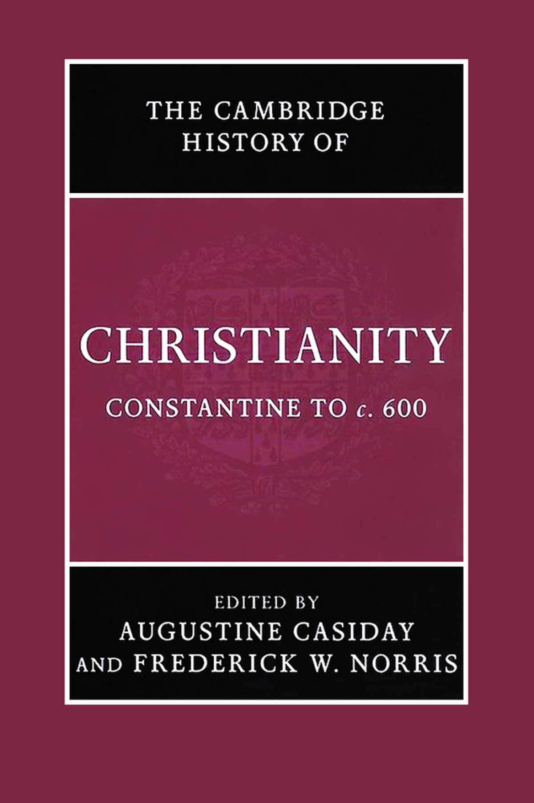
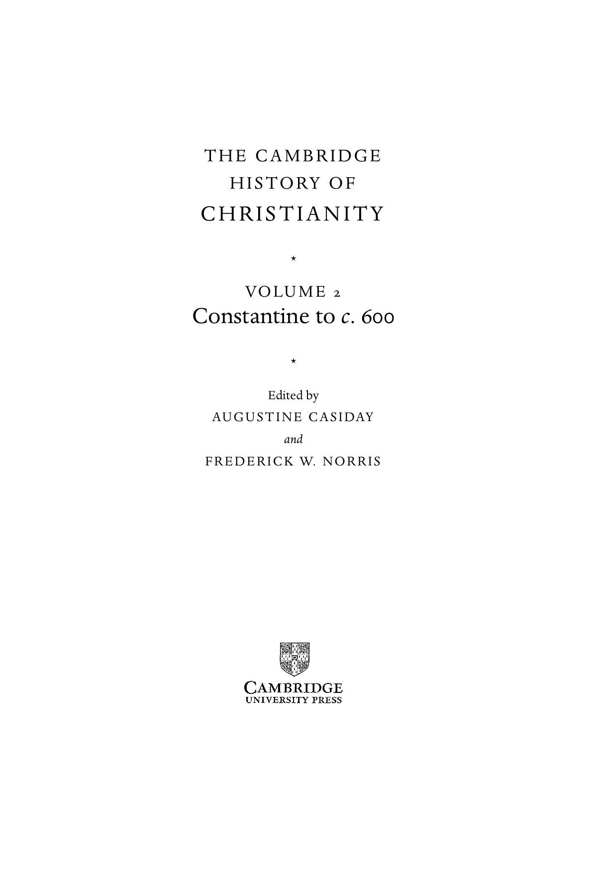

# 卷首资料

> 本节译自原PDF第1—13页。简介、作者任职与丛书计划，均保留原书2007年出版时的状态。

## 封面与书名页

<!-- PDF第1页 -->

**剑桥基督教史**

**第二卷：君士坦丁至约600年**

主编：奥古斯丁·卡西代（Augustine Casiday）、弗雷德里克·W.诺里斯（Frederick W. Norris）

<!-- 原书第v页；PDF第6页 -->

## 本卷简介

<!-- 原书第i页；PDF第2页 -->

《剑桥基督教史》本卷呈现教父基督教的“黄金时代”。经历罗马政府数次迫害之后，基督教成为合法宗教，获得皇帝庇护，最终成为帝国偏爱的宗教。本卷文章讨论古代晚期基督教的迅速转变，特别关注艺术、社会、文学、哲学、政治、宗教间关系及文化等方面。本卷超越简单二分和化约式图式，例如“异端对正统”，力求包容地描述构成当时基督教的多样实践和理论。在适当关注罗马帝国内大公教会兴起的同时，也处理其他主题，例如帝国外基督徒共同体的发展。

奥古斯丁·卡西代，威尔士大学兰彼得分校神学与宗教研究系历史神学讲师。著有《本都的埃瓦格里乌斯》（*Evagrius Ponticus*，2006年）和《圣约翰·卡西安的传统与神学》（*Tradition and Theology in St John Cassian*，2006年），并任《剑桥早期基督教文学史》（2004年）助理编辑。

弗雷德里克·W.诺里斯，以马内利宗教学院世界基督教荣休教授。发表文章二百余篇，与 Everett Ferguson 共同担任《早期基督教百科全书》（*Encylopedia of early Christianity*，1990年；第二版1997年）副主编，并与 A. Malherbe、J. Thompson 合编《处境中的早期教会》（*The Early Church in its Context*，1998年）。

## 丛书说明

<!-- 原书第iii—iv页；PDF第4—5页 -->

《剑桥基督教史》按年代全面叙述基督教从起源至今各方面的发展，涵盖神学、思想、社会、政治、地域和全球层面。每卷都对相应时期的学术研究作出实质贡献，全套构成一部重要的学术参考书。它的目标远不止西欧基督教及其分支的历史，而是提供全球视野。东方及科普特基督教，从早期起就得到充分考虑；后来的非洲、远东、新大陆、南亚，以及其他非欧洲地区的基督教发展，也得到适当覆盖。各卷涵盖大众虔敬与基督教信仰的非正式表达，在广阔文化背景下，考察基督徒形成、敬拜和敬虔的社会学问题。基督教与其他主要信仰的关系，也始终在关注范围内。本丛书将为学者和学生提供极有价值的资源。

| 卷次与书名 | 主编（依本卷原书丛书计划） |
|---|---|
| 1　起源至君士坦丁 | Margaret M. Mitchell、Frances M. Young |
| 2　君士坦丁至约600年 | Augustine Casiday、Frederick W. Norris |
| 3　中世纪早期基督教，约600至约1100年 | Thomas Noble、Julia Smith |
| 4　西欧基督教，约1100至约1500年 | Miri Rubin、Walter Simon |
| 5　东方基督教 | Michael Angold |
| 6　改革与扩张，1500—1660年 | Ronnie Po-chia Hsia |
| 7　启蒙、复兴与革命，1660—1815年 | Stewart J. Brown、Timothy Tackett |
| 8　世界基督教诸形态，约1815—1914年 | Brian Stanley、Sheridan Gilley |
| 9　世界基督教诸形态，约1914至约2000年 | Hugh McLeod |

## 出版资料

<!-- 原书第vi页；PDF第7页 -->

剑桥大学出版社；剑桥、纽约、墨尔本、马德里、开普敦、新加坡、圣保罗。

英国地址：The Edinburgh Building, Cambridge CB2 8RU, UK。美国版由纽约剑桥大学出版社出版。

出版社网站：[Cambridge University Press](https://www.cambridge.org)。本书资料页：[Constantine to c. 600](https://www.cambridge.org/9780521812443)。

© Cambridge University Press 2007。

本出版物受版权保护。除法律规定的例外及有关集体许可协议的条款外，未经剑桥大学出版社书面许可，不得复制本书任何部分。

2007年初版。英国剑桥大学印刷厂印刷。

英国图书馆备有本书目录记录。

美国国会图书馆在版编目资料：

*Constantine to c. 600*／Augustine Casiday、Frederick W. Norris 编。页；厘米。——（《剑桥基督教史》；第2卷）。含参考文献和索引。

ISBN-13：978-0-521-81244-3（精装）；ISBN-10：0-521-81244-5（精装）。

主题：1. 教会史——原始与早期教会，约300—600年。附加款目：I. Casiday, Augustine。II. Norris, Frederick W., 1941–。III. 书名。IV. 丛书。

分类号：BR200.C66 2007；270.2—dc22。控制号：2006100088。

ISBN：978-0-521-81244-3，精装。

剑桥大学出版社不对本出版物所引外部或第三方网站网址的持续有效性或准确性负责，也不保证这些网站的任何内容现在或将来仍然准确、适当。

## 原书目录

<!-- 原书第vii—x页；PDF第8—11页 -->

以下页码沿用原书，中文版重新排版后的页码另见PDF目录。

| 项目 | 作者 | 原书页码 |
|---|---|---|
| 地图目录 | | xi |
| 撰稿人 | | xii |
| 缩写表 | | xiii |
| 引言 | 奥古斯丁·卡西代、弗雷德里克·W.诺里斯 | 1 |
| **第1部分　基督教：地域发展** | | |
| 第1章　西方的基督教诸形态 | 温里希·勒尔 | 9 |
| 第2章　日耳曼与凯尔特的基督教诸形态 | 克努特·舍费尔迪克 | 52 |
| 第3章　希腊世界的基督教诸形态 | 弗雷德里克·W.诺里斯 | 70 |
| 第4章　早期亚洲与东非的基督教诸形态 | 戴维·邦迪 | 118 |
| **第2部分　基督教面对争论** | | |
| 第5章　古代晚期基督徒与犹太人之间的宗教互动（312—640年） | 居伊·G.斯特鲁姆萨 | 151 |
| 第6章　基督教与异教之一：埃及 | 戴维·弗兰克福特 | 173 |
| 第7章　基督教与异教之二：小亚细亚 | 弗兰克·R.特龙布利 | 189 |
| 第8章　基督教与异教之三：意大利 | 米歇尔·蕾妮·萨尔茨曼 | 210 |
| 第9章　基督教与异教之四：北非 | 安娜·莱奥内 | 231 |
| 第10章　基督徒与异教徒之间的思想论争 | 艾伦·布朗 | 248 |
| 第11章　基督教与摩尼教 | 塞缪尔·N. C. 刘 | 279 |
| 第12章　异端学：“异端”与“分裂”的发明 | J. 蕾贝卡·莱曼 | 296 |
| **第3部分　基督教文化与社会** | | |
| 第13章　走向基督教文化的界定：古典文学的基督教转化 | 布朗温·尼尔 | 317 |
| 第14章　主教与社会 | 雷蒙德·范达姆 | 343 |
| 第15章　主教会议与大公会议 | 马克·爱德华兹 | 367 |
| 第16章　教会法的发展 | 肯尼思·彭宁顿 | 386 |
| 第17章　教会、社会与政治权力 | H. A. 德雷克 | 403 |
| **第4部分　基督教信仰与实践** | | |
| 第18章　论三一 | 哈立德·阿纳托利奥斯 | 431 |
| 第19章　七世纪以前的基督论史 | 卡尔-海因茨·乌特曼 | 460 |
| 第20章　罪与救恩：经验与反思 | 奥古斯丁·卡西代 | 501 |
| 第21章　从安提阿到阿尔勒：处境中的平信徒虔敬 | 乔治娅·弗兰克 | 531 |
| 第22章　圣徒与圣人 | 克劳迪娅·拉普 | 548 |
| 第23章　牧养与纪律 | 罗恩·A.格里尔 | 567 |
| 第24章　性、婚姻与家庭 | 戴维·G.亨特 | 585 |
| 第25章　礼仪与教会年的发展 | 布赖恩·D.斯平克斯 | 601 |
| 第26章　圣经诠释 | 保罗·M.布洛尔斯 | 618 |
| 第27章　禁欲与修道生活之一：东方 | 塞缪尔·鲁本森 | 637 |
| 第28章　禁欲与修道生活之二：西方 | 玛丽琳·邓恩 | 669 |
| 第29章　艺术与信仰传播：300—600年的基督教艺术与建筑 | 贝亚特·布伦克 | 691 |
| 索引 | | 726 |

## 地图目录

<!-- 原书第xi页；PDF第12页 -->

| 图号 | 标题 | 原书页码 |
|---|---|---|
| 1 | 约400年的罗马帝国 | xvi—xvii |
| 2 | 约600年的罗马与西方 | xviii |
| 3 | 约600年的拜占庭与近东 | xix |
| 4 | 约600年的埃德萨与东方 | xx |

## 撰稿人

<!-- 原书第xii页；PDF第13页 -->

| 撰稿人 | 原书所列任职单位 |
|---|---|
| 哈立德·阿纳托利奥斯（Khaled Anatolios） | 韦斯顿耶稣会神学院 |
| 保罗·M.布洛尔斯（Paul M. Blowers） | 以马内利宗教学院 |
| 贝亚特·布伦克（Beat Brenk） | 罗马第一大学“智慧大学”；巴塞尔大学荣休教授 |
| 艾伦·布朗（Alan Brown） | 剑桥大学三一学院 |
| 戴维·邦迪（David Bundy） | 富勒神学院 |
| 奥古斯丁·卡西代（Augustine Casiday） | 威尔士大学兰彼得分校 |
| H.A.德雷克（H. A. Drake） | 加利福尼亚大学圣巴巴拉分校 |
| 玛丽琳·邓恩（Marilyn Dunn） | 格拉斯哥大学 |
| 马克·爱德华兹（Mark Edwards） | 牛津大学基督堂学院 |
| 乔治娅·弗兰克（Georgia Frank） | 科尔盖特大学 |
| 戴维·弗兰克福特（David Frankfurter） | 新罕布什尔大学 |
| 罗恩·A.格里尔（Rowan A. Greer） | 耶鲁神学院，荣休教授 |
| 戴维·G.亨特（David G. Hunter） | 艾奥瓦州立大学 |
| 安娜·莱奥内（Anna Leone） | 杜伦大学 |
| 塞缪尔·N.C.刘（Samuel N. C. Lieu） | 麦考瑞大学 |
| 温里希·勒尔（Winrich Löhr） | 汉堡大学 |
| J.蕾贝卡·莱曼（J. Rebecca Lyman） | 太平洋教会神学院，荣休教授 |
| 布朗温·尼尔（Bronwen Neil） | 澳大利亚天主教大学麦考利校区 |
| 弗雷德里克·W.诺里斯（Frederick W. Norris） | 以马内利宗教学院，荣休教授 |
| 肯尼思·彭宁顿（Kenneth Pennington） | 美国天主教大学 |
| 克劳迪娅·拉普（Claudia Rapp） | 加利福尼亚大学洛杉矶分校 |
| 塞缪尔·鲁本森（Samuel Rubenson） | 隆德大学 |
| 米歇尔·蕾妮·萨尔茨曼（Michele Renee Salzman） | 加利福尼亚大学河滨分校 |
| 克努特·舍费尔迪克（Knut Schäferdiek） | 波恩莱茵弗里德里希·威廉大学，荣休教授 |
| 布赖恩·D.斯平克斯（Bryan D. Spinks） | 耶鲁大学圣乐研究所 |
| 居伊·G.斯特鲁姆萨（Guy G. Stroumsa） | 耶路撒冷希伯来大学 |
| 弗兰克·R.特龙布利（Frank R. Trombley） | 卡迪夫大学 |
| 卡尔-海因茨·乌特曼（Karl-Heinz Uthemann） | 阿姆斯特丹自由大学，荣休教授 |
| 雷蒙德·范达姆（Raymond Van Dam） | 密歇根大学 |

〔译校说明：原PDF第3页为空白页。书目题名与编目识别信息保留原文；丛书计划、人员履历和网站责任说明均译自2007年原版，未按现状更新。〕
