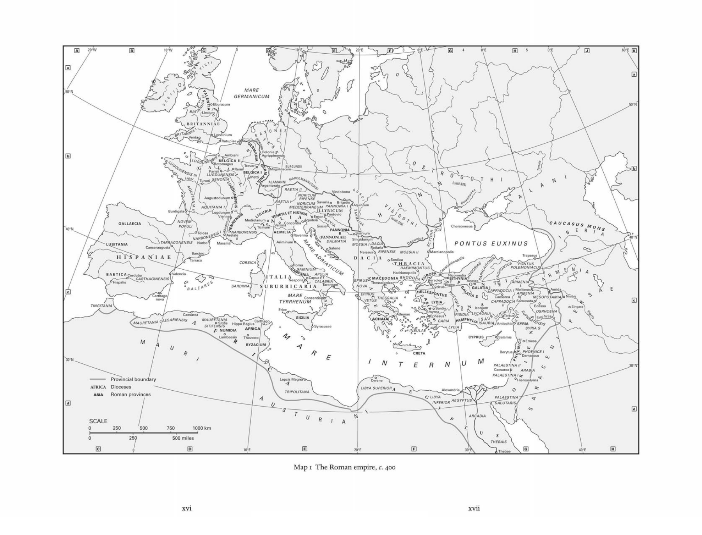
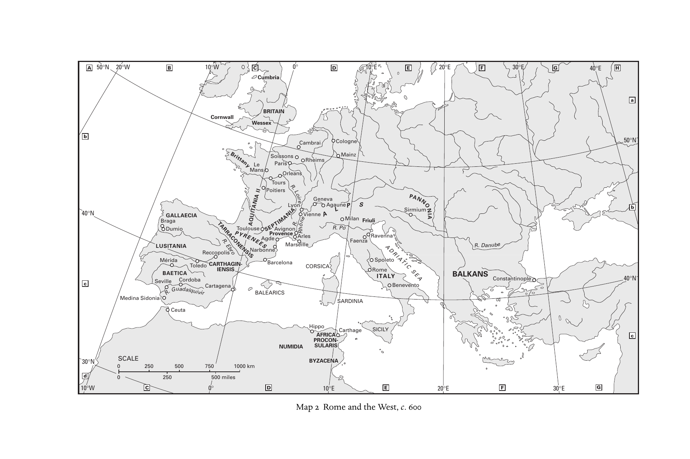
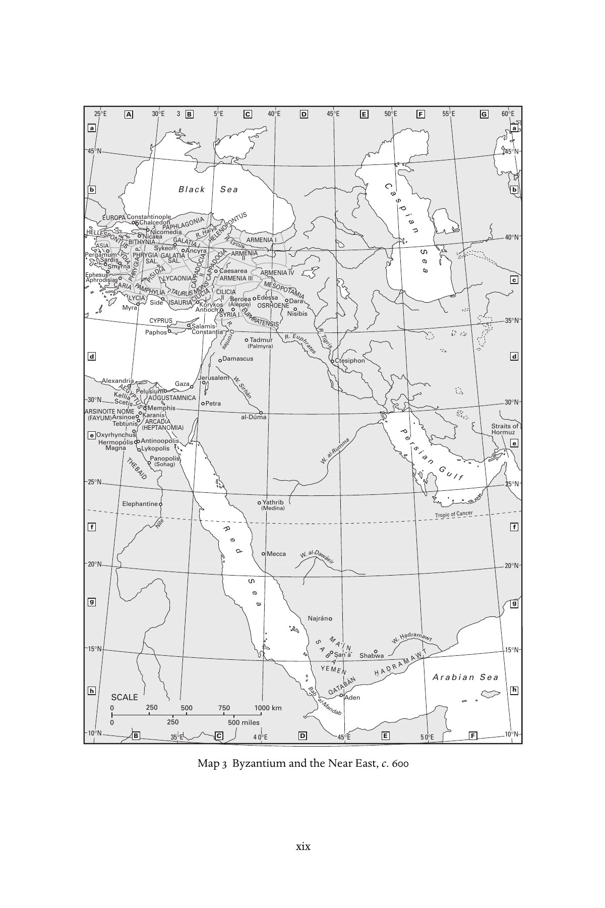
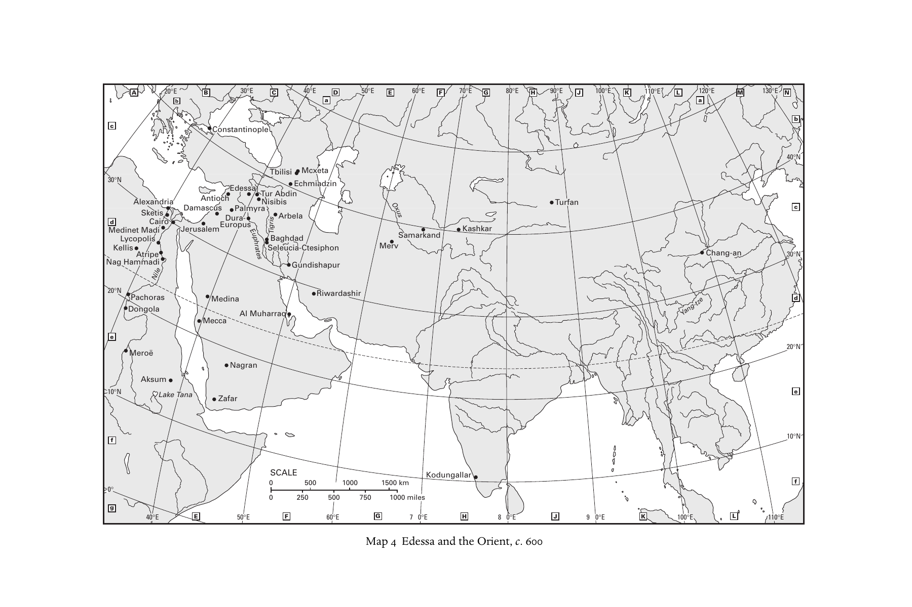

# 缩写表与地图

> 译自原书第xiii—xx页，PDF第14—21页。缩写及文献题名保留原文，并附中文释义，供检索注释和书目使用。

## 缩写表

<!-- 原书第xiii页；PDF第14页 -->

| 缩写 | 原文全称 | 中文释义 |
|---|---|---|
| AB | Analecta Bollandiana | 《博兰学派论集》 |
| ACO | Acta Conciliorum Œcumenicorum | 《大公会议文献》 |
| ACW | Ancient Christian Writers | 《古代基督教作家》 |
| AJP | American journal of philology | 《美国古典语文学杂志》 |
| ANRW | Aufstieg und Niedergang der römischen Welt | 《罗马世界的兴起与衰落》 |
| ATR | Anglican theological review | 《圣公会神学评论》 |
| BAR | British Archaeological Reports | 《英国考古报告》 |
| BASP | Bulletin of the American Society of Papyrologists | 《美国纸草学会会刊》 |
| BCTH | Bulletin du Comité des Travaux Historiques et Scientifiques | 《历史与科学研究委员会会刊》 |
| BETL | Bibliotheca ephemeridum theologicarum lovaniensium | 《鲁汶神学期刊文库》 |
| BHG | Bibliotheca Hagiographica Graeca | 《希腊文圣徒传文献目录》 |
| BHO | Bibliotheca Hagiographica Orientalis | 《东方圣徒传文献目录》 |
| BSNAF | Bulletin de la Société Nationale des Antiquaires de France | 《法国国家古物学会会刊》 |
| BZAW | Beihefte zur Zeitschrift für die alttestamentliche Wissenschaft | 《旧约学杂志》增刊 |
| CCSG | Corpus Christianorum Series Graeca | 《基督教文献集》希腊文系列 |
| CCSL | Corpus Christianorum Series Latina | 《基督教文献集》拉丁文系列 |
| CIL | Corpus Inscriptionum Latinarum | 《拉丁文铭文集》 |
| CJ | Codex Justinianus | 《查士丁尼法典》 |
| CMC | Cologne Mani-Codex (P. Colon. inv. nr. 4780) | 《科隆摩尼古抄本》，馆藏号4780 |
| CollÉFR | Collection de l’École française de Rome | 《罗马法国学院丛书》 |
| CPG | Clavis Patrum Graecorum | 《希腊教父著作目录》 |
| CRAI | Comptes rendus des séances de l’Académie des Inscriptions et Belles Lettres | 《铭文与美文学院会议报告》 |
| CSCO | Corpus Scriptorum Christianorum Orientalium | 《东方基督教作家文集》 |
| CSEL | Corpus Scriptorum Ecclesiasticorum Latinorum | 《拉丁教会作家文集》 |
| CTh | Codex Theodosianus | 《狄奥多西法典》 |
| DACL | Dictionnaire d’archéologie chrétienne et de liturgie | 《基督教考古与礼仪辞典》 |
| DK | Diels, H. and W. Kranz, eds., Die Fragmente der Vorsokratiker | H. Diels、W. Kranz 编《前苏格拉底哲学家残篇》 |
| DOP | Dumbarton Oaks Papers | 《敦巴顿橡树园论文集》 |
| DSp | Dictionnaire de spiritualité ascétique et mystique, doctrine et histoire | 《禁欲与神秘灵修辞典：教义与历史》 |
| Ep(p). | Letter(s) | 书信，单数或复数 |
| FOTC | Fathers of the Church | 《教会诸教父》 |
| GCS | Griechischen christlichen Schriftsteller | 《希腊基督教作家》 |
| GNO | Gregorii Nysseni Opera | 《尼撒的格列高利全集》 |
| GRBS | Greek, Roman and Byzantine studies | 《希腊、罗马与拜占庭研究》 |

<!-- 原书第xiv页；PDF第15页 -->

| 缩写 | 原文全称 | 中文释义 |
|---|---|---|
| H.E. | Historia ecclesiastica (Church history) | 《教会史》 |
| H.L. | Palladius, Historia Lausiaca | 帕拉迪乌斯《劳苏斯史》 |
| Hom. | homily, -ies | 讲道，单数或复数 |
| HTR | Harvard theological review | 《哈佛神学评论》 |
| IGRR | Inscriptiones Graecae ad res Romanas pertinentes | 《涉及罗马事务的希腊文铭文》 |
| ILCV | Inscriptiones Latinae Christianae Veteres | 《古代拉丁文基督教铭文》 |
| ILS | Inscriptiones Latinae Selectae | 《拉丁文铭文选》 |
| Ins.Chr. | Inscriptiones Christianae urbis Romae septimo saeculo antiquiores | 《罗马城七世纪以前的基督教铭文》 |
| JAAR | Journal of the American Academy of Religion | 《美国宗教学会杂志》 |
| JbAC | Jahrbuch für Antike und Christentum | 《古代与基督教年鉴》 |
| JECS | Journal of early Christian studies | 《早期基督教研究杂志》 |
| JRS | Journal of Roman studies | 《罗马研究杂志》 |
| JTS | Journal of theological studies | 《神学研究杂志》 |
| LCL | Loeb Classical Library | 《洛布古典丛书》 |
| LXX | Septuagint | 《七十士译本》 |
| Mansi | J. D. Mansi, ed., Sanctorum conciliorum et decretorum collectio nova | J. D. Mansi 编《神圣会议与教令新汇编》 |
| MEFRA | Mélanges de l’École française de Rome, antiquité | 《罗马法国学院杂刊：古代》 |
| MGH aa | Monumenta Germaniae Historica – auctores antiquissimi | 《德意志历史文献》最古作家系列 |
| MGH leg | Monumenta Germaniae Historica – leges | 《德意志历史文献》法律系列 |
| MGH scr.mer. | Monumenta Germaniae Historica – scriptores rerum merovingicarum | 《德意志历史文献》墨洛温时代史家系列 |
| NHC | Nag Hammadi Codex | 纳格哈马迪古抄本 |
| NPNF | Select Library of Nicene and Post Nicene Fathers of the Church | 《尼西亚及尼西亚后期教父选集》 |
| OCA | Orientalia Christiana Analecta | 《东方基督教论集》 |
| OECT | Oxford Early Christian Texts | 《牛津早期基督教文本》 |
| Or. | Orations | 演说 |
| PG | Patrologia Graeca | 《希腊教父集》 |
| PL | Patrologia Latina | 《拉丁教父集》 |
| PLRE | Prosopography of the Later Roman Empire | 《晚期罗马帝国人物志》 |
| PO | Patrologia Orientalis | 《东方教父集》 |
| Proc. Brit. Acad. | Proceedings of the British Academy | 《英国国家学术院论文集》 |
| Proc. Cambr. Phil. Soc. | Proceedings of the Cambridge Philosophical Society | 《剑桥哲学学会会刊》 |
| Proc. Royal Anthro. Instit. | Proceedings of the Royal Anthropological Institute of Great Britain and Ireland | 《大不列颠与爱尔兰皇家人类学会会刊》 |
| PTS | Patristische Texte und Studien | 《教父文本与研究》 |
| RAC | Reallexikon für Antike und Christentum | 《古代与基督教百科辞典》 |
| RE | Realencyklopädie für protestantische Theologie und Kirche | 《新教神学与教会百科全书》 |
| REL | Revue des études latines | 《拉丁研究评论》 |
| RendPontAcc | Atti della Pontificia accademia romana di archeologia, Rendiconti | 《罗马宗座考古学院会议报告》 |
| RHE | Revue d’histoire ecclésiastique | 《教会史评论》 |
| SA | Studia Anselmiana | 《安瑟伦研究》 |
| SC | Sources chrétiennes | 《基督教文献》 |
| SEA | Studia ephemeridis ‘Augustinianum’ | 《奥古斯丁研究》期刊研究丛书 |
| SEG | Supplementum Epigraphicum Graecum | 《希腊铭文补编》 |
| SH | Subsidia Hagiographica | 《圣徒传研究辅助文献》 |

<!-- 原书第xv页；PDF第16页 -->

| 缩写 | 原文全称 | 中文释义 |
|---|---|---|
| SP | Studia Patristica | 《教父学研究》 |
| SPA | Studien der Patristischen Arbeitsgemeinschaft | 《教父学研究工作组研究丛书》 |
| ST | Studi e Testi | 《研究与文本》 |
| ThPh | Theologie und Philosophie | 《神学与哲学》 |
| TRE | Theologische Realenzyklopädie | 《神学百科全书》 |
| TU | Texte und Untersuchungen | 《文本与研究》 |
| VChr | Vigiliae Christianae | 《基督教守夜》 |
| WSA | Works of St Augustine | 《圣奥古斯丁著作集》 |
| ZAC | Zeitschrift für antikes Christentum | 《古代基督教杂志》 |
| ZÄS | Zeitschrift für Ägyptische Sprache und Alterthumskunde | 《埃及语言与古物学杂志》 |
| ZKG | Zeitschrift für Kirchengeschichte | 《教会史杂志》 |
| ZNTW | Zeitschrift für die neutestamentliche Wissenschaft | 《新约学杂志》 |
| ZPE | Zeitschrift für Papyrologie und Epigrafik | 《纸草学与铭文学杂志》 |
| ZPT | Zeitschrift für Philosophie und Theologie | 《哲学与神学杂志》 |

## 地图

地名沿用地图上的原文标记；各图另附中文图题、图例和地名对照。地图比例尺中的 km 为千米，miles 为英里，°N 为北纬，°E 为东经，°W 为西经。

### 图1　约400年的罗马帝国

<!-- 原书第xvi—xvii页；PDF第17—18页 -->

图例：省界（Provincial boundary）；罗马行省（Roman provinces）；行政区（Dioceses）。比例尺：0、250、500、750、1000千米；0、250、500英里。

| 原图标记 | 中文对照 |
|---|---|
| Scotti | 斯科特人 |
| Picti | 皮克特人 |
| Franci | 法兰克人 |
| Saxones | 撒克逊人 |
| Burgundii | 勃艮第人 |
| Alamanni | 阿拉曼尼人 |
| Marcomanni | 马尔科曼尼人 |
| Suebi | 苏维汇人 |
| Quadi | 夸迪人 |
| Hunni | 匈人 |
| Persae | 波斯人 |
| Illyricum | 伊利里库姆行政区 |
| Italia | 意大利 |
| Ostrogothi | 东哥特人 |
| Visigothi | 西哥特人 |
| Alani | 阿兰人 |
| Sarmatae | 萨尔马提亚人 |
| Visigothi / Ostrogothi (until 376) | 西哥特人／东哥特人，至376年 |
| Mauri | 毛里人 |
| Austuriani | 奥斯图里亚尼人 |
| Sarraceni | 萨拉森人 |
| Britanniae | 不列颠行政区 |
| Britannia I / II | 第一／第二不列颠 |
| Flavia Caesariensis | 弗拉维亚凯撒里恩西斯 |
| Eburacum | 埃布拉库姆，约克 |
| Lindum | 林杜姆，林肯 |
| Londinium | 伦迪尼乌姆，伦敦 |
| Venta | 文塔 |
| Rutupiae | 鲁图皮艾 |
| Galliae | 高卢行政区 |
| Belgica I / II | 第一／第二贝尔吉卡 |
| Germania I / II | 第一／第二日耳曼尼亚 |
| Lugdunensis I / II / III / Senonia | 第一／第二／第三／塞诺尼亚卢格杜嫩西斯 |
| Aquitania I / II | 第一／第二阿基坦尼亚 |
| Novem Populi | 诺文波普利，九族省 |
| Narbonensis I / II | 第一／第二纳尔波嫩西斯 |
| Viennensis | 维恩嫩西斯 |
| Alpes Cottiae | 科提阿尔卑斯 |
| Alpes Maritimae | 滨海阿尔卑斯 |
| Ambiani | 安比亚尼，亚眠 |
| Rotomagus | 罗托马古斯，鲁昂 |
| Parisii | 帕里西，巴黎 |
| Remi | 雷米，兰斯 |
| Metti | 梅提，梅斯（依图拼写） |
| Treveri | 特雷维里，特里尔 |
| Colonia Agrippinensis | 阿格里皮娜殖民城，科隆 |
| Moguntiacum | 莫贡提亚库姆，美因茨 |
| Argentorate | 阿尔根托拉特，斯特拉斯堡 |
| Turoni | 图罗尼，图尔 |
| Augustodunum | 奥古斯托杜努姆，欧坦 |
| Burdigala | 布尔迪加拉，波尔多 |
| Lugdunum | 卢格杜努姆，里昂 |
| Vienna | 维埃纳 |
| Tolosa | 托洛萨，图卢兹 |
| Narbo | 纳尔波，纳博讷 |
| Arelate | 阿雷拉特，阿尔勒 |
| Massilia | 马西利亚，马赛 |
| Hispaniae | 西班牙行政区 |
| Gallaecia | 加利西亚 |
| Lusitania | 卢西塔尼亚 |
| Baetica | 贝提卡 |
| Tarraconensis | 塔拉科嫩西斯 |
| Carthaginiensis | 卡尔塔吉嫩西斯 |
| Caesaraugusta | 凯撒奥古斯塔，萨拉戈萨 |
| Tarraco | 塔拉科，塔拉戈纳 |
| Barcino | 巴尔基诺，巴塞罗那 |
| Valencia | 瓦伦西亚 |
| Corduba | 科尔杜巴，科尔多瓦 |
| Hispalis | 希斯帕利斯，塞维利亚 |
| Carthago nova | 新迦太基，卡塔赫纳 |
| Baleares | 巴利阿里群岛 |
| Italia Suburbicaria | 近郊意大利行政区 |
| Liguria | 利古里亚 |
| Venetia et Histria | 威尼提亚与伊斯特里亚 |
| Aemilia | 艾米利亚 |
| Picenum | 皮凯努姆 |
| Tuscia | 图斯基亚 |
| Campania | 坎帕尼亚 |
| Samnium | 萨姆尼乌姆 |
| Apulia | 阿普利亚 |
| Calabria | 卡拉布里亚 |
| Lucania | 卢卡尼亚 |
| Bruttii | 布鲁提 |
| Corsica | 科西嘉 |
| Sardinia | 撒丁 |
| Sicilia | 西西里 |
| Mediolanum | 米兰 |
| Ticinum | 提基努姆，帕维亚 |
| Verona | 维罗纳 |
| Concordia | 孔科尔迪亚 |
| Aquileia | 阿奎莱亚 |
| Ravenna | 拉文纳 |
| Ariminum | 阿里米努姆，里米尼 |
| Roma | 罗马 |
| Neapolis | 尼阿波利斯，那不勒斯 |
| Capua | 卡普阿 |
| Tarentum | 塔伦图姆，塔兰托 |
| Consentia | 孔森提亚，科森扎 |
| Erice | 埃里切 |
| Syracusae | 叙拉古 |
| Raetia I / II | 第一／第二雷提亚 |
| Noricum Ripense | 河岸诺里库姆 |
| Noricum Mediterraneum | 内陆诺里库姆 |
| Pannonia I / II | 第一／第二潘诺尼亚 |
| Pannonia (Pannoniae) | 潘诺尼亚行政区 |
| Savia | 萨维亚 |
| Valeria | 瓦莱里亚 |
| Dalmatia | 达尔马提亚 |
| Vindobona | 温多博纳，维也纳 |
| Savaria | 萨瓦里亚 |
| Brigetio | 布里盖提奥 |
| Aquincum | 阿奎因库姆 |
| Emona | 埃莫纳 |
| Poetovio | 波埃托维奥 |
| Siscia | 西斯基亚 |
| Sirmium | 西尔米乌姆 |
| Singidunum | 辛吉杜努姆，贝尔格莱德 |
| Salonae | 萨洛纳 |
| Dacia | 达契亚行政区 |
| Dacia Ripensis | 河岸达契亚 |
| Dacia Mediterranea | 内陆达契亚 |
| Moesia I / II | 第一／第二默西亚 |
| Naissus | 纳伊苏斯 |
| Serdica | 塞尔迪卡 |
| Ratiaria | 拉提亚里亚 |
| Thracia | 色雷斯 |
| Haemimontus | 海米蒙图斯 |
| Rhodope | 罗多彼 |
| Europa | 欧罗巴 |
| Scythia | 斯基提亚 |
| Marcianopolis | 马尔基亚诺波利斯 |
| Hadrianopolis | 哈德良堡 |
| Constantinopolis | 君士坦丁堡 |
| Macedonia | 马其顿 |
| Epirus Nova / Vetus | 新／旧伊庇鲁斯 |
| Thessalia | 色萨利 |
| Achaia | 阿凯亚 |
| Thessalonica | 帖撒罗尼迦 |
| Athenae | 雅典 |
| Insulae | 群岛省 |
| Creta | 克里特 |
| Africa | 阿非利加行政区 |
| Tingitania | 廷吉塔尼亚 |
| Mauretania Caesariensis | 凯撒里亚毛里塔尼亚 |
| Mauretania Sitifensis | 西提菲斯毛里塔尼亚 |
| Numidia | 努米底亚 |
| Byzacium | 比扎基乌姆 |
| Tripolitana | 的黎波里塔尼亚 |
| Caesarea | 凯撒里亚 |
| Sitifis | 西提菲斯 |
| Hippo Regius | 王家希波 |
| Carthago | 迦太基 |
| Lambaesis | 兰拜西斯 |
| Theveste | 特维斯特 |
| Lepcis Magna | 大莱普提斯 |
| Libya Superior / Inferior | 上／下利比亚 |
| Cyrene | 昔兰尼 |
| Alexandria | 亚历山大里亚 |
| Aegyptus | 埃及 |
| Arcadia | 阿尔卡狄亚 |
| Thebais | 底比斯省 |
| Thebae | 底比斯 |
| Asiana | 亚细亚行政区 |
| Pontica | 本都行政区 |
| Oriens | 东方行政区 |
| Cilicia I / II | 第一／第二基利家 |
| Asia | 亚细亚省 |
| Lydia | 吕底亚 |
| Caria | 卡里亚 |
| Phrygia I / II | 第一／第二弗里吉亚 |
| Pisidia | 彼西底 |
| Pamphylia | 潘菲利亚 |
| Lycia | 吕基亚 |
| Lycaonia | 吕考尼亚 |
| Isauria | 伊苏里亚 |
| Bithynia | 比提尼亚 |
| Honorias | 奥诺里亚斯 |
| Paphlagonia | 帕夫拉戈尼亚 |
| Galatia I / S. | 第一／萨卢塔里斯加拉太（S.为原图缩写） |
| Hellespontus | 赫勒斯滂 |
| Helenopontus | 赫勒诺本都 |
| Pontus Polemoniacus | 波勒蒙本都 |
| Cappadocia I / II | 第一／第二卡帕多基亚 |
| Armenia I / II | 第一／第二亚美尼亚 |
| Nicomedia | 尼科米底亚 |
| Heraclea | 赫拉克利亚 |
| Nicaea | 尼西亚 |
| Cyzicus | 基齐库斯 |
| Ancyra | 安居拉 |
| Sardis | 萨迪斯 |
| Smyrna | 士每拿 |
| Ephesus | 以弗所 |
| Iconium | 伊科尼乌姆 |
| Tarsus | 塔尔苏斯 |
| Trapezus | 特拉佩祖斯，特拉布宗 |
| Melitene | 梅利提涅 |
| Amida | 阿米达 |
| Samosata | 撒摩撒他 |
| Mesopotamia | 美索不达米亚 |
| Osrhoena | 奥斯若恩 |
| Euphratensis | 幼发拉底省 |
| Syria | 叙利亚 |
| Syria S. | 叙利亚·S.（原图缩写） |
| Phoenice | 腓尼基 |
| Phoenice I | 第一腓尼基 |
| Palaestina I / II | 第一／第二巴勒斯坦 |
| Palaestina Salutaris | 救恩巴勒斯坦省 |
| Arabia | 阿拉伯省 |
| Cyprus | 塞浦路斯 |
| Salamis | 萨拉米斯 |
| Antiochia | 安提阿 |
| Emesa | 埃梅萨 |
| Berytus | 贝鲁图斯，贝鲁特 |
| Damascus | 大马士革 |
| Hierosolyma | 耶路撒冷 |
| Edessa | 埃德萨 |
| Nisibis | 尼西比斯 |
| Singara | 辛加拉 |
| Armenia | 亚美尼亚 |
| Iberia | 伊比利亚，今格鲁吉亚东部地区 |
| Chersonesus | 赫尔松内索斯 |
| Caucasus Mons | 高加索山脉 |
| Mare Germanicum | 日耳曼海，北海 |
| Pontus Euxinus | 黑海 |
| Mare Adriaticum | 亚得里亚海 |
| Mare Tyrrhenum | 第勒尼安海 |
| Mare Internum | 内海，地中海 |
| Rhenus | 莱茵河 |
| Liger | 卢瓦尔河 |
| Rhodanus | 罗讷河 |
| Albis | 易北河 |
| Vistula | 维斯瓦河 |
| Danuvius | 多瑙河 |
| Tanais | 顿河 |
| Borysthenes | 第聂伯河 |
| Euphrates | 幼发拉底河 |
| Tigris | 底格里斯河 |

### 图2　约600年的罗马与西方

<!-- 原书第xviii页；PDF第19页 -->

比例尺：0、250、500、750、1000千米；0、250、500英里。

| 原图标记 | 中文对照 |
|---|---|
| Britain | 不列颠 |
| Cumbria | 坎布里亚 |
| Cornwall | 康沃尔 |
| Wessex | 韦塞克斯 |
| Brittany | 布列塔尼 |
| Cambrai | 康布雷 |
| Cologne | 科隆 |
| Mainz | 美因茨 |
| Soissons | 苏瓦松 |
| Rheims | 兰斯 |
| Paris | 巴黎 |
| Le Mans | 勒芒 |
| Orleans | 奥尔良 |
| Tours | 图尔 |
| Poitiers | 普瓦捷 |
| Aquitania II | 第二阿基坦尼亚 |
| Septimania | 塞普提马尼亚 |
| Provence | 普罗旺斯 |
| Lyon | 里昂 |
| Vienne | 维埃纳 |
| Geneva | 日内瓦 |
| Agaune | 阿高讷 |
| Toulouse | 图卢兹 |
| Avignon | 阿维尼翁 |
| Arles | 阿尔勒 |
| Agde | 阿格德 |
| Marseille | 马赛 |
| Narbonne | 纳博讷 |
| Gallaecia | 加利西亚 |
| Braga | 布拉加 |
| Dumio | 杜米奥 |
| Lusitania | 卢西塔尼亚 |
| Baetica | 贝提卡 |
| Tarraconensis | 塔拉科嫩西斯 |
| Carthaginiensis | 卡尔塔吉嫩西斯 |
| Mérida | 梅里达 |
| Toledo | 托莱多 |
| Reccopolis | 雷科波利斯 |
| Cordoba | 科尔多瓦 |
| Seville | 塞维利亚 |
| Medina Sidonia | 梅迪纳西多尼亚 |
| Cartagena | 卡塔赫纳 |
| Barcelona | 巴塞罗那 |
| Ceuta | 休达 |
| Pyrenees | 比利牛斯山脉 |
| Alps | 阿尔卑斯山脉 |
| R. Ebro | 埃布罗河 |
| R. Guadalquivir | 瓜达尔基维尔河 |
| R. Loire | 卢瓦尔河 |
| R. Rhône | 罗讷河 |
| R. Po | 波河 |
| R. Danube | 多瑙河 |
| Italy | 意大利 |
| Milan | 米兰 |
| Friuli | 弗留利 |
| Faenza | 法恩扎 |
| Ravenna | 拉文纳 |
| Spoleto | 斯波莱托 |
| Rome | 罗马 |
| Benevento | 贝内文托 |
| Pannonia | 潘诺尼亚 |
| Sirmium | 西尔米乌姆 |
| Balkans | 巴尔干 |
| Constantinople | 君士坦丁堡 |
| Corsica | 科西嘉 |
| Sardinia | 撒丁 |
| Sicily | 西西里 |
| Balearics | 巴利阿里群岛 |
| Adriatic Sea | 亚得里亚海 |
| Hippo | 希波 |
| Carthage | 迦太基 |
| Africa Proconsularis | 阿非利加行省 |
| Numidia | 努米底亚 |
| Byzacena | 比扎凯纳 |

### 图3　约600年的拜占庭与近东

<!-- 原书第xix页；PDF第20页 -->

比例尺：0、250、500、750、1000千米；0、250、500英里。Tropic of Cancer 为北回归线。

| 原图标记 | 中文对照 |
|---|---|
| Black Sea | 黑海 |
| Caspian Sea | 里海 |
| Red Sea | 红海 |
| Persian Gulf | 波斯湾 |
| Arabian Sea | 阿拉伯海 |
| Straits of Hormuz | 霍尔木兹海峡 |
| Bab al-Mandab | 曼德海峡 |
| Tropic of Cancer | 北回归线 |
| Nile | 尼罗河 |
| R. Halys | 哈吕斯河 |
| R. Lycus | 吕科斯河 |
| R. Euphrates | 幼发拉底河 |
| R. Tigris | 底格里斯河 |
| R. Orontes | 奥龙特斯河 |
| W. Sirhan | 西尔汉干河谷 |
| W. al-Rumma | 鲁迈干河谷 |
| W. al-Dawāsir | 达瓦西尔干河谷 |
| W. Ḥaḍramawt | 哈德拉毛干河谷 |
| Europa | 欧罗巴 |
| Hellespontus | 赫勒斯滂 |
| Bithynia | 比提尼亚 |
| Paphlagonia | 帕夫拉戈尼亚 |
| Helenopontus | 赫勒诺本都 |
| Galatia I / II | 第一／第二加拉太 |
| Galatia Sal. | 萨卢塔里斯加拉太 |
| Phrygia Pac. / Sal. | 帕卡提亚纳／萨卢塔里斯弗里吉亚 |
| Asia | 亚细亚 |
| Lydia | 吕底亚 |
| Caria | 卡里亚 |
| Pisidia | 彼西底 |
| Pamphylia | 潘菲利亚 |
| Lycia | 吕基亚 |
| Lycaonia | 吕考尼亚 |
| Isauria | 伊苏里亚 |
| Taurus Mons | 托罗斯山脉 |
| Cappadocia I / II | 第一／第二卡帕多基亚 |
| Armenia I / II / III / IV | 第一／第二／第三／第四亚美尼亚 |
| Cilicia I / II | 第一／第二基利家 |
| Cyprus | 塞浦路斯 |
| Syria I / II | 第一／第二叙利亚 |
| Mesopotamia | 美索不达米亚 |
| Osrhoene | 奥斯若恩 |
| Euphratensis | 幼发拉底省 |
| Constantinople | 君士坦丁堡 |
| Chalcedon | 迦克墩 |
| Nicomedia | 尼科米底亚 |
| Nicaea | 尼西亚 |
| Sykeon | 叙凯翁 |
| Ancyra | 安居拉 |
| Pergamum | 别迦摩 |
| Sardis | 萨迪斯 |
| Smyrna | 士每拿 |
| Ephesus | 以弗所 |
| Aphrodisias | 阿佛洛狄西亚斯 |
| Side | 西德 |
| Myra | 米拉 |
| Iconium | 伊科尼乌姆 |
| Caesarea | 凯撒里亚 |
| Korykos | 科里科斯 |
| Antioch | 安提阿 |
| Beroea (Aleppo) | 贝罗埃，阿勒颇 |
| Edessa | 埃德萨 |
| Dara | 达拉 |
| Nisibis | 尼西比斯 |
| Paphos | 帕福斯 |
| Salamis-Constantia | 萨拉米斯—君士坦提亚 |
| Tadmur (Palmyra) | 塔德穆尔，帕尔米拉 |
| Damascus | 大马士革 |
| Ctesiphon | 泰西封 |
| Jerusalem | 耶路撒冷 |
| Gaza | 加沙 |
| Petra | 佩特拉 |
| al-Dūma | 杜马 |
| Alexandria | 亚历山大里亚 |
| Aegyptus | 埃及 |
| Augustamnica | 奥古斯塔姆尼卡 |
| Arcadia (Heptanomia) | 阿尔卡狄亚，七州地区 |
| Arsinoite Nome (Fayum) | 阿尔西诺伊州，法尤姆 |
| Thebaid | 底比斯省 |
| Pelusium | 佩卢西乌姆 |
| Kellia | 凯利亚 |
| Scetis | 斯凯提斯 |
| Memphis | 孟菲斯 |
| Karanis | 卡拉尼斯 |
| Tebtunis | 特布图尼斯 |
| Oxyrhynchus | 俄克喜林库斯 |
| Hermopolis Magna | 大赫尔莫波利斯 |
| Antinoopolis | 安提诺波利斯 |
| Lykopolis | 吕科波利斯 |
| Panopolis (Sohag) | 帕诺波利斯，索哈杰 |
| Elephantine | 象岛 |
| Yathrib (Medina) | 雅斯里布，麦地那 |
| Mecca | 麦加 |
| Najrān | 奈季兰 |
| Maʿīn | 马因 |
| Sabaʾ | 萨巴 |
| Ṣanʿāʾ | 萨那 |
| Yemen | 也门 |
| Qatabān | 卡塔班 |
| Ḥaḍramawt | 哈德拉毛 |
| Shabwa | 舍卜沃 |
| Aden | 亚丁 |

### 图4　约600年的埃德萨与东方

<!-- 原书第xx页；PDF第21页 -->

比例尺：0、500、1000、1500千米；0、250、500、750、1000英里。

| 原图标记 | 中文对照 |
|---|---|
| Constantinople | 君士坦丁堡 |
| Tbilisi | 第比利斯 |
| Mcxeta | 姆茨赫塔 |
| Echmiadzin | 埃奇米阿津 |
| Edessa | 埃德萨 |
| Tur Abdin | 图尔阿卜丁 |
| Nisibis | 尼西比斯 |
| Antioch | 安提阿 |
| Damascus | 大马士革 |
| Palmyra | 帕尔米拉 |
| Dura Europos | 杜拉欧罗波斯 |
| Arbela | 阿尔贝拉 |
| Baghdad | 巴格达 |
| Seleucia-Ctesiphon | 塞琉西亚—泰西封 |
| Gundishapur | 贡迪沙普尔 |
| Riwardashir | 里瓦尔达希尔 |
| Al Muharraq | 穆哈拉格 |
| Alexandria | 亚历山大里亚 |
| Sketis | 斯凯提斯 |
| Cairo | 开罗 |
| Medinet Madi | 麦迪内特马迪 |
| Lycopolis | 吕科波利斯 |
| Kellis | 凯利斯 |
| Atripe | 阿特里佩 |
| Nag Hammadi | 纳格哈马迪 |
| Jerusalem | 耶路撒冷 |
| Pachoras | 帕科拉斯 |
| Dongola | 栋古拉 |
| Meroë | 麦罗埃 |
| Aksum | 阿克苏姆 |
| Lake Tana | 塔纳湖 |
| Medina | 麦地那 |
| Mecca | 麦加 |
| Nagran | 奈季兰 |
| Zafar | 扎法尔 |
| Merv | 木鹿，梅尔夫 |
| Samarkand | 撒马尔罕 |
| Kashkar | 喀什 |
| Turfan | 吐鲁番 |
| Chang-an | 长安 |
| Yang-tze | 长江 |
| Kodungallar | 科东加卢尔 |
| Nile | 尼罗河 |
| Euphrates | 幼发拉底河 |
| Tigris | 底格里斯河 |
| Oxus | 阿姆河 |
