# 剑桥基督教史 第五卷：东方基督教

编者：迈克尔·安戈尔德（Michael Angold）

原书2006年出版。全卷已译完，包含卷首资料、前言、缩略语、四编、24章、脚注、参考书目与索引。原书页码与PDF页码均保留，便于对照。

> 译文范围说明：第23章PDF587—588页引文中的简易爆响装置制作、点火步骤，以概述替代；已在译文标明。其余篇章、引文及解释性注释，按原文翻译。

- [卷首资料](#pdf-001)
- [前言](#pdf-017)
- [缩略语](#pdf-020)
- [第一编 普世牧首区](#pdf-022)
- [拜占庭共同体（1000—1550年）](#pdf-024)
- [拜占庭与西方（1204—1453年）](#pdf-074)
- [中世纪拜占庭的平信徒虔敬文化（1054—1453年）](#pdf-100)
- [静修主义的兴起](#pdf-122)
- [拜占庭帝国晚期的艺术与礼仪](#pdf-148)
- [阿索斯山与奥斯曼人（约1350—1550年）](#pdf-175)
- [被囚禁的大教会（1453—1586年）](#pdf-190)
- [正教与西方：从宗教改革到启蒙运动](#pdf-208)
- [巴尔斯基与正教共同体](#pdf-231)
- [法国大革命的遗产：正教与民族主义](#pdf-250)
- [第二编 俄罗斯教会](#pdf-272)
- [俄国的虔敬与正教文化（1380—1589年）](#pdf-274)
- [俄国的艺术与礼仪：鲁布廖夫及其继承者](#pdf-297)
- [反宗教改革时代俄国与乌克兰的东正教](#pdf-323)
- [俄罗斯帝国时期的俄罗斯东正教会（1721—1917年）](#pdf-346)
- [从彼得大帝到1917年的俄国虔敬与文化](#pdf-369)
- [第三编 东方基督教诸形态](#pdf-392)
- [东方基督教诸形态（十一至十四世纪）：科普特人、麦勒凯派、涅斯托里乌斯派与雅各派](#pdf-394)
- [十字军时代的亚美尼亚人（1050—1350年）](#pdf-425)
- [教会与离散：亚美尼亚人的个案](#pdf-451)
- [教会与民族：埃塞俄比亚正统合一教会（十三至二十世纪）](#pdf-478)
- [现代埃及的科普特基督教](#pdf-509)
- [现代中东的叙利亚传统基督教](#pdf-532)
- [第四编 现代世界](#pdf-558)
- [俄国流亡者的离散问题](#pdf-560)
- [东正教会与共产主义](#pdf-579)
- [现代灵修与东正教会](#pdf-601)
- [参考书目选编](#pdf-621)
- [索引](#pdf-700)

---

# 卷首资料

<!-- PDF page 1; original page unnumbered -->

## 剑桥基督教史

### 第五卷 东方基督教

迈克尔·安戈尔德（Michael Angold）编

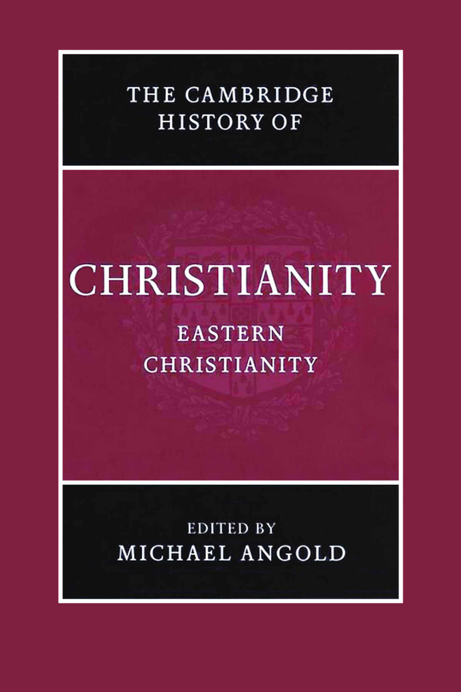

<!-- PDF page 2; original page unnumbered -->

## 《剑桥东方基督教史》

本卷将普世牧首区的正教会，以及俄罗斯、亚美尼亚、埃塞俄比亚、埃及和叙利亚的教会，纳入同一视野，追溯它们从中世纪晚期直到现代的命运；恰恰这一时期，是相关历史最受忽视的阶段。这种处理，不可避免地会突显教义与经历的差异，但也揭示共同线索，其中最显著的，是它们面对外来的、往往怀有敌意的政治政权时，所表现的韧性。本卷的核心主题，是各种形态的正教，如何在不利条件下存续至现代。事实表明，拜占庭最后阶段，对于这种存续具有出人意料的重要性：它为正教提供了思想、艺术和属灵的储备，以应对后来的挑战。例如，埃及的主日学运动，以及希腊的“生命兄弟会”（Zoë），都显示出各正教会持续的活力。

迈克尔·安戈尔德是英国皇家历史学会会士、爱丁堡大学拜占庭史荣休教授。他近期出版的著作包括 *The Fourth Crusade: Event and Context*（2003）、*Byzantium: The Bridge from Antiquity to the Middle Ages*（2001），以及 *Church and Society in Byzantium under the Comneni, 1081–1261*（1995）。

<!-- PDF page 3; original page unnumbered -->

<!-- 原书空白页；数字化版本的版权页脚除外。 -->

<!-- PDF page 4; original page unnumbered -->

## 剑桥基督教史丛书

《剑桥基督教史》依时间顺序，全面叙述基督教自起源直至今日，在神学、思想、社会、政治、区域和全球等各方面的发展。各卷本身，都对所论时代的学术研究作出实质贡献；全套合在一起，则构成一部重要的学术参考著作。本丛书力求提供全球视野，远不只是一部西欧基督教及其分支的历史。东方和科普特基督教，自早期起便得到充分考虑；在较晚时期，非洲、远东、新大陆、南亚，以及其他非欧洲地区的基督教发展，也获得应有的论述。各卷涵盖民众虔敬，以及基督教信仰的非正式表达，并在广阔文化背景中，讨论基督徒形成、敬拜与虔敬的社会学问题。基督教与其他主要信仰的关系，也始终受到关注。这部历史，将为学者与学生提供极为宝贵的资源。

### 各卷目录

| 卷名 | 编者 |
|---|---|
| 起源至君士坦丁 | 玛格丽特·M. 米切尔（Margaret M. Mitchell）、弗朗西丝·M. 扬（Frances M. Young） |
| 君士坦丁至约600年 | 奥古斯丁·卡西代（Augustine Casiday）、弗雷德·诺里斯（Fred Norris） |
| 中世纪早期基督教，约600—约1100年 | 托马斯·诺布尔（Thomas Noble）、朱莉娅·史密斯（Julia Smith） |
| 西欧基督教，约1100—约1500年 | 米里·鲁宾（Miri Rubin）、沃尔特·西蒙斯（Walter Simons；本页原印Walter Simon） |
| 东方基督教 | 迈克尔·安戈尔德（Michael Angold） |

<!-- PDF page 5; original page unnumbered -->

| 卷名 | 编者 |
|---|---|
| 改革与扩张，1500—1660年 | 夏伯嘉（Ronnie Po-chia Hsia） |
| 启蒙、复兴与革命，1660—1815年 | 斯图尔特·J. 布朗（Stewart J. Brown）、蒂莫西·塔克特（Timothy Tackett） |
| 世界基督教，约1815—1914年 | 布赖恩·斯坦利（Brian Stanley）、谢里登·吉利（Sheridan Gilley） |
| 世界基督教，约1914—约2000年 | 休·麦克劳德（Hugh McLeod） |

<!-- PDF page 6; original page unnumbered -->

## 剑桥基督教史

### 第五卷

### 东方基督教

迈克尔·安戈尔德编

<!-- PDF page 7; original page unnumbered -->

## 版权与出版资料

剑桥大学出版社

剑桥、纽约、墨尔本、马德里、开普敦、新加坡、圣保罗

Cambridge University Press, The Edinburgh Building, Cambridge CB2 2RU, UK

美国版由剑桥大学出版社纽约分社出版。

出版社网站：www.cambridge.org；本书信息：www.cambridge.org/9780521811132。

© 剑桥大学出版社，2006年。

本出版物受版权保护。除法定例外，以及有关集体许可协议规定的情形外，未经剑桥大学出版社书面许可，不得复制本书任何部分。

2006年初版。在英国剑桥大学印刷厂印制。

英国图书馆备有本书的编目记录。

- ISBN-13：978-0-521-81113-2，精装本。
- ISBN-10：0-521-81113-9，精装本。

剑桥大学出版社，对本书所提及的外部或第三方互联网网站地址，是否持续有效、是否准确，不承担责任；也不保证这些网站的任何内容，现在或今后都准确、适当。

*数字化版本页脚另标“Cambridge Histories Online © Cambridge University Press, 2008”；本译稿以版权页明确列出的2006年为原书出版年份。*

<!-- PDF page 8; original page unnumbered -->

谨以此书纪念斯蒂文·朗西曼（Steven Runciman）、迪米特里·奥博连斯基（Dimitri Obolensky）及谢尔盖·哈克尔（Sergei Hackel）。

<!-- PDF page 9; original page viii -->

## 目录

| 卷首资料 | 原页码 |
|---|---|
| 插图目录 | xi |
| 地图目录 | xii |
| 撰稿人 | xiii |
| 前言 | xvi |
| 缩略语 | xix |

### 第一编 普世牧首区

| 章节 | 作者 | 原页码 |
|---|---|---|
| 第1章 拜占庭共同体（1000—1500年） | 乔纳森·谢泼德 | 3 |
| 第2章 拜占庭与西方（1204—1453年） | 迈克尔·安戈尔德 | 53 |
| 第3章 中世纪拜占庭的平信徒虔敬文化（1054—1453年） | 莎伦·E. J. 格斯特尔、艾丽斯－玛丽·塔尔博特 | 79 |
| 第4章 静修主义的兴起 | 迪尔克·克劳斯米勒 | 101 |
| 第5章 拜占庭帝国晚期的艺术与礼仪 | 南希·P. 舍甫琴科 | 127 |
| 第6章 阿索斯山与奥斯曼人（约1350—1550年） | 伊丽莎白·A. 扎哈里亚杜 | 154 |
| 第7章 被囚禁的大教会（1453—1586年） | 伊丽莎白·A. 扎哈里亚杜 | 169 |

<!-- PDF page 10; original page ix -->

| 章节 | 作者 | 原页码 |
|---|---|---|
| 第8章 正教与西方：从宗教改革到启蒙运动 | 帕斯哈利斯·M. 基特罗米利迪斯 | 187 |
| 第9章 巴尔斯基与正教共同体 | 亚历山大·格里申 | 210 |
| 第10章 法国大革命的遗产：正教与民族主义 | 帕斯哈利斯·M. 基特罗米利迪斯 | 229 |

### 第二编 俄罗斯教会

| 章节 | 作者 | 原页码 |
|---|---|---|
| 第11章 俄国的虔敬与正教文化（1380—1589年） | 斯特拉·罗克 | 253 |
| 第12章 俄国的艺术与礼仪：鲁布廖夫及其继承者 | 琳赛·休斯 | 276 |
| 第13章 反宗教改革时代俄国与乌克兰的东正教 | 罗伯特·O. 克拉米 | 302 |
| 第14章 俄罗斯帝国时期的俄罗斯东正教会（1721—1917年） | 西蒙·迪克森 | 325 |
| 第15章 从彼得大帝到1917年的俄国虔敬与文化 | 克里斯·丘洛斯 | 348 |

### 第三编 东方基督教诸形态

| 章节 | 作者 | 原页码 |
|---|---|---|
| 第16章 东方基督教诸形态（十一至十四世纪）：科普特人、麦勒凯派、涅斯托里乌斯派与雅各派 | 弗朗索瓦丝·米绍 | 373 |
| 第17章 十字军时代的亚美尼亚人（1050—1350年） | S. 彼得·考伊 | 404 |

<!-- PDF page 11; original page x -->

| 章节 | 作者 | 原页码 |
|---|---|---|
| 第18章 教会与离散：亚美尼亚人的个案 | S. 彼得·考伊 | 430 |
| 第19章 教会与民族：埃塞俄比亚正统合一教会（十三至二十世纪） | 唐纳德·克拉米 | 457 |
| 第20章 现代埃及的科普特基督教 | 安东尼·奥马霍尼 | 488 |
| 第21章 现代中东的叙利亚传统基督教 | 安东尼·奥马霍尼 | 511 |

### 第四编 现代世界

| 章节 | 作者 | 原页码 |
|---|---|---|
| 第22章 俄国流亡者的离散问题 | 谢尔盖·哈克尔 | 539 |
| 第23章 东正教会与共产主义 | 迈克尔·布尔多、亚历山德鲁·波佩斯库 | 558 |
| 第24章 现代灵修与东正教会 | 约翰·宾斯 | 580 |

| 卷末资料 | 原页码 |
|---|---|
| 参考书目 | 600 |
| 索引 | 679 |

*译校说明：本目录按原书列第一章为1000—1500年；章首页与页眉作1000—1550年，译文章题依正文。*

<!-- PDF page 12; original page xi -->

## 插图目录

| 图号 | 图像及来源说明 | 原页码 |
|---|---|---|
| 3.1 | 解毒者圣阿纳斯塔西娅与阿纳斯塔西娅·萨拉马利娜；圣伊琳娜。塞浦路斯阿西努圣母福尔维奥蒂萨教堂（Panagia Phorbiotissa, Asinou）。莎伦·格斯特尔摄。 | 95 |
| 5.1 | 圣葬图织物（Epitaphios）。伦敦维多利亚与阿尔伯特博物馆。获Hirmer Fotoarchiv许可刊载。 | 132 |
| 5.2 | 使徒领圣餐，斯塔罗纳戈里奇诺（Staro Nagoricino）。获马尔堡图片档案馆（Bildarchiv Foto Marburg）许可刊载。 | 135 |
| 5.3 | 纳齐安祖斯的格里高利撰写讲道。西奈山，希腊文抄本339号，第4叶背面。承蒙密歇根—普林斯顿—亚历山大里亚西奈山考察队惠允刊载。 | 140 |
| 5.4 | 五月月历圣像。西奈山圣凯瑟琳修道院。承蒙密歇根—普林斯顿—亚历山大里亚西奈山考察队惠允刊载。 | 142 |
| 5.5 | 《不坐颂》第24节。马尔科夫修道院圣德米特里奥斯教堂。贝尔格莱德国立博物馆。贾德伦卡·普罗洛维奇摄。 | 149 |
| 9.1 | 巴尔斯基绘，希俄斯岛新修道院（Nea Moni），1732年。基辅科学院档案馆，v. no.1062。 | 214 |
| 9.2 | 巴尔斯基绘，从西南方观看多希亚里乌修道院，1744年。基辅科学院档案馆，v. no.1062。 | 223 |
| 12.1 | 《诺夫哥罗德人与苏兹达尔人之战》，十五世纪中叶。莫斯科特列季亚科夫美术馆。获布里奇曼艺术图书馆许可刊载。 | 280 |
| 12.2 | 安德烈·鲁布廖夫《圣三一》，十五世纪二十年代。莫斯科特列季亚科夫美术馆。获布里奇曼艺术图书馆许可刊载。 | 284 |
| 12.3 | 莫斯科圣瓦西里大教堂。琳赛·休斯摄。 | 298 |

<!-- PDF page 13; original page xii -->

## 地图目录

| 图号 | 标题 | 原页码 |
|---|---|---|
| 1 | 拜占庭共同体 | 4 |
| 2 | 阿索斯山 | 13 |
| 3 | 巴尔斯基的旅行 | 211 |
| 4 | 莫斯科罗斯 | 254 |
| 5 | 东方诸教会 | 374 |
| 6 | 中世纪亚美尼亚 | 405 |
| 7 | 埃塞俄比亚 | 458 |

<!-- PDF page 14; original page xiii -->

## 撰稿人

*下列任职、出版情况及时间表述，均据2006年原书。著作题名保留原文。*

**迈克尔·安戈尔德（Michael Angold）**，爱丁堡大学拜占庭史荣休教授。著作包括 *Church and society in Byzantium under the Comneni (1081–1261)*（1995）。

**约翰·宾斯牧师（Revd John Binns）**，剑桥大圣玛利亚教堂主任牧师。著作包括 *An introduction to the Christian Orthodox churches*（2002）。

**迈克尔·布尔多咏祷教士（Canon Michael Bourdeaux）**，牛津凯斯顿研究所创办人兼主席。多种著作中，包括 *Opium of the people: the Christian religion in the USSR*（1965）及 *Gorbachev, Glasnost and the Gospel*（1990）。

**克里斯·丘洛斯（Chris Chulos）**，芝加哥罗斯福大学基金会关系主任、历史学兼任教授，也是赫尔辛基大学历史系常任成员。著作包括 *Converging worlds: religion and community in peasant Russia, 1861–1917*（2003）。

**S. 彼得·考伊（S. Peter Cowe）**，加利福尼亚大学洛杉矶分校纳雷卡齐亚美尼亚研究讲座教授。著作包括 *Mxit’ar Sasnec’i’s theological discourses*（1993）及 *Catalogue of the Armenian manuscripts in the Cambridge University Library*（1994）。他主编了 *Ani: world architectural heritage of a medieval Armenian capital*（2001）。

**唐纳德·克拉米（Donald Crummey）**，伊利诺伊大学厄巴纳—香槟分校非洲史教授。著作包括 *Land and society in the Christian Kingdom of Ethiopia from the 13th to the 20th century*（2000），以及与T. J. 巴塞特合著的 *African savanna environments: global narratives and local knowledge of environmental change*（2003）。

**罗伯特·O. 克拉米（Robert O. Crummey）**，加利福尼亚大学戴维斯分校俄国史荣休教授。著作包括 *The Old Believers & the world of Antichrist: the Vyg Community and the Russian state, 1694–1855*（1970）及 *Aristocrats and servitors: the Boyar elite in Russia, 1613–1689*（1983）。

**西蒙·迪克森（Simon Dixon）**，利兹大学近代史教授。著作包括 *The modernisation of Russia 1676–1825*（1999）及 *Catherine the Great*（2001）。

<!-- PDF page 15; original page xiv -->

**莎伦·E. J. 格斯特尔（Sharon E. J. Gerstel）**，加利福尼亚大学洛杉矶分校拜占庭艺术与考古学副教授。著作包括 *Beholding the sacred mysteries: programs of the Byzantine sanctuary*（1999）。

**亚历山大·格里申（Alexander Grishin）**，澳大利亚国立大学艺术史负责人，2004年当选澳大利亚人文科学院院士。著作包括两卷本 *The art of John Brack*（1990），以及 *A pilgrim’s account of Cyprus: Bars’kyj’s travels in Cyprus*（1996）。

**† 大司祭谢尔盖·哈克尔（Archpriest Sergei Hackel）**，于2005年二月九日逝世。他兼任堂区司祭与苏塞克斯大学俄语教师，也是一位著名广播人。三十年间，他一直担任 *Sobornost* 的编辑；这是圣公会与东正教圣谢尔吉团契的会刊。他著有 *A pearl of great price: the life of Mother Maria Skobstova, 1891–1945*（修订版，1982）。

**琳赛·休斯（Lindsey Hughes）**，伦敦大学斯拉夫与东欧研究学院俄国史教授。著作包括 *Russia in the age of Peter the Great*（1998）。

**帕斯哈利斯·M. 基特罗米利迪斯（Paschalis M. Kitromilides）**，雅典大学政治学教授、希腊国家研究基金会现代希腊研究所所长。著作包括 *The Enlightenment as social criticism: Iosipos Moisiodax and Greek culture in the eighteenth century*（1992），以及 *Enlightenment, nationalism, orthodoxy: studies in the culture and political thought of south-eastern Europe*（1994）。

**迪尔克·克劳斯米勒（Dirk Krausmüller）**，敦巴顿橡树园研究图书馆与收藏馆研究员、贝尔法斯特女王大学荣誉研究员。论文包括‘Conflicting anthropologies in the Christological discourse at the end of Late Antiquity: the case of Leontius of Jerusalem’s Nestorian adversary’，刊于 *Journal of Theological Studies* 56（2005）。

**弗朗索瓦丝·米绍（Françoise Micheau）**，巴黎第一大学先贤祠—索邦大学中世纪伊斯兰史教授，法国国家科学研究中心联合研究单位8167“中世纪伊斯兰：空间、网络与文化实践”负责人。她是安条克的叶海亚·伊本·赛义德（Yaḥyā ibn Saʿīd），以及马金·伊本·阿米德（al-Makīn ibn al-ʿAmīd）这两位重要阿拉伯语基督徒编年史家作品的共同译者。她广泛发表阿拉伯医学研究，并合著 *Communautés chrétiennes en pays d’Islam*（1997）。

**安东尼·奥马霍尼（Anthony O’Mahony）**，伦敦大学海斯罗普学院基督教与宗教间对话中心研究主任。著作包括 *Palestinian Christians: religion, politics and society in the Holy Land*（1999）。他主编了 *Eastern Christianity: studies in modern history, religion and politics*（2004）。

**亚历山德鲁·波佩斯库（Alexandru Popescu）**，牛津大学贝利奥尔学院研究员，著有 *Petre Ţuţea: between sacrifice and suicide*（2004）。

<!-- PDF page 16; original page xv -->

**斯特拉·罗克（Stella Rock）**，曾任苏塞克斯大学研究员，参与主编 *Nationalist myths and modern media: contested identities in the age of globalization*（2006）。她的 *Popular religion in Russia: ‘double belief’ and the making of an academic myth* 即将出版。

**南希·舍甫琴科（Nancy Ševčenko）**，国际拜占庭研究协会副主席、*Oxford Dictionary of Byzantium* 副主编。著作包括 *The life of Saint Nicholas in Byzantine art*（1983），以及 *Illustrated manuscripts of the Metaphrastian menologion*（1990）。

**乔纳森·谢泼德（Jonathan Shepard）**，曾任剑桥大学彼得学院研究员、大学俄国史讲师。他与西蒙·富兰克林合著 *The emergence of Rus 750–1200*（1996），并担任 *Cambridge History of Byzantium* 主编。

**艾丽斯－玛丽·塔尔博特（Alice-Mary Talbot）**，敦巴顿橡树园研究图书馆与收藏馆拜占庭研究主任、*Oxford dictionary of Byzantium* 执行主编。她编纂了 *The correspondence of Athanasius I Patriarch of Constantinople*（1975），并著有 *Faith healing in late Byzantium*（1983），以及 *Women and religious life in Byzantium*（2001）。

**伊丽莎白·A. 扎哈里亚杜（Elizabeth A. Zachariadou）**，克里特大学地中海研究所研究员。著作包括 *Trade and crusade: Venetian Crete and the Emirates of Menteshe and Aydin (1300–1415)*（1983），以及 *Romania and the Turks (c.1300–c.1500)*（1985）。

---

# 前言

坎特伯雷大主教撰

<!-- PDF page 17; original page xvi -->

通常，一个受过教育的西方人，很可能仍然按照一部基本由西欧主导的历史来理解基督教：罗马帝国灭亡后，教会逐步建立起中央集权的权威体系，填补由此留下的真空；到了宗教改革时期，它在思想上的垄断地位受到挑战，基督教世界的版图随之重新绘制；如今，这张版图上的各个地区都在与全球现代性进行一场成效未卜的斗争，非洲那些正在展开有力反攻的新兴教会则构成例外。即使在近年来出版的一些出色而周密的世界基督教概论中，这幅图景仍然占据主导地位。

然而，基督教的多样性远远超出了这幅图景所能揭示的范围。本卷各篇文章为我们介绍的种种处境，与刚才的描述有着实质性的差别。拜占庭世界的信仰，与填补政治真空毫无关系：罗马帝国一直延续着，保有自己的教育制度和世俗文官体系，并没有像中世纪西方那样，把文化领域的垄断权让给教士。这段历史尤其引人入胜之处在于，拜占庭基督教的传播，并不是粗陋意义上的“帝国”工具，而是一个更为微妙的文化汇合过程的载体和盟友；对于这个“拜占庭共同体”究竟具有何种性质，学界至今仍有不少争论。即使拜占庭在政治上急剧衰落，它的基督教腹地依然不断滋养着各种彼此相近而又各具特色的文化与思想事业；其中，莫斯科罗斯大概是影响最大的一个，在许多方面也最为异乎寻常。这样的历史，很难纳入西方神学与历史著作中那些为人熟知的“信仰与文化”类型之中。

拜占庭基督教的“共同体”，涉及的不只是物质文化、政治修辞与艺术风格。它同时也是一个<!-- PDF page 18; original page xvii -->属灵操练的共同体，既包括礼仪，也包括同样重要的修道生活。“静修主义”是一种不带观念与意象、以一套身体操练为基础的静默祈祷实践。从十四世纪直到今天，它始终是东欧基督教文化趋于汇合的一个鲜明标志，丝毫不逊于其他因素。它在多大程度上代表了一种古典灵修实践的复兴与重新聚焦，又在多大程度上具有创新性，甚至在某些方面颠覆了这样的传统，仍是争论激烈的问题；读者可以在以下各章中看到这场争论的踪迹。在二十世纪，静修传统成为推动罗马尼亚、希腊和俄国等历史上以东正教为主的社会实现思想更新、重新参与文化生活的动力之一；如果人们只是通过中世纪争论的某些叙述来了解这一传统，它发挥作用的方式也许会使他们感到意外。

但拜占庭世界只是整个故事的一部分。那些由于教义原因而与拜占庭分离，或始终处于帝国政治势力范围以外的教会，几乎全都在其历史的大部分时期，作为少数群体生活在穆斯林社会之中。这种环境并非总是公然敌对，却从各个方面带来了严峻压力。其中一个不容忽视的后果是，思想生活始终以非欧洲语言为媒介而延续着；直到相当晚近的时候，使用阿拉伯语的基督教世界才开始得到应有的关注。这些基督徒共同体向初兴的伊斯兰文化传介古典欧洲文化，其重要性几乎怎么强调也不为过。任何“文明冲突”的模式，都不足以公允说明这些思想世界之间复杂的互动。相对隔绝、在公共领域处于边缘的历史，不应使我们看不到罗马世界与古典文化边界以外的基督徒少数群体所发挥的实质作用。对于亚美尼亚和埃塞俄比亚等教会，也应作同样的说明：它们并不始终作为少数群体生活在非基督教环境中，却也面临着相近的挑战，即以“古典”世界以外的文化语言来思考和表达自己的信仰。考察它们的历史，有助于我们更好地理解西方处于边缘地位的基督教诸形态，尤其是凯尔特世界的情形。

我们也不应受一种观念的诱惑，以为五至十一世纪的教会分裂，造就了一个个彼此完全隔绝的基督教论述体系。亚美尼亚人、拜占庭人和拉丁人在拜占庭宫廷中参与过同样的争论；东方几乎所有教会都曾在某个时期，面对应当在与罗马和解的道路上走多远这一艰难抉择；它们当年作出的选择，仍以十分尖锐的方式影响着现代教会之间的关系。无论是在佛罗伦萨会议上，还是在十三世纪马尔·雅巴拉哈三世（Mar Yabh’allaha III）从蒙古统治下的伊朗派往西方各王廷的使团中，<!-- PDF page 19; original page xviii -->人们始终不安地意识到，如何与教义和政治分界另一边的人相处，仍是一项未竟的事业。现代教会合一运动的根源，可以追溯到历史上大量的出使与谈判；本卷文章将展示这段历史中的部分多样面貌。

近代以来，东方基督教再度蒙受苦难，在许多国家被强加以少数群体的地位；共产主义统治与迫害造成的创伤，已在东欧各教会留下不可磨灭的印记。但与此同时，当代西方神学中许多最富创造力的因素，都可以追溯到东方的源头；俄国人的离散在其中发挥了部分作用，尽管并不是唯一的因素。对于罗马天主教和宗教改革传统的思想家而言，东方世界开辟了新的道路：这些道路虽不一定总能解决西方各种关切之间历史形成的僵局，却能使这些僵局显得并非绝对，并提供一套不同、而且往往更为灵活的表达语汇。今天，在整个东方基督教世界，无论是拜占庭传统之内还是之外，都涌现出新的思想、新的艺术活力——想一想过去几十年间科普特圣像艺术异乎寻常的发展——以及修道生活中返本寻源的更新。本卷最后一章清楚展示了这种更新的生命力及其广泛影响。尽管在某些处境中，基督教修辞与不加反省的民族主义结成了令人痛心、而且往往带有暴力的共生关系；尽管当代地缘政治，以及西方对基督徒少数群体需要的严重漠视，又给这些群体带来了新的困难，这个世界依然充满活力，思想也依然深厚而细密。如果说，我们这个时代的一大诱惑，是忘记基督教与穆斯林世界各自历史的多样和丰富，对它们作出粗陋而富于破坏性的刻板概括，那么，这部以当代最严谨的学术研究写成的著作，将成为抵抗这种诱惑不可或缺的助力。它是一项出色的学术成就，但其意义远远超出一次单纯的学术演练。

坎特伯雷大主教罗温·威廉斯（Rowan Williams）

---

# 缩略语

*原刊名、丛书名与出版定位保留，附中文释义。*

<!-- PDF page 20; original page xix -->

| 缩略语 | 原文与中文说明 |
|---|---|
| AA | *Archives de l’Athos*；《阿索斯山档案》。 |
| AAE | *Akty, sobrannye v bibliotekakh i arkhivakh rossiiskoi imperii arkheograficheskoiu ekspeditsieiu imperatorskoi Akademii nauk*；帝国科学院考古文献考察队在俄罗斯帝国各图书馆与档案馆搜集的文书。 |
| AI | *Akty istoricheskie, sobrannye i izdannye arkheograficheskoiu komissieiu*；考古文献委员会搜集并刊印的历史文书。 |
| B | *Byzantion*；《拜占庭》。 |
| BF | *Byzantinische Forschungen*；《拜占庭研究》。 |
| BMGS | *Byzantine and Modern Greek Studies*；《拜占庭与现代希腊研究》。 |
| Bsl | *Byzantinoslavica*；《拜占庭斯拉夫学》。 |
| BZ | *Byzantinische Zeitschrift*；《拜占庭学杂志》。 |
| CA | *Cahiers Archéologiques*；《考古丛刊》。 |
| CFHB | *Corpus fontium historiae byzantinae*；《拜占庭史料全集》。 |
| ChOIDR | *Chteniia v Obshchestve istorii i drevnostei rossiiskikh pri Moskovskom universitete* (Moscow, 1845–1918)；《莫斯科大学俄国历史与古物学会读物》。 |
| CNRS | *Centre national de la recherche scientifique*；法国国家科学研究中心。 |
| CSCO | *Corpus scriptorum christianorum orientalium*；《东方基督教作家全集》。 |
| CSHB | *Corpus scriptorum historiae byzantinae*；《拜占庭史家全集》。 |
| DOP | *Dumbarton Oaks Papers*；《敦巴顿橡树园论文集》。 |
| DOS | *Dumbarton Oaks Studies*；《敦巴顿橡树园研究丛刊》。 |
| DOT | *Dumbarton Oaks Texts*；《敦巴顿橡树园文本丛刊》。 |
| DTC | *Dictionnaire de théologie catholique*；《天主教神学辞典》。 |
| JEcclH | *Journal of Ecclesiastical History*；《教会史杂志》。 |
| JThSt | *Journal of Theological Studies*；《神学研究杂志》。 |
| Miklosich and Müller | Miklosich, F. and Müller, J., *Acta patriarchatus constantinopolitani*, 2 vols. (Vienna: Carolus Gerold, 1860–62)；米克洛西奇与米勒编《君士坦丁堡牧首区文书》，两卷。 |
| ÖAW | *Österreichische Akademie der Wissenschaften*；奥地利科学院。 |
| OCA | *Orientalia christiana analecta*；《东方基督教论丛》。 |
| OCP | *Orientalia Christiana Periodica*；《东方基督教期刊》。 |
| ODB | *Oxford dictionary of Byzantium*, ed. A. P. Kazhdan et al., 3 vols. (Oxford and New York: Oxford University Press, 1991)；《牛津拜占庭辞典》，A. P. 卡日丹等编，三卷。 |
| PG | Migne, P. G., *Patrologiae cursus completus, Series graeca*；米涅《教父全集·希腊文系列》。 |
| PLDR | *Pamiatniki literatury Drevnei Rusi XIV–seredina XV veka*；《古罗斯文学遗存：十四世纪至十五世纪中叶》。 |

<!-- PDF page 21; original page xx -->

| 缩略语 | 原文与中文说明 |
|---|---|
| PLP | *Prosopographisches Lexikon der Palaiologenzeit*, 13 fasc. (Vienna: ÖAW, 1976–96)；《巴列奥略时代人物志辞典》，13分册。 |
| PO | *Patrologia orientalis*；《东方教父集》。 |
| PSRL | *Polnoe sobranie russkikh letopisei*；《俄罗斯编年史全集》。 |
| PSZRI | *Polnoe sobranie zakonov rossiiskoi imperii*；《俄罗斯帝国法律全集》。 |
| PVL | *Povest’ Vremennykh Let*, ed. V. P. Adrianova-Peretts and D. S. Likhachev, 2nd edn rev. M. B. Sverdlov (St Petersburg: Nauka, 1996)；《往年纪事》，V. P. 阿德里亚诺娃－佩列茨与D. S. 利哈乔夫编，第二版由M. B. 斯维尔德洛夫修订。 |
| REB | *Revue des Études Byzantines*；《拜占庭研究》。 |
| Reg. | *Les regestes des actes du patriarcat de Constantinople*, ed. V. Grumel, V. Laurent and J. Darrouzès, 7 vols. (Paris: Institut français d’études byzantines, 1932–91)；《君士坦丁堡牧首区文书编年摘要》，V. 格吕梅尔、V. 洛朗与J. 达鲁泽斯编，七卷。 |
| Rhalles and Potles | Rhalles, G. A. and Potles, M., *Σύνταγμα τῶν θείων καὶ ἱερῶν κανόνων*, 6 vols. (Athens, 1852–59)；拉利斯与波特利斯编《神圣教规汇编》，六卷。 |
| RIB | *Russkaia Istoricheskaia Biblioteka* (St Petersburg: Imperatorskaia arkheograficheskaia kommissiia, 1880), vi；《俄罗斯历史文库》，第六卷。 |
| RPK | *Das Register des Patriarchats von Konstantinopel*；《君士坦丁堡牧首区登记簿》。 |
| RR | *Russian Review*；《俄罗斯评论》。 |
| Sp | *Speculum*；《明镜》。 |
| Thomas and Hero | Thomas, J. and Hero, Angela, *Byzantine monastic foundation documents*, 5 vols. (Washington, DC: Dumbarton Oaks Research Library and Collection, 2000)；托马斯与安杰拉·希罗编《拜占庭修道院创建文书》，五卷。 |
| TM | *Travaux et Mémoires*；《研究与论丛》。 |

---

<!-- PDF page 22; original page 1 (unnumbered in source) -->

# 第一编 普世牧首区

<!-- PDF page 23; original page 2 (unnumbered in source) -->

<!-- 原书空白页；数字化版本的版权页脚除外。 -->

---

# 第1章 拜占庭共同体（1000—1550年）

乔纳森·谢泼德（Jonathan Shepard）

<!-- PDF page 24; original page 3 -->

## 引言

东罗马帝国的礼仪和遗存，会给居住在其周边或置身其间的大多数民族留下深刻印象，这实在不足为奇。君士坦丁堡是一座有意规划建造的城市，作为一个标志，即使最强大的“蛮族”军阀也不能指望将它抹去。城内众多的市场、厚重的城墙，以及金门等宣告新耶路撒冷与基督教胜利的纪念性建筑，使这座“上帝护佑之城”成为展示财富、社会凝聚力和军事力量的橱窗。宫廷仪式、艺术和演说家，都把这些物质福祉归功于皇帝及其臣民的虔敬——在典礼的欢呼辞中，他们往往被径称为“基督徒”——以及帝国在上帝为人类制定的计划中所占的核心地位。君士坦丁堡本身又受到上帝之母的特别保护。在中世纪，为报答玛利亚守护其城，人们以越来越富于戏剧性的方式敬礼她；“引路圣母像”（Hodegetria）等能行奇迹的圣像，定期被抬上街头巡行，以示尊崇。

即使最遥远的外部观察者，也能把拜占庭的繁荣、军事打击能力与宗教虔敬联系起来。“伯爵的诗人”阿尔诺尔（Arnor）从奥克尼群岛的视野出发，把上帝视为“随时庇护希腊人与加尔德之民的恩主”。[^p024-1]这些“加尔德之民”（Garð-folk），也就是罗斯人，在988年前后，其统治者弗拉基米尔接纳拜占庭传教团、本人也接受洗礼之后，便集体归入君士坦丁堡牧首的照管之下。弗拉基米尔之所以选择正教形式的基督教，一个主要原因，很可能正是这种宗教似乎带来的神圣“庇护”，具体表现为物质财富与社会秩序。弗拉基米尔采用当时首席皇帝的基督教名字巴西尔（Basil），并迎娶他的妹妹安娜，以此彰显自己与皇帝的私人联系。到1000年前后，拜占庭另外几个<!-- PDF page 25; original page 4 -->北方邻邦，例如阿兰人的统治家族，也已由拜占庭司祭施洗。这延续了九世纪中叶保加利亚人改宗时形成的模式。这些改宗的功劳，首先被归于皇帝；在官方通信中，凡祖辈曾由拜占庭人施洗的统治者，都被称为皇帝的“属灵之子”。十世纪中叶，保加利亚、阿兰，以及较具主张意味地被列入其中的亚美尼亚领袖，都受到过这样的称呼。[^p025-2]

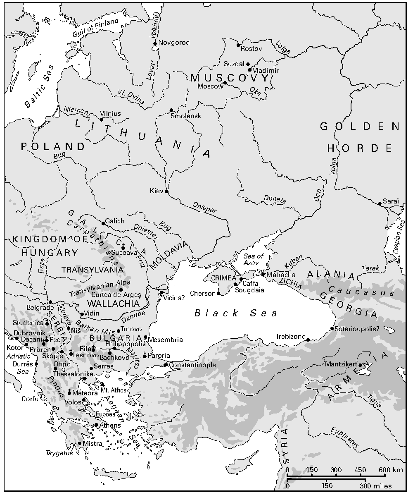

*地图1 拜占庭共同体。中文地名对照见本章末。*

<!-- PDF page 26; original page 5 -->

很可能由米海尔七世·杜卡斯（Michael VII Doukas，1071—1078年在位）赠给匈牙利统治者盖扎（Géza）的珐琅饰片，清楚地以视觉形式呈现了拜占庭人心目中的正确秩序：米海尔和他的儿子头部都有光环；盖扎的服饰较为朴素，也没有光环。不过，他戴着一种王冠，而这些饰片原先装饰的器物，很可能本身就是一顶王冠；它也许是专为盖扎那位出生于拜占庭的贵族新娘制作，并于十一世纪七十年代中叶送给她的。新娘、王冠和珐琅肖像共同宣示了盖扎在既有统治者行列中的地位；盖扎肖像旁的希腊文铭文称他为国王（κράλης）。[^p026-3]这些帝王恩宠的标志也表明，盖扎如今或许能够把相应的庇护分施给自己麾下那些值得奖赏的权贵。

这些珐琅饰片，为我们留下了拜占庭外交实际运作的一幅速写。珐琅似乎只被用于为帝国外部统治者制作的冠冕，长久提醒人们拜占庭工艺的卓越。然而，米海尔·杜卡斯这份赠礼的后来遭遇，也显示出，各地统治者会以多么不同的方式，运用自己与皇帝（basileus）的联系：不久之后，这些饰片便成为后来所谓“圣斯蒂芬王冠”的下部。米海尔原本意在借此展示霸权，最后却产生了一个自主的匈牙利王国最具代表性的象征。对于许多统治者而言，从皇帝那里接受头衔、礼物与徽号，同自行掌控本国的抱负并不矛盾；更有自信的政权，还会改用乃至仿用那些被皇帝视为自身专有权利的象征。这些统治者挪用帝国符号，并公开援引帝国宫廷，其主要目的，是巩固自己对成分复杂、往往尚未充分整合的人口的统治。这些明确无误的权威标志，有助于超越地方差别与竞争，提供一套所有臣民都能理解的权力视觉语言。

与盖扎一样，中世纪早期的大多数统治者，都试图证明自己取得王位的正当性，无论其王位是继承而来、篡夺而得，还是尚在创设之中。他们谋求亲族和区域内其他有实力者的尊重，即使未必能够获得服从；对于生活在其名义领土以内及以外的人，也是如此。授予官职并由此确定身份等级，通常被视为衡量统治者权威的一个尺度。在这方面，拜占庭同样能够提供许多东西。皇帝是上帝在人间的代理者、仅向上帝负责的观念，<!-- PDF page 27; original page 6 -->尽管拜占庭教士和修士不断试图通过教会法、仪式与公开谴责加以约束，却仍然大行其道。许多外部统治者不仅希望主宰世俗事务，也希望主导宗教事务；那些对本国高级教士感到不耐烦的人尤其如此。对于有志成为君主、却与帝国既无密切文化联系、也无效忠传统的人，拜占庭提供了一个既庄严又有效的可行模式。有些人单方面取用拜占庭的视觉符号，既不求由皇帝颁赐，也不打算抹去旧帝国的中心。他们所追求的，是借用把自身统治表现为上帝所赐的方式，震慑并压倒国内强大的利益集团。例如，格鲁吉亚的塔玛拉女王（Tamara）重新组合了拜占庭君主图像的母题，以巩固自己作为独立执政女性的空前地位。格鲁吉亚王权长期以来就是通过源自拜占庭的图像语言来表达的。塔玛拉以各种方式加以改造，在教堂中自己的肖像上表现虔敬与合法性，同时突显格鲁吉亚本土值得尊崇的主题和人物。[^p027-4]

迪米特里·奥博连斯基（Dimitri Obolensky）认为，这类对拜占庭政治文化、宗教礼仪和视觉媒介的借用，构成了一种共同模式。在其权威著作《拜占庭共同体》（The Byzantine Commonwealth）中，他勾画出一群群承认帝国霸权的统治者及其臣民；所涉及的不仅是精英，也包括整个社会。他主张，使他们联结在一起的，是正教信仰、对教会与皇帝共同维护的法律的重视，以及对皇帝的尊敬。他们的基督教世界以君士坦丁堡为中心，因为其中大多数政治单位最初都接纳过拜占庭传教团，归属牧首的权威之下。奥博连斯基提出，这些边缘地区的统治者通常承认皇帝对全体正教基督徒的最高领主地位；他们这样做，既出于整合本国的务实愿望，也出于对皇帝的理想性忠诚。[^p027-5]

奥博连斯基承认，动机是混杂的：自身利益可能驱使正教统治者与皇帝交战，共同体的组成也随时间而变化。尽管东欧大多数使用斯拉夫语言的政权本身不断变化，又与多种文化保持联系，他仍认为，它们曾在各个不同时期遵奉拜占庭的规范性价值，<!-- PDF page 28; original page 7 -->这便足以构成它们作为一个制度性组织成员的资格。一些书评作者批评了奥博连斯基的理论，强调紧邻帝国实际领土的政治实体，与距离更远的政治实体，所处环境有着区别。他们还质疑，为什么意大利南部和高加索那些同源的文化，不在考察之列；他们认为，这个共同体至多是一个文化与宗教的范围，既缺乏制度基础，也不含政治意义。[^p028-6]在罗斯的例子中，表达对拜占庭皇帝效忠，或表明意识到拜占庭自称罗马继承者的材料，格外稀少。[^p028-7]蒙古征服以前流传于罗斯的那些最终源自希腊文的文本，内容大多是宗教性的，其中许多曾由南斯拉夫人翻译或改写。有些在十世纪初于保加利亚宫廷译成，目的在于为当地统治者提供正教基督教治理的准则。在这一过程中，它们帮助斯拉夫语读者形成了一种文本共同体。[^p028-8]如果只研究这些文本，人们可能会得出结论：拜占庭帝国秩序对于这些统治者来说，不过是一套可供组装的构件；他们任取所需，建立符合自身预先观念的结构。

然而，在那些主要从拜占庭接受基督教的社会之间，尽管地方差异很多，其政治文化中仍反复出现某些主题和母题。那些希望建立自己的物质庇护、神圣施惠与有序治理中心的领袖，把拜占庭皇帝能够授予和收回的官职与荣衔，作为自己的范本。这在十三、十四世纪的保加利亚统治者那里最为明显：其高级官员与尊位的名称，大多是拜占庭称谓的翻译或斯拉夫化形式。塞尔维亚领袖也大量借用拜占庭术语，建立宫廷等级。在神圣场合颁授、并据以确定等级的官职，<!-- PDF page 29; original page 8 -->对授予者和接受者同样具有吸引力；拜占庭授予个人帕特里基奥斯（patrikios）等头衔的典礼文本，也被译成了斯拉夫语。从发现的抄本数量来看，它们似乎构成了南斯拉夫宫廷实践的基础。不过，各地也作出了调整：库罗帕拉特斯（kouropalates）和帕特里基奥斯，被译为含义更为宽泛的克尼亚兹（kniaz，意为“亲王”或“显贵”）。[^p029-9]这些对博斯普鲁斯海峡畔宫廷的呼应，并不是在思想真空中发生的。斯特凡·杜尚（Stefan Dušan）1349年的法典，大量取材于马太·布拉斯塔雷斯（Matthew Blastares）几年前在帖撒罗尼迦编写的一部综合世俗法与教会法的论著。杜尚法典还改编了曼努埃尔一世·科穆宁（Manuel I Komnenos）等相对晚近皇帝的新律，以及缩编的《农民法》。与法典一道发布的“诏书”，宣示了他“希望制定某些合乎正教信仰的德行规范与最真实的法律，使之得到遵守”，由此将民事规范纳入信仰之中。这套帝国秩序的安排，预期同样适用于杜尚的斯拉夫臣民，以及他或早或晚新近获得的希腊臣民。法典是为实际施用而制定的：1354年又颁行了一个收入杜尚近期法令的修订本。与此同时，人们还通过视觉媒介，宣扬统治者的立法与执法具有神启性质。例如，杜尚位于莱斯诺沃（Lesnovo）的教堂，其壁画的一个突出主题，便是启迪统治者、以神秘方式赋予他引导人民之能力的“神圣智慧”。[^p029-10]这类对拜占庭帝王属性的描绘，与杜尚及其前任偏爱那些令人联想到帝国宫廷的等级称谓，相互契合。实际职务与荣誉头衔之间的界线并不分明；十四世纪保加利亚和塞尔维亚统治者授予较高官职与头衔，就像在拜占庭本土一样，近似于一种宗教授职礼。

拜占庭的世俗法典，以及通过官职改变个人身份的观念，在罗斯人那里都不甚重要，尽管莫斯科的谢苗亲王（Semen）曾在1347年奉承地宣称，帝国是“一切虔敬的泉源，是立法与成圣的导师”。[^p029-11]然而，拜占庭帝国秩序，无论罗斯人对它的理解多么模糊，终究提供了一整套概念、仪式和权威象征，并得到教会祝福的确认。罗斯领袖最终也利用了这一整套资源。君士坦丁堡陷于突厥人之手约一代人以后，莫斯科罗斯的伊凡三世，尤其有理由使自己的权力中心，带上<!-- PDF page 30; original page 9 -->古老帝国宫廷的气息。他扩大世俗权力的同时，社会中也盛行着末世期待；这些期待虽各不相同，强烈程度却丝毫不减。对于伊凡的都主教佐西马（Zosima）等教士而言，1453年新罗马的陷落，既可能预示现世的终结，也可能预示上帝将荣耀赐予“新君士坦丁之城莫斯科的新皇帝君士坦丁，整个罗斯大地与许多其他土地的君主”。[^p030-12]伊凡采用了拜占庭宫廷的一些外在排场与仪式，将克里姆林宫建设为新近汇集的领土和新社会的典范中心，仿佛立于今世与来世之间。[^p030-13]对于相信上帝所意欲的新时代即将到来的人，统治者作为灵魂守护者的身份，能够提供实际帮助。看似狭义宗教层面的关切，也影响着人们对于一位亲王是否称职的普遍期待；伊凡利用了这些期待，既通过砖石建筑，也通过耶路撒冷的象征，例如奉献给克里姆林宫内一座教堂的礼仪用圣匣。[^p030-14]在十五世纪晚期和十六世纪的罗斯精英之中，身为新以色列的意识，比身为新罗马的意识，表达得更为明确，信奉得也更为热切。然而，正是博斯普鲁斯海峡畔的帝国之都，为新耶路撒冷提供了最近的范本和熟悉的通路。

这并不只是唤起一个已经消失的帝国。源自正教思想的未来信念，为伊凡的政治抱负赋予了明确形态。各种末世理论尽管彼此不同，却都把拜占庭视为上帝在人间最眷顾的国度，认为这是理所当然的：其他任何正教统治者，都只能指望依照上帝的旨意，遵守虔敬皇帝确立的行为准则，才能在自己的领土上有所成就。统治者作为教会的监督者、臣民的保卫者和他们灵魂的照管者，这一角色在罗斯最充分的表达，见于1547年伊凡四世加冕为沙皇（皇帝）之时。伊凡及其顾问明确援引与拜占庭的历史联系。他们进一步铺陈了一个故事，声称君士坦丁九世·莫诺马霍斯（Constantine IX Monomachos）曾把一顶“王冠”赠给伊凡的一位远祖；加冕典礼本身，则改编了拜占庭的仪式与文本。在克里姆林宫金厅的壁画上，描绘着以色列和罗斯——也就是新以色列——历史中的场景；统治者权力的神授性质，是一个突出主题，而他的“神圣智慧”，也如同杜尚在莱斯诺沃的形象一样，被特别彰显。[^p030-15]这种<!-- PDF page 31; original page 10 -->象征，在观看这些图像的廷臣和教士眼中，也许有深浅不同的解读，但它们传达的信息却无可回避。

从某种意义上说，为这一目的而求助于拜占庭意识形态，是一种“别无更佳选择”的做法，因为人们缺乏其他既能表达帝王统治、又与正教教义相容的观念。为了论证并展示莫斯科卓越的权力与虔敬，教士们取用了拜占庭关于帝国中心的思想和母题，并明确援引昔日基督教领导权的枢纽。把莫斯科称为继博斯普鲁斯海峡畔“第二罗马”之后的“第三罗马”，便表达了它正在实际取代旧中心的意识。长期以来，那些希望建立自足中心的政治实体，尤其是毗邻拜占庭领土的政治实体，便会把自己新的政治与宗教权威中心，称作“新罗马”或“新皇城”（new Tsargrad）。从十三世纪后期起，保加利亚作家就已称大特尔诺沃（Veliko T’rnovo）为“新皇城”。更值得注意的是，十五世纪晚期，人们只是有些迟疑地尝试把这个称号用于莫斯科，随后过了相当时间，才充分展开这一主张。莫斯科作家在旧中心的概念框架中提出新中心的要求，主张本国亲王拥有长期归于皇城之中皇帝的神圣认可，因而不能随意无视后者由来已久的首要地位。他们大多本身就是教士，所隶属的组织，其总部依然留在皇帝的城市中。此外，还有其他原因，使莫斯科不敢公然摆出帝国姿态。大帐汗国的鞑靼可汗，因身为成吉思汗的后裔而被称作“沙皇”，直到十五世纪晚期，仍在向罗斯东北部征收贡赋；莫斯科亲王也一直受到克里米亚鞑靼人及其他鞑靼集团的威胁，在整个十六世纪都向他们支付巨额贡金。

然而，对于罗斯及其他统治者的抱负，始终有一项告诫：普世牧首区坚持认为，基督教世界的统一，以一个“罗马”帝国继续存在于君士坦丁堡为基础。例如，十五世纪初，驻莫斯科的基辅与全罗斯都主教佛提乌斯（Photios），有一件“萨科斯”礼袍（sakkos，典礼用外袍），上面的织绣图像便传播了这种观念。莫斯科亲王瓦西里（Vasilii）及其妻子，被描绘成面向皇帝约翰八世·巴列奥略（John VIII Palaiologos）和他的新娘；而这位新娘，正是瓦西里本人的女儿。皇帝与这位生于罗斯的皇后，都有光环，莫斯科亲王却没有。神圣统治及首要权威究竟位于何处，几乎不可能表现得更清楚了。[^p031-16]当瓦西里的首席教士穿着<!-- PDF page 32; original page 11 -->这件礼袍主持教会礼拜时，瓦西里便亲眼见证了这份来自君士坦丁堡的赠礼所传递的视觉信息。他也由此间接提升了自己的地位：至少，他的女儿已进入了头戴光环者的行列。1439年佛罗伦萨会议赞同与罗马合一，并没有对普世牧首区在斯拉夫人中的地位造成持久损害。因此，即使君士坦丁堡已陷于突厥人之手，任何有志成为新罗马皇帝的人，也仍必须顾及牧首区对于另立皇帝的保留意见。伊凡四世加冕典礼的筹办者，因而谨慎地征求牧首的同意，并最终获得认可。即便如此，在傅油之际，主持典礼的都主教马卡里（Makarii），仍使用了有别于拜占庭晚期登基礼的一套措辞。他的克制似乎反映出这样的认识：他并不是君士坦丁堡牧首，正如伊凡也不是罗马人的皇帝。[^p032-17]

1547年马卡里举行加冕礼时，拜占庭作为一个领土帝国，早已不复存在；金厅的绘画则表现了伊凡接受天使加冕的场景。在拜占庭影响范围内，其他统治者被描绘成接受加冕的例子极少，无论授冠者是基督还是天上的神灵。少数这样的统治者，通常着意追求与拜占庭皇帝相当的霸主地位，而非后者独一无二的“罗马”头衔。例如，1344—1345年间，一幅细密画表现了保加利亚的伊凡·亚历山大（Ivan Alexander）在基督面前接受天使加冕：基督被称为“万王之王与永恒之王”，伊凡则是“全体保加利亚人和希腊人的沙皇与专制君主”。[^p032-18]这种公开以视觉方式宣称主权出自神授的做法，比取用帝王头衔还要罕见。

这些统治者的迟疑表明，无论他们把拜占庭政体视为罗马人的帝国，还是仅仅看成希腊人的国土，他们都意识到了皇帝声称拥有的特殊人间地位。对于希望把权力缰绳集中到自己手中、并确保仅由自己后代继承的领袖，拜占庭国家作为一个以法律为支撑的政治秩序实际范本，具有相当价值。皇帝在上帝及其律法的帮助下主持一个等级体系，这对本国那些难以驾驭的竞争者，以及一般臣民，都有教诫意义。把拜占庭视为一个通过仪式形式传达霸主领导规范的典范中心，是很有道理的。这些仪式提供了<!-- PDF page 33; original page 12 -->或多或少普遍可辨认的权威象征，同时明确暗示统治权来自上天的委任；对于建立新的霸权结构而言，它们也是具有实际用途的构件。只要某位统治者明确援引拜占庭式的政治文化，他就很可能对这种文化最初、也是最主要的代表，表现出至少一定程度的尊重。至于使这个基督教权威的范本黯然失色，或取而代之，在1453年以前，几乎算不上值得考虑的选择。

这一逻辑，可以用较为传统的方式来表述：对于那些至少在精英层面知道拜占庭帝国的民族，各个王朝统治者和有志成为君主的人，都会计算自身利益与损益。在拜占庭拥有压倒性的物质财富与力量的时代，这种解释是可信的。然而，正如奥博连斯基所指出的，共同体的鼎盛期，却出现在拜占庭政治与军事衰退之后；它的宗教也因此失去了成功的光环。玛丽·赫尔姆斯（Mary Helms）等社会人类学家对“上位”（superordinate）中心的研究，有助于解释这个看似矛盾的现象。这类中心很像拜占庭首都：它们向外围领袖及其人民提供用来组织和界定自身的物品、仪式与象征，展示出个人、政治精英乃至整个共同体所向往的范本。[^p033-19]用赫尔姆斯的话来说，“上位”中心是一个“在地理上遥远的场所”，被认为是“外部世界的不同维度在宇宙论意义上发生接触、力量尤其集中的一个点或方向。正因为这种交汇，它便成为仪式能够使诸神与人类发生接触的地方”。[^p033-20]与这些超人力量的联系，使外围地区的领袖和精英，相对于他们的臣民及其他缺乏此类联系的人，处于有利地位，同时也给他们原有的特权注入了更多合法性。

中心的人则相信，自己“负有一种道德义务：面对世上不合道德或较少合乎道德者，不断重复或继续彰显道德合法性与意识形态中心地位这一任务”。他们赠给“蛮族”的精工制品或珍稀物品，便赋予这种道德优越性的主张以物质形式。[^p033-21]确保“上位”中心声望延续的，是这种能力，而不只是赤裸的武力；它也大大有助于解释拜占庭的悖论。在1204年以后很长时间里，拜占庭的帝国与教会复合体系，<!-- PDF page 34; original page 13 (map page without printed folio) --><!-- PDF page 35; original page 14 -->依然十分有能力，满足外部社会在伦理、观念、物质与政治方面的需要；其宣传也不断强化一种观念，即帝国宫廷礼仪与天上领域相互呼应。

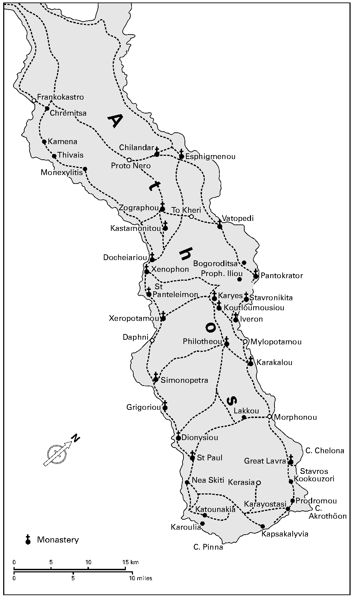

*地图2 阿索斯山。中文地名对照见本章末。*

## 阿索斯山与塞尔维亚的圣徒、亲王及皇帝

“上位”中心的理论，为这样一个悖论提供了解释：“上帝护佑之城”在第四次十字军面前陷落，丧失物质财富、连续不断的主权以及圣髑之后，拜占庭帝国的地位却依然很高，甚至可以说进一步上升。尽管这座城市在1204年之后从未完全恢复，它仍然保持着吸引力。不过，人们之所以能够在相信帝国为神所立的同时，容纳这样一场灾难，还有其他更为具体的原因。在正教徒眼中，帝都的命运与帝国、与上帝为人类制定的计划，彼此交织。这座城市陷于蛮族之手，可能预示时间的终结；但也可能是上帝警告他的子民，应当改过自新，寻求属灵的重生。早先各世纪蛮族进攻之际，传道者就曾宣讲这样的主题。[^p035-22]因此，帝国的崩溃也可以解释为一个信号：上帝要求自己的子民更加严格地遵行宗教。即使最遥远的正教徒，似乎也密切关注着最终导致十字军攻占帝都的一连串事件。一部诺夫哥罗德编年史保留了完整叙述；它很可能写于事发后不久，所归咎的，是希腊皇帝之间的内斗，而不是拉丁人的侵略。[^p035-23]1261年收复首都，标志着君士坦丁堡重新成为上帝所祝福的人间权威中心。合法帝王照管一切真正信徒的神圣光环，对正教统治者具有吸引力，不只是因为皇帝如今更易受人左右、听从劝说，也因为面对拉丁人对正教信仰的威胁，他们之间新近产生了一种团结意识。

如果帝国首都是通向上帝之国的一条渠道，那么拜占庭修道院便提供了另一条。修道院被视为天上秩序的缩影，由此激发的敬意与畏惧，自十世纪中叶以后，越来越集中到阿索斯圣山。皇帝的庇护，保证了<!-- PDF page 36; original page 15 -->山上修士的特权地位。许多来自帝国以外的人受到吸引，前往那里；其中有些创立了宗教团体。几乎从一开始，那里便有伊比利亚人——即格鲁吉亚人——和阿马尔菲人的修道院；从十一世纪中叶起，阿索斯山又与基辅洞窟修道院建立了特别联系。其创立者安东尼（Anthony）先在阿索斯山接受剪发礼，随后受命返回罗斯。他在第聂伯河畔建立的修道院，被认为“起源于圣山的祝福”。[^p036-24]阿索斯山上的罗斯修道院克西卢尔古（Xylourgou），受益于1169年颁发的一份皇帝金玺诏书。这份诏书准许院长的请求，要求阿索斯山的管理机构再拨给他们一座圣潘泰莱蒙（St Panteleimon）修道院，以容纳人数众多、经费充足的罗斯修士；修士们应修复并加固这座修道院，事奉上帝，并“为我们最卓越的神圣皇帝祈祷”。[^p036-25]到十二世纪晚期，阿索斯山上数百所修道院与隐修处，对外来者的吸引力，至少不亚于对皇帝臣民的吸引力。塞尔维亚统治者斯特凡·内马尼亚（Stefan Nemanja）十七岁的儿子听到召唤后，便前往阿索斯山，在那里接受剪发礼，取得修道名萨瓦（Sava）。几年以后，1196年，他的父亲退位，也来到圣山与他会合，取修道名西缅（Symeon）。次年六月，皇帝阿莱克修斯三世·安格洛斯（Alexios III Angelos）将希兰达尔（Chilandar）修道院交给西缅和萨瓦，用来接纳“塞尔维亚民族中选择修道生活者”；它应当像“坐落在此山上的伊比利亚人和阿马尔菲人的”修道院一样，享有“自我管理与自治”的地位。[^p036-26]希兰达尔明确指望拜占庭皇帝保护自己，免遭贪婪税吏的侵扰。它还确保新当选的院长由皇帝确认，而非由阿索斯山的首席长老（protos）确认，从而把皇帝当作后者的制衡者；这位首席长老对于阿索斯山各修道院，拥有广泛的管辖权。[^p036-27]由此产生了一种“三角关系”：非希腊语团体可以凭皇帝颁发的权利文书，确保自己在“圣山”的地位；与此同时，它们又充当本族通向上帝的渠道，各自提出自己受到神圣保护的特别主张。

萨瓦及后来追随他的父亲之所以趋向阿索斯山，恰逢塞尔维亚与帝国的政治关系日渐紧张之时。在帝国贫困、军事无力的时代，赠礼与头衔失去了部分吸引力。1185—1186年，阿森兄弟领导的保加利亚反拜占庭<!-- PDF page 37; original page 16 -->起义，最初是针对过重税赋而发。起义者成分复杂，兄弟之间又有竞争，这些都是不利因素；不过，在讲述保加利亚昔日强盛的文本与民间传说的帮助下，复兴保加利亚政体的观念，开始围绕里拉的伊凡（Ivan of Rila）、保加利亚皇帝彼得等圣徒的崇敬而凝聚起来。第四次十字军的到来，使阿森兄弟中尚在世的卡洛扬（Kalojan）有机会转向教宗，请求确认自己的统治，从而巩固尚在形成中的领土。英诺森三世在授予他王冠与权杖的同时，还赐予“保加利亚人与瓦拉几亚人的国王”这一头衔。塞尔维亚人同样善于利用时机。1199年，萨瓦的兄弟、塞尔维亚统治者斯特凡，休弃拜占庭皇帝阿莱克修斯三世的女儿优多基亚（Eudokia），几乎赤身将她遣送回国，以此表现出对皇帝的不敬。斯特凡最终于1217年接受了教宗霍诺留三世使节送来的王冠，并在自己的文书中自称“首位受冠之王”。不过，这些脱离拜占庭轨道的举动，既短暂，也相当表面。其中一个原因，是当地无论讲希腊语还是斯拉夫语的人口，都依恋着正教的宗教礼仪与图像。

塞尔维亚和保加利亚统治者，希望统治散布于山地、成分各异的共同体，这种抱负极为依赖当地的合作；单凭武力与恐吓，只能一时奏效。与无可争议的神圣事物建立联系，是取得这种合作的一种办法。因此，保加利亚沙皇伊凡·阿森二世，在1230年于克洛科特尼察（Klokotnica）击败帖撒罗尼迦的“皇帝”狄奥多若·安格洛斯（Theodore Angelos）之后，最先采取的行动之一，就是前往阿索斯山，向那里各修道院慷慨赠礼，授予特权。对于斯特凡·内马尼亚家族，同阿索斯山的联系尤其珍贵，既突显了家族独一无二的地位，也突显了他们在本国创建的修道院的圣洁。1206年或1207年，斯特凡·内马尼亚的圣髑，从阿索斯山迁至他所创建的斯图代尼察（Studenica）修道院教堂；不久，它们又开始渗出圣油。迁髑之事由萨瓦主持；他虽然已不再常住阿索斯山，却仍经常前往。1219年，萨瓦在尼西亚由正教牧首祝圣为“佩奇及全塞尔维亚总主教”；一道在皇帝权威下颁发的教会会议法令，确认了他的地位。由此，塞尔维亚领导层对于东正教的承诺进一步加强。

在此例和其他例子中，与政体疆域大体重合的教会组织，不仅带来合法性，也使尚在形成中的政体获得了更清晰的领土界定。萨瓦主持了拉多斯拉夫（Radoslav）的加冕礼；他是“首位受冠之王”斯特凡与优多基亚所生的长子，也是王位继承人。随后，在1233—1234年间，萨瓦又为拉多斯拉夫的兄弟、篡位者弗拉迪斯拉夫（Vladislav）加冕。尽管并未<!-- PDF page 38; original page 17 -->得到精确表述，斯特凡·内马尼亚及其后代同圣山的密切关系，对于建立这个王朝，具有无法估量的价值。萨瓦在为父亲所写的《传记》、自己译出的《教会法与世俗法汇编》（Nomokanon），以及为希兰达尔撰写的修道院《规章》（Typikon）中，牢牢确立了他们的虔敬形象。[^p038-28]他的工作，在很大程度上把这些塞尔维亚酋长变成了一个王朝，更变成了一个在神圣秩序与法律上无可比拟的圣洁家族。王朝的文字辩护者，不断强调其与《圣经》人物的对应，把形形色色的臣民呈现为肩负上帝使命的新以色列，以求赋予他们清晰身份与共同目标感。这又强化了王朝合法自主的权利。同时，统治家族把自身与阿索斯山相认同，并庇护塞尔维亚人在“圣山”的神圣汇聚之所；当罗马皇帝返回君士坦丁堡之后，这些做法又在双方之间织就了如游丝般纤细却持久的联系。对于希兰达尔修士，如同对于阿索斯山其他修道院一样，皇帝的保护与财政特权，仍然具有无法估量的价值。

正是在这一背景下，斯特凡·乌罗什二世·米卢廷（Stefan Uroš II Milutin，1282—1321年在位），除了庇护继承或取得的领土内的修道院与教堂，也把目光投向阿索斯山。他攻占了南至普里莱普（Prilep）与奥赫里德的拜占庭领土，继而夺取都拉斯（Durrës，即Dyrrakhion）之后，转而议和，并于1299年迎娶安德罗尼科斯二世（Andronikos II）年幼的女儿西莫妮斯（Simonis）。这标志着他重新转向拜占庭、远离西方；此前，西方曾为塞尔维亚银矿的产品提供最有利可图的市场。直到当时，罗曼式与早期哥特式仍主导塞尔维亚教堂建筑，清楚显示出西方的影响。米卢廷如今希望用石造建筑，确立自己对新征服臣民、桀骜不驯的塞尔维亚贵族，以及心怀不满的兄长和侄子的霸权；但他所选择的，不是拉丁人的服务，而是受过拜占庭训练、技艺最精湛的建筑师和工匠。他们的才华，不仅闪耀在米卢廷出资于自己领土内建造的陵墓和壮丽教堂中，也体现在希兰达尔，以及君士坦丁堡、帖撒罗尼迦和耶路撒冷的纪念性建筑上。他的传记作者达尼洛（Danilo），把这些广泛的营建工程，同这位新君士坦丁的其他功业一道记载下来。[^p038-29]米卢廷还把大量土地赠给希兰达尔修道院；这座修道院充当了<!-- PDF page 39; original page 18 -->培养塞尔维亚高级教士的一种学府。[^p039-30]他谨慎地通过皇帝金玺诏书，确认这些赠予。安德罗尼科斯二世有时也以自己的赠礼和特权，表示并谋求友好。例如，1313年，为纪念拜占庭与塞尔维亚联军战胜一支四处劫掠的突厥队伍，安德罗尼科斯把斯特里蒙河（Strymon）畔一个拥有免税土地的村庄，交给“我最亲爱的儿子与女婿”米卢廷，以便后者将其捐给希兰达尔。[^p039-31]米卢廷也取得了皇帝金玺诏书，用来确认本国境内修道院地产的权利，例如斯科普里附近圣尼基塔斯（St Niketas）修道院的财产权。[^p039-32]

对于米卢廷来说，要构建符合自身抱负的政治文化，拜占庭提供了最丰富的资源库。直接同皇帝建立联系，以及唤起皇帝宫廷礼仪的种种做法，有助于使米卢廷取得的成果合法化，并巩固他的君主政权。在格拉查尼察（Gračanica）——米卢廷的修道院教堂，也被认为是他的陵墓——一幅施主肖像表现了两位天使奉基督之命，向他与妻子奉上王冠，为他们加冕。[^p039-33]米卢廷的宫廷以黄金和丝绸排场装点，犹如舞台布景；用一位来访拜占庭使节的话来说，它追求着“帝王的、并且尽可能达到罗马人的卓越”。[^p039-34]米卢廷将自己及妻子描绘成蒙上帝加冕，在这方面比前任走得更远；他的大胆，在很大程度上来自西莫妮斯身为皇帝之女，本身即拥有神授权威这一事实。据说，他在迎接她之前便已下马，接待她“如同一位君主，而非一个妻子”。[^p039-35]他还从拜占庭皇后那里，得到了一顶几乎与皇帝本人王冠同样华美的冠冕。[^p039-36]作为展示恭顺的回报，米卢廷获得了一些看似可信的准帝王属性，使自己的地位远远高于心怀不满的兄长及家族其他成员。这并不意味着祖先遭到忽视：在格拉查尼察，靠近米卢廷施主肖像之处，还有一幅壁画，以耶西之树的变体形式，表现他出自斯特凡·内马尼亚的世系。

与其祖父米卢廷一样，斯特凡·杜尚也愿意在有机可乘时同帝国作战。他利用约翰五世·巴列奥略年幼的时机，夺取马其顿东南部领土，将自己的疆域扩展到<!-- PDF page 40; original page 19 -->斯特里蒙河和哈尔基季基半岛（Chalkidike）。1345年九月占领重镇塞雷斯（Serres）后，斯特凡被拥立为皇帝。1346年四月十六日，新近被宣布为牧首的约阿尼基（Joanikij，原佩奇总主教），在斯科普里为他加冕为帝；在此之前，他已公开表明自己从拜占庭夺得的领土：一份1346年一月颁给阿索斯山的文书中，斯特凡自称“塞尔维亚与罗马尼亚的皇帝及专制君主”，借此指称现已落入其掌控的“希腊领土”。[^p040-37]与君士坦丁堡的政权形成鲜明对照的是，斯特凡能够提供有效的保护与秩序。据尼基弗鲁斯·格里高拉斯（Nikephoros Gregoras）所说，斯特凡“以罗马人的风尚取代了蛮族的生活方式”，戴上王冠，穿着与罗马皇帝相称的袍服，并把新征服地区“留归自己，依照罗马人的习俗统治”。[^p040-38]

与此一致，斯特凡让人将自己、妻子和儿子，描绘成直接从基督手中接受冠冕。同一幅位于莱斯诺沃的壁画，还宣告他凭神圣智慧获得启迪。总体来说，斯特凡在运用拜占庭图像构思与意识形态来服务本政权需要方面，比前任更加精巧。即便如此，他似乎仍不愿进攻君士坦丁堡的城墙。如果说斯特凡企图取得帝都的权力，他所诉诸的，也是王朝婚姻联系：1343年，他把年幼的儿子兼继承人，与已故皇帝安德罗尼科斯三世的女儿订婚。在颁给阿索斯山修道院的金玺诏书中，他也没有自称“罗马人的皇帝”，尽管这些文书的序言依照拜占庭皇帝本人的惯例，强调教会和修道院属于帝王所应关怀的事务。

斯特凡的克制有几个原因。他成长中的若干年，是在君士坦丁堡度过的。他对基督教法律与教会秩序的特别重视，部分来自亲眼观察它们在拜占庭环境中所发挥的益处。此外，若在君士坦丁堡巍峨的城墙前遭到击退，只会证实，这座城市仍然受到“上帝护佑”，能够抵御包括塞尔维亚人在内的“列国”。还有另一重约束：阿索斯山修道院承认“罗马人的皇帝”享有首要地位。斯特凡本人虔敬地尊重修士的生活方式，相信圣山具有保护力量。部分是为了躲避黑死病，他于1347—1348年间，同妻儿在山上住了八个月，走访数所修道院，敬礼其中的圣所。他把许多修道院在拜占庭内战期间丧失的大陆地产归还原主，又慷慨地<!-- PDF page 41; original page 20 -->赠予土地和税收收入。例如，他把自己托付给罗斯的圣潘泰莱蒙修道院修士，希望他们的祈祷，能使基督宽待他的所作所为。伊比利亚人修道院——此时主要由希腊人居住——同样获得土地赠予与免税权，多希亚里乌（Docheiariou）和埃斯菲格梅努（Esphigmenou）修道院也不例外。斯特凡的举措，在政治上明智，在属灵上也有益；不过，要取得修士们的祈祷，仍须付出代价。1345年，他们通知他，尽管他如此慷慨，他们仍要先为“罗马人的皇帝”祈祷，其后才为他的“王者之尊”（κραλοτῆς）祈祷；这一规定，不仅关乎先后次序，更饱含着拜占庭皇帝具有更高合法性的意味。[^p041-39]阿索斯山修士的祈祷或诅咒，并不由斯特凡·杜尚决定。拜占庭皇帝古老合法性所受到的普遍承认，是如此强烈，以至斯特凡在1351年，甚至请求约翰五世确认他自己颁给希兰达尔修道院的文书。[^p041-40]反过来，这实际上也排除了斯特凡以敌对方式谋取约翰五世王位的可能；后者作为罗马人的皇帝，其合法性无可争议。米卢廷也受到相近的约束；除了在某些印玺上，他始终没有自称沙皇。

塞尔维亚统治者把自己的统治扩展到阿索斯山，在其他正教统治者中显得突出；斯特凡1355年去世后，他们对于圣山的最高统治权，又维持了十六年。不过，其他几位胸怀抱负的统治者，也都希望在山上取得一处神圣据点，其中包括讲希腊语的皇帝；他们也许受到斯特凡榜样的刺激。1374年，特拉比松皇帝阿莱克修斯三世，解释了自己支持迪奥尼修（Dionysiou）修道院的理由：“凡具有一定声名的皇帝、国王或统治者，都曾在圣山建造修道院，以使自己得到永恒纪念。”因此，阿莱克修斯也要添设“一座新修道院，以便永远存留于人们的记忆之中”。[^p041-41]瓦拉几亚亲王们同样是热忱的庇护者。修士的祈祷，以及对山中圣所的虔敬，能够带来的世俗敬重与永恒福佑，对他们全都有吸引力。

这种热忱，也许会被视为又一个例证：外部人物利用拜占庭的帝王与宗教象征，为自己的政治结构提供建筑材料。杜尚必须顾及阿索斯山对于君士坦丁堡“罗马人的皇帝”的尊崇，但他是否实际<!-- PDF page 42; original page 21 -->支持当时在位的皇帝，显然取决于自身利益。此外，阿索斯山的修士们不断为地产和纪律问题争吵，远非一个团结集团，也相对少有人把自己看作某位皇帝的鼓吹者。尽管如此，山上许多资深修士与著名圣人，都与君士坦丁堡牧首区保持牢固的私人关系；1312年，牧首区正式承担了管理圣山的责任，即使各修道院依然把皇帝视为最高法律权威。十四世纪三位著名牧首——尼丰（Niphon，1310—1314年在位）、卡利斯托斯（Kallistos，1350—1353年、1355—1363年在位）和菲洛塞奥斯·科基诺斯（Philotheos Kokkinos，1353—1354年、1364—1376年在位）——都曾在山上生活；伊西多尔一世·布希拉斯（Isidore I Boucheiras，1347—1350年在位）也一样。围绕宗教纪律与静修主义的激烈争论，有时使阿索斯山修士与君士坦丁堡教阶对立起来，相关材料也极其丰富；不过，在一个积极探索灵修、对祈祷生活寄予厚望的时代，意志坚决的圣人与教会及修道院既有机构之间，发生不和，几乎不可避免。事实上，十四世纪修道生活的好争辩性质，反而使拥有正式教会或修院权威的人，更加希望有一位总揽全局的守护者，来维护教义与教阶的基本原则。与此同时，阿索斯山的领袖本就倾向于把“罗马人的神圣皇帝”置于其他一切统治者之上加以尊崇，视他为自己地产免税权及其他特权的首要法律保证人。

## 正教的弧形地带

如今，君士坦丁堡牧首在皇帝登基礼中发挥着独特作用，因此，他们也有自己的理由，坚持人们尊重帝王的尊严。十三世纪初，牧首开始以圣膏为皇帝傅油，以圣事方式确认皇帝配得上帝恩典、具有统治资格，从此使自己成为不可或缺的人物。到十三世纪中叶，牧首被描述为基督的属灵形象，以及皇帝权威的源泉；这进一步强化了九世纪佛提乌斯就已提出的主张。高级教会职务的神圣光环，在十四世纪也获得了图像表达：巴尔干地区的壁画，开始在礼仪场景中描绘身穿牧首萨科斯礼袍的基督。

这在一定程度上反映了帝国实际权威的退缩，而退缩又是1204年君士坦丁堡陷于拉丁人之手的后果。面对这一新局面的，是牧首日耳曼努斯二世（Germanos II，1223—1240年在位）。他<!-- PDF page 43; original page 22 -->屡次应邀，在缺乏帝国治理的地区，介入并仲裁高级教士与其信众之间的争端，例如受拉丁人支配的塞浦路斯，以及早已处于突厥人统治之下的梅利泰内（Melitene）。他发现，人们承认他是教会纪律与法律的仲裁者，这在同教宗交涉时具有价值，能够制衡教宗的普世性主张。日耳曼努斯1232年致罗马教廷枢机们的一封信，列举了那些服从拜占庭母教会、坚守正教信仰的全部民族：从埃塞俄比亚人和“全体叙利亚人”，到格鲁吉亚人（“伊比利亚人”）、阿兰人、“人数无穷的罗斯民族”，以及获胜的保加利亚国度。[^p043-42]这并不只是一项修辞宣言；1228年，应请求裁定罗斯主教与本地亲王之间管辖关系时，日耳曼努斯所发挥的作用，便足以证明。[^p043-43]

1261年，普世牧首区恢复驻于君士坦丁堡之后，要求牧首为各正教共同体提供指导的压力进一步增加。幸运的偶然，使1315年至十五世纪初的牧首座登记簿得以保存。与更早时期存留下来的材料相比，它提供了丰富得多的细节：信函副本保存得相当细致，记载的程序与判决，也表现出对于教会法的熟练掌握，以及对于所有相关当事人的关照。牧首区需要记录自己如何维护高于其他正教会的首要地位：顺应新的情势重组主教座，答复外部统治者与教士的询问，裁决争端，并至少试图作出具有约束力的规定。在这一过程中，牧首也可以希望赢得近在身旁的希腊语会众与世俗当局的更多尊重；这绝非无足轻重的动机。

几个例子，或可说明十三、十四世纪新罗马牧首如何以多种方式，牧养正教会与各共同体。许多主教座被设立、升格或合并。我们的证据虽很少具体交代缘由，但牧首区似乎相当迅速地适应了新环境。设立都主教座，以及将教士从一处主教座调往另一处，都需要皇帝的权威。值得注意的是，十三、十四世纪之交，一篇专论调任问题的文章，曾两次修订更新；而安德罗尼科斯二世据说<!-- PDF page 44; original page 23 -->还下令编写一部著作，把当时各主教座的等级次序，与传统版本并列列出。[^p044-44]

教会当局迅速应对意外局面的一个例子，是在伏尔加河下游金帐汗国总部设立主教座。这个主教座以当地兴起的营帐城市命名，称为萨莱（Saräı）；1261年，一位名叫米特罗凡（Mitrofan）的人来到此地，似乎是首任主教。米特罗凡本人显然出生于罗斯，由罗斯都主教任命；但其直接继任者却讲希腊语，并与君士坦丁堡保持密切联系。例如，1276年，主教狄奥格诺斯托斯（Theognostos）参加了一次牧首座会议，提出有关教会法与基督教纪律的问题。会议的答复涉及这样的情形：如果主教想举行圣餐礼，身边却只有司祭，而没有通常更适合协助礼仪的执事，应当怎么办？这些答复顾及了主教履职的草原环境。没有执事时，可以不由执事襄助而举行圣餐礼；祝圣过的饼可以携往各地；旧有的圣器也可以修复后重新使用。不过，司祭如果参过战，而且杀过人，就必须免职。邻近教区的高级教士，也不得前往萨莱，声称有权照管当地来自自己教区的信众。[^p044-45]这表明，正教教士本就有前往这个新权力中心的倾向。狄奥格诺斯托斯及其继任者，既充当可汗与君士坦丁堡当局之间的中间人，也为罗斯都主教和亲王频繁出访可汗宫廷牵线。君士坦丁堡牧首在扶植这处基督教前哨时，与皇帝保持密切联系；皇帝通常希望与金帐汗国领袖友好相处，把他们视为北方门户的稳定支柱，以及对抗小亚细亚突厥人的盟友。巴列奥略王朝最初三位皇帝，都有非婚生女儿嫁给可汗；她们带着人数可观的随从，居住在萨莱。因此，自十三世纪转折之际起，王朝联系便为拜占庭在伏尔加河下游的教会存在增添了活力；这展示出帝国与教会复合体系，如何在“蒙古治下的和平”（pax mongolica）中扩大影响范围，并与拉丁教会竞争。

牧首座登记簿还处理黑海东部地区的教会秩序问题。若干条目涉及阿兰尼亚（Alania）。当地都主教，<!-- PDF page 45; original page 24 -->正是那些过于热衷介入萨莱事务的人之一。主要问题似乎来自主教座增多、教会长官不服约束，而不是收入或可任司祭之人不足。例如，约1344年，沿海古老的索特里乌波利斯（Soterioupolis）主教座，被恢复为都主教座；它原本隶属阿兰尼亚教省，因此引起阿兰尼亚都主教的愤怒抗议。后来一任阿兰尼亚都主教西缅，自己也遭到顿河下游一带教士及一位修士的反复投诉：他被指控侵犯他们的权利、侵吞收入，以及买卖圣职。1356年，在牧首座会议上，对西缅又增加了一项指控：他擅自为“高加索人都主教座”祝圣了一位主教。[^p045-46]

与许多其他案件一样，这一案件的解决，也因牧首频繁更替而复杂化；这种更替，本身又反映了当时帝国政权的不稳定。关于遥远主教座的若干判决，随着帝都政治的反复无常而改变。同时，会议还必须应付地方情况不断发生的变化。许多问题，本质上是成功带来的问题，例如必须为人数众多、善于表达自身要求的共同体，提供基督教司祭。十四世纪前半叶出现了一个“高加索人都主教座”，这意味着阿兰尼亚以南的正教人口有所扩展；都主教西缅那种似是而非的辩解，也反映出这一点：他声称，除了这个主教座，如今还存在一个独立的“高加索主教区”，归他管辖。会议查核列举各主教座的“教规书”之后，证明西缅的擅自行动具有欺诈性质。这种胆大妄为，很可能受到他与蒙古可汗之间联系的鼓动；会议指出，他还在自己的“高加索主教”帮助下，为萨莱主教座祝圣了一位新主教。[^p045-47]

西缅既人脉广泛，又经费充足，而且好发牢骚；在这些方面，他远非孤例。从苏格代亚（Sougdaia）周围及克里米亚东南山区的希腊文墓碑姓名判断，鞑靼精英中有相当多人，成为了基督徒。十四世纪前半叶，沿黑海北岸延伸的正教弧形地带，各地主教间发生的一系列争端，正是以富裕正教家庭与共同体的扩大为背景。例如，1317年，苏格代亚都主教向会议投诉，哥特亚（Gotthia）都主教座的牧首特派官（exarchs），正在侵占本教区教堂的收入。会议依其惯常做法，<!-- PDF page 46; original page 25 -->决定由“邻近都主教”实地调查本案；此处具体指阿兰尼亚、维齐纳（Vicina）和齐基亚—马特拉哈（Zichia-Matracha）的都主教。[^p046-48]“邻近”并非用词不当，因为在热那亚人的推动下，沿黑海北岸，以及克里米亚与君士坦丁堡之间的航行，已变得十分便捷。前述案件所体现的，主要是竞争，而不只是教区边界不明或缺乏安全保障：争议围绕苏格代亚教区新建教堂的收入，以及当地代表牧首区行事的官员所采取的措施而展开。

在黑海以西、多瑙河三角洲地区的维齐纳，也有一位与阿兰尼亚都主教相对应的都主教。很可能在十三世纪六十年代，米海尔八世·巴列奥略下令，将这一主教座提升为都主教座。该城很快成为热那亚人的重要贸易转运中心。在巴列奥略时期的多瑙河三角洲，贸易及拜占庭物质文化留下了丰富迹象。[^p046-49]维齐纳都主教座的设立，既展示帝国与教会复合体系适应变化环境的能力，也反映出对当地商业潜力的认识；这种潜力造福了历任主教。例如，主教路加（Luke）将教会资金借出，每年收取800枚金币。[^p046-50]都主教的财力，可能直接或间接来自热那亚商人在维齐纳利润丰厚的交易。他利用资金，照料草原边缘地区所牧养的信众，同时也替皇帝从事其他服务。因此，1301年，都主教曾在安德罗尼科斯二世，与携家眷寻求庇护的数千名阿兰骑兵之间，担任中间人。[^p046-51]牧首区此时也通过拥有一系列据点，在多瑙河三角洲附近保持存在。[^p046-52]不过，这些举措并不能确保维齐纳获得持久安全。约1340年，该城遭一支鞑靼队伍摧毁，失去了作为热那亚商人重要商埠的作用；不久以后，其都主教也不再驻于当地。[^p046-53]

然而，这次挫折并未终结多瑙河下游地区有组织的正教存在。亚历山大（Alexander）是一位强有力的军事首领，即沃耶沃达（voevoda），<!-- PDF page 47; original page 26 -->以库尔泰亚德阿尔杰什（Curtea de Argeș）一带为根据地。他希望拜占庭批准在其领土上设立一个正教主教座，以此庄严确认自己脱离安茹王朝统治下的匈牙利王国。一段时间以来，流离失所的维齐纳都主教雅金托斯（Hyakinthos），一直住在他的宫廷。1359年，拜占庭同意了他的请求，让这位客人成为“全乌格罗瓦拉几亚（Oungrovlachia）的合法牧者，为他本人、子女及全部领地施予祝福和属灵指导”；并同意在雅金托斯去世后，设立一个“全乌格罗瓦拉几亚”都主教座。由此，该地区正教组织的重心，从沿海移向内陆的亚历山大宫廷。1370年，亚历山大获普世牧首区许可，设立“乌格罗瓦拉几亚一部分地区的都主教座”，辖区覆盖塞韦林巴纳特（Banate of Severin），即他沿匈牙利边境的领土。他本人被称为“全乌格罗瓦拉几亚的大沃耶沃达与主人”。作为回报，他出具书面保证，承诺其教会今后一切首长，都由牧首及其会议任命，整个乌格罗瓦拉几亚也将继续处于大教会权威之下。[^p047-54]皇帝和牧首，因而在多瑙河下游以北，又获得了一处由所任命者、私人联系人及仰慕者组成的新前哨。雅金托斯的调任获得皇帝批准；根据牧首卡利斯托斯1359年致亚历山大的信，这“尤其是因为阁下，对于我那最卓越、神圣、蒙上帝所立的专制君主，至高的罗马人皇帝，一切善的精华，具有无瑕的忠诚与爱”。[^p047-55]亚历山大的“忠诚”究竟有多少实际内容，尚可争论；不过，他的儿子兼继承人弗拉迪斯拉夫，确实娶了一位很可能出身帝国宫廷圈子的女子。[^p047-56]大约同一时期，亚历山大回应阿索斯山一再提出的请求，慷慨捐助破败的库特卢穆修（Koutloumousiou）修道院；其子弗拉迪斯拉夫更进一步，根据1369年颁给该院的文书，成为了它的“所有者与创建者”。[^p047-57]

年轻的瓦拉几亚修士涌入重建后的修道院；他们希望放宽部分纪律，遭到了仍居住在院内的希腊修士反对。不过，这些本质上仍是成功带来的问题，体现了圣山的吸引力。最终，对于库特卢穆修应当遵行何种程度的禁欲，院长<!-- PDF page 48; original page 27 -->哈里通（Chariton）、瓦拉几亚修士、山上的著名圣人与弗拉迪斯拉夫，达成了一项协议；后者以慷慨捐助表示鼓励。1372年，哈里通接替雅金托斯，被任命为乌格罗瓦拉几亚都主教，进一步加强了阿索斯山与外围那些财力雄厚、并非使用希腊语的人口之间的联系。而“乌格罗瓦拉几亚一部分地区的都主教”，则是大教会前高级官员达尼埃尔·克里托普洛斯（Daniel Kritopoulos）；他此时取名安西莫斯（Anthimos）。后来，哈里通又兼任圣山首席长老。由此，一张复杂的网络，将阿索斯山、帝国与教会的既有体制，同瓦拉几亚精英联结起来。许多线索虽属私人性质，却往往相当持久。同时，教会也与该地区其他统治者建立制度联系。例如，1391年，一位地位较低的沃耶沃达巴利察（Balitza）及其兄弟，把位于马拉穆列什（Maramureș，近锡盖图马尔马齐耶伊）的圣米迦勒修道院，赠给牧首区。作为“牧首修道院”，它直接接受君士坦丁堡监督；院长则担任牧首特派官，在当地行使教会司法权。[^p048-58]

君士坦丁堡同多瑙河三角洲以北另一处新兴政体的重要制度联系，在1386年之前已通过设立“黑瓦拉几亚”（Maurovlachia，即摩尔达维亚）都主教座而形成。不过，当地统治者把牧首为新主教座任命的人选驱逐出去，强行安排自己的一位亲属、名叫约瑟夫（Joseph）的人就职；牧首区直到1401年，才最终接受这一既成事实。与此同时，摩尔达维亚不断建立修道院，尤其是在亲王据点兼都主教座所在地苏恰瓦（Suceava）。邻近的加利西亚，在1385年波兰与立陶宛达成克雷沃联合后，如今处于天主教统治之下，这一事实也刺激了拜占庭对该地区的兴趣。约瑟夫去世后，皇帝曼努埃尔二世在1416年，自行承担了任命继任者的职责；选定人选之后，他又催促牧首，为新任者颁发“牧首信函”。这表明，该主教座对于曼努埃尔有多么重要，也表明曼努埃尔具有何等介入教会事务的能力。[^p048-59]

这里较为详细地叙述多瑙河下游地区的这些变化，是因为它们说明了拜占庭修士和教士适应环境的能力：他们可以利用远在帝国疆界之外、那些地位正在上升的统治者的精力与资源，把挫折转化为自身优势。对于这些教会人士中的大多数而言，皇帝独一无二地象征着<!-- PDF page 49; original page 28 -->普世教会的延续，而普世教会本身，又是上帝为人类制定的计划的一部分。在拉丁世界的观念体系中，并没有完全相应的事物。拜占庭皇帝即使遭突厥军队围困，仍能为心怀抱负的统治者，提供提升本政权尊严、赋予其合法性的手段，其中包括宫廷礼仪。十四世纪晚期和十五世纪，瓦拉几亚及摩尔达维亚的沃耶沃达，像此前保加利亚和塞尔维亚的统治者一样，把拜占庭式尊衔授予本国显贵。

## 应对草原以外的变局

在更广阔的草原与北方森林地带，情形有所不同。对于鞑靼进攻后出现的新权力中心，皇帝和牧首很愿意提供相应安排。十四世纪初，为罗斯的加利奇公国（Galich，即加利西亚）设立了都主教座；约1315年，又为立陶宛大公的政体设立了一个。立陶宛大公当时仍奉行异教，却已大幅向南及东南扩展疆域，将众多信奉正教的罗斯人口纳入统治。东正教会在异教政权下似乎相当兴旺，甚至在统治家族中获得了信徒。约1347年，大公奥尔格尔德（Olgerd）的儿子们，已经是正教信徒。据说，当三名基督徒因拒绝遵大公之命，在斋期吃肉而遭处死后，这些儿子还安排埋葬了其中一位殉道者。正教对于奥尔格尔德宫廷成员日益增强的吸引力，很可能正是触发迫害的原因。

不过，正教在立陶宛精英中的扩展，与大公继续兼并领土，以及同莫斯科亲王发生对抗，同时进行。莫斯科亲王之所以崛起，在很大程度上正因为他们承认鞑靼人的统治。他们为鞑靼可汗担任主要征贡者，所得回报，是授予其罗斯东北部最高统治权的敕令，即札儿里黑（iarlyki）。这些敕令的一个特点，是保证罗斯教会的地产与司法管辖权，从而把教会与亲王更加紧密地联结起来。自十四世纪二十年代初，“全罗斯”都主教彼得（1308—1326年在位），便把居所设在莫斯科；这里后来成为其继任者的永久驻地。这标志着拜占庭承认莫斯科的优势地位，却也使拜占庭人直接面对立陶宛人，以及他们把霸权扩展到全罗斯的野心。到1352年，奥尔格尔德大公要求的都主教，已不像过去那样只是“立陶宛人的”都主教，而是整个“罗斯”的都主教。最初，拜占庭的安排不过是一种权宜手段，用以把一个新兴权力纳入<!-- PDF page 50; original page 29 -->自身体系；如今，奥尔格尔德却利用这一安排，来使其全面扩张的抱负合法化。他无视驻莫斯科的都主教狄奥格诺斯托斯，提出让自己庇护的人选狄奥多雷托斯（Theodoretos），担任“全罗斯”都主教。奥尔格尔德的抱负，本身并非荒唐。都主教与莫斯科的密切关系，不仅建立不久，而且并未体现在职务名称上：名义上，他仍是“基辅与全罗斯都主教”。古老的基辅主教座，自1325年起，便处于立陶宛势力之下。尽管如此，普世牧首仍拒绝了奥尔格尔德对狄奥多雷托斯的提名。

对于拜占庭，在这个锐意扩张的新兴势力与莫斯科之间作出选择，又因一连串偶发事件而复杂化。1357年，别尔迪别克汗（Berdi-Beg）遭杀害，紧接着莫斯科亲王伊凡又去世，罗斯因而出现权力真空，都主教阿列克西（Aleksii）出面填补了它。与多数前任不同，他不是希腊人，而是出身莫斯科波雅尔贵族家庭。伊凡在死前，“把儿子德米特里的教育与抚养，托付给了〔阿列克西〕，因此〔都主教〕立即全心投入到对亲王的照料之中”，这是很久以后一次牧首座会议的简要说法。[^p050-60]

阿列克西熟悉拜占庭的做法，也能阅读希腊文。他在君士坦丁堡等待一年之后，于1354年被祝圣为“基辅与全罗斯”都主教。他把自己的职务，与莫斯科亲王家族的福祉及延续如此紧密地联系起来，本身未必会给拜占庭带来困难。但阿列克西摄理莫斯科政务，却极大激怒了立陶宛大公。奥尔格尔德遭君士坦丁堡牧首区冷落后，立即转向保加利亚牧首，后者在1352年把他提名的狄奥多雷托斯，祝圣为都主教。奥尔格尔德和莫斯科亲王宫廷，都向拜占庭寻求支持；但他们遇到的，是分裂的统治精英与不稳定的政治政权。在热那亚人及约翰五世的其他支持者中，也有同情奥尔格尔德的人；约翰五世于1354年十二月，在这些人的帮助下重新获得全部权力。他们把奥尔格尔德视为一个潜在的强大盟友，几个月内，便安排把他新提名的人选罗曼（Roman），祝圣为“立陶宛人的都主教”。拜占庭人很清楚，奥尔格尔德的目标，是“找到一种办法，在罗曼的帮助下统治大罗斯”；罗曼后来采用“基辅与全罗斯都主教”的头衔，并迁居基辅，也由此亮明了用意。[^p050-61]相较之下，阿列克西<!-- PDF page 51; original page 30 -->在十四世纪六十年代处理着莫斯科事务，遵从牧首座会议的决定，并且无论在君士坦丁堡，还是在可汗宫廷，都是备受尊重的客人。1362年罗曼去世，立陶宛都主教座空缺，阿列克西也因此受益。1370年，奥尔格尔德终于向君士坦丁堡投诉，称阿列克西从不访问立陶宛治下的领土，却站在莫斯科的德米特里一边：“他祝福莫斯科人去流血杀戮……而当有人向我亲吻十字架起誓，随后逃到他们那里时，都主教便解除他对我的效忠。”[^p051-62]

在远超实际政治影响范围的地区，力量对比不断波动，难免给拜占庭造成问题。此前为适应立陶宛崛起而展现的灵活性，在大公试图统治全罗斯之后，便受到考验。牧首菲洛塞奥斯对奥尔格尔德的投诉与要求作出的回应，虽颇具巧思，却迟迟未能奏效。在阿列克西仍在世时，菲洛塞奥斯把自己从前出使罗斯的使节基普里安（Kiprian），祝圣为“基辅、罗斯与立陶宛人的都主教”，派他暂住立陶宛统治的领土；但1375年颁布任命的会议法令，又明确指出，“将来应当恢复由一位都主教统辖的古老状态”：阿列克西死后，基普里安将接管整个罗斯，成为“全罗斯”都主教。[^p051-63]

实际情况是，阿列克西死后，莫斯科亲王德米特里，成功地使自己的人选皮缅（Pimen）出任都主教。直到1389年，亲王和都主教在同一年去世之后，基普里安才得以进驻莫斯科。不过，在不低估偶然因素重要性的前提下，异教徒奥尔格尔德与莫斯科领导层，却共享着一种假定：牧首与皇帝共同行动，对于教会布局的确定，拥有最终发言权。奥尔格尔德向菲洛塞奥斯抱怨阿列克西偏袒莫斯科，并请求采用自己的人选，这本身便预设，拜占庭教会纪律具有一定程度的公正性；这一点，与谢苗那句看似修辞性的宣称——帝国是“立法的导师”——并不相距太远。[^p051-64]奥尔格尔德的挫折，来自他承认，对于本国大多数罗斯居民，正教礼仪与虔敬不可或缺。鉴于臣民的这种倾向，即使大公军力强大，又暗示自己对拉丁教士抱有好感，他与君士坦丁堡牧首区讨价还价的力量，依然有限。

<!-- PDF page 52; original page 31 -->

都主教阿列克西的继任问题，揭示了拜占庭在草原以北仍可运用的多种影响形式。牧首区选择基普里安，颇见手腕。他不仅具有突出的学识与行政能力，而且出生于保加利亚，因此可以预期，他能轻易同立陶宛治下、使用斯拉夫语的正教居民交流，并最终与整个罗斯沟通。基普里安虽是保加利亚人，却也是“一个亲罗马人之人”；[^p052-65]他既体现了君士坦丁堡牧首区仍可动用的人才，也体现出外围政体中的个人，愿意投身那个古老、蒙神认可的中心。

君士坦丁堡牧首对于人力资源的巧妙运用，也延伸到了人的遗骸。约1347年，按奥尔格尔德命令处死的三名立陶宛人，被普世牧首区承认为殉道者；由此，奥尔格尔德实际上被置于神圣历史中恶人的角色。1374年，基普里安代表牧首菲洛塞奥斯出使奥尔格尔德宫廷，返回时将他们的圣髑带到博斯普鲁斯海峡。紧接着，大教会圈子中便有人撰写颂辞，赞美这些殉道者；又出现了他们的《殉道记》及其他敬礼他们的礼仪文本。承认他们为圣徒，是一种道德优越性的宣示；即使最强悍的统治者，若置之不理，也须自担风险。这也使人想起最早传教时代发生的事情。[^p052-66]

东方教士所确立的道德领导地位，不仅涉及牧首，也涉及皇帝，因为在帝国外部设立都主教座的正式职责，归于后者。此外，皇帝作为教会监督者的角色，虽是既定不变的，却有益处，因而获得牧首区高级教士的支持。他们视皇帝为一种共同效忠的焦点，能够抵御其他任何教会组织或信条。牧首安东尼四世（Anthony IV），曾致信莫斯科德米特里的儿子兼继承人瓦西里，催促他在礼仪纪名册（diptychs）中纪念皇帝的“神圣名字”，并表示尊敬：“不可能有教会而没有皇帝，因为帝国与教会有着极大的统一性与共同性，无法将它们分开。”[^p052-67]牧首区曾多次试图让外部统治者与教士认识到，他们共同起源于“罗马”的帝国秩序，并始终负有对它的债务；这封信，便是其中之一。拜占庭<!-- PDF page 53; original page 32 -->教士希望这份债务获得物质回报；牧首马太一世1400年致基普里安及罗斯其他高级教士的信，便可证明。马太把募集资金援助君士坦丁堡，称为最崇高的虔敬行为：相较于举行礼仪、施舍或释放囚徒，捐助此事更能使施予者在上帝面前积累功德，“因为这座圣城，是普天下各处基督徒的骄傲、堡垒、祝福与荣耀”。[^p053-68]

事实上，正如马太在信中承认的，曼努埃尔二世为寻求军事援助而出行，前往的是西方法兰克人那里，而不是巴尔干斯拉夫人或罗斯人那里。正教统治者据称对于“圣城”的尊崇，并未转化为一支解围军。不过，这反映的是他们自身军事与行政能力的局限；若因此低估他们对于一种光环的利用程度，就未免轻率：那种与更高的人间和天上权力相联结的光环，[^p053-69]仍然依附于拜占庭。对于罗斯北方亲王等仍须向鞑靼可汗纳贡的领袖，在金帐汗国开始分裂、无力再保障安全以抵御草原劫掠者之后，归属于另一个以神圣皇帝为顶点的秩序，这种观念，可能反而更具吸引力。莫斯科亲王要求臣民服从、服役与缴纳收入的权利，依靠恐惧、信念和习俗的结合。在这种情形下，拜占庭帝国秩序，为亲王的地位提供了某种外部确认；这一点，通过对统治等级的视觉表现，最容易得到理解。

莫斯科亲王与皇帝的相互关系，不仅隐含于都主教佛提乌斯的遗嘱，也在他主持礼仪时所穿的萨科斯礼袍上，获得庄严表达。[^p053-70]礼袍上，位于皇帝与亲王之间的，是三名立陶宛殉道者；拜占庭人此时正推动对他们的崇敬。头戴光环的皇帝，继续承担着传播信仰的使命，而罗斯亲王也在这套安排中占有一席之地。这些图像，在一定程度上表达了牧首安东尼致瓦西里信中的主张：皇帝和牧首照顾所有基督徒，无论地方上有些什么小困难；人们不应因为帝国物质上的脆弱，而蔑视他们。

这件承载图像的礼服十分华美，而且是拜占庭当局送给罗斯教会首长的礼物；这些事实，<!-- PDF page 54; original page 33 -->都很符合玛丽·赫尔姆斯提出的“上位”中心概念。仪式、神秘的神圣权威，以及对于近期事件——立陶宛人殉道——的援引，汇合在一起，使莫斯科精英把注意力集中到君士坦丁堡：它是“远在彼处”的一个“力量汇聚之点”，能使人通达“高在上方”的领域。[^p054-71]一个如此鲜明地宣称自身为文化起源之地的机构，能够超越周围政权的变动，甚至从它们万花筒般的转换中汲取活力。

中世纪晚期，东方基督教世界的政治与教会精英中，许多人愿意接受这类观念，即使他们按自己的方式加以理解，这也是十分可能的。罗斯旅行者对君士坦丁堡的描述，主要出自十四世纪，称它是一座遍布圣髑与奇观的基督教城市；这种材料的年代分布，或许并非保存上的偶然。那时，横渡黑海已相当常见。罗斯教士常常大批来到城中，为各自支持的人选争取全罗斯都主教职位；在这一过程中，相当可观的金钱，流进了君士坦丁堡牧首及其他人的钱袋。1389年，斯摩棱斯克的伊格纳提奥斯（Ignatios）随都主教皮缅抵达，并记录了自己停留期间的见闻。他主要关心城中的圣所、圣髑及能行奇迹的圣像。不过，他也详细描述了1392年曼努埃尔二世在圣索菲亚大教堂举行的加冕礼；典礼纯粹的美，使他深为震撼。[^p054-72]他的描述，很可能被人仔细记下，供罗斯本土的登基礼使用。[^p054-73]如果说，莫斯科宫廷的目的，是改造这类仪式，使本国政治秩序更加荣耀，那么，来自君士坦丁堡的高级教士，带着精工制作的器物抵达罗斯，其中包括佛提乌斯的萨科斯礼袍，[^p054-74]便会定期提醒人们：拜占庭确实具有作为“上位”中心的资质。

## 构想帝国秩序

普世牧首区派往罗斯领土的某些使节，也在其他东方教会任职，例如伯利恒总主教米海尔。他们本身，便是帝国式秩序的鲜活见证；东地中海教士愿意把地方争端提交<!-- PDF page 55; original page 34 -->牧首座会议，这同样是一种见证。牧首区的答复，往往颇为审慎：1397年，应邀为新近去世的亚历山大里亚牧首提名继任者时，它先向耶路撒冷牧首询问，马穆鲁克苏丹是否已经批准任命了一位牧首；如果确已如此，也是完全可以理解的。[^p055-75]黎凡特的麦勒凯派教士，仍向君士坦丁堡牧首寻求纪律争端的解决，而帝国法律，也依然是各基督徒共同体的规范。十三世纪，巴勒斯坦抄写员还在抄录《法律手册》（Procheiros Nomos）的麦勒凯派阿拉伯语译本。[^p055-76]皇帝至高的权威，也许正因为遥远，反而更受珍视。马穆鲁克人寄给皇帝的外交信函，其称呼格式中，对于“拜占庭共同体”有一种相当明确的表述；我们也许正应感谢受雇于埃及苏丹的正教徒，保存了这种表述。十三世纪与十四世纪初，人们向皇帝致意，称他为“古代诸凯撒的继承者，哲人之道的复兴者……精通其信仰事务，在各领土内秉公而治”，这与传统的帝王属性相呼应。匈牙利的盖扎及更早的统治者，会认出他就是“耶稣信仰中，唯一获准〔分授〕王位与冠冕的君主”。然而，从十四世纪中叶起，几近百年间，人们又用更为具体的称谓称呼皇帝：“十字架共融团体之首……保加利亚与瓦拉几亚之王，罗斯人与阿兰人各大城市的统治者，格鲁吉亚人与叙利亚人信仰的保护者。”[^p055-77]这套格式的起草者，很可能在来自君士坦丁堡的外交信函中，也见过相近的表达；不过，如果他们确如看来很可能的那样，本身就是与亚历山大里亚麦勒凯派牧首区有联系的基督徒，那么也不需要太多提示。[^p055-78]

对于在马穆鲁克政权中身居高位的基督徒，以及十四世纪罗斯那些正式为可汗及其家族福祉祈祷的教士，上帝所设立的现存统治者，虽容忍基督徒，却既不属于他们的群体，也不是他们自己选择的人。相信有一种古老秩序，超越这些不得不作出的妥协，成为其信仰在世上的最终保证，即使未必能带来慰藉，至少也提供了某种思想上的连贯性。这种情感很少得到长篇表达，也无法动员军队，把君士坦丁堡从突厥人手中解救出来。但“罗马人的帝国”属于<!-- PDF page 56; original page 35 -->上帝为人类制定的计划，它既是固定的支点，又是一张无所不包的网络——这一假定，广泛存在于从埃及到罗斯北方的东方基督徒之中。穆斯林政权，也必须把它纳入自己的政治思想范围，加以容纳。

另一类东方基督教领袖，采取了颇为不同的立场：他们希望从帝国取得法律与神授秩序的基础，并改造、利用帝国的权威象征，以满足自身的特殊需要。正如前文所述，他们的目标，是开创自己的道路，形成各自合法权威的支点，同时在信条、绝大多数教会礼仪及纪律方面，与君士坦丁堡教会保持一致。他们向拜占庭寻求各种手段，使臣民相信，他们同样构成一个上帝治下的民族，而上帝已指定某一王朝或个人保护他们。例如，塞尔维亚人崇敬统治家族成员的圣徒崇敬，或许侵犯了皇帝的一项主张，即在人间统治者中，只有他才是真正“由上帝差来”的人；但无论理论上还是实践上，他们都不能无视或贬低拜占庭所展示的基督教统治理想。人们认为，真正的信仰，凌驾于各地权力结构之上。这一点，在牧首权威方面表现得最清楚；[^p056-79]不过，拜占庭关于合法统治的精美象征，也能对那些主持新政治结构发展的人，传达信息。无论在格鲁吉亚人还是罗斯人那里，掐丝珐琅上的倒心形母题，都像在拜占庭一样，将统治家族与《旧约》人物及军人圣徒联系起来。这些家族的领袖和辩护者，有理由把自身统治呈现为宇宙和谐的一部分，与拜占庭皇帝相互应和。

如果这些对于政治、社会精英及教士成立，那么还剩下一个问题：所考察地区的普通人口，对于居住在博斯普鲁斯海峡畔的世界皇帝，究竟有什么看法，甚至是否有任何看法？源自帝国的成文法原则，在多大程度上，影响了他们的宗教遵行与日常实践？对于散布于巴尔干，以及黑海草原以北森林中的无数乡村共同体，自己的农庄或村落就是“世界”；外来人物与观念，往往会引起怀疑。他们很少有远行机会，也少有人鼓励他们这样做，因此，前往皇城或耶路撒冷朝圣，只是少数人的活动。拜占庭政治文化虽充满视觉图像，传递着连不识字者也能理解的神授等级信息，但直接接触这些图像的乡村人口，比例终究有限。不过，地理遥远，以及因神秘却有效的仪式、繁复的知识和无可比拟的技艺而享有声誉，<!-- PDF page 57; original page 36 -->本来就是“上位”中心的特点。十五世纪初，牧首与帝国机构从“君临之城”出发，几乎一致地行动，仍然符合这些标准。

## 阿索斯山的共同性与斯拉夫语文本共同体

不过，若把帝国与教会复合体系视为“共同体”的唯一支柱，就会忽略“圣山”：它既是一处地标，也是属灵运动的发生地，十四世纪作家称它为“德行的工场”。[^p057-80]在这里停留，使个人获得自我完善、最终融入神性的绝佳机会。这种前景，不仅吸引拜占庭人，也吸引那些在虔敬理想上与他们相近的个人或整个民族。阿索斯山修道生活，对于其中若干民族的灵修或政治形成，发挥了关键作用：它指引安东尼返回罗斯，并启发后代修士；它也为塞尔维亚人对于神圣王朝的崇敬，提供了摇篮。十四世纪的阿索斯山，是属灵努力的繁忙中心：这里出现了组织礼仪的新方式；人们通过斋戒、祈祷与默想，竭力寻求直接分享神圣，而格里高利·帕拉马斯（Gregory Palamas），则为此提供了神学基础。

塞尔维亚人的希兰达尔修道院，成为密集抄写、翻译希腊文文本的场所；译文使用一种具有南斯拉夫特色的书面语言，却足够清晰、一致，能让包括罗斯人在内的所有斯拉夫语读者与使用者理解。约1418年，一位出生于保加利亚、在塞尔维亚人中写作的修士，科斯泰内茨的君士坦丁（Constantine of Kostenets），指出只有两个中心，能够制作忠实再现希腊原文风格与内容的斯拉夫语文本：一个是阿索斯山，另一个是大特尔诺沃。[^p057-81]大特尔诺沃本是保加利亚牧首与沙皇的驻地；但到十四世纪下半叶，当地教士最关切的，似乎是参照希腊原文改进宗教文本。他们赞美希腊语本身所具有的优美与精确，也翻译讲希腊语的拜占庭人新近创作的祈祷文、赞美诗及其他礼仪祷课。

<!-- PDF page 58; original page 37 -->

长期以来，保加利亚统治精英，一直努力使自己的国家与希腊人的国度平起平坐。沙皇伊凡·亚历山大的颂扬者，称他为“新君士坦丁”，称其首都为“新皇城”。这些比拟，如同学识渊博的颂辞本身，都是把伊凡的城市抬高为智慧圣殿的手段，使它有别于其他保加利亚王朝竞争者那些“上帝护佑”的都城；这些竞争者，同样希望自己与权力中心获得帝国地位。伊凡向里拉、巴奇科沃（Bachkovo）等历史悠久的修道院捐助，并扶植那里的圣徒崇敬。不过，在伊凡及其随从看来，要达到高水平的文学文化与宗教知识，仍必须能够方便地接触希腊文教父著作。保加利亚教士，尊重当代拜占庭神学家的丰富作品，尤其是他们的祈祷文，以及新创作的礼仪祷课形式。阿索斯山各修道院保存着这些文本的抄本；与君士坦丁堡修道院不同，圣山几乎始终可以进入，不受皇帝与沙皇之间关系波动的影响。从十三世纪起，阿索斯山的佐格拉富（Zographou）修道院，便与保加利亚人联系紧密。它虽不及希兰达尔，却也成为抄写文本与沉思灵修的重要中心。其他若干修道院，也容纳着教师、抄写员及斯拉夫语译者，其中尤以大劳拉修道院为著。在那里，一位名叫约安（Ioann）的学者及其学生，“译成我们的保加利亚语”，并抄录了一大批著作：从《福音书》和《诗篇》，到修道院《规章》、约翰·克利马库斯的《天梯》，以及礼仪赞美诗释义。这些斯拉夫语文本中，许多被送往保加利亚，有些却最终来到西奈山圣凯瑟琳修道院，显示出当时各正教中心彼此间的密切兴趣。[^p058-82]

大劳拉另一位保加利亚学者叶夫提米（Evtimii），显然出于自愿返回故乡，并于1371年，在大特尔诺沃附近建立圣三一修道院。当时伊凡·亚历山大刚去世，这座新修道院之所以成为希腊文译为斯拉夫语的中心，完全依靠叶夫提米的能力、虔敬与人格力量。据叶夫提米的学生兼颂扬者格里高利·察姆布拉克（Gregory Tsamblak）说，他的学生“不仅来自保加利亚各族……还来自直到大洋的所有北方民族，以及向西直到伊利里库姆的地区……他成为他们的虔敬导师，而他们又成为自己故乡的教师”。[^p058-83]在翻译工作中，叶夫提米及其同道，<!-- PDF page 59; original page 38 -->对新近写成的作品最感兴趣，尤其是祈祷文、赞美诗及其他礼仪用文本。他们翻译了菲洛塞奥斯的若干祈祷文与讲道；他与叶夫提米一样，曾是阿索斯山的静修者。1375年获任保加利亚牧首之后，叶夫提米继续关心如何使礼拜形式与君士坦丁堡一致。他把大教会使用的文本与礼拜形式视为定准；在重写里拉的伊凡等早期保加利亚圣徒传记，或创作新作品时，他强调，据称那些虔敬皇帝，对牧首及其他高级教士十分尊重。同时，他也淡化了十三世纪及十四世纪较早时期保加利亚作家的主张，即他们的“新皇城”与旧皇城相对立。叶夫提米承认，君士坦丁堡是“众城之后”；十四世纪八十年代，保加利亚重要的维丁（Vidin）主教座，重新归入普世牧首区时，他也没有提出异议。[^p059-84]

此时，保加利亚其他修道院的建立，也见证了在阿索斯山形成的私人联系的重要性，表明人们并不拘泥于地方性的效忠关系，并具有近乎传教冲动的明确使命感。例如，一位出生于保加利亚的费奥多西（Feodosii），在大特尔诺沃的基利法雷沃（Kilifarevo）建立修道院，得到沙皇伊凡·亚历山大的支持。修士对翻译的热忱，与严格坚持纪律和礼仪实践并行；费奥多西及其学生罗曼，甚至写信给君士坦丁堡牧首卡利斯托斯，质疑本地保加利亚牧首的某些做法。他们有理由期待获得同情的答复，因为费奥多西与卡利斯托斯，都以西奈的格里高利为属灵导师。卡利斯托斯后来还写了格里高利的《传记》，[^p059-85]很快由基利法雷沃修道院译成斯拉夫语。保加利亚牧首，对于其中隐含的批评感到不满；费奥多西与罗曼便带着学生，迁往君士坦丁堡，投奔卡利斯托斯。费奥多西和卡利斯托斯，都曾住在西奈的格里高利所建的修道院中；格里高利在十四世纪二十年代后期离开阿索斯山，几年后，在拜占庭与保加利亚边境创立了这座修道院。他同样得到伊凡·亚历山大的庇护，又以熟悉早期教父传统著称，吸引了约七十名弟子，其中既有保加利亚人、塞尔维亚人，也有希腊人。格里高利是一位神秘主义者，<!-- PDF page 60; original page 39 -->将严格自律的克己生活，与默想及对书本学问的尊重，结合起来。他特别强调，将圣人传集及神学论著译成斯拉夫语。

有学者认为，格里高利在阿索斯山时，曾指导同名的格里高利·帕拉马斯。[^p060-86]他们坚持某种“原教旨主义”，依最严格的准则，引导个人走向上帝；这属于正教世界有思考力的人，面对人间制度的缺陷，以及拉丁教士、武士和商人带来的思想挑战与物质富足，所作连锁反应的一部分。这种情势，增强了他们对于彼此之间、以及与教父著作之间共同性的意识。这些既关心共同体、又提倡个人获得启明的人，具有超越空间、语言与时间障碍的特点；“静修者”虽然不免笼统，却是一个方便的统称。

如果说“静修运动”，便意味着有一个等级化的领导层在推动某项计划，或有一批持有会证、目标一致的正式成员，那就是误导。不过，上文提及的许多人，确实通过师生间的私人纽带联结起来。[^p060-87]阿索斯山的“德行工场”，对于主张新型严格修行的人，充当了一种培育之所或避风港；在那里，或在他们自己建立的修道院中形成的纽带，超越既有的制度框架。费奥多西和罗曼无视本地教会领袖，后来却受到君士坦丁堡牧首卡利斯托斯接待，便是一个例子。这种轻重缓急的安排，并未产生对于任何特定皇帝毫无保留的忠诚。事实上，这些修士的价值观，以及他们频繁穿行于东方基督教世界的旅行，似乎与皇帝的世界处于不同层面。然而，阿索斯山各修道院，仍然把自己首先置于拜占庭皇帝的保护之下；因为在正教末世论中，帝国的存在，与人类命运彼此相依。牧首区与阿索斯山修士之间虽有摩擦，也始终相互往来。牧首区利用严格修行的修士网络，为自己的目的服务。这张关系网，一面设定新的方位，一面又为已经衰弱的“罗马人”帝国注入生命。

与阿索斯山或同类修道院有联系的修士，常常受牧首区派遣，前往遥远的主教座任职，或为在那里办理牧首事务的教士提供建议。前文已提及，库特卢穆修前院长哈里通，被任命为<!-- PDF page 61; original page 40 -->乌格罗瓦拉几亚都主教。叶夫提米住在自己的圣三一修道院时，曾答复“乌格罗瓦拉几亚一部分地区”都主教安西莫斯，以及尼科德莫斯（Nikodemos）关于修道纪律的询问。尼科德莫斯同样成长于阿索斯山，由牧首菲洛塞奥斯派往乌格罗瓦拉几亚，后来在沃迪察（Vodita）和蒂斯马纳（Tismana）建立重要修道院。叶夫提米也答复过同乡保加利亚人、阿索斯山前修士基普里安的问题。基普里安后来成为罗斯都主教；在正式就任之前漫长的等待期间，他曾在君士坦丁堡斯图迪奥斯修道院从事学术工作，将约翰·克利马库斯的《天梯》译出。这是斯图迪奥斯抄写室保存下来的若干部斯拉夫语译本之一，年代可约定于十四世纪之交。

基普里安热心地在罗斯人中，更深、更广地灌输一种结合：准确的书本学问，与审慎节制的禁欲生活。他亲自翻译菲洛塞奥斯的祈祷文与讲道，这些作品后来在罗斯广为流传。他特别关注大教会使用的新近编定、修订的圣餐礼与日课文本，安排翻译，并亲自承担部分详尽礼仪指示的译写工作。其中包括更新后的《正教会议宣言》（Synodikon of Orthodoxy），格里高利·帕拉马斯的神学，在其中得到庄严认可。基普里安1395年在一封信中提到，自己给普斯科夫教士送去了一部抄本：“我把正确版本的《君士坦丁堡会议宣言》送给你们；我们这里〔莫斯科〕在纪念〔正教信徒〕、咒诅异端时，也依照这一版本：你们同样应当遵从。”[^p061-88]因此，使用准确文本，妥当地举行礼仪，对于使全境信仰保持纯正，不可或缺。基普里安渴望与耶路撒冷及其他地方的东方基督徒，在礼拜和信仰方面保持共同性，忠于教父。不过，要确定最佳礼仪实践与教会纪律，他所依靠的，是自己时代那些精力充沛的普世牧首。这种态度，也意味着接受牧首所宣扬的帝国秩序。很可能，是基普里安主动把皇帝的名字列入莫斯科的礼仪纪名册，仿效君士坦丁堡的做法。[^p061-89]

正如基普里安主张帝国秩序是正教合宜的外在框架，颇带有新皈依者的热忱一样，那些修道导师、牧首属员，以及派往遥远教区的都主教组成的网络，看起来也可能不过是一个彼此欣赏的圈子。他们密切的私人关系，以及精神与身体上的旅程，能够<!-- PDF page 62; original page 41 -->得到详细重建，是因为他们几乎立刻就会为彼此的事迹撰写颂辞。材料丰富到这种地步，人们很容易把共同体，只看作少数人的狂热交际网络：一个文化与政治精英圈子，其成员目的各异，只是部分地、而且松散地，围绕君士坦丁堡的帝国中心汇合。静修者主要关心进入精神世界，对此时此地漠然不顾。物质上衰弱的皇帝，似乎只是一个方便借用的人物，为这套安排增添尊严。外部统治者所改造的象征与图像，也可能被看作以最宏伟的排场装饰新权力中心的努力；观看它们的民众并不理解，遥远“希腊人”的习俗及其日渐缩小的帝国，对这些人几乎毫无意义。

这种审慎的提醒有其益处，却不能充分解释，为什么那些有意自行主宰广大领土的统治者，会如此持久地关注皇帝整套象征，并设法将其用于自己的目的：有时单方面取用，更多时候，则通过谈判与婚姻联系。这是一个谜，而更仔细地观察罗斯，有助于理解它；在罗斯广阔的土地上，本土亲王的权威，对于大多数居民而言，本身也相当薄弱。

## 共同体与发展中的社会：罗斯的个案

十三、十四世纪，罗斯森林地带的一个显著特点，是聚落模式发生改变。此前，人口往往聚集于所谓“紧密巢群”（compact nests），即湖泊或河道附近规模庞大的聚落群。它们密集交易毛皮及其他初级产品，供给遥远市场，并从这些市场获取白银、装酒的双耳陶罐、玻璃珠、手镯、金属十字架、锁和钥匙。聚落分布并不均衡，大片森林与沼泽几乎无人居住。从十三世纪起，这些“紧密巢群”逐渐瓦解，远距离贸易减少，聚落开始更均匀地散布到荒野之中。这些小型农业共同体和农庄，基本自给自足，不需要拿产品同外界交换器具或饰物。[^p062-90]不过，它们并未脱离正教<!-- PDF page 63; original page 42 -->的监督，因为修士和修道院，在开发森林方面发挥了重要作用；它们沿新聚落的踪迹而来，提供或施加经济与属灵的管理。这与蒙古征服前的时代不同，那时修道院大体局限于城镇和“紧密巢群”之中。许多修士可能主要把自己的森林隐居地，视为默想的机会，使之不受日常世俗事务牵扰。然而，即使小型团体，也需要持续经费，因此必须有所组织。不论最初意图为何，它们往往吸引更多人手，很快取得大面积可耕地。由于亲王与鞑靼宗主颁发免税权，它们能够收取较低地租，要求较轻的劳役。各处情形，难免随个人性格与优先考虑而异；但修道院群，确已成为罗斯北方强大的经济与社会力量，为自己地产以内及以外的居民，提供牧养。它们不仅为公开的灵修表现定下基调，也影响了农民的世界观。

到十五世纪，修道院和罗斯都主教教会所拥有的土地广阔，对于其上居民又享有广泛司法权，因此，在修道院与教会环境中，编纂或流传着形形色色的大量法律文本，并不令人意外。十三世纪六十年代，应都主教基里尔二世（Kirill II）的要求，一部重要的拜占庭教会法与民法译文集编成，参考了不久前编纂的一部塞尔维亚汇编。这部《舵手书》（Kormchaia kniga）的抄本，传播到整个罗斯，很快出现地方变体；基里尔本人，在颁布有关教会纪律的《规则》时，也援引了它。这些规章、格言和惩罚规定，覆盖包括犯罪在内的广泛世俗活动；到十四世纪，一部由帝国法典译文编成、称为《法律尺度》（Merilo pravednoe）的汇编，也已为高级教士所使用。不论施行多么零散，在教士或修道院庇护下生活的众多共同体中，总有机会应用其中一些准则。对于修士提出的物质要求、争端裁决与牧养，个别农民家庭如何回应，记载很少；但一些迹象表明，修道院的监督与榜样，无论好坏，都可能影响日常生活和死亡方式。因此，从十三世纪晚期<!-- PDF page 64; original page 43 -->起，开始有由教会人士见证的平信徒遗嘱保存下来；而原本为修道团体规定的葬礼仪式，包括墓旁吟诵的祈祷文，也成为罗斯广泛实行的做法。[^p064-91]这很可能反映出，修士经常为平信徒主持葬礼，而这本身又表明他们对世俗社会的参与。这些遗嘱与葬礼仪式，构成了一个背景：自十四世纪之交起，一些圣徒传作者，开始声称多位圣人从事慈善、行出奇迹，并受到近乎普遍的尊崇。

这些圣人乘着社会经济变迁的浪潮；如前所强调，这些变迁是罗斯特有的。他们并无直接经历东地中海世界修道生活的经验。尽管如此，其中最杰出的三位——拉多涅日的谢尔吉（Sergii）、别洛奥泽罗的基里尔（Kirill）和彼尔姆的斯特凡（Stefan）——不仅仰望沙漠教父及其他早期修道先驱，也关注阿索斯山、君士坦丁堡，以及与之相联、以灵修卓越著称的中心所实行的当代做法。他们相信自己可以直接通达上帝，同时也以准确的礼仪文本、新近写成的灵修指导手册，以及更具理论性的著作，部分弥补缺少在世智者指导的不足；他们密切关注“德行工场”，并与其中培养出来的人通信。拉多涅日的谢尔吉，在莫斯科以北很远的森林“旷野”中住了多年，为自己和一名弟兄建立住处，却吸引了其他人前来，据说这违背他的本意。他最终成为莫斯科圣三一修道院院长。他希望以纪律作为通向虔敬的手段，因此坚持禁欲的共同生活，并向拜占庭寻求范本。他反复征询牧首的建议，取得一封牧首——很可能是卡利斯托斯——具有权威的信函，责斥那些反对共住生活严苛要求的修士。[^p064-92]与此同时，谢尔吉的个人品格，也使他赢得各方人士的尊重，其中包括大公德米特里；后者在打破莫斯科旧例、于1380年在库利科沃（Kulikovo）武力对抗鞑靼人之前，曾向他求取祝福。他的地位，使1377年的一支拜占庭使团，得以成功请求他向大公德米特里斡旋，试图让基普里安被接纳为阿列克西的继任都主教。使团带给他的礼物中，有一枚小金十字架，内含<!-- PDF page 65; original page 44 -->教父亚历山大里亚的亚他那修，以及四十殉道者的圣髑微粒；此外，还包含铭文所称“新立陶宛殉道者”的遗物。[^p065-93]现存基普里安致谢尔吉的信函，预设牧首及其会议，同皇帝一道，共同维护教会秩序。帝国与教会复合体系，不仅掌握古代殉道者的关键资源，也掌握新近被确认为神圣者的关键资源。

别洛奥泽罗的基里尔，同样热衷于沙漠教父，以及阐述他们生活方式的著作。他为修道院图书馆充实了一套与谢尔吉圣三一修道院相近的藏书；后者的藏书，又可与藏书丰富的拜占庭修道院相比较。[^p065-94]为了传授教会史及典范社会的一般知识，基里尔使用原为拜占庭中等学校编写的教科书，但加上历史注释，使学生更容易理解。他自己还编纂了一部百科全书，意在为正确思想、纯洁生活、个人默观与最终启明，提供一本手册。[^p065-95]基里尔尤其关注巴勒斯坦和阿索斯山的“斯基特”（sketes），即半隐修院，因为它们提供了理想的属灵环境。他在百科全书中收入《半隐修院规章》（Skitskoi ustav）；这些规定写于十四世纪较早时期，或者原以希腊文写成，或者由一位熟悉当代希腊语的人，以斯拉夫语写成。有学者提出，百科全书抄本上看似草图的一幅图，是基里尔试图把阿索斯山半隐修院的标准布局，调整为适合别洛奥泽罗地形的方案。[^p065-96]

关注内在完善、献身于一个更美好而不可见的世界，与关怀本地世俗人口及传教，并不矛盾。最著名地体现这些品质的，是斯特凡。他的《传记》，由同时代的“智者”叶皮法尼（Epifanii the Wise）撰写；作者同样以精雕细琢的“编织词语”文风，写过《拉多涅日的谢尔吉传》。斯特凡是一位来自“子夜之地”的教士之子，在罗斯托夫成为修士；当地主教帕尔塞尼奥斯（Parthenios）显然是希腊人。他学会希腊语，始终在自己的小室中保存希腊文书籍。斯特凡获祝圣为<!-- PDF page 66; original page 45 -->司祭，前往乌拉尔附近的彼尔姆，学会当地兹梁人（Zyrians）所说的那种芬兰语，继而为他们创制字母表与书面语言。他翻译部分经书及礼仪文本，把文字用于传教工作。斯特凡明白，把兹梁人的语言提升到经书语言的地位，是把彼尔姆周围居民纳入更广阔基督教范围的一种有效手段。不过，他传教冲动的迫切性，很大程度上来自世界末日的期待。[^p066-97]无论理解得多么宽泛，他都力图在为时已晚之前，把他们纳入一个拜占庭共同体。叶皮法尼标明斯特凡1396年去世的年代时，这种归属一个更广泛共同体的意识，便表现出来：“当时，正教希腊沙皇曼努埃尔统治于皇城，君士坦丁堡总主教安东尼任牧首，耶路撒冷多罗塞奥斯、亚历山大里亚马可、安条克尼洛斯为牧首，全罗斯正教大公为瓦西里·德米特里耶维奇。”[^p066-98]

这不只是一个存在于思想中的帝国，不只是类似拉多涅日的谢尔吉及其他修道作家作品中，那座被颂扬为有序共同体范本的城市的隐喻；因为作为共同体成员，从来在本质上就是自愿的，1204年以后更必然如此。接受君士坦丁堡牧首的信仰宣认，以及拜占庭认可的礼拜形式——这几乎是归附拜占庭秩序唯一稳定的共同标志——并不排斥其他各种文化身份或政治效忠。帝国物质力量越弱，那些生活在其残余疆土以外、往往处于不合心意政权之下的人，就越容易把皇帝的使命，看成人类最后、也最好的希望：它或许能够实现，即使这违背一切理性预期。普世牧首区确实在修士和教士中扶植这种态度，以求东方基督徒保持连贯一致，并最终遵行教会与世俗纪律。不过，对于总揽秩序的愿望，也会在身处新环境的外部人中自发产生：不论是反对本地亲王措施的教士，还是十四世纪聚落模式变化之际，发现自己正在提供社会领导与属灵领导的罗斯圣人。他们首先关心的，是志同道合的灵魂共同体——修道院——的规章，以及正确的礼拜形式。不过，即使在这一领域，<!-- PDF page 67; original page 46 -->人间只有一位皇帝，主持一种蒙神认可的统一秩序，这个理想同样有其用途。

## 共同体中的横向纽带

这些考虑，在一定程度上回应了一种异议：拜占庭共同体既无实质内容，也缺少理论表述。不过，除了通过等级体系表达出来的纵向结构，横向纽带也形成了一种充满正负电荷的“力场”。这些回路，对于形成一个可被称作共同体的实体，同样重要。正如前文所见，十四世纪正教“静修者”的著述、言论和行程，都受属灵关切的支配。他们有时愿意谴责皇帝的政策，也愿意相互谴责；在言语和行动上，他们很少受世俗边界限制。然而，无论构想未来、批评现存社会政治秩序，还是尝试其他行为模式，修士与平信徒，都在很大程度上，以源自拜占庭的一组可能选择为取向。

几个例子，可以说明这个“力场”的运作。推动斯特凡在兹梁人中努力传教的末世期待，为罗斯许多高级教士所共有；他们对于神意和时间的推算，也与其他正教共同体相呼应。人们普遍预期，自创世以来第七个千年结束时，将引发基督再临与时间终结。拜占庭创世纪年7000年，相当于公元1492年九月一日至1493年八月三十一日。莫斯科领袖由此看到了建立自己神授霸权的契机，尤其是在这一年过去、世间生活仍然继续之后。已经屈服于突厥人统治的南斯拉夫和希腊作家，却不那么乐观；他们把末世期待与推算，同各自已经消失或摇摇欲坠的政体联系起来。[^p067-99]

有关末日的年代推算，以及由此得出的意识形态结论，大多出自政治与教会精英；不过，有关未来、天堂与地狱的异象，也以斯拉夫语译文的形式，在正教社会较低层次流传，或许会在<!-- PDF page 68; original page 47 -->信众兄弟会的聚会中朗读。游历另一个世界的叙述，在东方基督徒中很受欢迎：天堂被想象为皇帝人间等级秩序的更优版本，而今世的人，则在地狱中受罚。拜占庭中期的异象文学，例如《阿纳斯塔西娅启示录》，似乎带有批判意味，谴责政府严酷的体罚，以及贪腐官员。不过，它们并不旨在推翻帝国秩序本身，也不传播异端；相反，它们之所以流行，很可能是因为它们能够有效强化正教道德准则，抵御异端的传教。[^p068-100]《阿纳斯塔西娅启示录》很早就被译成斯拉夫语，也许是在十二世纪的保加利亚，其抄本远传至北方罗斯。科斯马斯（Kosmas）反异端论著的抄本，也有相同经历；这是一部十世纪的保加利亚文本，公开责斥波格米尔派。这些二元论者，既反对帝国秩序，也反对一切社会等级与物质事物。若干迹象，尤其是谴责他们的文本相当流行，表明南斯拉夫或拜占庭的二元论传教者，以及各种相关著述，曾在罗斯城市中心流传。甚至可能，彼尔姆的斯特凡与牧首尼洛斯撰文攻击的斯特里戈利尼基派（strigol’niki），也在某种程度上受了二元论观念影响。[^p068-101]这些异议表现，难免随时间与地点而异，但他们谴责的政治宗教秩序，却是按照拜占庭式等级组织起来的。这个由信念、忧惧与否定构成的“力场”，也可以化为物质形式，体现在未经认可、却并不自觉反正统的护身符上；例如，为保护女性而制作的青铜“子宫”坠饰。

“力场”运作的另一个例子，来自“为基督而愚者”的分布：他们以违反财产权和礼法规范的行为，肯定另一个世界的价值。他们可能从摊位抢取食物、扰乱教会礼拜，甚至责骂皇帝。古代晚期与中世纪较早时期的君士坦丁堡，人们已尊崇圣愚；到十二世纪，《圣愚安德烈传》及其他若干圣愚传记，也已译成斯拉夫语。在大多数深受拜占庭基督教影响的社会中，例如保加利亚人和格鲁吉亚人之中，都出现过为基督而愚的例子。在罗斯，个别修士至迟于<!-- PDF page 69; original page 48 -->十一世纪便已扮演圣愚：洞窟修道院修士以撒（Isaac），故意使自己成为嘲笑与辱骂的对象。[^p069-102]从他们的生活方式来看，圣愚不太可能从拜占庭远航来到罗斯；这个观念，更可能取自已有译本的拜占庭圣愚传。在此例及其他例子中，修士似乎都是向广大民众传播拜占庭观念与实践的人。为了基督而有意违背社会规范，并逐字践行他的“八福”教导，以自己的方式，呈现出一种活的圣像。圣愚是许多私人住宅与小堂中所供圣像的一种变体；这些圣像，向敬礼者提供直接通达神圣的渠道。在十六世纪，圣愚的观念与实践，在罗斯获得了相当重要的政治意义。亲见伊凡四世时代莫斯科罗斯的贾尔斯·弗莱彻（Giles Fletcher）指出，人们把圣愚看作“先知与极其圣洁的人”。其中一些人，例如瓦西里（Basil）及普斯科夫的尼古拉（Nikolai），曾毫无顾忌地责斥伊凡“对自己的人民所施加的一切残酷与压迫”；“这使人民非常喜欢他们，因为他们……指出那些显贵的过错，而其他任何人都不敢说出来”。[^p069-103]弗莱彻记载，罗斯人称他们为“圣人”。

在拜占庭，并不知道有哪种圣愚，能够与这样持续具有政治影响的人，形成精确对应，尽管圣人也毫不落后，会直言谴责官员乃至皇帝本人的恶行。同样，拜占庭皇帝之中，也很难找到令人信服的对象，足以对应恐怖伊凡的行为。伊凡整套典礼排场，可以理解为把拜占庭仪式与合法霸权观念，改造得适合本国需要；他由此向家族其他成员及桀骜的波雅尔贵族，强调自身权威的独一无二，并使他们与新被征服的人口，都燃起神圣使命感。伊凡加冕时，马卡里致辞所表达的意识形态，呼应了六世纪执事阿加佩图斯（Agapetos）论帝王权威的著作，这同样不足为奇。更引人注意的是，对于伊凡专制主张的一种主要回应，竟来自一些看似彼此孤立、又没有直接经历拜占庭先例的人。面对伊凡的尝试，他们作出反应，取用一种文化语言和一系列行为模式；这些如今<!-- PDF page 70; original page 49 -->已深植本国社会，却源自经拜占庭传来的东方基督教灵修。伊凡治下莫斯科罗斯的政治圣愚——偶尔也成为殉道者——正是在拜占庭主题上，演奏个人的变奏，甚至切分节奏。

这些相互穿行的信念与行为潮流，与拜占庭异象文学、二元论者或其他公开异端的教导，并非全然不同；它们构成了“力场”中的负电荷，而这一力场的主要坐标，却在遥远他方确定。希腊皇帝对于罗斯亲王虽已没有实际权力，在罗斯教士及某些重要平信徒心中，却仍受到尊敬。与此同时，十四世纪君士坦丁堡牧首，不仅提供道德领导、人员和具有权威的法律裁决，也号召东方基督徒拥护帝国理想。此外，阿索斯山的“德行工场”，仍在向外输送修士、手稿，以及如何通达上帝的思想。不过，到了十六世纪，等级体系对于罗斯统治者的约束，已极为微弱；莫斯科是新皇城的观念，也逐渐在意识形态上趋于连贯。君士坦丁堡牧首迟来的认可，虽未能延缓伊凡的帝王加冕礼，但伊凡对于神授专制权所作的宽泛解释，却激起圣愚们强烈谴责。至少，“力场”中的某些“横向”因素，在城市民众中仍然活跃。又由于阿索斯山的缘故，偶尔来访的修士，例如希腊人马克西姆（Maksim Grek），依然扶植一种观念：远方曾有一个信仰正确、如今虽已消失的帝国。[^p070-104]他表达的是虔敬的常谈：按照惯例，呼吁统治者敬神、行义，并谴责不配之人僭取帝王等级，因为他们的行为，更像施刑者而非沙皇。一个远离“罗马人”帝国的正教专制君主，所受约束，大多来自自我克制。然而，伊凡及其顾问在取用那些本应由希腊皇帝颁赐的权威象征，以及援引阿加佩图斯的帝王霸权理想时，也仍会遭遇反向指责与道德限制；拜占庭帝国意识形态能够、而且有时确实产生这些限制。我们已看到，1547年为伊凡傅油之际，都主教马卡里有所顾忌，显然是出于对旧有礼制及君士坦丁堡专有权利的尊重。[^p070-105]

<!-- PDF page 71; original page 50 -->

## 拜占庭“力场”

如果说，拜占庭在那些所谓“接受”社会中激发的政治文化与行为模式，其多样性几乎与共同特征同样显著，那么，这反映了拜占庭自身帝国与教会复合体系的双重性质与灵活性。皇帝希望延续君士坦丁大帝所受的神圣委任，按照《旧约》祭司君王的方式，引导新以色列；即使帝国在教义与教会治理上的干预，因圣像破坏运动而受挫，这种抱负也依然强烈。宫廷仪式与修辞宣言，坚持皇帝与高级教士之间的和谐，其实是对日常事务中不断发生的细微摩擦，以及双方在权限边界与价值上更深刻差异的一层粉饰。[^p071-106]皇帝对既有教会的控制，在十二世纪就已不稳，拉丁人征服君士坦丁堡后，更受到不可挽回的动摇。后来，米海尔八世强迫教士与罗马合一的努力失败，只进一步突显了帝国在教会政策上的权力限制。在整个十四世纪，牧首区官员的高素质与高昂士气，同笼罩帝国机器的阴郁气氛，形成鲜明对照。此外，牧首的财库，状况似乎也比皇帝的更好；部分原因是，外部统治者与教士，为取得合乎心意的裁决，愿意支付慷慨款项。尽管如此，皇帝及其同道，在牧首区高层，仍然具有影响力。牧首试图让外国统治者认识到，帝王权力具有神授性质；他们与皇帝共同行动，照管无论身在何处的正教基督徒，不论当地政权具有什么面貌。牧首对此最明确的宣言，恰恰出现在十四世纪下半叶，也就是帝国物质资源与军事地位开始恶化之时，这很可能并非偶然。最接近对拜占庭共同体作出表述的言论，产生于帝国世俗权力衰退、皇帝最无力施加强制、执行判决，或为正教共同体提供实际保护的时代。

我们很容易得出结论：那些被认为构成共同体的政体与共同体，彼此分享的特征，既微弱又平常，<!-- PDF page 72; original page 51 -->而它们之间的差异，以及对于其他文化或政治力量的亲近，却太过显著，因此，奥博连斯基提出的拜占庭共同体概念，并没有足够解释力。[^p072-107]正如我们所见，1261年以后，帝国政策普遍假定，有效的军事援助，最好向西方寻求，即使代价是改动宗教教义：正教统治者通常被认为过于遥远、冷淡，或野蛮而难以驾驭，无法提供实效。另一种情形，则如塞尔维亚人，尤其斯特凡·杜尚那样：他们离得太近，因而被视为潜在的征服者。然而，塞尔维亚人也提供了某种“力场”实际运作的关键证据；用“共同体”来称呼这个力场，并不十分不当。统治精英成员及虔敬个人，热衷取得有关正确宗教教义、教会与修道事务最佳实践的文本，也热衷接触活生生的典范。从某种意义上说，他们不过是在加入正教斯拉夫人的文本共同体。塞尔维亚亲王取用拜占庭政治制度与文化，不仅因为他们夺取了广大的拜占庭领土，也因为他们承认，据说由查士丁尼等虔敬皇帝颁行的法典，本身具有价值。一位极富野心、又拥有强大军力的统治者，例如斯特凡·杜尚，可以让一位新设的牧首为自己加冕为“皇帝”，也可以明确将本人的法典，置于先代皇帝的传统之中。然而，他似乎仍不愿尝试以武力为自己夺取君士坦丁堡。他必须顾及本国教士的顾虑，以及至少一部分阿索斯山修士可能提出的抗议；他很看重这些修士的祈祷。但也许对他分量最重的，是冒犯帝都超自然保护者的风险：作为历史的学习者，他很清楚这些保护者，截至当时，曾如何有效地守护了这座城市。

如果说，是自身利益劝告杜尚谨慎，那么，距离君士坦丁堡更远的正教组织领袖，也同样必须小心对待这个在古老帝国监护之下的基督教秩序范本。只要君士坦丁堡还有一位正教信仰无可指摘的皇帝在位，其他正教统治者，就不能公然脱离、无视这个理想，或宣称自己独占它；即使拜占庭皇帝对于他们本国政权没有直接影响，也是如此。此外，如拉多涅日的谢尔吉所显示的，这个理想甚至在他们本国最遥远的角落，也拥有支持者。那些领土广大、行政机构却过于单薄的统治者，需要这类人物的合作与祈祷；其臣民又偏爱<!-- PDF page 73; original page 52 -->历史悠久的圣徒崇敬、宗教仪式与虔敬形式，因此，维持与君士坦丁堡教会当局的联系，便成为实际政治上的审慎之举，而不只是虔敬或习惯。

由上述考虑所呈现出的跨区域实体，在政治上，也许显得被动或消极，是约束的来源，而非积极效忠的焦点。我们已经看到，塞尔维亚、保加利亚和立陶宛统治者，有时试图通过创建自己的牧首区，或到别处寻求本国教会首长的祝圣，摆脱对君士坦丁堡的教会依附。但我们也看到了另一种趋势：即使在基督教政体建立最久的保加利亚，教士仍会回望君士坦丁堡牧首区、阿索斯山灵修与希腊语，将其视为虔敬与正确教义的范本。正教政体的领袖，在把本人的霸权扩展到周围人口，并希望从源自君士坦丁堡的器物、王权标志与图像中，取得道德优越性时，似乎更加珍视帝王登基礼及权威象征的力量，不论君士坦丁堡当时处于何种状态。1547年伊凡四世加冕所用、据称是“莫诺马霍斯王冠”的那顶冠冕，就是如此。这些政体的动力，并不遵循同一套法律或原则，其运作目的，是创造新的中心。不过，通达超自然力量、宗教信仰，以及合法的霸权权威，在拜占庭帝国秩序中，交织成一张不可分解的、近乎礼仪性的网络；即使1204年以后，它在视觉上仍然引人注目。只要有一位配得上这个古老中心的皇帝，在君士坦丁堡统治，一种特定的宇宙秩序就仍然成立。对于其他正教政体的领袖，不让自己显得公然蔑视它，符合政治上的自身利益。事实上，遵行据说盛行于那个远方中心——君士坦丁堡——的礼拜仪式、宗教教义与至为虔敬的行为理想，本来就有很多理由。只要这些仪式与价值获得普遍认同，是否遵行，就不是领袖独自能够决定的事。一个人一旦进入“力场”，便可以操弄它；但只要皇帝、牧首与帝都，仍在博斯普鲁斯海峡畔居于主位，就不可能抛弃它，或对它作彻底改造，使其毫无保留地服务于个别统治者的利益。

## 译校说明

- 第一章原目录题名的年代为1000—1500年，章首页与页眉则为1000—1550年；本译文章题依正文。
- 原书第26页在1359年及1370年的叙述中，均以Alexander为主语；第29页将别尔迪别克被杀记为1357年；第46页将拜占庭创世纪年7000年对应为1492年九月一日至1493年八月三十一日。上述称谓与数字均按原文保留。
- 原书第23、40页的“turn of the thirteenth century”“turn of the fourteenth century”等世纪转折措辞，保留其原有表达，没有自行补定跨世纪的两端年份。希腊文字据原页恢复，其中第20页“王者之尊”所附词形按印刷原样录为κραλοτῆς。

## 地图中文对照

保留原图的地理定位，以下对照辅助阅读。原图中的问号照录，表示位置未定；C.为岬角。

### 地图1：拜占庭共同体

| 原图标记 | 中文 |
|---|---|
| The Byzantine Commonwealth | 拜占庭共同体 |
| Muscovy | 莫斯科罗斯 |
| Lithuania | 立陶宛 |
| Poland | 波兰 |
| Golden Horde | 金帐汗国 |
| Kingdom of Hungary | 匈牙利王国 |
| Transylvania | 特兰西瓦尼亚 |
| Galicia | 加利西亚 |
| Moldavia | 摩尔达维亚 |
| Wallachia | 瓦拉几亚 |
| Serbia | 塞尔维亚 |
| Bulgaria | 保加利亚 |
| Crimea | 克里米亚 |
| Zichia | 齐基亚 |
| Alania | 阿兰尼亚 |
| Georgia | 格鲁吉亚 |
| Armenia | 亚美尼亚 |
| Syria | 叙利亚 |
| Gulf of Finland | 芬兰湾 |
| Baltic Sea | 波罗的海 |
| Caspian Sea | 里海 |
| Sea of Azov | 亚速海 |
| Black Sea | 黑海 |
| Adriatic Sea | 亚得里亚海 |
| Aegean Sea | 爱琴海 |
| Volga | 伏尔加河 |
| Volkhov | 沃尔霍夫河 |
| Lovat | 洛瓦季河 |
| W. Dvina | 西德维纳河 |
| Oka | 奥卡河 |
| Niemen | 涅曼河 |
| Bug（波兰以东） | 西布格河 |
| Bug（加利西亚以东） | 南布格河 |
| Dnieper | 第聂伯河 |
| Don | 顿河 |
| Donets | 顿涅茨河 |
| Dniester | 德涅斯特河 |
| Prut | 普鲁特河 |
| Tisza | 蒂萨河 |
| Morava | 摩拉瓦河 |
| Danube | 多瑙河 |
| Strymon | 斯特里蒙河 |
| Maritsa | 马里查河 |
| Nestos | 内斯托斯河 |
| Kuban | 库班河 |
| Terek | 捷列克河 |
| Tigris | 底格里斯河 |
| Euphrates | 幼发拉底河 |
| Carpathians | 喀尔巴阡山脉 |
| Transylvanian Alps | 特兰西瓦尼亚阿尔卑斯山脉 |
| Balkan Mts. | 巴尔干山脉 |
| Caucasus | 高加索山脉 |
| Pindus | 品都斯山脉 |
| Taygetus | 泰格图斯山脉 |
| Mt. Athos | 阿索斯山 |
| Corfu | 科孚岛 |
| Euboea | 优卑亚岛 |
| Novgorod | 诺夫哥罗德 |
| Rostov | 罗斯托夫 |
| Suzdal | 苏兹达尔 |
| Vladimir | 弗拉基米尔 |
| Moscow | 莫斯科 |
| Smolensk | 斯摩棱斯克 |
| Vilnius | 维尔纽斯 |
| Kiev | 基辅 |
| Sarai | 萨莱 |
| Galich | 加利奇 |
| Suceava | 苏恰瓦 |
| Curtea de Argeș | 库尔泰亚德阿尔杰什 |
| Belgrade | 贝尔格莱德 |
| Studenica | 斯图代尼察修道院 |
| Vidin | 维丁 |
| Trnovo | 特尔诺沃 |
| Dubrovnik | 杜布罗夫尼克 |
| Decani | 德查尼修道院 |
| Peć | 佩奇 |
| Niš | 尼什 |
| Kotor | 科托尔 |
| Prizren | 普里兹伦 |
| Skopje | 斯科普里 |
| Rila | 里拉修道院 |
| Lesnovo | 莱斯诺沃修道院 |
| Bachkovo | 巴奇科沃修道院 |
| Mesembria | 梅森布里亚 |
| Philippopolis | 菲利波波利斯 |
| Paroria | 帕罗里亚 |
| Ohrid | 奥赫里德 |
| Durrës | 都拉斯 |
| Serres | 塞雷斯 |
| Constantinople | 君士坦丁堡 |
| Thessalonike | 帖撒罗尼迦 |
| Meteora | 迈泰奥拉 |
| Volos | 沃洛斯 |
| Athens | 雅典 |
| Mistra | 米斯特拉 |
| Trebizond | 特拉比松 |
| Soterioupolis? | 索特里乌波利斯？ |
| Vicina? | 维齐纳？ |
| Matracha | 马特拉哈 |
| Caffa | 卡法 |
| Cherson | 赫尔松（克里米亚古城） |
| Sougdaia | 苏格代亚 |
| Manzikert | 曼齐克尔特 |
| km / miles | 公里／英里 |

### 地图2：阿索斯山

| 原图标记 | 中文 |
|---|---|
| Mount Athos / Athos | 阿索斯山 |
| Frankokastro | 弗兰科卡斯特罗 |
| Chremitsa | 赫雷米察 |
| Kamena | 卡梅纳 |
| Thivais | 锡韦斯 |
| Monexylitis | 莫内克西利蒂斯 |
| Chilandar | 希兰达尔修道院 |
| Proto Nero | 普罗托内罗 |
| Esphigmenou | 埃斯菲格梅努修道院 |
| Zographou | 佐格拉富修道院 |
| To Kheri | 托赫里 |
| Vatopedi | 瓦托佩迪修道院 |
| Kastamonitou | 卡斯塔莫尼图修道院 |
| Docheiariou | 多希亚里乌修道院 |
| Xenophon | 色诺丰修道院 |
| Bogoroditsa | 博戈罗季察 |
| Proph. Iliou | 先知以利亚修院 |
| Pantokrator | 全能者修道院（潘托克拉托尔） |
| St Panteleimon | 圣潘泰莱蒙修道院 |
| Karyes | 卡里耶斯 |
| Stavronikita | 斯塔夫罗尼基塔修道院 |
| Koutloumousiou | 库特卢穆修修道院 |
| Iveron | 伊维龙修道院（伊比利亚人修道院） |
| Xeropotamou | 克塞罗波塔穆修道院 |
| Daphni | 达夫尼 |
| Philotheou | 菲洛塞乌修道院 |
| Mylopotamou | 米洛波塔穆 |
| Karakalou | 卡拉卡卢修道院 |
| Simonopetra | 西莫诺佩特拉修道院 |
| Grigoriou | 格里戈里乌修道院 |
| Lakkou | 拉库 |
| Morphonou | 莫尔福努 |
| Dionysiou | 迪奥尼修修道院 |
| St Paul | 圣保罗修道院 |
| Great Lavra | 大劳拉修道院 |
| C. Chelona | 赫洛纳角 |
| Stavros Kookouzori | 斯塔夫罗斯库库佐里 |
| Nea Skiti | 新斯基特 |
| Kerasia | 凯拉西亚 |
| Karayostasi | 卡拉约斯塔西 |
| Prodromou | 前驱者修院（普罗德罗穆） |
| Katounakia | 卡图纳基亚 |
| Karoulia | 卡鲁利亚 |
| Kapsakalyvia | 卡普萨卡利维亚 |
| C. Akrothöon | 阿克罗托翁角 |
| C. Pinna | 平纳角 |
| Monastery | 修道院；以十字及实点组合符号标示 |
| N | 北 |
| km / miles | 公里／英里 |

## 注释

[^p024-1]: Þorfinnz-drápa, in Corpus poeticum boreale, ed. and trans. G. Vigfusson and F. York Powell, ii (Oxford: Clarendon Press, 1883), 197.

[^p025-2]: Constantine Porphyrogenitus, De cerimoniis aulae byzantinae, ed. I. I. Reiske (Bonn: Ed. Weber, 1829), ii.48: i, 687–8, 690.

[^p026-3]: J. Deér质疑，这些饰片最初装饰的究竟是王冠，还是其他某种外交赠礼；这一疑问提出得很有道理，但并不能排除一种推定上的可能性，即这些珐琅饰片原本的载体就是王冠：J. Deér, Die heilige Krone Ungarns (ÖAW: Philosoph.-hist. Klasse, Denkschriften 91) (Vienna: Böhlau, 1966), 72–80.

[^p027-4]: A. Eastmond, Royal imagery in medieval Georgia (University Park: Pennsylvania State University Press, 1998), 39, 94, 149–53, 119–23, 181–4; Eastmond, ‘“Local” saints, art, and regional identity in the Orthodox world after the fourth crusade’, Sp 78 (2003), 717–24.

[^p027-5]: D. Obolensky, The Byzantine Commonwealth: eastern Europe 500–1453 (London: Weidenfeld and Nicolson, 1971), 2–3, 203, 206–8, 272–7, 289–90; Obolensky, ‘Nationalism in eastern Europe in the middle ages’, Transactions of the Royal Historical Society, ser. v, 22 (1972), 11–12.

[^p028-6]: A. Kazhdan in Vizantiiskii Vremennik 35 (1973), 261–2; G. G. Litavrin in Voprosy Istorii no. 5 (1972), 180–5; R. Browning in English Historical Review 87 (1972), 812–15.

[^p028-7]: S. Franklin, ‘The empire of the Rhomaioi as viewed from Kievan Russia: aspects of Byzantino-Russian cultural relations’, B 53 (1983), 507–37.

[^p028-8]: 哪些文本由谁、在何时翻译，争议极大：参见 F. J. Thomson, ‘The Bulgarian contribution of the reception of Byzantine culture in Kievan Rus’: the myths and the enigma’, Harvard Ukrainian Studies 12–13 (1988–89), 239–43; A. A. Turilov and B. N. Floria, ‘Khristianskaia literatura u slavian v seredine X-seredine XI v. i mezhslavianskie kul’turnye sviazi’, in Khristianstvo v stranakh vostochnoi, iugo-vostochnoi i tsentral’noi Evropy na poroge vtorogo tysiacheletiia, ed. B. N. Floria (Moscow: Jazyki slavianskoi kul’tury, 2002), 431–3; S. Franklin, Writing, society and culture in early Rus, c. 950–1300 (Cambridge: Cambridge University Press, 2002), 101–3, 136–45; A. Nikolov, ‘Tsariat bogopodrazhatel. Edin prenebregnat aspekt ot politicheskata kontseptsiia na Simeon I’, Annuaire de l’Université de Sofia ‘St Kliment Ohridski’. Centre de Recherches Slavo-Byzantines ‘Ivan Dujčev’ 91.10 (2002), 113–17.

[^p029-9]: I. Biliarsky, ‘Le rite du couronnement des tsars dans les pays slaves et promotion d’autres axiai’, OCP 59 (1993), 94–7, 106–9 (text), 120–2 (trans.); Biliarsky, ‘Some observations on the administrative terminology of the second Bulgarian empire (13th–14th centuries)’, BMGS 25 (2001), 79–80, 83.

[^p029-10]: Z. Gavrilović, ‘Divine wisdom as part of Byzantine imperial ideology’, in Studies in Byzantine and Serbian medieval art (London: Pindar, 2001), 51–3.

[^p029-11]: RPK ii, no. 168, 478–9.

[^p030-12]: ‘Mitropolita Zosimy izveshchenie’, RIB vi, cols. 798–9.

[^p030-13]: M. S. Flier, ‘Till the end of time. The apocalypse in Russian historical experience before 1500’, in Orthodox Russia: belief and practice under the tsars, ed. V. A. Kivelson and R. H. Greene (University Park: Pennsylvania State University Press, 2003), 135–6.

[^p030-14]: 同上, 156–8.

[^p030-15]: D. Rowland, ‘Two cultures, one throne room. Secular courtiers and orthodox culture in the Golden Hall of the Moscow Kremlin’, in Orthodox Russia, 41–3, 47–51, 54–5.

[^p031-16]: D. Obolensky, ‘Some notes concerning a Byzantine portrait of John VIII Palaeologus’, Eastern Churches Review 4 (1972), 141–6.

[^p032-17]: M. Arranz, ‘L’aspect rituel de l’onction des empereurs de Constantinople et de Moscou’, in Roma, Costantinopoli, Mosca [Da Roma alla terza Roma, documenti e studi 1] (Naples: Edizioni scientifiche italiane, 1983), 414–15.

[^p032-18]: C. Walter, ‘The iconographical sources for the coronation of Milutin and Simonida at Gračanica’, in Vizantijska umetnost početkom XIV veka, ed. S. Petković (Belgrade: Filozofski fakultet – Odeljenje za istoriju umetnosti, 1978), 199 and plate 16a.

[^p033-19]: M. W. Helms, Craft and the kingly ideal: art, trade and power (Austin: University of Texas Press, 1993).

[^p033-20]: 同上, 194.

[^p033-21]: 同上, 180, 181.

[^p035-22]: P. J. Alexander, ‘The strength of empire and capital as seen through Byzantine eyes’, Sp 37 (1962), 343–7; D. M. Nicol, Church and society in the last centuries of Byzantium (Cambridge: Cambridge University Press, 1979), 98–9, 104–5.

[^p035-23]: Novgorodskaia pervaia letopis’ starshego i mladshego izvodov, ed. A. N. Nasonov (Moscow and Leningrad: Akademia nauk SSSR. Institut istorii, 1950; reprinted St Petersburg, 2000), 240–6.

[^p036-24]: PVL, 69.

[^p036-25]: Actes de Saint-Pantéléèmôn, ed. P. Lemerle et al. [AA 12] (Paris: P. Lethielleux, 1982), 83 (text); D. Nastase, ‘Les débuts de la communauté oecuménique du mont Athos’, Σύμμεικτα 6 (1985), 290–2, 294.

[^p036-26]: Actes de Chilandar, ed. M. Živojinović et al. [AA 20] (Paris: CNRS, 1998), i, 108–9 (text).

[^p036-27]: 同上, i, 28–9.

[^p038-28]: V. Ćorović, Spisi sv. Save, in Zbornik za Istoriju, Jezik i Kniževnost Srpskog Naroda 17 (1928), 5–13.

[^p038-29]: Danilo II, Žitije kralja Milutina, in Archbishop Danilo et al., Životi kraljeva arhiepiskopa srpskih, ed. D. Daničić (Zagreb: US. Galca, 1866), 148–51.

[^p039-30]: 达尼洛曾任该修道院院长，后来于1324年成为塞尔维亚总主教。

[^p039-31]: Chilandar, i, 45, 205–8 (text).

[^p039-32]: 同上, i, 43, 69–70, 174–5 (text).

[^p039-33]: Walter, ‘Iconographical sources’, 183–5, 199–200 and fig. 1.

[^p039-34]: Theodore Metochites, Πρεσβευτικός, in K. N. Sathas, Μεσαιωνικὴ Βιβλιοθήκη (Venice: Chronos, 1872), i, 173.

[^p039-35]: George Pachymeres, Relations historiques, ed. and trans. A. Failler [CFHB 24/4], iv (Paris: Institut français d’études byzantines, 1999), x.4; 314–15.

[^p039-36]: Nikephoros Gregoras, Byzantina historia, ed. L. Schopen and I. Bekker (Bonn: Ed. Weber, 1829), vii.5: 1,242.

[^p040-37]: Actes d’Iviron, iv, De 1328 au début du XVIe siècle, ed. J. Lefort et al. [AA 19] (Paris: P. Lethielleux, 1995), 114; 116 (text).

[^p040-38]: Nikephoros Gregoras, ii, xv.1: 11,747.

[^p041-39]: Grčke povelje srpskih vladara, ed. A. Solovjev and V. A. Mošin (Belgrade: Srpska kraljevska akademija, 1936; reprinted London: Variorum, 1974), 32–3.

[^p041-40]: Obolensky, Byzantine Commonwealth, 256; D. Korać, ‘Sveta Gora pod srpskom vlašću (1345–1371)’, Zbornik Radova Vizantiloškog Instituta 31 (1992), 84–6, 108–11.

[^p041-41]: Actes de Dionysiou, ed. N. Oikonomides et al. [AA 4] (Paris: P. Lethielleux, 1968), 60 (text).

[^p043-42]: A. L. Tăutu, Acta Honorii III (1216–1227) et Gregorii IX (1227–1241) (Rome, 1950), 251–2; Reg. no. 1257.

[^p043-43]: Reg. no. 1247.

[^p044-44]: RPK ii, no. 138, 300–1; Reg. no. 2235; Notitiae episcopatuum, ed. Darrouzès, 179–81; J. Darrouzès, ‘Le traité des transferts. Édition critique et commentaire’, REB 42 (1984), 169.

[^p044-45]: ‘Otvety konstantinopol’skogo patriarshogo sobora’, in RIB vi, prilozheniia i, cols. 8–12; Reg. no. 1427.

[^p045-46]: RPK iii, no. 215, 212–17; Reg. no. 2392; Nikephoros Gregoras, xxxvii.6–8: iii, 532–3.

[^p045-47]: RPK iii, no. 215, 218–19; Reg. no. 2392.

[^p046-48]: RPK i, no. 52, 342–7; Reg. no. 2082.

[^p046-49]: 关于维齐纳确切位置的问题，以及热那亚人在当地的贸易活动，参见 P. Ş. Năsturel, ‘Mais où donc localiser Vicina?’, BF 12 (1987); ODB, iii (sub Vicina). 另参见 V. François, ‘Elaborate incised ware: une preuve du rayonnement de la culture byzantine à l’époque paléologue’, Bsl 61 (2003), 161.

[^p046-50]: Athanasios, Correspondence, ed. Talbot, 56–7; Reg. no. 1613.

[^p046-51]: George Pachymeres, Relations historiques, iv, x.16; 336–9.

[^p046-52]: 这些据点列于约1321年的一份文书：RPK i, no. 64, 400–1; Reg. no. 2101.

[^p046-53]: RPK ii, nos. 115, 117, 118; 130–3, 136–45; Reg. no. 2184.

[^p047-54]: RPK iii, no. 243, 412–13, 414–17; Reg. no. 2411. 关于第二个都主教区，参见 Miklosich and Müller, i, 532–3, 535–6; Reg. nos. 2588, 2593.

[^p047-55]: RPK iii, no. 244, 420–1; Reg. no. 2412.

[^p047-56]: S. Andreescu, ‘Alliances dynastiques des princes de Valachie (XIV–XVI siècles)’, Revue des Études Sud-Est Européennes 23 (1985), 359–60.

[^p047-57]: Actes de Kutlumus, ed. P. Lemerle [AA 2], new edition (Paris: P. Lethielleux, 1988), 9–11; 104 (text).

[^p048-58]: 关于圣米迦勒修道院，参见 Miklosich and Müller, ii, 156–7; Reg. no. 2892.

[^p048-59]: E. Popescu, Christianitas Daco-Romana (Bucharest: Editura Academiei, 1994), 461–3.

[^p050-60]: Miklosich and Müller, ii, 117; Reg. no. 2847. 另参见 ibid., ii, 12; Reg. no. 2705.

[^p050-61]: Miklosich and Müller, ii, 12–13; Reg. no. 2705; RPK iii, no. 259, 530–1; Reg. no. 2434; J. Meyendorff, Byzantium and the rise of Russia: a study of Byzantino-Russian relations in the fourteenth century (Cambridge: Cambridge University Press, 1981), 169–70.

[^p051-62]: Miklosich and Müller, i, 581; Reg. no. 2625; Meyendorff, Byzantium, 193–5, 288.

[^p051-63]: Miklosich and Müller, ii, 120; Reg. no. 2665; Meyendorff, Byzantium, 200–1.

[^p051-64]: RPK ii, no. 168, 478–9.

[^p052-65]: Miklosich and Müller, ii, 361; Reg. no. 3112.

[^p052-66]: 该颂辞的编校本见 M. N. Speransky, Serbskoe zhitie litovskikh muchenikov (Moscow, 1909), 35–47; D. Baronas, Trys Vilniaus kankiniai: Gyvenimas ir istorija [Fontes ecclesiastici historiae lithuaniae 2] (Vilnius: Aidai, 2000), 200–43. 另参见 Meyendorff, Byzantium, 187–8; D. Baronas, ‘The three martyrs of Vilnius: a fourteenth-century martyrdom and its documentary sources’, Analecta Bollandiana 122 (2004), 85–7, 90–2.

[^p052-67]: Miklosich and Müller, ii, 191; Reg. no. 2931.

[^p053-68]: Miklosich and Müller, ii, 361; Reg. no. 3112.

[^p053-69]: 参见 V. A. Kivelson, ‘Merciful father, impersonal state: Russian autocracy in comparative perspective’, Modern Asian Studies 31 (1997), 648–51.

[^p053-70]: A.-E. N. Tachiaos, ‘The testament of Photius Monembasiotes, metropolitan of Russia (1408–31): Byzantine ideology in XVth-century Muscovy’, Cyrillomethodianum 8–9 (1984–85), 87–8, 106. 另参见 Obolensky, ‘Byzantine portrait of John VIII Palaeologus’, 141–6.

[^p054-71]: 参见 Helms, Craft and the kingly ideal, 173–80, 192–6.

[^p054-72]: G. Majeska, Russian travelers to Constantinople in the fourteenth and fifteenth centuries [DOS 19] (Washington, DC: Dumbarton Oaks Research Library and Collection, 1984), 104–5, 110–11.

[^p054-73]: 同上, 52, 112–13.

[^p054-74]: T. V. Nikolaeva, Proizvedeniia russkogo prikladnogo iskusstva s nadpisiami XV–pervoi chetverti XVI v. (Moscow: Nauka, 1971), 19–20.

[^p055-75]: Miklosich and Müller, ii, 273–4; Reg. no. 3036.

[^p055-76]: J. Pahlitzsch, Graeci und Suriani im Palästina der Kreuzfahrerzeit [Berliner historische Studien 33] (Berlin: Duncker und Humbolt, 2001), 213 and n. 475.

[^p055-77]: D. A. Korobeinikov, ‘Diplomatic correspondence between Byzantium and the Mamluk Sultanate in the fourteenth century’, Al-Masaq 16 (2004), 58, 59.

[^p055-78]: 同上, 66–7.

[^p056-79]: Eastmond, ‘“Local” saints’, 746–7.

[^p057-80]: RPK ii, no. 56, 428–9; Reg. no. 2309; Nicol, Church and society, 19.

[^p057-81]: V. Jagić, Codex Slovenicus grammaticarum (Rassuzhdeniia iuzhnoslavianskoi i russkoi stariny o tserkovnom-slavianskom iazyke) (St Petersburg: Weidmann, 1896), 190. 参照 Obolensky, ‘Late Byzantine culture’, 21 n. 58.

[^p058-82]: G. Popov, ‘Novootkrito svedenie za prevodacheska deinost na b’lgarski knizhovnitsi ot Sveta Gora prez p’rvata polovina na XIV v.’, B’lgarski Ezik 28 (1978), 402–10.

[^p058-83]: Gregory Tsamblak, Pokhvalno slovo za Evtimii, ed. P. Rusev et al. (Sofia: B’lgarskata akademiia na naukite, 1971), 196–7.

[^p059-84]: D. I. Polyviannyi, Kul’turnoe svoeobrazie srednevekovoi Bolgarii v kontektse vizantiiskoslavianskoi obshchnosti IX–XV vekov (Ivanovo: Ivanovskii gosudarstvennyi universitet, 2000), 197–8.

[^p059-85]: Patriarch Kallistos, Βίος καὶ πολιτεία τοῦ ἐν ἁγίοις πατρὸς ἡμῶν Γρηγορίου τοῦ Σιναΐτου, ed. I. Pomialovskii, in Zhitie izhe vo svatykh otsa nashego Grigoriia Sinaita [Zapiski istoriko-filologicheskogo fakul‘teta imperatorskago St.-Peterburgskogo Universiteta 35] (St Petersburg, 1896).

[^p060-86]: D. Balfour, ‘Was St Gregory Palamas St Gregory the Sinaite’s pupil?’, St Vladimir’s Theological Quarterly 28 (1984), 115–30.

[^p060-87]: 参见 Obolensky, ‘Late Byzantine culture’, 25.

[^p061-88]: ‘Gramota mitropolita Kipriana pskovskomu dukhovenstvu’, in RIB vi, col. 241; Meyendorff, Byzantium, 123–4, 260.

[^p061-89]: Meyendorff, Byzantium, 253–6.

[^p062-90]: N. A. Makarov et al., Srednevekovoe rasselenie na Belom ozere (Moscow: Iazyki russkoi kul’tury, 2001), 56, 64–8, 78–94, 216–26; Makarov, ‘Rus’ v XIII veke: kharakter kul’turnykh izmenenii’, in Rus’ v XIII veke: drevnosti temnogo vremeni, ed. N. A. Makarov et al. (Moscow: Nauka, 2003), 5–11.

[^p064-91]: D. H. Kaiser, The growth of the law in medieval Russia (Princeton: Princeton University Press, 1980), 153–5; Franklin, Writing, society and culture, 181, 184–6; A. A. Musin, Khristianizatsiia novgorodskoi zemli v IX–XIV vekakh: pogrebal’nyi obriad i khristianskie drevnosti [Archaeologica Petropolitana Trudy 5] (St Petersburg: Institut istorii material’noi kul’tury, 2002), 75–6.

[^p064-92]: ‘Poslanie konstantinopol’skogo patriarkha’, in RIB vi, cols. 187–90; Meyendorff, Byzantium, 134 n. 62.

[^p065-93]: V. A. Kuchkin, ‘Sergii Radonezhskii i “Filoveevskii krest”’, in Drevnerusskoe iskusstvo. Sergii Radonezhskii i khudozhestvennaia kul’tura Moskvy XIV–XV vv., ed. M. A. Orlova et al. (St Petersburg: D. Bulanin, 1998), 16–22; Baronas, ‘Three martyrs of Vilnius’, 89–90, 120–1.

[^p065-94]: I. Ševčenko, ‘Russo-Byzantine relations after the eleventh century’, reprinted in his Byzantium and the Slavs in letters and culture (Cambridge, MA: Harvard Ukrainian Research Institute 1991), no. 20, 274.

[^p065-95]: Entsiklopediia russkogo igumena XIV–XV vv., ed. G. M. Prokhorov (St Petersburg: Oleg Abyshko, 2003), 149–55 (text); 341 (commentary).

[^p065-96]: 同上, 19–28 (introduction); 158–65 (text); 345–53 (commentary).

[^p066-97]: R. M. Price, ‘The holy man and Christianisation from the apocryphal apostles to St Stephen of Perm’, in The cult of saints in late antiquity and the early middle ages: essays on the contribution of Peter Brown, ed. P. Hayward and J. Howard-Johnston (Oxford: Oxford University Press, 1999), 232–5.

[^p066-98]: Epifanii Premudryi, Zhitie sviatogo Stefana episkopa Permskogo, ed. V. G. Druzhinin (St Petersburg: Arkheograficheskaia Kommissiia, 1897), 85; see also ibid., 74.

[^p067-99]: Polyviannyi, Kul’turnoe svoeobrazie, 219–22, 229–31; V. Tăpkova-Zaïmova and A. Miltenova, Istoriko-apokaliptichnata knizhnina v’v Vizantiia i v srednovekovna B’lgariia (Sofia: Universitetsko izdatelstvo ‘Sv. Kliment Okhridski’, 1996), 53–9; G. Podskalsky, Theologische Literatur des Mittelalters in Bulgarien und Serbien 865 –1459 (Munich: Beck, 2000), 472, 482–7.

[^p068-100]: J. Baun, ‘Middle Byzantine “tours of hell”: outsider theodicy?’, in Strangers to themselves: the Byzantine outsider, ed. D. C. Smythe (Aldershot, 2000), 58–9; Baun, Tales from another Byzantium: celestial journey and local community in the medieval Greek Apocrypha (Cambridge: Cambridge University Press, 2006). 另参见 D. Angelov, ‘The eschatological views of medieval Bulgaria as reflected in the canonical and apocryphal literature’, Bulgarian Historical Review 18 (1990), 31–42.

[^p068-101]: Meyendorff, Byzantium, 137, 231 and n. 19.

[^p069-102]: Kievo-Pecherskii paterik, ed. L. A. Ol’shevskaia in Biblioteka literatury drevnei Rusi, ed. D. S. Likhachev, iv (St Petersburg: Nauka, 1997), 478, 480; trans. M. Heppell, The Paterik of the Kievan Caves Monastery [Harvard Library of early Ukrainian Literature: English Translations 1] (Cambridge, MA: Ukrainian Research Institute, Harvard University, 1989), 208; S. Ivanov, Holy Fools, trans. S. C. Franklin (Oxford: Oxford University Press, 2006).

[^p069-103]: Giles Fletcher, Of the Russe Commonwealth (London: Thomas Charde, 1591), reprinted with introduction by R. Pipes (Cambridge, MA: Harvard University Press, 1966), 89v.–91r.

[^p070-104]: Maksim Grek, Tvoreniia (Moscow: Sviato-Troitskaia Sergieva Lavra, 1996), i, 203–6, 211–12; D. Obolensky, Six Byzantine portraits (Oxford: Clarendon Press, 1988), 218.

[^p070-105]: 参见上文原书第11页；I. Ševčenko, ‘A neglected Byzantine source of Muscovite political ideology’, Harvard Slavic Studies 2 (1954), 166–73.

[^p071-106]: G. Dagron, Emperor and priest: the imperial office in Byzantium (Cambridge: Cambridge University Press, 2003), 2–4, 48–50, 97–114.

[^p072-107]: C. Raffensperger, ‘Revisiting the idea of the Byzantine Commonwealth’, BF 28 (2004), 164–8, 172–4.

---

# 第2章 拜占庭与西方（1204—1453年）

迈克尔·安戈尔德（Michael Angold）

<!-- PDF page 74; original page 53 -->

有一件事，呈现了拜占庭与西方关系最后阶段反复出现的许多特征。1452年十二月十二日，顶着民众的敌意，圣索菲亚大教堂终于举行了拖延已久的佛罗伦萨合一决定宣告礼。这是教宗使节、基辅的伊西多尔（Isidore of Kiev）促成的；他不久前抵达君士坦丁堡，为支持合一的事业注入了新的目标。他说服皇帝君士坦丁十一世·巴列奥略（1448—1453年在位），安排宣告两教会合一。伊西多尔很清楚，君士坦丁堡的希腊人对于与罗马合一，实在没有多少热情。大多数人宁愿信赖自己的圣像，也不愿寄望于西方援助。即使参加合一礼拜的人，也以权宜之计来解释自己的出席，并劝反对合一的人，等眼前危机过去后再说。[^p074-1]这件事说明了民众对合一的反对，也说明统治精英出于不情愿的现实主义，为获得西方援助而不得不在口头上拥护合一；但它还展现出一位皈依罗马的希腊人的干劲与理想主义。在他看来，教会合一不仅是回归真正信仰，也是走向复兴的道路。最后这一点最令人意外。为什么两个多世纪间，如此多才干出众、富有感召力的拜占庭人，会转向拉丁西方，而且并非出于权宜考虑，而是出于理想主义？这个问题没有单一答案。但它与拜占庭精英中有影响的人物，越来越欣赏拉丁文化这一趋势有关。[^p074-2]对于拜占庭处境日益加深的绝望，以及只有西方才能带来拯救的信念，又强化了这种倾向。

<!-- PDF page 75; original page 54 -->

## 从君士坦丁堡陷落（1204年）到里昂会议（1274年）及其余波

这些情绪并未得到广泛认同，因为1204年十字军征服君士坦丁堡的一个自然后果，便是对拉丁人的诋毁。在拜占庭人的记忆中，对君士坦丁堡的洗劫，是对正教的蓄意侮辱。这正是基齐科斯（Kyzikos）主教君士坦丁·斯提尔贝斯（Constantine Stilbes）在1204年后不久编写的一篇论著的主题；文章列举了拉丁人的种种错误。[^p075-3]它把这一类论战文学推到了逻辑上的终点。它提供的拉丁人形象，与1204年以前流行的看法颇为不同：此前，拜占庭人往往把十字军事业与十字军战士理想化，区别于那些让他们怀有复杂情绪的拉丁人。斯提尔贝斯作出了一种独到分析，把十字军呈现为教宗“全权”（plenitudo potestatis）运作机制的一部分。据他说，教宗给予十字军战士的大赦，不仅适用于已经犯下的罪，也适用于将要犯下的罪；教宗还解除他们的誓言约束，并教导他们，战死者将直接进入天堂。斯提尔贝斯所列拉丁人错误的末尾，是他们洗劫君士坦丁堡时犯下的罪行。这些罪行，为整篇论著隐含的论证提供了决定性证据：沉迷战争使拉丁基督教发生畸变，沦为异端。

这篇论著，是重塑拜占庭身份认同的一份关键文献；如今，这一认同以与拉丁人对立来界定。保卫正教、抵御拉丁威胁，固然成为其核心特征，但威胁究竟是什么，并不总是清楚，因此在拜占庭各阶层引起不同反应。短期内，一个更大的危险，是东正教会将分裂成一系列自治教会，映照当时的政治格局。此事之所以没有发生，很大程度上归功于牧首日耳曼努斯二世（1223—1240年在位）。他极认真地承担自己的普世职责，以不同方式，对各处彼此分隔的教会申明权威，无论它们位于俄国、格鲁吉亚、塞尔维亚、保加利亚、伊庇鲁斯，还是塞浦路斯。他使君士坦丁堡的希腊人坚定信仰，也劝勉塞浦路斯人抵抗拉丁人要求他们归顺的压力。这些行动，难免使他与拉丁教会接触。在此过程中，他救出了五名落入鲁姆塞尔柱人手中的方济各会士。[^p075-4]

<!-- PDF page 76; original page 55 -->

牧首本人的话，流露出这些托钵会士给他留下了何等深刻的印象。他们似乎代表拉丁基督教另一副更有吸引力的面貌；其虔敬，与拜占庭理想相契合。他们带来一种希望：两教会之间的分歧，也许仍有和平解决之道。1234年随之展开、持续数月的谈判，是两教会历次交往中，文献保存最充分的事件之一。[^p076-5]它们确立了一种此后两百年间反复出现的模式。最尖锐的时候，谈判会变成一连串相互指责，暴露希腊人与拉丁人之间的深刻距离；但同时也带来希望，认为分歧或可解决。对话之所以富有成果，是因为这些会士精通希腊语，也熟悉希腊教父著作，能使用希腊对手理解的语言，阐明自己的主张。他们还以某种方式，对1204年洗劫君士坦丁堡表示歉意，坚持那并非罗马教会准许之事，而是“平信徒、罪人、受绝罚者，擅恃自身权力”所为。[^p076-6]

会士代表团中，有一位在君士坦丁堡工作的多明我会士；他于1252年完成《反驳希腊人的错误》（Contra errores Graecorum）。[^p076-7]这篇论著引人注目，不仅因为它以最佳经院方法严密组织材料，也因为它运用了希腊教父著作。作者确信，希腊人错误使用自己的权威，以支持异端观念；他的目的，是依据希腊人自身的教父传统，说服他们接受拉丁立场的正确性。在这方面，他接续了雨果·埃特里亚诺（Hugh Eteriano）及其兄弟莱昂·图斯库斯（Leo Tuscus）的工作；两人曾事奉曼努埃尔一世·科穆宁（1143—1180年在位）。他们的著作，代表拉丁神学家第一次系统地尝试，以希腊教父为基础，讨论两教会的分歧。这位多明我会作者熟悉正教实践。在炼狱问题上，他不仅援引希腊教父段落，也举出自己在希腊教堂所见的壁画，证明正教徒对于炼净之火，也有某种观念。[^p076-8]此书被译成希腊文，用于传教。会士的活动，大体限于拉丁人统治下的君士坦丁堡；但在那里，他们在父母分属拉丁与希腊<!-- PDF page 77; original page 56 -->背景的人中，取得了一些成功。[^p077-9]在另一个层面，他们似乎影响了拜占庭神学家尼基弗鲁斯·布莱米迪斯（Nikephoros Blemmydes）；后者愿意依据希腊教父文本，承认圣灵由父、经子而发出。这向拉丁人坚持的圣灵双重发出说，迈进了一步；后者主张，圣灵由父“及子”（filioque）而发出。[^p077-10]到流亡时期结束时，主要由于托钵会士的缘故，一种新的和解精神已传播开来。

与拉丁人的讨论，始终以使收复君士坦丁堡更近一步为目的。但1261年七月，一支尼西亚小部队突袭夺取帝都，收复竟然纯属偶然。既然君士坦丁堡已经收回，继续与拉丁教会对话，似乎也就失去了政治目的。然而，新拜占庭皇帝米海尔八世·巴列奥略（1259／1261—1282年在位），对此作出了不同判断。他认为，除非复兴的帝国获得教宗认可，否则西方干预的危险将始终存在。[^p077-11]为此，在凯旋进入君士坦丁堡不到一年时，他便在方济各会士帮助下，与教宗取得联系。这是使帝国重返国际舞台必需的第一步，但最终却成为他失败的根源：它导致与罗马的教会合一，而合一又使教会与民众，逐步同他疏离。

为什么米海尔·巴列奥略未能使他们追随自己，仍是一个切中要害的问题。他从执政伊始，就遇到反对。这多少是不可避免的：他是篡位者，必须面对忠于旧拉斯卡里斯王朝者的敌意。但问题比这更深。他试图使帝位重新成为拜占庭社会和身份认同的焦点，这意味着逆转流亡时期发生的变化。这又使皇帝与教会冲突，因为在他专制的立场下，教会发现自身独立性正受到侵蚀。在其统治的大部分时期，真正的问题，是这一点，而远非任何合一谈判；直到人们把皇帝的合一政策，既视为他重申帝王权力的关键，也视为对于拜占庭身份认同之正教核心的威胁。生命末期，米海尔·巴列奥略写下两篇自传性文字；他完全无法理解，为什么人民对于自己施予的恩惠，竟然没有感激之情。他难道没有<!-- PDF page 78; original page 57 -->收复君士坦丁堡，没有扩展帝国疆界、并成功抵御敌人吗？对于教会内部的反对，他尤其愤懑：难道不是他把牧首座迁回君士坦丁堡，使之摆脱外省的默默无闻吗？[^p078-12]

只有当教宗格列高利十世（1271—1276年在位）开始认真对待皇帝的建议时，米海尔·巴列奥略向教宗示好的行动，才引发争议。表面上，皇帝对合一感兴趣，是为了阻止西西里国王、安茹的查理的野心；但他提出将合一与共同十字军远征相联，在教宗看来，却意味着更多：无异于在教宗主持下，把东西方基督教世界整合起来。皇帝十分现实，知道若不先取得牧首约瑟夫一世（1266—1275年在位）至少形式上的同意，就无法把合一强加于君士坦丁堡教会。后者处境薄弱：他接手的教会内部已存在尖锐分裂，如今又夹在皇帝与反合一派之间；此时最突出的反合一者，是圣索菲亚大教堂档案保管官（chartophylax）约翰·贝科斯（John Bekkos）。皇帝宣称，合一只意味着对教宗作出最低限度的让步，不过是在正教会祈祷中纪念教宗、承认教宗首位权，以及以罗马为最终上诉法庭；牧首并不完全相信这一点。不过，他仍以尊重正教礼拜形式为条件，同意谈判。这使米海尔·巴列奥略得以取得四十四位主教对合一谈判的支持。牧首知道自己所处地位名实不符；1274年初，他决定退居修道院，只进一步证明，皇帝操控教会何等高明。[^p078-13]

争取约翰·贝科斯转向合一事业，是这个阶段合一派势头上升的一个标志。另一个，是包括年轻的马克西莫斯·普拉努迪斯（Maximos Planoudes）在内的拜占庭学者，突然对拉丁文献产生兴趣。他在这一领域的主要成就，是翻译奥古斯丁的《论三位一体》；要对拉丁神学形成有根据的认识，这项工作至关重要。[^p078-14]方济各会士约翰·帕拉斯特隆（John Parastron）在拜占庭社会各界受到的敬重，也使支持<!-- PDF page 79; original page 58 -->合一的事业获益。[^p079-15]他出生于当时仍受拉丁人统治的君士坦丁堡，希腊语十分精湛。他参加正教礼仪，甚至主张，拉丁信经应当删去“及子”，作为结束两教会分裂的代价。

1274年七月六日在里昂宣布的合一，其反对力量经过一段时间才聚集起来。关键时刻出现在1277年四月：米海尔·巴列奥略与儿子兼继承人安德罗尼科斯，公开宣告拥护合一，并诵念加上拉丁“及子”条款的信经。皇帝关于合一不会实质改变正教礼拜的保证，变得越来越难以相信。同样令人不安的，是约翰·贝科斯的活动；米海尔·巴列奥略已于1275年五月任命他为牧首。[^p079-16]贝科斯最初因反对合一而被监禁，反而有闲暇研究分隔两教会的教义差异。他在希腊教父中，发现越来越多支持布莱米迪斯早先勾勒之妥协立场的材料。这使他思考，同罗马教会分裂的历史环境。他逐渐确信，罪魁祸首是牧首佛提乌斯。他轻视后者的《奥义论》（Mystagogia）；这部著作，为拜占庭人批评拉丁三位一体教义，提供了神学基础。在贝科斯看来，佛提乌斯让自身野心，毁掉了罗马与君士坦丁堡早年曾有的和谐关系。贝科斯希望恢复和睦；为此，正教会必须接受教父的看法：在圣灵发出问题上，两教会并无本质差异。

贝科斯是在正教传统之内开展工作。他对拉丁文化与神学，所知甚少。他相信，自己正在恢复真正的正教圣灵发出教义，而这一教义，曾因佛提乌斯而失落。他坚持，自己对于拜占庭的热爱与忠诚，已无以复加，无法理解反对者为什么把他当作叛徒。多年间，许多同情拉丁文化的人都表达过这类思路，同时对民众仇恨拉丁人的激烈程度感到震惊。里昂合一，使拜占庭内部展开了一场斗争；它表面围绕拉丁人，实际上却关乎<!-- PDF page 80; original page 59 -->拜占庭身份认同。贝科斯及其支持者过于执着高远理念，未能以具有民众吸引力的方式表达自己的思想。他们形成于一种历史视野：希望终结四百年来与罗马教会日益加深的摩擦，恢复此前的兄弟关系，回到教宗一再证明自己是正教最有力捍卫者的时代。

今天看来，贝科斯这种修正历史的看法很有吸引力；但在当时，它却与教宗的毫不妥协正面相撞。米海尔·巴列奥略或许已说服自己，认为合一无需实质让步；约翰·贝科斯也许把它视为恢复两教会和谐关系的第一步；教宗却将其视为使君士坦丁堡教会服从罗马母教会。为确保合一得到满意实施，教宗坚持派一位使节驻君士坦丁堡。在必须证明自己确实致力于合一的压力下，巴列奥略开始迫害反对者。关于迫害范围与残酷程度，最生动的证据，来自皇帝本人1278年提交教宗使节的报告。[^p080-17]报告说明他所面对的反对力量何等庞大。皇族之中，竟有如此多人反对合一，尤其令人不安；为首者是皇帝最喜爱的姐姐、修女欧洛吉娅（Eulogia）。巴列奥略派人带领教宗使节，巡视大皇宫的地下牢狱，让他亲眼看看，反合一者受到怎样的对待。为表示诚意，皇帝又让两名异议修士梅勒提奥斯（Meletios）与伊格纳提奥斯（Ignatios），随使节一同返回。

梅勒提奥斯因反对合一，被东正教会尊为认信者。[^p080-18]他的活动，使自己遭流放于斯基罗斯岛（Skyros）。在那里，他在一部更大作品中，写下论战文字，攻击“拉丁人的错误”。它采用通俗诗体（political verse），说明其目的在于广泛传播。作品旨在使反合一者坚定立场，并说服动摇者：拉丁人体现了一个良善拜占庭人所厌恶的一切。换言之，它把反对合一呈现为爱国义务。反合一宣传的另一成果，是一篇自称记载正教主教与枢机对话的论著。[^p080-19]它虽最终变成惯常的拉丁人错误清单，开头却颇不相同。文中有一位<!-- PDF page 81; original page 60 -->约翰——很可能就是约翰·帕拉斯特隆——从罗马归来，牵着一匹骡子，背上驮有教宗画像。皇帝接过缰绳，在十二位枢机簇拥下，将它领入皇宫；教宗的名字在那里被重新列入礼仪纪名册。随后有人向皇帝保证：“所有基督徒都将领用圣餐薄饼，即无酵饼（azymes）。”很容易看出，这一场景是在讽刺里昂合一的实施。作品旨在败坏那些被指名道姓的合一派领袖的声誉，反映的是许多精英仍在合一问题上支持皇帝的时刻。结尾不仅把拉丁人斥为异端、施以诅咒，也诅咒所谓“无酵饼派”（azymites），即合一派。

这篇作品，说明里昂合一如何触动拜占庭人最敏感之处。它重新唤起1204年君士坦丁堡陷落所造成的一切怨愤；约五十年后收复帝都，曾一度平息这些情绪。重返君士坦丁堡，证明了流亡意识形态的正确：拜占庭人是新的以色列人，尼西亚是他们的巴比伦。他们为罪赎偿之后，返回自己的锡安——君士坦丁堡。在这一叙事中，拉丁基督教被呈现为信仰的畸变，威胁着正教的纯洁，无论是由于它赞成宗教战争，在圣餐中使用无酵饼，还是由于其古怪的饮食习俗。但重返君士坦丁堡，也代表一个新的开端，[^p081-20]而新开端需要更开放地面对西方。许多帝国精英都赞同这一看法，最初同情合一谈判者的名单，便可以说明。

反对最初是零星的，以被废黜的牧首约瑟夫一世为中心。曼努埃尔·霍洛博洛斯（Manuel Holobolos）等部分牧首座教士，仍效忠于他，他从前所在的加勒西奥斯（Galesios）修道院修士，也一样。牧首还得到一些贵族成员的支持；这些人已确信，合一是背叛正教，也反映皇帝滥用权力，或许是他们担任告解导师的修士促成了这种信念。教宗的行动，愈发符合“拉丁人的错误”文学所描绘的刻板形象，也使上述看法赢得更多追随者。里昂缺乏辩论，突显合一是强加的；皇帝愿意纵容教宗要求，更令人屈辱。随着民意转向反对，许多早先的支持者也抛弃了他。

他于1282年十二月去世，使继任者安德罗尼科斯二世（1282—1328年在位），得以终结合一。约翰·贝科斯被免去牧首职务，几个月后，<!-- PDF page 82; original page 61 -->由塞浦路斯的格里高利（Gregory of Cyprus，1283—1289年在位）继任；后者原先支持合一，后来转为原则性反对。选择他担任牧首，强调了终结里昂合一，是内部人士的工作：操办者包括首席大臣狄奥多若·穆扎隆（Theodore Mouzalon）等原先赞成合一的人。他们明白，“拉丁人的错误”一类论战著述，在君士坦丁堡街头固然有效，但仍必须在神学上战胜约翰·贝科斯。贝科斯已给出充分理由，主张拉丁人关于圣灵发出的立场，在希腊教父认为发出涉及父上帝经由子而行动的看法中，具有强有力支持。要重述这项教义的正教教导，需要一位具有塞浦路斯的格里高利那样思想高度的人。[^p082-21]

格里高利成功维护了一种独特的正教立场。他首先详细考察，希腊教父赋予“经由子”这一表述的确切意义。他认为，它不适用于圣灵的发出，而适用于圣灵在时间中及整个永恒中的显现。换言之，它与圣灵的成因无关；圣灵的成因，只是父上帝的工作，这就是正教立场。“经由子”指的，是神圣恩典的施行。由此，塞浦路斯的格里高利得以驳斥贝科斯的坚持，即希腊教父支持拉丁人关于圣灵发出的立场。同时，格里高利特别强调上帝恩典的运行，这来自他对于圣灵发出与显现的区分。这条思路，隐含着神性之内本质与神能的差别，成为格里高利·帕拉马斯立说的出发点；正如后文将见，帕拉马斯又使正教与拉丁关于三位一体的教导，区分得更加彻底。

## 巴尔拉姆与格里高利·帕拉马斯

里昂合一，为正教与西方的关系投下阴影。[^p082-22]在人们的记忆中，它是皇帝“使用武力、违背普遍意愿”而强加的。[^p082-23]它确认了一种刻板印象：

<!-- PDF page 83; original page 62 -->

拉丁人是拜占庭的死敌。安德罗尼科斯二世治下，与拉丁教会没有有意义的交往。这种孤立主义，是安德罗尼科斯有意采取的政策，但在一定程度上，也是正教会内部权力斗争强加给他的：不同派别，几乎毫无根据地争领战胜合一派的功劳。同时，修士在正教会中的地位，日渐占据主导；一股以见到非受造之光为中心的神秘主义浪潮，为此提供动力，并将使正教会离罗马更远。阿索斯山在合一斗争中，原本并不特别突出，此时却开始以神秘主义——更准确地说，“静修主义”——中心的身份，走到拜占庭教会生活前列。

安德罗尼科斯二世统治期间，正教会受到保护，免于接触拉丁教会。1328年一月，他被孙子安德罗尼科斯三世（1328—1341年在位）推翻，情况随之改变。新皇帝怀着复兴拜占庭的宏大计划上台，其实施大多交给得力助手约翰·坎塔库泽诺斯（John Kantakouzenos）。很清楚，拜占庭独力无法阻止突厥人在小亚细亚的推进；但若有西方援助，或许仍然可能。代价则是重启教会合一谈判。谈判的中心人物，是一位来自卡拉布里亚、名叫巴尔拉姆（Barlaam）的希腊修士。[^p083-24]对于他的早年生活和教育，人们几乎一无所知。十四世纪二十年代，意大利南部的希腊共同体受到日益加重的压力；巴尔拉姆先迁往阿尔塔（Arta），再到已成为重要教育与学术中心的帖撒罗尼迦。他很快引起约翰·坎塔库泽诺斯注意；后者让他担任君士坦丁堡科拉救主修道院附属学校的负责人。这令前任负责人、大学者尼基弗鲁斯·格里高拉斯不满。格里高拉斯写下柏拉图式对话《弗洛伦提奥斯》（Phlorentios），指责巴尔拉姆所受的拉丁教育及其思想方式。[^p083-25]近来的研究，将这类指控视为拜占庭人对南意大利希腊人的纯粹偏见。巴尔拉姆当时的著作，突显他对于正教的真诚依恋；<!-- PDF page 84; original page 63 -->他积极捍卫正教，反对拉丁对手，但在此过程中，也显示出对拉丁方法论一种很不像拜占庭人的熟练掌握。

1333年末，教宗使者抵达君士坦丁堡。随后的谈判，伴随着一场神学辩论。[^p084-26]格里高拉斯应邀陈述正教立场，却以与拉丁人争辩全无意义为由拒绝。皇帝转而求助巴尔拉姆；后者运用对经院哲学的了解，以拉丁人理解的方式，为正教辩护。他是第一位真正掌握托马斯·阿奎那著作的正教发言人，而且读的是拉丁原文。他普遍批评拉丁人使用三段论，认为它不适合用来理解神性的运行；在这一领域，唯一指南，是通过教父解释的《圣经》。巴尔拉姆对阿奎那的具体批评，在于后者如何在这些问题上使用经书：阿奎那的解释，不以教父为引导，却以人类理性为引导，错误假定理性的规则必然适用于神性。巴尔拉姆继而独到地运用伪狄奥尼修，反对阿奎那，认为在神性、尤其圣灵起源这类奥秘面前，必须接受人类理智的局限。这是一番机智而有效的正教辩护，却偏偏出自不合适的人之口。[^p084-27]

巴尔拉姆遭到静修者领袖格里高利·帕拉马斯攻击；后者是阿索斯山一群修士的发言人。[^p084-28]帕拉马斯对于巴尔拉姆捍卫正教的反应仓促，依据几乎只有传闻。他严重曲解对手的思路，认定这暴露了一位内心其实是拉丁人的神学家。他把巴尔拉姆对拉丁圣灵发出教义及拉丁方法论的陈述，理解为信仰表白，而非辩论中的一种立论。巴尔拉姆试图解释事实并非如此，却只使情况更糟。他以古典哲学的优点和弱点说明自己的立场，始终明确指出，哲学低于基督教启示；帕拉马斯却将此视为对手承认依附异教思想。[^p084-29]

<!-- PDF page 85; original page 64 -->

帕拉马斯反对巴尔拉姆的立场，背后还有更深层的因素。牧首座空缺两年后，由约翰·卡勒卡斯（John Kalekas，1334—1347年在位）继任；他是一名已婚男子，也是帝国教士中的一员。这是一项政治任命，激起主教与修道圈子强烈怨恨。[^p085-30]任命又与重启教宗对话同时发生，很容易被解释为重返米海尔·巴列奥略的合一策略。这冒犯了阿索斯山修士；关于他们勇敢抵抗米海尔迫害的神话，正在那里形成。巴尔拉姆作为同拉丁枢机辩论的发言人，很容易被塑造成另一个贝科斯。

巴尔拉姆反对这些批评，认为它们既不公正，也缺乏了解；帕拉马斯把自己的朋友和熟人拉到对立面，也使他恼怒。他通过嘲笑某些静修者为求见非受造之光而采用的操练，表达愤慨，称这些人为“观脐者”。他更进一步，指控他们属于麦萨利派，即谋求通过祈祷获得净化。这是一项危险指控，因为反复诵念耶稣祷文，在静修实践中已占据突出地位。格里高利·帕拉马斯如今必须捍卫的，是已成为修道理想核心的实践与信念。按当时情形，只有新神学家西缅、西奈的格里高利等神秘主义者的著述与直觉，支持这样一种信念：见到非受造之光，能使神秘主义者直接接触神圣实在。帕拉马斯首先区分神性的本质与神能。上帝在其本质中不可知；但由于无限的慈悲，他已以多种方式，向受造界与人类显现自身，最著名的是在他泊山显容。格里高利认为，这只能通过神能的运行才有可能。他意识到，别人会指控自己分割神性，因此援引太阳与光线的类比，证明并不存在必然分裂。巴尔拉姆的不可知论式进路，可能把上帝与人类分开；格里高利的神学却相反，它颂扬上帝与人直接接触，同时以这种方式，提升神秘主义者的地位。帕拉马斯在阿索斯山为自己的神学争取支持；1341年六月十日，皇帝安德罗尼科斯三世主持的牧首座会议，认可了它。

<!-- PDF page 86; original page 65 -->

## 德米特里奥斯·基多尼斯与托马斯·阿奎那

巴尔拉姆因反对而遭谴责，几乎立即离开，前往阿维尼翁；他在那里皈依天主教，只进一步证实了人们原有的怀疑。他在拜占庭受到的待遇，反映出许多方面，对于任何恢复教宗接触的行动，仍然怀有敌意。他被冠以“糟糕的神学家”这一著名标签，[^p086-31]但实情更像是人们故意误解他。然而，从拜占庭人的角度，他的过失很严重：他愿意通过引入拉丁因素，扰动拜占庭思想。即使这可能成为捍卫正教的手段，使用拉丁方法论来达到此目的，也等于贬低正教作为真正信仰与救赎保证的地位。巴尔拉姆在自己的时代，几乎没有直接影响；但其工作的价值，后来逐渐受到正教神学家赏识。到十四世纪六十年代，尼洛斯·卡巴西拉斯（Neilos Kabasilas）就已大量运用巴尔拉姆的反拉丁论著，却不能公开承认自己的借鉴。[^p086-32]

巴尔拉姆也许为拜占庭神学后来吸收拉丁经院思想奠定了基础，但在人们的记忆中，他仍是格里高利·帕拉马斯的第一位对手、正教的敌人。[^p086-33]他离开以后，有关非受造之光的争论，便可以严格沿拜占庭自身的路线进行。帕拉马斯的对手，认出了他的教导实际上是什么：一种大胆创新，无论依据哲学，还是传统拜占庭神学，都难以辩护。不过，帕拉马斯派的胜利，不应被轻易归结为当时政治格局的产物。格里高利·帕拉马斯或许确实是一位糟糕的神学家，却与正教一个持久的主题相契合：“上帝成为人，使人得以成为神。”他的神学，是一场属灵复兴的一部分；这场复兴，通过修道院，传播到正教世界各处，使正教内部的力量天平，转向修士阶层。实际上，正教的重心，变成了阿索斯山，而非君士坦丁堡。

1351年布拉赫奈（Blakhernai）会议，确认了帕拉马斯神学的胜利；[^p086-34]反对则来自拜占庭既有体制中的保守因素。并非所有帕拉马斯的对手，都成为同情拉丁文化的人，更不用说<!-- PDF page 87; original page 66 -->皈依罗马；但反对帕拉马斯，确实催生了一个有影响的亲拉丁群体。这是德米特里奥斯·基多尼斯（Demetrios Kydones）的成果；约翰·坎塔库泽诺斯政变之后，他于1347年出任首席大臣。[^p087-35]在这个阶段，基多尼斯似乎并不关心帕拉马斯派争论。后来，他为帮助履行外交职责，经皇帝批准，决定学习拉丁语，情况由此改变。他进步很快，以至他的老师——一位西班牙多明我会士——建议他，将托马斯·阿奎那的《反异教大全》（Contra Gentiles）译成希腊文。阿奎那思想对基多尼斯的冲击，立刻发生，具有启示的力量，很快引导他皈依罗马。

这是多明我会士取得的第一次重大成功。十四世纪初起，他们就已驻于君士坦丁堡对岸、热那亚人的佩拉（Pera）商站；但佩拉会院，主要是通往黑海以北及以东传教地区的中转站，而不是在君士坦丁堡工作的基地。直到十四世纪中叶，他们在帝都的影响都很浅；德米特里奥斯·基多尼斯对托马斯·阿奎那的热忱，彻底改变了这种情形。[^p087-36]他认识到，阿奎那提供了拜占庭神学家始终未能提供的东西：以哲学为基础，对基督教启示作出系统论证。[^p087-37]基多尼斯开始翻译《反异教大全》时，阿奎那已去世近八十年。拜占庭神学家能够长期忽略他，是因为认为他与拜占庭的需要无关。然而，当人们发现，帕拉马斯派争论的核心，是神秘主义与权威之间相互竞争的主张，情况便不再如此。[^p087-38]反对帕拉马斯的传统主义者，坚持神秘主义不受理性解释约束；但他们已无法诉诸权威，因为帕拉马斯的教导，如今已具有信条的效力。相较之下，阿奎那严密的分析，为他们提供了有吸引力的替代途径。按拜占庭标准，它新鲜而振奋，即使在西方，其解决方案已受到质疑。此外，德米特里奥斯及其兄弟普罗霍罗斯（Prochoros）所作的译文，<!-- PDF page 88; original page 67 -->质量极佳，使阿奎那作品的力量与独创性，能够发挥影响。

围绕德米特里奥斯·基多尼斯的亲拉丁人士，曾被视为没有持久影响的人。这或许适用于他们在拜占庭内部的作用，却不适用于他们对拜占庭与西方关系的影响。面对奥斯曼人的迅速推进，基多尼斯促成了与西方和解。此时，他担任约翰五世·巴列奥略（1341／1354—1391年在位）的首席大臣；后者于1354年，借助热那亚冒险家弗朗切斯科·加特卢西奥（Francesco Gattelusio），取得君士坦丁堡，并以米蒂利尼岛（Mytilene）作为回报。有基多尼斯在旁，新皇帝建立了亲拉丁政权，坚定推行合一策略。1355年十二月，他在致教宗英诺森六世的金玺诏书中，明确表露意图，请求军事援助，以换取最终的教会合一。皇帝相当现实，承认在教会掌握于帕拉马斯派手中的情况下，自己无力强加合一。[^p088-39]

教宗礼貌接待这些建议，却坚持旧有原则：皈依以前，不予援助。如果不是皇帝的表亲、萨伏依伯爵阿马迪厄（Amadaeus）率领十字军前来解救，事情或许就此停顿。1366年，阿马迪厄先从奥斯曼人手中收复战略渡口加里波利（Gallipoli），继而从多瑙河畔维丁带回表亲；皇帝此前轻率前往布达（Buda），与匈牙利国王讨论共同对抗奥斯曼人，却在返程中滞留维丁。[^p088-40]西方终于给予拜占庭皇帝切实的军事援助，如今他必须证明自己对于教会合一的诚意。他向表亲保证，一旦时机方便，就赴罗马，亲自向教宗归顺；同时，先交出重大的担保。这只是开始。教会合一，还要求弄清两教会之间的确切分歧。为此，教宗使节、士麦那的保罗（Paul of Smyrna），在一次集会上辩论这些问题；牧首缺席，会议由前皇帝约翰·坎塔库泽诺斯——如今是修士约阿萨夫（Joasaph）——主持。坎塔库泽诺斯坚持，不论分歧为何，教会合一绝不可强加。这是在<!-- PDF page 89; original page 68 -->提醒皇帝及其顾问，合一绝不可能完全是政治问题。[^p089-41]

同时，普罗霍罗斯·基多尼斯攻击帕拉马斯神学的案件，突显了合一派与教会主体之间的鸿沟。他运用阿奎那，已足够严肃；但挑战之所以更加危险，是因为它从阿索斯山内部发起，普罗霍罗斯本人正是山上的修士。对帕拉马斯主义最激烈的一些批评，出自不满的修士：他们认为，对神秘主义的新强调，正在排挤礼仪和共同生活，使之不再成为修道理想的中心。1367年，普罗霍罗斯被逐出阿索斯山，继而被带到牧首座会议前；翌年，会议判他为正教的敌人。其兄弟仍任皇帝首席大臣，却无法救他，这充分说明拜占庭分裂到了何种程度。此时审判普罗霍罗斯，正是为了败坏其兄长的合一策略。

普罗霍罗斯受谴责，只使与罗马达成谅解更加必要。皇帝在德米特里奥斯·基多尼斯陪同下前往罗马，于1369—1370年冬，亲自向教宗乌尔班五世归顺。一切却都徒然，没有任何实际援助到来。1371年十月，皇帝终于狼狈返回君士坦丁堡，发现帝国命运，事实上已在上月的马里查战役中决定：奥斯曼人击败了塞尔维亚人。约翰·巴列奥略屈服，成为奥斯曼埃米尔穆拉德一世（1362—1389年在位）的纳贡者。合一策略失败，其设计者德米特里奥斯·基多尼斯在宫廷的影响也随之衰退。其他亲拉丁人士，不得不收敛意见，或被迫离开君士坦丁堡。其中一些前往散布黎凡特的拉丁宫廷，另一些在教宗教廷或意大利城市安家；在那里，他们的学术与学识，往往受到赞赏。

米海尔·巴列奥略与后代约翰五世的合一政策，存在相似之处：两次都是皇帝身旁一个人数不多、却强有力的精英集团，顶着顽固反对，寻求与罗马合一。不过，也有区别。米海尔能够胁迫教阶接受自己的策略，约翰对教会却几乎没有影响。另一方面，米海尔的合一政策，并未形成稳固的亲拉丁群体，反而使各种意见的拜占庭人，都厌恶拉丁事物。德米特里奥斯和普罗霍罗斯·基多尼斯改变了这一点。他们是出于思想而皈依罗马的人。他们相信，<!-- PDF page 90; original page 69 -->阿奎那的思想，在理解和阐释基督教教导方面，代表着拜占庭人当时已无力实现的进步。他们把拉丁方法论引入拜占庭思想主流，也与多明我会建立持久联系；后者终于开始影响拜占庭精英成员。基多尼斯兄弟，终结了君士坦丁堡教会对于拉丁影响的隔绝。这种隔绝，原是反对里昂合一的反应所致，后来又被帕拉马斯派的胜利所强化。

## 拜占庭学者与意大利

帕拉马斯派的对手，曾抱怨他们纵容突厥人的推进。这并不严格属实，却捕捉到一种新发展：希腊人，无论作为个人还是共同体，开始愿意把命运与四处劫掠的突厥人联系起来。结果往往是同化与改宗伊斯兰教。这同希腊人在拉丁统治地区坚持自身宗教的顽强，形成对照。两者的区别，最好从征服条件来解释。奥斯曼征服，是一种创伤性经历：抵抗招致毁灭与奴役，合作却能带来物质利益。拉丁征服远没有那么残酷，却更具屈辱性，因为作为人口多数的希腊正教徒，受制于拉丁天主教统治阶级。黎凡特各拉丁政权，急于确保这种分界不变，因为它保证了统治地位。希腊人同样觉得，这种安排合乎自身利益：它加强正教会在社会中的主导地位，也产生了一个凭借接近拉丁统治阶级，而能在两共同体之间居中斡旋的优势群体。在威尼斯统治的克里特，宗教层面存在交流：希腊人与拉丁人在同一教堂礼拜、共同充当教堂施主，特殊场合也参加同样的庆典。不过，希腊人成为拉丁司祭，或拉丁人成为希腊司祭，都不受鼓励。黎凡特拉丁当局怀疑合一，因为它威胁着有效统治赖以维持的共同体微妙平衡。[^p090-42]

<!-- PDF page 91; original page 70 -->

希腊人与拉丁人虽然严格区分，但在精英层面，仍发生一定程度的同化与文化适应。希腊语越来越成为黎凡特宫廷中文学与社交的语言。在王朝层面，巴列奥略皇族通过婚姻，与塞浦路斯的吕西尼昂家族，以及米蒂利尼的加特卢西奥家族相联。伊庇鲁斯的奥尔西尼（Orsini）和托科（Tocco）家族，与当地家族及巴列奥略家族之间，更有错综复杂的关系。亲族纽带，使拜占庭贵族在这些宫廷受到热情欢迎。文献最充分的例子，是约翰·拉斯卡里斯·卡洛费罗斯（John Laskaris Kalopheros）。他失去约翰五世·巴列奥略宠信后，转而事奉塞浦路斯的彼得一世（1359—1369年在位）；后者以一位富裕的拉丁女继承人作为奖赏。这种偏爱，使塞浦路斯贵族憎恨国王。1369年国王遇刺后，贵族的怒火转向其亲信，约翰·卡洛费罗斯被迫离开塞浦路斯；但不久，他又娶了另一位拉丁女继承人。他还取得热那亚和威尼斯的公民身份。尽管从未返回君士坦丁堡，他仍保持着同拜占庭精英的联系。他能够轻易穿行于地中海，反映出一个黎凡特社会正在形成；许多拜占庭人被吸引到那里，即使代价是皈依罗马。[^p091-43]

德米特里奥斯·基多尼斯，也是其中之一。他怨恨合一政策失败，请求获准赴罗马继续学习、完善拉丁语，却遭拒绝，最初也不得不谢绝加特卢西奥家族在米蒂利尼岛的款待。不过，这并不妨碍他在退居之后，潜心研究，并培养弟子圈子。下一代若干最杰出的拜占庭学者——马克西莫斯·克里索贝尔吉斯（Maximos Chrysoberges）、曼努埃尔·克里索洛拉斯（Manuel Chrysoloras）和曼努埃尔·卡勒卡斯（Manuel Kalekas）——都以他为师，也追随其师，走上通往罗马的道路。基多尼斯并没有担任任何正式教职；他的学生，至少二十余岁，有时更年长。按照典型的拜占庭方式，他被尊为智者，吸引那些对其智慧感兴趣的人。这种智慧，是通过研读他所译阿奎那著作，进入拉丁经院思想。基多尼斯热烈推崇阿奎那，认为其思想足与柏拉图匹敌，却又占有优势：不必通过神话表达思想。他开玩笑说，如果柏拉图有幸阅读阿奎那的作品，就会选择基督教会，而不是学园。不过，他<!-- PDF page 92; original page 71 -->完全真诚地相信，阿奎那提供了使人能够区分真伪的方法。

对于阿奎那的推崇，成为他同多明我会密切关系的基础。当追随者受到拜占庭教会当局压力，被迫接受帕拉马斯教导时，他鼓励他们到佩拉寻求会士庇护。马克西莫斯·克里索贝尔吉斯首先这样做，1396年，曼努埃尔·卡勒卡斯继之；对于两人，这都是皈依罗马的决定性一步。基多尼斯还鼓励弟子，去做自己遗憾未能做到的事：赴意大利学习。他祝贺马克西莫斯进入帕多瓦大学，羡慕他能置身一个尊重学问、同君士坦丁堡景况截然不同的环境。卡勒卡斯似乎未入意大利大学，却于1401—1403年旅居意大利，加入基多尼斯另一位弟子、曼努埃尔·克里索洛拉斯身旁的流亡者圈子。卡勒卡斯像老师一样，被意大利城市的辉煌折服。他着手翻译广泛的拉丁神学作品，包括安瑟伦的《上帝何以成人》（Cur Deus Homo），还与马克西莫斯·克里索贝尔吉斯合作，创制一种希腊—罗马礼仪，显示他们希望说服同胞效法自己。1403年，卡勒卡斯随皇帝曼努埃尔二世返回君士坦丁堡，却意外发现，老友们转而反对自己。他被当作叛徒，被迫像此前的克里索贝尔吉斯一样，逃到米蒂利尼的多明我会士那里，1410年死于当地。[^p092-44]

曼努埃尔·克里索洛拉斯，[^p092-45]于1396年陪同德米特里奥斯·基多尼斯赴意大利；翌年，老师启程返回君士坦丁堡，他却留下。[^p092-46]佛罗伦萨书记官长科卢乔·萨卢塔蒂（Coluccio Salutati），聘请克里索洛拉斯，在该城学府（Studium）教授希腊语。他在希腊语讲席任职虽短，意义却极其重大，因为他借此奠定了西方系统教授希腊语的基础。教学的核心，是名为《问答》（Erotemata）的分析性语法书；与拜占庭早期同类教材相比，它简化许多。克里索洛拉斯的学生、维罗纳的瓜里诺（Guarino），将其译成拉丁文，也有助于推广。克里索洛拉斯不得不提前结束佛罗伦萨教职，因为曼努埃尔二世·巴列奥略<!-- PDF page 93; original page 72 -->（1391—1425年在位）已到西方，寻求对抗突厥人的援助，需要他的服务。1399年起，克里索洛拉斯担任皇帝使节，出访一系列西方宫廷；1403年随皇帝返回君士坦丁堡。尽管得到皇帝支持，他仍觉得当地生活难以适应；这加快了他皈依罗马、永久定居意大利的决定。他投身教宗约翰二十三世的宫廷，在促成康斯坦茨会议召开的谈判中，发挥一定作用，1415年四月，死于会议所在地。西方人怀着深切敬意纪念他；他对旧罗马与新罗马的比较，则显示自己对于罗马城的热情。他逐渐认识到，古罗马曾是希腊与拉丁的融合体，并将其作为拜占庭与西方合作的典范，呈现给自己的时代。[^p093-47]

克里索洛拉斯对曼努埃尔皇帝，仍有用处，因为后者的外交政策，依然面向西方。但皇帝虽同情拉丁文化，却避免归顺教宗，父亲的遭遇就在眼前。他也从在西方三年的经历中，知道派遣援助存在何种障碍；其中最严重的，也许是西方大分裂，它把西方分成效忠不同教会首领的阵营。结束分裂，符合拜占庭利益。因此，曼努埃尔接受德意志皇帝西吉斯蒙德（Sigismund）邀请，派代表团出席康斯坦茨会议，确保教会合一，在新教宗马丁五世（1417—1431年在位）的议程中，占据相当重要的地位。到1422年，教宗已原则同意，在大公会议框架中，讨论两教会的分歧。因此，最终通向费拉拉—佛罗伦萨会议的基础工作，应归功于曼努埃尔皇帝；但他究竟有多真诚？乔治·斯弗兰齐斯（George Sphrantzes）在《编年史》一段著名文字中，声称曼努埃尔曾向儿子兼继承人约翰八世·巴列奥略（1425—1448年在位），提出如下建议：尽可利用教会合一，作为震慑突厥人的手段，却绝不要让它真正实施，否则会在拜占庭内部引起分裂。[^p093-48]即使这里带有历史学家事后明智的成分，谨慎也的确是曼努埃尔流亡归来后的行事准则。他确保温和者当选君士坦丁堡牧首，也接受修士约瑟夫·布里恩尼奥斯（Joseph Bryennios）在当地教会中的主导地位。后者反对合一，颇合皇帝心意，因为他最关切的，是从与西方的任何接触中取得具体利益。这些利益，<!-- PDF page 94; original page 73 -->表现为为子女安排一系列显赫婚姻：长子约翰娶蒙费拉的索菲娅（Sophia of Montferrat），次子狄奥多若娶里米尼专制公之女克莱奥帕·马拉泰斯塔（Cleopa Malatesta）。

## 佛罗伦萨合一（1439年）及其余波

1425年，约翰继承父位。为什么新皇帝没有效法父亲明智的榜样，避免与罗马牵涉过深？主要原因是，新教宗尤金四世（1431—1447年在位），面对巴塞尔会议的挑战，提出越来越有利的条件，使继续在教会合一问题上拖延，变得更困难。原先可能是被迫接受一项规定好的解决办法，如今则保证，双方可以不受拘束地讨论争议。[^p094-49]

在拜占庭，反合一者相继去世，由思想更开放的一代接替，与罗马谈判所遇阻力也有所减少。新人中突出的，是贝萨里翁（Bessarion）、伊西多尔和马可·欧根尼科斯（Mark Eugenikos）；[^p094-50]他们相当年轻时，就被任为君士坦丁堡重要修道院的负责人，随后又获授显赫主教座。他们并非亲拉丁人士，却也不敌视西方；由于吸收了经院思维方式，他们不会简单地把拉丁神学全部否定。

谈判的推动者，是皇帝约翰八世·巴列奥略；他显现出颇为出众的才具。[^p094-51]同前任一样，他把合一视为获得西方实质援助的唯一办法。年轻时，他就曾两赴西方寻求支持，在西吉斯蒙德皇帝宫廷受到款待。西吉斯蒙德承认，正教会保存的传统，比拉丁教会更纯正；不仅如此，他还期望拜占庭人帮助改革拉丁教会，但前提是接受合一。这些甜言，专为迎合拜占庭人的自尊而设。约翰用它们说服反合一者，包括当时仍持反对态度的牧首约瑟夫二世（1416—1439年在位），相信西方存在更宽容的精神。[^p094-52]牧首转而支持合一，不过，他与皇帝所追求的目标不同。

<!-- PDF page 95; original page 74 -->

约瑟夫是保加利亚皇族后裔，使用斯拉夫语；这种背景，使他认识到，斯拉夫各国对于正教事业的重要性。他把合一会议，看作展示拜占庭牧首普世权威的舞台。[^p095-53]

1438年，皇帝与牧首抵达费拉拉后，对于自由、开放讨论的希望，并未落空。拉丁人总是接受他们对辩论组织方式的要求；这种容让，使实现尊重正教教义的教会合一，成为可能。例如，拉丁人承认，炼狱等若干分歧，属于次要问题，无须达成绝对一致。但在增加“及子”，以及圣灵发出等核心问题上，则必须取得协议。拜占庭发言人在思想上，能够与对方抗衡。无论如何，辩论最后转向历史分析，甚至书籍形制学分析。[^p095-54]马可·欧根尼科斯沿用拜占庭传统论证：单方面把“及子”加入信经，违反不得增补的禁令。但他日益孤立，因为另一位拜占庭发言人贝萨里翁，主张恢复教会原有的和谐，也就是所谓“圣徒的和谐”。

初到西方时，马可·欧根尼科斯并没有明显比贝萨里翁更亲拉丁，或更反拉丁。[^p095-55]正是会议经历，使他确信，拉丁神学与正教虔敬无法相容。他以精通经院方法论著称，但被催促运用专业知识时，却坚持宁愿像一名普通修士那样发言。随着辩论继续，他逐渐把“及子”的增补，视为违反基督教的核心教义。他可能与贝萨里翁有所竞争，但更重要的是，贝萨里翁愿意重提约翰·贝科斯的论证：教父关于圣灵由父经子而发出的看法，与“及子”所代表的拉丁立场相同。双方在此基础上达成妥协；拉丁人澄清立场，强调圣灵发出背后，是一个而非两个本原。辩论结束时，拜占庭皇帝可以感到满意，自己已取得所能期望的最大成果。牧首于<!-- PDF page 96; original page 75 -->1439年六月十日去世，显然留下了一份信仰宣认，接受拉丁教导符合希腊教导。不过，当拜占庭代表团准备离开时，教宗施加强大压力，要求他们在若干重要问题上让步；这些要求，助长了合一乃被强迫的指控。教宗随后又想让会议审判马可·欧根尼科斯；这一要求实在过分，拜占庭皇帝坚定拒绝。会议在不愉快的气氛中结束。合一法令签署后，教宗不肯再向拜占庭人作任何让步。他们应当参加会议闭幕时的罗马礼仪，次日却不获准举行自己的礼仪。皇帝的话，显出深切失望：“我们原以为，正在纠正拉丁人的许多错误。现在我却看到，那些擅行革新、在许多方面犯错的人，正在纠正我们，尽管我们并未作任何改变。”[^p096-56]教宗之所以能够如此，是因为拜占庭方面的重要人物，已屈服于意大利的吸引力。其中，贝萨里翁和基辅的伊西多尔，接受了枢机冠帽。教宗教廷的华美，不只是令人目眩，也仿佛展示了一种更优越的教会秩序。贝萨里翁尤其喜欢佛罗伦萨的氛围；当地人文主义文化强调古典往昔，深合他的品味。他也分享了老师乔治·格米斯托斯·普列东（George Gemistos Plethon）的荣耀；[^p096-57]后者加入拜占庭代表团，正是为了增强其思想力量。虽然有人怀疑普列东是否真诚信奉基督教，他仍在辩论中作出若干切中要害的发言。有一次，他指出，拉丁人陈述本方主张时，存在不一致：表面依赖逻辑证明，其实不过是一种辩论策略，因为真正具有决定性的，将是历史证据。[^p096-58]拜占庭代表团十分重视他的建议。他赢得牧首信任；牧首称他为“一位年长而善良的人，将真理置于一切之上”。[^p096-59]在教会事务中，他显得颇为传统。皇帝早先主张，以开放态度参加炼狱辩论，他曾对此批评：“还有什么比这更糟呢？因为，如果我们怀疑自己教会的信仰，就无须再相信它的教义。”[^p096-60]他同马可·欧根尼科斯一样，具有足以抗衡拉丁人的思想自信。

<!-- PDF page 97; original page 76 -->

这并不像表面看来那么意外。在安科纳的奇里亚科（Ciriaco）推动下，普列东身为智者、“我们时代最博学的希腊人”的声望，已先于本人传到西方。人们珍视的是他的柏拉图知识；柏拉图此时正成为佛罗伦萨人文主义者的兴趣中心。他应邀作一系列非正式讲演，讨论柏拉图与亚里士多德的差异，引起强烈热情。人们长久记得这些讲演，后来科西莫·德·美第奇（Cosimo de’ Medici）还为纪念他，建立柏拉图学园。这一成功，见证了希腊语知识在意大利人文主义者中的传播。佛罗伦萨书记官长、克里索洛拉斯的学生莱奥纳尔多·布鲁尼（Leonardo Bruni），必然给予支持，因为他曾把柏拉图和亚里士多德的作品，都从希腊文译出。普列东在佛罗伦萨会议所受欢迎，为其他拜占庭学者在意大利崭露头角开辟了道路。拜占庭古典遗产向西方传递，是一个漫长过程，始于十四世纪晚期，延续到十七世纪；佛罗伦萨会议，却是其中关键，给予这一进程进一步的决定性推动。关于柏拉图与亚里士多德差异的争论，大体局限于同时活动在拜占庭与意大利的拜占庭学者，却激发了意大利人对柏拉图的兴趣；尽管又过了约二十年，马尔西利奥·费奇诺（Marsilio Ficino）才以吸引意大利人文主义者的方式，呈现柏拉图。不论意大利人觉得普列东多么迷人，他仍十分具有拜占庭性质。他似乎理解，自己这样的智者，同所遇意大利人文主义者之间，存在鸿沟；他不肯接受拉丁人在思想上占优势的说法，也为如此多拜占庭学者正因此放弃自身传统而难过。与他们不同，他没有被西方诱惑。

拜占庭代表团大多数人，觉得会议结果令人失望。合一远未胜利维护正教，反而仿佛主要依照拉丁条件。与出行时相反，返程途中，他们在停靠的威尼斯港口，受到当地希腊人的敌意接待。后者将合一理解为臣服罗马教会；这一解释虽不完全准确，却有事实基础。皇帝曾以巨大精力与投入推动合一，如今却出奇冷淡。他钟爱的第三任妻子，在他抵达君士坦丁堡前几日去世；他始终未从打击中恢复。对于实施合一，或对抗以马可·欧根尼科斯为首的反对者，几乎无人有所行动；马可此时已成为主导人物。贝萨里翁宁愿返回意大利，也不愿宣传合一。皇帝只能等待事态发展。期待已久的<!-- PDF page 98; original page 77 -->西方援助，以一支匈牙利十字军的形式出现，却在1444年十一月，败于瓦尔纳战役。战斗即使胜负只在毫厘之间，也已无关紧要；从实际效果看，佛罗伦萨合一已归于徒然。像过去屡次发生的那样，西方援助又被证明只是一场幻影。

## 前夕

佛罗伦萨会议的后果，再次表明，拜占庭社会不愿跟随领袖，走上合一道路。乔治·斯科拉里奥斯（George Scholarios），即后来的牧首根纳迪奥斯（Gennadios），其经历见证了反合一力量的强大。[^p098-61]他仍是平信徒时，就凭借经院神学专长，被选入拜占庭代表团。他精通拉丁语，也体验过在君士坦丁堡学习拉丁语会引发怎样的敌意：仅传出他在学拉丁语的消息，就足以使暴民攻击其住宅。在佛罗伦萨，他很长时间里都是合一的拥护者。相比拉丁人，他对拜占庭代表团的思想水平，评价极低。会议期间，他曾与合一派领袖贝萨里翁和伊西多尔合作，拟写拜占庭方面关于圣灵发出的声明；但声明在拜占庭人与拉丁人两边，都反响不一，使斯科拉里奥斯感到羞辱。这或许部分解释了他为何仓促退出会议。1439年六月十四日，在起草声明不到一个月后，他与两位反合一者——皇帝之弟德米特里奥斯，以及乔治·格米斯托斯·普列东——一起离开佛罗伦萨。他同他们一样，提前离去，是为了避免签署合一法令。如何解释如此突然的转变？牧首约瑟夫去世，使他不安；与贝萨里翁、伊西多尔这类坚定合一派合作，或许更令他不安。这迫使他反思自身忠诚：仰慕托马斯·阿奎那，是否必然通向皈依罗马？他认为不然，因为自己研究经院文本，是为了提供一种能够回应拉丁神学要求的正教辩护。他赞赏德米特里奥斯·基多尼斯和曼努埃尔·卡勒卡斯，对经院思想的掌握，却尖锐批评他们转投罗马。[^p098-62]

<!-- PDF page 99; original page 78 -->

返回君士坦丁堡后，他最初并不是高声反对合一的人。直到1444年，马可·欧根尼科斯才选他为继承者。他是社会上层中，少数未因赞同佛罗伦萨合一而受到玷污的人之一。出于爱国意识，他接过反合一团体“集会”（synaxis）的领导权，捍卫正教，抵抗拉丁革新；在他看来，判断失当的佛罗伦萨合一，为这些革新打开了方便之门。他的行动，在关键时刻分裂了拜占庭社会。他并不希望君士坦丁堡被突厥人征服，但结果却以某种方式，提供了解决办法：它终结了佛罗伦萨合一所造成的分裂。拜占庭社会一致谴责在佛罗伦萨背叛正教，并以此解释君士坦丁堡陷落。征服者穆罕默德二世，选择他为君士坦丁堡新牧首，是精明之举。此人愿意与新秩序合作，因为相信它保障了正教的根本。根纳迪奥斯就任牧首后，最早的行动之一，就是焚毁普列东的《法律书》（Book of the Laws），认为其中编纂的是新柏拉图主义异教。他对普列东教说的谴责，很大程度上借助托马斯·阿奎那。在根纳迪奥斯引导下，既然与罗马合一的问题已不再重要，普世牧首区便接受了拉丁经院思想。与此同时，普列东的亲笔稿，却成为意大利图书馆珍爱的收藏，以自身方式，证实拜占庭古典遗产已传入西方。至此，拜占庭知识人在帝国最后岁月所面对的僵局，终于获得了某种解决。

## 译校说明

- 本章“今天”“近来”等时间措辞，均属2006年出版语境。约翰二十三世，指文中十五世纪西方大分裂期间的人物。
- 原文把安德罗尼科斯二世被推翻记作1328年一月，以及把1371年九月马里查战役与约翰五世归附奥斯曼人相衔接，均依原叙述保留。

## 注释

[^p074-1]: Ducae, Michaelis Ducae Nepotis, Historia Byzantina, ed. I. Bekker (Bonn: Ed. Weber, 1834), 255–7.

[^p074-2]: F. Tinnefeld, ‘Das Niveau der abendländischen Wissenschaft aus der Sicht gebildeter Byzantiner im 13. und 14. Jh.’, BF 6 (1979), 241–80.

[^p075-3]: J. Darrouzès, ‘Le mémoire de Constantin Stilbès contre les Latins’, REB 20 (1962), 61–92. 参见 T. M. Kolbaba, The Byzantine lists: errors of the Latins (Urbana and Chicago: University of Illinois Press, 2000), 32–87.

[^p075-4]: M. J. Angold, Church and society in Byzantium under the Comneni 1081–1261 (Cambridge: Cambridge University Press, 1995), 522–9.

[^p076-5]: H. Golubovich (ed.), ‘Disputatio Latinorum et Graecorum seu Relatio apocrisariorum Gregorii IX de gestis Nicaea in Bithynia et Nymphaeae in Lydia 1234’, Archivum Franciscanum Historicum 12 (1919), 418–70; P. Canart, ‘Nicéphore Blemmyde et le mémoire adressé aux envoyés de Grégoire IX (Nicée, 1234)’, OCP 25 (1959), 310–25.

[^p076-6]: Golubovich, ‘Disputatio’, 451–2.

[^p076-7]: PG 140, 487–574; A. Dondaine, ‘“Contra Graecos”. Premiers écrits polémiques des Dominicains d’Orient’, Archivum Fratrum Praedicatorum 21 (1951), 344–5.

[^p076-8]: PG 140, 513b–d.

[^p077-9]: R. L. Wolff, ‘The Latin Empire and the Franciscans’, Traditio 2 (1944), 213–37.

[^p077-10]: J. Munitiz, ‘A reappraisal of Blemmydes’ First Discussion with the Latins’, BSl 51 (1990), 20–6。作者在此指出，布莱米迪斯改变了自己关于圣灵发出的立场。

[^p077-11]: D. J. Geanakopolos, Emperor Michael VIII Palaeologus and the West 1258–82: a study in Byzantino-Latin relations (Cambridge, MA: Harvard University Press, 1959).

[^p078-12]: A. A. Dmitrievskij, Opisanie liturgicheskikh rukopisei, i.i (Kiev: Kievan Academy, 1895), 769–94; H. Grégoire, ‘Imperatoris Michael Palaeologi de Vita Sua’, B 29–30 (1959–60), 447–74.

[^p078-13]: 1274: Année charnière – mutations et continuités [Colloques internationaux du Centre national de la recherche scientifique 558] (Paris: CNRS, 1977); B. Roberg, Die Union zwischen der griechischen und der lateinischen Kirche auf dem II. Konzil von Lyon (1274) (Bonn: Ludwig Röhrscheid Verlag, 1964); B. Roberg, Das zweite Konzil von Lyon[1274] (Paderborn: Schöningh, 1990).

[^p078-14]: W. O. Schmitt, ‘Lateinische Literatur in Byzanz: die Übersetzungen des Maximos Planudes und die moderne Forschung’, Jahrbuch der Österreichischen Byzantinistik 17 (1968), 127–47.

[^p079-15]: Georges Pachymérès, Relations historiques, ed. A. Failler (Paris: Belles Lettres, 1984), ii, v.xi; 475–6.

[^p079-16]: H. Chadwick, East and West: the making of a rift in the church: from Apostolic times until the Council of Florence (Oxford: Oxford University Press, 2003), 246–57; G. Richter, ‘Johannes Bekkos und sein Verhältnis zur römischen Kirche’, BF 15 (1990), 167–217.

[^p080-17]: R.-J. Loenertz, ‘Mémoire d’Ogier, protonotaire, pour Mario et Marchetto, nonces de Michel VIII Paléologue auprès du Pape Nicholas III. 1278 printemps–été’, OCP 31 (1965), 374–408.

[^p080-18]: T. M. Kolbaba, ‘Meletios Homologetes On the customs of the Italians’, REB 55 (1997), 137–68.

[^p080-19]: D. J. Geanakoplos, Interaction of the ‘sibling’ Byzantine and Western cultures in the Middle Ages and Italian Renaissance (330–1600) (New Haven and London: Yale University Press, 1976), 156–70.

[^p081-20]: R. J. Macrides, ‘The new Constantine and the new Constantinople –1261’, BMGS 6 (1980), 13–41; A.-M. Talbot, ‘The restoration of Constantinople under Michael VIII’, DOP 47 (1993), 243–61.

[^p082-21]: A. Papadakis, Crisis in Byzantium: the filioque controversy in the patriarchate of Gregory II of Cyprus (1283–1289) (New York: Fordham University Press, 1983).

[^p082-22]: A. E. Laiou, Constantinople and the Latins: the foreign policy of Andronicus II 1282–1328 (Cambridge, MA: Harvard University Press, 1972).

[^p082-23]: PG 151, 1334a.

[^p083-24]: J. Meyendorff, ‘Un mauvais théologien de l’unité au XIVe siècle: Barlaam le Calabrais’, in 1054–1954: l’Église et les églises: neuf siècles de douloureuse séparation entre l’Orient et l’Occident (Chevetogne: Éditions de Chevetogne, 1954–55), ii, 47–64; R. E. Sinkewicz, ‘A new interpretation for the first episode in the controversy between Barlaam the Calabrian and Gregory Palamas’, JThSt n.s. 31 (1980), 489–500; R. E. Sinkewicz, ‘The doctrine of Knowledge of God in the early writings of Barlaam the Calabrian’, Mediaeval Studies 44 (1982), 181–242; T. M. Kolbaba, ‘Barlaam the Calabrian. Three treatises on Papal Primacy’, REB 53 (1995), 41–115.

[^p083-25]: Nikephoros Gregoras, Fiorenzo o intorno alla sapienza, ed. P. A. M. Leone [Byzantina e neohellenica napolitana 4] (Naples: Università di Napoli, 1975).

[^p084-26]: A. Fyrigos (ed.), Barlaam Calabro Opere contro i Latini [Studi e testi 347–8] (Vatican: Biblioteca apostolica vaticana, 1998), i, 211–18.

[^p084-27]: G. Podskalsky, Theologie und Philosophie in Byzanz: der Streit um die theologische Methodik in der spätbyzantinischen Geistesgeschichte (14/15. Jh.), seine systematischen Grundlagen und seine historische Entwicklung [Byzantinisches Archiv 15] (Munich: C. H. Beck, 1977).

[^p084-28]: Barlaam Calabro Opere contro i Latini, i, 219–33.

[^p084-29]: R. E. Sinkewicz, ‘Christian theology and the renewal of philosophical and scientific studies in the early fourteenth century: the Capita 150 of Gregory Palamas’, Mediaeval Studies 48 (1986), 334–51.

[^p085-30]: Ioannis Cantacuzeni eximperatoris Historiarum Libri IV, ed. L. Schopen (Bonn: Ed. Weber, 1828), i, 432.

[^p086-31]: J. Meyendorff, ‘Un mauvais théologien’.

[^p086-32]: Podskalsky, Theologie, 180–230.

[^p086-33]: J. Gouillard, ‘Le Synodikon de l’Orthodoxie’, TM 2 (1967), 81–5.

[^p086-34]: 同上, 242–6.

[^p087-35]: R.-J. Loenertz, ‘Démétrius Cydonès’, OCP 36 (1970), 47–72; 37 (1971), 5–39; F. Kianka, ‘Demetrius Cydones and Thomas Aquinas’, B 52 (1982), 264–86; F. Kianka, ‘Byzantine– papal diplomacy: the role of Demetrius Cydones’, International Historical Review 7 (1985), 175–213.

[^p087-36]: C. Delacroix-Besnier, ‘Conversions constantinopolitaines au XIVe siècle’, Mélanges de l’École Française de Rome 105 (1993), 715–61; Delacroix-Besnier, Les Dominicains et la chrétienté grecque aux XIVe et XVe siècles [Collection de l’École française de Rome 237] (Rome: École française de Rome, 1997).

[^p087-37]: G. Mercati, Notizie di Procoro e Demetrio Cidone, Manuele Caleca e Teodoro Meliteniota [Studi e testi 56] (Vatican: Biblioteca apostolica vaticana, 1931), 362–5, 365–6, 391–2.

[^p087-38]: Gouillard, ‘Synodikon’, 246–51.

[^p088-39]: O. Halecki, Un empereur de Byzance à Rome: Vingt ans de travail pour l’union des églises et pour la défense de l’Empire d’Orient 1355 –1375 [Travaux historiques de la société des sciences et des letters de Varsovie 8] (Warsaw: Société des sciences et des letters de Varsovie, 1930; reprinted London: Variorum, 1972).

[^p088-40]: E. L. Coxe, The Green Count of Savoy: Amadaeus VI and Transalpine Savoy in the fourteenth century (Princeton: Princeton University Press, 1967); J. Gill, ‘John V Palaeologus at the court of Louis I of Hungary (1366)’, BS 38 (1977), 31–8.

[^p089-41]: J. Meyendorff, ‘Projets de concile oecuménique en 1367. Un dialogue inédit entre Jean Cantacuzène et le légat Paul’, DOP 14 (1960), 147–77.

[^p090-42]: F. Thiriet, ‘La situation religieuse en Crète au début du XVe siècle’, B 36 (1966), 201–12; J. Gill, ‘Pope Urban V (1362–1370) and the Greeks of Crete’, OCP 39 (1973), 461–8; S. McKee, Uncommon dominion: Venetian Crete and the myth of ethnic purity (Philadelphia: University of Pennsylvania Press, 2000), 100–32; M. Georgopoulou, Venice’s Mediterranean colonies: architecture and urbanism (Cambridge: Cambridge University Press, 2002), 165–91; J. Richard, ‘Culture franque et culture grecque: le royaume de Chypre au XVe siècle’, BF 11 (1987), 399–415.

[^p091-43]: D. Jacoby, ‘Jean Lascaris Calophéros, Chypre et la Morée’, REB 26 (1968), 189–228; A. K. Eszer, Das abenteuerliche Leben des Johannes Laskaris Kalopheros: Forschungen zur Geschichte des ost-westlichen Beziehungen im 14.Jh.(Wiesbaden: O. Harrassowitz, 1969); R.-J. Loenertz, ‘Pour la biographie de Jean Lascaris Calophéros’, REB 28 (1970), 129–39.

[^p092-44]: R.-J. Loenertz, Correspondance de Manuel Calécas [Studi e testi 152] (Vatican: Biblioteca apostolica vaticana, 1950), 16–46.

[^p092-45]: G. Camelli, Dotti bizantini e le origini dell’Umanesimo I. Manuele Crisolora (Florence: Centro nazionale di studi sul Rinascimento, 1941); M. Baxandall, ‘Guarino, Pisanello and Manuel Chrysoloras’, Journal of the Warburg and Courtauld Institutes 28 (1965), 185–204.

[^p092-46]: 基多尼斯在返程途中，死于克里特。后来人们相信，他临终时曾寻求与东正教会和解：参见 Mercati, Notizie, 441–50.

[^p093-47]: G. Dagron, ‘Manuel Chrysoloras: Constantinople ou Rome’, BF 12 (1987), 281–8.

[^p093-48]: Georgios Sphrantzes, Memorii 1401–1477, ed. V. Grecu [Scriptores Byzantini V] (Bucharest: Editura Academiei Republicii Socialiste România, 1966), xxiii.5–8; 58–60.

[^p094-49]: J. Gill, The Council of Florence (Cambridge: Cambridge University Press, 1959); G. Alberigo, Christian unity: the Council of Ferrara-Florence 1438/9–1989 (Leuven: Peeters, 1991).

[^p094-50]: 参见 J. Gill, Personalities of the Council of Florence and other essays (Oxford: Basil Blackwell, 1964), 45–78.

[^p094-51]: 同上, 102–24.

[^p094-52]: Les ‘mémoires’ de Sylvestre Syropoulos sur le concile de Florence (1438–1439), ed. V. Laurent (Paris: Éditions CNRS, 1971), ii.xliv; 148–53.

[^p095-53]: Gill, Personalities, 15–34.

[^p095-54]: A. Alexakis, ‘The Greek patristic testimonia presented at the council of Florence (1439) in support of the Filioque reconsidered’, REB 58 (2000), 149–65.

[^p095-55]: C. Tsirpanlis, Mark Eugenicus and the Council of Florence: a historical reevaluation of his personality (Thessalonike: Patriarchal Institute, 1974).

[^p096-56]: Syropoulos, x.xiv; 500–3.

[^p096-57]: F. Masai, Pléthon et le platonisme de Mistra (Paris: Belles Lettres, 1956); C. M. Woodhouse, Gemistos Plethon: the last of the Hellenes (Oxford: Clarendon Press, 1986).

[^p096-58]: Syropoulos, vi.xxxi; 330–3.

[^p096-59]: 同上, vii.xvii; 366–9.

[^p096-60]: 同上, vii.xviii; 368–9.

[^p098-61]: Gill, Personalities, 79–94; C. J. Turner, ‘The career of George-Gennadius Scholarius’, B 39 (1969), 420–55.

[^p098-62]: C. J. G. Turner, ‘George-Gennadius Scholarius and the Union of Florence’, JThSt 18 (1967), 83–103; Podskalsky, Theologie, 222–6.

---

<!-- PDF page 100; original page 79 -->

# 第3章 中世纪拜占庭的平信徒虔敬文化（1054—1453年）

莎伦·E. J. 格斯特尔、艾丽斯－玛丽·塔尔博特

正教信仰渗透着拜占庭男女的日常生活：不仅在他们参加教会礼拜时如此，在家中、街头，甚至工作时也是如此。礼仪历规定一周中的某些日子须守斋，星期日须参加礼拜，为虔诚信众提供了时间框架。一年中的每一天都有特殊意义：或是庆祝基督的主节，或是敬礼圣母马利亚的节日，或是圣徒纪念日，或是纪念基督及其母亲生平重要事件的日子。教会仪式使出生、婚姻、死亡等人生转折获得神圣意义。最后，拜占庭人除了关心今世生活，也极为重视来世，将永恒的救恩视为首要目标。

## 教堂中的平信徒

无论城市还是乡村，拜占庭的景观中都分布着大小、形制和用途各异的教会建筑。在城市中，平信徒可以前往规模宏大的都主教座堂；这些教堂往往保留了帝国早期建造的古老巴西利卡式教堂的建筑形式。从贝罗亚、卡兰巴卡、塞尔维亚、奥赫里德、埃德萨（中世纪称沃德纳）以及其他大小拜占庭城市中至今仍存的中世纪巴西利卡式教堂的规模来看，一座教堂的主体空间足可容纳数百名堂区信众。这些建筑提供了具体的空间背景，使我们能够想象格里高利·帕拉马斯等人的有力讲道。帕拉马斯担任帖撒罗尼迦主教期间（1347—1359年），曾使城中居民的宗教热情达到顶点。此外，拜占庭城市中还散布着数十座其他宗教建筑，为平信徒提供接触神圣仪式和空间的机会。较大城市应当拥有若干堂区教堂，用于举行每周礼拜及特别仪式。约1405年，一名罗斯朝圣者记录了帖撒罗尼迦堂区教堂的名称：“都主教座堂圣索菲亚、阿赫罗波伊埃托斯<!-- PDF page 101; original page 80 -->（阿希罗尼提）、圣阿索马托伊，以及其他许多教堂。”[^p101-1] 在贝罗亚、卡斯托里亚等较小城市，许多家族小堂至今仍隐藏在居民区中，一如拜占庭时代。这些朴素建筑的规模和装饰都显得亲切，满足了城市居民日常的敬拜需要；在中世纪，它们也用于安葬大家族的成员。

城市中还有修道院的围院，以及地处偏远乡村或圣山的修道院所设的附属院（metochia）。有些平信徒与当地修道院建立了密切关系，定期在那里参加礼拜，并向院长求教，将其视为灵性上的母亲或父亲。他们可能以多种形式资助这些机构，并希望葬在院墙之内。即使不进入修道院建筑群，它的存在本身也会使人联想到一个神圣祈祷与实践的世界；修道院外墙上的圣像使这种感受更加有力，让过路人也能接近院内所敬奉的圣徒。妇女虽然不得进入费赖的世界救主圣母修道院，却可以“若她们愿意，就在修道院围院入口上方的诞神女马赛克像前敬拜”。[^p101-2] 同样，帖撒罗尼迦一座拜占庭晚期修道院的主教堂（今称先知以利亚教堂），在西立面设有高大的壁龛，里面绘着基督、怀抱圣婴的圣母，以及怀抱幼年圣母的圣安娜。即使教堂大门紧闭，祈求者仍能敬礼展示在教堂外部的至圣圣像。

拜占庭乡村的小村庄中，同样分布着形制与功能多样的教堂。考古和建筑遗存表明，村庄的大致中心往往有一座较大的教堂；它可能是每周举行礼仪，以及其他对整个共同体具有重要意义的礼拜的场所。较小的教堂或小堂则位于不同街坊，居民多为大家族成员。这些小堂举行礼仪的频率低于村中心教堂，由家族维持，服务于其自身的敬拜需要，并常常奉献给对个别祈求者具有特殊意义的圣徒。纳克索斯岛阿佩兰索斯圣母教堂圣所附近南墙上绘写的一则铭文，或可说明这类教堂并不经常使用。

<!-- PDF page 102; original page 81 -->

铭文先列出捐献人德米特里奥斯·毛里卡斯及其妻马利亚的姓名，接着写道：“若有司祭在此教堂举行礼仪，愿他纪念我们。主历6789年〔即1280/81年〕。”[^p102-3] 小村庄的许多教堂由一群捐献人共同建造，他们之间往往具有亲属关系，各自捐献少量金钱或土地，用于维持教堂并供养司祭。不少教堂通常位于村庄边缘，周围设有墓地，供家族或更大的共同体举行丧葬和追思仪式。另一些祠堂位于村庄的最外围，通过祈求与护佑生命和牲畜有关的圣徒，或可发挥保护聚落边界及耕地的作用。

除这些开展宗教实践的公共场所外，私人小堂还容纳着更为私密的敬拜形式。富人往往在宅邸中设有祈祷室，皇宫也不例外。中世纪的遗嘱和财产清单列有此类建筑，为我们了解私人小堂的陈设和装饰提供了资料。例如，1073年赐予安德罗尼科斯·杜卡斯的一处米利都附近地产，包括“一座以砂浆砌石建成的教堂，穹顶由八根柱子支撑……一座前厅……并铺有大理石地面”。[^p102-4] 欧斯塔提奥斯·博伊拉斯在1059年的遗嘱中，将一批书籍及其他珍贵物品遗赠给自己庄园内的教堂。[^p102-5] 我们可以推想，这些小堂保存着对个别家族具有特殊意义的圣像。约翰·策策斯的一封信，使我们得以一窥十二世纪君士坦丁堡宅邸中此类建筑的内部情形。策策斯谴责大量冒充修士者在拜占庭首都街头游荡，抱怨说：“出身最高贵的显要妇女，以及为数不少的男子，竟以装饰自己的私人小堂为盛事；他们所陈列的，并非出自一流画家之手的圣者画像，而是这些可憎恶棍的脚镣、桎梏与锁链。”[^p102-6] 这类金属器具原本是真正圣者通常使用的忏悔苦修用具，往往陈列在修道圣徒的墓旁，也会出现在圣像中。策策斯谴责那些受假修士蒙骗的平信徒。看来，对虚假圣物而非圣者圣像的不受约束的敬礼，<!-- PDF page 103; original page 82 -->或许足以说明，教会高层何以担忧那些不受教会秩序管辖的私人小堂不断增多。

在考察神圣仪式和祈祷如何通过具体空间承载平信徒虔敬时，还须重视嵌入防御工事，或与帝国其他基础设施相连的众多小堂。例如，吉奈科卡斯特罗是一处十四世纪初建造的设防聚落，距帖撒罗尼迦约40英里；对其制高点塔楼的发掘表明，塔楼上层曾有一座饰以壁画的小堂。[^p103-7] 另一些塔楼由修道院兴建，以保护院产，并进而保护生活、劳作于这些地产上的村民。阿索斯山的多希亚里乌修道院于1373年在古奥林索斯附近建造了一座高塔。塔楼上层的东侧设有小堂。这类塔楼点缀着拜占庭景观，既用于保护拜占庭驻军，也使周围地区置于神圣护佑之下。圣者形象，以及十字架或驱邪护佑语等神圣标记，还出现在城市防御工事的墙壁上，并由军队随身携带。拜占庭传说中充满了神圣人物出面代祷、保护城市或确保战斗胜利的故事。

与拜占庭虔敬相关的物件和标记，也护佑着港口、桥梁、道路及使用它们的旅人。十二世纪伊萨克·科穆宁在色雷斯修建的一座桥上，“竖起了那块刻有诞神女形象的石板，供过桥之人敬拜，也作为我这卑微灵魂的祈祷”。[^p103-8] 十五世纪中叶，居住在摩里亚的拉乌尔·曼努埃尔·梅利克斯，修缮了卡里泰纳横跨阿尔菲奥斯河的一座桥。他在第二座桥墩上增建一座小堂，并刻立大理石铭文，写下自己的姓名和祈愿：“旅人啊，请知晓：此桥由虔诚之人拉乌尔·曼努埃尔·梅利克斯重建。凡欲从此经过者，当以全副心灵祈求恩典，免得如从前一般，俯视深渊。6948年〔即1440年〕，第三征税纪年。”[^p103-9] 水磨坊也像桥梁一样带有基督教标记，例如装饰性的砖砌十字架和缩写铭文。字母“ΦΧΦΠ”即为一例，其全称意为“基督之光照耀众人”。这些醒目的基督教信仰象征，使<!-- PDF page 104; original page 83 -->平信徒确信，旅人的安全和充沛的水源都受到神圣护佑。

因此，在公共和私人领域，无论城市还是乡村，无论边境堡垒还是精英宅邸，拜占庭平信徒所面对的，都是赋有神圣意义、充溢着神圣临在的建筑。这些建筑有力地提醒人们：他们隶属于同一个教会，而帝国则由同一种礼仪联结为一体；在内外危机之时，这些因素还具有政治意义。这些建筑帮助平信徒置身于一幅神圣地景之中，既要求、也引导他们坚守正确信仰，并借助无所不在的实物提醒，激发出一种自然而深厚有力的宗教情感。

与宗教景观在空间上的这种组织方式相并行的，是一个依教会仪式和历法安排平信徒生活的时间框架。在城市、城镇和村庄，人们都被期望参加每周的教会礼拜。然而，就现有史料而言，我们无法衡量普通拜占庭人究竟在多大程度上遵从了这一要求。米海尔·普塞洛斯所悼念的幼女斯提利亚妮，“总乐于参加晚祷，参与颂赞，并吟唱圣歌”。据其父亲所述，她忠实地参加教会礼仪和神圣节庆，也吟唱晨祷。[^p104-10] 然而，也有史料表明并非人人都经常去教堂，从而与这类平信徒虔敬的描写形成了另一面。虽然当时一篇颂词声称，帖撒罗尼迦的教堂昼夜开放，以便人们参加礼拜或进行个人敬拜，[^p104-11] 格里高利·帕拉马斯却抱怨说，一年中有数个月，信众在城墙外从事农业生产，城内教堂便空无一人。[^p104-12] 拜占庭晚期乡村教堂中的“最后审判”图像，描绘了在星期日躺卧床上的堂区信众；这在艺术上谴责了圣日的性交行为，同时也隐约透露出礼拜出席人数减少的情况。十四世纪初，牧首阿塔纳西奥斯一世下令，从星期六午后至星期日午后，酒馆和浴场一律停业，以鼓励信众参加礼拜。[^p104-13]

<!-- PDF page 105; original page 84 -->

本章所讨论的时期，最常用的是圣金口约翰的礼仪；根据教堂地位和主礼人数的不同，其时长可以从不足一小时到两个多小时不等。大斋期的星期日和重要节庆则使用圣巴西略礼仪。礼仪进行时，信众应当站立并专心聆听；不过，从不同教士的抱怨来看，平信徒并非总能安静、庄重地坚持参加仪式，或从头到尾留在堂内。一篇可能写于巴列奥略时代的文献警告平信徒：他们不经常去教堂，即使参加礼拜也不专心，上帝将在最后审判时予以责罚。

> 即使你们来到〔教堂〕，也不过是双脚来到，灵魂却远远落后……你们满脑子都是日常生活的忧虑，彼此交谈，不留意经文……勉强待到宣读福音，便立即匆匆奔出，离开教堂，仿佛有一股力量把你们推了出去；人人推挤他人，互相践踏，仿佛被人从那里驱赶出来一般。[^p105-14]

文字和图像证据都表明，在教堂主体空间内，男性和女性平信徒是分开的；不过，具体如何划分，则取决于教堂的规模、形制及共同体的类型。文献表明，在拜占庭首都的大教堂中，妇女，尤其是地位较高的妇女，站在楼廊或侧廊。中世纪的艺术证据显示，在城市教堂里，男女分处中殿的南北两侧，与本书成书时的做法相同。在更偏远的地区，小型乡村教堂的绘画证据则显示，男女或分处教堂南北两侧，甚至可能按照人们对不同神圣程度的理解来安排：男人站得更靠近圣所，妇女则被安排在建筑的西端。

人们普遍认为，与早期基督教相比，中世纪领圣餐的频率已经降低。虽然十二世纪的狄奥多若·巴尔萨蒙明确指出，平信徒只要妥善准备，每天都可以领圣餐，但大多数参加礼拜的人似乎<!-- PDF page 106; original page 85 -->一年只领几次圣餐，集中在重大节日和复活节。[^p106-15] 领圣餐需要灵性准备和守斋。据十三世纪一位主教所言，守斋时只能吃面包、无花果干、椰枣和青菜。[^p106-16]

不常领圣餐，加上教士对礼拜出席情况的抱怨，表明平信徒接触神圣仪式的方式发生了变化。到十三世纪，许多教堂都设有不透明的屏障，使信众无法看见圣餐礼进行的大部分过程。这种仪式实践的遮蔽丝毫没有削弱宗教体验。事实上，目睹一连串神圣显现、置身于缭绕的香烟之中，以及通过聆听参与吟诵的祈祷，都可能增强信众与神圣者相遇的灵性体验。此外，司祭举行礼仪时，信众还可以亲近一系列以绘画呈现的有力代祷者。这些大型圣像设在圣所屏障朝向中殿的一面、像架上及教堂内墙上，呈现了在敬拜或教义上具有重要意义的人物，并以对个人、家族或堂区信众具有特殊意义的神圣人物为基础，构成一套复杂的救恩安排。圣像通过多种联系组织着虔敬实践：祈求者在受洗时与某位圣徒形成的联系；他或她对圣徒生平、某位神圣人物特殊能力的了解；以及圣徒姓名字面意义所唤起的抽象品性，如“长寿”（Polychronia）或“多结果实”（Polykarpos）。从拜占庭圣徒画像上大量附加的祈求铭文来看，神圣人物构成了平信徒最直接的代祷者，为他们的健康、兴旺、安全与救恩提供保障。因此，平信徒的宗教体验，既与共同体的仪式相关，也与极为私密的个人祈祷体系相连。

## 节日与朝圣

众多重要节日是教堂出席人数最多的时候。皇帝曼努埃尔一世担心法庭正式停办公务的日子过多，于是颁布敕令，<!-- PDF page 107; original page 86 -->将节日限制为66个全天假日和27个半天假日，而且这还不包括星期日！[^p107-17] 这些重要节日的庆祝活动延伸到教堂围墙之外。本书成书时许多与教会节庆相关的传统，都可以追溯至拜占庭实践。十一世纪米蒂利尼的克里斯托弗的一首诗，便记述了用芳香的月桂叶装饰教堂，“作为神圣节日的象征”。[^p107-18] 1222年，纳夫帕克托斯都主教约翰·阿波卡夫科斯写给一位属下主教的信，提到了复活节碰蛋的习俗。他在描述名为约翰·克莱普特斯的一名奴隶男孩时写道：“在他〔克莱普特斯〕尚在学习读写的年纪，他经常观察鸟儿，偷偷探入鸟巢，把蛋取走，尤其是在大斋期的第五周；按照乡间习俗，他称那一周为‘科菲周’（Κωφή）。随后，他把蛋仔细藏好，以便复活节时和其他孩子一起碰蛋。”[^p107-19] 复活节期间，人们还会将鸟蛋嵌入面团中烘烤成面包，作为礼物送给当地村庄的司祭。[^p107-20] 十四世纪，以弗所的马太生动地描述了君士坦丁堡在复活节这个“节日之母”所举行的欢乐庆祝：圣星期六的夜晚，家家户户提着灯笼，聚集街头，吟唱圣歌，甚至在教堂门前起舞。[^p107-21]

主显节（1月6日）是平信徒的重要节日。这一天，司祭为水祝圣，或将十字架浸入盆中，或直接将其投入海中，再由人取回。后一仪式的文献证据，见于热那亚属地卡法的一项法令，其中规定了包括主显节在内的若干节日的经费支出：

> 每年主显节，须按以下规定支出。首先，应给予前来宫邸、吟唱卡利梅拉颂歌的希腊人（Greci）200阿斯佩尔；同样，在司祭祝圣海水时，给予潜入海中的那些男孩75阿斯佩尔。给予在宫邸庭院吟唱赞颂的司祭100阿斯佩尔；另给予敲钟人6阿斯佩尔。[^p107-22]

在这一仪式中祝圣的水，往往被装瓶带回家中，人们相信它对人、牲畜和庄稼都具有疗愈作用。

<!-- PDF page 108; original page 87 -->

圣徒节日充分调动了拜占庭平信徒的参与，每一座城市和村庄都会加入庆祝。在重要圣徒的敬奉中心，每年都举行仪式，吸引朝圣者前来，也吸引商人参加与节庆同时举行的集市。拜占庭时期有关教会节庆的描述留存甚多。例如，尼西亚在2月1日庆祝圣特里丰节，这一节日与百合花反季节奇迹般绽放的现象相关。十三世纪中叶，狄奥多若·拉斯卡里斯为这位圣徒所写的颂词，描绘了聚集庆祝的人群：

> 奇迹发生时，人人都在欢庆——婴儿、儿童、少年、成年男子、老人、长者、年迈之人、妇女、平信徒、军人、官员、司祭和修士——各类、各年龄的人都亲眼看见，欢欣雀跃。因为这一切并非发生在某个角落或阴暗处，而是在上帝的教堂之中。[^p108-23]

在帖撒罗尼迦一年一度的圣德米特里奥斯节，访客既来敬礼圣徒，也参加持续一周的大型集市。

重要圣像的巡游同样吸引了拜占庭民众。君士坦丁堡每周举行引路圣母像的祈祷巡游，由一个兄弟会负责维持，其成员抬着沉重的圣像，吸引大批祈求者与旁观者。人们相信这幅圣像具有医治能力；它在每个星期二穿行君士坦丁堡，访问几座教堂，随后返回霍德贡修道院。罗斯朝圣者“书记亚历山大”于1394—1395年到访君士坦丁堡，目睹了圣像每周的巡游；据他说，“凡怀着信心前来的人，都能获得健康”。[^p108-24] 帖撒罗尼迦的欧斯塔提奥斯写道，他的城市也曾举行类似的引路圣母像巡游。[^p108-25] 在远离首都的底比斯地区，一个平信徒兄弟会的成员则将另一幅圣像——纳夫帕克提萨圣母像——从一座教堂运送到另一座教堂。阿尔塔附近布拉赫奈教堂的前厅，有一幅十三世纪绘画表现了君士坦丁堡的巡游，题名为“君士坦丁堡至圣诞神女引路者节庆”。画面除描绘圣像巡游外，还出现大量摊贩，表明展示圣像既是宗教盛事，也是一场商业活动。

<!-- PDF page 109; original page 88 -->

前往神圣祠堂和圣者住处朝圣，也在拜占庭平信徒的灵性生活中发挥了重要作用。拜占庭中晚期，前往圣地诸圣迹遗址的长途朝圣主要由修士进行；不过，已知仍有少数平信徒不顾穆斯林占领巴勒斯坦所带来的危险，踏上这一旅程。斐莱的基里尔和他的兄弟在尚为平信徒时，就曾前往罗马及霍奈的圣所。[^p109-26] 更常见的是较短的敬拜旅程：前往附近拥有重要圣所的城镇，赴乡间修道院祈祷，或走访自己城市、街坊中的教堂。例如，上文提到的基里尔，每周都从距君士坦丁堡约30英里的色雷斯斐莱村出发，到布拉赫奈教堂敬礼圣母像。[^p109-27] 这些虔敬旅程，尤其是前往乡间的旅程，有时也带有度假的性质。年轻的格里高利·帕拉马斯有一次随全家乘船沿博斯普鲁斯海峡北上，到圣福卡斯修道院拜访一位苦修者；途中，他的父亲还捉了一条鱼，作为送给圣者的礼物。[^p109-28] 一篇十四世纪的文字描写了到圣普罗科皮奥斯圣所（靠近特拉比松）的朝圣，自然环境所带来的愉悦洋溢其中：“西风从高耸于上的所谓密特拉山吹来，尤其在春天，人们到这里欣赏花草，盛开的花朵和茂密的青草，使他们心旷神怡。”[^p109-29]

不过，大多数朝圣都有严肃目的。信众拜访神圣祠堂，为的是表达感恩、祈求救恩，以及求医治各种疾病和不育等长期病患。在一个婴幼儿及儿童死亡率接近50%的社会中，婚姻的主要目的在于生育，因此不孕被视为严重的不幸。拜占庭史料充满了这样的故事：无法生育的夫妇向各式各样的圣徒祈求帮助。在女性圣徒中，圣母马利亚及其母亲安娜被认为特别能够使不孕妇女生育。人们也会请求男性圣徒代祷。据说，特拉比松的圣欧根尼奥斯曾<!-- PDF page 110; original page 89 -->使教会管事马古拉斯不育的妻子怀上孩子。[^p110-30] 为作这类祈求，平信徒会到教堂寻求帮助，向形象绘于墙壁或圣像上的圣徒祈祷。人们还普遍相信，在缺乏医疗援助时，圣徒能够出面干预，帮助妇女顺利分娩，或处理棘手的妇科病例。

患病的朝圣者为了寻求奇迹般的治愈，会采取多种仪式：亲吻安放圣者遗骸的棺柩；在圣徒墓旁祈祷或留宿求梦；以圣髑流出的香油，或圣徒坟墓、圣像上方悬灯中的油膏抹身体；饮用因接触圣髑而获得祝圣的水。十四世纪关于君士坦丁堡牧首阿塔纳西奥斯一世身后奇迹的记载，叙述了一种近乎巫术的不同寻常的仪式。一个名叫马利亚·弗兰戈普利娜的妇女，“偷偷从这位伟人神圣而破旧的衣服上取下一小块布，放在香炉里的热炭上，吸入烟气；随后〔愿上帝的判断受赞美〕，她便摆脱了痛苦”，长期的子宫疾病因此痊愈。[^p110-31] 信众还会把盛有圣油、圣水的小瓶，以及压印圣徒形象的铅制或陶制纪念物带回家，以备日后自用或分赠亲友。这类器物中留存至今的，有十三、十四世纪的小铅瓶（koutrouvia），上有圣狄奥多拉、圣乔治、圣德米特里奥斯及圣涅斯托尔的形象，推测均来自帖撒罗尼迦；十一世纪时，人们仍不断从叙利亚带回年轻柱头修士圣西缅的铅制徽章。为了感谢奇迹般的治愈，朝圣者会向圣所献上礼物，从蜡和油，到专门订制的鎏金银质圣像框或礼仪器皿，不一而足。

朝圣者也会寻找在世的圣者，有时为了求医治，更多时候则为了告解、领受祝福或获得灵性劝导。从《圣马克西莫斯·考索卡利维特斯传》可以看出，少数平信徒甚至来到阿索斯山偏僻的隐修所求教。住处距君士坦丁堡相对较近的修士斐莱的基里尔，会接待从首都前来寻求灵性教导的平信徒。[^p110-32] 其他生活在城市环境中的圣者，如帖撒罗尼迦的格里高利·帕拉马斯，以及君士坦丁堡牧首<!-- PDF page 111; original page 90 -->伊西多尔一世·布希拉斯，更容易为普通民众所接近；少数幸运的人甚至能以他们为灵性导师，请教婚姻或是否可能蒙召进入修道生活等问题。[^p111-33]

## 家庭领域

无论城市还是乡村，敬拜实践也融入了家庭生活的许多方面。房屋奠基，或一家人初次入住新居时，都会为房屋本身举行祝福；司祭在这类场合会诵读适当的祈祷，并向屋内洒圣水。[^p111-34] 在饭前饭后、就寝等日常活动中，人们也会祈求神圣代祷，并作感恩祈祷。[^p111-35] 人生不同阶段也各有适用的祈祷，尤其是在生命的开端和终点；婴儿出生、第一次理发及开始识字时，都有相应祝福。[^p111-36] 临产妇女可能希望在分娩之前领圣餐。[^p111-37] 成年人在重病或濒临死亡时，则有祈求宽恕的祷文。[^p111-38]

吟唱圣歌、阅读《圣经》和其他神圣著作、敬礼圣像等个人敬拜活动，也都可以在家中进行。在社会最高层，皇帝阿莱克修斯一世·科穆宁（1081—1118年）的家庭便是例子；他的母亲安娜·达拉塞娜为皇室其他成员树立了虔敬榜样。据其孙女安娜·科穆宁娜记述，她常将夜晚的大部分时间用于守夜祈祷和吟唱圣歌；她坚持要求全家定时吟唱圣歌，以致“宫廷的面貌倒更像一座修道院”。[^p111-39] 她的儿媳伊琳娜·杜凯娜常常必须被人从灵修阅读中拉开，才肯坐下用餐；她最喜欢的<!-- PDF page 112; original page 91 -->著作包括认信者马克西莫斯的作品及圣徒传记。[^p112-40] 一篇十四世纪的圣徒传，为我们展示了帖撒罗尼迦家庭生活的一个片段：一家之主每晚都在兼作孩子卧室的家庭小堂中祈祷，作好这番准备之后，再前往当地修道院参加晨间礼拜。[^p112-41]

对于能够接触书籍的中上阶层家庭而言，在家进行灵修阅读是一项常见活动。《诗篇》是拜占庭儿童的启蒙读本。例如，普塞洛斯的女儿斯提利亚妮学会字母后，“接着研读《大卫诗篇》，在学习的过程中，她已经能够……形成完善的言语表达”。[^p112-42] 后来的新神学家圣西缅，在父母家中发现约翰·克利马库斯的《天梯》，潜心阅读之后，决定响应修道的召唤。[^p112-43] 后来成为君士坦丁堡牧首阿塔纳西奥斯一世的少年阿莱克修斯，童年时不以游戏度日，而是阅读《旧约》和《新约》；读了《柱头修士圣阿利皮奥斯传》后，他受到启发，离开家乡，前往叔父所在的修道院。[^p112-44]

儿童也可能通过母亲讲故事，熟悉神圣传说。米海尔·普塞洛斯的母亲狄奥多特哄他入睡时，讲的并非童话，而是《旧约》中神圣儿童的故事：以撒如何险些被父亲亚伯拉罕献祭，后来又如何祝福自己的儿子雅各。[^p112-45] 儿童还可能通过讲道和绘画了解圣徒故事。教堂装饰，以及供公共或私人敬拜之用的圣像，都包含描绘圣徒生平的图像。在文盲比例很高的社会中，这些视觉文本对于向拜占庭绝大多数民众——无论城镇居民还是乡村居民——传达教会教义和圣徒生平，发挥了重要作用，向普通人传授了正教的信仰原则。儿童甚至会把基督教仪式的某些要素带进游戏，模仿辅祭奉香和司祭举行礼仪。[^p112-46]

<!-- PDF page 113; original page 92 -->

有一定经济能力的家庭，会设法购置一幅或数幅圣像，并经常敬礼。年轻的莱昂提奥斯——后来于1176—1185年担任耶路撒冷牧首——在前往君士坦丁堡途中借宿一户人家，晚餐后便独自敬拜，在“存放神圣图像的地方”吟唱圣歌，祈求旅程平安。[^p113-47] 在塞浦路斯，年轻圣萨瓦的敬奉者将他的形象绘在木板上，在家中以蜡烛、香油和乳香敬礼这些圣像。[^p113-48] 米海尔·普塞洛斯对佐伊女皇与其基督应答者圣像之间情感依恋的著名描述，让我们得以了解神圣图像对个人敬拜的重要性。他写道：“我自己就常常见她在极度痛苦之时，把这神圣之物捧在手中，凝视它，对它说话，仿佛它真有生命一般，并以一个接一个温柔亲昵的称呼向它倾诉。”[^p113-49] 圣像还被视为有形资产，代代传承。主教会议法庭的记录、财产清单和遗嘱都列有圣像，有时还注明其价值；一幅家传圣像会在嫁妆契约中占据显要位置。格外贵重的圣像，例如覆有银质饰面的圣像，可能被收藏在衣箱里，而非陈列出来。[^p113-50]

个人佩饰既保护身体，也护佑灵魂。男女都会佩戴胸前圣像坠（enkolpia），即以链条悬于颈部、带有神圣图像的坠饰。坠饰使用的材料多种多样，从珐琅、黄金到木材不等；有些内部藏有圣髑，因而更加珍贵。戒指上也常有神圣图像和简短祷文，例如“主啊，扶助你的仆人”，或“诞神女啊，扶助你的仆人”。这类戒指供男女佩戴，材料的优劣反映了佩戴者的地位。刻有基督、圣母和圣徒形象的浮雕宝石及其他宝石，提供灵性和身体上的保护；背面还往往雕有第二位圣徒、叙事场景、祈愿语或十字架。护符的材质也有意义；宝石学著作将医治能力归于<!-- PDF page 114; original page 93 -->不同种类的石头，表明在具有强大力量的护符中，物质和灵性因素的结合可能格外有效。

中世纪拜占庭留下了数百件十字架坠饰，其中既有中空以置入圣髑的，也有实心铸造的。这些坠饰既有以普通金属大量制造的，也有豪华制品，因此许多人应当都能负担得起。十字架上刻有圣母、基督或圣徒的形象，以及简单的叙事场景，通过图像与教会教义联系起来。它们紧贴身体佩戴，既护佑佩戴者，也使佩戴者通过观看，以及感受其悬于颈间的重量，反思虔敬祈祷。

## 信仰与劳动

即使在工作场所，人们也不忽略敬拜实践。例如，一些节庆在宗教环境中庆祝特定的商业活动。普塞洛斯描述了每年5月12日在君士坦丁堡举行的圣阿加特节。[^p114-51] 节庆的主要参与者是妇女——纺线者、织布者和梳毛者，也许是行会成员；在仪式的一个环节中，她们向圣像献上装饰品，推测应是纺织品。米蒂利尼的克里斯托弗则描述了神圣书记员圣马尔提里奥斯与圣马尔基亚诺斯的节日。10月25日，学习文书工作的学生及其教师穿着各种装束，其中包括女装，列队穿过首都街道，前往位于城西山丘上的圣书记员教堂。[^p114-52]

在村庄环境中，教会还参与其他礼仪之外的仪式，使日常劳动与神圣者接触。例如，农人可能请村庄司祭祝福田地，为蚕的健康祈祷，或帮助医治患病的牲畜。播种与收割的周期、打谷场、葡萄园的栽植和收获，以及风调雨顺，都有专门的祷文。[^p114-53] 有一次，帖撒罗尼迦都主教格里高利·帕拉马斯亲自前往一片不结果实的橄榄林，为之祝福、洒圣水。[^p114-54] 在这些事务上，村庄或乡间教堂的装饰，往往便利了人们直接向专司农业活动的圣徒祈祷，如<!-- PDF page 115; original page 94 -->圣马马斯、圣特里丰等。水手和渔民则可以请求司祭为渔网，或为建造新船诵读祝福祷文。

## 人生礼仪

除在家中举行的人生礼仪外，还有其他过渡仪式，使男女平信徒进入教堂、参与虔敬实践。儿童在教堂内受洗，名字主要取自教会历：多数是圣徒之名，偶尔也与基督、圣母或节庆有关。给孩子命名，使其与同名圣徒建立了密切联系；这种根本纽带将在一生中引导其敬拜祈祷。教堂及圣像绘画的铭文，以及其他媒介，都呈现了这类联系。马尼地区哈鲁达的圣米海尔教堂，年代为1371/72年，便提供了一个例子：画面上，这座小建筑的捐献人——卑微的米海尔·卡里迪亚诺斯——向总领天使米海尔献上教堂模型。[^p115-55]

订婚和结婚是拜占庭家庭生活中最重要的事件之一；拜占庭中晚期礼仪书将两者列为彼此独立的仪式。拜占庭女孩很小就会订婚，往往尚未满12岁。视家庭情况而定，正式结婚可能在几年后举行。订婚与结婚的仪式都在教堂中进行，因此，解除这些经教会认可的契约，也必须由教会法庭监督。事实上，妇女向教会法庭提出的不少案件，都涉及订婚、结婚、通奸，甚至离婚。

依拜占庭晚期的礼仪文本，订婚双方在仪式全程都站在教堂中殿内、正对圣所门的位置。[^p115-56] 订婚仪式有略微不同的传本；仪式进行时，司祭先问准新郎是否愿意接受其未婚妻，再向准新娘提出同样问题。双方肯定宣誓后，便接受祝福。两人随后获得戒指：男方得到金戒指，女方得到银戒指；有时，女方的戒指以铁或铜制成。戒指交换三次，最终较贵重的金属仍归男方。司祭分别向双方宣告：

<!-- PDF page 116; original page 95 -->

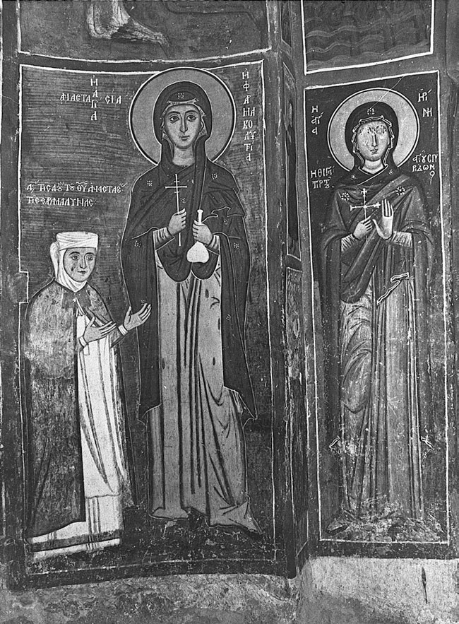

*图3.1 解毒者圣阿纳斯塔西娅与阿纳斯塔西娅·萨拉马利娜；圣伊琳娜。塞浦路斯阿西努圣母福尔维奥蒂萨教堂。*

<!-- PDF page 117; original page 96 -->

“奉父及子及圣灵之名，上帝的仆人〔姓名〕与上帝的仆人〔姓名〕订婚。”仪式结束时，两人领圣餐，以教会的祝福确立这一契约。

教会婚礼又称“加冠礼”，依循一套至迟在十一世纪已经形成的仪式。本章所讨论时期的文献记述了以下环节：在圣所门前祝福新人，诵读祷文，祈求繁衍子女，以婚冠在双方头上三次画记，并在两人同饮一杯、领圣餐之前，将他们的双手交合。[^p117-57] 仪式文本多次提到《旧约》中以坚固著称的婚姻，如亚伯拉罕与撒拉、以撒与利百加、雅各与拉结，也提到《新约》中的婚姻，尤其是迦拿婚宴。依当时若干礼仪书，仪式结束后，人们将新人从教堂护送回家。

中世纪拜占庭的丧礼，在家中料理遗体之后，于教堂举行。死者若为平信徒，其遗体便置于教堂前厅或中殿，进行丧葬仪式。丧礼祈求灵魂安息，并邀请哀悼者走近遗体，作最后告别。富有的拜占庭人往往葬在教堂内，墓穴通常挖在前厅或附属小堂的地板之下。较为贫寒的基督徒，则安葬在围绕墓地小堂的墓园里，以便在小堂内举行追思礼。多数情况下，死者裹着寿衣，直接入土；考古材料仅在极少数情况下证实使用了木棺。遗体在墓穴中头朝西，使面部朝向东方基督复活之地；很多墓葬还用石枕垫起头部。双手交叠胸前，这一姿态也再现于许多圣像及大型壁画中的丧葬肖像。一个墓穴可能合葬多人，尤其是母子，或因疾病死亡的一家人。

安葬之后是漫长的哀悼期，其间在死后第三、第九、第四十天，以及周年之日，举行追思礼。一些拜占庭作者，如帖撒罗尼迦的西缅，将这些分阶段的追思仪式与基督生死中的特定日子联系起来。因此，第三天被视为在仪式上效法<!-- PDF page 118; original page 97 -->基督的复活，第四十天则效法他的升天。追思仪式在教堂和墓穴、坟墓旁举行，家人聚集祈祷，并向教堂献上科利瓦（kollyva），即以煮熟的小麦混合杏仁、坚果和葡萄干制成的食物。[^p118-58]

## 寻求救恩

在拜占庭，对救恩的焦虑是促使平信徒与修道机构建立密切联系的重要因素。由此产生的一种倾向，是平信徒在生命接近终点时发愿修道，因为他们相信，献身修道生活的人更有希望得救。他们可能在子女成年后、配偶去世后，甚至临终病榻上采取这一步。这些年长修士和修女不仅能够在余生获得住所、食物和医疗照料，更重要的是，死后可以保证安葬在修道院建筑群内，并由修道共同体举行追思礼；人们认为，修道者的代祷格外有效。

通过向教堂捐款，信众可以建造坟墓，并确保死者获得追思礼。为了保证有人持续为自己的灵魂祈祷，极为富有的平信徒可能出资兴建附属于重要修道院的丧葬小堂，或通过捐献，确保自己安葬在重要教会机构的院墙之内。城市居民也可以通过数额较小的捐献，寻求救恩与身后纪念。例如，在卡斯托里亚和贝罗亚，拜占庭中晚期教堂至今仍保存着男女敬拜者色彩鲜明的肖像，他们的墓穴沿建筑外侧设置。塞浦路斯的长形丧葬圣像，以及克里特和罗得岛的大型肖像，同样记录了安葬于正教教堂内外的死者姓名和形貌。村庄的安葬方式与城市相似，只是规模较小。马尼地区凯普拉的神圣无偿医者教堂，年代为1265年，保存着一则长篇铭文，列出捐献人的姓名，以及他们为这座小教堂的建造和装饰提供的款项。小堂周围田地中发现的中世纪陶片与人骨，表明建筑原先由墓地环绕；其中安葬的，很可能就是<!-- PDF page 119; original page 98 -->铭文提及的捐献人及其家属。这座朴素教堂和许多晚期教堂一样，兴建目的既是容纳礼仪、为个人敬拜提供实体空间，也是作为家族墓地的中心，以及永久纪念死者的场所。文献明确证实，平信徒向教堂捐献，是为了确保人们在祈祷中记念死者。1457年，君士坦丁·斯特雷利察斯及其妻子，在向圣基里亚克教堂捐献的文书上画下十字作为签署；这座教堂位于伯罗奔尼撒中部山顶城镇穆赫利。据这份简短文书，两人将自己购买的一座葡萄园捐给教堂，“为了我们灵魂的得救，将其给予圣基里亚克教堂，以纪念我们的父母和我们自己”。[^p119-59] 阿索斯山文书中，有许多以捐赠换取灵性益处的类似契约，称为“灵魂捐献”（ψυχικά）。无论男女，都积极向圣山修道院捐赠地产，以换取修士保证在他们死后举行追思，其频率从每日到每年不等。

丧葬小堂的装饰，为了解其安葬和追思用途提供了大量资料。一些小堂的墙壁和拱顶上，绘有丧礼祷文的引句，或礼仪文本唤起的图像。不过，所有丧葬小堂最核心的表现主题，都是通常位于西墙的“最后审判”。这一复杂构图详细呈现了灵魂接受审判的过程；对将来安葬在室内地板下的人，以及观看这一艺术构图的人而言，这都是切身关切的问题。拜占庭文学中，到处可见关于灵魂审判的记述。例如，启示文学提到，灵魂在通过关卡时受到盘问，守关者审查特定罪行，并施加相应惩罚。拜占庭晚期作者则将天上法庭的审判与腐败的世俗司法作比较。写于1414年1月至1415年10月间的《马扎里斯冥府之旅，或与亡者谈论皇廷若干官员》，以高度讽刺的方式描绘了拜占庭晚期宫廷的社会政治环境。文本的中心人物马扎里斯发现自己来到冥府，便询问灵魂在来世如何受审。回答是：“公正地……不偏不倚，没有腐败或徇私；谄媚和贿赂都不能影响<!-- PDF page 120; original page 99 -->〔法官〕。”[^p120-60] 从留存证据看，拜占庭晚期许多村庄教堂的壁画体系中，罪人的图像有所增加。这表明，在帝国末期经济与政治不稳之际，平信徒越来越关心今世对教会和社会所犯罪行的追责问题。

然而，来世的景象并非一味阴沉可怖。得救者获许进入乐园；拜占庭文学和艺术将其想象为一座花园。拜占庭最后几个世纪的悼词和铭文，经常提到伊甸园或乐园的花园。在拜占庭晚期，亡故的平信徒常被描绘在繁花盛开的景色中，表达其进入乐园的希望，也向活人显示祈祷得到实现。当时文本还将死者比作各式各样的植物，从被剪断的葡萄藤，到等待收割的成熟麦秆，进一步体现了这种思维方式。[^p120-61]

虽然多数史料描述的是拜占庭虔敬的正教表现，我们仍须记住，大量文字和图像证据也表明，某些根深蒂固的迷信与仪式持续存在；它们或继承自拜占庭的古典时代，或是从未从帝国居民生活中彻底清除的民间习俗遗存。上文提到的马利亚·弗兰戈普利娜焚烧牧首袍服布片的举动，便超出了正教实践可以接受的范围。拜占庭晚期教堂描绘罪人的壁画中，有些妇女被标作女巫，表明不合正教的实践相当普遍，并遭教会反对。在一些仪式中，异教习俗与基督教实践混合在一起，显示一种不易压制的古老信仰体系仍然存续。1月1日交换礼物、穿戴特殊服饰庆祝新年的卡兰德节，源自异教习俗，有时受到教会当局谴责。更严重的是，十二世纪帖撒罗尼迦都主教尼基塔斯，曾处理司祭在死者墓上宰杀鸽子的问题；这一实践带有浓厚的异教色彩。[^p120-62] 布鲁马利亚节是深秋庆祝新酒酿成的狄俄尼索斯节庆，直至拜占庭晚期仍有其存在的记载，也仍遭教士批评。另有一些农业<!-- PDF page 121; original page 100 -->节日，也根植于源自古代习俗的自然现象庆典。尽管一些作者谴责这些实践，但与本书成书时的情况相似，回应迷信与恐惧的仪式似乎在一定程度上受到容忍；某些仪式还被覆上一层正教外衣，使其至少在表面上可以为教会接受。

在一个包含不同经济、社会阶层，人口又分为城市和乡村居民的文化中，平信徒虔敬可以有许多表现方式。若以为每个拜占庭人都以同等热情从事宗教敬拜，便是不正确的。社会中有些人，尤其是受教育程度足以阅读神学文本、与高级教士通信的上层人士，极为虔诚，其世俗生活宛如修道生活。大量史料记述了上层平信徒妇女的善行与修道志向；她们年事渐高之后，便退居修道院。拜占庭中晚期留下的许多最精美的宗教艺术作品，都是由极为虔诚的精英平信徒委托制作的：有些用作个人敬拜物，另一些则捐赠给教堂和修道院。然而，牧首阿塔纳西奥斯一世等严格教士的讲道和通谕，却不断抱怨君士坦丁堡劳动阶层行为松懈，提醒他们星期日不可劳动，不可前往浴场和酒馆，不可在礼拜结束前离开教堂，必须遵守斋日，并避免巫术和占卜。

正如我们已经说明的，乡村居民以更为朴素的方式表达虔敬。对他们来说，教堂与农业劳动及人生礼仪密切相连。他们无法阅读文本，因而影响了敬拜方式；在缺少高阶教士讲论的情况下，支撑他们的必定是深植于心的信仰。因此，平信徒虔敬是一幅复杂图景；研究它，可以发现男女、精英与贫寒者、识字者与不识字者，在敬拜实践上存在显著差异。由此可见，拜占庭人深怀虔敬这一判断无疑正确，但这种虔敬的具体表现，却有着细微而多样的差别。

## 注释

[^p101-1]: M. Rautman, ‘Ignatios of Smolensk and the late Byzantine monasteries of Thessaloniki’, REB 49 (1991), 145, 146 n. 11.

[^p101-2]: L. Petit, ‘Typikon du monastère de la Kosmosotira près d’Aenos (1152)’, Izvestiia Russkago Arkheologicheskago Instituta v Konstantinopole 13 (1908), 61; Thomas and Hero, ii, 836.

[^p102-3]: S. Kalopissi-Verti, Dedicatory inscriptions and donor portraits in thirteenth-century churches of Greece (Vienna: Verlag ÖAW, 1992), 109.

[^p102-4]: M. Nystazopoulou-Pelekidou, Βυζαντινὰ ἔγγραφα τῆς μονῆς Πάτμου (Athens: Ethnikon Idryma Ereunon, 1980), ii, 102–3.

[^p102-5]: P. Lemerle, Cinq études sur le XIe siècle byzantin (Paris: CNRS, 1977), 20–9.

[^p102-6]: Ioannis Tzetzae Epistulae, ed. P. A. M. Leone (Leipzig: B. G. Teubner, 1972), no. 104.

[^p103-7]: A. Tourta, ‘Fortifications of Gynaikokastro, Greece’, in Secular medieval architecture in the Balkans, 1300–1500, and its preservation, ed. S. Ćurčić and E. Hadjitryphonos (Thessalonike: Aimos, Society for the Study of the Medieval Architecture in the Balkans and Its Preservation, 1997), 110–11.

[^p103-8]: Petit, ‘Kosmosotira’, 51; Thomas and Hero, ii, 828.

[^p103-9]: N. Moutsopoulos, ‘Ἀπὸ τὴν Βυζαντινὴ Καρύταινα’, Πελοποννησιακά, 16 (1985–86), 185.

[^p104-10]: K. N. Sathas, Μεσαιωνικὴ Βιβλιοθήκη (Paris: Maisonneuve, 1876), v, 67.9–18; M. J. Kyriakis, ‘Medieval European society as seen in two eleventh-century texts of Michael Psellos’, Byzantine Studies/Études Byzantines 3 (1976), 86. 参见 A. Leroy-Molinghen, ‘Stylianè’, B 39 (1969), 755–63.

[^p104-11]: PG 109, 642c–d.

[^p104-12]: PG 151, 333d.

[^p104-13]: PG 161, 1066c–d. 关于星期日的其他限制，参见 G. Dagron, ‘Jamais le dimanche’, in Εὐψυχία: mélanges offerts à Hélène Ahrweiler, ed. M. Balard et al. (Paris: Publications de la Sorbonne, 1998), 165–75.

[^p105-14]: 《年轻巴西略传》，A. N. Veselovskij 编， ‘Razyskanija v oblasti russkogo duchovnogo sticha’, Sbornik Otdelenija Russkago Jazyka i Slovesnosti Imperatorskoj Akademii Nauk 53 (1891–92), suppl. 172–3. 英文译文由 S. McGrath、D. Sullivan 和 A.-M. Talbot 译出，未发表。

[^p106-15]: PG 138, 968c. 参见 R. F. Taft, ‘The frequency of the eucharist in Byzantine usage: history and practice’, Studi sull’ Oriente Cristiano 4.1 (2000), 103–32.

[^p106-16]: J. B. Pitra, Analecta sacra Spicilegio Solesmensi parata (Paris: Roger and Chernowitz, 1891; reprinted Farnborough: Gregg International, 1967), vii (vi), col. 668. 这位主教是基特罗斯的约翰，参见 J. Darrouzès, ‘Les réponses canoniques de Jean de Kitros’, REB 31 (1973), 329.

[^p107-17]: R. Macrides, ‘Justice under Manuel I Komnenos’, Fontes Minores 6 (1984), 140–55.

[^p107-18]: E. Kurtz, Die Gedichte des Christophoros Mitylenaios (Leipzig: Neumann, 1903), poem 32.

[^p107-19]: H. Bees-Seferlis, ‘Unedierte Schriftstücke aus der Kanzlei des Johannes Apokaukos des Metropolitan von Naupaktos (in Aetolien)’, Byzantinische-Neugriechische Jahrbücher 21 (1971–74), 151.

[^p107-20]: Rhalles and Potles, ii, 355.

[^p107-21]: A. Pignani, Matteo di Efeso: l’ekphrasis per la Festa di Pasqua (Naples, [1981]), 29–38; Pignani Matteo di Efeso. Racconto di una festa popolare (Naples: M. D’Auria, 1984), 32–5.

[^p107-22]: S. P. Karpov, ‘Chto i kak prazdnovali v Kaffe v XV veke’, Srednie Veka 56 (1993), 226–32.

[^p108-23]: C. Foss, Nicaea: a Byzantine capital and its praises (Brookline, MA: Hellenic College Press, 1996), 105–7.

[^p108-24]: G. Majeska, Russian travelers to Constantinople in the fourteenth and fifteenth centuries [DOS 19] (Washington, DC: Dumbarton Oaks Research Library and Collection, 1984), 160.

[^p108-25]: Eustathios of Thessalonike, The capture of Thessaloniki, trans. John R. Melville Jones (Canberra: Australian Association for Byzantine Studies, 1988), 142.3–21.

[^p109-26]: É. Sargologos, La vie de Saint Cyrille le Philéote moine byzantin (1110) (Brussels: Société des Bollandistes, 1964), §§ 18, 20.

[^p109-27]: 同上, §14.

[^p109-28]: 《格里高利·帕拉马斯传》，载 D. G. Tsames, Φιλοθέου Κωνσταντινουπόλεως τοῦ Κοκκίνου ἔργα, i, Θεσσαλονικεῖς Ἅγιοι (Thessalonike: Aristoteleio Panepistemio Thessalonikes, 1985), 433–4.

[^p109-29]: J. O. Rosenqvist, The hagiographic dossier of St. Eugenios of Trebizond in Codex Athous Dionysiou 154 (Uppsala: Uppsala Universitet, 1996), 268–71.

[^p110-30]: 同上, 290–1.

[^p110-31]: A.-M. Talbot, Faith healing in late Byzantium: the posthumous miracles of the patriarch Athanasios I of Constantinople by Theoktistos the Stoudite (Brookline, MA: Hellenic College Press, 1983), 113.

[^p110-32]: Sargologos, Cyrille le Philéote, §§ 34, 35, 46, 47, 50 and 51.

[^p111-33]: 例如参见 Tsames, Φιλοθέου Κωνσταντινουπόλεως, 373–7, 572–4, 579–80.

[^p111-34]: J. Goar, Εὐχολόγιον seu Rituale Graecorum (Venice: Bartholomaeus Javarina, 1730; reprinted Graz: Akademische Druck- und Verlagsanstalt, 1960), 483–4. 另参见 Les regestes des actes du Patriarcat de Constantinople, ed. J. Darrouzès (Paris: Institut français d’études byzantines, 1971), iv:1777, no. 8.

[^p111-35]: Goar, Euchologion, 529, 568–9.

[^p111-36]: 同上, 261, 264, 306, 572.

[^p111-37]: 参见 V. Grecu, Ducas: istoria Turco-Bizantina (1341–1462) ([Bucharest]: Editura Academiei Republicii Populaire Romîne, 1958), 323–5.

[^p111-38]: Goar, Euchologion, 543–4, 549–50.

[^p111-39]: Anna Comnène, Alexiade, iii, viii, 3–4; ed. B. Leib (Paris: Belles Lettres, 1937), i, 125–6; ed. D. R. Reinsch [CFHB 40 (Series Berolinensis)] (Berlin: De Gruyter, 2001), 105–6.

[^p112-40]: 同上, v, ix, 3; ed. Leib, ii, 38.2–18; ed. Reinsch, 165–6; ibid., xii, iii, 2; ed. Leib, iii, 60.5–12; ed. Reinsch, 364–5.

[^p112-41]: 《日耳曼努斯·马鲁莱斯传》，载 Tsames, Φιλοθέου Κωνσταντινουπόλεως, 105.

[^p112-42]: Sathas, Μεσαιωνικὴ Βιβλιοθήκη, v, 65.17–21; Kyriakis, ‘Medieval society’, 85.

[^p112-43]: I. Hausherr and G. Horn, Un grand mystique byzantin: vie de Syméon le Nouveau Théologien (949–1022) par Nicétas Stéthatos [OCA 14] (Rome: Pontificium institutum studiorum orientalium, 1928), §6, 12.21–2.

[^p112-44]: A. Papadopoulos-Kerameus, ‘Zhitija dvukh’ Vselenskikh’ patriarkhov XIV v., svv. Afanasiia I i Isidora I’, Zapiski Istoriko-Filologischeskago Fakul’teta Imperatorskago S.- Peterburgskago Universiteta 76 (1905), 3–4.

[^p112-45]: U. Criscuolo, Michele Psello. Autobiografia: encomio per la madre (Naples: M. D’Auria editore, 1989), §8, 101.458–65.

[^p112-46]: Tsames, Φιλοθέου Κωνσταντινουπόλεως, 334.

[^p113-47]: D. Tsougarakis, The Life of Leontios, Patriarch of Jerusalem [The Medieval Mediterranean 2] (Leiden: E. J. Brill, 1993), §5, 36.1–16.

[^p113-48]: Tsames, Φιλοθέου Κωνσταντινουπόλεως, 214.

[^p113-49]: Michel Psellos, Chronographie, ed. É. Renauld (Paris: Belles Lettres, 1926; reprinted Paris: Belles Lettres, 1967), i, 149; Michael Psellus. Fourteen Byzantine rulers, trans. E. R. A. Sewter (Harmondsworth: Penguin Books, 1966), 188.

[^p113-50]: Miklosich and Müller, i, 538–9, 一份1370年的主教会议文书，记述一名窃贼从私人住宅偷走一幅覆有贵金属饰面的施洗者圣约翰圣像，留下贵重银饰，却将圣像丢弃。参见 N. Oikonomides, ‘The Holy Icon as an asset’, DOP 45 (1991), 35–44.

[^p114-51]: Sathas, Μεσαιωνικὴ Βιβλιοθήκη, v, 527–31. 参见 A. E. Laiou, ‘The festival of “Agathe”. Comments on the life of Constantinopolitan women’, in Byzantium: tribute to Andreas N. Stratos (Athens: [N. A. Stratos], 1986), i, 111–22.

[^p114-52]: Kurtz, Gedichte, 91–8.

[^p114-53]: Goar, Euchologion, 523, 551–2, 609–20, 710.

[^p114-54]: Tsames, Φιλοθέου Κωνσταντινουπόλεως, 471–2.

[^p115-55]: N. B. Drandakes, ‘Ὁ Ταξιάρχης τῆς Χαρούδας καὶ ἡ κτιτορικὴ ἐπιγραφή του’, Λακωνικαὶ Σπουδαί, 1 (1972), 287–8.

[^p115-56]: P. N. Trempelas, Μικρὸν Εὐχολόγιον: i. Αἱ ἀκολουθίαι καὶ τάξεις μνήστρων καὶ γάμου, εὐχελαίου, χειροτονιῶν καὶ βαπτίσματος (Athens: [s.n.], 1950), 7–40.

[^p117-57]: 同上, 41–96.

[^p118-58]: PG 155, 688d–691a; 692b.

[^p119-59]: M. Manoussacas, ‘Un acte de donation à l’église Sainte-Kyriakè de Mouchli (1457)’, TM 8 (1981), 319.

[^p120-60]: Mazaris’ Journey to Hades or Interviews with Dead Men about Certain Officials of the Imperial Court (trans.) [Seminar Classics 609] (Buffalo: State University of New York at Buffalo, 1975), 16–19.

[^p120-61]: Manuelis Philae Carmina. Ex codicibus Escurialensibus, Florentinis, Parisinis et Vaticanis, ed. E. Miller (Paris: Excusum in Typographeo imperiali, 1855), i, 448–9.

[^p120-62]: Rhalles and Potles, v, 387–8.

---

<!-- PDF page 122; original page 101 -->

# 第4章 静修主义的兴起

迪尔克·克劳斯米勒

十四世纪二三十年代，迅速缩小的拜占庭帝国深受内争之苦，正教会也被一场激烈争论所震动。这场争论最终重新界定了古代晚期形成的传统三一教义：1351年，一次教会会议规定，不仅上帝超越的本体在真正意义上是神圣的，他在世间的作用或神能同样如此；会议并谴责另一种主张——认为这些作用是受造的——为异端。这项会议决议反映了阿索斯山修士格里高利·帕拉马斯在与一连串对手论战时发展出的神学模式；其中最著名的对手，是卡拉布里亚修士巴尔拉姆，以及文人学者格里高利·阿金迪诺斯和尼基弗鲁斯·格里高拉斯。这些人被逐出教会，帕拉马斯本人却在1359年去世后不到十年便被封为圣人。至本书成书时，他已被视为正教会的权威之一；二十世纪神学家重新发现他的著作，对于建构当代正教发挥了关键作用。[^p122-1]

帕拉马斯与其对手争论的最后阶段，具有高度抽象的特点，并广泛引用教父文本作为论据。然而，争论的起点绝非纯粹学术问题。帕拉马斯提出有关神圣作用的见解，是为了解决一个具体问题：如何使神秘体验的真实性，与强调上帝不可接近、拒斥一切声称看见上帝本体之说的传统神学相协调。帕拉马斯及其盟友如此关切这一问题，是因为他们奉行所谓静修方法（hesychastic method）：一组心理与身体相结合的技巧，其目的在于使心智摆脱一切纷扰的念头，并引发以光的形式看见上帝的异象。

<!-- PDF page 123; original page 102 -->

这种方法最早见证于十三世纪，在整个十四世纪的拜占庭修士中极为流行，尤其是在阿索斯山；小亚细亚失守后，这里已成为正教修道生活最重要的中心。静修主义的倡导者认为，自己才是东方正教修道传统的真正继承人，尤其继承了强调必须时刻防备罪恶念头的流派。[^p123-2] 与此同时，他们不赞成其他修道生活模式，特别批评两类修士：一类专注苦修和咏唱圣咏；另一类像帕拉马斯的对手巴尔拉姆一样，强调智识活动对修士的重要性。静修者指责前者忽略“内在之人”，贬斥后者追逐世俗智慧，使人偏离对神圣者的寻求。静修者的自我描绘及其对另外两种模式的批评，影响如此之大，以致他们的观点成了叙述拜占庭晚期灵修的正统版本。[^p123-3] 以下讨论将考察促成这一叙述形成的过程，尝试澄清静修主义与拜占庭灵修传统之间的联系，确定静修者与非静修者争论的性质，以便更为均衡地理解这一新运动的兴起。

## 伪西缅与意大利人尼基弗鲁斯

任何有关静修主义的讨论，都必须从两篇阐述如何引发异象的具体技巧的论著谈起。第一篇在手稿中被错误归于十一世纪神秘主义者新神学家西缅名下，其写作年代只能暂定为十二世纪末或十三世纪初。[^p123-4] 相较之下，第二篇的作者则是一位情况较为清楚的历史人物——意大利人尼基弗鲁斯；他在皇帝米海尔八世统治时期（1259—1282年）于阿索斯山修道，并激烈反对皇帝亲西方的宗教政策。[^p123-5] 十四世纪，这些文本大为流行，被广泛视为<!-- PDF page 124; original page 103 -->权威。[^p124-6] 渴望神秘体验的修士为何受到吸引，并不难理解：尼基弗鲁斯将自己的教导呈现为一种面向初学者的“学问”或“方法”，简易、迅速、有效，而且不受魔鬼干扰。[^p124-7] 然而，我们还须追问，他和他的读者为何把这种体验视为修道生活的核心。新神学家西缅的著作提示了一种可能的答案。西缅批评了只有少数特殊人物才能获得异象的传统观点，主张每一个修士都能够、也应当体验神圣者。[^p124-8] 这种激进立场似乎随着时间推移而更加普遍，因为它又出现在十二世纪神秘主义者君士坦丁·克里索马洛斯等较晚的灵修作者笔下。[^p124-9] 然而，西缅本人属于能够自发获得此类体验的人，并未提出实现这一目标的具体方法。[^p124-10] 尼基弗鲁斯说，有人自发获得异象，但大多数人需要教导，他所指的很可能就是这种情况。[^p124-11] 对这一状况的判断，构成了伪西缅和尼基弗鲁斯的基本理由：他们希望通过自己的教导，使普通修士也能获得这类体验。[^p124-12]

静修主义如何运作？两位作者都向读者许诺，只要遵循一套包括坐姿、控制呼吸和呼求耶稣之名的祈祷程序，就能在心中获得异象，类似使徒在他泊山见到基督显容的体验。[^p124-13] 尽管如此，两篇文本并不相同。伪西缅建议修习者凝视肚脐周围的部位，直到那里充满光明、变得透明，使观看者能够看见发生变容的心脏。相比之下，呼吸和耶稣祷文仅被顺带提及。尼基弗鲁斯则完全不提观脐，而专注于另外两个要素。他敦促读者专注呼吸从口至心的路径，并随呼吸一起，将心智“送下”到心脏之中。

<!-- PDF page 125; original page 104 -->

他声称，通过屏住呼吸，修习者可以把心智留在心内，防止它游荡，或被念头分散注意力。达到这一状态者，随后应不断呼求耶稣基督之名，使心智有所专注，并压过可能涌现的一切“新”念头。尽管有所不同，伪西缅与尼基弗鲁斯显然都在同一框架内运作：观脐和控制呼吸这两种技巧，都赋予感官知觉与想象以重要作用。此外，它们都与身体紧密相连：专注心脏不只是集中精神的手段，人们相信，它牵涉实际器官，并对其产生影响。[^p125-14]

静修主义的成功，充分表明这些技巧十分有效。然而，仅凭有效性，还不足以解释阿索斯山和其他地方的修道共同体为何会采用它们。伪西缅的论著让我们得以了解早期静修者面临的难题。它远不只是一部简单的祈祷手册；“方法”的描述属于精心构建的论证的一部分，作者借此争取当时修道论述对它的认可。他在序言中宣布，将向读者介绍三种不同的祈祷实践，以便他们作出明智选择。他使用的标准是“专注”（προσοχή）和“祈祷”（προσευχή）：有效的专注，应能发现并捕捉罪恶念头；有效的祈祷，则应随即将它们清除。[^p125-15] 赋予“专注”以核心地位，指向修道生活中的一条特定传统；它最早见于约翰·克利马库斯的《天梯》，后来在西奈的赫西基奥斯与菲洛塞奥斯的《灵修诸章》中得到展开，成为主导主题。[^p125-16] 分析伪西缅的论证，可以揭示静修主义与“西奈”灵修之间极为复杂的关系，并有助于理解静修方法产生的背景。

这篇论著的编排十分直接：三章分别介绍每种实践的“特性”与效果。第一种实践的追随者直立站着，将内在和外在的目光向上投向天空，随后在心中想象天国的辉煌，直至身体感官能够以光、气味和声音感知它。[^p125-17] 相比之下，<!-- PDF page 126; original page 105 -->第二种实践要求心智严格控制感官，并检验一切进入的念头，察看是否存在魔鬼干扰。[^p126-18] 第三种实践即静修方法，其追随者被要求坐下，将内外目光投向肚脐部位，在体内寻找心的位置。他们被告知，最初会体验到黑暗，但最终心智“看见心内的空气，并看见自身全然明亮，充满辨识力。从此，每当念头升起，心智便在它尚未完成、形成图像之前，通过呼求耶稣基督将其驱逐、消灭”。[^p126-19]

第一种实践被判为最差：它不能使人达到德行与无情欲的境界，还可能导致疯狂，因为追随者并未学会区分真实异象与魔鬼幻象。对第二种实践的评价则积极得多。依作者之见，它与其说错误，不如说不完整，因为它专注反驳来自外部的魔鬼念头，却忽略处理那些已经存在于心内的念头。因此，它仍然无效，永远不能使修士彻底摆脱情欲。毫不意外，第三种实践实现了这一点；作者认为，专注于心使修习者获得辨识力，因为他能够看见心内的一切，因此可以轻易识别并通过祈祷摧毁所有魔鬼念头：不仅是来自外部的，也包括已经在内部的。

乍看之下，作者的论证似乎十分直截了当，但细看便会发现明显的反常之处。依照他的高下排序，静修方法理应与第二种实践更为接近，然而，它反倒与第一种有着显著相似性：在这两种实践中，作者都说修习者采取特定姿势，将想象力与身体感官投向同一对象，并期待神秘体验。第二种实践完全不具备这些特征：身体和感官知觉未获积极作用，也不存在异象成分。正如我们所见，作者确实通过辨识力这一共同主题，将静修方法与第二种实践联系起来，从而得以把自身立场同第一种实践比较，显示其优越性。然而，与第二种实践的重合，只出现在静修方法描述的后半部分；到这里，它已不再与第一种<!-- PDF page 127; original page 106 -->实践相对应。作者借“心智看见……自身全然明亮，充满辨识力”这句话，实现了从一个框架向另一个框架的转换。由此，辨识力并未像第二种实践那样与检验念头相联，而是被附加于一种产生异象体验的技巧之上。因此，共同标准“专注”，掩盖了实现这一目标的方式之间的根本差异。实际上，正因为“专注”在文本中被赋予不止一种含义，它才可能发挥这种作用。正如我们所见，作者在序言中将其界定为发现一切即将进入心内的念头，并判断其性质和来源的能力。然而，这个词后来只在讨论以“检验念头”为基础的第二种实践时，才按这一含义使用。另一方面，在第一种实践中，它意味着聚焦于一个对象，即天空。这种用法显然与作者开篇的定义毫无关系，却使他后来能够将两种观念合而为一：在第三种实践中，对肚脐的“专注”产生了变容之心的异象，同时也使存在于心内的一切魔鬼念头显现出来。他之所以能够这样做，是因为静修方法区别于第一种实践的“转向内在”，使他得以混同两种“心”：作为异象体验对象的心，与作为念头“所在之处”的比喻的心。[^p127-20]

作者巧妙利用概念和术语上的歧义，理由十分明显：尽管自己的方法性质根本不同，他仍想使其获得第二种实践倡导者所规定的价值体系的认可。事实上，这篇论著很可能正是为回应第二种实践支持者的攻击而作；作者抱怨，他们自视为“专注者”（προσεκτικός），批评他人不够专注。第二种实践只关注进入心内的念头，毫无疑问，这是对西奈传统作者约翰·克利马库斯、菲洛塞奥斯，尤其是赫西基奥斯教导的歪曲描述。[^p127-21] 与此同时，第三种实践的描述又大量逐字借用了赫西基奥斯的《灵修诸章》。[^p127-22] 根据以上讨论，作者很可能是为了强化自己显然并不成立的主张，才插入这些引文：声称自己属于这一传统，只不过对它有所改进。

<!-- PDF page 128; original page 107 -->

伪西缅为何如此费尽周折？在整个拜占庭时期，都可见通过强烈想象产生感官体验的祈祷实践。例如，在牧首美多迪奥斯所写的九世纪《认信者狄奥法内斯传》中，年轻圣徒和新娘通过专注于嗅觉来“追寻”基督：他们将基督想象为芬芳，最终获得回报，鼻中奇迹般地闻到“真实”的香气。[^p128-23] 圣徒传记传统将这类体验视为毫无问题，几乎从不提出辨识力的问题。这种不加顾虑的态度，与古代晚期及拜占庭灵修文献中的观点形成鲜明对比。[^p128-24] 灵修文本的作者不仅因魔鬼欺骗的危险而强烈反对运用想象，还批评一味追求异象体验，以及伴随而来的对道德完善及其实现途径的漠不关心。[^p128-25] 显然，伪西缅专注异象体验，为传统的内心省察实践不留位置，因此置身于传统灵修论述之外。他试图通过这些操作，克服自身立场的边缘地位，使其能够被这一论述接受；在他的文本中，这一论述由第二种祈祷实践代表。为了达到目的，他采取了复杂策略：尽管第一种实践与静修方法明显相似，他仍将其作为一种独立方法加以介绍；随后，他与灵修传统一致，称这种方法误入歧途，危及修习者。[^p128-26] 这样一来，作者便能表现出自己了解、并在口头上认可对运用想象的反对意见，从而掩饰自己的立场实际上与那些借想象追求异象体验者几乎完全相同。

伪西缅的操作，为静修主义在灵修主流中争得一席之地。然而，两种传统的结合显然仍停留于表面，只有颠覆第二种实践赖以成立的概念框架，才可能实现。尼基弗鲁斯在其手册中明确表示，对静修者而言，免受魔鬼攻击并非通过筛查念头、运用辨识力实现，而是通过<!-- PDF page 129; original page 108 -->强烈的想象活动完全排除这些念头；这种活动取代了其他一切心智活动。[^p129-27]

伪西缅的论著使我们了解静修运动的最早阶段：它当时尚未广泛传播，必须努力争取认可。十三世纪末、十四世纪初，静修主义在阿索斯山迅速扩展。据说，尼基弗鲁斯吸引了许多门徒，其中包括菲拉德尔斐亚的狄奥莱普托斯（约卒于1325年），后者是当时重要的宗教权威之一。[^p129-28] 然而，下一代中最重要的人物，无疑是西奈的格里高利。他卷入土耳其人征服小亚细亚西部的动乱，后来成为修士，先在西奈山度过数年，随后前往阿索斯山隐修。之后，他在色雷斯创办修道院，得到保加利亚统治者伊凡·亚历山大（1331—1371年）的赞助。1346年去世时，他已拥有大批门徒，其中有不少斯拉夫人，将静修主义带到保加利亚和塞尔维亚。[^p129-29] 格里高利向不同的阿索斯山修士写了若干部祈祷手册，宣传静修方法。[^p129-30] 在这些文本中，他提到此前的两篇论著，但显然，他的教导更多取自尼基弗鲁斯，而非伪西缅：重点是呼吸和耶稣祷文，完全不提观脐。他自己的体验，则体现为对颤抖、喜悦感等身体反应的强烈关注。

## 西奈的格里高利

格里高利的祈祷手册，是静修主义在阿索斯山及其他地方传播的证据。然而，它们也表明，这一传播并非简单强加于人的过程，而是彼此调适的过程。毫无疑问，最早形式的静修主义对传统修道生活构成了巨大危险。尼基弗鲁斯不仅阐述了让“普通”修士获得异象的技巧，还声称，学习这些技巧不需要灵性导师的帮助。[^p129-31] 若认真按这一主张实行，<!-- PDF page 130; original page 109 -->便会彻底瓦解修道者进入共同体的既定养成过程。按这一过程，初学者必须服从一位资深修士的权威，对其毫无疑问地顺从。这种行为培养谦卑德行，避免修士日后炫耀自己的成就而扰乱共同体。与之相反，尼基弗鲁斯声称，初学者读几页文字便已足够，可以取代灵性导师。西奈的格里高利论述这一方法的著作，性质则截然不同：他将异象体验限于已有高深修为者，并强调初学者必须服从资深修士的辨识判断。[^p130-32] 毫不奇怪，格里高利还敏锐地意识到魔鬼可能干预，因此拒斥一切“具有形状”的异象；尼基弗鲁斯则完全不关心修习者所面临的危险。[^p130-33] 从这一对照可以看出，格里高利旨在驯化这个新运动，使其与传统权威结构相容。

西奈的格里高利通过自己的教导，促进了这一新运动在阿索斯山的成功。在当时的圣徒传记中，他确实以异象体验问题的裁断者身份出现。[^p130-34] 然而，毫无疑问，许多人仍与静修主义保持距离，甚至对其排他性心怀不满；伪西缅的一项主张恰好概括了这种排他性：教父们一旦发现这一方法，便抛弃了其他一切。[^p130-35] 一组反对者，是那些专注守斋、不眠等苦修实践，并更喜欢传统圣咏吟唱而非静修方法的修士。尼基弗鲁斯的论著对他们大加攻击，西奈的格里高利也在著作中反复批评他们。[^p130-36] 两位作者在论证中都依赖伪西缅将静修方法等同于西奈灵修的做法；他们所谓苦修者忽略内在维度的指控，直接取自传统的“专注”论述。[^p130-37] 也有<!-- PDF page 131; original page 110 -->迹象表明，静修者反过来被指责松懈；格里高利的传记作者，刻意将圣徒初次接触这一方法时的他，描绘为一位极其严格的守斋者。[^p131-38] 不过，总体而言，苦修者似乎并未对新运动构成严重威胁。

## 卡拉布里亚的巴尔拉姆

事实证明，远为危险的对手是卡拉布里亚修士巴尔拉姆。约1330年，他离开故乡来到拜占庭东方，很快便凭借对正教神学传统的了解，以及对哲学和科学的兴趣而获得声望。[^p131-39] 十四世纪三十年代中叶，他在君士坦丁堡和帖撒罗尼迦结识了一些修士，了解了静修方法及其效果。[^p131-40] 他认为静修者的观点，轻则错误，重则属于异端，遂以使他们摆脱谬误为己任。[^p131-41] 然而，他刚着手行动，便遇到激烈反对；反对者由格里高利·帕拉马斯领导，后者出身君士坦丁堡贵族家庭，已在阿索斯山成为修士。[^p131-42] 帕拉马斯与巴尔拉姆并不陌生；两人此前已就逻辑在神学论述中的作用交换一系列信件，论战色彩日益浓厚。[^p131-43] 现在，帕拉马斯写成一部三分的论著《为以神圣方式静修者辩护》，为处境困难的静修者提供了一整套论据。[^p131-44] 与此同时，巴尔拉姆似乎也以一系列著作表达自己的见解。然而，一旦得知帕拉马斯的论著，他便撤回<!-- PDF page 132; original page 111 -->这些文本，加以修订，以回应帕拉马斯的批评。[^p132-45] 帕拉马斯于是又撰写第二部论著，编排与第一部相同，但更直接地处理巴尔拉姆的书面论述，并反复加以引用。[^p132-46]

巴尔拉姆究竟要达到什么目的？遗憾的是，他著作的两个修订版本都已佚失，必须从其他史料重建其内容。重建的明显起点，是帕拉马斯对其立场的反驳。帕拉马斯两部论著最后、也是最长的部分，处理了巴尔拉姆的一项主张：对上帝的寻求，终点在于理解他与一切受造存在完全不同。帕拉马斯的反论是，人能够超越自然能力，或因为心智具有超越自身的能力，或因为上帝借圣灵的恩赐，使人能够接近自己。[^p132-47] 这种编排反映了该问题对静修者的核心重要性。然而，我们必须谨慎，不能只通过静修者的眼光看待巴尔拉姆。他自己的著作似乎采用了很不一样的组织方式：他反对异象体验的《论光》，似乎是这一主题的第一篇，接着才是合题为《论祈祷与人的完善》的论著。[^p132-48] 这种差别表明，巴尔拉姆关注的重点另有所属。他更早的著作，尤其是致静修者伊格纳提奥斯的两封信，以及致帕拉马斯的第二封信，也支持这一解释。这些文本显示，巴尔拉姆最初与其说关心光的异象本身，不如说关心它未能对获得异象者产生他认为灵性进步所必需的效果：治死并制伏灵魂中情欲的部分，唤醒理性能力，使人能够正确判断，驱除谬误和<!-- PDF page 133; original page 112 -->自欺。[^p133-49] 显然，对于在静修体验中发挥重要作用的情感和身体，巴尔拉姆持否定态度。帕拉马斯在第一、第二部论著各自的第二部分处理这个问题，试图表明情感未必有罪，也能够被圣化。[^p133-50] 然而，对巴尔拉姆轻视情感的认识，必须以其高度重视理性的态度加以平衡。在基督教新柏拉图主义的传统中，巴尔拉姆主张，对这个世界结构的知识，以共同观念的形式铭刻于人的灵魂；这些观念在推论性思维的层面上，再现了神圣心智内在的创造原理。[^p133-51] 在已佚的《论人的完善》中——这是他这组著述的最后一部分——他提出了与这一框架相符的人上升至上帝的模式。他坚持认为，人首先必须让分析和逻辑能力接触各类知识，唤醒沉睡的理性，之后才能通过“收合”思想，进入合一而直觉的理智认识，从而超越纯粹人的层次。[^p133-52] 这种逐级上升的模式，无疑是巴尔拉姆教导的核心。[^p133-53] 帕拉马斯在反驳中攻击这一模式，认为它试图使修士偏离其真正召唤；他将这种召唤等同于实践静修方法。[^p133-54] 他把相关讨论置于两部论著的第一部分，并分别题为“追求学问在何种意义及多大程度上有益”，以及“真正修士应当关心的真正救恩知识是什么，或反对那些声称世俗教育所得知识真正使人得救者”。[^p133-55] 由此，他给人一种印象：巴尔拉姆倡导智识活动，完全处于修道传统之外。

然而，这种印象具有误导性。在致友人格里高利·阿金迪诺斯的一封信中，巴尔拉姆为《论祈祷与人的完善》辩护，回应批评说，他所做的不过是对七世纪修士兼灵修导师认信者马克西莫斯的观点进行“释义”，意在确认后者的立场。[^p133-56] 阿金迪诺斯乐于接受这一点，尽管他也批评巴尔拉姆对马克西莫斯作了选择性且偏斜的解读。帕拉马斯则反过来，以<!-- PDF page 134; original page 113 -->只顺带论及马克西莫斯，而且主要置于祈祷语境中的方式，改变了巴尔拉姆的原意。[^p134-57] 因此，仅依赖帕拉马斯，便不可能重建巴尔拉姆的论述重心。所幸，我们还有其他同时代史料，可帮助阐明这场争论。这些史料表明，巴尔拉姆远非意在宣扬世俗主义；他把自己视为一种真正修道传统的代表，并认为静修者正在威胁这一传统。

## 西奈的格里高利与“言辞智者”

巴尔拉姆并不像帕拉马斯希望我们相信的那样孤立。早在1307年，菲拉德尔斐亚的狄奥莱普托斯就遇到一些追求“世俗”智慧、拒斥静修方法的人。[^p134-58] 西奈的格里高利最初也受到阿索斯山“更有学问”的修士反对；他们指责他标新立异，试图将他逐出圣山。[^p134-59] 狄奥莱普托斯彻底拒斥对手立场，其反应与帕拉马斯十分接近。[^p134-60] 相比之下，西奈的格里高利的回应细致得多，使我们能够了解另一种模式，以及双方争论的性质。格里高利在《论诫命、教义、警告与应许，并论念头、情欲与德行，又论静默与祈祷的各篇论说》中处理这一问题。这是关于各种灵修主题的一系列简短论述，最可能写于1327年，以下称《论说》。[^p134-61] 该书开篇便谈到人性：“在获得纯洁之前，不可能像我们原先那样，依本性成为或恢复为理性者（λογικός）……因为与感官知觉（αἰσθητική）相联的非理性习惯，已经压倒了我们。”[^p134-62] 格里高利在这里提出一种人性模式：人同时拥有推理能力和本身不具理性的感官知觉。前者是人所特有，后者则为人与动物共有。两者通过严格的等级关系联系起来：理性控制感官。然而，这种关系<!-- PDF page 135; original page 114 -->只存在于堕落之前；堕落之后，感官知觉开始压倒理性。因此，理性失去作用，人也被拉低到无理性禽兽的层次。这就规定了人的任务：回到上帝创造时为他们安排的理性存在状态，从而重获真正的人性。就其本身而言，格里高利的说法完全属于传统。[^p135-63] 然而，对一个静修者来说，选择这一框架却令人惊讶，因为它没有为静修体验所核心关注的超自然维度留下位置，也与感官在这种体验中所发挥的积极作用相冲突。

格里高利选择“理性”这一主题，无疑意义重大：文集的第一章，尤其是第一个词，常常引出主导主题。[^p135-64] 分析文本可以发现，格里高利正与一些修士争论；后者将智识活动视为灵性上升不可分割的一部分，并借“理性”的论述来证明自身生活方式的正当性。格里高利接受这套论述属于基督教传统，却质疑对手对它的占用，转而为静修者自己主张这一传统。在第二章，他写道：“只有圣徒显为依本性具有理性的存在，因为他们是纯洁的；‘言辞智者’（τῶν ἐν λόγῳ σόφων）中，无人拥有纯洁的言辞（λόγον… καθαρόν），因为他们从起初便〔让〕恶念（λογισμοί）败坏了理性能力（λογικόν）。世俗智慧那物质的、多言的灵，将抽象思考（λόγους）带给较有智识者（γνωστικώτεροι），将恶念（λογισμοί）带给较粗鄙者，从而拒绝与那以不分割、单一的知识（γνῶσις）呈现的位格性智慧及观照同住。”[^p135-65] 这一段接续了“理性”作为人类自然状态的主题。格里高利现在引入“圣徒”，作为已达到这一状态的具体群体，与另一个未能达到此状态的群体——“言辞智者”——相对照。他的论证围绕“纯洁”这一概念展开；第一章已将它作为维持或恢复人类理性的前提。现在，“圣徒”被赋予这种品质，“言辞智者”则被指以“念头”（λογισμοί）败坏理性；在修道论述中，这个词带有<!-- PDF page 136; original page 115 -->罪恶和魔鬼作用的含义。[^p136-66] 对抗这些念头、努力达到无情欲的境界，传统上被视为通向完善的第一步。格里高利暗示，致力于获取抽象知识的“言辞智者”，完全没有控制非理性的冲动，因此在自己的人生中重演了亚当的堕落。这样一来，他便能将他们此后的一切活动描述为“非理性”。

该章后半部分表明，格里高利并不满足于这种迂回批评。他在那里将“抽象思考”归于“言辞智者”，并改称其为“较有智识者”，而把“恶念”归于另一个群体——“较粗鄙者”。然而，他又同时将这两种思想过程追溯至“世俗智慧之灵”，也就是魔鬼，从而把两者联系起来。这一安排的目的十分明显：它使他得以拒绝将智识追求（λόγοι）视为成圣的资格。格里高利随后又将这种“世俗智慧”与“位格性的智慧”，也就是神圣圣言，相对照。这两种智慧与知识不仅彼此不同，而且相互排斥：从事前者，就无法上升至后者。单就这一对照而言，在静修文本中或可视为常见之说。[^p136-67] 然而，在《论说》的语境中，它却令人惊讶，因为异象体验是神圣恩典的结果，属于超自然层次，在所选的“理性”框架中并无位置；这一框架严格限于人性的领域。这种反常在下一章更为明显：格里高利得出结论，只有“对恩典的感知（αἴσθησις）”，而非“对念头的反思”和“对事物的必然性证明”，才可视为真理知识。[^p136-68] “对恩典的感知”是《论说》中首次明确提及静修体验，因此也表明，“圣徒”就是静修者。相比之下，“证明”和三段论推理显然与“言辞智者”相联。显而易见，与异象不同，这类追求涉及运用人的理性；由此，“言辞智者”有理由认为自己更具理性，因此高于静修者。[^p136-69] 作为静修者，格里高利必须拒绝这一结论。我们已经看到，理性的恢复须通过战胜恶念来实现，而格里高利否认“言辞<!-- PDF page 137; original page 116 -->智者”获得了这种胜利。现在看来，即使获得这一胜利，人也只有停止三段论推理，并总体上停止运用理性能力，才能保有“理性存在”的地位。

《论说》中处理邪恶“念头”的部分，证实了这一点。第60章将这些“念头”追溯至堕落造成的“单纯记忆”的“分裂”；原先单纯的人，由此在能力上成为“多样的”“复合的”。[^p137-70] 第61章又说，人可以“通过恒常记念上帝，促成原初状态的恢复；这种记念借祈祷牢固建立，并通过与圣灵交融，从自然层次提升至超自然层次”。[^p137-71] 从这里可以看出，格里高利以静修祈祷实践来理解“单纯记念上帝”。在论祈祷的著作中，他明确将“记念上帝”等同于“不断呼求耶稣之名”，[^p137-72] 并告诫修习者，除“单单对耶稣纯洁、单纯而无形的记念”之外，不应允许任何事物进入心内。[^p137-73] 现在，这种实践被投射回人的原初状态，实际上把亚当变成第一个获得异象的静修者，并把堕落解释为异象体验之前提——单纯记忆——的崩溃：亚当受到魔鬼诱惑，任自己分心，因此“忘记”上帝。这便可以得出结论：虽然“理性”属于亚当的自然构成，却始终被超越。较早的作者中已经存在这种观点，但格里高利的静修背景使他从中推出了激进结论。[^p137-74] 在他的框架中，人越善于运用心智能力，就越不具“理性”，因为运用这些能力本身就等于败坏它们。只有通过静修实践排除念头，才可能恢复原初状态，紧接着便会发生异象体验。格里高利明确表示，人的“自然”状态不过是一个过渡点：从这里，人要么倒退至“非自然”，要么前进至“超自然”。[^p137-75]

这种巧妙解释的理由很清楚：它使格里高利能够切断“理性”与智识追求的一切联系，从而将“理性”概念纳入自己的模式。值得注意的是，第<!-- PDF page 138; original page 117 -->60、61章将“记念上帝”与罪恶念头相对照，并不像第2章那样，将智识追求和学问作为独立类别提及。然而，这种差别只是表面的，因为第2章已将智识追求和罪恶念头这两类活动，追溯至同一个作用者，从而把它们等同起来。在静修框架内，这完全说得通，因为一切念头只要分散了对耶稣祷文的专注，便都是坏的。智识追求（λόγοι）显然在这一框架中无立足之地；它们之所以被引入，只因为在格里高利对手的模式中曾具有重要作用。

格里高利试图更清楚地界定这两个类别之间的关系，但其说法含混而矛盾：有时，他将两者混为一谈，如第2章所说，两者都来自这个世界的“物质之灵”；另一些地方，他似乎又把恶念与智识追求区分开来，前者归于魔鬼的作为，后者则来自“物质”。[^p138-76] 这种两可态度的原因在于，灵修作者通常会区分怀有罪恶念头的“纵情感官者”（σαρκικοί），以及完全依赖人的能力的“智识者”（ψυχικοί）；依圣保罗所言，后者不接受圣灵及超自然维度的存在。[^p138-77] 格里高利自己在第22章也提到这一观念，将从书本获得、被他以保罗的措辞称作“变成愚拙的智慧”的人类知识，与直接来自上帝的超自然知识相对照。[^p138-78] 然而，在关于此问题的纲领性论述中，格里高利不愿承认一个区别于魔鬼和神圣者的“中性”人类领域有可能存在。

为了强调这一点，格里高利构造了二元对立：静修者简短、重复的耶稣祷文所体现的神圣单纯与合一，反复同魔鬼的多样与分裂（διαίρησις）相对照；后者则与“言辞智者”冗长的智识追求联系起来。[^p138-79] 然而，这种整齐对称，并不像格里高利希望读者相信的那样不证自明。细读第2章，会发现他隐约承认另一套框架。“与位格性的智慧同住（συνοίκησις）”一语，唤起《所罗门智训》7:28：“上帝所爱的，只有与智慧同住（συνοικοῦντα）的人。”在这段文字中，传统上被认同为<!-- PDF page 139; original page 118 -->基督的智慧，以教师身份出现，赐给人对“万有的无误知识”，以及“聪明”和“学问知识”。[^p139-80] 这一段不仅为基督徒的智识追求提供正当性，还将智慧之灵界定为“具有多个部分”；这种描述令人想到，格里高利形容魔鬼的“世界之灵”时所用的“多言”一词。把超自然知识描述为“单一”“不分裂为部分”，则借自伪狄奥尼修斯《论教会阶序》中的一段著名文字；该段解释希腊语“修士”（μοναχός）一词，称其意味着修士过着“不分裂为部分、保持单一的生活；这种生活在将分裂事物神圣地收合为一个似神的单一体及爱神的完善之中，使他们合一”。[^p139-81] 这一段深受新柏拉图哲学影响，采用了它对推论性思维与直觉的区分：前者发生在理性灵魂中，后者则是更高能力“理智”（νοῦς）的功能。然而，在新柏拉图主义中，推论性思维并不被视为通向更高层次的障碍，反倒是其前提；通过不断增强的抽象过程，人的心智从多样符号上升至这些符号背后单一的实在。

在《论说》开头，格里高利只含蓄影射这一观念，直到第127章才正式讨论。在这篇异常冗长的章节中，他为修士灵性发展的不同阶段，分别使用“语法家”“演说家”和“哲学家”等名称：

> “语法家”，是那些致力于实践生活（πρακτικός）的人，也就是说，他们以身体（σωματικῶς）参与行动的世界；“神圣演说家”，是那些观照自然（φυσικῶς）的人，也就是说，他们处于知识与万有存在之理（τοὺς λόγους τῶν ὀντων）之间，也就是说，他们通过理性进行区分的能力（διαιρετική），在灵中将必然性逻辑运用于普遍者（τῶν ὄλων ἐν πνεύματι）。“真正的哲学家”，则是在自身中以可感、直接的方式，拥有与上帝超自然结合的人。[^p139-82]

在这里，格里高利提出一个灵性上升的三阶段体系：对抗情欲、追求德行之后，是通过<!-- PDF page 140; original page 119 -->研究上帝在受造界留下的印记来寻求上帝，然后才是神圣者的神秘体验。当然，这种体系本身完全属于传统；它最早在古代晚期形成，见于许多拜占庭时期的灵修文本。[^p140-83] 然而，它显然与静修主义的修道生活模式相冲突；在后者中，达到无情欲与获得神秘体验之间，没有中间阶段的位置。转向第127章澄清这些阶段关系的部分，这种不相容就更为明显。代表最高阶段的“哲学家”，被描述为神秘主义者。然而，此前被呈现为静修方法结果的异象体验，现在却归于那些先通过观察受造界，推知上帝为万有唯一原因的人。[^p140-84] 认识到全部受造界来自同一原因，确立了合一；但这是一种通过智识活动，而非单靠祈祷达到的合一。这种智识活动必然具有“区分性”，因为只有按种与属的框架，将各个存在者分类，才可能看出它们形成统一整体。格里高利讨论“演说家”的作用时，明确表示：“依那些‘真正的言辞智者’之见，演说家通过概括性知识，简明地把握万有，既区分又联结它们，如同一个身体，从而依差异与同一，显示它们具有相同价值。”此外，他也可被称为“真正的逻辑学家”，而“非仅仅运用必然性逻辑者”。[^p140-85] 在这里，“区分”与“统一”、“差异”与“同一”，都处于辩证关系，而非相互排斥。毫无疑问，第127章旨在纠正前三章。此前，是静修“圣徒”与堕落的“言辞智者”整齐对置；现在，却出现了第三类“真正的言辞智者”。此外，格里高利此前暗示人类智慧必然与虚荣和物质事物相联，现在却将对物质的爱，与对上帝“关于自然的”智慧的爱相对照。[^p140-86] 格里高利谨慎强调，正确的自然观照并非仅运用希腊逻辑，也具有灵性维度。然而，这些限定显然无助于使灵性上升的三阶段体系与静修框架更加相容；正如我们所见，<!-- PDF page 141; original page 120 -->静修主义所排斥的，是智识活动本身，而不仅是受到败坏的智识活动。

那么，格里高利为何感到不得不将这一体系纳入自己的模式？我已经指出，它是修道传统不可分割的一部分。然而，他的来源还可以进一步确定。他在第127章谈论“演说家”时，以“真正的言辞智者”为权威，无疑指向七世纪灵修作者认信者马克西莫斯。他说演说家“将五种分立的普遍与一般属性加以区分和联结，而道成肉身的圣言曾将它们联结起来”，直接改写了马克西莫斯《疑难解答》中的一段著名文字。[^p141-87] 人们早已注意到，格里高利的《论说》大量借用马克西莫斯的术语与观念，却将此视为静修者中马克西莫斯思想复兴的标志。[^p141-88] 分析其论证，提示了另一种解释：格里高利之所以提到马克西莫斯，是因为他面对的对手，正借用马克西莫斯的框架证明智识追求的正当性。事实上，马克西莫斯也是以下观点的主要倡导者之一：理性是人的本质组成部分，若人要实现上帝为其安排的计划，就必须发展理性；只有这样，人才能脱离禽兽层次，为神化作好准备。[^p141-89]

此时，我们可以回到巴尔拉姆，以及他自称为马克西莫斯“释义者”的主张。我们已经看到，巴尔拉姆同样宣扬逐级的灵性上升，强烈强调“人的完善”，并支持智识活动与科学探究。因此，毫无疑问，他所倡导的模式，与格里高利的对手相同。马克西莫斯之所以对他们如此有用，是因为他使用了亚里士多德发展出的“属”与“种”等哲学、科学范畴。[^p141-90] 当然，在马克西莫斯的著作中，观照已不再等同于科学探究，亚里士多德的术语也不再具有严格的技术性质。然而，只要仍使用这些术语，就保留了将灵修论述带回其“科学”根源的可能。这使巴尔拉姆及其他志同道合的修士，得以构造一种容纳学术追求的修道生活模式。

<!-- PDF page 142; original page 121 -->

格里高利的《论说》，尤其是第一章和第127章，证明这一策略取得了成功：即使无法将对手的框架整合进自己的灵性上升版本，格里高利仍感到必须加以回应。[^p142-91] 必须将《论说》置于争夺灵性权威的背景中理解。[^p142-92] 他提到“言辞智者”时，想到的不仅是人的理性，也是人运用语言的能力。他选择“演说家”一词，显然是因为它的含义：“言辞智者”和“真正的言辞智者”都会表达并传授思想，但并非所有圣徒都如此。《论说》中有大段文字，以明显带有经院式特征的方式进行区分与分类，表明格里高利感到有必要证明自己作为“言辞智者”的资格。[^p142-93] 从《论说》可见，格里高利将自然观照理解为对自然现象的象征性阐释；例如，他描述了三一如何反映于人的构成之中。[^p142-94] 毫无疑问，他的方法比对手更接近马克西莫斯的原意。[^p142-95] 然而，这一点在格里高利的论证中并未发挥作用。他反而试图限制对手模式的影响。通过坚持“真正的言辞智者”应当专注于“概括性学问”和最普遍的范畴，他明确表示，人不应浪费时间研究细节和个别物种。

## 帕拉马斯与静修主义的胜利

现在转向巴尔拉姆的直接对手帕拉马斯，可以发现，其论著与西奈的格里高利《论说》具有许多共同特征。帕拉马斯同样不能接受世俗智慧在道德上是中性的，而暗示它来自魔鬼。[^p142-96] 此外，他声称，献身世俗智慧的人不具“理性”，因而不能进入更高的理智认识阶段，因为这种智慧“产生不稳定、易于变化的知识，从而败坏灵魂思维过程（τὸ φρονοῦν）的推论性与可分性”。[^p142-97] 这一说法<!-- PDF page 143; original page 122 -->针对巴尔拉姆关于人可以通过试错磨炼理性能力、获得知识的信念，与西奈的格里高利的一项看法十分相近：人的分析思维能力，只有始终不被运用，才能得到保存。其结果，再次是颠覆新柏拉图主义逐级灵性上升的模式。然而，与西奈的格里高利不同，帕拉马斯拒绝讨论马克西莫斯的灵修遗产。这使他能够把巴尔拉姆的存在论框架，以及本来完全可以接受的“收合”推论性思维的观念，说成具有世俗性质，与修道灵修不相容。[^p143-98] 因此，他可以把以下结论斥为荒谬：具有学术兴趣的修士因为恢复了人性，已经准备好接近上帝，静修者却仍停留在禽兽层次。[^p143-99]

帕拉马斯的论战无疑比西奈的格里高利更有效，但代价是牺牲了拜占庭灵修传统的大量内容。[^p143-100] 几乎可以肯定，同时代人会将帕拉马斯的论证，理解为不仅拒斥巴尔拉姆，也拒斥马克西莫斯本人。必须把帕拉马斯对修道传统的态度，置于日益激烈的辩论背景中理解；争论使他不断采取更激进的立场。这些立场在许多方面回到了运动的开端：帕拉马斯像尼基弗鲁斯一样，完全不关心神秘体验的危险，而西奈的格里高利则谨慎得多。[^p143-101] 将帕拉马斯与伪西缅比较，也可得出类似观察。我们已经看到，伪西缅以静修方法取代传统的“检验念头”，从而实际上消除了辨识力在修士灵性上升第一阶段的作用。现在，帕拉马斯将这一做法扩展至全部阶段。在谈论对抗情欲时，他拒绝巴尔拉姆关于修士须运用心智，区分真理与仅有真理表象之物的主张。他反而断言，修士应当避免作独立道德判断，只须遵从教父训诫，<!-- PDF page 144; original page 123 -->尽管这显然与巴尔拉姆无疑曾引为权威的马克西莫斯的教导相矛盾。[^p144-102] 在自然观照的层次，帕拉马斯用以惊奇、敬畏之心观看受造界的建议，取代了分析思维的运用；然而，在马克西莫斯的框架中，这属于推论性推理之前的感官知觉层次。[^p144-103]

帕拉马斯并不准备完全放弃“知识”。他一方面拒绝巴尔拉姆所谓教父以“光”比喻知识的主张，另一方面又声称，这光是知识的传递者。[^p144-104] 然而，这一主张使他陷入困境，因为静修者显然并不具备巴尔拉姆和其他学者修士所理解的知识。因此，帕拉马斯最终竟将缺乏知识赞为积极品质。他问道：“基督徒所拥有的上帝知识，以及由此产生的救恩，是通过哲学知识而来，还是通过那借无知废除这种知识的信仰而来？”这样，他便在信仰与无知之间建立了如此紧密的联系，使后者成为得救的前提。[^p144-105]

帕拉马斯对巴尔拉姆修道生活模式的回应，以毫不留情为特点，却很难称为连贯一致；显然，他的兴趣更多在于有效反击对手，而非阐述自己对理性作用的观点。[^p144-106] 此处不宜深入分析帕拉马斯的论著；这些文本给阐释者造成巨大困难，不仅因为篇幅冗长，也因为它们的性质。依古代修辞规则，帕拉马斯似乎经常对某些立场作出让步，实际上却只是为了预先回应一切可能的反对意见。[^p144-107] 尽管如此，我们似乎仍可以稳妥地说，在与学者修士的争论中，帕拉马斯并未显著推进静修主义的论证。他的重要性也不在于<!-- PDF page 145; original page 124 -->将静修主义传播为一种修道生活方式；在这一方面，西奈的格里高利显然发挥了大得多的作用。[^p145-108] 帕拉马斯的主要成就，是为静修异象提供神学基础，并使整个正教会接受这一基础。

我们已经看到，巴尔拉姆否认静修者的核心信条，即人能够通过异象体验神圣者。因此，他起初将异象解释为魔鬼幻象，后来解释为想象的产物。[^p145-109] 当使静修者摆脱错误的努力毫无成效时，他便指责他们复活了古代晚期麦萨利派的异端；该派声称，自己能够以感官感知上帝的本体。[^p145-110] 这类指控对静修方法的实践者构成巨大危险，因为被禁的二元论教派波格米尔派，也被认为持有类似立场。[^p145-111] 为了反击巴尔拉姆，帕拉马斯发展出一套概念框架，在他看来，它使静修体验与传统的神圣超越性观念相协调：他区分了受造存在无法触及的上帝本质，以及同样神圣、却可以被分有的上帝荣耀或作用。[^p145-112] 巴尔拉姆在其反静修著作的第二次、也是最后一次修订中，不仅否认这种区分存在，还声称，连神圣荣耀异象这一观念本身也是异端。[^p145-113] 他的论据来自一个先例：十二世纪教士布拉赫奈的狄奥多若受异端审判的案件。与帕拉马斯一样，狄奥多若为了证明神秘体验的正当性，区分了上帝本体与荣耀，却仍被定为异端。[^p145-114] 然而，这一巧妙策略未能说服同时代人。1341年，巴尔拉姆先被阿索斯山修士集会逐出教会，随后又被牧首会议逐出，后者还命令销毁其著作。[^p145-115] 巴尔拉姆的失败，并不立即意味着帕拉马斯获胜。本质与作用的区分，仍然引起高度争议；帕拉马斯<!-- PDF page 146; original page 125 -->受到格里高利·阿金迪诺斯的攻击；后者此前一直保持中立，甚至不赞成巴尔拉姆攻击静修者。后来，君士坦丁堡知识分子尼基弗鲁斯·格里高拉斯也加入反对。[^p146-116] 然而，帕拉马斯及其追随者也战胜了这些反对意见，最终使其教义获得普遍认可。

帕拉马斯及其同道为何如此成功？从同时代人对其活动的记述看，他们显然构成一个组织紧密、目标一致的群体。[^p146-117] 此外，其中数人原本出身贵族，与君士坦丁堡精英保持联系。[^p146-118] 然而，布拉赫奈的狄奥多若截然不同的命运，表明修士在拜占庭教会和社会中的作用发生了更根本的变化。十一、十二世纪，圣索菲亚教堂的辅祭出任大多数重要主教座，并垄断神学论述；修士则受到严密控制，大体被边缘化。[^p146-119] 然而，这一体系未能在1204年帝国崩溃后延续下来。十三世纪后期起，修士不仅在教阶中居于要职，也站在反对与拉丁教会合一的最前线。[^p146-120] 这有助于解释，阿索斯山修士何以能够采取前所未有的举措：在君士坦丁堡会议尚未处理相关事务之前，便发布教义声明，将对手逐出教会；也有助于解释，他们何以在随后十年中战胜教士与平信徒的一切反对。值得注意的是，格里高利·帕拉马斯成为帖撒罗尼迦总主教，他的两位盟友伊西多尔·布希拉斯和菲洛塞奥斯·科基诺斯，以及西奈的格里高利的门徒卡利斯托斯，都成为君士坦丁堡牧首。

静修方法在拜占庭晚期的成功，确实令人惊讶。其倡导者能够颠覆、挪用或压制早已确立的其他灵性生活模式，并将自己呈现为正教修道生活唯一的真正代表。然而，这种成功导致丰富的拜占庭灵修传统收窄：帕拉马斯战胜巴尔拉姆，最终也意味着拒斥认信者<!-- PDF page 147; original page 126 -->马克西莫斯，以及他的逐级上升观念；在这一观念中，神化之前必须先恢复人失去的理性。随着理性受到贬抑，并被排除在基督徒生活之外，东方修道生活呈现出鲜明的原教旨主义特征。与现代各种原教旨主义一样，这一发展很可能可以通过拜占庭晚期的政治不稳定来解释：当社会与文化受到来自四面八方的攻击时，拜占庭人转向内在，努力保存那“纯粹”的内核。

## 注释

[^p122-1]: 尤其参见 V. Lossky, Théologie mystique de l’Église d’Orient (Paris: Aubier Montaigne, 1944); J. Meyendorff, St Grégoire Palamas et la mystique orthodoxe (Paris: Éditions du Seuil, 1959).

[^p123-2]: 下文的“静修主义”（hesychasm）与“静修者”（hesychast），仅用于指心理与身体相结合的这一方法及其实践者。

[^p123-3]: 尤其参见 J. Meyendorff, Introduction à l’étude de Grégoire Palamas [Patristica Sorbonensia 3] (Paris: Éditions du Seuil, 1959).

[^p123-4]: I. Hausherr (ed.), La méthode d’oraison hésychaste [OCA 9.2] (Rome: Pontificium institutum orientalium studiorum, 1927), 150–72, 关于匿名作者的身份和年代，参见111—118页。

[^p123-5]: 修士尼基弗鲁斯，《论警醒与守心》，载 PG 147, 945–66. 参见 A. Rigo, ‘Niceforo l’esicasta (XIII sec.): alcune considerazioni sulla vita e sull’opera’, in Amore del bello, studi sulla Filocalia. Atti del Simposio Internazionale sulla Filocalia (Magnano: Edizioni Qiqajon, 1991), 79–119.

[^p124-6]: 例如参见卡利斯托斯与伊格纳提奥斯·克桑托普洛斯的《灵修百章》，载 PG 147, 677d。

[^p124-7]: Nikephoros, On sobriety, in PG 147, 945a–946a, 及该文多处.

[^p124-8]: 参见 Syméon le Nouveau Théologien, Catéchèses, ed. B. Krivochéine (Paris: Éditions du Cerf, 1964), iii, 238–68.

[^p124-9]: 参见 J. Gouillard, ‘Quatre procès de mystiques à Byzance (vers 960–1143). Inspiration et autorité’, REB 36 (1978), 5–81, esp. 31–5.

[^p124-10]: 他所建议的，是流泪与痛悔。尤其参见 Catéchèses, iii, 194–222。

[^p124-11]: Nikephoros, On sobriety, in PG 147, 962b.

[^p124-12]: 这一解释最早由 Hausherr 提出，见 Méthode d’oraison, 127–9。

[^p124-13]: Nikephoros, On sobriety, in PG 147, 962a; Hausherr, Méthode d’oraison, 160.2–4.

[^p125-14]: 尤其参见 Nikephoros, On sobriety, in PG 147, 963ab 中关于生理过程的插论。

[^p125-15]: Hausherr, Méthode d’oraison, 150.6–18.

[^p125-16]: 参见 ibid., 134–42. 以下著作也引用了约翰·克利马库斯： Nikephoros, On sobriety, in PG 147, 955a–956a. 参见 J. Kirchmeyer, ‘Hésychius le Sinaïte’, in Dictionnaire de spiritualité, vii (1971), 408–10.

[^p125-17]: Hausherr, Méthode d’oraison, 151.17–152.12; 152.20–4.

[^p126-18]: 同上, 154.3–16; 157.21–158.5.

[^p126-19]: 同上, 159.14–160.7; 164.9–165.17.

[^p127-20]: 参见 ibid., 146.

[^p127-21]: 例如参见 Hesychiοs, Chapters, in PG 93, 1496ab, 1497c.

[^p127-22]: 参见 Hausherr, Méthode d’oraison, 134–42, 其中指出了取自赫西基奥斯及《天梯》的内容。

[^p128-23]: Methodios, Life of Theophanes, 13–14, ed. V. V. Latyshev, Methodii Patriarchae Constantinopolitani Vita S. Theophanis Confessoris [Zapiski rossiiskoi akademii nauk. (po istoriko-filologicheskomu otdeleniiu), ser. viii, 13.4] (Petrograd: Rossiiskaia akademiia nauk, 1918), 9.32–10.20.

[^p128-24]: 参见 G. Dagron, ‘Rêver de Dieu et parler de soi. Le rêve et son interprétation d’après les sources byzantines’, in I sogni nel Medioevo (Seminario internazionale Roma 2–4 ottobre 1983, ed. T. Gregori) [Lessico intellettuale europeo 35] (Rome, 1985), 37–55.

[^p128-25]: Hausherr, Méthode d’oraison, 142–4.

[^p128-26]: 同上, 152.15–153.22.

[^p129-27]: 参见 Nikephoros, On sobriety, in PG 147, 964b–965a.

[^p129-28]: 但参见 R. E. Sinkewicz, Theoleptos of Philadelphia, The Monastic Discourses. A critical edition, translation and study [Studies and Texts 111] (Toronto: Pontifical Institute of Mediaeval Studies, 1992), 2–5.

[^p129-29]: 关于格里高利的生平，参见 A. Rigo, ‘Gregorio il Sinaita’, La théologie byzantine, ed. G. Conticello and V. Conticello (Turnhout: Brepols, 2002), ii, 30–130, esp. 35–83. 关于他对保加利亚的影响，参见 G. Podskalsky, Theologische Literatur des Mittelalters in Bulgarien und Serbien 865 –1459 (Munich: C. H. Beck, 2000), 299.

[^p129-30]: 参见 Rigo, ‘Gregorio il Sinaita’, 106–19.

[^p129-31]: Nikephoros, On sobriety, in PG 147, 963a.

[^p130-32]: 尤其参见 Gregory of Sinai, Opusculum IV, in PG 150, 1340–1 [= H.-V. Beyer, Gregorios Sinaïtes, Werke. Einleitung, kritische Textausgabe und Übersetzung (未刊大学任教资格论文，维也纳，1985), 86].

[^p130-33]: 参见 Gregory of Sinai, Opusculum II, in PG 150, 1324a–c [ = ed. Beyer, 69–70].

[^p130-34]: F. Halkin, ‘Deux vies de S. Maxime le Kausokalybe, ermite au Mont Athos (XIVe s.)’, Analecta Bollandiana 54 (1936), 38–109, esp. 82–9.

[^p130-35]: Hausherr, Méthode d’oraison, 116.22–117.15. 关于不满情绪的表达，参见 A. Hero, Letters of Gregory Akindynos. Greek text and English translation [DOT 7; CFHB 21] (Washington, DC: Dumbarton Oaks Research Library and Collection, 1983), 208.

[^p130-36]: Nikephoros, On sobriety, in PG 147, 947ab; Gregory of Sinai, Opusculum II, PG 150, 1317c–1320c [ = ed. Beyer, 75–6].

[^p130-37]: 尤其参见 Nikephoros, On sobriety, in PG 147, 947b–948a.

[^p131-38]: I. Pomialovskii, Zhitie izhe vo svatykh otca nashego Grigorija Sinaita [Zapiski istorikofilologicheskago fakul’teta imperatorskago S.-Peterburgskago Universiteta, 35] (St Petersburg, 1896), 8.2–15.

[^p131-39]: 参见 R. E. Sinkewicz, ‘The solutions addressed to George Lapithes by Barlaam the Calabrian and their philosophical context’, Mediaeval Studies 43 (1981), 151–217.

[^p131-40]: 关于争论的年代顺序，参见 R. E. Sinkewicz, ‘A new interpretation for the first episode in the controversy between Barlaam the Calabrian and Gregory Palamas’, JThSt n.s. 31 (1980), 489–500.

[^p131-41]: 参见 G. Schirò, Barlaam Calabro. Epistole greche. I primordi episodici e dottrinari delle lotte esicaste [Testi 1] (Palermo: Istituto siciliano di studi bizantini e neogreci, 1954), 324.127–31.

[^p131-42]: 关于格里高利·帕拉马斯的生平，参见 R. E. Sinkewicz, ‘Gregory Palamas’, in Théologie byzantine et sa tradition, ii, 131–88, esp. 131–7. 下文为行文简便，以“格里高利”指西奈的格里高利，以“帕拉马斯”指格里高利·帕拉马斯。

[^p131-43]: R. E. Sinkewicz, ‘The doctrine of the knowledge of God in the early writings of Barlaam the Calabrian’, Mediaeval Studies 44 (1982), 196–222.

[^p131-44]: Gregory Palamas, Défense des saints hésychastes, ed. J. Meyendorff [Spicilegium sacrum lovaniense, Études et documents 30] (Louvain: Spicilegium sacrum lovaniense, 1959), i, 3–223 (triade i).

[^p132-45]: 至少格里高利·帕拉马斯如此叙述此事，见 Palamas, Défense, i, 228–9 (triade ii.1.2).

[^p132-46]: 同上, i, 224–555 (triade ii).

[^p132-47]: 同上, i, 143, 13–18 (triade i.3.16); i, 209.13–17 (triade i.3.45), ed. Meyendorff, 143.13–18, 209.13–17. 关于巴尔拉姆的立场，参见 Sinkewicz, ‘Knowledge of God’, 181–242.

[^p132-48]: 这些题名可以从下列材料中的提及重建：帕拉马斯的第二组三篇论著（Palamas, Défense, i, xxvi）；格里高利·阿金迪诺斯致巴尔拉姆的第九封信（Hero 编，Letters, 30.25–32.61）；牧首约翰·卡勒卡斯的《对会议文书的阐释》（PG 150, 900d）；以及约瑟夫·卡洛塞托斯致卡勒卡斯的第六篇演说（D. G. Tsames 编，Ἰωσὴφ Καλοθέτου Συγγράμματα [Θεσσαλονικεῖς Βυζαντινοὶ Συγγραφεῖς 1]，Thessalonike: Centre of Byzantine Studies, 1980, 237.54–238.58）。争论初起时，卡洛塞托斯也是巴尔拉姆的通信对象之一。参见 H. Hunger and O. Kresten, Studien zum Patriarchatsregister von Konstantinopel (Vienna: Verlag ÖAW, 1997), ii, 71–4。上述先后顺序，见 Palamas, Défense, 1, 229.10–23 (triade ii.1.2) 的暗示；该处似乎不仅提及《论光》，还依次概述《论祈祷》和《论人的完善》。

[^p133-49]: 尤其参见 Schirò, Barlaam Calabro, 302–4, 318.

[^p133-50]: Palamas, Défense, i, 70–101 (triade i.2); i, 318–83 (triade ii.2).

[^p133-51]: Sinkewicz, ‘Knowledge of God’, 210, 238–9.

[^p133-52]: Palamas, Défense, ii, 539 (triade ii.3.71). 参见 Schirò, Barlaam Calabro, 302.566–303.570.

[^p133-53]: 《论人的完善》这一题名，源于保罗在《以弗所书》4:13所说的“完全的人”，指从童年成长至成年的连续阶段。

[^p133-54]: 例如 Palamas, Défense, i, 23 (triade i.1.7).

[^p133-55]: 同上, i, 9 (triade i.1); i, 225 (triade ii.1).

[^p133-56]: Akindynos, Letters, 42.134–8.

[^p134-57]: Palamas, Défense, i, 355 (triade ii.2.16).

[^p134-58]: Sinkewicz, ‘Gregory Palamas’, 155.

[^p134-59]: Zhitie... Grigoriia Sinaita, ed. Pomialovskii, 31.25–32.4.

[^p134-60]: Theoleptos, The monastic discourses, ed. Sinkewicz, 112–14.

[^p134-61]: Gregory of Sinai, Words, in PG 150, 1240–1300 [= ed. Beyer, 38–64]; 格里高利的传记作者提到他的一部著作，很可能就是《论说》： Zhitie... Grigoriia Sinaita, ed. Pomialovskii, 36.11–14. 若确实如此，可将其定年为约1327年。参见 Rigo, ‘Gregorio il Sinaita’, 90.

[^p134-62]: Gregory of Sinai, Words, in PG 150, 1240a [= ed. Beyer, 38].

[^p135-63]: 参见 E. Hisamatsu, Gregorios Sinaites als Lehrer des Gebets [Münsteraner theologische Abhandlungen 34] (Altenberge: Oros, 1994), 201–16.

[^p135-64]: 例如，马克西莫斯《论爱诸章》的“爱”主题（PG 90, 661a），以及赫西基奥斯《论警醒诸章》的“警醒”主题（PG 93, 1480d）。格里高利似乎是灵修短章作者中，首位选择理性这一特定主题者。

[^p135-65]: Gregory of Sinai, Words, in PG 150, 1240a [= ed. Beyer, 39].

[^p136-66]: Maximos, Ambigua, in PG 91, 1124A.

[^p136-67]: 类似批评见 Theoleptos, The monastic discourses, ed. Sinkewicz, 112.

[^p136-68]: Gregory of Sinai, Words, PG 150, 1240a [= ed. Beyer, 39].

[^p136-69]: 十二世纪作者埃利亚斯·埃克迪科斯的《诸章》中，确实将“较少受光照者”与 λογικώτεροι，也就是“更有理性者”，相对照：PG 127, 1160a。

[^p137-70]: Gregory of Sinai, Words, in PG 150, 1256b [= ed. Beyer, 45].

[^p137-71]: 同上, 1256c [= ed. Beyer, 45].

[^p137-72]: Gregory of Sinai, Opusculum II, in PG 150, 1308b [= ed. Beyer, 68].

[^p137-73]: Gregory of Sinai, Opusculum III, ed. Beyer, 78 (PG未收).

[^p137-74]: 参见 Maximos, Ambigua, in PG 91, 1353d.

[^p137-75]: Gregory of Sinai, Words, in PG 150, 1257b [= ed. Beyer, 46].

[^p138-76]: 同上, 1257c–125b [= ed. Beyer, 46–47].

[^p138-77]: 例如 Nicetas Stethatos, Chapters, in PG 120, 996bc.

[^p138-78]: Gregory of Sinai, Words, in PG 150, 1245c [= ed. Beyer, 41].

[^p138-79]: 同上, 1273c [= ed. Beyer, 53].

[^p139-80]: Wisdom 7:21.

[^p139-81]: Pseudo-Dionysius, De ecclesiastica hierarchia, 6.1.3: ed. G. Heil and A. M. Ritter, Corpus Dionysiacum II: De coelesti hierarchia, De ecclesiastica hierarchia, De mystica theologia, Epistolae (Berlin and New York: Walter de Gruyter, 1991), 116.15–19.

[^p139-82]: Gregory of Sinai, Words, in PG 150, 1292d [= ed. Beyer, 60–1].

[^p140-83]: 例如 A. and C. Guillaumont, Évagre le Pontique, Traité pratique ou le moine (Paris: Éditions du Cerf, 1971), ii, 498. 参见 尼基塔斯·斯特塔托斯《百章集》各部分的题名，见 PG 120, 852, 900, 953.

[^p140-84]: Gregory of Sinai, Words, in PG 150, 1289d [= ed. Beyer, 60].

[^p140-85]: 同上, 1289cd [= ed. Beyer, 60].

[^p140-86]: 同上, 1292c [= ed. Beyer, 60].

[^p141-87]: 同上, 1289d [= ed. Beyer, 60]. 参见 Maximos, Ambigua, in PG 91, 1304d–1313b.

[^p141-88]: Hisamatsu, Gregorios Sinaites, 307.

[^p141-89]: 参见 Maximos, Ambigua, in PG 91, 1092b.

[^p141-90]: 同上, 1225bc, 1312ab.

[^p142-91]: 马克西莫斯也在格里高利推荐的作者之列，见 Opusculum III, in PG 150, 1324d [= ed. Beyer, 48].

[^p142-92]: 关于对静修主义的攻击，例如参见 Gregory of Sinai, Words, in PG 150, 1289c [= ed. Beyer, 59].

[^p142-93]: 同上, 1260–1 [= ed. Beyer, 47]. 参见 Maximos, Ambigua, in PG 91, 1196c.

[^p142-94]: Gregory of Sinai, Words, PG 150, 1262bc [= ed. Beyer, 47–8].

[^p142-95]: 例如 Maximos, Ambigua, in PG 91, 1396d.

[^p142-96]: 例如 Palamas, Défense, i, 31.7–16 (triade i.1.9).

[^p142-97]: 同上, i, 243.22–25 (triade ii.1.9).

[^p143-98]: 同上, ii, 393.1–5 (triade ii.3.3); ii, 537.20–539.5 (triade ii.3.72). 这与马克西莫斯的教导截然矛盾，例如参见 Mystagogia 5, in PG 90, 681b.

[^p143-99]: Palamas, Défense, ii, 539.5–17 (triade ii.3.72).

[^p143-100]: 帕拉马斯对教父神学也表现出同样毫不留情的态度，见 G. Podskalsky, Theologie und Philosophie in Byzanz: der Streit um die theologische Methodik in der spätbyzantinischen Geistesgeschichte (14.–15. Jh.), seine systematischen Grundlagen und seine historische Entwicklung [Byzantinisches Archiv 15] (Munich: Beck, 1977), 157–60.

[^p143-101]: 例如 Palamas, Défense, i, 213–15 (triade i.3.48–9), 该处提及修士马可的一段文字。 参见 西奈的格里高利对同一段文字所作的截然不同的解释，见 PG 150, 1312a.

[^p144-102]: 例如 Palamas, Défense, i, 15.22–30 (triade i.1.4). 参见 Maximos, On love, in PG 90, 985a; Elias Ekdikos, Gnostic sentences, in PG 90, 1158b. 帕拉马斯在讨论祈祷时，反驳巴尔拉姆的一项论证（该论证依据马克西莫斯 On love ii.6）；在这一语境中，逐级上升的问题占有重要地位： Palamas, Défense, i, 355.9–27 (triade ii.2.16). 值得注意的是，帕拉马斯说马克西莫斯在“知识的层次”及“超越知识的层次”都获得光照： Palamas, Défense, i, 201.3–5 (triade i.3.41).

[^p144-103]: 同上，i, 59.3–16 (triade i.1.20)。参见 Maximos, Ambigua, in PG 91, 1113d–1116a。Sinkewicz, ‘Gregory Palamas’, 167 未能认识到这一区别。

[^p144-104]: Palamas, Défense, i, 131.8–14 (triade i.3.10) 及该文多处.

[^p144-105]: 同上, ii, 477.6–8 (triade ii.3.43).

[^p144-106]: Meyendorff, Introduction à l’étude, 173–94, 其中系统化的呈现方式，对文本造成了误导性的印象。

[^p144-107]: 例如 Palamas, Défense, i, 311.23–313.1 (triade ii.1.42). 忽视这一策略，可能导致严重误述。

[^p145-108]: Rigo, ‘Gregorio il Sinaita’, 83–4.

[^p145-109]: Palamas, Défense, i, 231.15–16 (triade ii.1.3); i, 335.6–8 (triade ii.2.9).

[^p145-110]: 参见 Schirò, Barlaam Calabro, 324.131.

[^p145-111]: A. Rigo, Monaci esicasti e monaci bogomili. Le accuse di messalianismo e bogomilismo rivolte agli esicasti ed il problema dei rapporti tra esicasmo e bogomilismo [Orientalia venetiana 2] (Florence: Leo S. Olschki Editore, 1989).

[^p145-112]: 参见 Sinkewicz, ‘Gregory Palamas’, 161–4.

[^p145-113]: Palamas, Défense, ii, 645–51 (triade iii.2.3–4).

[^p145-114]: 同上, ii, 569.28–571.5 (triade iii.1.7) 明确表明，狄奥多若在受审时提出这一区分，专为抵御麦萨利派的指控。参见 Gouillard, ‘Quatre procès’, 22–3.

[^p145-115]: 参见 Reg. no. 2211.

[^p146-116]: 参见 Hero, Letters of Akindynos, x–xxxiii, and H.-V. Beyer, ‘Nikephoros Gregoras als Theologe und sein erstes Auftreten gegen die Hesychasten’, Jahrbuch der österreichischen Byzantinistik 20 (1971), 171–88.

[^p146-117]: 参见 Meyendorff, Introduction à l’étude, 65–153.

[^p146-118]: 除帕拉马斯外，还可以举约瑟夫·卡洛塞托斯和大卫·迪西帕托斯为例。参见 Tsames, Καλοθέτου συγγράμματα, 21–34, and M. Candal, ‘Origen ideológico del palamismo en un documento de David Disipato’, OCP 15 (1949), 85–125.

[^p146-119]: P. Magdalino, The empire of Manuel Komnenos, 1143–1180 (Cambridge: Cambridge University Press, 1993), 318–19.

[^p146-120]: D. M. Nicol, Church and society in the last centuries of Byzantium, 1261–1453 (Cambridge: Cambridge University Press, 1979).

---

<!-- PDF page 148; original page 127 -->

# 第5章 拜占庭帝国晚期的艺术与礼仪

南希·P. 舍甫琴科

通常认为，到十一世纪，拜占庭礼仪文本已基本定型，并在希腊语世界的大部分地区以相当一致的方式举行。就圣餐礼而言，这一判断大体正确，不过此后仍有发展：圣金口约翰的圣餐礼仪广泛取代圣巴西略的礼仪，圣餐礼开始前的备祭礼（prothesis）也有所扩充。然而，就教会年历中的节庆而言，情况便不尽相同，因为即使帝国终结之后，基本纪念历中仍不断加入新的圣徒，并继续为节庆创作新的诗歌作品。这一时期礼仪史上最重要的发展，是君士坦丁堡大教会礼仪与巴勒斯坦修道礼仪的融合；这一过程始于九世纪，到十二世纪才完成。前者的宏大排场，因后者富有诗意的圣歌而更加丰富。然而，直至十五世纪，帖撒罗尼迦教会仍保留大教会礼仪——即所谓“歌唱礼序”（Asmatike akolouthia）——的某些要素。其繁复仪式对十四世纪巴尔干艺术产生了一定影响。[^p148-1]

要界定拜占庭中晚期艺术与这种礼仪的关系，并非易事，因为这一时期留存至今的拜占庭艺术，大部分都<!-- PDF page 149; original page 128 -->受到广义教会实践的支配，甚至从根本上由其决定。礼仪在许多层面影响艺术：选择表现什么主题，如何安排其位置，一幅构图内部的图像细节，场景的整体构想，以及呈现它的风格。以往研究以不同方式处理这批庞大材料。斯特凡内斯库的基础性著作《礼仪的图像表现》，以圣餐礼为重点，认为教堂环境中的各种主题，在某个层面上都是对圣餐礼的图解。[^p149-2] 沃尔特的《艺术与仪式》，特别关注拜占庭艺术如何表现各种礼仪仪式。[^p149-3] 帕拉斯的研究《受难与安葬》，部分探讨了十二世纪“新”修道礼拜的影响，揭示艺术与礼仪的关系绝非静止不变，而可以说具有自身的历史。[^p149-4] 安德烈·格拉巴尔和戈尔达娜·巴比奇的许多专题研究，也探讨了艺术与礼仪的关系。[^p149-5]

本章首先将拜占庭礼仪分为两个主要部分：圣餐礼，以及与教会年历循环相关的仪式。随后，将转向主要由修道者举行的日课，即一天中各时辰的礼拜，以及与之相伴的圣歌创作。前两个部分，即圣餐礼与历法，大致对应这一时期拜占庭教堂的空间划分：一是中殿（naos），属于平信徒——包括修士——的空间；二是圣所，保留给已受圣职的教士。它们也对应两种时间观念：圣餐礼旨在超越时间，教会历却以时间为根本的组织原则。[^p149-6] 在各部分中，<!-- PDF page 150; original page 129 -->分析都将先讨论相关礼仪手稿的插图，不过我们很快就会发现，拜占庭礼仪艺术绝非一种以文本为基础的艺术。

## 圣餐礼

### 圣餐礼手稿中的文本与图像

礼仪中的“常式”，即固定不变的部分，见于礼仪祈祷书（euchologion）；这类手稿的现存例子可上溯至八世纪。它们通常包括圣金口约翰和大圣巴西略的圣餐礼文本，以及供司祭使用的其他各种礼拜和祷文。[^p150-7] 虽然完整的礼仪祈祷书手稿从不配插图，但早在十一世纪，其中某些祷文便已附有细密画。这些是所谓“默祷”，即主礼司祭或主教以几乎不可听见的声音诵读的祈祷；它们依礼拜次序汇集、抄写于羊皮卷上。这些“礼仪卷轴”（εἰλητάρια）包含拜占庭三种礼仪的祷文，即金口礼仪、巴西略礼仪和预先祝圣礼仪；有时也包括辅祭的应答，以及授予圣职的仪式程序。礼仪卷轴若有图像装饰，通常也仅限于卷首题饰和带人物的首字母。[^p150-8] 卷首题饰描绘礼仪的作者；首字母可能与祷文的含义或措辞略有关联，却往往带有世俗性质。帕特莫斯的一份卷轴，可能属于十二世纪，载有大圣巴西略的礼仪。画中，巴西略在祭台前主持礼拜，上方由穹顶和大理石饰面构成的繁复建筑，与同时代科穆宁时期的教堂建筑和细密画十分相似。巴西略手持一卷文书，推测就是他所写、接着出现在这份羊皮卷轴上的那些祷文。[^p150-9]

插图很少具有高度复杂的思想内涵，但耶路撒冷的一份礼仪卷轴——希腊牧首区藏斯塔夫鲁109号，十一世纪后期君士坦丁堡的作品——却作了非同寻常的尝试，以视觉方式<!-- PDF page 151; original page 130 -->阐释各篇祷文所蕴含的神学。每篇祷文开头的边栏人物和首字母，意味着福音节庆被附着于特定的圣餐祷文。某些主题，如备祭祷文所配的初步“天上礼仪”图式，直到很久之后的巴列奥略时期，才在大型绘画中得到发展。[^p151-10]

### 用于圣餐礼或与之相关的器物上的圣餐主题

圣餐仪式尤其密切地反映在礼仪器具上，尽管拜占庭中晚期制作这些器具的材料，通常不如早期基督教时期贵重。[^p151-11] 圣盘上可能刻有基督在最后晚餐时说的话——“你们拿着吃，这是我的身体……”——也就是司祭祝圣圣饼时所诵读的文句。一种称为“圣母饼盘”（panagiarion）的器皿，用于把备祭礼中奉献给圣母的饼送入圣所；拜占庭晚期，其多人物装饰日益繁复。阿索斯山克塞罗波塔穆修道院的一件十四世纪皂石制品，就同时表现“天上礼仪”和“使徒领圣餐”；此时，两者已是圣所装饰的常见主题。[^p151-12] 用于覆盖圣爵或圣盘的覆巾（aer），早在十二世纪就已用这种领圣餐场景装饰。[^p151-13] 用于祝圣饼的饼印，展示了一系列与其礼仪用途直接相关的主题。[^p151-14] 大型金属游行十字架上，常见三圣代祷像（Deesis：基督居中，圣母与施洗者约翰在两侧向他祈求），或基督受难像；两者都是适当的选择。[^p151-15] 到十四世纪初，同时覆盖圣爵和圣盘的大覆巾，已成为<!-- PDF page 152; original page 131 -->圣葬布（epitaphios，绘有圣葬图的织物；图5.1）的灵感来源。这是一种大得多的织物，上面绣着死去的基督伸展于石板上、即将安葬的形象；其依据，是将大进堂礼解释为护送基督前往坟墓的行列这一古老释义。也许正因为它的装饰，圣葬布后来被引入一种截然不同的礼仪语境，即圣星期五和圣星期六的仪式；至迟在十四世纪中叶，这一用法已经确立。然而，到了十五世纪，其圣餐意义逐渐减弱，天使侍立于献身受祭的基督身旁这一单纯鲜明的形象，往往被多人参与的“哀悼基督”场景取代。[^p152-16]

礼仪中穿戴的各种圣职服饰，在拜占庭晚期日益繁复。主礼者的袍服绣有福音场景、圣者肖像，甚至礼仪本身的文句。例如，辅祭的奥拉里翁肩带可能绣有取自《凯旋颂》的“荣耀，荣耀，荣耀”；罗斯都主教佛提奥斯（1408—1431年）的小萨科斯礼袍，则以《信经》文句装饰。[^p152-17] 然而，严格意义上的礼仪主题，在圣服上相对少见。无论如何，要从礼仪角度解释圣服上的福音图像，就必须预设一种特定的历史化礼仪释义：把圣餐礼视为基督全部生平的重演。这种解释尤以十一世纪安迪达的尼古拉斯的注解最为人熟知，也构成了上述耶路撒冷卷轴插图的基础。[^p152-18]

人们往往认为，圣像是举行礼仪不可分割的一部分。圣餐礼文本并未提到圣像；考虑到其形成时间很早，这一点毫不奇怪。圣像从来不是礼仪器具。然而，它们的存在本身，就与圣餐礼相联，因为如同后殿中的圣母像，圣像确认了道成肉身的讯息，以及物质能够被圣化、获得神圣性的可能；这正是圣餐礼的核心。十四世纪起，礼仪规程开始提到圣像。

<!-- PDF page 153; original page 132 -->

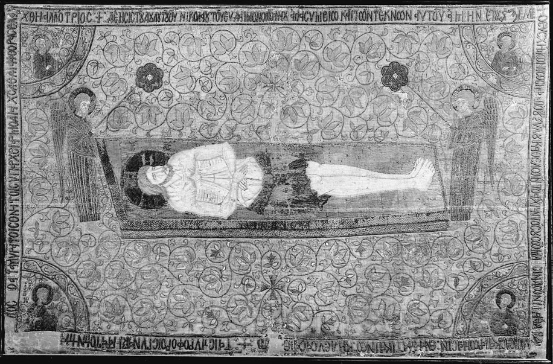

*图5.1 圣葬图织物。基督躺在石板上，天使持扇侍立。伦敦维多利亚与阿尔伯特博物馆。*

<!-- PDF page 154; original page 133 -->

不过，这些记述涉及在中殿举行的各种预备仪式，而非圣餐礼本身。

此时，圣像已安置于圣所屏障或圣像屏（templon / iconostasis）上，直接面向会众；这一屏障把中殿与后殿及圣所（bema）分开。更早的十一世纪，通常的圣所屏障在地面高度以栏板封闭，上部却仍然开放，间隔较宽的柱子支撑着横楣。柱间原先以帘幕遮闭，十二世纪逐渐被大型圣像板取代，形成一道圣像墙，阻断从中殿望入圣所的视线。[^p154-19] 圣像屏上的圣像包括基督、圣母，也常有教堂所奉献的圣者或事件。横楣或直接绘画，或在上方承托一排圣像。在横楣圣像中，三圣代祷像的三位人物，可能加入天使和使徒，形成所谓“大代祷像”；也可能在两侧排列节庆圣像，描绘从圣母领报到圣母安眠（Koimesis）之间，基督及其母亲生平的重要事件。这些圣像以更小的规模和更集中的形式，重复教堂其他部位的节庆图像。圣像屏图像与主要节庆循环图像之间的功能差异，至今仍未完全厘清。从中殿进入圣所，须经过圣像屏中央的门；门上常绘圣母领报像，因为《以西结书》46:1—2所说紧闭的门，被解释为指向圣母及道成肉身的奥秘。

有学者提出，某些脱离原有环境而留存至今的大型双面圣像，原先来自圣像屏，传达着双重讯息：一面对会众，另一面朝向圣所，面向教士。[^p154-20] 这些圣像朝向圣所的一面所绘的主题，可能被有意识地整合进该空间整体的绘画体系；朝向中殿的一面则不同，如上所述，它往往重复中殿已有的图像要素。从圣像屏面向中殿的基督与圣母大型形象，<!-- PDF page 155; original page 134 -->即使不参与实际礼仪，也在平信徒虔敬中发挥重要作用。

圣餐主题在圣像屏圣像上十分少见，实际上，在各种圣像上都很少见。[^p155-21] 然而，献祭母题确实进入了较晚的拜占庭图像，例如带有受难器具的圣母子像，以及“忧患之子”（Akra Tapeinosis）像；此外，还有下文将讨论的若干预表主题。[^p155-22]

### 圣所空间的装饰

到十一世纪之交，圣所区域——后殿及圣所的下层墙面——几乎完全由圣餐主题占据。[^p155-23] 这一发展无疑与该空间中举行的仪式相联，也与圣像屏的封闭有关。后殿墙壁上绘着站立的主教，其中，两种主要礼仪的作者金口约翰与大圣巴西略，位置最靠近中央。主教手持福音书，身着奥摩佛里翁肩带；这是他们受按立为主教时获得的身份标志。

主教上方绘有“使徒领圣餐”：基督从画中的祭台上，将饼与酒递给自左右两边前来的十二使徒（图5.2）。这一主题取代了“历史性的”最后晚餐；背景中常写有基督当时说出、又由主礼者重复的设立圣餐之言：“你们拿着吃，这是我的身体……”这种构图从十一世纪起流行起来，细心描绘了当时圣餐礼的细节，包括器皿、祭台华盖，以及正确的礼仪手势。天使辅祭站在祭台旁，手持礼仪扇（rhipidia）。[^p155-24] 基督的形象，或多个形象——因为他常被画两次，一次递饼，一次递酒——从十四世纪起，首次被描绘为穿着君士坦丁堡牧首的萨科斯礼袍。

“使徒领圣餐”的构图一直十分稳定，主教行列却在十二世纪有了新的面貌。

<!-- PDF page 156; original page 135 -->

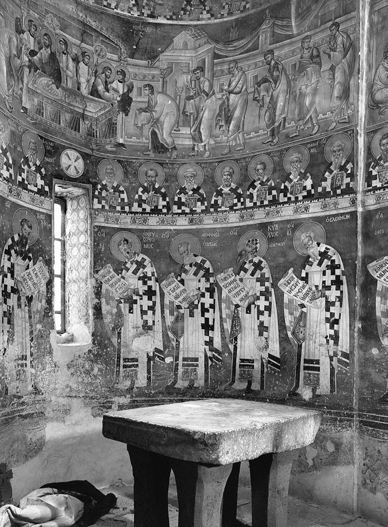

*图5.2 使徒领圣餐，以及手持礼仪卷轴的主礼主教。斯塔罗纳戈里奇诺，后殿南半部。*

<!-- PDF page 157; original page 136 -->

他们不再是正面站立的人物，而是朝祭台躬身的主礼者，展开的卷轴上写着“默祷”的开头；所选祷文，正出自上文所述羊皮“礼仪”卷轴汇集的文本。[^p157-25] 几个世纪中，人数不断增加：不仅后殿，圣所墙壁上也列满主礼者；其上还增加一排排圆框半身像，仿佛想象教会历史上的所有主教都聚在一处圣所，共同举行礼仪。

主教朝向后殿墙壁中央画出的祭台，或朝向那里表现基督献祭的某种图像。这类图像形式多样：一种是“预备宝座”（Hetoimasia），受难器具——荆冠、长矛、海绵——置于宝座上或附近，两旁是身着辅祭服的天使；另一种则是令人震动的圣婴形象，躺在圣盘或祭台上，盖着覆巾，仿佛他就是即将被擘开的饼。[^p157-26] 这一鲜明图像最早有明确年代的例子，见于1199年的库尔比诺沃教堂。[^p157-27] 当地的图像题为“羔羊”（Amnos）；十三世纪起，它也被称作“分割像”（Melismos，意为分割或擘开）。[^p157-28] 随着备祭礼的发展，人们又认为，圣饼祝圣发生于大进堂行列之前的备祭处，而非圣所内；于是，后殿或备祭处中圣婴躺在圣盘上的图像，逐渐让位于成年基督死后伸展在墓石上的形象，墓石使人联想到他的坟墓。正如我们所见，这一图像后来转移到圣葬布上。[^p157-29]

后殿图像体系强烈的圣餐倾向，使空间上与之相关的其他图像也获得圣餐意味。例如，印有基督面容的圣物“圣容布”（Mandylion），成为道成肉身的标志，因此常与圣母领报图相联。然而，当它被置于后殿、取代“羔羊”图像时，便获得了圣餐意义。[^p157-30]

<!-- PDF page 158; original page 137 -->

### 天上礼仪与其他圣餐图像

拜占庭晚期出现了一种富有戏剧性的圣餐图像，即“天上礼仪”：天界最尊贵的居民——天使——在上帝宝座前永恒举行的礼仪。[^p158-31] 此前，耶路撒冷卷轴已经略露其端。[^p158-32] 在壁画中，例如米斯特拉佩里布莱普托斯教堂，天使承担辅祭和司祭的角色，身着相应圣服，列队将圣爵、圣盘、星盖（asterikos）及覆巾等礼仪器具，从备祭处运往圣所，生动再现大进堂礼。这一行列或被描绘为在穹顶环绕基督，或位于天使启程举行大进堂礼的备祭处，甚至出现在后殿本身。

另一些图像更纯粹具有预表性质。圣所或后殿附近，常出现《旧约》中预示献祭的场景：以撒被献为祭，亚伯拉罕向来访的三一献上食物，以利亚受乌鸦供养，或烈火窑中的三位希伯来青年；其中许多主题的源头，可远溯至早期基督教的大型绘画。取自圣徒传的圣餐图像，则包括沙漠隐修者埃及的马利亚从佐西马斯领圣餐，[^p158-33] 以及“亚历山大里亚的彼得的异象”；后者最初表现反阿里乌派的神学，后来因基督被置于祭台之上站立，而成为一种礼仪宣示。[^p158-34]

## 教会年历的循环

### 福音经课集与使徒经课集中的文本与图像

一年中每日应读的福音段落，从《圣经》中摘出，依教会历的需要重新编排，构成“福音经课集”。通常的经课集，先列日期取决于复活节的移动节期读经，从复活节主日至次年圣周结束。大斋期的读经，大体依次取自四位福音作者——约翰、马太、路加，以及大斋期的马可。在这些移动节期的福音读经之后，是冗长的固定节日历，即每年在同一日期庆祝的节日，并注明指定读经。大多数固定节日纪念圣徒，但也包括<!-- PDF page 159; original page 138 -->福音故事中的重要事件，如圣母诞生与进殿、基督降生、受洗、献于圣殿、圣母领报、显容，最后是圣母安眠。这些事件并非按历史发生顺序排列，而是依它们在一个教会年中受庆祝的次序安排。福音经课集的这一历法部分，有些手稿称“圣徒月录”（menologion），有些称“圣徒纪念集”（synaxarion），从9月1日开始，至8月31日结束。当日应读的福音段落，或全文抄出，或在手稿前部已全文出现的情况下，仅注明交叉参照。福音经课集的插图类型差异很大：有的手稿载有整页节庆图像，另一些却仅有两三个带人物的首字母。一部福音经课集——梵蒂冈希腊文1156号——试图在相应条目的正文和边栏中，表现每一位受纪念的圣徒及每一个事件；另一些的插图则限于福音作者像、若干重大节庆细密画，以及较重要圣徒的肖像。[^p159-35]

福音经课集将基督生平事件从历史顺序中抽离，改按教会历重新编排。这种礼仪重排反过来影响了某些福音书的插图：每卷福音前置一幅基督生平事件的细密画，但所选主题取决于该福音段落在哪个节日诵读。[^p159-36]

另外两种经课书，是“使徒经课集”（praxapostolos，选读《使徒行传》与书信）和“先知经课集”（prophetologion，《旧约》读经）。后者从不配插图，前者的插图则主要是《新约》这一部分各位作者的肖像。

库尔特·魏茨曼认为，插图福音经课集，是这一时期拜占庭教堂墙壁上福音节庆图像的来源。[^p159-37] 如果假定每幅图像都<!-- PDF page 160; original page 139 -->源于书籍，是专为某篇文本而创作，随后才转移至其他媒介，那么，福音经课集当然是最可能的来源。遗憾的是，配有节庆场景的福音经课集数量，远远不足以使这一理论令人信服；绝大多数插图经课集的装饰，仅限于四福音作者肖像。此外，拜占庭图像具有独立性质，很少是某一单独文本的字面图解；因此，更可能的情况恰好相反：节庆循环的图像首先在大型绘画或圣像上形成，随后才进入插图手稿及其他媒介。

### 讲道集与圣徒传集中的文本与图像

教会历的观念，内在于许多其他类型的礼仪书。[^p160-38] 十一世纪起，供特定节日诵读的讲道集，便在手稿中按诵读节日的日期编排。[^p160-39] 纳齐安祖斯的格里高利《讲道集》的手稿，尤其如此（图5.3）；如同福音经课集，它以复活节读经开篇，在这里，就是格里高利的一篇复活节讲道。其插图通常限于卷首题饰和首字母，虽然往往反映讲道内容，却也呼应诵读该讲道的节日。[^p160-40] 金口约翰的讲道，也在整个教会年中的礼拜里诵读，且常配插图，却不像格里高利的讲道那样按教会历编排。[^p160-41] 尼科米底亚的乔治等其他作者的讲道，在特定节日诵读，对该节庆的图像表现产生了巨大影响；其影响或直接发生，或通过以这些讲道为基础的圣歌间接发生。[^p160-42]

<!-- PDF page 161; original page 140 -->

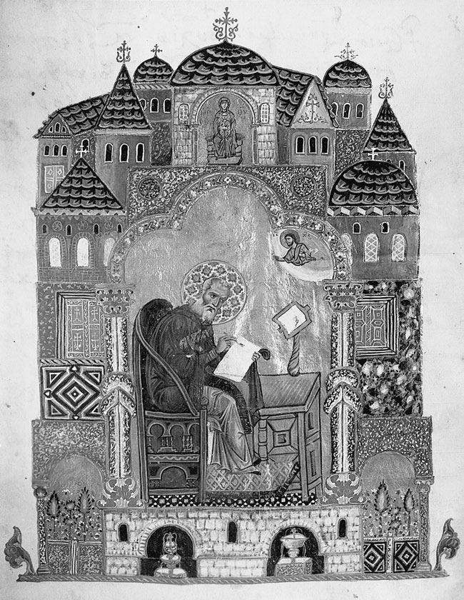

*图5.3 纳齐安祖斯的格里高利撰写讲道。西奈山，希腊文抄本339号，第4叶背面。*

<!-- PDF page 162; original page 141 -->

循环教会历的观念，内在于圣徒传手稿；这类手稿记录一年中每日应纪念的圣徒或事件。约1000年的《皇帝巴西略二世圣徒月录》（梵蒂冈希腊文1613号），共配有430幅独立细密画，记录教会年前六个月——9月至次年2月——每日不少于一项的纪念。实际上，由于各位圣徒的记述十分简短，其文本属于圣徒纪念集。图像以圣者肖像和殉道场景为主，也包含福音节庆及对君士坦丁堡有意义的纪念，例如圣髑迁入城内，以及城市遭受的自然灾害。每幅图像与一篇16行的圣徒事迹摘要共占一页。在一些情况下，尤其是地震等灾难，事件本身的表现，被纪念它的礼仪庆典图像取代。[^p162-43] 这项庞大工程只有第一卷留存至今；第二卷是否曾经制作，不得而知。

有一部较晚的作品可与巴西略《圣徒月录》相提并论：牛津收藏的一部十四世纪手稿，以单卷呈现一年中每日纪念的图像。除卷末诗和细密画的韵文题注外，它完全没有正文。其图像源头似乎在于大型绘画中的历法循环，而非任何可追溯至《巴西略二世圣徒月录》的手稿传统。[^p162-44]

较长的圣徒传文本，也按历法次序汇编。[^p162-45] 十世纪末，改写者西缅（Symeon Metaphrastes）撰写的《圣徒传》，在十一世纪被编为十卷：第一卷为9月圣徒，最后第十卷收录5月至8月的圣徒。这些传记供修道院晨祷（orthros）时诵读。尽管圣徒生平具有丰富的叙事性，为西缅这些作品配制的大篇幅细密画循环，却十分

<!-- PDF page 163; original page 142 -->

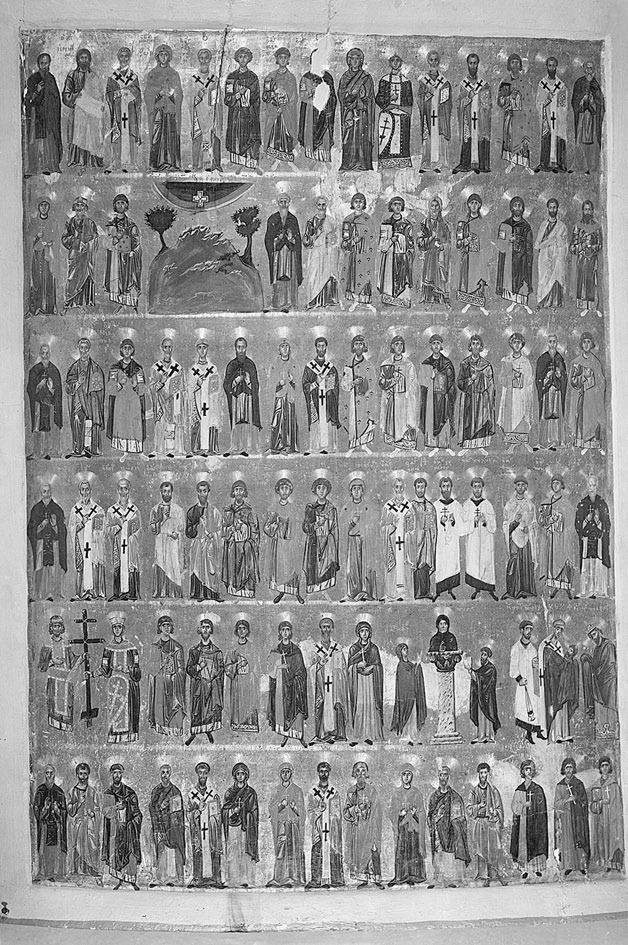

*图5.4 五月月历圣像。西奈山圣凯瑟琳修道院。*

<!-- PDF page 164; original page 143 -->

少见。[^p164-46] 通常做法，是在每位圣徒传记开篇的绘画题饰中，或以取代题饰的方式，放置其肖像。一套年代为1063年的卷册，将某卷全部传记人物的形象集中在同一叶，作为该卷卷首插图。这类群像，与同时代的月历圣像（图5.4）完全对应，也与米蒂利尼的克里斯托弗及其他作者在十一世纪及此后创作的历法助记诗相呼应。[^p164-47]

### 教堂装饰中的教会年历

组成整个教会年的事件和圣徒形象，充满拜占庭教堂中殿。穹顶拜占庭教堂内部独具特色的建筑与装饰之间的惊人协调，将这些纪念转变为一个体系；每一组成部分，相对于中央穹顶或拱顶中的基督形象，以及相对于彼此，都有特定位置。[^p164-48] 环绕基督的是天使或先知；《新约》重要事件，以大约十二幅节庆场景的形式，排列在拱顶或上层墙壁；较低处的墙壁，以及转角小堂等附属区域，则排列着圣徒图像。这一体系直到后拜占庭时代才被编订成文，[^p164-49] 但教堂图像体系中的各要素，相对于基督和彼此的位置，在大多数拜占庭教堂中都相当一致地重复出现，无论主教座堂、堂区教堂还是修道院教堂。

这里值得注意的是，教会历对于图像体系具体组织的影响竟如此微小。例如，圣徒完全不按纪念日期排列，而按身份分类：使徒、战士、修士、女性圣徒、隐修者或柱头修士，<!-- PDF page 165; original page 144 -->各类被安排在教堂特定区域。由于空间不足以表现教会历史上的全部圣徒，所画者便是各圣徒“班列”或类别的领袖、最著名的人物。在这一点上，他们像宫臣朝见皇帝一样，按界限明确的群体接近基督。这种圣徒排列，与通常位于中殿之外、尤其前厅中的历法循环形成鲜明对照；后者延续《巴西略二世圣徒月录》的传统，逐月表现全年教会纪念。[^p165-50] 在中殿，圣徒已从世俗时间和历法时间的轮转中获得解放。

在节庆构图中，情况略有不同。它们环绕中央基督形象旋转，仿佛教会年的循环运行。然而，拜占庭教堂中的节庆循环并不遵循历法的礼仪顺序，而保留了历史时间的要素：各事件大致依基督生平次序展现，起于设在中殿东部的圣母领报。保留历史时间的某些方面，使拜占庭晚期的教堂图像体系更容易纳入严格遵守叙事次序的基督受难循环，或圣母生平循环。各节庆的具体位置，会因教堂建筑而异，但总有可以识别的年代顺序。不同时间观念始终相互对话。圣星期四的濯足礼（Pedilavum），有时就在基督为十二使徒濯足的图像下举行。[^p165-51] 在这里，福音事件、事件图像与礼仪纪念彼此呼应，与这些时间层次形成丰富共鸣。

世俗时间被推得离圣所越来越远，甚至离开中殿，进入教堂西端的前厅。前厅装饰的主题较为灵活，强调它作为预备空间的作用。有学者认为，其主要礼仪主题，与圣诞及圣周之前数周斋期的忏悔和准备性质相关。[^p165-52] 拜占庭中期，个别<!-- PDF page 166; original page 145 -->圣徒的生平开始被绘在前厅或侧小堂中，有时多达十或十二个不同片段。这类循环常与坟墓相联；在这种情况下，其目的似乎是讲述圣徒哪些事迹使他或她获得上帝垂听，成为死者有效的代祷者。不过，前来敬拜的信众也可以随时到圣徒肖像前祈求，不受教堂内部严格等级秩序和教会历的限制。

## 其他教会仪式

当然，还有许多只在不定期场合举行的礼拜：授予圣职、洗礼、婚礼、丧礼，以及教堂祝圣、房屋祝福、井水洁净，甚至——至少对牧首而言——加冕礼。每一场合都有自己的仪式，却少有在艺术中留下重要痕迹者。[^p166-53] 这些礼拜的图像，大多嵌入圣徒生平绘画循环或编年史之中。例如，授予辅祭、司祭和主教的三次按立，是圣尼古拉斯生平图像循环的常见部分。[^p166-54] 安葬场景最初表现一位圣徒被置入石棺、旁有主教奉香，后来逐渐繁复；十四世纪有些描绘圣尼古拉斯等人去世的精美丧礼图像，甚至包括歌者。[^p166-55] 圣以法莲或圣萨瓦等隐修者的死亡场景，则置于广阔的山坡与洞穴景观中，其他隐修者从中走出，参加为亡故同道举行的露天仪式。[^p166-56]

人们在个人忌日举行追思礼（μνημόσυνα）。皇帝约翰·科穆宁在1136年为君士坦丁堡全能者修道院制定的院规中规定，每逢他本人、妻子和儿子的忌日，都应将著名的引路圣母像从其圣所抬出，横穿城市送往修道院，放置在他的墓旁，停留一夜。翌日，“应在神圣圣像在场时举行神圣礼仪”。[^p166-57]

<!-- PDF page 167; original page 146 -->

约翰的兄弟伊萨克·科穆宁，安葬于色雷斯世界救主圣母修道院；该院由他在1152年创建。圣母和基督的圣像，应永久安置于其墓旁，院中修士须每日经过墓前，“在立于彼处的神圣圣像之前”为其灵魂祈祷。[^p167-58] 这些圣像没有特定礼仪功能，却为墓旁的代祷提供焦点，无论这种祈祷每年举行还是每日进行。科穆宁时期的这类文献证据令人感兴趣，因为它暗示圣像与实际礼仪之间的关系，比仅依赖图像或礼仪史料所能推测的时间更早。

这类坟墓的建筑环境，主要是墓穴上方的拱龛（arcosolia，即墙壁凹龛），带有绘画、雕刻，或两者兼有的装饰；但图像主题通常关乎救恩，而非丧礼本身。[^p167-59]

## 时辰礼仪

### 日课手稿中的文本与图像

修道生活对拜占庭礼仪发展的最大贡献，是其圣歌；它在九世纪初，随巴勒斯坦修道礼拜程序进入君士坦丁堡。拜占庭的《时辰书》（horologion），自九世纪起便有手稿见证，提供一天中各主要时课——第一、第三、第六、第九时课——的文本，以及晨祷、晚祷和寝前祷（apodeipnon）的文本。它很少配插图：现存时辰书中，只有两部具有较完整的插图体系。一部为十二世纪末作品，现藏莱斯博斯，为一日每个时辰设置一项礼拜；另一部为十五世纪克里特作品，现藏巴尔的摩。[^p167-60] 两者的插图都主要借自其他类型手稿。例如，晨祷中取自《圣经》的颂歌，采用《诗篇》手稿中熟知的传统颂歌构图。在巴尔的摩《时辰书》中，第三、第六、第九时课，分别配以圣灵降临、基督受难和哀悼基督场景，<!-- PDF page 168; original page 147 -->因为《圣经》明确记载了原事件发生的时辰，即第三、第六、第九时，相应的修道时课便成为对圣经事件的某种纪念。因此，这三件事不再只于每年纪念，而可以每日庆祝。

《诗篇》是主教座堂和修道礼仪的基本组成部分，也是最常配插图的礼仪文本之一。有些《诗篇》手稿的页边带有重要的视觉注解；这些注解倾向于强调段落的预表和神学意义，而非礼仪用途。[^p168-61] 《旧约》颂歌一贯被收录于《诗篇》手稿中，曾是晨祷不可缺少的部分，也常是装饰的主要重点。九篇圣经颂歌各自发展出稳定的图像：或描绘引发颂歌的事件，如三位希伯来青年、渡红海、摩西受律法、约拿与鲸鱼等；或表现相关人物——大多数是先知——举起双臂，向上帝献上赞歌。[^p168-62] 与其他颂歌不同，最后一篇《尊主颂》的配图，在拜占庭晚期艺术中继续发展；这是唯一取自《新约》的颂歌（《路加福音》1:46—54）。圣母在往见伊利莎白之后赞美上帝的形象，开始越来越像怀抱基督的圣母圣像。于是，《尊主颂》的图像又被重新塑造；耶路撒冷的一部《诗篇》——希腊牧首区塔富55号——就表现一名赞助者走向站立的圣母子。圣母已成为接受祈祷的人物，而非亲自向上帝祈祷的人物。[^p168-63]

以年历循环为基础的礼仪手稿，包括供固定节日使用的《月课经》（menaion）、大斋期的《三歌经》（triodion），以及复活节主日至圣灵降临节期间的《五旬经》（pentekostarion）。它们较晚才发展为独立书籍，分别在十二、十、十四世纪，但合在一起，记录了一年中每日的圣歌、祷文和读经。某些特定圣歌类型的合集，例如按八周循环编排、供每周各日使用的《八调经》（octoechos），<!-- PDF page 169; original page 148 -->以及依节日日期顺序编排短诗的《附经诗集》（sticherarion），偶尔也有某种插图。墨西拿的一部《八调经》，在复活附经诗（stichera anastasima）之前，配有相传为《八调经》作者的大马士革的约翰的非同寻常图像。这些图像并不根植于其他手稿插图，显然是围绕修道文本进行的自由而独特的创作。[^p169-64]

修道礼拜由不同长度的圣歌构成，尤其重要的是“圣颂典”（canon），一种由九首诗或颂歌组成的音乐作品。至十一世纪，它已取代晨祷中吟唱的九篇圣经颂歌；数篇圣颂典可以逐歌交织演唱。较早的一种圣歌类型“孔达克颂歌”（kontakion）被圣颂典取代，在日课中仅以简略形式存续：其序颂（proimion）与第一诗节（oikos，即孔达克的一组诗句），可能插在圣颂典第六歌之后。不过，有一篇孔达克颂歌——《不坐颂》（Akathistos）——至少每年仍会完整吟唱一次，即在大斋期第五周的星期六。这是一篇分为24节、献给圣母的颂歌，相传出自六世纪诗人罗马诺斯之手。十四世纪起，《不坐颂》文本有时也收入《诗篇》手稿。[^p169-65] 其前半部分叙述从圣母领报到基督献于圣殿的童年故事，后半部分则专注于对圣母的华美赞颂。有一部精美的拜占庭手稿，几乎完全用于呈现这一篇诗歌。[^p169-66] 叙事部分的插图相当传统，但到了纯粹赞颂的诗节，便出现有趣的圣母图像：信众环绕她周围，而她的姿态开始呼应十四世纪已发展出的某些圣母圣像类型。在这首古老颂歌中对圣母的敬礼，越来越常被构想为对圣母圣像的敬礼。在最后的第24节，信众被十分直接地描绘为敬礼一幅特定圣像：引路圣母像置于覆有织物的木架上。[^p169-67]

<!-- PDF page 170; original page 149 -->

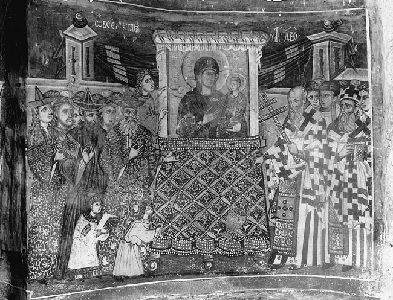

*图5.5 《不坐颂》第24节。马尔科夫修道院，圣德米特里奥斯教堂，圣所北墙。*

至于圣颂典插图，却没有堪与精美《不坐颂》插图（图5.5）相比的作品。一组水准平常的细密画，伴随“灵魂与身体分离圣颂典”；这些画附于上文提到的莱斯博斯十二世纪末《时辰书》手稿，并与之同时。图像追踪灵魂从临终修士身体中脱离、接受审判，并初步升入乐园的过程。此圣颂典的每一歌都有配图，与诗句内容紧密相联。另一组可比而无直接关联的图像，置于十二世纪一部《诗篇》之前——阿索斯山迪奥尼修65号；它们在这里并不附于圣颂典，而附于一组极少使用、按字母顺序排列的祷文，供修士在独居室内私人祈祷，而非共同礼拜。[^p170-68] 莱斯博斯插图每歌一幅细密画的格式，也见于另一篇圣颂典：收入约翰·克利马库斯《天梯》手稿的“忏悔圣颂典”。图像置于每一歌之前，因此<!-- PDF page 171; original page 150 -->以可预测的间隔反复出现。[^p171-69] 在这些配图的圣颂典中，只有“灵魂与身体分离圣颂典”曾进入大型绘画。

### 大型绘画中的圣歌

十二世纪起，拜占庭教堂墙壁上出现圣歌作者的肖像，表明圣歌对大型绘画的重要性。[^p171-70] 例如，在内雷齐教堂（1164年），北墙整个下部都用于表现五位诗人，其中包括斯图迪奥斯的狄奥多若与圣歌作者约瑟夫，两人都生活至九世纪。这些圣歌作者的位置，比西侧的战士圣徒更为显要，并与对面南墙上深受敬仰的早期教会修道圣徒平等。[^p171-71]

不过，圣歌对大型绘画的影响，并不总是容易评估。诚然，某些特定圣歌被直接图解在教堂墙上。例如，十四世纪初以后，《不坐颂》相当经常地进入教堂图像体系；在各种媒介中，最早的循环是约1300年绘于埃拉松奥林皮奥蒂萨教堂的作品。[^p171-72] 大马士革的约翰的圣诞附经诗，也在某些十四世纪巴尔干教堂中被图解：传统圣诞构图被从节庆序列中分离出来，扩展为包括信众人物的场景，甚至出现真实历史人物，表现他们通过吟唱这首圣歌庆祝节日。[^p171-73] 阿索斯山希兰达尔修道院的一座塔楼中，则绘有一系列图解“灵魂与身体分离圣颂典”的场景。[^p171-74]

<!-- PDF page 172; original page 151 -->

有时，某个节日所唱圣颂典的作者，会被画在该节庆场景旁，甚至置身其中。例如，在帕特莫斯的修道院食堂，圣歌作者科斯马斯与大马士革的约翰，如同一对先知，使手中卷轴垂入基督受难场景。[^p172-75] 他们也出现在圣母安眠图两侧，卷轴上写着各自安眠圣颂典的文句。有时，两位圣徒甚至进入构图边框之内，站在哀悼的使徒附近，只是身形略大。在这些构图中，圣歌作者与上文的歌者一样，将过去的事件与当下的庆祝联系起来。

圣歌对节庆循环的影响更难把握。要将某个母题追溯至某一特定圣歌，并不总是容易，尤其当圣歌本身又依据更早的散文文本时。不过，罗马诺斯的基督受难孔达克颂歌，显然影响了一件十一世纪象牙雕刻，以及一幅十四世纪受难壁画；后者甚至题写了该颂歌的文句。[^p172-76] 人们认为，十二世纪起，圣歌对受难事件更具情感感染力的新版本的发展，产生了重要影响。帕拉斯与贝尔廷主张，涉及圣母哀哭的读经和圣歌，在十二世纪被引入新形成的圣星期五礼拜，促成“忧患之子”（Akra Tapeinosis）圣像类型。如果这一观点正确——人们也许过度强调了相关礼拜的“新”——那么，这些发展就代表了圣所之外，礼仪与艺术之间最清晰、最密切的联系。[^p172-77]

### 其他媒介中的圣歌

在这一方面，圣像绘画与大型绘画的发展大致相同。有些圣像以《不坐颂》24节环绕圣母；有些圣母安眠像包括圣歌作者科斯马斯和大马士革的约翰。“忧患之子”有时与哀悼圣母的半身像配成双联画，成为<!-- PDF page 173; original page 152 -->人们熟悉的圣像类型；有学者推测，它实际参与了圣星期五礼仪。更确定参与这些礼仪的，是圣葬布，即绘有死去基督形象、大小如坟墓的大型覆布（图5.1）。它无疑参与了圣星期五与圣星期六的安葬行列；十四世纪已有这类行列的记载。

无论采用何种图像类型，圣母像常获得取自礼仪诗歌的称号，如“生命之泉”（zoodochos pege）、“广于诸天者”（platytera）、“至福者”（pammakaristos）等。[^p173-78] 偶尔，影响也反向发生。例如，拜占庭晚期显灵圣像日益增多，人们开始创作诗歌圣颂典，所颂对象不仅是圣母，也包括个别圣母圣像。这些献给圣像的圣颂典，似乎属于后拜占庭时期，但其中有些可能会被证实年代更早。[^p173-79]

## 结论

拜占庭礼仪及其注释者，不断处理尘世与天上时间的观念。圣餐礼被说成纪念基督献祭及此前的一系列事件，同时又是这些事件在上帝永恒领域中实现的图像和预表。[^p173-80] 它既唤起历史事件的次序，也唤起天国的无时间性。解释圣餐礼的作者，在安提阿与亚历山大里亚两种路径之间，在“历史”（Ἱστορία）与“观照”（Θεωρία）之间来回转换。[^p173-81] 由于以礼仪重现事件，已能联结过去与未来，这种艺术便无须依赖广泛的象征或寓意等其他联结方式，因此始终坚定地保持具象性质。

它也始终具有多重意义：建立严格一一对应关系的尝试，通常并不成功。各种礼仪循环和礼拜——移动节期、固定节日、时课、圣餐礼——在一天中彼此交错、重叠，因此，礼仪中可变的要素，不断为固定不变者赋予新的色调与意义。艺术也是<!-- PDF page 174; original page 153 -->如此。在一座教堂中，一幅图像与另一幅相互呼应，双方的意义都随之受到影响。圣服上与教堂墙壁上的同一图像，若被复制到书中，看起来可能完全相同；但在原有场所，它便因不同语境而各具色彩。拜占庭艺术不仅从礼仪获得丰富图像和深刻神学观念，也学会了如何进出时间，如何运用语境，使自身不断增添新的意义层次。

## 译校说明

- 原文在圣服段落将辅祭肩带上的文句写作“Glory Glory Glory”，此处依原文译为“荣耀，荣耀，荣耀”。
- 原文以《以西结书》46:1—2说明紧闭之门，并在读经编排段落两次提到“大斋期”（Lent）；这些引文定位与表述按原书保留。

## 注释

[^p148-1]: 关于这些发展的简要综述，参见 R. F. Taft, The Byzantine rite: a short history (Collegeville, MN: Liturgical Press, 1992) 及其收入下列文集的论文： Liturgy in Byzantium and beyond (Aldershot: Variorum, 1995). 另参见 T. Pott, La réforme liturgique byzantine: étude du phénomène de l’évolution non-spontanée de la liturgie byzantine (Rome: CLV – Edizioni liturgiche, 2000); S. Janeras, Le Vendredi-saint dans la tradition liturgique byzantine: structure et histoire de ses offices [Analecta liturgica 13; Studia Anselmiana 99] (Rome: Pontificio Ateneo S. Anselmo, 1988); H.-J. Schulz, The Byzantine liturgy: symbolic structure and faith expression (New York: Pueblo Publishing, 1986); G. Bertonière, The historical development of the Easter Vigil and related services in the Greek church [OCA 193] (Rome: Pontificium institutum orientalium studiorum, 1972); A. Schmemann, Introduction to liturgical theology (London: Faith Press, and Bangor, Maine: American Orthodox Press, 1966).

[^p149-2]: J. D. Stefanescu, L’illustration des liturgies dans l’art de Byzance et de l’Orient (Brussels: Institut de philologie et d’histoire orientales, 1936). 另参见 Schulz, Byzantine liturgy, esp. 79–80.

[^p149-3]: C. Walter, Art and ritual of the Byzantine church (London: Variorum, 1982). 另参见 N. K. Moran, Singers in late Byzantine and Slavonic painting [Byzantina Neerlandica 9] (Leiden: Brill, 1986) 其中有歌者参与仪式的图像。

[^p149-4]: D. I. Pallas, Die Passion und Bestattung Christi in Byzanz: der Ritus – das Bild [Miscellanea Byzantina Monacensia 2] (Munich: Institut für byzantinistik und neugriechische Philologie der Universität München, 1965).

[^p149-5]: 参见 A. Grabar, ‘Une source d’inspiration de l’iconographie byzantine tardive: les cérémonies du culte de la Vierge’, CA 25 (1976), 143–62; Grabar, ‘Les peintures dans le chœur de Sainte-Sophie d’Ochrid’, CA 15 (1965), 257–65; G. Babić, Les chapelles annexes des églises byzantines: Fonction liturgique et programmes iconographiques [Bibliothèque des cahiers archéologiques 3] (Paris: Klincksieck, 1969); Babić, ‘Les discussions christologiques et le décor des églises byzantines au XII siècle’, Frühmittelalterliche Studien 2 (1968), 368–86. 另参见 Vostochnochristjanskij chram: liturgija i iskusstvo, ed. A. M. Lidov (St Petersburg: Dmitrii Bulanin, 1994).

[^p149-6]: Schmemann, Liturgical theology, 20, 对后者使用“时间的礼仪”一语。参见 ibid., 38, n. 6, and 139–40.

[^p150-7]: S. Parenti, L’eucologio Barberini gr. 336 [Biblioteca ephemerides liturgicae 80] (Rome: CLV – Edizioni liturgiche, 1995).

[^p150-8]: B. V. Farmakovskij, ‘Vizantijskij pergamennyi rukopisnyi svitok s miniaturami’, Izvestija Russkogo Arkhaeologicheskogo Instituta v Konstantinopole 6 (1900), 253–359; V. Kepetzis, ‘Les rouleaux liturgiques illustrés, 11e–14e siècles’, 未刊论文，巴黎第四大学（1979）; S. E. J. Gerstel, ‘Liturgical scrolls in the Byzantine sanctuary’, Greek, Roman and Byzantine Studies 35 (1994), 195–204.

[^p150-9]: Patmos, Monastery of St John, Ms. gr. 707. 参见 A. Kominis, Patmos: the treasures of the monastery (Athens: Ekdotike Athenon, 1988), 289–91; figs. 25–34.

[^p151-10]: P. Vokotopoulos, Byzantine illuminated manuscripts of the Patriarchate of Jerusalem (Athens and Jerusalem: Greek Orthodox Patriarchate of Jerusalem, 2002), no. 19, figs. 43–58; A. Grabar, ‘Un rouleau constantinopolitain et ses peintures’, DOP 8 (1954), 163–99; Schulz, Byzantine liturgy, 80–9.

[^p151-11]: S. A. Boyd, ‘Art in the service of the Liturgy: Byzantine silver plate’, in Heaven on earth: art and the church in Byzantium, ed. L. Safran (University Park: Pennsylvania State University Press, 1998), 152–85, esp. 180–3; A. Ballian, ‘Liturgical implements’, in Byzantium: faith and power (1261–1557), ed. H. C. Evans (New York, New Haven and London: Yale University Press (for the Metropolitan Museum of Art), 2004), 117–24.

[^p151-12]: I. Kalavrezou-Maxeiner, Byzantine icons in steatite [Byzantina vindobonensia 15] (Vienna: Verlag ÖAW, 1985), no. 131.

[^p151-13]: W. Woodfin, ‘Liturgical textiles’, in Faith and power, 295–8, and figs. 10.2 and 10.3.

[^p151-14]: G. Galavaris, Bread and the liturgy: the symbolism of early Christian and Byzantine bread stamps (Madison and London: University of Wisconsin Press, 1970).

[^p151-15]: J. A. Cotsonis, Byzantine figural processional crosses [Dumbarton Oaks Collection Publications 10] (Washington, DC: Dumbarton Oaks Research Library and Collection, 1994).

[^p152-16]: Woodfin, ‘Liturgical textiles’, 296–7; H. Belting, ‘An image and its function in the liturgy: the Man of Sorrows in Byzantium’, DOP 34–35 (1980–81), 1–16; S. Ćurčić, ‘Late Byzantine loca sancta? Some questions regarding the form and function of Epitaphioi’, in The twilight of Byzantium: aspects of cultural and religious history in the late Byzantine Empire, ed. S. Ćurčić and D. Mouriki (Princeton: Princeton University Press, 1991), 251–61; Robert F. Taft, The Great Entrance: a history of the transfer of gifts and other preanaphoral rites of the liturgy of St. John Chrysostom [OCA 200] (Rome: Pontificium institutum orientalium studiorum, 1978), 217–19.

[^p152-17]: Woodfin, ‘Liturgical textiles’; P. Johnstone, The Byzantine tradition in church embroidery (Chicago: Argonaut, 1967).

[^p152-18]: R. Bornert, Les commentaires byzantins de la Divine Liturgie du VIIe au XVe siècle [Archives de l’orient chrétien 9] (Paris: Institut français d’études byzantines, 1966), esp. 180–206.

[^p154-19]: 较新研究参见 S. E. J. Gerstel, Beholding the sacred mysteries: programs of the Byzantine sanctuary [Monographs on the Fine Arts 56] (Seattle and London: University of Washington Press, 1999), 5–14 (不过，同上第9页引述、被德米特里耶夫斯基定为十三世纪的帕特莫斯719号卷轴，实际属于十六或十七世纪), and J.-M. Spieser, ‘Le développement du templon et les images des Douze Fêtes’, Bulletin de l’Institut Historique Belge de Rome 69 (1999), 131–64.

[^p154-20]: S. E. J. Gerstel, ‘An alternate view of the late Byzantine sanctuary screen’, in Thresholds of the sacred: architectural, art historical, liturgical and theological perspectives on religious screens, east and west, ed. S. E. J. Gerstel (Washington, DC: Dumbarton Oaks Center for Byzantine Studies, 2006).

[^p155-21]: 一幅描绘使徒领圣餐的圣像，是少见的例外，反而印证了一般情况： Χαριστήριον εἰς Ἀναστάσιον Κ. Ὀρλάνδον (Athens: Bibliotheke tes en Athenais Archaiologikes Hetaireias, 1967), iii, 395.

[^p155-22]: J. Albani, ‘Icons and the Divine Liturgy. A reciprocal relationship’, in Ceremony and faith: Byzantine art and the Divine Liturgy (Athens: Hellenic Ministry of Culture – Directorate of Byzantine and Post-Byzantine Monuments, 1999), 57–62.

[^p155-23]: Gerstel, Sacred mysteries, 5–67.

[^p155-24]: 同上, 48–67.

[^p157-25]: 同上, 15–36.

[^p157-26]: 例如，内雷齐的预备宝座图，也有鸽子，见 I. Sinkević, The church of St. Panteleimon at Nerezi: architecture, programme, patronage (Wiesbaden: Reichert Verlag, 2000), 35–6; Gerstel, Sacred mysteries, 37–47; A. L. Townsley, ‘Eucharistic doctrine and the liturgy in late Byzantine painting’, Oriens Christianus, ser. iv. 22 (1974), 138–53.

[^p157-27]: L. Hadermann-Misguich, Kurbinovo: les fresques de Saint-Georges et la peinture byzantine du XIIe siècle [Bibliothèque de Byzantion 6] (Brussels: Éditions de Byzantion, 1975), 67–78.

[^p157-28]: R. F. Taft, ‘Melismos and comminution: the fraction and its symbolism in the Byzantine tradition’, Studia Anselmiana 95 (1988), 531–52.

[^p157-29]: Pott, Réforme, 169–94; Schulz, Byzantine liturgy, 64–7.

[^p157-30]: Gerstel, Sacred mysteries, 68–77.

[^p158-31]: 它也被称为“神圣礼仪”（Divine Liturgy）或“天界礼仪”（Celestial Liturgy）。

[^p158-32]: V. Kepetzis, ‘Tradition iconographique et création dans une scène de communion’, Jahrbuch der Österreichischen Byzantinistik 32/5 (1982), 443–51.

[^p158-33]: Gerstel, Sacred mysteries, 57.

[^p158-34]: Walter, Art and ritual, 213–14.

[^p159-35]: Oriente cristiano e santità (Milan: Centro Tibaldi; Rome: Ministero per i beni culturali e ambientali, 1998), no. 18. 细密画一直画到12月31日。 关于插图福音经课集，参见 J. C. Anderson, The New York Cruciform Lectionary (University Park: University of Pennsylvania Press, 1992); M.-L. Dolezal, ‘Illuminating the liturgical word: text and image in a decorated lectionary (Mount Athos, Dionysiou Monastery, cod. 587)’, Word & Image 12 (1996), 23–60. 关于礼仪手稿的一般情况，参见 N. P. Ševčenko, ‘Illuminating the Liturgy: illustrated service books in Byzantium’, in Heaven on earth, 186–228.

[^p159-36]: C. Meredith, ‘The illustrations of Codex Ebnerianus. A study in liturgical illustration of the Comnenian period’, Journal of the Warburg and Courtauld Institutes 29 (1966), 419–24.

[^p159-37]: 魏茨曼关于这一主题的许多研究，已重印于 K. Weitzmann, Byzantine liturgical psalters and gospels (London: Variorum, 1980)。

[^p160-38]: Walter, Art and ritual, 67–72.

[^p160-39]: A. Ehrhard, Überlieferung und Bestand der hagiographischen und homiletischen Literatur der griechischen Kirche von den Anfängen bis zum Ende des 16. Jahrhunderts [Texte und Untersuchungen zur Geschichte der altchristlicher Literatur 50–52] (Leipzig: J. C. Hinrichs Verlag, 1937–52), 3 vols. in 4.

[^p160-40]: G. Galavaris, The illustrations of the Homilies of Gregory of Nazianzenus [Studies in Manuscript Illumination 6] (Princeton: Princeton University Press, 1969); Ševčenko, ‘Illuminating the liturgy’, 219–20.

[^p160-41]: K. Krause, Die illustrierte Homilien des Johannes Chrysostomos in Byzanz (Wiesbaden: Reichert Verlag, 2004). 金口约翰的讲道，是对《圣经》各卷的注解，尤其是《马太福音》《约翰福音》和《创世记》，因此依经卷而非年历编集。

[^p160-42]: H. Maguire, Art and eloquence in Byzantium (Princeton: Princeton University Press, 1981), 91–108; M. Vassilaki and N. Tsironis, ‘Representations of the Virgin and their association with the Passion of Christ’, in Mother of God: representations of the Virgin in Byzantine art, ed. M. Vassilaki (Milan: Skira, 2000), 453–63.

[^p162-43]: 影印本： Il Menologio di Basilio II. Cod. Vaticano greco 1613 [Codices e Vaticani selecti... 8], 2 vols. (Turin: Fratelli Bocca, 1907). 原书写作时，梵蒂冈计划很快推出新版影印本。 J. Baldovin, ‘A note on the liturgical processions in the Menologion of Basil II (ms. Vat. gr. 1613)’, Εὐλόγημα: studies in honor of Robert Taft, S.J., ed. E. Carr et al. (Rome: Centro Studi S. Anselmo, 1993), 25–39. Il Menologio, 164 所示维苏威火山喷发造成灰雨的有趣图像，是一个例外。

[^p162-44]: Oxford. Bodl. Gr.th.f.1: I. Hutter, Corpus der byzantinischen Miniaturenhandschriften: Oxford, Bodleian Library, 3 vols. (Stuttgart: Hiersemann, 1982), iii, no. 1.

[^p162-45]: Ehrhard, Überlieferung.

[^p164-46]: N. P. Ševčenko, Illustrated manuscripts of the Metaphrastian Menologion (Chicago and London: University of Chicago Press, 1990). 只有偶尔，详细的文本叙事才配有同样详尽的图像叙事。例如，一部节庆讲道及传记集——阿索斯山埃斯菲格梅努14号——包含较长的图像循环；不过，文本仍是改写者西缅传记的选编，在此与其他类型文本结合，见 S. M. Pelekanides et al., The treasures of Mount Athos: illuminated manuscripts, 4 vols. (Athens: Ekdotike Athenon (for the Patriarchal Institute for Patristic Studies), 1974–91), ii, figs. 327–408, esp. 327–36.

[^p164-47]: N. P. Ševčenko, ‘Marking holy time: the Byzantine calendar icons’, in Byzantine icons: art, technique and technology, ed. M. Vassilaki (Heraklion: University of Crete Press, 2002), 51–62; E. Follieri, I calendari in metro innografico di Cristoforo Mitileneo [Subsidia hagiographica 63] (Brussels: Société des Bollandistes, 1980), 2 vols. 本书成书时留存的拜占庭时期历法圣像，全部位于西奈山修道院。

[^p164-48]: 经典研究是 O. Demus, Byzantine mosaic decoration (London: Kegan Paul, 1948; reprinted New Rochelle: Caratzas Brothers, 1976). 另参见 J.-M. Spieser, ‘Liturgie et programmes iconographiques’, TM 11 (1991), 575–90.

[^p164-49]: The ‘Painter’s Manual’ of Dionysius of Fourna, trans. P. Hetherington (London: Sagittarius Press, 1974).

[^p165-50]: P. Mijović, Menolog (Belgrade: Arheoloshki Institut, 1973).

[^p165-51]: W. Tronzo, ‘Mimesis in Byzantium. Notes toward a history of the function of the image’, Res 25 (1994), 61–76.

[^p165-52]: B. Todić, ‘L’influence de la liturgie sur la décoration peinte du narthex de Sopoćani’, in Drevnerusskoe iskusstvo. Rus’, Balkani XIII vek, ed. A. L. Batalov et al. (St Petersburg: Dmitrii Bulanin, 1997), 43–58. 另参见 S. Tomeković, ‘Contribution à l’étude du programme du narthex des églises monastiques (XIe–première moitié du XIIIe siècle)’, B 58 (1988), 140–54.

[^p166-53]: Walter, Art and ritual, passim.

[^p166-54]: N. P. Ševčenko, The life of St. Nicholas in Byzantine art (Turin: Bottega d’Erasmo, 1983), 76–85.

[^p166-55]: 同上, 134–42; Moran, Singers, 72–85.

[^p166-56]: Faith and power, no. 80. 这幅十五世纪圣像表现圣以法莲的丧礼，场景中出现一幅大型引路圣母像。

[^p166-57]: Thomas and Hero, ii, 756; Ševčenko, ‘Icons in the liturgy’, DOP 45 (1991), 52.

[^p167-58]: Thomas and Hero, ii, 839.

[^p167-59]: S. Brooks, ‘Sculpture of the late Byzantine tomb’, in Faith and power, 95–103; E. Velkovska, ‘Funeral rites according to Byzantine liturgical sources’, DOP 55 (2001), 21–45.

[^p167-60]: Lesbos, Leimonos 295. 参见 P. Vokotopoulos, ‘Ἡ εἰκονογράφηση τοῦ κανόνος εἰς ψυχορραγοῦντα στὸ Ὁρολόγιον 295 τῆς μονῆς Λειμῶνος’, Σύμμεικτα 9 (1994), 95–114. 莱斯博斯《时辰书》的一幅图像（第222页），似乎表现修士在教堂门前集合参加礼拜。 Baltimore, Walters w534. 参见 N. P. Ševčenko, ‘The Walters’ Horologion’, Journal of the Walters Art Museum 62 (2004), 7–21.

[^p168-61]: K. Corrigan, Visual polemics in ninth century Byzantine psalters (New York: Cambridge University Press, 1992); S. Der Nersessian, L’illustration des psautiers grecs du Moyen Âge, ii, Londres, Add. 19.352 [Bibliothèque des cahiers archéologiques 5] (Paris: Editions Klincksieck, 1970); A. Cutler, ‘Liturgical strata in the marginal psalters’, DOP 34–5 (1980–81), 17–30.

[^p168-62]: A. Cutler, The aristocratic psalters in Byzantium [Bibliothèque des cahiers archéologiques 13] (Paris: Picard, 1984); Weitzmann, Liturgical psalters.

[^p168-63]: N. P. Ševčenko, ‘The Mother of God in illuminated manuscripts’, in Mother of God, ed. M. Vassilaki, 155–65, esp. 158; Vokotopoulos, Illuminated manuscripts, no. 16. (fol. 260r). 圣母形象如同圣像般装框，顶部甚至设有用于悬挂的圆环。

[^p169-64]: Messina, San Salvatore 51. 参见 A. Weyl Carr, ‘Illuminated musical manuscripts in Byzantium. A note on the late twelfth century’, Gesta 28 (1989), 41–52. 在十四世纪的附经诗集——阿索斯山库特卢穆修412号——中，装饰由一系列圣者肖像构成，见 Pelekanides, Treasures of Mount Athos, i, figs. 377–84.

[^p169-65]: 现存最早的《不坐颂》细密画，实际上见于约1360年的保加利亚《托米奇诗篇》，现藏莫斯科历史博物馆，muz, 2752。参见 A. Dzhurova, Tomichov psaltir [Monumenta slavico-byzantina et mediaevalia europensia 1] (Sofia: Universitetsko izd-vo ‘Kliment Okhridski’, 1990). 这部手稿为《诗篇》134篇——多怜悯颂（Polyeleos）——配有一幅类似图像，表现歌者站在圣像前，第226叶正面，见 Moran, Singers, pl. vii.

[^p169-66]: Moscow, Historical Museum gr. 429, c.1360. 参见 Ševčenko, ‘Icons in the liturgy’, 50, 注35，附参考书目.

[^p169-67]: 关于手稿与壁画中的《不坐颂》，参见 Moran, Singers, 93–114.

[^p170-68]: Pelekanides, Treasures of Mount Athos, i, figs. 118, 121–2; G. Parpulov, ‘Text and miniatures from Codex Dionysiou 65’, Twenty-fifth Annual Byzantine Studies Conference. Abstracts (College Park: Pennsylvania State University Press, 1999), 124–6.

[^p171-69]: J. R. Martin, The illustration of the Heavenly Ladder of John Climacus [Studies in Manuscript Illumination 5] (Princeton: Princeton University Press, 1954), 128–49.

[^p171-70]: G. Babić, ‘Les moines poètes dans l’église de la Mère de Dieu à Studenica’, in Studenica i vizantijska umetnosti oko 1200 (Belgrade: Srpska akademija nauka i umetnosti, 1988), 205–19; A. Grabar, ‘Les images des poètes et des illustrations dans leurs œuvres et dans la peinture byzantine tardive’, Zograf 10 (1979), 13–16.

[^p171-71]: Sinkević, Nerezi, 60–66; N. P. Ševčenko, ‘The five hymnographers at Nerezi’, Palaeoslavica 10 (2002), 55–68.

[^p171-72]: A. Paetzold, Der Akathistos-Hymnos: die Bilderzyklen in der byzantinischen Wandmalerei des 14. Jahrhunderts [Forschungen zur Kunstgeschichte und christlichen Archäologie 16] (Stuttgart: Franz Steiner Verlag, 1989); E. C. Constantinides, The wall paintings of the Panagia Olympiotissa at Elasson in Northern Thessaly (Athens: Canadian Archaeological Institute at Athens, 1992), 134–77.

[^p171-73]: Moran, Singers, 115–25.

[^p171-74]: B. Todić, ‘Freske xiii veka u paraklisu na pirgu sv. Georgija u Hilandaru’, Hilandarski Zbornik 9 (1997), 35–70 (英文摘要, 71–3), esp. 55–70, figs. 12–17 and sketch 11.

[^p172-75]: 十二世纪末博亚纳的受难图中，显然已经出现这两位人物，见 E. Bakalova, ‘Liturgična poezia i crkovna stenopis (Tekst ot oktoexa v Bojanskata c’rkvata)’, Starob’lgarska Literatura 28–9 (1994), 143–52.

[^p172-76]: M. E. Frazer, ‘Hades stabbed by the cross of Christ’, Metropolitan Museum Journal 9 (1974), 153–61; G. Babić, ‘Quelques observations sur le cycle des fêtes de l’église de Pološko (Macédoine)’, CA 27 (1978), 163–78, esp. 172–4.

[^p172-77]: Pallas, Passion, 29–38; Belting, ‘Image and its function’, 5, 7. 帕拉斯和贝尔廷特别指出、称为 presbeia 的礼拜，就其结构而言，并非星期五晚间礼拜中的新事物；他们引用的关键文本——恩惠者修道院院规——也没有称其为 presbeia。参见 Ševčenko, ‘Icons in the liturgy’, 50–4; Janeras, Vendredi-saint, 427–28.

[^p173-78]: S. Eustratiades, Ἡ Θεοτόκος ἐν τῆ ὑμνογραφία [Ἁγιορετικἡ Βιβλιοθήκη 6] (Paris: Librairie ancienne; Chennevières-sur-Marne: L’Hermitage, 1930).

[^p173-79]: Ševčenko, ‘Icons in the liturgy’, 55.

[^p173-80]: Schmemann, Liturgical theology, 34–6, 57–64; Bornert, Commentaires, 36, 168–76.

[^p173-81]: R. F. Taft, ‘The liturgy of the Great Church: an initial synthesis of structure and interpretation on the eve of Iconoclasm’, DOP 34–5 (1980–81), 45–75; Bornert, Commentaires, esp. 52–82.

---

<!-- PDF page 175; original page 154 -->

# 第6章 阿索斯山与奥斯曼人（约1350—1550年）

伊丽莎白·A. 扎哈里亚杜

拜占庭修道院既位于乡村，也位于城市，尤以君士坦丁堡为重镇，是宗教、文化、慈善和经济生活的中心。它们由一组建筑构成，除修士居室外，还包括主教堂（katholikon）、小堂、食堂、泉亭、面包房、库房和马厩。有些还为朝圣者与旅人设置客舍，并有医院及供养老人的济贫院。许多修道院设有图书馆和抄写室，在那里抄写手稿，特殊情况下还配以精美插图。修道院通常环以坚固的防御墙。多数拥有农地，既为修士提供食物，也带来收入，用于修道院的利益，常用于维护或改善建筑。院产大多通过皇帝捐赠和授予特权获得；这类特权常表现为免缴国家税赋。私人也向修道院捐献，通常换取身后的追思，以及为其灵魂得救所作的祈祷。捐赠一般不限于地产，也包括现金和珍贵物品。免税及持续不断的捐赠，使修道院能够通过购买取得更多财产。从十世纪起，院产大幅增加，除田地、葡萄园外，还纳入水磨、牲畜和鱼塘；此外，修道院也开始获得城市出租房产、作坊及船只。

修道生活受一些一般原则约束。共住制意味着共同体遵循平等的生活方式，所有修士遵行相同作息，在共同餐桌分享相同食物。另有自律制（idiorrhythmic，即依各自节律生活），允许较为个人化的生活方式，修士可以拥有私产。由于下文将分析的原因，这种修道形式在<!-- PDF page 176; original page 155 -->拜占庭最后几个世纪更为普遍，并在奥斯曼统治下继续流行。

圣山是拜占庭修道生活的特色，绝大多数位于小亚细亚。例如，比提尼亚的奥林波斯山（乌卢斯山，Ulus Dağ），古米利都地区的拉特罗斯山，以及以弗所附近的加勒西奥斯山。然而，1071年塞尔柱苏丹阿尔普·阿尔斯兰在曼齐刻尔特战役中战胜拜占庭人后，土耳其人推进小亚细亚，这些修道中心随之走向不可逆转的衰落。土耳其游牧民不久前才接受伊斯兰教，信仰尚浅；他们无视法律和规章，带着家人与畜群进入这片地区，沿途掠夺破坏，造成至少持续30年的浩劫。修道院几乎没有生存机会，珍宝引来游牧民的贪欲；他们洗劫修道院，将修士奴役或驱逐。后来在帕特莫斯岛创建神学家圣约翰修道院的克里斯托杜洛斯，留下生动记述，描述土耳其占领的野蛮，以及自己被迫放弃拉特罗斯山斯提洛斯修道院的经过。[^p176-1] 小亚细亚修道院的衰落，有利于阿索斯山。1204年后的拉丁统治时期结束时，这里的修道院以虔诚生活赢得了更高声望。[^p176-2] 此后，它们一直保持独特性质。在十四世纪末奥斯曼人征服马其顿期间，这一点对它们大有裨益：早期奥斯曼统治者为其灵性权威所打动，也急于履行虔诚穆斯林统治者应负的责任。他们开始奉行《古兰经》的宗教宽容原则，其前提是尊重基督徒与犹太人的宗教机构。依一项古老圣训（hadith），先知穆罕默德本人曾保护西奈修道院；人们也认为，圣战（jihad）期间应不打扰修士，敌对行动结束后，还应暂予免税。[^p176-3] 早期奥斯曼统治者奉行这些原则；更切实地说，他们也利用这些原则，争取当时视拉丁人为真正敌人的希腊正教民众。[^p176-4] 特拉比松地区的修道院，在<!-- PDF page 177; original page 156 -->1461年奥斯曼征服该地后，也在与巴尔干相似的条件下存续。

奥斯曼统治下，阿索斯山修道院的生活大体未受干扰。即使再没有皇帝捐赠，奥斯曼苏丹至少确认了它们对大部分地产的所有，并授予有利税收的特权。私人继续向各修道院捐献地产、现金和珍贵物品，其中包括瓦拉几亚沃耶沃达等显要人物。[^p177-5] 这一最受尊崇的宗教中心的吸引力，也延伸至出身较为卑微者；他们同样作出相当可观的捐献。一个值得一提的例子，是威尼斯属克里特的卡瓦拉雷亚修道院：1555年，院长将其遗赠给阿索斯山迪奥尼修修道院。[^p177-6] 奥斯曼在巴尔干扩张期间，阿索斯各修道院所得捐赠增加，因为正如下文将说明的，当时形势对捐赠有利。因此，阿索斯山在新主人统治下继续经济繁荣，仍是教育、文化和灵性生活的中心。

它受益于同早期奥斯曼统治者建立的谅解。如果相信一项由零散历史证据支持的阿索斯传统，这种谅解显然在奥斯曼征服马其顿之前就已存在。该传统称，在苏丹奥尔汗统治时期（1326—1362年），阿索斯修士因拜占庭破坏性的内战而灰心，断定君士坦丁堡不久便会落入奥斯曼人之手，于是派使者前往奥斯曼首都布尔萨（普鲁萨），请求苏丹保护。奥尔汗欣然答应，确认其地产所有，并授予进一步特权。穆拉德一世统治时期（1362—1389年），奥斯曼人将首都从布尔萨迁至埃迪尔内（阿德里安堡），阿索斯修士再次遣使，请求重新确认。虽然没有存世奥斯曼文书可以证实这一传统，它却保存了一个有趣细节：奥尔汗在布尔萨颁发的原始文书，存于文书署，修士后来还能够取得<!-- PDF page 178; original page 157 -->抄本。[^p178-7] 即使尚未发现这类抄本，这一说法仍指向阿索斯山与奥斯曼宫廷之间持续的联系。

这一故事的母题，出现于不止一篇涉及奥斯曼苏丹与巴尔干正教修士早期关系的叙述。例如，它见于十五世纪初亚泽哲奥卢·阿里的编年史。不过，在那里，故事涉及的不是阿索斯修士，而是塞雷附近普罗德罗莫斯修道院的修士。他们比阿索斯修士更有远见，竟早在奥尔汗之父、奥斯曼国家同名创建者奥斯曼的时代，就预见了奥斯曼征服！他们来到其宫廷，恳求保护，并获得一份敕令。[^p178-8] 然而，这纯属传说，因为奥斯曼在位时，其势力仅限于比提尼亚边境，与塞雷附近一座修道院发生联系的可能性微乎其微，实际上不可能。到了其孙苏丹穆拉德一世统治时，情况便完全不同。此时，奥斯曼已在色雷斯立足，以之为袭掠马其顿的基地。普罗德罗莫斯修士正是在这一背景下，首次同奥斯曼人建立关系；穆拉德一世于1372—1373年颁给他们的一份文书，证实了这一点。这似乎是苏丹首次为该修道院颁发文书，因为其中并未提到穆拉德一世效法父亲或祖父施恩于修道院，而按奥斯曼文书署的惯例，通常会作此说明。例如，穆拉德的孙子穆萨·切莱比和穆罕默德·切莱比向修道院授予权益时，就明确说，他们是在确认祖父给予修道院的特权。[^p178-9]

另一例可见于穆拉德一世在1386年确认帖撒罗尼迦附近一项提马尔领地授予的文书。它指明，最初由穆拉德之父奥尔汗，将领地赐给现有持有人之父。此人出身塞尔维亚贵族家庭，与阿索斯山圣保罗修道院关系密切。[^p178-10] 这一点本身，也进一步支持了如下看法：早在奥尔汗时代，阿索斯修道院与奥斯曼宫廷之间便<!-- PDF page 179; original page 158 -->开始建立联系。

如果回想十四世纪上半叶爱琴海的形势，这一推测便更为可信。阿索斯山多次遭土耳其人海上袭击；这些人未必是奥斯曼人，更可能来自爱琴海沿岸的各个埃米尔国，因为与奥斯曼不同，它们拥有小型舰队。有些修道院被洗劫、严重破坏或废弃，有些几乎永久消失。大量修士被俘，另一些则寻找新的地方继续灵性生活。在一次毁灭性袭击后，杰出的阿索斯神学家格里高利·帕拉马斯曾计划逃往耶路撒冷，最终却迁入防守坚固的帖撒罗尼迦。另一位杰出修士阿塔纳西奥斯永久离开阿索斯，在色萨利内陆创建了迈泰奥拉诸修道院；那里当时仍被认为超出土耳其人的袭击范围。[^p179-11]

约1350年，情况发生变化，此后土耳其人袭击阿索斯山的次数显著减少。同时，阿索斯山进入复兴繁荣时期：新修道院兴建，废弃或被毁的旧院则获修复、重新入住，如西蒙诺佩特拉和圣保罗修道院。迪奥尼修修道院建于1356至1362年之间，与此同时，库特卢穆修和卡斯塔莫尼图修道院得到重建。[^p179-12] 此时，阿索斯修道院已能在君士坦丁堡获得附属院。例如，首都的普西霍索斯特里亚修道院，转归瓦托佩迪修道院控制。这一转让的原因颇有启发性：一座繁荣的阿索斯修道院，正在救助一座贫困的首都修道院。[^p179-13]

这反映了阿索斯山命运的好转，但应如何解释？综合可能性，最合理的推测是：阿索斯修士与奥斯曼统治者奥尔汗达成协议，使各院获得一定保护。牧首菲洛塞奥斯提供了间接佐证。在一篇不晚于1360年写成的讲道中，他说，连那些不认识<!-- PDF page 180; original page 159 -->耶稣基督的异教徒——显然指土耳其人——都尊重、钦佩神圣修士辉煌的德行。原因之一，是修士善待一切在阿索斯寻求庇护，或因海难漂至岸边的人，无论希腊人、蛮族还是异教徒。牧首描述，修士毫不吝惜地为这些被迫来访者提供食物、衣服和住处，帮助修船；若船只已失，则提供装满物资的自有船只。[^p180-14] 阿索斯修士救助的对象包括土耳其人，这再次表明，在苏丹奥尔汗时代，阿索斯山与奥斯曼人之间存在友好关系。修士与奥斯曼统治者之间可能的调停者，是皇帝约翰六世·坎塔库泽诺斯（1347—1354年）。他不仅与阿索斯山联系极为紧密，还成为奥尔汗的岳父。[^p180-15]

另一个因素，是静修主义的胜利；1351年，在约翰·坎塔库泽诺斯主持下，布拉赫奈会议确认了这一胜利。它加强了阿索斯山在拜占庭及各正教民族中的灵性优势。其结果之一，是大量新修道院建立，吸引来自整个正教世界的修士。虽然创建这些修道院的动机主要是灵性的，物质考虑也在其中。阿索斯相对安全、较少遭土耳其袭击，越来越吸引捐献者。其灵性声望同样吸引奥斯曼统治者。正如我们所见，保护圣者和修道院，是他们伊斯兰义务的一部分；他们也不会看不到，这还是使基督徒臣民接受新主人的一种方式。静修者的避世态度，意味着修道生活从未成为正教抵抗奥斯曼向南巴尔干推进的中心。静修领袖格里高利·帕拉马斯定下了这一基调；他在1354年落入奥斯曼人之手，在奥斯曼宫廷受到礼遇，留下极佳印象，尽管他从未像敌人暗示的那样提倡合作。[^p180-16]

有必要确定，阿索斯修道院究竟多早便与奥斯曼人建立密切关系，因为这保证了这一备受尊崇的宗教中心延续存在。在<!-- PDF page 181; original page 160 -->拜占庭国家为生存而挣扎之时，阿索斯各院因同奥斯曼建立了共处安排而繁荣。向修道院捐赠地产的数量，不仅没有下降，反而有所增加。这些捐赠往往与其说是虔敬行为，不如说是一种保产方式：把财产置于与未来征服者具有特殊关系的修道机构保护之下。1371年马里查战役之后，土耳其武士不断涌入整个马其顿和南巴尔干，这一需要尤为迫切。[^p181-17] 塞尔维亚领主拉多斯拉夫·赫拉彭的家族史，很有启发性。他统治埃德萨（沃德纳）与贝罗亚，与沙皇斯特凡·杜尚（1331—1355年）有亲缘关系。[^p181-18] 他的地产并未直接交给阿索斯修道院，但继承人确保其领地内的宗教机构转归阿索斯控制，认为这样便能保护院产免遭土耳其袭掠。1375年，他的一名女儿及其丈夫、后来成为约阿尼纳专制公的托马斯·普雷阿林博斯，将埃德萨的加巴利奥蒂萨圣母教堂捐给大拉夫拉修道院，连同村庄、田地、园圃、商店、水磨，以及手稿、圣像、教会银器等动产；他们希望，归属阿索斯修道院，能够避免其沦为土耳其人的掠物。赫拉彭的另一名女婿、色萨利统治者凯撒阿莱克修斯·安格洛斯，在承认苏丹穆拉德一世的宗主权后，于1389年将帖撒罗尼迦的小修道院圣佛提斯，授予同城规模大得多的新修道院。然而，新修道院连同圣佛提斯，很快又归大拉夫拉所有。[^p181-19] 这清楚说明，在奥斯曼征服所创造的条件下，财产如何向阿索斯各院集中。

拉多斯拉夫·赫拉彭及其家族，与阿索斯山还有另一重联系。1356至1366年之间，其亲属安东尼奥斯·帕加塞斯退居圣山，购入并修复了已成废墟的圣保罗修道院；他剃度后取修名阿尔塞尼奥斯，最终成为院长。1385年，他的兄弟尼古拉斯·鲍德温·帕加塞斯，将位于<!-- PDF page 182; original page 161 -->埃德萨附近的梅索内西奥蒂萨修道院，连同其村庄、教堂和其他财产，捐给圣保罗修道院。对土耳其人的恐惧发挥了作用，因为埃德萨就在该年陷于苏丹穆拉德一世。这解释了鲍德温为何希望未来领主，无论基督徒还是穆斯林，都尊重捐赠行为，也透露了其不安处境。显然，他把梅索内西奥蒂萨及其财产交给阿索斯山上的兄弟，是在绝境中试图保护修道院，使其免受当时形势冲击。同一策略也见于较低社会阶层：少数尚存的自耕农中，有人将地产出售或捐献给阿索斯修道院。

有些人向阿索斯各院捐赠地产或钱款，金额常为约100枚海佩尔皮隆金币（hyperpyra），条件是换取每年收入。这种安排属于早已存在的终身供养制（adelphata），但在此时期获得新特点：例如，它成为一种可以为姐妹、儿子等第三人作出的投资。[^p182-20] 修道院所提供的，类似现代所谓年金。款项常以实物支付，对修道院更加有利，因为这为处置农业剩余提供了有利可图的途径。

许多人为了躲避连绵战争的苦难，到阿索斯定居，使修士数量增加。一次破坏性土耳其袭击后，圣涅克塔里奥斯之父带着两个儿子退入修道院；圣菲洛塞奥斯及其兄弟被征入耶尼切里军团，后来奇迹般获释，也在修道院避难。[^p182-21] 修士从受奥斯曼征服威胁的巴尔干各地前来，讲着不同语言，多数为斯拉夫语的某种变体，加强了阿索斯的民众性与跨地域性质。[^p182-22] 斯特凡·杜尚时代，塞尔维亚人在圣山的存在更为显著，挑战了希腊人的主导地位。1356至1371年，阿索斯由被称为“塞尔维亚首席长老”（Servoprotoi）的人管理。[^p182-23] 然而，塞尔维亚影响力在<!-- PDF page 183; original page 162 -->1371年马里查战役后下降；土耳其人在该战击败了塞尔维亚首领、创建西蒙诺佩特拉修道院的约翰·乌格列沙及其兄弟武卡申。

1420至1422年间，意大利人文主义者克里斯托弗罗·布翁德尔蒙蒂到访圣山；从其热情赞颂来看，当地修道生活组织得十分完善。这位佛罗伦萨教士记录了阿索斯各院修士人数之众，赞赏其生活方式。有些人在和平宁静中共住，有些人则完全独居，昼夜祈祷。[^p183-24] 不久后的1423年，阿索斯正式归于奥斯曼宗主权。契机是专制公安德罗尼科斯·巴列奥略将帖撒罗尼迦及其地区交给威尼斯；阿索斯修士拒绝接受拉丁主人，宁愿置身苏丹穆拉德二世（1421—1451年）的统治。[^p183-25] 然而，如果相信1444年11月短暂到访的古物学家安科纳的奇里亚科，这次易主丝毫没有干扰圣山的繁荣。瓦托佩迪、大拉夫拉和伊维龙的教堂及修道建筑之宏伟，给他留下深刻印象；丰富的修道院藏书令他惊叹，也激起了收藏者的贪欲。趁伊维龙院长恰好出使奥斯曼宫廷之际，他从一名可敬修士处取得普鲁塔克《道德论集》的抄本，为自己的成功颇感得意。[^p183-26]

即使在1453年之后，阿索斯各院仍为拜占庭贵族提供了安度余生的好地方。[^p183-27] 但并非所有加入修士行列的人，都为了圣洁氛围而来；也有人把它视为藏存钱财的手段。他们的活动有时引起奥斯曼法庭注意。一个著名例子是拉迪奇，他是塞尔维亚专制公斯特凡·拉扎列维奇的大切尔尼克，即总司令；后者于1427年去世后，他又为其女婿兼继承人乔治·布兰科维奇效力。[^p183-28] 拉迪奇为后者服务不久，约在1433年后便决定退居阿索斯；在“奥斯曼和平”保障当地秩序与稳定之时，塞尔维亚却正<!-- PDF page 184; original page 163 -->经历动乱：1427年斯特凡·拉扎列维奇去世，带来继承问题和匈牙利人的干预。拉迪奇在卡斯塔莫尼图修道院出家；他到达时，修道院被火灾毁坏，几乎荒废。由于其慷慨资助，修道院获修复、重组。他的其他赠产包括塞尔维亚一座银矿收入的份额；他也向瓦托佩迪和圣保罗修道院捐赠。其例表明，显要修士可以从安全的阿索斯山维护世俗利益，因为他如今已是奥斯曼苏丹的非穆斯林臣民，即齐米（dhimmī）。

拉迪奇显然能够把流动资产转移到阿索斯山。他对雅库布和迪米特里·耶雷米亚奥卢兄弟提起的一场诉讼，透露了这些资产的规模与构成。两兄弟曾在他那里存放35,000枚银币和6,000枚金币的巨款，以及数件金银器物。他后来归还这些财物，但据称，两兄弟又向他勒索1,000枚弗罗林金币，因此他求助奥斯曼法庭。拉迪奇以阿索斯的安全为掩护，开展银行业务。卡斯塔莫尼图修道院防守坚固，且受苏丹保护，[^p184-29] 是存放巨额钱款的好地方。

由于退居阿索斯，拉迪奇保全了巨额财富。这里也便于结交奥斯曼高官，如鲁梅利亚军事总督（beglerbegi）希哈布丁帕夏。他与之联系，以保护自己在新布尔多的利益，包括住宅和银矿。希哈布丁帕夏正是1441年征服新布尔多的奥斯曼军队统帅。拉迪奇提出，既然自己因居于阿索斯而成为苏丹的非穆斯林臣民，那么地产和银矿收入，都不应因奥斯曼征服受到影响。帕夏保证保护其收入，并答应将住宅财产问题提交苏丹议政会议。拉迪奇这类人物的存在，有助于解释，为何在拜占庭最后几个世纪及奥斯曼统治下，允许修士拥有私产的自律制，在阿索斯兴盛，共住生活方式则相对衰落。

另一个案例，揭示了阿索斯修道院的银行活动。它涉及末代塞尔维亚专制公拉扎尔·布兰科维奇之女马利亚—海伦娜。她是摩里亚专制公<!-- PDF page 185; original page 164 -->托马斯·巴列奥略的外孙女，也是波斯尼亚末代国王斯特凡·托马舍维奇的遗孀；其丈夫在1463年国家被征服后，为奥斯曼人处死。当时她只有17岁。她最后在奥斯曼领土内，与两位姑母同住：苏丹穆拉德二世遗孀玛拉·布兰科维奇，以及采列伯爵夫人卡特琳娜·坎塔库泽娜。两位姑母去世后，马利亚—海伦娜继承其财产，却难以追索，因为她们向阿索斯多座修道院作了遗赠；玛拉与这些修道院关系尤其良好。为了取回自认应得之物，马利亚—海伦娜诉诸伊斯兰法庭，指控克塞罗波塔穆修士持有30,000枚金币。据称，这笔钱由采列伯爵夫人的亲信仆人阿纳斯塔斯从女主人处取走保管，他后来成为该院修士。马利亚—海伦娜指控，阿纳斯塔斯死后，修士仍扣留本应归她的钱。然而，她完全无法证实指控。[^p185-30] 尽管如此，此事说明，一座阿索斯修道院可能存有何等惊人的巨款。远在十六世纪中叶之前，修道院充当储蓄银行，已是众所周知的事。1545年，苏丹苏莱曼罢免瓦拉几亚沃耶沃达拉杜尔，很快便传出后者已将巨额财宝送往阿索斯的消息。苏丹立即命令帖撒罗尼迦的桑贾克长官及卡迪法官，查出财宝，收回国库。[^p185-31]

在奥斯曼统治下，阿索斯各院因信众持续捐赠而扩大地产；它们通过终身供养制，将农业剩余换成现金，并作为存款场所。经营活动的另一个方面，是积极参与航运。阿索斯修道院的古老版画反映了这一点，常描绘船只驶近修道院船坞；部分修道院确实设有船坞。[^p185-32] 拜占庭时期，若干修道院拥有商船，实际从事出售农业剩余产品的业务，名义上却用于为修士运送食物，借此证明<!-- PDF page 186; original page 165 -->拜占庭皇帝授予税收豁免的合理性。[^p186-33] 多希亚里乌修道院的朝圣指南中，有一则可能上溯十一世纪的奇迹故事，[^p186-34] 显示修士为了把贸易呈现为蒙上帝祝福的事业，可以费多大心力。依故事，一艘载满院产谷物的多希亚里乌船只，在返航阿索斯途中被狂风吹至北非迦太基，当地正遭严重饥荒。修士卖掉部分货物，其余换成香料。回程时，逆风又将他们吹至君士坦丁堡；他们在那里出售香料、购买面包，而另一个奇迹确保面包到达修道院时仍是热的。奥斯曼统治下，已无须编造这种故事，因为修道院对自有船只开展贸易毫不隐讳，并为此获得部分关税豁免。[^p186-35]

阿索斯修道院的海运和商业活动，自拜占庭时期就很重要。拥有商船，带来取水或避风所需安全港口等实际问题。早在十世纪，大拉夫拉便未雨绸缪，从当时的拜占庭皇帝那里获得两座具有战略位置的岛屿：利姆诺斯附近的圣欧斯特拉提奥斯，以及优卑亚附近的吉姆诺佩拉盖西翁，亦称卡洛耶罗斯。

奥斯曼统治下，阿索斯各院似乎更重视河运，也许反映了其巴尔干利益的发展。早在十四世纪中叶，土耳其人以袭掠蹂躏马其顿之时，大拉夫拉的船只便已往来斯特里蒙河。[^p186-36] 这必定又是与奥斯曼人友好关系的一项迹象，因为没有其默许，沿河贸易便不可能进行。

卡斯塔莫尼图的塞尔维亚赞助者拉迪奇，捐给该院一艘在塞尔维亚摩拉瓦河营运的船。这是<!-- PDF page 187; original page 166 -->他同时捐给修道院的附近银矿收入份额所不可缺少的配套。[^p187-37] 这艘船是否沿多瑙河长途航行、进入黑海，再经海峡抵达阿索斯，看来不大可能，但也并非绝无可能。毕竟，很难想象修士会把塞尔维亚银矿产出的大量原银，囤积在修道院库房中。这艘船更可能在较近的地方贸易。我们知道，威尼斯人从杜布罗夫尼克取得巴尔干白银，[^p187-38] 贝尔格莱德也是另一出口地。阿索斯修道院似乎更愿同土耳其人交易。

阿索斯虽强烈反拉丁，却仍设法获得教廷在爱琴海水域代表——罗得岛医院骑士团——的某种保护。现知最早由罗得岛骑士团大团长颁发、允许私掠异教土耳其人及其臣民船只的许可证，另加一条规定：圣山（Mons Sanctus）正教修士的船只，应予例外。[^p187-39]

阿索斯经济的发展，以及随之提升的声望，反映在十六世纪中叶若干修道院开展的新装饰工程中。从1535年起，此后三十年，壁画艺术蓬勃发展，多位画家受邀为教堂、小堂和食堂绘制壁画。克里特的狄奥法内斯·斯特雷利察斯及其两个儿子，为大拉夫拉教堂和食堂（1535年），以及新建的斯塔夫罗尼基塔修道院同类建筑（1546年），绘制了优秀壁画；另一位克里特画家基尔·乔尔齐斯，装饰了迪奥尼修教堂；色诺丰修道院主教堂也绘上壁画（1544年）；来自底比斯的弗兰戈斯·卡特拉诺斯，则在大拉夫拉一座小堂的墙上留下美丽壁画（1560年）。[^p187-40]

这一繁荣在1568—1569年突然终结：苏丹塞利姆二世没收了帝国内全部修道院的地产，当然也包括阿索斯山。他听从了埃布苏乌德（Ebu’s-su‘ud）的建议，后者自1545年起担任帝国司法体系最高职位，即谢赫伊斯兰。这位人物年少时便于巴耶济德二世统治时期（1481—1512年）开始仕宦，先后效力四位苏丹，任职六十余年，被视为奥斯曼最伟大的法学家之一。他<!-- PDF page 188; original page 167 -->认真致力于将奥斯曼法律系统化、重新表述，使之更加符合伊斯兰传统。其努力主要集中于塞利姆二世之父、“立法者”苏莱曼统治时期（1520—1566年）；当时帝国正值鼎盛，需要为迫切的法律问题提供明确解决。[^p188-41] 某些问题涉及苏丹非穆斯林臣民的生活。埃布苏乌德指出，基督教修道院对地产并无合法权利，因为乡村土地属于统治者，不能为教堂和修道院的利益而使用。塞利姆二世实施其谢赫伊斯兰的神学解释，也有自身理由：没收院产，可以满足行政机构提出的预算需求。此时，他正准备远征威尼斯属塞浦路斯，需要额外财源。[^p188-42]

没收对修道院和教会当局都是严重打击。不过，仍有一条可利用的出路：他们可以赎回建筑、畜群，以及伊斯兰法认为适于私人所有的其他财产。地产问题更为微妙，因为严格说来它属于苏丹；修士获准保留、经营，但须在各项土地税之外，缴纳特别税。他们也可以保有其他财产，但条件是将其用于慈善，以及救济贫民和旅人。

塞利姆二世以修士逃税、侵夺农民土地以扩张院产的手段，作为没收阿索斯地产的部分理由。换言之，他们对某些地产的权利，本就存在不确定性。赎回院产后，修士不出所料地卷入一系列财产纠纷。这成为牧首耶利米二世（1572—1595年）的一项重大关切；他派亚历山大里亚牧首西尔维斯特前往阿索斯恢复秩序，并据此次使命，以牧首敕书形式颁发阿索斯各院院规。它实际上是一项改革圣山修道生活的方案，建议居首位的大拉夫拉恢复共住生活。牧首希望<!-- PDF page 189; original page 168 -->其他修道院效法，但这一倡议只取得有限成功。[^p189-43]

塞利姆二世没收阿索斯地产，标志着圣山历史的分水岭，结束了其两个多世纪的繁荣与声望。1541年斯塔夫罗尼基塔创建之后，再无重要的新修道院建立。此后，阿索斯修士有赖于摩尔达维亚和瓦拉几亚正教沃耶沃达的慷慨；从奥斯曼国家赎回院产所需的大部分款项，都由他们提供。圣山另一重要赞助者是莫斯科沙皇。十六世纪初，双方发展出更密切的文化联系；1589年俄罗斯牧首区建立后，联系进一步加强。[^p189-44] 这些正教统治者的支持，代表了“拜占庭共同体”长久的遗产，而阿索斯山曾是其中至关重要的中心。

## 注释

[^p176-1]: N. Oikonomides, ‘The monastery of Patmos in the eleventh and twelfth centuries and its economic functions’, in N. Oikonomides, Social and economic life in Byzantium (Aldershot: Ashgate, 2004), vii, 4–7.

[^p176-2]: N. Oikonomides, ‘Mount Athos: levels of literacy’, DOP 42 (1988), 174.

[^p176-3]: F. Løkkegaard, ‘The concepts of war and peace in Islam’, in War and peace in the middle ages, ed. B. P. Maguire (Copenhagen: C. A. Reitzels Forlag, 1987), 270, 273.

[^p176-4]: 参见上文原书第53页及以下。

[^p177-5]: P. S. Năsturel, ‘Le Mont Athos et ses premiers contacts avec la Principauté de Valachie’, Bulletin, Association Internationale d’Études du Sud-Est Européen 1 (1963), 31–8; Năsturel, ‘Aperçu critique des rapports de la Valachie et du Mont Athos des origines au début du XVIe siècle’, Revue des Études Sud-Est Européennes 2 (1964), 93–126.

[^p177-6]: P. Nikolopoulos and N. Oikonomides, ‘Ἱερὰ Μονὴ Διονυσίου, κατάλογος τοῦ ἀρχείου’, Σύμμεικτα 1 (1966), 291, no. 97.

[^p178-7]: G. Smyrnakes, Τὸ Ἅγιον Ὄρος (Athens: Hetaireia ‘Hellenismos’, 1903), 109.

[^p178-8]: P. Wittek, ‘Zu einigen frühosmanischen Urkunden (vi)’, Wiener Zeitschrift für die Kunde des Morgenlandes 58 (1962), 197. 十七世纪奥斯曼史家穆内吉姆巴希，也复述了亚泽哲奥卢·阿里的这个故事。

[^p178-9]: E. A. Zachariadou, ‘Early Ottoman documents of the Prodromos Monastery’, Südost- Forschungen 28 (1969), 1–12.

[^p178-10]: H.-G. Majer, ‘Some remarks on the document of Murad I from the monastery of St Paul on Mount Athos (1386)’, in Mount Athos in the 14th–16th Centuries [Ἀθωνικὰ Σύμμεικτα 4] (Athens: Institute for Byzantine Research, 1997), 33–9.

[^p179-11]: D. M. Nicol, Meteora: the rock monasteries of Thessaly (London: Chapman and Hall, 1963; revised edn London: Variorum, 1975).

[^p179-12]: N. Oikonomides, ‘Patronage in Palaiologan Mt Athos’, in Mount Athos and Byzantine monasticism, ed. A. Bryer and M. Cunningham (Aldershot: Variorum, 1996), 100–2.

[^p179-13]: Angeliki Laiou, ‘Economic activities of Vatopedi in the fourteenth century’, in The Monastery of Vatopedi: history and art [Ἀθωνικὰ Σύμμεικτα 7] (Athens: Institute for Byzantine Research, 1999), 56.

[^p180-14]: Philotheos Kokkinos, Δογματικὰ Ἔργα, ed. D. Kaimakes (Thessalonike: Centre of Byzantine Studies, 1983), part i, 482.104–12, 484.160–78.

[^p180-15]: A. Bryer, ‘Greek historians on the Turks: the case of the first Byzantine–Ottoman marriage’, in The writing of history in the middle ages: essays presented to Richard William Southern, ed. R. H. C. Davis and J. M. Wallace-Hadrill (Oxford: Clarendon Press, 1981), 471–93.

[^p180-16]: A. Philippidis-Braat, ‘La captivité de Palamas chez les Turcs: dossier et commentaire’, TM 7 (1979), 109–222.

[^p181-17]: 参见大军统帅德米特里奥斯·巴列奥略及其妻的例子： A. Laiou, ‘Η διαμόρφωση τῆς τιμῆς τῆς γῆς στὸ Βυζάντιο’, in Βυζάντιο: Κράτος καὶ κοινωνία. Μνήμη Νίκου Οἰκονομίδη, ed. A. Avramea, A. Laiou and A. Chrysos (Athens: Institute for Byzantine Research, 2003), 346–7.

[^p181-18]: 关于赫拉彭，参见 H. Matanov, ‘Radoslav Hlapen – souverain féodale en Macédoine méridional durant le troisième quart du XIVe siècle’, Études Balkaniques 19 (1983), 68–87.

[^p181-19]: 关于这些捐献，参见 Elizabeth A. Zachariadou, ‘Some remarks about dedications to monasteries in the late 14th century’, in Mount Athos in the 14th–16th centuries, 29–31.

[^p182-20]: N. Oikonomides, ‘Monastères et moines lors de la conquête ottomane’, Südost- Forschungen 35 (1976), 6–8; Laiou, ‘Economic activities of Vatopedi in the fourteenth century’, 66–9.

[^p182-21]: E. A. Zachariadou, ‘A safe and holy mountain: early Ottoman Athos’, in Mount Athos and Byzantine monasticism, 128–9; B. Papoulia, ‘Die Vita des Heiligen Philotheos vom Athos’, Südost-Forschungen 22 (1963), 274–80.

[^p182-22]: Oikonomides, ‘Monastères et moines lors de la conquête ottomane’, 8–10.

[^p182-23]: C. Pavlikianof, Σλάβοι μοναχοὶ στὸ Ἅγιον Ὄρος ἀπὸ τὸν Ιʹ ὡς τὸν ΙΖʹ αἰώνα (Thessalonike: University Studio Press, 2002), 141–50; R. Radić, ‘Ἡ Μονὴ Βατοπεδίου καὶ ἡ Σερβία στὸν ΙΕʹ αἰώνα’, in Monastery of Vatopedi, 87–96.

[^p183-24]: A. Pertusi, ‘Monasteri e monaci italiani all’Athos nell’alto medioevo’, Le Millénaire du Mont Athos, 963–1963, études et mélanges (Chevetogne: Éditions de Chevetogne, 1963), i, 243–50.

[^p183-25]: P. Schreiner, Die byzantinischen Kleinchroniken (Vienna: Verlag ÖAW, 1975), i, 473.

[^p183-26]: Cyriac of Ancona, Later travels, ed. E. W. Bodnar [The I Tatti Renaissance Library] (Cambridge, MA: Harvard University Press, 2003), 121–35.

[^p183-27]: 例如狄奥尼修斯·雅加里斯，参见 PLP, no. 92053。

[^p183-28]: 关于此人，参见 E. A. Zachariadou, ‘The worrisome wealth of the Čelnik Radić’, in Studies in Ottoman history in honour of Professor V. L. Ménage, ed. C. Heywood and C. Imber (Istanbul: Isis Press, 1994), 383–97.

[^p184-29]: Oikonomides, ‘Patronage in Palaiologan Mt Athos’, 107. 参见 Laiou, ‘Economic activities of Vatopedi in the fourteenth century’, 61–5.

[^p185-30]: V. Demetriades and E. A. Zachariadou, ‘Serbian ladies and Athonite monks’, Wiener Zeitschrift für die Kunde des Morgenlandes 84 (1994), 35–55.

[^p185-31]: M. Berindei and G. Veinstein, L’Empire ottoman et les pays roumains, 1544–1545 (Paris: Éditions de l’École des hautes études en sciences sociales; and Cambridge, MA: Harvard Ukrainian Research Institute, 1987), 181–2, 183.

[^p185-32]: P. Mylonas, Athos and its monastic institutions through old engravings and other works of art (Athens: National Academy of Fine Arts, 1963), 32, 46, 172.

[^p186-33]: G. Pitsakis, ‘Un cas particulier d’activité commerciale dans la Méditerranée byzantine: les monastères armateurs’, Méditerranées 32 (2002), 63–87; M. Nystazopoulou-Pelekidou, ‘Les couvents de l’espace égéen et leur activité maritime (Xe–XIIIe s.)’, Σύμμεικτα 15 (2002), 109–30; C. Smyrlis, ‘The management of the monastic estates: the evidence of the typika’, DOP 56 (2002), 254.

[^p186-34]: N. Oikonomides, Actes de Docheiariou [AA 13] (Paris: P. Lethielleux, 1984), 14.

[^p186-35]: 帕特莫斯岛神学家圣约翰修道院，是奥斯曼统治下航运活动文献记载最详尽的修道院，见 E. A. Zachariadou, ‘Monks and sailors under the Ottoman sultans’, Oriente Moderno 20 (2001), 143–7.

[^p186-36]: G. Makris, Studien zur spätbyzantinischen Schiffart (Genoa: Istituto di Medievistica, 1988), 233.

[^p187-37]: N. Oikonomides, Actes de Kastamonitou [AA 9] (Paris: P. Lethielleux, 1978), 6.

[^p187-38]: D. Kovacevic, ‘Dans la Serbie et la Bosnie médiévales: les mines d’or et d’argent’, Annales (E.S.C.) 15 (1960), 248–58.

[^p187-39]: A. Luttrell, ‘The earliest documents on the Hospitaller corso at Rhodes: 1413 and 1416’, Mediterranean Historical Review 10 (1995), 177–88.

[^p187-40]: M. Chatzidakis, Θησαυροὶ τοῦ Ἁγίου Ὄρους (Thessalonike: Politistike Proteuousa tes Europes, 1997), 24–5, 36.

[^p188-41]: 关于埃布苏乌德，参见 C. Imber, Ebu’s-su‘ud: the Islamic legal tradition (Edinburgh: Edinburgh University Press, 1997), 8–20, 159–62.

[^p188-42]: J. C. Alexander (Alexandropoulos), ‘The Lord giveth and the Lord taketh away: Athos and the confiscation affair of 1568–1569’, in Mount Athos in the 14th–16th centuries, 149–200. 参见 A. Fotic, ‘The official explanation for the confiscation and sale of the monasteries (churches) and their estates at the time of Selim II’, Turcica 26 (1994), 33–54.

[^p189-43]: J. P. Mamalakes, Τὸ Ἅγιον Ὄρος (Ἄθως) διὰ μέσου τῶν αἰώνων [Μακεδονικὴ Βιβλιοθήκη 33] (Thessalonike: Hetaireia Makedonikon Spoudon, 1971), 254–5.

[^p189-44]: I. Smolitsch, ‘Le Mont Athos et la Russie’, Le Millénaire du Mont Athos, i, 285–8. 参见 O. Alexandropoulou, Ὁ Διονύσιος Ἰβηρίτης καὶ τὸ ἔργο του Ἱστορία τῆς Ρωσίας (Heraklion: Bikelaia Demotike Bibliotheke, 1994).

---

<!-- PDF page 190; original page 169 -->

# 第7章 被囚禁的大教会（1453—1586年）

伊丽莎白·A. 扎哈里亚杜

依拜占庭法思想，国家有两个支柱：[^p190-1] 皇帝（basileus）与牧首；前者行使政治权力（potestas），后者行使教会权威（auctoritas）。1453年5月29日，奥斯曼人攻占君士坦丁堡，意味着拜占庭国家的终结。然而，皇帝虽已不复存在，普世牧首区却延续下来，尽管这仅仅因为征服者的宗教允许它存在。

在最终陷落之前，拜占庭已在奥斯曼阴影下存在半个多世纪。这为普世牧首带来一系列问题：构成君士坦丁堡牧首区核心的色雷斯与南巴尔干大多数都主教座和主教座，已受土耳其统治，君士坦丁堡成为奥斯曼领土中央的一座孤岛。不过，希腊正教会的代表仍在这些地区存在、活动。这一局面根源于曼齐刻尔特战役（1071年）之后，当时小亚细亚大部分地区转入塞尔柱土耳其人控制。到十四世纪末，塞尔柱已成为遥远记忆，安纳托利亚的主导力量是奥斯曼；他们已征服色雷斯和巴尔干的大部分地区。塞尔柱与奥斯曼都奉行《古兰经》承认“有经人”——即犹太人与基督徒——的原则。[^p190-2] 在塞尔柱苏丹统治下，正教会得以延续，在安纳托利亚若干城镇设有都主教与主教。奥斯曼苏丹同样保护正教共同体，深知这会提高<!-- PDF page 191; original page 170 -->自己在基督徒中的声望。他们的政策有一项鲜明特点：取得曾落入拉丁统治的原拜占庭领土时，最先采取的措施之一，便是恢复正教教会当局。同样，苏丹保护修道院，并给予教会和修道院地产税收豁免；有时，通过授予提马尔领地，保证都主教和主教的收入。[^p191-3] 君士坦丁堡牧首与神圣会议，共同提名小亚细亚、巴尔干各城的都主教与主教；但获提名者在赴任、进入羊群之前，必须取得苏丹许可。[^p191-4] 即使这还不完全属于合作，也意味着希腊教士承认奥斯曼权威。君士坦丁堡最终陷落后，正教会反而获得了更大的统一：不仅得到苏丹正式承认，在行政上也处于同一政治体制之下。

君士坦丁堡对基督教与穆斯林世界，都具有象征意义。穆罕默德二世以征服者身份入城，宣布这里成为帝国首都，实现了穆斯林一个古老梦想。然而，城市已无人居住，因为胜利军队奴役了居民。苏丹立即采取措施，重新招徕人口、修复建筑。[^p191-5] 这一决定经过数年才具体落实；其间，阿德里安堡仍是实际首都。征服者至早在1460年，才将宫廷与帝国行政机构从旧都迁入新都。相比之下，早在1454年1月，他便已任命根纳迪奥斯·斯科拉里奥斯，[^p191-6] 填补空缺的牧首座。君士坦丁堡其他宗教共同体——犹太人和亚美尼亚人——直到数年后才正式组织起来，[^p191-7] 由此立即可见，恢复牧首区是苏丹的优先事项。

<!-- PDF page 192; original page 171 -->

东方的亚历山大里亚、安提阿、耶路撒冷三牧首区，自七世纪起便处于伊斯兰统治之下，为征服者依自己宗教原则决策提供了必要先例。[^p192-8] 然而，恢复牧首区也有纯粹务实的考虑。苏丹正确地判断，普世牧首留驻君士坦丁堡，会鼓励希腊人定居。[^p192-9] 穆罕默德深知，新都需要具有城市生活经验的居民，而希腊人中不乏此类人口。为此，他反复使用奥斯曼行之已久的强制迁居措施（sürgün）。大部分移民来自福凯亚、雅典、阿尔戈斯或莱斯博斯等希腊地区。[^p192-10] 穆罕默德二世也认为，任命根纳迪奥斯这样强烈反拉丁的人担任牧首，有助于赢得正教臣民好感。

根纳迪奥斯就任普世牧首的具体情形仍不清楚，原因有二。首先，事实很快被神话扭曲；这些神话旨在表明，即使不信者，也无限尊重正教信仰。其次，同时代证据实在太少。只有三位同时代人留下了关于这一重要事件的记述：为穆罕默德二世撰写传记的伊姆布罗斯希腊显要克里托布洛斯，教会官员狄奥多若·阿加利亚诺斯，[^p192-11] 以及根纳迪奥斯本人；即使他们，也未详述细节。他们把牧首区的恢复描述为完全出乎意料的事件，归因于苏丹的宽宏、仁爱与善意，并强调他尊重牧首职位及其本人。三人都属于反合一阵营，有意无意地希望将苏丹对正教的慷慨，与罗马天主教居高临下的态度相对照。他们还希望影响希腊舆论，使其支持苏丹，因此选择忽略其决定在很大程度上符合伊斯兰政治传统这一事实。[^p192-12]

<!-- PDF page 193; original page 172 -->

十六世纪史料在叙述牧首区恢复时，依赖“创设神话”，后来的史料又加以重复。这些叙述旨在颂扬苏丹对牧首制度的深切尊重，以及对根纳迪奥斯个人的喜爱。它们为根纳迪奥斯任命安排的历史背景，是想象的产物：据称，事件发生在攻陷君士坦丁堡后立即，但据根纳迪奥斯本人证言，当时他正与许多其他俘虏一道，从君士坦丁堡被押往阿德里安堡。进一步的润饰，又把任命安排在苏丹宫中，随后由若干廷臣护送牧首返回住所。“神话”坚称，整个程序符合旧有宗教传统，即先由神圣会议选出牧首，再由君主接受、确认；同时代证据却表明，事实恰恰相反：苏丹先任命根纳迪奥斯，会议随后才接受、确认其意志。[^p193-13]

根纳迪奥斯在奥斯曼首都阿德里安堡被囚数月，后来，受雇于宫廷或奥斯曼财政机构、富有且有影响力的拜占庭人出面干预，才使他获释。他们即使不亲自认识根纳迪奥斯，也必定听说过这位君士坦丁堡反合一派领袖。这些人物包括苏丹秘书德米特里奥斯·阿波卡夫科斯和托马斯·卡塔沃莱诺斯；两人也都曾奉苏丹之命出使外国。很可能正是他们向苏丹建议，根纳迪奥斯适合填补空缺的牧首座。[^p193-14]

依所有受任者的惯例，无论获授宗教、军事还是行政职务，根纳迪奥斯应当从苏丹处获得了一份称为“贝拉特”（berat）的特别敕书，[^p193-15] 列明职责与特权。授予根纳迪奥斯的贝拉特未能保存，现存最早的牧首贝拉特，年代为1483年和1525年。[^p193-16] 不过，它们仍能<!-- PDF page 194; original page 173 -->帮助推测根纳迪奥斯敕书的内容；但必须记住，这些文书颁于相对稳定时期，根纳迪奥斯的任命却发生在混乱过渡期，其中包括新奥斯曼首都的建立。它们不支持这样的传统说法：根纳迪奥斯获得的贝拉特是谈判结果，赋予普世牧首区和希腊正教会广泛特权。[^p194-17] 相反，它们表明，任何特权都是授予牧首个人，而非普世牧首区，因为当时伊斯兰法不承认“法人”。[^p194-18] 它也不承认正教会本身，而将之等同于希腊共同体，或十九世纪开始为人所称的“米利特”（millet）。[^p194-19]

牧首特权包括：对教阶的权威，以及管理教会和修道院财产；就婚姻、离婚、继承，对希腊正教羊群适用罗马家庭法；向希腊正教民众征税的权利，下文还将详述；最后，还有部分免税权。最后一项让步，属于苏丹鼓励首都重新聚集人口的一般措施。[^p194-20]

根纳迪奥斯重组牧首区，是荒废的拜占庭城市转变为奥斯曼伊斯坦布尔的一部分。牧首必须面对新社会政治条件造成的一系列问题。最日常、却无疑重要的，是安全问题。苏丹最初将宏伟的圣使徒教堂赐给他，作为牧首区新驻所；但由于城市陷落后周边荒无人烟、犯罪猖獗，根纳迪奥斯无法继续使用它。牧首转而取得至福圣母教堂，那里更为安全，希腊人已经开始重新定居。[^p194-21]

牧首会议即使并未像传统所说，在拜占庭首都陷落后立即重建，也在根纳迪奥斯就任不久后恢复。[^p194-22] 如同拜占庭时代，它仍由<!-- PDF page 195; original page 174 -->牧首行政机构的主要官员，以及居于首都附近、或因其他原因到访的都主教组成。在这一机构帮助下，根纳迪奥斯试图解决羊群苦难带来的问题。由于苏丹的措施，君士坦丁堡聚集了相当数量的希腊正教居民，却形成一个结构松散、彼此缺少联系的社会。从各希腊地区强迁至首都的人，集中定居，构成具有一定凝聚力的街区。[^p195-23] 然而，原君士坦丁堡居民的情况不同。1459—1460年，苏丹命令尚未返城者立即返回，无论他们在陷落前还是陷落后离开；此后，原居民回归的人数不断增加。[^p195-24] 苏丹分给他们住宅，却不是旧居，因为旧居已经被土耳其人、其他希腊人或其他族源者占据。另一些君士坦丁堡人通过不同方式赎身后返回，使情况更加复杂。这个过程漫长而零散，人们往往单独返回，而非全家成群，因为一家人通常被分给不同主人，流落各地。这严重扰乱了家庭生活。许多男女以为配偶已经死亡，再次结婚；一旦原先判断被证明错误，他们便被指控重婚。[^p195-25]

根纳迪奥斯及其直接继任者，以人道理解和宽容处理这类婚姻问题，运用“权宜宽免”（κατ᾿ οἰκονομίαν）的法律原则。[^p195-26] 除社会混乱外，基督教信仰本身似乎也处于危险中，因为改宗伊斯兰教相当频繁；若教会严格执行婚姻法，改宗人数只会增加。

婚姻问题上的困难，只是牧首行政机构内部更深层紧张关系的征兆。这些问题构成了<!-- PDF page 196; original page 175 -->狄奥多若·阿加利亚诺斯自传性著作的内容，生动展示了根纳迪奥斯任内的教会政治。阿加利亚诺斯早已是新牧首的亲信，获擢升为重要的大档案保管官。这一职位的职责之一，是监督正教共同体的婚姻，也是牧首所能授予的最有利可图的职位之一。阿加利亚诺斯很快遭到牧首行政机构其他成员攻击，后者得到能够出入苏丹宫廷的希腊共同体显要支持。根纳迪奥斯无法控制局势，选择于1456年辞职。这确立了一种延续至十九世纪的模式：辞职之后，再度复位。根纳迪奥斯本人分别于1456、1463及1465年三次辞职。[^p196-27] 这一模式背后，是不同牧首官员集团对职位及其利益的竞争；他们都希望把自己的候选人推上牧首座，以维护既得利益。

十五世纪七十年代，牧首开始对奥斯曼国家承担财政义务，情况进一步恶化。同时代史料彼此矛盾，很难确定这些义务何时、如何产生。不过，清楚的是，作为穆罕默德二世重新聚集君士坦丁堡人口的措施之一，根纳迪奥斯及其直接继任者免缴一切税赋。但随着城市人口逐渐充实，这些豁免逐步调整，并约于1471—1472年取消。[^p196-28]

这一时期，大致与首次提及牧首向苏丹国库纳税的记载吻合，但究竟由哪位牧首开此先例，仍不清楚。倡议似乎并非来自苏丹，更可能最初由围绕牧首座争夺地位的某一派提出。在纷乱的相互指控中，最可信的结论是，责任在特拉比松人共同体。他们的帝国于1461年陷落后，在君士坦丁堡定居，想扶持自己的候选人西缅。据一位匿名编年史家，他们向穆罕默德二世提出支付1,000枚弗罗林，要求罢黜自1466年任牧首的马可·克西洛卡拉韦斯，以西缅取代。苏丹继母、穆拉德二世遗孀、塞尔维亚公主玛拉·布兰科维奇因此出面干预，她也<!-- PDF page 197; original page 176 -->有自己的候选人，即菲利普波利斯都主教狄奥尼修斯。她亲自拜见苏丹，提出2,000枚弗罗林，说服他罢黜西缅，改任狄奥尼修斯。后者任牧首四年，又被西缅取代。此后数十年，这2,000枚弗罗林成为牧首每年向苏丹缴纳的贡金。1483年西缅第三次登上牧首座时，所获贝拉特便规定了这一数额。至耶利米一世就任（1522—1546年），金额已升至3,500枚弗罗林。[^p197-29] 奥斯曼文书称它为 maktu，即定额款项，希腊人则泛称“哈拉吉”（kharadj）。同时代人明确指出，征收数额不断增加，是相关派别为争夺牧首座出价更高的结果。约1500年，人们为这一竞价过程创造了新的希腊词“加价竞逐”（ἐπανέβασις）。[^p197-30]

除年贡外，牧首还开始向苏丹进献“皮什凯什”（pişkeş），即任何从苏丹处获得贝拉特者按惯例所送的礼物；牧首的礼金为500枚弗罗林。这项税费也起源于十五世纪七十年代，通常仅在登上牧首座时缴一次；若新苏丹即位，牧首须取得新的贝拉特，就必须再缴。都主教与主教就任时，也进献礼金，数额依其主教座的重要性而不同。[^p197-31]

牧首对奥斯曼国家的财政义务，严重损害其良好声誉，所谓“世俗显贵”（archontes）对教会事务的干预，也有同样作用。这些人是正教共同体中有影响力的成员。我们已经看到，城市陷落之后，阿德里安堡的显贵曾参与恢复牧首区。牧首区在君士坦丁堡重新建立，并在奥斯曼国家框架内发展为一个小型权力中心后，越来越吸引希腊显要。这部分出于社会声望的考虑，但管理牧首收入，又提供了更实在的回报。穆罕默德二世的希腊秘书德米特里奥斯·阿波卡夫科斯，从阿德里安堡迁往君士坦丁堡，代表牧首<!-- PDF page 198; original page 177 -->狄奥尼修斯一世，掌管牧首教会的财政。牧首感念阿波卡夫科斯的恩情，因为后者在城陷后曾安排将他从奴役中赎出。同时代人确信，只要狄奥尼修斯仍任牧首，牧首财政便会掌握在阿波卡夫科斯手中。[^p198-32]

阿波卡夫科斯这类显贵，通常同奥斯曼财政机构有联系，掌握大量资本，可能参与包税和海关、制盐等国家垄断行业。他们常有亲属改宗伊斯兰教，在奥斯曼国家获得高位。因此，显贵能够为希腊正教教士居间斡旋，有时取得有利结果。然而，这一角色也使他们能够直接干预牧首区的活动与业务，甚至非正式地参与会议。当牧首开始向苏丹纳年贡，便越来越依赖这些显要；他们可以借钱给牧首，也可以作为交换，施压以推进自身利益，而这些利益常与教会理想不相容。牧首区欠玛拉·布兰科维奇7,000枚弗罗林；我们已经看到，她曾向苏丹提出2,000枚弗罗林，期望让自己的候选人登上牧首座。[^p198-33] 随着时间推移、奥斯曼国家索取税赋增加，显贵影响日益扩大，损害了牧首区的地位与声望。[^p198-34]

积极的一面是，这些显贵仍依恋正教传统，帮助希腊文化延续。他们支持学者与教师，维持希腊学校，创建教堂，有些本人也受过良好教育。托普卡帕收藏、年代属穆罕默德二世统治期的希腊文手稿，反映了他们的趣味。臭名昭著的希腊银行家兼商人米海尔·坎塔库泽诺斯，虽属稍晚时期，却是有启发性的例子。尽管绰号“魔鬼之子”（Şeitanoğlu），他仍深度参与牧首区事务。1575年，依苏丹穆拉德三世命令被处死后，他留下了一批非凡的古典及神学手稿。[^p198-35]

<!-- PDF page 199; original page 178 -->

持续强调希腊文化，解释了为何十五、十六世纪的大多数牧首来自希腊语地区，最常见的是君士坦丁堡、伯罗奔尼撒或特拉比松。由此，也能理解塞尔维亚人牧首拉斐尔一世（1475—1476年）这一特殊案例。他未获希腊共同体支持，却设法登上牧首座。同时代人竭力强调其族源，称他为塞尔维亚人、保加利亚人、斯基泰人，或干脆称“蛮族”。他们既谴责其酗酒，也批评他不懂希腊语，因而需要翻译。没有希腊显贵支持，拉斐尔无法缴纳苏丹年贡，被投入监狱。这是一则警示故事，表明牧首区远非真正普世，而是明确属于希腊人的机构；这一结果，很大程度上源于显贵的影响。[^p199-36]

依苏丹授予牧首的贝拉特，牧首权威覆盖1453年前隶属普世牧首区各领土上的全部正教居民。当然，其中也包括教会与修道教阶的所有成员；其结构保持不变，即都主教、总主教、主教，牧首及主教的高级官员与职员，司祭，以及修道院长、修士和修女。由牧首与会议选出的都主教、总主教及主教，构成奥斯曼认可的宗教当局，就任时均获贝拉特。奥斯曼行政机构不理会低级教士，即 papades；他们依附都主教与主教，从其手中承包管理堂区教堂。有些资本较多的司祭，能够包领不止一座堂区教堂。在奥斯曼统治下，司祭职业相当经常地世袭。[^p199-37] 都主教、主教与堂区司祭，构成传统教会行政网络。此外，还有由牧首直接任命的特派代表（exarchs），管理散布于普世牧首区辖境内、由牧首<!-- PDF page 200; original page 179 -->直接管辖的村庄、岛屿或小城镇。特派代表一职在拜占庭时期已经存在，十六世纪起更加重要。[^p200-38]

拜占庭时期，国家为教士——包括低级教士——提供固定收入；[^p200-39] 奥斯曼统治下，他们的收入则直接来自信众所纳税费。征收这些税费，是苏丹授予的特权，显然延续了拜占庭称为 kanonikon 的教会税：向一地区居民、司祭和修道院征收，以负担都主教或主教的费用。奥斯曼时期，税收机制呈金字塔形：底层是普通信众，顶层是普世牧首。税收不仅供养教士，也用于履行对奥斯曼国家的财政义务，即都主教、主教和牧首为贝拉特支付的授职礼金，以及牧首向苏丹缴纳的年贡。人们反复向信众提起这些义务，以证明征税合理。苏丹贝拉特也提到这些税费，但强调其属自愿，不得强迫任何人违背意愿缴纳。然而，所有教会税最终都成为定期、强制的负担，还引入新税，如教士受职时向主教缴纳的受职金（embatikion），以及一种特别献礼（philotimon）。此外，教会还向集市征税。[^p200-40]

牧首税的征收，有时招致都主教与主教反对。在这种情况下，牧首会请求苏丹干预；只要苏丹认为税收合法，便提供必要支持。若牧首区财政陷入严重困难，牧首便组织特别巡行，亲自收税。这时，他须获得苏丹特别文书，命令奥斯曼地方当局协助足额征收欠款和本年度税款，不接受欠款人的任何借口。巡行期间，牧首<!-- PDF page 201; original page 180 -->有显贵陪同、协助。[^p201-41] 此外，为开辟新收入来源，牧首开始组织范围更广的巡行，前往奥斯曼疆界之外、却有正教人口的地区，如多瑙河诸公国。[^p201-42] 遗憾的是，留存的零散信息，远不足以确定牧首究竟从教士处收取多少税款。会议关于这些事务的决议，又常被修改或撤销，更难得出哪怕略有统计效力的结论。[^p201-43] 唯一确定的是，数额依各地主教座繁荣程度而不同。

除常规与特别税收之外，牧首另有收入来源。按贝拉特规定，他负责监督都主教、主教、修道院长乃至司祭的财务管理，包括在当地教堂主保圣徒节日举办集市等一般活动。教士管理的葡萄园、水磨、田地、园圃，甚至圣泉（hagiasmata），也在牧首职权之内。修道院仍拥有相当重要的地产，有时具有完全所有权（mülk），但更多只是使用权（tasarruf）。通常，修道院长管理院产，但本人受牧首直接管辖。都主教座、主教座及堂区教堂，也有地产。牧首似乎从其农业产出中取得十分之一。他还可能继承未留继承人或遗嘱的司祭、修士的财产。[^p201-44] 牧首及所有教士的另一收入来源，是洗礼、婚礼等宗教仪式完成后收到的礼物。

奥斯曼帝国的都主教与主教，收入依赖希腊正教人口，因此，他们只能设驻于<!-- PDF page 202; original page 181 -->希腊正教共同体人数足以承担主教座费用的城镇。理论上，这些主教座数量相当多，因为普世牧首区仍将某些已无实际任职者的都主教座名称，用作荣衔。例如，十六世纪威尼斯希腊正教共同体的教堂，享有早已停止运作的菲拉德尔斐亚都主教座的地位与称号。统计教会主教座时，奥斯曼文书更为可靠，因为其主要目的十分务实，即登记教士的财政义务。现存最早列举主教座的奥斯曼文书，年代为1483年，载57处；下一份来自1525年，减至50处。然而，一份1641—1651年间、逐项列出向苏丹国库缴纳授职礼金数额的都主教座和主教座清单，仅载40处。[^p202-45] 这可能夸大了衰落程度，因为当时更多使用牧首特派代表制度，而他们似乎不向苏丹缴纳授职礼金。即使奥斯曼文书不准确、不完整，也不能忽略其中所记主教座数量的减少。乍看之下，它似乎表明希腊正教人口显著下降。若确实如此，这发生在1530至1580年奥斯曼人口大幅增长之后，随后出现普遍衰退。希腊正教人口受打击尤其严重，因为十六世纪末经济危机促成的改宗伊斯兰，又加剧了人口下降。基督徒因贫困而无力缴纳非穆斯林特别税，大规模改宗便成为一种出路。[^p202-46]

面对改宗伊斯兰带来的物质吸引，正教教士手段有限：改宗可免除非穆斯林税赋，摆脱齐米身份的屈辱，并开启社会晋升机会，甚至可能进入统治阶层。面对这些诱惑，教士只能坚持，坚守旧有信仰才是得救的唯一保证；他们也不忘宣传<!-- PDF page 203; original page 182 -->背弃伊斯兰教的刑罚是死刑，以加强这一讯息。土耳其统治时期正教圣徒传偏爱的母题，是基督徒改宗伊斯兰后，悔悟归回原信仰，遂在穆斯林手中殉道。这是一个古老主题，可追溯至阿拉伯征服初期，即改宗开始威胁东方正教会之时。860年在巴勒斯坦拉姆拉殉道的基督徒阿拉伯人阿卜杜勒·马西赫的传记，是很早的例子。他生为基督徒，加入阿拉伯军队，与拜占庭作战；后来悔悟，向司祭告罪，先到耶路撒冷外的圣萨瓦修道院避难，继而前往西奈山圣凯瑟琳修道院，并成为院长。他重返基督教的事最终被发现，遭拷打、处死。[^p203-47] 土耳其统治下，改宗伊斯兰者再次增多，这一模式重现；人物、时间和地点改变，情节却相同。十四世纪初，拜占庭贵族学者狄奥多若·梅托希提斯所写的《年轻圣米海尔传》，便是一例。米海尔幼时被俘，带往埃及，改宗并加入马穆鲁克军队，后来因悔恨重返基督教，最终殉道。年轻圣狄奥多若的故事十分相似，却反映奥斯曼征服南巴尔干时，土耳其人征集基督徒男孩服军役的情形。狄奥多若尚是孩子，便在色雷斯被土耳其人俘获，带到小亚细亚，与许多希腊少年一样改宗伊斯兰。他后来意识到错误，在梅拉吉纳被焚烧殉道。然而，奥斯曼征服完成很久以后，这类殉道仍在继续。十七世纪克里特人年轻圣马可便是例子：他改宗伊斯兰后又背弃，于1643年5月在伊兹密尔被焚烧殉道。[^p203-48] 正教会用这些殉道事迹警告信众，改宗伊斯兰具有危险：这种行为必然引起悔恨，而悔恨只能通过殉道得到平复。

<!-- PDF page 204; original page 183 -->

对正教会地位的另一威胁，来自日益强大的奥斯曼宗教学者集团——乌莱玛（‘ulema）。在“壮丽者”苏莱曼统治初期（1520—1566年），问题达到顶点。奥斯曼神学家主张，君士坦丁堡并未和平投降，而是抵抗后被武力攻占，因此依伊斯兰圣法，当地正教居民无权享有现存权利。严格说来，他们及其子女应被降为奴隶，教堂应改成清真寺。[^p204-49]

一位高官将神学家的决议与计划详情告知牧首狄奥莱普托斯一世，后者立即求助相当熟识的大维齐尔，恳请其为正教共同体干预。消息传开，首都希腊共同体大为惊恐。牧首与大维齐尔秘密会面，协调行动。向奥斯曼行政机构许多高官赠送厚礼后，牧首在两位显贵陪同下，亲自出席苏丹议政会议。遵照大维齐尔建议，他解释说，拜占庭首都是有条件地向穆罕默德苏丹投降的，苏丹因此给予居民特殊特权。随后，他被要求提供证人佐证。牧首请来两名住在阿德里安堡、自愿赴伊斯坦布尔作证的人；据称，他们都是102岁的耶尼切里老兵，曾在围攻拜占庭首都的苏丹军队服役。牧首再次出席议政会议，这回由两位德高年迈者陪同；他们立即证实，拜占庭首都曾和平投降。苏丹听后，拒绝考虑神学家的建议，重新确认正教会及共同体原有特权。[^p204-50]

这一叙述未必完全真实，却包含事实内核。穆斯林神学家重新审视如下问题，是很自然的：七十年前被武力夺取的奥斯曼首都，为何如今仍有繁荣的希腊人口，并拥有若干教堂？这一<!-- PDF page 205; original page 184 -->事件也揭示了当时牧首区充满自信的精神状态。牧首被描绘成能够凭外交技巧、行贿手段及宫廷人脉，成功化解最困难局面的人物，完全值得共同体最热情的支持。与此同时，似乎逐渐形成一个传说：君士坦丁堡，或至少其中一部分，并非被武力攻取，而是在谈判后向土耳其人投降。它旨在为牧首区与希腊共同体，在奥斯曼统治体制内提供更高程度的合法性。十七世纪著名奥斯曼旅行家埃夫利亚·切莱比也知道这一传说。他写道，金角湾希腊渔民享有穆罕默德苏丹给予的特权，因为他们曾将阿亚门至费内尔门之间的街区交给苏丹。[^p205-51]

乌莱玛未能剥夺希腊共同体的特殊地位，表明普世牧首区已在何等程度上成为奥斯曼体制的一部分。1525年，苏莱曼一世授予狄奥莱普托斯的继任者、牧首耶利米一世（1522—1546年）的贝拉特，尤为鲜明地体现这一点。在特别强调伊斯坦布尔荣耀的事由陈述部分，苏丹解释，任命牧首，不仅为了监督基督徒的宗教习俗，也为了向奥斯曼帝国外的地区任命都主教与主教，如希俄斯、克里特、瓦拉几亚、摩尔达维亚和俄国；这些地区的正教基督徒需要都主教或主教时，会求助于驻在受上帝保护的奥斯曼首都的普世牧首。[^p205-52] 在某种意义上，牧首行使着与苏丹并行的权威。1517年，奥斯曼征服叙利亚与埃及，使安提阿、耶路撒冷和亚历山大里亚三东方牧首区同受奥斯曼统治，进一步促进了这一局面。在灵性与教义事务上，它们名义上一向服从普世牧首区权威，如今则受到更有效的控制。普世牧首在这方面获得苏丹支持，因为牧首权威的地理范围扩大，也会提高奥斯曼首都的声望。这也许并非巧合：正如西欧人称苏莱曼一世为<!-- PDF page 206; original page 185 -->“壮丽者”，希腊人也把同一称号给予他统治下的一位牧首约阿萨夫二世（1554—1565年）。[^p206-53]

始终存在的，是君士坦丁堡牧首区与罗马的不和。1483—1484年，牧首西缅一世主持一次“普世”会议，废除了1439年在佛罗伦萨签订的教会合一。[^p206-54] 十六世纪中叶，据称牧首狄奥尼修斯二世（1546—1556年）批准凯撒利亚名衔都主教米特罗法内斯访问梵蒂冈；会议对此严厉责斥牧首，他能保住职位已属幸运。[^p206-55] 1582年，教皇格里高利十三世派威尼斯人利维乌斯·切利尼赴君士坦丁堡；除其他任务外，他拜访耶利米二世，解释教皇不久前实行、此后以其名字相联的历法改革。牧首含糊应对，既显出宗教保守，也显出对罗马的传统猜疑。[^p206-56]

另一方面，牧首们与新教徒建立联系。奥地利使馆的路德宗随行牧师施特凡·格拉赫，在君士坦丁堡居住五年（1573—1578年），充当路德宗与耶利米二世之间的中介。虽然这些接触未在神学层面产生积极结果，却促成马丁·克鲁修斯的《土耳其希腊志》（Turcograecia），使西欧人了解“被囚禁的大教会”所面对的问题。[^p206-57]

耶利米二世的个人作用，主导了十六世纪后半叶的牧首区历史。[^p206-58] 尽管任期屡遭困扰，两度被罢免，他仍活跃于国际舞台，是首位访问欧洲东北部的普世牧首。他远赴波兰及莫斯科罗斯，意图在当地因宗教问题分裂的民族之间调停。旅程的高潮，是建立新的俄罗斯正教牧首区，以莫斯科为驻所；耶利米<!-- PDF page 207; original page 186 -->在1588年返程途中，曾停留于此。翌年，君士坦丁堡牧首会议与安提阿牧首约阿希姆、耶路撒冷牧首索弗罗尼奥斯五世，共同批准这一重大事件。这意味着，一个地域辽阔、人口众多国家的宗教当局，正式承认了普世牧首区的灵性领导。[^p207-59]

## 注释

[^p190-1]: J. and P. Zepos, Jus Graecoromanum (Athens, 1931), i, 242: τὰ μέγιστα καὶ ἀναγκαιότατα μέρη. 希腊语意为“最重要、最不可或缺的部分”。

[^p190-2]: E. A. Zachariadou, Δέκα τουρκικὰ ἔγγραφα γιὰ τὴ Μεγάλη Ἐκκλησία (1483–1567) [Sources 2] (Athens: Institute for Byzantine Research, 1966), 51–61.

[^p191-3]: H. Inalcik, Fatih devri üzerinde tetkikler ve vesikalar (Ankara: Türk Tarih Kurumu xi, 1954), i, 151, 159. 参见 H. Inalcik, ‘Ottoman archival materials on millets’, in Christians and Jews in the Ottoman empire, ed. B. Braude and B. Lewis (London and New York: Holmes and Meier, 1982), i, 448–9.

[^p191-4]: Zachariadou, Δέκα τουρκικὰ ἔγγραφα, 149.

[^p191-5]: H. Inalcik, ‘The policy of Mehmed II toward the Greek population of Istanbul and the Byzantine buildings of the city’, DOP 23/24 (1969), 231–49.

[^p191-6]: C. J. G. Turner, ‘The carrier of George-Gennadius Scholarius’, B 39 (1969), 420–55; M. Cacouros, ‘Un patriarche à Rome, un katholikos didaskalos au patriarcat et deux donations tardives de reliques du seigneur: Grégoire III Mamas et Georges Scholarios, le synode et la synaxis’, in Βυζάντιο: κράτος καὶ κοινωνία, ed. A. Avramea, A. Laiou and E. Chrysos (Athens: Institute for Byzantine Studies, 2003), 106–22.

[^p191-7]: B. Braude, ‘Foundation myths in the millet system’, in Christians and Jews, i, 69–88.

[^p192-8]: C. E. Bosworth, ‘Christians and Jewish religious dignitaries in Mamlûk Egypt and Syria: Qalqashandi’s information on their hierarchy, titulature and appointment’, International Journal of Middle East Studies 3 (1972), 66–74, 199–216.

[^p192-9]: Zachariadou, Δέκα τουρκικὰ ἔγγραφα, 59–60.

[^p192-10]: Inalcik, ‘Policy of Mehmed II’, 235; H. Inalcik, ‘Istanbul’, in Encyclopaedia of Islam, second edition (Leiden: Brill, 1978), iv, 224–7.

[^p192-11]: C. G. Patrineles, Ὁ Θεόδωρος Ἀγαλλιανὸς ταυτιζόμενος πρὸς τὸν Θεοφάνην Μηδείας καὶ οἱ ἀνέκδοτοι λόγοι του (Athens: Academy of Athens, 1966).

[^p192-12]: Zachariadou, Δέκα τουρκικὰ ἔγγραφα, 41–2.

[^p193-13]: Braude, ‘Foundation myths in the millet system’, 77–9. 关于史料，参见 Zachariadou, Δέκα τουρκικὰ ἔγγραφα, 42–7.

[^p193-14]: Patrineles, Θεόδωρος Ἀγαλλιανός, 72–8.

[^p193-15]: H. Inalcik, ‘The status of the Greek Orthodox Patriarch under the Ottomans’, Turcica: (Mélanges offerts à Irène Mélikoff par ses collègues, disciples et amis), 21–23 (1991), 415–18. 参见 Inalcik, ‘Ottoman archival materials on millets’, i, 447; P. Konortas, Ὀθωμανικὲς θεωρήσεις γιὰ τὸ Οἰκουμενικὸ Πατριαρχεῖο, 17ος–ἀρχὲς 20ου αἰώνα (Athens: Alexandreia, 1998), 53–5.

[^p193-16]: Zachariadou, Δέκα τουρκικὰ ἔγγραφα, 157–62, 174–8.

[^p194-17]: Braude, ‘Foundation myths in the millet system’, 79.

[^p194-18]: A. Cohen, ‘Communal legal entities’, Islamic Law and Society 3 (1996), 75–90.

[^p194-19]: 十五、十六世纪使用的词是 taife。

[^p194-20]: Inalcik, ‘Policy of Mehmed II’, 241–5.

[^p194-21]: Ecthesis Chronica et Chronicon Athenarum, ed. S. Lambros (London: Methuen, 1902), 19.

[^p194-22]: T. H. Papadopoullos, Studies and documents relating to the history of the Greek church and people under Turkish domination [Bibliotheca graeca aevi posterioris 1] (Brussels: s.n., 1952; second revised edition Aldershot: Variorum, 1990), 39–60; Konortas, Ὀθωμανικὲς θεωρήσεις, 124–5, 141–3.

[^p195-23]: S. Yerasimos, ‘Ἕλληνες τῆς Κωνσταντινούπολης στὰ μέσα τοῦ ις´ αἰώνα’, Ἡ καθ᾿ ἡμᾶς Ἀνατολή 2 (1994), 117–38.

[^p195-24]: Elizabeth A. Zachariadou, ‘Constantinople se repeuple’, in Ἡ ἄλωση τῆς Κωνσταντινούπολης καὶ ἡ μετάβαση ἀπὸ τοὺς μεσαιωνικοὺς στοὺς νεώτερους χρόνους (Heraklion: Panepistimiakes Ekdoseis Kretes, 2005), 47–59.

[^p195-25]: Patrineles, Θεόδωρος Ἀγαλλιανός, 133–9, 145–6.

[^p195-26]: G. Dagron, ‘La règle et l’exception: analyse de la notion d’économie’, in Religiöse Devianz, ed. D. Simon (Frankfurt am Main: Vittorio Klostermann, 1990), 1–18.

[^p196-27]: V. Laurent, ‘Les premiers patriarches de Constantinople sous domination turque’, REB 26 (1968), 243–5, 249–50, 251–2.

[^p196-28]: Inalcik, ‘Policy of Mehmed II’, 242–5.

[^p197-29]: Zachariadou, Δέκα τουρκικὰ ἔγγραφα, 157, 159, 175–6.

[^p197-30]: Historia politica et patriarchica Constantinopoleos, ed. I. Bekker (Bonn: Ed. Weber, 1849), 136; Konortas, Ὀθωμανικὲς θεωρήσεις, 345–6.

[^p197-31]: Ecthesis Chronica et Chronicon Athenarum, 28–9; 参见 Zachariadou, Δέκα τουρκικὰ ἔγγραφα, 82–9.

[^p198-32]: E. A. Zachariadou, ‘Les notables laïques et le patriarcat oecuménique après la chute de Constantinople’, Turcica 30 (1998), 132.

[^p198-33]: Laurent, ‘Premiers patriarches’, 234, 256–7.

[^p198-34]: Zachariadou, ‘Notables laïques’, 119–34.

[^p198-35]: J. Raby, ‘Mehmed the Conqueror’s Greek scriptorium’, DOP 37 (1983), 15–34; Zachariadou, ‘Notables laïques’, 124, 127–8.

[^p199-36]: Zachariadou, ‘Notables laïques’, 130–1.参见 S. Runciman, The Great Church in captivity: a study of the patriarchate of Constantinople from the eve of the Turkish conquest to the Greek War of Independence (Cambridge: Cambridge University Press, 1968), 409.

[^p199-37]: P. Odorico (with S. Asdrachas, T. Karanastassis, K. Kostis and S. Petmézas), Conseils et mémoires de Synadinos prêtre de Serrès en Macédoine (XVIIe siècle) (Paris: Association Pierre Belon, 1996), 86–8, 90, 528–9.

[^p200-38]: M. Païzi-Apostolopoulou, Ὁ θεσμὸς τῆς πατριαρχικῆς ἐξαρχίας, 14ος–19ος αἰώνας (Athens: Centre of Neohellenic Studies, 1995), 51–66.

[^p200-39]: E. S. Papagianni, Τὰ οἰκονομικὰ τοῦ ἔγγαμου κλήρου στὸ Βυζάντιο (Athens: A. N. Sakkoulas, 1986), 78–128.

[^p200-40]: E. Herman, ‘Das bischöfliche Abgabenwesen im Patriarchat von Konstantinopel von XI. bis zur Mitte des XIX. Jahrhunderts’, OCP 5 (1939), 437–67, 489–99. 参见 Zachariadou, Δέκα τουρκικὰ ἔγγραφα, 99–101.

[^p201-41]: Inalcik, ‘The status of the Greek Orthodox Patriarch under the Ottomans’, 428–31. 参见 Zachariadou, Δέκα τουρκικὰ ἔγγραφα, 102–3.

[^p201-42]: P. Konortas, ‘Les contributions ecclésiastiques: patriarchikè zèteia et basilikon charatzion, Contribution à l’histoire économique du patriarcat oecuménique aux XVe et XVIe siècles’, Actes du IIe Colloque international d’histoire, économies méditerranéennes: équilibres et intercommunications, XIIIe–XIXe siècles (Athens: Centre of Neohellenic Studies, 1986), iii, 219–55.

[^p201-43]: D. G. Apostolopoulos, Ὁ Ἱερὸς Κώδιξ τοῦ Πατριαρχείου Κωνσταντινουπόλεως στο Β´ μισὸ τοῦ ΙΕ´ αἰώνα: τὰ μόνα γνωστὰ σπαράγματα (Athens: Centre of Neohellenic Studies, 1992), 157–8, 161–2, 167–8.

[^p201-44]: Zachariadou, Δέκα τουρκικὰ ἔγγραφα, 92–3, 105, 172.

[^p202-45]: Inalcik, ‘Ottoman archival materials on millets’, i, 440–3; Zachariadou, Δέκα τουρκικὰ ἔγγραφα, 114–17.

[^p202-46]: H. Inalcik, ‘Impact of the Annales school on Ottoman studies and new findings’, Review 1 (1978), 73–90; H. Inalcik, ‘Islam in the Ottoman Empire’, Cultura Turcica 5–7 (1968–70), 28–9.

[^p203-47]: M. N. Swanson, ‘The martyrdom of Abd al-Masih, superior of Mount Sinai (Qays al- Ghassani)’, in Syrian Christians under Islam: the first thousand years, ed. D. R. Thomas (Leiden: Brill, 2001), 106–29.

[^p203-48]: E. A. Zachariadou, ‘The neomartyr’s message’, Bulletin of the Centre for Asia Minor Studies 8 (1990–91), 55–61; Zachariadou, ‘Βίοι νεοτέρων ἁγίων: ἡ ἐπαγρύπνηση γιὰ τὸ ποίμνιο’, in The heroes of the Orthodox Church: the new saints, 8th–16th c., ed. E. Kountoura-Galake [International Symposium 15] (Athens: Institute for Byzantine Research, 2004), 215–25.

[^p204-49]: Historia politica et patriarcha, 158–69.

[^p204-50]: C. G. Patrineles, ‘The exact time of the first attempt of the Turks to seize the churches and convert the Christian people of Constantinople to Islam’, in Actes du Ier Congrès international des études balkaniques et sud-est européennes (Sofia: Éditions de l’Academie bulgare des sciences, 1969), iii, 567–72; E. A. Zachariadou, ‘La chute de Constantinople et la mythologie postérieure’, in Turcica et Islamica: studi in memoria di Aldo Gallotta, ed. U. Marazzi (Naples: Università degli studi di Napoli ‘L’Orientale’, 2003), ii, 1022–31.

[^p205-51]: Narrative of travels in Europe, Asia and Africa in the seventeenth century by Evliya Efendi, translated from the Turkish by the Ritter J.v. Hammer (London: Oriental Translation Fund, 1834), 159.

[^p205-52]: Zachariadou, Δέκα τουρκικὰ ἔγγραφα, 152.

[^p206-53]: 同上, 24.

[^p206-54]: Apostolopoulos, Ἱερὸς Κώδιξ, 123–33. 参见 Zachariadou, Δέκα τουρκικὰ ἔγγραφα, 39–40.

[^p206-55]: M. Manoussacas, Lettere Patriarcali inedite (1547–1806) (Venice: Istituto éllenico di studi bizantini e postbizantini, 1968), 5–10.

[^p206-56]: O. Halecki, From Florence to Brest (1439–1596) [Sacrum Poloniae millennium 5] (Rome and New York: Fordham University Press, 1958), 214–15.

[^p206-57]: E. Legrand, ‘Notice biographique sur Jean et Théodose Zygomalas’, Recueil de textes et de traductions publié par les Professeurs de l’École des langues orientales vivantes à l’occasion du VIIIe Congrès international des orientalistes tenu à Stockholm en 1889 (Paris: Imprimerie nationale, 1889), 67–264, esp. 78–86. 参见 G. de Gregorio, ‘Costantinopoli – Tubinga – Roma, ovvero la “duplice conversione” di un manuscritto bizantino (vat.gr.738)’, BZ 93 (2000), 37–107, esp. 78–88.

[^p206-58]: C. Hannick and K. P. Todt, ‘Jeremy II’, in Théologie byzantine et sa tradition, 551–615.

[^p207-59]: Halecki, Florence to Brest, 223–35; F. v. Lilienfeld and E. Bryner, ‘Die autokephale Metropolie von Moskau und ganz Russland (1448–1589)’, in Die orthodoxe Kirche in Russland, Documente ihrer Geschichte (860–1980), ed. P. Hauptmann and G. Stricken (Göttingen: Vandenhoek and Ruprecht, 1988), 289–302.

---

<!-- PDF page 208; original page 187 -->

# 第8章 正教与西方：从宗教改革到启蒙运动

帕斯哈利斯·M. 基特罗米利迪斯

1453年这一剧变的历史界标，结束了东西方基督教之间的神学与哲学接触。十四世纪及十五世纪初的知识联系和交流，曾将经院哲学引入拜占庭，并使东方的拉丁语知识在有限程度上复兴。欧洲文化中的希腊语地区，以君士坦丁堡、米斯特拉和特拉比松为中心，加上威尼斯统治的克里特与塞浦路斯，都经历了各自形式的十五世纪文艺复兴。1453年之后，这种文化的幸存者在西方避难，为西方文艺复兴作出独特贡献。东方在奥斯曼统治下，教会、文化与灵性生活却转向根本不同的方向。征服使希腊语正教世界封闭近一个半世纪，中断了与西方文化的一切交流。离去的人几乎从不返回，与正教世界分享其经验所得。正教与西方的联系，主要掌握在耶稣会等拉丁传教士手中；正教徒将其宗教、教育和政治活动，谴责为西方无端的侵入。双方对抗尤其尖锐的一幕，发生于巴勒斯坦圣地监护权之争。方济各会与正教圣墓兄弟会的敌对，在十七世纪激烈到成为欧洲外交问题：法国支持天主教事业，耶路撒冷正教牧首则向俄罗斯沙皇，以及瓦拉几亚、摩尔达维亚等地的正教诸侯，寻求支持与保护。[^p208-1]

<!-- PDF page 209; original page 188 -->

天主教对正教的另一压力，来自教皇格里高利十三世于1581年在罗马建立圣亚他那修希腊学院。其正式目的，是把来自正教东方的青年培养为教士和教师，再让他们返回原籍服务。改宗天主教，以及成为促使东方各教会最终与罗马合一的人员，是训练不可分割的一部分。为便利这一过程，希腊学院及其校友，与欧洲正教地区合一派教会的发展紧密相联。罗马希腊学院对学术发展贡献甚大，培养了两位在希腊学术和文学中留下印记的重要作者：莱昂·阿拉提奥斯（1587—1668年）与涅奥菲托斯·罗迪诺斯（1576/77—1659年）。由于这类学者通过写作或传教——罗迪诺斯则两者兼有——为西方教会从事宣传，正教徒将希腊学院视为敌对机构；它的运作，进一步疏远了正教与天主教。[^p209-2]

## 正教与新教的对话

以上便是十六世纪之交，正教对中欧新教教会表现出好奇和一定开放态度的广阔背景。双方共同敌视天主教，是促使正教徒与新教徒接近、尝试彼此理解的重要因素之一。史料记载的首次倡议，发生于1558年：君士坦丁堡牧首“壮丽者”约阿萨夫二世，派帖撒罗尼迦人辅祭德米特里奥斯·米索斯前往维滕贝格，搜集新教教导的资料。这一使命使宗教改革领袖之一、希腊学家菲利普·梅兰希通，得以于1559年致信牧首，概述新教基督徒的基本信仰。为了让牧首了解得更充分，他随信附上希腊文版《奥格斯堡信纲》。信中，他先感谢上帝，使东方基督教会在如此多的不幸中得以保存，并向牧首保证，新教基督徒虔诚遵循《圣经》、历次大公会议教规<!-- PDF page 210; original page 189 -->以及希腊教父的教导。他还说，他们拒绝无知拉丁修士的迷信，恳请正教牧首不要理会真理之敌对新教基督徒的诽谤。[^p210-3]

德米特里奥斯·米索斯将梅兰希通的信和《奥格斯堡信纲》译本送到君士坦丁堡，但牧首与会议大概并未被新教徒自称的“正统”所打动，避免作答。1560年梅兰希通去世后，新教徒与君士坦丁堡牧首区的直接联系，中断十余年。不过，正教世界开始感受到新教影响。经特兰西瓦尼亚、瓦拉几亚与摩尔达维亚诸公国，新教关于教授《圣经》的思想传入正教世界。德国宗教艺术对十六世纪后拜占庭绘画的影响，尤其值得关注；阿索斯山迪奥尼修修道院食堂外墙著名的《启示录》循环，便体现了丢勒与老卢卡斯·克拉纳赫版画的影响。[^p210-4]

“壮丽者”约阿萨夫任内未果的接触，在耶利米二世·特拉诺斯第一次任牧首期间（1572—1579年），获得了更为实质性的后续。这次倡议并非来自维滕贝格，而来自图宾根。契机是1573年，杰出路德宗学者施特凡·格拉赫获任驻伊斯坦布尔奥地利使馆随行牧师。他带来图宾根大学两位著名教授——大希腊学家马丁·克鲁修斯与神学家雅各布·安德烈埃——写给耶利米牧首的两封信。由此开始了牧首与图宾根教授之间的通信，一直持续至1581年，超过牧首的第一任期。图宾根教授共写八封信，牧首回信五封。除信件外，新教教授还寄来六份《奥格斯堡信纲》，收件人包括牧首、后来成为普世牧首的贝罗亚都主教米特罗法内斯、牧首学院院长狄奥多西奥斯·齐戈马拉斯，以及另一位资深学者、后来取得菲拉德尔斐亚名衔都主教职位而居于威尼斯的加布里埃尔·塞韦罗斯。最后一份<!-- PDF page 211; original page 190 -->则寄给教会富有的平信徒赞助者米海尔·坎塔库泽诺斯。显然，图宾根教授正为自己的观点争取正教舆论。双方以希腊语通信，留存信件极好地记录了教义交流中的神学思考水平。教授概述新教教义时，强调两教会的一致之处：共同信仰唯一救主耶稣基督，接受《圣经》作为信仰基础。他们补充说，正教与新教教会的分歧，属于次要问题；牧首在回信中却强调分歧，指责新教徒引入新说。他强调，正教信仰不仅建立于《圣经》，也建立于大公会议与教父，警告单靠《圣经》的信仰可能导致谬误。1575年，牧首在约翰·齐戈马拉斯及其他正教神学家协助下，撰写《奥格斯堡信纲》的驳论，寄给新教神学家。通信延续至耶利米第二任期（1580—1584年），但1581年，牧首要求图宾根教授不要再以教义问题烦扰他，因为他们丝毫不愿遵从教会真正教导，尤其对于口头尊重、行动却不尊重的教父。牧首以如下建议结束通信：新教教授若愿，可以出于友谊给他写信，却不要再以教义打扰。[^p211-5]

这些早期的试探与相互了解，并未在正教会留下重大印记。宗教改革史早期，两教会交流最伟大的成果，是马丁·克鲁修斯于1584年在巴塞尔出版的巨著《土耳其希腊志》。这是十六世纪形成的有关正教会、希腊文化及语言状况最重要的史料，至本书成书时，仍是这些主题取之不尽的信息宝库。耶利米二世任内的早期接触，体现了对新教徒的怀疑，而非<!-- PDF page 212; original page 191 -->正教与天主教交往中常见的不安全感，甚至敌意。十七世纪初，在牧首基里尔一世·卢卡里斯任内经历极具戏剧性的事件后，对新教的态度才会改变。不过，在转向这一充满争议、最终以悲剧结束的故事之前，有必要先将正教与西方的关系，置于君士坦丁堡陷落后一个半世纪中，教会适应奥斯曼统治的历史之内。

## 1453年之后的正教会

1453年的征服，摧毁了正教会作为君士坦丁开创的基督教帝国机构的存在形式。教会不再通过傅油和加冕，为世俗之剑的掌握者赋予合法性，也不再以灵性引导使尘世秩序神圣化。它转而尝试适应伊斯兰秩序，接受奥斯曼王朝的主权，忠诚服从现存非基督教权力。作为交换，牧首及高级教士等教会领袖得到伊斯兰国家认可，却并非作为受统治基督徒人口的制度性代表，而是以个人身份，作为奥斯曼国家行政代理人，负责监督“不信者的错误宗教习俗”。[^p212-6] 正教宗教领袖必须以这一身份履行职责；对国家而言，这包括确保苏丹的基督徒臣民忠诚顺服，定期征收、上缴税款。在政治服从、制度地位含混的总体安排中，以普世牧首为首的教阶，努力在基督徒共同体内保存教会组织、宗教实践和灵修传统。在几个世纪非基督教统治的变迁中维系信众、保存自身，直到十九世纪中叶奥斯曼改革最终承认其为代表正教社会的集体机构，这些成就并不微小。它们既反映集体记忆的力量与教会内部社会教化机制的效力，也反映昔日新罗马基督教帝国<!-- PDF page 213; original page 192 -->象征遗产的持久力量。为确保生存，教会必须尽力履行牧灵、慈善及教育任务。

根纳迪奥斯二世·斯科拉里奥斯受征服者穆罕默德任命为牧首后，最先采取的行动之一，是在君士坦丁堡重建高等学校；这一点颇有意义。在这所牧首学校中，基督教学问、希腊语培养，以及某种人文典籍训练，都服务于文化传统的延续，力求不论教会在政治秩序中的制度地位如何含混，都能保障其生存与连续。[^p213-7] 然而，反常地位的代价沉重。“监督不信者错误宗教习俗”的职位，是可由出价最高者取得的行政职务，成为教阶高层持续动荡的根源。买卖圣职与腐败，是无法避免的后果。1454至1600年间，牧首座至少更换36次，涉及24人；任期往往只有数月，甚至数周。这又引发其他问题：纷争与暗中攻击，与其说使信众震惊，不如说助长了国家贪欲，损害教会。最富戏剧性的表现，是教堂不断被没收、改作清真寺，成为教士与信众持续痛苦的根源。这一做法于1586年达到顶点：牧首区被逐出至福圣母修道院，牧首自1456年以来一直以此为驻所。流放罗得岛的耶利米二世，于1586年返回伊斯坦布尔，却发现自己悉心装饰的牧首教堂已变为清真寺；编年史家记道：“他便痛哭。”[^p213-8] 十六世纪末，正教共同体普遍绝望、士气低落，也反映于牧首学院的状况，当时教学几乎停止。[^p213-9] 这种危机与衰落，是基里尔一世·卢卡里斯登场时教会处境的广阔背景。基里尔六度登上金口约翰的牧首座，开启了教会的风暴时期；尤其第二至第六次任期，跨越1620至1638年。他是四位伟大的<!-- PDF page 214; original page 193 -->奥斯曼时期牧首之一，与根纳迪奥斯二世、耶利米二世和约阿希姆三世并列。他是一位富有才华、感召力和远见的人物，登上牧首座时，已具有更新教会、重振信仰的策略。

## 基里尔·卢卡里斯：一位新教牧首？

基里尔于1572年生于克里特坎迪亚（伊拉克利翁），原名君士坦丁·卢卡里斯。[^p214-10] 他接触了威尼斯统治晚期岛上的人文主义文化，但家庭对正教的强烈虔敬，使他走向独身修道生活。他可能在克里特最重要的正教机构安加拉索斯修道院开始初修；其兄弟马克西莫斯后来担任该院院长（1619—1641年）。年轻的卢卡里斯是个不安于现状的人，终生如此。他在威尼斯继续学业，受教于基西拉主教马克西莫斯·马尔古尼奥斯，后者在神学教导中坚定捍卫正教、反对天主教。君士坦丁还进入帕多瓦大学，随切萨雷·克雷莫尼尼学习新亚里士多德哲学。他于1595年毕业，同年年底在君士坦丁堡，由表亲、亚历山大里亚牧首梅勒提奥斯·皮加斯按立为辅祭和司祭；皮加斯也曾是安加拉索斯兄弟会成员。按立后不久，基里尔随牧首参加耶利米二世于1596年在君士坦丁堡召开的会议。会议谴责1595年布列斯特—立托夫斯克地方会议表决通过的正教与天主教“虚假合一”，并派两名特使赴波兰，将君士坦丁堡与亚历山大里亚牧首区的决定告知波兰国王西吉斯蒙德三世，参加布列斯特—立托夫斯克第二次会议。代表亚历山大里亚的特使之一，就是卢卡里斯。这次旅行，为他终生反对耶稣会的斗争作了准备。他与在波兰、立陶宛同受迫害的新教徒结成共同阵线，奠定了与新教接近的基础。至1600年，他至少两次长期出使波兰、乌克兰和立陶宛，为当地正教事业工作。他重组维尔纳正教学校，又在利沃夫创办一所。1600年正教遭严酷迫害时，他几乎<!-- PDF page 215; original page 194 -->丧命，君士坦丁堡教会的特使尼基弗鲁斯则失去生命。1601年，皮加斯去世后，年仅三十岁左右的卢卡里斯，当选亚历山大里亚牧首。他居于正教会地位第二的牧首座，继续反对拉丁人在正教地区的宣传。1612年，他再赴俄国西南部，途中停留伊斯坦布尔。涅奥菲托斯二世被罢黜后，普世牧首区会议请他暂代君士坦丁堡牧首。他同意并任职一个月，却发现若正式当选普世牧首，附带的财政义务过于沉重，于是辞职，继续前往俄国。

1614年返回亚历山大里亚后，卢卡里斯仍为天主教徒在东方不懈劝人改宗的活动深感困扰。他制定捍卫正教的总体策略，争取欧洲新教势力，构建反对罗马的共同阵线。这一早期阶段，他转向英国，与先后两任坎特伯雷大主教乔治·阿博特、威廉·劳德通信。主要成果，是圣公会为亚历山大里亚教会的一位教士提供奖学金，赴牛津接受神学训练。1617年，米特罗法内斯·克里托普洛斯因此来到英国，停留五年；其秘密任务，是争取正教与圣公会可能的合一。他后来游历欧洲其他新教地区，似乎也由这一动机驱使。[^p215-11] 克里托普洛斯旅行期间，牧首在亚历山大里亚忙于同著名新教学者与高级教士通信，包括荷兰神学家兼政治家大卫·德·威廉，以及居住伦敦时改宗新教的斯帕拉托大主教马尔坎托尼奥·德·多米尼斯。这批信件很重要，因为它显示，卢卡里斯深受本教会实践所困扰，认为其中一些做法陈旧、迷信，远离真正的基督教信仰。他渴望回到以《圣经》和圣灵权威为基础的“福音单纯”。他批评自己在耶路撒冷见到的正教信众行为，认为近乎偶像崇拜；也对希腊与拉丁教会赋予教父过多权威表示疑虑，坦言自己觉得<!-- PDF page 216; original page 195 -->宗教改革的教义，比正教与天主教教义更符合《圣经》精神。[^p216-12]

这些关切反映了卢卡里斯更深的灵性与教会焦虑，源于基督徒良知的要求，以及身为使徒继承者，对广大羊群信仰状况的责任感。这种强烈的牧灵责任伴随他来到君士坦丁堡。1620年11月4日，会议投票推举他登上普世牧首座，基里尔一世的任期由此开始；会议称他“以德行与智慧著称”。[^p216-13] 此后虽有短暂中断，他任职至1638年。这是相对较长的一段牧首任期，不仅以广泛的牧灵、行政工作为特点，也以其在真正泛欧洲范围内，推行抵抗天主教对正教世界持续压力的总体策略为特点。[^p216-14]

后世评价卢卡里斯在希腊东方与正教史上的地位，几乎一味强调其反罗马总体策略的政治面向。这一策略以正教和新教结盟为前提，最终却使牧首成为新教势力的囚徒。这种评价相当狭窄，而且明显片面，暴露了提出者的西方背景，以及主要将他视为政治人物、而非教会人物的兴趣。更完整的视角，还须纳入他在教会内部为各领域注入新生命的繁忙工作。国际政治并非基里尔唯一、甚至首要的关切；与新教结盟反对罗马，只是其保护和复兴正教会政策的一部分，旨在走出十六世纪末的危机与衰落。教会复兴才是首要目标，新教联盟是捍卫正教的重要武器，而非目的本身。

基里尔任期的记录，清楚体现其政策深层的正教动机。少有牧首颁发如此多的会议敕令与其他牧首文书，反映其改革精力；这些努力用于改革或重建<!-- PDF page 217; original page 196 -->修道院、封圣、解决主教管辖权问题，以及主持宗教书籍出版。[^p217-15] 这些活动构成了教会传统牧灵工作的实质。他还采取另外两项重大倡议。首先，他请来帕多瓦旧同学狄奥菲洛斯·科里达莱夫斯，重组、提升奄奄一息的牧首学院。[^p217-16] 这位杰出的新亚里士多德主义者认真执行牧首委托，自1624年起重新设计课程，在宗教与希腊学问之外，加入拉丁语与哲学。他开创的新亚里士多德主义传统，经弟子传播到希腊东方的其他重要学校，成为巴尔干基督教各民族共同的哲学教育，直至一个半世纪后启蒙运动到来。科里达莱夫斯不可避免地同当时保守的教育当局冲突，也分享了牧首的动荡遭遇与失败命运。

基里尔第二项重大倡议，具有真正革命性：首次将印刷机引入伊斯坦布尔，为信众需要出版宗教作品。1627年，他邀请在伦敦学习印刷术的凯法利尼亚人尼科德莫斯·梅塔克萨斯，在君士坦丁堡建立印刷所。在英国大使托马斯·罗伊爵士帮助下，印刷机被运入土耳其，设在英国使馆附近，以求保护。这是希腊世界第一台印刷机。在牧首监督下，它开始印行宗教书籍，多为反天主教论著。然而，数月之后，耶稣会在法国驻奥斯曼大使塞西伯爵协助下，煽动耶尼切里士兵洗劫印刷所；他们未能逮捕梅塔克萨斯，便摧毁印刷机。[^p217-17]

随后十年，君士坦丁堡牧首与罗马教会展开全面斗争。1628年7月，教皇乌尔班八世亲自主持传信部会议，决定不懈打击牧首，直至将其除去。[^p217-18] 为求支持，基里尔不得不依赖驻伊斯坦布尔的新教徒大使，包括英国、奥地利和荷兰大使。这些驻奥斯曼朝廷的大使，<!-- PDF page 218; original page 197 -->尤其是英国的托马斯·罗伊爵士及其继任者彼得·威奇爵士，以及荷兰的科尔内利乌斯·哈加，支持基里尔应对耶稣会及后来嘉布遣会的阴谋。牧首的敌人指控他不忠，将其牧灵工作说成出于政治动机，试图使奥斯曼当局转而反对他。他们还指控他属于异端，夸大其新教倾向，煽动会议内部分裂，希望将其罢黜。比宗教论据更有效的，是大量钱款；这些钱帮助同名的贝罗亚都主教基里尔·孔塔里斯，在会议中建立反对卢卡里斯的派别。

1627年末，罗伊离开君士坦丁堡。基里尔交给他一份真正配得上国王的临别礼物，献给其君主查理一世：一部称为《亚历山大抄本》的《圣经》手稿。同时，信奉新教的奥地利大使屈夫施泰因，被一名天主教徒取代。因此，基里尔的主要支持者只剩荷兰大使哈加。然而，牧首很快成为支持者的囚徒。作为支持的交换，哈加与荷兰使馆牧师安托万·莱热——两人都是坚定的加尔文主义者——施压牧首，要求在教会中引入新教措施和教导。支持的代价，具体表现为由牧首发布一篇基督教信仰告白。有人认为，文本由日内瓦加尔文派牧师起草，经莱热修订，使之显得更接近某些正教教义要求，再呈交牧首签署。基里尔似乎又作了若干修改，并于1629年签署。同年，拉丁译本在日内瓦以《君士坦丁堡牧首基里尔基督教信仰告白》为题出版，随后出现英、法文译本。标题明确说，告白得到东方教会其他牧首同意。1633年，希腊文版也问世。[^p218-19]

这篇《告白》相对简短，由18条组成，后附四组问答，涉及基督教信仰基本原则。[^p218-20] 正文<!-- PDF page 219; original page 198 -->18条或章中，三条，即第1、6、7条，在三一、道成肉身、原罪及其传递等基本教义原则上，完全符合正教。然而，许多其他条款，如第2、3、9、17条，在《圣经》、教父和会议传统的权威，教会论、预定论、唯独恩典称义、圣事数量及圣餐等问题上，完全呈现新教面貌。其中，第2与第17条关于《圣经》权威和圣餐的观点，完全出于加尔文主义。另一些条款，尤其第4、5、8、16、18条，对正教传统较为调和；其措辞可容纳正教对于《圣经》神圣默感、创造、护理、圣徒与圣像、洗礼及死后生命等问题的感受。关于读经与圣像的第1、2、4问，也是如此。第3问关于《圣经》正典，却是激进的加尔文主义：将《旧约》卷数减至22卷，同时完整接受《新约》。

《告白》出版，引起罗马天主教界震怒，也使正教徒深感忧虑。牧首本人从未明确承认自己是作者，但直到去世，也没有通过会议决议或书面形式，正式否认或谴责署其名出版的《告白》。所谓“卢卡里斯信仰告白”的作者身份，至本书成书时仍未解决、备受争议。当时及后来正教界的主流看法，是加尔文派出版时冒用了牧首姓名。同时代人的反应支持这一点。基里尔仍获亚历山大里亚牧首格拉西莫斯·斯帕尔塔利奥提斯忠实支持，尽管后者拒绝了加尔文派于1628年提出的教会合一试探。耶路撒冷牧首狄奥法内斯同样深信基里尔正统，于1630年从雅西致信俄罗斯正教徒，予以保证。当然，新教徒，尤其哈加身边的加尔文派和日内瓦牧师，以为宗教改革终于将在东方教会展开，但这种热情并无根据。

虽然被逐出伊斯坦布尔，耶稣会仍于1634年在法国大使马尔什维尔支持下，说服卢卡里斯的私敌、贝罗亚都主教基里尔·孔塔里斯，在会议中发动反抗，暂时罢黜牧首。会议几乎立即使他复位，但1635年5月，他又因孔塔里斯而被逐，流放希俄斯与罗得岛。然而，1637年4月，他再次回到普世牧首座，开始最后一次任期。1630至<!-- PDF page 220; original page 199 -->1637年间，君士坦丁堡会议三次罢黜、重新选举基里尔。杰出的君士坦丁堡教会史家曼努埃尔·格德翁认为，会议坚持使卢卡里斯复位，使其共有五次任期——若计入1612年暂代，则为六次——具有决定性意义：最有资格作判断的机构，即君士坦丁堡牧首区教阶，确认他信仰正统，认可他对本教会教义与传统的忠诚。[^p220-21] 然而，教会危机深重。1637年8月17日，基里尔致信日内瓦共和国及教会的牧师、参议员和执政者，感谢他们支持正教，同时哀叹教会遭耶稣会及敌人孔塔里斯围攻；后者已向土耳其人支付20,000塔勒，企图罢黜他。但牧首信靠基督：“主若是我的光明与救主，我还怕谁？主是我生命的护卫。”[^p220-22]

尽管牧首忠诚、斗志旺盛，逆境最终仍无法克服。次年，即1638年6月，他因被控秘密联络俄国人而遭逮捕；俄国人不久前刚从奥斯曼手中夺取亚速。他以叛国罪受到草率审判，于6月27日被处死。依英国驻士麦那领事保罗·赖考特所言，卢卡里斯戏剧性人生的这一悲剧结局，使罗马教廷付出了50,000克朗。[^p220-23] 孔塔里斯终于以基里尔二世之名继任普世牧首，但只在1638—1639年间任职数月。他有足够时间召集会议，谴责卢卡里斯为异端告白作者；这使他在加拉塔耶稣会学校的旧日教师大为满意。然而，正教会后来于1638、1642、1672、1691年在君士坦丁堡、1642年在雅西及1672年在耶路撒冷召开的会议，都谴责《告白》为异端，却没有将基里尔一世谴责为其作者或加尔文主义者。[^p220-24] 尽管缺乏确证，使作者问题至本书成书时仍未解决，正教界对于谴责《告白》本身却意见一致。天主教传统中，对它的漫长论战持续不息；罗马天主教神学家指责正教接纳新教，因为<!-- PDF page 221; original page 200 -->正教没有谴责卢卡里斯本人。为回应这些批评，基辅都主教彼得·莫吉拉撰写另一篇正教信仰告白，获四位正教牧首批准，于1667年在阿姆斯特丹出版。

尽管史料庞大、学术争论广泛，要对卢卡里斯立场作最终判断，仍是历史学家面临的未决挑战。毫无疑问，他与西方的接触、对教会状况的批判认识，以及归根结底，其基督教信仰本身，激发了通过信仰更新重振正教的真诚愿望。在这一寻求中，卢卡里斯似乎完全在个人层面，对新教思想有所试探。但身为牧首，他甚至考虑偏离严格正教，将新教观点强加于正教会的可能性，看来很低。在这一点上，现代学院神学家与历史学家，同表达正教会真实态度的早期编年史家判断一致。[^p221-25] 那么，宗教改革对卢卡里斯意味着什么？如何影响其牧灵态度、教会策略，以及正教会愿景？看来，在危机、衰落与天主教持续压力之时，他在宗教改革中看到的，不仅是反天主教盟友，也是重建正教的模式与挑战。卢卡里斯从未承认宗教改革——包括加尔文主义版本——自称正统的主张，却承认它开辟了基督教更新的路径。因此，在基督教实践的某些方面，他愿意追随新教的先行；他祝福将《新约》译为现代希腊语，便是一例。

这项翻译，也许是牧首最重要的牧灵倡议。1629年，任务交给加利波利的博学司祭修士马克西莫斯·罗迪奥斯，故亦称卡利乌波利提斯。他曾在牧首学院从学科里达莱夫斯，忠实追随卢卡里斯。翻译期间，马克西莫斯住在荷兰使馆，与莱热密切合作，以迪奥达蒂的现代意大利语《新约》为范本。1632年，荷兰大使已向本国政府报告译文完成，但仍须对原文修订。然而，马克西莫斯于1633年9月24日意外去世，未完成最后润饰。剩余工作留给莱热与卢卡里斯本人，但日内瓦的出版一直<!-- PDF page 222; original page 201 -->延至1638年；悲剧性的是，那已是基里尔去世数月之后。[^p222-26]

在其他牧灵与行政工作中，牧首始终忠于正教传统，从未试图以任何使之偏离正教原则的方式加以改变。他本人及其领导、在世奋斗的教会，是同一悲剧的受害者：为了推行捍卫与更新正教的策略，这位“自圣佛提奥斯以来，可能担任牧首职位的最杰出人物”，卷入政治阴谋，不仅成为新教保护者的囚徒，也在东方专制的暴虐面前毫无防御。[^p222-27] 于是，三十年战争引入的权力政治无情逻辑，牺牲了他的正教更新策略。

卢卡里斯任内剧变的长期后果，是十七世纪余下时期，正教会盛行强烈反新教精神。若干地方会议谴责加尔文主义，以及署于卢卡里斯名下的1629年《告白》。甚至塞浦路斯教会也于1668年在总主教尼基弗鲁斯主持下，举行会议谴责加尔文主义。彼得·莫吉拉1640年的《告白》，由于拉丁来源，危险地接近天主教。此后，耶路撒冷牧首多西提奥斯（1669—1707年）又提出一篇告白，逐点回应基里尔的《告白》；但为此，他大量借用拉丁资料，在基本教义问题上，朝天主教神学方向走了很远。这种反新教精神，解释了十七世纪最后数十年天主教与正教的接近，否则便令人惊讶；在地方层面，这种接近尤其显著。在爱琴海若干宗教人口混杂的岛屿，共用礼拜场所、参与彼此传统，虽未必共同领受圣事，却已是相当普遍的做法。[^p222-28] 但这种接近很快因天主教在某些地区的强硬做法而受挫，例如十七世纪末，威尼斯人从奥斯曼手中<!-- PDF page 223; original page 202 -->夺取的伯罗奔尼撒。

## 正教与启蒙运动

十八世纪开始时，希腊东方的正教，与西方基督教两大分支都已疏远。它直到十九世纪都拒绝同西方基督教开展灵性对话，却仍须面对西方以世俗学问形式提出的新知识挑战。这既给正教世界带来机会，也带来危险。传统观点认为，正教会从一开始、也在原则上，便敌视来自西方的各种世俗学问，只专注于希腊东方文化传承的宗教学问。这是过度概括。若要准确描述史料呈现的态度与实践，就必须大幅修正、细化。以牧首学院历史为例，它曾拥有科里达莱夫斯这样的学者，后者正是西方世俗学问的杰出代表。即使他得任出于卢卡里斯牧首，在赞助者倒台后不久也失去职位，正教会仍继续倚重受西方训练的学者。例如，1665年，亚历山大·马夫罗科尔达托斯获任牧首学院院长，将现代科学教学的最初要素引入课程。[^p223-29]

十八世纪，每当教会计划改革、提升重要教会教育机构，便聘用受西方训练、代表启蒙文化不同倾向的学者，表现出对西方学问值得注意的开放。最显著的一次，发生于1753年：牧首基里尔五世与会议颁令，将瓦托佩迪院长梅勒提奥斯于1748年在阿索斯山创建的高等学校，置于君士坦丁堡牧首区庇护之下。此举旨在创办学院，为教会培养所需教士与学者。计划交给当时希腊世界启蒙文化最杰出的代表欧根尼奥斯·武尔加里斯（1716—1806年）。他在十八世纪五十年代主持阿索斯学院的经历，成为正教与启蒙相遇之可能及其限度的经典<!-- PDF page 224; original page 203 -->检验案例。[^p224-30] 武尔加里斯虔诚，是正教资历无可指摘的教士。十八世纪五十年代住在阿索斯期间，他甚至因圣山最受尊崇的圣像之一——迪奥尼修修道院的《不坐颂》圣母像——而获得奇迹般的医治。然而，他也是理性主义者，研究现代哲学与科学。他在威尼斯和帕多瓦学习后回到希腊，任教于约阿尼纳与科扎尼学校，与捍卫传统学问的保守学者发生个人及思想冲突；对方因其理性主义和科学观而指控他为异端。教会官方似乎并不持这种疑虑，而看出争执实质，是学者间的职业对抗与代际冲突。牧首与会议将更新教会教育的任务交给他，是认为他具备当时最出色的才干。

在瓦托佩迪修道院上方山丘上的学校，武尔加里斯试图把西方高等教育模式引入正教文化环境。最初，只要有基里尔五世支持，前景似乎很好。1756年初，他写给在约阿尼纳教过的旧学生、塞浦路斯的基普里亚诺斯一封信，以生动抒情文字赞颂学校自然环境之美，接着令人意外地描述了阿索斯学院课程：

> 那里，德摩斯梯尼奋力激励雅典人反抗马其顿人；那里，荷马在吟诵中歌唱伊利昂周围的英雄事迹；那里，修昔底德以崇高文体叙述希腊人的内争；那里，历史之父以伊奥尼亚文体叙述更早的历史，以及战胜蛮族的功业；这里，柏拉图阐发神学，亚里士多德以多种方式揭示自然奥秘；法国人、德国人和英国人，则教授他们新颖的哲学体系。[^p224-31]

从这一教学概况可见，武尔加里斯为正教会复兴、提升学问所设想的模式，是扎实古典训练与接触现代欧洲哲学相结合。他在阿索斯教授的“法国、德国和英国”哲学家，是笛卡尔、莱布尼茨<!-- PDF page 225; original page 204 -->与沃尔夫，以及约翰·洛克。唯有始终获得教会最高权力完整、坚定的支持，这种课程才可能在修道环境中讲授。基里尔五世失去普世牧首座后，退居阿索斯，开始干预学校事务，鼓励其他派别公开反对武尔加里斯开创的现代化课程。武尔加里斯感到遭遗弃与背叛，于1759年辞去院长。

然而，这并非启蒙时期教会对西方学问开放的终点。接替武尔加里斯任阿索斯学院院长的，是希腊文化中最早倡导牛顿科学者之一尼古拉奥斯·泽尔祖利斯。武尔加里斯本人在1759年辞职后不久，受牧首塞拉菲姆二世召至君士坦丁堡，负责改革牧首学院。任期太短，无法作重大改变，但他仍将数学与现代科学引入课程。他停留君士坦丁堡，却产生一项重要政治后果：促进大教会与俄罗斯帝国接近，结束了彼得大帝对俄罗斯教会强行改革以来的冷淡关系。这一倡议使塞拉菲姆二世于1761年3月失去牧首座；随着其被罢黜，武尔加里斯在牧首学院的任职也告结束。泽尔祖利斯在这里同样短暂接替了他。

其他十八世纪牧首，尤其是当时教会政治中的重要人物撒母耳一世（1763—1768年、1773—1774年），敌视西方学问及现代哲学。他们或许偏好更熟悉、常规的亚里士多德哲学，却从未试图停止现代哲学教学。此外，直到1789年，教会作为机构，从未通过会议决议，采取敌视西方世俗学问的政策。十八世纪，传统派与现代化学者为控制重要教育机构，展开激烈思想冲突。然而，值得注意的是，1789年之前，教会仅一次因哲学观点谴责一位学者。此事发生于1723年，对象是美多迪奥斯·安斯拉基提斯。他在卡斯托里亚教授马勒伯朗士与笛卡尔，而非亚里士多德，引起其他学者敌意。但尽管地方对手煽动反对，只有在他被控接受西班牙神秘主义者米格尔·德·莫利诺斯的异端宗教观点时，才被传至君士坦丁堡会议。他未出席，<!-- PDF page 226; original page 205 -->会议便针对其被推定的宗教偏离，而非哲学观点，颁下绝罚。安斯拉基提斯悔悟出席后，会议撤销绝罚，却命他此后只教授亚里士多德。[^p226-32] 他之后的许多重要思想人物，尽管观点先进，也未受教会谴责，尤其包括武尔加里斯本人，以及公开教授牛顿物理学的尼基弗鲁斯·狄奥托基斯；更有约西波斯·莫伊西奥达克斯，他因强烈拥护启蒙的哲学与科学原则，同传统派发生无数冲突。[^p226-33] 这印证了曼努埃尔·格德翁的判断：不论“旧”“新”哲学家如何争执，教会官方政策从未积极敌视现代世俗学问和启蒙思想，尽管在教义、信仰问题上始终警觉、不妥协。[^p226-34]

1789年之后，情况将根本改变。法国大革命如同在欧洲其他地区一样，成为希腊东方深刻思想转变的催化剂。关键时刻是1793年法国弑君。西方反革命论述发出的文明末日景象，很快被正教东方保守环境接受。正教反对西方自由思想的新论战态度，首先表现于1793年在的里雅斯特匿名出版的《自负智者之不幸》。它很可能出自阿塔纳西奥斯·帕里奥斯之手，后者是教会内部最激烈的反启蒙学者。[^p226-35]

教会对启蒙与现代性意识形态的新态度，也体现于1793年将克里斯托杜洛斯·潘布莱基斯逐出教会。这是自整整六十年前安斯拉基提斯以来，首次因哲学与宗教观点，将一位学者逐出教会。潘布莱基斯于十八世纪五十年代在阿索斯学院从学武尔加里斯，后来任教于中欧希腊学校。1786年，他出版关于哲学性质的著作，借用、转述《百科全书》。六年之后，书中观点<!-- PDF page 227; original page 206 -->招致普拉塔蒙主教狄奥尼修斯的攻击，形式是对宗教礼拜的戏仿；两人从阿索斯学院时期就已是旧敌。潘布莱基斯同年以长篇论著回应，副题为《论神权统治》。他在文中表示，以敌人称自己为新的卢梭或伏尔泰为荣，全面攻击教会、修道生活和正教信仰基础，最终采取泛神论立场。这是希腊语启蒙文献中，首次也是唯一一次对基督教信仰基础公开、系统的攻击。他的敌人迅速提请教会注意。1793年11月，牧首涅奥菲托斯七世与君士坦丁堡会议颁令，将潘布莱基斯逐出教会，诅咒其观点。然而，作者已于当年8月在莱比锡去世，争议著作当时尚在印刷；因此，他没有机会撤回观点，教会的绝罚也从未解除。[^p227-36]

1798年，正教东方对世界局势的焦虑与担忧，达到重大危机的顶点。这一年，法国革命军在波拿巴将军率领下登陆埃及，实际上跨入奥斯曼世界门槛；此前，他于1797年废除威尼斯共和国，把包括七个伊奥尼亚岛在内的威尼斯领土，置于法国革命占领之下。同一年，一项受雅各宾思想启发、旨在推翻奥斯曼专制，在巴尔干与小亚细亚建立自由“希腊共和国”的密谋，被奥地利当局破获；其主角里加斯·韦莱斯廷利斯及七位同伴，在的里雅斯特和维也纳被捕。[^p227-37] 奥斯曼朝廷担心帝国安全，这种警觉传给新牧首格里高利五世，并深深影响了他。他此前任士麦那都主教，已以活力、牧灵工作和虔敬著称。在三次任期（1797—1798年、1806—1808年、1818—1821年）中，他将推动、领导教会反对启蒙的运动。牧灵热忱、渊博学识、对传统的忠诚与不屈意志，都以非凡坚韧投入这一事业。他登上普世牧首座后的首批行动之一，就是重建牧首印刷所，复兴卢卡里斯最初<!-- PDF page 228; original page 207 -->虽未成功的倡议。此后二十五年，牧首印刷所成为格里高利五世攻击启蒙思想的有效工具。1797年8月或9月，即法国占领后不久，他向伊奥尼亚群岛正教居民发出牧函，警告“上古之蛇”以自由、平等承诺为伪装，谋害真信仰。1798年，牧首与会议谴责里加斯在维也纳印行的革命小册子，“因为其中充满腐朽”，要求教阶保持警觉，搜集各教区出现的一切副本，送往伊斯坦布尔焚毁。致伊庇鲁斯、克里特、爱琴海诸岛及士麦那教区教阶、教士和平信徒的通谕，警告法国革命思想这一“新近出现的疾病”。[^p228-38]

正教反对启蒙和法国革命思想的最重要表现，是1798年由牧首印刷所出版的两部小册子。一部题为《父训》，归于耶路撒冷牧首安西莫斯名下。文本强烈反对新出现的“自由体系”，称其为魔鬼使虔诚信徒误入歧途的最新诡计。针对无神的自由言论，作者劝人服从强大的奥斯曼君主政体：上帝使它高于世上一切君主政体，为的是约束拉丁异端，并作为拯救正教的工具。这些论点激起自由派强烈反应。启蒙思想家阿达曼蒂奥斯·科拉伊斯立即匿名出版《兄弟训》，质疑将《父训》归于虔诚耶路撒冷牧首的说法，逐点反驳“1798年拜占庭教条家”的奴性论据。[^p228-39]

牧首印刷所出版的另一反革命小册子，是帕里奥斯的《基督教护教论》。他警告信众，自由和平等的虚妄主张，必然导致无神论与沉沦。印刷所当局似乎擅改其文本，缓和论证，因此他又出版两部更完整的版本，<!-- PDF page 229; original page 208 -->使自己有空间表达更极端的观点。两版分别于1800、1805年在莱比锡出版，与牧首审查保持安全距离。

格里高利五世第一任期采取的措施，代表了一项明确策略，针对人们所恐惧的启蒙政治后果。在更广的文化层面，十八世纪九十年代，正教护教著作不断涌现，反对世俗哲学的宗教后果。这批基督教护教文献，包括安东尼奥斯·曼努埃尔（1791年）及伯罗奔尼撒人普罗科皮奥斯（1792年）的作品。曾经倡导启蒙学问、如今担任俄罗斯教会高级教职的武尔加里斯与狄奥托基斯，也加入其中。多数作品译自或改写西方反对伏尔泰及启蒙宗教批判的著述，为进一步论战提供弹药，如马卡里奥斯·卡瓦迪亚斯1802年反伏尔泰的作品。[^p229-40] 法国革命论战在希腊文化中激起回响，造成思想争议，为超越护教范围的反启蒙攻击提供了广阔背景。面对现代性批判思潮的挑战，依附君士坦丁堡牧首区的教会知识阶层，试图提出捍卫传统世界观的另一种视角。[^p229-41] 现代化学者与传统派的对抗，沿多种方向展开，也包含鲜明、有时过度的反教士主义表达。[^p229-42]

尽管十八世纪九十年代争议激烈，1804年卡利尼科斯五世任内再次改革牧首学院时，半个世纪前基里尔五世与塞拉菲姆二世任内对启蒙的开放，在新学校蓝图中重现。学校由法纳尔迁至博斯普鲁斯沿岸的库鲁切什梅。若干在希腊启蒙文化中成就显著的学者受邀合作，包括曾在艾瓦勒克学院与反哥白尼派激烈争论的莱斯博斯的本雅明。学校由温和教士多罗提奥斯·普罗伊奥斯主持，他以<!-- PDF page 230; original page 209 -->与科拉伊斯的友谊著称。除广泛的古典研究与宗教教育外，课程包括实验物理、高等数学和现代哲学。普罗伊奥斯离职，担任菲拉德尔斐亚都主教，继任者则包括斯特凡诺斯·敦加斯、君士坦丁诺斯·库马斯等著名启蒙学者。[^p230-43]

1821年希腊革命爆发前十年，希腊社会思想冲突的激烈程度，最终决定了教会态度。这在格里高利五世第三任期（1818—1821年）显现。他从阿索斯流放地返回牧首座，满怀捍卫信仰的热忱，与会议实施一系列牧灵措施，试图阻止思想变化的浪潮。1819年一份通谕警告，教授现代科学和数学，可能损害真信仰与灵魂得救。一部题为《克里托的思考》的小册子，批评为某高级教士建造豪华宅邸，主张钱款更宜用于资助学校；依牧首印刷所首席审查官的建议，它被郑重地焚毁于牧首区庭院。最后，1821年3月，在对即将爆发风暴的惊惧中，牧首召集会议，任务是彻底谴责“哲学教学”及其在世的主要代表。[^p230-44]

这便是教会与现代性意识形态三十年对抗的结局。这场对抗，由对法国大革命的反应引发，结束了正教会一项长期传统：教会原本乐于借助温和启蒙，开展牧灵工作，推进教育倡议。

## 译校说明

- 原文将耶利米二世召集会议记作1596年；本卷上一章所列其任期止于1595年，此处按原文保留。
- 原文称1793年距安斯拉基提斯事件“整整六十年”，而上文该事件纪年为1723年；译文保留原书年数。

## 注释

[^p208-1]: 雅典总主教克里索斯托莫斯·帕帕多普洛斯， Ἱστορία τῆς Ἐκκλησίας Ἱεροσολύμων, second edition (Athens, 1970), 501–866; C. A. Frazee, Catholics and sultans: the Church and the Ottoman Empire 1453–1923 (Cambridge: Cambridge University Press, 1983), 59–60, 62–3, 145–8.

[^p209-2]: Z. N. Tsirpanlis, Τὸ ἑλληνικὸ κολλέγιο τῆς Ρώμης καὶ οἱ μαθητές του 1576–1700 (Thessalonike: Patriarchal Institute for Patristic Studies, 1980).

[^p210-3]: Philaretos Vapheidis, Ἐκκλησιαστικὴ Ἱστορία, iii-a′, 1453–1700 (Constantinople: Gerardos 1912), 43–5; G. Hering, ‘Orthodoxie und Protestantismus’, Jahrbuch der Österreichischen Byzantinistik 31/32 (1981), 823–74, esp. 828–31.

[^p210-4]: P. Huber, Apokalypse: Bilderzyklen zur Johannes-Offenbarung in Trier, auf dem Athos und von Caillaud d’Angers (Düsseldorf: Patmos Verlag, 1989), 98–231.

[^p211-5]: 参见 Turcograeciae libri octo a Martino Crusio (Basel: Leonardus Ostensius, 1584; reprinted Modena: Memor, 1972), 410–83. 英文译本参见 G. Mastrantonis, Augsburg and Constantinople: the correspondence between the Tübingen theologians and Patriarch Jeremiah II of Constantinople on the Augsburg Confession (Brookline, MA: Holy Cross Orthodox Press, 1982). 另参见 I. N. Karmiris, Ὀρθοδοξία καὶ προτεσταντισμός (Athens, 1937), i, 31–7, 79–135.

[^p212-6]: P. Konortas, Ὀθωμανικὲς θεωρήσεις γιὰ τὸ Οἰκουμενικὸ Πατριαρχεῖο (Athens: Alexandreia Publishing House, 1998), 315. 关于奥斯曼统治下正教会的地位，参见 E. A. Zachariadou, Δέκα τουρκικὰ ἔγγραφα γιὰ τὴ Μεγάλη Ἐκκλησία (1483–1567) (Athens: Institute for Byzantine Research, 1996).

[^p213-7]: 关于牧首学校，最好的史料仍是 Manuel Gedeon, Χρονικὰ τῆς Πατριαρχικῆς Ἀκαδημίας (Constantinople: Patriarchal Press 1883).

[^p213-8]: [Pseudo-]Dorotheos, Βιβλίον Ἱστορικόν (Venice: Nikolaos Glykys, 1743), 454.

[^p213-9]: Gedeon, Χρονικά, 73–4.

[^p214-10]: 庞大文献中，可参见 G. A. Hadjiantoniou, Protestant Patriarch: the life of Cyril Lukaris (1572–1638) Patriarch of Constantinople (London: The Epworth Press, 1961); Steven Runciman, The Great Church in captivity (Cambridge: Cambridge University Press, 1968), 259–88 and Karmiris, Ὀρθοδοξία, 177–232; G. Podskalsky, Griechische Theologie in der Zeit der Türkenherrschaft 1453–1821 (Munich: C. H. Beck, 2000), 162–80.

[^p215-11]: C. Davey, Pioneer for unity: Metrophanes Kritopoulos (1589–1639) and relations between the Orthodox, Roman Catholic and reformed churches (London: The British Council of Churches, 1987).

[^p216-12]: Vapheidis, Ἐκκλησιαστικὴ Ἱστορία, iii-a′, 57–58. 信件全文见 E. Legrand, Bibliographie hellénique XVII siècle (Paris: Picard, 1896), IV, 313–40.

[^p216-13]: Legrand, Bibliographie hellénique, 340–2.

[^p216-14]: G. Hering, Ökumenisches Patriarchat und europäische Politik 1620–1638 (Wiesbaden: F. Steiner Verlag, 1968), 30–59, 207–47.

[^p217-15]: M. Gedeon, Πατριαρχιακοὶ πίνακες, ed. N. L. Phoropoulos (Athens: Syllogos pros diadosin ophelimon vivlion, 1996), 430–1, 433–4, 436–7, 439–40.

[^p217-16]: Gedeon, Χρονικά, 74–86; G. P. Henderson, The revival of Greek thought 1620–1821 (Albany, NY: State University of New York Press, 1970), 12–19.

[^p217-17]: Evro Layton, ‘Nikodemos Metaxas, the first Greek printer in the Eastern world’, Harvard Library Bulletin 15 (1967), 140–68 更详细的讨论见 L. Augliera, Libri, politica, religione nel Levante del Seicento: la tipografia di Nicodemo Metaxas, primo editore di testi greci nell’ oriente ortodosso (Venice: Istituto Veneto, 1996), 9–91.

[^p217-18]: Hering, Ökumenisches Patriarchat, 110–13.

[^p218-19]: 关于《告白》起草的情形，参见 Karmiris, Ὀρθοδοξία, i, 212–21; Hering Ökumenisches Patriarchat, 187–202. Hadjiantoniou, Protestant Patriarch, 99–109, 坚决支持基里尔为《告白》作者的观点。

[^p218-20]: 文本与评注见 I. Karmiris (ed.), Τὰ δογματικὰ καὶ συμβολικὰ μνημεῖα τῆς Ὀρθοδόξου Καθολικῆς Ἐκκλησίας (Athens, 1953), ii, 562–71. 英文译本见 Hadjiantoniou, Protestant Patriarch, 141–5. 另参见 C. Davey, ‘Cyril Loukaris and his Orthodox confession of faith’, Sobornost 22 (2000), 19–29. I. N. Karmiris, ‘Περὶ τὸ πρόβλημα τῆς λεγομένης “Λουκαρείου” Ὁμολογίας’, Θεολογία 56 (1985), 675–93, esp. 668–79, 指出《告白》的神学内容根本上属于加尔文主义。

[^p220-21]: Gedeon, Πίνακες, 433.

[^p220-22]: Legrand, Bibliographie hellénique, iv, 457–60, esp. 459.

[^p220-23]: Paul Rycaut, The history of the Turkish Empire from the year 1623 to the year 1677 (London: John Starkey, 1680), 71.

[^p220-24]: Vapheidis, Ἐκκλησιαστικὴ Ἱστορία, iii-a′, 76–81. 相关史料的英文版本见 J. J. Overbeck (ed.), The Orthodox Confession of the Catholic and Apostolic Eastern Church (London: Thomas Baker, 1898) and J. N. W. B. Robertson (ed.), The Acts and Decrees of the Synod of Jerusalem (London: Thomas Baker, 1899).

[^p221-25]: V. Stephanidis, Ἐκκλησιαστικὴ Ἱστορία, fourth edition (Athens: Astir, 1978), 707.

[^p222-26]: 详细的批判性讨论参见 M. I. Manousakas, ‘Νέα στοιχεῖα γιὰ τὴν πρώτη μετάφραση τῆς Καινῆς Διαθήκης στὴ δημοτικὴ γλώσσα ἀπὸ τὸν Μάξιμο Καλλιουπολίτη’, Μεσαιωνικὰ καὶ Νέα Ἑλληνικά 2 (1986), 7–70.

[^p222-27]: T. Ware, The Orthodox Church, revised edition (Harmondsworth: Penguin, 1993), 96.

[^p222-28]: T. Ware, Eustratios Argenti: a study of the Greek Church under Turkish rule (Oxford: Clarendon Press, 1964), 16–42; Ware, ‘Orthodox and Catholics in the seventeenth century: schism or intercommunion?’ Schism, heresy and religious protest, ed. D. Baker (Cambridge: Cambridge University Press, 1972), 259–76.

[^p223-29]: A. Maurocordato, Pneumaticum instrumentum circulandi sanguinis sive de motu et usu pulmonum, ed. by Lorenzo Guerrieri (Florence: L. S. Olschki, 1965), 7–21.

[^p224-30]: P. M. Kitromilides, ‘Athos and the Enlightenment’, in Mount Athos and Byzantine monasticism, ed. A. Bryer and M. Cunningham (Aldershot: Variorum, 1996), 257–72.

[^p224-31]: 文本见 Παράλληλον φιλοσοφίας καὶ χριστιανισμοῦ (Constantinople, 1830), 82–91; 引文见第91页。

[^p226-32]: Henderson, Revival of Greek thought, 33–40; P. M. Kitromilides, Νεοελληνικὸς Διαφωτισμός, third edition (Athens: Cultural Foundation of the National Bank of Greece, 2000), 43–8.

[^p226-33]: P. M. Kitromilides, The Enlightenment as social criticism: Iosipos Moisiodax and Greek culture in the eighteenth century (Princeton: Princeton University Press, 1992), 46–9, 80–2.

[^p226-34]: Manuel Gedeon, ‘ Ἐκκλησία καὶ ἐπιστήμη κατὰ τὸν ΙΗ´ αἰῶνα’, in Ἡ πνευματικὴ κίνησις τοῦ γένους, ed. A. Angelou-P. Iliou (Athens: Ermis, 1976), 97–113.

[^p226-35]: 关于“反革命”反应的综述，参见 Kitromilides, Διαφωτισμός, 271–6, 428–31.

[^p227-36]: 敕令见 M. Gedeon (ed.), Κανονικαὶ Διατάξεις (Constantinople: The Patriarchal Press, 1888), i, 279–91. 关于潘布莱基斯事件的讨论，参见 Kitromilides, Διαφωτισμός, 368–72.

[^p227-37]: P. M. Kitromilides, ‘An Enlightenment perspective on Balkan cultural pluralism. The republican vision of Rhigas Velestinlis’, History of Political Thought 24 (2003), 465–79.

[^p228-38]: N. Zakharopoulos, Γρηγόριος V. Σαφὴς ἔκφρασις τῆς ἐκκλησιαστικῆς πολιτικῆς ἐπὶ Τουρκοκρατίας (Thessalonike: [privately printed], 1974).

[^p228-39]: D. Thereianos, Ἀδαμάντιος Κοραῆς (Trieste: Austrohungarian Lloyd, 1889), i, 312. 参见 R. Clogg, ‘The Dhidhaskalia Patriki (1798): an Orthodox Reaction to French Revolutionary Propaganda’, Middle Eastern Studies 5 (1969), 87–115.

[^p229-40]: 综述参见 Kitromilides, Διαφωτισμός, 434–43.

[^p229-41]: V. Makridis, Die religiöse Kritik am Kopernikanischen Weltbild in Griechenland zwischen 1794 und 1821 (Frankfurt am Mein: Peter Lang, 1995).

[^p229-42]: R. Clogg, ‘Anticlericalism in pre-Independence Greece’, in The Orthodox Churches and the West, ed. Derek Baker (Oxford: Blackwell, 1976), 257–76; A. Tabaki, ‘Lumières et critique des églises au XVIIIe siècle: le cas grec’, in Les Lumières et leur combat: la critique de la religion et des églises à l’époque des Lumières, ed. J. Mondot (Berlin: BWV, 2004), 245–58.

[^p230-43]: Gedeon, Χρονικά, 179–89. C. Koumas 本人的记述见 Ἱστορίαι τῶν ἀνθρωπίνων πράξεων (Vienna: Anton von Haykul, 1832), xii, 591–5.

[^p230-44]: 详情参见 Kitromilides, Διαφωτισμός, 447–57.

---

<!-- PDF page 231; original page 210 -->

# 第9章 巴尔斯基与正教共同体

亚历山大·格里申

瓦西里·赫里霍罗维奇—巴尔斯基是一位靠乞食旅行的斯拉夫朝圣者，游历从1723年持续至1747年，共24年。他从故乡基辅出发，经东欧前往意大利，在巴里、罗马、威尼斯的基督教圣所敬拜；随后前往圣地，途中停留希腊诸岛。他还两度长期居住阿索斯山，三访塞浦路斯，广泛游历希腊与小亚细亚，在君士坦丁堡居住一段时间，再由那里返乡基辅。[^p231-1] 当时，无论宗教热忱者还是好奇旅行者，朝圣都很普遍；然而，巴尔斯基的旅程在持续时间、范围，以及留下的详尽图文记录上，都极不寻常。[^p231-2] 不寻常的还有其正教旅行者身份：沿途寻找正教共同体，记录习俗、教堂、礼仪与敬拜传统，视角属于热情投入的内部人，而非好奇的局外人。

虽然我们对他的生平了解较多，研究史料丰富多样，但确切出生日期、准确姓名及教育细节等基本问题，仍未解决。他似乎于1701年末出生于基辅洞窟修道院一带，在十个孩子中排行第三，父亲是一位半识字商人。他于1715或1716年进入基辅神学院。

<!-- PDF page 232; original page 211 -->

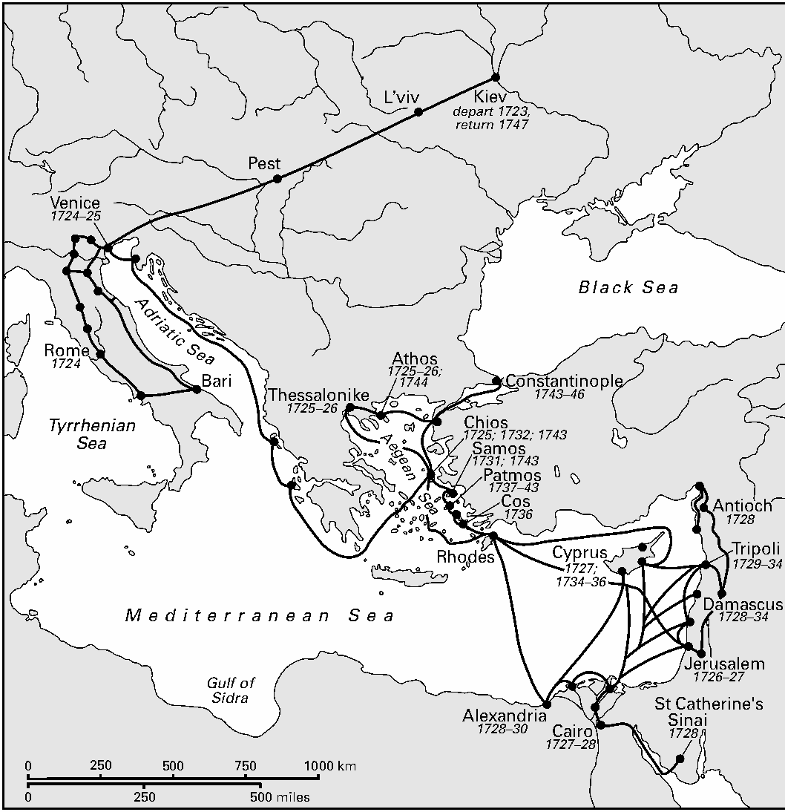

*地图3 巴尔斯基的游历。原图所示时间为1723—1747年。*

地图地名及停留年代对照如下；日期依原图。黑色实线表示游历路线，比例尺分别以千米、英里标示。

| 原图标注 | 中文对照与年代 |
| --- | --- |
| L’viv | 利沃夫 |
| Kiev | 基辅；1723年出发，1747年返回 |
| Pest | 佩斯 |
| Venice | 威尼斯；1724—1725年 |
| Rome | 罗马；1724年 |
| Bari | 巴里 |
| Thessalonike | 帖撒罗尼迦；1725—1726年 |
| Athos | 阿索斯山；1725—1726年、1744年 |
| Constantinople | 君士坦丁堡；1743—1746年 |
| Chios | 希俄斯岛；1725年、1732年、1743年 |
| Samos | 萨摩斯岛；1731年、1743年 |
| Patmos | 帕特莫斯岛；1737—1743年 |
| Cos | 科斯岛；1736年 |
| Rhodes | 罗得岛 |
| Cyprus | 塞浦路斯；1727年、1734—1736年 |
| Antioch | 安提阿；1728年 |
| Tripoli | 的黎波里（今黎巴嫩）；1729—1734年 |
| Damascus | 大马士革；1728—1734年 |
| Jerusalem | 耶路撒冷；1726—1727年 |
| St Catherine’s, Sinai | 西奈山圣凯瑟琳修道院；1728年 |
| Alexandria | 亚历山大里亚；1728—1730年 |
| Cairo | 开罗；1727—1728年 |
| Black Sea | 黑海 |
| Adriatic Sea | 亚得里亚海 |
| Tyrrhenian Sea | 第勒尼安海 |
| Aegean Sea | 爱琴海 |
| Mediterranean Sea | 地中海 |
| Gulf of Sidra | 锡德拉湾 |

不过，腿上一处巨大溃疡迫使他中断学业，未能完成八年课程。1723年7月，他前往利沃夫求医。离开基辅时，他所受教育十分初步，包括斯拉夫诸语言知识、实用拉丁语，以及基本正教神学。他在利沃夫获得自认奇迹般的治愈，发愿前往巴里圣尼古拉斯圣所，作感恩朝圣。同在利沃夫，他试图进入当地耶稣会学院时，亲历归于罗马的合一派天主教当局对正教信徒的迫害。阅读其日记，必须放在乌克兰分裂的背景中：一部分属于正教俄罗斯帝国，另一部分属于天主教<!-- PDF page 233; original page 212 -->波兰—立陶宛联邦。作者是立场鲜明的正教信徒，其朝圣同时也是自我发现与持续学习的旅程。

离开利沃夫后，巴尔斯基徒步前往巴里圣尼古拉斯圣所，继而游历那不勒斯、罗马、佛罗伦萨及威尼斯。[^p233-3] 日记第一部分，以格外丰富的自传与地志资料为特点。新鲜体验反映于对朝圣细节的关注。旅程开始时，他对波兰联邦鲁塞尼亚地区所说的语言很熟悉，精确记下经过的村庄名称及相互距离，评论周边乡村，甚至所过溪流水质清澈还是混浊。他还关注人际关系，既包括同行者，也包括途中遇见的人，例如将他们赶出桑博尔附近圣救主修道院的天主教主教。[^p233-4]

在这一早期阶段，很难确定他详记事件和见闻的确切目的。但大量偶然细节表明，多数观察直接在现场记下，而非日后凭记忆编成：每日天气变化、星期几、偶遇人物，以及精确的铭文记录。他也时而说明写作过程，回忆某次“坐着写我的旅程，一直写到傍晚”。[^p233-5]

直到1724—1725年冬在威尼斯开始学希腊语之前，巴尔斯基完全依赖斯拉夫语言和拉丁语。早期旅行中，他不断感叹不懂其他语言，尤其德语、意大利语和希腊语。因此，他常被修道院或城镇拒之门外，须找到懂拉丁语的人，通常是司祭或学生，才能向值守者传达请求。抵达新城镇或村庄，他首先寻找斯拉夫同胞，常记下当地鲁塞尼亚、俄罗斯、波兰或塞尔维亚家庭的<!-- PDF page 234; original page 213 -->数量。这些人似乎也常是他描述所访地点的主要信息来源。

日记前部出现他对不同民族的评价，一部分反映个人经历，一部分取决于对方对正教的态度。未获准进入布达或佩斯后，他在城墙外找到塞尔维亚共同体。对方最初怀有敌意，凭外表认定他是赴罗马的天主教朝圣者；得知他是正教徒，便拥抱他，邀至塞尔维亚教堂庆祝圣灵降临节，并募集一笔可观钱款助其前行。[^p234-6] 他赞美塞尔维亚人的热情好客，也同样赞美希腊人。他两度住在威尼斯圣乔治教堂的希腊共同体，先在1724年6月，后自同年10月至1725年2月底。第一次，他尚不懂希腊语，却以正教旅人身份获接纳。他注意到，虽听不懂语言，教堂礼仪与故乡相似，只是福音不从教堂中央诵读，而从左侧高处的讲道台宣读。[^p234-7]

最初两年，巴尔斯基似乎一直被新鲜体验压倒，因不懂当地语言而畏缩，且大部分时间专注寻找斯拉夫同胞，既为友谊和支持，也为物质生计。随后五年，他的眼界根本改变，日记第二部分记录了这一变化。它叙述1725年2月28日第二次离开威尼斯，至1729年末的事件；那时，他已在安提阿牧首、塞浦路斯人西尔维斯特接待下，定居的黎波里继续学习。

在威尼斯学习后，他的希腊语已相当流利；日记常穿插希腊铭文抄录、词语讨论，以及修道院藏书中各种希腊手稿的评论。他也掌握足供交谈的阿拉伯语。有一次，圣诞庆典前找不到希腊司祭听告解，他记道：“我只得用阿拉伯语告解。”[^p234-8] 至于旅程这一阶段，他的

<!-- PDF page 235; original page 214 -->

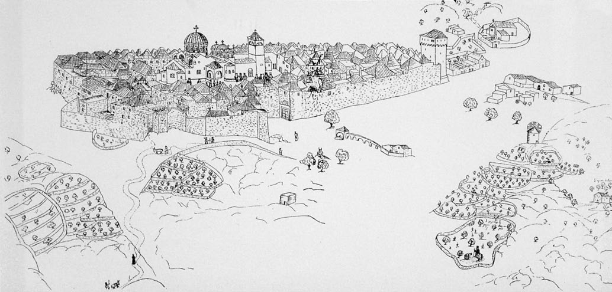

*图9.1 巴尔斯基绘，希俄斯岛新修道院，1732年。*

<!-- PDF page 236; original page 215 -->

土耳其语程度仍不清楚，但他确实常解释土耳其词，并已熟悉到足以用其咒骂准备袭击他的窃贼。在日记第一部分，他是站在城门外、等待懂拉丁语或斯拉夫语者的朝圣人；第二部分中，他已成为熟练的多语言使用者，甚至鄙视只懂一种语言的人。

贫困仍紧随巴尔斯基，但日记第二部分不再总把乞求施舍视为唯一生计。牧首、总主教与修道院长，越来越以贵客而非乞食朝圣者的礼遇接待他。希腊修士和教士更愿接纳他为自己人，将其作为可疑局外人拒绝的情形减少。旅行节奏也稍慢：他愿在某城镇停留数月，或在圣地停留数周，不再像从前那样匆匆几日、甚至数小时。

更重要的是，第二部分的形式和编排发生根本变化，尤为显著的是用墨水线描说明观察。这一习惯始于1726年9月30日抵达耶路撒冷后不久。图画与文字常密切对应。他有时说，某幅圣像正如配图所示，或约瑟井结构、某地形状，参看详细而标注周全的附图，会更易理解。[^p236-9] 在这一阶段，图画相当于解释性脚注或装饰小景。他是一位朴拙而真实的观察记录者，可能了解当时希腊游记中的建筑绘图程式，却似乎把这些惯例调整至眼前建筑，而非抄袭已有插图。他的画在技巧上缺少的专业性，由精确观察弥补；没有十八世纪西欧游记常见的巴洛克饰物和寓意拟人形象。

<!-- PDF page 237; original page 216 -->

描述的形式也逐渐改变。巴尔斯基不再沿用列举总体印象、间插城镇与圣地描述的旧方式，而转向更具分析性的方法。变化不仅在于细节增多或篇幅变长。虽然这一部分确有对希俄斯新修道院、耶路撒冷外圣萨瓦修道院及西奈圣凯瑟琳修道院格外详尽的长篇描述，材料呈现方法本身也在渐变。早期，他列出相互冲突的证据，不解释矛盾，而将其视为主更大智慧的一部分；第二部分则出现更理性的路径，尽管《圣经》权威仍至高无上。福音记载圣家逃往埃及，当开罗当地基督徒将一处小屋指认为他们住所时，他毫无困难便予接受。[^p237-10] 然而，遇到矛盾时，例如两处房屋都被称为总领天使加布里埃尔向圣母传达主旨意的那所房屋，他便采取分析态度。第一处是洛雷托圣所；1724年到访时，他接受其真实性，转述天使如何从巴勒斯坦将房屋运来的奇迹。[^p237-11] 五年后，他在拿撒勒本地遇见第二处。有趣的并非他宣布洛雷托房屋是假迹，而是其理由。他不怀疑天使若愿意便能搬房屋，却无法接受整所房屋从拿撒勒消失，当地居民竟毫无察觉、口传传统也无记录。否定洛雷托建筑真实性的最重要证据，是他所说：“洛雷托的房屋由窑烧红砖砌成，但拿撒勒过去从没有、如今也没有砖房；所有房屋都用从周围山中开采的天然白石建造，那里无论新砖、旧砖，一概找不到。”[^p237-12] 他敢于拒斥已被接受的传统，部分因为这里面对两个互相矛盾的传统，一由天主教、一由正教提出；而此例的真相显然在<!-- PDF page 238; original page 217 -->正教一边。此后的著述中，同样深入的质疑，也被用于纯粹正教传统。

日记第二部分，巴尔斯基减少依赖口头信息，更倚重文献。有一处手稿留下空白，边栏注明，提醒自己查书，补入圣徒生平简述。[^p238-13] 另一些地方，他声称亲眼目睹、也很可能确实见过的事件，叙述却改写自其他文献。他详细讨论的“圣火”便是一例；这是正教复活节在圣墓教堂举行的奇迹仪式。虽然他亲自出席1727年4月的仪式，叙述开头却显露了对更早教会斯拉夫语著述的依赖。其中提到，许多朝圣者错误地说，圣灵以鸽子形状从天带来火焰，另一些人则看见闪电般的火；这些细节最早见于十二世纪初的记载。巴尔斯基有意识地回到“游历记”（khozhdeniia）的惯例，可见于罗斯十二世纪旅行者达尼尔院长的著作。[^p238-14] 在这一点上，他追随阿尔谢尼·苏哈诺夫；后者比他早半世纪来到圣地，著述却于十八世纪二十年代流行，[^p238-15] 恰逢巴尔斯基在基辅成长求学。[^p238-16] 他在基辅和利沃夫学院都可能接触达尼尔手稿的抄本，[^p238-17] 看来是在凭记忆复述文本。

就路程与距离而言，旅程第二部分以长途航海为特点。巴尔斯基本说要在1725年初春从威尼斯返乡，却在圣马可广场偶遇司祭修士鲁维姆·古尔斯基，使计划剧变。鲁维姆在彼得大帝宫廷失宠，因恶意流言攻讦逃离圣彼得堡，决定同巴尔斯基一起朝拜希腊圣所。两人于1725年2月28日乘船出发，4月9日抵达科孚。巴尔斯基详细描述敬礼圣斯皮里东圣髑的经过。从科孚，他们航向凯法利尼亚，<!-- PDF page 239; original page 218 -->继而扎金索斯（赞特）、米科诺斯，终于1725年8月4日抵达希俄斯。这是他六访该岛的第一次，产生了对新修道院最详尽的描述。

1725年9月9日，他离开希俄斯，前往帖撒罗尼迦，再赴阿索斯，在俄国圣潘泰莱蒙修道院过冬。除让他感到宾至如归的圣潘泰莱蒙外，其他修道院得知他是从罗马来的朝圣者，似乎多少怀有敌意；他甚至须证明正教信仰，才获准领圣餐。[^p239-18] 1726年2月1日，他离开阿索斯，在帖撒罗尼迦度过七个月，完善希腊口语，并使土耳其语达到一定流利程度。

1726年9月1日，巴尔斯基乘船前往圣地，途中访问罗得与塞浦路斯。9月23日抵达雅法，加入有护卫的商旅队，步行赴耶路撒冷；但因与队伍走散，遭抢劫、殴打。他不气馁，仍劝所有斯拉夫人朝拜圣墓，因为“没有哪个国家来的朝圣者，比俄罗斯诸地还少”。[^p239-19] 第一次停留圣地，约七个月，自1726年9月至1727年4月。他广泛游历，大多住修道院，常重访圣地。关于圣地的资料，多来自口头信息，但他在圣萨瓦修道院停留四周期间，也在院内图书馆读书。除赴死海、约旦河，以及圣诞前往伯利恒外，他大部分时间住在耶路撒冷。

1727年4月17日，他乘船拟赴西奈，却被风吹偏，抵达塞浦路斯利马索尔。[^p239-20] 他认为这是上帝安排，便留岛三个月，访问、描述若干修道院。7月31日前，他设法到达开罗，准备前往西奈山圣凯瑟琳修道院，却得知阿拉伯人怀有敌意，访客无法进入。在开罗住约八个月后，他扮作水手前往西奈，先横渡苏伊士湾至图尔，再穿沙漠，终于1728年3月31日抵达紧闭的修道院门前。经过<!-- PDF page 240; original page 219 -->数小时焦虑等待，他被秘密带入院内，停留一周，访问圣地、检查藏书。对修道院的详细讨论显示其相当渊博的学识，例如分析西奈礼仪形式，并寻找与修道院礼规的相似处。[^p240-21] 着眼于故乡礼仪改革，巴尔斯基越来越关心确定最早、最真实的正教礼仪。他从西奈经苏伊士返回开罗，住进牧首宫邸。第二部分横跨五年，其确切写作顺序很难确定。内部证据表明，它以日记式条目写成，并依现有顺序编排；也可看出，他打算修订手稿，因为某些地方留白，等待查证补入。这一工作从未完成，手稿仍处于未经作者修订的状态。

日记第三、也是最后一部分，记录1730至1744年末的事件。最后三年，即1744年至1747年9月返基辅的旅程，只能从书信、图画和零散文书重建，没有存世的连贯叙述。这三年图画上的详细批注，表明他打算写成这一部分；可惜，返乡不到一个月便早逝，剥夺了完成任务的机会。他可能为此积累的实地笔记，除主要讨论君士坦丁堡的一小段之外，都已散失。存世图画主要涉及希腊大陆及克里特的教堂和修道院，对研究希腊拜占庭遗产的艺术史家而言，是十八世纪上半叶最有价值的文献之一。

最后一部分未能写成，显示工作方法已改变到何种程度。早期日记保留逐日记事的顺序，穿插日常事件，富有地方色彩和自传细节，因现场感而珍贵；第三部分的方法与呈现却大不相同，需要大量时间组织材料，以及一座藏书相当好的图书馆。仅存的君士坦丁堡片段，至少使用八种二手来源，便足以说明问题。在这一最后部分，具体日期很少出现，<!-- PDF page 241; original page 220 -->旅途情形大多退居次要。巴尔斯基先将材料汇为经过研究的实地笔记，包含大量铭文、手稿与文书抄录、建筑尺寸，以及与古迹相关的口传传统。相隔颇久后，再依理性结构重组材料，校核，并以其他文献补充。

这一时期工作方法的最好例证，是对阿索斯材料的处理。他于1744年5月12日第二次抵达，似乎住到11月。逐院搜集材料时，遵循系统模式，偶因修士不好客而中断。例如，在库特卢穆修，他未获足够时间敬礼圣髑、丈量教堂、研究创建者历史、调查藏书、金玺诏书及其他文书，并绘制修道院。[^p241-22] 事实上，这份清单只是其最低要求。他对二十座主要修道院的各篇记述，近乎一部关于院内实体、行政和社会经济结构的百科全书式调查，兼有详细的灵性珍宝目录。读者可了解建筑结构与环境，且至少有一幅仔细标注的图画相佐。[^p241-23] 多数情况下，他详细调查院史，分析园圃、牲畜、蜂箱、葡萄园，以及附属半隐修院（sketes）和独修院舍（kellia）等财产；还记录行政等级、修士人数与族源、礼拜和教会程序的细节。主教堂描述尤详，通常附尺寸；大拉夫拉、全能者、迪奥尼修和圣保罗诸院，还配完整平面图。他也描写教堂装饰，抄录铭文，记录重要圣像、壁画和马赛克的位置，并转述相关传说；又长篇列举宝库内容，包括圣髑——有时质疑其真实性——[^p241-24] 金玺诏书和特许状。

<!-- PDF page 242; original page 221 -->

对于金玺诏书，他通常登记希腊语、斯拉夫语及拉丁语标题；但若认为某篇文本对建院、捐产或获得重要圣髑意义重大，便以原文全部抄录，附教会斯拉夫语译文。[^p242-25] 对藏书的处理不尽相同，既反映他对重要性的判断，也取决于获准接触的程度。有时，他只估计书籍与手稿数量，通常注明羊皮卷数目，并列举抄本中的作者姓名；有时，则讨论特定手稿、争议归属，抄录题跋。除主教堂及珍宝之外，他还常列举院内外小堂，有时描述装饰、显灵圣像，以及重要半隐修院的历史，通常以若干院中传说结束。

直到1745或1746年回到君士坦丁堡，能够使用俄国常驻使节阿列克谢·安德烈耶维奇·维什尼亚科夫及其继任者涅普柳耶夫的藏书时，巴尔斯基才真正编纂阿索斯材料。[^p242-26] 各条内部及相互之间，都经过系统安排。修道院依地理位置逐一讨论，先半岛东侧，后西侧。大拉夫拉被选作核心条目，篇幅极大，约占整个阿索斯卷的四分之一。[^p242-27] 其中约三分之一，是详细的礼仪研究，以及教会程序和修道仪式记述。后续许多条目回指大拉夫拉，说明建筑、经营管理、修道行政和礼仪在何种程度上遵循或偏离其模式。巴尔斯基有时提及在君士坦丁堡能够接触、并<!-- PDF page 243; original page 222 -->用来核查实地笔记事实的新近出版物。[^p243-28] 他也提到1746年发生于君士坦丁堡、与所述修道院有关的事件。[^p243-29] 日记早期，他反复强调向读者提供刚发生事件的新鲜目击记述；第三部分的重点，则是提供经过深思与充分研究、足以启益故乡人们的判断。

随着他越来越以文书与考古证据为主要材料，早期对口头事实信息的依赖几乎消失。阿索斯部分的许多院史材料，直接来自他阅读、翻译的金玺诏书。有时，他试图将存世建筑、圣像、圣髑，与文献所载相联系，借考古证据检验文献的准确和可靠。这一方法在克塞罗波塔穆记述中尤为明显：他将现存圣髑、圣像、建筑，与铭文及金玺诏书资料相互对照。[^p243-30] 从大拉夫拉院长以赛亚，以及伊维龙圣器保管官贝萨里翁的书信看，巴尔斯基在圣山享有极高学术声望，被称为比任何其他旅人都更博学。[^p243-31]

日记最后部分，图画越来越重要，主要作用不再是辅助、装饰文字，而是支持证据。他不断提醒读者看图，说明精确作画角度，以及记录古迹的时刻。这不是说早期图画通常出于幻想，而是其技术精确度和观察力随时间提高。将十八世纪三十年代初最大、最精美的一幅——1732年希俄斯新修道院（图9.1）[^p243-32]——同十二年后任何一幅阿索斯图画比较，

<!-- PDF page 244; original page 223 -->

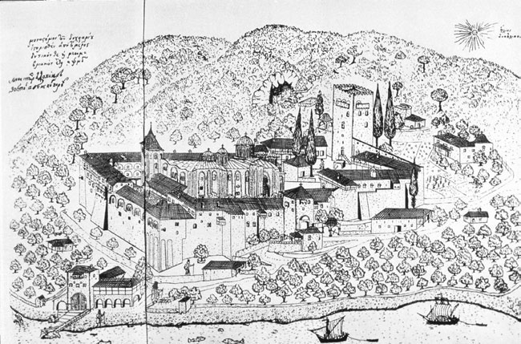

*图9.2 巴尔斯基绘，从西南方观看多希亚里乌修道院，1744年。*

例如1744年多希亚里乌图（图9.2），[^p244-33] 这一发展便清晰可见。前者精美，却未注明日期，也几乎没有批注；仅有的文字标明当地一位俄国修士的园地和圣安东尼小堂，而且只有结合附文的一般描述，才能理解。虽然本书成书时的学者可能将其视为重建修道院1881年地震毁坏穹顶之前面貌的“无价资料”，[^p244-34] 他们指出某些不准确处，也有道理。[^p244-35] 多希亚里乌图的铭文则说明，它作于1744年、从西南方观看；另一铭文标出升起的太阳，以说明精确视角，正文还说描绘的是正午所见面貌。[^p244-36] 现代学者赞赏其对主教堂、院墙、小堂、塔楼、海岸线与整体地形的精确观察；将图画与古迹比较，无论按本书成书时的遗存，还是按<!-- PDF page 245; original page 224 -->早期照片，其准确性都很明显。[^p245-37] 频繁火灾、地震与蓄意破坏，使阿索斯、塞浦路斯和希腊的古迹毁灭或彻底改观，因此，他的图画成为记录已消失古迹的独特、无价材料。

巴尔斯基以自学成才的艺术家身份为荣，日记一段明确说到这一点。[^p245-38] 现代人看来，其笔墨技术简单，“如此不受外界影响、真挚而纯净，能够立即表达艺术家的视觉，以及他对对象的心理感受”，[^p245-39] 却不妨碍他采取学者而非业余爱好者的态度。1730年，他在亚历山大里亚抄绘一座称为“克娄巴特拉之针”的方尖碑，显示了完成任务时的精确。他测量宽度、估计高度，找不到人解释象形文字意义，便开始临摹方尖碑一面；依他所说，“令旁观者惊叹”。[^p245-40] 这幅画，是十八世纪最早的一批准确象形文字摹录之一。[^p245-41]

继续受教育，也许最能解释日记最后部分的变化。在安提阿牧首、塞浦路斯人西尔维斯特支持下，1729至1734年，巴尔斯基从学杰出学者、司祭修士雅各。[^p245-42] 1737至1743年，他又住在帕特莫斯，至少部分时间在当地学校学习；先随早年访问时便曾相处的马卡里奥斯，[^p245-43] 后随继任者格拉西莫斯。不过，多数时间，他独立研习、教授当地儿童，并编写供希腊语使用者学习拉丁语的教材。[^p245-44] 他似乎十分看重<!-- PDF page 246; original page 225 -->帕特莫斯的马卡里奥斯在1737年1月临终时给予的劝告：放弃旅行，专注希腊语研究，以益自己与故乡。[^p246-45] 因此，他尚在帕特莫斯时，便询问返基辅教授希腊语的可能性。正如下文将述，多年之后，基辅学院终于作出积极答复。

希腊学校对他的确切影响难以确定，但日记中的方法和思路，明显发生若干重要变化。他对来源的评估，具有越来越强的批判意识。虽然《圣经》权威仍至高无上，其他文献与口传来源的可靠性，都须严格检验。金玺诏书必须先确认真伪，内容才可接受；口头传统须同文字来源核验，才可认作有效。某事被正教传统视为真实，本身不足以构成证明。这种批判态度，不仅体现于对古物和民族志细节的新兴趣，也具体体现于第三访塞浦路斯后，对基科斯圣像及总领天使修道院挪亚石的讨论。[^p246-46] 好奇、体验异地风俗的愿望，从日记开头就存在；但最初，新经验仍被纳入较紧密的宗教训诲解释框架。到第三部分，他对非基督教建筑和古迹的察看、绘图与研究，已像此前对纯粹基督教古迹一样细心精确。例如，1731年访问萨摩斯，他虽谴责赫拉为异教女神，却仍仔细描述其圣所，提供尺寸，赞美其美丽。[^p246-47] 对异族外貌、衣饰和风俗，也有类似兴趣。早期，他大体因宗教而谴责某些族群，斥为邪恶，不值得评论；后来，却留下大量细致观察，涉及民间服饰、头饰、首饰及当地习俗。他长篇描述锡米岛服饰，[^p246-48] 科斯岛陶器，[^p246-49]<!-- PDF page 247; original page 226 -->以及村广场上喝咖啡、吸烟的生活方式，希腊人与土耳其人和谐相处的情景。[^p247-50]

巴尔斯基采用的文本模式发生变化，反映了希腊教育影响。如果最初部分受斯拉夫“游历记”传统影响，最后部分则更多得益于希腊朝圣指南（proskynetaria）。约翰·科穆宁所写十八世纪朝圣指南，是他描述阿索斯时最重要的二手文献。[^p247-51] 他查阅了1701、1745两个版本。[^p247-52] 在某种意义上，他的叙述为科穆宁的阿索斯敬拜图文指南，提供了改进、扩充和校正版。

日记重点逐渐从指南、日记、自传，转向旨在捍卫真理、揭露虚假、造福故乡的学术与论战著作。文本不断攻击土耳其压迫者和教皇主义，也充满关于甘为神圣正教会殉道者的虔诚训诲。他同西尔维斯特牧首友谊的叙述，其贯穿线索，是持续保护正教会独立、抵御罗马天主教侵蚀的斗争。[^p247-53] 同样，极长的阿索斯部分，以攻击米海尔八世·巴列奥略与牧首约翰十一世·贝科斯的背叛政策为高潮。他们于1276年迫害反合一修士，[^p247-54] 与故乡乌克兰正教信众受罗马天主教合一派攻击的经历遥相呼应。另一方面，他精确记录希腊正教礼仪程序、教堂陈设及组织，贡献于乌克兰与俄国正教传统的净化与保存。日记越来越成为一部指南，介绍仍存于圣地、希腊诸地与圣山的古老正教传统；“古老”的言外之意，也是“纯正”。

<!-- PDF page 248; original page 227 -->

就实际旅行和距离而言，1730至1744年的第三部分最少冒险。大部分时间，他居住、学习或任教于三个中心之一，再以付费乘客身份前往特定目的地，持介绍信，也有必要资金。这三个中心，是西尔维斯特在的黎波里和大马士革的牧首宫廷、帕特莫斯圣约翰修道院，以及君士坦丁堡俄国使节驻所。他出行时，更像贵宾，而非乞食朝圣者。1743年9月，他航往以弗所，再赴希俄斯，新修道院修士邀其访问、考察。他使他们难堪，斥其虚伪：自己贫困时受轻视，如今成了知名学者，却来讨好。他最终到访，立即谴责修士不爱护藏书，形容他们没有学习或求明的意愿。[^p248-55] 然而，新的富足处境，并未磨去他对正教徒受迫害的感受。这在1735年一次相会的描述中，表现得尤其生动：牧首西尔维斯特与旧师雅各被迫避难塞浦路斯，他写道：

> 恰巧在11月，我的灵性父亲与恩人、安提阿牧首西尔维斯特，同我的第一位老师雅各，离开驻所，来到塞浦路斯。他们正受到憎恨基督的教皇派迫害；这些人与我们信仰不同，想把所有正教阿拉伯人都转入他们的异端。[^p248-56]

巴尔斯基看到教皇派与穆斯林之间的相似：后者向塞浦路斯所有非穆斯林征收哈拉吉税，找到迫害基督徒的方式。“我在这里写下这些时，眼泪不断涌出；我记得亲眼看见许多穷人，再也忍受不了税收和土耳其压迫，否认了对基督的信仰。”[^p248-57] 他本人也难缴这项税，因而认同受压迫的正教共同体。

他离开君士坦丁堡的情形仍不清楚。1745年7月29日，朋友兼恩人、俄国常驻使节维什尼亚科夫去世，他似乎与继任者阿德里安·伊万诺维奇<!-- PDF page 249; original page 228 -->·涅普柳耶夫争吵。从他同西尔维斯特的书信看，[^p249-58] 双方曾言辞激烈，可能因为涅普柳耶夫代表俄罗斯帝国同罗马教会秘密谈判；他被威胁逮捕，并立即由海路遣送圣彼得堡。他于是逃离君士坦丁堡，1746年10月抵达布加勒斯特，踏上返基辅之路。从那里写给母亲的信，抱怨“未能实现留在君士坦丁堡完成工作的意愿”。[^p249-59] 他有两个目标：完成君士坦丁堡部分的手稿，如今只留下笔记；还须整理出版，期望既作为朝圣记，也作为古老正教敬拜传统指南，服务故乡的教会改革。他始终未能完成。

在布加勒斯特，基辅波多尔学校教务长瓦尔拉姆·拉谢夫斯基来函，邀请他担任基辅学院希腊语教师。[^p249-60] 他因病滞留至1747年7月，才启程基辅，于9月5日抵达，结束24年游历。返乡不久，他致信西尔维斯特：“非死非生，我精疲力竭地躺着，仿佛一具可怜尸体。”[^p249-61] 返基辅约一个月后，即1747年10月7日，巴尔斯基去世，以隆重礼仪安葬于基辅兄弟会修道院主教堂祭台附近。[^p249-62]

## 注释

[^p231-1]: 参见 T. G. Stavrou and P. R. Weisensel, Russian travelers to the Christian East from the twelfth to the twentieth century (Columbus, OH: Slavica, 1986), 70–3.

[^p231-2]: 这部无题旅行日记，通常称《瓦西里·赫里霍罗维奇—巴尔斯基东方圣地游记》，以作者亲笔手稿形式留存，500余叶、约24万词，附数十幅极其精确的考古绘图，主要表现教堂和修道院。原稿藏于基辅科学院档案馆，Kiev v, No. 1062。最准确的已刊版本是 N. Barsukov, Stranstvovaniia Vasil’ia Grigorovicha-Barskago po sviatym mestam vostoka s 1723 po 1747 g., 4 vols. (St Petersburg: Pravoslavnoe palestinskoe obshchestvo, 1885–87)。下文均引手稿，而非印本。

[^p233-3]: A. Grishin, ‘Vasyl’ Hryhorovyc Bars’kyj: an eighteenth-century Ukrainian pilgrim in Italy’, Harvard Ukrainian Studies 17 (1993), 7–26.

[^p233-4]: Bars’kyj Ms., fol. 7v.

[^p233-5]: Bars’kyj Ms., fol. 12v.

[^p234-6]: Bars’kyj Ms., fols. 13v.–14v.

[^p234-7]: Bars’kyj Ms., fol. 26r.

[^p234-8]: Bars’kyj Ms., fol. 236r.

[^p236-9]: 巴尔斯基文本中多处提到自己的图画，包括塞浦路斯基科斯修道院显灵圣像、约瑟井及拿撒勒整体面貌。参见 Bars’kyj Ms., fols. 180r, 190r, 237r。

[^p237-10]: Bars’kyj Ms., fol. 191r.

[^p237-11]: Bars’kyj Ms., fols. 32r–34r.

[^p237-12]: Bars’kyj Ms., fol. 293r.

[^p238-13]: Bars’kyj Ms., fols. 131r–132v.

[^p238-14]: 参见 A. Grishin, ‘Vasylijy Bars’kyj and the xozhenija tradition’, Australian Slavonic and East European Studies Journal 11 (1988), 29–42.

[^p238-15]: N. I. Ivanovskii, ‘Proskinitarii Arseniia Sukhanova’, Pravoslavnii Palestinskii Sbornik 7 (St Petersburg, 1889), pt 3.

[^p238-16]: 关于巴尔斯基的圣火记述，参见 Bars’kyj Ms., fols. 173r–176v.

[^p238-17]: 基辅抄本为十六世纪末或十七世纪抄写，藏基辅学院图书馆，目录号157；利沃夫抄本年代为1701年，目录号132(105)。

[^p239-18]: Bars’kyj Ms., fol. 116r.

[^p239-19]: Bars’kyj Ms., fol. 139v.

[^p239-20]: 巴尔斯基塞浦路斯记述的译本，参见 A Pilgrim’s Account of Cyprus: Bars’kyj’s Travels in Cyprus, ed. A. D. Grishin [Sources for the History of Cyprus 3] (Altamont, NY: Greece and Cyprus Research Center, 1996).

[^p240-21]: Bars’kyj Ms., fols. 194r–205v.

[^p241-22]: Bars’kyj Ms., fol. 387v.

[^p241-23]: 阿索斯图画中，现存23幅独立整页插图，以及9幅插入手稿正文的图画。若干与瓦托佩迪、希兰达尔和普罗塔顿有关的大幅图画，已经散失。

[^p241-24]: 例如，迪奥尼修修道院向他出示一条细金属链，据称是曾捆绑圣彼得的锁链。巴尔斯基冷静评论，这不像他在罗马见过的同一时期其他锁链，因此怀疑真实性。见 Bars’kyj Ms., fol. 471v。

[^p242-25]: 例如，克塞罗波塔穆条目，详细抄录该院所藏金玺诏书的希腊文本。见 Bars’kyj Ms., fols. 449v–463r。

[^p242-26]: A. A. 维什尼亚科夫于1729年抵达君士坦丁堡，1734年末取代 I. I. 涅普柳耶夫任俄国常驻使节，任职至1745年；继任者 A. I. 涅普柳耶夫是其前任之子。巴尔斯基返君士坦丁堡的确切日期不明，书信证明1746年他已在那里，也很可能1745年就已抵达。参见其1746年10月31日信，Barsukov, Stranstvovaniia, iv, 67–8。

[^p242-27]: 大拉夫拉条目超过63叶；相比之下，1725年访阿索斯时对该院的描述，仅一叶半。参见 Bars’kyj Ms., fols. 332v.–395v.；比较 fols. 110v.–111r。

[^p243-28]: 例如，他曾查阅1745年威尼斯出版的一部朝圣指南，核查希兰达尔修士对某件圣髑的主张。参见 Bars’kyj Ms., fol. 400r。

[^p243-29]: Bars’kyj Ms., fol. 426v.

[^p243-30]: Bars’kyj Ms., fols. 444r.–463r.

[^p243-31]: Barsukov, Stranstvovaniia, iv, 64–7.

[^p243-32]: 同上, ii, 204: plate 26. 关于此画及相关文献的讨论，参见 C. Bouras, Nea Moni on Chios: history and architecture (Athens: Commercial Bank of Greece, 1982), 50, esp. fn. 4.

[^p244-33]: Barsukov, Stranstvovaniia, iii, 274: plate 21.

[^p244-34]: Bouras, Nea Moni, 50.

[^p244-35]: 同上, 107.

[^p244-36]: Bars’kyj Ms., fol. 432r.

[^p245-37]: 彼得·伯里奇谈及巴尔斯基的多希亚里乌图时写道：“图中每一项主要要素，今天都能辨认。”P. J. Burridge, ‘The development of monastic architecture on Mount Athos with special reference to the monasteries of Pantocrator and Chilandari’, 博士论文，英国约克大学，1976, 253。

[^p245-38]: Bars’kyj Ms., fol. 292r.

[^p245-39]: P. M. Mylonas, Athos and its monastic institutions through old engravings and other works of art (Athens: National Academy of Fine Arts, 1963), 21.

[^p245-40]: Barsukov, Stranstvovaniia, ii, 163; 复制图见图版18；其工作过程的描述见 Bars’kyj Ms., fol. 245r.

[^p245-41]: 参见 E. Iversen, Obelisks in exile (Copenhagen: G. E. C. Gad Publishers, 1972), ii, 90–147. 谨感谢伦敦大英博物馆埃及文物部 C. Andrews 女士，就巴尔斯基的象形文字摹录提供意见。

[^p245-42]: 关于司祭修士雅各，参见 Bars’kyj Ms., fols. 240v.–241v., 247r., 264v.

[^p245-43]: 关于帕特莫斯的马卡里奥斯，参见 Bars’kyj Ms., fols. 256v., 316v.–320v.

[^p245-44]: 巴尔斯基的拉丁语语法书似未存世。他对该书的讨论，参见 Bars’kyj Ms., fol. 320v.

[^p246-45]: Bars’kyj Ms., fol. 318r.

[^p246-46]: Bars’kyj Ms., fols. 285r., 285v., 295r., 295v.

[^p246-47]: Bars’kyj Ms., fol. 258r.

[^p246-48]: Bars’kyj Ms., fol. 248r.

[^p246-49]: Bars’kyj Ms., fol. 251v.

[^p247-50]: Bars’kyj Ms., fol. 249v.

[^p247-51]: Ioannis Komnenos, Προσκυνητάριον τοῦ Ἁγιοῦ Ὄρους τοῦ Ἄθωνος (Venice: N. Glykys, 1745). 关于这一传统若干惯例的讨论，参见 K.-D. Seemann, Die altrussische Wallfahrtsliteratur. Theorie und Geschichte eines literarischen Genres (Munich: W. Fink, 1976); G. D. Lenhoff Vroon, ‘The making of the medieval Russian journey’, 博士论文，密歇根大学，1978.

[^p247-52]: 巴尔斯基说，他在君士坦丁堡查阅这部朝圣指南的1745年威尼斯版，以核查某一条目相较1701年旧版是否改动。见 Bars’kyj Ms., fol. 400r。

[^p247-53]: Bars’kyj Ms., fol. 407r.

[^p247-54]: Bars’kyj Ms., fols. 487r.–488v.

[^p248-55]: Bars’kyj Ms., fol. 325v.

[^p248-56]: Bars’kyj Ms., fol. 307r., fol. 307v.

[^p248-57]: Bars’kyj Ms., fol. 306v.

[^p249-58]: Barsukov, Stranstvovaniia, iv, 69–74.

[^p249-59]: 同上, iv, 68.

[^p249-60]: 同上, iv, 72.

[^p249-61]: 同上, iv, 72.

[^p249-62]: 巴尔斯基手稿最初由 V. G. Ruban 以大幅删节、错讹甚多的版本出版，题为 Peshekhnodtsa Vasiliia Grigorovicha Barskago... (St Petersburg: Imperatorskaja akademiia nauk, 1778)，后来又有1785、1793、1800和1819年各版。

---

<!-- PDF page 250; original page 229 -->

# 第10章 法国大革命的遗产：正教与民族主义

帕斯哈利斯·M. 基特罗米利迪斯

在格里高利五世第一次与第三次担任牧首期间（1797—1799年、1818—1821年），正教会激烈抵制西方思想对正教社会的影响。这使许多观察者产生一种错误印象，以为正教会与启蒙运动始终明确对立。于是，教会在制定教务、牧灵与教育策略时，长久以来容纳启蒙思想的传统，便被遮蔽了。事实上，正教会对1790年代末法国大革命和1820年代希腊革命的反应，所显示的是正教与民族主义之间的冲突。启蒙运动使教会面对一种世俗的普遍主义思想；撇开教义问题不谈，这种思想在某些情形下能够补充、甚至支持教会自身的普世价值。民族主义引发的冲突则不同：问题既涉及世俗价值与超越性价值的对立，也使基督教理想的普世性与民族主义的狭隘性相互对抗。这场冲突的历史，最终也就是正教会在19世纪的历史。

## 巴尔干民族主义

19世纪初，当巴尔干各民族揭竿而起、反抗奥斯曼统治时，民族主义对于正教便从理论问题变成现实问题。巴尔干长期持续的起义——先是1804年开始、断断续续进行至1830年的塞尔维亚起义，继而是1821—1832年的希腊起义——成为当地正教宗教共同体转变为现代民族的熔炉。这种转变也使地方教会共同体发生根本改造：它们原本是普世正教的分支，如今成为新兴民族的组成部分。巴尔干民族主义兴起所带来的长期教会后果，在塞尔维亚人的情形中尚未立刻显露，在<!-- PDF page 251; original page 230 -->希腊人的情形中却已经十分明显。1821年希腊革命对教会处境与教规秩序产生了重大影响。君士坦丁堡牧首格里高利五世否认并谴责这场革命，但这一后来备受争议的举动，并未能挽救他的性命。他于1821年4月10日复活节主日，以叛国罪被处死，吊死在牧首座的中央大门前；那扇门从此一直关闭。走上殉道之路的并非只有牧首。许多高级教士也在伊斯坦布尔被处决，其中有以弗所的狄奥尼修斯、尼科米底亚的阿塔纳西奥斯、德尔科伊的格里高利和安基阿洛斯的欧根尼奥斯；在埃迪尔内（阿德里安堡），前牧首基里尔六世也遭绞刑。塞浦路斯当地自主教会的首领基普里亚诺斯总主教、其他高级教士及许多显要平信徒，于1821年7月9日被集体处决。克里特岛遭遇类似灾难：当地教会首领格拉西莫斯都主教、七位主教和许多修道院院长被处死。塞萨洛尼基和拉里萨也有主教遇害。1821年3月，奥斯曼总督把伯罗奔尼撒的八位高级教士囚禁于特里波利斯；同年9月23日希腊人攻陷该城以前，其中五人已死于狱中。换句话说，希腊革命造就了大批新的信仰殉道者。这些人最终被民族主义的英雄殿堂吸纳为“民族殉难者”，从而推动正教自身思想与价值观的转变。

起义对教会造成的真正影响，后来证明也是持久影响，体现于教规层面的后果：君士坦丁堡教会中枢对起义诸省的主教与神职人员所行使的行政控制松动了。革命局势使下层神职人员获得更大力量，因为他们与各自共同体的生活紧密相连。一旦共同体起而反抗，无论君士坦丁堡颁布何种教规命令，当地司祭事实上都会成为起义领袖之一。司祭或执事亲自拿起武器、参加战斗的事例很多，有些人在革命军事领导层中崭露头角，以英勇著称，最终跻身希腊解放事业的殉难英雄之列。英雄执事阿塔纳西奥斯（1821年殉难），以及1825年阵亡、性情激烈的修道院大司祭格里高利奥斯·迪凯奥斯·帕帕弗莱萨斯，便是其中富有传奇色彩的例子。

主教团的处境更复杂，也更微妙。那些在土耳其人的暴怒中幸存的主教，以这样或那样的方式，在革命力量控制的地区支持<!-- PDF page 252; original page 231 -->革命。有些人成为革命文职领导层中的重要人物，在1822年埃皮达夫罗斯、1823年阿斯特罗斯和1827年特罗伊曾召开的国民会议中发挥重要作用。卷入革命熔炉的正教会高级与下级神职人员，以不同方式与正在形成的民族共同体站到一起。神职人员因此越过了民族主义的卢比孔河，离开正教基督教的普世教导；但他们可以提醒自己，自由与自由意志同样属于《福音书》教导的价值，以此安慰良心：“认识真理，真理必叫你们得以自由。”

尽管发生这些影响深远的变化，革命时期希腊的主教团从未质疑自己在教规上从属于普世牧首区。在希腊革命斗争的整个时期，积极参与革命政治的高级教士及其他神职人员，一贯坚持尊重信仰、维护正教教规，并保存民众的基督教道德。其中三位主教——安德鲁萨的约瑟夫、塔兰蒂翁的尼奥菲托斯和弗雷斯塞纳的狄奥多雷托斯——尤其积极参与革命会议的政治活动；约瑟夫还在1822—1825年担任宗教事务部长。各次会议特别重视宗教与教会秩序问题。每次会议表决通过的宪章，都在第一条承认正教基督教为新生自由希腊国家的“占主导地位的宗教”（ἐπικρατοῦσα θρησκεία），同时也在同一条规定，国家容许其他一切宗教及敬拜形式存在，并自由举行其宗教活动。值得注意的是，1827年在特罗伊曾拟定的《希腊政治宪法》第一条调换了次序：先宣布宗教信仰与敬拜自由的原则，再补充说，“基督东方正教会”的宗教是“国家的宗教”。

不过，革命时期希腊的宪制秩序没有超出这些规定。解放地区正教会的具体教会地位，在革命时期的希腊既未被提出，也未受到讨论。尽管与君士坦丁堡牧首座的行政联系已经中断，牧首的属灵权威却未遭质疑。希腊主教团在宗教礼仪中继续依教规纪念牧首之名。为表示尊重牧首的教规权利，在教会事务恢复正常之前，既不祝圣主教，甚至也不为下层<!-- PDF page 253; original page 232 -->神职人员举行授圣职礼。[^p253-1] 整个革命时期（1821—1827年），以及随后约安尼斯·卡波季斯特里亚斯短暂执政的时期，教会事务中可以辨认出两种总体趋势。一种反映了这一时期继续在希腊活动的正教主教团的态度：他们始终如一地坚持，教务的安排必须完全以教会教规为依据。1827年3月，应第三届国民会议主席的邀请，一个由五位主教组成的委员会起草了一份引人注目的文件，提出二十四项建议，以恢复希腊的教会秩序。其中，第一项和最后一项尤其突出。他们首先建议国民会议设立主教会议，负责在整体政治局势恢复正常以前管理希腊教会。五位主教强调，这只是临时的过渡措施。最后，他们明确申述自己对教会秩序的长期看法：无论如何，希腊教会及神职人员都不能设想，以任何形式脱离他们唯一知晓并承认的教规权威——君士坦丁堡的基督大教会。[^p253-2]

如果说上述态度代表教会整体的主流，那么这一时期的另一种总体趋势，则是各次国民会议及其设立的民政当局不断作出决定、采取措施，并表示关切，希望妥善安排教会事务。这一切意味着教会地位的根本变化：许多世纪以来，教会第一次发现自己受到民政权力的尊重、关心与爱护。大量措施和规章旨在帮助教会履行其应有的社会使命，其中包括经济援助与支持；它们却逐渐地、不知不觉而又不可逆转地把教会置于民政权力的庇护之下，使其成为国家的工具。这一切完全出于善意，实施者也真心相信，这些措施会为重生的希腊创造条件，使基督教精神和价值观繁荣起来。事实上，这一过程使正教会从教规良知的承载者——主教团在1820年代已清楚表达这种良知——转变为民族主义机构，最终将以对民族及民族主义价值的新<!-- PDF page 254; original page 233 -->信仰，取代其继承而来的基督信仰。不过，这说的是后来的发展。正教会内在的根本转变，是一个漫长而曲折的过程；在19与20世纪，它使东南欧的正教徒遭遇种种良心危机。

## 希腊教会问题的安排

希腊第一位国家元首约安尼斯·卡波季斯特里亚斯是一位虔诚的正教徒，十分关切这个刚从独立战争中诞生的国家能否恢复宗教秩序与基督教道德，其政府的有关举措也反映出这一点。他主要关切的问题之一，是维系新希腊国家境内的正教会与普世牧首区之间的行政联系。卡波季斯特里亚斯深信，如果切断这种联系，希腊正教这两个分支在教义上的共融也可能受到破坏。然而，1828年5月，牧首阿加桑格洛斯派遣牧首会议四位资深高级教士赴希腊，带去致“伯罗奔尼撒与爱琴海诸岛的神职人员和显要人士”的信件，要求他们重新归顺奥斯曼最高政府。这并不有助于总统实现善意的愿望。[^p254-3] 卡波季斯特里亚斯回了一封措辞尊敬、态度完全和解的信，拒绝牧首的劝告，指出希腊人民绝不可能放弃以如此巨大牺牲赢得的自由。与阿加桑格洛斯不同，他的继任者康斯坦提奥斯一世于1830年8月向希腊国家致以祝愿与祝福，但也对加尔文主义渗入希腊正教徒之中的消息表示忧虑。卡波季斯特里亚斯向牧首保证，希腊忠于正教及大教会。这又让康斯坦提奥斯有机会坚持要求：必须全面恢复希腊国家领土内教会与君士坦丁堡大教会之间的行政统一。[^p254-4]

事情便停留在这里。卡波季斯特里亚斯于1831年9月遇刺，不仅是希腊国家的重大悲剧，也是希腊教会与君士坦丁堡教会未来关系的一场悲剧。他处理教会问题的方式，大概是能够保证<!-- PDF page 255; original page 234 -->希腊与君士坦丁堡顺利解决教会问题的唯一途径。然而，当正教当局为现代政治与民族主义带来的挑战而苦恼时，希腊启蒙运动最重要的政治理论家阿达曼蒂奥斯·科拉伊斯，已经对这些困境和疑问作出明确回答。他的回答见于自己所编亚里士多德《政治学》的导言，该书出版于1821年，正是希腊独立战争开始的第一年。科拉伊斯借这部书，向身处战火中的同胞讲授自由公民的责任。他是第一位就教会问题提出明确民族主义立场的作者：

> 希腊目前已经解放的地区之神职人员……不再有义务承认君士坦丁堡牧首为自己的教会首领。只要君士坦丁堡仍因无法无天的暴君在此设治而受到玷污，他们就应当由神职人员和平信徒自由选举的教士会议治理，正如古代教会的做法，也如今日我们同信仰的俄国人之教会在某种程度上的做法。自由而自主的希腊人的神职人员，竟要服从一个由暴君选出、又被迫向暴君致敬的牧首之命令，这实在极不合宜。[^p255-5]

这段话十分引人注目。在科拉伊斯为希腊未来设想的自由而有序的共和国中，教会应处于何种地位？他为此提出八项条文，这段话构成第一条。他安排教会事务的建议，忠实反映了启蒙思想的蓝图：教会在自由与法治的政治秩序下，理当具有怎样的形态。然而，这样做也使教会服从于世俗秩序的要求及其优先事项。尽管他真诚相信并希望，教会能够恢复福音的纯洁，践行并教导真正的基督教价值，他实际上却使教会听命于民族主义；而民族主义，正是与现代国家相伴而生的新政治文化的主要内容。

1820年代，希腊的世俗与教会领袖都未听从科拉伊斯的劝告。颇为矛盾的是，后来把这些主张部分付诸实践、而且未必怀有相同目的的，并不是像他这样的自由主义共和思想家与政治家，而是在希腊首位国王奥托的摄政统治下，接管希腊王国行政事务的官僚。摄政政府最早采取的行动之一，也是<!-- PDF page 256; original page 235 -->体现新国家建国方略的一项鲜明举措，就是单方面宣布希腊正教会自主。这是一个政治计划的组成部分，旨在确认新王国的民族独立与国家主权。主权又与欧洲复辟时期正统主义模式下的专制统治相联。这就要求推行行政集权政策：不仅要打破地方寡头和各派利益集团的权力，使革命军队的首领服从军事纪律，还必须控制教会。摄政政府以1833年8月4日的一项法令，强行实施教会安排，宣布希腊正教会独立于君士坦丁堡母教会。新自主教会的首领，将由新王国信奉罗马天主教的君主担任；教会治理则交给王室任命的教士官员。这是极端的凯撒教皇主义，与正教会传统及神圣教规格格不入。[^p256-6] 这种强加给希腊教会的制度，出于政治考量，旨在同时加强民族独立与王室专制。但为实现这些目标，教会却被置于一种受新教启发、主张教会服从国家的埃拉斯都主义体制之下，也就是把德意志新教各邦及斯堪的纳维亚诸王国的政教关系模式，移植到希腊。

这一教会安排遭到广泛抵制。后来，政府又颁布法令，废除希腊大多数男修道院及几乎所有女修道院，使这套安排更加完整。1833年7月27日，居住在王国境内的约五十二位正教主教，在巨大压力下才同意拟议中的安排；他们仅坚持，所有有关法令都应明确加入尊重神圣教规的规定。然而，修士及社会各界仍加以抵制，乡村尤其如此，那里的人们确实担心信仰会受到败坏。在神学论辩层面，康斯坦丁·伊科诺莫斯领导了对单方面自主的反对。这位卓越的知识界领袖，深深忠于君士坦丁堡牧首座所代表的教规秩序。[^p256-7] 最著名的教会自主论神学支持者，则是曾在<!-- PDF page 257; original page 236 -->哥廷根受训、追随科拉伊斯观点的神学家狄奥克利托斯·法尔马基迪斯。他将在实施这套教会安排的过程中发挥关键作用。[^p257-8]

历任普世牧首均拒绝这一安排，认为它违反教规，并与被视为陷于分裂的希腊教会断绝共融。牧首座所反对的，主要是宣布自主时所采用的程序，而非自主本身：按照教会的教规与传统，希腊作为主权独立国家，有权拥有自主教会。不过，要找到使希腊教会获得自主地位的适当程序，花费了很长时间。1831年，牧首康斯坦提奥斯一世与米洛什·奥布雷诺维奇亲王或许没有遇到严重困难，便能就塞尔维亚公国建立自治教会的教规程序达成协议；[^p257-9] 但与希腊达成类似协议，却用了十七年。最终，在安西莫斯四世第二次担任牧首期间（1848—1852年），希腊国家与希腊教会无条件接受了牧首座认为符合神圣教规要求的条款，于1850年7月就希腊教会自主问题达成协议。1850年6月29日，普世牧首座回应希腊政府代表境内教会提交的正式申请，颁布一份《主教会议敕书》，授予希腊教会自主地位，由雅典都主教主持的主教会议治理。[^p257-10]

希腊教会自主问题最终解决时所采取的教规形式十分重要，因为它为正教在19世纪后期及20世纪处理类似情况确立了先例。但从基督教本身的历史来看，更重要的是，希腊教会自主问题确立了一种模式，并提供了教规依据，使普世正教会逐步转化为各民族的教会，获得正式认可。矛盾的是，这种转变的基础，原本是按新教模式建立、使教会服从国家的埃拉斯都主义教会体制；而普世牧首座在自身形式上的要求得到满足以后，也为各地方教会成为世俗权力的工具提供了教规认可。世俗权力则把教会编入民族主义事业的前列，以加强自身力量。

<!-- PDF page 258; original page 237 -->

大教会始终坚定而毫不妥协地反对单方面宣布自主。这种反对集中体现了正教与民族主义的冲突，以及两者根本上的对立：教会坚决不接受民族主义的逻辑，因为按照这种逻辑，只要能够服务并促进民族的“更高”目标，就可以完全不顾所采用的手段。

## 塞尔维亚的经历

与希腊不同，塞尔维亚在把正教会纳入现代国家所联系的民族共同体时，走了另一条道路；这个现代国家，是从19世纪最初三十年反复发生的起义中产生的。在塞尔维亚，如同在希腊一样，反抗、族群冲突与战争的经验构成一座熔炉，把支离破碎的传统社会转变为现代民族共同体的基础。这种转变的运作方式，记载于马蒂亚·内纳多维奇大司祭的《回忆录》等史料之中。他叙述自己的生活、旅行及参与卡拉乔治起义的经历，显示出塞尔维亚基督徒继承而来的正教心态，如何成为现代民族自立与政治解放思想嫁接其上的底层基础。[^p258-11] 这或许可以解释，塞尔维亚正教被纳入民族自立体系的过程，为何完全遵循教规，始终满足大教会的形式要求，并赢得君士坦丁堡辖区内最重要的教会史家菲拉雷托斯·瓦菲伊迪斯的赞许。他谈到塞尔维亚教会时写道：“该教会在斯拉夫各教会之中，以忠于并尊重君士坦丁堡牧首座而卓然突出；遇有需要便请示牧首座，而且从未切断与它的联系。”[^p258-12]

因此，塞尔维亚公国代表境内教会提出申请，于1831年获得君士坦丁堡授予的自治地位。1878年《柏林条约》承认塞尔维亚为完全独立的王国以后，米兰·奥布雷诺维奇国王与贝尔格莱德的米哈伊尔都主教，分别于1879年4月27日和5月4日致函君士坦丁堡，请求教会自主。牧首约阿希姆三世与君士坦丁堡主教会议遂颁布敕书，正式<!-- PDF page 259; original page 238 -->予以批准。1919年，统一的南斯拉夫王国形成，原先管理塞尔维亚正教人口的不同教会辖区，汇集到同一国家疆界之内。除了塞尔维亚教会，此时还有卡尔洛维茨、达尔马提亚与卡塔罗，以及黑山的总主教区。作为确立新生塞尔维亚人、克罗地亚人和斯洛文尼亚人王国的一部分，王国政府致函君士坦丁堡，请求把这些不同辖区统一为一个塞尔维亚人牧首区。协议于1919年3月18日达成；1920年9月12日，即塞尔维亚诸圣庆日，塞尔维亚教会被宣布为牧首区。具有重大意义的是，新任塞尔维亚人牧首、原贝尔格莱德都主教迪米特里耶，于1924年8月28日在佩奇旧牧首座登座，以此象征性地重新承接塞尔维亚教会的全部历史。

这一过程颇为引人注目：它既尊重教规手续，从而保障教会和平，又以最有效的方式实现塞尔维亚教会的民族整合。在取得自主地位与牧首地位的过程中，塞尔维亚教会始终如一地体现出对教规秩序的尊重。这与19世纪后期及整个20世纪塞尔维亚民族主义史学反复提出的说法，形成鲜明对照；这些说法声称，普世牧首座曾压制塞尔维亚人的教会，并企图对他们实行“希腊化”。显然，这类主张是回溯性地重新解释历史记录的产物，主要依据某些西方观察者歪曲的叙述；这些观察者不了解、或未能理解东南欧正教教会政治的性质。[^p259-13] 然而，这些误解与歪曲满足了民族主义心理的需要，这也解释了它们为何在塞尔维亚及南斯拉夫主流史学中占有突出位置。[^p259-14]

## 罗马尼亚的经历

在民族主义伸张的时代，巴尔干政治逐渐形成了现代那种相当阴暗、难以令人称许的名声；塞尔维亚的教会转型模式，在正教世界没有找到追随者。相比之下，希腊单方面行动的模式，却很快得到罗马尼亚人与保加利亚人的仿效，在正教整体内部引起严重冲突与裂痕。

<!-- PDF page 260; original page 239 -->

1859年，瓦拉几亚与摩尔达维亚两个自治公国，经各自议会投票，联合于亚历山大·库扎亲王之下。这为巴尔干的教会冲突开辟了新的可能。库扎随即没收属于正教教会机构——包括圣墓教会与西奈山——的修道院土地及其他财产，在教会圈内引起强烈抗议。1865年，一项“按照各民族政治与思想进步的要求”宣布罗马尼亚教会独立的法案被提出。[^p260-15] 这使希腊教会自主的故事再度上演。强加给罗马尼亚教会的新制度，仿效希腊1833年的安排，使教会从属于国家，所有任命与决定都须得到国家批准。

在索弗罗尼奥斯三世牧首领导下，大教会早在1863年便对没收罗马尼亚修道院财产提出抗议，但没有效果。1865年，它对拟议中的教会新制度作出强烈反应，宣布其违反神圣教规，而且在教义上存在疑问。[^p260-16] 然而，罗马尼亚世俗国家建设的要求与民族主义力量，终究压过教会的教规良知。尽管库扎被推翻，另行选出的卡罗尔·霍亨索伦—锡格马林根亲王继位，罗马尼亚与君士坦丁堡之间的教会问题仍拖延了二十年，直到1885年才最终解决。1867年、1870年及1872—1873年间，曾有解决教会问题的尝试与建议，但都遭君士坦丁堡拒绝，理由是它们旨在服务世俗利益，因而与神圣教规不相容。1881年罗马尼亚被承认为独立王国以后，罗马尼亚主教团举行了一项具有重大象征意义的仪式，以确认他们赞同教会独立。1882年3月25日，他们隆重举行傅膏圣事所用圣膏的祝圣礼；这一特权，普世牧首座历来保留由自己行使。罗马尼亚主教团借此以最有力的方式，使本民族的独立愿望获得神圣性质，并将罗马尼亚民族主义的世俗抱负纳入正教宗教框架。牧首约阿希姆三世对这一举动作出严厉反应，于1882年7月10日致函指出：罗马尼亚主教擅取牧首座这项古老特权，不仅违反<!-- PDF page 261; original page 240 -->古老教规，而且出于一种“求新之欲”，严重危及正常的教会秩序。[^p261-17] 圣膏危机使罗马尼亚教会自主地位在教规上的承认推迟了三年；罗马尼亚既已成为主权王国，本来就有权获得这一地位。直到罗马尼亚教会首领、匈格罗—瓦拉几亚的卡利尼科斯，在罗马尼亚政府同意下致函牧首约阿希姆四世，后者才于1885年4月25日再颁一份主教会议敕书，正式批准其自主地位申请。[^p261-18]

罗马尼亚教会的民族主义动力丝毫未减，学术研究也试图重新建构一种独特的罗马尼亚教会历史。[^p261-19] 1892—1905年，罗马尼亚与君士坦丁堡两教会又因伊庇鲁斯及马其顿地区的教会管辖权发生冲突。罗马尼亚人基于语言上的亲缘关系，声称对说弗拉赫语的共同体拥有权利，希望将其置于罗马尼亚当局的控制之下。[^p261-20] 1925年，罗马尼亚自主教会在磋商后获得牧首地位，君士坦丁堡欣然同意。罗马尼亚自主教会升格为牧首区，成为第一次世界大战所造就的大罗马尼亚，表达并确立民族共同体的最后一项象征性行动。

## 保加利亚督主教区

在正教会内部，各种冲突突出显示出正教教规秩序与民族主义愿望之间的不相容；其中最严重的一场，围绕保加利亚教会问题而发生。这个问题虽然在19世纪第三个四分之一时期达到高潮，引发一场长期才得弥合的痛苦分裂，但冲突本身早已在酝酿，是保加利亚民族运动发展的副产品。对抗极为激烈，特别是在1872年分裂正式确立以后，以致它影响了对整个历史的理解，把当时的冲突、敌意与敏感情绪投射回过去，实际上抹去了东南欧基督教历史本身的意义。

<!-- PDF page 262; original page 241 -->

尽管整场冲突围绕教会管辖权与秩序问题展开，它在更大程度上却是一场受世俗抱负及权力考量驱动的冲突，几乎没有留下余地，让团结、仁爱与和平等基督教价值影响各方态度。

与希腊、塞尔维亚和罗马尼亚不同，保加利亚争取教会独立的斗争，先于现代国家的出现。在巴尔干正教的另外三个例子中，教会解放被视为民族独立的完成；对保加利亚民族主义者而言，争取自身教会的斗争，则是民族获得承认与解放的前奏。正因如此，他们的要求缺少教规依据，难以在神圣教规框架内得到满足。保加利亚争取教会解放的斗争，代替了政治解放运动；这解释了它的激烈程度，以及它何以走向极端。这场斗争始终受政治逻辑而非教会逻辑支配，必然导致两个主要当事方——保加利亚民族主义主教团与普世牧首座——无法沟通，更不用说理解对方立场。

克里米亚战争（1854—1856年）以后，保加利亚民族主义者首次提出某种形式的教会自治要求。普世牧首座对这些要求既非漠不关心，也并未置之不理。1861年和1867年，普世牧首约阿希姆二世与格里高利六世先后提出解决方案。第二项方案实际上是一份建立保加利亚自治教会的蓝图，拟使其管辖以保加利亚人为主的地区。[^p262-21] 保加利亚人认为这些建议不能令人满意。在俄国驻奥斯曼最高政府大使伊格纳季耶夫伯爵的积极鼓励下，[^p262-22] 他们于1870年2月取得奥斯曼政府的一道敕令，设立保加利亚督主教区：这是一个涵盖十三个保加利亚教区、名义上从属于君士坦丁堡的自治教会行政机构。[^p262-23]

保加利亚人欢呼奥斯曼的决定，视其为未来独立的先声；普世牧首座却予以拒绝，并着手<!-- PDF page 263; original page 242 -->召集正教诸牧首的大型会议，审议这一问题。会议在君士坦丁堡召开，会期从1872年8月29日持续至9月17日。普世牧首安西莫斯六世主持会议，参加者包括亚历山大牧首索弗罗尼奥斯、安提阿牧首伊埃罗塞奥斯、塞浦路斯总主教索弗罗尼奥斯，以及君士坦丁堡教会的二十四位高级教士。会议宣布保加利亚督主教区陷于分裂，并褫夺保加利亚主教中这场运动领袖的圣职。保加利亚方面的要求被认为缺乏教规依据，因而遭到拒绝：他们要求拥有自身独立的教会，并非基于政治独立——保加利亚仍是奥斯曼的一个省份——而是基于族群及民族的特殊性。会议把这种立场称为“族群主义”（ethnophyletism），并将其谴责为异端。[^p263-24]

尽管各方反复尝试解决问题，保加利亚教会分裂仍持续至1945年。[^p263-25] 保加利亚虽然于1878年成为自治公国，1908年成为独立王国，其教会却始终处于正教诸教会的共融之外，因为民族主义激情高涨到了无人愿意办理取得教会自主地位所需程序的程度。牧首座支持者与督主教区支持者之间、希腊人与保加利亚人之间的激烈情绪，在马其顿、色雷斯、东鲁米利亚，乃至君士坦丁堡本身引发严重冲突。20世纪初，“马其顿问题”激化（1903—1908年），人们为控制正教敬拜圣所及信徒的良心而流血。这一切使正教被视为民族主义的同义词，也为巴尔干政治赢得阴森的名声。争斗的焦点是权力与领土，而非宗教；其利害关系由现代国家设定，这些国家利用教会来进行自己的斗争。[^p263-26]

新当选的督主教斯特凡于1945年1月21日致函君士坦丁堡，请求牧首本雅明宽恕，并撤销加诸保加利亚教会的分裂地位；仅一个多月后，分裂便得解除。1945年2月25日，保加利亚重新受到欢迎，回到<!-- PDF page 264; original page 243 -->正教共融之中。[^p264-27] 直到两次世界大战的屠杀及其对巴尔干造成的血腥后果之后，1872年谴责“族群主义”的敕令，其全部意义才得以确立：这种意识形态不合基督教精神，与正教的教导及理想不相容。

保加利亚教会问题更广泛的意义，在于显示正教与民族主义的冲突能够走向何等极端。固然，在马其顿、东鲁米利亚与色雷斯，教会冲突与希腊及保加利亚民族主义之间的致命对抗交织，摧残当地普通人的生活；但普世牧首座与督主教区的对立，并不如某些历史学家所说，等同于希腊与保加利亚两种敌对民族主义的冲突。普世牧首座并非希腊民族主义的代理者。它曾坚决抵制希腊民族主义，后来处理罗马尼亚与保加利亚教会的民族主义表现时，也同样坚定。诚然，对于希腊和罗马尼亚，并未召开大型会议，谴责其单方面行动是取得自主地位的不合教规途径。这是因为，这两个教会及其政府在挑战教规、违反正教会生活中体现教规的手续方面，都没有像督主教区运动的主角们那样走向极端。保加利亚主教团与督主教区在早期活动时，并不受一个负责任的民族国家政府可能施加的任何约束；这可以解释民族主义热忱为何使他们走向极端，以致正式谴责不可避免。正教会在谴责“族群主义”时表达的教规良知，源自基督徒长期思考教会秩序的传统，并受到一整套教会法的规范。若无视这一法律体系，便有严重偏离信仰基本要求的危险。当世俗历史学家指责正教会借诉诸教规来掩饰自身特殊的民族主义动机时，往往未能理解的正是这一点。只有无视教会法所预设的基督教原则，这类批评才可能成立；而这些原则在视野上确属普世，在内容上具有超越性，并以建立一个普遍的信仰与赎罪共同体为目标。对“族群主义”的谴责提醒世人两件事：正是这些原则与民族主义不相容；而正教会作为基督教机构，<!-- PDF page 265; original page 244 -->有责任维护这些原则，无论其个别成员与代表有何人性的缺失——恰恰是这些缺失，最初才让民族主义与族群主义得以侵入。

## 安德烈·沙古纳

正教与民族主义的冲突，不仅限于志在独立的民族教会与普世牧首座之间的激烈对抗，也扰乱了地方层面的教会内部事务。正是在这里，两者冲突产生了最为强烈的良心危机。这一问题内在于正教迈入现代的过程；为说明它的这个方面，我们将举出两个来自正教世界边缘地区的例子。第一个见于安德烈·沙古纳的行动与著述；他于1846—1873年领导特兰西瓦尼亚的罗马尼亚正教会。沙古纳通过争取恢复该地区罗马尼亚教区的斗争，成为正教会乃至当地罗马尼亚民族的领袖。恢复教区意味着脱离卡尔洛维茨塞尔维亚人总主教的管辖；后者是哈布斯堡领地内所有正教徒的首领。那场运动明确显示了民族主义在教会中的作用；安德烈总主教也完全意识到，自身活动使他陷入何种矛盾。一方面，他的牧灵责任、对羊群的关切，以及面对特兰西瓦尼亚希腊礼天主教会的压力与诱惑时，巩固信众忠于正教的需要，都促使他通过建立自身教会机构，来确立正教共同体的身份；这一计划导致了与塞尔维亚正教教会当局的冲突。另一方面，他又知道，在基督教传统中，教会与某一特定民族之间并无必然的教规联系。[^p265-28]

然而，顺应时代精神，沙古纳逐渐相信，正教会本质上就是民族教会，因此其牧灵任务包括关怀羊群的民族身份与文化传统。同时，他不希望教会行使某种世俗政治领导权，而是把教会的作用看作使世界成圣的使命；正是这一使命，赋予民族教会存在的正当性。为履行此使命，教会必须保存其自主性、道德传统，以及<!-- PDF page 266; original page 245 -->超越性价值，因为沙古纳相信，只有如此，民族教会才能有效履行使命。[^p266-29]

## 正教与阿拉伯民族主义

在正教的东部边缘叙利亚，围绕古老安提阿牧首座控制权的争斗，演出了一场更为痛苦的悲剧，反映出民族主义在正教会中的后果。这里的冲突，外在表现为关于教会及主教团语言的对抗。在阿拉伯世界，民族主义之风最初于19世纪中叶数十年间，吹入接触过西方教育的阿拉伯基督徒之中；他们主要就读于传教士设立的学校，或正教教会当局庇护下开办的希腊学校。正是在这些圈子里，人们首先要求在教会中使用阿拉伯语，并支持以本地说阿拉伯语的人担任主教与牧首。阿拉伯正教民族主义者在这方面，如同此前的保加利亚人一样，受到俄国外交的有力鼓励；俄国在巴尔干与近东的帝国计划，把正教会视为极其有效的武器。1891年，再度有希腊人当选安提阿牧首，阿拉伯人的不满达到沸点。在俄国鼓励下，又借助君士坦丁堡与耶路撒冷旷日持久的教会危机，以及希腊在1897年对土耳其战争中的失败，阿拉伯民族主义者终于迫使生于塞浦路斯的牧首斯皮里东于1898年1月辞职。[^p266-30] 1899年，本地阿拉伯正教徒、拉塔基亚（老底嘉）的梅勒提奥斯当选安提阿牧首。此事被称为“阿拉伯民族主义的第一次胜利”。[^p266-31]

20世纪，阿拉伯正教徒曾数度尝试以类似方式取得耶路撒冷牧首座的控制权，但均告受挫。这些事件显示，随着19世纪开始的广泛变化，民族主义在多大程度上已成为正教会生活的主要动力。从正教转向民族主义，既是世界观也是生活态度的转变；这种转变更深层的意义，或许比正教其他任何地区的<!-- PDF page 267; original page 246 -->经历都更为清楚地，显露于20世纪初两位阿拉伯正教知识分子哈利勒·萨卡基尼与伊斯坎达尔·库布里西所面对的痛苦两难之中。两人以不同方式，从民族主义及其激发的热烈投入中，找到摆脱苦涩挫败感的出口。这种挫败感与他们的社会地位有关：他们属于脆弱的少数群体，随着奥斯曼在阿拉伯世界的统治衰落并消失，这一群体失去了从前的显著地位。然而，这种新近解放他们的民族主义投入，结果却与其正教基督徒身份不相容。尽管阿拉伯民族主义起源于正教基督徒共同体，事实证明，一个阿拉伯人若要把生命献给民族主义事业，就必须抛下自己的基督教信仰。[^p267-32] 这两位杰出思想家都作出了这种选择，以其生命经历，有力见证了正教基督教与民族主义之间的不相容。

## 普世牧首座的两难

正教的超民族中心——普世牧首座——也未能免受民族主义挑战的影响。尽管反对民族主义的悠久传统可以追溯至格里高利五世牧首，尽管1872年曾谴责族群主义，在马其顿针对督主教区的致命斗争，还是把牧首座卷进民族主义的漩涡。在19世纪之交，一代充满活力的年轻高级教士，以德拉马（后任士麦那）的克里索斯托莫斯与卡斯托里亚（后任阿马西亚）的格尔马诺斯为首，引导大教会与希腊民族主义结盟，以维护牧首座的权利。〔译注：原文为“19世纪之交”；按下文人物与年代，似指19、20世纪之交。〕这种联盟使他们与牧首约阿希姆三世（1878—1884年、1901—1912年在任）的策略发生冲突。后者深信正教会具有超民族性质，反对任何使牧首座认同某一民族国家政策的举措，即使那个国家是希腊。[^p267-33] 约阿希姆三世认为，保障正教共同体的传统特权，能够为基督徒人民在多元文化的奥斯曼国家中继续生存提供基础，因此坚持忠于帝国。他深深怀疑民族主义，认为其中蕴藏着冒险主义。然而，约阿希姆三世于1912年去世后，君士坦丁堡牧首座屈从于<!-- PDF page 268; original page 247 -->民族主义的诱惑。1908年青年土耳其党人起事之后，奥斯曼政治中的民族主义高涨，再加上巴尔干战争（1912—1913年）及1914年第一次世界大战爆发，把奥斯曼帝国境内的基督徒各民族及其教会，进一步推上民族主义的险途。大战刚结束、协约国占领伊斯坦布尔期间，牧首梅勒提奥斯四世（1921—1923年在任）公开支持希腊民族主义事业。

正教会如同先前的亚美尼亚教会一样，发现屈从民族主义诱惑须付出惨重代价：其共同体遭受殉难与流亡。1923年《洛桑条约》强令正教徒离开小亚细亚与东色雷斯，给基督教带来无法估量的悲剧：它以烈火与刀斧毁灭了两千年的基督教历史；这一历史的源头，可以追溯至圣保罗的宣讲、亚细亚七教会，以及4世纪希腊教父创造的牧灵奇迹。对土耳其社会而言，这也是一场重大悲剧，因为它剥夺了多元共存与宗教共生的丰厚遗产；这些遗产原本可能使现代土耳其更易接受宽容与尊重差异的教导。这场灾难之后，除了往昔伟大的历史建筑，土耳其境内留下的正教基督教遗存，只有普世牧首座本身，以及大伊斯坦布尔地区、爱琴海因布罗斯岛和特内多斯岛的羊群。土耳其东南部还有一些阿拉伯正教人口，继续隶属安提阿牧首区。小亚细亚内陆说土耳其语的正教徒，特别是拥有精美基督教艺术遗产的卡帕多基亚地区的正教徒，则被献给民族主义这个克洛诺斯，驱逐至希腊。在这段悲剧插曲之后，历任杰出牧首使君士坦丁堡牧首座重归其真正的传统：普世性，以及忠实恪守教规；它为正教世界提供了应对21世纪挑战所需的领导。

整个20世纪，民族主义始终是正教会面临的问题。该世纪绝大多数正教信徒生活在各民族教会的管辖之下，而这些教会又受到世俗国家的严密控制。国家大多利用教会，推进自身的政治与民族主义议程。在统治巴尔干及其他地区正教人口的新国家中，当地民族教会成为实现民族凝聚与思想整合的有效工具。基督教在这些地区所具有的象征和心理力量，以及<!-- PDF page 269; original page 248 -->教会早先作为地方共同体生活组织结构的历史，在教会被编入国家行政工具之后，便成为现代国家民族主义计划最有效的支撑。矛盾的是，这恰恰通过教会自主实现：自主使各民族教会摆脱君士坦丁堡，却又把它们交给世俗国家控制。

无论对地方教会还是地区性教会，世俗控制都有两个明显后果：首先，不可避免地牺牲某些基督教价值；其次，卷入民族主义仇恨与激情。当国家转而信奉共产主义与无神论时——俄国在1917年以后，巴尔干及东欧在1945—1990年间——从属于国家的真正含义便显露出来。这有时意味着殉道，最终反而有益于正教会的信仰及道德地位；它也意味着国家代理人渗入主教团，从而颠覆基督教价值。这是一个破坏性过程，人们以不断高涨的民族主义热情掩盖它，又通过胁迫使各教会与牧首区沦为棋子，用于宣传、压制、战争等不圣洁的目的，1990年代巴尔干的悲剧便是明证。国家对民族正教会的利用，也被输出到广泛分布的正教侨民社会。西欧、北美与大洋洲的这些群体，本来可以成为不同正教徒相遇与团结的场所，却往往成了民族主义对抗的舞台。

这些现象大多发生在教会政治的高层。在基层，另一种正教仍然存续：它以堂区敬拜、遵守基督教传统的生命历程礼俗，以及修道生活及其属灵见证为中心。这段零散的历史尚未被系统书写，其中某些部分比另一些更为人熟知。例如，以俄国奥普季纳修道院为中心的《爱善集》传统复兴，以及它对东欧其他正教会的影响，已广为人知，并与正教侨民社会神学思想的繁荣相联系。在地方教会民族化的时代，正教精神与传统如何存续，还有一个较少为人知的篇章，见于19世纪后半叶最伟大的希腊散文作家亚历山德罗斯·帕帕迪亚曼蒂斯（1851—1911年）。19世纪俄国伟大小说家果戈理、陀思妥耶夫斯基与托尔斯泰，其创作所受到的正教启发，在欧洲文化史上广为人知；但在希腊以外，帕帕迪亚曼蒂斯的成就远未如此熟知，也远未得到同样的赏识。帕帕迪亚曼蒂斯并不像俄国同行那样写作史诗性长篇<!-- PDF page 270; original page 249 -->小说，而是把无穷的才华投入大量短篇小说的创作。他以直接而朴实的方式，用真挚的人情——其质朴与描写力量无与伦比——记录日常正教经验，让它成为意义、慰藉、希望与美的源泉。在希腊或巴尔干文学中，没有其他作家比他更温柔、更深情地书写个人虔敬的表达、会众的敬拜，以及正教礼仪映衬于希腊山川诗意之中所产生的情感力量。帕帕迪亚曼蒂斯与同时代著名俄国作家一样，从《爱善集》遗产中汲取灵感。这一遗产在他成长的爱琴海岛屿世界继续存留，并为其小说提供主要素材。然而，在帕帕迪亚曼蒂斯的散文中，《爱善集》的启发是慰藉和救赎人类苦难的源泉，而非通过提出种种两难、撕裂人格的力量。20世纪后期，人们重新关注帕帕迪亚曼蒂斯，他的作品也吸引了齐西莫斯·洛伦扎托斯等重要希腊思想家。这是一个迹象：正教尽管因与民族主义相联而历经波折，其内在属灵核心依然强韧而富有生命力，能够在21世纪作为一种生活选择。[^p270-34]

<!-- PDF page 271; original page 250; blank -->

## 注释

[^p253-1]: E. I. Konstantinides, Ἡ ἐν Ἑλλάδι ἐκκλησία κατὰ τὴν ἐπανάστασιν καὶ τήν μέχρι τῆς ἀφίξεως τοῦ Ὄθωνος μεταβατικὴν ἐποχὴν (1821–1833) (Athens: [s.n.], 1970), 16–41.

[^p253-2]: 同上, 44–52.

[^p254-3]: Manuel Gedeon, Πατριαρχικοὶ Πίνακες, ed. N. L. Phoropoulos (Athens: Syllogos pros Diadosin Ophelimon Biblion, 1996), 607.

[^p254-4]: E. I. Konstantinides, Ἰωάννης Καποδίστριας καὶ ἡ ἐκκλησιαστική του πολιτική, 第5版 (Athens: A. Papanikolaou, 2001), 73–84.

[^p255-5]: Adamantios Korais, Ἀριστοτέλους Πολιτικῶν τὰ σωζόμενα [Hellenike Bibliotheke 13] (Paris: F. Didot, 1821), p. cxx.

[^p256-6]: J. A. Petropulos, Politics and statecraft in the kingdom of Greece 1833–1843 (Princeton: Princeton University Press, 1968), 180–92.

[^p256-7]: 关于伊科诺莫斯的贡献，参见 G. D. Metallinos, Ἑλλαδικοῦ αὐτοκεφάλου παραλειπόμενα (Athens: Domos, 1989), 123–58.

[^p257-8]: C. Frazee, The Orthodox Church and independent Greece 1821–1852 (Cambridge: Cambridge University Press, 1969), 103–5, 125–70.

[^p257-9]: Gedeon, Πίνακες, 610.

[^p257-10]: 同上, 618. 参见 Metallinos, Ἑλλαδικοῦ, 123–277.

[^p258-11]: The memoirs of Prota Matija Nenadović, trans. L. F. Edwards (Oxford: Clarendon Press, 1969). 评论参见 P. M. Kitromilides, ‘Balkan mentality. History, legend, imagination’, Nations and nationalism 2 (1996), 163–91, esp. 182–6.

[^p258-12]: 迪季莫蒂霍都主教 Philaretos Vapheidis， Ἐκκλησιαστικὴ Ἱστορία, iii-b′ (Alexandria: Patriarchal Press, 1928), 570.

[^p259-13]: E.g. Jean Mousset, La Serbie et son église 1830–1904 (Paris: Droz, 1938), 40–53; Albert Mousset, Le royaume des Serbes, Croates et Slovènes (Paris: Éditions Bossard, 1921), 89–101.

[^p259-14]: C. Jelavich, ‘Some aspects of Serbian religious development in the eighteenth century’, Church History 23 (1954), 144–52.

[^p260-15]: Vapheidis, Ἐκκλησιαστικὴ, iii-b′, 587.

[^p260-16]: Gedeon, Πίνακες, 623.

[^p261-17]: Vapheidis, Ἐκκλησιαστικὴ, iii-b′, 595.

[^p261-18]: 综述参见 M. Păcurariu, Istoria Bisericii Ortodoxe Române (Bucharest, 1994), iii, 126–42.

[^p261-19]: 特别参见 N. Iorga, Istoria Bisericii Româneşti şi a vieţii religioase a Românilor, 第2版 (Bucharest: Ministry of Religions, 1928), i–ii.

[^p261-20]: Vapheidis, Ἐκκλησιαστικὴ, iii-b′, 194–205.

[^p262-21]: 同上, iii-b′, 160–78.

[^p262-22]: 参见 T. A. Meininger, Ignatiev and the establishment of the Bulgarian Exarchate (1864–1872): a study in personal diplomacy (Madison: University of Wisconsin Press, 1970).

[^p262-23]: 综述参见 V. Stephanidis, Ἐκκλησιαστικὴ Ἱστορία, 第4版 (Athens: Astir, 1978), 720–41; Z. Markova, Le mouvement ecclésiastique national jusqu’à la guerre de Crimée (Sofia: Académie bulgare des sciences, 1976) and Markova, The Bulgarian Exarchate (Sofia: Bulgarian Academy of Sciences, 1989).

[^p263-24]: 萨迪斯都主教 Maximos Christopoulos， The oecumenical patriarchate in the Orthodox Church (Thessalonike: Patriarchal Institute for Patristic Studies, 1976), 303–9. 有关官方文件汇编见 M. Gedeon (ed.), Ἔγγραφα πατριαρχικὰ καὶ συνοδικὰ περὶ τοῦ Βουλγαρικοῦ ζητήματος (1852–1873) (Constantinople: Patriarchal Press, 1908).

[^p263-25]: E. Kophos, ‘Attempts at mending the Greek–Bulgarian ecclesiastical schism (1875–1902)’, Balkan Studies 25 (1984), 1–29.

[^p263-26]: P. M. Kitromilides, ‘Imagined communities and the origins of the national question in the Balkans’, European History Quarterly 19 (1989), esp. 177–85.

[^p264-27]: 参见 K. Ware and G. Ivanov, ‘An historic reconciliation: the role of Exarch Stefan’, Sobornost 1 (1979), 70–6.

[^p265-28]: K. Hitchins, Orthodoxy and nationality: Andreiu Saguna and the Rumanians of Transylvania, 1846–1873 (Cambridge, MA: Harvard University Press, 1977), 173–98.

[^p266-29]: K. Hitchins, The identity of Romania (Bucharest: The Encyclopedic Publishing House, 2003), 87–100.

[^p266-30]: B. Englezakis, Studies on the history of the Church of Cyprus 4th–20th centuries (Aldershot: Variorum, 1995), 323–420.

[^p266-31]: D. Hopwood, The Russian presence in Syria and Palestine 1843–1914: church and politics in the Near East (Oxford: Oxford University Press, 1969), 159–79.

[^p267-32]: Elie Kedourie, The Chatham House version and other Middle-Eastern Studies, 新版 (Hanover and London: University Press of New England, 1984), 317–50, 450–7.

[^p267-33]: 英文讨论参见 E. Kophos, ‘Patriarch Joachim III (1878–1884) and the irredentist policy of the Greek state’, Journal of Modern Greek Studies 4 (1986), 107–20.

[^p270-34]: The drama of quality: selected essays by Zisimos Lorenzatos, trans. L. Sherrard (Limni, Euboia: Denise Harvey Publications, 2000), 7–28.

---

<!-- PDF page 272; original page 251 -->

# 第二编 俄罗斯教会

<!-- PDF page 273; original page 252; blank -->

---

<!-- PDF page 274; original page 253 -->

# 第11章 俄国虔敬生活与正教文化，1380—1589年

斯特拉·罗克

## 引言

本章的年代范围，始于莫斯科大公德米特里在库利科沃原野击败一支鞑靼军队。相传，这场战斗得到拉多涅日的圣谢尔吉祝福，并被视为该民族生活中一个决定性的属灵及政治时刻。此后数百年，各种不同回应都见证了这一点：从几乎与战事同时代的各版本《库利科沃战记》（《顿河彼岸之歌》，Zadonshchina），[^p274-1] 到亚历山大·勃洛克的经典组诗《在库利科沃原野》，再到1988年把德米特里列入圣品——他曾获“顿斯科伊”，即“顿河的”这一荣衔。本章以俄国牧首区的创立为终点：这正式承认了俄国正教会的自主地位；随后不久，俄国第一个王朝便告终结，“混乱时期”随之到来。其间的历史，体现了通常所谓“民族意识”的逐步形成：原本彼此征战、为谋取经济或政治利益而与天主教、异教及穆斯林邻邦和宗主不断变换结盟的诸公国，在属灵、文化与政治上转变为一个正教民族，统一于沙皇与牧首之下，并自觉宣扬民族信仰，以及“忠于信仰的民族”这一观念。

这是对俄国及俄国正教会历史上一个关键时期的传统概括，经过简化，甚至带有神话色彩。从分散公国到集权莫斯科国家的转变确实发生了，但过程并不如通常认为的那样直线发展，细节也没有那么确定。

<!-- PDF page 275; original page 254 -->

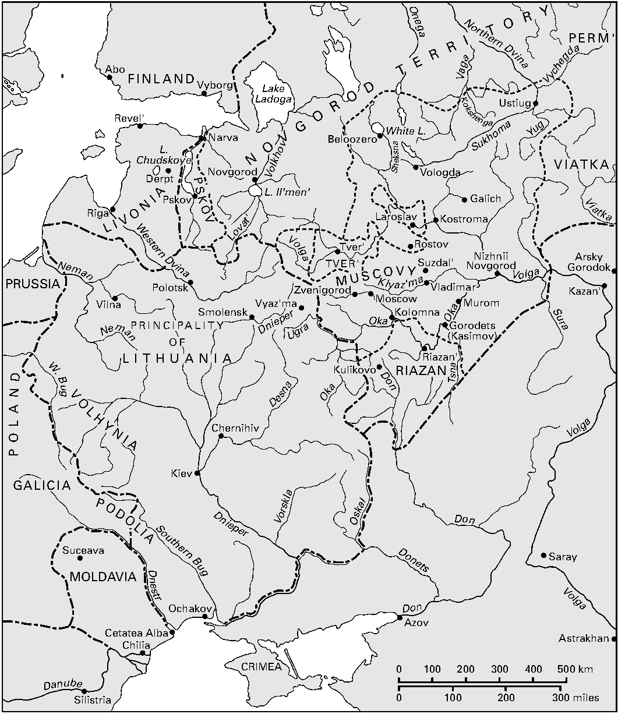

*地图4 莫斯科罗斯（约1460年）。地名依原图；重复标注的同一河流仅列一次，比例尺以千米、英里标示。*

| 原图标注 | 中文 |
| --- | --- |
| FINLAND | 芬兰（地区） |
| NOVGOROD TERRITORY | 诺夫哥罗德领地 |
| PERM′ | 彼尔姆（地区） |
| VIATKA | 维亚特卡（地区） |
| LIVONIA | 利沃尼亚 |
| PSKOV | 普斯科夫（地区） |
| TVER′ | 特维尔（地区） |
| MUSCOVY | 莫斯科罗斯 |
| RIAZAN | 梁赞（地区） |
| PRUSSIA | 普鲁士 |
| PRINCIPALITY OF LITHUANIA | 立陶宛公国 |
| POLAND | 波兰 |
| VOLHYNIA | 沃里尼亚 |
| GALICIA | 加利西亚 |
| PODOLIA | 波多利亚 |
| MOLDAVIA | 摩尔达维亚 |
| CRIMEA | 克里米亚 |
| Abo | 阿博 |
| Vyborg | 维堡 |
| Revel′ | 雷瓦尔 |
| Narva | 纳尔瓦 |
| Dorpt | 多尔帕特 |
| Novgorod | 诺夫哥罗德 |
| Pskov | 普斯科夫（城镇） |
| Riga | 里加 |
| Beloozero | 别洛奥泽罗 |
| Ustiug | 乌斯秋格 |
| Vologda | 沃洛格达 |
| Galich | 加利奇 |
| Iaroslav | 雅罗斯拉夫尔 |
| Kostroma | 科斯特罗马 |
| Rostov | 罗斯托夫 |
| Tver′ | 特维尔（城镇） |
| Suzdal′ | 苏兹达尔 |
| Vladimar | 弗拉基米尔（原图拼作Vladimar） |
| Moscow | 莫斯科 |
| Kolomna | 科洛姆纳 |
| Zvenigorod | 兹韦尼哥罗德 |
| Viaz′ma | 维亚济马 |
| Smolensk | 斯摩棱斯克 |
| Polotsk | 波洛茨克 |
| Vilna | 维尔纳 |
| Murom | 穆罗姆 |
| Nizhnii Novgorod | 下诺夫哥罗德 |
| Arsky Gorodok | 阿尔斯克城 |
| Kazan′ | 喀山 |
| Gorodets (Kasimov) | 戈罗杰茨（卡西莫夫） |
| Riazan′ | 梁赞（城镇） |
| Kulikovo | 库利科沃 |
| Chernihiv | 切尔尼希夫 |
| Kiev | 基辅 |
| Suceava | 苏恰瓦 |
| Ochakov | 奥恰科夫 |
| Cetatea Alba | 白城 |
| Chilia | 基利亚 |
| Silistria | 锡利斯特拉 |
| Azov | 亚速 |
| Saray | 萨莱 |
| Astrakhan | 阿斯特拉罕 |
| Lake Ladoga | 拉多加湖 |
| L. Chudskoe | 楚德湖 |
| L. Il′men′ | 伊尔门湖 |
| White L. | 白湖 |
| Onega | 奥涅加河 |
| Northern Dvina | 北德维纳河 |
| Vaga | 瓦加河 |
| Vychegda | 维切格达河 |
| Kokshenga | 科克申加河 |
| Sukhoma | 苏霍纳河（原图拼作Sukhoma） |
| Yug | 尤格河 |
| Sheksna | 舍克斯纳河 |
| Viatka | 维亚特卡河 |
| Volkhov | 沃尔霍夫河 |
| Lovat′ | 洛瓦季河 |
| Western Dvina | 西德维纳河 |
| Volga | 伏尔加河 |
| Neman | 涅曼河 |
| W. Bug | 西布格河 |
| Dnieper | 第聂伯河 |
| Klyaz′ma | 克利亚济马河 |
| Oka | 奥卡河 |
| Sura | 苏拉河 |
| Tsna | 茨纳河 |
| Ugra | 乌格拉河 |
| Desna | 杰斯纳河 |
| Don | 顿河 |
| Vorskla | 沃尔斯克拉河 |
| Oskal | 奥斯科尔河（原图拼作Oskal） |
| Donets | 顿涅茨河 |
| Southern Bug | 南布格河 |
| Dnestr | 德涅斯特河 |
| Danube | 多瑙河 |

例如，圣谢尔吉是否祝福过德米特里1380年的出征，便绝无定论；[^p275-2] 这场战役也不是决定性的胜利——鞑靼人直到15世纪后期，仍继续向罗斯各地征收贡赋。16世纪后期，在“雷帝”伊凡四世[^p275-3]（1530—1584年）治下出现的社会与文化，是各类群体和思想影响复杂互动的产物。起初信奉异教、后来改信伊斯兰教的金帐汗国，赋予俄国教会的特殊地位；来自巴尔干与拜占庭的波格米勒派及静修主义属灵潮流；与德意志汉萨同盟的贸易关系——这些<!-- PDF page 276; original page 255 -->全都影响了莫斯科国家。鞑靼征服前罗斯的重要组成部分——西部与南部说罗斯语、信正教的领土，后来将形成现代白俄罗斯与乌克兰——归入与天主教波兰结盟的立陶宛大公国统治之下，使正在形成的罗斯民族分裂为两个共同体；它们常常彼此竞争，政治与宗教经历也十分不同。15世纪，西部罗斯人——拜占庭人称之为“小罗斯人”——设法拥有了自己的都主教。在特维尔、梁赞、雅罗斯拉夫尔、罗斯托夫、维亚特卡、诺夫哥罗德和普斯科夫，地域身份始终极其重要，直到莫斯科大公在“收集罗斯土地”的过程中，吞并这些自治领地。

现代史学不再把虔敬与文化视为精英的专属领域。本章主体所讨论的，是俄国生活多样的物质面貌，以及俄国社会共同具有的丰富信仰与仪式谱系。历史学家继续思考“高层”与“底层”文化、“精英”与“民众”信仰等二分，也试图呈现宗教经验的多样性，涵盖男女、教士与平信徒、修道院与堂区、城市与乡村。人们认识到，中世纪及近代早期的基督教信仰，尽管复杂，却从根本上具有共享或共同性质；这一认识在一定程度上修正了上述史学二分。到16世纪，至少在俄国已基督教化的共同体中——整个这一时期仍有信奉异教的“臣属民族”，以及数量变化不定的穆斯林和犹太少数群体——农民与王公同样依照教会斋期和庆节的历法安排生活，通常使用基督教名字，并以正教圣事和仪式标记出生、婚姻与死亡等生命转折。[^p276-4] 为祈求或感恩，他们诉诸朝圣、圣徒敬礼与灵验圣像。他们使用共同的虔敬语言。文学固然主要属于受教育者的媒介，但教堂建筑、礼仪、音乐及绘画文化，却向所有信徒开放。同样，被禁止的信仰与实践也不限于某一社会阶级或等级：当地神职人员和平民妇女一样，会因施行咒术及诅咒而受到斥责；异端既见于大公随从，也见于城市穷人。

## “生活中的正教”与非正统信仰

要重建这一时期实际践行的正教，即“生活中的正教”，所面临的困难之一，是多数<!-- PDF page 277; original page 256 -->史料带有规定或禁令性质，由教士撰写，告诉我们哪些事应做、哪些不应做；历史学家必须通过推论，辨认该时期人们实际做了什么。《治家格言》（Domostroi）是16世纪一部与克里姆林宫圣母领报大教堂大司祭西尔维斯特有关的作品，为管理一个富裕家庭提供属灵、道德及实际指导。它指导人们如何藉祈祷与朝圣治病、何时及如何在家祷告、宗教斋日应准备哪些食物，因而相当详细地展现出作者心目中理想的基督徒家庭生活。[^p277-5] 《百章会议录》（Stoglav，意为“一百章”）记录1551年教会会议对“正确”或被禁止的虔敬及文化形式所作的裁决，是此类史料中最有意思的一种。教会谴责为不可接受的做法，主要见于第41、92、93章，包括跳舞、酗酒等娱乐，以及巡回艺人（skomorokhi）的活动：他们陪同婚礼，用“魔鬼的游戏”使人误入歧途；还包括圣三主日在墓旁先过度哀哭、再过度欢闹的仪式；巫术及各种迷信，例如把胎膜、盐和肥皂留在祭台上——显然得到堂区司祭默许；以及教会庆节前夕的淫秽或失序行为，尤其在圣约翰日、圣诞节及主显节前夕，被形容为“污秽的异教与希腊异教习俗和游戏”。[^p277-6] 然而，很难把这些段落理解为对16世纪莫斯科罗斯虔敬生活的准确反映，因为《百章会议录》大量援引教会法；多位研究者也发现其文字先例，来自《翡翠集》（Izmaragd）、《舵手书》（Kormchaia kniga，即《教会法规与民法汇编》，是从拜占庭继承的最早规范性文本之一）、《弗拉基米尔法令》及《圣经》。把“目击”证言与文学借用区分开来，是一项复杂而冒险的工作；对民众实践的观察，无疑经过了这一文字遗产的折射。这份文本固然让我们瞥见平信徒的虔敬生活，或许更多透露的，却是教会高层关心什么。

“民众宗教”或“民间信仰”研究，往往集中讨论dvoeverie，即“双重信仰”这一存在问题、却影响很大的概念。自19世纪中叶以来，学者便用它来描述俄国正教<!-- PDF page 278; original page 257 -->共同体有意或无意保存异教信仰及仪式的现象。[^p278-7] 这一概念影响了学界对俄国中世纪、往往也包括现代灵修生活的理解，令人们一心寻找虔敬与文化中潜藏的异教成分。“双重信仰”常被当作俄国特有现象，而这一词语源于中世纪的事实，又被用来支持这种看法。然而，文本本身显示，这个词最初并非如此理解；[^p278-8] 俄国教士关心的问题，与西欧同行相近。

让我们进入非教士“普通人”内心世界的史料确实存在，但很有限，主要是保存在诺夫哥罗德及俄国若干其他城市的大量桦树皮文书。不过，这些普通生活的零碎见证，大部分不涉及宗教，而是谈论贸易、法律争端及家庭破裂等物质事务。但它们的确显示，到了14世纪后期，农民已称自己为基督徒，证实“普通人”具有自觉的基督徒身份。[^p278-9] 16世纪起大量出现的神迹故事，也让我们稍能了解平信徒的虔敬，虽然通常要经过记录它们的教士之手。依照获治者的记录，治病敬礼主要吸引当地小贵族、商人、手工业者、富裕农民及教士；但即使后来获得全国意义的敬礼，也可能由地位低微者发起，例如喀山天主之母灵验圣像，便是1579年由一名士兵年幼的女儿发现。[^p278-10]

外国旅行者为宗教生活的外在表现提供另一视角。例如，西吉斯蒙德·冯·赫伯斯坦（1486—1566年）、[^p278-11] 理查德·钱塞勒（卒于1556年）、[^p278-12] 安东尼·詹金森（1530—1611年）、[^p278-13] 安东尼奥·波塞维诺（1533—1611年）、[^p278-14] 贾尔斯·弗莱彻<!-- PDF page 279; original page 258 -->（卒于1611年）[^p279-15] 和杰罗姆·霍西（卒于1626年），[^p279-16] 都记录了16世纪俄国虔敬生活的细节，其中某些人的叙述比另一些更可靠。[^p279-17] 外国观察者常把亲见的热烈虔敬——每年四次严格守斋、极其漫长的礼仪、大量使用圣像与蜡烛——与显得格格不入的酗酒和粗暴行为相对照，助长了至今仍然流传的民族刻板印象。

这一时期圣愚的盛行，是通常所谓“民众”虔敬的一种面貌。最著名的真福圣瓦西里（卒于1552年），于1588年被列入圣品。他如此广受尊崇，以至被安葬在红场的波克罗夫大教堂，即天主之母覆帡大教堂旁；该堂后来为纪念他，获得圣瓦西里大教堂之名。Iurodivye Khrista radi，即“为基督的缘故而愚拙的人”（出自《哥林多前书》4:10），并非俄国独有的现象；但在14至17世纪，俄国社会孕育“为基督而愚拙者”的程度却是独一无二的。[^p279-18] 圣愚假装疯癫，赤身走在雪中，以不合常规的外貌和行为招致嘲弄与虐待。有些人口出看似无意义之语，后来的事件却证明是预言。关于圣瓦西里及普斯科夫圣愚圣尼古拉的传说，显示在一个暴力而日益专制的社会中，人们认为他们享有特殊的言论自由。[^p279-19] 一则年代错置的记载说，瓦西里曾送给伊凡四世鲜肉，以象征方式责备他1570年洗劫诺夫哥罗德。伊凡威胁普斯科夫时，圣尼古拉也作出同样举动；当伊凡声称自己遵守大斋期禁食时，他责备伊凡饮用基督徒的鲜血却毫无顾忌。[^p279-20]

<!-- PDF page 280; original page 259 -->

有人认为，“伟大主宰”诺夫哥罗德这座城堡式城市，“体现了俄国民众生活与心灵的印记”；[^p280-21] 因为它大体避开了鞑靼人在其他地区造成的破坏，从而保存了“真正的”俄罗斯性。该城虽向鞑靼宗主纳贡，却继续同东西双方进行思想与经济交流。这或许可以解释，为何这一时期影响大到留下记录的异端，会出现于诺夫哥罗德及另一座贸易中心普斯科夫。14世纪后期的strigol’niki，即“剪发派”，批评买卖圣职及松弛的教士生活，似乎拒绝接受他们眼中有缺陷、无正当地位的神职人员所施行的圣事。他们似乎也倡导向大地告解；[^p280-22] 有人把这一举动理解为异教顽固存续、以及忠于“湿润的大地母亲”的证据。[^p280-23] 我们对这一异端所知不多，但它曾一度困扰主教团。编年史记载诺夫哥罗德若干剪发派成员被溺死，半个世纪之后的1427年，都主教佛提奥斯仍致信抱怨普斯科夫的剪发派。后来“犹太化派”异端出现时，根纳季总主教又指控其中一位领袖是剪发派成员。[^p280-24]

15世纪后期这一所谓“犹太化派”异端，同时影响了精英与下层神职人员。“犹太化派”并非当时的用语，而是在很久以后的史学中出现；如今，该异端的“犹太性”受到严重质疑。[^p280-25] 与通常情形一样，主要迫害者——沃洛科拉姆斯克的约瑟夫及诺夫哥罗德根纳季总主教——也是这种异端的主要记录者。因此，任何试图理解当时流传的非正统信仰之真实性质的努力，都只能部分成功。约瑟夫声称，异端始于一名来自基辅、“名叫斯哈里亚的犹太人”：他使诺夫哥罗德两位司祭改信，并在另两名立陶宛犹太人的帮助下开始传教。[^p280-26] 这种异端显然反对三一论、批评神职人员并反对圣像，在这些方面类似早期新教运动。

<!-- PDF page 281; original page 260 -->

当大公聘用这两位改信的教士到克里姆林宫教堂任职时，异端便传入莫斯科宫廷；他或许看中了他们对教会土地世俗化计划的支持。[^p281-27] 伊凡三世的儿媳摩尔达维亚的叶莲娜，以及国务秘书费奥多尔·库里岑，是地位最高的“异端分子”。尽管根纳季总主教于1487年开始以宗教裁判方式打击他们，大公仍有数年拒绝用暴力根除异端。

异端分子的命运与当时政治密切相联：既有关于教会土地所有权的冲突，也有伊凡三世之孙德米特里——摩尔达维亚的叶莲娜之子——与伊凡之子瓦西里之间的继承斗争。瓦西里的母亲，是伊凡的第二任妻子索菲娅·帕莱奥洛吉娜，末代拜占庭皇帝的侄女。1490年的主教会议宽大处理异端分子。首次审判指控他们拒绝敬礼莫斯科与罗斯托夫的圣徒，被认为具有明显的反诺夫哥罗德倾向。[^p281-28] 后来，瓦西里主导的1504年审判，判处异端分子死刑或终身流放；叶莲娜则恰于1505年死在狱中。

## 虔敬文化与富有创造力的虔敬

总体而言，在本章讨论的整个时期，莫斯科罗斯在文化上、并在很大程度上于政治上，仍是中世纪社会。正如人们所预料，其文学、视觉艺术、建筑及有记谱的音乐等文化遗存，与宗教的目的和表达密不可分。保存下来的史学著述、私人及外交通信，以及法律行政文本，也都带有正教基督教色彩。然而，若以为所有文化生产都出于虔敬性质，便会犯错。巡回艺人发展并传播了数量庞大的口头文学，包括史诗性的壮士歌（byliny）、历史歌曲、抒情歌、咒语、谜语等；[^p281-29] 他们有时受到宫廷宠爱，例如伊凡四世时期，但始终为教会所不满。

这一时期，传入虔敬文化的西方神学影响相对有限，俄国精英大体仍对新教和天主教抱有疑虑。但也有例外：诺夫哥罗德根纳季总主教除了对以宗教裁判手段控制异端感兴趣，也曾连续数年聘用一位道明会修士，并在把整部《圣经》译为斯拉夫语时，使用<!-- PDF page 282; original page 261 -->拉丁文史料。这项翻译于1499年完成，但直到1580—1581年才通过印刷传播。[^p282-30]

俄国中世纪文化曾被形容为“思想上的沉默”：未产生伟大的神学或科学著作，因接触古典教育与世俗知识的机会有限，又过度沉溺于非理性的宗教热情，而贫乏或发育受阻。但这种评判并不公平。[^p282-31] 制书、绘画、刺绣、教堂建造和宫殿装饰等艺术，彰显的是与我们不同的文化品质：独创性不受重视，忠于正教传统及既定形式却受到推崇；留下这一时期文化作品的，也不是天才转瞬即逝的灵光，而是缓慢、沉思式的虔敬劳动。人们更看重对既有属灵素材的创造性重组，而非原创神学写作。中世纪俄国的制书方式，被比作万花筒的运作：通过把数量有限、现存的虔敬文本重新排列成新的图案，获得新的属灵领悟。[^p282-32]

G. P. 费多托夫富有成效地研究了《翡翠集》（Izmaragd），认为这部显然为平信徒和教士共同编写的虔敬读本，提供了了解14与15世纪识字群体虔敬生活的途径。[^p282-33] 它首先颂扬书籍——这种态度同样属于俄国虔敬生活的基辅时期——并阐释如何正确阅读所有属灵著述，无论《圣经》还是教诲作品。阅读与写作一样被视为虔敬行为，应当勤勉进行，吸收并默想每一个字。

教士精英——修道教士，亦称“黑衣教士”，主教从他们中间选出——及大型修道院，在这一时期尤其重要，因为他们是文字文化的主要创造者、复制者与保存者。

<!-- PDF page 283; original page 262 -->

他们以编年史形式撰写历史，其巅峰是16世纪在马卡里都主教指导下编成、手稿逾一万页的《插图编年史汇编》（Litsevoi letopisnyi svod），也以圣徒传记录重要人物的生平。14世纪后期至15世纪初，这种创造活动受到一场文化运动的推动和塑造。该运动始于巴尔干，原本试图依照教规标准改革宗教文本的正字法与语言，后来发展为整个正教欧洲的文化更新动力。新的圣徒传被写成，新的圣德典范受到推崇，突出个体人格与经验的重要性，并发展出一种复杂而讲求修辞、名为“词语编织”（pletenie sloves）的文体。这种新风格部分通过保加利亚和塞尔维亚移民传入俄国，例如基普里安都主教。早期表现之一，是“智者”叶皮法尼（premudryi）的圣徒传著述；他以“词语编织”文体写成《圣谢尔吉传》与《彼尔姆的圣斯特凡传》。[^p283-34] 学者把这一运动称为“第二次南部斯拉夫影响”，第一次发生在罗斯皈依基督教之时。但这个名称既未充分体现本土贡献，也未充分反映与拜占庭、尤其与阿索斯山恢复联系所发挥的作用；重要圣徒传作家“塞尔维亚人帕霍米”便于1438年从阿索斯山前来。

学者一致认为，静修主义的神秘主义潮流是这一泛斯拉夫更新过程的一部分，但其具体方式仍难以捉摸。部分问题在于，这一词语有多种定义和用法。“静修主义”源于希腊语ἡσυχασμός，意为“保持安静”，首先指沙漠教父确立的内在静默与不断祈祷的修道实践。直到14世纪拜占庭默祷技巧复兴时，它才被用来指一种独特的属灵运动；最典型的是“心祷”，即耶稣祷文，以及对他泊山“神圣而非受造之光”的追求。[^p283-35] 这场复兴与西奈的格里高利及格里高利·帕拉马斯相联，其中前者对斯拉夫人的影响远为深远。广义来看，它可被视为修道灵修的复兴；也有学者试图辨认一种<!-- PDF page 284; original page 263 -->“政治静修主义”，认为它不同程度地影响了拜占庭与斯拉夫社会。[^p284-36]

静修主义究竟在多大程度上影响了俄国虔敬生活，仍有争论；[^p284-37] 它对俄国文化，特别是圣像绘画技法及“词语编织”的影响，也同样如此。[^p284-38] 似乎可以肯定，14世纪拜占庭静修主义复兴，促进了正教世界跨地域的修道联系，推动许多拜占庭修道著作的翻译、重抄与传入斯拉夫地区，也在一定程度上促成了14世纪后期至15世纪初俄国修道生活的惊人繁荣。例如，圣三一—圣谢尔吉修道院的藏书，当时包括多部梅延多夫所谓“静修灵修的经典”，圣基里尔—白湖修道院亦然。[^p284-39] 在这一时期的圣徒传中，很难找到神秘异象及帕拉马斯神学等形式的、受到拜占庭静修主义影响的直接证据。然而，静修主义鼓励一种更个人化的宗教生活，强调人与神直接接触的可能，以及属灵高于世俗；就此而言，它似乎显著影响了数代修士，使他们选择俄国北部及东部森林“荒野”中的默观祈祷，而非大型城市或近郊共住制修道中心里积极的社会生活。不出所料，这些“伏尔加河彼岸长老”的代表人物尼尔·索尔斯基，在其修道规章中明确提到静修实践；[^p284-40] 但也应记住，即使务实的沃洛科拉姆斯克的约瑟夫——积极参与社会与政治的共住制之典范——也建议修士安排静默与含泪自省的时段。[^p284-41]

修道者的谦卑，以及担心因曲解神圣原典而无意间把异端写上纸面的恐惧，促使人们尽量精确地复制任何属灵论著，连累积的错误也一并保留。但到了16世纪，新的批判精神已经进入教会高层。

<!-- PDF page 285; original page 264 -->

阿索斯山修士希腊人马克西姆于1518年抵达莫斯科，把《圣咏集》及注释从希腊语译出；他被留在那里，很可能违背本人意愿，继续翻译并校正重要的属灵著作。马克西姆在莫斯科罗斯的生活，不幸卷入当时政治。他于1525年被捕，部分原因是他公开反对瓦西里三世当年违反教规的离婚与再婚。[^p285-42] 马克西姆被囚于沃洛科拉姆斯克修道院，六年后又受到达尼尔都主教审判，罪名包括“希腊异教及异端巫术”和亵渎性翻译，随后再度被囚于特维尔一所修道院。直到1551年，即去世前五年，他才终于获释，得以自由居住在圣三一—圣谢尔吉修道院。[^p285-43] 他翻译的《圣咏集》《福音书》和《三歌经》，属于1560年代最早印行的一批书。1988年，教会把他列入圣品，承认其对俄国正教的贡献。1551年教会会议除释放马克西姆外，还承认系统校订教会文本及改善神职教育已是迫切需要；但在国家滑入特辖制的动荡、后来又陷入伊凡四世留下的政治混乱——“混乱时期”（1598—1613年）——以前，所取得的成效十分有限。

这一时期圣像绘画的繁荣，将于下章讨论。[^p285-44] 鲁布廖夫与狄奥尼西的作品，被理所当然地赞颂为俄国中世纪文化成就的巅峰，女性的虔敬艺术却往往遭到忽视。由王室女性主持的作坊，例如瓦西里三世第一任妻子索洛莫尼娅·萨布罗娃（卒于1542年）、伊琳娜·戈东诺娃（卒于1603年）及叶夫罗西尼娅·斯塔里茨卡娅（卒于1569年）的作坊，绣制具有复杂象征意义而优美的圣葬布、祭台布与礼仪服饰；它们是用丝线绘成的圣像，或织物中的祈祷。这些作品在女修道院内制作，或由富裕妇女献给修道院，以纪念亡亲、表达感恩或提出祈求。索洛莫尼娅悲哀最动人的见证之一，是1525年献给圣三一—圣谢尔吉修道院的一幅织绣；不久后，她便因未能生育继承人而遭离婚并被剃度为修女。织绣以马利亚年迈母亲安娜、施洗约翰之母伊利莎白，以及天主之母本人奇迹般生育的图像，记录她的盼望。[^p285-45] 一位<!-- PDF page 286; original page 265 -->出身诺夫哥罗德贵族的15世纪修女玛丽娅·奥多耶夫斯卡娅，在回忆录中记载，院长特别重视她抄写“书籍与编年史”的书写技能。[^p286-46] 富裕妇女如同男子一样，也出资兴建和装饰教堂。[^p286-47] 平信徒赞助支持了砖石教堂建造的复兴，最先出现于诺夫哥罗德：14世纪中叶，当地波雅尔贵族与富商经常充当赞助者。[^p286-48]

教堂建筑是这一时期虔敬文化中具有指示意义的重要方面。诺夫哥罗德早期朴素而雄伟的建筑风格，逐渐让位于更多样的形式。最有意思的创新与莫斯科有关，例如得名于农妇头饰、层层排列装饰山花的“科科什尼克”，以及1530年代开始出现的奇特“帐篷式”教堂。15世纪可以观察到，人们有意识地向鞑靼征服前的历史寻找灵感：旧建筑得到大规模修复；伊凡三世委托一位意大利人为莫斯科克里姆林宫兴建足够宏伟的大教堂时，命令他研究早期罗斯建筑。到该世纪末，莫斯科克里姆林宫已被改造为巨大堡垒，象征莫斯科作为俄国政治中心的重要性日益增长。[^p286-49]

这一时期出现的所有建筑地标中，或许最令人震撼的，是为纪念1552年攻克喀山而建的巨大惊人建筑。它现称圣瓦西里大教堂，由围绕一座巨大尖顶的九座独立礼拜堂组成。其中数座礼拜堂奉献给与围攻喀山各事件相应的庆节，中央教堂奉献给波克罗夫，即“天主之母覆帡”。一座礼拜堂奉献给圣三一，象征民族和解；另一座奉献给基督进入耶路撒冷。整组建筑常被称作“耶路撒冷”，并有明确证据表明，它被视为圣城的一幅圣像。[^p286-50] 俄国特有的“洋葱头穹顶”，虽然早已见于手稿插图及siony，即耶路撒冷复活<!-- PDF page 287; original page 266 -->教堂或圣墓教堂的微型复制品，却直到16世纪末才首次出现于教堂建筑。它们被形容为古老圣墓圣所的圣像图式，证明耶路撒冷主题在这一时期俄国虔敬与文化中的重要性。[^p287-51]

## 修道生活

正如这一时期的文化遗存所见证，居主导地位的虔敬形式是修道生活，部分承袭拉多涅日的圣谢尔吉（卒于1392年）的属灵遗产。虽然对修道院数量的估计有所不同，证据显示，14世纪新建修道院约150所，15世纪为250所以上，16世纪超过330所。它们有些未能兴盛，或遭火灾、瘟疫摧毁，但可以推断，16世纪末莫斯科罗斯境内运作的修道机构，远超500所。[^p287-52] 到本章讨论时期结束时，圣三一—圣谢尔吉修道院已有700多位修士；不过，大多数重要修道院的修士或修女在80至200人之间。[^p287-53] 与较早的城市修道院不同，新修道院有许多建立于偏远乡村。隐修处与半隐修院——通常由二至六位修士共同住在荒野——往往发展为重要修道院，有助于整合新领土并使原住民基督教化。

修道生活如此兴盛，毫不奇怪，因为这是暴力而不安定的时代。民众饱受与立陶宛、利沃尼亚、克里米亚及喀山的战争摧残，也遭遇王公和贵族派系间血腥的权力斗争、鞑靼汗国不断袭扰、瘟疫爆发，以及后来伊凡四世治下的暴政、劫掠与处决。至少在识字社会中，一种观念广泛流传：世界将于1492年终结，也就是从公元前5508年创世起算的7000年。这无疑进一步鼓励了这种“逃离尘世”。正教会如此确信世界<!-- PDF page 288; original page 267 -->将终结，以至没有准备1492年以后的礼仪历，必须在该年由佐西马都主教编制。[^p288-54]

圣谢尔吉对俄国文化影响巨大，绝不只因他作为“俄国的建设者”所具有的无处不在的象征价值。[^p288-55] 他的巨大声望使他在去世后不久便列入圣品；其圣髑于1422年被发现，第一座以他为主保的教堂于1460年在诺夫哥罗德建成。他对当时社会影响如此之大，1400年前后的数十年被称为“谢尔吉时期”；[^p288-56] 在其中大部分时间，知识与文化生活的中心，就是他在莫斯科东北70千米处建立、今称圣三一—圣谢尔吉的修道院。谢尔吉既振兴了俄国修道生活的共住制传统，即真正的共同生活、共有财物与共同起居，有别于当时更普遍、修士分别居住而只共同敬拜的自律制，也振兴了独居修道的隐修传统。

通过圣谢尔吉的榜样，这种隐修传统在北部领土的拓殖中，影响了俄国社会与地理结构。《拉多涅日的圣谢尔吉传》描述这一时期众多修道院建立的方式：一位寻找静默与独处的修士设立隐修处；[^p288-57] 随后，一小群寻求其属灵指导的弟兄加入，新修道院逐渐形成并吸引更多来访者；又有修士离开，另寻更安静的祈祷处。谢尔吉的门徒不断重复这个循环。相传谢尔吉生前亲自建立十所修道院，并培育了一代修士。他们与自己的属灵子弟后来创建北部领土的壮丽修道院，例如基里尔—白湖的圣母安眠修道院：1397年由圣基里尔建立；他原是西蒙诺夫修道院修士，该院院长则是拉多涅日的圣谢尔吉的侄子。还有1398年建立的费拉蓬托夫天主之母诞生修道院，以及索洛夫基的救主显圣容修道院。

<!-- PDF page 289; original page 268 -->

白海索洛夫基群岛上最后这所修道院的发展，说明了这一过程。修士萨瓦季在基里尔—白湖修道院剃度，但为寻找更安静的祈祷处，先赴瓦尔拉姆修道院，后于1429年与另一位隐修士格尔曼一起，前往完全荒无人烟的索洛夫基群岛。格尔曼后来离开群岛。萨瓦季去世后，格尔曼于1436年带着修士佐西马返回索洛夫基，两人逐渐建立修道院。在后来成为莫斯科都主教的圣腓力领导下，修道院在物质及属灵方面均十分兴盛。腓力监督开凿运河系统、兴建包括大教堂在内的石造建筑、经营园圃、面包坊、磨坊、水坝与驯鹿饲养，其创造和组织能力由此得到磨炼。到16世纪末，这座岛上隐修处已成为白海的一座巨大堡垒，象征俄国正教会经历的变化。[^p289-58]

一些历史学家把修道院扩展与拓殖、或农民日益受到束缚紧密相联；[^p289-59] 向北迁移的修士固然从未把这些明确列为目标，但在某些地区，它们的确是修道院成功的副产品。叶皮法尼在斯特凡1396年去世后不久写成的《圣斯特凡传》中，呈现了一位献身传教工作的修士之特殊例子。斯特凡没有把所有礼仪及属灵文本使用的教会斯拉夫语强加给新近皈依的彼尔姆人——芬兰语族部落，即今天的科米人——而是为他们创制字母，把基督教基本著作译为他们的语言。彼尔姆地区原先与诺夫哥罗德相联，后来置于莫斯科大公德米特里的“保护”之下。具有讽刺意味的是，在叶皮法尼的《传》中，彼尔姆人反对基督教的理由之一，正是来自莫斯科的统治及随之而来的负担与税赋。叶皮法尼赞扬圣斯特凡曾在莫斯科和诺夫哥罗德为彼尔姆人说情。但他的语言适应实验未能存续。16世纪，教会斯拉夫语取代彼尔姆语礼仪，彼尔姆人也变得俄国化，至少在官方层面如此。

为免修道复兴看起来完全属于男性，也应记住，创建修道院的不只是游方修士。例如，叶夫罗西尼娅·斯塔里茨卡娅公爵夫人于1544年建立戈里齐复活女修道院；但这一时期，贵族妇女似乎既是女修道院的创办者，也同样是其中囚徒，<!-- PDF page 290; original page 269 -->叶夫罗西尼娅也不例外。她遭伊凡四世指控叛国后被剃度，很可能出于强迫，后来又被特辖军杀害。她的女修道院还收容过伊凡四世遗孀玛丽娅·费奥多罗芙娜（纳加娅），她被鲍里斯·戈东诺夫流放到那里；[^p290-60] 还有伊凡第四任妻子安娜·阿列克谢耶芙娜，以及他的儿媳佩拉格娅·米哈伊洛芙娜。强迫剃度不仅是一种使男女政治对手噤声的便捷办法，尽管未必可靠；它也是一种离婚手段。

无法或不愿进入修道院的人，可以通过捐赠参与其发展。王公、富裕贵族、商人和高级教士的资金投入，大大促进了修道生活的扩张。常见捐赠包括食物、石造教堂与村庄；作为回报，捐赠者及其亲人可以期待得到祈祷，并在死后被永远纪念。遗赠十分普遍，贵族把家族土地留给修道院而非亲族，导致教会地产大增，引发当时一场重大争论：一方是支持教会拥有土地的“占有派”，另一方是“非占有派”，认为修道院拥有土地、依靠耕种土地的农民劳动而生活，并不合宜。[^p290-61]

这一时期史学中两位举足轻重的人物，尼尔·索尔斯基（1433—1508年）与沃洛科拉姆斯克的约瑟夫（1439—1515年），通常被分别描绘为这两个派别的代表，也分别体现了作为圣谢尔吉遗产而被接纳的修道生活两个方面：静默的隐修，以及积极参与社会的共住生活。差异主要在于侧重：指导他人趋向属灵完善时，尼尔强调内在属灵生活，约瑟夫强调外在实践。

尼尔留下的文字遗产很少：几封致“属灵子弟”的信、其《修道规章》（Ustav，其实更像讨论内在生活的论著，而非规条），以及短篇《传统》（Predanie），所以我们对他的生平只有粗略了解。我们知道，他曾在阿索斯山及基里尔—白湖修道院居住，后来到白湖地区北方森林寻求不受干扰的宁静。他赞成几个弟兄在荒野共同生活的半隐修院，而非隐修生活的完全独居。由于退隐北方荒野，其追随者常被称为“伏尔加河彼岸长老”。

尼尔被尊为俄国“虚己”精神的典范：一种自我倒空的谦卑，使他不像约瑟夫那样参与公共生活及施加政治影响。另一<!-- PDF page 291; original page 270 -->个传统上归于尼尔、实际上更多由其追随者表达的温和灵修特征，是对异端分子的仁慈。这使他与热衷迫害犹太化派的约瑟夫鲜明有别。然而，尼尔同样热心维护真正信仰，《传统》开篇便声明自身的正统信仰及对正教会的忠诚。他谨慎引述教父，以支持自己的论断；其属灵著述没有哪一项可以称为原创。简言之，他倡导一种有弹性的生活制度：贫穷、体力劳动、按年龄与体力节制，以及不断的内心祈祷。[^p291-62] 更不寻常的特点，是他认为并非所有宗教文本具有同等价值；阅读应有批判精神，错误的文本也应得到校正。

约瑟夫出生于沃洛科拉姆斯克城附近一个十分虔诚的家庭：一位祖父、父母双方、两位堂表兄弟及两个兄弟都曾入修道生活，其中一个兄弟后来成为西蒙诺夫修道院院长和罗斯托夫总主教。他在博罗夫斯克的帕夫努季修道院剃度，随后在出生地附近创办自己的严格共住制修道院。贵族及教士的捐赠，例如诺夫哥罗德根纳季总主教（1484—1504年在任）的捐赠，确保修道院在物质上兴盛。约瑟夫以政治操弄、热衷追剿异端，以及支持修道院地产而闻名；但其雄心勃勃的慈善计划，包括赈饥、建立医院与孤儿院等服务，许多大型修道院也效法这套计划。约瑟夫并不是为了财富本身而积聚财富。

在追随尼尔·索尔斯基、后来称为非占有派或伏尔加河彼岸长老的人，与约瑟夫阵营之间，最著名的修道争论涉及教会地产。这场分歧由伊凡三世的行动引发：他愈来愈看中修道院与主教区的大量土地。新近被征服的诺夫哥罗德贵族——1471年被伊凡三世降服——也在这方面鼓动他，劝他夺取教会土地，而非他们的庄园。[^p291-63] 约瑟夫主张，修道院可以而且应当拥有土地与村庄，把所得盈余用于慈善；尼尔则认为，修士应靠双手劳动生活，修道院中的财富是一种诱惑。两种立场都有先例。[^p291-64]

<!-- PDF page 292; original page 271 -->

人们十分强调尼尔与约瑟夫所代表的两种修道潮流之差别。但即使关于地产存在激烈分歧，也未妨碍约瑟夫为自己的修道院购买尼尔的著述。[^p292-65] 约瑟夫固然利用世俗权力压制异端，却坚决维护教会权力与财富，反对世俗干预。还有一些证据显示，约瑟夫与尼尔曾合作谴责异端，甚至共同参与《启蒙者》的写作。[^p292-66] 不过，尼尔的追随者，尤其是被强迫剃度的瓦西安·帕特里凯耶夫亲王，强调应宽恕悔改的异端分子，并仁慈对待顽固者；约瑟夫则主张，即使悔改也应受惩罚，拒不认错者应判死刑。[^p292-67] 16世纪初，“约瑟夫派”获胜：瓦西安于1531年受审，其追随者被追逐至伏尔加河以北的森林。他们在那里继续成为“异议”的源泉，也可能启发了后来的非正统运动。“约瑟夫派心态”主张教会应利用世俗权力，深信教会应积极参与尘世事务；它的胜利，常被视为随后四百年政教纠缠、使各方都受损害的根源。[^p292-68]

## 民族意识形态与民族神话

整个时期可以概括为政治、领土及属灵上的巩固，最终创立自主的民族教会。与此同时，俄国逐渐而明显地远离拜占庭母教会，反映出这种虔敬生活的“民族化”。1390年代，君士坦丁堡牧首安东尼四世不得不致函瓦西里一世大公，责备他在祈祷中省略皇帝之名，并声称俄国虽有教会，却没有皇帝。[^p292-69] 下个世纪，关系并未改善。1438—1439年的佛罗伦萨会议使东西教会统一于教皇之下，加速了俄国争取教会自主的进程。1441年，伊西多尔都主教返回莫斯科，宣扬佛罗伦萨合一，瓦西里二世立即因其背信行为而将他<!-- PDF page 293; original page 272 -->囚禁，俄国教会也拒绝承认合一的合法性。七年后，俄国主教会议未请示君士坦丁堡，便选举梁赞的约拿为都主教。无论后来解释得如何恭敬，这实际上都是含蓄地宣布教会自主。[^p293-70]

1453年君士坦丁堡陷落，被俄国人视为对背弃信仰的神圣惩罚，进一步巩固了这种新生的独立。正教欧洲的其他地区，以及圣城本身，都在穆斯林统治之下，俄国教会高层遂把自己看作真正信仰最后的守护者。“第三罗马”这一著名而备受争议的概念，正是在这种背景下出现；最初表述于16世纪初几封通常归于普斯科夫修士菲洛费伊的信中。[^p293-71] 现代史学尤其喜欢用“莫斯科是第三罗马”来解释俄国政治行为。但菲洛费伊并非在阐述莫斯科罗斯扩张主义与专制统治的思想纲领，而是在强调大公有义务维护正教信仰的纯洁，具体涉及保护教会土地、正确画十字的方式，以及根除鸡奸的需要。罗马与君士坦丁堡未能维护正教，遂遭覆灭；既然不会有第四罗马，若莫斯科也失败，便将预告末日来临。一些历史学家有说服力地指出，“第三罗马”这一象征观念，不如莫斯科是“新耶路撒冷”、或俄国是“新以色列”的观念普遍；[^p293-72] 然而，它在正式文件中唯一一次出现，仍意义重大：1589年设立莫斯科牧首区的敕令，把整个“伟大俄罗斯沙皇国”称为第三罗马。[^p293-73]

“神圣俄罗斯”“第三罗马”“新耶路撒冷”等受宗教启发的观念，以及它们在建筑、文字与<!-- PDF page 294; original page 273 -->仪式中的表现，究竟在多大程度上体现一种自觉的政治意识形态，仍有争论。有些观念，例如第三罗马，在史学与现代民族主义神话建构中的重要性，肯定超过它在16世纪本身的重要性。[^p294-74] 但俄国正教会对民族整合进程，以及对自觉民族身份形成的象征性与实际贡献，是明确的。莫斯科圣枝主日游行等宗教仪式，以沙皇牵着牧首坐骑、重演基督凯旋进入耶路撒冷的场面，公开提醒众人：统治者是正教的守护者与引导者。[^p294-75] 马卡里都主教正式为伊凡四世加冕，立其为沙皇与专制君主，也同时反映出莫斯科统治者自认从陷落的君士坦丁堡继承了宗教权威，以及他们渴求神圣认可。

统治者也发现，公开朝圣与宗教仪式，是把自身权威印刻于新领土的有效办法；[^p294-76] 正教象征和修辞，则同时支持对内及对外的征服。莫斯科都主教公开支持大公的统一行动。编年史记载，腓力都主教奉伊凡三世大公之命，致信反叛的诺夫哥罗德人，命令他们服从“上帝以强有力的手臂，将你们和事奉上帝的罗斯大地置于其下的那个人”，而非他们选中的领袖——基辅的立陶宛亲王米哈伊尔·亚历山德罗维奇，后者会把他们带进“拉丁教”的黑暗。[^p294-77] 编年史把伊凡三世征服诺夫哥罗德，描绘为虔诚君主为捍卫正教而承担的痛苦责任，得到圣徒祈祷与上帝恩宠的支持。伊凡三世与立陶宛斗争的正当理由，则是其信奉天主教的女婿亚历山大，拒绝让他的女儿叶莲娜拥有希腊教堂和神职人员；有人企图使她改宗；曾属于罗斯的波洛茨克等城镇兴建天主教堂；立陶宛境内的正教居民受到迫害。伊凡四世效法祖父，以宗教修辞为对立陶宛及其他敌人的战争辩护，无论<!-- PDF page 295; original page 274 -->政治现实如何：例如，1552年针对喀山的“十字军”，仍得到信奉伊斯兰教的诺盖鞑靼人支持。[^p295-78]

罗斯土地在政治与领土上的巩固，与正教的统一及标准化相互映照。这始于15世纪前半叶礼仪历的整合，通过复兴或设立各种庆节，强调“基辅”罗斯与莫斯科罗斯之间的连续性，例如纪念罗斯第一位受洗统治者圣奥尔加的庆节。15世纪后期，北方城镇与修道院的主保圣徒也被纳入。这一过程最终形成马卡里都主教的《大圣徒月录》（Velikaia mineia chet’ia），为全年每一天提供属灵读物。[^p295-79] 《大圣徒月录》在马卡里任都主教期间（1542—1563年）出现三种版本，均献给伊凡四世，是他试图编成俄国属灵遗产及正教文化之权威汇编的成果，体现一个统一的民族与教会。收入其中的许多文本，包括某些受马卡里委托撰写者，都强调受神委任的沙皇有义务保护正教信仰、支持教会机构，并发展出一种以莫斯科为正教历史中心的世界史叙述。

马卡里都主教还监督编成《帝王谱系阶梯书》（Stepennaia kniga tsarskogo rodosloviia）。这是一部选择性叙述统治者及都主教的历史，始于对罗斯第一位受洗统治者圣奥尔加的颂扬，继而把从10世纪基辅圣徒亲王弗拉基米尔一世，到伊凡四世的“俄罗斯专制君主”，连接为一个延续不绝、神圣化、源自凯撒·奥古斯都的王朝。马卡里《大圣徒月录》及《阶梯书》吸纳的大多数观念和文本，并非原创。例如，统治者是“第二个君士坦丁”的主题，以及出自奥古斯都后裔的神话，都在15世纪出现。然而，以系统方式加以呈现，却是新的，标志着一个自觉奉行正教及专制统治、骄傲披上拜占庭遗产外衣的“大俄罗斯”国家诞生。

如果说《大圣徒月录》试图确立权威的属灵文库，那么1551年的百章会议，则试图确认莫斯科实践的“正确”，藉此使虔敬生活标准化；它忽视地区差异，并在某些情形下忽视教规上的正确<!-- PDF page 296; original page 275 -->性。《治家格言》为俄国家庭提供类似服务，作为一本按照正教道德正确生活的手册。[^p296-80] 这些文字汇编、把地方受敬礼人物列为全民族圣徒的行动，以及1547、1549和1551年具有规制作用的教会会议，可以视为一场协调努力：规范或“民族化”信仰，并以王朝、领土和正教信仰的相互联系，建立俄国民族意识。[^p296-81] 费奥多尔沙皇（1584—1598年在位）无嗣而终，不久便将打破这种建构出的“三位一体”。但在王朝危机及“混乱时期”的动荡到来之前，俄国首位牧首约夫已于1589年，由君士坦丁堡牧首耶利米二世立任。耶利米于1588年前往莫斯科，为自己的教会募捐；他发现自己事实上受到拘禁，直到同意祝圣约夫才得自由。俄国民族与俄国正教会，终于正式登场。

## 注释

[^p274-1]: R. Jakobson and D. S. Worth (eds.), Sofonija’s tale of the Russian–Tatar battle on the Kulikovo field [Slavistic Printings and Reprintings 51] (The Hague: Mouton, 1963). 我十分感谢罗宾·米尔纳—古兰教授的指导、合作与支持，也感谢伊芙·莱文教授提出许多富有启发的建议。

[^p275-2]: 例如参见 John Fennell, A history of the Russian church to 1448 (London: Longman, 1995), 238–9.

[^p275-3]: Groznyi，更准确的意思是“令人敬畏者”。

[^p276-4]: 参见 D. H. Kaiser, ‘Quotidian Orthodoxy. Domestic life in early modern Russia’, in Orthodox Russia: belief and practice under the Tsars, ed. V. A. Kivelson and R. H. Greene (Philadelphia: Pennsylvania State University Press, 2003), 179–92.

[^p277-5]: Carolyn Johnston Pouncy (ed. and trans.), The Domostroi: rules for Russian households in the time of Ivan the Terrible (Ithaca, NY: Cornell University Press, 1994). 关于作者与读者群的问题，见 Pouncy, 37–49, and P. Bushkovitch, Religion and society in Russia: the sixteenth and seventeenth centuries (New York and Oxford: Oxford University Press, 1992), 47–9.

[^p277-6]: E. V. Emchenko, Stoglav: issledovanie i tekst (Moscow: Indrik, 2000), 402.

[^p278-7]: 参见 E. Levin, ‘Dvoeverie and popular religion’, in Seeking God: the recovery of religious identity in Orthodox Russia, Ukraine, and Georgia, ed. S. K. Batalden (DeKalb: Northern Illinois University Press, 1993), 31–52 其中有简要的研究史综述。

[^p278-8]: S. Rock, ‘What’s in a word? A historical study of the concept dvoeverie’, Canadian-American Slavic Studies 35, no. 1 (2001), 19–28.

[^p278-9]: E. Levin, ‘Lay religious identity in medieval Russia: the evidence of Novgorod birchbark documents’, General Linguistics 35 (1997), 131–55.

[^p278-10]: Bushkovitch, Religion and society, 102–11.

[^p278-11]: Sigismund von Herberstein, Moscovia der Haupstadt (Vienna: Michael Zimmerman, 1557) [重印收入, Early exploration of Russia, ed. Marshall Poe (New York: Routledge, 2003), ii].

[^p278-12]: ‘The voyage of Richard Chanceller Pilote major, the first discoverer by sea of the kingdome of Moscovia, Anno 1553’, in Richard Hakluyt, The principal navigations, voyages, traffiques and discoveries of the English nation (London: J. M. Dent and Sons, 1927), i, esp. 264–6.

[^p278-13]: Hakluyt, Principal navigations, i, esp. 424–7, 430–7.

[^p278-14]: Antonio Possevino, The Moscovia of Antonio Possevino, S.J., trans. Hugh F. Graham [UCIS Russian and East European Studies 1] (Pittsburgh, PA: University of Pittsburgh, 1977).

[^p279-15]: Giles Fletcher, Of the Russe Common Wealth (London: Thomas Charde, 1591) [重印收入 Early exploration, ed. Poe, i].

[^p279-16]: ‘A Relacion or memoriall abstracted owt of Sir Jerome Horsey his travells, imploiments, services and negociacions, observed and written with his owne hand; wherein he spent the most part of eighteen years tyme’, in Russia at the close of the sixteenth century, ed. E. A. Bond (London: Hakluyt Society, 1856; 重印 New York: Burt Franklin, 1963).

[^p279-17]: 参见 Marshall Poe, A people born to slavery: Russia in early modern European ethnography, 1476–1748 (Ithaca, NY: Cornell University Press, 2000); L. E. Berry and R. O. Crummey (eds.), Rude and barbarous kingdom: Russia in the accounts of sixteenth-century English voyagers (Madison: University of Wisconsin Press, 1968).

[^p279-18]: 参见 G. P. Fedotov, The Russian religious mind, ii, The Middle Ages; the thirteenth to the fifteenth centuries (Cambridge, MA: Harvard University Press, 1966), 316–43 其中有关于俄国圣愚传统的良好概述。 另参见 S. Ivanov, Holy Fools (Oxford: Oxford University Press, 2006).

[^p279-19]: 例如参见 Jerome Horsey on St Nikolai, in Russia at the close of the sixteenth century, 161.

[^p279-20]: Michael Petrovich, ‘The social and political role of the Muscovite Fools-in-Christ: reality and image’, Forschungen zur Osteuropäischen Geschichte 25 (1978), 283–96.

[^p280-21]: Fedotov, Russian religious mind, ii, 333.

[^p280-22]: N. A. Kazakova and Ia. S. Lur’e, Antifeodal’nye ereticheskie dvizheniia na Rusi XIV–nachala XVI veka (Moscow: AN SSSR, 1955), 241.

[^p280-23]: 参见 Fedotov, Russian religious mind, ii, 135–9.

[^p280-24]: R. G. Skrynnikov, ‘Ecclesiastical thought in Russia and the Church Councils of 1503 and 1504’, Oxford Slavonic Papers 25 (1992), 37.

[^p280-25]: 关于这一运动，最全面的研究为 Kazakova and Lur’e, Antifeodal’nye. 参见 Jakov S. Lur’e, ‘Unresolved issues in the history of the ideological movements of the late fifteenth century’, in Medieval Russian culture, ed. H. Birnbaum and M. S. Flier [California Slavic Studies 12] (Berkeley: University of California Press, 1984), 150–71. 另参见 J. D. Klier, ‘Judaizing without Jews? Moscow–Novgorod, 1470–1504’, in Culture and identity in Muscovy, 1359–1584, ed. A. M. Kleimola and G. D. Lenhoff (Moscow: ITZ- Garant, 1997), 336–49.

[^p280-26]: Iosif Volotskii, Prosvetitel’, ili, Oblichenie eresi zhidovstvuiushchikh, 第4版 (Kazan: Imperatorskii Universitet, 1903; 重印 Farnborough: Gregg International, 1972).

[^p281-27]: J. L. I. Fennell, Ivan the Great of Moscow (London: Macmillan, 1961), 327.

[^p281-28]: Skrynnikov, ‘Ecclesiastical thought’, 36.

[^p281-29]: 参见 Z. I. Vlasova, Skomorokhi i fol’klor (St Petersburg: Aleteiia, 2001); R. Zguta, Russian minstrels: a history of the Skomorokhi (Oxford: Clarendon Press, 1978).

[^p282-30]: V. A. Romodanovskaia, ‘O tseliakh sozdaniia Gennadievskoi Biblii ka pervogo polnogo russkogo Bibleiskogo kodeksa’, in Knizhnye tsentry Drevnei Rusi: Severnorusskie monastyri, ed. S. A. Semiachko (St Petersburg: Dmitrii Bulanin, 2001), 278–305; H. R. Cooper, Slavic Scriptures: the formation of the Church Slavonic version of the Holy Bible (London, Ontario: Cranbury, 2003).

[^p282-31]: 参见 Georges Florovsky, ‘The problem of Old Russian culture’, Slavic Review 21 (1962), 1–15; J. H. Billington, ‘Images of Muscovy’, Slavic Review 21 (1962), 24–34; D. S. Likhachev, ‘Further remarks on the problem of Old Russian culture’, Slavic Review 22 (1963), 115–20; F. J. Thomson, ‘The corpus of Slavonic translations available in Muscovy: the cause of Old Russia’s intellectual silence and a contributory factor in Muscovite cultural autarky’, in Christianity and the Eastern Slavs, i, Slavic cultures in the Middle Ages, ed. B. Gasparov and O. Raevsky-Hughes [California Slavic Studies 16] (Berkeley: University of California Press, 1993), 179–214.

[^p282-32]: W. R. Veder, ‘Old Russia’s “intellectual silence” reconsidered’, in Medieval Russian culture, ed. M. S. Flier and D. Rowland [California Slavic Studies 19] (Berkeley: University of California Press, 1994), ii, 18–28.

[^p282-33]: Fedotov, Russian religious mind, ii, 37–112.

[^p283-34]: V. G. Druzhinin (ed.), Zhitie sviatogo Stefana, episkopa Permskogo napissanoe Epifaniem Premudrym [Apophoreta slavica 2] (The Hague: Mouton, 1959), 1897年版重印。 英文节译见 S. A. Zenkovsky, Medieval Russia’s epics, chronicles and tales (New York: E. P. Dutton, 1964), 206–8.

[^p283-35]: 参见 J. Meyendorff, St Gregory Palamas and Orthodox spirituality (Crestwood, NY: St Vladimir’s Seminary Press, 1998) 其中把帕拉马斯的静修主义置于东方修道灵修的历史传统之中，作了清楚阐释。 参见上文第4章。

[^p284-36]: G. M. Prokhorov, ‘Isikhazm i obshchestvennaia mysl’ v Vostochnoi Evrope v XIV v.’, in Literaturnye sviazi drevnikh slavian, ed. D. S. Likhachev [Trudy otdela devnerusskoi literatury 23] (Leningrad: Nauka, 1968), 86–108; P. Bushkovitch, ‘The limits of hesychasm: some notes on monastic spirituality in Russia 1350–1500’, Forschungen zur Osteuropäischen Geschichte 38 (1986), 97–109, esp. 109.

[^p284-37]: 参见 Bushkovitch, ‘Limits of hesychasm’.

[^p284-38]: 参见 J. Meyendorff, ‘Is “hesychasm” the right word?’ in Okeanos: essays presented to Ihor Ševčenko on his sixtieth birthday by his colleagues and students [Harvard Ukrainian Studies 7] (Cambridge, MA: Harvard University Press, 1983), 447–57. 参见 above 38–41.

[^p284-39]: J. Meyendorff, Byzantium and the rise of Russia, 124–5.

[^p284-40]: 参见 G. A. Maloney, Russian hesychasm: the spirituality of Nil Sorskii (The Hague: Mouton, 1973) 这是对此最充分的英文阐述。

[^p284-41]: D. M. Goldfrank, The monastic rule of Iosif Volotsky [Cistercian Studies Series 36] (Kalamazoo, MI: Cistercian Publications, 1983), 105.

[^p285-42]: J. Martin, Medieval Russia 980–1584 (Cambridge: Cambridge University Press, 1995), 292.

[^p285-43]: J. V. Haney, From Italy to Muscovy: the life and works of Maxim the Greek (Munich: Wilhelm Fink Verlag, 1973).

[^p285-44]: 参见下文第12章。

[^p285-45]: I. Thyrêt, Between God and Tsar: religious symbolism and the royal women of Muscovite Russia (DeKalb: Northern Illinois University Press, 2001), 25–7; D. B. Miller, ‘Motives for donations to the Trinity-Sergius monastery, 1392–1605: gender matters’, Essays in Medieval Studies 14 (1997), 91–106.

[^p286-46]: S. Bolshakoff, Russian mystics [Cistercian Studies Series 26] (Kalamazoo, MI: Cistercian Publications, 1980), 45.

[^p286-47]: N. Pushkareva, Women in Russian history from the tenth to the twentieth century, trans. and ed. Eve Levin (Armonk, NY: M. E. Sharpe, 1997), esp. 22–3.

[^p286-48]: D. B. Miller, ‘Monumental building as an indicator of economic trends in northern Rus’ in the late Kievan and Mongol periods, 1138–1462’, American Historical Review 94 (1989), 360–90, esp. 383–5.

[^p286-49]: 参见 R. Milner-Gulland, ‘Art and architecture of Old Russia, 988–1700’, in An introduction to Russian art and architecture, ed. R. Auty and D. Obolensky (Cambridge: Cambridge University Press, 1980), 28–56.

[^p286-50]: R. Milner-Gulland, The Russians (Oxford: Blackwell, 1997), 212–18. 参见下文第 299–300.

[^p287-51]: A. M. Lidov, ‘Ierusalimskii kuvuklii. O proiskhozhdenii lukovichnykh glav’, in Ikonografiia arkhitektury, ed. A. L. Batalov (Moscow: Akademiia khudozhestv, 1990), 57–68.

[^p287-52]: 参见 E. I. Kolycheva, ‘Pravoslavnye monastyri vtoroi poloviny XV–XVI veka’, in Monashestvo i monastyri v Rossii XI–XX veka, ed. N. V. Sinitsyna (Moscow: Nauka, 2002), 81–115, 其中有较新的统计资料综述。 重印的马卡里（布尔加科夫）都主教19世纪多卷本 Istoriia Russkoi Tserkvi，详细概述本时期的修道生活，参见 Istoriia Russkoi Tserkvi v period postepennogo perekhoda ee k samostoiatel’nosti (1240–1589) (Moscow: Izd. Spaso-Preobrazhenskogo Valaamskogo Monastyria, 1995–96), iii, ch. 3; iv, pt 1, ch. 4, 以及各卷更新的附录，其中列出修道机构及其创立年代。

[^p287-53]: E. I. Kolycheva, ‘Pravoslavnye monastyri vtoroi poloviny XV–XVI veka’, 89.

[^p288-54]: M. S. Flier, ‘Till the end of time: the Apocalypse in Russian historical experience before 1500’, in Orthodox Russia, ed. Kivelson and Greene, 127–58.

[^p288-55]: N. Zernov, St Sergius, builder of Russia, with the life, acts and miracles of the holy abbot Sergius of Radonezh (London: SPCK, 1939).

[^p288-56]: R. Milner-Gulland, ‘Russia’s lost Renaissance’, in Literature and western civilization, ed. D. Daiches and A. K. Thorlby (London: Aldus, 1973), iii, 435–68.

[^p288-57]: Zhitie Sergiia Radonezhskogo, in Biblioteka Literatury Drevnei Rusi, iv, XIV–seredina XV veka, ed. D. S. Likhachev et al. (St Petersburg: Nauka, 1999), 256–411; M. Klimenko, The ‘Vita’ of St Sergii of Radonezh (Houston, TX: Nordland, 1980).

[^p289-58]: 参见 R. R. Robson, Solovki: the story of Russia told through its remarkable islands (New Haven and London: Yale University Press, 2004) 其中从长时段考察索洛夫基的发展。

[^p289-59]: I. U. Budovnits, Monastyri na Rusi i bor’ba s nimi krest’ian v 14–16 vekakh (po ‘zhitiiam sviatykh’) (Moscow: Nauka, 1966), 357–8.

[^p290-60]: 杰罗姆·霍西认为，她遭下毒后自愿入院。 参见 Russia at the close of the sixteenth century, 255.

[^p290-61]: 参见 D. Ostrowski, ‘Church polemics and monastic land acquisition in sixteenth-century Muscovy’, Slavonic and East European Review 64 (1986), 355–79.

[^p291-62]: Nil Sorsky: the complete writings, ed. and trans. G. A. Maloney (New York: Paulist Press, 2003), 40.

[^p291-63]: Skrynnikov, ‘Ecclesiastical thought’, 34.

[^p291-64]: S. Hackel, ‘Late medieval Russia: the possessors and non-possessors’, in Christian spirituality: high middle ages and Reformation, ed. J. Raitt (London: SCM Press, 1989), 223–35.

[^p292-65]: D. M. Goldfrank, The monastic rule of Iosif Volotsky [Cistercian Studies Series 36] (Kalamazoo, MI: Cistercian Publications, 1983), 31.

[^p292-66]: Lur’e, ‘Unresolved issues’, 163–71.

[^p292-67]: 参见 J. L. I. Fennell, ‘The attitude of the Josephians and the Trans-Volga Elders to the heresy of the Judaisers’, Slavonic Review 29 (1950–51), 486–509.

[^p292-68]: 参见 D. Pospielovsky, The Orthodox Church in the history of Russia (Crestwood, NY: St Vladimir’s Seminary Press, 1998), ch. 4.

[^p292-69]: Miklosich and Müller, ii, 191. 参见上文第 31–2.

[^p293-70]: D. Obolensky, Byzantium and the Slavs (Crestwood, NY: St Vladimir’s Seminary Press, 1994), 185.

[^p293-71]: 关于作者归属及年代的讨论，参见 Slovar’ knizhnikov i knizhnosti Drevnei Rusi, ed. D. S. Likhachev (Leningrad: Nauka, 1989), ii, 471–3; N. Andreyev, ‘Filofey and his Epistle to Ivan Vasil’yevich’, Slavonic and East European Review 38 (1959), 1–31. 这些信件刊于 V. N. Malinin’s Starets’ Eleazarova monastyria Filofei i ego poslaniia (Kiev: Tipografiia Kievo-Pecherskoi Uspenskoi Lavry, 1901). 其致瓦西里三世信件的英文节译见 G. Vernadsky, A source book for Russian history from early times to 1917, i, Early times to the late seventeenth century (New Haven and London: Yale University Press, 1972), 155–6.

[^p293-72]: 例如参见 J. Raba, ‘Moscow – the Third Rome or the New Jerusalem?’, Forschungen zur Osteuropäischen Geschichte 50 (1995), 297–307; D. B. Rowland, ‘Moscow–the Third Rome or the New Israel?’ RR 55 (1996), 591–614.

[^p293-73]: D. Ostrowski, Muscovy and the Mongols: cross-cultural influences on the steppe frontier, 1304–1589 (Cambridge: Cambridge University Press, 1998), 239.

[^p294-74]: 参见 同上, 219–43; P. Bushkovitch, ‘The formation of a national consciousness in early modern Russia’, Harvard Ukrainian Studies 10 (1986), 355–76; Andreyev, ‘Filofey and his Epistle to Ivan Vasil’yevich’, 1–31.

[^p294-75]: M. S. Flier, ‘Breaking the code: the image of the Tsar in the Muscovite Palm Sunday ritual’, in Medieval Russian Culture, ed. Flier and Rowland, ii, 213–42.

[^p294-76]: N. S. Kollmann, ‘Pilgrimage, procession and symbolic space in sixteenth-century Russian politics’, in Medieval Russian Culture, ed. Flier and Rowland, ii, 163–81.

[^p294-77]: R. Michell and N. Forbes, The Chronicle of Novgorod: 1016–1471 [Camden Society, ser. iii, 25] (London: Camden Society, 1914), 210.

[^p295-78]: 例如参见 S. Bogatyrev, ‘Battle for divine wisdom: the rhetoric of Ivan IV’s campaign against Polotsk’, in The military and society in Russia, 1450–1917, ed. E. Lohr and M. Poe (Leiden: Brill, 2002), 325–63.

[^p295-79]: R. D. Bosley, ‘The changing profile of the liturgical calendar in Muscovy’s formative years’, in Culture and identity in Muscovy, 1359–1584, ed. A. M. Kleimola and G. D. Lenhoff (Moscow: ITZ-Garant, 1997), 26–38.

[^p296-80]: Pouncy, Domostroi. 参见上文第 256.

[^p296-81]: D. B. Miller, ‘The Velikie Minei Chetii and Stepennaia Kniga of Metropolitan Makarii and the origins of Russian national consciousness’, Forschungen zur Osteuropäischen Geschichte 26 (1979), 263–373; Wil van den Bercken, Holy Russia and Christian Europe: East and West in the religious ideology of Russia (London: SCM Press, 1999), 140–60.

---

<!-- PDF page 297; original page 276 -->

# 第12章 俄国的艺术与礼仪：鲁布廖夫及其继承者

琳赛·休斯

13世纪，俄国大片地区落入蒙古入侵者之手。[^p297-1] 最初对宗教生活与艺术的打击是毁灭性的：司祭和修士被杀，教堂与圣像遭焚，以贵金属及宝石制作的敬拜器物被劫掠。1237年首先遇袭的是梁赞，《梁赞毁灭记》的匿名作者叙述道：

> 他们把整座梁赞城及其一切闻名的美与财富付之一炬，掳走基辅和切尔尼戈夫诸王公的亲族。他们毁坏上帝的教堂，在神圣祭台上流了许多血。城中没有一人幸存，人人都死去，同饮死亡之杯。这一切，都是因我们的罪而来。[^p297-2]

即使考虑到修辞上对彻底毁灭的强调，损失仍然极为惨重。大量正教基督徒死于异教徒之手，加之人们相信，上帝“因我们的罪”使俄国遭受毁灭，幸存者及其后代遂负有迫切责任：为亡者灵魂及生者得救祈祷。这场灾难孕育了宗教复兴的种子，后来被称为“俄罗斯圣德的繁花盛开”。[^p297-3]

俄国与新宗主的关系十分复杂。即使蒙古人在14世纪改信伊斯兰教之后——俄国史料通常称他们为鞑靼人——他们仍尊重帝国各地的宗教，以换取政治服从，以及按要求缴纳货币和实物贡赋。他们从远处统治。在俄国，没有强迫改宗的运动，没有干预正教仪式<!-- PDF page 298; original page 277 -->或圣像图式的惯例，更谈不上禁止人物图像。新的教会等级体系最终建立起来。蒙古人还豁免教会土地的税赋与征兵负担。俄国“是一片被征服、却往往看不到征服者的土地”，这使文字史料得以对征服本身维持一种“沉默的意识形态”。[^p298-4] 与此同时，惩罚性袭击的威胁始终存在：1247—1460年间至少发生四十次；而要求司祭为诸汗祈祷，又使人们持续意识到自己受“异教”权力占领。人口离开旧有城市中心，难民在森林或湖畔建造木质礼拜堂与圣所，吸引更多定居者。同一时期，新建修道院超过一百所；1352—1353年侵袭俄国的黑死病，又进一步推动人们退隐祈祷。[^p298-5]

蒙古对俄国文化的影响并不一致。西北的诺夫哥罗德与普斯科夫免遭毁灭，以贸易为基础的经济恢复较快，艺术与建筑也兴盛起来。西南一些起初落入蒙古控制的地区，包括基辅本身，后来并入信奉天主教的波兰—立陶宛；正教在那里不得不适应外来的艺术惯例。在俄国腹地，愿意合作的地方王公和教会首领，可以在蒙古人调控的等级秩序中繁荣。王公之间的竞争，表现为支持当地圣徒敬礼、捐赠修道院，以及委托制作教堂、圣像、手稿、教会贵金属器皿、法衣及其他物件。14与15世纪，俄国正教艺术出现了被称为“复兴”或“黄金时代”的景象，[^p298-6] 背景却始终是来自东方的袭击威胁、西方天主教的进逼，以及王公争夺优势地位的内部冲突。

这场“复兴”与同时代意大利文艺复兴几乎没有直接联系，也不以重新发现希腊罗马古典时代为中心；它没有产生世俗艺术。它更像是重新激活正教艺术的拜占庭根源，后者曾赋予俄国若干<!-- PDF page 299; original page 278 -->古典遗产成分。同时，从俄国基督教最初几个世纪起，本地艺术家就在宗教艺术上留下自己的印记。他们创作俄国圣徒与宗教庆节的图像，用木材建造教堂，以本地颜料绘制圣像。较扁平的拜占庭圆顶，最终发展为俄国独特的“洋葱头”穹顶。[^p299-7] 政治分裂强化了宗教艺术的地域差异，新的圣像画派由此兴起。不过，“画派”只能在宽泛的地理意义上使用，因为多数情况下，我们无法确定艺术家或作坊大师的姓名。[^p299-8]

## 诺夫哥罗德

诺夫哥罗德发展出多种鲜明的地方特征。13世纪后期起，商人共同体与城市街区委托建造许多小型单穹顶、四柱教堂，采用斜坡式或三叶式山墙，奉献给与当地有关的圣徒。灰泥外墙以壁龛、窗户及砖带装饰，内部绘制成组壁画。现存最好的例子包括利普纳圣尼古拉教堂（1293年）、圣狄奥多若·斯特拉蒂拉特斯教堂（1361—1362年），以及伊林街救主显圣容教堂（1372年）。[^p299-9] 诺夫哥罗德圣像画家偏好和谐排列的简洁形式、明亮色块及黑色轮廓线，红、白、金色尤其鲜艳。[^p299-10] 最著名的例子之一，是15世纪后期的《圣乔治与龙》：圣徒、坐骑与龙彼此相联的形体，充满鲜红背景前的画面空间。[^p299-11] 圣乔治受到王公敬礼，许多王公名为尤里或格奥尔基；诺夫哥罗德最古老的修道院，也以他为主保。在民众文化中，他与保护牲畜和农业相联，人们呼求他驱除不洁之灵。11月26日他的庆日，标记农业年度的结束。这幅及其他类似的圣乔治像，能够与欣赏水平不同的<!-- PDF page 300; original page 279 -->观者沟通。有节奏地组合的形状与色彩吸引目光；圣徒腾跃坐骑闪亮的白色，与倒地之龙的暗淡颜色形成对比。战士圣徒屠龙、拯救少女的戏剧性民间故事——这幅特定圣像并未画出少女——以关于人间善恶斗争的神学论述为基础：下方是险恶的地狱洞穴，上方则有上帝之手从天上伸出，指引人类一切事务。

这里没有世俗艺术，也没有独立的人物肖像、风景画或历史画。即使圣像表现有记载的历史事件，例如描绘1170年攻城战役的《诺夫哥罗德人与苏兹达尔人之战》（15世纪中后期，图12.1），其核心讯息仍是神恩。[^p300-12] 诺夫哥罗德的护城圣像《显兆圣母像》奇迹般介入，保护城市，召来战士圣徒乔治、鲍里斯与格列布击败敌人。圣像绘于诺夫哥罗德独立受到威胁之时，从过去汲取灵感，坚信人的行动与决定始终服从神意。若无祈祷相助及圣徒介入，武力便毫无用处。

诺夫哥罗德人生活的各个方面，都向圣像祈求。例如，马匹主保拜占庭圣徒弗洛鲁斯与劳鲁斯的圣像图式，于15世纪在这里发展。圣像下方，马匹在圣徒圣髑附近的圣井饮水；上方，另一位牲畜保护者总领天使米哈伊尔赐予祝福。[^p300-13] 以利亚防护火灾、带来雨水。一幅15世纪初著名圣像，以鲜红背景衬出这位严厉先知的正面形象。在其他构图中，他乘火车升入象征天界的红色圆圈。[^p300-14] 圣帕拉斯凯瓦·皮亚特尼察是妇女劳动与传统的主保；她在圣像中身穿红斗篷，右手持殉道十字架，左手持纺锤。[^p300-15] 最普遍受到敬礼的圣徒之一，是圣尼古拉，其保护力量涵盖人和牲畜的健康、庄稼、蜜蜂及城市。[^p300-16]

普斯科夫画家采用独特的深绿与橙色，辅以白色提亮，并常使用民间装饰元素。

<!-- PDF page 301; original page 280 -->

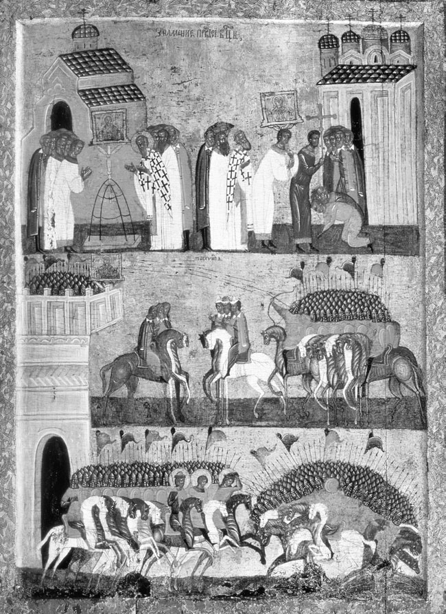

*图12.1 《诺夫哥罗德人与苏兹达尔人之战》，诺夫哥罗德画派，15世纪中叶，木板蛋彩与金饰。莫斯科特列季亚科夫画廊。*

<!-- PDF page 302; original page 281 -->

在《圣母会集像》（14世纪后期）中，山峦可见典型的“翡翠”绿色。这幅构图取材于颂扬主降生的赞美诗。上方熟悉的牧羊人、天使与东方贤士，下方又加入领唱者及执事唱诗班。这是礼仪本身的图像，把会众也纳入其中，使他们通过敬拜赞美上帝，并将自己的礼物献给基督。[^p302-17] 其他高水平圣像绘画的地方中心，包括弗拉基米尔、苏兹达尔、罗斯托夫和特维尔，其王公在14世纪曾竞争政治领导权。[^p302-18] 特维尔最著名的圣像之一，是所谓《蓝色圣母安眠像》（15世纪后期），这是一个广受欢迎题材的无数实例之一。[^p302-19] 同时也出现了学者称为“北方”画派的朴拙或“原始”艺术，以粗犷而大胆的笔法，以及吸收民间主题为特点。

在所有这些中心，王公、总主教及修道院的作坊都制作手抄本。制作在礼拜中使用、由司祭在游行时捧持、并陈列于祭台前的礼仪典籍，如《福音书》《使徒行传》与《圣咏集》，需要多种技艺。许多书以贵金属封套（oklady）华丽装帧，雕刻纹饰并镶嵌宝石。俄国手稿彩饰发展相对较晚，仍十分依赖圣像与壁画作为范本。图像不是用作插图，而是装饰文本；艺术家本人可能并不识读这些文字。最常见的主题，是传递圣书的四位福音作者。重要例子包括《西伊斯克福音书》（1339—1340年）与《希特罗沃福音书》（约1415年），两者都制作于莫斯科。[^p302-20]

## 莫斯科

14世纪起，政治与宗教权力日益集中于莫斯科城及公国。其雄心勃勃的统治者出自<!-- PDF page 303; original page 282 -->达尼尔·亚历山德罗维奇（1263—1303年）一系，兼并亲族与对手的土地，并获得蒙古人认可，使地位较高的大公头衔传给自己的继承人。1325年，俄国正教会首领彼得都主教，在伊凡一世亲王（1325—1340年在位）的莫斯科宫廷定居，大大推动了艺术发展。1327年，彼得与伊凡为莫斯科克里姆林宫第一座石造圣母安眠大教堂奠基。奉献给天主之母安眠（Uspenie）的教堂，被认为具有神迹力量；依据是经外传说：在耶路撒冷，使徒们在场见证马利亚的身体与灵魂升天。在君士坦丁堡，传为她的棺木与裹尸布的物件，与保护城市免遭敌袭，以及正教基督徒战胜非基督徒相联系。基辅洞窟修道院11世纪的圣母安眠教堂，则受到一位已皈依的异教徒蒙赐马利亚神视的启发。传说马利亚还以天火在地上烧出一幅平面图。因此，这些据说由马利亚亲自设计的教堂，成为后来圣母安眠大教堂的范本，其中最宏伟者于12世纪建于弗拉基米尔。[^p303-21] 莫斯科圣母安眠大教堂的兴建，表达了这样一种信念：上帝的恩宠经由耶路撒冷、君士坦丁堡、基辅与弗拉基米尔，转移到了莫斯科。这座建筑的意义植根于普世历史，并与神圣地景相联。它和其他重要大教堂，成为民族胜利及危难时举行礼仪的关键场所，也是汇集最神圣圣像及其他敬拜器物的中心。

修道院进一步为莫斯科提供实际和属灵保护。约1354年，后来成为拉多涅日的圣谢尔吉（约1314—1392年）的修士，在城北40千米处建立圣三一大修道院（lavra）。1360—1370年代，莫斯科城内建立了救主—安德罗尼科夫、楚多夫（意为“神迹”）与西蒙诺夫修道院。更北方，白湖的基里尔（卒于1447年）在湖畔建立修道院，吸引许多隐修士在附近居住；1420年代，圣佐西马与圣萨瓦季在白海建立索洛韦茨基修道院。画家逐渐发展出这些及其他修道圣徒的圣像图式，现存最早实例或许显示静修主义的内向凝视。静修主义的教导与实践——希腊语ἡσυχασμός，意为静谧——于14世纪在阿索斯山形成，经君士坦丁堡与巴尔干传至俄国。

<!-- PDF page 304; original page 283 -->

人们相信，静默的祈祷操练，能够使个人接触基督显圣容时在他泊山出现的神圣“非受造”之光；这是修道理想。但有学者认为，重要圣像画家“本身也是静修者，或以某种方式与他们有关”。[^p304-22] 证据缺乏，使这一说法无法得到证实；但总体而言，这一时期俄国与外国正教艺术家的联系确实增加了。例如，希腊人狄奥格诺斯托斯任都主教期间（1328—1354年），许多君士坦丁堡艺术家来到莫斯科。到该世纪末，城内建立起希腊人聚居区和教堂。

圣三一—圣谢尔吉修道院的圣三一大教堂（1422—1423年），很好地说明了在与静修主义相联的修道环境中，艺术与礼仪如何发挥作用。圣谢尔吉的传记作者智者叶皮法尼记载，圣徒祝圣大教堂，是“为了藉默观圣三一，克服对这世界可憎纷争的恐惧”。[^p304-23] 谢尔吉安葬于此。教堂是一座简洁的单穹顶建筑，穹顶下饰有名为科科什尼克的反曲线形山花，形成金字塔般的效果，属于早期莫斯科建筑的标志之一。它吸引朝圣者前来，在圣徒圣髑旁参与昼夜不断的祈祷。相传安德烈·鲁布廖夫正是为这座教堂绘制《旧约圣三一像》，悬挂于圣像屏上（图12.2）。[^p304-24]

## 圣像屏

圣像屏至今仍是俄国正教教堂敬拜不可分割的部分。[^p304-25] 拜占庭教堂以带帘幕的柱列，或称为templon的低矮透空栏屏，把中殿与圣所分开。这一设施后来发展为双层屏障；14世纪后期至15世纪初，在俄国又发展成更高、悬挂圣像的框架。到17世纪，框架获得鲜明的建筑特征，例如镀金、扭转、缠绕葡萄藤的柱子、檐口，以及容纳圣像的各式开口。大型大教堂的圣像屏有五层横排。最上方一排，表现《旧约》列祖，从亚当到摩西，中央常为《旧约圣三一像》。

<!-- PDF page 305; original page 284 -->

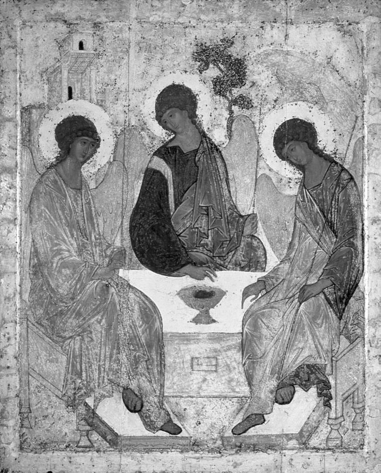

*图12.2 《圣三一》，1420年代，安德烈·鲁布廖夫（约1370—1430年）作，木板蛋彩。莫斯科特列季亚科夫画廊。*

下方是先知层，中央为《显兆圣母像》，即表示基督道成肉身的圣像。再下方是一排较小的《新约》主要庆节圣像。接着是最令人印象深刻的代祷层（Deesis），亦即祈祷层，中央为《荣光中登座的基督》。代祷层颂扬基督及其国度的来临；这是礼仪的核心事实。天主之母立于基督右侧，施洗约翰，亦即前驱，<!-- PDF page 306; original page 285 -->立于其左；两旁又有圣徒，最常见的是彼得与保罗，以及总领天使，低首倾身朝向基督。代祷层强调教堂建筑的作用：教堂本身是上帝居所的圣像，也是圣徒与天使为人类代求的场所。他们的图像与会众一起参与礼仪。正如约翰·梅延多夫所写：“正教宗教艺术与这样一种意识不可分离：人按上帝形象受造，圣像上的圣徒形象彰显一种圣德，而在上帝心中，这种圣德是所有人都能在礼仪中企及的。”[^p306-26]

与地面齐平的是圣像屏的“本地”层。其中央开王门，亦称圣门，自上而下饰以圣母领报、使徒领圣餐及四位福音作者的图像，象征上帝国度的入口；圣餐礼中，基督经此门被捧出。[^p306-27] 门右侧悬挂《威严中的基督》，以及教堂所奉献庆节的“本堂”圣像；圣三一大教堂所用，便是《旧约圣三一像》。门左侧是天主之母圣像，其他圣像补足这一排。

圣像屏过去与现在都是礼仪不可分割的部分：它既为司祭在礼拜关键时刻持十字架进出提供建筑背景，也是基督教普世历史与一年礼仪周期的缩影。敬拜者自上而下观看，可以读出《圣经》启示的救恩历史，并看见藉图像显现的天国应许。圣像屏并不被理解为会众所在中殿的象征空间——尘世、暂时——与圣所神圣奥秘——天界、永恒——之间的屏障，而是一扇窗，使敬拜者得以瞥见天界的临在。信徒在这一天地“边界”处，面对王门领受圣餐。教堂的中心功能，是举行圣餐礼；它既具有纪念面向，追念最后晚餐，也具有期待面向，等待基督再临。[^p306-28]

教堂建筑本身也是天地的圣像，无论内部布局——中殿、圣所与穹顶——还是外部空间——圆顶、立面的三分结构——都是如此。遍布堂内、置于礼仪空间中的壁画与圣像，为圣像屏发挥辅助作用。大型教堂内，各小礼拜堂及祭台，配有自己的小型圣像屏或<!-- PDF page 307; original page 286 -->独立圣像，为个别敬拜者服务；墙上成组壁画，则讲述《圣经》启示的救恩故事。全能基督从中央穹顶俯视，下有色拉芬承托。最后审判常绘于西门上方，连柱子也容纳圣徒形象。所有图像的形态，都被视为并非人类发明，而是植根于原型的历史真实性。它们可以依据真人绘成，例如圣路加为天主之母画像；也可以因神迹产生，例如印在布上的基督圣容布图像；可以依据代代相传的圣徒容貌及胡须形状之记忆；最后，也可以由上帝通过异象赐下。

《弗拉基米尔天主之母像》，亦称《温柔圣母像》，为考察这一时期灵验圣像在地方与民族生活中的作用，以及它们对同时代艺术家的影响，提供了有趣个案。这幅12世纪拜占庭原作，传说出自圣路加之手，先被送至基辅，后来转往弗拉基米尔。1395年帖木儿威胁莫斯科，莫斯科亲王德米特里命人从弗拉基米尔请来圣像，以帮助“拯救罗斯大地”。[^p307-29] 传说天主之母随后在异象中显现于帖木儿，命其离去，他便照办。圣像抵达莫斯科的8月26日，被庆祝为接迎节（sretenie），并成为新的圣像题材。斯列坚斯基修道院就建立于莫斯科人最初迎接圣像的地点。[^p307-30]

圣像永久移至莫斯科后，被安放于克里姆林宫圣母安眠大教堂王门右侧。[^p307-31] 人们制作复制品，包括所谓“备用像”（zapasnaia）。其中，马利亚不再忧伤地望向观者，而呈现更温和、更亲切的表情，目光转向自己的孩子。根据风格及间接证据，有学者认为，安德烈·鲁布廖夫可能至少参与其中一幅复制品的制作。[^p307-32] 这幅圣像还与<!-- PDF page 308; original page 287 -->其他神迹解救事件有关，包括1480年鞑靼人在乌格拉河与伊凡三世军队对峙后撤退；以及1521年6月23日，克里米亚、诺盖和喀山鞑靼人在异象中看见大军守卫城市后，决定不攻打莫斯科。[^p308-33] 这幅圣像属于若干与“帝权转移”（translatio imperii）观念相联的圣物之一。在这里，一幅12世纪圣像从君士坦丁堡迁移，象征天主之母的保护转至莫斯科。[^p308-34]

## 希腊人费奥凡与安德烈·鲁布廖夫

现存最早的莫斯科圣像绘画，出自1382年脱脱迷失袭击之后的年代。当时，俄国与外国画家受基普里安都主教（1390—1406年在任）及其他人委托，补作毁失作品。“黄金时代”莫斯科圣像的共同特征，包括修长身形、细小手足、安静而静止的姿态，以及纯净色彩的和谐呼应。[^p308-35] 14世纪后期受吸引来到莫斯科的艺术家中，有出自君士坦丁堡的希腊人费奥凡，即希腊人狄奥法尼斯（约1340—约1410年）。[^p308-36] 其早期艺术带有拜占庭帝国所谓帕莱奥洛格复兴的印记。费奥凡最著名的作品，是1378年为诺夫哥罗德伊林街救主显圣容教堂绘制的壁画，包括《旧约圣三一》；它们高度风格化，富于“表现主义”色彩和动感，以自由笔触、柔暗色调及白色提亮绘成。一般认为，费奥凡曾在莫斯科克里姆林宫的天主之母诞生教堂（1395年）、总领天使米哈伊尔教堂（1399年），以及王公的王室礼拜堂圣母领报教堂（1405年）工作。后者代祷层的若干圣像，被归于他名下，包括《救主》《天主之母》与《施洗约翰》。[^p308-37] 归于其作坊的还有著名《顿河天主之母像》，背面绘《圣母安眠》；以及来自佩列斯拉夫尔的《显圣容》，其中蓝色光芒从基督发出，落在门徒衣服上。[^p308-38]

<!-- PDF page 309; original page 288 -->

专家对费奥凡影响俄国画家的程度意见不一。甚至有人指出，这位希腊人后期作品反而显示俄国艺术家、尤其安德烈·鲁布廖夫的影响。[^p309-39] 鲁布廖夫是唯一在俄国以外也为人熟知的中世纪圣像画家，但我们对他确知的事情仍很少。对其生平与作品的严肃研究，直到20世纪最初十年、清理其《圣三一像》时才开始；这也是把圣像作为艺术品“重新发现”的里程碑。[^p309-40] 学者对他的出生时间与地点、家世、社会地位，以及何时何地成为修士，意见均有分歧。把1960年定为诞辰六百周年，与冷战期间苏联弘扬俄国文化遗产的关系，比与历史准确性的关系更密切。苏联历史学家给鲁布廖夫贴上“人文主义者”标签，认为他“克服教会教规的束缚”，成功创作出“在俄罗斯及世界艺术宝库中，如无价宝石般闪耀”的绘画。[^p309-41] 18世纪学者G. F. 米勒的文稿中，发现了一份记载他于1430年1月29日去世的铭文抄本，但原件已失。[^p309-42] 较近时期，V. G. 布留索娃把鲁布廖夫之死定于“约1427年”。[^p309-43]

学者依据编年史及圣徒传中的零星记载，梳理鲁布廖夫及达尼尔·乔尔内等同伴画家的活动；这些记载有些出于同时代，有些并非如此。1395年一则编年记载提到，费奥凡的若干学生（uchenitsy）在莫斯科克里姆林宫工作，其中一人或许就是安德烈。[^p309-44] 鲁布廖夫现存最早作品，很可能是兹韦尼哥罗德“城堡上”（na Gorodke）的圣母安眠大教堂壁画（1401—1405年）。[^p309-45] 他与费奥凡在1405年的联系更为可靠：一则大概写于1484年以后的记载称，莫斯科克里姆林宫旧圣母领报大教堂，由“希腊圣像画家费奥凡、来自戈罗杰茨的长老修士（starets）普罗霍尔，以及修士（chernets）安德烈·鲁布廖夫”绘饰。[^p309-46] 领报大教堂圣像屏庆节层左侧，归于鲁布廖夫的<!-- PDF page 310; original page 289 -->圣像包括《进入耶路撒冷》《基督降生》《拉撒路复活》及《显圣容》。[^p310-47]

最早与鲁布廖夫同时代的记载，见于1408年：“5月25日，遵大公之命，开始为弗拉基米尔那座伟大的石造天主至圣之母〔安眠〕大教堂绘画；画家是圣像画师（ikonnik）达尼尔〔乔尔内〕与安德烈·鲁布廖夫。”[^p310-48] 保存下来的题材包括显圣容、进入圣殿，以及约阿希姆、安娜与撒迦利亚。1420年代，应尼孔院长邀请，安德烈与达尼尔为圣三一—圣谢尔吉修道院的圣三一大教堂绘制壁画。尼孔生平的记述说，这些圣像画家“在其蒙上帝喜悦、受祝福的生命末尾，以壁画装饰那座教堂，然后亲近相伴、在属灵合一中归于主上帝，正如他们在此生活时一样；他们把最后这些画留下，作为人人可见的自身纪念”。[^p310-49] 然而，其他史料说，安德烈最后的工作在莫斯科安德罗尼科夫修道院；在那里，“他亲手以奇妙绘画装饰美丽的教堂”。[^p310-50] 遗憾的是，这些壁画与圣三一壁画都未保存下来，虽然后者17世纪的重绘或许沿袭鲁布廖夫的轮廓。[^p310-51]

鲁布廖夫的圣像没有一幅标明年代——中世纪圣像很少标年——也没有一幅在同时代编年史中被提及。其来源最初只有传统提供线索，后来才辅以风格及科学分析。《旧约圣三一像》这幅“最典型的俄罗斯圣像”（图12.2），也是如此。[^p310-52] 许多研究把它定年为1422—1427年，理由是鲁布廖夫在去世前不久，为新圣三一大教堂完成其杰作。《拉多涅日的尼孔传》叙述，院长如何请安德烈为圣像屏本地层绘制本堂圣像，圣像屏于1427年以前完成，用以“赞颂他的〔属灵〕父亲、行神迹者<!-- PDF page 311; original page 290 -->谢尔吉”。[^p311-53] 这幅圣像从15世纪至1920年代，一直挂在王门右侧，后来被带到莫斯科，在特列季亚科夫画廊展出；本书撰写时仍藏于那里。另一种说法认为，它实际上是为圣谢尔吉的墓而作，后来才置于圣像屏；到1640年代首次描述修道院时，已在屏上。[^p311-54] 然而，有学者提出更早的年代，认为安德烈为圣三一大教堂绘制的，是这一题材的另一个版本。[^p311-55] 一种激进理论认为，这幅圣像原绘于兹韦尼哥罗德，由曾在圣三一修道院受洗的伊凡四世沙皇于1550年代捐赠给该院。[^p311-56] 鲁布廖夫也确实直到伊凡四世时期，才开始声名渐盛。

这些或许无法调和的分歧，并不减损图像的重要性；它以绘画形式表达基督教的本质。围桌而坐的三个形象，出自《创世记》18:1—16，有时称为“亚伯拉罕款待来客”的一幕。三个人，即天使，在幔利橡树下向亚伯拉罕显现，预言他已过生育年龄的妻子撒拉将奇迹般生下一子。欣喜的夫妇命仆人宰肥牛，款待使者。有些版本在画面下方，绘出亚伯拉罕、撒拉，以及宰牛的仆人。[^p311-57] 基督教神学家把这段经文解读为《旧约》预示《新约》的众多原型或预表之一。天使代表圣父、圣子与圣灵，从左至右，大概依此排列。[^p311-58] 圣爵象征圣餐，是永生的凭据；人物轮廓又形成另一只杯。树，即生命树，预表十字架；左侧建筑象征神圣智慧，<!-- PDF page 312; original page 291 -->或许也象征教会；右侧山峦象征属灵力量。构图“超尘世”的几何安排——桌子上的逆透视、相交三角形、八角形，以及最重要、环抱天使与圣爵的圆形——既创造审美平衡与和谐，也增加象征层次。圣像体现牺牲的观念：宰牛的牺牲，即使未画牛犊，圣爵中也可能看见牛头，预表上帝羔羊基督为人类献身。[^p312-59]

归于鲁布廖夫的另一幅图像，结构较简单，却同样令人难忘：宏伟的《救主》。一般认为，它出自兹韦尼哥罗德“城堡上”的圣母安眠大教堂代祷层，暂定为15世纪最初十年。[^p312-60] 基督面容既令人敬畏，又充满怜悯，“与俄国的美之理想相契合”。[^p312-61] 木板的破损，以及1918年修复师G. O. 奇里科夫在一间棚屋的柴堆下发现它的故事，使这幅图像更为动人。与它一起发现的，还有尺寸相近的圣保罗与总领天使米哈伊尔像，推测都从原有七个或九个人物的代祷组像中幸存。[^p312-62] 三幅现陈列于特列季亚科夫画廊。

现代对鲁布廖夫的颂扬，强调他是世界级艺术家与工匠，或强调其“人文主义者”资格，扭曲了俄国中世纪对圣像画家的看法。鲁布廖夫最早的“传记作者”之一，沃洛科拉姆斯克的约瑟夫院长（1439—1515年），有一段归于他的话，概括了这种看法：

> 这些奇妙而著名的圣像画家，达尼尔、他的学生安德烈，以及许多与他们相似的人，对斋戒和修道生活怀有如此有德的热忱，以致能够领受神恩。他们不断把心智与思想提升至神圣的非物质之光，又把肉身之眼转向以物质颜料绘成的基督、其至洁之母及诸圣的图像。[^p312-63]

在鲁布廖夫作品中，灵性，即精神之美，与审美，即形式之美，密不可分。

<!-- PDF page 313; original page 292 -->

## 克里姆林宫[^p313-64]

鲁布廖夫的成就，全都与莫斯科地区有关。莫斯科克里姆林宫把艺术、建筑与礼仪结合得最为壮观。在这里，地方敬礼让位于一种全国性表达：莫斯科王公在教会主教团支持下，拥有最高地位。莫斯科教会与国家把自己呈现为正教的捍卫者，不仅在俄国，也在整个正教世界如此。历史学家常把这一愿望浓缩为“莫斯科是第三罗马”。1480年，伊凡三世（1462—1505年在位）正式拒绝向蒙古人纳贡。他采用拜占庭、亦为哈布斯堡所用的双头鹰，与末代拜占庭皇帝的侄女成婚，并偶尔在其他头衔外加入“沙皇”，即凯撒之称，都显示出帝国抱负。这种抱负也在15世纪末克里姆林宫的重建与整修中获得视觉表达。这些不只是供外人观看的“威望”工程。克里姆林宫各大教堂位于莫斯科神圣的核心，建筑及其中物件共同形成神圣地景。人们在这里以特别隆重的仪式庆祝熟悉的礼仪年周期，复活节周尤为壮丽；沙皇、其男性亲属、波雅尔贵族及教会高级教士出席。另有特别礼拜，纪念民族胜利及王朝生命礼仪：命名日、洗礼和婚礼通常在圣母领报大教堂举行，加冕和葬礼后来分别在圣母安眠及总领天使大教堂举行。此外，沙皇住所内有私人礼拜堂，包括供皇后及公主使用者；这些女性是敬拜器物的重要委托者。克里姆林宫圣像或由最优秀大师绘制，或因灵验力量、特殊联系而从别处搜集。

1475年，一座由俄国工匠建造的替代教堂倒塌后，伊凡三世邀请意大利建筑师阿里斯托蒂莱·菲奥拉万蒂，兴建新的圣母安眠大教堂。菲奥拉万蒂奉命以弗拉基米尔13世纪的圣母安眠大教堂为范本；这并非如现代历史学家有时年代错置地以为，是要确保新教堂具有“民族”精神，或避免“异端”天主教主题，而是为了遵循一项据说由天主之母亲自开创、神秘而奇迹性的传统。[^p313-65] 这座五穹顶大教堂于1479年完成，把俄国—拜占庭形式与文艺复兴的<!-- PDF page 314; original page 293 -->比例及工程技术相结合。1484年，俄国建造者兴建新的圣母领报王室礼拜堂。瓦西里三世沙皇（1505—1533年在位）又以总领天使米哈伊尔大教堂，完成克里姆林宫三大教堂的组合；该堂于1505—1509年由另一位意大利人阿莱维西奥·诺维设计。山墙上的威尼斯贝壳装饰，后来被许多建筑模仿。三座大教堂均设华丽圣像屏，遍绘成组壁画。就连由马尔科及皮耶罗·安东尼奥·索拉里建造、1487年动工的多棱宫，内部也饰宗教壁画。[^p314-66]

这一大型建筑计划，为画家创造了工作，包括狄奥尼西（约1440—约1507年）及其儿子们；他们经营着十分成功的作坊网络。[^p314-67] 其最早有记载的作品，是帕夫努季—博罗夫斯克修道院圣母诞生教堂壁画（1467—1477年）。1481年，他受委托为克里姆林宫新圣母安眠大教堂绘制壁画。原作可能尚存某些残片，包括《贤士来朝》，但多数已被重绘覆盖。[^p314-68] 现存代祷层部分归于他，一对彼得与阿列克谢都主教圣像亦然。其作品还见于克里姆林宫升天修道院、沃洛科拉姆斯克修道院、沃洛格达附近奥布诺尔斯克的圣保罗修道院圣三一大教堂，以及白湖圣费拉蓬特修道院。后者天主之母诞生大教堂的蓝、白、金色壁画（1502—1503年？），属于他保存最完整的作品。狄奥尼西及其团队也绘制了代祷层圣像（约1502年）：比例优雅、身形修长的人物，绘在高约155厘米、宽60厘米的木板上，以细腻提亮、丰富多样的色彩，映衬象征神圣之光的金色背景。[^p314-69]

狄奥尼西的标志，是高度风格化、修长、近乎无肉身感的人物，在金色或白色背景前有节奏地排列，细节减至最低。连苦难也被风格化而显得和谐。例如《钉十字架》（约1500年）中，基督身体只轻微弯曲；依照正教方式，不作任何自然主义的伤口描绘。狄奥尼西及其画派使用充满光辉的色彩，无须大量提亮便达到通透效果。[^p314-70] 常用颜色为赭石、朱砂、红、紫、蓝及翡翠绿。

<!-- PDF page 315; original page 294 -->

狄奥尼西的生涯，与圣尼尔·索尔斯基（1433—1508年）的苦修教导追随者，以及圣沃洛科拉姆斯克的约瑟夫（1439—1515年）较世俗观点的支持者之间的竞争相重叠；两者分别称为非占有派与占有派。他的艺术是“一种不寻常的妥协，企图结合两个无法结合的要素：内在纯洁与外在仪式主义”。[^p315-71] 他被称为俄国中世纪“最后一位伟大画家”。这种看法，与另一种信念相容：约瑟夫较世俗观点的胜利，以及国家日益增长的“凯旋主义”，与俄国圣像绘画灵性的衰落同时发生。同一时期，俄国正教会努力消除异议者剪发派及犹太化派异端中的反圣像倾向。1490年教会会议针对犹太化派的声明，谴责那些“嘲弄圣像上所绘基督与至洁圣母形象的人……另一些人毁坏圣像，将其投入火中焚烧。你们辱骂了圣像上所绘人物的神圣形象”。[^p315-72] 《致圣像画家书》（1480或1490年代）本身就包含对这些异端的论战；它分别被归于约瑟夫或尼尔，或许是回应狄奥尼西求取指导而写。[^p315-73]

正教神学既通过单幅圣像表达，也通过图像、时间——教会年——及空间——教堂内部——之间的关系表达。本章时期，俄国大多数平信徒不识字，但这并不意味着圣像如有时所想，是一种因别无更好办法、用来代替文字的图画教学辅助。它们本身与书写文字一样，构成基督教教义的文本。确实，许多圣像必须在远处、昏暗光线中观看，故偏好醒目简洁的轮廓及色块，使主要题材易于辨识；但这样“删繁就简”的动力，既是属灵的，也是教导性的。“圣像本质上不是一篇讲道，不是用颜色作出的劝诫。人凝望它、把自己交付给艺术默观时，它的道德与教育力量才发挥作用。”[^p315-74]

学者能在一定程度上研究其生涯的少数艺术家，大多服务于保存记录的重要大教堂和修道院。然而，正教虔敬并不限于教堂或修道院，圣像也不局限于正式祝圣的空间。任何地方都可成为<!-- PDF page 316; original page 295 -->上帝的居所：从农民茅屋里以角落一两幅圣像构成的“通天之窗”或“天上耶路撒冷”，到王公宫殿的私人礼拜堂。[^p316-75] 可携的折叠圣像屏，或分层绘画的单块木板，使信徒能够在任何地方展开一个属灵世界。军队把圣像置于便携礼拜堂随行，街头十字架游行也捧持圣像。

## 伊凡四世[^p316-76]

“雷帝”伊凡四世在位期间（1533—1584年）的发展，显示艺术与建筑、礼仪、国家体制及统治权之间复杂的联系；这既关乎人们所认定的俄国在世界史中的地位，也关乎君主作为真正信仰保护者之角色的增强。莫斯科统治者是上帝选民的观念，使他们承担某些义务，必须不断检查俄国属灵生活与实践的“纯洁”。1547年莫斯科发生大火，教士将其解释为悔改与洁净的信号。诺夫哥罗德圣像画家被调往莫斯科。在曾任诺夫哥罗德总主教、本身也是圣像画家的马卡里都主教帮助下，伊凡积极赞助圣物的制作与搜集。正如前任统治者把罗斯土地“收集”于莫斯科领导之下，伊凡如今从其他城市把古老圣像或复制品、圣徒圣髑及其他物件带往莫斯科。马卡里本人也有许多委托，例如所谓《博罗夫斯克福音书》，以鎏金银封套装帧，镶嵌宝石及珍珠母（1530—1533年）。

16世纪创作出许多新的圣像构图，以表达复杂思想；一位历史学家说，它们会“诉诸理智而非灵魂”。[^p316-77] 这些高度复杂的题材，表现圣经文本、赞美诗与祈祷。一幅著名例子来自圣母安眠大教堂，称为《天上君王的军旅有福了》，或《战斗的教会》，依据《但以理书》第12章及《启示录》第19章绘成。画中，总领天使米哈伊尔带领另一位被认定为伊凡四世的骑士及其军队，从喀山前往莫斯科，即从所多玛前往天上耶路撒冷；天使手持殉道者冠冕护送。未标身份的人物，或许包括圣徒亲王弗拉基米尔、鲍里斯与格列布。人间战争<!-- PDF page 317; original page 296 -->因此被表现为与邪恶势力的宇宙性斗争，莫斯科军事精英“被安排为上帝亲自的战士”。这种构图在巴尔干已有先例。[^p317-78] 另有较小版本，出自16世纪第三个四分之一时期，历史及圣经人物均有题字标明身份。[^p317-79] 简单把这些圣像斥为“政治性”，会造成误解，因为宫廷生活本身就依据神圣模式及对应关系来理解。在圣徒圣像中，重心也从引导默观祈祷、孤独而被神圣光辉转化的圣徒形象，转向沿木板四周排列其事迹的叙事，为他人提供生活榜样。

许多新“神学”圣像充满细小细节；有历史学家把它归咎于波斯及土耳其装饰性“东方蔓藤纹”的影响，[^p317-80] 认为由此导致灵性流失，以及“拜占庭礼仪艺术视野的瓦解”。[^p317-81] 当然，16世纪，尤其17世纪，俄国通过外交与贸易同外部世界、东西双方日益增长的接触，必然在艺术中留下痕迹。私人祈祷所需圣像的需求也增加了：它们通常尺寸不大，却细节丰富，适于近距离细看。16世纪神迹敬礼激增，促使人们创作表现神迹的新圣像题材，也复制古老灵验圣像。[^p317-82] 许多月历圣像（menaion）被制作出来，成套木板各以一排排微型圣徒及庆节图像，表现教会历中的一个月份。[^p317-83] 圣像图式惯例也应用于以其他媒材制作、供礼仪使用的图像，例如贵金属圣爵、游行十字架及圣髑十字架。圣徒墓上使用的织物覆毯或裹尸布，饰有全身肖像，以拼布、绣字，以及金银线和珍珠刺绣制成。俄罗斯博物馆所藏白湖圣基里尔墓覆毯，便是优良实例。一些最佳作品出自皇后作坊，例如腓力都主教墓覆毯（1590年代）。[^p317-84]

<!-- PDF page 318; original page 297 -->

没有原型的新题材，可能诱使人偏离。1551年的百章教会会议，试图遏止宗教生活各领域的弊端与失序，其声明中包括一段被称为“俄国史料中最早关于视觉艺术的详尽、公开且权威的评论”。[^p318-85] 它重申圣像绘画的严格规则：承认上帝赐予的天赋值得珍视，但认为画家的属灵及道德品质，比纯粹技术更重要。第43章规定，画家必须品德无可指摘，谦卑、温顺、虔诚、贞洁，并始终服从属灵之父。另一要求，是依照“受祝圣的类型”绘制圣像。画家若不依循既有图像，而“出于自己的发明与猜测”绘画，将受惩罚。教会高级教士负责组织检查。会议十分看重“古代画家”的榜样，命艺术家“依据古老范本绘制〔圣三一〕，如希腊圣像画家，以及安德烈·鲁布廖夫所画”。[^p318-86] 绘画范本书（podlinniki）提供标准圣像类型的线描，作为指导。

这些规则还不足以使国务秘书I. M. 维斯科瓦特安心。他在1553—1554年教会法庭上反对说，艺术家，尤其在克里姆林宫教堂工作的画家，“按照自己的理解”绘画，偏离传统，不加适当题字，还插入“世俗”元素，包括自然主义特征。有些人物依“拉丁”方式画得“宛如活人”；另有一些不可接受，例如把圣父上帝画成年长男子。[^p318-87] 教会驳回了维斯科瓦特的申诉。

16世纪俄国兴建的砖石教堂，比此前所有世纪的总和还多。大多数如同圣像一样，遵循传统拜占庭设计，融合俄国特征，例如此时已发展成熟的洋葱头穹顶，以及层叠的科科什尼克装饰山花。但也出现鲜明创新，特别是建于八角塔之上的帐篷形屋顶（shater）。一些建筑史家认为，这些八角柱式结构受到木造教堂建筑启发，但无法验证具体传播路径。由于内部空间有限，它们本来就以供外部观看为设计目的。其中有三座特别引人注目，标记伊凡四世生命中的关键日期。

<!-- PDF page 319; original page 298 -->

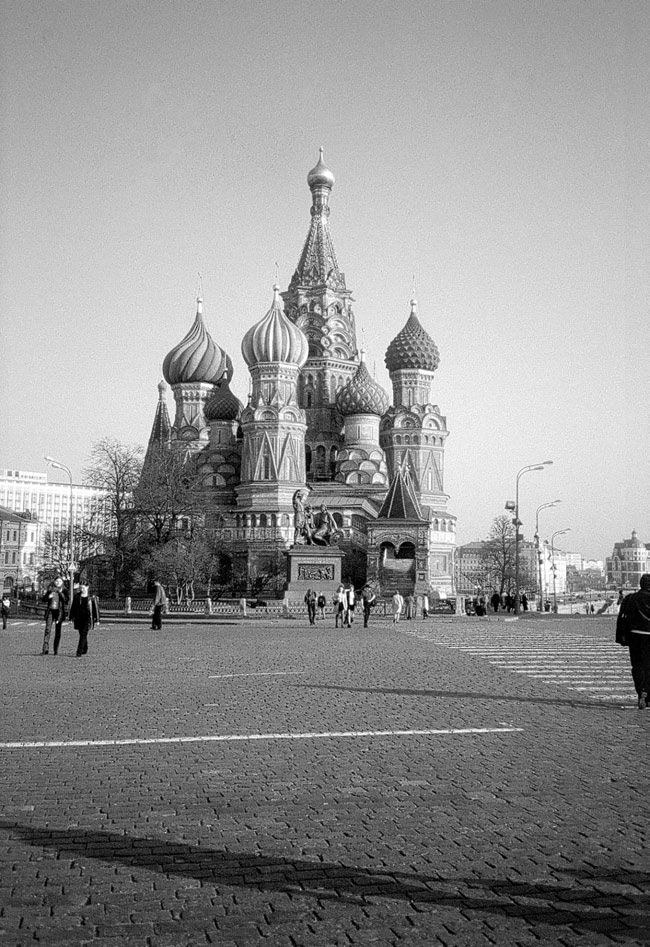

*图12.3 莫斯科圣瓦西里大教堂。*

<!-- PDF page 320; original page 299 -->

其父瓦西里三世于1532年在科洛缅斯科耶建造升天教堂，庆祝儿子诞生。第二座是附近季亚科沃的施洗约翰教堂，纪念伊凡1547年加冕。第三座是红场上俗称圣瓦西里大教堂的建筑（1555—1561年，图12.3）。

圣瓦西里大教堂的建筑，体现了许多关于俄国在神圣历史中地位、以及当时地缘政治角色的关键观念。它最初包括九座礼拜堂，每座有自己的圣像屏。更准确的名称应来自中央礼拜堂，奉献给天主之母覆帡，或代祷（Pokrov）。该节日为10月1日，即1552年俄国人攻克鞑靼要塞喀山的前一天。因此，这一奉献见证伊凡四世在胜利前夕对祈祷力量的信赖。[^p320-88] 它也被联系到沙皇攻克喀山后，访问苏兹达尔覆帡修道院，以及伊凡与12世纪弗拉基米尔—苏兹达尔王公的王朝纽带；这些王公从君士坦丁堡引入该节。圣像表现一则异象：在君士坦丁堡圣布拉西奥斯教堂，圣母把保护斗篷张覆在会众之上，而这种保护将转移到罗斯大地。[^p320-89]

中央覆帡礼拜堂四周，是四座八角形礼拜堂，其奉献都可与伊凡四世的胜利及虔敬关切相联。西面为基督进入耶路撒冷礼拜堂，该主题历来与帝王凯旋相联。北面奉献给圣基普里安与圣乌斯季尼娅，其庆日在10月2日，正值攻克喀山之日。东面为圣三一礼拜堂，反映伊凡对圣三一—圣谢尔吉修道院及圣三一像的敬重。[^p320-90] 南面奉献给韦利科列茨克的圣尼古拉，纪念一幅1555年送往莫斯科修复、游行时经过工地的灵验圣像。此外，还有四座较小的矩形礼拜堂：西北一座奉献给亚美尼亚的圣格里高利，其9月30日庆日，与伊凡1552年在阿尔斯卡亚原野获胜之日重合；西南一座奉献给圣瓦尔拉姆·胡滕斯基，其庆日在11月6日，伊凡几乎肯定在1552年攻克喀山后，于这一天凯旋进入莫斯科；而<!-- PDF page 321; original page 300 -->东南与东北另两座，则奉献给庆日在8月30日的圣徒；这也是1552年俄国人另一次战胜鞑靼人的日期。因此，大教堂是一组还愿感恩的圣所，向天主之母、圣三一，以及与围攻、征服喀山有关的圣徒致谢。它也被理解为天上耶路撒冷王国的一幅圣像，人们通过西面的礼拜堂，象征性地进入其中。伊凡在位后期，圣枝主日游行从克里姆林宫的内在圣域出发，来到更公开的红场空间，再到这座礼拜堂。[^p321-91] 大教堂也在其他艺术形式中有对应物。例如，圣瓦西里中央塔与1551年为圣母安眠大教堂制作的伊凡四世所谓“沙皇座位”（tsarskoe mesto），十分相似。两者都饰有科科什尼克、三角楣及小柱，显示其在神圣保护观念上的思想亲缘，把沙皇参与礼仪的位置，与王室胜利纪念物联系起来。[^p321-92]

大教堂的俗名，来自它与真福瓦西里（Vasilii Blazhenny，1489—1552年）这位“为基督的缘故而愚拙者”的联系。[^p321-93] 瓦西里穿破衣、戴沉重锁链，在莫斯科四处行走，以预言著称，包括预告1547年莫斯科大火。他预言伊凡将杀害长子后不久去世；伊凡后来确于1581年如此做了。[^p321-94] 1588年，伊凡另一子费奥多尔·伊凡诺维奇沙皇，在圣三一礼拜堂旁增建圣瓦西里礼拜堂。每天都有人在其圣龛前唱诵向圣瓦西里的祈祷；圣龛有独立的地面入口。礼拜堂也保存沃洛格达圣愚、“为基督而愚拙的约安”（Ioanna Khrista-rad，卒于1599年）的圣髑。

费奥多尔·伊凡诺维奇沙皇（1584—1598年在位），有时被描绘为某种王室圣愚。他无嗣而终，使一条经莫斯科达尼尔家系上溯至半传奇人物留里克的王统终结。其绝嗣引起的竞争，是王朝、社会及民族崩溃时期的根源之一；这一时期称为“混乱时期”（1598—1613年），发生于费奥多尔的继任者、波雅尔鲍里斯·戈东诺夫（1598—1605年在位）去世之后。[^p321-95] 人们相信，混乱时期与近四百年前的蒙古入侵一样，是对俄国“罪孽”的惩罚。到<!-- PDF page 322; original page 301 -->17世纪，人们对教堂、修道院、圣像及圣物的需要，一如以往；但俄国文化将日益受到西方潮流影响。这一趋势最终在彼得大帝的西化计划，以及宗教艺术与建筑设计中新惯例的出现中达到高潮。

## 注释

[^p297-1]: 本章通用“俄国”及“俄国人”等词，但我知道同时代文献使用的是“罗斯”（Rus）及其变体。

[^p297-2]: D. S. Likhachev, Pamiatniki literatury drevnei Rusi. XIII vek (Moscow: Khudozhestvennaia literatura, 1981), 190–1.

[^p297-3]: Leonid Uspenskii, Theology of the icon (Crestwood, NY: St Vladimir’s Seminary Press, 1992), ii, 257.

[^p298-4]: 参见 C. J. Halperin, Russia and the Golden Horde: the Mongol impact on Russian history (London: I. B. Tauris, 1985).

[^p298-5]: 历史背景参见 R. O. Crummey, The formation of Muscovy, 1304–1613 (London and New York: Longman, 1987).

[^p298-6]: M. A. Alpatov, Drevnerusskaia ikonopis’ (Moscow: Iskusstvo, 1974), 12. 1960—1970年代，研究俄国早期文化遗产的工作在官方认可下复兴，既产生了极有价值的学术成果，也出现了意识形态倾向较强的研究。 例如参见 D. S. Likhachev, Kul’tura Rusi vremeni Andreia Rubleva i Epifaniia Premudrogo (konets XIV–nachala XV v.) (Moscow and Leningrad: Nauka, 1962).

[^p299-7]: 参见 A. M. Lidov, ‘Ierusalimskii kuvuklii. O proiskhozhdenii lukovichnykh glav’, in Ikonografiia arkhitektury: sbornik nauchnykh trudov, ed. A. L. Batalov (Moscow: Akademiia khudozhestv, 1990), 57–68.

[^p299-8]: 俄国圣像绘画的通论，参见 M. V. Alpatov, Early Russian icon painting (Moscow: Iskusstvo, 1978); V. N. Lazarev, Russian icon: from its origins to the sixteenth century, ed. G. I. Vzdornov (Collegeville, MN: Liturgical Press, 1997).

[^p299-9]: 参见 William C. Brumfield, A history of Russian architecture (Cambridge: Cambridge University Press, 1993), 64–70.

[^p299-10]: 参见 V. Laurina (ed.), Novgorod icons, 12th–17th century (Oxford and Leningrad: Aurora, 1980).

[^p299-11]: 图版及包括年代问题的讨论，参见 R. Grierson, Gates of mystery: the art of Holy Russia (Fort Worth, TX: InterCultura, [1992]), 180–2.

[^p300-12]: 参见 Alpatov, Early Russian icon painting, plate 114.

[^p300-13]: 同上, plate 120.

[^p300-14]: 同上, plates 24, 25, 57.

[^p300-15]: Grierson, Gates of mystery, 175–7.

[^p300-16]: 参见 同上, 165–9, 其中有14世纪初的实例。

[^p302-17]: 图见 I. Kozlova, Masterpieces of the Tretyakov Gallery (Moscow: Acropolis, 1994), 18.

[^p302-18]: 参见 N. V. Rozanova, Rostovo-suzdal’skaia zhivopis’ XII–XVI vekov (Moscow: Izobrazitel’noe iskusstvo, 1970); V. L. Vakhrina, Ikony Rostova Velikogo (Moscow: Severnyi palomnik, 2003); A. Rybakov, Vologodskaia ikona: tsentry khudozhestvennoi kul’tury zemli Vologodskoi XIII– XVIII vekov (Moscow: Galart, 1995).

[^p302-19]: 图见 Masterpieces of the Tretyakov Gallery, 31. 另参见下文关于圣母安眠教堂的讨论。

[^p302-20]: J. Cracraft, The Petrine revolution in Russian imagery (Chicago: University of Chicago Press, 1997), 64; O. S. Popova, Russian illuminated manuscripts (London and New York: Thames and Hudson, 1984).

[^p303-21]: D. S. Likhachev, ‘Gradozashchitnaia semantika Uspenskikh khramov na Rusi’, in Uspenskii sobor Moskovskogo Kremlia, ed. E. S. Smirnova (Moscow: Nauka, 1985), 17–23.

[^p304-22]: Uspenskii, Theology, ii, 261.

[^p304-23]: 同上, 256; Likhachev, Kul’tura Rusi vremeni Andreia Rubleva.

[^p304-24]: 参见下文第 289–91.

[^p304-25]: N. Markina, ‘The iconostasis’, in The art of Holy Russia: icons from Moscow 1400–1660 (London: Royal Academy of Arts, 1998), 69–75; N. Labrecque-Pervouchine, L’iconostase: une évolution historique en Russie (Montreal: Bellarmin, 1982).

[^p306-26]: 载 Grierson, Gates of mystery, 41.

[^p306-27]: 例如参见 同上, 97.

[^p306-28]: 同上, 37–44.

[^p307-29]: Moskva, eia sviatyni i pamiatniki [Izbrannye stat’i po opisaniiu Moskvy] (St Petersburg: Iablonskii, 1898), 38.

[^p307-30]: Istoricheskoe opisanie moskovskogo Uspenskogo sobora i ego sviatyni (Moscow: Efimov, 1880), 27–9; Moskva, eia sviatyni, 70–1.

[^p307-31]: O. E. Etingof, ‘K rannei istorii ikony “Vladimirskaia Bogomater’” i traditsiia Vlakhernskogo Bogorodichnogo kul’ta na Rusi v XI–XII vv.’, in Drevnerusskoe iskusstvo: vizantiia i drevniaia Rus’. K 100-letiiu Andreia Nikolaevicha Grabara (1896–1990), ed. E. S. Smirnova (St Petersburg: Nauka, 1999), 296, 298–300.

[^p307-32]: E. K. Guseva, ‘Ikony “Donskaia” i “Vladimirskaia” v kopiiakh kontsa XIV–nachala XIV v., in Drevnerusskoe iskusstvo. XIV–XV vv (Moscow: Nauka, 1984), 56.

[^p308-33]: Moskva, eia sviatyni, 76.

[^p308-34]: 参见 J. Billington, The icon and the axe (London: Weidenfeld and Nicolson, 1966), 32.

[^p308-35]: The art of Holy Russia, 45.

[^p308-36]: 关于费奥凡生涯最详细的记述，是智者叶皮法尼的一封信（约1410年）。关于费奥凡，参见 V. N. Lazarev, Feofan Grek i ego shkola (Moscow: Iskusstvo, 1961); M. V. Alpatov, Feofan Grek (Moscow: Iskusstvo, 1979); G. I. Vzdornov, Feofan Grek, Tvorcheskoe nasledie (Moscow: Iskusstvo, 1983).

[^p308-37]: 参见 Engelina Smirnova, Moscow icons, 14th–17th centuries (Oxford: Phaidon, 1989), 263–4, 其中讨论了这些有争议的作者归属。

[^p308-38]: Alpatov, Early Russian icon painting, plates 59–66.

[^p309-39]: Uspenskii, Theology, ii, 273–4, n. 48.

[^p309-40]: 早期研究包括 N. P. Likhachev, Manera pis’ma Andreia Rubleva (St Petersburg: Tip. M. A. Aleksandrova, 1907) and N. I. Punin, Andrei Rublev (Petrograd: Apollon, 1916), 23.

[^p309-41]: 参见 Lindsey Hughes, ‘Inventing Andrei: Soviet and post-Soviet views of Andrei Rublev and his Trinity icon’, Slavonica 9 (2003), no. 2, 83–90. 引文出自 P. Sokolov-Skalia, ‘Andrei Rublev’, Nauka i Religiia 9 (1960), 85–7. 另参见 N. Kuz’min, ‘Zhivopis’ pereshagnivshaia veka’, Literaturnaia Gazeta, 15 Sept. 1960, 3.

[^p309-42]: G. I. Vzdornov, Troitsa Andreia Rubleva. Antologiia (Moscow: Iskusstvo, 1981), 7.

[^p309-43]: V. G. Briusova, Andrei Rublev i moskovskaia shkola zhivopisi (Moscow: Veche, 1998), 130.

[^p309-44]: 史料综述参见 M. N. Tikhomirov, ‘Andrei Rublev i ego epokha’, Voprosy istorii 1 (1961), 3–15.

[^p309-45]: V. A. Plugin, Master Sviatoi Troitsy: trudy i dni Andreia Rubleva (Moscow: ‘Mosgorarkhiv’, 2001), 508.

[^p309-46]: Tikhomirov, ‘Andrei Rublev i ego epokha’, 6.

[^p310-47]: Alpatov, Early Russian icon painting, plates 74, 76, 77, 79; Plugin, Master Sviatoi Troitsy, 21–43.

[^p310-48]: M. D. Priselkov, Troitskaia letopis’: rekonstruktsiia teksta (Moscow and Leningrad: Nauka, 1950), 466; Polnoe sobranie russkikh letopisei (以下简称PSRL), xxv, 237; Tikhomirov, ‘Andrei Rublev i ego epokha’, 5–6.

[^p310-49]: PSRL, vi, 138.

[^p310-50]: Kniga o Sergii (Moscow, 1646), 转引自 Tikhomirov, ‘Andrei Rublev i ego epokha’, 13.

[^p310-51]: Plugin, Master Sviatoi Troitsy, 509.

[^p310-52]: R. Milner-Gulland, The Russians (Oxford: Blackwell, 1997), 199. 另参见 ‘Andrei Rublev. (Sviatye zemli russkoi)’, Nauka i Religiia 4 (1998), 32–3; A. Nikitin, ‘Kto napisal “Troitsu Rubleva”?’, Nauka i Religiia 8 (1988), 44–8.

[^p311-53]: A. A. Saltykova, ‘Ikonografiia “Troitsy” Andreia Rubleva’, in Drevnerusskoe iskusstvo. XIV– XV vv., ed. O. I. Podobedova (Moscow: Nauka, 1984), 81. 关于鲁布廖夫绘制圣像“赞颂谢尔吉”的著名记载，依据17世纪汇编《神圣圣像画家述略》 (Skazanie o sviatykh ikonopistsakh).

[^p311-54]: V. Antonova, ‘O pervonachal’nom meste “Troitsy” Andreia Rubleva’, Gos. Tret’iakovskaia Galereia: Materialy i issledovaniia 1 (1956), 21–43.

[^p311-55]: 参见 Briusova, Andrei Rublev i moskovskaia shkola zhivopisi, 20, 其中根据风格将其定年为约1400年。鲁布廖夫研究进展综述，参见 V. G. Briusova, Andrei Rublev (Moscow: Izobrazitel’noe iskusstvo, 1995), 40–4.

[^p311-56]: Plugin, Master Sviatoi Troitsy, 509; V. A. Plugin, ‘O proiskhozhdenii “Troitsy” Rubleva’, Istoriia SSR 2 (1987), 64–79; Plugin, ‘Andrei Rublev i Ivan Groznyi. O sud’be “Troitsy”’, Nauka i Religiia 7 (1989), 55–8. 这一看法已进入教科书，例如 V. D. Chernyi, Iskusstvo srednevekovoi Rusi (Moscow: Vlasos, 1997), 189.

[^p311-57]: 例如参见 a mid-sixteenth-century Novgorod icon in Grierson, Gates of mystery, 114–17. 关于圣像图式，参见 N. Malitskii, ‘K istorii kompozitsii vetkhozavetnoi Troitsy’, Seminarium Kondakovianum 2 (1928), 33–46; Saltykova, ‘Ikonografiia “Troitsy” Andreia Rubleva’, 81; Uspensky, Theology, ii, 294–6, 398–402 and passim. 参见下文第 297.

[^p311-58]: 没有题字标明三者身份。中央或左侧天使何者代表基督，意见不一。参见 Vzdornov, Troitsa Andreia Rubleva, 12–13。

[^p312-59]: 参见 A. V. Voloshinov, Troitsa Andreia Rubleva: geometriia i filosofiia (Saratov: Nash Dom, 1997), 25, 27, 28–9, 32.

[^p312-60]: Plugin, Master Sviatoi Troitsy, 509.

[^p312-61]: Kozlova, Masterpieces of the Tretyakov Gallery, 20.

[^p312-62]: E. Konchin, ‘Rublev: novye otkrytiia i starye legendy’, Znanie-sila 10 (1974), 55–6.

[^p312-63]: Iosif of Volokolamsk, ‘Answer to the curious and brief study of the Holy Fathers who lived in the monasteries of the Russian lands’, 转引自 Uspenskii, Theology, ii, 261. 参见上文第 269–71.

[^p313-64]: 参见 N. Abramowa et al. (eds.), Der Kreml: Gottesruhm und Zarenpracht (Munich: Hirmer, 2004).

[^p313-65]: S. Eliseev, ‘Rozhdenie sobora’, Vstrechi s istoriei 2 (Moscow, 1988), 90.

[^p314-66]: 关于建筑，参见 Brumfield, History.

[^p314-67]: D. Chugunov, Dionisii (Leningrad: Izobrazitel’noe iskusstvo, 1979).

[^p314-68]: I. L. Buseva-Davydova, Khramy Moskovskogo Kremlia: sviatyni i drevnosti (Moscow: Nauka, 1997), 43–4.

[^p314-69]: V. A. Gusev, Dionisii v Russkom muzee: k 500-letiiu rospisi Rozhdestvenskogo sobora Ferapontova (St Petersburg: Palace Editions, [2002]).

[^p314-70]: Alpatov, Early Russian icon painting, 251.

[^p315-71]: Grierson, Gates of mystery, 59.

[^p315-72]: Uspenskii, Theology, ii, 263.

[^p315-73]: 同上, 264.

[^p315-74]: M. Alpatov, ‘The icons of Russia’, in The Icon, ed. K. Weitzmann et al. (London: Studio Editions, 1982), 241.

[^p316-75]: 参见 O. Tarasov, Icon and devotion: sacred spaces in imperial Russia, trans. R. Milner-Gulland (London: Reaktion, 2002), 38–9.

[^p316-76]: 关于伊凡四世，参见 A. P. Pavlov and M. Perrie, Ivan the Terrible (London: Pearson/Longman, 2003).

[^p316-77]: Engelina Smirnova, ‘Moscow icon painting from the 14th to the 16th century’, in The art of Holy Russia, 34.

[^p317-78]: 参见 D. Rowland, ‘Biblical military imagery in the political culture of early modern Russia. The Blessed Host of the Heavenly Tsar’, in Medieval Russian culture, ed. M. S. Flier and D. Rowland (Berkeley: University of California Press, 1994), ii, 197.

[^p317-79]: 参见 Art of Holy Russia, 180–1, plate 33.

[^p317-80]: G. H. Hamilton, The art and architecture of Russia (London: Thames and Hudson, 1983), 159.

[^p317-81]: Grierson, Gates of mystery, 40.

[^p317-82]: 关于敬礼，参见 P. Bushkovitch, Religion and society in Russia: the sixteenth and seventeenth centuries (Oxford: Oxford University Press, 1992).

[^p317-83]: 例见 Grierson, Gates of mystery, 91–3: Menaion for December, Moscow, 1569.

[^p317-84]: 同上, 146–7, 148–9, 160–1.

[^p318-85]: Cracraft, The Petrine revolution, 51, 其中有有用的讨论。

[^p318-86]: Rossiiskoe zakonodatel’stvo X–XX vekov (Moscow: Iuridicheskaia literatura, 1985), ii, 303.

[^p318-87]: Cracraft, The Petrine revolution, 54–5. 更详尽的叙述，参见 D. B. Miller, ‘The Viskovatyi affair of 1553–54. Official art, the emergence of autocracy, and the disintegration of medieval Russian culture’, RH/HR 8 (1981), 293–332.

[^p320-88]: F. Kampfer, ‘Über die Konzeption der Vasilij-Blazennyj-Kathedrale in Moskau’, Jahrbücher für Geschichte Osteuropas 24 (1976), 485.

[^p320-89]: 讨论参见 Milner-Gulland, The Russians, 213–15. 例见 Grierson, Gates of mystery, 187.

[^p320-90]: M. Kudriavstev and T. Kudriavtseva, ‘Krasnaia ploshchad’ – khram pod otkrytym nebom’, Mera 3 (1995), 29.

[^p321-91]: 参见 M. S. Flier, ‘Breaking the code: the image of the tsar in the Muscovite Palm Sunday ritual’, in Medieval Russian Culture, ii, 213–42.

[^p321-92]: N. I. Brunov, Khram Vasiliia Blazhennogo v Moskve (Moscow: Iskusstvo, 1988), 97. J. Cracraft and D. Rowland, Architectures of Russian identity, 1500 to the present (Ithaca and London: Cornell University Press, 2003), 34–50.

[^p321-93]: A. Beliankin, Skazanie o zhizni i chudesakh Sviatogo Blazhennago Vasiliia Khrista Radi Iurodivago Moskovskago chudotvortsa (Moscow, 1884).

[^p321-94]: H. Boldyreff Semler, Moscow: the complete companion guide (London: Equator, 1989), 78.

[^p321-95]: 关于戈东诺夫，参见 Cracraft and Rowland, Architectures of Russian identity, 34–51.

---

<!-- PDF page 323; original page 302 -->

# 第13章 反宗教改革时代俄国与乌克兰的东正教

罗伯特·O. 克拉米

反宗教改革时代，是乌克兰与俄国东正教会激烈冲突的时期。两国社会的政治制度、文化遗产与宗派传统根本不同；扎根其中的正教领袖和信徒，对经过改革的罗马天主教所带来的启发与压力，作出了表面看来相互矛盾的回应。同时，在17世纪，他们发现，无论祸福，彼此命运都无法分开。此外，两者又构成一种三角关系的两个端点：普世牧首座尽管处境脆弱，仍在双方保有传统威望的很大部分，以及相当的实际影响力。

这两个东斯拉夫正教会，都反映了各自社会的政治、社会及属灵问题，并与社会不可分割。在俄国，正教会是唯一合法的基督教宗派。依循拜占庭模式，主教团与沙皇政府关系密切，教会和国家的领土辖区完全一致。莫斯科教会保存了早先数世纪斯拉夫正教文化的本地形态，几乎没有显露近期接触基督教欧洲其他地区的迹象。

在波兰—立陶宛联邦，东正教会面对的条件截然不同。这个王国容纳基督教世界所有主要分支：罗马天主教、东正教、新教与索齐尼派，还有数量可观的犹太人口。如此显著的宗派多样性，主要源于贵族强大，以及与之相应的王权薄弱。在某种意义上，“教随国定”（cuius regio, eius religio）这一公式，描述的是最有权势大贵族领地内的情况，而非整个联邦。各宗派受教育成员，在一定程度上都共享欧洲文艺复兴的拉丁文及本地语言文化。信奉战斗性罗马天主教的齐格蒙特三世国王（1587—1632年在位）统治下，事实上的宽容政策开始改变。王室<!-- PDF page 324; original page 303 -->政府致力于反宗教改革政策：向新教徒与正教徒等非天主教徒传教，使所有基督徒重新统一于罗马教会之内。

东正教各教会与天主教改革之间的关系，既矛盾又复杂。一方面，其领袖如同罗马天主教领袖一样，努力加强并洁净信仰实践。在乌克兰与俄国，主教团尤其试图提高对下层神职人员和平信徒的权威，改善神职人员的教育水平，使礼仪书籍及其使用标准化、纯净化，并约束羊群的虔敬实践与行为。

另一方面，采纳天主教改革计划的这些部分，就意味着用对手自己的武器，抵御罗马教会传教压力、保卫正教。所有东斯拉夫正教会都坚持保留斯拉夫语礼仪；而且大体拒绝天主教改革的基石——教皇霸权。在俄国，拒绝毫不含糊。在波兰—立陶宛联邦，承认教皇为基督教世界领袖的政策，起初吸引了某些显赫教士和平信徒；但随时间推移，拒绝教皇权威者，变得与莫斯科同信者一样坚决。

反宗教改革时代正教史的若干核心主题，可以追溯至16世纪最末期的关键事件。在波兰—立陶宛联邦，许多正教信徒，包括教士和平信徒，都感受到新教及天主教改革在欧洲激起的更新动力。主教团成员与主要平信徒开始处理本教会组织薄弱、教育低落的问题，并回应天主教主教团及传教修会的压力。平信徒走在前面。1560与1570年代之交，显要正教大贵族推动圣经与礼仪文本出版。科斯季亚廷·奥斯特罗兹基尤其把自己的领地变为正教出版中心，并建立学校。1581年的《奥斯特里赫圣经》，即首部把《旧约》《新约》全译为教会斯拉夫语的印本，是其举措最著名的成果。数年后，正教市民从利沃夫开始建立兄弟会，同样以教育与出版捍卫信仰。运动后来扩展到联邦其他正教城市中心，包括维尔纽斯，最终到达基辅。

<!-- PDF page 325; original page 304 -->

另一方面，伊帕季·波季、基里尔·捷尔列茨基及其他正教主教团成员，认为罗马天主教与正教会重新合一，是维护自身传统的最佳方式。15与16世纪，使基督身体重归统一的理想具有广泛吸引力；尤其在命运不济的1439年佛罗伦萨合一之后，按照其安排，东正教会本可保留自己的礼仪，以承认教皇首席权为交换。16世纪后期波兰—立陶宛的正教平信徒领袖，与主教一样，都怀有基督教世界统一的愿景。但问题出在细节。对平信徒而言，只有正教所有分支与罗马共同合一，才可接受；波季及同僚却愿意接受较有限的合一，让联邦内的正教徒单方面承认罗马首席权。除了重建统一基督教世界的理想，主教推动合一，还有更实际的理由：它可望加强主教对堂区司祭及平信徒的权威，而这正是天主教改革的核心原则。1596年，经过复杂谈判，并在王室政府压力下，主教团除两人外，全部接受布列斯特合一，承认教皇最高权威，同时保留斯拉夫语正教礼仪。

从一开始，许多正教徒，特别是兄弟会、贵族及修道院，就拒绝合一。反对力量开始在布列斯特本地汇聚；两场正教会议同时召开，一场批准合一，另一场谴责合一。这两组人很快形成相互竞争的教会：忠于君士坦丁堡牧首的东正教会，以及合一教会。17世纪，两者盛衰起伏。起初，合一派似乎占优势。多数主教团成员接受合一，其堂区司祭也如此；数年内，反合一的正教主教团便缩减至仅一位主教。此外，合一教会早期最杰出领袖约瑟夫·韦利亚明·鲁茨基都主教（1613—1637年在任），彻底改革所属修道院，并建立圣巴西略修会，为设在院内的学校体系配备人员。同时，合一派又受到各方抵制。罗马天主教主教团轻蔑其领袖，还曾要求圣座废除这一教会，为天主教传教活动扫清道路，但未成功。[^p325-1] 而在17世纪最初<!-- PDF page 326; original page 305 -->数十年，反合一者又领导乌克兰正教显著复兴。

16世纪末，俄国正教会的地位同样发生重大变化。1589年，君士坦丁堡牧首耶利米二世到俄国首都募捐，在极大压力下同意设立莫斯科牧首区。1590年和1593年，其他正教牧首接受这一既成事实。这项象征性行动，集中体现了正教希腊分支与俄国分支之间关系的变化。自1448年选举约拿都主教以来，莫斯科教会事实上已经自主。但即使1589年以后，来莫斯科募捐的希腊人，仍深信希腊“母教会”是东正教信仰与实践的最终裁判者。莫斯科政府及教会领袖则清楚意识到：1453年拜占庭陷落以后，沙皇国是世上仅存的主要正教国家，因而是基督教真信仰的首要守护者。

不久之后，莫斯科罗斯经历“混乱时期”（1598—1613年），一场毁灭性的政治与社会危机，又因波兰、瑞典军队入侵而恶化。这些经历以两种重要方式，塑造了莫斯科教会后来的历史。首先，俄国的苦难动摇了这样一种信念：作为世上最后的正教国度，莫斯科罗斯享有上帝特别祝福。其次，混乱时期突出显示，俄国牧首可能作为复兴共同体的领袖。无论是否准确，传统认为，格尔莫根牧首（1606—1612年在任）曾发出牧函，呼吁俄国人坚守本土正教传统，拒绝同外国人作任何妥协，并献出生命恢复沙皇国。17世纪三位最强有力的继任者——菲拉列特（1619—1634年）、尼孔（1652年至1658／1666年）与约阿基姆（1674—1690年）——都效法其榜样，利用职位把自己的信念与计划推行于教会。

莫斯科罗斯受苦之时，乌克兰正教徒的处境却不断改善，这在很大程度上归功于扎波罗热哥萨克崛起为强大的军事政治力量。在联邦的宗派斗争中，哥萨克始终对抗所有挑战者，捍卫正教。第一个重要突破发生于1620年。借耶路撒冷牧首狄奥法尼斯抵达乌克兰的机会，哥萨克首领、盖特曼彼得罗·萨海达奇内与正教教士代表，建议重新建立正教主教团；因为从前属于正教的主教座，几乎全被合一派占据，这一步已属必要。于是，牧首祝圣新的<!-- PDF page 327; original page 306 -->基辅正教都主教约夫·博列茨基及其他主教。最初几年，新主教团在非法状态下活动，但其领导鼓励乌克兰与白俄罗斯正教徒，抵制合一派夺取教堂的运动。由此产生的斗争，以1623年合一派总主教约萨法特·昆采维奇被刺杀，表现得最为极端。

1632年，正教会在联邦内朝宗派平等又进一步。齐格蒙特三世于该年去世，启动继任者选举。为争取正教大贵族效忠，获胜候选人瓦迪斯瓦夫四世承认正教徒有权拥有自己的都主教和主教，但不承认既有非法主教团；同时，把其权威限制于王国原正教教区的一半。

## 罗曼诺夫政权

俄国正教会处理的是截然不同的问题。混乱时期后，最明显的需要，是重建能够运作的政府及教会行政。罗曼诺夫家族是一个通过婚姻与旧王朝相联的强大波雅尔氏族，在两方面均发挥关键作用。第一步，是十几岁的米哈伊尔·罗曼诺夫于1613年加冕为沙皇。若非1600年违背本人意愿立下修道誓愿，新沙皇之父菲拉列特本会是更有力的王位候选人；但依照东正教传统，修道誓愿即使在胁迫下作出，也不可撤销。此后，他虽原是世俗政治家与廷臣，却只能担任教会职务。1619年，他在波兰被囚多年后返回莫斯科，登上空缺的牧首座，实际上也成为儿子政府的真正首脑。历史学家通常把他形容为强硬而缺乏想象力的保守派，以及抵御罗马天主教影响、坚决捍卫莫斯科正教的人。

由耶路撒冷牧首狄奥法尼斯祝圣后，菲拉列特系统地提高莫斯科牧首座的权力与威望。他采用通常只用于沙皇的“大君主”（Velikii Gosudar）头衔，并常在与儿子联署的敕令中使用。鉴于菲拉列特是统治家族的首领，这种做法可以理解，却确立了危险先例。作为牧首，他也使自己实际上成为国中一个独立公国的统治者。他在俄国各地取得地产，除最严重罪行外，对领地上一切案件拥有司法权。为管理领土并向神职人员收取费用，菲拉列特设立牧首所属的行政、财政与司法衙署，与<!-- PDF page 328; original page 307 -->国家官僚机构平行，又建立包括平信徒和教士的服务人员队伍，管理这些机构，并充当随从。

他采取实际与象征性措施，维护莫斯科正教的纯洁。由于担忧合一运动的腐蚀影响，他坚持只有正教三次浸水的洗礼才有效，因此所有外国人，甚至来自波兰—立陶宛联邦的正教信徒，都必须重新受洗，才能加入俄国教会。1620年，莫斯科教会会议采纳了这一政策。[^p328-2]

最后，“古腾堡革命”迟至17世纪初才在莫斯科罗斯扎根，此时波兰—立陶宛联邦早已受到影响。印刷为教会提供机会，也带来挑战。沙皇和牧首深知，印刷品中的公共讨论存在危险，因此几乎垄断这一革命性技术。17世纪俄国出版的绝大多数书籍，出自官方印书院（Pechatnyi Dvor）。印刷使堂区与修道院有可能取得可靠的礼仪书副本，以供正教礼仪使用。但危险依然存在：出版统一版本的礼仪书，需要编辑确立权威文本。正教共同体历经数世纪礼仪实践演变，各教会形成不同习惯，手抄本又不可避免地存在差异；那么，俄国，乃至乌克兰的编辑，究竟该如何判定哪一种异文才真正符合正教？

菲拉列特一回莫斯科，便面对这一问题引发的危机。他不在期间，米哈伊尔沙皇委托圣三一—圣谢尔吉修道院院长狄奥尼西，准备基本礼仪文本的新版本，从《圣餐礼仪书》（Sluzhebnik）开始。在遭受破坏的文化版图上，这所修道院是唯一重要的学术中心。狄奥尼西及其合作者阿尔谢尼·格卢霍伊、伊凡·纳谢德卡，把近期莫斯科版本与选取的较早斯拉夫文、希腊文文本比较，发现若干在他们看来不合逻辑、或带有异端色彩的段落。他们的工作激起激烈反应。1618年，一场地方教会会议攻击这些版本，谴责狄奥尼西等人为异端，并褫夺其圣职。

<!-- PDF page 329; original page 308 -->

菲拉列特立即表明，印书院将继续出版由本国最佳学者准备的礼仪书新版。因此，在狄奥法尼斯牧首敦促下，他赦免了遭贬斥的编辑，让他们恢复工作。菲拉列特仍警惕异端拉丁影响的迹象。他拒绝出版乌克兰正教坚定捍卫者拉夫连季·济扎尼的教理问答；谴责基里尔·特兰奎隆·斯塔夫罗韦茨基的《福音训解》（Evangelie uchitel’noe，即附注释的福音书），该书也遭基辅都主教谴责；并试图禁止从联邦输入一切书籍。牧首的谨慎，使印书院在其生前出版的书很少。但他启动出版计划、汇聚学者，为不甚显赫的继任者约阿萨夫一世（1634—1640年）与约瑟夫（1642—1652年）任内教会出版事业的繁荣，奠定了基础。[^p329-3] 从1630年代末至1650年代初，印书院出版最重要礼仪书的新版本、多部圣徒传，以及无争议的东方基督教灵修经典，例如圣金口约翰、叙利亚的圣以法莲及圣约翰·克利马库斯的著述。

## 彼得·莫希拉

乌克兰正教的复兴，在基辅都主教彼得·莫希拉（1632—1647年在任）治下达到高潮。莫希拉出自摩尔达维亚王公家族，既把自己视为整个波兰—立陶宛联邦贵族与教会精英的一员，也视为东正教的热烈捍卫者。其祝圣紧随瓦迪斯瓦夫四世承认正教会有权拥有自身主教团的决定。身为基辅洞窟修道院院长，他得到乌克兰贵族与国王支持。从1633年祝圣之时起，他就显示出整顿教会的决心。例如，他迅速采取行动，排除前任伊赛亚·科平斯基的影响；后者受到哥萨克爱戴，却从未获王室政府承认。

莫希拉重塑了乌克兰正教会。他只须看看罗马天主教近期的成功，以及鲁茨基都主教对合一教会的改革，便能找到范本。莫希拉在许多战线推进改革，努力加强对主教、<!-- PDF page 330; original page 309 -->堂区神职人员及平信徒兄弟会的权威。为使都主教座获得充足收入，他保留洞窟修道院控制权，又接管基辅另两所修道院的行政。重建都主教权威，也意味着重建罗斯传统正教中心基辅。莫希拉监督修复圣索菲亚大教堂及若干其他教堂。他的言论与学校中的颂文，还反复强调他本人及其城市，与罗斯第一位基督徒统治者圣弗拉基米尔之间的直接传承。

教育位于莫希拉计划的核心。任修道院院长时，他已在洞窟修道院创办学校，旨在把以耶稣会学校为典范的当代最高研究与教学标准，引入彻底正教的环境。在莫希拉的世界，这就是罗马天主教与合一教会精英文化的标准，特别强调精通拉丁语、波兰语及带乌克兰色彩的斯拉夫语。修道院学校起初因此受到争议，不久便与基辅平信徒兄弟会学校合并，并取得君士坦丁堡牧首及哥萨克领袖支持，王室政府也很快跟进。然而，1635年瓦迪斯瓦夫国王颁发的特许状，并未满足莫希拉的愿望，因为它只批准设立一所“学校”，而非与联邦耶稣会学院地位相等的高等学院。

学校旨在使毕业生能用对手的学术武器捍卫正教，课程紧随既定天主教模式。教学最初集中于拉丁语、波兰语、希腊语及斯拉夫语，然后进至诗学与修辞等更复杂的语言技能。高年级学生应掌握拉丁—波兰文化最重要的文学体裁。按照特许状，学校可依亚里士多德模式教授哲学，却不准教授神学。一些批评者认为，其课程过度依赖罗马天主教模式，因而算不上真正正教；但这不是问题的要点。莫希拉及同僚使用的是当时当地仅有的资源，以训练能有效为正教发言的人。

教育与出版相辅相成。在加强都主教权威时，莫希拉努力使洞窟修道院成为联邦正教出版的首要中心。其领导下的印刷所出版许多版本，最重要的是礼仪文本。莫希拉的编辑团队意识到现有版本参差不一，遂于1639年编成《圣餐礼仪书》新版，1646年编成《圣事礼仪书》（Trebnik）新版，两者据称皆依据希腊文及古代斯拉夫文文本。这些出版物实现了编辑们所追求的一致、清晰与<!-- PDF page 331; original page 310 -->完备。同时，细致的文本研究显示，莫希拉在解释性段落中采纳天主教圣事神学，还加入若干次要仪式和实践，其根源在罗马而非正教。尽管如此，乌克兰正教徒仍接受其版本，没有出现重大反对。

莫希拉系统整理工作的高峰，是出版《正教信仰告白》。现代学者在这一著作中，同样注意到，他表述信仰核心真理的措辞受到罗马天主教影响；但《告白》得到东方诸牧首认可，成为整个正教世界教会教导的标准表述，一直延续至19世纪。

莫希拉的成就及对整个正教的影响，怎样强调都不为过。希腊教会无论在奥斯曼统治下，还是流寓海外，在财政与文化上都很贫困，容易受到罗马天主教及新教强大影响。俄国教会则刚刚开始认识自身潜力，有望成为东方基督教世界的主导力量。1650年，至少从文化而言，基辅是正教世界的中心。[^p331-4]

## 莫斯科的改革

17世纪中叶，莫斯科教会开始感受到改变的压力。与欧洲其他地方的同道一样，有意改革的教士追求礼仪举行时的一致与良好秩序，并试图提高堂区生活的道德水平。他们许多抱怨并不新鲜。例如，1636年，伊凡·涅罗诺夫及下诺夫哥罗德其他堂区司祭，向约阿萨夫牧首递交请愿，请他支持恢复敬拜中的秩序与庄严。请愿者列出一长串长期弊端，包括重叠诵唱（mnogoglasie，即同时唱诵多达“五六”段不同礼拜内容），以及其他礼仪捷径。他们还大篇幅抱怨礼拜中的喧闹行为。[^p331-5] 在一系列牧灵训令中，约阿萨夫牧首强力支持礼仪期间应保持虔敬行为的要求。下诺夫哥罗德的请愿者，也抨击平信徒在礼仪年最庄严的时节，喧闹庆祝非基督教<!-- PDF page 332; original page 311 -->或前基督教节日，例如露萨利亚节及科利亚达节。民间巡回艺人尤其使他们愤怒。在这一点上，主教团也同意，但看不出根除这些古老实践的办法。[^p332-6]

反对重叠诵唱，更具争议。礼仪捷径进入俄国正教，并非无缘无故。数世纪中，修道院礼拜逐渐成为堂区规范，即使对最虔诚的平信徒，耐心与体力的要求也极高。[^p332-7] 最初试图对传统惯例加以限制的举措，遭遇强烈反对；约瑟夫牧首因此退却。1649年，地方教会会议选择维持现状，使改革者大为懊恼。[^p332-8]

矛盾的是，改革者渴求有序而一致的礼仪，反而使莫斯科教会向乌克兰的书籍、学者及学校课程敞开大门，这恰是菲拉列特所担忧的。1640年代，印书院出版多种乌克兰著作，包括扎哈里亚·科佩斯坚斯基的《教会法规与民法汇编》，以及梅勒季·斯莫特里茨基开创性的斯拉夫语语法书。由于印书院迫切需要更多通晓希腊语、拉丁语的编辑，叶皮法尼·斯拉维涅茨基及另两位乌克兰学者于1649年加入。最后，还有从乌克兰传来的《信仰之书》：这部正教末世论著述汇编，把布列斯特合一解释为末日的前奏。它与莫斯科杂编《基里尔书》，以及圣以法莲著述一起，刺激了莫斯科文化精英的末世论思考。[^p332-9]

## 赫梅利尼茨基起义的影响

1648—1654年，国际政治的剧变及联邦内部动荡，为正教会带来新的机会与挑战。1648年，博赫丹·赫梅利尼茨基领导的哥萨克起义席卷乌克兰，罗马天主教徒、合一派与犹太人，都不同程度地遭到起义者的愤怒打击。起义者固然为正教权利等目标作战，教会领袖却发现，起义的后果显然利弊参半。莫希拉的直接<!-- PDF page 333; original page 312 -->继任者西尔维斯特·科索夫（1647—1657年在任），担心起义会损害教会在联邦内艰难争得的地位。就一个层面而言，其恐惧并未成为事实：赫梅利尼茨基起义历经最初胜利与最终失败，基辅学校及正教出版事业仍继续繁荣。

在其他方面，他完全有理由不安。战局逆转后，赫梅利尼茨基发现，若无外援，就没有希望在联邦内为乌克兰与哥萨克赢得平等权利，于是转向正教莫斯科。按照1654年《佩列亚斯拉夫协议》，沙皇同意把保护扩展到乌克兰。从一开始，莫斯科人与乌克兰人对协议含义，就有十分不同的理解。但对科索夫及继任者，一项含义很明确：基辅都主教将面临强大压力，被要求把效忠从君士坦丁堡牧首转向莫斯科，而他们决心抵抗这一改变。

乌克兰及俄国正教会如今面对根本不同的新条件。莫斯科罗斯在政治上日益主导东欧。在与波兰的十三年战争（1654—1667年）中，战局进退之间，其军队取得第聂伯河以东乌克兰的控制权。莫斯科军队与官员早在1654年就已出现，远早于1667年安德鲁索沃停战协定承认乌克兰分为左右两岸、分别由俄国与波兰统治。同一时期，乌克兰陷入“毁乱时期”，军事衰弱、政治不稳。一位盖特曼接着另一位迅速更替，各自试图与外部势力结盟，包括自身也处危机的波兰王室、莫斯科罗斯或奥斯曼帝国，以加强自身权力并保护共同体。基辅正教都主教区在理论上未分，实际上也分裂了。科索夫的继任者德米特里·巴拉班，为避开沙皇官员压力，离开基辅赴波兰控制区；俄国政府与莫斯科主教团于是选择通过本地主教团成员处理左岸正教事务，最常依靠切尔尼希夫主教拉扎尔·巴拉诺维奇。此外，俄军占领白俄罗斯时，莫斯科牧首立即接管原属基辅管辖的正教教区。[^p333-10] 德米特里·巴拉班的噩梦——俄国支配乌克兰正教会——已经只差一步。

<!-- PDF page 334; original page 313 -->

## 尼孔与改革

17世纪中叶，莫斯科罗斯虽经历严重政治危机与社会动荡，正教会履行职事的环境，却比乌克兰教会稳定得多，部分因为它与沙皇政府关系极密切。实际上，新沙皇阿列克谢·米哈伊洛维奇（1645—1676年在位）在该世纪后半叶风暴般事件中的决定性作用，显示远在彼得一世之前，世俗君主的决定最终便已左右俄国正教会的命运。年轻君主与其告解导师斯特凡·沃尼法季耶夫坚定支持改革，汇聚志同道合者，传统上称为“虔敬热忱者”。其中包括涅罗诺夫及其门生阿瓦库姆等堂区司祭，后来也有未来牧首尼孔。这一多样群体中的所有人都同意，必须通过有效讲道、完整而有序的礼仪，以及严格落实教会道德教导，使堂区生活复兴；这些目标，都与天主教改革相同。

不久，阿列克谢及同盟者把改革者若干要求变为官方政策。从1648年12月起，沙皇颁布一系列敕令，命地方总督在辖区每个村落禁止巡回艺人，并压制与之相联的民间习俗。[^p334-11] 然而，颁布敕令远比改变根深蒂固的行为模式容易。零星证据显示，巡回艺人直到18世纪，仍在偏远乡村继续古老营生；许多农业仪式及民间节庆，也延续至足以被现代民族志学者记录的时期。[^p334-12]

改革者也在顺次诵唱（edinoglasie，即举行礼仪时不重叠、也不走捷径）的斗争中取胜。1651年2月，另一场教会会议推翻1649年的决定，规定堂区教堂与修道院都必须如此举行礼仪。[^p334-13]

虔敬热忱者自上而下推行改革，激起平信徒激烈反对。阿瓦库姆约在事后二十年写成的圣徒传式自传，描述了他与<!-- PDF page 335; original page 314 -->洛帕季齐堂区信众的冲突。1648年和1652年，他两度因担心性命不保，逃离堂区，到莫斯科避难。依照自己的回忆，阿瓦库姆维护礼仪和道德秩序、斥责罪人的方式，实在谈不上委婉。[^p335-14] 其他改革派司祭也遭受类似磨难：来自上层的要求，要平信徒骤然改变传统生活方式，而司祭承受了愤怒的主要冲击。

法律与经济问题，也威胁改革者的行动。1649年法典设立修道院衙门（Monastyrskii Prikaz），授权其审理涉及神职人员、以及除牧首领地以外所有教会土地居民的刑事和民事案件，从而重大改变政教法律关系。[^p335-15] 此外，在城市纳税者压力下，政府没收教会依附者从事贸易的免税城市聚居区。世俗政府审判教士、没收教产，固然并非没有先例，但法典广泛的规定明确显示：教会的司法特权与土地，都并非不可侵犯。

尼孔于1652年成为牧首，俄国教会内许多潜在紧张，爆发为公开冲突。他在当时便引起巨大争议，至今仍使我们着迷而困惑。尼孔出身下诺夫哥罗德地区农民家庭，短暂担任堂区司祭后，到白海一座岛上的安泽尔半隐修院立下修道誓愿，奉行严厉苦修。他也表现出巨大精力和行政才能，最终成为科热奥泽罗修道院院长。他以此身份于1646年前往莫斯科，见到阿列克谢沙皇。

从那一刻起，尼孔成为沙皇宠信的人，也是宫廷教会改革者的盟友。在阿列克谢无条件支持下，他迅速升至牧首座。沙皇立即任命他为莫斯科新救主修道院院长，这是罗曼诺夫家族特别偏爱的修道机构。1649年，他获祝圣为<!-- PDF page 336; original page 315 -->诺夫哥罗德都主教，居教会等级中权势第二的位置。无论任哪一个职位，他都以特有的决心实施改革计划。

任职诺夫哥罗德期间，尼孔明确表示，在他看来，俄国属灵福祉的最终责任在教会领袖，而非世俗统治者。例如，1652年，作为把俄国教会殉难领袖列入圣品的运动之一环，他把已被广泛视为圣徒的腓力都主教圣髑，从索洛韦茨基修道院迎到莫斯科。在索洛夫基时，他公开宣读阿列克谢沙皇的悔罪声明，忏悔其前任伊凡四世下令谋杀腓力的罪。

在沙皇及其他改革者热烈支持下登上牧首座后，尼孔仿佛自视为教会的化身。他力图把教会组织改造为以牧首为顶端、有效运作的等级行政体系，对主教团其他成员的任何反对迹象，都毫不留情。像菲拉列特一样，他大幅扩充牧首自己的领地；除建造或修复其他教堂外，还把伊维尔、十字架与复活，即新耶路撒冷三所重要修道院，作为自身创立的机构加以维持。尼孔仪表威严，以华丽法衣、长篇讲道及富于戏剧性的礼仪举行方式，使来访教士印象深刻。此外，经沙皇同意，自1653年起，他开始使用“大君主”头衔；此前只有一位牧首使用过，即沙皇之父、实际国家元首菲拉列特。

然而，长期以来出版准确礼仪书、分发全国的计划，很快发生了决定命运的转折。沙皇、新牧首及部分合作者决定，振兴俄国正教的最好办法，是与东正教其他部分、尤其普世牧首座建立更密切联系。1649年，长久以来访俄希腊人行列中新来的一批，包括耶路撒冷牧首帕伊西奥斯及希腊人阿尔谢尼奥斯。后者是一位背景可疑、曾受罗马天主教教育的学者。他们试图说服沙皇与尼孔：凡希腊与俄国礼仪实践存在差异之处，希腊实践才是真正正教，俄国习惯则是错误的地方创新。为核实这一说法，俄国修士阿尔谢尼·苏哈诺夫于1649—1650年及1651—1653年两度出访，调查希腊教会状况。其发现包括阿索斯山修士曾把俄国礼仪书当作异端焚烧的报告；这些经历，使他于1650年在莫斯科同来访希腊人激烈辩论俄国实践的<!-- PDF page 337; original page 316 -->正统性。[^p337-16] 听从希腊人建议，使沙皇与尼孔走上危险道路；因为许多俄国人坚信，正是希腊人在佛罗伦萨会议上的背教，才把正教俄国推到世界史中心。此外，当时希腊正教学术与出版的主要中心位于罗马天主教国家，也是众所周知的。

在这一背景下，1653年2月11日，印书院出版新版《圣咏集》，省略了惯常指导敬拜者正确画十字的文章。数日后，尼孔向信徒发布训令（pamiat’），填补空白，要求采用所谓三指画十字法，把拇指、食指和中指合拢。莫斯科传统体现于1551年百章会议记录，坚持二指画十字法，只伸出食指和中指。1654年初，地方教会会议批准依照“古老羊皮纸本与希腊文文本”（po starym kharateinym i grecheskim knigam）修订俄国礼仪书的原则。但正如尼孔当时的反对者及最佳现代研究者所论证，新版礼仪书依据的不是古手稿，而是很近期的希腊文版本；它要求以当时希腊实践，取代传统俄国习惯。[^p337-17]

新版本迅速接连出版：1654年和1655年的《圣餐礼仪书》，以及1654年的《法版》（Skrizhal），后者讨论礼仪本质，并附尼孔对改革的辩护。除画十字方式外，礼仪细节中最具争议的改变，包括在圣饼及教堂建筑上，以四端十字架代替八端十字架；在圣咏与《基路伯颂》之后，三唱而非二唱“哈利路亚”；改变大斋期伏地礼及鞠躬礼的次数；改变“耶稣”的斯拉夫文音译，用Iisus取代Isus；以及对《尼西亚信经》措辞作细微而重要的改动。

尼孔的礼仪改革处于两个更广阔背景之中。使俄国与希腊礼仪标准化，源于把正教基督徒汇聚在俄国领导下的愿望。但构成这一共同体的教会与社会，显然彼此不同。在俄国，全体人民信奉正教被视为理所当然，因此首要议程是界定真正的俄国<!-- PDF page 338; original page 317 -->正教信仰与实践。对乌克兰正教徒，生活的中心事实却是与罗马天主教及合一教会斗争。因此，类似礼仪文本变化在乌克兰未引起反对，却在俄国激起激烈争议。此外，近来学者指出，尼孔的礼仪改革源于一种新理解，在欧洲基督教世界其他地方也广泛流传：礼仪是纪念基督生、死与复活的行动，其中的言语、姿态及仪式器物，可以同时具有数个不同意义层次，而不失其正当性。[^p338-18]

无论更广泛的含义如何，新礼仪书改变了礼仪中某些最常重复的字句、姿态及可见象征。更令人震惊的是，尼孔以专断方式推行新版：他违背普世牧首与沙皇劝告，坚持只有改革后的惯例可被接受。1656年，他反复把二指画十字及其他传统俄国实践斥为异端。[^p338-19]

改革及牧首推行时的顽固，分裂了改革联盟。在1653年末至1654年初写给沙皇与沃尼法季耶夫、语气日益激动的一系列信中，伊凡·涅罗诺夫严厉批评尼孔抛弃俄国遗产，以及傲慢对待昔日友人。三指画十字与礼拜中深鞠躬次数的改变，便是这些破坏性政策的具体例子。在一封致沃尼法季耶夫的信中，他说曾听见圣像发声，敦促他抵抗尼孔改革；后来，朋友阿瓦库姆在自传中重述这个故事。[^p338-20] 由于公开抗议，当局将涅罗诺夫逐出教会，囚于遥远北方修道院，并把阿瓦库姆流放西伯利亚。依照传统，1654年唯一公开质疑改革的主教，科洛姆纳的帕维尔，为此失去主教座及性命。[^p338-21]

这些例子表明，对礼仪改革的抵抗，最初来自个人和分散的小群体。从1658年的斯皮里东·波将金开始，<!-- PDF page 339; original page 318 -->少数属于教会精英的著名教士，详细批评尼孔改革。他们得到维亚特卡主教亚历山大的宝贵支持。后者虽未亲自撰写论战文，却鼓励写作者，并搜集文本，建立支持反改革立场的藏书。波将金、尼基塔·多布里宁·普斯托斯维亚特、司祭拉扎尔等人的作品，细节虽有不同，却都攻击新礼仪书的内部矛盾，并对俄国正教的正当性提出根本问题：如果传统俄国习惯是异端，那么先前各代俄国基督徒，无论圣徒还是罪人，是否都要作为异端受永罚？这些手稿流传很有限，却成为后世反对改革教会的论战者之宝贵资源。

他们的对手，即尼孔政策的捍卫者，掌握着更强有力的武器：印书院资源，以及主教团和政府支持。例如，1668年，受过乌克兰教育的宫廷诗人、皇室教师波洛茨克的西缅，出版《治理之杖》（Zhezl pravleniia），揭开一长串攻击保守反对派著作的序幕。[^p339-22]

## 对尼孔的反对

少数未受教育的平信徒，也反对改革。1657年，教会及政府当局囚禁罗斯托夫织工西拉·博格丹诺夫及两位同伴，因为他们公开谴责新礼仪书。[^p339-23]

更激进的是构成卡皮通运动的各个小群体。从1620或1630年代起，卡皮通及追随者拒斥正教会及其神职人员，视其腐败，实行极端苦修，例如全年严格守斋。如果官方指控可信，有些人甚至绝食而死。1665年和1666年，当局调查几个遵循其基本教导的非正式修道共同体。虽然并非他们最关心的问题，卡皮通后期追随者也把新礼仪书列入对教会的不满。

短期内，对新礼仪文本的零星反对，丝毫未能动摇尼孔对教会的压倒性权力，以及在宫廷的影响。

<!-- PDF page 340; original page 319 -->

其地位唯一的威胁，在于依赖王室赞助者。然而，1658年阿列克谢与尼孔突然分道扬镳。沙皇拒绝按尼孔满意的方式解决若干看似琐碎的冲突后，牧首从莫斯科退居新耶路撒冷修道院，把教会日常事务交给牧首座署理、克鲁季齐都主教。同时，尼孔仍视自己为牧首。例如，1659年，他企图对自己的代理者施行绝罚，因为后者在年度圣枝主日游行中扮演基督角色。

尼孔自行流放、却不辞牧首职位，造成极尴尬的局面。莫斯科与新耶路撒冷之间书信、使者往返，逐渐显示和解毫无希望。除了强烈私人敌意，尼孔与阿列克谢政府对基督教君主国中政教关系的理解，也根本不同。1664年长篇《驳论》中，尼孔以最强烈措辞，坚持属灵权力高于世俗权力。[^p340-24] 因此，在原则问题上，例如教会完全不受世俗司法管辖，教会及其首领应当居于优先地位。尼孔是否如自己所说，只是重申正教基本原则？他的许多论证及例子，确实来自经典正教文本。然而，其论证的激烈程度，把富有弹性的正教政教“协和”观念，拉伸至断裂之外。许多学者也注意到，尼孔某些最有力的比喻，例如把教会比作太阳、世俗政府比作月亮，借自中世纪盛期的教皇论战。[^p340-25] 最后，尼孔的态度，也违背了16与17世纪全欧洲政府及教会领袖的趋势：两者合作，使教会成为维护政治凝聚与社会秩序的力量；有历史学家把这一过程称为“宗派化”。

在这种局面下，阿列克谢别无选择，只能替换尼孔。但应采用何种程序，又基于什么理由，罢黜一位牧首？沙皇最得力的罢黜安排代理人，竟是曾背弃正教、改信罗马天主教的帕伊西奥斯·利加里迪斯；这足以说明沙皇何等迫切。

<!-- PDF page 341; original page 320 -->

此人还自称加沙都主教，尽管早已被罢免该职。1666年，一场地方教会会议未能达成折衷方案：让尼孔辞去牧首，但保留主教身份，以及对偏爱修道院的行政控制。政府于是选择更激进的办法，召开有其他牧首参与的东正教“普世”会议，实际上只来了两位。会议决定早已注定。1666年12月12日，会议以失职、侮辱沙皇及虐待神职人员为由，罢黜尼孔，降为普通修士，囚于偏远的费拉蓬托夫修道院。

政府及教会盟友，也以类似方式处理改革礼仪的批评者。1666年地方会议采取和解立场，宣布新仪式正确，但避免谴责传统俄国实践。反对派若干领袖，特别是伊凡·涅罗诺夫及维亚特卡的亚历山大，为免分裂基督的身体，与新秩序和解；另一些人则抵抗到底。

1666—1667年的普世会议，以简单而激进的方式解决问题。它宣布，只有改革后的礼仪才是真正正教惯例，并把传统俄国实践，以及认可这些实践的《百章会议录》，谴责为异端。同时，会议代表强烈施压，要求顽固批评新礼仪者撤回意见。尼基塔·多布里宁屈服了，后来证明只是暂时。另五人——阿瓦库姆、拉扎尔、叶皮法尼、尼基弗尔及执事费奥多尔——坚持不屈。他们全被褫夺圣职，两人因侮辱沙皇遭割舌，所有人都被送往北冰洋沿岸普斯托泽尔斯克监禁。

1666—1667年会议，对俄国教会的未来产生深远影响。它们表明，阿列克谢沙皇及顾问，也就是世俗政府与教会盟友，对教会拥有决定性权力。此后，任何宗教异议者都正确意识到，国家也是自己的敌人。

此外，无论结果是好是坏，阿列克谢政府选择让乌克兰与希腊世界的学者，以及他们在本地的学生，成为俄国教会的知识领袖。关于语言用途的新理解、新教育方法及艺术风格，最终均以罗马天主教模式为基础，成为宫廷文化精英及大部分教会领袖的规范。

1666—1667年的决定，看似已使俄国教会恢复和平与一致。改革礼仪的推行，似乎<!-- PDF page 342; original page 321 -->顺利进行。如米歇尔斯所示，印书院每次印行的新礼仪书都迅速售罄；到1700年，新礼仪文本已传至王国最偏远的地方。[^p342-26]

然而，事情并不如此简单。尼孔即使失势入狱，仍得到许多信徒效忠。他们尊他为真正牧首，向其寻求属灵劝导。他仍顽固相信，国家作为敌基督的代理者，践踏了教会权利。尽管如此，1681年，阿列克谢之子费奥多尔准他返回挚爱的新耶路撒冷，但他未及抵达便去世。

## 旧礼仪派的起源

另一方，坚决维护传统俄国实践的旧礼仪派，很清楚1667年以后，不可能再与官方教会或国家妥协。阿瓦库姆及同囚者，把猛烈攻击新秩序的文字，秘密送给莫斯科及别处的小群支持者。1681年他们被处火刑，只使其教导增添殉道的权威。具有讽刺意味的是，他们同意旧敌尼孔的判断：末日前兆，即敌基督的统治，已经开始。

1666—1667年的决定，最终带来的不是和平，而是刀剑。17世纪最后数十年，暴力抵抗国家与教会的爆发，成为俄国经常出现的景象。每次起义，都有地方不满为其提供动力；反对改革后的教会，也在起义要求中占突出位置。最戏剧性的例子，是长期自行其是的索洛韦茨基修道院，反抗新礼仪的强加，从1668年抵抗围攻的政府军，一直坚持至1676年。虽然幸存守卫者被屠杀，它的榜样却加强了其他反对国家及教会新秩序者的决心。

1682年莫斯科的血腥起义中，尼基塔·多布里宁领导的旧礼仪派，与哗变驻军联合，清楚显示政治与宗教反对力量结合后的爆炸性。索菲娅在危机后成为两个弟弟的摄政者，其政府于1684年12月颁布敕令，规定凡<!-- PDF page 343; original page 322 -->不悔改的旧礼仪派均处火刑，庇护者也受严惩；即使国家最偏远地区，也严格执行。[^p343-27]

政府强硬不妥协，引出同样激烈的回应。零散宗教激进群体，早已展示反抗尘世权力的终极形式：自焚。1680与1690年代，一些激进群体效法他们，占领孤立修道院及村庄，著名者包括1687和1689年的帕列奥斯特罗夫斯基修道院，以及1693年的普多日；政府军进攻时，他们宁愿集体焚身，也不投降。这些把社会性匪乱与宗教狂热结合起来的集体自杀事件，深深震惊政府、教会，以及较温和的旧礼仪派。其中一位叶夫罗辛，于1691年撰文谴责此举，认为它违反基督教传统对自杀的禁止。[^p343-28]

改革教会反对者的第二种回应，较不壮烈，最终却更为成功。许多人逃往王国偏远角落，或帝国疆界之外，建立非官方共同体，并开始把正教礼仪调整为适合新环境的形式。有些逃亡群体很快遭政府迫害而覆灭；另一些，如维格共同体，设法生存，成为18世纪最初数十年旧礼仪信仰的主要中心。

该世纪最后一些年，约阿基姆牧首（1674—1690年在任）为官方教会设定议程。他出身服役贵族，是一位意志坚定的领袖，与尼孔一样，把牧首视为教会的化身。同时，他理解与世俗政府合作的必要。在教会行政内部，他努力建立纪律严明、组织清晰、不受国家日常干预的等级体系。依照1666—1667年会议及1675年地方会议建议，约阿基姆于1677年废除修道院衙门，代之以一套由教士委员会审判教士、管理教会土地的制度。

约阿基姆对教会的理解，要求主教团在牧首领导下，控制虔敬生活及教会文化。处理民众宗教时，他压制非官方、无法验证的圣徒敬礼，尤其是对卡申的安娜的敬礼。他也继续<!-- PDF page 344; original page 323 -->前任零星的尝试，确保所有司祭候选人识字，并承诺服从教会官方政策。[^p344-29] 在他看来，受到围攻的教会需要受教育的司祭，因此他试图在莫斯科建立神学院。然而，最初两次尝试，都因教会精英内部所谓亲拉丁派与亲希腊派之间的神学、政治争议而失败；实际上，两派都把国际拉丁学术调整为正教所用。

不过，他最伟大的成就，是在盖特曼萨莫伊洛维奇支持下，于1686年达成协议：基辅新都主教格德翁，把效忠从君士坦丁堡转向莫斯科牧首。该协议结束了长期冲突与模糊局面。自1657年起，基辅都主教会已沿世俗政治界线分裂：基辅都主教住在波兰控制区，莫斯科政府与主教团则承认一位左岸乌克兰正教会的“代理主教”。

格德翁在莫斯科受祝圣，结束了僵局。他是这一职位的有力候选人。作为右岸卢茨克主教，他付出重大个人代价，坚定维护正教事业。然而，许多重要教士强烈反对他，拒绝参加选举会议，因为人们熟知他的信念：维护正教的最佳办法，是接受莫斯科对乌克兰教会的管辖。尽管如此，格德翁与萨莫伊洛维奇继续推进；最终，在强大政治压力下，一位新任普世牧首，不情愿地接受莫斯科与基辅的新关系。

格德翁虽竭力保障基辅都主教会独立传统的保存，俄国主教团却很快开始把乌克兰教区及堂区，当作俄国正教会其他任何教区与堂区一样对待。自此，乌克兰与俄国正教会的命运紧密相联，对双方都产生深远后果。[^p344-30]

1654年之后乌克兰的分割，也改变合一教会的命运。赫梅利尼茨基起义中几近灭亡的合一派，在仍由华沙统治的领土开始重建；到17世纪末，波兰统治下乌克兰地区的所有正教教区，都接受了合一。

<!-- PDF page 345; original page 324 -->

17世纪末，俄国与乌克兰正教会实现了若干与天主教改革共有的目标。主教团更严格控制教区与堂区生活，推行修订后标准化的礼仪，并与世俗当局合作，维护公共秩序和道德纪律。乌克兰与白俄罗斯正教徒，建立了一套专门应对天主教挑战的教育及学术体系，并在该世纪后半叶将其引入俄国教会生活。从制度而言，俄国政府及主教团吸收了乌克兰教会，但乌克兰人却逐渐主导俄国教会文化与教育。因此，统一的教会显得强大，似乎兼具两种传统的优势。然而，在某些方面，这种强大的外观具有欺骗性。无论俄国还是乌克兰，都有一部分正教羊群离开教会。到1700年，合一教会控制第聂伯河以西乌克兰所有曾属正教的教区；在东面，旧礼仪派离开官方教会，退入各自保存保守俄国正教的避难所。最后，俄国教会长期依赖世俗政府，使其容易受到意志强横的改革专制君主摆布。彼得一世废除牧首制，并于1721年设神圣宗务院管理教会时，俄国与乌克兰正教信徒不得不面对根本不同的新挑战。

## 注释

[^p325-1]: S. Plokhy, The Cossacks and religion in early modern Ukraine (Oxford and New York: Oxford University Press, 2001), 65–93; B. A. Gudziak, Crisis and reform: the Kyivan metropolitanate, the patriarchate of Constantinople, and the genesis of the Union of Brest (Cambridge, MA: Harvard University Press, 1998).

[^p328-2]: 马卡里都主教, Istoriia russkoi tserkvi (Düsseldorf: Brücken-Verlag, 1968–69), xi, 3–8, 23–33; A. V. Kartashev, Ocherki po istorii russkoi tserkvi (Moscow: Nauka, 1991), ii, 96–9; P. Pascal, Avvakum et les débuts du raskol (Paris and The Hague: Mouton, 1969), 25–7; S. A. Zenkovsky, Russkoe staroobriadchestvo; dukhovnye dvizheniia semnadtsatogo veka [Forum Slavicum xxi] (Munich: W. Fink, 1970), 70–4; P. Bushkovitch, Religion and society in Russia: the sixteenth and seventeenth centuries (New York: Oxford University Press, 1992), 52–3.

[^p329-3]: Pascal, Avvakum, 8–14, 21–4; Zenkovsky, Russkoe staroobriadchestvo, 91–6; Kartashev, Ocherki, ii, 85–94; K. V. Kharlampovich, Malorossiiskoe vliianie na velikorusskuiu tserkovnuiu zhizn’ (The Hague and Paris: Mouton, 1968), 103–12.

[^p331-4]: I. Ševčenko, ‘The many worlds of Peter Mohyla’, Harvard Ukrainian Studies 8 (1984), 9–41; S. T. Golubev, Kievskii mitropolit Petr Mogila i ego spodvizhniki [Opyt tserkovnoistoricheskogo issledovaniia] (Kiev: Tip. G. T. Korchak-Novitskago, 1883–98); P. Meyendorff, ‘The liturgical reforms of Peter Moghila: a new look’, St. Vladimir’s Theological Quarterly 29 (1985), 101–14; Plokhy, Cossacks and religion, 95–9, 236–46.

[^p331-5]: N. V. Rozhdestvenskii, ‘K istorii bor’by s tserkovnymi bezporiadkami, otgoloskami iazychestva i porokami v russkom bytu XVII v.’, ChOIDR 201 (1902, book ii), 19–23.

[^p332-6]: AAE, iv, 481–2 (no. 321).

[^p332-7]: Pascal, Avvakum, 58–9.

[^p332-8]: ‘Deianiia Moskovskago tserkovnogo sobora 1649 goda’, ed. S. A. Belokurov, ChOIDR 171 (1894, book iv), 1–52.

[^p332-9]: A. S. Zernova, Knigi kirillovskoi pechati izdannye v Moskve v XVI–XVII vekakh (Moscow: Gosudarstvennaia Ordena Lenina biblioteka SSSR imeni V. I. Lenina, 1958), 46–77; Pascal, Avvakum, 65–71, 128–32; Zenkovsky, Russkoe staroobriadchestvo, 91–101.

[^p333-10]: F. E. Sysyn, ‘The formation of modern Ukrainian religious culture: the sixteenth and seventeenth centuries’, in Church, nation and state in Russia and Ukraine, ed. Geoffrey A. Hosking (London: Macmillan, 1991), 1–22, 其中有很好的综述。

[^p334-11]: N. Kharuzin, ‘K voprosu o bor’be moskovskago pravitel’stva s narodnymi iazycheskimi obriadami i sueveriiami v polovine XVII v.’, Etnograficheskoe Obozrenie, 1 (1879), 143–51; AI, iv, 124–6.

[^p334-12]: R. Zguta, Russian minstrels: a history of the Skomorokhi (Philadelphia: University of Pennsylvania Press, 1978), 63–5; M. M. Gromyko, Mir russkoi derevni (Moscow: Molodaia Gvardiia, 1991), 325–9, 345–60.

[^p334-13]: Pascal, Avvakum, 156–8.

[^p335-14]: 大司祭 Avvakum, Zhitie Protopopa Avvakuma im samim napisannoe i drugie ego sochineniia, ed. N. K. Gudzii (Moscow: Goslitizdat, 1960), 61–4; 大司祭 Avvakum, The Life written by himself: with the study of V. V. Vinogradov, trans. and ed. Kenneth N. Brostrom (Michigan Slavic Translations 4) (Ann Arbor: University of Michigan Press, 1979), 45–50.

[^p335-15]: Sobornoe ulozhenie 1649 goda: tekst, kommentarii, ed. L. I. Ivina, G. V. Abramovich et al. (Leningrad: Nauka, Leningradskoe otdelenie, 1987), 69–70, 242–6; M. I. Gorchakov, Monastyrskii prikaz, 1649–1725 g. opyt istoriko-iuridicheskago izsliedovaniia (St Petersburg: A. Transhel’, 1868), 40–90.

[^p337-16]: Kartashev, Ocherki, ii, 126–31.

[^p337-17]: 关于改革，参见 N. F. Kapterev, Patriarkh Nikon i Tsar’ Aleksei Mikhailovich, 2卷 (Sergiev Posad: Tipografiia Sviato-Troitskoi Sergievoi Lavry, 1909–12); Paul Meyendorff, Russia, ritual, and reform: the liturgical reforms of Nikon in the 17th century (Crestwood, NY: St Vladimir’s Seminary Press, 1991). S. V. Lobachev, Patriarkh Nikon (St Petersburg: Iskusstvo–SPB, 2003), 123–5, 认为尼孔发布训令的时间是1654年，而非1653年。

[^p338-18]: K. C. Felmy, Die Deutung der Göttlichen Liturgie in der russischen Theologie: Wege und Wandlungen russischer Liturgie-Auslegung [Arbeiten zur Kirchengeschichte 54] (Berlin, New York: Walter de Gruyter, 1984), 80–111; B. A. Uspensky, ‘The schism and cultural conflict in the seventeenth century’, Seeking God: the recovery of religious identity in Orthodox Russia, Ukraine, and Georgia, ed. S. K. Batalden (DeKalb: Northern Illinois University Press, 1993), 106–43.

[^p338-19]: Kapterev, Patriarkh Nikon, i, 192–8; Meyendorff, Russia, 61–2.

[^p338-20]: Materialy dlia istorii raskola za pervoe vremia ego sushchestvovaniia, ed. N. Subbotin (Moscow: Redaktsiia ‘Bratskoe slovo’, 1874–90), i, 51–78, 99–100; Avvakum, Zhitie, 65.

[^p338-21]: Subbotin, Materialy, i, 100–2.

[^p339-22]: G. B. Michels, At war with the church: religious dissent in seventeenth-century Russia (Stanford: Stanford University Press, 1999), 112–15.

[^p339-23]: 同上, 33–8; Dokumenty Razriadnogo, Posol’skogo, Novgorodskogo i Tainogo Prikazov o raskol’nikakh v gorodakh Rossii, 1654–1684 gg., ed. V. S. Rumiantseva (Moscow: Akademiia nauk SSSR, Institut istorii SSSR, 1990), 29–58.

[^p340-24]: W. Palmer, The Patriarch and the Tsar (London: Trübner and Co., 1871–76), i; 牧首 Nikon， Patriarch Nikon on church and state – Nikon’s ‘Refutation’ (Vozrazhenie ili razorenie smirennago Nikona, bozhieiu milostiiu Patriarkha, protiv voprosov boiarina Simeona Streshneva), ed. V. A. Tumins and G. Vernadsky (Berlin, New York and Amsterdam: Mouton, 1982).

[^p340-25]: 比较 M. V. Zyzykin, Patriarkh Nikon: ego gosudarstvennyia i kanonicheskiia idei, 3卷 (Warsaw: Sinodal’naia Tipografiia, 1931–38)，与 Kapterev, Patriarkh Nikon.

[^p342-26]: Michels, War, 28–30, 143–4.

[^p343-27]: PSZRI, ii, 647–50 (no. 1102).

[^p343-28]: R. O. Crummey, The Old Believers and the world of Antichrist: the Vyg community and the Russian state, 1694–1855 (Madison: University of Wisconsin Press, 1970), 39–57; G. B. Michels, ‘The violent Old Belief: an examination of religious dissent on the Karelian frontier’, RH/HR 19 (1992), 203–29.

[^p344-29]: Michels, War, 31–2, 163–70, 187.

[^p344-30]: Kharlampovich, Malorossiiskoe vliianie, 214–32.

---

<!-- PDF page 346; original page 325 -->

# 第14章 俄罗斯帝国时期的俄罗斯东正教会（1721—1917年）

西蒙·迪克森

在革命动荡的压力下，彼得一世于1721年建立的俄国教会治理体制，在1917年迅速瓦解。8月5日，临时政府废除神圣宗务院。十天后，全俄教会会议在莫斯科召开，希望在危难时期确保强有力的领导。代表们在布尔什维克夺权前，已经决定恢复牧首制；11月5日，他们从选举产生的三人候选名单中抽签，选定吉洪都主教（别拉温），填补自1700年以来无人担任的职位。环境迫使吉洪忙于应付危机，无法作战略指导；但会议仍有许多实际重要问题可讨论。宗务院不仅保有婚姻与离婚管辖权，还一直管理自身的教区宗务法庭、教会学校及宗教书籍审查。[^p346-1] 然而，很少教会人士满足于单纯行政自治。[^p346-2] 许多人相信，彼得强行把世俗与神圣领域分开，扭曲了教会本质，使它陷入弗洛罗夫斯基后来所谓“巴比伦之囚”的时期：俄国“教会意识”被迫在“行政命令与内在恐惧的双重束缚”中发展。[^p346-3]

近来历史学家希望解释而非谴责，利用前所未有的档案开放机会，修正了许多传统刻板看法。新证据既然表明，把<!-- PDF page 347; original page 326 -->俄国教会斥为“停滞、腐败而思想贫瘠”，具有多大误导性，[^p347-4] 那么，理解这个远非铁板一块的机构，为何如此难以回应羊群的属灵需要，就更为重要，某种程度上也更加困难。神职人员社会构成等发展，固然不可避免地反映世俗改革与反改革模式的变化，[^p347-5] 本章却将指出，教会变化的主要动力，在于从俄国多民族帝国内外推动的复杂宗教竞争潮流。教会对这些挑战的回应，给自身使命造成的困难，并不亚于国家强加的限制框架。

## 宗务院体制的第一个世纪

如同其父，彼得一世（1682—1725年在位）试图削弱教会政治权力，利用其物质财富。他比阿列克谢·米哈伊洛维奇（1645—1676年在位）更有抱负，把宗教视为训练理性、勤勉臣民的工具。沙皇的战略虽始终明确，策略却有变化。1700年10月16日阿德里安牧首去世；此时距8月19日对瑞典宣战不久，距11月19日俄军在纳尔瓦战败还有一个月。彼得趁机暂时掌握修道院收入，并任命经验不足的乌克兰人斯特凡·亚沃尔斯基为牧首座署理。当时并未提出应废除牧首制，但显然希望斯特凡成为彼得的人。沙皇自大使团出访归来，提拔乌克兰人，不只是因为他们受过西方教育、能够驱散莫斯科的无知，也为削弱可能不忠的本土主教团。不过，斯特凡并非傀儡：1708—1712年，他写下、有时也宣讲公开批评沙皇的讲章。彼得这些年忙于战争，甚少顾及教务。1715年虽重新关注，直到1718年皇太子受审，才击溃多数期待沙皇死后恢复牧首制的反对者。如今，彼得在乌克兰人费奥凡·普罗科波维奇指导下，走向正式废制。费奥凡反对自己在罗马所受的耶稣会教育，转而推崇君主在教会中的崇高作用。这与彼得1698年在英国同<!-- PDF page 348; original page 327 -->吉尔伯特·伯内特主教交谈时首次听到的新教论证，有某些共通之处。1718年末受委托由费奥凡起草、1721年1月25日公布的《宗教规章》（Dukhovnyi reglament），主张合议体制比牧首制更适合俄国情形，因为牧首可能被误认为“某种第二君主，与专制君主本人同等，甚至更高”。2月14日首次会议上，彼得新设的宗教委员会改称“至圣治理宗务院”（Sviateishii Pravitel’svuiushchii sinod），意在同时呼应旧牧首的属灵光环，以及元老院的司法权威。新机构的“总主教主席”斯特凡·亚沃尔斯基并不信服，成为最早质疑其教规合法性的人之一。他试图保留礼仪中对东方牧首的提及，却未成功；自阿德里安去世以来，俄国教会名义上一直效忠这些牧首。[^p348-6]

宗务院领导层分裂，机构尚在萌芽，落实地方政策的能力也不比世俗权力更强，因此确立权威需要时间。1722年设立的平信徒总检察官，其影响随任职者能力而起伏。直到1740年代，惩治“迷信”的措施，[^p348-7] 才被改造成积极教导民众宗教的运动；也直到此时，宗务院才以日益标准化的官僚程序为基础，加强对教区行政的控制。[^p348-8] 该世纪中叶的成就，为新一代主教在叶卡捷琳娜二世统治期间（1762—1796年）的发展，提供平台。如同世俗领域，各省进展仍然参差不齐；改善神职表现所投入的力量，有时如此猛烈，以致难以否认主教专横的指控。[^p348-9] 然而，普拉通·列夫申和加夫里尔·彼得罗夫等高级教士，起初以讲道打动女皇，也部分认同她的启蒙改革追求，愿以同样理性的语言表达。[^p348-10] 1770年代末，普拉通短暂积极主持莫斯科教区事务，<!-- PDF page 349; original page 328 -->不仅清除了旧都令人头痛的流浪神职人员，也在这一过程中引进一个有争议、延续至1917年的职务：“良好秩序维护者”（blagochinnye，即教务督察）。这些受任命的监督者，取代选举产生的教士长老，成为教区宗务局的主要地方代理者。[^p349-11] 清除额外编制司祭的同时，留下者的素质提高了。普拉通重视神职教育，帮助经费不足的初级文法学校转型为专门神学院；全帝国入学人数，从1766年的4673人，增至1808年的29000人。俄国堂区司祭虽受教师粗暴对待，因深浸拉丁学问的课程而与羊群隔离，又因社会地位低微而贫困，专业准备却比以往更充分。[^p349-12]

启蒙时代或许使俄国教会在行政上更强大，但它的宗教宽容遗产更为复杂。伊丽莎白在位期间（1741—1761年），曾坚决打击因其父彼得一世时期迫害而形成的分裂教会共同体。教会与国家也共同发动改宗运动，1741—1755年间，使约43万人归入正教，绝大多数是伏尔加河中游的莫尔多瓦族（Mordvins）、楚瓦什人、切列米斯人及沃佳克人。[^p349-13] 然而，当人们发现，地方热忱者唯有使用上级从未打算采用的暴力，才达成目标时——19世纪将再度出现这一模式——这些举措是否明智，便受到质疑。叶卡捷琳娜二世治下，国家利益与启蒙信念结合，产生较温和的传教方式。南部新兼并领土的穆斯林，受到极为谨慎的对待。流亡的分裂教会成员，获准从波兰返回。怀疑宽容的教士虽然力图阻碍其影响，[^p349-14] 旧礼仪派仍于1782年获免双倍人头税，三年后又确认拥有选举、以及被选为城市官员的权利。1780年代，人们希望一种新的“同信制”<!-- PDF page 350; original page 329 -->（edinoverie），即允许旧礼仪派保留自身仪式，只须承认教会权威，能够使他们回归羊群。但到1818年，菲拉列特·德罗兹多夫已是担忧此事的主教之一：他们害怕，旧礼仪派反而利用长期相对平静，扩大人数与力量，到了足以“诱使”正教徒加入分裂教会的地步。[^p350-15]

菲拉列特是新思想潮流的主要代表，试图藉恢复使徒根源，并以独特俄国方式重述教导，来加强教会。[^p350-16] 对西方学术采取批判态度，经历了近六十年才形成。1760年代首先受到冲击的是乌克兰主教；苏马罗科夫把整个神职群体据称采用“不正确的地方方言”，归咎于其“可耻”影响。[^p350-17] 然而，俄国都主教普拉通仍要求正教学校用拉丁语授课，以维持教会在西方的学术声望；本地语言直到1808年以后才逐渐引进。要到1820年，叶夫根尼·博尔霍维季诺夫谴责费奥菲拉克特·戈尔斯基的神学，才成为典型态度。后者于1784年在莱比锡以拉丁文出版；前者指责它“在外国人面前，不仅使自己，也使整个俄国教会蒙羞”，因为“整页整页抄自路德宗神学家！！！”[^p350-18] 对外国学术的反感，与对时髦神秘主义的敌意日增相伴。亚历山大一世时期（1801—1825年），这种神秘主义在普遍基督教的框架下，模糊宗派区别。A. N. 戈利岑亲王宗教世界主义的象征，是1813年成立的俄国圣经公会，九年后便被废除。到此时，外国影响遭受前所未有的正教压力：耶稣会1815年被逐出圣彼得堡与莫斯科，1820年被禁止进入帝国；1822年，共济会与其他秘密团体一同遭镇压；该年代稍后，西伯利亚的英国传教事业受到<!-- PDF page 351; original page 330 -->正教教区当局敌意监视，大多于1830年代关闭。俄国教会不再满足于在自己的帝国内成为同侪之首，而希望居于主导；但按自身条件主导，始终难以实现。

## 其他信仰的挑战

表面看来，尼古拉一世时期（1825—1855年），是正教积极复兴的阶段，以教区扩张及国家支持的改宗运动为标志。过程从需要似乎最大的西部开始：1830年波兰起义之后，合一教会于1839年正式与正教“重归统一”。1840年代中期，又出现一波活动。自1843年起，未满18岁的五万名犹太新兵成为大力传教的对象，到1855年，约一半在军队中受洗。1845年，奥伦堡地区约八百名信奉异教的马里人受洗。在1836年建立的里加教区，菲拉列特·古米列夫斯基任主教期间，至少74000名拉脱维亚人及爱沙尼亚人，于1845—1847年归入正教。[^p351-19] 下个十年，1842年建立的喀山神学学院，成为N. I. 伊利明斯基教授传教事业的中心，用伏尔加与乌拉尔地区穆斯林儿童的母语，教导他们基督教。[^p351-20]

不能轻易否定这些运动。许多鞑靼人受洗时，对新信仰了解甚少；但其后代的基督徒身份仍十分牢固，足以在1920年代给苏维埃当局造成难题。[^p351-21] 然而，某些“改宗”出于暴力，或最终难以兑现的物质好处承诺，许多并不真诚：俄国人至少又在1875年和1946年两度庆祝合一教会“终结”，而该教会在本书撰写时仍很兴盛。同样令人不安的是，人们愈发感到，教会的其他宗派对手像旧礼仪派一样，力量充足，不仅可以维持自己的<!-- PDF page 352; original page 331 -->宗派身份，甚至足以诱使无知的俄国人，即使未公然背教，也陷入暗中侵蚀的错误。

因此，当过度的教士热忱引起社会骚乱，国家便撤回对正教劝人改宗的支持，教会不免感到不安。1848—1861年任波罗的海诸省总督的A. A. 苏沃洛夫亲王，公开不敬正教教士，甚至派兵包围里加主教府，阻止菲拉列特·古米列夫斯基进一步使人改宗。亚历山大二世秘密决定，解除混合婚姻中路德宗一方必须把孩子按正教施洗的义务；1865—1874年间，因此有三万至四万爱沙尼亚人和拉脱维亚人重返路德宗。[^p352-22] 只有在克里米亚，人们接受鞑靼人构成安全风险的看法。1852年，因诺肯季·鲍里索夫从那里抱怨，“占统治地位的宗教，在许多情况下只是名义如此”，因为“实际权利”掌握在“外来信仰，甚至非基督徒”手中。1856年关于清洗的传言，使随后十年间至少五十万、或许九十万穆斯林迁往奥斯曼帝国。[^p352-23] 别处主教则发现，1860与1870年代的省长愿为教会对手提供一定保护；有的是为维持和平，如外贝加尔；有的如突厥斯坦的米哈伊尔·冯·考夫曼，则把宗教视为私人领域事务。[^p352-24] 动荡时期，连分裂教会的旧礼仪信仰，也开始被沙皇政权视为保守价值的宝库，于是通向更广泛宽容的道路打开了。

教会机构过度扩展，把更适合学术生活的人推向充满敌意的边疆，或“染上”教会分裂的教区，主教们只能痛悔其后果。菲拉列特·古米列夫斯基于1842年抱怨：“〔里加〕一切都是异己，而我称为自己所有的一切，都在远方。”[^p352-25] 1865年，列昂季·列别金斯基从波多利亚写道：

<!-- PDF page 353; original page 332 -->

“若上帝愿我留在这里，我就有责任反对邪恶。”但他丝毫不掩饰自己与波兰人“斗争”的苦闷。[^p353-26] 人们筹集巨款，把1837年从圣巴西略修会手中夺回的沃里尼亚波恰耶夫大修道院等地标，改造为一望可知的正教圣地。但大多数新教区，为其领袖提供的住宿明显低劣。1858年，著名苦修者伊格纳季·布良恰尼诺夫抵达斯塔夫罗波尔时宣称：“这处极其简陋不适的居所，破败至使主教完全无法居住。”[^p353-27] 如果这些抱怨只是列斯科夫《主教生活琐事》中所嘲笑的主教派头，便几乎不值得强调。但它们意味着更重要的事。许多重要教士孤立、缺乏安全感，又受到从日本到圣地等远隔各处俄国传教区悲观报告的打击，因而深信：即使在俄国本土，正教也濒于危险。

## 思想上的回应

为了加强教会，学者进一步推进菲拉列特·德罗兹多夫开始的探索，寻找真正的俄国正教。到1880年代，这一探索凝结成具有鲜明宗派性的“教会意识”（tserkovnost’），[^p353-28] 来自莫斯科、基辅、圣彼得堡及喀山神学学院的研究。第一步既是清除正教教导中的外来杂质，学生便受到鼓励，要“明确区分严格属于我们的，与一切理应与我们无关的”。[^p353-29] 依据1843年采纳的计划，作为主要第一手资源的教父文本被译出，与大量神学研究一起，发表于各学院学术期刊。根本学科是历史：它可以有效纠正对《圣经》的过度偏重；受益于当代德国的发展，技术上十分精细；又是旨在剥离层层非真实积累、寻求使徒根源的<!-- PDF page 354; original page 333 -->事业之理想工具。阿克顿勋爵或许未曾意识到，但这里确实有一种环境，历史“整整一代人都在侵入其他领域，把体系化为过程，并压过哲学”。[^p354-30]

然而，教会学者在某些方面成了自身成功的受害者。面对迅速累积的证据，界定正教独特性的尝试，失去最初清晰的焦点。编目工作既提供了安全避开哲学思辨的退路，也是有价值的研究准备——萨瓦·季霍米罗夫的宗务院图书馆及圣器库目录，三年中出了三版——[^p354-31] 但揭示的丰富内容令人难以驾驭，而且总可能还有更多有待发现。礼仪学者A. A. 德米特里耶夫斯基刚完成巴勒斯坦正教修道院手稿藏品研究，便开始考虑在西欧工作。[^p354-32] 1915年计划编辑斯拉夫语《圣经》“基本文本”的学者，提出考察约4300份《旧约》手稿。[^p354-33] 进一步工作的前景伸向无穷，得出确定结论的机会便愈发渺茫。多数正教学者无意中印证了特雷弗—罗珀的说法：任何学科的专家，“由于某种自然法则，都会日益深埋于自身教条的细枝末节”；但他们没有人会赞同，他宁要“富于成果的错误”、不要“毫无成果的准确”之偏好。[^p354-34] 俄国神学家若想“校正”礼仪书，就无法逃开教会分裂的阴影；那正是17世纪某些以“硕果”著称的错误所造成的。[^p354-35] 只要列举现有实践缺陷，仍被视为比提出改进更明智，犹豫与混乱便必然占上风。把《圣经》译为俄语的整个历史，可以概括为对错误的<!-- PDF page 355; original page 334 -->执著。自圣经公会瓦解以后，翻译一直充满争议；1841年发现G. P. 帕夫斯基未经授权的译本，又进一步损害其声誉。甚至1870年完成、距主要支持者菲拉列特·德罗兹多夫去世三年的官方版本，也不能免于不准确的指控。[^p355-36] 在正教应如何对待西方这一核心问题上，一位重要学者于1885年承认，尚未形成“任何确定纲领”。[^p355-37] 教会音乐的处境也不更清晰；作曲家尤里·伊兹韦科夫于1913年斥其为“矛盾观点、无法调和的思想，以及未经系统整理的积累所构成的一团乱麻”。[^p355-38]

更糟的是，神学研究所依的教父史料本身就充满分歧，必然引发争论，教会却找不到解决办法。各修会的竞争，曾是天主教改革的一项关键力量。正教不仅缺乏这种修会，其自称垄断真理的性质，也不利于意见多样。正如梅延多夫谈到较早时期时所写：“如果‘俄国’正教有什么特征，可以与拜占庭对基督教的理解形成对比，那就是俄国人紧张地关注，要保存从‘希腊人’那里接受的传统之每一字句。”[^p355-39] 因此，这项本质上富有创造力的事业，最大障碍是传统被认为不可改变；俄国学者试图捍卫它，却矛盾地不得不至少部分重新创造它。[^p355-40] 教义发展不被容许。早在1840年，A. N. 穆拉维约夫便把早期教会许多事尚“未确定”的处境，与自己时代“一切都已决定、分类并编目”相对照。他向牛津神学家威廉·帕尔默坚持说：“我们不可‘挪移地界’。我们如今不再生活在会议时代，彼时……事情还可以改变。”[^p355-41] 在<!-- PDF page 356; original page 335 -->这种气氛中，限制神学讨论的，与其说是世俗审查者，不如说是教士自己。斯拉夫派尤里·萨马林宣称：“正教没有体系，也不应有体系。”[^p356-42] 但依赖德国系统神学的俄国学者，很难在模仿与贬斥两极之间行进。他们的“驳斥神学”（oblichitel’noe bogoslovie），语调过于尖厉，以致引来弗拉基米尔·索洛维约夫针锋相对的回应：

> 你们神学院这种伪正教，与普世教会的信仰、或俄国人民的虔敬毫无共同之处；它没有任何积极成分，只有任意否定，是由先入为主的偏见滋养的论战之产物……因此，你们所有“正教”与整套“俄罗斯理念”，究其实质，都只是民族对教皇普世权力的抗议。但你们以谁的名义抗议？你们处境的真正困难，就起源于这里。[^p356-43]

## 牧灵上的回应

正教徒意识到自身学术不完备，仍打算以研究支持积极牧灵行动。1818—1821年宗务院的大型调查，确认了这种行动的必要，决定加强教会的教导职能（uchitel’stvo），以增加对一个主要不识字社会的影响。[^p356-44] 改善讲道，是明显的前进道路。年轻自由派尼古拉·屠格涅夫于1815年宣称，“没有比我们的讲章写得更好的了”，赞扬俄国主教的“天赋才智”及古典学问；但他又说：“不幸的是，我们很少有人读讲章。”[^p356-45] 只要多数讲章仍是精雕细琢的文学作品，而非简明训道，问题就很可能持续。尖刻的菲拉列特都主教于1833年问：“哪有一篇讲道长达七十页？又有谁会听到底？”[^p356-46] 讲道若要真正复兴，需要学者提炼真正正教的讲道学，需要主教鼓励<!-- PDF page 357; original page 336 -->教士掌握陌生活动，也需要司祭与羊群良好沟通。这些目标都无法迅速完成。让不称职的新手面对堂区信众嘲笑，或旧礼仪派资深经籍研习者（nachetchiki）的细密盘问，显然存在风险。但宗务院坚持激发牧灵投入，1840年代系统搜集神职表现资料。教会也日益关注当代社会问题，例如修道院院长费奥多尔·布哈列夫的著述，以及莫斯科期刊《正教评论》（Pravoslavnoe Obozrenie）。最重要的实际发展，出现于1880年后的城市。圣彼得堡积极行动的教士不满堂区进展缓慢；堂区里，往往难以说服教士承担额外负担。因此，他们于1881年成立“依正教会精神传播宗教与道德启蒙协会”，组织讲道团队，向城市人口传福音。该会从码头地区的 微小起步，发展至兴建自己的教堂，并积极到首都工厂及会堂传教。1887—1888年，约五万名工人参加遍布全城的161场讲座；到1904年，该会声称，六千场讲座已吸引总计两百万听众。[^p357-47]

人们也认为，讲道并不足够。1888年，安东尼·瓦德科夫斯基敦促圣彼得堡神学学院学生，“继续基督在人间的事业，向人显示生命的真正意义，帮助贫困者，医治悲伤的心，向囚徒宣告释放，使盲者得见，解放受苦者”。他指出，这些任务要求教士“少说多做”。[^p357-48] 安东尼言出必行，任主教期间始终亲自探访监狱。更多教士早已意识到，西方把罗马慈善的“丰饶”与俄国救济的“贫瘠”不利地相对照，因此认真尝试向穷人提供系统慈善。[^p357-49] 18世纪慈善事业核心的修道院施舍，<!-- PDF page 358; original page 337 -->已无法应付城市化的社会后果；批评行乞者认为，它“对当代条件而言过于理想化”。[^p358-50] 正如他们曾向西方寻求神学专长，把正教牧灵工作与当代新教及天主教实践相比较，也是自然之事。格莱斯顿在一项平行探讨中曾问：“较健全的体系，为什么不应享有那种组织的优势？较错误的体系，正是藉它从极度、近乎绝望的衰竭状态中恢复，至今仍能以大致平等的条件，至少同部分对手继续斗争。”[^p358-51] 基督教知识促进会（SPCK）及救世军，都曾吸引正教徒注意。但他们最终选择兄弟会（bratstva），以16世纪立陶宛及乌克兰为抵御拉丁教劝人改宗、捍卫正教而成立的组织为范本。这比1860年代建立、往往缺乏活力的堂区托管会，提供了更有成效的前路。圣彼得堡的亚历山大·古米列夫斯基神父，展示了可能取得的成就：1861年创办《基督徒精神》（Dukh khristianina）后，他又在首都最贫穷堂区之一“沙地”建立慈善团体。他对正教兄弟会的愿景，是“一个被基督之爱温暖、充满生命的正教徒基督徒联盟”，在这里成功实现，并广受欢迎。[^p358-52]

## 来自修道生活的推动

19世纪末，正教对其他信仰挑战的回应，虽仍有许多工作待做，已取得显著进展。然而，以神学研究为基础的牧灵举措，在教会内部始终不乏批评者。1840年，帕尔默在谢尔吉隐修院遇到一位修士，“反复说，祈祷与圣德比学问更有效”；当帕尔默提出教会两者皆需时，他给人的印象却是，“潮流早已过分流向知识培养”。[^p358-53] 帝国时期余下岁月，修道院提供一种<!-- PDF page 359; original page 338 -->不同的虔敬形式，与在俗教士的工作有别，有时还彼此竞争。

18世纪，人们几乎不会料到，俄国宗教复兴将乘着修道“圣德浪潮”而来。修道生活是《宗教规章》的主要打击对象；彼得直接继任者未曾缓和他对“无用”默观的敌意，男女修道人数遂从1724年的25207人，降至1738年的14282人，近乎减半。七年战争后财政急迫，促使叶卡捷琳娜二世于1764年没收修道院土地及农民，把反修道趋势推至逻辑终点。约496所俄国修道机构在这一过程中被废，其中136所为女修道院。[^p359-54] 除谢尔吉耶夫波萨德的圣三一大修道院、彼得一世在新都创办的亚历山大·涅夫斯基大修道院，以及莫斯科克里姆林宫楚多夫修道院外，女皇改革后，乌克兰以外仅余67所女修道院及319所男修道院，其中161所依新规章不获官方拨款。然而，低谷尚未到来。接下来的三十年，连剩余修道院有限的编制也难以填满。帝国公开不赞成入修道，加上莫斯科总领天使大教堂大司祭彼得·阿列克谢耶夫暗中攻击修道价值，阻碍志愿者立誓。阿列克谢耶夫是白衣教士的显要人物，急于损害普拉通都主教的声誉。[^p359-55] 如果波将金得逞，后果可能更严重。这位通晓神学的亲王，十二年前个人陷入危机时，曾引人注目地退居亚历山大·涅夫斯基大修道院；但在1786年，他主张全俄只需三所修道院供“普通修士”使用，其余应关闭，或改为医院、学校与救济院。[^p359-56]

这一阴暗图景，有助解释为何世纪之交，奥普季纳修道院仅住三位修士，其中一人还是盲者。[^p359-57] 然而，正是从卡卢加省这所修道院附属的隐修处，三位<!-- PDF page 360; original page 339 -->属灵长老（startsy）——列奥尼德·纳戈尔金、马卡里·伊凡诺夫，以及安夫罗西·格连科夫，后者为陀思妥耶夫斯基《卡拉马佐夫兄弟》中佐西马神父的原型——自1829年起，实现了“一种非正式的俄国文化重新整合，无论高层或底层形态，其方式都非帝国国家或知识分子所能效仿”。[^p360-58] 他们的灵感来自阿索斯山。帕伊西·韦利奇科夫斯基疏远基辅莫希拉学院传授给学生的经院哲学：“他们的灵魂内是黑暗与幽冥，舌上却有各样智慧。”[^p360-59] 他于1746年前往阿索斯山寻求属灵启迪，十七年后离去，在摩尔达维亚尼亚姆茨建立自己的修道院；1794年去世时，已吸引约七百位修士。其门徒从那里把静修传统的属灵指导传入俄国，启发许多19世纪杰出知识分子，从伊凡·基列耶夫斯基到列夫·托尔斯泰。[^p360-60]

长老对女性灵魂的关怀，只是俄国参与欧洲宗教女性化趋势的原因之一。有些女性最终获得足够圣德光环，能够提供自己的属灵劝导；[^p360-61] 但俄国多数修女出身平凡，志愿也朴素。个人动机往往不明，经济需要几乎肯定加重了许多农民女性献身上帝的属灵迫切感。运动规模毫无疑问。1850—1912年，男性修道人数，包括初学修士，从9997增至21201；但与女性从8533增至70453相比，这代表相对停滞。[^p360-62] 回应民众需求，叶卡捷琳娜二世在1764年世俗化后几乎立即批准第一批自主女性共同体。至1907年，已形成约217个，其中86个成立于1890年以后。1764—1894年建立的156个共同体中，三分之二最终成为正式女修道院；菲拉列特·德罗兹多夫领导的主教团，迟来地认识到，应该支持而非排斥这些有纪律、共同生活的典范。[^p360-63] 多数共同体规模不大，<!-- PDF page 361; original page 340 -->慈善活动也有限。然而，富裕创办人带来扩大活动范围的前景时，风险也随事业规模增加。1869年在莫斯科主教团支持下成立的弗拉德奇涅—波克罗夫仁爱姊妹共同体，不到五年便因债务崩溃；创办人米特罗法尼娅修女，原为普拉斯科维娅·格里戈里耶芙娜·罗森女男爵（1825—1898年），受到宗务院调查。[^p361-64] 有了这种丑闻，便可以理解，伊西多尔·尼科利斯基都主教为何阻止自己的追随者叶夫法利娅修女，把基辅附近的圣母入殿共同体改为女修道院；1885年，他也挫败了她想担任约五百位姊妹院长的愿望，理由是她“无法管理如此庞大的家庭”。[^p361-65] 尽管如此，下诺夫哥罗德举扬十字架女修道院等一贯管理良好的机构，仍极为成功，在快速工业化时期受益于地处俄国贸易路线中心。[^p361-66]

某些修道院虽以酗酒及不道德闻名，甚至促使沙皇本人于1901年发起宗务院调查，许多修道院直到旧政权终结，仍是充满活力的朝圣中心。小修道院易受通货膨胀及第一次世界大战征兵影响，西部战区者尤受重创。但许多大型男、女修道院，仍积极参与战争努力；此时，教会其他许多部分，却已深陷危机，下面即将讨论。[^p361-67]

## 帝国晚期的教会

到1900年，任何有思想的教士都不可能不知道，在俄国正教中竞相发挥影响的知识、属灵及牧灵力量。挑战在于把它们汇为富有成效的综合，以世俗<!-- PDF page 362; original page 341 -->权力能够接受的方式，协调主教团、神职人员及平信徒的利益。1880—1905年宗务院总检察官K. P. 波别多诺斯采夫，试图以更严格的中央控制解决问题。但如果说18世纪官僚化或许曾提高教会效率，此时情形却相反。帝国最孤立的堂区，也被不断增加的文书要求压得窒息。到1914年，卡累利阿司祭亚历山大·洛吉涅夫斯基神父，与维堡教区宗务局的通信次数，已是父亲在1880年代末的五倍。[^p362-68] 波别多诺斯采夫复兴“学者修道制”，同样充满争议；这一概念最初于17世纪借自天主教。总检察官希望，以一批苦修的学者行政人员，约束不守纪律的教士，挑战当代道德衰败。但雄心勃勃的高级教士在宗务院中随其调子“起舞”的形象，[^p362-69] 丝毫无助提高教会圣洁的声誉。旧政权最后几年，固然出现谢尔吉·斯特拉戈罗德斯基等坚韧领袖，也出现其追随者基普里安·施尼特尼科夫，以及同时代反犹人物伊利奥多尔·特鲁法诺夫等鲁莽激进者。前者1905年以后激化芬兰正教徒与路德宗关系；后者甚至于1907年攻击宗务院本身，使其导师安东尼·赫拉波维茨基总主教不得不得出结论：门生“全部文字作品，都见证其歇斯底里的疯狂”。[^p362-70]

到此时，宗务院体制已少有支持者。斯拉夫派教士A. M. 伊万佐夫—普拉托诺夫，早在1882年便要求恢复教会会议治理；但其事业直到二十年后才获得动力，尼古拉二世读到保守报纸《莫斯科新闻》对彼得一世教会改革的抨击。[^p362-71] 安东尼·瓦德科夫斯基都主教应邀评论时告诉沙皇，他“一直相信”，“迟早”俄国“舆论必将宣布，让神圣罗斯生活在如此反常的教会治理体制之下，是可耻而不可能的”。[^p362-72] 宗务院资历最深的成员，竟也质疑其<!-- PDF page 363; original page 342 -->权威，改革因而被普遍认为即将到来。然而，尼古拉在波别多诺斯采夫指导下，仍觉得召开教会会议在政治上时机不宜。平信徒把会议视为增加堂区事务发言权的办法；教士希望藉此立足教区管理；主教则意在削弱整个宗务院官僚机构。因此，沙皇忧虑会议制的颠覆潜力，远非毫无道理。但他处理教务缺乏把握。尼古拉原想把1903年萨罗夫的塞拉芬列圣，作为民族整合及神圣合法性的象征；但民众希望见到不腐圣髑的要求无法满足，反而引起尴尬。[^p363-73] 1906年3月，波别多诺斯采夫退休后，沙皇再度无意间招致各方面最糟的结果：继续拒绝召开会议，却批准设立筹备委员会。其公开记录揭示正教在关键原则上广泛分歧，却不提供解决机制，给批评者留下极诱人的攻击目标。[^p363-74]

缺少教会会议权威，教会易受1905年革命动荡冲击。1月9日“流血星期日”，格奥尔基·加邦神父领导的圣彼得堡俄国工人团体以悲剧收场：军队向和平、但未经批准前往冬宫的示威者开火。4月17日复活节主日，沙皇为防止反叛蔓延，颁布宽容敕令，使臣民在信仰事务上获得前所未有的个人选择。[^p363-75] 震惊的教会领袖陷入相互指责。2月，圣彼得堡改革派教士会见都主教，谴责正教“在这社会动荡时期”处于“不自然的无力”地位，波别多诺斯采夫斥他们为“鼓动者与捣乱者”。[^p363-76] 首相表示同情会议制时，波别多诺斯采夫又把其消息来源斥为“不谙现实”的“理想主义者”和“思想空论者”。[^p363-77] 自流血星期日起深居简出的总检察官，眼见自身世界崩塌：“所有人，无论世俗或教士，都发疯了。”[^p363-78] 安东尼都主教确实濒于崩溃。毫无根据的指控声称，他与维特阴谋勾结，使他愤慨。一位重要沙龙女主人声称：“一个想<!-- PDF page 364; original page 343 -->当共和国的独裁者，另一个想当它的牧首。”[^p364-79] 对这些指控愤慨不已的安东尼，于6月承认，自己的脑袋已经“完全裂开”。[^p364-80] 他困惑地看着同僚清算旧账。安东尼·赫拉波维茨基急于报复曾帮助在1895年把他逐出莫斯科神学学院的平信徒教授，把他们要求课程自主，斥为争取“在课堂否认耶稣基督神性的权利”；私下里，他建议解散学院，逐出叛逆学生。[^p364-81]

在如此恶化的气氛下，俄国公共生活政治化，必然制造更多教会分裂。加邦工会经验夭折后，许多成功的牧灵方法，似乎等同于社会主义。然而，官方不满未能阻止圣彼得堡及莫斯科革新派司祭，把教会改革要求与对工人物质需要更深入的投入结合。[^p364-82] 社会政治激进主义远不限于两都，在维亚特卡、斯摩棱斯克、喀山及弗拉基米尔等省级教区也很兴盛。即使在坦波夫，主教因诺肯季·别利亚耶夫虽是著名右翼人物，1906年9月教区教士大会仍认为，“人民追求更美好未来”有其正当性，并宣布同情解放运动，“只要它以和平手段，并依基督教原则进行”。[^p364-83] 但解放运动最著名教士人物的命运，显示了反对这类意见的压力。格里戈里·彼得罗夫神父，在1906年1月创刊的《上帝真理报》（Pravda Bozhii）中抨击社会不公，遭囚于修道院，以阻止其作为立宪民主党、即卡德特党成员，进入第二届杜马任职。1908年1月，在莫斯科都主教弗拉基米尔·博戈亚夫连斯基施压下——波别多诺斯采夫认为，1905年高级教士中只有此人仍保持清醒——彼得罗夫因“和加邦同样是个<!-- PDF page 365; original page 344 -->革命者”而被褫夺圣职。[^p365-84] 这位不肯悔改的讲道者反驳：“我信唯一、神圣、共议而传自使徒的教会，但我用全部力量与理智，拒绝那以正教为名的奴性修道式拜占庭主义，以及毫无灵魂的波别多诺斯采夫式凯旋主义（pobedonostsevshchina）。”[^p365-85]

左翼教士倾向于提倡缩短礼拜、使讲道更易理解，右翼则坚持维持正教礼仪的全套排场：精细的圣像游行，以及依应有主教威仪举行的漫长圣餐礼。右翼对社会基督教最大的投入，是接管教会长期禁酒运动的很大部分；对主张约束民众者，这是颇自然的事业。[^p365-86] 然而，右翼许多行动，却削弱而非稳定尼古拉二世伪宪政的官僚体制。1911年1月，伊利奥多尔在察里津修道院绝食，威胁使首相倒台。他鼓动教会摆脱彼得体制的紧身衣：“任何国家行为，不论公布新法、宣战，或农民与工人的参与，都不应未经教会预先建议与祝福而进行”；[^p365-87] 又要求解救沙皇，使其脱离奸诈大臣。斯托雷平不信任报刊，伊利奥多尔却毫不留情地利用它。他谴责《十月宣言》“使苦难深重的俄国淹没于鲜血”，要求处死维特，并鼓动俄国人自行执法：“我，修士伊利奥多尔，祝福你们从事伟大而神圣的事业，把亲爱祖国从无神论者、强盗、亵渎者、投弹者、煽动者、说谎记者及诽谤者手中解放；他们全受上帝诅咒，受世人谴责。”[^p365-88] 他把斯托雷平比作本丢·彼拉多，煽动1907年4月第四届君主主义大会的农民代表，要求强制转移私有财产。连亚历山德拉·博格丹诺维奇都感到不安，因为他似乎决意摧毁“不仅坐在各部里的人，甚至连各部的墙壁本身”。[^p365-89] 伊利奥多尔利用故乡顿河哥萨克地区桀骜自恣的传统，把<!-- PDF page 366; original page 345 -->1911年夏季的伏尔加集体朝圣，宣告为仿效17世纪起义者斯坚卡·拉辛、发动新民众运动的第一步。其支持者宣称：“顿河是人民愤怒之河。它若能说话，必有许多话要讲：纯真朴实的人民如何为真理斗争，如何成为‘受诅咒的罗斯’的敌人，最后又如何成为专制最强的支柱。”[^p366-90]

伊利奥多尔访问圣彼得堡时，特别留意让人看见自己出入为纪念喀琅施塔得的约翰而设的女修道院；约翰也是俄罗斯人民同盟的支持者。[^p366-91] 教会推举这位喀琅施塔得圣者，以对抗托尔斯泰；后者1901年被逐出教会，只是进一步激发了追随者的敬仰。但教会的努力适得其反，因为约翰神父本人意外成为敬礼对象。[^p366-92] 熟识其信徒的温和派圣彼得堡传教士D. I. 博戈柳博夫，为他们辩护：“诚然，他们教育有限，因此容易过分评价自己敬重的人与事物。然而，其意图良善，苦修上忠于正教，教会不必害怕他们的存在。”[^p366-93] 但宗务院并不这样看，1912年把约翰派（Ioannity）定为分立宗派，即鞭笞派（khlysty）。民众倾向于拒绝教会权威，转向自己选定的属灵导师，令重要教士惊惶；他们也同样批评伊凡·丘里科夫，即“伊凡努什卡弟兄”。受约翰神父启发，他广受欢迎的禁酒运动于1894—1913年，使数十万人走近福音；即使丘里科夫被逐出教会，运动仍延续至苏维埃时期。[^p366-94] 其他有感召力的人物，吸引较少追随者。教会无论多么警惕，都无法阻止愈来愈多俄国人放弃神学学院磨炼出的复杂正教形式，转向福音派新教令人安心的确定性。波别多诺斯采夫早在1880年就警告亚历山大二世，“群众”会受到V. A. 帕什科夫上校教导的诱惑，得出过分简单的结论：“漠视罪、空洞而幻想的信仰，以及对基督牵强而<!-- PDF page 367; original page 346 -->傲慢的爱。”[^p367-95] 福音派运动的确成为正教最有活力的对手。从1907年起，年轻浸信会讲道者威廉·费特勒，在圣彼得堡工人中经历“大收割与大聚集的季节”，以至“没有一场福音礼拜，不带来归信”。费特勒在瓦西里岛的福音堂，可容两千人；整个帝国的运动，或许拥有数百万信徒。[^p367-96]

宗派威胁有助解释，为何只有少数教士把1905年宽容敕令，视为和平、不受约束传教的机会。多数人如谢尔吉·斯特拉戈罗德斯基，反而感到被出卖：“经过一个世纪在法律保护、国家安全坚墙之下的和平生活，我们的教会如今毫无防御、无处遮蔽，径直冒险走向战场，面对敌人进攻。”[^p367-97] 正教学者长期援引教父权威，为国家干预、支持教会辩护。现在，他们沦为不体面的争斗，力图限制宽容敕令范围，并阻碍其地方影响。[^p367-98] 准确统计虽难确定，背教在西部边疆达到高峰；早先强加外来信仰的尝试，显露为虚假：到1907年，霍尔姆教区三分之一的“正教”人口，已改信天主教。[^p367-99] 比外流本身更有损害的，是威胁造成的态度。即使在教会最坏恐惧并未实现的教区，人们也持续认定灾难即将到来。[^p367-100] 1908年7月基辅传教会议上，多数人的危言耸听，使转离官方教会的修道院院长米哈伊尔·谢苗诺夫得以嘲笑教会：它愈来愈防御，依赖“外在”支持，退为“原始”传教工作，并深信面临将被对手“击败”的“危机”。[^p367-101] 像米哈伊尔这样著名的改革派人物，<!-- PDF page 368; original page 347 -->于1907年11月加入分裂教会，使旧礼仪派的主张更显可信：他们虽长期被斥为狂热反动者，实际上却是俄国宗教生活最有创造力的力量。的确，沙皇拒绝召开教会会议，使宗务院免于根本改革以后，可以被指责停滞的，已不是旧礼仪派，而是正教徒自己。

## 结语

1820年代走出相对宽容时期后，日益自信进取的俄国正教会，受到宗教对手挑战。尼古拉一世时期，改宗运动遭遇意料之外的抵抗，促使教士界定自身宗派立场，以便更有效地捍卫，并以真实神学基础支持愈发重视传福音的内部传教。然而，不可避免地依赖西方学术与牧灵方法，又使区分正教独特性的尝试复杂而有争议。修士与官僚都不信任抽象学问。政治家期待教会巩固沙皇政权，却惊惶发现，其传教可引起社会骚乱，研究会动摇宗务院权威，神职人员不断加强的牧灵投入，最终又激发社会与政治改革要求。1905年，政府面临崩溃威胁，把帝国安全置于教会满意之上。多数教士认为，4月17日宽容敕令，背叛了他们长期努力完善的宗派政策。教会领袖无法通过权威性教会会议，把共议性（sobornost）的要求导入正轨，反而卷入有害而政治化的争执。在愈益两极分化的教会内，辩论与羊群的属灵需要渐行渐远。旧政权结束时，无神论者与热忱者固然牢固占据民众宗教谱系两端，但即使1905年之后，多数俄国正教徒仍继续寻求民间信仰与基督教教义之间的和平调适，而这正是数世纪俄国宗教实践的特征。[^p368-102] 普通信徒往往比负责其属灵照管的人更宽容、更耐心、更能适应，因此，比吉洪牧首及其分裂而僵硬的教会，更能承受布尔什维克的冲击。

## 注释

[^p346-1]: G. L. Freeze, ‘Handmaiden of the state? The church in imperial Russia reconsidered’, JEcclH 36 (1985), 89. 关于会议中的这些问题，参见 E. V. Beliakova, Tserkovnyi sud i problemy tserkovnoi zhizni (Moscow: Dukhovnaia biblioteka, 2004).

[^p346-2]: J. P. LeDonne, Absolutism and ruling class: the formation of the Russian political order, 1700–1825 (New York: Oxford University Press, 1991), 334, n. 8.

[^p346-3]: G. Florovskii, Puti russkogo bogosloviia, 第2版 (Paris: YMCA, 1981), 89. 关于会上对彼得的批评，参见 D. Pospielovsky, The Russian Church under the Soviet regime 1917–1982 (Crestwood, NY: St Vladimir’s Seminary Press, 1984), i, 30; C. Evtuhov, ‘The church in the Russian revolution: arguments for and against restoring the patriarchate at the church council of 1917–1918’, Slavic Review 50 (1991), 503–6.

[^p347-4]: E. Keenan, ‘Muscovite political folkways’, RR 45 (1986), 164.

[^p347-5]: G. L. Freeze, The parish clergy in nineteenth-century Russia: crisis, reform, counter-reform (Princeton: Princeton University Press, 1983).

[^p348-6]: V. Zhivov, Iz tserkovnoi istorii vremen Petra Velikago (Moscow: Novoe literaturnoe obozrenie, 2004), 其中评述大量研究，包括 J. Cracraft, The church reform of Peter the Great (London: Macmillan, 1971).

[^p348-7]: A. I. Lavrov, Koldovstvo i religiia v Rossii 1700–1740 gg. (Moscow: Drevlekhranilishche, 2000), esp. 347–75; E. B. Smilianskaia, Volshebniki, bogokhul’niki, eretiki: narodnaia religioznost’ i ‘dukhovnaia prestupleniia’ v Rossii XVIII veka (Moscow: Indrik, 2003).

[^p348-8]: G. L. Freeze, ‘Institutionalizing piety: the church and popular religion, 1750–1850’, in Imperial Russia: new histories for the empire, ed. J. Burbank and D. L. Ransel (Bloomington: Indiana University Press, 1998), 211–20.

[^p348-9]: 例如，萨穆伊尔·米斯拉夫斯基于1777—1779年致罗斯托夫主教府司库、措辞激烈的信，见 A. I. Videneeva, Rostovskii arkhiereiskii dom i sistema eparkhial’nogo upravleniia v Rossii XVIII veka (Moscow: Nauka, 2004), 270–341.

[^p348-10]: V. M. Zhivov, Iazyk i kul’tura v Rossii XVIII veka (Moscow: Iazyki russkoi kul’tury, 1996), 368–73.

[^p349-11]: K. A. Papmehl, Metropolitan Platon of Moscow (Petr Levshin, 1737–1812): the enlightened prelate, scholar and educator (Newtonville, MA: Oriental Research Partners, 1983), 55–8. 参见 Platon, Instruktsiia blagochinnym iereiam ili protoiereiam (Moscow, 1775).

[^p349-12]: G. L. Freeze, The Russian Levites: parish clergy in the eighteenth century (Cambridge, MA: Harvard University Press, 1977), ch. 4; table 3, 88.

[^p349-13]: M. Khodarkovsky, ‘The conversion of non-Christians in early modern Russia’, in Of religion and empire: missions, conversion and tolerance in tsarist Russia, ed. R. P. Geraci and M. Khodarkovsky (Ithaca, NY: Cornell University Press, 2001), 115–43; P. W. Werth, ‘Coercion and conversion: violence and the mass baptism of the Volga peoples, 1740–55’, Kritika 4 (2003), 543–69.

[^p349-14]: 例如参见 G. L. Bruess, Religion, identity and empire: a Greek archbishop in the Russia of Catherine the Great (Boulder, CO: East European Monographs, 1997), 135–76.

[^p350-15]: 确切人数虽无法计算，宗务院记录的1764—1825年间增长六倍，或许仍低估了实际情况： Freeze, ‘The rechristianization of Russia’, 248, n. 136. 另参见 P. Pera, ‘Despotismo illuminato e dissenso religioso: I vecchi credenti nell’età di Caterina II’, Rivista Storica Italiana 97 (1985), 501–617; G. L. Freeze, ‘The rechristianization of Russia: the church and popular religion, 1750–1850’, Studia Slavica Finlandensia 7 (1990), 107–8.

[^p350-16]: R. L. Nichols, ‘Orthodoxy and Russia’s Enlightenment’, in Russian Orthodoxy under the old regime, ed. R. L. Nichols and T. G. Stavrou (Minneapolis: University of Minnesota Press, 1978), 83–4.

[^p350-17]: A. P Sumarokov, ‘O pravopisanie’, in Polnoe sobranie vsekh sochinenii, 第2版 (Moscow: Universitetskaia tipografiia, 1787), x, 24.

[^p350-18]: I. K. Grot (ed.), ‘Perepiska Evgeniia s grafom D. I. Khvostovym’, in Sbornik statei chitannykh v otdelenii russkago iazyka i slovesnosti Imperatorskoi Akademii Nauk (St Petersburg: Tipografiia imperatorskoi akademii nauk, 1868), v: i, 187, 20 May 1820.

[^p351-19]: J. D. Klier, ‘State policies and the conversion of Jews in imperial Russia’, in Of religion and empire, 102–4; P. W. Werth, ‘Baptism, authority, and the problem of zakonnost’ in Orenburg diocese: the induction of over 800 “pagans” into the Christian faith’, Slavic Review 56 (1997), 456–80; W. Kahle, Die Begegnung des baltischen Protestantismus mit der russisch-orthodoxen Kirche (Leiden: E. J. Brill, 1959), esp. 104–23.

[^p351-20]: R. P. Geraci, Window on the East: national and imperial identities in late tsarist Russia (Ithaca, NY: Cornell University Press, 2001), chs. 2 and 4.

[^p351-21]: P. W. Werth, ‘From “pagan” Muslims to “baptized” communists: religious conversion and ethnic particularity in Russia’s eastern provinces’, Comparative Studies in Society and History 42 (2000), 497–523.

[^p352-22]: A. Chumikov, ‘General-gubernatorstvo kniazia A. A. Suvorova v pribaltiiskom krae, 1848–1861’, Russkii Arkhiv 28 (1890), iii, 58–88; Russification in the Baltic Provinces and Finland, 1855 –1914, ed. E. C. Thaden (Princeton: Princeton University Press, 1981), 44–6, 50, 55–6.

[^p352-23]: T. Butkevich, Innokentii Borisov, byvshii arkhiepiskop khersonskii (St Petersburg: I. L. Tuzov, 1887), 350–4; A. W. Fisher, ‘Emigration of Muslims from the Russian empire in the years after the Crimean War’, Jahrbücher für Geschichte Osteuropas 35 (1987), 356–71.

[^p352-24]: K. Kharlampovich, ‘K biografii Veniamina, arkhiepiskopa irkutskago’, Khristianskoe Chtenie (1906), 11, 139–44; D. Brower, ‘Russian roads to Mecca: religious tolerance and Muslim pilgrimage in the Russian empire’, Slavic Review 55 (1996), 569–70.

[^p352-25]: S. Smirnov (ed.), Pis’ma Filareta, arkhiepiskopa chernigovskago k A. V. Gorskomu (Moscow: M. G. Volnaninov, 1885), 86, 28 August 1842. Savva (Tikhomirov), Rechi govorennyia v raznoe vremia (Tver’: Gubernskoe pravlenie, 1892), 138, 对1860年代末的波洛茨克，表达了类似感受。

[^p353-26]: ‘Pis’ma moskovskago mitropolita Leontiia (Lebedinskago)’, Chteniia v obshchestve istorii i drevnostei rossiiskikh pri Moskovskom universitete (1908), ii: iv, 26, to Prot N. I. Ogloblin, 22 August 1865.

[^p353-27]: 转引自 L. Sokolov, Episkop Ignatii Brianchaninov: ego zhizn’, lichnost’ i moral’no asketicheskiia vozreniia (Kiev: Tipografiia I-yi Kievskoi arteli pechatnago dela, 1915), i, 237.

[^p353-28]: 下列研究深入分析了“教会意识”（tserkovnost’）这一概念的包容性、共同体意义，却未涉及其排他性的宗派一面： V. Shevzov, ‘Letting the people into church: reflections on Orthodoxy and community in late imperial Russia’, in Orthodox Russia: belief and practice under the tsars, ed. V. A. Kivelson and R. H. Greene (University Park: Pennsylvania State University Press, 2003), 67–71.

[^p353-29]: I. A. Iakhontov, Sobranie dukhovnykh literaturnykh trudov, 1844–1885 (St Petersburg: V. S. Balashov, 1885–90), ii, 2: 1843年圣彼得堡的本科论文。

[^p354-30]: 转引自 H. Butterfield, Man on his past (Cambridge: Cambridge University Press, 1955), 98.

[^p354-31]: Ukazatel’ dlia obozreniia Moskovskoi Patriarshei nyne, Sinodal’noi, riznitsy i biblioteki, 第3版 (Moscow: Universitetskaia tipografiia, 1858). 另参见 Opisanie Slavianskikh rukopisei Moskovskoi Sinodal’noi biblioteki, ed. A. V. Gorskii and K. I. Nevostruev, 3 parts (Moscow: Sinodal’naia tipografiia, 1855–69).

[^p354-32]: B. I. Sove, ‘Russkii Goar i ego shkola’, Bogoslovskie Trudy 4 (1968), 39–89.

[^p354-33]: K. I. Logachev (ed.), ‘Dokumenty Bibleiskoi Komissii, ii: organizatsiia, printsipy raboty i deiatel’nost’ komissii, 1915–1921’, Bogoslovskie Trudy 14 (1975), 167–8.

[^p354-34]: H. R. Trevor-Roper, History, professional and lay: an inaugural lecture delivered before the University of Oxford on 12 November 1957 (Oxford: Oxford University Press, 1957), 19, 22.

[^p354-35]: B. I. Sove, ‘Problema ispravleniia bogosluzhebnykh knig v Rossii v XIX–XX vekakh’, Bogoslovskie Trudy 5 (1970), 25–68.

[^p355-36]: I. A. Chistovich, Istoriia perevoda Biblii na russkii iazyk, 第2版 (St Petersburg: M. M. Stasiulevich, 1899); S. K. Batalden, ‘Gerasim Pavskii’s clandestine Old Testament: the politics of nineteenth-century Russian biblical translation’, Church History 57 (1988), 486–98.

[^p355-37]: A. P. Lopukhin, ‘Sovremennyi zapad v religiozno-nravstvennom otnoshenii’, Khristianskoe Chtenie 2 (1885), 450.

[^p355-38]: 转引自 V. Morosan, ‘Liturgical singing or sacred music? Understanding the aesthetic of the new Russian choral school’, in Christianity and the arts in Russia, ed. W. C. Brumfield and M. M. Velimirović (Cambridge: Cambridge University Press, 1991), 128.

[^p355-39]: J. Meyendorff, Byzantium and the rise of Russia: a study of Byzantino-Russian relations in the fourteenth century (Cambridge: Cambridge University Press, 1981), 25.

[^p355-40]: 这一困难，也使世俗与教会学者在重新发现拜占庭记谱法、修复俄国中世纪圣像方面的合作更复杂，参见 Russkaia dukhovnaia muzyka v dokumentakh i materialakh, ed. S. Zvereva etal. (Moscow: Iazyk slavianskoi kul’tury, 1998–2002) and G. I. Vzdornov, Istoriia otkrytiia i izucheniia russkoi srednevekovoi zhivopisi: XIX vek (Moscow: Iskusstvo, 1986).

[^p355-41]: Notes of a visit to the Russian church in the years 1840, 1841, by the late William Palmer, MA, selected and arranged by Cardinal Newman (London: Kegan Paul Trench, 1882), 163, 225.

[^p356-42]: Socheneniia Iu. F. Samarina, 12卷 (Moscow: Tipographiia A. I. Mamontova, 1878–1911), v, 163.

[^p356-43]: V. Soloviev, La Russie et l’église universelle (Paris: Nouvelle librairie parisienne, 1889), 18, 20.

[^p356-44]: Freeze, ‘The rechristianization of Russia’, 109–10.

[^p356-45]: E. I. Tarasov (ed.), Dnevniki Nikolaia Ivanovicha Turgeneva za 1811–1816 gody (St Petersburg: Tipografiia imperatorskoi akademii nauk, 1913), ii, 299–300, 26 June 1815.

[^p356-46]: Savva (ed.), Pis’ma Filareta, mitropolita moskovskago i kolomenskago k vysochaishim osobam i raznym drugim litsam (Tver’: Gubernskoe pravlenie, 1888), 67, Filaret to Gavriil (Rozanov), 21 October 1833.

[^p357-47]: P. Valliere, Modern Russian theology – Bukharev, Soloviev, Bulgakov: Orthodox theology in a new key (Edinburgh: T. & T. Clark, 2000), ch. 2; S. Dixon, ‘The church’s social role in St. Petersburg, 1880–1914’, in Church, nation and state in Russia and Ukraine, ed. G. A. Hosking (London: Macmillan, 1991), 167–92; P. Herrlinger, ‘Orthodoxy and the experience of factory life in St. Petersburg, 1881–1905’, in New labor history: worker identity and experience, 1840–1918, ed. M. Melancon and A. K. Pate (Bloomington, IN: Slavica, 2002), 33–66, 相关内容见第55页。

[^p357-48]: Slova i rechi Antoniia, episkopa Vyborskago, rektora S.-Peterburgskago dukhovnoi akademii (St Petersburg: Sinodal’naia tipografiia, 1890), 115–16.

[^p357-49]: Père Theiner, L’église schismatique russe, d’après les relations récentes du prétendu Saint- Synode, trad. de l’italien par monseigneur Luquet (Paris: Gaume frères, 1846), lvii.

[^p358-50]: G. P. Smirnov-Platonov，载 Detskaia Pomoshch’ 1 (1885), 48–54. 关于18世纪，参见 J. M. Hartley, ‘Philanthropy in the reign of Catherine the Great: aims and realities’, in Russia in the age of the Enlightenment, ed. R. Bartlett and J. M. Hartley (London: Macmillan, 1990), 167–202.

[^p358-51]: W. E. Gladstone, Church principles considered in their results (London: John Murray, 1840), 397–8.

[^p358-52]: A. Lindenmeyr, Poverty is not a vice: charity, society and the state in imperial Russia (Princeton: Princeton University Press, 1996), 129–36.

[^p358-53]: Notes of a visit to the Russian church, 201.

[^p359-54]: V. V. Zverinskii, Materialy dlia istoriko-topograficheskago issledovaniia o pravoslavnykh monastyriakh v Rossiiskoi imperii (St Petersburg: V. Bezobrazov, 1890–97), i, x–xii.

[^p359-55]: B. V. Titlinov, Gavriil Petrov: Mitropolit novgorodskii i sanktpeterburgskii: ego zhizn’ i deiatel’nost’, v sviazi s tserkovnymi delami togo vremeni (Petrograd: M. Merkushev, 1916), 681–714; O. A. Tsapina, ‘Secularization and opposition in the time of Catherine the Great’, in Religion and politics in enlightenment Europe, ed. J. E. Bradley and D. K. Van Kley (Notre Dame, IN: University of Notre Dame Press, 2001), 342–3, 350–71.

[^p359-56]: 全文转引自 N. N. Lisovoi, ‘Vosemnadtsatyi vek v istorii russkogo monashestva’, in Monashestvo i monastyri v Rossii: XI–XX veka, ed. N. V. Sinitsyna (Moscow: Nauka, 2002), 200–1.

[^p359-57]: J. B. Dunlop, Staretz Amvrosy (London: Mowbrays, 1975), 33.

[^p360-58]: G. Hosking, Russia: people and empire, 1552–1917 (London: HarperCollins, 1997), 241.

[^p360-59]: The life of Paisij Velyčkovs’kyj, trans. J. M. E. Featherstone (Cambridge, MA: Harvard University Press, 1989), 18.

[^p360-60]: R. L. Nichols, ‘The Orthodox elders (Startsy) of imperial Russia’, Modern Greek Studies Yearbook 1 (1985), 1–30.

[^p360-61]: B. Meehan-Waters, ‘The authority of holiness: women ascetics and spiritual elders in nineteenth-century Russia’, in Church, nation and state in Russia and Ukraine, 38–51.

[^p360-62]: I. Smolitsch, Geschichte der russischen Kirche 1700–1917 (Leiden: E. J. Brill, 1964), i, 713.

[^p360-63]: B. Meehan, ‘Popular piety, local initiative, and the founding of women’s religious communities in Russia, 1764–1907’, in Seeking God: the recovery of religious identity in Orthodox Russia, Ukraine, and Georgia, ed. S. K. Batalden (DeKalb: Northern Illinois University Press, 1993), 84, 87; Meehan, ‘Metropolitan Filaret (Drozdov) and the reform of women’s monastic communities’, RR 50 (1991), 310–23; E. B. Emchenko, ‘Gosudarstvennoe zakonodatel’stvo i zhenskie monastyri v XVIII – nachale XX veka’, in Tserkov’ v istorii Rossii: Sbornik 5, ed. O. I. Vasil’eva et al. (Moscow: RAN, IRI, 2003), 171–221.

[^p361-64]: I. A. Kurliandskii, ‘Mitropolit Innokentii (Veniaminov) i Igumeniia Mitrofaniia. (Po novym arkhivnym dokumentam)’, in Tserkov’ v istorii Rossii: Sbornik 3 (Moscow: RAN, IRI, 1999), 134–59.

[^p361-65]: R[ossiiskii] G[osudarstvennyi] I[storicheskii] A[rkhiv], f[ond] 834, op[is] 4, d[elo] 1193, l[ist] 89, 伊西多尔致叶夫法利娅, 5 August 1882; ll. 36–7, 发受信者同上, 24 February 1885.

[^p361-66]: W. G. Wagner, ‘Paradoxes of piety: the Nizhegorod convent of the Exaltation of the Cross, 1807–1935’, in Orthodox Russia, 211–38.

[^p361-67]: S. M. Kenworthy, ‘The mobilization of piety: monasticism and the Great War in Russia, 1914–1916’, Jahrbücher für Geschichte Osteuropas 52 (2004), 388–401.

[^p362-68]: 苏奥耶尔维的年均通信次数，1914—1916年为550次，1887—1891年为109次。根据 Mikkelin maakunta-arkisto 所藏 Suojäarven ortodoksisen seurakunnen arkisto, ii Ab2–5 的信函簿计算。

[^p362-69]: ‘Kniazia tserkvi: iz dnevniki A. N. L’vova’, Krasnyi Arkhiv 39 (1930), 122, 17 Dec. 1892. 另参见 S. I. Alekseeva, Sviateishii sinod v sisteme vysshikh i tsentral’nykh gosudarstvennykh uchrezhdenii poreformennoi Rossii, 1856–1904 gg. (St Petersburg: Nauka, 2003), esp. 44–70.

[^p362-70]: RGIA, f. 796, op. 191, v otd., 2 stol, d. 143z, l. 68.

[^p362-71]: J. W Cunningham, A vanquished hope: the movement for church renewal in Russia, 1905 –1906 (Crestwood, NY: St Vladimir’s Seminary Press, 1981), 66–78. 这些文章出自从恐怖主义者转为君主主义者的L. A. 季霍米罗夫；1905年后，他仍有影响力： L. A. Tikhomirov, Tserkovnyi sobor, edinolichnaia vlast’ i rabochii vopros (Moscow: Moskva, 2003).

[^p362-72]: RGIA, f. 1579, op. 1, d. 36, l. 1ob., 安东尼致波别多诺斯采夫，1905年4月4日，引其1903年3月向尼古拉二世的报告。

[^p363-73]: G. L. Freeze, ‘Subversive piety: religion and the political crisis in late imperial Russia’, Journal of Modern History 68 (1996), 312–29.

[^p363-74]: 特别参见 F. E. Mel’nikov, Bluzhdaiushchee bogoslovie: obzor veroucheniia gospodstvuiushchei tserkvi (Moscow: P. P. Riabushinskii, 1911). 关于筹备委员会，参见 Cunningham, A vanquished hope, 205–312.

[^p363-75]: PSZRI tret’e sobranie, xxv: i, 26, 126.

[^p363-76]: RGIA, f. 797, op. 75, ii otd., 3 stol, d. 439, l. 7ob.

[^p363-77]: Istoricheskaia perepiska sud’bakh pravoslavnoi tserkvi (Moscow: I. D. Sytin, 1912), 10–11, 32–3.

[^p363-78]: L. Shokhin (ed.), ‘“Mat’ moiu, rodimuiu Rossiiu, uroduiut”: Pis’ma K. P. Pobedonostseva S. D. Sheremetevu’, Istochnik 6 (1996), 6, 16 April 1905.

[^p364-79]: A. Bogdanovich, Tri poslednikh samoderzhtsa (Moscow: Novosti, 1990), 343, 29 April 1905.

[^p364-80]: RGIA, f. 1574, op. 2, d. 133, l. 14, Antonii to Pobedonostev, 29 June 1905.

[^p364-81]: ‘V tserkovnykh krugakh pered revoliutsiei: iz pisem arkhiepiskopa Antoniia volynskago k mitropolitu kievskomu Flavianu’, Krasnyi Arkhiv 31 (1928), 207, 8 October 1905. 安东尼的主要目标是改革派教授V. I. 米什岑，他指称此人为“一个盲目而不加质疑的虚无主义者及通奸者”。

[^p364-82]: S. Dixon, ‘The Orthodox church and the workers of St Petersburg, 1880–1914’, in European religion in the age of great cities 1830–1930, ed. H. McLeod (London: Routledge, 1995), 119–41; P. Herrlinger, ‘Raising Lazarus: Orthodoxy and the factory narod in St Petersburg, 1905–14’, Jahrbücher für Geschichte Osteuropas 52 (2004), 341–54.

[^p364-83]: G. L. Freeze, ‘Church and politics in late imperial Russia: crisis and radicalisation of the clergy’, in Russia under the last tsar: opposition and subversion 1894–1917, ed. A. Geifman (Oxford: Blackwell, 1999), 280–4; 引文见第281页。

[^p365-84]: RGIA, f. 796, op. 187, d. 6668, ll. 23ob. (尼古拉总主教的报告); 55, 宗务院决定; S. P. Mel’gunov (ed.), ‘K. P. Pobedonostsev v dni pervoi revoliutsii’, in Na chuzhoi storone, ed. S. P. Mel’gunov (Berlin, 1924), viii, 188, Pobedonostsev to S. D. Voit, 7 April 1905.

[^p365-85]: Pis’mo sviashchennika Grigoriia Petrova Mitropolitu Antoniiu (St Petersburg: Pravda, 1908), 16.

[^p365-86]: P. Herlihy, The alcoholic empire: vodka and politics in late imperial Russia (New York: Oxford University Press, 2002), ch. 5.

[^p365-87]: Pravda ob ieromonakhe Iliodore (Moscow: L. I. Ragozin, 1911), 5.

[^p365-88]: Veche, 1 February 1907.

[^p365-89]: Rech’, 28 April 1907; Novoe vremia, 28 April 1907; Bogdanovich, Tri poslednikh samoderzhtsa, 425–6, 4 May 1907.

[^p366-90]: Pravda ob ieromonakhe Iliodore, 77.

[^p366-91]: 照片参见 M. V. Shkarovskii, Sviato-Ioannovskii stavropigial’nyi zhenskii monastyr’: istoriia obiteli (St Petersburg: Logos, 2001), 94–5.

[^p366-92]: N. Kizenko, A prodigal saint: Father John of Kronstadt and the Russian people (University Park: Pennsylvania State University Press, 2000), 197–232, 249–60, 几近缺乏批判。

[^p366-93]: RGIA, f. 796, op. 442, d. 2290, l. 240.

[^p366-94]: Tsentral’nyi istoricheskii gosudarstvennyi arkhiv gorod S.-Peterburga, f. 19, op. 97, d. 54; RGIA, f. 796, op. 442, d. 2407, ll. 141–73; Herrlinger, ‘Orthodoxy and the factory narod’, 352–3; N. I. Iudin, Churikovshchina (sekta ‘trezvenikov’) (Leningrad: Obshchestvo ‘Znanie’ RSFSR, 1962).

[^p367-95]: RGIA, f. 1574, op. 2, d. 63, l. 2.

[^p367-96]: R. S. Latimer, With Christ in Russia (London: Hodder and Stoughton, 1910), 26, 31; A. McCaig, Wonders of grace in Russia (Riga: Revival Press, 1926), 119–31.

[^p367-97]: 谢尔吉主教, Slova i rechi 1901–1905 gg. (St Petersburg: M. Merkushev, 1905), 29–35. 报刊反应参见 Reformy veroterpimosti na poroge XX veka i sostoianie gosudarstvennoi tservki v Rossii, ed. G. M. Kalinin (Nizhnii Novgorod: Tipografiia O. R. Provorovoi, 1905).

[^p367-98]: 关于中央层面这场纠缠细节的运动，参见 P. Waldron, ‘Religious reform after 1905: Old Believers and the Orthodox church’, Oxford Slavonic Papers, n.s. 20 (1987), 110–39.

[^p367-99]: T. R. Weeks, Nation and state in late imperial Russia: nationalism and russification on the western frontier, 1863–1914 (DeKalb: Northern Illinois University Press, 1996), 180–3.

[^p367-100]: S. Dixon, ‘Sergii (Stragorodskii) in the Russian Orthodox diocese of Finland: apostasy and mixed marriages, 1905–1917’, Slavonic and East European Review 82 (2004), 59–66.

[^p367-101]: 修道院院长 Mikhail， ‘Na s’ezde’, Tserkov’ 29 (1908), 1010–11; Mikhail, ‘Moi vpechatleniia: s kievskago missionerskago s’ezda’, Tserkov’ 30 (1908) 1038–42; 34 (1908), 116; 更一般的讨论参见 H. J. Coleman, ‘Defining heresy: the fourth missionary congress and the problem of cultural power after 1905 in Russia’, Jahrbücher für Geschichte Osteuropas 52 (2004), 70–92.

[^p368-102]: V. Shevzov, Russian Orthodoxy on the eve of revolution (New York: Oxford University Press, 2004); G. L. Freeze, ‘A pious folk? Religious observance in Vladimir diocese, 1900–1914’, Jahrbücher für Geschichte Osteuropas 52 (2004), 323–40.

---

<!-- PDF page 369; original page 348 -->

# 第15章 从彼得大帝到1917年的俄国虔敬与文化

克里斯·丘洛斯

## 范式与刻板印象

彼得大帝希望通过广泛的现代化改革改造帝国，帮助塑造了随后两个世纪的俄国历史。在这位伟大领袖的显著成就中，建造面向西方的欧式首都、建立常备军、引入规范税制，以及重组高等教育，往往遮蔽了其正教改革的重要性。世俗与宗教权威间的紧张，对俄国并不新鲜。17世纪中叶，强势的尼孔牧首与阿列克谢·米哈伊洛维奇沙皇，表面上围绕仪式改革而斗争，结局对遭罢黜的牧首、以及被分裂撕开的教会，都是灾难。接受改革者被视为合宜的正教基督徒，维护既有仪式者，很快被贴上旧信徒、旧礼仪派或分裂教会成员的标签（starovery、staroobriadtsy、raskol’niki）。1666—1667年分裂，虽产生俄国最富特色的某些宗教人物，包括自焚者与鞭笞派，但关于世俗权力最终居于最高地位的残余疑问，在1700至1721年间得到解决：年轻沙皇彼得没有补任新近去世的阿德里安牧首，随后颁布《宗教规章》，以神圣宗务院这一世俗行政机构取代牧首制。[^p369-1]

彼得去世时，教会改革尚未完成，却也未受挑战。整个18世纪，国家政策试图<!-- PDF page 370; original page 349 -->以启蒙思想的世俗语言，界定并限制正教基督教的机构与表达；这种思想在叶卡捷琳娜大帝时期达到顶点。叶卡捷琳娜把自己与伟大前任相比，自认为完成彼得的制度建设，上台不久便没收教会土地。女皇虽以解决国家日益严重的财政问题，为行动辩护，没收教产却象征俄国正教政治及经济权力的衰减。一个世纪之内，分裂、废除牧首制、设立世俗行政机构及丧失财产，使教会领袖衰弱而迷失方向，寻找恢复信仰失去的公共声望与独立的机会。19世纪，正教公共权威逐渐恢复，开端是被纳入一种初生民族主义的三位一体，成为尼古拉一世时期口号：“正教、专制与民族性”。这一著名箴言于1830年代初提出，把俄国身份的属灵、世俗及族群特质结合为三一公式；与其说它代表现实，不如说体现行政上的怀旧，以及对欧洲大陆自由主义、革命运动的回应。帝国内的俄罗斯人及少数族群，正对自己的语言、民俗与宗教遗产产生兴趣；这个等式表达对君主制及其两大支柱的强力捍卫。[^p370-2]

正教基督教对俄国历史的影响，以及在民族身份形成中的地位，始终位于最有争议、至本书撰写时仍未解决的文化与哲学辩论中心。一方可概括为斯拉夫派，包括19世纪中叶最初那群知识分子。他们支持正教、共同体主义及俄国特殊性的信念，植根于对一个界定模糊、非正教、个人主义而自私的西方“他者”的恐惧。斯拉夫派及思想继承者认为，正教赋予俄国人民（narod）关怀群体福祉的品质，与天主教及新教的个人主义、竞争和冷漠鲜明对立；后者把共同体的利益<!-- PDF page 371; original page 350 -->置于低位。斯拉夫派理想的中心，是以共同目标把人们聚在一起的家庭、教会与村社。西方派及继承者采取相反立场，有时主张俄国农民因村社而受苦，正教提供的则是缺乏宗教理解的仪式性实践。这些辩论的核心，是对彼得大帝受西方启发的改革具有根本不同的解释：它们究竟符合，还是背叛俄国的真正性格？[^p371-3]

19世纪中叶，俄国政治、社会与文化格局，濒临根本变化。1861年农奴解放，在“大改革”名下带来经济发展的期待与希望，其基础是初等教育、基本识字及交通、信息沟通的改善。“解放者沙皇”亚历山大二世所引入巨大变化的后果，一方面是社会文化多样化，另一方面，俄国人之间也依教育程度、与大城市距离及政治忠诚而更加隔离。大批受城市教育的教师前往帝国各个角落，带着支持自然界及人类文明最新科学范式的课本与插图；他们也带去有关宗教及迷信的流行刻板印象，强调民间信仰与实践的弊端。许多善意的教育者出身教士家庭，希望把同胞从永恒贫困中解救出来，藉经济、也往往藉政治上的自主，带领他们走向持久繁荣。[^p371-4]

自主的观念，与教会领袖的信念相伴：解放不应只限于农民，也应应用于<!-- PDF page 372; original page 351 -->负担沉重的彼得式政教关系公式。20世纪初，法律上政教分离及恢复已废牧首制，成为教会、世俗报刊及教区教士大会的核心议题。1905年动荡之际，尼古拉二世许诺召开两百余年来首次全国教会会议，宗教领袖及普通堂区教士遂忙于筹备这一重要事件。但一场接一场危机分散这位命运将尽的沙皇注意力，直到1917年2月退位，才为临时政府召集会议扫清道路。政教关系新动力，虽一度预示俄国正教前景良好，布尔什维克的胜利很快显示制度化宗教权威的限度，也显示自认为信徒的普通俄国人之虔敬具有韧性。[^p372-5]

1700—1917年间形成的正教虔敬与文化范式、刻板印象，倾向于二元对立：异教或虔诚、落后或进步、无知或明理。[^p372-6]

## 教会与国家

正教会已被1666—1667年分裂削弱，此后始终未能完全从彼得大帝强行使教会行政从属世俗权力的打击中恢复。沙皇起初较温和的处理，是暂不为已故阿德里安牧首任命继承者，最终却正式把教会重组于神圣宗务院之下；该院由精英主教组成，受一位世俗行政官领导。总检察官虽控制宗务院日常事务，院员仍保有教务权威。到1832年，尼古拉一世教育大臣谢尔盖·乌瓦罗夫伯爵（1786—1855年）创制“正教、专制与民族性”爱国口号时，教会远不像人们可能以为的，只是国家或皇帝意愿的仆人。某些主教的声望、信众敬礼喜爱的圣所及圣者，尤其奥普季纳<!-- PDF page 373; original page 352 -->修道院著名长老而形成的广泛、独立于正式教会的属灵生活，以及主教团中主张进一步独立于国家的思想潮流，都反驳了俄国正教批评者广泛持有的看法：教会不过是国家的婢女。[^p373-7]

18世纪，另一项帮助教会至少维持表面独立的重要因素，是训练未来教士的教育体系。它在彼得大帝时期引入，神学院与学生人数于18世纪后半叶显著增长。1814年建立以神学学院为顶端的四级神职教育结构，成为该世纪余下时间的范本。底层是宗教小学，吸引志向不超出诵经员职位的少年。天赋与愿望足够强者继续进入神学院，多数后来被授圣职为执事或司祭。少数优秀者升入帝国四所神学学院之一，即圣彼得堡、莫斯科、基辅或喀山，从而有把握获任主教等显职。宗教学校虽饱受条件恶劣、纪律残酷及教师训练不足之苦，到1860年代，神职教育仍成为堂区任职不可或缺的条件。大改革间接惠及俄国其他社会领域，却直接引发1867及1869年教会学校的广泛改革，旨在改善课程、居住经历，并从教士等级以外吸引青年从事宗教服务。人们十分关注这些改革的失败，最明显例子是1880年代开始的学生起事，使神学院几乎成为革命活动的同义词。更切中要点的是，解放农奴后在宗教学校受训的一批批教士，可能更敏感于信众的物质需要，以及堂区改革要求；这往往使他们与沙皇官员冲突。此外，激励这一庞大堂区教士群体的高度责任感，表现于极高质量的教区教士<!-- PDF page 374; original page 353 -->报刊，以及许多教区教士大会进行的复杂辩论。[^p374-8]

普通信徒的努力，也不应被忽视。他们以辛勤劳动与个人牺牲，为堂区教士、教堂，以及包括照顾贫困者在内的慈善事业提供资金。农奴解放，以及随后陆海交通和铁路改善之后，虔敬表达显著增加；正教信徒涌向近处及远方圣所。这些地点既对他们个人的世界理解重要，也对帝国合法性重要。信徒属灵表达与神职训练改善的合力，带来宗教复兴，恢复俄国正教的道德权威。信徒与堂区教士虽非始终团结，仍形成一种重要的信仰替代途径，以对圣彼得堡及莫斯科宗教、世俗权威的怀疑为支撑。同时，教会主教开始要求全国会议，决定从恢复牧首制到妇女堂区角色等广泛迫切问题。但他们未向下寻求支持，而宁可依赖神学与历史先例。1917年2月尼古拉二世退位数月后，临时政府召集首次全国教会会议，象征性地弥合了帝国时代奠基者兼礼仪大师所造成的创伤。遗憾的是，恢复牧首制及有关堂区生活的进步裁决到来时，广大信徒已与教会领袖如此疏离，以至十分愿意支持推倒正教等级机构的行动。然而，这些同样的信徒，并不愿放弃堂区或本地宗教生活。[^p374-9]

## 中心与边缘的民众虔敬

彼得大帝在教会内部造成另一种较不正式的分裂，与1666—1667年教会分裂毫不相干。这种分裂，存在于<!-- PDF page 375; original page 354 -->他希望塑造的信徒——受教育，并藉信仰效忠——与用来衡量这一理想的群体之间，即尚未受惠于沙皇改革、被认为蒙昧的广大民众。彼得改革从圣彼得堡向各省省会传播，民众虔敬与地点、教育水平及政治取向便不可分开。从18世纪起，社会与地理流动，使俄国社会各阶层的人接触更多，虽未必更亲近；19世纪最后数十年，交通及通信改善，进一步加快这一现象。

新的宗教分类背后，是“双重信仰”（dvoeverie）观念。这一词语首先用于中世纪讲道，后来逐渐成为俄国受教育精英偏爱的描述。到19世纪末，民族志学者把一种启蒙式居高临下的态度灌注其中，用来对待社会地位较低、只有基本教育的人。“双重信仰”成为乡村俄国所有问题的象征。在这些批评中，农民陷于相信迷信、黑暗力量、女巫、巫师及无所不在的邪眼的心态，成为18世纪俄国西化，以及19世纪和20世纪初现代化、工业化的重大障碍。这些批评未能理解，正教虔敬具有多种形式，使包括农民在内的所有俄国人，无论身在宫廷或最偏远村庄，都能为往往严酷而无意义的生活条件赋予意义。[^p375-10]

受教育与未受教育的正教信徒，共享许多东西。凡自认正教基督徒的俄国人，都把世界分为神圣与世俗空间，旨在使不完美的尘世生活重新神圣化，成为天国。[^p375-11] 宗教信仰与实践以正教神学为基础，具有高度个人化与地方性意义，从农民茅屋简单的圣像角（krasnyi ugol），到帝王宫殿的圣髑匣，都包含其中。农民若希望与家灵（domovoi）、林灵（leshii）、山灵（gornyi）<!-- PDF page 376; original page 355 -->及水灵（vodianoi）保持良好关系而获益，也会向喜爱的圣徒求助，以医治、保护并确保丰收。农民在这些民间传统、既定正教教导及圣者之间自如往来，依据信仰体系的规范，提高获得好运与丰饶的可能，其行为有自身理性。其宗教习俗，与受教育俄国人颇相似：后者寻求著名或不太著名属灵长老的劝告，朝圣时向全国及地方重要圣徒求恩，并持续迷恋不可见世界的奇妙力量。[^p376-12]

从最基本层面说，正教虔敬为彼得引入俄国、平凡的西方历法赋予节奏，也赋予人生阶段意义。每位信徒都应以连续不断的年度庆节标记岁月，把一年分为与圣诞节、复活节相联的两大斋期及庆期。此外，星期三和星期五留作斋戒与默想。“小传统”之下，有无数共同体及个人遵守的宗教节日，纪念堂区教堂、主保圣徒及灵验圣像。三项主要仪式纪念人生时间的流逝，也标记共同体生活的重要变化。帝国俄国惯于在出生后最初几日施洗，承认共同体增添新成员，以及父母双方、婴儿长大后各自承担的新责任。婚姻依靠父母及媒人的辨别力，确保匹配首先适合双方家庭，其次适合共同体，最后才是个人；虽然19世纪后期，准新娘与准新郎的考虑逐渐更受重视。在社会各阶层，寻找合适配偶的重要性，都主导青年时期。[^p376-13] 对农民，这需要占卜、适当行为及说媒专长相结合。对不断扩大的资产阶级，良好结合可能使人在不稳而变化的社会阶梯<!-- PDF page 377; original page 356 -->上升一级，因此必须十分谨慎，往往还要细密协商。对精英，门第与财富考量始终潜藏其中。无论地位如何，婚姻都带来生育、洗礼，以及为下一代寻找适合伴侣的期待。年轻夫妇渐入中年，逐渐接过上一代角色，开始等待最终命运。农民与沙皇同样重视适当的死亡，但后果十分不同。农民若过早、因暴力或非自然原因死亡，被认为会给曾居住的共同体罩上阴影；若自然死亡，亡者则作为共同体辅助性的属灵成员，为留下的亲人带来好运与保护。富裕俄国人对适当死亡的关切，从政治暗杀到对自杀的反应，无处不见。亚历山大二世先前多次遇刺未遂，最终被革命者杀害时，帝国宣传机器大量生产圣徒传式文献，配以圣像式图像，既要显示沙皇直到最后仍完全掌握自己的心智与宗教意识，也要遮掩皇帝遗体受损的程度。[^p377-14]

19世纪最后数十年，新工业在俄国各地兴起，农民进城镇谋职，也把传统及习俗带去。教会对城市传教的矛盾态度，导致未能争取知识阶层及新兴工人阶级；但正教力量仍在个人层面激励人们。[^p377-15] 宗教启发工人参与社会、创作艺术及从事革命活动。[^p377-16]

<!-- PDF page 378; original page 357 -->

信徒使正教虔敬适应城市环境的新动力，实践遂获得新形式，往往转向更私人化的信仰。这一变化最终可能既促成1917年后教会在公共领域迅速衰落，也有助于正教以秘密信徒共同体的地下形式存续。

18与19世纪重要宗教发展之一，是受教育者对俄国正教会及其教导的不满蔓延。彼得对教会的攻击，主要仍属于政府权力范围，直到彼得·恰达耶夫（1794—1856年）著名《第一封哲学书简》发表，成为斯拉夫派、西方派及继承者至今未决争论的先声。恰达耶夫一举指出，俄国在历史上格格不入，与西欧遗产隔绝，被欧洲近亲蔑视，又受正教信仰拖累；这种信仰阻挡教育启蒙，造成严重后果。尼古拉沙皇迅速把他斥为狂乱疯子；恰达耶夫决定撤回指控，作正式弥补，却未提出足以压倒先前看法的相反论证。其批评及随后的撤回，激发1840年代关键哲学辩论，扩展至一切知识活动、艺术创造，最终到政治行动。批评家维萨里昂·别林斯基（1811—1848年），以及作家、出版人亚历山大·赫尔岑（1812—1870年），以直言批评俄国、主张仿效彼得大帝采取更欧洲化方向而著称；伊凡·基列耶夫斯基（1806—1856年）、康斯坦丁·阿克萨科夫（1817—1860年）、伊凡·阿克萨科夫（1823—1886年），以及阿列克谢·霍米亚科夫（1804—1860年），则成为“伟大斯拉夫传统”的拥护者。前一群体及继承者热爱西方式教育与制度，至少经济制度如此，政治上却未必；后一群体则偏爱表现为有机“共议合一”（sobornost）的正教共同体主义，并尊重严格遵守宗教与历史传统。[^p378-17] 两阵营虽似乎无法达成共同基础，却都深刻重视现代化的基石：教育与识字。

<!-- PDF page 379; original page 358 -->

## 教育、识字与大众文化

在彼得以后俄国的各种发展中，19世纪最后数十年的初等教育扩张及识字传播，尤其充满希望。宗教与世俗精英都期待，基本教育能够使人民（narod）摆脱古老习俗，因为他们认为，正是这些习俗使人民无知贫穷。为达成属灵与道德启蒙及繁荣，1864年《教育条例》确立原则，最终形成全国世俗初等学校体系；不久，又有堂区学校与之并行。按照条例，初等教育主要旨在向人民灌输宗教及道德准则，同时提供基本读写与算术。1866年沙皇遇刺未遂后，支持政治体制被加入目标；但世俗小学仍保有深厚宗教成分，也满足农民对这种课程的广泛需求。宗教教育需求如此强烈，神圣宗务院遂于1884年设立并行的堂区学校体系，二十余年间与世俗学校竞争。初等教育虽快速扩张，堂区共同体在财政上却处劣势：它们擅长吸引学生，无法筹得永久校舍、受良好训练教师及基本教材的资金。1907年教育部新规，把拨款与严格质量标准相联，极少堂区能达到。结果，在尼古拉二世被推翻前十年，堂区学校数量及入学人数急剧下降。[^p379-18]

初等教育带来新的互动：一方是农民及城市下层，另一方是社会地位与知识水平高于他们的人。不断壮大的教师职业中，有教士及其女儿，与受世俗训练的教师一同工作；即使世俗学校，也要求讲授宗教教育。教师不同的世界观，为学生有限的经验带来新视角。这些人民教育者往往激发革命行动，希望藉改革社会政治制度，结束贫困与匮乏。到1890年代，地方自治机关的学校教师<!-- PDF page 380; original page 359 -->受到地方当局严密监视，以遏止乡村与城市愈涨的骚动、抗议；但堂区教师受学生处境及社会贬抑触动，同样可能传播激进手段，改变现存秩序。[^p380-19] 对堂区教师，改变始于堂区生活改革，往往进而要求推翻正教会等级结构，并主张公民不服从。警方记录，证明积极行动在堂区教师间传播，教士等级成员，尤其诵经员、执事等下级人员参与其中，也显示信众对这些文化启蒙者的深切忠诚。[^p380-20]

20世纪初，俄国初等教育发展虽不均，往往仅数年的基本教育，已成功在农民与城市下层工人中，造就数量可观的识字群众；到1917年，识字者超过成年人四分之一。识字不再只见于社会上层。新读者喜爱宗教故事、冒险故事、悬疑故事、传记，以及以廉价报纸呈现的时事；这些都是中等文化品位的大众读物，使文化精英皱眉。大众出版相关产业纷纷兴起，许多业主白手起家，其农民出身向俄国下层暗示：只要具备某种机智与冒险精神，便可能拥有未来前景。[^p380-21] 农民接触有关世界及俄国历史的世俗新观念，融合民间与城市文化。同时，正教虔敬表达愈发多样，也愈难为日益焦虑的神圣宗务院所控制。宗务院审查权1865年后削弱，1905年最终废除；从圣像到圣徒传等大众宗教物品的制作，不再那么拘泥既定风格，却仍同样遵循套式，并试探性地吸收正教对手旧礼仪派及宗派运动的影响。世俗与神圣图像自由混合，随处可见，尤以普遍使用的年鉴或农民历书为例：封面通常画农业场景，背景有教堂。翻过封里，读者可见宗教、世俗<!-- PDF page 381; original page 360 -->及农业年度的重要日期列表。新近识字的俄国人，只须基本阅读能力，便可从自己出生其中的传统文化，顺畅进入帝国晚期快速变化、世俗化的公民文化。对多数人而言，转变既非单向，也未完全完成，但仍意义重大。[^p381-22]

连《圣经》本身，在获取及解释两方面，也成为有争议的读物。整部圣书的现代俄语译本，直到1876年、卡尔·马克思《资本论》首部译本问世后不久，才获神圣宗务院批准；但《新约》及未经认可的《圣经》版本，1860年代已日益广泛流通。教会官员担心，未受神学训练的普通信徒拿到圣经，会作出错误的个人解释，并如路德宗革命那样挑战教会权威，因此努力控制《圣经》发行。1863年成立的俄国圣经传播协会、英国及海外圣经公会等团体，发展广泛的巡回售书网络，到19世纪末，每年帮助发行近一百万部圣经。教会当局常指责旧礼仪派及宗派领袖，以释经欺骗农民；普通信徒却不过是对信仰基本文本表现合理好奇。背离官方宗教、昔日从事文学写作的列夫·托尔斯泰，与弗拉基米尔·格里戈里耶维奇·切尔特科夫合作，发行以基本识字者易懂水平写成的宗教、世俗小册。正教领袖不愿积极看待农民对宗教知识的渴求，反而宁可看见对自身权威的挑战。[^p381-23]

俄国学习阅读之际，民间文化为戏剧，以及1908年以后的电影，提供熟悉主题、艺术形式及情节。现代戏剧于18世纪中叶传入俄国，在叶卡捷琳娜大帝时期迅速发展。受启蒙思想家影响，18世纪俄国戏剧高度风格化而世俗；除少数例外，一直如此，直至罗曼诺夫王朝覆灭。19世纪后半叶，戏剧演出向乡村传播，农民首次接触以陌生主题为内容的组织化演出。这些演出，往往由<!-- PDF page 382; original page 361 -->逃避地方当局的剧团上演，因为当局认为其作品威胁地方道德感受，或沙皇权威。1880年代经英国、德国传来的“人民之家”（narodnyi dom），把农民狂欢节的传统元素，与巡回剧团剧目结合。人民之家不只提供戏剧，也常设图书馆及茶室，供更严肃的聚会。[^p382-24]

电影出现，为不同社会阶层互动，提供大量机会与无限可能。1908年第一部俄国电影制作之后四年内，电影已进入各类人口：城乡、识字与不识字、富裕与贫困者，如今拥有能即时、同时分享的共同文化形式。民间故事、大众文学及传统民间版画（lubok）的现成主题，有助理想化并夸大宗教信仰在俄国生活中的作用。教会领袖支持禁止银幕表现正教教士与宗教仪式，因而无法利用这一新文化媒介促进自身利益、教导信徒或探究重要宗教问题。高级及堂区教士，愈来愈把电影视为礼拜的对手，也视为对青年施展催眠般影响的力量；青年被影片刺激、往往带挑逗性的主题吸引。电影表现民间传统时，常带负面色彩，与上层及其依附者的形象并不更好：他们喜爱不正当爱情、酗酒、奢侈，以及拒斥传统社会规范的新道德；这些都暗含颠覆性，也不在乎正教虔敬。[^p382-25] 沙皇当局虽深知电影力量，直到第一次世界大战爆发，才系统用作宣传。此前，他们走的仍是熟悉老路，企图把精灵塞回瓶中；如同教会，他们禁止独立电影人于银幕描绘或使用皇室图像，只有皇室形象制作者自己的宣传例外。主要例子，是1896年尼古拉二世加冕短片、<!-- PDF page 383; original page 362 -->1913年罗曼诺夫王朝三百周年相关的纪录影像及皇室虚构描绘，以及1907年起官方认可的《帝王纪事》（Tsarskaia khronika）。[^p383-26]

1917年10月开始，数部宗教主题强烈的影片上映，证实正教官员的担忧。布尔什维克上台前夕，两部曲《撒旦得胜》（Satana likuiushchii），成功迎合公众对神秘术及附体的迷恋，以及对宗教极端主义和一切德国事物的广泛敌意。主角路德宗牧师塔尔诺克斯，第二部则为其子桑德罗，过度苦修，同时又因自招的性欲折磨而受苦：他渴求已故妻子美丽的妹妹，并与她及一位不幸的驼背画家姻亲共居。某个暴风雨之夜，撒旦本人到访，突然摧毁其不安稳的家庭生活，大肆作乱，怂恿塔尔诺克斯诱惑妻妹，使她生下一子。[^p383-27] 次年，改编托尔斯泰故事的《谢尔吉神父》（Otets Sergii），表现另一种宗教苦难，以及革命前社会文化禁忌的摧毁。这部影片以同情且准确的方式呈现正教仪式，虚构一位前亲王因爱人成为沙皇情妇而立下修道誓愿的故事。亲王后来领受圣职，成为谢尔吉神父，以宗教讲道著称，吸引日增的仰慕者；有些妇女一见其炯炯目光及属灵献身，便为之倾倒。谢尔吉神父屈从肉欲后，以自伤惩罚自己，离开圣职，成为农民学校教师，以救赎灵魂。[^p383-28]

19世纪后期俄国新兴的学术学科，支持大众娱乐对民间文化的理想化。民族志尤其把研究焦点，置于农民日常习俗及特殊传统，试图发现并界定俄罗斯灵魂的本质。由此对物品、行为及信仰的编目，十分重视虔敬，尤其当它采取<!-- PDF page 384; original page 363 -->迷信形式时，从而为后世数代固定了双重信仰观念。[^p384-29]

## 现代化与民族身份

对俄国多数正教基督徒，信仰丰富多样的象征与仪式，提供初生民族身份的基础：始于当地堂区或村庄，扩展至整个帝国。[^p384-30] 大多数信徒虽不了解神学原理，仍把圣餐及礼仪置于宗教传统中心，想象自己与全帝国同信者共享这一圣事。对所有信众，堂区是俄国正教身份最易接近的表现；但1861年以后交通改善、识字传播，朝圣及相关文献，为大规模形成更广泛联系提供新机会。[^p384-31]

俄国农民宗教与世俗身份的汇合，可见于村庄历史，通常可追溯至神话事件，或获得神话般规模的事件：沙皇来访、灵验圣像自发显现，或与圣者接触。农民把村庄置于更大历史背景，就把小共同体连接到愈来愈大的整体，直至整个宇宙。[^p384-32] 从18世纪至20世纪初，彼得大帝超乎常人的形象，主导村庄故事。这位喧闹不羁的沙皇到访后，人们常兴建教堂，或取得特别圣像加以纪念；圣像有时就是沙皇亲赠。[^p384-33] 圣像也藉抵御灾祸的保护力量，在共同体历史发展中发挥重要作用。人们为特别圣像的所有权及使用权争执，向教区当局陈述理由，并把地方裁决上诉至<!-- PDF page 385; original page 364 -->神圣宗务院，从而强化共同体身份感。著名圣像原件若无法取得，或太远而不能暂借，人们便购买复制品，极为尊崇对待，同时与遥远正教世界建立象征联系。[^p385-34]

无论在世或已故的圣者，以及宗教圣所，为分散且不同的共同体提供另一种具体联系。随着识字传播，人们为这些非凡人物出版类似简短圣徒传（zhitie）的传记，为流行丛刊《圣三一小册》（Troitskie listki）吸引日增读者；它由莫斯科城外古老的圣三一—圣谢尔吉修道院，于1884—1917年出版。圣愚（iurodivye）、游方者（stranniki、podvizhniki），以及较为定居的属灵健将，成为故事中的男女主人公，构成连接各种社会背景信徒的人际网络。教士每周讲道使用这些传记，宗教庆节免费分发，宗教售货亭，尤其圣所，亦有出售。它们提供多重宗教生活范式，强化读者能够认作俄罗斯特质的宗教与社会品质。

许多故事表现拒绝接受命运、无视社会义务，选择孤独且往往奇异生活的男女，例如圣愚安德烈（1744—1812年）。他是俄国中部一位小地主之子，年少便决定走不同人生道路，依圣愚惯常方式赤身游历乡村，肩背长鞭与斧头。安德烈形貌奇特，遭当地儿童嘲笑，最终却有一批忠实信徒，敬仰其灵性与善行。死后，他的遗体葬于卡卢加梅晓夫斯克修道院，成为希望受益于其属灵力量者的朝圣目的地。[^p385-35] 这类人物故事有双重目的：宣传可敬礼其遗体、或经常体验其奇妙力量的圣所；也把来自各阶层、选择不同于出生所承受道路的俄国人，树为榜样。[^p385-36]

全年在圣所，都可见俄国各社会阶层，尤其在吸引大批朝圣者的年度庆节。

<!-- PDF page 386; original page 365 -->

朝圣愈受欢迎，宗教与世俗出版物便为有意出发者提供目击叙述、旅行资讯及价格。全国插图宗教报《俄国朝圣者》（Russkii Palomnik）的读者，若想参加特维尔省卡申的安娜年度庆节，就能了解如何从莫斯科及圣彼得堡前往、需要哪些火车转乘、旅途多久——从两都出发均为13小时——以及哪些住宿价格合理且舒适。[^p386-37] 少见的列圣仪式，可能吸引十万以上朝圣者。1903年萨罗夫的塞拉芬列圣充满争议，使教会领袖与希望藉此显示神恩的皇室成员公开分裂；相关描述却也为未来前往新圣地的朝圣者提供指引。[^p386-38] 其中有准确旅程千米数、车票等级、阿尔扎马斯旅馆卢布价格，以及最后乘马车赴萨罗夫的细节；也推荐更便宜路线，包括从下诺夫哥罗德乘汽船沿奥卡河前往。[^p386-39] 圣像与圣者共同把识字及不识字俄国人，团结于共享的正教文化，并提醒他们，自己属于涵盖帝国所有地区的更大共同体。

个人信仰未必导向正教结论，宗派主义及不信宗教的持续增长即为证明。关键转折，是1905年《宗教宽容敕令》公布，减少对各宗派群体的限制，使其可公开实践信仰，不必害怕报复。[^p386-40] 完全脱离宗教，几乎全发生于教育较好的城市人口，并与反对现有社会政治规范相联。俄国伟大思想家，不断思考正教的象征及价值，<!-- PDF page 387; original page 366 -->即使拒绝它们、转向更有吸引力的世俗选择，也仍如此。俄国作家、艺术家及哲学家，努力调和两种倾向：一方面，他们偏爱自己认为具有救赎力量的正教信仰本质；另一方面，又拒斥制度化宗教。这种矛盾宗教立场，影响了“俄罗斯理念”；其本质主义的身份定义，既被染以宗教色彩，也被染以非宗教及世俗色彩，同样存在于主导苏维埃时期大部分时间的共产主义中。20世纪初，象征主义者主导俄国艺术界，其作品流露巫术、迷信及超尘世观念的影响，而这些与正教不可分离。20世纪最初十年“白银时代”的文化活动，深嵌于正教中的属灵与心理结构。[^p387-41]

俄国农民开始大批进城谋生，传统正教虔敬仍是强大力量。城市大教堂或许不如熟悉的村庄教堂亲切，但工人通过组织宗教阅读小组与唱诗班、在创作中使用宗教主题，并遵守传统正教习俗，维系属灵生活。[^p387-42] 正教虔敬未因识字与迁移而消失，反为从传统向现代生活过渡提供缓冲。然而，这种信仰忠诚未能阻止1917年后正教会迅速而毁灭性地衰落，因为高级教士、堂区司祭及信徒之间长期存在的鸿沟，在布尔什维克革命前的数年证明无法跨越。绝大多数俄国人信仰仍坚定，但对教会及教士缺乏信任，有利于一种分散化、民主化、地方化的信仰；它高度个人化，在1920年代反宗教运动中，也易于隐藏。[^p387-43]

俄国社会经历剧变，女性在正教会强加的严格框架内，机会增加。多数朝圣者是结伴出行的妇女，长时间离开家庭及家务责任。她们回村时，往往属灵上获得更新，分享所访<!-- PDF page 388; original page 367 -->异地及所遇奇人的故事。来自各社会阶层的少数妇女，选择更激进道路，形成在俗女修道团体或女性共同体（zhenskie obshchiny），不受修道院正式监督。这些虔敬女性的在俗共同体，提供其他地方无法获得的领导角色。在较传统的堂区生活中，妇女积极参与慈善及教育，却也愈发挫败地寻求官方许可，希望加入堂区议事会，并在各种礼拜中发挥更重要作用。更日常地说，全俄妇女无论社会地位，都是传统守护者，自任教导下一代，传递她们认为生存与繁荣不可或缺的习俗和信仰。男性中心的限制，虽贬低其成就，革命前妇女的努力仍于1917—1918年全国教会会议得到回报：她们获准成为积极的堂区议事会成员，参与本地宗教共同体大多数行政职能。罗曼诺夫王朝在政治舞台的时间将尽，各种民众虔敬挑战正教内较传统的元素；但反宗教运动在城乡释放破坏力量后，它们又成为信仰最强的支持来源。[^p388-44]

## 欧洲基督教背景中的俄国正教

比较欧洲基督教史，可凸显数世纪来各地信徒个人及共同体经历的压倒性共同点，尤其自命运攸关的18世纪以来。法国大革命帮助破除王室受神委任，以及受优待教会应享公共显位的神秘观念。法国教会世俗化，是革命者倡导民主价值的一部分，也是路德宗改革大胆不服从天主教会的逻辑后果。正如<!-- PDF page 389; original page 368 -->路德1517年的重大行动后，天主教会被证明只是西方基督教领域众多属灵与宗教选择之一；1789年事件之后，整个欧洲及俄国的教会，也面对政治社会上被边缘化的前景。俄国虽被描绘为迟至欧洲创新之后才跟进，但彼得大帝改革，以及叶卡捷琳娜大帝没收教地，都比巴黎事件早数十年。多数国家最终出现政教分离，教会社会职能由世俗福利及教育机构取代。俄国与欧洲近亲的差别，在于年代与极端程度；本质而言，世俗化及现代化对既有基督教信仰的影响相同。因此，现代的一项重要标志，是宗教在社会文化中边缘化，或主导信仰根本转型，以适应公众及个人对传统信仰实践形式的不满。关于这一过程的主要解释，强调主导教会从属于世俗政治权威，以及宗教继而退出公共领域。宗教机构过去通过慈善与教育履行重要社会职能，如今则面对政府或私人机构非宗派福利活动，以及师资更好、资金更充裕的国家中小学的日益竞争。[^p389-45] 19世纪，欧洲大部分地区在不同时间、以不同方式，都经历了挣扎：精英与平民传统生活方式，回应工业化及现代化带来的世俗化副产品。1800年的欧洲，与第一次世界大战结束时相比，在政治、社会和文化上根本不同；没有哪里比俄国更明显。它已经以法律上政教分离，以及对所有公共宗教表达采取愈益严格限制的办法，开始极端地与过去决裂。

1960与1970年代，学者开始质疑宏大、概括性的社会文化理论是否有用，世俗化概念也蒙上疑云。社会史家把注意力从精英移向从属阶层，对人民——农民与工人——及其信仰的研究，成为批评的中心。娜塔莉·泽蒙·戴维斯采取跨学科方法，开辟新途径，发现普通民众所谓<!-- PDF page 390; original page 369 -->“巫术／迷信”信仰。[^p390-46] 她提出，研究共同体实践与信仰，是为解释社会中未受教育、没有权力者，如何把“普世教会的象征及话语，整合为地方祈愿用途”；这与理性思想者混合、匹配及排除不同基督教经验要素的方式相同。[^p390-47] 1980年代末及1990年代，把这些理论框架应用于俄国后，学者发现，俄国与欧洲农民，在转型为现代工业民族国家前夕及过程中，理解周围世界的方式，惊人相似。[^p390-48] 19世纪后期至20世纪初精英的宗教变化，虽受到远少得多的关注，新研究仍显示：俄国教会主教团，面对城市化、人口流动，以及以革命解决社会经济问题等时事，反应远非铁板一块。此外，俄国文化精英及哲学家同样多样，合起来横跨宗教与政治谱系，从极端民族主义者到无神论者，从坚定君主主义者到共产主义者。

民族建构与民族身份，在1815年维也纳会议后点燃欧洲的两种观念，尽管具有某些特殊性，也未绕过俄国。语言、文学、宗教及神话，如同在西方一样，帮助团结俄国帝国欧洲部分的多样族群。正如杰弗里·霍斯金所见，俄国的独特处，在于形成国家意识，而非民族意识。皇室、其历史及仪式，是这种身份的政治焦点。19世纪将尽，公共仪式与庆祝，几乎完全聚焦于<!-- PDF page 391; original page 370 -->沙皇，把他视为臣民的象征父亲；这些臣民往往说不同语言，属于不同族群，实践不同宗教。[^p391-49] 能够推广替代身份的独立公共领域，或许比欧洲其他地方受更多限制，但它仍容许表达新的“作为俄罗斯人”的方式：与其依赖沙皇本人或正教，不如依赖帝国模式。面向高、低及中等文化品位读者的新兴文学市场，对传统提出最广泛挑战；它们或思索在多民族、多族群帝国中，统一身份的可能，或提出世俗的俄罗斯性观念，强调帝国广阔地理及历史成就。[^p391-50]

第一次世界大战前十年，俄国专制面对日益增长、似乎无法逆转的社会政治动荡，却未能为最终革命提供任何可行替代。彼得大帝创造了一个精神分裂式的俄国，在较古老的斯拉夫正教自我，与较新的西方自我之间不安摇摆，为帝国开辟新路，由此留下印记。相比之下，尼古拉二世沙皇宁愿依靠人民的斯拉夫正教根源，试图复兴过时的莫斯科观念：沙皇与人民在历史及命运上合一。在这一点上，这位命运将尽的沙皇顺从他所认定的臣民自然倾向：一种新型正教虔敬，既向往遥远过去，又利用现代技术的便利。

## 注释

[^p369-1]: 关于1666—1667年教会分裂、彼得大帝统治及《宗教规章》，内容丰富的概述见 R. O. Crummey, The Old Believers and the world of Antichrist: the Vyg community and the Russian State, 1694–1855 (Madison: University of Wisconsin Press, 1970); L. Hughes, Russia in the age of Peter the Great (New Haven and London: Yale University Press, 1998); The spiritual regulation of Peter the Great, ed. and trans. A. V. Muller (Seattle: University of Washington Press, 1972); J. Cracraft, The church reform of Peter the Great (Stanford: Stanford University Press, 1971).

[^p370-2]: N. V. Riasanovsky, Nicholas I and official nationality in Russia, 1825 –1855 (Berkeley: University of California Press, 1959); J. Remy, Higher education and national identity: Polish student activism in Russia, 1832–1863 [Bibliotheca historica 57] (Helsinki: Suomalaisen kirjallisuuden seura, 2000). 后拿破仑时代欧洲重划18世纪政治边界，对语言、民俗、信仰等民族特质的兴趣，遂在各地兴起。 参见 E. Gellner, Nations and nationalism (Oxford: Blackwell, 1983); and E. J. Hobsbawm, Nations and nationalism: programme, myth, reality (Cambridge: Cambridge University Press, 1992).

[^p371-3]: A. Walicki, The Slavophile controversy: history of a conservative utopia in nineteenth-century Russian thought (Oxford: Oxford University Press, 1975); and Walicki, A history of Russian thought (Stanford: Stanford University Press, 1979).

[^p371-4]: 关于18及19世纪俄国史的出色概述，见 G. Hosking, Russia: people and empire, 1552–1917 (London: HarperCollins, 1997). 关于农奴解放后的教育举措及教会变化，参见 B. Eklof, Russian peasant schools: officialdom, village culture, and popular pedagogy, 1861–1914 (Berkeley: University of California Press, 1986); G. L. Freeze, The parish clergy in nineteenth-century Russia: crisis, reform, counter-reform (Princeton: Princeton University Press, 1983), chs. 5–10; A. Sinel, The classroom and the chancellery: state educational reform in Russia under Count Dmitry Tolstoi (Cambridge, MA: Harvard University Press, 1973).

[^p372-5]: C. J. Chulos, ‘Religion and grass-roots re-evaluations of Russian Orthodoxy, 1905–1907’, in Transforming peasants: society, state and peasants, 1861–1931, ed. J. Pallot [Selected Papers from the Fifth World Conference of Central and Eastern European Studies, Warsaw, 1995] (Basingstoke: Macmillan, 1995), pp. 90–112. 关于会议，参见 D. Pospielovsky, The Russian church under the Soviet regime, 1917–1982 (Crestwood, NY: St Vladimir’s Seminary Press, 1984), i, ch. 1.

[^p372-6]: 参见 C. J. Chulos, ‘Myths of the pious or pagan peasant in post-emancipation central Russia (Voronezh province)’, RH/HR 22 (1995), 181–216.

[^p373-7]: 参见 G. L. Freeze,‘Handmaiden of the state? The Orthodox church in imperial Russia reconsidered’, JEcclH 86 (1985), 82–102. 关于民众对属灵领袖的敬仰，以及这些领袖对文化精英的吸引，参见 R. L. Nichols, ‘The Orthodox elders (startsy) of imperial Russia’, Modern Greek Studies Yearbook 1 (1985), 1–30; L. J. Stanton, The Optina Pustin monastery in the Russian literary imagination: iconic vision in works by Dostoevsky, Gogol, Tolstoy and others [Middlebury Studies in Russian Language and Literature 3] (New York: Peter Lang, 1995); Philaret, Metropolitan of Moscow, 1782–1867: perspectives on the man, his works, and his times, ed. V. Tsurikov (Jordanville, NY: Variable Press, 2003).

[^p374-8]: Freeze, Parish clergy, 319–29, 354–63; B. V. Titlinov, Dukhovnaia shkola v Rossii v XIX stoletii, 2卷 (Vil’na, 1908–9; 重印 Farnborough: Gregg International Publishers, 1970); C. J. Chulos, Converging worlds: religion and community in peasant Russia,1861–1917 (DeKalb: Northern Illinois University Press, 2003), 99–100.

[^p374-9]: 参见 C. J. Chulos, ‘Religious and secular aspects of pilgrimage in modern Russia’, Byzantium and the North/Acta Byzantina Fennica 9 (1997–98), 21–58. 堂区生活的复杂性，见 Chulos, Converging worlds, chs. 4, 7; V. Shevzov, ‘Chapels and the ecclesial world of pre-Revolutionary Russian peasants’, Slavic Review 55 (1996), 585–613.

[^p375-10]: E. Levin ‘Dvoeverie and popular religion’, in Seeking God: the recovery of religious identity in Orthodox Russia, Ukraine, and Georgia, ed. S. K. Batalden (DeKalb: Northern Illinois University Press, 1993), 31–52; C. J. Chulos,‘The end of “cultural survivals” (perezhitki): remembering and forgetting Russian peasant religious traditions’, Studia Slavica Finlandensia 17 (2000), 190–207; L. Engelstein, ‘Old and new, high and low: straw horsemen of Russian Orthodoxy’, in Orthodox Russia: belief and practice under the tsars, ed. V. A. Kivelson and R. H. Greene (University Park: Pennsylvania State University Press, 2003), 23–32.

[^p375-11]: S. L. Baehr, The paradise myth in eighteenth-century Russia: utopian patterns in early secular Russian literature and culture (Stanford: Stanford University Press, 1991), 14–16.

[^p376-12]: V. Goretskii and V. Vil’k, Russkii narodnyi lechebnyi travnik i tsvetnik, 第2版 (Moscow: Universitetskaia tip., 1903); F. Wigzell, Reading Russian fortunes: print culture, gender and divination in Russia from 1765 (Cambridge: Cambridge University Press, 1998).

[^p376-13]: M. M. Gromyko, Traditsionnye normy povedeniia i formy obshcheniia russkikh krest’ian XIX v. (Moscow: Nauka, 1986), 161–226; T. A. Bernshtam, Molodezh’ v obriadovoi zhizni russkoi obshchiny XIX–nachala XX v.: polovozrastnoi aspekt traditsionnoi kul’tury (Leningrad: Nauka, 1988); T. A. Bernshtam, Molodost’ v simvolizme perekhodnykh obriadov vostochnykh slavian: uchenie i opyt Tserkvi v narodnom khristianstve (St Petersburg: Peterburgskoe Vostokovedenie, 2000); C. Worobec, Peasant Russia: family and community in the post-emancipation period (Princeton: Princeton University Press, 1991; reissued DeKalb: Northern Illinois University Press, 1995), chs. 4–5.

[^p377-14]: 菲利普·阿里耶斯对西欧死亡态度所作、影响甚大的类型研究，俄国尚无相应著作。 参见其 Western attitudes toward death: from the middle ages to the present, trans. Patricia M. Ranum (Baltimore: Johns Hopkins University Press, 1974).

[^p377-15]: G. L. Freeze, ‘“Going to the intelligentsia”: the church and its urban mission in postreform Russia’, in Between tsar and people: educated society and the quest for public identity in late imperial Russia, ed. E. W. Clowes, S. D. Kassow and J. L. West (Princeton: Princeton University Press, 1991), 215–32; S. Dixon, ‘The Orthodox church and the workers of St. Petersburg, 1880–1914’, in European religion in the age of great cities, 1830–1930, ed. H. McLeod (New York: Routledge, 1995), 119–45; K. P. Herrlinger, ‘Class, piety and politics: workers, Orthodoxy and the problem of religious identity in Russia, 1881–1914’, 博士论文, University of California, Berkeley, 1996.

[^p377-16]: A. Lindenmeyr, Poverty is not a vice: charity, society and the state in imperial Russia (Princeton: Princeton University Press, 1996); B. G. Rosenthal, ‘The search for a Russian Orthodox work ethic’, in Between tsar and people, 57–74; M. D. Steinberg, ‘Workers on the cross: religious imagination in the writings of Russian workers, 1910–1924’, RR 53 (1994), 213–39; and R. E. Zelnik, ‘To the unaccustomed eye: religion and irreligion in the experience of St. Petersburg workers in the 1870s’, in Christianity and the Eastern Slavs, ii, Russian culture in modern times, ed. R. P. Hughes and I. Paperno [California Slavic Studies 17] (Berkeley: University of California Press, 1994), 49–82.

[^p378-17]: A. Gleason, European and Muscovite: Ivan Kireevskii and the origins of Slavophilism (Cambridge, MA: Harvard University Press, 1972). “共议合一”（sobornost）既指属灵共同体主义，也指同辈组成的会议，为共同体利益作出决定。19世纪哲学家及神学家，把它呈现为中西欧各民族及帝国未能实现的斯拉夫理想。

[^p379-18]: Eklof, Russian peasant schools, chs. 2, 6; J. Brooks, ‘The zemstvo and the education of the people’, in The zemstvo in Russia: an experiment in local self-government, ed. T. Emmons and W. S. Vucinich (Cambridge: Cambridge University Press, 1982), 243–78; J. Brooks, When Russia learned to read: literacy and popular literature, 1861–1917 (Princeton: Princeton University Press, 1985), ch. 2.

[^p380-19]: 地方自治机关（zemstvo）自1864年起，是俄国县、省两级半民主性质的行政机构，负责广泛的乡村社会文化举措。到1912年，俄国欧洲部分五十个省中，四十三省已设地方自治机关。

[^p380-20]: 参见 C. A. Frierson, Peasant icons: representations of rural people in late nineteenth-century Russia (New York: Oxford University Press, 1993).

[^p380-21]: Brooks, When Russia learned to read, chs. 8–9; C. A. Ruud, A Russian entrepreneur: publisher Ivan Sytin of Moscow, 1851–1934 (Montreal: McGill-Queen’s University Press, 1990).

[^p381-22]: Chulos, Converging worlds, ch. 6.

[^p381-23]: S. K. Batalden, ‘Colportage and the distribution of the Holy Scriptures in late imperial Russia’, in Christianity and the eastern Slavs, ii, Russian culture, 83–92; Chulos, Converging worlds, 85–6.

[^p382-24]: G. A. Khaichenko, Russkii narodnyi teatr kontsa XIX–nachala XX veka (Moscow: Nauka, 1975), 115–16.

[^p382-25]: N. M. Zorkaia, Na rubezhe stoletii: u istokov massovogo iskusstva v Rossii, 1900–1910 godov (Moscow: Nauka, 1976), ch. 1; Y. Tsivian, Early cinema in Russia and its cultural reception (Chicago: University of Chicago Press, 1998); J. Leyda, Kino: a history of the Russian and Soviet film, 第3版 (Princeton: Princeton University Press, 1983), chs. 1–7; R. Stites, Russian popular culture: entertainment and society since 1900 (Cambridge: Cambridge University Press, 1992), 27–34.

[^p383-26]: Tsivian, Early cinema, 127; R. Taylor, The politics of the Soviet cinema, 1917–1929 (Cambridge: Cambridge University Press, 1979), 10. 《帝王纪事》既旨在使俄国公众了解沙皇公务，也旨在塑造皇室官方形象。

[^p383-27]: P. Usai, L. Codelli, Carlo Monatanaro and D. Robinson, Silent witnesses: Russian films, 1908–1919 (Pordenone: Biblioteca dell’immagine, 1989), 422–6.

[^p383-28]: 同上, 484–8.

[^p384-29]: 参见 B. M. Firsov and I. G. Kiseleva, Byt velikorusskikh krest’ian-zemlepashtsev: opisanie materialov etnograficheskogo biuro kniazia V. N. Tenisheva (na primere Vladimirskoi gubernii) (St Petersburg: Izd-vo Evropeiskogo Doma, 1993).

[^p384-30]: E. J. Hobsbawm and T. Ranger, The invention of tradition, 导言, and 263–307.

[^p384-31]: V. and E. Turner, Image and pilgrimage in Christian culture: anthropological perspectives (Oxford: Basil Blackwell, 1978), 10–11; V. Turner, Drama, fields and metaphors: symbolic action in human society (Ithaca, NY: Cornell University Press, 1974), 201–7.

[^p384-32]: 参见 M. Eliade, Images and symbols: studies in religious symbolism (Princeton: Princeton University Press, 1991), 40; R. Redfield, The little community and peasant society and culture (Chicago: University of Chicago Press, 1960).

[^p384-33]: N. V. Riasanovsky, The image of Peter the Great in Russian history and thought (New York: Oxford University Press, 1985), 83–4.

[^p385-34]: Chulos, Converging worlds, 47–52; V. Shevzov, ‘Miracle-working icons, laity and authority in the Russian Orthodox Church, 1861–1917’, RR 58 (1999), 26–48.

[^p385-35]: ‘Andrei, iurodstvovavshii v gorode Meshchovske’, Troitskie Listki 203 (1905). 参见 E. M. Thompson, Understanding Russia: the holy fool in Russian culture (Lanham, MD: University Press of America, 1987).

[^p385-36]: Chulos, Converging worlds, 68–72.

[^p386-37]: Putnik (N. Lender), ‘Nakanune kashinskikh torzhestv. (Vpechatleniia nashego spetsial’nogo korrespondenta)’, Russkii Palomnik 25 (1909), 344; E. Poselianin, ‘Kashinskie torzhestva’, Russkii Palomnik 25 (1909), 392.

[^p386-38]: G. L. Freeze, ‘Tserkov’, religiia i politicheskaia kul’tura na zakate staroi Rossii’, Istoriia SSSR 2 (1991), 107–19; Freeze, ‘Subversive piety: religion and the political crisis in late imperial Russia’, Journal of Modern History 68 (1996), 308–50.

[^p386-39]: S. A. Arkhangelov, Starets Serafim i Sarovskaia pustyn’ (St Petersburg: Izd. P. P. Soikina, 1903), 194–7.

[^p386-40]: R. R. Robson, Old Believers in modern Russia (DeKalb: Northern Illinois University Press, 1995). 谢尔盖·茹克认为，19世纪各宗派在南部诸省繁盛，到20世纪初，已开始影响俄国欧洲部分各省。 参见 S. Zhuk, Russia’s lost reformation: peasants, millennialism, and radical sects in Russia and Ukraine, 1830–1917 (Washington, DC: Woodrow Wilson Center Press, 2004).

[^p387-41]: L. Engelstein, ‘Paradigms, pathologies and other clues to Russian spiritual culture: some post-Soviet thoughts’, Slavic Review 57 (1998), 864–77.

[^p387-42]: Herrlinger, ‘Class, piety and politics: workers, Orthodoxy and the problem of religious identity in Russia, 1881–1914’; Steinberg, ‘Workers on the cross’, 213–39.

[^p387-43]: Chulos, Converging worlds, 104–11.

[^p388-44]: B. Meehan, ‘Popular piety, local initiative and the founding of women’s religious communities in Russia, 1764–1907’, in Seeking God, 83–105; B. Meehan-Waters, ‘To save oneself: Russian peasant women and the development of women’s religious communities in prerevolutionary Russia’, in Russian peasant women, ed. B. Farnsworth and L. Viola (New York: Oxford University Press, 1992), 121–33; B. Meehan, Holy women of Russia: the lives of five Orthodox women offer spiritual guidance for today (Crestwood, NY: St Vladimir’s Seminary Press, 1997).

[^p389-45]: B. Wilson, Religion in secular society (New York: Penguin Books, 1969); D. Martin, A general theory of secularization (New York: Harper and Row, 1978); K. Dobbelaere, ‘Secularization: a multi-dimensional concept’, Current Sociology 29 (Summer 1981), 1–216.

[^p390-46]: N. Z. Davis, ‘Some tasks and themes in the study of popular religion’, in The pursuit of holiness in late medieval and renaissance religion (Papers from the University of Michigan Conference), ed. C. Trinkaus and H. A. Oberman [Studies in Medieval and Reformational Thought 10] (Leiden: E. J. Brill, 1974), 307–36.

[^p390-47]: W. Christian, Local religion in sixteenth-century Spain (Princeton: Princeton University Press, 1981), 181. 参见 T. Kselman, Belief in history: innovative approaches to European and American religion (Notre Dame: University of Notre Dame Press, 1991), 导言.

[^p390-48]: J. E. Clay, ‘Russian peasant religion and its repression: the Christ-Faith (khristovshchina) and the origins of the ‘Flagellant’ myth, 1666–1837’, 博士论文, University of Chicago, 1989; Chulos, ‘Pious or pagan peasant’, 181–216; C. J. Chulos, ‘Peasant perspectives of clerical debauchery in post-empancipation Russia’, Studia Slavica Finlandensia 12 (1995), 33–53; Chulos, Converging worlds; V. Shevzov, ‘Popular Orthodox in late imperial Russia’, 博士论文, Yale University, 1994; C. Worobec, Possessed: women, witches and demons in imperial Russia (DeKalb: Northern Illinois University Press, 2001); M. M. Gromyko, Pravoslavie i russkaia narodnaia kul’tura, 4卷 (Moscow: Koordinatsionno-metodicheskii tsentr prikladnoi etnografii In-ta etnologii i antropologii RAN, 1993–1994). 参见 E. Weber, Peasants into Frenchmen: the modernization of modern France, 1870–1914 (Stanford: Stanford University Press, 1976).

[^p391-49]: 这是 Hosking, Russia, people and empire 的基本主题之一。 参见 R. Wortman, Scenarios of power: myth and ceremony in Russian monarchy, 2卷 (Princeton: Princeton University Press, 1995–2000).

[^p391-50]: Brooks, When Russia learned to read, ch. 6.

---

<!-- PDF page 392; original page 371 -->

# 第三编 东方基督教诸形态

<!-- PDF page 393; original page 372; blank -->

---

<!-- PDF page 394; original page 373 -->

# 第16章 东方基督教诸形态（11—14世纪）：科普特人、麦勒凯派、涅斯托里乌斯派与雅各派

弗朗索瓦兹·米绍

科普特、麦勒凯、涅斯托里乌斯及雅各派共同体，具有鲜明特征，有别于本卷研究的其他正教会。首先，而且绝非最不重要的一点，是它们建立于穆斯林而非基督徒统治的国家。这与拜占庭帝国、北方亚美尼亚及格鲁吉亚诸王国，或南方努比亚及埃塞俄比亚的情况，完全不同。其后果之一，是法律上较低的地位，阿拉伯语称为“齐米制”（dhimma）。它保障共同体成员的人身与财产受到保护，但在其他方面加以歧视。然而，他们的社会地位不能仅归结为法律身份，因为因时间、地点、社会环境及统治王朝不同，情况显著变化。伊斯兰教最初数世纪，基督教原是阿拉伯征服多数地区的主导信仰，仍占人口多数；但到11世纪，已不再如此。其逐步衰落，形成以重新确认身份为特点的新文化取向；依具体情形，可能需要适应伊斯兰教，或与外国势力结盟。[^p394-1]

这些基督徒共同体的另一特征，是其多样异质性，因为任何穆斯林政权，都没有充分理由，强令他们服从某一种而非另一种教会权威。

<!-- PDF page 395; original page 374 -->

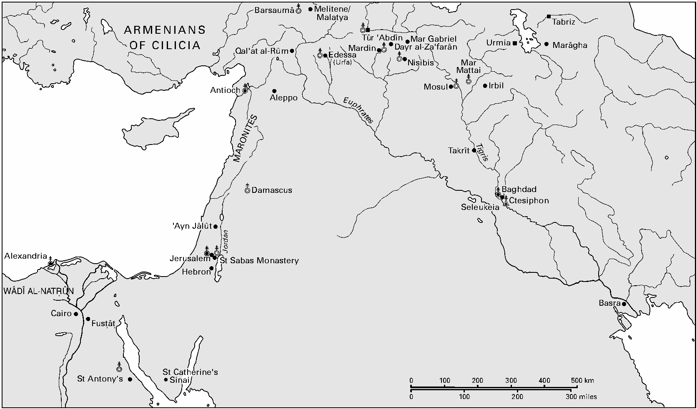

*地图5 东方诸教会。原图以千米及英里标示比例尺。*

| 原图标注 | 中文 |
| --- | --- |
| ARMENIANS OF CILICIA | 奇里乞亚的亚美尼亚人 |
| MARONITES | 马龙派 |
| Barsaumâ | 巴尔萨乌马修道院 |
| Melitene / Malatya | 梅利泰内／马拉蒂亚 |
| Qal’at al-Rûm | 鲁姆堡 |
| Tûr ‘Abdîn | 图尔阿卜丁 |
| Mardin | 马尔丁 |
| Mar Gabriel | 马尔·加百列修道院 |
| Dayr al-Za‘farân | 扎法兰修道院 |
| Edessa (Urfa) | 埃德萨（乌尔法） |
| Nisibis | 尼西比斯 |
| Mar Mattai | 马尔·马泰修道院 |
| Urmia | 乌尔米耶 |
| Marâgha | 马拉盖 |
| Tabriz | 大不里士 |
| Antioch | 安提阿 |
| Aleppo | 阿勒颇 |
| Mosul | 摩苏尔 |
| Irbil | 埃尔比勒 |
| Takrît | 提克里特 |
| Damascus | 大马士革 |
| Baghdad | 巴格达 |
| Seleukeia | 塞琉西亚 |
| Ctesiphon | 泰西封 |
| ‘Ayn Jâlût | 艾因贾鲁特 |
| Jerusalem | 耶路撒冷 |
| St Sabas Monastery | 圣萨巴修道院 |
| Hebron | 希伯仑 |
| Alexandria | 亚历山大 |
| Wâdî al-Naṭrûn | 纳特伦谷 |
| Cairo | 开罗 |
| Fusṭâṭ | 福斯塔特 |
| St Antony’s | 圣安东尼修道院 |
| St Catherine’s, Sinai | 西奈山圣凯瑟琳修道院 |
| Basra | 巴士拉 |
| Euphrates | 幼发拉底河 |
| Tigris | 底格里斯河 |
| Jordan | 约旦河 |

<!-- PDF page 396; original page 375 -->

几个共同体聚集于同一地点，并不罕见，但这往往成为冲突及软弱的根源，而非力量。这些分裂可追溯至5世纪基督论争议，东方教会因此分成三种不同归属。为方便起见，通常称为迦克墩派，即接受451年迦克墩会议者，以及不接受会议的一性论派和涅斯托里乌斯派。由此出现的独立、相互竞争的主教体系，常以某一特定地区为重心，但并不意味着能够消灭对手。伊斯兰地区基督徒共同体的历史，通常以这些不同教会为焦点。[^p396-2] 本章将先简述其历史地理，但主要目的，是把它们作为一个整体现象，研究主要特征与发展；当然，也不会忽略各教派独特之处。

## 教会地理

一种一性论教会，即今天通常所称科普特教会，[^p396-3] 是伊斯兰统治下埃及基督教的主导力量。它围绕亚历山大牧首座组织，具有强烈埃及身份。从8世纪起，牧首经常居住穆斯林埃及首都福斯塔特。随后两个世纪，他们离开已失去安全及声望的亚历山大。不在福斯塔特时，宁可居住三角洲不同城镇，或沙漠修道院。牧首住所从亚历山大最终转往开罗，发生于基里尔二世任期（1078—1092年），而非通常所说其前任克里斯托杜洛斯时期（1047—1077年）。这一步与其说出于牧首希望靠近权力中心，不如说是大维齐尔巴德尔·贾马利强力中央集权政策的结果；他坚持牧首定居首都。[^p396-4] 但牧首仍继续在亚历山大及福斯塔特两地接受祝圣。

<!-- PDF page 397; original page 376 -->

969年，埃及归于新王朝法蒂玛王朝统治，其君主自称阿里与法蒂玛的后裔，以什叶派伊斯玛仪支派的教义为合法性基础，因而与坚持逊尼派教义的巴格达阿拔斯王朝竞争。他们对基督徒大体友好，或许是对自身在埃及处境的回应：他们是占压倒多数的逊尼派人口中的少数。另一考量，是必须与拜占庭及西欧基督教势力保持良好关系。例外是法蒂玛哈里发哈基姆于1004—1013年实行的迫害，[^p397-5] 包括落实服饰规定、禁止公开庆祝基督教庆节、没收教堂与修道院财产、毁坏圣墓教堂（1009年），以及撤除基督徒和犹太官员。但人们常忘记，哈基姆在统治末期撤销这些措施：归还没收财产，准许重建教堂，甚至允许受胁迫改信伊斯兰教者重返基督教。这使科普特人恢复短暂失去的优越地位，尤其在行政领域，他们担任许多职位及高职。

科普特人融入一个明确阿拉伯化的埃及，不可避免地导致阿拉伯化；[^p397-6] 科普特教会纯属埃及的性质，无疑使过程更容易。13世纪一位科普特高级教士宣称：“愿上帝——赞美归于祂——使他们的苏丹得胜，他也是我们的苏丹；使他们的伊玛目得胜，他也是我们的牧者。”[^p397-7] 这些话显示，至少精英对于苏丹主持的共同体，确有忠诚。

接下来讨论麦勒凯教会。“麦勒凯”意为王室或帝国，用以称呼忠于迦克墩信经的人；该信经由<!-- PDF page 398; original page 377 -->君士坦丁堡诸皇帝采纳。在埃及，它有自己的亚历山大牧首，但追随者始终不多，主要限于亚历山大及三角洲。相比之下，在叙利亚，[^p398-8] 尤其巴勒斯坦，它更具力量。麦勒凯派拥有耶路撒冷牧首座，这是唯一没有双重主教体系的牧首区。在叙利亚中部及北部，969年拜占庭再征服强化其地位，安提阿及周边地区受拜占庭统治一个多世纪。但与之对立的，是后来所称雅各派，即其一性论竞争者。

雅各派教会得名于创立者、6世纪埃德萨主教雅各·巴拉代乌斯，自设安提阿牧首座。它在叙利亚北部尤其强大，但10世纪失去许多信徒，改信伊斯兰教；拜占庭再征服后，又流失至麦勒凯派。重心遂东移至贾齐拉，[^p398-9] 即上美索不达米亚。主要机构，是梅利泰内／马拉蒂亚附近的巴尔萨乌马修道院、马尔丁附近的扎法兰修道院，以及摩苏尔附近的马尔·马泰修道院。虽然仍有雅各派“安提阿及叙利亚牧首”，自9世纪起，担任此衔者却宁愿住在叙利亚北部不同修道院。拜占庭再征服以后，多处成为牧首居所，尤其12世纪的巴尔萨乌马修道院及13世纪的鲁姆堡。

也不可忘记马龙派教会。其早期发展所知很少，直到十字军时代才进入历史记载。依当地传统，它得名于7世纪末成为牧首的修士约翰·马龙。他追随基督一志论异端，[^p398-10] 尽管16世纪起，马龙派一直宣称自身“一贯正统”。马龙派牧首原居阿帕米亚，11世纪逃至黎巴嫩山区，那里成为马龙教会中心。

最后还有一个地区须考虑，即涅斯托里乌斯派占优势的美索不达米亚。他们追随君士坦丁堡牧首涅斯托里乌斯的教导，后者在第一次以弗所会议<!-- PDF page 399; original page 378 -->（431年），因偏重基督人性而受谴责。波斯教会于486年接受涅斯托里乌斯派信仰，在居于塞琉西亚的牧首领导下，确立独立。面对拜占庭敌意，大多数叙利亚涅斯托里乌斯派定居波斯帝国。阿拉伯征服后，他们在阿拔斯王朝迎来光荣时期：有些担任行政高职，或任秘书、医生，备受尊重。780年，其教会总主教[^p399-11] 提摩太一世，把住所从泰西封迁至巴格达。该教会的语言文化属叙利亚语传统，即使在巴格达，尤其在北美索不达米亚，也与同属叙利亚传统的雅各派竞争。有些现代作者，如菲耶神父，把东叙利亚人，即涅斯托里乌斯派，与西叙利亚人，即雅各派区分。12世纪，负责东方领土——原萨珊帝国境内地区——的雅各派都主教，采用“玛弗里安”（maphrian）头衔，在提克里特设座，引发教堂被劫掠、没收。[^p399-12] 12世纪中叶，玛弗里安迁至摩苏尔附近马尔·马泰修道院；摩苏尔自1127年起，是一个自治公国的首都。当地雅各派及涅斯托里乌斯派共同体，享有稳定繁荣时期；最显著证据，是他们对镶嵌金属器艺术发展的贡献。[^p399-13]

涅斯托里乌斯派教会，分“内地”与“外部”诸省。前者涵盖美索不达米亚的尼西比斯、巴士拉、埃尔比勒及摩苏尔，以及伊朗边缘；后者对应“东方”，即伊朗东部、阿拉伯、中央亚洲、中国、印度及印度尼西亚沿岸。这些地方在5至8世纪密集传教活动下，建立涅斯托里乌斯派教会。11世纪末，基督教在伊朗虽全面退却，更东方的共同体仍存在，并激起13世纪发现“东方”的西方人兴趣；但其历史不属本章范围。

每个教会都在牧首领导下自治。科普特教会也称其为教宗，涅斯托里乌斯派则称教会总主教。牧首名录很早已建立，近来研究虽略有补充修正。牧首由选举产生，未来牧首由一个会议选出，其组成<!-- PDF page 400; original page 379 -->随教会及时代而不同，但包括主教与院长，有时还有司祭、修士，甚至有影响的平信徒。也必须得到穆斯林统治当局确认。[^p400-14] 然后才能隆重祝圣新牧首。阅读各教会编年史便知，这一过程引起候选人激烈争执，诉诸买卖圣职、宗族仇争、政治内斗，以及穆斯林统治者的斡旋。撇开个人野心，职位竞争常揭示不同基督徒共同体内部的深层分歧，也揭示教会组织植根于人际关系及“有权势者”的影响。

这里只举两个例子。第一个是科普特教会，约翰六世于1216年去世后，牧首座空缺近二十年。[^p400-15] 埃及基督徒实际上分为两派。第一派支持法尤姆出身的司祭达乌德，他最终于1235年登上牧首座，成为基里尔三世。他务实看待教会与权力、财富的关系，获基督徒官员广泛支持。反对者支持一系列候选人，尤其一位以苦修著名、采取更强硬而不妥协立场的修士。斗争集中于开罗分成的两个城市：达乌德支持者在法蒂玛王朝建立、政治精英居住的城市中心卡希拉最强；对手则集中在旧城福斯塔特，那里有古老而受尊崇的穆阿拉卡教堂。事件曲折多变，显示双方都争取当时阿尤布苏丹卡米勒授予珍贵的任命文书，且毫不犹豫许诺巨款。达乌德支持者最终为其任命支付两千第纳尔。卡米勒则不愿任命尚未获基督徒共同体充分支持的候选人，竭力公正调停。现代历史学家不免感到，这种危机只能削弱科普特教会、损害其声望；而此时，第五次十字军士兵已攻取达米埃塔，正向开罗进军。

<!-- PDF page 401; original page 380 -->

1252—1263年雅各派教会分裂，是牧首座冲突的第二个例子。[^p401-16] 伊格纳提奥斯二世去世后，出现两位竞争牧首：梅利泰内／马拉蒂亚都主教狄奥尼修斯，以及玛弗里安巴尔·马达尼。前者1252年在巴尔萨乌马修道院，由“西部”诸省，即幼发拉底河上游以西诸省的主教组成的小型会议选出；后者稍后在阿勒颇，由“东部”诸省，即图尔阿卜丁及底格里斯河上游流域的主教选出。数年中，两位牧首都企图统领整个教会，许诺大笔款项，寻求穆斯林当局支持，无论是科尼亚塞尔柱人，还是大马士革阿尤布王朝。蒙古人出现，使事情更复杂，却也矛盾地带来解决。这远非雅各派东西两极唯一的分裂；其历史中，地方考虑常优先于任何统一感。但除此之外，狄奥尼修斯不懂阿拉伯语，仿佛象征一个依赖自身宗教文化传统、不善适应当时政治现实的教会：它敌视其前任伊格纳提奥斯二世启动的亲近拉丁教徒政策，并视蒙古人为反伊斯兰盟友。相反，巴尔·马达尼得到基督徒精英支持；这些人欢迎融入社会，出入权力中心，担任行政官与医生，宁愿在蒙古人到来前逃走。

## 齐美地位及其施行

伊斯兰地区基督徒共同体适用的齐米地位，广为人知。它可追溯至7与8世纪阿拉伯征服，其大体轮廓在8与9世纪法学著作中确立。[^p401-17] 它给予“有经人”，即犹太人及基督徒，穆斯林统治权力的保护、敬拜自由、教会、共同体及司法组织的延续，以及财产权与贸易自由。作为交换，<!-- PDF page 402; original page 381 -->齐米必须承认伊斯兰的政治主权，尊重穆斯林，不炫耀地庆祝宗教仪式，穿特定服饰，最后还须缴纳称为吉兹亚的人头税。有些当代作者认为，这证明穆斯林具有显著宽容；另一些则谴责它压迫非穆斯林。但毫无疑问，它一方面提供安全与自治，另一方面也规定法律上的低等地位；其施行随地区、时代、统治者与社会环境而不同。

总体趋势相当清楚。本章讨论的11至14世纪，齐米地位施行更严，齐米物质处境恶化，背后是伊斯兰内部的一般发展。正如1054年分裂对正教有重大象征意义，1055年同样标志伊斯兰历史重要断裂：该年，塞尔柱领袖图格里勒·贝格进入巴格达，终结了围绕哈里发统一泛伊斯兰共同体的梦想。伊拉克与伊朗塞尔柱人，及其后各种军事王朝，先在叙利亚，后随萨拉丁进入埃及，发展权力合法性及行使的新模式，以捍卫逊尼派伊斯兰为核心。基督教在人口、文化及社会影响日渐减弱，伊斯兰成为社会规范，意味着严格施行穆斯林法律及齐米地位。值得注意的是，所谓《欧麦尔条约》最早版本，恰好出于12世纪；确立齐米地位时，它被视为权威。[^p402-18]

萨拉丁苏丹（1171—1193年在位）的政策，颇具启发。他恢复看来已废弛的措施，例如要求基督徒佩黄色腰带，禁止骑马或骡，要求宗教仪式与建筑表现应有谦抑，包括拆除教堂外部十字架。统治者这种严格态度，可能鼓励针对基督徒的进一步行动。为防止此事，萨拉丁提醒阿勒颇居民，少数群体尊重穆斯林法律，便可期待保护。他告知他们：“我们命齐米穿上与穆斯林有别的特殊服饰后……听说，有些心怀仇恨的暴徒群伙攻击<!-- PDF page 403; original page 382 -->齐米，以言语及可憎行为，侵犯他们依据齐米契约享有的权利。我们强烈反对，并禁止煽动或实施这类事情。”[^p403-19]

除伊斯兰地区内部特有发展，另有两个外来因素，共同削弱基督徒共同体的地位：十字军东征与蒙古征服。

## 十字军东征与东方基督教的处境

1095年11月，教皇乌尔班二世致佛兰德人的动员书（excitatorium），先概述土耳其人征服耶路撒冷及基督徒苦难，再以如下话语呼吁：“听闻灾难消息，我们因应有的关切而深感痛苦，遂到法国，恳求该地多数王公及臣民，解放东方诸教会。”[^p403-20] 除哈基姆摧毁圣墓教堂外，基督教宣传也诉诸土耳其征服对基督徒造成的严重后果。但正如克洛德·卡昂权威论证，[^p403-21] 土耳其人统治叙利亚后，很快恢复秩序，并未显著改变非穆斯林处境，也未阻止赴耶路撒冷朝圣。一位科普特史家的观察，可为佐证：

> 乌古斯人〔即土库曼人〕占领了受保护的耶路撒冷城。他们原先否认圣光在圣复活教堂尊贵圣墓上降临，但得知每年降光的真相后，就善待城内基督徒。他们任用一位名为曼苏尔·巴勒拜伊、爱基督的雅各派基督徒管理当地。其妻也与他同道。他帮助每一位来自埃及及其他国家、抵达耶路撒冷的基督徒，并努力重建耶路撒冷雅各派正统教会的教堂。[^p403-22]

<!-- PDF page 404; original page 383 -->

十字军到来，打乱近东政治与宗教平衡，随着时间推移，对东方基督徒不利，马龙派及或许亚美尼亚人除外。在新建十字军国家，法兰克人——按定义即忠于罗马的拉丁教徒——对本土基督徒强加权威，如同对穆斯林一样。实际上，基督徒处境因所属共同体而异。麦勒凯派失去更多，不仅因为他们在拉丁诸国人数最多，也因被视为亲近拜占庭。征服安提阿及耶路撒冷后，十字军设拉丁牧首，驱逐原有麦勒凯牧首，迫其逃往君士坦丁堡。多数主教也遭同样命运，借口是一个身体不能有两个头。麦勒凯派如今从属于拉丁主教体系，但后者不坚持拉丁礼。因此，阿卡主教维特里的雅克（1216—1229年在任）惊恐发现，教区希腊基督徒有已婚司祭，圣餐礼用有酵饼，把傅膏礼并入婴儿洗礼，并在《尼西亚信经》中省略“和子句”。[^p404-23] 12世纪，耶路撒冷王国麦勒凯派与拉丁教徒关系略有改善。安提阿公国关系更紧张，因为还牵涉历代拜占庭皇帝的政治冲突；皇帝始终未放弃安提阿及奥龙特斯河谷的主张。他们拒绝承认安提阿拉丁牧首，转而支持流亡君士坦丁堡的另一系正教牧首。

相反，其他教会保留自身主教体系，因为牧首座及多数成员都在拉丁诸国境外。拉丁诸国内，雅各派保有宗教自治及敬拜场所。雅各派安提阿牧首叙利亚人米海尔（1166—1199年在任）写道：

> 占领安提阿及耶路撒冷的法兰克人，在其国家中有……主教。我们教会的领袖生活于其间，不受迫害或骚扰。因为，法兰克人虽在二性问题上同意希腊人，却在数项信仰问题上仍与之不同，习俗也十分有别……〔他们〕从不在信仰问题上制造困难，也不试图对各种语言的

<!-- PDF page 405; original page 384 -->

> 基督徒强加单一惯例。他们不进一步询问或考察，只要谁敬礼十字架，就满足于视其为基督徒。[^p405-24]

总体而言，雅各派对十字军的态度随情况变化：有时冷漠，有时现实而和解，甚至因共同敌视麦勒凯派而友好；但有时也敌对，如1148年十字军洗劫巴尔萨乌马大修道院时。

美索不达米亚及埃及基督徒共同体，距拉丁教徒较远，受拉丁国家建立的直接影响较小。但科普特人强烈反对第一次十字军。前面已见，《亚历山大牧首史》作者喜见土耳其征服后，耶路撒冷恢复和平秩序；数页之后，却这样写：

> 他们〔法兰克人〕在太阴历492年赖买丹月，占据尊贵的耶路撒冷城及周边。我们这个基督徒共同体，雅各派、科普特人，没有前往朝圣，也无法接近，因为众所周知，他们憎恨我们，对我们抱错误信念，并指控我们不虔敬。[^p405-25]

藉十字军东征，拉丁教会更了解这些东方教会，试图说服其领袖，无论牧首或教会总主教，接受罗马首席权、认同同一信仰宣认，同时尊重各自仪式，以实现教会合一。[^p405-26] 这一策略始于12世纪，13世纪得益于道明会及方济各会传教而充分发展。1237年，雅各派牧首伊格纳提奥斯二世访问耶路撒冷，受道明会友好接待后，庄严宣誓服从罗马圣座，并提供阿拉伯文及叙利亚文写成的正统信仰宣认。当时也在耶路撒冷的科普特及涅斯托里乌斯派总主教，随后效法。教皇格里高利九世致函祝贺。1246年，教皇使节隆朱莫的安德烈来访，伊格纳提奥斯再次表示归顺，同时寻求罗马保证尊重其教会自治。但这些服从声明，被认为纯属个人行动，并不适用<!-- PDF page 406; original page 385 -->于整个教会。1252年伊格纳提奥斯二世去世、随后发生分裂、[^p406-27] 蒙古风暴，以及最终1291年十字军国家覆灭，都使这种接近没有结果。

罗马与涅斯托里乌斯派也有接触。最重要的是教会总主教雅巴拉哈三世时期（1281—1317年）的接触，属于教皇与波斯伊儿汗交流的一部分。[^p406-28] 但同样没有长期后果，因为涅斯托里乌斯派仍依恋其信仰、传统与仪式。亚美尼亚人暂且不谈，[^p406-29] 这种合一政策只有在马龙派取得具体成果；他们于1182年归顺罗马，放弃基督一志论异端，尽管内部强烈反对。1215年，马龙派牧首参加第四次拉特兰会议，教皇英诺森三世向其颁布《因神圣智慧》（Quia divinae sapientiae）诏书，确认合一，并保证马龙派主教体系及仪式继续存在。

教皇支持的十字军，使一种进取的基督教形式出现在近东，决定性改变穆斯林对基督徒的态度。[^p406-30] 法律地位未受影响，因为穆斯林宗教及政治当局，明确区分住在伊斯兰地区、称为naṣrânî的基督徒，与统称法兰克人（Ifranj）的十字军。前者享齐米地位，后者来自国外，夺取穆斯林领土，因此是可正当作战的异教敌人。但虔诚人士及叙利亚、埃及统治者，呼吁对法兰克人发动圣战时，却用“基督教多神论者不虔敬、其存在玷污耶路撒冷”的语言。这些指控反过来打击本土基督徒。路易·普泽研究13世纪大马士革宗教生活时，显示这一点：如今，kuffâr，即“不信者”，也被用于该城基督徒，辱骂他们为十字架崇拜者。[^p406-31]

<!-- PDF page 407; original page 386 -->

针对基督徒的报复虽属例外，却更能显示十字军造成的猜疑气氛。1123年，埃德萨亲王库尔特奈的若斯兰围攻阿勒颇、劫掠周边，卡迪法官与共同体领袖拉伊斯，坚持让城内基督徒自费修复被法兰克人亵渎的穆斯林墓地及敬拜场所。城中两位主教，一位麦勒凯派、一位雅各派，不愿与法兰克人混为一谈，拒绝赔补。卡迪遂把城内六座教堂中的四座改为清真寺，逐出主教。

13世纪十字军主要针对埃及，对科普特人后果尤其严重。1218—1219年，第五次十字军围攻达米埃塔时，穆斯林当局向埃及科普特人征收沉重额外税赋；他们也成为暴民暴力的对象，是集体恐惧的替罪羊。亚历山大圣马可教堂被毁，借口是可能成为敌人辨认方向的地标。1240年代，卡迪奥斯曼·纳布卢西，厌恶行政机构中科普特人的数量，激烈撰文谴责其恶行。[^p407-32] 但13世纪中叶蒙古人出现，将进一步加剧十字军促成的猜疑气氛。

## 蒙古征服的后果

1206年忽里勒台上，蒙古首领承认成吉思汗为大汗或最高领袖。此后，蒙古展开一系列征服，统治从中国到欧洲门户的庞大帝国。在近东，征服伊拉克、1258年巴格达陷落及末代阿拔斯哈里发被杀、1260年入侵叙利亚，以及成吉思汗之孙旭烈兀建立伊朗伊儿汗国，深刻改变宗教政治局面。东方基督徒乐于与入侵者结盟，蒙古人也偏爱基督徒。成吉思汗一项规定，坚持所有宗教地位平等，确立尊重一切宗教领袖的原则。此外，涅斯托里乌斯派基督教早在内亚存在数世纪，尤其在克烈部，其影响通过大汗的基督徒妻子，以及<!-- PDF page 408; original page 387 -->涅斯托里乌斯派显贵进入蒙古宫廷，例如为大汗窝阔台及继任者任医生、秘书的西缅。

蒙古征服伴随惊人屠杀，但军队往往放过基督徒及其财产。例如，涅斯托里乌斯派免遭巴格达洗劫。叙利亚许多基督徒欢迎蒙古人，另有一些则宁愿逃亡或抵抗。1260年3月，旭烈兀麾下涅斯托里乌斯派大将怯的不花，左右由亚美尼亚国王赫图姆及安提阿亲王博希蒙德六世陪同，凯旋进入大马士革；城内基督徒欢呼欢迎，并于8月取得旭烈兀敕令后，组织反穆斯林示威，敕令准各宗教共同体公开实践宗教。[^p408-33] 不久之后，1260年5月，一位叙利亚画家改变《举扬十字架》的圣像图式，把君士坦丁与海伦娜，画成旭烈兀及其涅斯托里乌斯派妻子脱古思可敦的面貌。[^p408-34] 〔译注：原文先述8月，继称“不久之后，5月”，本段日期及次序照录。〕基督徒毫不掩饰的欢喜，很快招来残酷报复：马穆鲁克于1260年9月在艾因贾鲁特获胜，收复叙利亚城市。这一次，怀疑他们与蒙古敌人勾结，确有根据。

1258年阿拔斯哈里发国覆灭后，是蒙古统治下伊朗与美索不达米亚基督徒共同体的有利时期。教堂兴建，基督徒甚至免交人头税。1281年，一位来自内蒙古、叙利亚语掌握不佳的修士，成为涅斯托里乌斯派牧首雅巴拉哈三世（1281—1317年在任）。他在伊儿汗首都马拉盖着手建造大型修道院。其任期标志涅斯托里乌斯派基督教的顶峰：获益于蒙古统合亚洲，它共有三十个教省及二百五十个主教区。但基督徒也是反蒙古骚乱的受害者，如1262年的摩苏尔及1268年的巴格达。1295年伊儿汗合赞改信伊斯兰教后，其处境恶化，齐米规定重新生效，恢复服饰限制，取消免税。1296年大不里士及1310年埃尔比勒教堂被毁。14世纪，涅斯托里乌斯派基督教从伊朗，以及伊拉克南部和<!-- PDF page 409; original page 388 -->中部消失，退至摩苏尔周围的上美索不达米亚；教会总主教放弃巴格达，在这里定居。

埃及于1250年、叙利亚于1260年，归马穆鲁克苏丹统治。其军事政权以抵御十字军及蒙古人、捍卫伊斯兰的能力为合法性基础，表现为双重圣战。指控基督徒与这些伊斯兰敌人勾结，成为反齐米宣传的常调。例如，1265年拜巴尔斯苏丹进攻十字军要塞凯撒利亚及阿尔苏夫时，开罗接连发生火灾，人们立即认定是当地基督徒报复。叙利亚征服法兰克领土时，出现民众攻击基督徒，例如1262年拿撒勒圣母领报教堂被毁，以及1268年安提阿陷落后的基督徒屠杀。即使埃及，民众攻击也日增，受到讲道者偏执、乌里玛学者强硬，以及对蒙古侵略焦虑的鼓励。但敌意背后，是穆斯林反对基督徒秘书在行政中行使影响；这是反基督教论战的常见指控。[^p409-35] 这一社会层面尤其值得强调。[^p409-36] 1301年，盖拉温苏丹重颁一项曾数度施行、又总被撤销的法令，把犹太人及基督徒排除出公职，同时严格执行齐米歧视措施。此外，他关闭开罗教堂，并毁掉其中数座；某些犹太会堂也遭同样命运。拜占庭皇帝及阿拉贡国王干预后，才说服苏丹重开教堂、撤销措施。值得注意，此时只有外界干预，才能改善当地基督徒处境，却未能阻止1320年及1354年类似危机再现。反基督徒事件的数量与暴力，造成恐惧气氛，直接引起大量改信伊斯兰教。这又促使14世纪出现的新群体扩大，其成员称为musâlima，即“伊斯兰化者”，并在当时传记辞典中被如此<!-- PDF page 410; original page 389 -->标识。他们常被怀疑只是名义穆斯林，因压力而改宗。[^p410-37] 科普特共同体虽大为缩减、更趋内向，在某些地区仍重要，并继续积极参与埃及社会。

## 阿拉伯化与阿拉伯基督教的兴起

伊斯兰地区基督徒共同体此后的发展，有一个共同特征，即阿拉伯化：不只采用阿拉伯语为日常语言，也用作文学及礼仪语言，进而形成真正的阿拉伯基督教。1031年，拜占庭兼并埃德萨，一些雅各派与其他“阿拉伯人”离城，因为依叙利亚人米海尔之言，“他们在语言及文字上，接近阿拉伯人”。[^p410-38] 基督教与阿拉伯语联系古老而复杂，基督徒参与阿拉伯文字、语言及文化的发展。[^p410-39] 8世纪之交，出现最早阿拉伯语《圣经》译本。到本章时期，基督徒共同体大体、却未完全阿拉伯化；这取决于原有语言、地区、教会传统及社会环境等因素。

阿拉伯征服时埃及的书写及口语科普特语，逐渐让位于阿拉伯语，各种科普特方言[^p410-40] 被阿拉伯语方言取代。程度之深，使11世纪《亚历山大牧首史》编者决定把牧首传从科普特语译成阿拉伯语，理由是：“今日阿拉伯语是埃及人民懂得的语言……他们多数不懂科普特语及希腊语。”[^p410-41] 但科普特语并未完全从口语中消失。12世纪科普特作者阿布·马卡里姆的著作，提供有趣线索：他写到一个<!-- PDF page 411; original page 390 -->穆斯林及基督徒都说科普特语的村庄，也讲述一位改信基督教的犹太人，同化到会说科普特语的故事。[^p411-42] 作为文学语言，科普特语已成死语言，11世纪之后没有作品以其写成。保存遗产的愿望，使13与14世纪重新关注科普特语，产生二十余部以阿拉伯语撰写、使用阿拉伯术语的科普特语语法，以及阿拉伯—科普特语辞典；有些依阿拉伯辞书学经典字母顺序排列。A. 西达鲁斯研究这些作品，[^p411-43] 指出13世纪主要讨论博海里方言，14世纪则为萨希德方言，反映科普特人口集中于中埃及。阿拉伯语最终胜利，确认了自法蒂玛时期开始，一个真正阿拉伯埃及的形成；科普特人强烈认同它，同时保留宗教个性。[^p411-44]

希腊语的情况则不同。阿拉伯征服埃及与叙利亚时，它是主要由麦勒凯派使用的礼仪及文学语言；他们在埃及说各种科普特方言，在叙利亚及巴勒斯坦说阿拉姆语方言。希腊语很快让位阿拉伯语，因此到9世纪，至少穆斯林领土内，麦勒凯学者几乎不再用希腊语写作。969年拜占庭再征服的叙利亚北部，希腊语文学活动复兴。例如，君士坦丁堡所立安提阿麦勒凯牧首，以希腊语写作。矛盾的是，正是在拜占庭支持下，安提阿成为把圣经、教父及文学文本从希腊语译为阿拉伯语的重要中心。这促进麦勒凯礼仪的阿拉伯化，并进一步产生后果，因为使礼仪语言适应日常语言需要，是麦勒凯教会的特点。[^p411-45]

<!-- PDF page 412; original page 391 -->

叙利亚语及各种阿拉姆语方言的发展史，更加复杂而难以确立。[^p412-46] 叙利亚、美索不达米亚原说阿拉姆语的人口，逐渐采用阿拉伯语为日常语言。20世纪，阿拉姆语只在少数孤立地区继续使用：库尔德山区、图尔阿卜丁、乌尔米耶周围、摩苏尔平原，[^p412-47] 以及大马士革以北少数村庄，尤其马卢拉。但十字军时代，说叙利亚语者，即与雅各派及涅斯托里乌斯派教会相联的人，远为众多。前面已提到，1252年争取牧首座的梅利泰内都主教狄奥尼修斯，完全不懂阿拉伯语；到大马士革阿尤布苏丹面前申辩时，必须借助译员。[^p412-48]

不同于科普特语及希腊语，叙利亚语不只继续作为文学语言；传统上，13世纪被记作叙利亚语文学的黄金时代。[^p412-49] 直到14世纪，才让位于阿拉伯语。其文学成就广为人知，却常被孤立研究，忽略时代背景。了解同一作者为何交替使用阿拉伯语及叙利亚语，尤其有价值。好例子是巴尔·希伯来，阿拉伯语名阿布·法拉杰·伊本·伊卜里，1264—1286年任东部雅各派教会玛弗里安，留下庞大著作群；依其弟所列名录，共三十一部，涵盖历史、神学、哲学、医学、天文学、语法及文学。[^p412-50] 这种写作符合一位高级教士的关切：慰藉叙利亚语共同体，丰富知识遗产，保存其近东地位。巴尔·希伯来主要用叙利亚语写作，或把哲学、医学论著从阿拉伯语译为叙利亚语，也使用阿拉伯语，直接创作，或为某些叙利亚语作品编阿拉伯语版本。例如，其史学著作，一方面包括叙利亚语普世编年史，分世俗史及教会史两部分；另一方面，是阿拉伯语简编普世编年史。近来研究<!-- PDF page 413; original page 392 -->显示，两部编年史相互独立，依据不同史学传统：前者为基督教及叙利亚语传统，后者为阿拉伯传统。读者也不同：前者面向深浸圣经文化的雅各派高级教士，后者面向语言及文化已阿拉伯化的基督徒共同体。[^p413-51]

## 文学活动

本章篇幅不容穷尽基督徒学者用阿拉伯语、叙利亚语从事的写作，因为体裁与作品都数量众多、种类丰富。阿拉伯语作品，可从格拉夫的参考书，[^p413-52] 叙利亚语作品可从鲍姆施塔克的参考书，[^p413-53] 获得大量有价值资料。但严格而言，它们限于宗教文学，因而排除了基督徒对阿拉伯文化发展、尤其诗歌、哲学及科学的贡献。就基督教文学而言，科普特、麦勒凯、雅各派及涅斯托里乌斯派作者，经营所有通常体裁：神学大全、圣经注释、护教论、法律手册、讲道集及历史著作。

大型神学手册背后，是百科全书式动力，意在综合，而非提出新神学见解。一个好例子，是12世纪涅斯托里乌斯派马里·伊本·苏莱曼，以阿拉伯语编成的大全，取了悦耳的书名《塔楼之书》，把事业比作建筑。他为七章各取建筑性标题：基础、平面图、支柱等，最后以灌溉设施及园圃收尾。另一例是阿布·伊斯哈格·伊本·阿萨勒，约1260年编成的《宗教原理总集》（Kitâb Majmû‘ Uṣûl al-Dîn）。阿萨勒家族富裕而著名，为埃及行政机构提供多位科普特秘书。这部大全<!-- PDF page 414; original page 393 -->系统呈现基督教教义，以大段教父文字支持，也援引基督徒及穆斯林哲学家，特别采用拉齐的《四十论》（Kitâb al-Arba‘în）。[^p414-54] 同样的神学与哲学结合，再见于下个世纪阿布·巴拉卡特编成的著名百科全书《黑暗之灯》（Miṣbâḥ al-Ẓulma）。

本章时期，护教作品数量众多，却具有区别于早先数世纪的特点。[^p414-55] 论战与辩论等体裁，不如护教论发达；后者由基督徒作者解释、维护及证明教义，反驳穆斯林诋毁。他以圣经及理性论据，捍卫圣三一与神性统一、道成肉身及基督二性的教义。麦勒凯派拥有两位伟大护教家：11世纪，安提阿人阿卜杜拉·伊本·法德勒，著有许多捍卫基督教的作品，包括批评雅各派、涅斯托里乌斯派错误的《正教信仰的论证》。12世纪，安提阿修士、后来成为西顿主教的保罗·拉希卜，至少编成五部论著，针对异教哲学家、犹太人、穆斯林及其他基督教派。其同时代人、涅斯托里乌斯派都主教埃利亚斯·伊本·希纳亚，著书对穆斯林捍卫圣三一、对犹太人捍卫基督神性，并对麦勒凯及雅各派捍卫涅斯托里乌斯派强调的基督人性。显然，有些论著不仅对外捍卫基督教，也同样旨在证明某一教会优于另一教会。一部小论著是某种例外，名为《论信仰一致》（Kitâb ijtimâ‘ al-amâna）：11世纪作者阿里·伊本·达乌德·阿尔法迪，是除此之外无所知的雅各派，竭力证明各基督教派虽在表述基督奥秘时有差异，却共享同一信仰。[^p414-56]

神学大全与护教论著，都见证了穆斯林特有神学及哲学概念的影响。遗憾的是，现代研究往往过于局限于教会<!-- PDF page 415; original page 394 -->史，未能凸显这些“文化融入”实例，[^p415-57] 忽略基督徒神学家按穆斯林思想范畴呈现圣三一教义的例子。涅斯托里乌斯派阿卜杜拉·伊本·塔伊卜（卒于1043年）[^p415-58] 解释：“创造者的本质（dhât al-bâri’）为一，其属性（ṣifât）却为多。”在他看来，基督徒“称这本质为实体（jawhar），称属性为特性（khawâṣṣ）……也相信，上帝在其本质中具有知识（‘ilm）、能知（‘âlim）及所知（ma‘lûm）的属性……他们称知识的属性为父性，能知的属性为子性，所知的属性为发出”。他最后坚持，上帝“就本质而言为一，就属性而言为多”。基督徒作者看来竭力回应伊斯兰日增压力，抵御“以物配主”的指控，因为它使人面临不信者罪名。他们证明圣三一不损神的一体性，同时保持一定谨慎，避免直接攻击伊斯兰及其先知。

这也是雄心勃勃的法律手册时代。各教会保存自身法律与制度，教会当局因此在私法所有领域承担司法职能。法律汇编不仅包括处理教义的各大公会议及主教会议敕令，也涉及教会组织、教士修士和平信徒地位、礼仪秩序、圣事施行、学校修道院医院等机构，以及婚姻、血统、收养、遗嘱、继承、财产交易等私法、家庭法规定。重要汇编包括：11世纪阿卜杜拉·伊本·塔伊卜以阿拉伯语为涅斯托里乌斯派教会撰写的汇编；大约同时，尼西比斯的埃利亚斯以叙利亚语编成的同一教会法令；阿卜迪绍1318年写成的两部作品，即主教会议教规集及教会裁判规则，至本书撰写时，仍是涅斯托里乌斯派标准著作；最后，转至科普特教会，有两部《教会法规与民法汇编》。第一部由达米埃塔主教米海尔于12世纪编成，是最早不再随意、而按主题排列法律及裁决的手册<!-- PDF page 416; original page 395 -->之一。第二部出自伊本·阿萨勒，1238年问世，至本书撰写时，仍是科普特共同体私法领域的主要法典。

讲道集与赞美诗集，显然以礼仪用途为目的，是本时期另一种写作形式。教会偏好早期教父著名讲章，所以阿拉伯语讲道文学，最初以翻译出现。11世纪，安提阿麦勒凯执事阿卜杜拉·伊本·法德勒，把金口约翰多数讲章译为阿拉伯语。12世纪开始，出现以称为saj‘的押韵、富节奏阿拉伯散文写成的讲章，赞美诗则采用流行的rajaz诗律。涅斯托里乌斯派教会总主教埃利亚斯·伊本·哈迪西（1176—1190年在任），通常被视为此体裁的开创者。他以灿烂丰富、具有saj‘特征的阿拉伯语写讲章。用阿拉伯雄辩服务基督教的做法，在13世纪不同基督教派中引来许多仿效者。恰在此时，伊斯兰也发展讲道艺术（wa‘z）及讲道者（wu‘‘âz）的角色，难道纯属巧合？撇开分隔基督教与伊斯兰的教义分歧，考察相似文学形式及主题所显示的共同宗教情感，已成为重要任务。

基督徒众多历史著作，也对阿拉伯及穆斯林文化环境采取不同立场。严格而言，叙利亚语史学以叙利亚人米海尔及巴尔·希伯来的权威著作为主。[^p416-59] 依循上溯凯撒利亚的优西比乌之传统，他们并列两种普世史：世俗及教会。作品最明显地显示高级教士书写自身教会历史的关切：慰藉雅各派共同体，保存其近东地位。科普特及涅斯托里乌斯派也有自己的史学著作。12世纪，马里·伊本·苏莱曼在《塔楼之书》第五章，插入一部真正的涅斯托里乌斯派教会总主教座史。

科普特教会拥有宏伟的《亚历山大牧首史》。[^p416-60] 第一部分至1046年，汇编较古史料，传统上<!-- PDF page 417; original page 396 -->归于萨维鲁斯·伊本·穆格法（活跃于955—987年），实际上却出自晚一个世纪的马乌胡卜。第二部分涵盖1047—1216年，由各牧首同时代传记组成，资料十分充分。第三部分从1216年起，除基里尔三世（1216—1243年）的详细原创传记外，只包含一系列简短记事。

与这些彻底以自身教派为立场的历史不同，基督徒作者写成的许多阿拉伯语编年史，若非特别重视涉及基督徒的事件，几乎难与穆斯林作者区分。这些历史吸收了阿拉伯—穆斯林史学的主题及方法，大多出自科普特人，如麦金·伊本·阿米德[^p417-61] 及伊本·拉希卜，[^p417-62] 都在13世纪撰写普世史。前者在14世纪有穆法达勒·伊本·阿比·法达伊勒续作。[^p417-63] 同时，伊本·苏盖伊[^p417-64] 编纂传记辞典，是唯一这样做的基督徒作者。这些史家属于埃及有文化的城市精英。身为宗教少数群体，并未阻止他们采用统治阶层的词汇、思维模式及眼界。

科学，尤其医学，属于这种共同文化领域，宗教差异让位于共享知识的发展与传递。医学很大程度上由基督徒主导。在巴格达，有影响的基督徒医生服务哈里发的传统仍持续。例如，涅斯托里乌斯派医生兼司祭伊本·瓦西提，藉宫廷影响力，促成1092年任命一位牧首，以及1105年解除反基督徒措施；1132年去世前数日，他本人也当选牧首。另一位巴格达人物，是1165年去世的司祭兼医生伊本·提尔米兹。他深受同时代人欢迎，蒙哈里发宠信，主要贡献是培训新医生，许多人后来前往叙利亚及埃及。与犹太医生一起，还有许多<!-- PDF page 418; original page 397 -->涅斯托里乌斯派、麦勒凯及雅各派医生，奇怪的是科普特人很少。他们显然极好地融入穆斯林社会。[^p418-65] 基督徒医生收穆斯林学生，或相反，都很常见。成功个人的生涯，容易通过传记辞典追踪，但不应遮蔽医学与行政一样竞争激烈的事实。基督徒如今成为少数，藉从事社会认可的专长，试图在更可能把他们逐出权力中心及影响职位的社会中，保存优越地位。穆斯林时而批评基督徒医生，应视为剥夺齐米这一接近权力途径的尝试。例如，11世纪末，安萨里鼓励读者学医，因为他认为穆斯林较为忽视这一领域。许多小城镇的穆斯林，任由外来医者摆布，他觉得可叹；所谓外来者，指基督徒或犹太人。[^p418-66]

## 修道院的作用

修道生活及修道院，在东方基督教的宗教与知识生活中居核心地位，广为人知。修道院在埃及、巴勒斯坦、安提阿周围、上美索不达米亚图尔阿卜丁山区，以及伊拉克南部希拉周围，特别众多。7世纪阿拉伯征服后，仍保有重要性与活力，影响也不限于基督徒共同体。一种阿拉伯文学体裁《修道院之书》（Kitâb al-diyârât），可为见证：它以10世纪末沙布什提的作品尤其著名，[^p418-67] 属于穆斯林诗人访问基督教修道院时写作的诗歌选集，既生动见证修道院对基督徒及穆斯林的吸引，也见证其在10世纪阿拉伯文化中<!-- PDF page 419; original page 398 -->的地位。后来雅古特、阿布·马卡里姆、欧麦里及马格里齐等地理作者，抄录其中修道院描述，有时补充某处如今已是废墟，却从未系统进行。缺乏充分考古资料，使目前知识状况几乎不容建立11至14世纪修道院的满意名录，更谈不上判断其命运。

但总体发展脉络，争议不大。这一时期，大量修道院消失，是两项因素共同作用的结果：一方面，教会缩减，不仅修士减少，维持院舍的捐赠也减少；另一方面，许多地区遭战争、入侵及贝都因人勒索，受到破坏。个别修道院历史，往往是毁坏与劫掠的一长串记载；基督徒共同体资源不足，难以重建建筑、恢复经济生活，因此危害更大。当然，地区情况有异，有些地方比另一些保存较好。马丁神父杰出研究，使我们充分了解的中埃及，是一个好例子：尼罗河右岸古老修道院，比左岸保存好。右岸十六处古址中，十四处已被确认，六处仍是活跃宗教中心。左岸纸草记载的三十处中，二十二处完全消失，只有三处作为村庄教堂幸存。原因在于，左岸农业土地肥沃，人口大体伊斯兰化，首府阿什穆奈因甚至完全如此；陡峭右岸居民稀少，依作者结论，是“少数群体抵御穆斯林多数压力的避难处”。[^p419-68]

总体而言，城内或近郊修道院，似乎消失更快、数量更多。巴格达就是如此：塞尔柱时期史料提到仍有五座教堂活动，却无修道院。倭马亚时代，大马士革及周边有五所修道院，12世纪已消失。另一例，是摩苏尔著名“上修道院”（Dayr al-a‘la），<!-- PDF page 420; original page 399 -->9与10世纪曾居涅斯托里乌斯派教会中心；到13世纪，摩苏尔基督徒共同体虽仍强盛，它却降为普通教堂。开罗附近修道院也相似，例如首都以西数千米的纳希亚，曾供法蒂玛君主作宜人避暑地；1173年阿布·马卡里姆来访时，只余七位修士，正逐渐荒废。14世纪，马格里齐记载其已完全毁坏。

这些发展，使修道院作为社会交往及教育中心的重要性日减，主要成为保存东方基督教属灵文化价值的避难与朝圣处。以下用几所著名修道院说明。首先是巴尔萨乌马修道院，[^p420-69] 得名于5世纪苦修者巴尔萨乌马，却直到8世纪才进入历史记载。它近梅利泰内／马拉蒂亚，但位于托罗斯山脉深处偏远地区，有数百修士。巴尔萨乌马圣髑所行神迹，吸引大批人群；12世纪成为主要牧首居所之一。叙利亚人米海尔很可能在这里编纂编年史，随后是1232年匿名作者及巴尔·希伯来。1148年，它遭埃德萨亲王库尔特奈的若斯兰劫掠，1183年又毁于大火。叙利亚人米海尔负责重建，于1194年5月15日重新祝圣。它一直是雅各派中心，直到13世纪最后几年被毁。

查士丁尼皇帝在西奈山脚建立的圣凯瑟琳修道院，自9世纪起成为亚历山大圣凯瑟琳圣髑安置地。[^p420-70] 它成为热门朝圣目的地，包括西方朝圣者。图书馆极丰富，有约2300份希腊文手稿、600份阿拉伯文、270份叙利亚文、85份格鲁吉亚文及45份斯拉夫文。[^p420-71] 这不仅反映抄经室的重要，也反映其<!-- PDF page 421; original page 400 -->影响范围，因为许多手稿来自国外捐赠。例如，图书馆唯一拉丁文手稿，是9世纪《圣咏集》，几乎肯定出自北非，13世纪被带到修道院。

圣萨巴修道院，可追溯至同名圣徒：478年，他决定隐居于距耶路撒冷约15千米、汲沦峡谷的一处山洞。[^p421-72] 院舍建于峡谷边狭窄台地，至本书撰写时，仍住麦勒凯修士共同体。这里迅速成为重要写作中心，8世纪以大马士革的约翰为代表。圣萨巴及大马士革的约翰墓，吸引朝圣者，至少持续至13世纪；此时前者圣髑转至威尼斯，后者转至君士坦丁堡。修道院受到马穆鲁克苏丹拜巴尔斯压迫政策打击，之后地位下降，修士虽继续创作。[^p421-73] 约二百五十年前，丰富藏书大部毁于火，但近八百份手稿获救，19世纪转藏耶路撒冷牧首座。[^p421-74]

纳特伦谷沙漠地区，位于尼罗河三角洲西支以西，以及红海附近，建立了许多科普特修道院。我们择圣安东尼修道院讨论。它是由建筑、园圃组成的庞大群体，以长两千米围墙保护。最终摆脱纳特伦谷叙利亚修士影响后，在12及13世纪经历特别繁荣。1231—1306年该院制作、今存开罗的大量科普特手稿，证明存在优秀抄经室及丰富藏书，支持了13世纪知识复兴；著名科普特阿萨勒家族的活动，最能说明这一点。

抄经室工作有时与艺术活动相伴。例如，约1220年，摩苏尔附近马尔·马泰修道院抄成一部饰有五十二幅华丽细密画的福音书，今藏梵蒂冈图书馆；它是上美索不达米亚最古老的雅各派修道院<!-- PDF page 422; original page 401 -->之一，也是巴尔·希伯来安葬之处。此外，图尔阿卜丁扎法兰修道院，因黄墙而称“藏红花修道院”，藏书中保存两部13世纪华丽福音书；其插图比马尔·马泰福音书更显示强烈拜占庭影响。但叙利亚及科普特艺术，将走上截然不同的发展道路。

## 宗教生活

一篇名为《司祭的宴会》的讽刺短作，几乎可肯定出自基督徒医生伊本·布特兰（卒于1066年），[^p422-75] 为图尔阿卜丁叙利亚语教士生活提供宝贵线索。它模仿阿拉伯“玛卡梅”（Maqâmât，即“集会”）体裁，以优雅精致语言叙述主人公言行；叙述者描述马尔丁一位司祭家中举行的宴会。讽刺所谴责的缺点包括：利用职事赚钱，尤其葬礼及为亡者祈祷；不懂教会音乐；不善讲道，只满足于重炒金口约翰作品，而不创作雄辩新讲章。但它也显示，这些教士相对富裕，与穆斯林邻人关系良好，充分掌握阿拉伯语言文化。

礼仪举行主导宗教生活，依各教会历法规范，但地方庆节也很重要。它们把古代农业传统及地方记忆，与较严格的基督教内容混合，却不妨碍穆斯林参加。参与之多，以至矛盾地说，我们对庆节的知识，常只通过穆斯林史料传下。圣周四庆节就是如此，在埃及与叙利亚有多种名称：“扁豆周四”“米饭周四”，甚至“鸡蛋周四”。[^p422-76] 它吸收了<!-- PDF page 423; original page 402 -->标记春天重生的习俗：彩蛋、米饭或扁豆菜、为房舍及墓地焚香、给牲畜打烙印，以及晾晒衣物。14世纪，穆斯林学者马格里齐记载，“扁豆周四，至今仍是开罗最盛大庆节之一”。

但本章时期伊斯兰化加强，也往往意味着穆斯林接收基督教庆节与圣地。许多基督徒敬礼《旧约》先知或地方圣徒之处，融入严格意义上的穆斯林宗教结构。只举一例：巴赫纳萨基督教圣所，保存逃往埃及的记忆；13世纪初起，因兴建许多穆斯林圣者墓，日益伊斯兰化。[^p423-77] 阿勒颇苦修者哈拉维（卒于1215年）编成《朝圣地点指南》，[^p423-78] 把一系列原属基督教或犹太教的近东圣所视为穆斯林圣地。希伯仑与耶路撒冷“尊贵的双圣域”，[^p423-79] 是穆斯林接收最鲜明的例子。希伯仑圣所，犹太人及基督徒曾在此敬礼亚伯拉罕墓，数世纪中成为受欢迎的穆斯林圣地。1266年，马穆鲁克苏丹拜巴尔斯初次战胜法兰克人后，朝圣希伯仑，颁令禁止基督徒与犹太人进入；禁令持续至1967年以色列人占领该城。11至14世纪，耶路撒冷这座犹太人、基督徒与穆斯林共享圣城，经历动荡。970年起属法蒂玛统治，1073年归塞尔柱控制，1099年7月15日被十字军占领，近一个世纪为拉丁耶路撒冷王国首都；1187年10月2日落入萨拉丁之手，1229年回到皇帝腓特烈二世，1244年遭花剌子模人蹂躏，最终归埃及马穆鲁克。每个新政权都带来深刻宗教社会变化，反映于城市地形。最终，自马穆鲁克时期起，耶路撒冷转为以穆斯林为主的城市，[^p423-80] 尽管仍有<!-- PDF page 424; original page 403 -->重要犹太共同体；尽管包括拉丁教徒在内、[^p424-81] 各派基督徒仍居于此；尽管来自整个基督教世界的朝圣者，仍纷纷前来。

11至14世纪，埃及、叙利亚及伊拉克教会经历一系列深刻动荡。伊斯兰化使伊斯兰成为多数宗教；政治生活受强烈信奉伊斯兰的军事政权主导，尽管，或正因依赖外国新兵；齐米地位施行日严；十字军与拉丁定居挑战伊斯兰，蒙古征服又创造新政治秩序。不同基督徒共同体反应并不一致，而依时代、地点及环境采取不同策略。总体而言，试图平衡独特身份保存与适应环境的需要。一方面，继续使用自身语言，或如卡尔舒尼[^p424-82] 那样使用自身文字，使他们有别于阿拉伯语、穆斯林信仰的主导文化；维持特有习俗及丰富过去的记忆，即保存文化遗产，也有同样作用，但有时意味着远离活动及权力中心。另一方面，适应环境需要模糊文化边界、促进社会融合；城市精英显然如此，基督徒秘书与医生生涯最能证明。这使高度阿拉伯化、将在近东未来发展中发挥作用的基督徒共同体得以出现，也有利于改信伊斯兰，在某种意义上是同化的最终阶段。还有第三种办法，即寻求外援：与教皇及拉丁传教士建立联系，西奈山圣凯瑟琳修道院接待希腊朝圣者及修士，以及蒙古人初来时寄予厚望，都是好例子。这种策略，使教会获得外援、加强地位，却也使其容易被指为伊斯兰地区的异己。

## 注释

[^p394-1]: R. W. Bulliet, ‘Process and status in conversion and continuity’, in Conversion and continuity: indigenous Christian communities in Islamic lands (8th–18th centuries), ed. M. Gervers and R. J. Bikhazi [Papers in Mediaeval Studies 9] (Toronto: Pontifical Institute of Mediaeval Studies, 1990), 1–12, 他把改宗描述为“一个同时改变基督徒与穆斯林共同体的过程”（第5页），前者仍“在许多方面属于同一社会”（第7页）。这一“穆斯林—基督徒结构呈现四种‘状态’”（第7—8页）：前两种对应穆斯林政治上占优势、人口上却不占多数的时期；后两种则以穆斯林权力间的分裂竞争、非伊斯兰外部威胁，以及“更大的社会分化”为特点。

[^p396-2]: 这一方法的良好综合，见 Histoire du christianisme des origines à nos jours, ed. J.-M. Mayeur, C. Pietri, A. Vauchez and M. Venard, 13卷 (Paris: Desclée, 1990–2000).

[^p396-3]: “科普特人”（Copt）及“科普特的”（Coptic）源于阿拉伯语Qibṭ，后者来自希腊语Αἴγυπτος，又是古埃及语Ha-Ker-Ptah的变形。

[^p396-4]: 参见 J. Den Heijer, ‘Le patriarcat copte d’Alexandrie à l’époque fatimide’, in Alexandrie médiévale, ed. C. Décobert [Études alexandrines 8] (Cairo: Institut français d’archéologie orientale, 2002), ii, 83–97.

[^p397-5]: 这一政策既属反常，也违反齐米保护制度规定的义务。历史学家长期把它视为统治者疯狂的产物，认为他患有中世纪医学手册所谓“忧郁症”。但新解释认为，哈基姆的动机，是在与伊斯兰历400年相关的千禧年视野下，施行伊斯玛仪教义、惩治担任行政高职基督徒的傲慢，并改善道德。无论如何，哈基姆宗教政策的对象，并不只有犹太人与基督徒。

[^p397-6]: 参见 A. S. Atiya, A history of Eastern Christianity (London: Methuen, 1968).

[^p397-7]: Sawîrus ibn al-Muqaffa’, History of the patriarchs of the Egyptian Church, known as the History of the Holy Church, iv, 2: Cyril III, Ibn Laklak (1216–1243 A.D.), ed. A. Khater and O. H. E. Burmester (Cairo: Société d’archéologie copte, 1974), (text) 74; (trans.) 150.

[^p398-8]: 这里指从南方西奈山至北方托罗斯山口的地区，阿拉伯文本称al-Shâm。

[^p398-9]: 阿拉伯语意为“岛”，用来指底格里斯河与幼发拉底河之间的地区。

[^p398-10]: 这是皇帝希拉克略提出的教义折衷，后来被正教会拒绝。

[^p399-11]: 这是涅斯托里乌斯派牧首现用的称号。

[^p399-12]: 这一头衔最早见于1123年。

[^p399-13]: 参见 J.-M. Fiey, Mossoul chrétienne (Beirut: Imprimerie catholique, 1959); E. Baer, Ayyubid metalwork with Christian images (Leiden: E. J. Brill, 1988).

[^p400-14]: 参见授予教会总主教阿卜迪绍三世的文书，校订刊布于 A. Mingana, ‘A charter of protection granted to the Nestorian Church a.d. 1138 by Muktafi II, Caliph of Baghdad’, Bulletin of the John Rylands Library 10 (1926), 127–33.

[^p400-15]: 参见 History of the patriarchs, iv, 2.

[^p401-16]: 参见 Bar Hebraeus, Chronicon ecclesiasticum, ed. J. B. Abelloos and T. J. Lamy (Paris and Louvain: C. Peeters, 1877), ii, cols. 695–744.

[^p401-17]: Fiqh指穆斯林法律，意为施行沙里亚。最初把齐米法律处境编纂成文的，是阿拔斯哈里发哈伦·拉希德的卡迪阿布·优素福·雅古卜，见 Kitâb al-kharaj, trans. E. Fagnan [Bibliothèque archéologique et historique 1] (Paris: P. Geuthner, 1921).

[^p402-18]: 参见 al-Turtushî, Sirâj al-mulûk (Cairo, 1289/1872), 135ff.; trans. M. Alarcón, Lámparas de los príncipes por Abubéquer de Torotosa, ii (Madrid: Instituto de Valencia de Don Juan, 1931), 143ff. 参见 A. Fattal, Le statut légal des non-musulmans en pays d’Islam (Beirut: Imprimerie catholique, 1958), 60–3.

[^p403-19]: 参见 A.-M. Eddé, La principauté ayyoubide d’Alep (579/1183–658/1260) [Freiburger Islam Studien 21] (Stuttgart: Franz Steiner Verlag, 1999), 465.

[^p403-20]: H. Hagenmeyer, Die Kreuzzugsbriefe aus den Jahren 1088–1100 (Innsbruck: Verlag der Wagner’schen Universitäts-Buchhandlung, 1901), 136–7. 参见 B. Hamilton, The Latin Church in the Crusader States: the secular church (London: Variorum, 1980), 1.

[^p403-21]: C. Cahen, ‘Notes sur l’histoire de l’Orient latin: i – En quoi la conquête turque appelait-elle la croisade?’, Bulletin de la Faculté des Lettres de Strasbourg 21 (1950–51), 118–25 [= C. Cahen, Turcobyzantina et Oriens christianus (London: Variorum, 1974), c].

[^p403-22]: History of the patriarchs, ii, part 3: (text) 299; (trans.) 364.

[^p404-23]: Lettres de Jacques de Vitry, ed. R. B. C. Huygens (Leiden: E. J. Brill, 1960), ii.136–49: 84–5. 参见 Hamilton, The Latin Church, 163–4.

[^p405-24]: Chronique de Michel le Syrien, patriarche jacobite d’Antioche (1166–1199), trans. J.-B. Chabot (Paris: E. Leroux, 1905), iii, 222.

[^p405-25]: History of the patriarchs, ii, part 3: (text) 249; (trans.) 398–9.

[^p405-26]: J. Richard, La papauté et les missions d’Orient au Moyen Âge (XIIIe–XVe siècles) [Collection de l’École française de Rome 33], 第2版 (Rome: École française de Rome, 1998).

[^p406-27]: 参见上文第 380.

[^p406-28]: 1288年，伊儿汗阿鲁浑派涅斯托里乌斯派修士巴尔·扫马前往西方，受到教皇尼古拉四世接见；据叙利亚语史料，教皇承认雅巴拉哈三世为东方教会牧首。此后，道明会士里科尔多·迪·蒙特克罗切，努力说服教会总主教及其羊群放弃涅斯托里乌斯教义。

[^p406-29]: 参见下文第 415–17.

[^p406-30]: 参见 E. Sivan, ‘Note sur la situation des chrétiens sous les Ayyûbides’, Revue d’Histoire des Religions 172 (1967), 117–30.

[^p406-31]: L. Pouzet, Damas au VIIe/XIIIe siècle: vie et structures religieuses dans une métropole islamique [Recherches. Collection publiée sous la direction de la Faculté des Lettres et des Sciences Humaines de l’Université Saint-Joseph] (Beirut: al-Mashraq, 1988), cap. 7.

[^p407-32]: C. Cahen, ‘Histoires coptes d’un cadi médiéval’, Bulletin de l’Institut Français d’Archéologie Orientale 59 (1960), 133–50.

[^p408-33]: D. Sourdel, ‘Bohémond et les chrétiens de Damas sous l’occupation mongole’, in Dei Gesta per Francos: études sur les croisades dédiées à Jean Richard, ed. M. Balard, B. Z. Kedar and J. S. Riley-Smith (Aldershot: Ashgate, 2001), 295–9.

[^p408-34]: Bibl. Vatican cod. syr. 559. 参见 J. M. Fiey, ‘Iconographie syriaque. Hulagu, Doquz Khatun... et six ambons?’, Le Muséon 88 (1975), 59–68.

[^p409-35]: 参见 M. Perlmann, ‘Notes on anti-Christian propaganda in the Mamlûk Empire’, Bulletin of the School of Oriental and African Studies 10 (1939–42), 843–61.

[^p409-36]: L. S. Northrup, ‘Muslim–Christian relations during the reign of the Mamluk Sultan al-Mansûr Qalâwûn (a.d. 1278–1290)’, in Conversion and continuity, ed. Gervers and Bikhazi, 253–61.

[^p410-37]: D. P. Little, ‘Coptic converts to Islam during the Baḥrî Mamluk Period’, in ibid., 843–61.

[^p410-38]: Chronique de Michel le Syrien, III, 280.

[^p410-39]: 北阿拉伯文字创立于基督教拉赫姆王国。伊斯兰兴起后，它盖过南阿拉伯文字。基督徒主要于9世纪巴格达、从希腊语及叙利亚语从事翻译的作用，广为人知。

[^p410-40]: 科普特语分为两大方言：上埃及萨希德方言，来自阿拉伯语Sa‘îd；三角洲博海里方言，来自阿拉伯语“海”之词baḥarî。

[^p410-41]: History of the patriarchs of the Egyptian Church, ed. B. Evetts (Paris: P. Fages, 1904), i, 115.

[^p411-42]: M. Martin, ‘Chrétiens et musulmans à la fin du XIIe siècle’, in Valeur et distance: identités et sociétés en Égypte, dir. C. Décobert (Paris: Maisonneuve et Larose, 2000), 86–7.

[^p411-43]: A. Sidarus, ‘La philologie copte arabe au Moyen Âge’, in La signification du Bas Moyen Âge dans l’histoire et la culture du monde musulman [Actes du 8e Congrès de l’Union européenne des Arabisants et Islamisants, Aix-en-Provence 1976] (Aix-en-Provence: Edisud, 1978), 267–81.

[^p411-44]: J.-C. Garcin, ‘L’arabisation de l’Egypte’, Revue de l’Occident Musulman et Méditerranéen 43 (1987), 130–7; U. Haarmann, ‘Regional sentiment in medieval Islamic Egypt’, Bulletin of the School of Oriental and African Studies 43 (1980), 55–66.

[^p411-45]: 这解释了为何安提阿牧首区仍使用叙利亚语礼仪，西奈山麦勒凯圣凯瑟琳修道院亦然。该院以希腊语举行礼仪，无疑为方便拜占庭帝国来的朝圣者；也用阿拉伯语，并在为叙利亚人专设的小礼拜堂使用叙利亚语。

[^p412-46]: 叙利亚语是埃德萨的阿拉姆语方言，于4及5世纪成为叙利亚、美索不达米亚的学术语言。

[^p412-47]: 因此，叙利亚语在伊拉克与阿拉伯语、库尔德语并列，获得官方地位；1975年成立巴格达叙利亚语学院。

[^p412-48]: 参见上文第 380.

[^p412-49]: P. Kawerau, Die jakobitische Kirche im Zeitalter der syrischen Renaissance (Berlin: Akademie- Verlag, 1955).

[^p412-50]: J.-M. Fiey, ‘Esquisse d’une bibliographie de Bar Hébraeus (†1286)’, Parole de l’Orient 13 (1986), 279–312.

[^p413-51]: 参见 L. I. Conrad, ‘On the Arabic Chronicle of Bar Hebraeus: his aims and audience’, Parole de l’Orient 19 (1994), 319–78; D. Aigle, ‘Bar Hebraeus et son public, à travers ses chroniques en arabe et en syriaque’, Le Muséon 118 (2005), 83–106; F. Micheau, ‘Le Kâmil d’Ibn al-Athîr, source principale de l’histoire des Arabes dans le Mukhtaṣar de Bar Hébraeus’, Mélanges de l’Université St-Joseph 58 (2005).

[^p413-52]: G. Graf, Geschichte der christlichen arabischen Literatur, ii, Die Schriftsteller bis zur Mitte des 15 Jhs. [Studi e testi 133] (Vatican: Biblioteca apostolica vaticana, 1947). 参见 R. Coquin，载 Christianismes orientaux: introduction à l’étude des langues et des littératures (Paris: Éditions du Cerf, 1993).

[^p413-53]: A. Baumstark, Geschichte der syrischen Literatur (Bonn: De Gruyter, 1922).

[^p414-54]: 参见 G. C. Anawati, ‘The Christian communities in Egypt in the Middle Ages’, in Conversion and continuity, ed. M. Gervers and R. J. Bikhazi, 237–51.

[^p414-55]: 参见 K. Samir, ‘Bibliographie du dialogue islamo-chrétien. Auteurs chrétiens de langue arabe’, Islamochristiana 2 (1979), 201–45, 其中简要分析各篇论著。

[^p414-56]: G. Troupeau, ‘Le livre de l’unanimité de la foi de ‘Alî ibn Dâwud al-Arfâdî’, in Études sur le christianisme arabe au Moyen Âge (Aldershot: Variorum, 1995), xiii.

[^p415-57]: 我宁用“文化融入”（inculturation），即一种文化缓慢而有益地吸收另一文化的宗教、伦理、文化及社会前提，而不用“涵化”（acculturation），即少数群体采纳主导文化。

[^p415-58]: G. Troupeau, ‘Le traité sur l’Unité et la Trinité de ‘Abd Allâh ibn al-Ṭayyib’, in Études sur le christianisme arabe, vi.

[^p416-59]: 参见上文第 391–2.

[^p416-60]: Sawîrus ibn al-Muqaffa’, History of the patriarchs of the Egyptian Church, known as the History of the Holy Church, ed. and trans. Y. ‘Abd al-Masîh, A. Khater, A. S. Atiya and O. H. E. Burmester, 4卷 (Cairo: Société d’archéologie copte, 1943–74). 参见 J. den Heijer, Mawhûb ibn Manṣûr ibn Muffarigh et l’historiographie copto-arabe: étude sur la composition de l’ Histoire des Patriarches d’Alexandrie [CSCO 513, Subs. 83] (Louvain: E. Peeters, 1989).

[^p417-61]: Trans. A.-M. Eddé and F. Micheau, Chronique des Ayyoubides (602–658=1205 /6–1259/60) [Documents relatifs à l’histoire des croisades 16] (Paris: Belles Lettres, 1994).

[^p417-62]: A. Sidarus, Ibn ar-Râhibs Leben und Werk: ein koptisch-arabischer Encyclopädist des 7/13 Jahrhunderts [Islamkundliche Untersuchungen 36] (Freiburg im Breisgau: Klaus Schwarz, 1975).

[^p417-63]: Al-Mufaḍḍal ibn Abî ’l-Faḍâ‘il, Histoire des sultans mamlouks, ed. and trans. E. Blochet (jusqu’en 716/1316) in Patrologia Orientalis 12 (1919), 345–550; 14 (1920), 375–672; 20 (1929), 3–270.

[^p417-64]: Ibn al-Ṣuqâ‘î, Tâlî Kitâb Wafayât al-A ῾yân: un fonctionnaire chrétien dans l’administration mamelouke, ed. and trans. J. Sublet (Damascus: Institut français, 1974).

[^p418-65]: 参见 A.-M. Eddé, ‘Les médecins dans la société syrienne du VIIe/XIIIe siècle’, Annales Islamologiques 29 (1995), 91–109. F. Micheau, ‘Les médecins orientaux au service des princes latins’, in Occident et Proche-Orient: contacts scientifiques au temps des croisades. Actes du Colloque de Louvain-la-Neuve, 24 et 25 mars 1997, ed. I. Draelants, A. Tihon and B. van den Abeele (Louvain: Brepols, 2000), 95–115.

[^p418-66]: 参见 H. Lazarus-Yafeh, Studies in al-Ghazzali (Jerusalem: Magnes Press, 1975), 444–5.

[^p418-67]: H. Kilpatrick, ‘Monasteries through Muslim eyes: the Diyârât Books’, in Christians at the heart of Islamic life: church life and scholarship in ‘Abbasid Iraq, ed. D. Thomas [The History of Christian–Muslim Relations 1] (Leiden and Boston: Brill, 2003), 19–37; G. Troupeau, ‘Les couvents chrétiens dans la littérature arabe’, Nouvelle Revue du Caire 1 (1975), 265–79 [= G. Troupeau, Études sur le christianisme arabe au Moyen Âge, xx].

[^p419-68]: M. Martin, ‘La province d’Ašmūnayn: historique de sa configuration religieuse’, Annales Islamologiques 23 (1987), 1–28.

[^p420-69]: E. Honigmann, Le couvent de Barsauma et le patriarcat jacobite d’Antioche et de Syrie [CSCO 146 (Subsidia 7)] (Louvain: L. Durbecq, 1954).

[^p420-70]: Le Sinaï durant l’Antiquité et le Moyen Âge: 4000 ans d’histoire pour un désert (Actes du colloque ‘Sinaï’, UNESCO, 19–21 septembre 1997), ed. D. Valbelle and C. Bonnet (Paris: Errance, 1998).

[^p420-71]: A. S. Atiya, The Arabic manuscripts of Mount Sinaï: a hand-list of the Arabic manuscripts and scrolls microfilmed at the Library of the Monastery of St Catherine [Publications of the American Foundation for the Study of Man 1] (Baltimore: Johns Hopkins University Press, 1955); M. Kamil, Catalogue of all manuscripts in the monastery of St Catherine on Mount Sinaï (Wiesbaden: Harrassowitz, 1970); P. Géhin, ‘La bibliothèque de Sainte Catherine du Sinaï. Fonds ancien et nouvelles découvertes’, in Sinaï, 157–64.

[^p421-72]: D. Pringle, The churches of the Crusader Kingdom of Jerusalem: a corpus, ii (Cambridge: Cambridge University Press, 1998), 258–68.

[^p421-73]: Y. Frenkel, ‘Mar Saba during the Mamlouk and Ottoman periods’, in The Sabaite heritage in the Orthodox Church from the fifth century to the present, ed. J. Patrich [Orientalia lovaniensia analecta 98] (Louvain: Peeters, 2001), 111–16.

[^p421-74]: A. Peristeris, ‘Literary and scribal activities at the monastery of St Saba’, in Sabaite heritage, 171–94.

[^p422-75]: Ibn Buṭlân, Le banquet des prêtres: une maqâma chrétienne du XIe siècle, trans. J. Dagher and G. Troupeau (Paris: Geuthner, 2004).

[^p422-76]: 证据来自如下作者：亚历山大有巴克里（11世纪）；开罗有马格里齐（14世纪）；叙利亚有伊本·沙达德（13世纪）、迪马什基（14世纪）及伊本·泰米叶（14世纪）。后者为以严格著称的罕百里派思想家，在《必须遵循正道，以远离火狱同伴》一文中，严厉斥责参加基督教庆节的穆斯林，参见 G. Troupeau, ‘Les fêtes des chrétiens vues par un juriste musulman’, in Mélanges offerts à Jean Dauvillier (Toulouse: Centre d’histoire juridique méridionale, 1979), 795–802 [=Études sur le christianisme arabe au moyen âge, xix].

[^p423-77]: C. Décobert, ‘Un lieu de mémoire religieuse’, in Valeur et distance, 247–63.

[^p423-78]: al-Harawî, Guide des lieux de pélerinage, ed. and trans. J. Sourdel-Thomine, 2卷 (Damascus: Institut français, 1953–57).

[^p423-79]: 马穆鲁克把传统上指麦加与麦地那的al-ḥaramayn“双圣域”，用于自己正在巴勒斯坦及叙利亚创造的新宗教地形。

[^p423-80]: 参见 M. H. Burgoyne, Mamluk Jerusalem: an architectural study (London: Festival of Islam Trust (for the British School of Archaeology at Jerusalem), 1987). 奥斯曼时期初一份财政调查，列934位户主，其中616位穆斯林、199位犹太人、119位基督徒。

[^p424-81]: 1330年代，方济各会获准在锡安山建立修道院，负责接待西方朝圣者。

[^p424-82]: 即用叙利亚文字书写的阿拉伯语。

---

<!-- PDF page 425; original page 404 -->

# 第17章 十字军时代的亚美尼亚人（1050—1350年）

S. 彼得·考伊

本时期基督教世界的决定性问题，无疑属于教会论。对亚美尼亚人而言，表现为与其他基督教传统重启辩论。这些传统在古代晚期的拜占庭、西欧及近东出现：共同的教父基础，发展为各具特定重点、形式与表达的教义、礼仪及秩序组合。

亚美尼亚历史进入阿拉伯时期，也开启巩固阶段，以奥兹恩的霍夫汉任教会总主教（717—728年）为开端。[^p425-1] 主教会议重申亚美尼亚基督一性论，不仅以正统方式澄清基督肉身不可朽坏的独特教义，也把它与1月6日合庆基督降生及受洗，以及圣餐使用无酵饼、不掺水的葡萄酒，在教义上相联。[^p425-2] 面对广泛传播、反对圣像的保罗派，教会维护自身机构结构、圣事及具象艺术的合法性。教义与教会法汇编被编成，历史身份感逐渐增强，表现为扩充圣徒纪念历，突出本地圣徒、尤其殉道者，并以赞美诗、圣徒传及颂文，庆祝其成就。[^p425-3] 尤其重要的是，各种神学立场的亚美尼亚人，都特别敬礼启蒙者圣格里高利；

<!-- PDF page 426; original page 405 -->

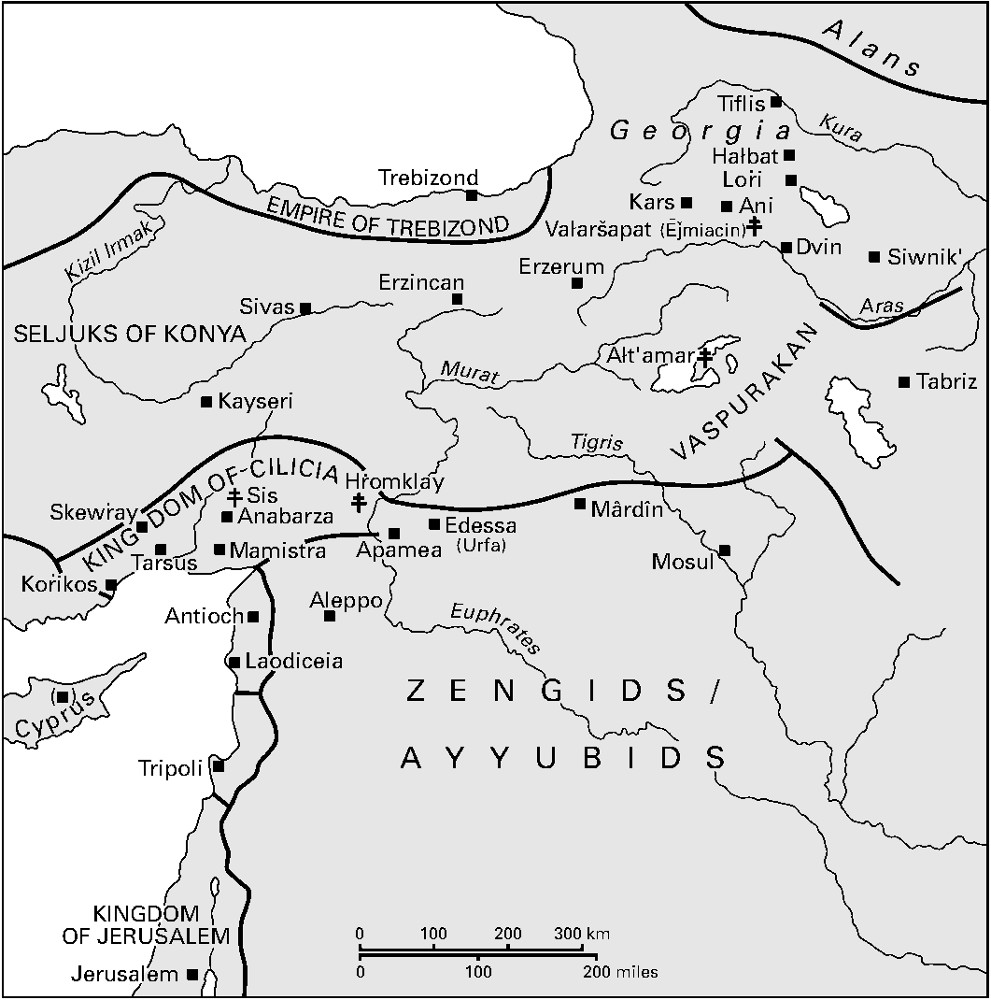

*地图6 中世纪亚美尼亚。比例尺分别以千米及英里标示。*

| 原图标注 | 中文 |
| --- | --- |
| Alans | 阿兰人 |
| Georgia | 格鲁吉亚 |
| EMPIRE OF TREBIZOND | 特拉布宗帝国 |
| SELJUKS OF KONYA | 科尼亚塞尔柱人 |
| VASPURAKAN | 瓦斯普拉坎 |
| KINGDOM OF CILICIA | 奇里乞亚王国 |
| ZENGIDS / AYYUBIDS | 赞吉王朝／阿尤布王朝 |
| KINGDOM OF JERUSALEM | 耶路撒冷王国 |
| Tiflis | 第比利斯 |
| Halbat | 哈格巴特 |
| Lori | 洛里 |
| Kars | 卡尔斯 |
| Ani | 阿尼 |
| Vałaršapat (Ējmiacin) | 瓦加尔沙帕特（埃奇米阿津） |
| Dvin | 德温 |
| Siwnik′ | 休尼克 |
| Trebizond | 特拉布宗 |
| Sivas | 锡瓦斯 |
| Kayseri | 开塞利 |
| Erzincan | 埃尔津詹 |
| Erzerum | 埃尔祖鲁姆 |
| Ałt‘amar | 阿赫塔马尔 |
| Tabriz | 大不里士 |
| Skewray | 斯凯夫拉 |
| Sis | 西斯 |
| Hṙomklay | 赫罗姆克拉（鲁姆堡） |
| Anabarza | 阿纳巴尔扎 |
| Mamistra | 马米斯特拉 |
| Tarsus | 塔尔苏斯 |
| Korikos | 科里科斯 |
| Antioch | 安提阿 |
| Apamea | 阿帕米亚 |
| Aleppo | 阿勒颇 |
| Edessa (Urfa) | 埃德萨（乌尔法） |
| Mârdîn | 马尔丁 |
| Mosul | 摩苏尔 |
| Laodiceia | 老底嘉 |
| Tripoli | 的黎波里 |
| Jerusalem | 耶路撒冷 |
| Cyprus | 塞浦路斯 |
| Kizil Irmak | 克孜勒河 |
| Murat | 穆拉特河 |
| Kura | 库拉河 |
| Aras | 阿拉斯河 |
| Tigris | 底格里斯河 |
| Euphrates | 幼发拉底河 |

他在4世纪初，确立基督教为亚美尼亚宫廷宗教。[^p426-4]

上述教会对话的历史进程，很大程度上由这一时代几次大规模人口移动决定：11世纪中叶塞尔柱土耳其人从东方到来，13世纪蒙古人随之，1380年代又有帖木儿势力；十字军则带来与西方不断涌现的军事、教会及商业接触。这些接触不可避免地突出宗教差异，产生许多摩擦。

<!-- PDF page 427; original page 406 -->

尽管如此，仍发生大量交流，为参与其中的各教会体制留下印记。

## 动荡与重组时期，1050—1150年

本时期开始时，亚美尼亚人大规模迁居东加帕多家、原拜占庭与阿拉伯势力交界地带的进程，已深入第三、也是最后阶段。它始于880年代巴西尔一世时期拜占庭推进，旨在以基督徒重新充实人口；963年后尼基弗鲁斯二世·福卡斯治下更具动力，亚美尼亚人成为人口多数。884年重建的亚美尼亚王国，其西部三个主要继承国家的王族及大部分贵族，逐渐迁至这里，使过程达到顶点。[^p427-5] 1022年，瓦斯普拉坎国王塞内克里姆—霍夫汉内斯，在拜占庭及最初塞尔柱入侵双重压力下，把王国遗赠帝国；阿尼的阿绍特四世于1039年效法。亚美尼亚人遂成为帝国臣属，处于外来拜占庭官僚结构之下，领土重组为军区。[^p427-6]

教务可见平行过程，使希腊、亚美尼亚与雅各派共同体，以及通德拉克异端，再度接触，产生多种结果。其中之一，是980年代教会总主教哈奇克倡议，设立与拜占庭主教座平行的叙利亚及亚美尼亚主教座。这可能出乎君士坦丁堡宫廷预料，反而因仪式、教义差异彼此不能接受，引发宗派间族群与宗教论战，导致改变教会归属的信徒重新受洗。[^p427-7] 亚美尼亚世俗权力被整合并失去作用，鼓励君士坦丁堡牧首试图压制亚美尼亚教会总主教座。彼得罗斯教会总主教于1045年被召赴君士坦丁堡进行神学讨论，两年后再次。为抵御拜占庭压力，他<!-- PDF page 428; original page 407 -->违背惯例，预先祝圣侄子为继承人。后者1058年就职，一年后被新皇帝君士坦丁十世·杜卡斯召至首都，要求接受迦克墩基督论，以及君士坦丁堡牧首最高权威，亦即放弃自主。拒绝后，他被囚至1062年，再被限制居于塞巴斯特亚。三年后去世，皇帝起初禁止新选举，后来以亚美尼亚卡尔斯王国割让为交换而让步。[^p428-8] 最终获准当选教会总主教的候选人，是热爱希腊文化的瓦赫拉姆。他早先已服务拜占庭，从1048年起，担任美索不达米亚都督十年，其间毁坏通德拉克宗派据点、驱散成员。[^p428-9] 他出身帕赫拉武尼家族，自称启蒙者圣格里高利后裔。获祝圣为格里戈尔二世，开启此后一个半世纪，这一家系连续不断的教会首领序列。

11世纪后半叶，塞尔柱于1064年攻取阿尼，1071年又在曼齐刻尔特决定性击败拜占庭军，巩固安纳托利亚权力。由此出现的权力真空，使亚美尼亚人在托罗斯山脉以南山地建立实际自治。[^p428-10] 相对安全使亚美尼亚政治重心南移，形成一系列小封邑，逐渐发展为奇里乞亚新王国（1198—1375年），在本时期余下岁月，于地区政治与宗教史中发挥重要作用。[^p428-11]

亚美尼亚民族的破碎分散，鲜明体现在教会总主教格里戈尔二世（1065—1105年在任）不断旅行，为广布的羊群服务。亚美尼亚小王公想到以往先例，努力说服他居于自己领地，以加强合法性主张。纯粹实际需要，迫使格里戈尔把其他人提升为教会总主教，使其有权在<!-- PDF page 429; original page 408 -->当地作必要决定。[^p429-12] 因此，自1069年起，洛里人盖沃尔格与阿普勒加里普·阿尔茨鲁尼同居塔尔苏斯；彼得罗斯教会总主教的侄子萨尔吉斯，于1073年居于利坎多斯霍尼、菲拉雷托斯·布拉哈米奥斯，即瓦赫拉姆的领地；格里戈尔的侄子巴尔塞格，在阿尼获祝圣为主教，八年后在哈格巴特升为教会总主教。哈格巴特是残存洛里—塔希尔小型巴格拉提德王国主要修道院之一。另有证据，格里戈尔曾访埃及，并任命同名侄子，作为当地扩张中的亚美尼亚共同体最高教会权威。别处则因分离倾向而采取类似行动：瓦斯普拉坎希望至少在教会领域维持独立王国地位，于1113年宣布阿赫塔马尔为独立教会总主教座，由此产生的分裂，直到1441年才解决。相似地，12世纪初，鲁姆塞尔柱人似乎曾短暂考虑，把塞巴斯特亚主教阿纳尼亚立为对立教会总主教，以分隔其治下亚美尼亚人与其他亚美尼亚教会。[^p429-13] 更晚些，马穆鲁克反对奇里乞亚亚美尼亚宫廷亲拉丁方向，看来成为1311年设立耶路撒冷亚美尼亚牧首区的因素之一，意在管辖马穆鲁克地区的亚美尼亚基督徒。[^p429-14]

同时，这也符合愈加分散的共同体之属灵需要。11世纪中叶，过境贸易正常节律遭破坏，加剧亚美尼亚商人与手工业者外迁，在较安定的克里米亚、基辅罗斯、波兰及黑海西岸，使远方同胞人数增加。他们也定居意大利各港。[^p429-15] 甚至与冰岛有贸易联系；记载有三位亚美尼亚“主教”抵达，推测应挪威国王哈拉尔·西居尔松邀请。[^p429-16] 另一些亚美尼亚商人，先被塞尔柱人、后被蒙古人驱逐向东，在伊朗东北形成繁荣聚居地。[^p429-17]

<!-- PDF page 430; original page 409 -->

亚美尼亚人以军事才能广受重视。拜占庭战败后，一些有进取心的将领前往法蒂玛埃及。亚美尼亚人巴德尔·贾马利（1074—1094年在任），建立延续近一个世纪的维齐尔世系。他们大多改信伊斯兰，却庇护当地较早建立的亚美尼亚基督徒共同体，使其经历某种复兴。表现是建造约三十所教堂与修道院，其中索哈杰附近白修道院保存最好，具有凯松画家狄奥多尔所绘数幅壁画及铭文。[^p430-18]

亚美尼亚人虽常警惕拜占庭霸权野心，本时期许多人仍视君士坦丁堡为近东基督教世界的首要代表。首都亚美尼亚人口增长，利用其交通枢纽地位，重启从希腊语到亚美尼亚语的翻译。活动对11及12世纪亚美尼亚圣徒月录（yaysmawurk‘），以及圣亚他那修礼仪的发展，有重大影响；后者借用归于圣金口约翰的拜占庭对应礼仪要素。[^p430-19] 此外，精力充沛的格里戈尔二世，因委托从希腊语、叙利亚语译出一系列圣徒传及其他文本，赢得“敬爱殉道者”（Vkayasēr）之号，几位继任者又把事业推进至13世纪末。[^p430-20] 这些工作多聚焦尚无亚美尼亚语版本的古代教父作品；拜占庭及格鲁吉亚控制区内的亚美尼亚迦克墩派译者，则强调迦克墩会议之后的教父，如圣约翰·克利马库斯及大马士革的圣约翰。[^p430-21] 其修道院，如13世纪在北部洛里繁荣的科拜尔、基兰茨，以及阿赫塔拉，亦称普伦贾汉克，显示中期拜占庭偏好的壁画布局，<!-- PDF page 431; original page 410 -->覆盖教堂全部墙面，与中世纪亚美尼亚教堂通常较朴素的装饰不同。[^p431-22]

11世纪后期的新现象，是亚美尼亚与拉丁教会开始联系，随后四个半世纪不断展开；背景是12世纪教皇政策，试图使各种“分裂”的东方教会，在罗马首席权下合一。最初示好于1080年，由教皇格里高利七世致教会总主教格里戈尔二世；有些人说后者此前曾访罗马。[^p431-23] 这一接触开启丰富多样的教会、神学、政治及文化交流，在近东不同地区，并通过西方亚美尼亚共同体进行。因此，西方人对亚美尼亚人的了解，可能确比其他“东方”基督教派更多。

第一次十字军中，直接联系建立起来。鲁本王朝的科斯坦丁一世等亚美尼亚王公，协助十字军穿过奇里乞亚赴安提阿；埃德萨信奉迦克墩教义的亚美尼亚统治者托罗斯，则于1098年欢迎布洛涅的鲍德温入城，城市不久变成十字军伯国。亚美尼亚人与耶路撒冷王国（1099—1187年）早早建立融洽关系，其三位王后具有亚美尼亚血统。[^p431-24] 这些年，多位亚美尼亚显要朝圣，包括教会总主教格里戈尔三世及其兄弟涅尔塞斯；他们先在安提阿参加类似会议，再于1141／1142年陪教皇使节阿尔贝里希，出席最后晚餐厅的会议。同年，教皇欧根尼三世与教会总主教也友好通信。[^p431-25]

但这些无法掩饰，近东地缘政治主动权，已转入摩苏尔埃米尔赞吉及其子努尔丁手中。赞吉于1128年控制阿勒颇，1144年再取埃德萨，引发第二次十字军（1147—1148年）。其失败为努尔丁1154年兼并大马士革、1169年兼并埃及铺路。成功使某些亚美尼亚人，例如托罗斯亲王的兄弟姆莱赫，深信与之和睦有利，甚至改信伊斯兰，与努尔丁结盟；<!-- PDF page 432; original page 411 -->努尔丁本人也娶了亚美尼亚公主。兄长死后，姆莱赫从流亡归来，在赞吉王朝支持下夺权，统治变化不定：1172年击败安提阿与耶路撒冷联军，次年从拜占庭夺回奇里乞亚大部分海岸。但1174年努尔丁去世，他随即死于宫廷政变。这个动荡插曲，凸显当时亚美尼亚生活的不安定，也反映于缺乏重大艺术作品。

## 修道生活

9世纪后期起，巴格拉提德王国的财富，通过贵族、后来富商的大量捐赠，表现为虔敬，推动亚美尼亚修道院建设显著增长。[^p432-26] 事实上，此时多数教堂建于大型修道建筑群中。它们吸收称为“加维特”（gawit‘）的世俗建筑形式，作为日课、授课、抄稿、安葬等重要空间；此后四世纪扩展中，逐渐增设图书馆、食堂及钟楼，以及供院内使用的榨油、榨酒设施。[^p432-27] 规模是与早期的重要区别：新的共住制修道院，有时容数百修士，日常生活常依圣巴西略会规，由“瓦尔达佩特”监督；他们是获准讲道及教学的神学博士，其职责和声望，如今进入最具影响的阶段。[^p432-28] 此外，捐赠者慷慨，使共同体迅速成为强大经济单位，拥有大量地产、人力及磨坊等设备，不同于过去洞穴或简陋木造院舍。[^p432-29] 修道院也空前成为高等学术机构，采用结构化课程，集中阐释《圣经》、教父作者及一套希腊古代教科书。[^p432-30] 斯凯夫拉等修道院抄经室，在抄写及彩饰之精致上，可媲美<!-- PDF page 433; original page 412 -->赫罗姆克拉教会总主教座。[^p433-31] 亚美尼亚高地及奇里乞亚之外，安提阿附近黑山有一系列亚美尼亚修道院，同期也有希腊、格鲁吉亚、叙利亚及拉丁共同体，因此促进跨地域交流。当时最著名的亚美尼亚中世纪高等学术修道中心，设于休尼克的格拉佐尔，活动年代为1280—1340年。在负责人埃萨伊·恩切齐领导下，声望大增，学生从亚美尼亚各地来学。[^p433-32]

亚美尼亚修道院的灵修模式，明显从早期外在苦修，转向更强烈关注内在生活，反映这一时代广泛关切；拜占庭及正在发展的伊斯兰苏菲传统，也有类似现象。后者又似乎受尼尼微的圣以撒等较早基督教神秘作家影响。[^p433-33] 从保罗派基础形成的通德拉克派，其基本信条可视为这一取向的极端表现。它威胁对道成肉身、钉十字架及复活的救恩安排作正确理解，因此激发多种媒介回应：从学术性教义论著，到亚美尼亚特有“哈奇卡尔”（xačk‘ar）纪念物的广布，即以无数图式精雕十字架的大型矩形石碑。[^p433-34] 迫害使该派转入亚美尼亚地形难达之处，周期性重现，最晚延至19世纪。[^p433-35] 其他人逃往或被驱往保加利亚菲利波波利斯亚美尼亚中心；地理迁移中，信仰体系也转变，影响后来波格米勒派及阿尔比派等宗派。[^p433-36]

<!-- PDF page 434; original page 413 -->

## 与拜占庭讨论教会合一

1165年，姆莱赫流亡、发展穆斯林联系之际，涅尔塞斯·什诺尔哈利主教与帝国大马厩长阿莱克修斯·阿克苏赫，在奇里乞亚战役中偶然交谈，开启断续的神学讨论，探讨与拜占庭教会接近的可能，直到1180年曼努埃尔一世·科穆宁皇帝去世。[^p434-37] 皇帝把谈判交给经验丰富的神学外交家狄奥里阿诺斯，任务是实现曼努埃尔目标：维持安提阿附庸地位，作为权威南扩耶路撒冷、北扩科尼亚苏丹国的基础。1171年皇帝提出九项接受条件，包括承认最后四次大公会议、宣认迦克墩定义并绝罚否认者、从《三圣颂》删除“为我们被钉十字架者”，以及若干仪式问题，如圣餐使用有酵饼及掺水酒，还有教规规定，教会总主教任命须获皇帝确认。[^p434-38] 涅尔塞斯试图召开主教会议审议，却未及实现便去世。其继任者格里戈尔·特格哈伊（1173—1193年在任）时期，经过更多讨论，1178年终于有三十三位高级教士及院长，连同雅各派代表及高加索阿尔巴尼亚教会总主教，在赫罗姆克拉集会，提出平衡审慎的答复。在基督论等领域，他们“为教会和平”表现和解；另一些领域，则坚持举证责任在希腊方面，例如证明最后四次会议不违背前三次，以及指出《三圣颂》附句源于希腊而非亚美尼亚。[^p434-39] 值得注意的是，他们处理教会总主教座地位及继承问题的方式，显示安提阿已在多大程度上成为亚美尼亚教会抱负的焦点，世俗领域亦然。签署者同意皇帝确认，条件是此后承认亚美尼亚教会总主教为<!-- PDF page 435; original page 414 -->安提阿牧首，从而维持自主。[^p435-40] 几乎同时代，尼洛斯·多克索帕特雷斯论五大牧首辖区的希腊语著作，此时被译为亚美尼亚语，显然参与了有关亚美尼亚主教座地位的讨论。[^p435-41]

然而，这些会议敕令，并不代表当时亚美尼亚教会所有意见。反对来自统称“北方瓦尔达佩特”的学者及高级教士。[^p435-42] 后来一个问题，很能说明其尊重传统：亚美尼亚军队，在格鲁吉亚宫廷显贵扎卡雷与伊瓦内·埃尔卡伊纳巴祖克兄弟指挥下，参与格鲁吉亚战役。格鲁吉亚人已获准行军时在便携祭台举行礼仪，亚美尼亚军队却未获准引入。西斯会议虽于1204年许可，北方严格派仍不遵从，在扎卡雷召集的洛里地方会议（1205年）及阿尼首都会议（1207年）阻止措施，迫使他通过军纪强行实施。[^p435-43]

另一端，一些亚美尼亚教士较少关注自身宗派传统历史先例，或教会谈判中机构利益，而诉诸教会作为基督身体的属灵实在，肯定它是基督教世界根本合一的基础。包括姆希塔尔·戈什（约1140—1213年），以及下一代大亚美尼亚的瓦尔丹·艾盖克齐（约1170—1235年）。[^p435-44] 13世纪，民众诗人弗里克表达另一种基督教合一观点：缺乏合一是穆斯林推进的重要因素；他接着列出各教会妨碍更大凝聚合作的主要弱点。[^p435-45]

<!-- PDF page 436; original page 415 -->

此时最积极在最高层从事跨宗派接触的亚美尼亚教士，是年轻的塔尔苏斯总主教涅尔塞斯·兰布罗纳齐（1153—1198年）。其常被引用的话说：“西班牙与东方，都是一个头的肢体；希腊人与蛮族、亚美尼亚人与格鲁吉亚人、叙利亚人与埃及人〔科普特人〕，亦然。一切都在祂里面，以圣灵相联，藉信仰披戴祂。”[^p436-46] 1197年，他率亚美尼亚代表团，赴拜占庭皇帝阿莱克修斯三世·安格洛斯及牧首乔治·希菲利诺斯处，澄清与皇帝起初愿授奇里乞亚亲王列翁王冠、使领地升为王国相关的宗教问题。讨论延至五旬节，无果而终。而且，皇帝此举看来受消息刺激：亚美尼亚与德意志皇帝就同一目的谈判，已大有进展。涅尔塞斯也参与这些谈判，1190年曾奉派迎接进入奇里乞亚的腓特烈·巴巴罗萨，却得知其早逝。[^p436-47] 但他利用机会，把教皇卢修斯三世所送拉丁礼仪书、加冕礼规及圣本笃会规，译为亚美尼亚语。[^p436-48] 此时，亚美尼亚人也采用拉丁主教高冠、戒指及牧杖，代替拜占庭式主教冠冕；后者如今转由普通司祭使用。

## 与拉丁教徒的教会合一

12世纪末，奇里乞亚世俗及教会利益，聚焦德意志帝国与教皇，应置于拜占庭在保加利亚、塞尔维亚及塞浦路斯受挫的背景理解；塞浦路斯1184年宣布独立，七年后落入十字军。1190年代，这些政体在正式服从教皇最高权威后，都获得帝国承认。亚美尼亚效法，亲王列翁（1198—1219年在位），于1198年1月6日在塔尔苏斯原希腊圣索菲亚教堂、王国最大教堂加冕为王，<!-- PDF page 437; original page 416 -->由美因茨总主教、维特尔斯巴赫的康拉德主礼。[^p437-49] 总主教前一年抵达，带着英诺森三世指示，要亚美尼亚承认罗马首席权，并在若干事务上与罗马惯例一致，包括用固定历法安排圣徒庆日，取代以复活节周期决定的亚美尼亚传统移动体系；以及在圣诞斋期与大斋期开斋时，只食鱼与橄榄油。[^p437-50] 列翁在塔尔苏斯召开主教会议批准，只有十二位主教签署，意见却占上风。[^p437-51]

12世纪各亚美尼亚共同体亲西方情绪增长，可从《论敌基督讲辞》（Sermo de Antichristo）等经外作品看出；它们包含与塞尔柱入侵相联的亚美尼亚末世期待。高峰是《协和书简》（Dašanc‘ t‘ułt‘），[^p437-52] 声称叙述最早基督徒君王君士坦丁一世与特尔达特三世在罗马会面，更重要的是，首位亚美尼亚教会总主教启蒙者格里高利，受教皇西尔维斯特教导、祝圣。文书声称，各方同意划分教会及世俗权力的行使。[^p437-53] 其用意显然是说，服从教皇、与西方结盟，将明显有利于巩固亚美尼亚近东权力基础。随后数世纪，与教皇交流时常诉诸这一讯息。

前面已指出，奇里乞亚与安提阿，发展出密切却复杂的关系。共同利益使其联合对抗拜占庭，但内部竞争也引发严厉背信与报复。1170年代起，亚美尼亚教会抱负聚焦安提阿牧首座。的确，在教皇领导下合一的一项好处，是使亚美尼亚教会总主教摆脱拉丁牧首干预；后者仍主张塔尔苏斯及马米斯特拉主教座管辖权，这些城市<!-- PDF page 438; original page 417 -->归亚美尼亚控制时，原有拉丁主教。[^p438-54] 两国教会互动的另一方面，是列翁亲王对雅各派政策。1192年，他任命狄奥多尔·巴尔·瓦赫本为对立牧首，试图使地区雅各派共同体归其管辖。[^p438-55] 1187年萨拉丁攻击后，安提阿领土缩减、被迫与的黎波里联合，逐渐衰落，有利于列翁以巧妙联姻取得优势。但安提阿王公家族各成员竞争主张，加上意大利商人共同体利益，直到其统治结束，都使他未能得逞。

## 教皇传教举措

13世纪前半叶创立的道明会与方济各会，两大托钵修会的传教精神，加上结构灵活、纪律及制度组织，使其成为前所未有的属灵力量，劝亚美尼亚及其他东方基督徒改宗，并推进教皇外交。方济各会在奇里乞亚设立多处中心，该世纪中日益重要，涉及宗教艺术等领域。[^p438-56] 赫图姆二世（1289—1301年在位）尤其请求教皇，派六位修士作私人宫廷随从，后来自己也加入修会。[^p438-57] 道明会建立联系起步较慢，但下个世纪更关键。

这是蒙古支配时期，初期动荡后，有利于亚美尼亚教会。1255年起，它免向蒙古纳税。[^p438-58] 奇里乞亚赫图姆一世（1226—1269年在位），以及大亚美尼亚若干王公，谨慎接受蒙古宗主权，保护臣民免遭任意<!-- PDF page 439; original page 418 -->勒索。因此，13世纪中叶，两片亚美尼亚地区均享相当稳定繁荣，鲜明对照于十字军诸国挣扎维持地位；1204年拉丁人征服君士坦丁堡，也几乎致命打击拜占庭力量。在此背景下，应理解亚美尼亚人为何不愿进一步探讨列翁一世所公布与罗马合一的含义。

1243年，教会总主教科斯坦丁·巴尔兹尔贝尔德齐（1221—1267年在任），对英诺森四世询问是否承认终傅圣事及其他礼仪，积极答复。但其长期任内讨论的更实质问题，和子句及彼得首席权，只显露双方分歧程度。1245年3月25日，第一次里昂会议前夕，教皇派往东方的使者，包括方济各会士阿拉贡的多明我，任务是取得亚美尼亚信仰宣认。赫图姆一世与导师瓦尔丹·阿雷韦尔齐讨论时，后者写出一份拉丁教会十五项错误的简编作为回应。[^p439-59] 1247年在圣达太修道院新设总主教座，也可能是反对教皇首席权的回应之一。圣达太不仅传统上保证亚美尼亚教会的使徒性，[^p439-60] 其修道院还靠近伊朗西北马库附近的蒙古夏营。

同样，1251年西斯会议虽接受和子句教义，却激起大亚美尼亚教会强烈反应，威胁另立教会总主教、造成分裂。瓦纳坎博士与瓦尔丹·阿雷韦尔齐，似乎都接受圣灵双重发出的正统性，至少对神学造诣较深者如此，对普通民众却未必。但其语言、意象似乎表明，他们心目中或是圣灵在救恩安排中的活动，或是教父公式“从父、经子、在圣灵中”。拉丁论战者觉得这些表述不能令人满意。[^p439-61]

此外，1262年阿卡，姆希塔尔·斯凯夫拉齐与使节托马斯·阿涅·德·伦蒂诺，就彼得首席权激烈冲突，促使教皇派道明会士威廉·弗雷内赴奇里乞亚，试图恢复更友好<!-- PDF page 440; original page 419 -->气氛。[^p440-62] 亚美尼亚人未参加1274年第二次里昂会议，正与此前对教皇示好的保留相符；连伊儿汗都应格里高利十世邀请，派代表与会。[^p440-63]

## 贸易路线促进宗教交流

“蒙古治世”的有利条件，增加经新伊儿汗中心大不里士，把中国、中央亚洲、俄国、南高加索及小亚细亚相连，再通往奇里乞亚阿亚斯港的贸易；意大利船只从那里把东方商品运往西欧。另有较北的陆路，经过埃尔祖鲁姆、埃尔津詹及锡瓦斯。[^p440-64] 许多亚美尼亚商人参与，使各转口地形成共同体、建造教堂。[^p440-65] 拉丁托钵修会也受益。方济各会在亚美尼亚人口可观的埃尔祖鲁姆、圣达太、萨尔马斯、卡尔皮、第比利斯、苏丹尼耶及大不里士设中心，道明会则在大不里士及马拉盖有院舍。[^p440-66] 很快有人抱怨，罗马教义已渗入奇里乞亚、拜占庭主要城市及巴格拉提德旧都阿尼，如今又侵入大亚美尼亚。[^p440-67]

埃尔津詹的情况，或许最为我们熟知；它有13、14世纪最活跃的亚美尼亚商人、手工业共同体之一。周边乡村由土库曼人主导，当地门居贾克宫廷赞助波斯文化。[^p440-68] 文学与教规资料，暗示共同体间有一定交往，有时以婚姻及家族联盟巩固。[^p440-69] 例如，1280年制定的亚美尼亚城市青年兄弟会规章，<!-- PDF page 441; original page 420 -->反映纳西尔哈里发较早改革类似穆斯林组织的影响；[^p441-70] 13世纪末科斯坦丁·埃尔津卡齐以基督为中心的寓意诗，首次把波斯玫瑰与夜莺爱情主题，引入亚美尼亚文学，暗示熟悉苏菲诗歌中与神圣爱者神秘合一的意象。[^p441-71] 但也有紧张暗流，使塞尔柱人于1270年代中期，配合马穆鲁克苏丹拜巴尔斯进攻奇里乞亚，协调一系列反亚美尼亚袭击。[^p441-72]

前一个十年，马穆鲁克巩固近东权力，1260年控制叙利亚，随后在艾因贾鲁特战役击退包括亚美尼亚部队的蒙古军。此后一个多世纪，直至1375年奇里乞亚王国最终覆灭，支持蒙古、与西方结盟，使亚美尼亚人成为马穆鲁克特别愤怒的对象。他们成为亚美尼亚主要敌人，在口头史诗《萨孙的勇士》中留下印记，主要对手是姆斯拉·梅利克，即埃及王。依典型史诗方式，冲突以“小中见大”表现，呈现向基督徒横征暴敛、毁坏修道院、基督徒与穆斯林家庭关系等历史联系。[^p441-73]

13世纪末，政治军事局势决定性转为不利奇里乞亚亚美尼亚人。金帐汗国术赤系蒙古人，以伏尔加下游萨莱为中心，接受伊斯兰，与马穆鲁克联合。1291年，后者攻取大陆最后十字军据点阿卡；次年攻击亚美尼亚教会总主教座赫罗姆克拉，俘虏在任的斯特帕诺斯四世。继任者格里戈尔·阿纳瓦尔泽齐（1293—1307年在任）被迫迁居奇里乞亚首都西斯，面对赫图姆二世外交举措的教会后果。国王把两位姐妹，分别许配塞浦路斯吕西尼昂王室，以及拜占庭帕莱奥洛格王朝，引发基督教合一问题。[^p441-74] 阿纳瓦尔泽齐呼吁亚美尼亚人，“在这堕落时代”，<!-- PDF page 442; original page 421 -->“与希腊人及一切民族”合一，至少部分出于务实考虑。[^p442-75] 但其修订《圣徒月录》时，纳入拜占庭与罗马圣徒纪念历，清楚显示广博学识，也证明精通希腊语与拉丁语。[^p442-76] 此外，他致国王的著名信件表明，立场并非只由实用主义决定，教会合一问题对他分量甚重。他认同6世纪以来亚美尼亚迦克墩派圈子发展的观念：真正追随圣格里高利，意味着与普世教会共融。[^p442-77] 这解释为何他建议，亚美尼亚教会接受所有大公会议，因而接受迦克墩基督论定义。他起初反对圣餐酒加水，但教父权威的分量使其信服。[^p442-78] 格里戈尔仍忠于自身传统，可见于拒绝教皇进一步要求：他反对堂区司祭独身，也不觉得大斋期吃鱼与油需要教皇许可；虽承认罗马圣座首席权，也承认其他四个古代东方牧首区的尊严。[^p442-79]

大亚美尼亚的反对力量，如今集中于南部休尼克奥尔贝良家族；该家族1256年起，以“因朱”（inju）直属领地形式，直接归蒙古宗主权，其势力日升。[^p442-80] 1290年代，家族成员与其他贵族、高级教士，在斯特帕诺斯·奥尔贝良总主教主持下秘密集会，保护现状，反对与教皇订约。他们主张，亚美尼亚教会建立于单一教会传统：由使徒达太及巴多罗买创立，圣格里高利发展，前三次大公会议界定，并由<!-- PDF page 443; original page 422 -->5世纪以来一系列地方主教会议加以维护；这些会议把迦克墩会议视为隐蔽的涅斯托里乌斯主义，而予以拒绝。[^p443-81] 因此，他们要求格里戈尔停止一切迦克墩派联系，不再与之于12月25日庆祝降生，而守圣雅各所定庆日，亦即亚美尼亚惯例所源出的早期耶路撒冷经课。[^p443-82] 面对上级可能诉诸国王军事干预，奥尔贝良慷慨陈词：“为保存使徒教父传统，我们准备受苦、流亡、入狱与死亡。”[^p443-83] 他也首次呼吁，赴奇里乞亚的贵族返回大亚美尼亚，教会总主教座返回古址埃奇米阿津修道院。[^p443-84]

新世纪出现数次孤注一掷的尝试，希望订立拉丁—亚美尼亚—蒙古大联盟，对抗马穆鲁克。其中，伊儿汗合赞于1302年与基督教诸国通信，却无结果。1305年蒙古军未能阻止马穆鲁克入侵后，亚美尼亚贵族科里科斯的赫图姆，西行继续讨论。1307年8月，他在普瓦捷，应教皇克莱孟五世要求，撰写蒙古史《东方诸国史之花》（La flor des estoires de la terre d’orient）。[^p443-85] 同年，教皇坚持再开西斯会议，批准阿纳瓦尔泽齐趋向罗马正统的神学与礼仪调整。[^p443-86] 但会议不能代表整个教会，大亚美尼亚高级教士明显缺席。保守高级教士盖沃尔格·斯凯夫拉齐传记，记载广泛民众抗议，继而引发一系列向塞浦路斯的驱逐。[^p443-87] 蒙古人的反应，可从列翁三世国王及其叔、已成方济各修士的赫图姆二世，<!-- PDF page 444; original page 423 -->同年稍后拜访当地蒙古统治者时，连随从一起被杀看出。

## 穆斯林与基督徒的敌对

1295年6月，伊儿汗合赞改信伊斯兰，使伊朗宗教格局迅速变化，蒙古当局更难维持秩序与宗教平衡。[^p444-88] 合赞禁止佛教教士留在伊朗；将领纳兀鲁思攻击纳希切万、阿尔塔兹及马拉盖基督教堂，随后却因过度行为受罚。这鼓励赫图姆二世于1299年请求合赞，缓和无辜受苦的非穆斯林处境。

合赞之弟及继任者完者都的宗教转变，更显示权力平衡变化迅速。他最初受洗名尼古拉，纪念新教皇尼古拉四世，随后接受逊尼派信仰，最终改奉什叶派伊斯兰。[^p444-89] 其任内（1304—1316年），歧视基督徒增加，促使更多亚美尼亚人迁往奇里乞亚及克里米亚。强迫改宗、征新税及颁新规继起；1307年一则抄本题记说，基督徒须佩戴蓝布，以便公众辨认。[^p444-90] 这些措施逐渐削弱纳哈拉尔，即上层贵族的地位；其社会政治结构，自帕提亚时代便为亚美尼亚人提供区域凝聚。有些家族被迫离土，另一些则把所有权转给通常出自同一家族的主教，保持间接控制；因为伊斯兰法保护“瓦克夫”（waqf）宗教信托，通常不征税。因此，在埃尔津詹及马库等数个亚美尼亚主教座，以及阿赫塔马尔和高加索阿尔巴尼亚教会总主教座，藉“王公主教”（parontēr）制度，继承于同一家族直系延续多代。[^p444-91] 这一<!-- PDF page 445; original page 424 -->过程不可避免地铺路，使亚美尼亚人逐渐在法律上被承认为族群宗派实体。

## 大亚美尼亚的亚美尼亚—拉丁互动

1318年，依阿维尼翁教廷更重传教的特点，约翰二十二世在近东与远东设两大教区，分别交道明会、方济各会。前者以伊儿汗首都苏丹尼耶为中心，使主教能任教皇私人使节，并设六个附属主教座，其中锡瓦斯、大不里士、马拉盖三处，亚美尼亚人口可观。[^p445-92] 教皇通信显示，他深涉亚美尼亚事务，了解充分。[^p445-93] 他近来已施压召开1316年阿达纳会议，再确认九年前西斯决议，并希望比以往更系统接触大亚美尼亚高级教士。[^p445-94]

马库王公家族的阿尔塔兹人扎卡里亚，是关键人物；1298至约1340年，他在圣达太修道院，任教会总主教的东方特派代表。作为格里戈尔·阿纳瓦尔泽齐的亲拉丁盟友，他是少数与会东方教士之一，会后进一步接受天主教，并在与休尼克都主教霍汉·奥尔贝利通信中讨论此事。[^p445-95] 1321年，他收到教皇两封私人信，赞扬其引领灵魂回到“教会”。[^p445-96]

依教皇要求，其助手霍夫汉内斯·措尔措尔齐，在巴尔托洛梅奥·达·波焦主教帮助下，翻译托马斯·阿奎那对伦巴德的彼得《箴言四书》第四卷的注释；该卷是西方中世纪主要圣事入门书。[^p445-97] 某时，圣达太成立方济各会院，1320—1330年代，把其他拉丁经院手册及礼仪书译为亚美尼亚语。由此，亚美尼亚人接触西方亚里士多德逻辑、伦理、自然哲学，即物理学、形而上学，以及美学<!-- PDF page 446; original page 425 -->的发展，后者包括语法与文学批评；还有体现西方如何看待各种近东共同体、如何与其辩论的实用手册。[^p446-98] 这些翻译在历史上意义重大，是最早把当代拉丁思想译为其他语言的尝试之一，比德米特里奥斯与普罗霍罗斯·基多尼斯兄弟首次希腊语翻译，早一代。[^p446-99]

格拉佐尔修道学院负责人埃萨伊·恩切齐，阅读极广，十分理解教义及教会史发展。他深入接触西方思想，起初愿与拉丁教徒对话，同时完整保存亚美尼亚自主。的确，1323年，亲近同僚及继任者提拉图尔·基利凯齐，委托制作现存最早阿奎那注伦巴德彼得的亚美尼亚文抄本之一。[^p446-100] 14世纪之交《格拉佐尔福音书》的彩饰，很能显示这种平衡：有若干典型西方场景，整体却反映亚美尼亚神学与释经。[^p446-101] 如此前什诺尔哈利，恩切齐也接受，根据定义不同，可以正当地说基督有一性或二性。[^p446-102] 他性情求和，认为宜慢于争辩、快于和解与和平。同时，他主张，不平等联盟中，物质资源更丰一方，不应利用优势剥夺另一方权利。[^p446-103]

亚美尼亚学者摇摆的立场，反映神学局势流动，例如姆希塔尔·萨斯内齐，于1320年代离开前导师恩切齐，转而支持奥尔贝良对礼仪差异较“强硬”的立场。[^p446-104] 他是最早回应拉丁立场的亚美尼亚思想家之一，承认此前亚美尼亚人<!-- PDF page 447; original page 426 -->视法兰克人为弟兄，为在基督中合一而喜乐；但他发现，法兰克人的“希腊智慧”，与他所认定的道德松弛、斋戒缺乏纪律之间，有明显断裂。[^p447-105] 同时代霍夫汉内斯·塔尔贝鲁尼主张，神圣智慧通过光照传递，而非逻辑与推论，凸显当代亚美尼亚神学本质上的新柏拉图主义性质，与道明会传统的亚里士多德基础之对比。[^p447-106]

对城市生活、贸易干线较不固定的大亚美尼亚中东部传教，新设马拉盖主教座及巴尔托洛梅奥·达·波焦主教，极为重要，因为他激起亚美尼亚修士对罗马神学的好奇。极短时间中，竟前所未有地建立了附属于道明会的亚美尼亚修会团体，不同于圣达太方济各会地位，并为反宗教改革时期新一波合一派机构提供范本。1330年，主教率修士迁到休尼克埃尔恩贾克区的克尔纳修道院；随后发展也快，1331年交给修会，到1337年，已依道明会日课经与弥撒书敬拜，标志与传统亚美尼亚礼仪分离。[^p447-107] 道明会版本的圣奥古斯丁会规，成为纪律依据；1356年1月31日，英诺森六世批准团体章程，名为启蒙者圣格里高利会的“合一弟兄团”（Fratres Unitores）。[^p447-108] 新组织随后催化其他亚美尼亚合一派群体趋于一致，先是卡法圣尼古拉修道院，后是意大利亚美尼亚圣巴西略共同体，均被纳入修会。[^p447-109] 乌尔班五世于<!-- PDF page 448; original page 427 -->1362年11月20日，授予其道明会“旅行者会”（Societas Peregrinantium），即该会传教分支的特权，标志进一步融入拉丁教会。据说，世纪中叶全盛时，修会有五十所附属修道院及约七百修士，虽1347—1348年黑死病打击严重。[^p448-110]

显然，合一弟兄团比任何其他亚美尼亚教派，更彻底认同拉丁身份，仅语言方面保存亚美尼亚遗产。因此，洗礼作为进入教会的仪式，其关键问题虽不占早期拉丁、亚美尼亚差异清单的主要部分，却由其成员最常、最激烈提出，也不足为奇，尤其曼齐刻尔特总主教涅尔塞斯·帕连茨。由此，1336年亚美尼亚代表团赴阿维尼翁，寻求抵御马穆鲁克进攻奇里乞亚的援助，却因涉嫌异端被扣留。随后，应本笃十二世要求，帕连茨推动细密调查亚美尼亚信仰与实践，最终编成一百一十七条反亚美尼亚教会条目，使其与教皇关系蒙阴约二十年。[^p448-111] 除通常三一论及基督论问题外，还提出大量圣事、教会法问题，[^p448-112] 在1341／1342年西斯会议辩论。值得注意的是，逐条驳斥指控的答复，由原为圣达太修士的亚美尼亚方济各会士、大不里士的达尼尔送到阿维尼翁。[^p448-113]

## 后续发展

这种教皇审查，再次提醒我们，本时期末亚美尼亚政体的宗教复杂性。1113年在阿尔茨鲁尼旧领地另设教会总主教座，引发阿赫塔马尔分裂；虽多次试图解决，仍未成功。[^p448-114] 西斯教会总主教座名义上仍与罗马合一，宗教取向却随哪一派得势而摇摆。人们日益不满来自塞浦路斯的吕西尼昂君主，加上奇里乞亚政体内斗，<!-- PDF page 449; original page 428 -->削弱王国社会结构。马穆鲁克反复进攻，加速地方经济衰退，商人及手工业人口再次外迁。[^p449-115] 例如，与黑海热那亚商站联系，推动克里米亚及其北、西腹地亚美尼亚聚居地增长，使利沃夫等共同体扩展；其重要性获承认，世纪中叶升格主教座。[^p449-116]

1330年代起，蒙古伊儿汗衰落，大亚美尼亚愈发不稳，权力真空便利了该世纪最后二十年灾难性的帖木儿入侵。但亚美尼亚使徒教会，在马拉基亚·格里梅齐强有力的修道领导下，明显复兴；配合霍夫汉·奥罗特内齐（卒于1387年）及学生格里戈尔·塔特瓦齐的论辩技巧，从合一弟兄团手中夺回主动。[^p449-117] 其作品反对炼狱等教义，维护传统亚美尼亚基督论。同时，格里戈尔1397年神学汇编《问答之书》，显示阿奎那圣事神学，以及休·里佩林天使学、恶魔学的影响。[^p449-118] 此外，其主要著述两卷讲道集，以及1407年《宝库》（Oskep‘orik），同样显示熟悉奥古斯丁、伊西多尔、伊本·鲁世德，即阿威罗伊等人的思想，推测通过合一弟兄团翻译接触。[^p449-119]

这一阶段，亚美尼亚内部围绕与罗马合一的对话，在佛罗伦萨会议演出逻辑结局：1439年11月22日《致亚美尼亚人敕令》（Decretum pro Armenis），由教会总主教科斯坦丁六世·瓦赫卡齐，代表教会批准。[^p449-120] 但这一决定性举动，转而激起大亚美尼亚有影响<!-- PDF page 450; original page 429 -->教士同样迅速、明确的反驳。他们决定，实现前辈反复发出的分裂威胁，时机已到。因此，1441年，古都瓦加尔沙帕特的埃奇米阿津大教堂，成为对立教会总主教座，很快确立为整个教会首要主教座。[^p450-121] 亚美尼亚历史的中世纪奇里乞亚篇章，如今结束。

## 注释

[^p425-1]: A. Mardirossian, Le livre des canons arméniens (Kanonagirk‘ Hayoc‘) de Yovhannēs Awjnec‘i: église, droit et société en Arménie du IVe au VIIIe siècle [CSCO 606] (Louvain: Peeters, 2005).

[^p425-2]: S. P. Cowe, ‘Armenian Christology in the seventh and eighth centuries with particular reference to the contributions of Catholicos Yovhan Ōjnec‘i and Xosrovik T‘argmanič’, Journal of Theological Studies 55 (2004), 30–54.

[^p425-3]: Mayis Avdalbegyan, ‘Yaysmawurk‘’ žołovacunerə ev nranc’ patmagrakan aržek‘ə [《圣徒月录》汇编及其史学价值] (Erevan: Armenian Academy of Sciences, 1982), 122–36. 关于本领域最多产作者瓦尔丹·阿雷韦尔齐的简要作品概述，参见 Norayr Połarean, Hay grołner [亚美尼亚作家] (Jerusalem: St James Press, 1971), 294–9.

[^p426-4]: S. P. Cowe, ‘An Armenian Job fragment from Sinai and its implications’, Oriens Christianus 72 (1992), 148–54.

[^p427-5]: S. P. Cowe, ‘Armenian immigration patterns to Sebastia, tenth–eleventh centuries’, UCLA International Conference on Armenia Minor–Sebastia/Sivas, ed. R. G. Hovannisian (Costa Mesa, CA: Mazda Publishers, 2004), 115–24.

[^p427-6]: 参见 Robert Hewsen, Armenia: a historical atlas (Chicago: University of Chicago Press, 2001), 125–6.

[^p427-7]: 宗教论战，引发亚美尼亚教会总主教与塞巴斯蒂亚、梅利蒂内希腊都主教，以及历任雅各派牧首通信。由此产生阿纳尼亚·纳雷卡齐（卒于约985年），及同名阿纳尼亚·萨纳赫内齐（卒于约1070年）的反迦克墩驳论。

[^p428-8]: Cowe, ‘Armenian immigration patterns’, 125.

[^p428-9]: Avedis K. Sanjian, ‘Gregory Magistros: an Armenian Hellenist’, in Τὸ Ἑλληνικόν: Studies in honor of Speros Vryonis, Jr. (New Rochelle, NY: Caratzas, 1993), ii, 111–58.

[^p428-10]: 大致对应原吕坎多斯、梅利蒂内、塔尔苏斯、塞琉基亚、安提阿及埃德萨军区。

[^p428-11]: 这些领地的简明地图，参见 C. Mutafian, Le royaume arménien de Cilicie xiie–xive siècle (Paris: Éditions du CNRS, 1993), 18.

[^p429-12]: A. Kapoïan-Kouymjian, L’Égypte vue par des Arméniens (Paris: Fondation Singer-Polignac, 1988), 7–19.

[^p429-13]: Haïg Berbérian, ‘Le patriarcat arménien du Sultanat de Roum’, Revue des Études Arméniennes 3 (1966), 233–41.

[^p429-14]: Bezalel Narkiss (ed.), Armenian art treasures of Jerusalem (Jerusalem: Massada Press, 1979), 17.

[^p429-15]: G. Dédéyan, Histoire des Arméniens (Toulouse: Privat, 1982), 391–400.

[^p429-16]: Y. R. Dachkévytch, ‘Les Arméniens en Islande (XIe siècle)’, Revue des Études Arméniennes 20 (1986–87), 321–36.

[^p429-17]: A. G. Abrahamyan, Hamaṙot urvagic hay gałtavayreri patmut‘yan [亚美尼亚聚居地史简编] (Erevan: Haypethrat, 1964), 240–1.

[^p430-18]: Kapoïan-Kouymjian, Égypte, 15–16; Seda B. Dadoyan, The Fatimid Armenians [Islamic History and Civilization Studies and Texts 18] (Leiden: Brill, 1997), 85–105.

[^p430-19]: Nersēs Akinean, ‘Yovsēp‘ Kostandnupolsec‘i, targmanič yaysmawurk‘i (991)’ [作为《圣徒月录》译者的约瑟普·科斯坦德努波尔塞齐], Handēs Amsōreay 71 (1957), 1–12; H.-J. Feulner, Die armenische Athanasius-Anaphora [Anaphorae orientales 1] (Rome: Pontificio istituto orientale, 2001), 456–8.

[^p430-20]: Garegin Zarbhanalean, Matenadaran haykakan t‘argmanuteanc‘ naxneac‘ (dar D-ŽG) [古亚美尼亚译著文库（4—13世纪）] (Venice: St Lazar’s Press, 1889), xxviii–xxxi; Levon Ter Petrossian, Ancient Armenian translations (New York: St Vartan’s Press, 1992), 9–11.

[^p430-21]: S. P. Cowe, ‘Medieval Armenian literary and cultural trends (twelfth–seventeenth centuries)’, in History of the Armenian people from ancient to modern times, ed. R. G. Hovannisian (New York: St Martin’s Press, 1997), i, 311.

[^p431-22]: A. Lidov, The mural paintings of Akhtala (Moscow: Nauka, 1991).

[^p431-23]: Kapoïan-Kouymjian, Égypte, 11–13.

[^p431-24]: 鲍德温一世娶鲁本王朝托罗斯一世亲王之女阿尔塔；其女梅利桑德又嫁安茹的富尔克。鲍德温二世则娶梅利蒂内加布里埃尔之女莫尔菲娅。

[^p431-25]: A.-B. Schmidt and P. Halfter, ‘Der Brief Papst Innozenz II an den armenischen katholikos Gregor III: ein wenig beachtetes Dokument zur Geschichte der Synode von Jerusalem (Ostern 1141)’, Annuarium Historiae Conciliorum 31 (1999), 50–71.

[^p432-26]: Vrej Nersessian, The Tondrakian movement (London: Kahn and Averill, 1987), 74–5.

[^p432-27]: P. Donabédian, J.-M. Thierry and N. Thierry, Armenian art (New York: Harry N. Abrams, 1989), 195–200.

[^p432-28]: S. P. Cowe, ‘Armenological paradigms and Yovhannēs Sarkawag’s “discourse on wisdom” – philosophical underpinning for an Armenian renaissance?’ Revue des Études Arméniennes 25 (1994–95), 137–43.

[^p432-29]: 关于这些财富有时引发的民众起义，参见 Nersessian, The Tondrakian movement, 76–7.

[^p432-30]: Paroyr M. Mouradyan, ‘Les principes de la classification des livres en Arménie médiévale’, in Armenian studies in memoriam Haïg Berbérian, ed. Dickran Kouymjian (Lisbon: Calouste Gulbenkian Foundation, 1986), 591–600.

[^p433-31]: Treasures in heaven: Armenian illuminated manuscripts, ed. T. F. Mathews and R. S. Wieck (New York: The Pierpoint Morgan Library, 1994), 68–74.

[^p433-32]: G. M. Grigoryan, Syunik‘ə Ōrbelyanneri ōrok‘ (XIII–XV darer) [奥尔贝良家族时代的休尼克（13—15世纪）] (Erevan: Armenian Academy of Sciences, 1981), 241.

[^p433-33]: J. Baldick, Mystical Islam [New York University Studies in Near Eastern Civilization 13] (New York: New York University Press, 1989), 15–20.

[^p433-34]: Armenian folk arts, culture, and identity, ed. L. Abrahamian and N. Sweezy (Bloomington: Indiana University Press, 2001), 60–70; Donabédian and Thierry, Armenian art, 123–4, 205–7, figs. 67–8, 89, 105–7.

[^p433-35]: Nersessian, The Tondrakian movement, 89–96. 融合性教派arewordik‘，即“太阳之子”，遭遇相似命运；其部分成员于1170年代，在萨莫萨塔由涅尔塞斯·什诺尔哈利主持，与教会和解。

[^p433-36]: Babken H. Harut‘yunyan, Hayastani patmut‘yan atlas, I mas [亚美尼亚历史地图集，第一部分] (Erevan: Erevan State University, 2004), 60.

[^p434-37]: L. B. Zekiyan, ‘St. Nersēs Šnorhali en dialogue avec les Grecs: un prophète de l’oecuménisme au XIIe siècle’, in Armenian studies in memoriam Haïg Berbérian, 861–83.

[^p434-38]: Zekiyan, ‘St. Nersēs Šnorhali en dialogue avec les Grecs’, 866–67.

[^p434-39]: 参见 Clemens Galanus, Conciliationis Ecclesiae Armenae cum Romana (Rome: Urban Press, 1651), i, 331–44 （会议文献）; J. Meyendorff, Christ in eastern Christian thought (Crestwood, NY: St Vladimir’s Seminary Press, 1987), 35 （所涉神学问题）.

[^p435-40]: Abēl Mxit‘areanc‘, Patmut‘iwn žołovoc‘ hayastaneayc‘ ekełec‘woy [亚美尼亚教会主教会议史] (Vałaršapat: Mother See Press, 1874), 116–17.

[^p435-41]: F. N. Finck, Des Nilos Doxopatres taxis ton patriarchikon thronon armenisch und griechisch (Ēǰmiacin and Marburg: Vagarshapad, 1902).

[^p435-42]: 他们由格里戈尔·图特奥尔迪与达维特·科拜雷齐领导，集中于当时格鲁吉亚控制的领地。

[^p435-43]: Mxit‘areanc‘, Patmut‘iwn žołovoc‘ hayastaneayc‘ ekełec‘woy, 118–22.

[^p435-44]: Paroyr Muradean, ‘Dawanakan handuržołakanut‘ean ew azgamiǰean hamerašxut‘ean gałap‘arə ŽB–ŽG dareri Hayastanum’ [12—13世纪亚美尼亚宗派宽容及民族内部团结观念], Ganjasar 4 (1994), 95–108.

[^p435-45]: Frik, Frik Diwan, ed. Tirayr Melik‘ Muškambarean (New York: Melgonean Foundation, 1952), 274–80.

[^p436-46]: Nersēs Lambronac‘i, Atenabanut‘iwn vasn miut‘ean ekełec‘woy ew čaṙk’ i hambarjumn K‘ristosi ew i galust Hogwoyn Srboy [论教会合一的会议演说，及基督升天与五旬节讲道], ed. Mesrop Tałiadean (Calcutta, 1851), 35.

[^p436-47]: Anoushavan Tanielian, ‘Archbishop Nersēs Lambronac‘i’’s commentary on Wisdom of Solomon’, 未刊博士论文, Columbia University (2003), 34–5.

[^p436-48]: Nersēs Akinean, Nersēs Lambronac‘i ark‘episkopos Tarsoni keank‘n ew grakan vastaknerə [塔尔苏斯总主教涅尔塞斯·兰布罗纳齐：生平与文学成就] (Vienna: Mxitarist Press, 1956), 284–8, 302–16.

[^p437-49]: S. P. Cowe, ‘The inauguration of the Cilician coronation rite and royal ideology’, Armenian Review 45 (1992), 51, 54–5.

[^p437-50]: 亚美尼亚人传统上也以乳制品补充这些食品。

[^p437-51]: Tanielian, ‘Archbishop Nersēs Lambronac‘i’’s commentary on Wisdom of Solomon’, 37–8.

[^p437-52]: K. V. Šahnazareanc‘, Dašanc‘ tłt‘oc’ k‘nnut‘iwnn u herk‘umə [《协和书简》考察与驳斥] (Paris, 1862).

[^p437-53]: Zaroui Pogossian, ‘A revised-diplomatic edition, and a historical and textual investigation of “Letter of love and concordance between the Emperor Constantine the Great and Pope Sylvester and the King of the Armenians Trdat the Great and St. Gregory the Illuminator”’, 未刊博士论文, Central European University, Budapest (2004).

[^p438-54]: J. Richard, La papauté et les missions d’Orient au Moyen Âge (XIIIe–XVe siècles) [Collection de l’École française de Rome 33], 第2版 (Rome: École française de Rome, 1998), 43, 49–50.

[^p438-55]: P. Kawerau, Die jakobitische Kirche im Zeitalter der syrischen Renaissance (Berlin: Akademie Verlag, 1955), 68–9.

[^p438-56]: H. Evans, ‘Manuscript illumination at the Armenian patriarchate in Hṙomkla and the west’, 未刊博士论文, New York Institute of Fine Arts (1989), 153–4.

[^p438-57]: Richard, Papauté, 52.

[^p438-58]: R. Bedrosian, ‘Armenia during the Seljuk and Mongol periods’, in History of the Armenian people, ed. R. G. Hovannisian, i, 261.

[^p439-59]: Girk‘ t‘łt‘oc‘ [书信集], ed. Arch. Norayr Połarean (Jerusalem: St James Press, 1994), 657–65.

[^p439-60]: Levon Xačikyan, ‘Artazi haykakan išxanut‘yunə ev Corcori dproc‘ə’ [阿尔塔兹亚美尼亚公国及措尔措尔学校], Banber Matenadarani 11 (1973), 134.

[^p439-61]: J. N. D. Kelly, Early Christian doctrines (London: A. & C. Black, 1977), 256–63.

[^p440-62]: Mxit‘ar Skewṙac‘i, Patasxanik‘ Mxit‘ar k‘ahanayi Skewṙac‘woy yałags hamapetut‘ean erkotasan aṙak‘eloc‘ [论十二使徒地位平等] (Jerusalem: St James Press, 1865).

[^p440-63]: C. Dawson (ed.), The Mongol mission: narratives and letters of the Franciscans in Mongolia and China in the thirteenth and fourteenth centuries (London and New York: Sheed and Ward, 1955), xxi.

[^p440-64]: 这些路线的地图，参见 Hewsen, Historical atlas, 135. 关于中国的亚美尼亚共同体，参见 Dawson, Mongol mission, 232–3.

[^p440-65]: Dédéyan, Histoire des Arméniens, 395–400.

[^p440-66]: Richard, Papauté, 116.

[^p440-67]: Step‘annos Ōrbēlean, Hakačaṙut‘iwn ənddēm erkabnakac‘ [驳二性论派] (Constantinople, 1756), 43.

[^p440-68]: C. Cahen, Pre-Ottoman Turkey (London: Sidgwick and Jackson, 1968), 108–9.

[^p440-69]: Ē. Bałdasaryan, Hovhannes Erznkac‘in ev nra xratakan arjakə [霍夫汉内斯·埃尔津卡齐的劝诫散文] (Erevan: Armenian Academy of Sciences, 1977), 120–8.

[^p441-70]: D. A. Breebaart, ‘The development and structure of the Turkish futüwah guilds’, 未刊博士论文, Princeton University (1961), 52–68.

[^p441-71]: S. P. Cowe, ‘The politics of poetics: Islamic influence on Armenian verse’, Proceedings of the symposium redefining Christian identity: Christian cultural strategies since the rise of Islam (Leuven: Peeters, 2006)

[^p441-72]: Richard, Papauté, 101.

[^p441-73]: L. Surmelian译, Daredevils of Sassoun (Denver: A. Swallow, 1964), 142–8.

[^p441-74]: S. P. Cowe, ‘Catholicos Grigor Anavarzetsi (1293–1307) and Metropolitan Step‘anos Orpelian in dialogue’, in UCLA International Conference Series on Historic Armenian Cities and Provinces: Cilicia, ed. R. G. Hovannisian (Costa Mesa, CA: Mazda Publishers, 待刊).

[^p442-75]: Step‘annos Ōrbēlean, Patmut‘iwn nahangin Sisakan [休尼克省史] (Tiflis: Ałaneanc’ Press, 1910), 448.

[^p442-76]: Grigor Anavarzec‘i’, ‘T‘ułt‘ teaṙn Grigori Hayoc‘ katołikosi zor greac‘ aṙ krōnawor tagaworn Het‘om [sic], hayr ark‘ayin Hayoc‘ Lewoni’ [亚美尼亚教会总主教格里戈尔尊者致亚美尼亚国王列翁之父、修士国王赫图姆书] 载Galanus, Conciliationis, i, 444. 因缺乏抄本佐证，本文真伪曾遭质疑。然而，据涅尔塞斯·特尔—瓦尔达尼扬于2005年2月25日口头报告，近来在埃里温马什托茨古抄本研究所2037号（1421年）与7841号（1688年）抄本中，已识别此作。已知阿纳瓦尔泽齐曾阅读耶柔米及比德原文。

[^p442-77]: Cowe, ‘An Armenian Job fragment’, 148–52.

[^p442-78]: Grigor Anavarzec‘i’, ‘T‘ułt’ teaṙn Grigori Hayoc‘ katołikosi’, 438. 他为1307年西斯会议，编集这一问题的教父权威文献。

[^p442-79]: 同上, 450.

[^p442-80]: Grigoryan, Syunik‘e Ōrbelyanneri ōrok‘, 75.

[^p443-81]: Ōrbēlean, Hakačaṙut‘iwn ənddēm erkabnakac‘, 16.

[^p443-82]: Athanase Renoux, Le codex arménien Jérusalem 121 [PO 36, fasc. 168] (Turnhout: Brepols, 1971), 166.

[^p443-83]: Ōrbēlean, Hakačaṙut‘iwn ənddēm erkabnakac‘, 186.

[^p443-84]: Avedis K. Sanjian, ‘Step‘anos Orbelian’s “Elegy on the holy cathedral of Etchmiadzin”: critical text and translation’, in Armenian and biblical studies, ed. M. E. Stone (Jerusalem: St James Press, 1976), 237–82.

[^p443-85]: D. Bundy, ‘Het‘um’s la flor des estoires de la terre d’orient: a study in medieval Armenian historiography and propaganda’, Revue des Études Arméniennes 20 (1986–87), 231–2. 最后一卷提出一项未能实现的蒙古合作计划。

[^p443-86]: A. Balgy, Historia doctrinae catholicae inter Armenos unionisque eorum cum ecclesia romana in concilio florentino (Vienna: Mxit‘arist Press, 1878), 301–12.

[^p443-87]: Ē. Bałdasaryan, ‘Gevorg Skevṙac‘u ‘vark‘ə’ [盖沃尔格·斯凯夫拉齐传], Banber Matenadarani 7 (1964), 399–435; D. Bundy, ‘The anonymous life of Gēorg Skewṙac‘i in Erevan 8356: a study in medieval Armenian hagiography and history’, Revue des Études Arméniennes 18 (1984), 491–502.

[^p444-88]: 伊儿汗合赞汗改宗的重要因素，是须维持与蒙古军中某些力量的团结。

[^p444-89]: T. T. Allsen, Culture and conquest in Mongol Eurasia (Cambridge: Cambridge University Press, 2001), 36.

[^p444-90]: Levon Xačikyan (ed.), ŽD dari hayeren jeṙagreri hišatakaranner [14世纪亚美尼亚文抄本题记] (Erevan: Armenian Academy of Sciences, 1950), 46.

[^p444-91]: R. H. Hewsen, ‘The Artsrunid house of Sefedinian: survival of a princely dynasty in ecclesiastical guise’, Journal of the Society for Armenian Studies 1 (1984), 123–38.

[^p445-92]: Richard, Papauté, 169–73.

[^p445-93]: S. P. Cowe, ‘The role of correspondence in elucidating the intensification of Latin– Armenian ecclesiastical interchange in the first quarter of the fourteenth century’, Journal of the Society for Armenian Studies 13 (2003/4), 49–50.

[^p445-94]: Balgy, Historia doctrinae catholicae, 313–35.

[^p445-95]: Cowe, ‘The role of correspondence’, 53–4.

[^p445-96]: 同上, 62–3.

[^p445-97]: Xačikyan, ‘Artazi haykakan išxanut‘yunə’, 198–9.

[^p446-98]: M. A. van den Oudenrijn, Linguae haicanae scriptores ordinis praedicatorum congregationis fratrum unitorum et ff. Armenorum ordinis s. Basilii citra mare consistentium quodquod hucusque innotuerunt (Berne and Munich: A. Francke, 1960), 19–295; S. P. Cowe, ‘Catholic missionaries to Armenia and anti-catholic writings’, in Where the only-begotten descended: the church of Armenia through the ages, ed. Kevork B. Bardakjian (Detroit, MI: Wayne State University Press, 待刊).

[^p446-99]: 参见第66—67、70—71页。

[^p446-100]: Xačikyan, ŽD dari hayeren jeṙagreri hišatakaranner, 174.

[^p446-101]: T. Mathews and Avedis K. Sanjian, Armenian gospel iconography: The tradition of the Glajor Gospel [Dumbarton Oaks Studies 29] (Washington, DC: (Dumbarton Oaks Research Library and Collection, 1991).

[^p446-102]: Esayi Nčec‘i, ‘T‘ułt‘ Esayeay vardapeti aṙ tēr Matt‘ēos’ [埃萨伊博士致马特奥斯尊者书], Čṙak‘ał (1860), 157–64; (1861), 205–11.

[^p446-103]: Nčec‘i, ‘T‘ułt‘ Esayeay vardapeti’, 162.

[^p446-104]: Mxit‘ar Sasnec‘i, Mxit‘ar Sasnec‘i’s theological discourses, ed. S. P. Cowe [CSCO 21 (Armenian text); 22 (English translation)] (Leuven: Peeters, 1993), 101–2 （译文）.

[^p447-105]: 同上, xv–xvii （译文）.

[^p447-106]: Yovhannēs Tarberuni, ‘Yovhannu vardapeti Tarberunwoy dawanut‘iwn hawatoy’ [霍夫汉内斯·塔尔贝鲁尼博士的信仰宣认], Čṙak‘ał 2 (1861), 223.

[^p447-107]: M. A. van den Oudenrijn, ‘L’évêque dominicain Fr. Barthélemy fondateur supposé d’un couvent dans le Tigré au 14e siècle’, Rassegna di Studi Etiopici 4 (1946), 14.

[^p447-108]: M. A. van den Oudenrijn, ‘The Monastery of Aparan and the Armenian writer Fra Mxit‘aric’, Archivum Fratrum Praedicatorum 1 (1930), 267.

[^p447-109]: J. Richard, ‘La papauté en Avignon et l’Arménie’, in Arménie entre Orient et Occident, ed. C. Mutafian (Paris: Bibliothèque nationale de France, 1996), 187.

[^p448-110]: Van den Oudenrijn, ‘The Monastery of Aparan’, 294.

[^p448-111]: A. L. Tăutu, Acta Benedicti XII (1334–1342) [Fontes ser. iii, 8] (Rome: Typis polyglottis vaticanis, 1958), 119–55.

[^p448-112]: S. P. Cowe, ‘Catholic missionaries to Armenia and anti-catholic writings’.

[^p448-113]: 驳文全文，参见 Tăutu, Acta Benedicti XII, 160–234, 关于送信者身份，参见 P. Pelliot, ‘Zacharie de Saint-Thadée et Zacharie Séfêdinian’, Revue de l’Histoire des Religions 126 (1943), 150–4.

[^p448-114]: 13世纪末，赫图姆二世国王曾尝试解决；14世纪中叶，格里戈尔·塔特瓦齐也曾尝试。争端最终作为1441年教会总主教座返回埃奇米阿津后教会重组的一部分，获解决。

[^p449-115]: T. Sinclair, ‘Cilicia after the kingdom: population, monasteries, etc. under the Mamluks’, in UCLA International Conference Series on historic Armenian cities and provinces: Cilicia, 待刊.

[^p449-116]: Richard, Papauté, 92; Donabédian and Thierry, Armenian art, 270.

[^p449-117]: Van den Oudenrijn, ‘The Monastery of Aparan’, 284–96.

[^p449-118]: Sergio La Porta, ‘Grigor Tat‘ewac‘i’s Book of Questions: introduction, translation, and commentary – vol. 3: the theology of the Holy Dionysius’, 未刊博士论文, Harvard University (2001), 117. 另参见 Nona Manukyan, ‘The role of Bartolomeo di Bologna’s sermonary in medieval Armenian literature’, Le Muséon 105 (1992), 321–5.

[^p449-119]: Grigor Tat‘ewac‘i, Girk‘ or koči oskēp‘orik [名为《杂集》之书] (Constantinople: Abraham Dpir, 1746), 9–143.

[^p449-120]: Richard, Papauté, 264–6.

[^p450-121]: T‘ovma Mecop‘ec‘i, T‘ovma Mecop‘ec‘i patmagrut‘yun [托夫马·梅措佩齐史著], ed. Levon Xacikyan (Erevan: Magałat‘, 1999).

---

<!-- PDF page 451; original page 430 -->

# 第18章 教会与离散：亚美尼亚人的个案

**S. 彼得·考伊**

在过去四个世纪，亚美尼亚教会所牧养的社会日益多样，其地理散布如今遍及南极洲之外的所有大陆。这一时期，它也遭遇现代主义，以及后来称作全球化的运动所涉及的主要因素。时期之初，奇里乞亚王国覆亡后，教会基本是延续亚美尼亚人集体身份的唯一机构；后来，它变成众多机构之一，必须面对竞争的世界观。尤其，当亚美尼亚人接触不同教会形式、宗派归属，以及较近时期各种世俗意识形态时，教会必须适应宗教多元。同样，在宗教间关系领域，它与周边地区主导力量伊斯兰，经历复杂互动，从和平共处，到劝人改宗及迫害爆发。

## 背景

16世纪，亚美尼亚高原成为奥斯曼与萨法维敌对帝国的战场，城镇毁坏，共同体生活中断。历史学家格里戈尔·达拉纳赫齐，生动记录修道生活衰落，[^p451-1] 也反映于修道院抄经室抄本产量显著减少。[^p451-2] 作为安纳托利亚东部及高加索南部宗教少数，亚美尼亚人必须在<!-- PDF page 452; original page 431 -->公共场合保持低调。新教堂一概朴实无华，更引人注意的钟，日益由木梆取代，即以金属器敲击的木板。[^p452-3] 部分内陆地区，共同体开始丧失自身语言，转用当地土耳其语，即区域通用语。[^p452-4] 为应此需，教会出版土耳其语宗教及灵修手册，却用亚美尼亚字母书写。

颇为矛盾的是，埃奇米阿津的最高教会总主教，[^p452-5] 地位反而提高。伊斯兰法学依宗教信仰、而非族群区分少数，因此教会成为当局容许的唯一机构。但这并未阻止历任教会总主教，秉持十字军时代精神，遣使罗马，恳求帮助亚美尼亚脱离穆斯林统治。这些使团常携《协和书简》，一部中世纪伪托作品，讲述教皇西尔维斯特祝圣启蒙者圣格里高利：作为承认教皇最高权威的回报，圣格里高利获得东方诸教会首席权，以及耶路撒冷、圣地若干主要朝圣地点的所有权。后来，此作译成意大利语，16、17世纪重印数次。[^p452-6]

## 反宗教改革与向亚美尼亚人传教

从格里高利十三世教皇（1572—1585年在任）起，教廷寻求与亚美尼亚人更密切联系，作为重申近东存在的一部分。过程于1622年成立传信部（Congregatio de Propaganda Fide）达到顶点，附设多语印刷所，用该地区各种语言出版礼仪书与其他小册。1627年成立乌尔班学院（Collegium Urbanum），培训司祭赴东方基督徒中工作，盼使这些共同体与<!-- PDF page 453; original page 432 -->罗马重归合一，形成补充。学院创办，开启从拉丁文译为亚美尼亚文的丰产时期。亚美尼亚文《圣经》带来问题，因此在传信部下设神学家委员会，以《武加大译本》标准修订。[^p453-7]

在黎塞留热忱的传教负责人、巴黎的约瑟夫神父领导下，法国人大体主导向亚美尼亚人的传教。1609至1628年，耶稣会、嘉布遣会在伊斯坦布尔、伊兹密尔、阿勒颇，以及伊朗新建的新朱尔法亚美尼亚共同体，设立前哨。亚美尼亚商业共同体已有高度复杂网络，从萨法维及奥斯曼主要集散地，延伸至西欧大城市，使任务更易开展。

法国由此资助大部分传教行动，意在塑造近东基督徒保护者形象，培养忠诚亲法群体，并遏制哈布斯堡向东方扩张的野心。1633年，黎塞留从雅克·桑莱克购入亚美尼亚字模，为重印米兰语文学家弗朗切斯科·里沃拉的首部亚美尼亚—拉丁词典及亚美尼亚语法，鲜明显示神圣与世俗的结合。[^p453-8]

法国近东战略利益，与亚美尼亚复国愿望汇合，使亚美尼亚人积极参与当时外交。埃奇米阿津教会总主教雅科布四世任内（1655—1680年），活动达到高峰。他通过商人使节、比特利斯的沙赫穆拉特，与路易十四谈判，同意支持法国扶植的奥斯曼皇位候选人。[^p453-9] 阿拉凯尔·巴比克总主教的事例，凸显这种参与的复杂：1662年，他奉亚美尼亚教会总主教命赴罗马、威尼斯，却以威尼斯驻伊朗大使身份返回东方，鼓动萨法维联合对抗宿敌奥斯曼。[^p453-10]

亚美尼亚天主教教士也参与这轮外交倡议，因信仰相同，往往更获信任。1330年代成立的道明会合一弟兄团仍在活动，<!-- PDF page 454; original page 433 -->以亚美尼亚腹地阿帕兰内尔母院为基地，虽人数与重要性均大减。[^p454-11] 亚美尼亚道明会士，同时担任波斯沙阿及欧洲诸国使节。其典型是纳希切万总主教马特奥斯·阿瓦尼克，1669年，携路易十四、克莱孟九世及威尼斯总督信，出使苏莱曼沙阿。乌尔班学院毕业生彼得罗斯·佩蒂克同行，其外交技巧，使奥斯曼野心随后二十年避开波兰与哈布斯堡帝国，赢得哈布斯堡皇帝利奥波德感激；为表彰功绩，获帕塔伯爵头衔。[^p454-12]

为加强亚美尼亚人参与西方联盟，教会总主教雅科布四世于1664年启程赴罗马，准备向教皇表示服从，却因埃奇米阿津反拉丁派谋划，止步伊斯坦布尔。据说临终时，他留下拉丁信仰宣认。较持久遗产之一，是同胞奥斯坎·埃雷万齐于1666年在阿姆斯特丹首次印行亚美尼亚文《圣经》，又是当时离散社群作用的鲜明表现。[^p454-13] 在埃奇米阿津，奥斯坎遇传教士保罗·皮罗马利，后者正把亚美尼亚文经文与《武加大译本》校勘。奥斯坎随其学拉丁文，藉此翻译传统亚美尼亚正典之外数部伪托书，并把《武加大译本》若干重要读法，纳入福音书等文本。1662年，他先赴里窝那、罗马，再往不久前设亚美尼亚印刷所的阿姆斯特丹，制作豪华版本：七套新制字体，并饰以小克里斯托费尔·范·西赫姆木刻。[^p454-14]

<!-- PDF page 455; original page 434 -->

## 利沃夫

罗马教会在利沃夫获得主要成功；1340年卡齐米日大帝建立的亚美尼亚共同体，在波兰统治下繁荣。起初，它受益于外国商人共同体内部自治政策，内部亚美尼亚事务，依自身法典裁决。据此，1367年获宗教自由，亚美尼亚总主教座也从克里米亚迁至此，广泛管辖瓦拉几亚、摩尔达维亚亚美尼亚人。随后三世纪，共同体藉与奥斯曼、伊朗国际贸易，日益富裕。亚美尼亚人也任波兰王室银行家与外交官。[^p455-15] 然而，少数同化压力增大，利沃夫亚美尼亚人的宗教归属，逐渐成为政教双方颇重视的问题。[^p455-16] 从15世纪，多次尝试引共同体与罗马合一，历任亚美尼亚主教均有赞成者。

1626年，二十二岁司祭尼古拉约斯·托罗索维奇，不依常规当选亚美尼亚主教，进一步推进合一。[^p455-17] 他以替亚美尼亚教会总主教偿还波斯沙阿债务的承诺受祝圣，向罗马呈交信经，后来羊群内起冲突，又求助天主教高级教士。九年后，赴罗马领披带，获与当地罗马天主教总主教相同地位。但随后三十年，实施礼仪、教义调整延宕，导致1664年在利沃夫设教皇学院（Collegium Pontificium Leopoliensis Armenorum），延续一世纪以上。[^p455-18] 首任院长，是长期向亚美尼亚人工作的年迈传教士学者克莱孟斯·加拉努斯。约二十年前，他曾在君士坦丁堡创校，教亚美尼亚儿童，精进该语言，后来在乌尔班学院教授。任此职时，他为传教士编<!-- PDF page 456; original page 435 -->亚美尼亚语法书；但巨著是三卷双语论著《亚美尼亚教会与罗马教会的和解》（Conciliationis ecclesiae Armenae cum Romana，1650—1661年），首次向西方公众提供亚美尼亚基督教连贯历史。虽从罗马立场处理亚美尼亚教义“错误”，他仍维护亚美尼亚正统，反驳较不讲理的拉丁批评者。[^p456-19]

加拉努斯由法国同僚路易—马里·皮杜·德·圣奥隆（1637—1717年）陪同，后者于1666年继任院长，把耶稣会校园戏剧引入学生中；这种戏剧在波兰，如在其祖国法国，已颇成熟。[^p456-20] 他1668年历史悲喜剧《圣赫里普西梅殉道》，讲述4世纪初，一位罗马殉道者在亚美尼亚之死，如何催化全国改信基督教；向当地亚美尼亚共同体传达的信息，只略加掩饰。[^p456-21] 尾声中，已成圣的赫里普西梅从天降临，直接向观众说话：只要忠于她故乡教会，即罗马教会，她将继续保护他们。作者在致托罗索维奇总主教献辞中强调，“教会之外无救恩”（extra ecclesiam nulla salus）教义，仅适用于天主教信仰。[^p456-22] 此后发展迅速。1668年，皮杜安排总主教赴罗马，停留七年。其间，克莱孟十世指定利沃夫学院旧生瓦尔丹·尤纳尼扬主教为助理，1681年托罗索维奇去世后继任。与罗马合一，随之逐渐稳定，直至1772年该地落入俄国控制。

## 新朱尔法

奥斯曼与萨法维漫长斗争近尾声时，阿巴斯沙阿（1587—1629年在位）撤空一片亚美尼亚边境<!-- PDF page 457; original page 436 -->地带，把人口迁置境内各处。富裕的朱尔法商人共同体，获得特别待遇，迁往新都伊斯法罕对岸，享有其他宗教少数没有的权利，如自选市长、用钟及公开举行宗教游行。[^p457-23] 原因在于他们主导伊朗丝绸贸易。[^p457-24] 新教区很快扩展，最初半世纪建约七十座教堂。一度，沙阿考虑在新朱尔法重建埃奇米阿津修道院，以确保共同体持续忠诚；最后却满足于象征性迁十五块石头，如今嵌在当地一座教堂。第二任主教哈恰图尔·凯查雷齐（1620—1646年在任），尤其活跃，办有影响的学校，众多亚美尼亚名家在此学习，包括数位后来的教会总主教。约1636年，他也设伊朗首家印刷所，出版重要系列礼仪书；看来近期由普罗万的帕西菲克神父领导的伊斯法罕法国嘉布遣会，帮助取得油墨与纸张。[^p457-25]

尽管如此，嘉布遣会仍不得在亚美尼亚教堂讲道；1650年，法国政府支持的耶稣会士到来，两共同体愈发紧张，以至下任主教达维特（1652—1683年在任），威胁驱逐他们。[^p457-26] 但一些有影响亚美尼亚人，例如谢赫里马良家族的霍贾·萨尔哈特，仍改宗，资助建小礼拜堂与学校。到1680年代，双方都散发论战小册；神学家兼艺术家霍夫汉内斯·姆尔库兹，经常与传教士，以及诗人斯特帕诺斯·达什特齐等亚美尼亚天主教代表辩论。[^p457-27]

<!-- PDF page 458; original page 437 -->

新朱尔法艺术，体现真正的东西综合。[^p458-28] 极好实例，是姆尔库兹在救世主大教堂的壁画，其西方范本近来已发现。随后，霍夫纳塔良家族四代艺术家，为埃奇米阿津、阿古利斯、绍罗特、梅格里及瓦拉格教堂绘壁画，带典型波斯式花卉边框。

但到17世纪末，宽容气氛随经济恶化而消散。为减轻亚美尼亚人改信伊斯兰压力，姆尔库兹转而讨论基督教、伊斯兰共同信念。这些不利条件，又因1722年阿富汗起义，以及1747年纳迪尔沙阿被刺后的无政府状态加剧，引发大规模亚美尼亚外迁，使其他数处聚居地受益，尤其南亚与东南亚。[^p458-29]

## 大亚美尼亚

到16世纪末，奥斯曼、萨法维长期斗争渐近尾声，使亚美尼亚高原居民有恢复机会。复兴最早标志之一，是1611年在大修道院塔特夫附近，发起建立“大隐修院”（Mec Anapat）的运动，标志修道生活复苏。创办者萨格莫萨万克的萨尔吉斯，以及特拉比松的基拉科斯，曾朝圣耶路撒冷，考察犹太旷野传统隐修中心；后来共同体成员涅尔塞斯·莫卡齐，以诗颂扬。[^p458-30] 同期另一重要复兴修道院，是比特利斯的阿姆尔多卢；院长巴尔塞格·阿赫巴凯齐（卒于1615年），整顿其学校，鼓励语法与神学学习。[^p458-31]

皮利波斯·阿赫巴凯齐（1632—1655年在任），终于使首席主教座埃奇米阿津修道院事务恢复秩序。他重建经济<!-- PDF page 459; original page 438 -->稳定，着手修复主教座堂，1654年增钟楼。他利用访波斯宫廷机会，取回用以祝圣主教的启蒙者圣格里高利圣髑。更重要的是1651年耶路撒冷之行，缓和教会其他主要主教座间紧张：在圣城召会议，解决耶路撒冷亚美尼亚牧首区与西斯教会总主教座之间若干管辖争端，继而赴奥斯曼首都，解决君士坦丁堡亚美尼亚牧首区内部纠纷。[^p459-32]

这些纠纷，部分关联高级教士埃利亚扎尔·艾因塔普齐变幻无常的生涯：他迅速先后成为耶路撒冷牧首（1649年）、君士坦丁堡牧首（1651年），翌年辞职返回耶路撒冷；为保护亚美尼亚共同体财产、特权，不受希腊牧首区侵夺，而遭监禁。[^p459-33] 虽当时耶路撒冷主教座隶属君士坦丁堡，他却试图使之成为泛奥斯曼辖区中心，独立于埃奇米阿津权威。为此，在耶路撒冷圣雅各修道院建埃奇米阿津小礼拜堂，1664年由西斯教会总主教祝圣自己为西亚美尼亚教会总主教。[^p459-34] 由此开启分裂，持续整个埃奇米阿津教会总主教雅科布任期，直至1681年，埃利亚扎尔获选为其继任者，才结束。他就任后，着手弥合与阿赫塔马尔教会总主教座更古老争端；后者仍控制凡湖沿岸数教区。

## 俄国

15世纪末起，莫斯科已有固定亚美尼亚共同体，却无自身教堂。俄国亚美尼亚人直至1639年，才获沙皇许可建堂；受惠的是阿斯特拉罕共同体，位于伏尔加河沿岸、连接<!-- PDF page 460; original page 439 -->伊朗与俄国贸易路线的要点。亚美尼亚商业力量，促成1667年新朱尔法亚美尼亚贸易公司与俄国订约，其中包括在莫斯科建立亚美尼亚教堂。年轻亚美尼亚贵族以色列·奥里，向彼得大帝（1682—1725年在位）提出俄国宗主权下恢复亚美尼亚国家的计划，沙皇颇感兴趣，但1706年瑞典战争爆发，不得不搁置。

战争结束后，彼得转向南疆。1716年，批准为俄国亚美尼亚人设总主教，座设阿斯特拉罕，管辖大量迁至北高加索的亚美尼亚人。相关举措，是次年1月颁诏，给予移居俄国亚美尼亚人宗教自由。趁阿富汗入侵伊朗引发动荡，彼得沿里海海岸进攻，原拟与当地亚美尼亚人、格鲁吉亚人起义配合；但沙皇撤退，使地区任奥斯曼扩张、占领，直至1735年。这又导致更多亚美尼亚人迁俄。此时，建亚美尼亚教堂已无任何限制。

## 奥斯曼帝国的亚美尼亚人

绝大多数亚美尼亚人口，仍住奥斯曼帝国东部六省，包括大部分历史故土。[^p460-35] 大城市也有可观共同体，最大在伊斯坦布尔，到1700年，约六万人。主教声望，使其于16世纪中叶采用牧首称号，但直到下一世纪末，与西斯教会总主教长期争斗后，才确立对安纳托利亚中部主教座控制。[^p460-36] 与普世牧首区相似，亚美尼亚牧首区也受觊觎其权威以谋私者频繁更替之苦；但周期性也出现强而有原则的人物，例如霍夫汉内斯·科洛特（1715—1741年在任），1726年竟能让新任埃奇米阿津教会总主教，在君士坦丁堡当选并<!-- PDF page 461; original page 440 -->受祝圣。此后，教会总主教承认牧首协调与高门关系的中介角色。[^p461-37]

直到17世纪中叶，天主教传教士活跃于帝国各城，发现君士坦丁堡某些亚美尼亚牧首，[^p461-38] 愿听取与罗马合一建议。[^p461-39] 但这未持续：财力强大的新阶层切莱比及阿米拉，多来自阿马西亚、锡瓦斯等外省城市，影响日增，使君士坦丁堡亚美尼亚教会宗教取向，更趋传统主义。对天主教传教士疑惧加深，以至1714年，牧首阿韦蒂克·埃夫多卡齐，促成关闭伊斯坦布尔耶稣会活动。[^p461-40]

西方批评亚美尼亚教士教育质量差，并不完全公允。在瓦尔丹·巴格谢齐（卒于1704年）领导下，比特利斯阿姆尔多卢修道学校，提供十分扎实教育。他更新课程，加入历史，扩充藏书，重抄许多旧文本，使之重新流通。科洛特牧首出身此院，以之为在于斯屈达尔创建修道院及神学院的范本。此外，印刷限制解除，伊斯坦布尔成为亚美尼亚出版主要中心。科洛特利用技术，出版一系列中世纪反拉丁论著。学生及继任者雅科布·纳良（1741—1749、1752—1764年在任），承续遗产，在库姆卡珀创牧首学院，并著一系列神学作品，包括1733年《信仰磐石》。

大体从此时起，亚美尼亚共同体在奥斯曼法中，获得米利特的经典形式：宗教宗派少数群体，由君士坦丁堡亚美尼亚牧首领导，享高度内部自治，并由其在苏丹前代表。[^p461-41] 因此，牧首兼有宗教与世俗权，直至1839年《尊贵敕令》（Hattı Şerif），仍对民众有刑罚权，在首都自有监狱及小支警察，<!-- PDF page 462; original page 441 -->监督任命族群税吏、宗教慈善教育机构，并审查出版。

## 新的亚美尼亚合一修会与牧首区

18世纪初，欧洲天主教传教逐渐失去动力，热忱年轻修士、塞巴斯蒂亚人姆希塔尔（1676—1749年）于1701年9月8日在君士坦丁堡，发起新亚美尼亚共同体，修会后来以其名命名。姆希塔尔曾在埃奇米阿津、塞凡、埃尔祖鲁姆修道院学习，1693年在阿勒颇接触传教士；当地耶稣会、嘉布遣会、加尔默罗会传教机构，延续至1774年受压制。为避首都反天主教气氛，团体暂居希腊南部当时属威尼斯的莫托尼，1715年再航赴威尼斯。两年后，修士获威尼斯潟湖圣拉扎罗岛居所。

他们采用圣本笃会规，向“宗教与祖国”宣誓，由此明确分离米利特结构所培养的一体化亚美尼亚族群—宗派身份。修会动员动力强、依西方模式受技术训练的人力，实现宗教、教育、文化系列目标。姆希塔尔积极出版，1733年出《圣经》第二版，以及注释、灵修材料、学术研究，也制作语法、词典等参考书，改进亚美尼亚语教学，并建立重要学校网络，至本书撰写时，仍在全球各种亚美尼亚共同体运作。修会产生一系列译著与学养深厚的系统研究，突出者之一，是米卡耶尔·恰姆强三卷亚美尼亚史，从上古至当时（1784—1786年）；又办各种期刊，让亚美尼亚人跟上现代生活诸领域最新发展。拿破仑访岛，均深留印象。1772年，修会分裂，一派赴的里雅斯特，1811年最终定居维也纳。[^p462-42]

与姆希塔尔会兴起相关，1740年11月26日，阿勒颇建立合一派牧首区，由亚伯拉罕<!-- PDF page 463; original page 442 -->·阿尔齐维扬主持，两年后获教皇批准。其存在，造成亚美尼亚共同体内部紧张与纷扰，因为成员官方仍计入亚美尼亚米利特，因而处于君士坦丁堡牧首管辖下。

## 印度

16世纪，随着商人网络从朱尔法等亚美尼亚中心向外扩展，约在葡萄牙人到达印度同时，次大陆形成首个稳定亚美尼亚共同体。莫卧儿首都阿格拉首座亚美尼亚教堂，始于1562年；德里、孟买、苏拉特、加尔各答，以及马德拉斯的科罗曼德尔海岸，也有早期共同体，马德拉斯首座亚美尼亚教堂建于1712年。

印度亚美尼亚共同体，因新朱尔法经济衰退而扩大，与阿姆斯特丹等遥远中心仍保持商联。尤为重要的是，成员语言知识及熟悉本地市场，使之成为东印度公司关键中介。这些国际联系铺路，使马德拉斯于1770、1780年代，催化亚美尼亚社会思想重大新发展。当地形成志同道合思想家群体，包括新朱尔法珍珠商阿加·沙哈米尔·沙哈米良、其子家庭教师莫夫塞斯·巴格拉米扬，以及军人冒险家约瑟普·埃明。他们以现代主义解释亚美尼亚国家丧失，不将历史事件归于神以奇迹、或惩罚群体罪恶的方式干预，而归于人类行动的自主。[^p463-43] 此外，在呼吁青年时，大胆重释宗教殉道者舍命护信形象，转为积极建国的热忱爱国者，依靠平信徒主动性，胜于教会外交。同样，他们主张，教会应失去地方共同体事务首要地位；救贫依章程，选执行委员会，管理年费组成的基金，置于教士控制之外；教士参与限于纯属灵领域。[^p463-44]

<!-- PDF page 464; original page 443 -->

他们笃信人民参与的代议民主政府，强调职责严格划分、制衡、运作透明，也体现于为解放后亚美尼亚国家拟的宪法草案，深受法治、人权等启蒙原则影响。草案严守政教分离，为此教育也归国家管理，男女儿童一律义务就学。国家不得对少数征收穆斯林国家向基督教共同体所征的歧视性税；但土地所有、公职资格方面，仍残留某些米利特意识，只限亚美尼亚使徒教会成员，甚至不及亚美尼亚天主教徒。

这首次表达一个新声音：商人中产阶级，相对于教士、贵族传统精英之声音。它不可避免地遭时任教会总主教西缅·埃雷万齐（1710—1780年）强烈反对；其亚美尼亚身份观，以神圣埃奇米阿津为中心，完全传统。[^p464-45] 但部分高级教士，仍与沙哈米良周围群体合作，例如穆什圣前驱修道院院长，该院是亚美尼亚高原第二著名朝圣地。沙哈米良也与俄国亚美尼亚人主教约瑟普·阿尔古季扬总主教（1743—1801年）保持联系。

## 天主教与新教米利特

如已见，17世纪天主教传教，至下世纪形成两机构：姆希塔尔修会及合一派牧首区，仍纳入单一亚美尼亚米利特。同时，两者面貌颇异：前者承认教皇最高权威，却接受亚美尼亚基督教大部分遗产；后者观点、取向更直接罗马化。摩擦不可避免，1810、1817及1820年，与牧首区讨论重新纳入使徒教会可能时，便表现出来。鉴于<!-- PDF page 465; original page 444 -->某些欧洲国家，尤其法国，支持天主教分离立场，也援助当时反抗中央权威的希腊人，苏丹于1827年报复亚美尼亚天主教共同体，把其从首都驱逐到内陆。但奥斯曼战败后，1831年5月，盟国坚持要求其返回，并以天主教米利特获得完整、独立代表权。[^p465-46] 三年后，其族群领袖雅科博斯升为牧首，与使徒教会对应领袖同级。

1810年，末世论关切，推动美国海外传教委员会（美部会）向近东传布信仰。[^p465-47] 最初举措之一，是以古典亚美尼亚语出版《圣经》，继而首次用现代白话。其材料得到亚美尼亚人回应，因此决定于1830年，由经验丰富的伊莱·史密斯、H. 德怀特及W. 戈德尔领导更集中传教。虽牧首抗议，仍在首都、伊兹密尔等中心设校。随后数年，设福音派米利特请求，获普鲁士、英国、美国支持。终于1846年7月1日，宣布君士坦丁堡首家亚美尼亚福音教会成立，同年11月，苏丹批准独立地位。福音派传教士继续在外省设高等学府，如哈尔贝尔德幼发拉底学院、锡瓦斯附近马尔索万安纳托利亚学院，为亚美尼亚青年奠文理基础，往往成为毕业生赴美深造、谋生致富的渠道。该世纪后期，哈尔贝尔德及比特利斯等整个福音派共同体，迁往美国，自由实践宗教，免受干涉。

## 坦志麦特与亚美尼亚宪法

从18世纪，愈来愈多有才华的奥斯曼亚美尼亚青年，赴海外完成教育，通常医、农科，多在意大利、法国。他们在那里接触较自由、进步的政治哲学，强调更广泛参与<!-- PDF page 466; original page 445 -->公民社会，以及与技术技能相关、更大社会流动。回国后，毕业生形成新专业阶层，寻求在米利特结构内更广阔表达空间。1848年“革命之年”后，压力愈加强烈，主要针对阿米拉阶层几乎绝对控制米利特事务；随欧洲式银行逐渐入帝国，其影响正衰。[^p466-48] 米利特内部发展，与获西方支持的更广泛奥斯曼改革运动（1839—1878年）影响平行，也体现于称为“觉醒”（Zart‘onk‘）的社会文化现象。核心是自筹经费的志愿组织，提升教育标准、推动浪漫民族主义启发的较高世俗文化，以扩大米利特有限服务。它包括以现代标准文学语言替代古典亚美尼亚语、期刊传播、妇女解放，目的在重新团结被教会政治分开的亚美尼亚人。[^p466-49]

## 1863年亚美尼亚宪法

现代化与改革运动，随“宪法”批准，获重要胜利，使权力从牧首，关键性转向平信徒主导的一系列议会、理事会。主要条款，是设一百二十名平信徒代表、二十名教士组成的总议会，提名牧首，交苏丹批准。下设十四教士的宗教议会，但重要得多的是二十名平信徒的政治议会，负责教育、米利特财政及修道院。修道院如今获得教育、实用职能，设图书馆、印刷所，办神学院、医院等。范本是凡湖附近瓦拉格修道院院长姆克尔蒂奇·赫里米扬，为院设图书馆、博物馆、印刷所，出版期刊《瓦斯普拉坎之鹰》<!-- PDF page 467; original page 446 -->（Arciw Vaspurakani）。他也设采用现代教学法、拒绝体罚的学校，虽受1895—1896年大屠杀破坏，仍办至1915年。至本书撰写时，宪法条款经若干调整，仍规范君士坦丁堡亚美尼亚牧首区及奇里乞亚教会总主教座。

## 南高加索纳入俄罗斯帝国

1794年，伊朗卡扎尔王朝建立，恢复强大中央统治，迫使各地汗臣服，包括格鲁吉亚国王；后者试图通过更密切联俄，以作平衡。第一次俄波战争（1804—1813年），全格鲁吉亚被兼并，包括亚美尼亚人占多数的重要商城第比利斯；第二次（1826—1828年），亚美尼亚志愿军与俄军并肩，导致俄国兼并埃里温及纳希切万汗国。[^p467-50] 此外，依1829年《阿德里安堡条约》，约九万亚美尼亚人，迁居俄国从奥斯曼新获领土，包括若干天主教共同体。因此，亚美尼亚人在历史故土东部某些地区，再度成为多数。

这些发展，对教会管理有一系列影响。埃奇米阿津纳入俄罗斯帝国，意味着把奥斯曼境内任何剩余权威，让予君士坦丁堡牧首。1844年，埃奇米阿津接受其完整内部自治，放弃派自身代表，即nuirak，赴奥斯曼领域分圣膏、向信徒募款的惯例。[^p467-51]

1836年《条例》（Polozhenie），确立亚美尼亚教会在俄罗斯帝国法律地位。此后，教士、平信徒代表提出两名教会总主教候选人，最终由沙皇选择，获选者须向其宣誓效忠。埃奇米阿津教会总主教，获对高加索阿尔巴尼亚教会总主教座，以及帝国另外五个亚美尼亚教区——埃里温、格鲁吉亚、希尔万、新纳希切万—比萨拉比亚、阿斯特拉罕——的首席权。一位<!-- PDF page 468; original page 447 -->俄国检察官须列席埃奇米阿津神圣宗务会议，但因亚美尼亚教会不与俄国教会共融，与格鲁吉亚教会不同，获准自治、决定内部事务。[^p468-52] 它也保留对教会学校网络监督，亚美尼亚教士获免税地位及财产保障。

## 现代教育与世俗主义

加布里埃尔·帕特卡尼扬、哈恰图尔·阿博维扬等进步教士，迈出建立现代东部亚美尼亚语的第一步；前者甚至在短命报纸《阿拉拉特》中使用。自由派教士，因被认为异端可疑观点、新奇方法，同时受亚美尼亚教阶及俄国审查机关压力。到这一十年末，首份猛烈世俗、反教权刊物《北极光》（Hiwsisap‘ayl），在莫斯科由米卡耶尔·纳尔班江、斯特潘·纳扎良出版，从社会主义立场，严厉批评姆希塔尔会政治保守主义，坚持教会不得主导民族复兴。许多现代语作家，自视推动民族进步的新文化力量，因此就社会领导权，与教会冲突。通俗小说家拉菲，即雅科布·梅利克—雅科比扬，也在《傻瓜》（Xent‘e）中，以未来亚美尼亚国家乌托邦，传播社会主义信念：他想象一座便利实用的新教式建筑，兼教堂、学校，司祭同样向儿童教授科学；男女自由交往，不依传统分别隔在中殿不同部分或廊楼；平信徒直接参与礼拜，即兴祈祷、唱圣诗；讲道者选“你必汗流满面才得糊口”（《创世记》3:19）为经文，将其解释为呼吁共同体，藉有能力的自助改变环境，而非原罪惩罚，亦非在宿命的安静中被动不动。[^p468-53]

与此同时，反动沙皇亚历山大三世（1881—1894年在位），视亚美尼亚民族主义为分离、颠覆，推行强硬的<!-- PDF page 469; original page 448 -->俄化政策。甚至沙皇时期外高加索最高亚美尼亚学府、埃奇米阿津盖沃尔格灵修学院，也流传各种自由思想；教会总主教同样未免俄国当局疑心。1885年，外高加索总督A. M. 顿杜科夫—科尔萨科夫亲王，令关闭该地约五百所亚美尼亚教会学校，以俄国机构取代。但亚美尼亚人建“秘密”学校，抵消措施，迫使次年逆转政策、重开学校，虽教师更换、课程监管更紧。

1903年1月2日，尼古拉二世通过总督戈利岑亲王，再次企图废止《条例》，令没收教产、将亚美尼亚学校转俄国管辖，以推进俄化。结果再次相反。此时已任教会总主教的姆克尔蒂奇·赫里米扬，抵制措施，发动抗议游行，继起暴力冲突，政治极端分子刺伤总督。随后让步，包括换上较体谅亚美尼亚文化的总督，以及1905年8月1日撤销没收教产。

不过，此时大量杰出亚美尼亚知识分子、艺术家，离俄赴德国大学学习，许多人带回融汇东西的新方法，丰富教会生活。卡拉佩特·特尔—姆克尔强、叶尔万德·特尔—米纳相及加雷金·约瑟皮扬茨等学者、神学家，曾学于莱比锡、柏林、哈勒、图宾根大学。经历推动改革运动，却如俄国，未及充分展开，已被形势打断。主要成就之一，是引入格里高利历。[^p469-54] 多才音乐学家科米塔斯博士，即索戈蒙·索戈莫尼扬，原来自伊斯坦布尔，在柏林奠定中世纪记谱、现代和声工作基础。[^p469-55] 回来后，在埃奇米阿津建复调合唱团，作三声部、四声部礼仪配曲。同样，马卡尔·叶克马良后来通行的四声部配曲，于1896年莱比锡出版。1880年代在慕尼黑美术学院学习后，艺术家瓦尔德盖斯·苏雷尼扬茨，作一系列教会<!-- PDF page 470; original page 449 -->主题画，包括装饰埃奇米阿津祭坛的《圣母子》。后来礼仪生活发展，如广用管风琴，新教堂引入长椅、跪垫，可以说使亚美尼亚教会，比其他东方教会更具欧洲氛围。

## 世纪之交的漩涡

文化复兴、平信徒更积极参与社会、民族主义愿望增长，自然发展为该世纪最后二十年各政党形成。包括1887年日内瓦成立的洪恰克革命党，以及1890年亚美尼亚革命者联盟，两年后改为亚美尼亚革命联盟。它们出现时，争论社会主义的意识形态作用；各党在大小城镇争取信众，使舆论广泛分化，挑战教会在共同体事务传统权威。[^p470-56] 1890年，洪恰克示威者，打断伊斯坦布尔牧首座堂礼仪，迫使霍伦·阿希格扬牧首，向苏丹呈请切实执行《柏林条约》第六十一条，纠正亚美尼亚人所受不公。[^p470-57] 五年后，首都再示威，引发严厉报复，共同体躲入教堂。其间，列强审议“亚美尼亚问题”，提若干新条款，包括强迫改信伊斯兰者，有权回原信仰；但回应却更极端。例如，1895年12月28日，乌尔法约三千亚美尼亚人，在主教座堂被活活烧死。[^p470-58]

1908年，苏丹被推翻、奥斯曼宪法公布，开启公民自由扩大的新时期，起初愿望积极，却再次被事态发展打断。翌年，阿达纳亚美尼亚主教演说，谈共同体学习自卫，激怒反动势力，屠杀当地许多<!-- PDF page 471; original page 450 -->基督徒，包括未直接参与民族主义事业的亚美尼亚天主教、新教徒、希腊人及涅斯托里乌斯派。[^p471-59] 如往常，亚美尼亚牧首向高门抗议，并无补救。

1912年，教会总主教盖沃尔格·苏雷尼扬茨，深忧东部诸省亚美尼亚人外迁南高加索、欧洲、美国，促使沙皇向奥斯曼政府施压改革。然而，随之提出的加强自治方案，因几个月内便开始官方组织驱逐，显得极具讽刺。

## 种族灭绝与全球离散

驱逐中，壮年男子往往被杀，其余人口被非人道地强迫跋涉叙利亚沙漠，暴行伴随。1915至1923年死亡的一百五十万人中，有约四千教士。1912年，君士坦丁堡亚美尼亚牧首，已向政府呈报辖内教堂、修道院完整清单；依奥尔马良统计，共二千二百建筑，多数被毁。[^p471-60] 西斯教会总主教座，原辖十三教区，仅阿勒颇主教座幸存；亚美尼亚天主教会，原管十九主教座、一百五十六教堂，也遭相似命运。阿赫塔马尔教会总主教座，则完全消灭。难民英勇努力，保存部分共同体圣物，免于散失。事件给幸存者留下深重心理、属灵伤痕，在混乱迷失中，力图理解神义论与天意问题。

数十万战争、驱逐受难者成为难民，令高加索、近东教会资源俱受重压。君士坦丁堡牧首扎文·埃吉亚扬，被流放巴格达，再至摩苏尔；西斯教会总主教萨哈克二世·哈帕扬，则于1921年法军撤走后，率羊群逃至阿勒颇附近巴卜，再往该地区最大亚美尼亚机构、耶路撒冷牧首区。教会在叙利亚、黎巴嫩、塞浦路斯设孤儿院与学校网络，救济失去家人的儿童。

<!-- PDF page 472; original page 451 -->

1929年，西斯，即奇里乞亚教会总主教座重组，辖四主教座，新的首席主教座设贝鲁特以北安特利亚斯。1931年起，有印刷所及官方期刊《禾穗》（Hask）。杰出学者加雷金·约瑟皮扬茨（1945—1952年在任）当选，更提高其地位。与此同时，亚美尼亚天主教难民，逃至黎巴嫩布祖马尔修道院；1931年，其牧首座也从伊斯坦布尔迁回。其间，罗马召主教会议，重组教会。

## 苏维埃亚美尼亚共和国的教会

1920年11月，苏维埃统治建立，正式宣布无神论为国家学说，分阶段开始迫害宗教与教会。国家法令，将文化机构国有，学校脱离教会监督；埃奇米阿津教会总主教座被占，神学院改公立学校，禁止学校宗教教学。1922年，废止规定教会法律地位的《条例》，置临时宪章，两年后准设最高属灵会议。

1920年代末，意识形态斗争达顶点，标志是1928年1月创图文刊物《无神论者》（Anastuac），1929年11月在埃里温设反宗教大学。农业集体化，使许多司祭被判“富农”，流放西伯利亚。[^p472-61] 在此气氛，教会总主教盖沃尔格于1930年5月9日去世后，并未立即获准重选，也不足为奇。但离散社群存在，总使这种敌对态度受一定制约。[^p472-62] 因此，悬缺两年后，克里姆林宫务实决策者，为免中断离散社群资金流入共和国，改变立场。[^p472-63] 国内、国际选举人会合，选霍伦·穆拉德别基扬（1932—1938年在任）任最高职位；但未到20世纪中点，其任期已成为教会又一阴暗低谷。斯大林反宗教迫害，开启亚美尼亚教堂、修道院<!-- PDF page 473; original page 452 -->毁坏、亵渎新阶段。[^p473-64] 运动于1936—1938年“大恐怖年代”达高峰，仅1937年最初数月，便捕七十余教士，许多被枪杀或流放。1938年4月，教会总主教突然去世，通常归咎当局，因其前一年通谕呼吁教会更新，激怒当局。[^p473-65]

第二次世界大战爆发，为最大化战争动员，政策再骤变。各共和国派自身师团，容许注入少许爱国精神，激起战士热情。此时署理为盖沃尔格·乔雷克强，代表曾留学莱比锡的一代；他巧用机会，推进与国家部分和解，动员教会作国家宣传工具，例如呼吁海外富裕亚美尼亚人，资助坦克纵队。[^p473-66] 努力促成重开教堂、召回西伯利亚司祭，并于1943年11月14日，设亚美尼亚教会事务委员会。1945年4月19日，乔雷克强罕见地获斯大林接见，促成任命十位新主教、选新教会总主教、出期刊《埃奇米阿津》，重开印刷所、神学院。5月31日，他获“保卫高加索”勋章，次月当选教会总主教，奇里乞亚对应领袖加雷金·约瑟皮扬茨，承认其为“同侪之首”。[^p473-67] 乔雷克强也于1945年11月21日，向离散社群各种共同体，作有争议的呼吁，返回获解放故土，作爱国贡献。随后四年，欧洲、美洲、中东约十万亚美尼亚人迁至共和国；许多人却饱受艰困，有些刚踏故土便被判流放。[^p473-68] 作为与国家妥协的一部分，他配合其冷战政策。

<!-- PDF page 474; original page 453 -->

1948年通谕，令海外爱国教士打击一切叛徒，隐含特定政治议程；同年参与《斯德哥尔摩和平呼吁》，同样推进苏联对和平运动的目标。[^p474-69]

亚美尼亚社会已有内部紧张，资本主义、共产主义意识形态分化加剧，使离散社群派系斗争增长。大屠杀前后，赴美亚美尼亚移民激增，需要自身教阶代表。高级教士列翁·杜良总主教，被政敌指为亲苏，于1933年平安夜，在纽约圣十字教堂遇害。虽试图和解，裂痕未愈，反而以平行辖区建立，表现为教会分裂。

类似政治分歧，在当时最大离散共同体、黎巴嫩亚美尼亚人间，也使加雷金·约瑟皮扬茨去世后，延宕四年，才选奇里乞亚教会总主教继任者。埃奇米阿津介入，更令程序复杂。1956年早春，教会总主教瓦兹根·帕尔奇扬访中东，在对应领袖选举前数日抵黎巴嫩，试图推迟最终选择。[^p474-70] 然而，选举照行，多数批准阿勒颇主教扎雷赫·帕亚斯良。首席主教座间紧张，蔓延所属教区；随后数十年，科威特及阿拉伯海湾主教座，连同希腊、伊朗各座，转属奇里乞亚；大马士革转属埃奇米阿津；北美三个主教座，则发展平行辖区。[^p474-71]

## 亚美尼亚教会与教会合一运动

1962年，世界基督教教会联合会（WCC，简称世基联），同时接纳亚美尼亚教会两教会总主教座为会员，后来也派观察员赴梵蒂冈第二届大公会议。奇里乞亚教会总主教加雷金·萨尔基相，以及本书写作时继任者阿拉姆·克希希扬（1995年起），均在世基联任中央执行职务。1964至1971年，参与世基联信仰与教制委员会，鼓励不同正教会代表，举行一系列非正式<!-- PDF page 475; original page 454 -->会议，重新审视分歧：基督论、会议与圣徒承认、绝罚等。1985至1993年，继以正式联合委员会，达成基督论共识声明；至本书写作时，各教会正分别审议。[^p475-72] 1971年起，两教会总主教座也与罗马天主教会对话。教会总主教加雷金一世及继任者阿拉姆，均在教皇约翰保罗二世与东方诸教会领袖发表的一系列联合公报中，签署声明。此外，1965年大屠杀五十周年，也举行谈判，促进近东亚美尼亚福音教会与使徒教会接近；1968年，美国东部亚美尼亚福音联盟，与加拿大联盟合并，翌年扩至加利福尼亚，形成北美亚美尼亚福音联盟。

瓦兹根·帕尔奇扬长期任职（1955—1994年），给苏维埃共和国教会重要稳定，使教会总主教座获尊严与尊重，在民众动乱时，其介入至关重要。[^p475-73] 他监督重建主教会议，并在改革重建时期，见民众态度显著改变：参加教会礼拜、领圣餐，被视为有力政治抗议。[^p475-74] 1987至1993年，埃里温歌剧院广场群众集会、抗议，表达日益不满政府处理事务，教会不安旁观。1988年12月7日亚美尼亚地震，给教会慈善、属灵资源沉重要求，也打破亚美尼亚与大部分离散社群间政治障碍，开启两教会总主教座更大合作。

截至本书写作的过去十五年，教会极为活跃，在1991年9月21日宣布独立的新亚美尼亚共和国，确立法律地位、社会与属灵角色；社会、慈善、教育活动空间扩大。[^p475-75]

<!-- PDF page 476; original page 455 -->

1995年，埃里温国立大学开神学系，培训的教师，负责学校宗教教学。教会也通过大众媒体更显著，自有广播、电视台、期刊；新设两神学院，加强司祭培训。教会总主教加雷金一世·萨尔基相（1995—1999年在任），有远见、演说有力，把境内教区增至八，与民政区划一致。国家归还一百五十余教堂供用，并建一系列新圣所，包括启蒙者圣格里高利大教堂；2001年，亚美尼亚改宗一千七百周年，教会总主教加雷金二世·涅尔西相（1999年起），在教皇约翰保罗二世在场时，予以祝圣。

1995年批准宪法，维持宗教、良心、表达自由，承认与使徒教会历史特殊关系，却拒绝设国教会。依此较开明气氛，亚美尼亚天主教会于1991年，设亚美尼亚、格鲁吉亚及东欧新教区，以久姆里为中心，获姆希塔尔会支持。同样，福音派于1994年7月1日获官方承认，翌年，三十余教会组成亚美尼亚福音教会联盟。

## 当代关切

中东政治经济剧变，如黎巴嫩战争（1975年）、伊朗革命（1979年），使离散共同体人口再度迁移；以巴冲突，又令亚美尼亚赴耶路撒冷朝圣，与圣地常住亚美尼亚人口一并减少。1947年印度独立，促大量亚美尼亚人迁澳大利亚；至本书写作时，澳大利亚已成包括印度次大陆之教区中心，后者原属伊朗新朱尔法。但最近一波外迁，来自亚美尼亚共和国，由基础设施破坏、经济停滞、失业推动。因此，成书时，莫斯科、洛杉矶成为首都埃里温之外，全球最大亚美尼亚人聚居中心。

牧养如此遍布全球的民族，亚美尼亚教会面临复杂问题：故土与离散社群关系，第二代及以后移民的身份认同，跨群体婚姻影响等。如其他正教<!-- PDF page 477; original page 456 -->教会，也面对礼仪改革、灵性更新、妇女在教会角色，包括女性修道生活及女执事圣职的抉择。[^p477-76] 最后，作为充分参与现代世界的基督教共同体，亚美尼亚教会还关注世俗主义，以及更新创造神学表述，以回应环境生态要求的需要。[^p477-77]

## 注释

[^p451-1]: Grigor Daranałc‘i, Žamanakagrut‘iwn Grigor vardapeti Kamaxec‘woy kam Daranałc‘woy [格里戈尔·卡马赫齐，又名达拉纳赫齐编年史], ed. M. Nšanean (Jerusalem: St James Press, 1915).

[^p451-2]: Dickran Kouymjian,‘Dated Armenian manuscripts as a statistical tool for Armenian history’, in Medieval Armenian culture, ed. T. J. Samuelian and M. E. Stone [University of Pennsylvania Armenian Texts and Studies 6] (Chico, CA: Scholars Press, 1984), 425–38.

[^p452-3]: 关于美索不达米亚重要城市阿米德的情况，参见 Ēd. Xondkaryan, Mkrtič Nałaš (Erevan: Armenian Academy of Sciences, 1965), 29–40. 少数处境的其他典型因素，包括缴人头税、衣着须与穆斯林多数区分，以及禁止携武器、骑马。

[^p452-4]: 关于17—19世纪土耳其文化对亚美尼亚更广泛影响，参见 S. P. Cowe, ‘The politics of poetics: Islamic influence on Armenian verse’, Proceedings of the symposium redefining Christian identity: Christian cultural strategies since the rise of Islam (Leuven: Peeters, 2006).

[^p452-5]: 1514年纳入奥斯曼帝国。

[^p452-6]: Ninel Oskanyan et al., Hay girk‘ə 1512–1800 t‘vakannerin [1512—1800年亚美尼亚书籍] (Erevan: Myasnikyan Library, 1988).

[^p453-7]: Arménie entre Orient et Occident, ed. R. H. Kévorkian (Paris: Bibliothèque nationale, 1996), 89.

[^p453-8]: Oskanyan, Hay girk‘ə 1512–1800 t‘vakannerin, 20–1.

[^p453-9]: R.H. Kévorkian,‘La diplomatie arménienne entre l’Europe et la Perse au temps de Louis XIV’, in Arménie entre Orient et Occident, 190. 看来，计划包括立传信部学生阿扎里亚·阿瓦格，为亚美尼亚国王。

[^p453-10]: Kévorkian, ‘La diplomatie arménienne’, 190.

[^p454-11]: Ani Pauline Atamian, ‘The archdiocese of Naxǰewan in the seventeenth century’, 未刊博士论文, Columbia University (1984), 44–7.

[^p454-12]: Kévorkian, ‘La diplomatie arménienne’, 194–5. 关于改信天主教的埃利亚·穆谢良，参与波斯赴俄使团的事例，参见 B. L. Čugaszyan, Ełia Mušełean Karnec‘i, T‘urk‘eren–Hayeren baṙaran [土耳其—亚美尼亚语词典] (Erevan: Armenian Academy of Sciences, 1986). 关于亚美尼亚外交延续至19世纪，参见 G. A. Bournoutian, The Khanate of Erevan under Qajar Rule 1795 –1828 (Costa Mesa, CA: Mazda Publishers, 1992), 15.

[^p454-13]: Oskanyan, Hay girk‘ə 1512–1800 t‘vakannerin, 44–50.

[^p454-14]: 关于亚美尼亚《圣经》出版发展，参见 S. P. Cowe, ‘An 18th century Armenian textual critic and his continuing significance’, Revue des Études Arméniennes, n.s. 20 (1986–87), 527–41; Treasures in Heaven: Armenian illuminated manuscripts, ed. T. F. Mathews and R. S. Wieck (New York: The Pierpoint Morgan Library, 1994), 121–2.

[^p455-15]: 1666年，博格丹·库尔泰任波兰驻俄国、伊朗使节。

[^p455-16]: J. Richard, La papauté et les missions d’Orient au Moyen Âge (XIIIe–XVe siècles), 第2版 (Rome: École française de Rome, 1998), 267–70.

[^p455-17]: 关于此人，参见 Aṙak‘el Dawrižec‘i, Girk‘ patmut’eanc‘ [历史之书], ed. L. A. Xanlaryan (Erevan: Armenian Academy of Sciences, 1990), 尤见 293–303, 305–10; G. A. Bournoutian, The history of Aṙak‘el of Tabriz (Costa Mesa: Mazda Press, 2005), i, 265–83.

[^p455-18]: 佚名， Bṙni miut‘iwn hayoc‘ Lehastani ənd ekełec‘woyn Hṙovmay: vamanakakic‘ yišatakarank‘ [波兰亚美尼亚人与罗马教会的强制合一：同时代回忆录] (St Petersburg, 1884), xxix–xxxiv.

[^p456-19]: Oskanyan, Hay girk‘ə 1512–1800 t‘vakannerin, 32–5, 37–8.

[^p456-20]: 参见 F. Richard, ‘Missionnaires français en Arménie au XVIIe siècle’, in Arménie entre Orient et Occident, 200. 关于校园戏剧，另参见 P. Lewin, ‘The Ukrainian school theater in the seventeenth and eighteenth centuries: an expression of the baroque’, Harvard Ukrainian Studies 5 (1981), 54–65.

[^p456-21]: 向亚美尼亚人工作的拉丁传教士，如此敬重赫里普西梅，甚至试图从古都瓦加尔沙帕特偷其遗骨。参见 M. A. van den Oudenrijn, ‘Der heilige Gregor der Erleuchter und die Heiligen Hripsimeanz in Unitorien’, Handēs Amsōreay 62 (1948), 588–96.

[^p456-22]: 参见 S. P. Cowe, ‘The play “martyrdom of St. Hṙip‘simē”: a novel variant on the theme of Armenia’s Christianization’, in Hay grakanut‘yune ev k‘ristoneut‘yune [亚美尼亚文学与基督教] (Erevan: Armenian Academy of Sciences, 2002), 96–110.

[^p457-23]: 把这些待遇置于沙阿对亚美尼亚人整体政策中考察，参见 Vazken S. Ghougassian, The emergence of the Armenian diocese of New Julfa in the seventeenth century (University of Pennsylvania Armenian Texts and Studies 14), (Atlanta, GA: Scholars Press, 1998), 56–76.

[^p457-24]: 参见 Ina Baghdiantz McCabe, The shah’s silk for Europe’s silver: the Eurasian trade of the Julfa Armenians in Safavid Iran and India (1530–1750) [University of Pennsylvania Armenian Texts and Studies 15] (Atlanta, GA: Scholars Press, 1999).

[^p457-25]: Richard, ‘Missionnaires français en Arménie’, 197.

[^p457-26]: Ghougassian, Armenian diocese of New Julfa, 125–56.

[^p457-27]: 这一倡议包括首次出版格里戈尔·塔特瓦齐1397年《问答之书》，谴责若干天主教教义，参见 Oskanyan, Hay girk‘ə 1512–1800 t‘vakannerin, 286–7.

[^p458-28]: 参见 John Carswell, New Julfa: the Armenian churches and other buildings (Oxford: Clarendon Press, 1968).

[^p458-29]: Ghougassian, Armenian diocese of New Julfa, 57–168. 亚美尼亚人散至仰光、新加坡、巴达维亚，即雅加达、香港等多个集散地，参见 M. J. Seth, Armenians in India (Calcutta: Armenian Holy Church of Nazareth, 1983), 614. 南亚离散社群简明地图，参见 R. H. Hewsen, Armenia: a historical atlas (Chicago: University of Chicago Press, 2001), 160.

[^p458-30]: A. G. Doluxanyan, Nersēs Mokac‘i, Banastełcut‘yunner [涅尔塞斯·莫卡齐诗集] (Erevan: Armenian Academy of Sciences, 1975), 44–63.

[^p458-31]: 关于这座重要中世纪修道院，参见 Nersēs Akinean, Bałēši dproc‘ə [比特利斯学校] (Vienna: Mxit‘arist Press, 1952).

[^p459-32]: 会议文献，参见 Abēl Mxit‘areanc‘, Patmut‘iwn žołovoc‘ hayastaneayc‘ ekełec‘woy [亚美尼亚教会主教会议史] (Vałaršapat: Mother See Press, 1874), 143–8.

[^p459-33]: S. P. Cowe,‘Pilgrimage to Jerusalem by the eastern churches’, in Wahlfahrt kennt keine Grenzen, ed. L. Kriss-Rettenbeck and G. Möhler (Munich: Bayerisches Nationalmuseum, 1984), 316–30.

[^p459-34]: 关于此小礼拜堂，参见Bezalel Narkiss, Armenian art treasures of Jerusalem (Jerusalem: Massada Press, 1979), 126–8；关于瓷砖，参见J. Carswell and C. J. F. Dowsett, Kütahya tiles and pottery from the Armenian cathedral of St James, Jerusalem (Oxford: Clarendon Press, 1972), 6–23。

[^p460-35]: 地理位置，参见 Hewsen, Armenia: a historical atlas, 188–212.

[^p460-36]: 不久，西斯教会总主教座，将由以反天主教立场闻名的阿贾帕良家族子弟，长期担任（1733—1865年）。

[^p461-37]: 参见 Kevork B. Bardakjian, ‘The rise of the Armenian Patriarchate of Constantinople’, in Christians and Jews in the Ottoman Empire, ed. B. Braude and B. Lewis (New York: Holmes and Meier Publishers, 1982), 94–5.

[^p461-38]: 牧首基拉科斯。

[^p461-39]: Richard, ‘Missionnaires français en Arménie’, 196–202.

[^p461-40]: 事态激化到如此程度：1703年，阿韦蒂克牧首赴耶路撒冷途中，被法军截获、绑架。

[^p461-41]: 进一步显示该类别依宗派、而非族群划分：1783年8月6日起，亚美尼亚米利特，也纳入同信仰的叙利亚雅各派教会成员。

[^p462-42]: 本书写作前不久，圣召减少及其他因素，已促成重新合一。

[^p463-43]: 这一观点见1776年《新小册》（Nor Tetrak），参见 Oskanyan, Hay girk‘ə 1512–1800 t‘vakannerin, 489–91.

[^p463-44]: 这些章程，见1783年小册《目标》（Nšawak），参见同上， 541–3.

[^p464-45]: 西缅·埃雷万齐，也最终确定礼仪双联纪念册所纪圣徒名单。近期研究，参见 Sebouh Aslanian, Dispersion history and the polycentric nation: the role of Simeon Yerevants’s Girk‘ or koči partavcar in the eighteenthcentury nation revival [Bibliothèque d’arménologie ‘Bazmavep’ 39] (Venice: St Lazar’s Press, 2004).

[^p465-46]: Hagop Barsamian, ‘The eastern question and the tanzimat era’, in The Armenian people from ancient to modern times, ed. R. G. Hovannisian (New York: St Martin’s Press, 1997), ii, 186.

[^p465-47]: 同一冲动，推动巴塞尔传教会代表，约同时定居高加索南部沙马赫地区；其改宗者，多原属以赫努斯为中心的新通德拉克派。

[^p466-48]: 参见 Hagop Barsoumian, ‘The dual role of the Armenian amira class within the Ottoman government and the Armenian millet’, in Christians and Jews, i, 171–84.

[^p466-49]: 亚美尼亚天主教作家姆克尔蒂奇·佩希克塔什良的诗《我们是弟兄》（Ełbayr emk‘ menk‘），体现这一运动，强调通过民族主义、爱国主义、服务祖国的呼吁，实现团结。亚美尼亚人太常因不可控环境而分离，如今应作为弟兄、人格化祖国“亚美尼亚母亲”的子女，联合共同行动。

[^p467-50]: Bournoutian, The Khanate of Erevan, 13–26. 关于第比利斯亚美尼亚人口处境，参见R. G. Suny, The making of the Georgian nation (Bloomington: Indiana University Press, 1988), 88。

[^p467-51]: Bardakjian, ‘The rise of the Armenian Patriarchate of Constantinople’, 96.

[^p468-52]: A. L. H. Rhinelander, ‘Russia’s imperial policy: the adminstration of the Caucasus in the first half of the nineteenth century’, Canadian Slavonic Papers 17 (1975), 225–6.

[^p468-53]: Raffi, The fool: events from the last Russo-Turkish War 1877–78, trans. D. Abcarian (Princeton: Gomidas Institute, 2000). 较保守、亲教会作家，支持《亚美尼亚之蜂》（Mełu Hayastani）等报纸。

[^p469-54]: 这一变更不适用于耶路撒冷亚美尼亚牧首区；本书写作时，其礼仪历仍受1857年现状法令规范。

[^p469-55]: Komitas Vardapet, Armenian sacred and folk music, trans. D. Gulbenkian [Caucasus World] (Richmond: Curzon Press, 1998).

[^p470-56]: M. Matossian, The impact of Soviet policies in Armenia (Leiden: Brill, 1962), 91. 少数亚美尼亚人，也加入俄国社会民主工党，或成为亚美尼亚马克思主义者。

[^p470-57]: R. G. Hovannisian, ‘The Armenian question in the Ottoman Empire 1876 to 1914,’ in The Armenian people from ancient to modern times, i, 218.

[^p470-58]: 同上, 223.

[^p471-59]: 同上, 231. 大屠杀时，奥斯曼帝国有四个福音派会众联盟，约五万一千人；美国另有两个。

[^p471-60]: 本书写作时，伊斯坦布尔约三十所活跃亚美尼亚教堂，外省三所，位于开塞利、迪亚巴克尔及瓦基夫村。

[^p472-61]: Matossian, Impact of Soviet policies, 148.

[^p472-62]: W. Kolarz, Religion in the Soviet Union (London: St Martin’s Press, 1961).

[^p472-63]: Matossian, Impact of Soviet policies, 150. 值得注意，选举人曾讨论，把首席主教座从埃奇米阿津迁耶路撒冷的可能。

[^p473-64]: 苏联不同共和国，共有一百六十二个亚美尼亚天主教村落。

[^p473-65]: 若干史料暗示，教会总主教被勒死或毒死。参见 Mesrob K. Krikorian, ‘The Armenian church in the Soviet Union, 1917–1967’, in Aspects of religion in the Soviet Union 1917–1967, ed. R. H. Marshall, Jr (Chicago: University of Chicago Press, 1971), 245. 他葬于圣加亚内教堂，后来奉教会总主教加雷金一世命，迁葬埃奇米阿津主教座堂西门。

[^p473-66]: Kolarz, Religion in the Soviet Union, 160.

[^p473-67]: Matossian, Impact of Soviet policies, 194. 当时亚美尼亚只余五十九堂区，低于1914年四百九十一。

[^p473-68]: 关于生于外高加索的亚美尼亚天主教枢机阿加贾尼扬相反立场，参见 Kolarz, Religion in the Soviet Union, 166. 1945年11月27日，乔雷克强也呼吁三大国，归还奥斯曼亚美尼亚诸省。

[^p474-69]: Matossian, Impact of Soviet policies, 194–5.

[^p474-70]: Kolarz, Religion in the Soviet Union, 171–5.

[^p474-71]: 帕尔奇扬1960年访西方的背景，参见同上， 175.

[^p475-72]: 四份共识声明（1989—1993年）全文，参见 ‘Appendix’, St Nersess Theological Review 1 (1996), 99–110.

[^p475-73]: 他曾两次平息首都民众情绪：首先在1965年亚美尼亚种族灭绝五十周年纪念，再于卡拉巴赫运动相关的最高苏维埃大楼前示威。

[^p475-74]: Kolarz, Religion in the Soviet Union, 173.

[^p475-75]: 这些通常采用传统服务事工，即diakoniai形式。

[^p477-76]: 关于亚美尼亚教会女执事圣职的早期、中世纪、近代早期历史，参见 Abel Oghlukian, The deaconess in the Armenian Church, trans. S. P. Cowe (New Rochelle, NY: St Nersess Armenian Seminary, 1994).

[^p477-77]: 对此主题的讨论，参见 Vigen Guroian, Faith, church, mission: essays for a renewal in the Armenian church (New York: Armenian Prelacy, 1995).

---

<!-- PDF page 478; original page 457 -->

# 第19章 教会与民族：埃塞俄比亚正统合一教会（十三至二十世纪）

**唐纳德·克拉米**

埃塞俄比亚自认拥有基督教世界最古老的民族传统之一。4世纪第二个四分之一，国王埃扎纳及宫廷改信基督教；应其请求，亚历山大主教圣亚他那修，任命埃塞俄比亚首任主教。王权倡议，由此建立主教制度上依赖亚历山大的民族教会。民众改宗速度，我们所知甚少，但基督教确实扎根高地农耕共同体，至本书写作时，仍是深入民间的宗教。[^p478-1] 王权主导、民众投入，是历史上埃塞俄比亚基督教两极；其间中介，一方面是埃及任命的主教，另一方面、更重要的是，遍布地理、文化景观的修道院。

埃塞俄比亚历史，在高原展开，山脉纵横、深切河谷遍布，主要雨季6月中至9月中，通行极难。高原位于红海南端、青尼罗河源头，后者是埃及每年洪水之源。基督教传到当时北高原首邑阿克苏姆，是公元最初数世纪红海商人希腊化文化的一部分。[^p478-2] 阿克苏姆王国，是红海南部最强国家。

<!-- PDF page 479; original page 458 -->

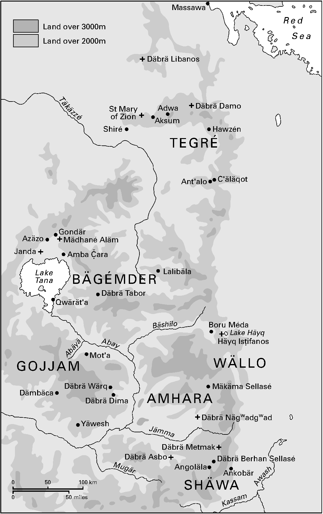

**地图7 埃塞俄比亚**

原图保留；中文标注对照如下。地名沿用原图历史拼法。

| 原图标注 | 中文对照 |
| --- | --- |
| Land over 3000m | 海拔3000米以上陆地（深灰） |
| Land over 2000m | 海拔2000米以上陆地（浅灰） |
| Massawa | 马萨瓦 |
| Red Sea | 红海 |
| Däbrä Libanos | 德布雷利巴诺斯（图中北部地点） |
| Täkäzzé | 特克泽河 |
| St Mary of Zion | 锡安圣母教堂 |
| Adwa | 阿杜瓦 |
| Aksum | 阿克苏姆 |
| Däbrä Damo | 德布雷达莫 |
| Shiré | 希雷 |
| Hawzén | 豪曾 |
| TEGRÉ | 提格雷 |
| Ant’alo | 安塔洛 |
| C’äläqot | 切莱科特 |
| Gondär | 贡德尔 |
| Azäzo | 阿泽佐 |
| Mädhané Aläm | 梅德哈内阿莱姆 |
| Janda | 詹达 |
| Amba Č̣ara | 阿姆巴查拉 |
| Lake Tana | 塔纳湖 |
| BÄGÉMDER | 贝格姆德尔 |
| Lalibäla | 拉利贝拉 |
| Däbrä Tabor | 德布雷塔博尔 |
| Qwärät’a | 克韦拉塔 |
| Bäshilo | 巴希洛河 |
| Boru Méda | 博鲁梅达 |
| Lake Häyq | 海克湖 |
| Häyq Isṭifanos | 海克伊斯蒂法诺斯 |
| WÄLLO | 沃洛 |
| Abay | 阿拜河（青尼罗河） |
| Abäyä | 阿贝亚河 |
| Mot’a | 莫塔 |
| GOJJAM | 戈贾姆 |
| Däbrä Wärq | 德布雷沃尔克 |
| Dämbäca | 登贝恰 |
| Däbrä Dima | 德布雷迪马 |
| AMHARA | 阿姆哈拉 |
| Mäkäma Sellasé | 梅卡内塞拉西（正文作Mäkanä Sellasé） |
| Däbrä Nägwadgwad | 德布雷内格瓦德格瓦德 |
| Yäwesh | 耶韦什 |
| Jämma | 加马河 |
| Däbrä Metmak | 德布雷梅特马克 |
| Däbrä Asbo | 德布雷阿斯博 |
| Däbrä Berhan Sellasé | 德布雷伯尔汉塞拉西 |
| Angoläla | 安戈莱拉 |
| Ankobär | 安科贝尔 |
| SHÄWA | 绍阿 |
| Mugär | 穆格尔河 |
| Awash | 阿瓦什河 |
| Kassam | 卡萨姆河 |
| 0–100 km; 0–50 miles | 比例尺：0—100公里；0—50英里 |

<!-- PDF page 480; original page 459 -->

该国始终敏感于从红海方向而来的发展。高地对埃塞俄比亚统治者已是挑战，对外部势力挑战更大，使国家面对数千年间席卷此地的力量，仍保一定自主。伊斯兰是其中最强力量之一，7世纪兴起，终结阿克苏姆红海优势；随着时间推移，伊斯兰主导了阿克苏姆人原本自如融入的希腊化世界。

埃塞俄比亚人渐将自身，看作敌对伊斯兰、异教海洋中的基督教岛屿。他们仰求指导的亚历山大、安提阿牧首区，在伊斯兰时代最初数十年，便受穆斯林统治，其教会信众很快成为少数。尼罗河中游努比亚基督教王国较迟屈服，最后一个于15世纪消失于历史记录。[^p480-3] 同时，伊斯兰在红海西侧、高地下沿海建立据点，再沿贸易路线缓慢内传。埃塞俄比亚地区，伊斯兰、基督教都面对多种宗教信仰、实践，双方皆视为异教。如将见，反前基督教信仰、实践斗争，不仅在王国边疆，也在王廷内进行。

作为基督教世界前哨，埃塞俄比亚发展了独特信仰、实践，虽常被不公地视为奇异。其人从未失去属于基督教世界的意识；正统观，在于忠于从亚历山大接受的基督论。他们理解此教义为“合一”（täwahedo），强调基督神、人二性结合，认为祂是一个位格、一个独特地兼具神性与人性的本性。西方惯以“一性论派”称此立场，并不为部分信徒欣然接受。[^p480-4]

<!-- PDF page 481; original page 460 -->

宗教实践许多方面，埃塞俄比亚人过去至今，符合正教常规：使徒传承中的主教，专有授司祭、执事圣职权；堂区教士已婚，修道生活溯源圣安东尼，共享正教世界宗教历，承认七圣事，以洗礼、圣餐为首，并守尊基督九大节：降生、主显、圣母领报、圣枝主日、圣周五、复活、升天、五旬及显圣容。但如将见，这种基督教深知自身闪米特根源；公元前数世纪以来，操闪米特语言者，一直主导埃塞俄比亚文化、政治，更强化此意识。至本书写作时，守安息日为与星期日同等节日，是规范；施割礼，基督徒遵《托拉》饮食规定，把举行圣餐的祭坛，即tabot，比作约柜。此外，虽结婚为教士常规，教会却未能完全使平信徒接受其婚姻观。多数埃塞俄比亚基督徒，依世俗习俗结婚，平信徒离婚也获接受。但教会规范仍受承认：多数人认为自身婚姻实践，阻其领圣餐，转把宗教热忱，投入严格斋戒。

同样，以亚历山大教导作正统试金石，未带来全体一致，却创造不断重新界定的框架。修道院是埃塞俄比亚基督教世界活跃不息的前沿，分两大修会，分别追随13及14世纪初两位圣修士，埃沃斯塔特沃斯、特克莱·海马诺特。主教权威，除有本已较弱国家权力支持，几不能约束修会。7世纪阿克苏姆衰落后，近千年，国王以流动都城治理，试图藉季节性驻临，控制农耕社会，以及依其剩余产出维系的地区世俗、宗教统治者。历史大部分时期，埃塞俄比亚教会仅一位都主教，且为科普特人，罕有附属主教支持。因此，修道院在教会事务角色，类似<!-- PDF page 482; original page 461 -->地区王公在整体政体角色。最底层是堂区，司祭、执事同时为农民，农业、礼仪历主导生活。

## 历史概述[^p482-5]

宫廷改宗后三世纪，奠定埃塞俄比亚正教会基础。《圣经》、礼仪译为阿克苏姆通用吉兹语，一种与南阿拉伯语言相关的闪米特语。埃塞俄比亚传统，将修道生活引入，归于叙利亚来的“九圣”；通常定其到达于5世纪末、迦克墩会议之后，他们反对该会议。[^p482-6] 据说，他们在今埃塞俄比亚北部，建立一系列至本书写作时仍活跃的修道院。传统也将教会音乐、礼仪舞蹈、多首圣歌创作，归于6世纪上半叶圣亚雷德。此时也开始赴巴勒斯坦、埃及圣地朝圣。伊斯兰兴起，终结这一时期。

直到13世纪，基督教王国才重入清晰历史视野：1270年，新王朝夺位，自称阿克苏姆统治者合法继承，也自称《圣经》所罗门王、示巴女王后裔。被所罗门王朝取代的扎格维王朝，留下持久印记：修建惊人的十一座岩凿教堂，地点后来以最杰出王室成员拉利贝拉命名。国家所罗门王朝复兴之前，教会已复兴，表现为有力修道运动。修士传教，促教会最显著扩展时期之一，进入中央高原腹地，越青尼罗河南进，为教会开辟贝格姆德尔、戈贾姆省；至本书写作时，已视为核心区。

新王朝首世纪，宫廷、修士关系，以冲突为标志。但感召力逐渐<!-- PDF page 483; original page 462 -->被丰厚赐地侵蚀，修道活力，日益转向神学争辩，而非政治行动。神学争论，在扎拉·雅各布王（意为“雅各的种子”，1434—1468年在位）时期达顶点；他或许是埃塞俄比亚教会史最有创造力、权威的声音。国王亲自主会议，确立安息日与星期日同等为圣日，以宗教论著、绘画支持的繁复节日体系，使尊崇圣母成为规范，[^p483-7] 并压制宗派异议及巫术。他领导“宗教民族主义”运动，创建政教关系范式，[^p483-8] 经历其曾孙莱布纳·登格尔（意为“圣母之香”，1508—1540年在位）任内开始的动荡世纪，仍存续。

1527至1632年，埃塞俄比亚教会、国家受入侵、内战重创，濒临极限。1527年，艾哈迈德·伊本·易卜拉欣发动大吉哈德，俗称“格兰”，即左撇子。中央高地基督教国家发展同时，一连串穆斯林苏丹国，从海岸，经东部高地、大裂谷，延伸毗邻基督教国家的高地。关系不稳，贸易互利、争霸相互平衡。14世纪初至16世纪初，基督徒凭战略位置、更强凝聚，占上风；但艾哈迈德军推翻一切，席卷基督教高地，毁掠教堂、修道院，使埃塞俄比亚统治者，在自身王国内成为难民。艾哈迈德宣布哈巴沙苏丹国，穆斯林、基督徒史料皆认，大批人背离基督教。[^p483-9] 短期内，冲突随1543年艾哈迈德战死而终结，但吉哈德对基督徒、穆斯林政体影响更久：削弱基督教国家边防、分散注意，<!-- PDF page 484; original page 463 -->使穆斯林、基督徒势力都远离边疆，为奥罗莫人显著扩张开路；他们操一种库希特语言，此时既不信基督教，也不信伊斯兰。[^p484-10]

奥罗莫迁徙，逆转基督教权力、文化两个半世纪南扩，重击王国，反复侵入，关键地区多转为定居，造成不安、耗竭资源，迫王国西北退入青尼罗河大弯及其北塔纳湖周边。16世纪末，所罗门王朝许多壮丽教堂已消失，原基督徒居住的大片地区，落新来者之手。[^p484-11] 正在这种处境，17世纪初两位统治者，转向由耶稣会传教士代表、背后有葡萄牙与西班牙力量的天主教。葡萄牙远征军，对艾哈迈德·格兰之死起关键作用，幸存者定居，娶当地女子，持续提醒欧洲武力之有效。

1557年，耶稣会首次抵埃塞俄比亚，误以为统治者愿服从天主教信仰、实践。[^p484-12] 很快醒悟后，退往北部，传教萎缩。1603年，一司铎奉派振兴，却应扎登格尔王（意为“属圣母的”，1603—1604年在位）召至宫廷，国王同情探究耶稣会教导。不久，苏塞尼约斯继起，1607年以武力夺位，很快转向耶稣会。1622年，公开正式服从罗马，立天主教为宫廷、全国宗教。但在改变与外省主导势力、修道院及贵族世系关系方面，天主教并不比正教更有助于这位所罗门王朝统治者。叛乱愈盛，1632年，他让位给子法西利德斯，后者立即恢复合一正教，逐耶稣会，断葡萄牙、西班牙联系。

<!-- PDF page 485; original page 464 -->

法西利德斯承继疲惫、沮丧国家王位，除回到扎拉·雅各布的正教，别无选择。重申教会、政体传统价值，使其受益，统治开启三代相对和平、文化复兴。在贡德尔，设阿克苏姆以来首个固定首都，建教堂、宫殿。子约翰内斯一世（1667—1682年在位）、孙伊亚苏一世大帝（1682—1706年在位），效法其例，主持外部威胁渐退的国家。但世纪初耶稣会影响兴起，激起教会强烈多样回应，使基督论重返正教争辩中心，逐渐固化为与两大竞争修会关联的宗派立场。约翰内斯、伊亚苏均主持一系列基督论会议，却不像扎拉·雅各布，无法强行统一。伊亚苏遇刺，死后十五年暴力、不稳。史料暗示，基督论争议主要创新方，是埃沃斯塔特沃斯派，口号“膏抹”（Qebat），强调圣灵膏抹在实现基督神、人二性合一的作用。从自身角度，他们深信反迦克墩立场，与亚历山大神学传统和谐。[^p485-13] 特克莱·海马诺特追随者抵制膏抹说，自倡耶稣藉圣灵恩典（Ṣäga）成为神子，称祂“恩典之子”（YäṢäga Lej）。第三派最小，与19世纪主教相关，称“卡拉”（Karra），即“刀”。

膏抹派势力，或在伊亚苏一世遇刺背后；其弟特沃弗洛斯（1708—1711年在位）时期，膏抹说成为官方教义，维持近六十年。但确立地位有代价：伊亚苏之子达维特（1716—1721年在位）时，宫廷军屠杀或约一百名特克莱·海马诺特会修士。这是早期高潮，同等暴力，直到19世纪才可能重现，甚至届时也未必。但宗派立场愈硬，各派内部也提出<!-- PDF page 486; original page 465 -->新立场。宗派纷争，并未削弱其他正教宗教表达。贡德尔大型教堂创建，尤其伊亚苏一世1694年建德布雷伯尔汉塞拉西，以及皇后门特瓦布1740年代建德布雷萨海克韦斯克瓦姆，树立全国效法近一百五十年的标准。[^p486-14] 城内大型教堂创建，延至1780年代。而且，贡德尔时期，恢复16、17世纪初风暴重创的遗产：抄旧稿、著新稿，绘画繁荣，装饰抄本、教堂。[^p486-15] 这些大型教会机构，各供养数百教士，反使贡德尔成为教会教育中心，延续至本书写作时。

国家、教会以混乱状态进入19世纪。1760年代末，地方大贵族成功颠覆王权，置一连串傀儡统治者，为自身、家族夺实权。教士编年史家，比作《圣经》犹太王国建立前时期，称“士师时代”（Zämänä Mäsafent）。教会命运，在19世纪上半叶试图领导教会的主教生涯中，体现尤痛：受虐待、逐出贡德尔，被迫内地流亡，教义权威遭拒。此时特定敌手，是德布雷利巴诺斯修士，及其恩典学说。埃塞俄比亚曾有中央机构弱期，但1830年代，外界不大可能任其自处，迹象已明：埃及复兴、扩张，军队到达埃塞俄比亚权威与尼罗河上游国家权威之间边地；同时，欧洲新教、天主教传教士及世俗旅行者，持续出现高地，唤起耶稣会冲突记忆，也唤起欧洲可供军事支援的可能。[^p486-16] 振兴埃塞俄比亚<!-- PDF page 487; original page 466 -->国家，势在必行；实现复兴的三位统治者，均视统一教会复兴，为国家复兴要素。

政治复兴始于1855年，卡萨·海卢登所罗门王位，取王号特沃德罗斯二世，统治至1868年。他以武力崛起，由武士转政治家时，恢复主教权威，试图恢复教义统一。1854年阿姆巴查拉会议，确立阿布纳·萨拉马主教，为亚历山大正统裁判者，绝罚宗派纷争。1855年，萨拉马为其加冕埃塞俄比亚“万王之王”。虽主教、国王不久因土地、权威冲突，国王仍维持正式礼数，从未以宗派主义削主教权威。[^p487-17] 后来继任者约翰内斯四世（1872—1889年在位），自称“锡安之王”，主张阿克苏姆遗产，选阿克苏姆锡安圣母教堂加冕，足为明证。如特沃德罗斯，他寻求教会复兴、统一，镇压膏抹、恩典派。1878年博鲁梅达会议，最后拒服主要地方统治者孟尼利克归顺，使其志得意满；他宣布教会信仰，是凯雷洛斯、萨拉马、阿特纳特沃斯的卡拉教义，强力执行。主教权威方面，1881年，说服科普特牧首，前所未有地任四位主教。

约翰内斯订下议程，由继任者孟尼利克二世（1889—1913年在位），带教会入20世纪。宗派纷争被边缘化，博鲁梅达教义立场，至本书写作时仍为规范。主教团扩大，虽属间接，却指向新全国性教会组织。孟尼利克缺前两王热忱，但采其政策，最终巩固成果。

政教进入20世纪，情况与百年前大异：君主国家恢复，教会<!-- PDF page 488; original page 467 -->教义统一占主流。1896年，孟尼利克在阿杜瓦战役败入侵意军，稳固国家独立。战前数十年，其军队广扩国家权威，也带正教会存在。新世纪将见重大转变：建立主教教阶，继而本土化、扩充；既属机构，也属地域扩张，教会进入新帝国遥远角落，并到海外牙买加、北美。它与亚历山大—叙利亚传统诸教会定期对话，加入世基联。但在现代国家建设的中心角色，既带特权，也带负担、局限。孟尼利克后来的继任者海尔·塞拉西一世（1930—1974年在位），保持前王的政教民族愿景，所治国家却比愿景容纳的更多样。19世纪后期扩土，纳入大量穆斯林，以及既非基督徒、亦非穆斯林的人口。且孟尼利克倡导、海尔·塞拉西推行的现代化，终压倒君主制；1974年废黜海尔·塞拉西，开启革命、撤销教会国教地位、建立世俗国家的时代。[^p488-18]

## 修士与君主：埃塞俄比亚民族

许多方面，定型的埃塞俄比亚国家、民族，形成于1270年所罗门王朝建立后两世纪，扎拉·雅各布（1434—1468年在位）达到顶点，调和地方实践与亚历山大权威。最易看见运作的主导力量，是修士、王廷，早期关系以冲突为标志。

<!-- PDF page 489; original page 468 -->

修道复兴早于所罗门王朝兴起。[^p489-19] 关键人物伊亚苏斯·莫阿，意为“耶稣已得胜”，约1248年，在海克湖岛上建圣司提反修道院。[^p489-20] 他起于北部古修道院德布雷达莫。早期传统说，他与新王朝创办者耶库诺·阿姆拉克订约；其支持看来确实重要。从其共同体，修士散至阿姆哈拉及南部绍阿，另建修道院。最著名弟子特克莱·海马诺特，意为“信仰之株”，约1284年建德布雷阿斯博，后名德布雷利巴诺斯，后世记忆甚至盖过导师。[^p489-21]

13世纪中央埃塞俄比亚修道生活，自视延续阿克苏姆传统，无固定形式，重感召力，奉行贫穷。个别圣人定居荒野无人地区，以严格实践引追随、建共同体，靠采野果、收获季为近村受雇劳动维生。[^p489-22] 从独立位置，一些人日益被卷入政治。最突出，是伊亚苏斯·莫阿第二代追随者贝萨洛塔·米卡埃尔，意为“藉圣米迦勒的祈祷”。[^p489-23] 王朝创办者死后，经历一系列继承危机，此时由精力充沛、向外扩张的阿姆达·塞永，意为“锡安之柱”（1314—1344年在位）代表，是王朝最杰出成员之一。

贝萨洛塔·米卡埃尔首次入廷，谴责教会都主教阿布纳·约翰内斯买卖圣职，因此被流放提格雷。[^p489-24]

<!-- PDF page 490; original page 469 -->

不久他重返宫廷，攻击阿姆达·塞永本人，娶多妻、蓄妾，并与父王一位妻子乱伦，违背基督教性道德。[^p490-25] 新鲜的并非做法，它们根深蒂固、将延续数代，而是攻击的热情。贝萨洛塔·米卡埃尔再次流放北部，死于当地。约1337年，新都主教阿布纳·雅各布到来，接续其事业。都主教、修道院关系，常不安，由王廷调解；都主教依赖王廷执行权威。雅各布联合修士、绝罚国王，国王鞭打、流放其修道盟友。紧张延至阿姆达·塞永继任者赛法·拉阿德（1344—1371年在位），他仿父娶三妻。主教、修士持续反对，招致流放：主教返埃及，修士逐王国境外。国王冲突中获胜，却发现教会攻击代价高昂。赛法·拉阿德之子达维特（1382—1411年在位）登位，带来从对抗，到15世纪新综合、整合的转变。[^p490-26] 新修道生活，吸入旧模式，亦即藉丰厚王室赐地，使感召力转成既成体制。[^p490-27]

中央埃塞俄比亚修士，自觉立于圣安东尼及阿克苏姆古修道院传统，尊所承纪律，也不断创新，警觉维护自主，易为包括三一论的众多教义争论。一些信念、实践，挑战日益希望强加统一信仰、实践的王廷。[^p490-28] 北部，一名伊斯蒂法诺斯修士，以严苦讲道、坚持<!-- PDF page 491; original page 470 -->崇敬只归上帝，不归荣福童贞女、圣像十字架等物质表象，亦不归国王等世俗人物，聚拢追随者。[^p491-29] 司提反派容易镇压，更严重的是埃沃斯塔特沃斯追随者，主张守安息日为与星期日同等圣日。[^p491-30] 特克莱·海马诺特派与都主教，都反对其安息日立场。

1449年，扎拉·雅各布王（1434—1468年在位）主持德布雷梅特马克会议，解决冲突。[^p491-31] 他同时重新确立主教权威，并依埃塞俄比亚、而非亚历山大先例，规范信仰、实践。从开罗请得两位主教，加一位附属主教，说服接受守安息日。[^p491-32] 会议成功立为规范，也立尊崇圣母为规范；国王宣称，她的代祷带来救恩，并引入大量每月节庆尊荣她。[^p491-33] 决定持久有效，统一实践强化全埃塞俄比亚基督教世界“宗教民族主义”。强至其继任者任内会议，公然讨论与亚历山大决裂。国王另有忧虑，感觉宫廷巫术威胁，残酷企图根除。虽虔敬博学，[^p491-34] 仍依前王婚俗，有三位正式妻子，各自宫廷<!-- PDF page 492; original page 471 -->在王室营帐组织中显著。最后，其专制统治引强烈反应，死后数年尤甚；教义共识，以及主教权威、修道生活综合，却短暂，成为后世萦绕、常不可及的理想。近四百年后，统治者才再实现这一整合。

## 王室教堂

王室教堂这一政教机构，或诞生于、确发展于中世纪所罗门王朝，历1527至1632年动荡、毁灭性暴力而存续。[^p492-35] 诚然，许多在艾哈迈德·格兰吉哈德被毁，另一些在16世纪后半叶奥罗莫战争中，脱离基督教王国。但制度桥接中世纪、贡德尔及以后，也参与19世纪后期王朝复兴。1520年代访埃塞俄比亚的葡萄牙司铎弗朗西斯科·阿尔瓦雷斯，已注意；其记述细致洞见大灾难吉哈德前夕王国，仍不可或缺。[^p492-36] 他认为，这一机构，特别体现当时所罗门王朝根基阿姆哈拉、绍阿地区特性。更广史料中，它于16世纪浮现，即扎拉·雅各布及子贝埃达·马里亚姆（意为“藉圣母之手”，1468—1478年在位）任内。〔译注：原文此处作“16世纪”，与本段所述两王在位年份不合，照录。〕贝埃达·马里亚姆建阿特龙萨马里亚姆，以富裕、收存多位前都主教及三位前王遗骸闻名，尤王朝创办者耶库诺·阿姆拉克。[^p492-37]

<!-- PDF page 493; original page 472 -->

王室教堂一职，是王朝墓地，后王也葬自身创堂。但另有功能。创于国王、非修士，因此依附国王，由恩宠得财富、由关联得声望；反过来，以宏伟向地方、区域民众呈现君主制。阿尔瓦雷斯视其与北部景观中修道院鲜明不同；但虽类似中世纪欧洲大型“参议教士”教堂，仍联系修会，典型具有“加达姆”（gädam），即圣所地位，该词常被视为“修道院”同义。[^p493-38] 因而跨越欧洲“世俗”与“修道”教堂区分。特征是：教士被称“德布特拉”（däbtära），阿尔瓦雷斯译“座堂教士”；[^p493-39] 国王倡建；持续丰厚王室赞助；王陵与圣所功能。主要靠赐地支持，一部分贡赋、租金收入，供圣餐礼、教堂建筑维护；另一部分，直接供养教士。有些也享地方市场征税权，及所控土地司法收费。

教会组织松散、许多方面极简，王室教堂也发挥实用角色。主要修会有全国知名度，却靠非正式弟兄纽带、非紧密治理联结。都主教有教阶声望，但层级极少，声望<!-- PDF page 494; original page 473 -->难化实权。教产由地方机构控制，成为地方自主基础。王室赐地过程，主教无实质作用，虽常以正式认可支持。教会所有的全国组织，由王廷与主教、有声望修道领袖合作提供，先是“阿卡贝·萨阿特”，即海克圣司提反修道院院长，后是“埃切盖”，即德布雷利巴诺斯院长。这事实上承认修道院权力、自主，却少约束。在此情境，王室教堂成为另一地方权威、影响节点，至少起源上，直接依赖王室赞助。

伊沙克（1413—1430年在位）起，统治者大量建堂。[^p494-40] 他在塔纳湖区建堂、捐赠现有修道院。扎拉·雅各布建众堂：阿姆哈拉的德布雷内格瓦德格瓦德、梅卡内塞拉西，绍阿的德布雷梅特马克、德布雷伯尔汉塞拉西。皆宏伟，但后者或最为国王重视；后世似也如此看，两百多年后，后裔伊亚苏一世（1682—1706年在位），为最钟爱教堂重用此名。[^p494-41] 扎拉·雅各布也捐现有修道院；绍阿德布雷利巴诺斯及特克莱·海马诺特派直到20世纪的优势，或由其促成。贝埃达·马里亚姆之子纳奥德（1495—1508年在位），建梅卡内萨拉姆，并葬此处。阿尔瓦雷斯视之为典型王室教堂。他1526年离开后，艾哈迈德·伊本·易卜拉欣·格兰大吉哈德，随即爆发，劫毁诸堂，梅卡内塞拉西、德布雷内格瓦德格瓦德、阿特龙萨马里亚姆尤著。但击败格兰的加劳德沃斯（1540—1559年在位），以及主要继任者萨尔萨·登格尔（意为“圣母之芽”，1593—1597年在位），皆恢复传统，建堂宏伟，影响犹存。[^p494-42]

<!-- PDF page 495; original page 474 -->

1630年代，为回应短暂罗马天主教经历而建的贡德尔王国，王室教堂是基石。法西利德斯建贡德尔的重要行动，是创设、捐赠梅德哈内阿莱姆，即“世界救主”教堂。建新都时，也未忘古都及主堂：重建阿克苏姆锡安圣母教堂，再赐土地。[^p495-43] 此后一百五十年，继任者无一例外建堂，许多人葬其间。孙伊亚苏，对阿克苏姆同样慷慨。[^p495-44] 法西利德斯之子及继任者约翰内斯一世，建埃格齐阿布赫尔阿布，即“父神”教堂，最初葬于此。[^p495-45] 他重建城外不远阿泽佐圣母教堂，原为耶稣会机构，却改为特克莱·海马诺特修会母院，因为原绍阿德布雷利巴诺斯母院，未熬过吉哈德、奥罗莫迁徙。

贡德尔机构，最突出是德布雷伯尔汉塞拉西、德布雷萨海克韦斯克瓦姆。[^p495-46] 如已见，皆有丰厚农地，供圣餐礼、建筑维护，以及“炭火”（embers）；统治者也赐地供纪念礼及直接供养教士。教士以个人名义持地，交换服务，传给后代，始终须履行服务。规模可观，德布雷伯尔汉塞拉西正式创设一百六十名德布特拉，德布雷萨海克韦斯克瓦姆，配二百六十名。二者成为王室教堂范本，北部提格雷、南部戈贾姆后建诸堂，皆援其先例。虽然贡德尔王国在<!-- PDF page 496; original page 475 -->1770年代崩溃，后世仍视王室教堂为关键遗产。继贡德尔诸王的“士师”，各以建堂为统治合法化重要行为。[^p496-47] 19世纪后期欲复君主制者亦然，唯一重要例外，是1850年代起奠恢复范式的特沃德罗斯。

已见，他恢复主教权威，坚持教义统一、镇压宗派主义。但他怨贡德尔教堂土地财富，关联的德布特拉，在其眼中象征王国堕落。统治第二年，便与当地教士冲突，权威、土地控制为核心。[^p496-48] 讽刺的是，冲突促教士、主教接近，强化国王机构改革，但其憎恶贡德尔、既有教士体制，与年俱增。他未建重要教堂，晚年更彻底攻击贡德尔诸堂：1864、1866年，劫烧城市、教堂，将“一切值钱之物”收入国库，包括“钟、圣爵、金银十字架，以及近千抄本”。[^p496-49]

继任者特克莱·吉约尔吉斯二世（1868—1871年在位）、约翰内斯四世，修复诸堂的张扬，堪比其破坏。约翰内斯留意多处历史教堂，首先为加冕地阿克苏姆锡安圣母教堂。依扎拉·雅各布、伊亚苏一世先例，在阿杜瓦建德布雷伯尔汉塞拉西；其指导下，主要附庸之一、戈贾姆特克莱·海马诺特王，也在领地广建教堂。[^p496-50]

1889年，约翰内斯战死，王位传绍阿孟尼利克。绍阿关联王朝初年，却被16、17世纪奥罗莫迁徙，与其余基督教<!-- PDF page 497; original page 476 -->埃塞俄比亚隔断。[^p497-51] 循前任地方统治者模式，孟尼利克南进，1874年定居今亚的斯亚贝巴上方山地恩托托，建圣母教堂，于此加冕。[^p497-52] 1886年下山建现代首都，1890年代初设圣三一、圣乔治两堂；后者成为继任者扎乌迪图（1916—1930年在位）、海尔·塞拉西（意为“三一之力”，1930—1974年在位）加冕处。依海尔·塞拉西之语，圣乔治是“王室教堂”。[^p497-53] 或许，王室教堂最后形态，是亚的斯亚贝巴圣三一教堂。[^p497-54] 重建为海尔·塞拉西帝业奠基行为之一：1931年，刚登位、取王号后启动，1935年意大利入侵、占领后，1941年复位不久完成，最终他也葬此。

## 基督论与冲突[^p497-55]

两个半世纪教义、宗派纷争后，约翰内斯四世试图统一教会，建新堂、赐地旧机构，是手段之一。埃塞俄比亚正教会内部基督论争议，爆发于苏塞尼约斯任内1620年会议，明显源于耶稣会营造氛围，把当地基督论攻为异端。[^p497-56]

<!-- PDF page 498; original page 477 -->

1557年，耶稣会抵埃塞俄比亚，是更广运动一部分，把奥斯曼土耳其人、葡萄牙人带入印度洋西北、红海。其根本误解，是以为宫廷准备接受天主教信仰、实践。[^p498-57] 使团由安德烈·德·奥维耶多主教领导，六人组成。要求统治者效忠，很快被加劳德沃斯皇帝打破；但与传教士对话，产生埃塞俄比亚信仰重要宣言，所谓《克劳狄乌斯信仰宣认》（Confessio Claudii）。[^p498-58] 皇帝终逐耶稣会，他们居北部提格雷、今阿杜瓦附近弗雷莫纳，日益凋零，直至1590年代最后一人去世。

1603年，佩罗·帕埃斯神父到来，重启传教；当地不但被数十年对奥罗莫战争深撼，也被1597年萨尔萨·登格尔死后长久继承斗争震荡。竞争者扎登格尔（1603—1604年在位），召其入廷，试探性接受天主教，立先例，影响直接继任者雅各布（1604—1607年在位），尤最终胜者苏塞尼约斯（1607—1632年在位）。[^p498-59] 1617年，后者对天主教兴趣、投入，激起大叛乱，在正教主教阿布纳·塞蒙积极支持下，举正教旗帜。国王镇压，主教丧命。四年后，苏塞尼约斯率宫廷正式接受天主教，面对日增叛乱，仍坚持至1632年，抵抗<!-- PDF page 499; original page 478 -->强度迫其退位。[^p499-60] 1610年代必是耶稣会激烈讲道的十年，广面攻击埃塞俄比亚正统，几乎质疑一切偏离特伦托规范的传统。拒迦克墩会议，尤为重要；1620年国王主持会议，耶稣会强力推动其权威。

争议首先在埃沃斯塔特沃斯修士中，形成倡膏抹学说的宗派；后来，竞争者特克莱·海马诺特修士，发展“恩典之子”教导。源于与迦克墩派耶稣会对抗，后来按看似多接近迦克墩立场解释各派，也不意外。[^p499-61] 但这无疑欧洲中心。争论各方，自视维护亚历山大传统、抵抗西方教导，应首先从此理解。[^p499-62]

不过，已见分歧造成分裂，竞争尖锐，时有暴力。本书写作时，教会官方立场，是依1854年阿姆巴查拉、1878年博鲁梅达会议决定，解释各派。背景为19世纪前期都主教受虐：阿布纳·约萨布（约1770—1803年）、凯雷洛斯（1815—约1828年？）、萨拉马（1841—1867年）。[^p499-63] 地方王公冲突，粗暴冲击他们。政治中心，是起源于穆斯林奥罗莫、以德布雷塔博尔为治所的王朝，主要敌手为北部统治者，多出提格雷贵族世系；南翼是戈贾姆诸王公；另有绍阿统治家族，与争斗各方隔开，却在该世纪愈发重要。

<!-- PDF page 500; original page 479 -->

世纪开端不佳。1803年，约萨布去世，德布雷塔博尔统治者拉斯·古格萨，掠主教财产，与埃切盖联合，在领地立“三次诞生”信仰。[^p500-64] 后来继任者凯雷洛斯，从提格雷前来，已卷入当地教义争论，很快拖入宗派、地方竞争网络；1815年到后不久，资助者拉斯·沃尔德·塞拉西去世，地位薄弱。数年后，应召贡德尔教义会议，发现权威被拒，据部分史料，暴力逐城；孤立返回提格雷，权威多遭无视。[^p500-65]

继任者阿布纳·萨拉马，[^p500-66] 1841年到来。如前任，其任命回应北部统治者资助的使团；也可能如1815年，都主教存在，是推翻德布雷塔博尔统治者军事行动的意识形态面向。策略失败、战败，萨拉马居贡德尔，很快与恩典之子派冲突；该派1841年在绍阿政变，逐主要教堂原领袖。

此时，三派教义分明。膏抹派仍突出，在当代争议主张，基督可理解有两次诞生：一是永恒中出于圣父，一是出于荣福童贞女；神、人二性合一，在受孕时实现。恩典之子派则主张三次：出于圣父、出于荣福童贞女，以及其后通过圣灵作用。都主教派最小，被贬称“卡拉”，即“刀”，同膏抹派承认两次诞生，却拒膏抹派强调圣灵膏抹实现基督二性合一。敌手认为，他们“砍去”第三次诞生，或圣灵膏抹。

<!-- PDF page 501; original page 480 -->

萨拉马争取绍阿被逐教士复职，1846年终遭暴力逐出贡德尔，回提格雷，再如凯雷洛斯，发现被边缘化。[^p501-67] 不安僵局延至1850年代初，因特沃德罗斯二世崛起而破；其雄心、且很快实现，是复兴所罗门君主制。统一教会是复兴王国愿景核心，恢复主教权威，又为其核心。

1853年，特沃德罗斯确立中央诸省军优，召萨拉马赴贡德尔；主教1854年6月入城。8月，特沃德罗斯会合，召主要权威，包括膏抹、恩典之子两派代表，在贡德尔附近阿姆巴查拉开会。他诉诸亚历山大及其任命都主教权威，挑战宗派：“亚历山大诸总主教中，可曾有人讲，因恩典而有第三次诞生，或因圣灵膏抹而按本性诞生？”信徒辩护：“但这不在亚历山大，而是我们此地的教父教导。”国王宣布：“不可偏离我们这些教父、总主教、都主教的信仰。”最后，会议谴责多种教导，编年史家称为“主张‘神子因恩典，经第三次诞生而生’者的信条、规制”。[^p501-68]

次月，特沃德罗斯自称“内格斯”（negus，国王），以教会仪式娶妻。1855年2月，萨拉马以“内古萨·内格斯特”（negusä nägäst，万王之王）称号为其加冕。随后重组宫廷，使主教不仅位在埃切盖，即德布雷利巴诺斯院长之上，也控制原属后者的“利卡·卡赫纳特”（liqä kahnat），即教士总管职。此举为现代君主立范式：在主教权威下，教会围绕亚历山大教义统一，国王本身遵教会祝圣的一夫一妻。[^p501-69] 后者根本背离所罗门前王惯例，前者则呼应扎拉·雅各布的宗教、世俗民族主义不可分割愿景。

<!-- PDF page 502; original page 481 -->

阿姆巴查拉会议，各派诉诸埃塞俄比亚先辈、而非亚历山大权威，呼应15世纪独立教会呼声。宗派异议旁落后，20世纪宗教民族主义，将转向主教新权威，以主教团本土化诉求表达。

特沃德罗斯所有继任者，短暂的特克莱·吉约尔吉斯二世、约翰内斯四世、孟尼利克二世、海尔·塞拉西一世，均循此范式。约翰内斯任期，对强化先例、恢复早期王朝捐赠尤重要。妻子1860年代末去世后，他似保持独身，遵教士规范；也镇压境内某些修道院所奉膏抹信仰。[^p502-70]

1878至1881年，他给教会持久印记。19世纪埃塞俄比亚政治权力，表现于战场；如特沃德罗斯，他以武力崛起。加冕后数年，力图征服视为前王遗产的历史领土。1873—1874年，使膏抹核心戈贾姆臣服，虽镇压该说，似仍容许统治者、新重要附庸拉斯·阿达尔，一定教义宽容空间。绍阿及恩典之子派，却无此待遇。1878年，迫最后对手孟尼利克归顺，随即在沃洛博鲁梅达，近古老海克圣司提反修道院，召教会会议。他确立亚历山大在基督论优先权，出示科普特牧首信，总体谴责宗派主义，尤其恩典之子教导。[^p502-71] 如阿姆巴查拉，确立阿布纳·萨拉马及前任的卡拉教义，继以积极镇压<!-- PDF page 503; original page 482 -->恩典之子派。三年后，从亚历山大获四位主教，数量空前。[^p503-72]

博鲁梅达后，基督论争论不再是教会核心议题，教会确认恪守亚历山大所传信仰。恩典之子派边缘化，尽失影响位置；膏抹派却静静保持戈贾姆诸堂影响。[^p503-73] 主教制度发展、本土化，转成20世纪核心关切。

## 本土主教体系

1881年，科普特牧首派给约翰内斯四世的彼得罗斯、马特沃斯、卢卡斯、约翰内斯四主教，严格说同侪同级，但居皇帝宫廷的彼得罗斯，获承认为都主教。严格说，也无教区，三位分配主要政治人物，一位贡德尔：阿布纳·马特沃斯配绍阿孟尼利克，不久去世的约翰内斯配贡德尔，卢卡斯配戈贾姆国王特克莱·海马诺特。[^p503-74] 教士位次，反映王公资助者世俗位次。彼得罗斯只在约翰内斯四世生前有都主教地位；1889年皇帝死、孟尼利克登位后，马特沃斯获承认，活过同僚、资助者，保持优势至1926年去世。领土辖权，不多不少，恰为资助者政治势力范围。约翰内斯四世满足于分权，不仅分四主教，也分主教与埃切盖，授后者宫廷教士总管职；孟尼利克却回特沃德罗斯先例，将有影响、收入丰职，交马特沃斯。[^p503-75] 埃塞俄比亚教士日益怨其优势，1920年代，开始主教团本土化运动。

运动与拉斯·塔法里·马康南崛起同时；1930年，他将加冕海尔·塞拉西一世“万王之王”，如所有所罗门君主，自称<!-- PDF page 504; original page 483 -->“蒙上帝拣选者”（seyumä Egzi’abehér）。[^p504-76] 其任期，与埃塞俄比亚应对现代性，密不可分，他欲作领袖。[^p504-77] 现代化，用以变革国家、克服1935年无法有效抵抗法西斯入侵所显弱点，真正成为国际平等参与者。同时，如前王，正教在其国家愿景居中心。1941年复位后，建立依西方模式教育体系，融现代化、正教、阿姆哈拉语。[^p504-78] 两者也同为专制工具，其政治权力观，形成于叔父孟尼利克宫廷养育，以及自身对历史理解。因此，教会变革，如全国变革，始终从属帝国统治利益。[^p504-79]

1926至1959年，教会空前转型，领袖本土化、机构能力细化，受国家政治干预，却一如起初。改革呼声，远在<!-- PDF page 505; original page 484 -->1926年马特沃斯死前，便针对批评者眼中其过度权力、买卖圣职。埃塞俄比亚基督徒民族情感增长，推动运动，缓慢却不可阻挡地追求自主地位，1959年，以埃塞俄比亚籍牧首加冕为教会领袖，达顶点。[^p505-80] 但自主，仅指与科普特、叙利亚牧首下诸教会同侪，非面对国家权威，决定自身命运的权力。

全国结构发展，始于1926年9月、马特沃斯死前不久，颁教会宪章，扩大埃切盖权威，建神圣主教会议。继任者任命谈判，因要求新都主教有祝圣主教权、继以科普特牧首本人去世，而复杂。1929年，终议定祝圣新都主教凯雷洛斯，科普特人，以及五位辅助主教，全为埃塞俄比亚修士。每阶段，教会会议作主要决定，提名祝圣候选人，再设其工作的教区结构。[^p505-81] 意义重大：“埃塞俄比亚历史首次，拥有部分本土化教阶，以及与国家需要有一定关系的教区结构。”[^p505-82]

通向完全自治，路途坎坷。[^p505-83] 1935年，意大利入侵，将其纳入意属东非，短短六年后结束。但占领既使自治运动复杂，也使之推进。1936年，海尔·塞拉西流亡，带走新埃切盖阿巴·加布拉·吉约尔吉斯，留下都主教、四位本土主教，原五位中一人已死。起初，意大利攻击教会，处决拒合作的阿布纳·彼得罗斯、阿布纳·米卡埃尔。

<!-- PDF page 506; original page 485 -->

意大利总督遭刺杀未遂后，占领当局轰炸数修道院，德布雷利巴诺斯尤著，数百人死。恐怖政策继以妥协，企图切断亚的斯亚贝巴、亚历山大教会联系，短期终成功。断交压力，超都主教阿布纳·凯雷洛斯愿合作限度，遂返埃及。意大利趁机召会议，1937年底，正式选阿布纳·阿布雷哈姆，为总主教、都主教；他是原五名本土主教之一，凯雷洛斯离境时指定署理总主教。会议也批准断交，他继祝圣五新主教。虽遭亚历山大、流亡首要教士埃切盖·加布拉·吉约尔吉斯绝罚，意大利已将独立议题推至逻辑终点，却是违抗、而非获亚历山大默许。获取默许，是海尔·塞拉西1941年复位后任务；此时，1939年去世的阿布雷哈姆及继任者，已祝圣十二主教，后者又授众多司祭、执事圣职，祝圣许多塔博特。

1942年，凯雷洛斯回来，复任总主教、都主教。科普特解除对整个埃塞俄比亚教会绝罚，包括占领时获祝圣主教，条件是后者恢复原地位。民族情感仍高，1945年11月，教会会议要求立即自治。皇帝顾虑使徒传承，也同19世纪前王敬亚历山大权威，因此不支持挑战其过程控制的要求。但科普特人仍感威胁，1948年终同意在亚历山大祝圣四名本土人。[^p506-84] 其中埃切盖·加布拉·吉约尔吉斯，取主教名巴西利约斯；后来继其高职的另一人，取名特沃弗洛斯。谅解为凯雷洛斯死后，由本土人继任。1950年10月，他去世；翌年1月，本土会议选巴西利约斯，祝圣首名埃塞俄比亚籍总主教、都主教。八年后，<!-- PDF page 507; original page 486 -->新科普特牧首，急欲化解因自身选举情势加剧的两教会紧张，公开告知“希望”将本土领袖升牧首，具“自行任命主教、总主教”全权。[^p507-85] 1959年6月28日，开罗仪式，皇帝、埃及总统纳赛尔共同出席，巴西利约斯受傅膏为牧首。教会成为自主教会。新主教皆出修士，过程终结主教、修道权威两极紧张。

此时，由牧首主持、六主教组成神圣主教会议治理，教会结构更细密。1960年代中叶，十四教区对应主要行政区，各由总主教领导，耶路撒冷另有一位。祝圣新主教、总主教，扩大主教团，总主教驻主要省会，其公署、行政仿牧首区。会议掌属灵事务，物质利益由行政委员会管理。1942年，复位政府最早举措之一，颁全教产管理规定。[^p507-86] 如何运作，所知不详。大量收入由政府征收，存国库特别账户，[^p507-87] 多数再交牧首区，归皇帝任命的世俗官员、行政总管负责。同时，许多收入仍直入古老捐赠教堂、修道院，因而对牧首、省总主教，保一定物质独立；受捐教堂也继续行地方行政权。中央机构扩充，设教育、发展等监督部门。1944年，在亚的斯亚贝巴设神学院，终附海尔·塞拉西一世大学。

<!-- PDF page 508; original page 487 -->

但教会能自由自治的程度，界限分明。1955年修订宪法，认正教为国教，规定国家财政支持，[^p508-88] 也赋皇帝颁教会敕令、法令、规章，以及批准主教、总主教候选人权。[^p508-89] 牧首区世俗事务，由皇帝所任官员管理。巴西利约斯升牧首六个月后，皇帝在私人内阁设宗教部门，分教会一般收入百分之二十，重建旧王廷教权分割。主管利卡·塞尔特纳特·哈布塔·马里亚姆，同时也是海尔·塞拉西“王室教堂”圣三一主教座堂负责人。

依自身历史、期望框架，教会已实现自治，密切宫廷关系，本属期望。海尔·塞拉西实现扎拉·雅各布、特沃德罗斯、约翰内斯四世愿景：一个国家、民族，以扎根本地文化、获国际承认的教会居中心，主教、修道权威调和；边界外加勒比、北美，信徒愈增。但其从约翰内斯、孟尼利克继承之国，非贡德尔旧国，而是多族群国家，母语人口最多者，非阿姆哈拉语、而是奥罗莫语；穆斯林占极重要比例。[^p508-90] 政府释放的现代性力量，日益超出控制；土地制度确保不平等，所生阶级关系，使族群关系复杂。国家处于愈发动荡的大陆、地区，正临革命边缘。

## 注释

[^p478-1]: 关于此事，如同众多其他问题，参见这一杰作： Taddesse Tamrat, Church and state in Ethiopia, 1270–1527 (Oxford: Clarendon Press, 1972). 同样有用、但问题较多的是 Sergew Hable Sellassie, Ancient and medieval Ethiopian history to 1270 (Addis Ababa: United Printers, 1972).

[^p478-2]: 埃塞俄比亚古典时代历史良好叙述，有 S. Munro-Hay, Aksum: an African civilization of late antiquity (Edinburgh: Edinburgh University Press, 1991); Munro-Hay, ‘Aksum. History of the town and empire’, in Encyclopædia Æthiopica (Wiesbaden: Harrassowitz Verlag, 2003), i, 173–9; and D. W. Phillipson, Ancient Ethiopia: Aksum, its antecedents and successors (London: British Museum Press, 1998).

[^p480-3]: W. Y. Adams, Nubia: corridor to Africa (Princeton: Princeton University Press, 1977), 525–46.

[^p480-4]: 叙利亚—亚历山大传统诸教会，在亚的斯亚贝巴会晤时，出版两部权威著作，一由牧首区、一由“埃塞俄比亚正教传教会”出版；后者是获宫廷支持、以圣三一教堂为基地的组织： The Church of Ethiopia: a panorama of history and spiritual life (Addis Ababa: Ethiopian Orthodox Church,1970) [下简称Panorama]; and Aymro Wondmagegnehu and Joachim Motovu (eds.), The Ethiopian Orthodox Church (Addis Ababa: The Ethiopian Orthodox Mission, 1970). 两者仍具权威陈述的价值。较近、由希腊正教会成员作的同情性叙述，参见 C. Chaillot, The Ethiopian Orthodox Tewahedo Church tradition: a brief introduction to its life and spirituality (Paris: Inter-Orthodox Dialogue, 2002). 较早外国人同情性叙述，包括 E. Hammerschmidt, Äthiopien: christliches Reich zwischen Gestern und Morgen (Wiesbaden: Harrassowitz, 1967); and F. Heyer, Die Kirche Äthiopiens: eine Bestandsaufnahme (Berlin: Walter de Gruyter, 1971).

[^p482-5]: 有用概述，见 S. Munro-Hay, ‘Christianity. History of Christianity’, in Encyclopædia Æthiopica, i, 717–23.

[^p482-6]: 通常解释的审慎陈述，参见 Taddesse, Church and state, 23–5. 较怀疑、指出诸圣传皆在据称所述年代后一千年才写成的，是 Munro-Hay, ‘Christianity’.

[^p483-7]: 埃塞俄比亚宗教艺术的出色导论，参见 M. Heldman, African Zion: the sacred art of Ethiopia (New Haven: Yale University Press, 1993). 另参见 S. Chojnacki, Major themes in Ethiopian painting: indigenous developments, the influence of foreign models, and their adaptation from the thirteenth to the nineteenth century [Äthiopistische Forschungen 10] (Wiesbaden: Franz Steiner Verlag, 1983).

[^p483-8]: 这一措辞出于Taddesse： Church and state, ch. 6: ‘Zar’a Ya’iqob and the growth of religious nationalism (1380–1477)’.

[^p483-9]: 吉哈德参与者的观点，见 Chihab ed-Din Ahmed Ben ‘Abd el-Qader, Histoire de la conquête de l’Abyssinie (XVIe siècle) (Paris: Ernest Leroux, 1897); 基督徒叙述，参见 W. Conzelman (ed. and trans.), Chronique de Galâwdêwos (Claudius) roi d’Éthiopie (Paris: É. Bouillon, 1895).

[^p484-10]: 16、17世纪概述，参见 Mordecai Abir, Ethiopia and the Red Sea: the rise and decline of the Solomonic dynasty and Muslim–European rivalry in the region (London: Cass, 1980).

[^p484-11]: 参见 Mohammed Hassen, The Oromo of Ethiopia: a history, 1570–1860 (Cambridge: Cambridge University Press, 1990).

[^p484-12]: 关于耶稣会传教，细致而资料丰富的叙述，参见 H. Pennec, Des Jésuites au Royaume du Prêtre Jean (Éthiopie): stratégies, rencontres et tentatives d’implantation 1495 –1633 (Paris: Fundação Calouste Gulbenkian, 2003).

[^p485-13]: Getatchew Haile, ‘Materials on the theology of Qebat or unction’, in Ethiopian studies: Proceedings of the Sixth International Conference, Tel-Aviv, 14–17 April 1980, ed. G. Goldenberg (Rotterdam: A. A. Balkema, 1986), 205–50. 另参见 Getatchew Haile, The faith of the Unctionists in the Ethiopian Church (Haymanot Mäsihawit) [CSCO, Scriptores Æthiopici 91] (Louvain: Peeters, 1990); Kindeneh Endeg Mihretie, ‘The role of Qebatoč in the Christological controversy within the Ethiopian Orthodox Church (1620–1764)’, 未刊硕士论文, Addis Ababa University, 2004.

[^p486-14]: 关于埃塞俄比亚教堂创建，尤其德布雷伯尔汉塞拉西、德布雷萨海克韦斯克瓦姆，参见 D. Crummey, Land and society in the Christian Kingdom of Ethiopia: from the thirteenth to the twentieth century (Urbana: University of Illinois Press, 2000). 一处17世纪机构的出色叙述，参见 Anaïs Wion, ‘“Aux confins le feu, au centre le paradis”: Qoma Fasilädäs, un monastère royal dans l’Éthiopie du 17ème siècle’, 未刊博士论文, 2卷, Université de Paris – Panthéon Sorbonne, 2003.

[^p486-15]: 贡德尔艺术在此书中有丰富呈现： Heldman, African Zion.

[^p486-16]: 概述参见 Mordechai Abir, Ethiopia: the era of the princes. The challenge of Islam and the unification of the Christian Kingdom 1769–1855 (London: Longmans Green, 1968); D. Crummey, Priests and politicians: Protestant and Catholic missionaries in Orthodox Ethiopia, 1830–1868 (Oxford: Clarendon Press, 1972); and S. Rubenson, The survival of Ethiopian independence (London: Heinemann Educational Books, 1976).

[^p487-17]: D. Crummey, ‘Doctrine and authority: Abunä Sälama, 1841–1854,’ in IV Congresso Internazionale di Studi Etiopici (Rome: Accademia Nazionale dei Lincei, 1972), i, 567–78; Crummey, ‘Orthodoxy and imperial reconstruction in Ethiopia, 1854–1878’, JThSt 29 (1978), 427–42; and D. Crummey and Getatchew Haile, ‘Abunä Sälama: Metropolitan of Ethiopia, 1841–1867. A new Ge’ez biography’, Journal of Ethiopian Studies 37 (2004), 191–209.

[^p488-18]: 埃塞俄比亚革命研究汗牛充栋。两部价值突出的叙述，是 Andargachew Tiruneh, The Ethiopian revolution, 1974–1987: a transformation from an aristocratic to a totalitarian autocracy (Cambridge: Cambridge University Press, 1993); and C. Clapham, Transformation and continuity in revolutionary Ethiopia (Cambridge: Cambridge University Press, 1988). 教会命运，参见 Haile Mariam Larebo, ‘The Ethiopian Church and politics in the twentieth century: part 2’, Northeast African Studies 10 (1988), 1–23; Haile Mariam Larebo, ‘The Orthodox Church and state in Ethiopian revolution’, Religion in Communist Lands 14 (1986), 148–59; J. Persoon, ‘Monks and cadres in the land of Prester John: an interdisciplinary study of modern Ethiopian monasticism and its encounter with communism’, 未刊博士论文, London University, 2003.

[^p489-19]: 中世纪埃塞俄比亚修道生活，参见 Taddesse, Church and state. 另参见 S. Kaplan, The monastic holy man and the christianization of early Solomonic Ethiopia [Studien zur Kulturkunde 73] (Wiesbaden: Franz Steiner Verlag, 1984); M.-L. Derat, Le domaine des rois éthiopiens (1270–1527): espace, pouvoir et monachisme (Paris: Publications de la Sorbonne, 2003).

[^p489-20]: 现存最古老的两部埃塞俄比亚抄本，皆为此院四福音抄本：Ethiopian Monastic Microfilm Library, St John’s University, Collegeville, MN, MS. 1832, Gold Gospel, Häyq Estifanos; and Paulos Sadua, ‘Un manoscritto etiopico degli Evangeli’, Rassegna di Studi Etiopici 11 (1952), 9–28.

[^p489-21]: 伊亚苏斯·莫阿与特克莱·海马诺特生涯的丰富叙述，参见 Taddesse, Church and state, 158–73.

[^p489-22]: 同上, 110, 172; Kaplan, Monastic holy man, 36–9, 54.

[^p489-23]: 参见 S. Wolde Yohannes and D. Nosnitsin, ‘BäṢälotä Mika’él’, in Encyclopædia Æthiopica, i, 493–4.

[^p489-24]: Taddesse的叙述，高度依赖所涉主要修道人物已刊、未刊圣传；王室编年史也反映这些事件： R. Basset, Études sur l’histoire d’Éthiopie (Paris: Imprimerie nationale, 1882), 10–11 （原文）; 99–100 （译文）; F. Béguinot, La Cronaca Abbreviata d’Abissinia: nuovo versione dall’Etiopico (Rome: Tipografia della casa edit. italiana, 1901), 7–10.

[^p490-25]: 此处依 Crummey, Land and society, 25–6. 参见 Taddesse, Church and state, 98–118. 这一时期教会内部宗教争论，参见 Getatchew Haile, ‘Religious controversies and the growth of Ethiopic literature in the fourteenth and fifteenth centuries’, Oriens Christianus 65 (1981), 102–36.

[^p490-26]: 参见 Getatchew Haile, ‘From strict observance to royal endowment: the case of the monastery of Däbrä Halle Luya, EMML 6343, fols. 177r–118v’, Le Muséon 93 (1980), 163–4. 参见 Kaplan, Monastic holy man, 55.

[^p490-27]: 参见 Crummey, Land and society, 17–49.

[^p490-28]: 参见 Taddesse, Church and state, ch. 6.

[^p491-29]: 参见 Taddesse Tamrat, ‘Some notes on the fifteenth century Stephanite ‘Heresy’ in the Ethiopian Church’, Rassegna di Studi Etiopici 22 (1966), 103–15; and Getatchew Haile, ‘The cause of the ∃st’ifanosites: a fundamentalist sect in the Church of Ethiopia’, Paideuma: Mitteilungen zur Kulturkunde 29 (1983), 93–119.

[^p491-30]: 参见 G. Lusini, Studi sul monachesimo eustaziano (secoli XIV–XV) (Naples: Istituto universitario orientale, 1993).

[^p491-31]: 年份依 Derat, Domaine des rois éthiopiens, 170. Taddesse, Church and state, 230, 作1450年。除国王众多著述外，重要原始史料是 J. Perruchon, Les Chroniques de Zar’a Yâ‘eqôb et de Ba’eda Mâryâm, rois d’Éthiopie dès 1434 à 1478 (Paris: Émile Bouillon, 1893).

[^p491-32]: 参见 Getatchew Haile, ‘The Homily of As’e Zär’a Ya‘eqob of Ethiopia in honour of Saturday’, Orientalia Lovaniensia Periodica 13 (1982), 185–231.

[^p491-33]: Getatchew Haile, ‘Ethiopian Orthodox Täwahédo Church’, in Encyclopædia Æthiopica, ii, 414–21; and Getatchew Haile, The Mariology of Emperor Zär’a Ya‘eqob of Ethiopia [Orientalia christiana analecta 242] (Rome: Pontificium institutum studiorum orientalium, 1992).

[^p491-34]: 他是多产作者。 参见 C. Conti Rossini and L. Ricci (ed. and trans.), Il Libro della Luce del Negus Zar’a Ya‘qob (Mashafa Berhan) [CSCO, Scriptores Æthiopici 47 （原文）, 48 （译文）; 51 （原文）, 52 （译文）] (Louvain: Secrétariat du Corpus scriptorum christianorum orientalium, 1964–1965); Getatchew Haile (ed. and trans.), The Epistle of Humanity of Emperor Zär’a Ya‘eqob (Tomarä Təsbə’t) [CSCO, Scriptores Æthiopici 95 （原文）, 96 （译文）] (Louvain: Peeters, 1991).

[^p492-35]: 参见 M.-L. Derat and H. Pennec, ‘Les églises et monastères royaux d’Éthiopie (XVe–XVIe et XVIIe siècles): permanences et ruptures d’une stratégie royal’, in Ethiopia in broader perspective: Papers of the XIIIth International Conference of Ethiopian Studies, ed. Katsuyoshi Fukui, Eisei Kurimoto and Masayoshi Shigeta (Kyoto: Shokado Book Sellers, 1997), i, 17–34; Derat, Le domaine des rois éthiopiens, ch. 6 and 7; and Crummey, Land and society, 29–35 及索引所列条目.

[^p492-36]: C. F. Beckingham and G. W. B. Huntingford, The Prester John of the Indies, 2卷 (London: Cambridge University Press for the Hakluyt Society, 1961).

[^p492-37]: Getatchew Haile, ‘A history of the Tabot of Atronəsä Maryam in Amhara (Ethiopia)’, Paideuma: Mitteilungen zur Kulturkunde 34 (1988), 13–22. 教堂财富，既使阿尔瓦雷斯印象深刻，其记述参见 Beckingham and Huntingford, Prester John, ii, 332–3; 也使吉哈德领袖艾哈迈德·格兰的编年史家印象深刻，参见 Chihab ed-Din, Histoire de la conquête, 311–13. 另参见, M.-L. Derat, ‘Atronsä Maryam’, in Encyclopædia Æthiopica, i, 394–5.

[^p493-38]: Beckingham and Huntingford, Prester John, i, 256. gädam词义，参见 Käsaté Berhan Täsamma, Yä‘Amareñña Mäzgäbä Qalät (Addis Ababa: Artistic Printing Press, 埃塞俄比亚历1951年), 1192; I. Guidi, Vocabolario Amarico-Italiano (Rome: Istituto per l’Oriente, 1953; 1901年版重印), cc. 776–7; J. Baeteman, Dictionnaire Amarigna–Français suivi d’un vocabulaire Français–Amarigna (Dire Dawa: Imprimerie St Lazare, 1929), cc. 1009–10. 以设立圣所为核心的创建实例，参见 D. Crummey, ‘Theology and political conflict during the Zämänä Mäsafent: the cast of Esté in Bägémder’, in Proceedings of the Ninth International Congress of Ethiopian Studies, Moscow, 26–29 August 1986, ed. A. Gromyko et al. (Moscow: Nauka, 1988), v, 201–11.

[^p493-39]: Däbtära原意为“会幕”或“帐篷”： A. Dillmann, Lexicon Linguae Æthiopicae cum Indice Latino (Osnabrück: Biblio Verlag, 1970; 1865年初版重印), c. 1106. 由此派生，起初指王室营地教堂服事的教士，进一步引申为“咏唱者”： Guidi, Vocabolario, cc. 671–2; Baeteman, Dictionnaire, 908; Täsamma, Mäzgäbä Qalät, 1098. 日益也指教会各学科专家。

[^p494-40]: 参见 Crummey, Land and society, 30; R. E. Cheesman, Lake Tana and the Blue Nile: an Abyssinian quest (London: Macmillan, 1936), 168–71.

[^p494-41]: F. A. Dombrowski, Tanasee 106: eine Chronik der Herrscher Äthiopiens (Wiesbaden: Franz Steiner Verlag, 1983), i, 36 （原文）; ii, 155 （译文）; Perruchon, Chroniques, 52–7, 67–8, 70–3, 86–7, 91–2 and 101; G. W. B. Huntingford, The land charters of northern Ethiopia (Addis Ababa: Institute of Ethiopian Studies and Faculty of Law, Haile Sellassie I University, 1965), 36–8, docs. 17, 18, 19 and 20. 参见 Crummey, Land and society, 30–1, 88–9.

[^p494-42]: 参见 Crummey, Land and society, 38–41, 55, 59 （表4）.

[^p495-43]: 梅德哈内阿莱姆创设文书，见仍藏教堂的Gäbrä Hemamat抄本，缩微胶卷亦藏伊利诺伊大学非洲研究中心、亚的斯亚贝巴大学埃塞俄比亚研究所，编号Illinois/IES, 84.i.7–8。阿克苏姆教堂，参见 Stuart Munro-Hay, ‘Aksum S’əyon’, in Encyclopædia Æthiopica, i, 183–5; C. Conti Rossini, Documenta ad Illustrandam Historiam, i, Liber Axumae [CSCO 27] (Paris: E typographeo reipublicae, 1909), 76–7 （原文）; 92–9 （译文）.

[^p495-44]: Huntingford, Land charters, 61–2 (doc. 63). 另参见 ibid. (doc. 64). 此书主要收译Conti Rossini的Liber Axumae文书，两书文书编号相同。

[^p495-45]: 参见 Crummey, Land and society, 82–3.

[^p495-46]: 参见 I. Guidi, Annales Iohannis I, Iyyasu I, et Bakaffa [CSCO, Scriptores Æthiopici ser. altera] (Paris: E typographeo reipublicae, 1903), v, 176–7; vi, 88–105/95–114. 参见 Crummey, Land and society, 88–9, 107–8. 门特瓦布，也慷慨在塔纳湖一岛创建纳尔加塞拉西： M. Di Salvo, S. Chojnacki and O. Raineri, Churches of Ethiopia: the monastery of Narga Sellase (Milan and New York: Skira and Abbeville Pub. Group, 1999).

[^p496-47]: 此类机构各援一或多个贡德尔范本，例如阿杜瓦的凯杜斯米卡埃尔（Qeddus Mika’él）、达拉斯盖马里亚姆（Däräsgé Maryam）、卡拉尼约梅德哈内阿莱姆（Qäranyo Mädhané Aläm）、莫塔吉约尔吉斯（Mot’a Giyorgis）教堂。参见Crummey, Land and society, 108, 111, 154, 157。

[^p496-48]: 同上, 204–5.

[^p496-49]: S. Rubenson, King of Kings: Tewodros of Ethiopia (Addis Ababa: Haile Sellassie I University, 1966), 71–2. 1868年英国远征埃塞俄比亚后，这批抄本多数最终入大英博物馆，至本书写作时藏大英图书馆。

[^p496-50]: Crummey, Land and society, 205–7, 210–14. 另参见Habtamu Mengistie, ‘Lord, Zéga and peasant in rural eastern Gojjam’, 未刊硕士论文, Addis Ababa University, 2003.

[^p497-51]: H. Marcus, The life and times of Menelik II: Ethiopia 1844–1913 (Oxford: Clarendon Press, 1975).

[^p497-52]: 参见 Haile Gabriel Dagne, ‘The establishment of churches in Addis Ababa’, in Proceedings of the International Symposium on the Centenary of Addis Ababa, November 24–25, 1986, ed. Taddese Beyene (Addis Ababa: Institute of Ethiopian Studies, Addis Ababa University, 1987), 57–78.

[^p497-53]: The autobiography of Emperor Haile Sellassie I. ‘My life and Ethiopia’s progress’ 1892–1937, ed. and trans. Edward Ullendorff (London: Oxford University Press, 1976), 175.

[^p497-54]: Haile Gabriel, ‘Churches of Addis Ababa’, 62–3.

[^p497-55]: 参见 U. Zanetti, ‘Christianity in the Ethiopian society’, in Encyclopædia Æthiopica, i, 723–8; J. L. Bandrés and U. Zanetti, ‘Christology’, in ibid., i, 728–32.

[^p497-56]: 参见 A. Martínez, ‘Paul and the other: the Portuguese debate on the circumcision of the Ethiopians’, in Ethiopia and the missions: historical and anthropological insights, ed. V. Böll et al. [Afrikanische Studien 25] (Münster: LIT Verlag, 2005). 争议起源，参见 Kindeneh, ‘The role of Qebatoč’, 50–1; Merid W. Aregay, ‘The legacy of Jesuit missionary activities in Ethiopia’, in The missionary factor in Ethiopia, ed. Getatchew Haile, A. Lande and S. Rubenson (Frankfurt am Main: Peter Lang, 1998), 31–56. 一部原始文本是 I. Guidi, ‘Uno squarcio di storia ecclesiastica di Abissinia’, Bessarione 8 (1900), 10–25. 反映17世纪初流传若干观点的文本，见 E. Cerulli, Scritti teologici etiopici dei secoli XVI–XVII, i, Tre opuscoli dei Mikaeliti (Vatican: Biblioteca apostolica vaticana, 1958).

[^p498-57]: 重要史料为 Chronique de Galâwdêwos (Claudius) roi d’Éthiopie, ed. W. E. Conzelman (Paris: É. Bouillon, 1895); The Portuguese Expedition to Abyssinia in 1541–1543, as narrated by Castanhoso, with some contemporary letters, the short account of Bermudez and certain extracts from Correa, ed. R. S. Whiteway (London: Hakluyt Society, 1902).

[^p498-58]: 参见 L. Lozza, ‘La confessione di Claudio re d’Etiopia’, Rassegna di Studi Etiopici 5 (1946), 67–78.

[^p498-59]: 这一时期主要史料为 Chronica de Susenyos, rei de Ethiopia, ed. F. M. Esteves Pereira (Lisbon: Imprensa Nacional, 1891–1900), 2卷; Rerum Æthiopicarum scriptores occidentales inediti a sæculo XVI ad XIX (Rome: C. de Luigi, 1903–1917), 15卷 仍有用的著作是 Balthazar Tellez, The travels of the Jesuits in Ethiopia... (London: J. Knapton et al., 1710); Job Ludolf, New history of Ethiopia (London: Samuel Smith, 1682). 现参见 Pennec, Des Jésuites au royaume du Prêtre Jean.

[^p499-60]: 参见 Girmah Beshah and Merid W. Aregay, The question of the union of the churches in Luso-Ethiopian relations (1500–1632) (Lisbon: Junta de Investigaçoes do Ultramar, 1964), 97–104.

[^p499-61]: Crummey, Priests and politicians, ch. 2. 尤其有争议的，是罗马天主教学者阿亚拉·特克拉·海马诺特的解释，其博士论文最初出版为 Mario da Abiy-Addi’, La dottrina della Chiesa etiopica dissidente sull’Unione Ipostatica (Rome: Pontificium institutum studiorum orientalium, 1956) ，后译为阿姆哈拉语。

[^p499-62]: Kindeneh, ‘The role of Qebatoč’, 以此方式处理埃沃斯塔特沃斯派。

[^p499-63]: I. Guidi, ‘Le liste dei metropoliti d’Abissinia’, Bessarione 6 (1899), 13–14.

[^p500-64]: H. Weld Blundell, The Royal Chronicle of Abyssinia 1769–1840 (Cambridge: Cambridge University Press, 1922), 190 （原文）; 474 （译文）.

[^p500-65]: Guidi, ‘Metropoliti’, 14; Weld Blundell, Royal Chronicle, 197 （原文）; 484 （译文）; C. Conti Rossini, ‘La cronaca reale abissina dall’anno 1800 all’anno 1840’, Rendiconti della Reale Accademia dei Lincei ser. v, 25 (1916), 32–8 （原文）; 890–3 （译文）; Conti Rossini, ‘Nuovi documenti per la storia d’Abissinia nel secolo XIX’, Atti della Reale Accademia Nazionale dei Lincei ser. vii, 2 (1947), 362–5; Crummey and Getatchew, ‘Abunä Sälama’, 译文首页。

[^p500-66]: 参见 Crummey and Getatchew, ‘Abunä Sälama’.

[^p501-67]: Crummey, Priests and politicians, ch. 4.

[^p501-68]: 此语出自阿布纳·萨拉马吉兹语编年史佚名作者。 参见 Crummey and Getatchew, ‘Abunä Sälama’.

[^p501-69]: D. Crummey, ‘Imperial legitimacy and the creation of neo-Solomonic ideology in nineteenth-century Ethiopia’, Cahiers d’Études Africaines 28, no. 109 (1988), 13–43.

[^p502-70]: Crummey, ‘Orthodoxy and imperial reconstruction’, 438–9.

[^p502-71]: 参见 ibid. 两部编年史尤有用：阿莱卡·莱姆莱姆以阿姆哈拉语撰的特克莱·吉约尔吉斯、约翰内斯二王史， Bibliothèque Nationale (Paris), Manuscrits éthiopiens, 259, f. 24; and Gäbrä Sellasé, Tarikä Zämän ZäDagmawi Menilek (Addis Ababa, 埃塞俄比亚历1959年), ch. 27; 另有翻译注释本 M. de Coppet, Chronique du règne de Ménélik II: Maisonneuve frères (Paris, 1930), 2卷 分别从恩典之子、卡拉立场叙述会议，并附恩典之子教义陈述，参见 Yaqob Beyene (ed. and trans.), Controversie Cristologiche in Etiopia: contributo alla storia delle correnti e della terminologia nel secolo XIX [Supplemento n. 11 agli Annali 37 (1977), fasc. 2] (Naples: Istituto orientale di Napoli, 1977).

[^p503-72]: Zewde Gabre-Sellassie, Yohannes IV of Ethiopia: a political biography (Oxford: Clarendon Press, 1975), 108–9.

[^p503-73]: Kindeneh, ‘Role of Qebatoč ’.

[^p503-74]: Sergew H. Sellassie, ‘The period of reorganisation’, in Panorama, 31–41.

[^p503-75]: 马特沃斯，参见如下简述： Getatchew Haile, ‘Ethiopian Orthodox Täwhédo Church’ and Sergew, ‘The period of reorganisation’.

[^p504-76]: 外国史料常以“犹大之狮”称海尔·塞拉西，源于根本误解这一格言： ‘Mo‘a anbässa zä’emNägädä Isra’el’, 即“犹大支派的狮子已得胜”，出于《启示录》5:5。如Sven Rubenson所示，这是国家格言，非王室称号： S. Rubenson, ‘The Lion of Judah, Christian symbol and/or imperial title’, Journal of Ethiopian Studies 3 (1965), 75–85. 称号误用，参见 L. O. Mosley, Haile Selassie: the conquering lion (London: Weidenfeld and Nicolson, 1964), and P. Schwab, Haile Selassie I: Ethiopia’s Lion of Judah (Chicago: Nelson-Hall, 1979). 皇帝未阻止这一用法，遂渐入官方文书。

[^p504-77]: 参见 Bahru Zewde, A history of modern Ethiopia 1855 –1991, 第2版 (Oxford, Athens, OH and Addis Ababa: James Currey, Ohio University Press and Addis Ababa University Press, 2001). 海尔·塞拉西与教会概述，参见 Haile Mariam Larebo, ‘The Ethiopian Orthodox Church and politics in the twentieth century: part 1’, Northeast African Studies 9, 3 (1987), 1–17. 海尔·塞拉西自传，分两卷： Haile Selassie I: i, My life and Ethiopia’s progress 1892–1937, ed. and trans. E. Ullendorff (London: Oxford University Press, 1976); ii, My life and Ethiopia’s progress, ed. H. G. Marcus with Ezekiel Gebissa and Tibebe Eshete (East Lansing: Michigan State University Press, 1994).

[^p504-78]: Abebe Fissiha, ‘Education and the formation of the modern state of Ethiopia, 1896–1974’, 未刊博士论文, University of Illinois at Urbana-Champaign, 2000. 皇帝对教育关切，见 Selected speeches of His Imperial Majesty Haile Selassie First 1918–1967 (Addis Ababa: Imperial Ethiopian Ministry of Information, 1967), 其中第一部分，第1—87页，专论此题。 另参见, 关于入侵前诸年， H. G. Marcus, Haile Sellassie I: the formative years, 1892–1936 (Berkeley: University of California Press, 1987), 99, 137.

[^p504-79]: Bahru Zewde, ‘Economic origins of the absolutist state in Ethiopia (1916–1935)’, Journal of Ethiopian Studies 17 (1984), 1–29.

[^p505-80]: Adugna Amanu, ‘The Ethiopian Orthodox Church becomes autocephalous’, 未刊学士论文，Haile Sellassie I University, 1969。另参见Sergew H. Sellassie，载Panorama， 34–6; Aymro and Motavu, The Ethiopian Orthodox Church, 11–14; S. Chernetsov, ‘Ethiopian Täwahedo Orthodox Church. From the time of Yohannes IV to 1959’, in Encyclopædia Æthiopica, 11, 421–4.

[^p505-81]: 除Adugna、Chernetsov，另参见 Gäbrä Egzi’abehér É lyas, Prowess, piety, and politics: the chronicle of Abeto Iyasu and Empress Zewditu of Ethiopia (1909–1930) recorded by Aleqa Gebre-Igziabiher Elyas, ed. and trans. R. K. Molvaer (Cologne: Rüdiger Köppe Verlag, 1994), chs. 81, 94–6.

[^p505-82]: Adugna, ‘Autocephalous’, 21–2.

[^p505-83]: 参见 ibid. and Chernetsov, ‘Yohannes IV to 1959’.

[^p506-84]: 协议全文，参见 Aymro and Motavu, Ethiopian Orthodox Church, 附录C.

[^p507-85]: Adugna, ‘Autocephalous’, 48.

[^p507-86]: Crummey, Land and society, 237–40. 此法令及同期其他财政法令全文，参见 Gäbrä Wäld Engeda Wärq, ‘Ethiopia’s traditional system of land tenure and taxation’, Ethiopia Observer 5 (1962), 327–8, 331–2. 另参见 Aymro and Motavu, Ethiopian Orthodox Church, 附录A.

[^p507-87]: Aymro and Motavu, Ethiopian Orthodox Church, 20.

[^p508-88]: 1955年修订宪法与教会有关段落，参见 Aymro and Motavu, Ethiopian Orthodox Church, 附录B.

[^p508-89]: Adugna, ‘Autocephalous’, 51–2.

[^p508-90]: 尽管成书前已作数次人口普查，族群、宗教归属数字，仍高度有争议。

---

<!-- PDF page 509; original page 488 -->

# 第20章 现代埃及的科普特基督教

**安东尼·奥马霍尼**

## 现代埃及的基督徒存在

“科普特”（Copt）源于希腊语对埃及居民的称呼（Αἴγυπτος），阿拉伯化为Qibt，再成Copt。近代、尤其16世纪以来，用以指埃及基督徒，以及礼仪所用语言。[^p509-1] 教会史家优西比乌（《教会史》第二卷16、24章），反映当时传统，说福音作者马可，首次在亚历山大传福音；科普特教会自称，从此至今，牧首传承不断。[^p509-2] 4世纪起，埃及教会以284年戴克里先登基纪年，开启后来所谓“殉道者时代”，因为迫害牺牲者众，包括彼得牧首（卒于311年）。[^p509-3] 7世纪阿拉伯入侵、征服，伴一系列科普特起义，镇压日趋严酷、暴力。[^p509-4]

12世纪，基督徒已非多数；此后，占总人口比例持续下降，至19世纪初稳定。[^p509-5] 作为服从<!-- PDF page 510; original page 489 -->伊斯兰权威标志，须缴贡赋、特别税，尤吉兹亚、哈拉吉。伊斯兰法学家倾向清楚区分穆斯林、非穆斯林，以齐米服从伊斯兰权威，[^p510-6] 为施歧视、羞辱措施辩护。[^p510-7] 把非穆斯林描写为不忠、狡诈的伊斯兰论战倾向，13、14世纪增强。早期论战多围教义、意在劝改宗；新论战却将基督徒全体谴为敌人，改宗也不能洗脱，因为总被说成投机、欺诈。[^p510-8] 矛盾的是，基督徒大规模改信伊斯兰，恰为背景；其塑造的基督徒形象，至本书写作时，仍强烈影响关于埃及科普特共同体的现代伊斯兰话语。

1798至1801年，法国远征，撤销以《欧麦尔盟约》之名施加的歧视措施，[^p510-9] 终止吉兹亚。[^p510-10] 但对传统<!-- PDF page 511; original page 490 -->思维、行为模式，影响甚少，直至19世纪中叶，伊斯兰法规定，日益被采自人定法的新思想取代，意在解放受保护非穆斯林，即齐米，使成完整公民（muwâtînûm）。奥斯曼行政、法律改革坦志麦特，于1839、1856年诏令达顶点，确立苏丹全体臣民法律平等；但通常认为，1855年最终废吉兹亚，才正式完成科普特人融入埃及社会。他们参与赫迪夫伊斯梅尔议会，在行政中代表充分，普遍支持乌拉比起义。但科普特与穆斯林、与国家关系，并非某些作者所说和谐。穆罕默德·阿里未派任何科普特人参加赴欧留学使团；一些教育计划，更专为打破政府土地测量、征税部门的科普特垄断。虽乐见废人头税，他们却反征兵，视为伊斯兰化措施。[^p511-11] 五十年后，“1919年革命”，似象征平等、民族团结胜过宗教分离。

综观埃及漫长阿拉伯化、伊斯兰化，科普特分布呈区域特点：或小聚居点，围以几无基督教地区，或住基督徒占主导地区。[^p511-12] 可溯初征服时，大片区域有系统清除基督徒。[^p511-13] 15世纪，伊斯兰化运动结束，教会入漫长蛰伏，至19世纪中叶。

17世纪中叶起，人口资料相对丰富。各估计为：1335年，维罗纳的雅各布，约三万纳贡基督徒；1530年，普罗斯佩尔·阿尔潘，五万基督徒；1668年，达佩尔，十万；1673年，凡斯莱布，一万，或据牧首至多一万五千名纳贡科普特人；约1700年，伯努瓦·德·马耶，三万余；1710年，耶稣会莫科莱，四万。另有三个数字，仅<!-- PDF page 512; original page 491 -->限开罗基督徒：1702年，法国驻君士坦丁堡使馆通信，提四万科普特人，另五千至六千其他基督徒。同年，布歇·德·拉·里夏尔迪埃，估五十万居民中，二万四千基督徒；约1720年，克洛德·西卡尔估二万余，主要科普特人。[^p512-14]

这些数字，须作两点说明。最可靠者，是“纳贡”基督徒估计，指吉兹亚、或哈拉吉；贡额依地区、村庄确定，与基督徒家庭数成比例，也依财富。凡斯莱布说一万、至多一万五千，实际对应达佩尔十万、十五万基督徒。但由此可见，“纳贡者”，即共同体规模，14至17世纪，减少一半至三分之二。第二，较高数字，反更近18世纪末实际。低数字，是先估开罗、再推全国。旅行者眼中，开罗似世界最大城市之一，人口不逊、甚至多于巴黎；最醒目，是压倒性伊斯兰面貌，以及基督徒少数弱势，部分为外来希腊、亚美尼亚、叙利亚人。耶稣会西卡尔估约二十、二十五教堂，相比一千一百四十大小清真寺。[^p512-15] 到开罗路线，不论陆路、尼罗河，皆穿基督徒尤其稀少的下埃及，因此用首都推全国、得极低数字，不难理解。

多数估计关17世纪末、18世纪。但1675至约1725年，两位基督教埃及专家凡斯莱布、西卡尔，足以给共同体生活较细图景。仍维持某种修道生活的七院，圣保罗院当时仍废弃，凡斯莱布时人数稀少。在圣安东尼，见十九名修士，<!-- PDF page 513; original page 492 -->状况很差；[^p513-16] 半世纪后，西卡尔仅估十五，另圣保罗院约十二。[^p513-17] 又据西卡尔，科普特修道主要中心纳特伦谷，仅两名修士；圣马卡里奥斯两执事、安巴比绍伊四修士，叙利亚人修道院、巴拉穆斯修道院，则有正规的共同体。18世纪末，一份纪念科普特牧首约翰十八世1781年到访的手记，使人数增多：巴拉穆斯列十二、九人，比绍伊列十八、十二人，圣马卡里奥斯二十，叙利亚人院十八。〔译注：原文在前两院各并列两数，未说明分项。〕但仍可问，这些数字中的修士，是否实际住院。最后，穆哈拉克似主要为埃塞俄比亚修士，以至称阿比西尼亚人修道院。[^p513-18] 因此，17、18世纪全体科普特修士，约百人浮动，甚至更少。

另一指标，是主教区分布。16世纪初、1508年，十八主教区，上埃及十、开罗以北八。[^p513-19] 凡斯莱布、西卡尔时，三角洲、甚至上埃及，皆大减。[^p513-20] 但西卡尔18世纪初所述十二教区状况，几无变，延至19世纪末。

法国远征（1798—1801年）大成就，是《埃及记述》（Description de l’Égypte）。若马尔依村数、粮耗，估总人口二百五十万，基督徒、犹太人合二十一万五千至二十二万。扣犹太人，西卡尔说开罗仅约七、八千，再扣主要希腊、亚美尼亚的黎凡特基督徒，科普特人数略<!-- PDF page 514; original page 493 -->低二十万。若马尔估开罗一万，依18世纪初知识，或偏低。[^p514-21]

《埃及记述》后，1830—1840年，又一系列估计，十五万至十六万，略低世纪初。1827年，勒努阿尔·德·比西埃，估十六万；1835年，E. 莱恩，十五万，开罗一万，总人口四百万；1836年，若马尔重访，估十六万，较世纪初下降，归因乡村凋敝、穆罕默德·阿里战争大量死亡。同年访者圣约翰证实，也估开罗一万；1838年，米绍、普茹拉，十五万；1840年，克洛特贝伊，三百万中十五万；同期卡达尔韦纳，降至十四万五千。1840年后，估值随总人口增。1854年，维梅尔卡蒂，再十六万；翌年，布彻依牧首区资料，估五百万中二十一万七千，骤增或与同年废吉兹亚有关。1861年，达尔菲，4,606,160人中，382,438名基督徒。世纪末、1897年首次官方调查前，升七十万至八十万科普特人，总人口九百万至一千万。[^p514-22]

1907年普查，基督徒占7.9%；1917至1947年四次十年普查，8%；1960年略降7.4%，1966年更明显为6.6%，可由纳赛尔时期许多叙黎、亚美尼亚、希腊基督徒离去解释。

对本书写作时埃及基督徒，尤其共同体实际规模，难作确论。1976年11月政府普查，科普特人2,315,560，占6.31%，遭其自身怀疑、抗议，威胁自行统计；政府劝阻，但科普特资料仍说远高此数。海外科普特群体<!-- PDF page 515; original page 494 -->说八百万至一千万，约总人口20%，广传却未检验。1990年中央统计局，总人口五千六百万，穆斯林94.12%，基督徒仅5.87%，约3,287,200人。[^p515-23]

科普特正统教会较新现象，是海外新共同体建立。大规模外迁，始于本书写作约三十年前，须置埃及整体模式理解。大体可分两期。第一纳赛尔时期（1952—1970年），少量青年获鼓励留学，教师赴邻国工作，主要藉签证要求作政治控制。经济国有化也使部分富裕家庭迁西方，包括科普特人。早期经济有力者在海外，重要地支持后来西方教会建立。多数移民为专业、知识分子，属埃及“人才外流”。至本书写作时，西欧、美国、加拿大、澳大利亚有众多教堂，修道存在增长，海外约四十五万人，占教会成员10%。教会派许多最优秀司祭、修士、学者牧养。[^p515-24] 二战后，尤其1960年起，也在非洲其他地区建立据点，部分回应独立运动；依其教会观，作为非洲最古老基督教会，独立运动有利科普特教会扎根。[^p515-25]

<!-- PDF page 516; original page 495 -->

## 科普特教会的宗教改革与更新

本书写作时复兴，是长期内部发展结果，强化凝聚共同体的宗教纽带，也强化相对于穆斯林多数地位。理解当前更新，须回溯数十年；若干方面，正是回应共同体自身发展。更新实际分两期，性质大异、甚至相反，一为“平信徒”，一为“修道”。多数观察者，把近史总体更新分数阶段：平信徒改革，尤其1874年由精英形成“共同体理事会”（Majilis al-Millî）；1930—1950年修道复兴、主日学运动；基里尔六世牧首时期（1959—1971年），以及1971年安巴·谢努达当选、任至本书写作时。

第一阶段，约赫迪夫伊斯梅尔任末（1863—1879年），科普特人不仅参与、有时更居现代化前列，得以重组为有结构共同体。1874年，一批平信徒成社团，推动改革、更好监督财政、司法事务。共同体平信徒理事会成立，影响深远持久。1875年，设神学院计划，获牧首批准，首次试图系统培训多为世袭教士。理事会巩固、促成大科普特家族兴起，许多受传教学校、尤其艾斯尤特新教学校教育。

他们培养平信徒自由精神，对文化上仍“落后”的教士，略反教权，几总与牧首冲突。支持者多受教育中产、地主，接触某类西方思想，少数甚至弃埃及方式、拥欧洲文化，似欲把教会改为西方议会制度，所有决定、职务服从民意。显示美国长老会传教士影响，其教会近此运作；但对一个能存活本身便说明自身方式<!-- PDF page 517; original page 496 -->适切的教会，选此范式，颇奇怪。教士曾控制共同体几乎所有生活领域，包括宗教、司法、慈善、教育；如今角色不但受质疑，更实质缩减。受教育更好、善言平信徒威胁，可理解。无论改革者愿如何相信，教士并非全是腐败、不思考的反动者；固欲护权，许多人也希望保古制、维共同体凝聚与宗教性质，安全正在其中。

1881年，数位主要平信徒设科普特慈善会，也推动改革。19世纪末，众改革社团兴，主要城市皆有分会。1882年后，被称历史黄金期：18世纪中叶萎缩少数，到1914年增为约百万、根基牢固共同体。信心、教育突进，表现为强烈文化活动，办约十二刊物，部分延至本书写作时；设多文学俱乐部，也强共同体团结。[^p517-26] 全赖坚实经济基础。19世纪末至1952年革命后土改、国有化前，科普特人拥大量良田，估计控制埃及商业五分之三。[^p517-27]

社团、刊物，既唤对族群宗教独特性新自觉，也因社会现代化，形成对其在国家经济、政治利益的认识。但因少数，伸张权利尝试，只带歧视。结果首场宗派危机：1911年，艾斯尤特科普特平信徒大会，表达共同体诉求，遭赫利奥波利斯穆斯林反大会抵制。[^p517-28]

<!-- PDF page 518; original page 497 -->

科普特人对英国矛盾：既视保护者，又觉做得不够。高级行政中，叙利亚、亚美尼亚、英国、甚至穆斯林雇员增，以科普特职位为代价，对各方怨愈深。尤其英国教士、传教士热心改革，使科普特教士疑一切干预，最终为劝改宗圣公会。[^p518-29] 失望、战时经济困难，使许多人、绝非全体，战后加入民族运动。华夫脱党尤具吸引力，纲领立于世俗民族团结、全体埃及人平等、参与政治。

另一敏感问题，是公校宗教教育；许多科普特人入公校，1937年，占科普特学生约80%，尤其关切。问题非应否教宗教：穆斯林支持，科普特也不反对，除萨拉马·穆萨等不具代表例外，主张国家、“教会”完全分离，即拒公校任何宗教教学。[^p518-30]

真正问题，是除伊斯兰，国家应否也为基督徒学生提供基督教教育。1923年宪法两原则矛盾突出：全公民平权、信仰自由，与伊斯兰为国教。

<!-- PDF page 519; original page 498 -->

科普特要求学生平等，即政府出资基督教教学。政府有时明确说，国教伊斯兰，不能资助传基督教；无论如何，预期任何此举，皆遭穆斯林强反。科普特又常在更敏感问题上防守：学生可否免修伊斯兰、是否必须参加伊斯兰考试。

一战后，华夫脱民族运动带神圣团结，宗派紧张似抹平；但不久运动衰、穆斯林兄弟会兴，更显困境。1940年前，已体现为批评官方人口统计：基督徒称，蓄意低计人口，掩饰政府、公务职位、政治代表分配的宗派歧视。双方互指占经济、行政堡垒，另一方几不得入。穆斯林认为，科普特经济受益西方、“基督教”占领；科普特则称，英国“驻埃公署”亲穆斯林。[^p519-31]

共同体理事会，获政府许可设立，章程登记，却多改。1883年5月14日原章程，1908年12月31日、1912年2月12日、1927年7月22日修改。规定组织、职能，也图厘定与牧首区关系，要求：（1）管婚姻、离婚、收养等“个人身份”事务；（2）监督瓦克夫宗教捐产，登记预算；（3）任牧首区主管、瓦克夫主管；（4）督全部科普特学校、神学院；（5）照管慈善社团、贫困弱势事务；（6）登记教堂、修女院、修道院数量；（7）促教士“属灵”进步，训练、预备职务；<!-- PDF page 520; original page 499 -->最后（8）牧首协助，选四教士，以教会法处理个人身份事务。

赋权平信徒，多少限制牧首、教士。但因三方争执，章程多变。1908年12月31日修1883年原章：（1）牧首不在时，可任代理主席；（2）瓦克夫监督交牧首，以自任四教士辅助。1912年2月12日再改：（1）十二理事，牧首任四、共同体选八；（2）瓦克夫、学校、修道院、修女院监督，归牧首，以四主教辅助。权集中教士，难获共同体接受。理事努力至1927年7月22日，取政府令，恢复1883年平信徒权责，明确十二名平信徒理事、十二候补，按教会选举，即共同体整体选出；牧首主持下，监督瓦克夫、教堂、男女修院、出版及个人身份事务。牧首则可选四教士，对理事会所决事务，适用教会法。

总体，与历任牧首关系冷淡，后者总视限制自身权威的组织。理事会控制共同体，成就其实有限，多耗力争取自视权利，少行已具权。基里尔六世（1959—1971年）当选后，在致教会信息中，宣布决合作，造福民众、教士；但此时理事会已无原权责。最后打击，1962年纳赛尔废除理事会，将所余共同体权威、领导，交还教士。

<!-- PDF page 521; original page 500 -->

1960年，政府法令，全部科普特瓦克夫，置特别委员会监督。[^p521-32] 1968年起，负责伊斯兰捐产的瓦克夫部，以部分受益者可能穆斯林，取得某些基督教捐产权；例如一般救贫捐赠。约一百五十至二百项，被如此征收。教会持续要求部归还，成为政教特别敏感问题。[^p521-33]

转至本书写作时，几乎所有其他基督教少数消失后，科普特成为埃及唯一重要基督徒共同体，内部深变可见。领袖已非旧大族、或升行政高职的平信徒显贵，转为主教、修士。变化使科普特基督教与穆斯林、埃及社会国家关系，根本不同，影响须审慎衡量。

更新条件、社会后果，须注意：1952年起，大地主“华夫脱派”家族影响拆解，显贵对共同体影响减，理事会随衰；政府决强“民族统一”、淡化共同体区别，尤其与基督徒区别，如个人身份法改革，更加速之。[^p521-34] 纳赛尔废政党，行政、政治高层军事化，且无科普特高级军官参与革命，使处境更甚。1964、1968、1971、1976、1979年，国民议会（Majilis al-Umma）选举，无科普特人当选，也具象征性。但仍有代表，因为新法准政府任至多十议员；意味着代表权，纯依<!-- PDF page 522; original page 501 -->统治者善意，再次更像传统少数。

受大学教育、自觉自身价值的新中产兴起，主日学运动增长，青年带头补公校薄弱、甚或缺失的基督教教育。重要性难以高估，非主要因受教人数，虽人数可观，而因负责运动的教理教师，成为新中产“身份”的人格化体现。

有影响司祭、修士，正出于赋主日学活力的这一青年环境，最初也通过众多小出版物、讲习、退省等联系，在此施影响。旧显贵关心共同体融入形成中的国家，依普遍民主原则，寻“自由”、有人称“世俗”的平信徒生活；新群体意识，却首关共同体本身。“一切真正服事，以教会为始终……〔并〕旨在联结基督与共同体。”（马塔·米斯金）[^p522-35] 可说，持续根植伊斯兰的阿拉伯民族主义，并非未影响更新风格；回归阿拉伯—穆斯林遗产，与基督徒回归科普特修道遗产，严格平行。[^p522-36]

## 现代埃及的科普特修道复兴

埃及不只是基督教修道生活发源地，也始现代修道复兴。四十余年，大批青年退旷野，恢复4、5世纪古院。修道院<!-- PDF page 523; original page 502 -->扩大、现代化，也安排适宜女性的修道生活。[^p523-37] 圣召人数、入院素质同增，新一代多年轻大学毕业生，尤工程师、技师；宗教热忱恢复灵性中心形象，技术能力化院为繁荣经济单位。令人想起中世纪欧洲熙笃会修道、农业开拓者。教会现代化，实主要其功。采严格帕科米乌斯会规，除日课、体劳，独处修室。[^p523-38] 同时守旧传统，院藏众抄本中的早期灵修著述，成为标准读物，传统是更新核心。悠久历史首次，旷野院融入城市、乡镇、村庄堂区网络。许多修道教士，不再主要活动生涯留旷野，而连全共同体属灵生活。对许多青年男子，入院意味着个人完全认同教会；代表少数信仰时，是重要见证。另有人以修道抗议政教松弛、世俗化。也勿忘，高级教士从修士选，因而有人入院，可能期望日后共同体领导职。[^p523-39]

虽居旷野，至本书写作时却易到达，各地、各层信众大量访问。许多年轻主教，自身出此复兴，通过书、小册、杂志，让修道传统<!-- PDF page 524; original page 503 -->更易接近，影响青年、大学学生。毫无疑问，复兴过去、至今影响全教会。

神学也在科普特神学院教授，主要开罗牧首区所属阿巴西亚神学院、高等科普特研究院。但修道更新受教父、尤修道教父滋养，神学院却靠接触西方学术神学塑造的教材，虽内容仍深依中世纪阿拉伯神学传统。[^p524-40] 两传统、文学形式共存久，至本书写作时却渐紧张，主要因与西方教父、合一神学接触增加。[^p524-41]

14世纪黄金期后，神学写作几停，至19世纪初。穆罕默德·阿里时，骤向西方开放；探险、商人、技术专家、世俗教师之外，各新教、天主教传教士日增，许多很快向科普特正统信徒教学，尤英国圣公会差会，希望使教会趋宗教改革、其神学。他们不另建圣公会，虽后来确建，而图与正统教会合作。许多后来著名教士，受教其校。基里尔四世牧首（1854—1861年），有人称“改革之父”（Abû al-‘Islâh），上任后，影响达峰，甚至短管首所科普特正统神学学校。[^p524-42]

世纪后期，起反西方基督教影响的正统回应，部分反基里尔四世激进改革，主要却是1882年英国占领强化的民族意识。教会已在教育、文献分发等领域，接受许多<!-- PDF page 525; original page 504 -->传教方法；现代学校出身者，如今用来反击传教士。因此，19世纪末，神学文学复兴，多论战形式，但定主题的是天主教、新教，而非穆斯林敌手，故多属护教。接触传教影响深刻，科普特选择在西方、主要天主教神学框架内，捍争议立场。不幸，理事会改革者、教阶间冲突，长期阻有效神学教育改革。

抵抗劝改宗、维护传统的产物，也是1940年代复兴关键之一，是主日学。思想多采新教传教，为20世纪初哈比卜·吉尔吉斯等大人物所创，成为增长城市、尤开罗的主要宗教教学。青年在热忱年轻教师下，受扎实训练，受现代世俗教育的新平信徒领袖，献身教会；许多人后来入旷野修道院，助复兴。但学校仍依旧“经院”传统，加西方教学法，尤读《圣经》、系统阐礼仪圣事。

另股大异动力，来自旷野传统本身，得力青年穆斯林、科普特普遍失望王国及其依英。二战前，激进隐修者退沙漠，吸弟子；院中不但得灵性导师，也得载遗产抄本的图书馆，早期激进修道领袖，圣安东尼、圣马卡里奥斯、尼尼微圣以撒等著作。但有人，如未受教育的埃塞俄比亚修士阿卜杜勒·马西赫·哈巴希，觉院规仍不够严，深入旷野，欲过4世纪旷野教父生活。

1959年，基里尔六世当选亚历山大牧首，强力支持修道复兴。他为著名隐修、<!-- PDF page 526; original page 505 -->讲道者，研早期灵修教父，一度为哈巴希弟子。有力灵性领袖，与革命前精英无纽带，因此能与纳赛尔良好合作，强整体教会、尤修道地位。支持下，隐修、热忱青年修士重建古院，吸开罗等地青年。

院中，教父、尤修道教父阅读，补主日学教导，因此须现代阿拉伯语关键译本；众作已译，尤圣亚他那修、圣基里尔，也包括圣马卡里奥斯讲道。也需更教父、较少经院式训练，故复兴奠教父复兴，以及根于早期修道神学的现代科普特正统神学文学基础。最多产、突出代表，为圣马卡里奥斯院长马塔·米斯金神父。

马塔生长亚历山大，曾成功执业药剂师，1948年入修道，全力读早期教父，很快广写灵性生活，引教父、尤尼尼微圣以撒。1960年代，拒登记归某院，决与弟子在赖扬谷隐修，依最初修道运动建苦修生活，续研教父。1969年，受请接管几废圣马卡里奥斯；领导下，扩大、全修，很快吸众青年。[^p526-43]

其著述重要特色，是集中道成肉身、祈祷、共融。依众早期教父传统，尤最爱圣亚他那修、亚历山大圣基里尔，道成肉身居神学中心，调和天、地，赋人把短暂生命转为救恩历史的能力。另一重要面向，是对信仰历史性质的看法。尤其<!-- PDF page 527; original page 506 -->在合一呼吁中，马塔强调教义历史性质，认为是文化融入一部分；作为信道成肉身神子的信仰，文化融入居基督教核心。教会蒙召，不仅彰显基督徒合一，也使世界合一；须先有基督徒合一，唯藉圣徒共融实现，也即立于悔改、谦卑、爱、怜悯的共融。[^p527-44]

虽复兴惊人，埃及修道群体多年仍有潜在对立，反映两关键化身人物根本差别：原修士、谢努达三世牧首，及马塔神父。圣马卡里奥斯院长，守传统理想，团体退隐自身、安住不移，仅以见证、祈祷影响环境，须弃世。谢努达模式，以安巴比绍伊院代表，却直接影响外界；如推动教会更新，修士以知识、基础设施服务共同体，成内在酵母。

## 谢努达三世当选牧首后的科普特教会

其当选，也逢纳赛尔死、萨达特当选后的政局更替。他试给共同体，不仅可在埃及政治、社会护利益的教会，也支持、滋养属灵需要，进而滋养埃及宗教文化、公民社会。

教会强烈民众性质，体现选举程序。[^p527-45] 第一步，公布九候选名单，1971年6月，由署理主持、九主教九平信徒组成的特别委员会拟。

<!-- PDF page 528; original page 507 -->

名单登日报、贴各主教座堂门，让信徒知晓、可提异议，包括六主教、三修道司祭。另一委员会，拟七百选举人，其中四十代表埃塞俄比亚教会，反映深厚历史、教义纽带。10月29日，从所余五人票选三人：安巴·撒母耳、安巴·谢努达、蒂莫泰奥斯神父。31日抽签最终选择：礼仪前，三名置匣、封印、置祭坛；分圣餐前，执事从会众选男孩，给领圣餐、念特别祷文；礼毕，蒙眼取一签，为安巴·谢努达。1971年10月31日，继3月9日去世的基里尔六世，当选埃及科普特正统教会领袖，圣马可座第117任牧首。

谢努达1923年生上埃及艾斯尤特地区村庄，1947年获开罗大学英语学位，续埃及考古学院高研；1948年，以步兵军官参巴勒斯坦战争。1949年，获开罗神学院文凭，任教。1954年，退纳特伦谷叙利亚人修道院，翌年受司祭圣职，受居埃及旷野的埃塞俄比亚苦修者影响：阿布纳·阿卜杜勒·马西赫·哈巴希，1935年起居巴拉穆斯院南约三英里洞，极端苦修；持续斋戒、长守夜，某些方面甚至超过4世纪榜样，深刻影响众修士，尤谢努达。前任基里尔六世（1959—1971年），1959年召其任秘书之一，1962年祝圣主教，专管宗教教育、神学院。他属深认内部属灵、结构改革需要的一代，多次希望教会，能如5、6世纪强盛。

<!-- PDF page 529; original page 508 -->

此目标，解释近年显著结构发展。

任内扩主教团：1971年，埃及二十三教区，2001年四十九；离散社群，1971年三主教，至本书写作时十九。教阶修道出身，说明各院不同时期重要性。7至13世纪，三十六牧首中二十五，来自纳特伦谷圣马卡里奥斯；17至19世纪，十二中十，来自圣安东尼；20世纪中叶，十六主教曾修于叙利亚人院。谢努达任内，其本院安巴比绍伊，供众修士任主教。

牧首区机关刊《宣讲》（Al-Kiraza）报，1971年约二百修士，2001年约一千二百。分布十一古院：圣安东尼、圣保罗、巴拉穆斯，即罗马人、圣马卡里奥斯、安巴比绍伊、叙利亚人、圣撒母耳卡拉蒙、穆哈拉克、圣米纳斯、安巴巴胡姆、安巴吉尔吉斯里齐卡特；另十二新院，重占数世纪前废弃古址。[^p529-46]

复兴重要特点，是重修道、教会传统：[^p529-47] 更常圣餐，强调使徒教会身份、科普特语研究、荣耀过去、埃及为修道故乡、读教父，崇尚殉道，甚至当代亦然。同时，试恢复渐忘圣事，如和好圣事，也恢复传统特尊斋戒；后者可作政治抗议工具，牧首倡议，全体共同体便以静默、醒目方式抗议。与政权分歧时，谢努达数次用之。强调公开祈祷、斋戒，不仅强信仰，也给共同体<!-- PDF page 530; original page 509 -->近穆斯林群体的表达、行动方式。也重家庭，吸不同阶层、年龄、教育背景者入系统，设妇女、各龄儿童、青年、大学生、新婚等群体。服事教会、围其社交，成为多数人核心。[^p530-48]

建堂争议，传统分鹰、鸽两派。农民涌城市、人口增长，需求强烈。至本书写作时，惯例每年只准一定新堂，各须总统授权令，规定严格：地点不得毗清真寺、大广场、政府建筑，且须当地谢赫、穆斯林领袖许可。显然难满足，尤有人反对，在预定堂址旁建清真寺。1972年，穆斯林烧汉卡一所“非法”教堂；事后委员会，查一千四百四十二所科普特教堂，仅五百有许可。因此，近数十年部分重大群体冲突，围合法、非法建堂。[^p530-49]

境内复兴，也有扩大全球影响倡议。亚历山大牧首区，早期数世纪传教有活力，穆斯林征服后退守。谢努达未彻底颠覆，却在伊斯兰限制下容许的唯一方向，即非洲其他地区，赋一定传教动力。意识到牧首区在非洲最早、最大地位，早在1976年，任非洲事务主教，也首位出国访问的科普特领袖，访埃塞俄比亚、苏丹、扎伊尔、肯尼亚，再在开罗接非洲教会代表。科普特教会也<!-- PDF page 531; original page 510 -->参与建立厄立特里亚独立教会结构，与已不再以科普特人为首的埃塞俄比亚教会相抗。[^p531-50]

## 结论

近代，埃及科普特教会深变：由仅求生存，转为呼应昔日的复兴、更新、传教。但伊斯兰主导公共领域，常被迫将更新内置于修道空间，不过全共同体均可接近。外迁又使其成离散教会。更进一层，作为非洲古教会，欲参与大陆超越伊斯兰影响的未来，不只近代教权所及埃塞俄比亚、厄立特里亚，也作为有活力、传福音的教会，遍东、西、南非。

## 注释

[^p509-1]: Pierre du Bourguet, ‘Copt’, in The Coptic encyclopaedia, ed. Aziz Atiya (New York: Macmillan, 1991), ii, 599–601.

[^p509-2]: U. Zanetti, ‘Les chrétientés du Nil: Basse et Haute Égypte, Nubie, Éthiopie’, in The Christian East: its heritage, its institutions and its thought: a critical reflection, ed. R. F. Taft [OCA 251] (Rome: Pontificio istituto orientale, 1996), 181–216.

[^p509-3]: Annick Martin, ‘Aux origines de l’Église copte. L’implantation et le développement du christianisme en Égypte (Ier–IVe siècle)’, Revue des Études Anciennes 83 (1981), 35–56.

[^p509-4]: O. Meinardus, ‘The attitude of the Orthodox Copts towards the Islamic state from the 7th to the 12th century’, Ostkirchliche Studien 13 (1963), 153–70; J. Tagher, Christians in Muslim Egypt: an historical study of the relations between Copts and Muslims from 640 to 1922 [Arbeiten zum spätantiken und Koptischen Ägypten 10] (Altenberge: Oros, 1998).

[^p509-5]: 例如，纸草证据暗示，12世纪仍有大部分人口为科普特人。 参见 G. Frantz-Murphy, ‘Conversion in early Islamic Egypt: the economic factor’, in Documents de l’Islam médiéval: nouvelles perspectives de recherche, ed. Yusuf Ragib [Textes arabes et études islamiques 29] (Cairo: Institut français d’archéologie orientale, 1991), 11–18. 马穆鲁克时期改宗，参见 D. Little, ‘Coptic converts to Islam during the Bahri Mamluk period’, in Conversion and continuity: indigenous Christian communities in Islamic lands: eighth to eighteenth centuries, ed. M. Gervers and R. J. Bikhazi (Toronto: Pontifical Institute of Mediaeval Studies, 1990), 263–88; I. A. Lapidus, ‘The conversion of Egypt to Islam’, Israel Oriental Studies 2 (1972), 248–62; Y. Lev, ‘Persecutions and conversion to Islam in eleventh-century Egypt’, Asian and African Studies 22 (1988), 73–93.

[^p510-6]: Dhimma可指保护、义务或责任。这里指向自愿臣服伊斯兰权威、缴特定税的非穆斯林，提供的“保护之约”，尤其吉兹亚人头税，以及哈拉吉地税。参见上文第380—382页。

[^p510-7]: A. Noth, ‘Möglichkeiten und Grenzen islamischer Toleranz’, Saeculum 29 (1978), 190–204; ‘Abgrenzungsprobleme zwischen Muslimen und Nicht-Muslimen: die Bedingungen ‘Umars (as-surut al-‘umariyya) unter anderem Aspekt gelesen’, Jerusalem Studies in Arabic and Islam 9 (1987), 290–315.

[^p510-8]: 参见 B. Catlos, ‘To catch a spy: the case of Zayn al-Din and Ibn Dukhan’, Medieval Encounters 2 (1996), 99–113, 该文讨论埃及基督徒伊本·杜汉的罢免、处决；他在12世纪末财政机构任高职。

[^p510-9]: 穆斯林作者最常援的“历史”先例，是所谓《欧麦尔盟约》，伪托哈里发欧麦尔一世（634—644年）的协约，更可能由约两世纪后阿拔斯法学家定型。条款严厉，包括服饰、行为禁令，无疑反映制订者理想，而非非穆斯林通常实际处境。参见上文第381页。

[^p510-10]: H. Motzki, Dimma und Égalité: die nichtmuslimischen Minderheiten Ägyptens in der zwischen Hälfte des 18. Jahrhunderts und die Expedition Bonapartes (1798–1801) [Studien zum Minderheitenproblem im Islam, 5; Bonner orientalistische Studien, n.s. 27] (Bonn: Selbstverlag des orientalistischen Seminars der Universität Bonn, 1979).

[^p511-11]: A. Schlicht, ‘Les chrétiens en Égypte sous Mehemmet Ali’, Le Monde Copte 6 (1979), 44–51.

[^p511-12]: M. Martin, ‘Le Delta chrétien à la fin du XIIIe siècle’, OCP 63 (1997), 181–99; Martin, ‘La province d’Ašmūnayn: historique de sa configuration religieuse’, Annales Islamologiques 23 (1987), 1–29.

[^p511-13]: M. Martin, ‘Note sur la communauté copte entre 1650–1850’, Annales Islamologiques 18 (1982), 194–202.

[^p512-14]: 同上, 202.

[^p512-15]: Claude Sicard, Œuvres [Bibliothèque d’étude 85] (Cairo: Institut français d’archéologie orientale du Caire, 1982), iii, 116, 122.

[^p513-16]: J. M. Vansleb, Nouvelle relation en forme de journal d’un voyage fait en Egypté (Paris: Compagnie de libraires associés, 1678), 311.

[^p513-17]: Sicard, Œuvres, i, 24, 40.

[^p513-18]: S. Sauneron, ‘La Thébaïde en 1668’, Bulletin de l’Institut Français d’Archéologie Orientale du Caire 67 (1969), 141.

[^p513-19]: J. Muyser, ‘Contribution à l’étude des listes épiscopales de l’Eglise copte’, Bulletin de la Societé d’Archéologie Copte 10 (1944), 162–3.

[^p513-20]: J. M. Vansleb, Histoire de l’Église d’Alexandrie (Paris: Chez la veuve Clousier; Chez Pierre Promé, 1677), 26–7; Sicard, Œuvres, ii, 72.

[^p514-21]: Martin, ‘Note sur la communauté copte entre 1650–1850’, 211.

[^p514-22]: 同上, 211–12.

[^p515-23]: al-Ahram, 8 November 1990. M. Martin, ‘The renewal in context: 1960–1990’, in Between the desert and the city: the Coptic Orthodox Church today, ed. N. van Doorn-Harder and K. Vogt (Oslo: Novus Forlag, 1997), 15–21, 他认为，共同体人口比例，从1960年代复兴者基里尔六世任科普特教皇时约7%，降至其写作时约6%。当时最近几次普查，显示绝对人数约三百六十万。 Y. Courage and P. Fargues, Chrétiens et Juifs dans l’Islam arabe et turc (Paris: Fayard, 1992), 283–6, 指出，二十年间科普特相对穆斯林比例下降，部分与社会地位较高所致较低出生率，以及近期外迁有关。

[^p515-24]: N. Stene, ‘Into the lands of immigration’, in Between the desert and the city, 254–64.

[^p515-25]: C. Chaillot, ‘Activités missionnaires de l’Église copte en Afrique’, Le Monde Copte 20 (1992), 99–103.

[^p517-26]: B. L. Carter, The Copts in Egyptian politics, 1918–1952 (London: Croom Helm, 1984), 43–9.

[^p517-27]: T. Philip, ‘Copts and other minorities in the development of the Egyptian nation-state’, in Egypt from monarchy to republic: a reassessment of revolution and change, ed. S. Shamir (Boulder, CO: Westview Press, 1995), 131–50.

[^p517-28]: Subhi Labib, ‘The Copts in Egyptian society and politics, 1882–1919’, in Islam, nationalism and radicalism in Egypt and the Sudan, ed. G. Warburg and U. M. Kupferschmidt (New York: Praeger, 1983), 301–20; D. Behrens-Abouseif, Die Kopten der ägyptischen Gesellschaft von der mitte des XIX Jahrhunderts bis 1923 (Freiburg im Breisgau: Klaus Schwarz Verlag, 1972); D. Behrens-Abouseif, ‘The political situation of the Copts, 1798–1923’, in Christians and Jews in the Ottoman empire: the functioning of a plural society, ed. B. Braude and B. Lewis (New York and London: Holmes and Meier, 1982), ii, 185–205.

[^p518-29]: 英国人曾考虑、或实际更深介入苏丹、埃塞俄比亚科普特教务。1920年代末，因喀土穆都主教行为引丑闻，拒准返苏丹，欲由副手、改革者汉纳·萨拉马（wakîl）继续负责。1926—1927年，也同埃及人反对立本土人为埃塞俄比亚都主教；伦敦外交部，甚至考虑能否巧妙促成“亲英”都主教任命： Carter, The Copts in Egyptian politics, 54–5. 直到1952年，埃塞俄比亚教会领袖，数世纪一直科普特人： Ayele Takhahaymanot, ‘The Egyptian Metropolitan of the Ethiopian Church: a study on a chapter of history of the Ethiopian Church’, OCP 56 (1988), 175–222.

[^p518-30]: 萨拉马·穆萨的“世俗”科普特愿景，参见 Vernon Egger, A Fabian in Egypt: Salmah Musa and the rise of professional classes in Egypt, 1909–1939 (Lanham, MD: University Press of America, 1986).

[^p519-31]: L. Bowie, ‘The Copts, the Wafd and religious issues in Egyptian politics’, The Muslim World 67 (1971), 106–26.

[^p521-32]: O. Meinardus, ‘The emergence of the laymen’s movement in the Coptic Church: the Majilis al-Milli’, Publications de l’Institut d’Études Orientales de la Bibliothèque Patriarcale (Alexandrie) 12 (1963), 75–82.

[^p521-33]: J. D. Pennington, ‘The Copts in modern Egypt’, Middle Eastern Studies 18 (1982), 170.

[^p521-34]: 伊斯兰背景下，埃及基督徒共同体“个人身份”问题历史概述，参见 Ernest Semaan Freig, ‘Statut personnel et autonomie des chrétiens en Égypte’, Proche-Orient Chrétien 24 (1974), 251–95.

[^p522-35]: M. Martin, ‘The Coptic–Muslim conflict in Egypt: modernisation of society and religious transformation’, Cemam Reports 1 (1973), 31–54.

[^p522-36]: Dina El-Khawaga, ‘L’affirmation d’une identité chrétienne copte: saisir un processus en cours’, in Itinéraires d’Égypte: mélanges offerts au père Maurice Martin, SJ, ed. C. Décobert [Bibliothèque d’étude 107] (Cairo: Institut français d’archéologie orientale du Caire, 1992), 345–65.

[^p523-37]: N. van Doorn-Harder, Contemporary Coptic nuns (Columbia, SC: University of South Carolina Press, 1995); Doorn-Harder, ‘Following the holy call: women in the Coptic Church’, Parole de l’Orient 25 (2000), 733–50.

[^p523-38]: 参见如下著作： Armand Veilleux OCSO, La liturgie dans le cénobitisme pachômien au quatrième siècle [Studia Anselmiana 57] (Rome: IBC – Libreria Herder, 1968); Veilleux, Instructions, letters, and other writings of St Pachomius and his disciples [Pachomian Koinonia 3; Cistercian Studies 47] 3卷 (Kalamazoo, MI: Cistercian Publications, 1981).

[^p523-39]: J. H. Watson, ‘The Desert Fathers today: contemporary Coptic monasticism’, in Eastern Christianity: studies in modern history, religion and politics, ed. A. O’Mahony (London: Melisende, 2004), 112–39.

[^p524-40]: S. Rubenson, ‘Arabic sources for the theology of the early monastic movement in Egypt’, Parole de l’Orient 16 (1990–91), 33–47.

[^p524-41]: S. Rubenson, ‘Tradition and renewal in Coptic theology’, in Between the desert and the city, 35–51.

[^p524-42]: Samir Sekaly, ‘Coptic communal reform, 1860–1914’, Middle Eastern Studies 6 (1970), 247–75.

[^p526-43]: S. Tyvaert, ‘Matta el Maskine et le renouveau du monastère de saint Macaire’, Istina 48 (2003), 160–79.

[^p527-44]: Nevine Mounir Tawfiq, ‘Le chrétien et la société dans la pensée du père Matta al-Maskin’, Proche-Orient Chrétien 50 (2000), 80–104.

[^p527-45]: O. Meinardus, ‘Election procedures for the patriarchal throne of Alexandria’, Ostkirchliche Studien 16 (1967), 132–49, 304–24.

[^p529-46]: J. Masson, ‘Trente ans de règne de Shenûda III, Pape d’Alexandrie et de toute l’Afrique’, Proche-Orient Chrétien 51 (2001), 317–32.

[^p529-47]: F. Sidarous, ‘Église copte et monde moderne’, Proche-Orient Chrétien 30 (1980), 211–65.

[^p530-48]: D. El-Khawaga, ‘Les services sociaux dispensés par l’Église copte: de l’autonomisation socio-économique à l’affirmation politique’, in Exils et royaumes: les appartenances au monde arabo-musulman aujourd’hui, ed. Gilles Kepel (Paris: Éditions FNSP, 1993).

[^p530-49]: Sami Awad Albeeb Abu-Sahlieh, Non-musulmans en pays d’Islam: cas de l’Égypte (Fribourg, CH: Éditions Universitaires, 1979).

[^p531-50]: E. C. Suttner, ‘Eritreas Eigenstaatlichkeit und die Kirchen’, Una Sancta 49 (1994), 106–24; R. Voigt, ‘Die erythräisch orthodoxe Kirche’, Oriens Christianus 88 (1999), 187–92. 参见上文第486页。

---

<!-- PDF page 532; original page 511 -->

# 第21章 现代中东的叙利亚传统基督教

**安东尼·奥马霍尼**

“叙利亚传统基督教”，指属叙利亚语传统的中东、印度诸教会。古代晚期以来，礼仪、教义分三大群：叙利亚正统教会，[^p532-1] 有时误称雅各派，拒迦克墩会议（451年）教义定义，坚持道成肉身基督人、神合一；东方教会，[^p532-2] 有时误称涅斯托里乌斯或亚述教会，也拒迦克墩，但理由不同，主要认为二性区分不够严格；最后，黎巴嫩马龙派，逐渐接受迦克墩定义。东仪天主教会建立，又横贯此分类。[^p532-3] 因此，此处教会名称“叙利亚的”，远超现代叙利亚地理。印度早有此类教会，如今遍五大洲，西欧、高加索诸国、南北美、大洋洲，有可观离散共同体。[^p532-4]

<!-- PDF page 533; original page 512 -->

## 叙利亚正统教会[^p533-5]

17世纪起，历史是罗马化派与反一切合一派争斗。[^p533-6] 19世纪多时反合一者占优，世纪之交转向罗马。但争执苦涩，很快被奥斯曼衰年灾难遮蔽。最初征兆，1894—1896年血腥镇压亚美尼亚人，却不限于他们，地区叙利亚基督徒也损失惨重。数字不一，一份同时代记录，说死亡二万五千，包括三千人避难埃德萨（乌尔法）主教座堂，被活烧。1915年，借一战掩护的大屠杀更惨，与亚美尼亚种族灭绝同时，诸叙利亚教会大量遇难。正统口传称1915年“赛福”（sayfo，刀剑之年），或“费尔马诺”（firmano，敕令之年，即杀基督徒授权令）。以法莲·巴尔萨乌姆主教，后任牧首，1919年估仅正统损失，九万余，中东人数逾三分之一。二十教区中八，完全或大部消灭；原有众多正统信徒的地区，因幸存者外逃，已再无这类信徒。[^p533-7]

和平非终苦难，反添困难。《洛桑条约》未将其列新土耳其承诺保护的少数。全无外援，国家又不掩反基督徒态度，许多人趁条约后人口交换，离现代<!-- PDF page 534; original page 513 -->土耳其共和国。1293年起在扎法兰修道院的牧首座，1924年移法国委任统治区霍姆斯。[^p534-8]

但麻烦未终。1925—1926年库尔德起义，图尔阿卜丁部分正统村落遭害，幸存者大举南逃，居黎巴嫩、伊拉克北，尤叙利亚，振兴中世纪来孤立基督徒共同体。也有大量赴西方，尤北美，1957年设总主教区，至本书写作时牧养约三万五千；另赴巴西、阿根廷。1948年阿以冲突、1967年六月战争、巴勒斯坦起义，再促圣地群体外迁；耶路撒冷主教马尔·亚他那修·撒母耳领导，后大助美国共同体发展。伊拉克信徒，受库尔德与巴格达政府战争、[^p534-9] 漫长两伊战、海湾战争后制裁之苦。1970年代，土耳其东部，夹土军、库尔德工人党叛军战火，第二波整家外迁，追随先赴德国、日增瑞典务工的青年。[^p534-10]

苦难中，修道生活文化、属灵作用日重；20世纪中叶低点后，半世纪显著复兴。图尔阿卜丁马尔加布里埃尔修道院，都主教马尔·蒂莫泰奥斯·撒母耳·阿克塔什驻地，作用显著；学校训礼仪、古典叙利亚语，许多后来在欧洲教该语的青年，受训此处。另有大马士革北塞德纳亚圣以法莲修道院、神学院，1996年祝圣，以及叙利亚东哈塞克以西<!-- PDF page 535; original page 514 -->泰勒·瓦尔迪亚特诞神女马利亚修道院，2000年祝圣。至本书写作时，美国尚无正统修道院，欧洲却在都主教马尔·尤利乌斯·奇切克下，迥异。1981年，购德荷边格拉讷村外旧天主教院，改圣以法莲，兼都主教座、全移民文化宗教中心；另购两天主教院，改瑞士阿尔特马尔阿格文、德国瓦尔堡马尔雅古卜院。欧洲离散社群，至成书时约六十堂、一百二十五司祭、十五万信徒，或全教会一半。

印度西南马拉巴尔海岸分支，更古离散社群。19世纪末起，牧首日深涉印度马兰卡拉。1912年，重大部分自立自主教会，宣布在印度恢复古东方教会总主教座，导致分裂；1930年，再生依叙利亚天主教礼的叙利亚—马兰卡拉教会。为复秩序，马尔·伊格纳提乌斯三十六世，即以利亚二世，1932年访海岸，只加速其死。1958年，印度最高法院宣，唯自主教会总主教及共融主教，具法律地位，双方终和解；1975年，叙利亚牧首绝罚、罢总主教，另立对手，再裂。1996年6月，最高法院判：（a）支持1934年宪章，约束两派；（b）印度只有一个正统教会，现分两派；（c）认安提阿叙利亚正统牧首，为普世叙利亚教会属灵首脑，同时确认自主教会总主教，法律上为全教会首脑、堂区与财产监护者。[^p535-11]

<!-- PDF page 536; original page 515 -->

## 叙利亚天主教会

17世纪，个别正统主教，在罗马传教士引导下，认其最高权威，合一地方、暂时。传教士增，较广全面合一的后勤框架、教会环境形成。另因政治处境：奥斯曼各宗教或民族少数，通常成自治米利特，即“民族”，各由牧首或同等领袖统领，主教教士兼民事职责，尤征税、司法，涵教会法、有限民法。不幸，正统教会直到1882年，才获独立米利特地位，此前视作亚美尼亚米利特一部，[^p536-12] 依君士坦丁堡亚美尼亚牧首决定，不利其利益，奥斯曼时期骤衰。[^p536-13]

拉丁传教存在、马龙派榜样、艰难处境，合使与罗马合一有吸引力。1656年，马尔丁的阿卜杜勒—加尔·阿赫詹，改天主教，取安德烈亚斯名，由马龙牧首祝圣首名叙利亚天主教主教。1662年，奥斯曼正式认牧首，直到1677年才获罗马授任。1663年，新教会求法国保护，反对者据此攻击。[^p536-14] 1677年阿赫詹死，法国强推自身候选，但被贬称“法国牧首”的谱系，1721年终结。残余逃黎巴嫩山，获法国、马龙教会、德鲁兹埃米尔支持。

<!-- PDF page 537; original page 516 -->

18世纪末，罗马传教士赢得多显贵、修道院，舆论转。大成功，是阿勒颇总主教米海尔·贾尔韦，偕四主教宣与罗马合一。乔治四世牧首（1768—1781年）死后，长空缺，他趁机使自己当选牧首。庇护六世（1775—1799年）1783年正式接受；但正统教会已选马太（1782—1817年），他一派抵时，后者掌马尔丁牧首区。受奥斯曼、正统教阶追逼，贾尔韦逃巴格达，后黎巴嫩山，1800年去世。[^p537-15] 另四合一主教，保存亲合一传承，延至本书写作时安提阿叙利亚天主教牧首。

传教帮助下，信徒增。法国利益在黎巴嫩、叙利亚，1830年压苏丹，认独立米利特，更不利仍依亚美尼亚牧首的正统教会。传教持续，1882年马尔丁，成立本土圣以法莲传教修会。至19世纪之交，许多正统者成天主教，估六万至六万五千。〔译注：原文作“19世纪之交”，按本段先后应指19、20世纪之交。〕扩张1915年刀剑之年骤止。

19世纪，礼仪、治理、习俗拉丁化，其他近东天主教会也未免。例如1888年沙尔费会议，罗马强司祭独身。古基督教本常已婚、独身司祭并存，正教会至今如此；唯独身司祭纪律，特属拉丁教会。

奥斯曼屠杀时，教会牧首伊格纳提乌斯·以法莲·拉赫马尼（1898—1929年），是<!-- PDF page 538; original page 517 -->最杰出人物之一。在沙尔费自设印刷所，出版众作，尤历史、礼仪、翻译。任内总体有利，信徒显增，尤来自正统教会。1902年，在耶路撒冷橄榄山建神学院，交圣本笃会管理；[^p538-16] 前一年，在马尔丁、哈里萨—达伦，创慈悲圣母以法莲修女会。[^p538-17] 1913年，数正统主教改宗。他为避奥斯曼、正统冲突，将牧首座移贝鲁特。1915年后，众人逃黎巴嫩，尤一战后，属法国保护。委任时期，社会文化进步、教会更新；获本笃十五世鼓励、法国保护，新传教展开，伊拉克众正统信徒改天主教。

1929年继任的伊格纳提乌斯·加布里埃尔·塔普尼，1935年封枢机，至少隐含承认此罗马职高于其牧首职。其枢机帽得力法国，私人关系密切，至1968年死，始终求汲西方、阿拉伯双文化的东方基督教理想。熟梵蒂冈、教廷愿听，善处机构竞争。梵二，唯一席主席团的东方教会高级教士；东仪教会应去拉丁实践、返本土传统决定，多赖其力，使小教会影响远逾人数。

伊格纳提乌斯·安东尼二世·哈耶克，是称职继任者。生阿勒颇，长期罗马学习，获教会法学位；返任堂区司铎，参与慈善，深入接触阿勒颇贫民窟穷工人、<!-- PDF page 539; original page 518 -->难民。1959年选总主教，参加梵二全部会期，1968年继牧首。修订全部叙利亚天主教礼仪书，推动阿勒颇新主教座堂，战时仍在贝鲁特建圣母领报座堂、圣贝赫南堂。沙尔费救援圣母院，大修而不失传统。远见设美、加、澳、委内瑞拉、瑞典传教站，更新巴黎站、复驻罗马代办处。任三十年，1998年八十八岁退，伊格纳提乌斯·穆萨一世·达乌德当选，贝鲁特圣母领报座堂就任。旋访罗马，约翰保罗二世重启古传统，不授新牧首披带，而为“承认牧首职责尊严”，行圣餐共祭，因为“圣餐本质上，最能表达完全共融，同时又是其不竭源泉”。教皇说，“此举将铭于信徒记忆，并将重复”，凡新东方牧首访梵蒂冈皆然。[^p539-18] 2000年任东方教会部部长后，[^p539-19] 2001年辞牧首，以个人身份（ad personam）保称号，封主教级枢机。

本书写作时，安提阿及全东方叙利亚人牧首，为伊格纳提乌斯·布特鲁斯八世，1930年生阿勒颇。如前任，因阿以冲突离耶路撒冷，在沙尔费续学。1996年选耶路撒冷、圣地主教，2001年2月中，沙尔费主教会议选牧首，6月与教皇梵蒂冈共祭，确认其<!-- PDF page 540; original page 519 -->升任。[^p540-20] 成书时全球约十三万信徒，众居黎巴嫩、伊拉克、叙利亚；1996年设美加教区，澳大利亚有专责司铎。

## 马龙教会[^p540-21]

起源笼谜。12世纪某时，这个山居修士教会，正式与罗马合一；[^p540-22] 十字军诸国陷落后，拉丁联系断续，直至15、16世纪巴勒斯坦方济各修士“重新发现”。[^p540-23] 此后，多使节赴黎巴嫩山恢复关系。1470年，首名马龙司铎赴罗马，受神学、学术训练，即加布里埃尔·伊本·基拉伊，由巴勒斯坦方济各会招募；罗马后，1493年短回黎巴嫩山，再居塞浦路斯，任方济各院长，至1516年死，成为马龙史学建构重要人物。[^p540-24]

反复有人指控，故意掩饰被推定为异端的起源。17世纪，伊斯蒂凡·杜韦希牧首（1670—1704年）领导学术行动，驳之；也大固罗马、法国联系，作为灵性领袖、学者，备受尊崇。[^p540-25] 他为<!-- PDF page 541; original page 520 -->1736年9月30日至10月2日黎巴嫩会议奠基，改革重大转折。[^p541-26] 首确教区边界，八区，黎巴嫩六、塞浦路斯一、阿勒颇一。[^p541-27] 多重要拉丁实践引入、或正式承认，包括禁止儿童入教礼傅膏、领圣餐，以及禁止平信徒在礼仪领圣餐酒；原两种实践，违罗马礼仪传统。相对其他主教，牧首权力、特权大扩。1741年，教皇正式批准，具教皇法律效力。

此时，阿塞马尼（as-Sim‘ânî）家族两人，约瑟夫·西蒙（1687—1768年）、斯蒂芬·埃沃迪乌斯（1709—1782年），显于教务、叙利亚语学。[^p541-28] 克莱孟十二世（1730—1740年），任约瑟夫为会议宗座视察员；趁机集东方抄本，成梵蒂冈馆藏核心，以《克莱孟—梵蒂冈东方文库》（Bibliotheca orientalis Clemento-Vaticana），呈叙利亚语内容，仍为现代研究参照。侄斯蒂芬继馆长，续其业，刊波斯、土耳其、阿拉伯抄本；家族其他勤勉有才成员，也在梵蒂冈任要职。

传信部严求实施全部决议，尤主教驻所、废男女混合修院。1736年后依部要求多次会议，却不达标。双方观点异，多因马龙依阿拉伯本，以为同拉丁本，实与1820年罗马刊拉丁本大异。1830至1833年长争，改革坚定维护者约瑟夫·胡拜什（1823—1845年），终<!-- PDF page 542; original page 521 -->接受拉丁本，[^p542-29] 1835年着手实施。

16、17世纪，人口显增，从传统北山南移，伴建新院、[^p542-30] 多重要德鲁兹首领改宗，[^p542-31] 至埃米尔巴希尔二世·希哈比（1788—1840年在位）达到高潮，大强地位。他首次争黎巴嫩脱奥斯曼独立。但自18世纪中叶，政教已动荡，延至19世纪末。欣迪娅事件，使三任牧首、黎巴嫩埃米尔，与耶稣会、教皇对立，延改革实施。[^p542-32] 至保罗·穆巴拉克·马萨德长任（1854—1890年），才稳，确立罗马框架内地位，保众特色。1893年，奉教皇命重开罗马马龙学院，是身后确认。[^p542-33]

巴希尔欲引西方文明益处，又军事联埃及穆罕默德·阿里反奥斯曼，将列强引入。死后，德鲁兹、马龙关系恶化，互毁村落，1860年4至7月屠杀达顶。法军回应，入黎终屠，1861年奥斯曼承认自治，基督徒<!-- PDF page 543; original page 522 -->总督治。唯马龙教士供可信领导，[^p543-34] 因而除属灵，也全担民政。

未保群体免迫害。1900至1914年，估十万遇害，另青年土耳其党治下暴行，无数受害，直至1918年9月艾伦比将军率军来，始终。布特鲁斯·埃利亚斯·霍耶克牧首（1898—1931年），赴凡尔赛和会争独立，此时黎巴嫩战后入法国委任；他关键促终法国直管。1926年5月23日，宣委任下黎巴嫩共和国；英、自由法国占领后，1941年11月26日获完全独立。

20世纪，民族宗教脆弱平衡，屡受考验。安通·阿里达及继任博洛斯·马乌希牧首，居维护独立统一前线，独立最初数十年，作用关键。[^p543-35] 1975—1990年内战，教会全力求存。约六十七万基督徒、相比十五万八千穆斯林流离，社会经济影响巨大，广泛外迁。国家、政治机构失效，更强牧首领导。[^p543-36] 随后，彼得·纳斯鲁拉（1986年至本书写作时），获约翰保罗二世许可，系列改革，去部分拉丁礼仪实践，也重定十五年内战后牧灵、社会服务。[^p543-37] 重要关切，是外迁、充实欧洲既有共同体的马龙人，<!-- PDF page 544; original page 523 -->澳大利亚、美洲。[^p544-38] 隐修传统也更新，马龙及其他基督徒，重新居卡迪沙谷。[^p544-39] 影响虽减，仍将居新政治格局重要角色，因为黎巴嫩是其灵性家园。

## 东方教会[^p544-40]

20世纪初，居地基本缩至今土伊边哈卡里崎岖山地。[^p544-41] 曾涵全部东叙利亚基督教，如今不过十五万、几个基督教部族。[^p544-42] 衰退背后，西方传教、[^p544-43] 库尔德袭击相加。传教益处虽可争，至少使其外求大教会保护。[^p544-44] 1914年起，故事是流离，再因整个共同体<!-- PDF page 545; original page 524 -->重新安置屡败而失望，最后成为伊拉克少数、他国极小共同体。[^p545-45]

一战前，英、法、俄蓄意用民族主义争盟友、削奥斯曼。亚述聚居区，在土俄利益分界。直到1914年，马尔·西缅十九世（本雅明，1903—1918年在任），仍向土耳其省督谈东叙利亚部族安全；获两项保证，却很快遭库尔德—土耳其袭击，被视俄盟。1915年5月10日，屠杀消息、盼俄援，使牧首以“民族”（millet）名义对土宣战。旋战局变，俄撤凡城，库尔德攻亚述，逼更高山，毁众村堂。绝境迫全族撤哈卡里，部族首领（malik）巧领五万男女老幼，不情愿赴乌尔米耶，盼俄军援。[^p545-46] 平原上，与当地亚述会合。“山地涅斯托里乌斯派”，离故土，几无再见。[^p545-47]

1918年，西缅十九世在伊朗遇刺，先一侄、又一侄，迅速继，在伊拉克祝圣为西缅二十一世。[^p545-48] 年幼，送英国教育，“民族”治理归姑母苏尔玛夫人；受英国式教育的她，实摄政。返后，伊政府视为境内涅斯托里乌斯派民事领袖，也为俄国、印度信徒宗教首脑。他向洛桑会议求返故土，未获重视；<!-- PDF page 546; original page 525 -->1925年，国联把哈卡里给土耳其。[^p546-49] 1931年英国撤伊行政，他失唯一盟友。不信少数保证，向巴格达抗议待遇，反被捕、剥国籍，1933年8月逐塞浦路斯。摩苏尔省督又令缴械，部分拒、逃叙利亚，被法军令返，遭正规、非正规武装攻，与其他亚述群体，同受1933年7—8月血腥镇压，案呈国联。[^p546-50]

1940年，西缅赴美，余生多居此，1975年11月6日圣何塞遇刺，世袭继承终。1976年10月17日，五亚述主教、两位西缅祝圣的意大利主教、伊拉克教会代表，聚汉普郡奥尔顿修道院，[^p546-51] 选马尔·丁哈·赫纳纳亚，为新牧首、塞琉西亚—泰西封座第120任继承者。他三十三岁由西缅任德黑兰、伊朗都主教，家族第十九位主教。两伊战（1980—1988年）前，座在德黑兰，后移芝加哥。波斯湾两战再添少数苦难；萨达姆·侯赛因推阿拉伯化，尤伊北库尔德、基督徒，暴力逐。1988年镇压，毁众基督徒村堂、修院，大批库尔德、基督徒逃土、伊朗、约旦、叙利亚。[^p546-52]

丁哈四世欲藉合一参与，走出孤立、被忽视，也强<!-- PDF page 547; original page 526 -->印度分支联系，个别会众、司祭返其辖。[^p547-53] 1995年11月，前反对者马尔·阿普雷姆都主教，偕全体会众和解。2000年1月，丁哈访印，庆重新联合。

1972年起，教会分二。较大“东方神圣使徒大公教会”，四都主教区，巴格达、马拉巴尔、特里丘尔（喀拉拉）、贝鲁特，另美、加、澳、欧教区，获梵蒂冈、世基联、圣公会等认教会身份。另一“东方古老使徒大公教会”，有时称旧历派，1968年反西缅改格里高利历而分。阿代二世下，牧首区设巴格达，辖座分基尔库克、摩苏尔、特里丘尔，另叙利亚哈塞克主教区，及北美、大洋洲、欧洲教区。中东人数无确统计，以下略示规模、分布：21世纪初，东方教会约三十八万五千，旧历派或至多七万。

## 迦勒底教会[^p547-54]

起源可溯数世纪。13世纪，道明、方济各会已向东方教会信徒活动；1445年，塞浦路斯一群，接受罗马信仰宣认。领袖、塔尔苏斯总主教提摩太，获准赴佛罗伦萨会议末会期，被称<!-- PDF page 548; original page 527 -->“迦勒底人”总主教。[^p548-55] 此后，称与罗马合一的东叙利亚人为“迦勒底人”。

合一未久，但1552年，一群主教，反叔侄相传牧首传统，选拉班霍尔米兹德院长尤汉纳·苏拉卡为牧首；世袭既一家垄断，也可能未受训未成年登座。为固候选，送罗马谈新合一。1553年初，儒略三世，宣其“迦勒底人”西缅八世，4月9日圣彼得大殿祝圣主教。回乡后，倡系列改革，竞争牧首领强反；很快遭阿马迪耶奥斯曼省督捕，酷刑，1555年1月处死。[^p548-56] 随后二百年，亲、反天主教派争，多动荡、易边。

1692年，天主教牧首西缅十三世，返东方教会，座从乌尔米耶移库尔德哈卡里更偏科查内斯。[^p548-57] 1772年，继任西缅十五世求复罗马合一，未果，因教皇已认另谱系，始阿米德主教约瑟夫，1681年合一声明获准。[^p548-58] 其继任优素福，即约瑟夫二世，获罗马授“迦勒底人巴比伦牧首”称号，确认地位。[^p548-59]

<!-- PDF page 549; original page 528 -->

19世纪初，新谱系出现：教会总主教的堂表兄弟尤汉纳·霍尔米兹德主教，改天主教，获摩苏尔座，与约瑟夫系争巴比伦称号；后者恰于1830年终。7月5日，庇护八世（1829—1830年），授其牧首称号，成单一谱系，延至本书写作时。[^p549-60]

牧首座定摩苏尔，1846年高门认独立米利特。约瑟夫·奥多（1847—1878年）当选，长任见罗马新冲突。[^p549-61] 欧洲反教权增，教皇无意调论战以适遥远外省群体，坚将特权伸迦勒底管理。与传信部，最初争印度姊妹教会关系；传统依附，1562年经庇护四世郑重批准，已中断。马拉巴尔请求复旧，被拒，1849年起转求奥多；不顾教皇不悦，1860年祝圣托马斯·罗科斯为印度主教。驻美索不达米亚宗座代表，厉宣绝罚，庇护九世默示否定，却1861年召奥多赴罗马，勉强同意停涉马拉巴尔。冲突不止此：1869年，初犹豫后，反对把东仪主教任命收归圣座，与其他反对者，同邀1869—1870年梵一，再屈压力。长而拖沓演说，辩东方纪律传统合法，显其不安、愤懑。教皇无误论，投少数派。因此1876年再派主教赴印，致马拉巴尔分裂，不足奇。庇护九世强烈回应，<!-- PDF page 550; original page 529 -->发《在牧首区》（Quae in Patriarchatu）通谕，求无条件服从。年迈牧首1877年服。[^p550-62] 至少临终前，知教皇在主教任命让步，得些满足。[^p550-63]

20世纪，毁灭、更新并来。1915—1917年土耳其迫害，数万被杀者中，失众教士，包括阿代·希尔主教等杰出人物；[^p550-64] 编藏抄本目录、刊叙利亚语文本，贡献文学研究。

二战后，保罗二世·谢霍（1958—1989年）领导机构更新，继任马尔·拉斐尔一世·比达维德（1989—2003年）续行。冲突、政治巨变时，二人带群体航少数与多数、基督教与伊斯兰间的艰难水域。谢霍1958年12月当选，近三十年历三革命（1958、1963、1968年）、三政权、石油经济兴、库尔德起义、两伊长战，尽力适变。库尔德起义添苦，伊军交战，毁掠众基督徒村堂，包括1969年6月阿尔科什附近、重要灵性中心拉班霍尔米兹德院。[^p550-65] 促北部原繁荣农耕群体，创伤性流离；1961至1995年，北部基督徒从约百万，减十五万，南迁大城。谢霍在巴格达建约二十五堂，应牧灵需求。[^p550-66]

<!-- PDF page 551; original page 530 -->

另有政府要求神学院改革、扩大征兵至司铎修会成员，1975年学校国有化，直冲天主教校。1984年两伊战时，率合一、跨宗教代表团赴梵蒂冈，见证全社会、尤基督徒苦难。忠政府，也护教会权，如反基督教校强教《古兰经》。

继任比达维德，1957至1965年任库尔德阿马迪耶主教，经历北部外迁开端，后转贝鲁特迦勒底教区，1989年选牧首。2003年7月7日，巴格达复兴党倒后不久，死贝鲁特，继任选举复杂，须梵蒂冈介入。约翰保罗二世召诸主教罗马商议，12月3日选七十六岁埃马纽埃尔—卡里姆·德利，取埃马纽埃尔三世名，任迦勒底人巴比伦牧首。[^p551-67] 依教皇以共祭确认合一倾向，部长枢机伊格纳提乌斯·穆萨一世·达乌德，与新牧首，在圣彼得大殿“教座”祭坛，以迦勒底礼共祭。[^p551-68]

成书时，迦勒底占伊拉克基督徒70%以上，最大教会；仅巴格达，中东最大基督徒中心之一，约三十堂区、二十万至二十五万信徒。另基尔库克、埃尔比勒、巴士拉、摩苏尔、阿尔科什、阿马迪耶、苏莱曼尼亚、阿克拉、扎胡教区。离散重要，主教、教区在黎巴嫩、叙利亚、土耳其、亚美尼亚与格鲁吉亚、以色列与约旦、埃及、伊朗、大洋洲、欧洲、北美；也灵活应对难民，如2002年派牧首代牧，顾约旦困境难民；美国同年设新教区，供约三万五千新来者，<!-- PDF page 552; original page 531 -->补原牧养约八万人的旧教区。[^p552-69]

## 叙利亚传统诸教会的合一对话

双边、多边神学对话，最大挑战、最重要成就，是各教会有机会，表达自身神学传统，以及对神学、历史、基督论争议角色、圣事、礼仪、现代贡献的理解。三因素：合一运动、1948年世基联建立；梵二；非迦克墩教会信徒大量外迁欧洲、美洲、澳大利亚。始于土东广泛屠杀，尤1915年刀剑之年，众死、流离；近数十年政治不稳再促。对本土教会，多属灾难，却有其他后果：出版免审查，西方更知其存在，带神学对话机会、动力。

塞巴斯蒂安·布罗克辨三线：1964年起、至本书写作时持续的迦克墩派东正教会与非迦克墩派东方正统教会对话；1971年起，罗马天主教会与东方正统诸教会对话；1994年，维也纳“亲东方基金会”（Pro Oriente）发起、促成，全部叙利亚传统教会多边对话。[^p552-70]

1971年，基金会首次非正式会，成两类教会共同声明，称“维也纳信式”，文本获正式接受，<!-- PDF page 553; original page 532 -->成为后续对话基础。基督论协议，称耶稣基督：

> 在神性上完全，在人性上完全。祂的神性，从未与人性分离，哪怕一刻、眨眼之间；祂的人性与神性为一，不混合、不混淆、不分割、不分离。我们……视其奥秘不可穷尽、不可言说，人类心智永不能完全理解、表达。[^p553-71]

后续重大突破，是1984年约翰保罗二世与安提阿、全东方叙利亚正统牧首伊格纳提乌斯·扎卡·伊瓦斯共宣。[^p553-72] 5世纪分裂，“丝毫不影响或触及其信仰实质，因为仅源术语、文化差异，以及不同神学学派，为表达同一事所采不同程式”。基督论近维也纳信式，承认分歧仅术语、不触教义实质。

虽较晚，东方教会与叙利亚正统、东仪天主教会双边讨论，在1990年代磋商，显著突破。[^p553-73] 但科普特正统教会，宣示对其他东方正统教会权威，阻其进一步与叙利亚正统官方磋商、加入中东教会理事会（MECC），尽管罗马支持。[^p553-74]

1984年，东方教会教会总主教马尔·丁哈四世，与约翰保罗二世正式会晤，建“罗马天主教会与<!-- PDF page 554; original page 533 -->亚述东方教会神学对话联合委员会”，奠后双边基础。[^p554-75] 1985年申入中东理事会，遭科普特阻，但1992、1994年仍列议程。1991年，纳特伦谷安巴比绍伊院，基金会区域研讨，因东方教会参与争烈，科普特拒讨论以弗所会议（431年）神学、术语细节。[^p554-76] 基金会仍续议其参与。

1994年，发东方教会、叙利亚正统、叙利亚传统东仪天主教会对话，包括印度姊妹教会代表、神学家；即无实质基督论共识，事件本身已重大。[^p554-77] 同年，丁哈四世、约翰保罗二世共宣，对基督论、圣母有同样理解，[^p554-78] 中东理事会遂决推进接纳。

科普特虽坚反任何对话、合一参与，两教会1995年仍拟基督论共宣草案。〔译注：原文此处未明确“两教会”的指代，照其表述保留。〕大量采科普特正式接受的维也纳信式，以及共同信仰声明，东方教会主教会议很快批准，[^p554-79] 科普特主教会议随后拒绝。结果，进一步东方教会、叙利亚正统官方磋商，停止。

<!-- PDF page 555; original page 534 -->

较有希望结果，是叙利亚正统、天主教双边对话开启。1999年11月，伊格纳提乌斯·扎卡·伊瓦斯，与伊格纳提乌斯·穆萨·达乌德枢机首次会晤，后者至本书写作时，为东方教会部部长。叙利亚天主教、马龙，1994年起定期参基金会磋商，代表不只交基督论论文，也始议礼仪、圣事。[^p555-80]

1996年，东方教会、罗马天主教会，拟未来讨论路向，成效部分赖目标明确：恢复东方教会完全教会合一。两牧首，规定全部共同神学、教父、礼仪、语言、文化、历史遗产，为研究反思对象。[^p555-81] 设“合一委员会”，制共同教理、底特律大都会共同司祭、执事、教理教师学院，那里两教会信众集中，及其他重要文化、教会合作项目。

2001年10月，罗马出两页《迦勒底教会与东方教会相互准许领受圣餐指南》，定离散迦勒底信徒可在东方教会领餐条件。核心，是东方教会所用阿代与马里圣餐感恩经效力，因无耶稣所谓“设立圣餐语”：“这是我的身体……这是我的血。”罗马礼仪学要求二式，才有圣餐，故迦勒底版本增入。但罗马学者已确定，祷文古老，无此语，仍是有效的<!-- PDF page 556; original page 535 -->圣餐感恩经。[^p556-82] 2001年初，约翰保罗二世批准判定，是重大一步，因数世纪来，教导无设立语，即无圣餐圣事，[^p556-83] 显对东方传统恰当尊重。

<!-- PDF page 557; original page 536 -->

## 注释

[^p532-1]: B. Dupuy, ‘L’Église syrienne d’Antioche des origins à aujourd’hui’, Istina 35 (1990), 171–88; Dupuy, ‘Aux origines de l’Église syrienne-orthodoxe de l’Inde’, Istina 36 (1991), 53–61. 叙利亚教会经典描述，见 I. Zaide, ‘L’Église syrienne’, in DTC 14, col. 3018–88.

[^p532-2]: B. Dupuy, ‘Essai d’histoire de l’Église “assyrienne” ’, Istina 34 (1990), 159–76; J. F. Coakley, ‘The Church of the East since 1914’, Bulletin of the John Rylands University Library of Manchester 78 (1996), 179–98. “亚述”一词，由圣公会传教士、作家W. A. Wigram推广；当然不确切，“涅斯托里乌斯派”亦然。 参见 S. P. Brock, ‘The “Nestorian” Church: a lamentable misnomer’, Bulletin of the John Rylands University Library of Manchester 78 (1996), 23–36.

[^p532-3]: 叙利亚天主教会，及称叙利亚—马兰卡拉教会的印度分支，从叙利亚正统教会分出；迦勒底教会，及称叙利亚—马拉巴尔教会的印度分支，从东方教会分出。

[^p532-4]: H. Teule, ‘Middle Eastern Christians and migration: some reflections’, Journal of Eastern Christian Studies 54 (2002), 1–23.

[^p533-5]: C. Sélis, ‘L’Église syrienne orthodoxe’, Contacts 187 (1999), 214–24. S. Brock, ‘The Syrian Orthodox Church in the twentieth century’, in Christianity in the Middle East: studies in modern history, theology and politics, ed. A. O’Mahony (London: Melisende, 2005). 极有价值的，是 C. Sélis, Les Syriens orthodoxes et catholiques (Tournai: Brepols, 1988).

[^p533-6]: Iskandar Bcheiry, ‘A list of the Syrian Orthodox patriarchs between 16th and 18th century’, Parole de l’Orient 29 (2004), 211–61.

[^p533-7]: 参见 ‘Documents sur les événements de Mardine, 1915–1920’, Collectanea: Studia Orientalia Christiana 29/30 (1996/97), 5–220. 法国道明会士雅克·雷托雷目击记述，参见 Les chrétiens aux bêtes: souvenirs de la guerre sainte proclamée par les Turcs contre les chrétiens en 1915, ed. Joseph Alichoran (Paris: Éditions du Cerf, 2004).

[^p534-8]: 1959年又移大马士革。

[^p534-9]: Ray Jabre Mouawad, ‘The Kurds and their Christian neighbours: the case of the Syrian Orthodox’, Parole de l’Orient 17 (1992), 127–42.

[^p534-10]: K. Merten, Die syrisch-orthodoxen Christen in der Türkei und in Deutschland [Studien zur orientalischen Kirchengeschichte 3] (Hamburg: LIT Verlag, 1997).

[^p535-11]: 两共同体确切规模，难定。自主马兰卡拉正统叙利亚教会，约二百五十万成员；由叙利亚正统牧首区监督的自治教会，约一百二十万信徒。

[^p536-12]: 但至1783年才正式确定。

[^p536-13]: Olivier Raquez, ‘L’Église syrienne catholique’, in Sacrae Congregationis de Propaganda Fide: memoria rerum 1622–1972, ed. J. Metzler (Rome, Freiburg and Vienna: Herder, 1973), iii, pt 2, 19–28.

[^p536-14]: 参见 J. Metzler, ‘Die syrisch-katholische Kirche von Antiochen’, in Sacrae Congregationis de Propaganda Fide, ii, 368–78; 奥斯曼背景，另参见 J. Hajjar, ‘La question religieuse en Orient au déclin de l’Empire ottoman (1683–1814)’, Istina 13 (1968), 153–236.

[^p537-15]: Pierre Chalfoun, ‘L’Église syrienne catholique et son patriarche Michel Giavré sous la gouvernement ottoman au 18ème siècle’, Parole de l’Orient 9 (1979–80), 205–38.

[^p538-16]: 参见 D. Trimbur, ‘Vie et mort d’un séminaire syrien-catholique: l’établissement bénédictin de Jérusalem’, Proche-Orient Chrétien 52 (2002), 303–52.

[^p538-17]: 修会在一战混乱中消失，1958年于哈里萨重建。

[^p539-18]: 参见 ‘The Syrian Catholic Church’, Eastern Churches Journal 6 (1999), 289–90.

[^p539-19]: 东方教会部是罗马教廷机构之一，1862年作为传信部一部分成立，本笃十五世任内（1914—1922年）成为独立机构。它对东方天主教诸教会主教、教士、修会成员、信徒的职责，相当于其他教廷机构对拉丁教会职责；也监督耶稣会管理的罗马宗座东方学院，东方基督教研究重要中心。

[^p540-20]: 礼仪及后来教皇与叙利亚天主教主教会晤，简述见 Eastern Churches Journal 8 (2001), 306–7.

[^p540-21]: 参见 H. Suermann, Die Gründungsgeschichte der maronitischen Kirche [Orientalia biblica et christiana 10] (Wiesbaden: Harrassowitz, 1998); Suermann, ‘Die Lage des Klosters Mar Maron’, Parole de l’Orient 13 (1986), 197–223.

[^p540-22]: 参见 Charles Frazee, ‘The Maronite middle ages’, Eastern Churches Review 10 (1978), 88–100; Kamel Salibi, ‘The Maronite Church in the middle ages and its union with Rome’, Oriens Christianus 42 (1958), 92–104; R. Hiestand, ‘Die Integration der Maroniten in die römische Kirche, zum ältesten Zeugnis der päpstlichen Kanzlei (12 Jahrhundert)’, OCP 54 (1988), 119–52.

[^p540-23]: M. Roncaglia, ‘Le relazioni della Terra Santa con i Maroniti del Monte Libano e di Cipro dal 1564 al 1569’, Archivum Franciscanum Historicum 46 (1953), 417–47.

[^p540-24]: H. Douaihy, Un théologien maronite: Ibn Al-Qila’i, évêque et moine franciscain (Kaslik: Bibliothèque de l’Université Saint-Esprit de Kaslik, 1993).

[^p540-25]: R. van Leeuwen, ‘The crusades and Maronite historiography’, in East and West in the Crusader States, ed. K. Ciggaar, A. Davis and H. Teule (Leuven: Peeters, 1996), 51–62; Sarkis Tabor, ‘Les relations de l’église maronite avec Rome au XVIIe siècle’, Parole de l’Orient 9 (1978–80), 255–75.

[^p541-26]: P. Rouhana, ‘Histoire du synode libanais de 1736’, Parole de l’Orient 13 (1986), 111–64; Rouhana, ‘Identité ecclésiale maronite dès origines à la veille du Synode libanais’, Parole de l’Orient 15 (1988–89), 215–60.

[^p541-27]: W. de Vries, ‘Note sur la date de la fondation du siège archiépiscopal des Maronites à Alep’, L’Orient Syrien 5 (1960), 351–8.

[^p541-28]: P. Raphael, Le rôle du collège maronite romain dans l’orientalisme aux XVIIe et XVIIIe siècles (Beirut: Université Saint Joseph de Beyrouth, 1950).

[^p542-29]: 细译阿拉伯语，1900年出版。近期校勘版，参见 Elias Atallah, Le Synode libanais de 1736: i, Son influence sur la restructuration de l’Église maronite; ii, Traduction du texte original arabe (Antelias and Paris: Centre d’études et de recherches orientales, 2002).

[^p542-30]: R. van Leeuwen, Notables & clergy in Mount Lebanon: the Khazin Sheikhs and the Maronite Church (1736–1840) (Leiden: Brill, 1994).

[^p542-31]: 参见 R. J. Mouawad, ‘Muslim Christians? The strange case of the white Maronites’, Theological Studies (Beirut) 24 (2003), 3–18.

[^p542-32]: Avril M. Makhlouf, ‘Hindiyye Anne ‘Ajeymi in her ecclesiastical and political situation’, Parole de L’Orient 16 (1990–91), 279–87; Makhlouf, ‘Spirituality between East and West Christendom: the Maronite mystic Hindiyya Anne ‘Ajaymi’, in Eastern Christianity, 269–95.

[^p542-33]: 此前1808年关闭。1917年5月，本笃十五世设东方教会部，罗马、马龙关系交其管理，参见 G. M. Croce, ‘Alle origini della Congregazione Orientale e del Pontificio Istituto Orientale’, OCP 53 (1987), 257–333.

[^p543-34]: R. van Leeuwen, ‘The control of space and communal leadership: Maronite monasteries in Mount Lebanon’, Revue des Mondes Musulmans et de la Méditerranée 79–80 (1996), 183–99.

[^p543-35]: 包括与以色列建立密切关系，参见 L. Zittrain Eisenberg, ‘Desperate diplomacy: the Zionist–Maronite Treaty of 1946’, Studies in Zionism 13 (1992), 147–63.

[^p543-36]: Boutros Labaki, ‘The Christian communities and the economic and social situation in Lebanon’, in Christian communities in the Arab Middle East: the challenge of the future, ed. A. Pacini (Oxford: Clarendon Press, 1998), 222–58.

[^p543-37]: Mounir Khairallah, ‘Le synode patriarchal maronite’, Proche-Orient Chrétien 53 (2003), 51–63, 289–305.

[^p544-38]: 中东马龙离散社群，也日益增长。 参见 L. Wehbé, ‘The Maronites of the Holy Land: a historical overview’, in Eastern Christianity, 431–51.

[^p544-39]: Guita G. Hourani and A. B. Habchi, ‘The Maronite eremitical tradition: a contemporary revival’, Heythrop Journal 45 (2004), 451–65.

[^p544-40]: R. Le Coz, Histoire de l’Église d’Orient: chrétiens d’Irak, d’Iran et de Turquie (Paris: Éditions du Cerf, 1995); J. Yacoub, Babylone chrétienne: géopolitique de l’Église de Mésopotamie (Paris: Desclée de Brouwer, 1996); W. Baum and D. W. Winkler, The Church of the East: a concise history (London: RoutledgeCurzon, 2003). 另参见 如下经典著作： J. Joseph, The Nestorians and their Muslim neighbours (Princeton: Princeton University Press, 1961); 修订为 The modern Assyrians of the Middle East: encounters with Western Christian missions, archaeologists and colonial powers (Leiden: Brill, 2000).

[^p544-41]: M. Chevalier, Les Montagnards chrétiens du Hakkari et du Kurdistan septentrional [Publications du département de géographie de l’Université Paris-Sorbonne 13] (Paris: Université Paris-Sorbonne, 1985). 除此山地，唯乌尔米耶、凡城，尚有可观东叙利亚基督徒。

[^p544-42]: Baum and Winkler, The Church of the East, 135.

[^p544-43]: J. F. Coakley, The Church of the East and the Church of England (Oxford: Clarendon Press, 1992); Coakley, ‘The Archbishop of Canterbury’s Assyrian Mission Press: a bibliography’, Journal of Semitic Studies 30 (1985), 35–73; M. Tamcke, ‘Luther Pera’s contribution to the restoration of the Church of the East in Urmia’, Harp 8/9 (1995–96), 251–61; H. L. Murre van den Berg, ‘The American Board and the eastern Church: the “Nestorian Mission” (1844–1846)’, OCP 65 (1999), 117–38; E. C. Suttner, ‘Die Union der sogenannten Nestorianer aus der Gegend von Urmia (Persien) mit der russischen orthodoxen Kirche’, Ostkirchliche Studien 44 (1995), 33–40.

[^p544-44]: 参见 Coakley, ‘The Church of the East since 1914’, 180, 他认为，传教无意培养依赖，使学校毕业生外迁，而非应堂区司祭圣召，长期削教会。反论，参见 H. L. Murre van den Berg, ‘Migration of Middle Eastern Christians to western countries and Protestant missionary activities in the Middle East: a preliminary investigation’ Journal of Eastern Christian Studies 54 (2002), 39–49.

[^p545-45]: Coakley, ‘The Church of the East since 1914’, 179–98.

[^p545-46]: D. Méthy, ‘L’action des Grandes Puissances dans la région d’Ourmia (Iran) et les Assyro- Chaldéens 1917–1918’, Studia Kurdica 1–5 (1988), 77–100.

[^p545-47]: Baum and Winkler, The Church of the East, 137–8.

[^p545-48]: 他后来改编号为西缅二十三世。

[^p546-49]: J. Yacoub, ‘La question assyro-chaldéenne, les puissances européennes et la Société des Nations’, Guerres Mondiales et Conflits Contemporains 38 (1988), 104–20.

[^p546-50]: Khaldun S. Husry, ‘The Assyrian affair of 1933’, International Journal of Middle East Studies 5 (1974), 161–76, 344–60, 但其事件版本，受到如下质疑： J. Joseph, ‘The Assyrian affair: a historical perspective’, ibid. 6 (1975), 115–17. 大批亚述人加入英军，成为令人畏惧战力，参见 David Omissi, ‘Britain, Assyrians and the Iraq levies, 1919–32’, Journal of Imperial and Commonwealth History 27 (1989), 301–22.

[^p546-51]: 另有三位圣公会主教出席。

[^p546-52]: A. O’Mahony, ‘Eastern Christianity in modern Iraq’, in Eastern Christianity, 11–43; O’Mahony, ‘Christianity in modern Iraq’, International Journal for the Study of the Christian Church 4 (2004), 121–42.

[^p547-53]: 尤其印度特里丘尔都主教区。

[^p547-54]: R. Sbardella, ‘L’unione della chiesa caldea nell’opera del P. Tommaso Obicini da Novara’, Collectanea: Studia Orientalia Christiana 5 (1960), 373–452; Giuseppe Beltami, La chiesa nel secolo dell’unione [OCA 83] (Rome: Pontificium institutum orientalium studiorum, 1933); S. Bello, La congrégation de S. Hormisdas et l’Église chaldéenne dans la première moitié du XIXe siècle [OCA 122] (Rome: Pontificium institutum orientalium studiorum, 1933); A. Lampart, Ein Märtyrer der Union mit Rom: Joseph I (1681–1696), Patriarch der Chaldäer (Einsiedeln: Benziger Verlag, 1966); G. Sorge, ‘Giovanni Simone Sullaqa: primo patriarca dell’ “Unione formale” della chiesa caldea’, Annuarium Historiae Conciliorum 12 (1980), 427–40.

[^p548-55]: 即archiepiscopus Chaldaeorum, qui in Cypro sunt，意为“塞浦路斯迦勒底人总主教”。1445年前，西方史料仅三例以“迦勒底人”指东方基督徒，意为“操叙利亚语者”，而非与罗马合一，参见 J.-M. Fiey, ‘Comment l’occident en vint à parler de “Chaldéens”?’, Bulletin of the John Rylands University Library of Manchester 78 (1996), 163–70.

[^p548-56]: J. Habbi, ‘Signification de l’union chaldéenne de Mar Sulaqa avec Rome en 1553’, L’Orient Syrien 9 (1966), 99–132, 199–230; J. M. Vosté, ‘Mar Johanan Soulaqa: premier patriarche des Chaldéens’, Angelicum 8 (1931), 187–234. 苏拉卡被视为在天主教旗帜下，为教会合一殉道者，参见 J.-M. Fiey, ‘Martyrs sous les Ottomans’, Analecta Bollandiana 101 (1983), 387–406.

[^p548-57]: 此谱系始于1553年苏拉卡，构成至本书写作时东方教会牧首传承。

[^p548-58]: Lampart, Ein Märtyrer der Union mit Rome.

[^p548-59]: 约瑟夫二世，在东方基督徒中，出色捍卫天主教事业、与罗马合一，参见 H. Teule, ‘Joseph II, Patriarch of the Chaldeans (1696–1734), and the “Book of the Magnet”: first soundings’, in Studies on the Christian Arabic Heritage, ed. H. G. B. Teule and R. Y. Ebied (Leuven: Peeters, 2004), 221–41.

[^p549-60]: J. Habbi, ‘L’unification de la hiérarchie chaldéenne dans la première moitié du XIX siècle’, Parole de l’Orient 2 (1971), 121–43, 305–27.

[^p549-61]: C. Korolevskij, ‘Audo (Joseph)’, in Dictionnaire d’histoire et de géographie ecclésiastique v (Paris: Letouzey et Ané, 1931), 317–56.

[^p550-62]: J. Habbi, ‘Les Chaldéens et les Malabares au XIXe siècle’, Oriens Christianus 64 (1980), 82–108.

[^p550-63]: 1889年，将进一步扩大。

[^p550-64]: Assad Sauma Assad, ‘Addai Shir, 1867–1915’, Harp 8/9 (1995–96), 209–20.

[^p550-65]: Baum and Winkler, The Church of the East, 146.

[^p550-66]: 参见“Iraq”（伊拉克）条， in Proche-Orient Chrétien 39 (1989), 346.

[^p551-67]: La Croix, 5 September 2003.

[^p551-68]: L’Osservatore Romano, 16 December 2003.

[^p552-69]: A. O’Mahony, ‘The Chaldean Catholic Church: the politics of church–state relations in modern Iraq’, Heythrop Journal 45 (2004), 435–50.

[^p552-70]: S. Brock, ‘The Syriac churches in ecumenical dialogue on Christology’, in Eastern Christianity, 46–7.

[^p553-71]: 维也纳信式全文，见 Pro Oriente, Syriac Dialogue 1 (Vienna: Pro Oriente, 1994), 27–8.

[^p553-72]: 参见 Brock, ‘The Syriac churches in ecumenical dialogue’, 51–2. 声明初刊 L’Osservatore Romano, 24 June 1984.

[^p553-73]: D. W. Winkler, ‘The current theological dialogue with the Assyrian Church of the East’, in Symposium Syriacum VII [OCA 256] (Rome: Pontificium institutum orientalium studiorum, 1998), 158–73.

[^p553-74]: 参见 O. Meinardus, ‘About heresies and the Syllabus Errorum of Pope Shenuda III’, Coptic Church Review 22 (2001), 98–105 以及如下回应： S. Brock, ‘“About heresies and the Syllabus Errorum of Pope Shenuda III”: some comments on the recent article by Professor Meinardus’, ibid. 23 (2002), 98–102.

[^p554-75]: D. W. Winkler, Ostsyrisches Christentum: Untersuchungen zu Christologie, Ekklesiologie, und zu den ökumenischen Beziehungen der assyrischen Kirche des Ostens [Studien zur orientalischen Kirchengeschichte 26] (Münster: LIT Verlag, 2003), 146. 迦勒底教会，在联合委员会也有代表。

[^p554-76]: Brock, ‘The Syriac churches in ecumenical dialogue’, 53. 引发争论的会议论文，为 André de Halleux, ‘Nestorius, histoire et doctrine’, Irénikon 66 (1993), 38–51, 163–77; 无注译文，载 Pro Oriente, Syriac Dialogue 1, 200–15.

[^p554-77]: G. O’Collins and D. Kendall, ‘Overcoming christological differences’, Heythrop Journal 37 (1996), 382–90.

[^p554-78]: 关键段引于 Brock, ‘The Syriac churches in ecumenical dialogue’, 54–5.

[^p554-79]: 长段引文，参见 Brock, ‘The Syriac churches in ecumenical dialogue’, 55–8.

[^p555-80]: S. Brock, ‘The Syriac churches and dialogue with the Catholic Church’, Heythrop Journal 45 (2004), 435–50.

[^p555-81]: 同上, 155.

[^p556-82]: Guy Vanhoomissen, ‘Une messe sans paroles de consécration? À propos de la validité de l’anaphore d’Addaï et Mari’, Nouvelle Revue Théologique 127 (2005), 36–46; M. Smyth, ‘Une avancée œcuménique et liturgique. La note romaine concernat l’Anaphore d’Addaï et Mari’, La Maison-Dieu 233 (2003), 137–54.

[^p556-83]: Winkler, Ostsyrisches Christentum, 158.

---

<!-- PDF page 558; original page 537 -->

# 第四编 现代世界

<!-- PDF page 559; original page 538 -->

---

<!-- PDF page 560; original page 539 -->

# 第22章 俄国流亡者的离散问题

**谢尔盖·哈克尔**

## 离散

本书写作时，离散问题仍拟列入长期延宕的正教会“神圣大会议”议程；1976年起，甚至居首，须“尽快”解决。[^p560-1] 无此解决，教会论、牧灵多因素，继续困扰全体正教徒。

《旧约》离散概念，指导不足。既假设全体单一信仰，对现代正教徒尚合理，也假设单一神圣中心。任何替代，纵持很久，必有限期；永盼返原中心，如《诗篇》137篇渴慕耶路撒冷。

尽管君士坦丁以后，耶路撒冷朝圣具吸引，基督教思想却难占同等突出角色，也非信徒被分散所离“家园”。罗马、安提阿、亚历山大等使徒中心，同样重要，虽方式异。330年君士坦丁堡建立，东方首都渐显；381年第二次大公会议，升主要主教座第二，最终更编使徒渊源，确认角色。[^p560-2] 早在470—480年代，便主张“普世”称号，表明广泛、乃至普遍地位诉求。至少主张“<!-- PDF page 561; original page 540 -->调查、回答整个普世诸教会急迫问题的特权”。[^p561-3]

## 君士坦丁堡

历史，尤与罗马日益分离，增称号显著性。即便1453年，不再为基督教帝国中心，自尊、抱负未弃。奥斯曼臣属地位，须调措辞，但穆斯林统治者，准牧首在全疆教务居先，纵涉其他古牧首区。早在1370年，拜占庭牧首菲洛狄奥斯，已自称“遍居有人世界全体基督徒领袖”，“全都依赖我”。[^p561-4] 后世仍具某种道德力量。

但即东方，也须容其他重要中心，常在帝国外。多由其传教，一度臣属，部分成熟为各辖区，各有独立神话。保加利亚首都特尔诺沃设牧首教会，强帝国诉求，至称第三罗马。[^p561-5] 堡陷后，形象入俄思想，先关联诺夫哥罗德，[^p561-6] 莫斯科很快全占神话，[^p561-7] 或助辩另设牧首区，1589年须君士坦丁堡牧首祝福。后来，莫斯科成数个各有自身<!-- PDF page 562; original page 541 -->离散社群的辖区之一，族群、教会论基础，与以往大异。

## 族群主义

正教人口迁各地，原因多样，不再统一、明确、忠单一母会。不同起源、前景，以及本地各教会管理演变，共定性质。旧属教会纵忠诚似稳、至少形式维持，时间也可能促改。

美国许多俄人，即苏联时期条件不利，仍模糊认母会；1924年更主张实际独立，生活方式却仍“俄国”。直到1970年，新大陆俄国总教区，即都主教区（metropolia），才与莫斯科议正式独立，[^p562-8] 不顾君士坦丁堡抗议。[^p562-9]

独立或为离散解决形式：获新身份，不再仅母体延伸，同时求“不受民族主义支配”。[^p562-10] 美国俄离散，初求收入，也可如阿拉斯加，成殖民扩张；另一原因，是帝国解体，原帝国曾确保不同臣属民族教会共存。

脱土统治，巴尔干数独立教会兴。君士坦丁堡1832年接受塞尔维亚自治，1879年自主。希腊1852年建民族教会，在三十年前民族起义成功后；罗马尼亚诸省，1885年确教会独立。牧首区<!-- PDF page 563; original page 542 -->几无选择，只能接受，却一例外，引重要回应。1870年，新复保加利亚教会，欲确对君士坦丁堡、周边离散群体权利，牧首视不当侵入。族群身份可凌教规？原则问题，1872年召地方会议，界定、维护，宣“族群主义”“违福音教导、圣教父神圣教规”。即“依民族界定”诸教会并存，坚谴；同地无论如何，不应竞争辖权。[^p563-11] 此类教会续存，似嘲弄决议，离散却随后增。

1922年，土耳其强逐小亚细亚希腊人口，越古居地，堡也遇自身离散。一些融邻教会，如希腊，另保旧属，1922年设美、欧特派辖区。离散成常态，实际君士坦丁堡教区常住人口，却削为脆弱残余；优先地位理解犹存。

## 俄国离散社群

1917年革命，改旧帝国西疆，随后数十年，波兰、拉脱维亚、爱沙尼亚、芬兰，建民族正教会，部分二战后又生自身离散。但人数更大，是1918—1922年内战后，逾百万俄人散各地，源苏维埃统治、宗教打击。离散社群既牧养难民，也支援遥远受苦母会。

<!-- PDF page 564; original page 543 -->

对故土态度不同，致长久分裂；另分歧，流亡教会人士，如何在萌芽合一运动中，与西方基督徒交往？

无先例，只能临时应对。1917年恢复的莫斯科、全俄罗斯牧首区，广泛1917—1918年会议，也无暇讨论，留牧首、主教会议、顾问，在紧急状态定政策。1920年令，促与莫斯科隔绝主教，自设独立机构，宜联邻主教，原假设旧疆内发生。[^p564-12] 依教规先例，身在君士坦丁堡辖区俄人，求居留祝福。领袖原预拒，如半世纪前保加利亚；时势已变，1920年不顾语言、方式，正式认当地教会协作者。但俄人几未停下来感念所得恩惠；塞尔维亚似供更大独立，翌年多迁塞尔维亚人、克罗地亚人和斯洛文尼亚人王国，教会效忠又变。

这只是调整之始。随后十年，一些求维、复莫斯科联系，苏联干预，却愈难；另遵1920令，自设自治组织，初称“境外俄罗斯正教会临时最高管理局”。君士坦丁堡、塞尔维亚一次认可，后来失效，却不觉须续。另有人视认可不可或缺；1931年，西欧教区领袖叶夫洛吉·格奥尔吉耶夫斯基都主教，与莫斯科断，即归君士坦丁堡。离散已难挽回分裂，纵本书写作时，差异可能看似无关紧要。

<!-- PDF page 565; original page 544 -->

## 统一的离散社群？

初盼统一境外总教区。塞尔维亚斯雷姆斯基卡尔洛夫齐的临时最高管理局，初准辖内行事，也欲伸全球。1922年，叶夫洛吉考虑策略，提联邦结构；此时已改名“俄罗斯境外正教会临时神圣主教会议”。[^p565-13] 他同时获“国内”、境外支持：奉牧首命，掌西欧，仍为卡尔洛夫齐资深成员，无人挑战。当时仅微震，却不再重演。其方案部分超越短暂统一，但仅在独立俄罗斯境外正教会内。机会失太早，未使全球俄侨连贯展示信仰、教制。方案拟西欧、巴尔干、远东、北美半独立教省，年会共议，几未过草拟。其自身地位反受境外会议质疑，1926年离；北美普拉通都主教，同期同因断。各自离散，成常态。[^p565-14]

此时境外会议，已与莫斯科冲突，涉君主主义，被认为拟呈1922年热那亚会议，求武复罗曼诺夫。印象来自右翼操纵媒体，新闻稿呼“十字军”反苏，却无共识、更非流亡会议决定；该会<!-- PDF page 566; original page 545 -->于前一年举行。很快视为教会干世俗事务，苏联加压国内教会，[^p566-15] 莫斯科牧首、会议，遂与境外会议疏离。1922年5月5日，甚至令“解散”其结构。[^p566-16] 叶夫洛吉也未长得宠；原以牧首代表任西欧，但迫害增，署理继任者谢尔吉·斯特拉戈罗德斯基都主教，1927年屈国家要求，令流亡教士宣忠苏。他说：“我们要求境外教士，书面承诺，对苏联政府一切社会领域举措，完全忠诚。”[^p566-17] 处境不可能接受，叶夫洛吉提替代，仅承诺不以讲坛作政治，已是莫斯科所能期，谢尔吉同意，[^p566-18] 却不掌自身处境，后更恶。

1930年春，叶夫洛吉参加坎特伯雷大主教所办、为受迫害俄国基督徒祈祷日，谢尔吉指其反苏。斯大林攻宗教巅峰，不能再改要求，夏季罢免，更停圣职。

教区不接受受制莫斯科裁定，另求教规支持；依先例，1931年诉君士坦丁堡。福提奥斯二世颁托莫斯，顾“异常、有害处境”，“临时整顿西欧俄罗斯正教会众情势”，设新特派辖区，仍“作为独具俄国性质、自由安排自身事务的正教<!-- PDF page 567; original page 546 -->组织，保独立”。此前尝试未成，谨称“临时”，却延数十年。[^p567-19] 巴黎、柏林两堂区，另试忠莫斯科，仅数十人。

## 国家的角色

革命后离散，起于共同故土，战前却无法接触受迫害教会。苏联似欲毁建筑、结构、人事，众信徒拘，部分处决。唯远方可储备，将来助国内同胞，方式不一：一派忠守过去，革命前“神圣俄罗斯”抱负、成就续启，无须重大更新，境外教会大体如此。叶夫洛吉辖区，却倡创造重思遗产，也关未来俄国。玛利亚·斯科布佐娃修女1937年写：

> 我们〔西欧〕教会，从未如此自由，自由得头晕。使命是显示，自由教会能行奇迹。若把新精神——自由、创造、勇敢——带回俄国，使命完成；否则，耻辱灭亡。[^p567-20]

1941年希特勒侵苏，阻此使命。战前，已藉外交、命令，试统离散。1938年，纳粹官员对叶夫洛吉辖区重要人物，坚说：“不想要两个〔流亡〕教会，也不容。”德国承认境外教会，视“无可争事实”，至考虑对竞争者“警察措施”。[^p567-21] 纳粹赞许的<!-- PDF page 568; original page 547 -->象征，是1936—1938年，由国家全额出资，在柏林建宏丽俄罗斯主教座堂。境外教会，觉提德裔改宗者塞拉菲姆·拉德，掌柏林、全德，属便宜。但他无意成路德维希·米勒那样的路德宗帝国主教，及其纳粹控制“德意志基督徒”领袖。纳粹从未用其团结占领区正教徒，也不准赴旧苏区；立顺从莫斯科牧首的失败计划，更舍他、取华沙都主教狄奥尼西·瓦列金斯基。[^p568-22] 最多能牧养悲惨新离散，即纳粹劳动营、劳工队俄人。[^p568-23]

占领区自发复兴，常为国防军人员容忍，甚至1941年俄战初，个别纳粹领袖也容。但希特勒自有最终消灭俄土教会、以异教崇拜取代计划。1941年，虽支持筹俄侨教士返“解放”故土传信，[^p568-24] 战中未推进。

战也改变另一独裁者反宗教政策。急求苏民爱国支持，斯大林1943年准严控复兴，为交涉西方重要要素，足使1945年牧首全权代表尼古拉·亚鲁舍维奇都主教，获乔治六世接见。英国当权者未问，无神论犹存，俄教士何以代表旧盟友。

但复兴若真，离散地位岂不受影响？苏宣传，画众疏离俄人返母会怀抱，图解疑；须趁流亡者仍信战争有益催化全苏社会，速行。叶夫洛吉甚至想即返，<!-- PDF page 569; original page 548 -->“该回家了”，“灵魂流亡异地，已够苦”，“〔莫斯科〕最高教权，允教会平静发展”。[^p569-25] 因而设想率全羊群返国，[^p569-26] 近《圣经》离散结束图景，所幸未成。

苏联急促其复1931年前身份。致新牧首阿列克谢·西曼斯基，他坚持重要条件：“向圣座呈请前，仍须求普世牧首，祝福与母会重新联合。”[^p569-27] 尼古拉迅给虚假保证，称堡已同意。1945年9月，协议签封，却11月莫斯科才通堡，新安排多不足。

1946年叶夫洛吉死，未决。西欧继任总主教弗拉基米尔·吉洪尼茨基，不愿接受莫斯科所求服从，也不欲复旧分裂。为弥合，向境外首领阿纳斯塔西·格里巴诺夫斯基都主教，提与西欧联合，条件境外重归君士坦丁堡，如1920年短期。他愿让掌教位，[^p569-28] 罕见复脆弱统一机会，但阿纳斯塔西拒舍独立。

复莫斯科处置虽差，莫斯科仍得地。会众分二，多数重申堡联系，另为尊叶夫洛吉，留莫斯科。于是<!-- PDF page 570; original page 549 -->添少量堂区于1931年忠莫斯科者，整合成独立西欧特派辖区，再设中欧，皆俄教前哨，也推进牧首外交；政策必由苏联宗教事务委员会定。移民通常非主要推动者，但独立教士，因海外信誉可掩饰、乃至为政策提供正当性，受国家欢迎。奉斯大林命，1948年安排全球正教会聚莫斯科，庆自宣独立五百周年。[^p570-29] 俄教权似可趁机，把周年变大公会议，压堡，终圆第三罗马旧梦。[^p570-30]

实缩成一般教会会议，未有大公会议。但莫斯科应居先观念，远超斯大林时代。已非1931、甚至1948，俄教表面平稳，赫鲁晓夫1959—1964年迫害仔细隐藏，更显如此。堡仍护俄侨，合理吗？莫斯科施压，1965年突停俄辖区，促返“家”；影响小，数年自证独立，为法国、西欧正教总教区，1971年重归堡。若独立更久，或须重思母会认可重要性。问题非新，1920年代已提，1970年新大陆俄都主教区，议莫斯科正式独立，才解；此前只是“临时”独立。[^p570-31]

<!-- PDF page 571; original page 550 -->

苏维埃促成、延分裂，结束后仍存，莫斯科振兴，初不足促合。牧首区未忘帝国主义旧梦，1975、1976年提议，2003年以诱人措辞重拟，牧首签为己文，[^p571-32] 广及大部欧洲，却忽堡及其辖区，欲降地位，也忽罗马尼亚、塞尔维亚、安提阿离散，只致俄人，至少“俄罗斯传统”者。鼓俄源辖区思统一西欧都主教省，最终或独立，暗示莫斯科可孵育资助。

引争议，许多欧洲莫斯科支持者，视合理、无私，堡辖俄人也有赞；多数却困惑。方案似负莫斯科式、甚至过度族群主义“愿望清单”（Wunschzettel）：未来西欧教会，必只关俄人、或“俄国背景”正教徒？另有数十年隔绝后的境外对话。此前莫斯科屡疑其教规合法，境外更拒，视莫斯科“无恩典”。皆须放下。2004年，两领袖可在莫斯科礼貌会晤；当时总统弗拉基米尔·普京促成，说即现在也不能说两教会：“在我们人民意识中，俄罗斯教会是一。”[^p571-33] 民粹、甚至族群主义取向；教会领袖更慎，历史负担难轻卸。同时，<!-- PDF page 572; original page 551 -->境外教会求莫斯科“承认”、非“授予”既有自治，因授予便多少承认莫斯科为“母会”。[^p572-34]

## 离散社群与基督教西方

另欲谈与非正教、跨宗派组织关系，起初同意应符传统。[^p572-35] 但境外历来否定，视合一主义背正教、前提异端，[^p572-36] 深反莫斯科参加合一运动，苏联却有自身理由鼓励。唯苏维埃终、莫斯科投入缩，才可恰议其他群体关系。

叶夫洛吉却始积极。1924年，后来作巴黎神学院的教堂祝圣，既盼急难俄人聚，也说：“更愿代表西方基督教的外国朋友，找到此共同体……愿众人在此接近，〔在此〕所有基督徒共享弟兄之爱。”[^p572-37] 不只是参与辩论，虽离散让西方空前接触东方，讨论重要。实际参与对方礼拜，更让两大教会家族得洞见。谢尔吉·布尔加科夫神父，1920年代起在信仰与教制运动引此，尼古拉·泽尔诺夫等，也倡其为新设圣阿尔班与圣谢尔吉团契<!-- PDF page 573; original page 552 -->（1928年）等合一集会核心。鼓西方“重返传统”，发现曾共有、却遗忘之路；格奥尔基·弗洛罗夫斯基，最著名司祭之一，笃信如此。苏联无人可参磋商，离散担俄利益代表，也其他领域。弗洛罗夫斯基，成早期世基联要人；巴黎毕业约翰·梅延多夫、亚历山大·施梅曼神父，后在美国续，前者任信仰与教制委员会主席。

## 学术

1928至1945年，苏俄无教会高教机构，也难出神学作品；离散须补，故1925年建圣谢尔吉学院。[^p573-38] 首院长布尔加科夫，令西欧教区训数代学生、服务全教会，部分成专家；专任教师更丰产。多俄文，许多当时、后来译欧洲主要语言，贡献西方。大部俄作由西方基督徒供、维的出版社刊。1920年，保罗·安德森、约翰·穆德、唐纳德·劳里、古斯塔夫·库尔曼等朋友，获美国基督教青年会（YMCA）支持，资助六十余年，出版社至成书时仍以其名。

西方赞助，使境外惊恐，合一本已问题，又疑共济会；有时主教确信，1932年宣：“俄罗斯流亡社群<!-- PDF page 574; original page 553 -->彻底被共济会毒化。”[^p574-39] 后来对青年会却渐缓。[^p574-40] 不仅可随用出版社，更关作者正统。格奥尔基·费多托夫教史自由主义，或能过关；神学新表教义真理，却不同。评流亡期布尔加科夫，各辖区借争议，表不同立场。

安东尼·赫拉波维茨基都主教代表境外，1920年代起不满，1936年向会议呈详述“异端”论著，至顶。无人料困境莫斯科忙此，谢尔吉却迅应巴黎孤立据点成员告发，也用驻立陶宛代表叶列夫费里·博戈亚夫连斯基都主教证词。显然无从读作品，仍谴“常歪正教教义，某些直接呼应会议已谴谬教……与基督神圣正教会格格不入”。[^p574-41]

叶夫洛吉护的不止布尔加科夫，也自由：“忽教会自由，便失教会生活、良好牧灵关怀”；“须依使徒保罗教导（《加拉太书》5:3），守内在灵性自由，护其不受政治攻、形式理解上帝真理所致束缚。”[^p574-42] 正式认可布尔加科夫，旁有其他创新者，塑此时此地正教；尼古拉·<!-- PDF page 575; original page 554 -->阿法纳西耶夫神父等，甚至影响他教会。[^p575-43] 离散鼓不止仿古。但事件再显关注异。境外自有出版，与青年会几无重。1922年斯洛伐克设波恰耶夫圣约夫印刷所，主要牧灵，祈祷书、袖珍福音书、一般读者教会期刊。

1938年纳粹侵斯洛伐克，查德国发行，显其重要。也有德国机构，后有影响，部分叶夫洛吉追随者约翰·沙霍夫斯科伊神父之功。但侵苏后，禁教会文献、物品输新占地，斯洛伐克出版修士深失望，原盼返故土，证明流亡圣召：“随俄国教会解放，我们续急备传教文献，也备自己赴外传教。”[^p575-44]

战争另使俄人接近。1945年后，大批俘虏、强迫劳工，归西方盟军监管，不同情莫斯科，多感恩入境外；纳粹压力下，忠叶夫洛吉的西德堂区，鲜存，更促此。

大批流离者迁新大陆，1946年境外总部移美，也重振1928年建乔丹维尔修院兼神学院，成辖内最丰出版社，吸收波恰耶夫，供牧灵、礼仪，不拟青年会新考既有真理。此领域美国正教会居先，<!-- PDF page 576; original page 555 -->1968年设圣弗拉基米尔神学院出版社，学院前三十年设，初俄取向，后跨文化、超原离散。乔丹维尔却以“最纯粹俄罗斯风格”建，[^p576-45] 映单一民族理想旧世。

莫斯科派也有重要学者，战后数人教1944年巴黎所设、法语西向正教研究中心圣德尼学院。但终偏信仰、实践，多离；创办叶夫格拉夫·科瓦列夫斯基神父，1953年另设法国大公正教会，离散发展异路，涵化为首。批评者却视可能挑战“真理的柱石和根基”（《提摩太前书》3:15）。其他西方礼正教中心，虽“不同”，无此挑战，多却未越创办者寿命。[^p576-46] 时在1930年代末至1960年代。较低调者，莫斯科1953年在巴黎附近维尔穆瓦松设神学院，弗拉基米尔·洛斯基，教师翘楚。[^p576-47]

## 文化

欧洲离散，以学术影响西方，也贡艺术、音乐。新识中世纪圣像，滋移民画家，非每堂均愿赞助重发现的规范。20世纪后半，格里戈里·克鲁格、[^p576-48] 列昂尼德·乌斯宾斯基等，作杰出复兴圣像。后者巴黎设校，并<!-- PDF page 577; original page 556 -->出精深研究。[^p577-49] 两人皆属巴黎莫斯科辖区。曾任境外主教的伊凡·加德纳，研、演俄旧合唱，也写全景研究。[^p577-50]

众合唱团，鲜如圣谢尔吉有影响。I. K. 杰尼索夫、奥索尔金父子领导，复修院男声传统。目标同圣像画家，在敬拜发挥生命作用；录音、巡演，也及广众。不论合唱、绘画，皆图保、丰故国实际被遮传统。

## 敬拜

最终，更不显者，向外也向自身，显离散价值。若无圣餐基础，结构、公共善贡献，皆无关紧要；许多神学家认为，无敬拜共同体，其余只是布景，或可援复杂传统自辩，仅此。信徒敬拜活力，却显示“神圣俄罗斯”，可为前景、纲领，非虔敬神话。愿把普通客厅、破兵营改堂，化为“天国门槛”。许多人确信，敬拜支撑生活、紧联成员。此层面，“不可少的只有一件”（《路加福音》10:42），先于辖区问题，因敬拜比任何牧首令，更真实彰教会。巴黎流亡者阿法纳西耶夫说：“有圣餐之处，<!-- PDF page 578; original page 557 -->便有教会的圆满。”[^p578-51] 此为离散最真认可。

## 未来前景

离散并非永须认可。长年“海外”，有人思离散心态，是否应续提醒昔日、并因此应有之物；未来是否效益递减？

1970年，莫斯科正式认新大陆“俄国”总教区独立；2004年，安提阿牧首让美国离散实际自治。[^p578-52] 堡辖美国也有人盼更分，认为持续依附，过联先辈遥远过去。但不同起源、旧族群愿望，少可望整合为单一教会，虽欲成为“唯一、至圣、大公、使徒所传”的教会。

“神圣大会议”召开时，定须慎答：偏向祖籍民族教会管理机构的党派忠诚，会否妨碍委身众人之主（《罗马书》10:12）？

## 注释

[^p560-1]: ‘La Diaspora orthodoxe’: 1990年正教间筹备委员会通过的文本, Épiskepsis 22: 452 (1991), 21–2.

[^p560-2]: 参见 F. Dvornik, The idea of apostolicity in Byzantium and the legend of the Apostle Andrew (Cambridge, MA: Harvard University Press, 1958).

[^p561-3]: 君士坦丁堡牧首尼洛斯（1380—1388年），引自 Maximos of Sardes, The oecumenical patriarchate in the Orthodox Church, trans. Gamon McLellan (Thessalonike: Patriarchal Institute for Patristic Studies, 1976), 276.

[^p561-4]: F. Miklosich and J. Müller, Acta et diplomata graeca medii aevi sacra et profana (Vienna, 1860), i, 521.

[^p561-5]: D. Obolensky, The Byzantine Commonwealth: eastern Europe, 500–1453 (London: Weidenfeld and Nicolson, 1971), 246–7.

[^p561-6]: ‘Povest’ o Novgorodskom belom klobuke’, in Pamiatniki Literatury Drevnei Rusi, ed. L. Dmitriev and D. S. Likhachev (Moscow: Khudozhestvennaia literatura, 1988–94), vii, 228.

[^p561-7]: V. Malinin, Starets Eleazarova monastyria Filofei i ego poslaniia: istoriko-literaturnoe izsledovanie (Kiev: Tipografiiia Kievo-Pecherskoi Lavry, 1901), 附录vii.45.

[^p562-8]: S. Surrency, The quest for Orthodox unity in America (New York: Saints Boris and Gleb Press, 1973), 155–62.

[^p562-9]: 君士坦丁堡牧首雅典纳哥拉斯·斯皮鲁，与莫斯科牧首署理、皮缅·伊兹韦科夫都主教通信，载 Zhurnal Moskovskoi Patriarkhii 9 (1970), 6–15.

[^p562-10]: J. Meyendorff，载 Contacts 77 (1970), 310.

[^p563-11]: Text of the council’s preparatory commission (1872), quoted in Maximos, Oecumenical patriarchate, 251–2.

[^p564-12]: Bishop Gregory Afonsky, A history of the Orthodox Church in America 1917–1982 (Kodiak, AK: St Herman’s Theological Seminary Press, 1984), 128–9.

[^p565-13]: Georgii Mitrofanov, Istoriia Russkoi Pravoslavnoi Tserkvi 1900–1927 (St Petersburg: Satis, 2002), 419.

[^p565-14]: Put’ moei zhizni: Vospominaniia Mitropolita Evlogiia, izlozhennye po ego rasskazam T. Manukhinoi (Paris: YMCA-Press, 1947), 606–7, 610–11. 叶夫洛吉1935年将再提方案，无果，参见同上，633–4。

[^p566-15]: 1922年吉洪牧首审讯记录，载 V. Vorob’ev, Sledstvennoe delo patriarkha Tikhona: sbornik dokumentov (Moscow: Pravoslavnyi Sviato-Tikhonovskii Bogoslovskii Institut, 2000), 154.

[^p566-16]: M. E. Gubonin, Akty sviateishego Tikhona, patriarkha Moskovskogo i vseia Rusi [Pozdneishie dokumenty i perepiska o kanonicheskom preemstve vysshei tserkovnoi vlasti 1917–43] (Moscow: Pravoslavnyi Sviato-Tikhonovskii Bogoslovskii Institut, 1994), 193.

[^p566-17]: 引自 Lev Regel’son, Tragediia Russkoi Tserkvi 1917–1945 (Paris: YMCA-Press, 1977), 433.

[^p566-18]: Evlogii, Put’ moei zhizni, 619.

[^p567-19]: 同上, 625–7.

[^p567-20]: Konstantin Mochul’skii, ‘Monakhinia Maria Skobtsova’, Tretii Chas 1 (1946), 65.

[^p567-21]: W. Haugg与约翰·沙霍夫斯科伊神父会谈记录，引自 M. V. Shkarovskii, Natsistskaia Germaniia i Pravoslavnaia Tserkov’ (Moscow: Izdatel’stvo Krutitskogo Patriarshego Podvor’ia, 2002), 99.

[^p568-22]: 同上, 136–7.

[^p568-23]: M. V. Shkarovskii, Politika Tret’ego reikha po otnosheniiu k Russkoi Pravoslavnoi Tserkvi v svete arkhivnykh materialov 1935 –1945 godov (Sbornik dokumentov) (Moscow: Izdatel’stvo Krutitskogo Patriarshego Podvor’ia, 2003), 130–44.

[^p568-24]: D. Pospielovsky, The Orthodox Church in the history of Russia (Crestwood, NY: St Vladimir’s Seminary Press, 1998), 224.

[^p569-25]: 叶夫洛吉·格奥尔吉耶夫斯基都主教，1945年2月18日讲辞，引自 Evlogii, Put’ moei zhizni, 669.

[^p569-26]: 1946年叶夫洛吉与塔季扬娜·马努希娜谈话，同上，672。

[^p569-27]: 1945年4月3日信，引自同上，671。

[^p569-28]: Mitropolit Vladimir, sviatitel’-molitvennik (Paris: 私印, 1965), 152.

[^p570-29]: M. V. Shkarovskii, Russkaia pravoslavnaia tserkov’ pri Staline i Khrushcheve (gosudarstvenno-tserkovnye otnosheniia v SSSR v 1939–1964 godakh) (Moscow: Izdatel’stvo Krutitskogo Patriarshego Podvor’ia, 1999), 301–3.

[^p570-30]: 以赞许态度引载于 Zhurnal Moskovskoi Patriarkhii 9 (1946), 56.

[^p570-31]: Iubileinyi sbornik v pamiat’ 150-letiia Russkoi Pravoslavnoi Tserkvi v Severnoi Amerike (New York: Izdanie izdatel’skoi iubileinoi komissii, 1945), ii, 29.

[^p571-32]: ‘Poslanie Aleksiia II, Patriarkha Moskovskogo i vseia Rusi’, Russkaia Mysl’ 14 (4451), 10–16 April 2003, 13.

[^p571-33]: Russkaia Mysl’ 22 (4507), 3–9 June 2004, 11.

[^p572-34]: 马尔克·阿恩特总主教，引自 Russkaia Mysl’ 21 (4506), 27 May to 2 June 2004, 11.

[^p572-35]: 两教会联合委员会2003年议程，摘要载 Russkaia Mysl’ 21 (4506), 27 May to 2 June 2004, 11.

[^p572-36]: 1983年境外教会主教绝罚声明，载 The struggle against ecumenism (Boston: The Holy Orthodox Church in North America, 1998), 132–3.

[^p572-37]: Evlogii, Put’ moei zhizni, 444.

[^p573-38]: Alexis Kniazeff, L’Institut Saint-Serge: de l’Académie d’autrefois au rayonnement d’aujourd’ hui (Paris: Éditions Beauchesne, 1974).

[^p574-39]: 引自尼孔总主教（N. P. Rklitskii）， Zhizneopisanie blazhennieshago Antoniia, mitropolita Kievskago i Galitskago, 10卷 (New York: Izd. Sievero-Amerikanskoi i Kanadskoi eparkhii, 1956–63), vii, 290–1.

[^p574-40]: Mikhail Nazarov, Missiia russkoi emigratsii, 第2版 (Moscow: Rodnik, 1994), i, 210–11.

[^p574-41]: 谢尔吉·斯特拉戈罗德斯基都主教（1935年），引自 Monakhinia Elena [Kazimirchak-Polonskaia], Professor protoierei Sergii Bulgakov 1871–1944 (Moscow: Izdatel’stvo Pravoslavnogo universiteta imeni o Aleksandra Menia, 2003), 327.

[^p574-42]: 叶夫洛吉都主教，引自同上，295。

[^p575-43]: 参见 Aidan Nichols, Theology in the Russian diaspora: church, fathers, eucharist in Nikolai Afanas’ev, 1893–1966 (Cambridge: Cambridge University Press, 1989), 60, 253 n.70.

[^p575-44]: 俄罗斯境外正教会德国教区慕尼黑档案（1941年），引自 Shkarovskii, Natsistskaia Germaniia, 262 and n.269.

[^p576-45]: Nikita Struve, Soixante-dix ans d’émigration russe 1919–1989 (Paris: Fayard, 1996), 75.

[^p576-46]: 例如， Alexis van der Mensbrugghe, Missel, ou livre de la synaxe liturgique approuvé et autorisé pour les églises orthodoxes de rite occidental relevant du Patriarcat de Moscou (Paris: Éditions Setor, 1962).

[^p576-47]: Vladimir Lossky, Essai sur la théologie mystique de l’Église d’Orient (Paris: Aubier, 1944); 英译为 The mystical theology of the eastern Church (Cambridge and London: J. Clarke & Co. Ltd, 1957).

[^p576-48]: Higoumène Barsanuphe, Icônes et fresques du Père Grégoire (Marcenat: Monastère orthodoxe Znaménié, 1999).

[^p577-49]: L. Ouspensky and V. Lossky, The meaning of icons, trans. G. E. H. Palmer and E. Kadloubovsky, 英译第3版 (Crestwood, NY: St Vladimir’s Seminary Press, 1982); 另见L. Ouspensky, Theology of the icon, trans. A. Gythiel, 2卷 (Crestwood, NY: St Vladimir’s Seminary Press, 1992).

[^p577-50]: Johann von Gardner, Russian church singing, trans. V. Morosan, 2卷 (Crestwood, NY: St Vladimir’s Seminary Press, 1997–2000).

[^p578-51]: Nicolas Afanassieff, ‘The church which presides in love’, in J. Meyendorff et al., The primacy of Peter (London: The Faith Press, 1963), 76.

[^p578-52]: The Word 49 (7) (2004), 6–9.

---

<!-- PDF page 579; original page 558 -->

# 第23章 东正教会与共产主义

**迈克尔·布尔多、亚历山德鲁·波佩斯库**

1917年3月、10月两革命时，俄罗斯正教会正待推自身改革。列宁，即弗拉基米尔·伊里奇·乌里扬诺夫，以及布尔什维克，始终把国教描为蒙昧、恋旧、拥过时价值。信徒隔外界、全面审查、客观史研停止，使全球倾接受此观。

## 俄罗斯正教会孤立无援

俄档部分开放后，成书前近年研究始揭真实大异。19世纪末、20世纪初，实为最活跃、创造时期之一。[^p579-1] 堂区、平信徒角色广辩，纵无定论，也非总令教阶舒适。

1917年3月尼古拉二世退位，促召全国地方教会会议（pomestny sobor），[^p579-2] 8月16日在后来被毁的救世主基督主教座堂，首公开会。议程庞大，初期显示改革平衡、冷静。10月28日，恢复牧首制刚议，咫尺克里姆林宫炮击打断。极紧张中，莫斯科吉洪（别拉文）都主教，选牧首，自彼得大帝<!-- PDF page 580; original page 559 -->1721年废制、改总检察官下平信徒管理以来，首次有人任。

若会议能完成，改革无疑接踵。但10月革命成功，初期便截断，教会几未找声音，便失去。列宁立刻示敌，12月4日没收全教产，1918年1月23日继《教会与国家分离、学校与教会分离法令》。

一举失遗产、福祉，虽1918年宪法理论保“所有公民宗教、反宗教宣传”权。[^p580-3] 随后系统、全面破坏。1929年4月斯大林《宗教团体法》，几仅合法化现状；其宪法除宗教宣传权，信徒实际从未享。所有堂区须登记，交控制于国家，却不登记、系统关闭。无行政、教区、学校、圣职培训、修院、出版；乡村除秘密，几不存在。全发生在宣政教分离之国。

大城零星教堂存，教士须奴性服从，才留。从吉洪起，以监禁、酷刑、常处决，强服新政。[^p580-4] 迫撤反布尔什维克绝罚，1923年6月《消息报》刊忠政声明；不到两年，死因不明，几可肯定斯大林党羽受害者。二战前不能再选。署理谢尔吉·斯特拉戈罗德斯基宣言，成其余共产时期官方政策：“我们愿为正教徒，同时承认<!-- PDF page 581; original page 560 -->苏联为祖国，其喜乐、成功，即我喜乐、成功，挫折亦我挫折。”[^p581-5]

1920年代，革新派（Obnovlentsy）试意识形态妥协，未成；[^p581-6] 当局促，强教士宣忠。拒者如彼得格勒，即圣彼得堡都主教本雅明，草审，1922年8月12日枪决。运动苟延数年，未获民众，到二战初已实际消失。

## 正教会与第二次世界大战

全球绝大多数正教徒在苏，但希腊、保加利亚、罗马尼亚，到二战动荡时，仍自认“正教国家”；近中东大部，也有重要少数，更别说遍多国离散，皆受深影响。

波及数十亿人的灾难，尤其苏联大量死者，对坚持信仰者，却也有有利面，斯大林停、终逆反宗教政策。1941年纳粹入侵，毫无准备，士气立溃；劝教会强爱国，可重振。虽前二十年几毁，仍认为能为，但须开狱，放幸存、愿宣忠教士返堂。仿佛戴殉道冠，对影响、人际关系意义重大。

1943年，邀谢尔吉、少数幸存领袖克里姆林宫会，许战争回报：恢复牧首制，似证1927年妥协；恢复<!-- PDF page 582; original page 561 -->教区，开修院、神学院，甚至准《莫斯科牧首区杂志》（Zhurnal Moskovskoi Patriarkhii）。其后十年至1953年死、再五年，相比此前，几黄金期，重建某种常态。

德国占领区，也因德米特里·沃斯克列先斯基，更常称谢尔吉都主教，显著复兴。1940年苏占里加，原由苏任维尔纽斯及全立陶宛、拉脱维亚、爱沙尼亚都主教，后转投纳粹；随东进，以“东方领地”（Ostland）特派主教，主张占地辖权，无教规授权，处境也不容取得。旧苏地教会惨，着手纠，称普斯科夫灵修传教团；古城几无活跃完好教堂，却复兴最盛，1943年约八十五司祭，在二百二十余堂区礼仪。[^p582-7] 红军收复后遇害，德、苏互指，未破。

## 其余正教世界

希腊卷共产游击战，1940年代末，约六十司祭被杀，部分酷刑、甚至钉十字架；但欲如邻保、阿尔巴尼亚，把其变莫斯科巴尔干附庸，失败。欧洲文明根基震后，保、罗教会，处克里姆林宫附属国。

保加利亚1908年独立，[^p582-8] 1912年第一巴尔干战，旋一战，连串不利联盟、失土，1935年鲍里斯王专制；二战随纳粹，不免红军征服、转苏最亲政治<!-- PDF page 583; original page 562 -->盟友。几同宗教遗产，久有兄弟感；许多感俄1878年助脱土轭，真心有债，未敌新主。

1870年督主教区，建身份关键，苏精于保留，纵1946年废君主；1953年促牧首制，视外交工具，利用教会使民众苏维埃化。

未免压制。必有政教分离法，却显未够臣服，1948—1952年反宗教迫害；督主教斯特凡流远村，1952年秘密致民，提醒宗教遗产、谴仍掌权者不护己。1957年死，此后领导确听党命。

## 共产主义下的罗马尼亚正教会[^p583-9]

压教会，是强加苏模式要素。1948年《宗教宗派法》，使党控制苏外最大正教群，控主教任命、强党在神圣主教会议代表，迫新章程、牧首集权。全教产国有，第358/1948号令，强合一教会并正教。犹太、各新教领袖囚流，不合作者正教、合一司祭主教，成最大政治犯群之一。

1956年匈牙利起义后，为防类似，第318/1958号法令，增死刑罪，开启<!-- PDF page 584; original page 563 -->新恐怖。第410/1959号令，关修道院、修道神学院，五十六岁及以下，多强离、寻世俗工作。

1965年，尼古拉·齐奥塞斯库领导党，初内政有自由化迹象，认以色列、拒1968苏侵捷，获国际尊重。但反苏民族主义，非肯定国民身份，却养自我神化意识形态，后成新斯大林式个人崇拜、裙带专制。容多数正教为“民族”教会，却系统渗，服务反俄计划。

忠政教权免最恶迫害，合一论坛演“好戏”，把政策描更自由，基本妥协，瞒众外国领袖。1961年入世基联，很快最热合一；幕后却时残酷迫信徒，如彼得雷·楚采亚，十三年良心犯、二十八年受秘密警察“安全局”（Securitate）软禁。其领袖主导的论坛，全无隐史。[^p584-10] 1989年柏林墙倒、齐奥塞斯库推翻后，真实经历才渐露。

共产主义纲领上拒所有宗教，视哲学不容马克思辩证唯物主义。列、斯实行经典公式，宗教异化出经济、社会异化，故反宗教斗争，转为反不平等社会制度。重要现象，是所谓“再教育”，西方称“洗脑”。

<!-- PDF page 585; original page 564 -->

罗马尼亚再教育设计者，欲除宗教，尤多数基督教、传统文化，青年尤甚；民族意识屈共产意识形态。心理工程，图抹基督教、犹太教、伊斯兰所谓人内上帝形象，改原子化、孤立、积极服从极权党的马克思列宁理想，以改人性。

如何做？苏教育家安东·马卡连柯，1935年完成《教育诗》，又称《生活之路》，设计暴力、恐吓，重教流浪、少年犯，强基于辩证唯物价值的新人格，以物质存在决定意识。良心犯以“苏维埃人”（homo sovieticus）形容：愚化、灵性死亡，个性毁、代集体身份。

也用于苏劳营战俘，后成1944年红军入东欧先锋，其中罗人战后返，入监狱系统，对同囚持续身心酷刑。恐怖“揭面”，露所谓真实“内在野兽”，终迫弃神、国，告亲友、认未犯罪。伪认罪后扩大，重教受害者，成社会意识形态污染者。也须受苏“优越”西方、每工人可且应为新苏人性文化榜样。

苏启“再教育、揭面”，1949—1952年，始苏恰瓦，后皮特什蒂、奥克内莱马里、特尔格绍尔、盖尔拉、特尔古奥克纳监狱；1960—1964年，阿尤德、盖尔拉、博托沙尼。政治犯建多瑙河—黑海运河，以及重病犯所在特尔古奥克纳疗养院，也试。西方媒体几忽，由贝利亚、斯大林本人在莫斯科监督。

<!-- PDF page 586; original page 565 -->

两阶段：1949—1952年，数万拒苏占、意识形态青年囚；1960—1964年，1958年红军撤后，普赦政治异议者。至少两别：前对青年，主要学生，控反共亲王组织、或“工人阶级敌人”，欲纳共产；后对成熟、常囚十年以上者，不再如前“洗脑”，用微妙手段“说服”合作，仍污秽囚禁、剥生存基本条件，据称蓄意投毒、染结核。

精设去人格化系统，针对楚采亚所谓人类“原初面具”，不可抹、只可伤，以及唯通过“揭开”、即发现个人圣召，才能重获的“神圣面具”。与马卡连柯相反，一些人在神临在中转化，藉自身活出基督叙事，发现使命；艺术、人际、祈祷静默中故事，视为道成肉身见证，是20世纪巨大殉道史少知部分。

苏集团抵抗，各国异。罗马尼亚个别基督徒，武装游击至1953年斯大林死后；非合作，如静默团结、反农业集体化，以及隐颠原则，贯共产时期。

重要例，是政治犯心祷。持续祈祷，即巴尔干静修主义，特别藉耶稣祷文达内静，在阿尤德、奥克内莱马里、盖尔拉兴；杜米特鲁·斯塔尼洛埃译希腊《爱善集》前两卷，偷入，选3至15世纪<!-- PDF page 587; original page 566 -->苦修、神秘文本。斯塔尼洛埃，表面让步，实际写作颠结构基本原则，是例。[^p587-11]

静修传统在共产时，惊人活跃复兴。特兰西瓦尼亚森伯塔德苏斯、布兰科韦亚努院阿尔塞涅·博卡司祭修士（1910—1989年），以及摩尔达维亚锡哈斯特里亚伊利耶·克莱奥帕掌院司祭（1912—1998年），[^p587-12] 灵性导师启强运动，吸缺圣事、无自由认信者。

1945至1958年，布加勒斯特圣安蒂姆·伊维雷亚努尔院“燃烧的荆棘”运动，更复静修，修士、平信徒学者，在卓越学者长老瓦西列·瓦西拉基（1909—2003年）领下，深求耶稣祷文。许多新静修者，因论被视“敌政”的教父著作，囚。

圣餐也是根本抵抗。无正式礼规，政治犯仍成以信仰共融支持、凝聚的圣餐共同体。下述为众证词印证，显宗教经验非凡力，以无数机智勇敢形式，见证反国家无神论：

> 1951年5月复活节前夕，特兰西瓦尼亚北巴亚斯普里耶矿，全体政治劳工犯，参加司祭礼仪。午夜前数分，当班者聚侧巷，祭台以矿灯烟痕绘耶稣面容。各长锥、钻具悬顶，如巨大木琴。为标复活时刻，以临时响器发炮声。〔译注：原文此处及下页叙述简易爆响装置的具体制作、点火步骤，译文以概述替代。〕

<!-- PDF page 588; original page 567 -->

> 爆响有力，汇钟、钻具木琴声。午夜前，静如坟墓，矿灯全灭，漆黑。曾任牧首辅理主教的安塔尔神父，点灯说：“来领光吧。”囚犯逐一取光。三遍问：“基督复活了！”齐答：“祂确实复活了！”读福音，齐唱：“基督从死者中复活，以死践踏死亡……”钻具如风琴，一人即兴奏清唱剧。狱卒报告，上校萨博大怒，先锁地下庆圣餐全部司祭。其他人应开工，却团结罢工；不久，劳营关闭。[^p588-13]

20世纪基督徒殉道者，比以往任何时代更多，显信仰抗无神论、灌输之力。就本书写作时，俄新殉道者中，莫斯科仅封斯大林时期、非后来者；罗马尼亚，未认共产殉道者，国家反人类罪，也未官方承认，体现后共产问题。[^p588-14]

## 政治臣服与抵抗：灵性保存

20世纪后半，正教生活常被视臣服政权，这是<!-- PDF page 589; original page 568 -->肤浅观。受共产征服各国，最显者是灵性存续、终复兴，尤俄、一定程度罗。根源深在列宁—斯大林时期的人身迫害，1941年，俄基督面貌荒原中，地下抵抗点，国家压力未灭。

几唯集中营可地下续。战间最惊人教会文件，是1926年囚欧洲北极索洛夫基旧院、改劳营的主教群信，[^p589-15] 语调温，却谴无神政策、当局无意对话：

> 政府在法律、职能行使中，对信、不信并不中立，明确站无神论，以一切国家手段，确立、发展、传播，抗衡所有宗教。[^p589-16]

其他劳营文学，1970年代极密传，渐出海外，全球知“地下自行出版文献”（samizdat），[^p589-17] 诸多基督教渊源，至成书时未获应认；将显助世纪末变、成苏联终倒计时因素。

应居俄文学史一席、成书时却尚未获的，是佚名《未知的故土》（Otchizna neizvestnaia），述帕维尔神父。[^p589-18] 故土即西伯利亚，革命后彼得格勒，即列宁格勒被捕，1930年代流此，失堂区、妻、家后，最有效牧职才始；痛苦故事，却<!-- PDF page 590; original page 569 -->活出宗教经验本质。作者似青年，以第三人称写，改宗、弃罪堕落，成弟子。狱方放其，只为让死外面，大概不欲铁网内造殉道者。临终牧职、墓地圣性，见俄教存续力核心：

> 当晚，死讯传，半个集体农庄到扎哈罗夫家。神父住约四月，却已成许多人“顾问”“恩人”“亲爱父亲”……流亡牧者故事结束。但风暴掠新旧坟、盖雪，旋远墓、裹雪衣，时间流、岁月逝……樱桃每春仍披婚色，通此墓的纪念、祈祷、崇敬小径，永不荒芜。[^p590-19]

1960年代中，反对苏联控制教会、反对被视为妥协的莫斯科牧首区，行动更有组织。莫斯科两神父，尼古拉·埃什利曼、当时三十岁格列布·雅库宁，传两呼吁，一份致苏联最高苏维埃主席团主席尼古拉·波德戈尔内，另一份语调不同，致阿列克谢牧首，大体同证世俗干预，恳更强防卫。[^p590-20] 官方面教务归宗教事务委员会，斯大林二战末所设新政教关系一部。二文客观、甚至法律语调，为革命后教士首全面陈总体处境。

唯牧首答，不答指控，反逐堂区，未革圣职。埃什利曼快退出，雅库宁至21世纪初仍活跃。

<!-- PDF page 591; original page 570 -->

两人未获广泛公开支持，唯卡卢加叶尔莫根总主教，因提此，被迫退日罗维齐院。他主张，唯召教会会议可解，自1945年选阿列克谢后未有；政府控制，已不可忍：

> 根本灾难在此。司祭求登记、合法礼仪，一切全控官员裁量……瘫教区主教内部活动，使完全依官。[^p591-21]

无一主教牧务不受干预，却集体避视，无抗议传统，盼不涉争、用有限自由续工；各地因宗教事务代表反宗教动机，大异。

1960年代后半，抗议文件无疑日增，属灵关切也深。修道复兴一例，二战前后重开者，仍存，赫鲁晓夫1959—1964运动欲关，或只留一二供外宾看。乌西波恰耶夫繁荣院，为目标。修士不断骚扰，却得本地村妇、受害亲友支持，数月集事实，朴实准确写、偷送西方，全球首聚焦具体问题、共同体、建筑。[^p591-22]

几可肯定，国际报道救院。《莫斯科牧首区杂志》也始报，例如<!-- PDF page 592; original page 571 -->1966年8月28日，迎得圣约夫圣髑周年庆，[^p592-23] 不久又报美国团访，显苏松动。[^p592-24] 西方得各种护院文件，到1960年代末，读地下自印文献，已研苏必需。[^p592-25]

修道渐显正教灵修恒常特征。杰出论说家阿纳托利·列维京，曾为活教会执事的平信徒，倡此；著述尤护其为发展中的灵性现实。《现代世界的修道生活》，预示20世纪末，俄、乌数百男女新院开启。他写：

> 修道非制度、机构、历史现象，而是根本力量，如爱、艺术、宗教……是奇迹、神恩直接行动，改变人性……坚信俄教新潮将来。未来在热忱青年，虽反对，日日进信。他们将出新修士、基督事业热忱战士，以纯洁、舍己、灵性热诚，更新转化基督教会、俄罗斯土地。[^p592-26]

## 旧秩序翻转

1960、1970年代，零散却可信证据，显示灵修存、甚至始复，勃列日涅夫任总书记的苏联，却灰滞。两年多老人政治，尤里·安德罗波夫、康斯坦丁·契尔年科，连步行几难，遑论<!-- PDF page 593; original page 572 -->解超级大国日增经济、政治困难。1985年3月11日，米哈伊尔·戈尔巴乔夫当选，著称前二十年为“停滞”（zastoi）。

同时，1961年入世基联，国际形象显升，几无国际会不见俄领袖；日内瓦总部设常驻，轮人争外历，当多数海外旅行不可梦。当局望护苏政、否迫害、报有用联系；至成书时，广泛看法是任务更甚，控国际议程。[^p593-27]

国内，克格勃拔任何地方群体。1973年学生弗拉基米尔·波列什、亚历山大·奥戈罗德尼科夫，在莫斯科创“基督徒研讨班”，至多二十人，不时友谊共研，无材料、导师，自办地下《共同体》（Obshchina），为此1979年8月1日判八年监禁、流放。[^p593-28] 雅库宁因1976年创“维护信徒权利基督徒委员会”的直接合一倡议，更判十年，原文所列年代为1977—1988年。大量活动，集423份、近三千页，几涵全部宗教活动、压制。[^p593-29]

1970年代、1980年代初，政教同样停滞。1971年，阿列克谢一世死，皮缅选，较前任更被动，任至1990年5月死，继阿列克谢二世。

<!-- PDF page 594; original page 573 -->

戈尔巴乔夫上台，整年评诸问题次序，宗教自由初或未到桌，人权却关注；出访遭犹太活动者、同情者，求释放阿纳托利·夏兰斯基，伤尊严。[^p594-30] 1986年2月11日释放，为大转首步，两月后切尔诺贝利，无疑加速；始宣人类价值必需，以公开性（glasnost）、改革重建（perestroika）改苏。

教会压力缓，渐返部分教产，始复亵渎堂院。莫斯科丹尼洛夫改行政中心，工程巨大；奇的是1983年安德罗波夫已归，原少年感化院。渐见教会可为盟。偶然，短任高峰，恰逢988年圣弗拉基米尔受洗千年，爽准办空前国际“大展演”。

1988年6月初周年前，4月29日，克里姆林宫接高教士，许新法、完全宗教自由，换支持重建：“信徒是苏联人民、工人、爱国者，有完整权利尊严表达信念。改革重建、民主化、公开性，同样完全及于他们，无限制。伦理、道德尤如此，普遍规范习俗，助共同事业。”[^p594-31]

几一夜，媒体显位，各报头版颂、报新关系。6月外国客匆来，<!-- PDF page 595; original page 574 -->两电视台，有时同时报当日、教会纪录。[^p595-32] 高潮双重：大剧院盛典，如俄史巡礼，名演员谢尔盖·邦达尔丘克述，最高政教人士皆到，只戈氏未到，妻在。合唱团向教会唱传统《长寿颂》（Mnogoie leto），莫斯科神学院应，全苏转播。部分保守者嫌俗，但政教不复从前。[^p595-33]

又许新自由法，代近六十年斯大林法，后者只适二战末已消失时代。咨询后，1990年10月生效，几除全限制，含外国传教士，准校宗教教育。脱共产，任务遍全生活。1990年6月，列宁格勒阿列克谢（里迪格）都主教，选二世，新有力者掌空前机会。他生爱沙尼亚，母俄，双语，曾任欧洲教会会议主席，外历丰；也长严限，学生时见独立民主故国，苏、纳粹、红军轮占，终苏铁控。1961年升塔林主教，唯愿体制内工作可解。掌舵稳，处世俗权经验丰，但选者难想，一年余后，竟身处<!-- PDF page 596; original page 575 -->失帝国各部之国。爱沙尼亚独立，其教会散十四新国家。

天性保守，使其牧首区，或可说成苏制倒后最“苏维埃”机构，背弃昔日显著合一参与，[^p596-34] 促1997年法，基督教宗派中居首，伊斯兰、佛教、犹太也“传统”、受优，损天主、新教、其他少数。

充分、且特权自由下，大修毁弃堂院，古城面貌改；新教区、神学院遍，出版补七十年断。新社会工作，医院、老人院、监狱、军队牧灵。各领域保守性显，曾助幸存，新主教任命，也不似破模。成书时调查，多数认传统，进堂却未跟活动扩；但共产崩、第三千年初，呈正教国家形象。

## 共产主义后的保加利亚与罗马尼亚

二者亦然，彼此、与俄却大异。保教裂，源共产。相信约85%仍认正教，因此持久分裂，成民族丑闻，<!-- PDF page 597; original page 576 -->平信徒无力。1992年联合民主力量（UDF）政府干预，主张共产期马克西姆选举舞弊、无效，神圣主教会议非法。宗教事务局，本身也是共产控制时期可疑遗留，以内夫罗科普皮缅都主教代。反对派保加利亚社会党（BSP），共产党的改革现代继承者，挺马克西姆。

1998年，巴尔多禄茂偕众高教士访，名义全球领袖，却无民族教会执行辖权，无进展。遗产消失，仍需时。[^p597-35]

罗也难面对过去。特奥克蒂斯特牧首，见齐奥塞斯库晚期自由显缩，尤乡村，当局毁独居、改混凝土集体楼，压普遍独立精神。地方司祭纵护完整，牧首仍谀；最后1989年圣诞信，许多人收到时，失势领袖已12月25日即决处死。下期布加勒斯特英刊《罗马尼亚正教会通讯》却开篇：

> 共产独裁数十年奴役、齐奥塞斯库残酷统治诸苦后，欢欣神转面向民，见镇压力量杀无辜儿童、青年之众，救离死荫，赐自由。[^p597-36]

牧首请辞，带头悔改后，会议请留，数高教士也认合作、随悔。

<!-- PDF page 598; original page 577 -->

得以无世俗干预、安静改革，至成书时，无疑仍民族最有力象征。

## 塞尔维亚正教会

本书写作时已独立的塞尔维亚，教会也强势复出。如各地，共产崩，象征、实权皆强。理解近半世纪共存，须知二战末处境。战前南斯拉夫王国，联塞、克、斯洛文尼亚，塞人特权，教会、王权互挺。战时续挺君主、反铁托游击队，与主要天主教克罗地亚裂；与纳粹联的法西斯乌斯塔沙暴徒，袭塞少数，杀三高主教、逾二百教士，设傀儡“克罗地亚正教会”，毁伤数百堂院。

铁托共产建，教会初图复战前地位，却先遇斯大林式激烈无神论。没地失基本收入，废学校宗教教育权，教堂场所教学未违法，限制却常令不可能。政教求妥协，十年进展小。

同他国，迫教士入忠政“司祭协会”，令重建中的教阶广忧。1953年《宗教共同体法律地位》令，定各教会权，立法者却多年不守。

持续作秀审不服者，至1954年黑山沿海阿尔塞尼耶主教案达高潮。此前采蒂涅审四司祭，逼<!-- PDF page 599; original page 578 -->“供词”，牵主教反国，据称议复君主、甚至刺铁托。凭证词，这位年逾七十的主教，被判十一年半。他确反协会、维肯蒂耶牧首妥协，却与任何可能罪不相称。上诉减五年半，1956年8月病释，仍禁公开职。退教区，1960年刑满后，受布迪姆名义座。

维肯蒂耶1958年死，艰困中护存已颇成，尤保贝尔格莱德神学院。铁托送花圈，政府、外国教会代表到。格尔曼大胜选继，活过铁托多年，任至1991年九十二岁去世，南斯拉夫濒解；引教会好时，成共产政权下最少限制者，得力被苏集团逐、后入“第三世界”国家群。

格尔曼战间已婚堂区司祭，索邦研法，1938年三十九岁转会议公署，1951年妻死，立修誓、很快祝圣，1956年短居美。勤旅，熟全球领袖。

当选后，不弃前政，坚处协会、未废，合一影响大，国内多问题，非全共产所致。最重，1967年马其顿分，自教。地区自古塞、保、希争，直到1990年代南斯拉夫解前，未独立；二战保占，苏却令成南组成国。

<!-- PDF page 600; original page 579 -->

民族主义强，教士急求脱塞。二十年争，格尔曼外交也未阻自主声明，政府欢迎。至本书写作时，塞、其他正教会皆未承认；“前南斯拉夫马其顿共和国”，原书所用正式国名，独立后，速解更渺。

塞教体现民族精神，却过度，令继任帕夫莱，在后共产崩局，难居冲突族群调解有利位。共产经验深伤诸教会，却以惊人韧性存续，崩后各地强复兴。

## 注释

[^p579-1]: 参见如下权威研究： Vera Shevzov, Russian Orthodoxy on the eve of the Revolution (New York: Oxford University Press, 2004).

[^p579-2]: 即“地方教会会议”，此处“地方”指一国内，相对于vselenskii sobor，即“大公会议”。

[^p580-3]: 这一少被理解问题的完整讨论，参见 Michael Bourdeaux, Religious ferment in Russia: Protestant opposition to Soviet religious policy (London: Macmillan, 1968), 108–10.

[^p580-4]: 这些年情况，参见 Nikita Struve, Christians in contemporary Russia (London: Harvill Press, 1967), 34–58.

[^p581-5]: 引自 Michael Bourdeaux, Opium of the people: the Christian religion in the USSR (London: Faber and Faber, 1965), 56.

[^p581-6]: Struve, Christians in contemporary Russia, 35–40.

[^p582-7]: 同上, 68–73.

[^p582-8]: 保加利亚复杂教会史简述，参见 T. Beeson, Discretion and valour, 修订版 (London: Collins Fount Paperbacks, 1982), 329–31.

[^p583-9]: 本节至第567页，由亚历山德鲁·波佩斯库博士撰写。

[^p584-10]: Alexandru Popescu, Petre Țuțea: between sacrifice and suicide (Aldershot: Ashgate, 2004).

[^p587-11]: Filocalia, sau, Culegere din scrierile sfinților părinți care arată cum se poate omul curăți, lumina și desăvârși, D. Stăniloae译, 12卷 (Sibiu: Dacia Traiana, 1947–79); D. Stăniloae, Din Istoria Isihasmului în Ortodoxia Română (Bucharest: Scripta, 1992).

[^p587-12]: A. Popescu, ‘Archimandrite Cleopa Ilie – the good Shepherd’, The Guardian, 8 December 1998, 18.

[^p588-13]: A. Ciolte and V. Achim (eds.), Triunghiul Morții, Baia Sprie 1950–1954 (Baia Mare: Gutinul, 2000). 感谢尼古拉耶·格雷贝内亚神父，允许使用我译自未刊访谈的英文；访谈涉及其巴亚斯普里耶囚禁经历，2000年9月1日，罗马尼亚皮亚特拉尼亚姆茨。

[^p588-14]: Alexandru Popescu, ‘Mission as martyrdom in post-marxist societies’, in Together in mission: Orthodox churches consult with the Church Mission Society (Moscow: CMS, 2001), 32–3. 感谢曾任布加勒斯特圣公会牧师的James Ramsay，提供其未刊“Reflections on religion and spiritual life in modern Romania”稿。

[^p589-15]: 全文转载于 Struve, Christians in contemporary Russia, 351–61.

[^p589-16]: 同上, 353.

[^p589-17]: 字面意为“自行出版”，但实际并未正式出版，“私人传阅”描述更贴切。

[^p589-18]: The unknown homeland, trans. Marite Sapiets (Oxford: A. R. Mowbray, 1978).

[^p590-19]: 同上, 242, 247.

[^p590-20]: M. Bourdeaux, Patriarch and prophets: persecution of the Russian Orthodox Church today (London: Macmillan, 1969), 189–223.

[^p591-21]: Bourdeaux, Patriarch and prophets, 251–2.

[^p591-22]: 同上, 74–84, 97–116.

[^p592-23]: Zhurnal Moskovskoi Patriarkhii 12 (December 1966), 38.

[^p592-24]: 同上, 11 (November 1967), 12.

[^p592-25]: 例如参见 Michael Bourdeaux, Risen indeed: lessons in faith from the USSR (London: Darton, Longman and Todd, 1983), 5–9. 宗教领域，尤参见凯斯顿学院（Keston College）研究工作；研究所1969年起设英格兰肯特郡布罗姆利附近，后迁牛津。

[^p592-26]: Bourdeaux, Patriarch and prophets, 87, 89–90.

[^p593-27]: Jane Ellis, The Russian Orthodox Church: a contemporary history (London and Sydney: Croom Helm, 1986), 270.

[^p593-28]: 基督徒研讨班活动简述，参见 P. Walters and J. Balengarth, Light through the curtain (Tring: Lion Publishing, 1985), 92–5, 104–8.

[^p593-29]: Michael Bourdeaux, Gorbachev, Glasnost and the Gospel (Sevenoaks: Hodder and Stoughton, 1990), 6–10.

[^p594-30]: 同上, 26–7.

[^p594-31]: 引自 ibid., 44.

[^p595-32]: 同上, 42–64.

[^p595-33]: 同上, 61–3.

[^p596-34]: 俄罗斯合一主义研究，参见 John Witte Jr. and Michael Bourdeaux, Proselytism and Orthodoxy in Russia: the new war for souls (Maryknoll, NY: Orbis Books, 1999).

[^p597-35]: 参见 J. Broun, ‘Schism in Bulgaria and the new law on confessions’, Frontier (Keston Institute) 3 (Winter 2004), 4–9.

[^p597-36]: Romanian Orthodox Church News 6 (1989), 3.

---

<!-- PDF page 601; original page 580 -->

# 第24章 现代灵修与东正教会

**约翰·宾斯**

基督教灵修研究考察教会如何理解自身、确立身份，以及如何运作。其基础是有关教会形成的叙事：这些叙事把教会的建立与圣灵的恩赐联系起来。第四福音书清楚地说明了这一点：复活之日，基督向门徒吹气，说：“你们受圣灵。”（《约翰福音》20:22）圣路加则记述，五旬节圣灵以风与火的形式降在门徒身上，教会的使命由此开始（《使徒行传》2:1—4）。这些叙述表明，圣灵以多种方式引导这个新形成的共同体，包括宣讲圣言、施行医治与彰显大能的奇事，以及建立有纪律、有秩序的共同体。灵修研究描述并考察教会如何存续、如何理解与界定自身、如何组织和塑造生活、如何与其他宗教共同体及周围社会交往，以及从何汲取活力与资源。它关注教会具体而实际的存在，而不是教会永恒不变的信息。这门学科处于神学、历史与社会学的交汇处，力求从教会自身的神学视角，清楚说明教会如何在历史中运作。近期一部基督教灵修史曾要求撰稿人牢记：“基督教灵修是在一般形式与专门形式中实际体验基督教信仰。灵修与教义可以区分，因为灵修所关注的并非信仰本身，而是信仰在宗教意识与实践中唤起的回应。”[^p601-1]

正教会与任何现代宗教共同体一样，内部丰富多样。在正教历史悠久的地区，传统的宗教表达形式<!-- PDF page 602; original page 581 -->仍在村落中延续，修道院与其他圣地成为民间虔敬生活的中心。在中东伊斯兰国家，身为少数的教会努力适应往往充满敌意、缺乏宽容的环境，并保护自身。在西方，以及越来越多的其他正教地区，以世俗主义、自由民主和市场经济为特征的文化，促使教会寻找表达自身生活的新方式。面对如此丰富而又令人困惑的教会生活形式，要辨认一种统一的现代灵修，或一种统一的正教灵修，似乎是不可能的。然而，正教会恰恰教导：存在一种统一的属灵传统，世代相传，并由此形成教会。正是这种坚定的信念，使分布广泛、形态多样的信徒群体享有共同生活。

正教这一统一的传统之流，有两个源头，即正教共同体在教会两千年历史中经历的两种不同经验。由此产生的灵修，可以分别称为“基督教世界”与“殉道”。[^p602-2]

为方便起见，尽管有些粗略，可以把东方基督教拜占庭帝国，也就是“基督教世界”的起点，定在312年：这一年，基督教开始受到君士坦丁皇帝（312—337年）的保护。这既带来了新的政教关系，也开启了拜占庭帝国的历史，直到1453年君士坦丁堡陷于土耳其人之手。在这一千多年的漫长时期，基督教皇帝与基督教牧首视彼此为合作者，共同创建、引导一个普世的基督教社会。在拜占庭体制下，形成了独特的基督教文化，包括建筑、文学、哲学、神学、礼仪、修道生活、圣像绘画、圣歌与法典。我们所认识的正教会，至少就其迦克墩派形式而言，是这一文化发展的产物。例如，金口圣约翰礼仪受到建筑、宫廷仪式和修道敬拜的影响，在14世纪形成今天所行的样貌。[^p602-3] 有人不满这种无所不在的拜占庭主义，担心它会使人保守地固守某种文化形式，而无法向新一代鲜活地呈现<!-- PDF page 603; original page 582 -->福音。另一些人则在拜占庭文化中看见希腊哲学探求与希伯来宗教敬畏的创造性结合，足以抵抗西方个人主义。[^p603-4] 拜占庭传统持续的创造力表现在许多方面，一个恰当的例子是，现代圣像画家放弃19世纪西化的画风，转而采用拜占庭范本庄严、简严的祭仪性形式。1204年十字军攻占君士坦丁堡后，拜占庭帝国虽然衰落，帝国梦想仍具有诱惑力，影响了中世纪后期的塞尔维亚、保加利亚，尤其是俄国。莫斯科作为继罗马和君士坦丁堡之后“第三罗马”的观念，助长了俄国的帝国雄心。亚美尼亚与埃塞俄比亚这两个4世纪建立的古老基督教王国，也共享拜占庭事业的理想。埃塞俄比亚的基督教帝国一直延续到1973年的军事政变。〔译注：原文作1973年，与第19章记述的1974年不同，此处照录。〕

在这种自信、甚至带有凯旋意味的文化之外，正教徒也经历了更严酷、更消极的遭遇。1453年，君士坦丁堡经过长期衰落，终于陷于奥斯曼军队之手；不久，穆斯林哈里发取代基督教君主，成为东方帝国的统治者。正教地区依旧属于帝国，但正教徒已从统治者变成被统治者。中东的安提阿、亚历山大与耶路撒冷牧首区，早在7世纪中叶阿拉伯军事征服时，就已开始经历这一过程。较近的时期，剧烈迫害重创各教会：土耳其在1895—1925年，俄国在1918—1990年，塞尔维亚及周边地区在1940—1945年，都发生过这种情况。后几个例子使我们有理由说，20世纪为信仰而死的基督徒，比其他任何世纪都多。整个正教地区的教会，因而承受了长期而具有破坏性的压迫。这其中既有相对宽容的时期，也有歧视和公然迫害；但在这些不同形式的压迫中，一种新的灵修逐渐形成：殉道者成为典范，基督徒生活成为对苦难的忍受。教会蒙召完整守护正教信仰的纯洁，所需的品质是严格、坚忍与不屈的意志。这种灵修与修道传统相互作用，苦修生活也被视为一种殉道。这种殉道灵修的影响，<!-- PDF page 604; original page 583 -->既见于许多修道院毫不妥协的严格作风，例如阿索斯圣山埃斯菲格梅努修道院悬挂的“正教或死”旗帜，也见于深厚的怜悯。伦敦俄国正教座堂的安东尼·布卢姆都主教，被问及共产主义统治下的俄国教会是否自由时，回答：“教会的自由，就是爱至于死。”

正教会的灵修由这两种巨大的共同体经验塑成，如今正进入生活的新阶段。20世纪最后十年，统治广大正教地区的共产党政府，以惊人的速度消失。新的自由与自决能力，突然落在教会身上；教会同时必须在民主、世俗主义、市场经济与个人主义成为文化常态的现代社会中运作。一个在专制、宗教、传统与群体性环境中形成的教会，必须重新界定自身，申明身份与自我理解。这是一次巨大的冲击。西方教会经过数世纪逐渐熟悉现代世界，也参与塑造了这个世界；但对东方而言，这种新的世界文化却突然到来。当然，希腊等国在一个多世纪前已独立，而在主要位于中东的另一些国家，基督徒依然是处境艰难的少数。然而，整体教会仍被骤然推入一个陌生而不确定的世界。[^p604-5] 现代世界向正教会提出的问题是：如何在新的自由环境中重申身份？如何与周围的新文化建立关系？能否发展新的灵修，使教会能够在现代世界中存续、见证并成长？

埃及科普特教会是成功适应现代社会要求的一个例子，尽管中东社会的现代性与西方有所不同。它以三种不同方式回应现代社会生活。这三者都源于开罗的主日学运动，并分别与三位现代科普特领袖相联系。第一位是马塔·米斯金，即“贫穷者马太”院长。他在纳特伦谷旷野的圣马卡里奥斯修道院建立修道共同体，以传统修道苦修生活为中心，同时开展积极进取的旷野经济开发。第二位是撒母耳主教，他与<!-- PDF page 605; original page 584 -->西方机构和教会合作，推动科普特人的愿望。最后，教宗谢努达三世帮助教会认识自身的身份与活力，由此赋予科普特共同体新的信心与政治意识。这些路径最初彼此竞争，后来协调合作，带来了科普特教会的显著复兴。这场包含三个方面的运动表明，成功的现代化，是在新的社会形态中重新激活传统，也就是一种“革命性传统主义”。埃及的教会复兴说明，正教会能够成为富有活力的传教共同体，既参与现代社会，又从传统汲取生命。[^p605-6] 现代正教灵修因而面对双重任务：首先复兴传统，其次建立结构，使教会能适应现代社会，并有效运作。

教会复兴的过程，始于努力理解教会究竟是什么。教会论是正教神学家着力探讨的主要课题之一，他们将其视为紧迫而困难的任务。在早期基督徒看来，教会是由上帝召聚的共同体，构成基督在地上的身体，并获得圣灵的能力。2世纪的安提阿的伊格纳提乌斯，把教会描述为以主教为中心、司祭与执事环绕的共同体，共同庆祝圣餐礼，使基督以饼酒形式临在，由此使信众成为教会，即基督的身体。每一个这样形成的教会共同体，都是完整无缺的。[^p605-7] 这种简单明了的理解，在随后数世纪逐渐被遮蔽。拜占庭帝国中，教会边界与帝国边界重合，教会因而成为一种机构，不再是独特的共同体。它开始承担创造文化的仪式功能，而不再向这种文化提出先知性的挑战。施梅曼说：“为了向帝国传福音，教会不得不使自己变成一种宗教。”[^p605-8] 彼得大帝以后的俄国，最清楚地体现了这一发展：教会由国家任命的总检察官主持的宗务院治理，而总检察官往往并非基督徒。教会仿照政府部门组织，教士也如同政府官员。除了这种<!-- PDF page 606; original page 585 -->教会生活的扭曲，压迫的经验还带来了其他更直接的危险：基督教教育受限，教会成员遭受经济处罚，教职选举也受国家影响。在共产主义俄国，教会作为机构遭到系统拆解。到1940年，革命前约150位主教只剩三位：牧首署理谢尔吉、阿列克谢都主教，以及负责政教联络的尼古拉·克鲁季茨基。

因此，正教神学家如此重视教会论，并重申伊格纳提乌斯对教会作为共融的清楚、简单理解，实在不足为奇。阿列克谢·霍米亚科夫（1804—1860年）认为，教会生活的基础在于地方共同体：人们因信仰聚集，在多元中形成统一，在爱中共同迈向与上帝的联合。他以俄语sobornost表达这一理解，这个词有时译为“共同体”，这里译作“共议合一”。[^p606-9] 尼古拉·阿法纳西耶夫（1893—1966年）、亚历山大·施梅曼（1921—1983年）和约翰·齐齐乌拉斯，即别迦摩都主教约安（1931年生），进一步阐发了这一丰富的神学传统。圣餐礼中，主教或其代表主持，共同体聚集，圣灵使饼酒的圣事转变为基督的身体与宝血，教会由此成为圣灵引导的共同体。这是一种有力量、有创造性的教会观：它保持与过去的连续，强调礼仪的重要，也能在不同环境中建立并维持教会共同体，为其生活提供明确基础。恢复礼仪的中心地位，不仅与西方教会的堂区圣餐运动有相似之处，也影响了合一运动。西方堂区圣餐运动把更新理解为重返初代模式，正教则把它理解为进入拜占庭礼仪的丰富传统，从而更新地方共同体。此外，西方鼓励经常领圣餐；东方虽然也越来越鼓励定期、甚至每周领受，却往往仍不频繁。正教礼仪也是有效的传教媒介：许多人最初受到敬拜的丰富、力量和纯粹之美吸引，继而委身正教会。

<!-- PDF page 607; original page 586 -->

礼仪是拜占庭文化的伟大产物。在其他表达方式受到禁止的黑暗压迫岁月，它支撑着教会；如今又使新的生命萌发。现代灵修，始于对教会及其敬拜的默想。

如果说礼仪是形成教会的行动，那么修道院就是维系教会的场所。修道院远不只是特设的祈祷中心。它们保存并实践丰富、细密的礼仪传统，是地方虔敬生活、往往也是朝圣的中心；它们提供教育与训练，尤其培养教会领袖，因为主教来自修道群体；它们也常是地方经济、社会生活的中心。修道院以许多不同方式，为教会生活提供资源与活力。因此，教会需要兴盛的修道院。修道生活的中心，是希腊的阿索斯圣山。一千多年来，这里的壮丽景观、远离尘世的环境，尤其是深厚的修道传统，吸引着修士，使教会生活集中在这片小小的地域。禁止女性进入的规定，也凸显了它的独特性。20世纪大部分时期，阿索斯的修道生活持续而不可阻挡地衰退。修士人数从1903年的7432人，降至1971年最低的1145人。人们普遍预言它将消亡。庞大的建筑逐渐破败、空置。一位访客记述，他到访佐格拉富修道院时，被告知院中没有修士。约翰·朱利叶斯·诺里奇写道：“阿索斯正迅速死去。病已无可救药。没有希望了。”[^p607-10] 出人意料的是，随后的岁月却出现复兴。它始于隐修所和称为sketes的半隐修小聚落，一些著名灵修长老的教导与榜样，吸引了年轻修士。这些群体成长为新的共同体，逐渐迁入修道院，使各院重新有人居住，得到重建与更新。过去的“自律制”生活，即每位修士保有自己的财物、自行决定生活方式，逐渐让位于院长指导下共同生活的“共住制”。另有修士群体从色萨利的迈泰奥拉和优卑亚岛迁来，来自希腊及其他正教国家的初学修士也开始抵达。到2000年，山上修士已增至1642人。人数增长伴随着灵性更新；年轻而受过良好教育的修士，使各院既能培育有纪律的苦修生活，也能成为教会生活<!-- PDF page 608; original page 587 -->的中心。修道更新还从圣山向外传播。以法莲神父这位长老成为菲洛塞乌修道院院长。共同体壮大后，他不仅能派修士前往圣山其他三座修道院，还在美国与加拿大建立了至少16座修道院。[^p608-11]

修道生活的更新也发生在正教世界的其他地区，包括俄国、罗马尼亚与埃及。今土耳其东南部的叙利亚传统山区图尔阿卜丁，因政治压力导致基督徒人口减少，修道生活一度似将消亡。如今这种命运似乎可能避免；近期报告显示，该地区基督徒人数出现了幅度虽小、却可以衡量的增长。

现代正教神学的一支传统，在19世纪俄国发展起来。当地思想与社会的激荡，不仅引出了共产主义革命，也带来了正教神学思想中一场较为安静的革命。尼古拉·泽尔诺夫称之为“俄罗斯宗教复兴”，并以此为其著作标题，阐述其中一些作家的思想。在这一俄罗斯传统中，谢尔吉·布尔加科夫、帕维尔·弗洛连斯基、尼古拉·别尔嘉耶夫、格奥尔基·弗洛罗夫斯基，以及后来的弗拉基米尔·洛斯基、亚历山大·施梅曼和约翰·梅延多夫等神学家，留下了卓越的著作群。[^p608-12] 弗洛罗夫斯基以“向教父前进”概括一项神学纲领：研究教父，在他们那里寻找神学基础，使神学既忠于教父遗产，又能参与现代社会。一些过去很少受到研究的教父，由此渐为人知。由于这些学者的研究与出版，亚略巴古的狄奥尼修斯、宣信者马克西莫斯、新神学家西缅和格里高利·帕拉马斯，开始为更广大的基督教世界阅读、认识。翻译、注释与反思教父著作的工作仍在继续，出版数量不断增加，尤其经由纽约的<!-- PDF page 609; original page 588 -->圣弗拉基米尔神学院出版社。这种重新发现教父的过程，是东西方相互作用的结果，因为许多作者在共产主义革命后离开俄国，定居西方，尤其是巴黎与纽约。他们亲身经历了正教教父神学与西方批判性学术研究这两个世界。两种文化的相遇，使泽尔诺夫所说的俄罗斯复兴，发展成正教复兴。蒂莫西·韦尔的例子很有启发性：这位原属圣公会的牛津学者改宗正教，在本书写作时以狄奥克利亚主教卡利斯托斯的身份著述。他的作品广受阅读与重视，[^p609-13] 帮助把西方学术环境与严谨的正教神学结合起来，显示了西方正教在现代灵修中的关键作用。

神学更新一直忠于修道根基：人与上帝的相遇，发生在礼仪与苦修的环境中。这一神学传统就是静修主义，源于希腊语ἡσυχασμός，可以译作“把自己交付于静默”，描述人摆脱堕落生存中的种种幻象、进入上帝临在的状态。实现这一状态的方法，是苦修操练与耶稣祷文。祷文有若干形式，以《路加福音》18:13等新约经句为基础，通常是：“主耶稣基督，永生上帝之子，怜悯我这罪人。”持续反复诵念，可以引人进入静观状态。静修主义起源于早期旷野修道院，其思想见于拜占庭教父著作，尤其是格里高利·帕拉马斯（1296—1359年）。这种实践在修道院延续，阿索斯圣山尤为重要。1782年《爱善集》的出版，是现代静修复兴的一个重要时刻。《爱善集》（Philokalia，意为“爱美”）是篇幅庞大、内容多样的教父祈祷生活文选，收入3至15世纪的作品，由科利瓦派更新运动的成员编成。[^p609-14] 杜米特鲁·斯塔尼洛埃翻译并扩充的罗马尼亚文版，共12卷，达4650页。[^p609-15] 帕伊西·韦利奇科夫斯基于1793年把它译为斯拉夫文，隐修者费奥凡则在下一世纪译为俄文。本书写作时，英译<!-- PDF page 610; original page 589 -->仍在进行。[^p610-16] 这部文选为教父的神学教导提供全面概述，供那些寻求祈祷生活、实践祈祷操练的人使用。因此，把神学反思与修道实践结合起来的静修传统，浓缩在一句简单祷文和一部书中。通俗著作《朝圣者之路》描述一位匿名俄国农民发现静修主义的经历，显示传统这两种表达形式的适应能力。[^p610-17] 《爱善集》与耶稣祷文，使整个正教会得以重新领受拜占庭时期发展的神学传统；在重物质、受工作支配的现代社会，这为日益发展的修道生活提供了理论基础。耶稣祷文在东西方基督徒中传播，作为一种简单的祈祷形式，可用于不同层次：既可是一句迅速发出的“箭祷”，也可成为贯穿一生的静观生活方式。不过，不应高估它的使用程度，因为礼仪祈祷仍是修道虔敬生活的基础。

神学更新不仅发生于大学教授的研究、著述与教学，也成为平信徒中的大众运动。阿拉伯与奥斯曼统治下，基督教教育常受限制；共产党政府的控制更严。这些限制解除后，广泛的学习与研究渴望随之出现。教会设立了各种教育机构，往往由教士或平信徒主动推动，而非教阶领袖发起，因此具有大众基础。1907年，优西比奥斯·马托普洛斯神父在希腊成立“神学家兄弟会”，又称佐伊运动。其成员许多是神学毕业生，走遍希腊宣讲、教学，二战后在协助教会抵抗共产主义方面尤为有效。较近时期，俄国两位司祭——1992年去世的弗谢沃洛德·施皮勒神父，以及弗拉基米尔·沃罗比约夫神父——积极鼓励教育。共产主义垮台后，他们的教育事业迅速发展，成为圣吉洪正教神学学院；至本书写作时，已改为人文大学，并获国家教育部门认可。学生超过4000人，其中1442人为全日制。学院有13个地区中心，其中一个专为军人设立。全日制学生须未满35岁，男、女<!-- PDF page 611; original page 590 -->人数相近。圣吉洪的毕业生成为司祭、圣像修复师、教师、孤儿院等社会机构的工作人员、唱诗班指挥和主日学负责人，也有人留院任教。这所充满活力、不断发展的机构，显示正教徒教育需求与供给的增长，也为教会服务储备人才。[^p611-18] 其他正教国家也出现了类似倡议，例如埃及与埃塞俄比亚的主日学运动。所有正教会都重视教育，并让平信徒具备参与教会的能力；越来越多善于表达、信仰坚定的成员，受到装备，承担教会的传教与教导工作。

叙述现代正教灵修，一个不可或缺的部分是圣像虔敬的复兴。19世纪圣像常采用西化的自然主义风格，此后现代圣像画家努力恢复拜占庭绘画的风格与形式。俄国离散群体中的格里高利·克鲁格和列昂尼德·乌斯宾斯基，希腊的福蒂斯·孔托格卢，俄国的齐农神父，以及塞尔维亚的帕夫莱·阿克森蒂耶维奇，都表明传统拜占庭形式可以承载富有活力的当代表达。圣像属于教会的整体体系，是正教敬拜的一部分；但它们也受到基督教世界许多地方的欢迎，《弗拉基米尔圣母像》等图像得到广泛复制。对圣像兴趣的增长，说明正教灵修与虔敬对现代基督教的贡献，远远超出传统正教地区。传统主义者可能惋惜圣像离开了应有的礼仪环境，但其广泛传播，使人更深理解正教，也帮助正教融入现代宗教社会。

面对新政治自由提供的挑战与机遇，正教会的回应取得了显著成果。1990年，俄国有18座修道院、三所神学院，莫斯科有40座教堂。十年后，这些数字分别增至500座修道院、50多所神学院和莫斯科300座教堂，而且继续上升。拜占庭时期形成的完整教会传统，提供了连贯而多样、可以较容易重新领受的灵修体系。它在建筑<!-- PDF page 612; original page 591 -->形式、圣像与礼仪中的具体表达，使复兴迅速、显著，而且具有说服力。

正教徒常把自治的民族教会称为“地方教会”，以强调它们扎根于某一场所。正教灵修的力量，见于它能够植根不同文化与环境，既包括传统正教地区，也包括新的传教地区。它还为非正教教会的灵修传统，带来新的洞见与活力。前述不同历史经验，妨碍了清晰统一行政结构的发展。正教会往往适应其所处的政治秩序。拜占庭帝国早期，主要行政城市的五个教区享有公认的优先地位：罗马、君士坦丁堡、安提阿、亚历山大和耶路撒冷，合称“五大牧首制”。奥斯曼统治下，君士坦丁堡牧首则成为基督徒米利特，即民族共同体的首领。随着新国家独立，新的教会取得“自治”，这里有别于“自主”：前者虽独立管理内部事务，仍承认母教会的最终权威；后者则不受这种约束。然而，20世纪动荡的政治变化，使这个自治教会大家庭的体制，难以应对新正教共同体和新正教国家的需要。

对许多正教徒而言，最紧迫的挑战是西方教会的组织。[^p612-19] 从东方看，这是离散问题。Diaspora是希腊词，意为“散居”，此处指持续数世纪的由东向西迁徙。例如，伦敦首座希腊教堂于1677年建立，位于苏豪区至本书写作时仍称“希腊街”的地方。过去一百年，这个过程加速：人们逃离共产主义政权与世界大战的破坏；1974年土耳其军队入侵后离开塞浦路斯；逃离伊斯兰原教旨主义日益增强的中东；1990年起，又因边境管制放宽而离开东欧和俄国。至本书写作时，西方正教徒远超2500万，在许多地方，正教是少数仍在增长的宗教群体之一。许多正教会在西方设立教区，照顾离乡成员，结果形成令人困惑的多重管辖。这不仅违背<!-- PDF page 613; original page 592 -->一地只能有一位主教的教会论原则，也进入了历史上属于罗马牧首区、即教宗管辖的地域。西方正教会的许多成员，已是第二代、第三代当地国民，对现居国家的认同更深。另一些人则是西方改宗者，觉得教会的族群性质并不自然。越来越多西方正教徒认为，自己是西方基督徒，而不是东方基督徒；他们盼望形成一个本地的西方正教会，为不断增长的西方正教共同体提供共同身份，并鼓励其传教。西方正教会的迅速发展，意味着“东方正教会”这一称呼将越来越不合时宜。

美国对本土教会的渴望最为强烈，表达也最鲜明。当地向移民开放，使不同族群组成的正教堂区不断发展。1872年，旧金山建立俄国教区，很快发展成多族群教会。吉洪·别拉文于1898年、33岁时获祝圣为主教，设立新的教区，接纳阿拉伯人、希腊人、塞尔维亚人、罗马尼亚人与阿尔巴尼亚人。1907年，各教区召开第一次全美会议，以民主方式作出决定。[^p613-20] 这种统一后来瓦解，部分原因是个别堂区必须摆脱日益受俄国共产党政府控制的俄国教会，建立独立地位。1950年，世纪初曾与吉洪共事的列昂季·图尔克维奇担任主教，鼓励权力下放、平信徒主动参与、礼仪使用英语，并让女性进入神学院。他的榜样促进了独具美国特色的正教生活。1967年，原先名称冗长的“美国俄罗斯正教希腊大公教会”，改称“美洲正教会”（OCA）。三年后的1970年，莫斯科牧首区授予其自主地位。遗憾的是，其他牧首区没有追随莫斯科，大多数正教会仍不承认其自主地位。尽管如此，它通过圣弗拉基米尔神学院、广泛的出版事业和英语教会生活，仍具有影响力。这体现了一种强烈的美国本土正教传统：既仰望早期阿拉斯加正教传教士，尤其是阿拉斯加的圣赫尔曼，也充分参与现代美国基督教生活。在西方其他地区，<!-- PDF page 614; original page 593 -->正教会建立较晚，地方传统也较不成熟。

各牧首对新生美洲正教会的反应，显示在西方建立教会结构有多么困难。母教会重视、也需要其离散共同体。西方正教共同体往往由流离失所、或被迫离乡者组成。即使自愿移居，他们也珍惜与故土的联系，需要维持文化与民族身份。西方教区如今规模庞大、经济富裕，是东方民族教会中有影响力的一部分。对叙利亚正统教会、以色列与巴勒斯坦的教会等中东小教会而言，这些教区尤其宝贵：近期大规模移民，使故土教会人数减少、力量衰弱，依赖海外共同体的支持与成员。普世牧首尤为关切，因为451年迦克墩会议赋予他对“蛮族地区”正教徒的管辖权，这被解释为民族正教会地域以外的任何地方。因此，庞大的希腊离散教区不仅构成其信徒的主要部分，牧首区也声称有责任指导建立新教会的过程。教会论原则虽然要求建立统一的西方地方教会，仍有许多因素阻碍这一发展。

政治变动也给正教历史地区带来组织与身份问题。这里民族教会的边界，通常与国家边界重合。因此，教会与民族愿望彼此认同。巴尔干新国家争取摆脱奥斯曼统治时，这种关系具有创造性：教会促进民族语言、文化与制度的发展。在反抗奥斯曼帝国权威的民族主义斗争中，它们成为新国家塑造、认识自身的中心。然而，国家一旦建立，同一种认同便很容易变成狭隘、排他而不宽容的民族主义。原文所述1870年在君士坦丁堡召开的会议，认识到这种危险，谴责“新的、具有破坏性的民族性原则”，并把它确定为一种名叫“族群主义”的新异端。〔译注：本章原文作1870年；第10章相关会议记为1872年，此处保留本章年代。〕其错误在于过分强调教会生活的族群维度，使教会仅限于一个族群，而非一个地方——即某一地域内的所有族群。它因此违背了教会的<!-- PDF page 615; original page 594 -->大公性，因为教会容纳所有族群的人。[^p615-21] 1990年以来，许多国家都显现出族群民族主义的破坏潜力，巴尔干的遭遇尤其悲惨；但也必须承认，这里的教会曾勇敢地为和平与和解作见证。

新国家也挑战教会组织，迫使人提出：新国家是否必然需要一个新教会？在本书所述时期，乌克兰这个欧洲第二大国家的新共和国中，有四个教会：力量集中于东部的莫斯科牧首区、基辅的新牧首区、西部另一个自主正教会，以及同样位于西部的希腊礼天主教会。阿尔巴尼亚则提供了一个充分本地化教会的良好例子。这个仅有350万人口的小国，教会在1944—1990年共产党统治下遭受极端迫害，例如全国连续23年没有公开礼仪。共产主义垮台后，出生于希腊、曾任雅典神学教授与东非总主教、并参与合一运动的阿纳斯塔西奥斯·扬努拉托斯，于1992年获祝圣为总主教。他谨慎选择希腊族与阿尔巴尼亚族主教，坚持在教会场合说阿尔巴尼亚语，为所有人提供服务与关怀，不分族群或信仰。结果形成了充满活力的基督教共同体，拥有许多新培养的本地教士与本地领袖。总主教确保教会充分本地化的关切，促进了这个欧洲最贫困国家之一的正教复兴。

参与国际秩序，要求正教徒不仅界定内部教会关系，也界定与其他教会和信仰的外部关系。总体而言，后者并不良好。正教的历史记忆包括1204年拉丁十字军攻占君士坦丁堡，使拜占庭帝国衰弱，更无力抵抗土耳其人；原属正教的共同体被改造成与教宗共融的希腊礼天主教会；以及较近时期，资金雄厚、积极进取的西方基督教传教组织，进入原共产主义国家。这些经历，共同造成正教与其他教会之间关系的困难。

<!-- PDF page 616; original page 595 -->

有迹象显示，许多合一关系中的冷淡正在缓和。2004年，罗马把金口圣约翰的圣髑归还君士坦丁堡——1204年十字军曾从那里将其掠走——这样的行动，是和解与希望的重要标志。

正教徒从合一运动开始便参与其中。1948年世界基督教教会联合会（世基联，WCC）首次大会，就有普世牧首区与希腊正教会的代表，后来俄国及其他正教会也加入。各方都从合作中受益，西方基督徒为俄国人抵抗共产主义迫害，提供了急需的支持。但正教徒常觉得，难以与同伴合作。由于罗马天主教会不是成员，世基联成员以新教为主；社会与政治行动，比教义讨论更受重视；互领圣餐被看作共同委身的见证方式，而不是协商讨论过程的终点；还有人谈论世基联时，仿佛它是超越宗派分歧的“超级教会”。这些紧张关系促使正教会决定，出席1998年哈拉雷世基联大会，但不与其他人共同敬拜，也不投票。为此，后来成立委员会，讨论正教未来如何参与；作者写作时，预计它将于2008年提交报告。对许多正教徒而言，其他教会令人怀疑，合一主义是一种严重的现代异端，威胁正教信仰的完整；然而，正教徒仍忠实参与合一运动，也纠正了运动中的某些西方预设。

除了正式参与世基联，正教还与其他教会进行多次双边、多边会谈。气氛有时热诚友善，有时冷淡猜疑。最显著的成果，是正式决定努力克服最古老的分裂之一：自451年起分裂东方基督教世界的迦克墩派与非迦克墩派正教会之间的分裂。经过1964—1991年的一系列讨论，代表得以宣告：“我们双方都保存了对我们的主耶稣基督的同一信仰。”[^p616-22] 完全共融尚未恢复，但在实践中，许多地方已有密切合作，甚至互领圣餐，叙利亚尤其如此。

<!-- PDF page 617; original page 596 -->

在宗教间对话方面，正教的贡献更多仍是潜力，而非现实；但它同样能够发挥重要作用，尤其在基督徒与穆斯林关系这一困难领域。两种信仰成长于相同的中东环境，此后一直进行“生活中的对话”。关系经历了不同阶段，包括暴力冲突和具有破坏性的法律歧视；直到近代，正教徒通常是其中的受害者。然而，在西方基督徒与穆斯林之间，正教徒占据着可能富有创造性、促进和解的位置。和穆斯林一样，他们在11至13世纪遭受十字军暴力，后来又在19至20世纪与穆斯林共同承受殖民列强的压迫。正教徒也能提醒西方人：他们忽略了中东基督徒共同体的需要。由于移民西方，以及激进伊斯兰原教旨主义的攻击，这些共同体急剧衰落，而西方国家与教会对其困境相对缺乏关切。

正教会面对组织问题。这些问题影响其灵修，也提出疑问：作为机构，教会是否具有适应能力与内部资源，发展一种能够满足西方正教徒需要的国际性灵修？这不仅要求一种包容性的地方灵修，帮助新民族国家形成，也要求一种合一灵修，能与其他教会乃至其他信仰共同体交往，在不损害正教独特见证的情况下，为合一对话作出贡献。

这些组织问题背后，是教会如何调整、发展与改变的问题。正教强调由礼仪形成的地方教会生活，并拒绝罗马教宗制那样的任何中央集权形式，因此便有一个问题：即使教会愿意，它又能怎样改变？像祝圣女性为司祭这样的问题，如何讨论、决定，由什么机构承担，很难看清。大多数正教徒确实会坚决反对，但至少也应存在作出这类改变的可能。拜占庭帝国时期，由皇帝召集、主教参加的大公会议，推动并促成传统的发展。它们不仅裁定教义，也处理纪律与法律事务。当代正教中，各民族教会的地方主教会议定期开会，处理纪律及其他事务；但更大的问题，需要普遍会议的<!-- PDF page 618; original page 597 -->权威。人们曾希望适时召开“神圣而伟大的泛正教会议”，1930年代至1990年间也举行过一系列筹备会议，却因共产党政府的垮台而中断。在作者看来，当时可预见的未来，召开会议的希望很小。

与缺乏普遍决策机构相对应的，是普世牧首权力的削弱。他曾是一个庞大、富裕、强大帝国首都的主教；本书写作时，这位正教资深主教所在城市的正教居民已不足2000人，其行动受到一个民族主义、反基督教的土耳其政府限制。政府规定牧首必须是土耳其公民，这严重限制牧首区自由，也使这一高位的候选人范围不断缩小。有人猜测，牧首区可能被迫离开传统首都，迁往附近的罗得岛，或更彻底地迁至日内瓦、纽约，从而确立其作为世界正教领袖、而非地方主教的身份。只有在现代伊斯坦布尔已无法维持这一机构时，才可能发生这种变化。中心的权力真空，带来多种后果。它使牧首能够行使一种独特的属灵权威。巴尔多禄茂一世登座时说，自己是“服从本国法律的忠诚公民”，其权力“始终纯属灵性，是和解的象征，是没有武器的力量，拒绝一切政治目标，与世俗权力欺骗人的傲慢保持距离”。然而，这并未阻止他与教会其他部分发生争执；1996年，君士坦丁堡与莫斯科因爱沙尼亚教会管辖权争议，一度中断共融。普世牧首在政治上不安全的处境中，忙于维护自身地位，妨碍了他在世界正教中发挥统一作用。

所有教会都必须应对科学发现与技术进步带来的新伦理、社会与经济问题。大多数正教徒摆脱政治压迫后，也直面这些多样的问题。正教伦理的基本路径，是依靠教会传统。伦理学在正教神学中，通常并不是独立的思想门类，而属于对属灵生活的整体理解。基督徒生活与伦理决策的资源，存在于源自教父的礼仪和神学传统中。这当然<!-- PDF page 619; original page 598 -->不是倒退，回望一个旧时代的思想；它相信，引导过历代教会的同一圣灵，将继续引导教会，以新鲜、切合当代而又与过去一致的方式说话。为这一传统作见证的教父，是处理这些现代问题的主要源泉。

有迹象显示，这种路径能够作出独特贡献。俄国共产党政府几乎刚一垮台，俄罗斯正教会就开始由主教、神学家和各领域实践者参与的讨论与研究。2000年，经过六年反思，俄国主教会议发表了一份篇幅很长的社会政策文件。立场虽然保守，但处理新问题时也显示出灵活性。例如，文件把同性恋谴责为有罪的倾向，却允许特定情况下离婚，也没有一概排除避孕；同时谴责堕胎与安乐死。这向正教徒表明，在维护传统教导的同时，可以、也应当创造性地处理困难的牧养处境。另一个参与领域是生态。1989年，普世牧首德米特里宣布，把教会年首日，即9月1日，定为保护自然环境的祈祷日。2001年，克里特岛举行了一次重要的国际环境会议。教父不仅强调，人有责任怀着感恩，把受造界奉献给上帝，也强调自然秩序将参与基督带来的最终救赎。这为参与此类问题提供了灵修与教义基础，显示创造性运用教父教导，可能产生丰硕成果。

对正教会而言，现代灵修具有明确的身份。1990年以来东欧突然发生的政治变动，已把各教会牢牢置于新的现代时代，带来表达、实践传统信仰的一系列机遇与挑战。正教信仰活在礼仪、苦修传统和教父教导中，是有生命、有创造力的信仰：它既在变化的世界中提供稳定，也提供参与这个世界的资源。西方正教传教的成功，以及正教灵修的许多特点对非正教徒与正教徒同样具有吸引力，都证明它切合现代世界。结构问题依旧尖锐，短期内似无解决希望，将妨碍正教会成为真正国际性、参与合一的共同体。所有宗教团体都不断面对转向内顾、保守反动与不宽容的诱惑；拥有丰富历史传统的正教会尤其如此。

<!-- PDF page 620; original page 599 -->

必须抵制这种诱惑，因为它与新约精神格格不入。更有希望的前景，是一个重新激活教父、礼仪与修道传统，牢固植根世界各地，并以积极而又真实体现正教的方式，与现代世界各种机构对话的正教会。我们敢于说，这就是现代正教灵修；我们盼望，它能在正教基督徒的实际共同体中，越来越占据主导地位。

本章开头曾提醒自己，灵修研究旨在辨明上帝的灵，如何引导它所召聚的教会。新的生命，会以出人意料的方式，在未曾预见的地方出现。“风随着意思吹，你听见风的响声，却不晓得从哪里来，往哪里去；凡从圣灵生的，也是如此。”（《约翰福音》3:8）共产主义以后教会的重新出现、修道生活的兴盛、苦修者与殉道者的涌现——这些赐给教会的礼物，既无法预测，也不能假定以后必然持续出现。在注意到教会生命迹象的时候，我们认识到，它的生命依靠上帝在其中的临在；同时，我们可以确信，圣灵未来的行动，性质虽然难以预料，仍值得信赖：祂会慷慨赐下恩赐。

## 注释

[^p601-1]: 参见 Christian spirituality: origins to the twelfth century, ed. B. McGinn and J. Meyendorff (London: Routledge and Kegan Paul, 1986), xv.

[^p602-2]: B. Jackson, Hope for the Church: contemporary strategies for growth (London: Church House, 2002), 56, 将‘基督教世界’简明界定为：‘围绕政教联盟组织的社会，基督教信仰是官方纽带，也是其法律与文化的指导原则。’

[^p602-3]: 参见 H. Wybrew, The Orthodox Liturgy (London: SPCK, 1989).

[^p603-4]: 对拜占庭的负面看法，参见 A. Schmemann, The journals of Father Alexander Schmemann 1978–1983 (Crestwood, NY: St Vladimir’s Seminary Press, 2000). 较为正面的评价，参见 C. Yannaras, Philosophie sans rupture (Geneva: Labor et Fides, 1986), 7.

[^p604-5]: 希腊教会于1833年独立，1850年获普世牧首承认为自治教会。

[^p605-6]: 参见 S. S. Hassan, Christians versus Muslims in modern Egypt (Oxford: Oxford University Press, 2003), 尤其5—10、85—99页.

[^p605-7]: Ignatius of Antioch, Epistles to the Smyrnaeans（《致士每拿人书》）8、Romans（《致罗马人书》）2。

[^p605-8]: A. Schmemann, An introduction to liturgical theology (London and Bangor, ME: American Orthodox Press, 1966).

[^p606-9]: 霍米亚科夫实际上从未使用sobornost一词，尽管他广泛论及其派生词：sobirat，聚集；sobor，会议；sobornyi，大公的。参见 V. Shevzov, Russian Orthodoxy on the eve of the Revolution (Oxford: Oxford University Press, 2004), 30.

[^p607-10]: J. J. Norwich and R. Sitwell, Mount Athos (London: Hutchinson, 1966), 14.

[^p608-11]: 参见 R. Gothóni, Paradise within reach: monasticism and pilgrimage on Mt Athos (Helsinki: Helsinki University Press, 1993); Gothóni, Tales and truth: pilgrimage on Mount Athos past and present (Helsinki: Helsinki University Press, 1994); G. Speake, Mount Athos: renewal in paradise (New Haven and London: Yale University Press, 2002).

[^p608-12]: 例如参见 J. Pain and N. Zernov (eds.), A Bulgakov anthology (London: SPCK, 1976); G. Florovsky, The collected works, 14卷 (Belmont: Nordland Publishing Co., 1972–87); V. Lossky, The mystical theology of the eastern Church (London: J. Clarke, 1957); A. Schmemann, For the life of the world: sacraments and orthodoxy (Crestwood, NY: St Vladimir’s Seminary Press, 1973). 完整书目参见 N. Zernov, Russkie pisateli emigratsii: biograficheskie svedeniia i bibliografia ikh knig po bogosloviiu, religioznoi filosofii, tserkovnoi istorii i pravoslavnoi kulture (Boston: G. K. Hall, 1973).

[^p609-13]: 其文集第一卷已出版： K. Ware, The inner kingdom (Crestwood, NY: St Vladimir’s Seminary Press, 2001).

[^p609-14]: Kollyvades源自希腊语kollyva，即追思礼使用的加糖煮熟麦粒。这一群体反对除传统的星期六以外，也在星期日举行追思礼。《爱善集》的编者是科林斯的马卡里奥斯（1731—1805年）与圣山的尼科德莫斯（1749—1809年）。

[^p609-15]: Filocalia, sau, Culegere din scrierile sfinților părinți care arată cum se poate omul curăți, lumina și desăvârși, D. Stăniloae译, 12卷 (Sibiu: Dacia Traiana, 1947–79).

[^p610-16]: The Philokalia, G. E. H. Palmer、P. Sherrard、K. Ware译, 4卷 (London: Faber and Faber, 1979–95). 本书写作时，读者正盼望第五卷（末卷）出版。

[^p610-17]: The way of a pilgrim, R. M. French译 (London: SPCK, 1954).

[^p611-18]: 感谢圣吉洪学院的教师Julia Klushina与Natalia Koulkova，向我介绍这所学院。

[^p612-19]: 恰当的概述，参见 A. Kyrlezhev, ‘Problems of church order in contemporary Orthodoxy’, Sourozh 95 (February 2004), 1–21.

[^p613-20]: 吉洪主教于1917年成为莫斯科牧首，1929年在软禁中去世。〔译注：此处卒年依本章原文照录。〕

[^p615-21]: 1870年会议声明的道德权威稍嫌不足，因为它是在新设保加利亚督主教区与普世牧首区斗争的背景下发表；双方都争取保加利亚人的效忠。由于这场分歧，直到1953年才选出保加利亚牧首，1961年才获君士坦丁堡承认。

[^p616-22]: 参见 C. Chaillot and A. Belopopsky, Towards unity: the theological dialogue between the Orthodox Church and the Oriental churches (Geneva: Inter-Orthodox Dialogue, 1998), 36.

---

# 参考书目选编

> 原书第600—678页，PDF第621—699页。分类标题、编者说明与出版状态译为中文；作者、作品原题、期刊及出版定位保留原文，便于检索。依悬挂缩进恢复条目，同一作者的后续作品沿用原书省写方式。
>
> 原书未另列第9章的独立书目。第二编总书目标题原作“第11—16章”，但正文第二编实际为第11—15章；第16章书目另在第三编。第16章书目两个小类都标作viii，此处照录。

<!-- PDF page 621; original page 600 -->

## 第一编“普世牧首区”总书目（第1—10章）

### 1 史料汇编、文书纪要与人物志

Blackwell dictionary of Eastern Christianity, ed. K. Parry, D. J. Melling, D. Brady, S. H. Griffith and J. F. Healey (Oxford: Blackwell, 1999)

Delehaye, Hippolyte, Propylaeum ad Acta Sanctorum Novembris: Synaxarium ecclesiae Constantinopolitanae (Brussels: Société des Bollandistes, 1902)

Dictionnaire de spiritualité ascétique et mystique, doctrine et histoire, 17 vols. (Paris: Beauchesne, 1932–95)

Dmitrievskij, A. A., Opisanie liturgiceskich rukopisej, 3 vols. (Kiev and St Petersburg: Kievskaja dukhovnaja Akademia, 1895–1917; 重印 Hildesheim: G. Olms, 1965)

Goar, Jacques, Εὐχολόγιον seu Rituale Graecorum (Venice: Bartholomaei Javarina, 1730; 重印 Graz: Akademische Druck- und Verlagsanstalt, 1960)

Legrand, Émile, Bibliographie hellénique ou Description raisonnée des ouvrages publiées en grec par des Grecs, 4 vols. (Paris: E. Leroux, 1885–1906; 重印 Paris: Maisonneuve et Larose, 1962)

Majeska, G., Russian travelers to Constantinople in the fourteenth and fifteenth centuries [DOT 19] (Washington, DC: Dumbarton Oaks Research Library and Collection, 1984)

Miklosich, F. and Müller, J., Acta et diplomata graeca medii aevi sacra et profana, 6 vols. (Vienna: C. Gerold, 1860–90)

Notitiae episcopatuum ecclesiae Constantinopolitanae, ed. J. Darrouzès [Géographie ecclésiastique de l’Empire byzantin 1] (Paris: Institut français d’études byzantines, 1981)

Nystazopoulou-Pelekidou, M., ΒυζαντινὰἔγγραφατῆςΜονῆςΠάτμου, 2 vols. (Athens: Ethnikon Idryma Ereunon, 1980)

Oxford dictionary of Byzantium, ed. A. P. Khazdan, 3 vols. (New York: Oxford University Press, 1991)

Prosopographisches Lexikon der Palaiologenzeit [Veröffentlichungen der Kommission für Byzantinistik 1], 13 fasc. (Vienna: Verlag Ö AW, 1976–96)

Les regestes des actes du Patriarcat de Constantinople, ed. V. Grumel, V. Laurent and J. Darrouzès, 7 vols. (Paris: Institut français d’études byzantines, 1932–91)

<!-- PDF page 622; original page 601 -->Das Register des Patriarchats von Konstantinopel: i, Edition und Übersetzungen der Urkunden aus den Jahren, 1315 –1331, ed. H. Hunger and O. Kresten; ii, 1337–1350, ed. C. Cupane and E. Schiffer; iii, 1350–1363, ed. J. Koder, M. Hinterberger and O. Kresten [CFHB 19, 1–3] (Vienna: Verlag Ö AW, 1981–2001)

Tăutu, A. L., Acta Honorii III (1216–1227) et Gregorii IX (1227–1241 ) [Pontificia Commissio ad redigendum codicem iuris canonici orientalis. Fontes: ser. iii, iii] (Rome: Typis polyglottis vaticanis, 1950)

Thomas, J. and Hero, A., Byzantine monastic foundation documents, 5 vols. (Washington, DC: Dumbarton Oaks Research Library and Collection, 2000)

### 2 原始文献

#### 亚他那修一世

Talbot, Alice-Mary Maffry, The correspondence of Athanasius I, Patriarch of Constantinople: letters to the Emperor Andronicus II, members of the imperial family, and officials [CFHB 7; DOT 3] (Washington, DC: Dumbarton Oaks Center for Byzantine Studies, Trustees for Harvard University, 1975)

Talbot, Alice-Mary Maffry, Faith healing in late Byzantium: the posthumuous miracles of the Patriarch Athanasios I of Constantinople by Theoktistos the Stoudite [The Archbishop Iakovos Library of Ecclesiastical and Historical sources 8] (Brookline, MA: Hellenic College Press, 1983)

#### 阿索斯山

Actes de Chilandar: i, Des Origines à 1319, ed. M. Živojinović, V. Kravari and C. Giros [AA 20] (Paris: CNRS, 1998)

Actes de Dionysiou, ed. N. Oikonomidès [AA 4] (Paris: P. Lethielleux, 1968)

Actes de Docheiariou, ed. N. Oikonomidès [AA 13] (Paris: P. Lethielleux, 1984)

Actes de Kastamonitou, ed. N. Oikonomidès [AA 9] (Paris: P. Lethielleux, 1978)

Actes de Kutlumus, ed. P. Lemerle [AA 2], 第2版 (Paris: P. Lethielleux, 1988)

Actes d’Iviron: i, Des Origines au milieu du XIe siècle; ii, Du milieu du XIe siècle à 1204; iii, De 1204 à 1328; iv, De 1328 au début du XVIe siècle, ed. J. Lefort, N. Oikonomidès and D. Papachryssanthou (with H. Métrévéli) [AA 14, 16, 18, 19] (Paris: P. Lethielleux, 1985–95)

Actes de Saint-Pantéléèmôn, ed. P. Lemerle, G. Dagron and S. Ćirković [AA 12] (Paris: P. Lethielleux, 1982)

#### 德米特里奥斯·霍马提亚诺斯

Demetrii Chomateni Ponemata diaphora, ed. Günter Prinzing [CFHB (Series Berolinensis), 38] (Berlin: Walter de Gruyter, 2002]

#### 编年史

Die byzantinischen Kleinchroniken, ed. P. Schreiner [CFHB 12], 3 vols. (Vienna: Ö AW, 1975)

<!-- PDF page 623; original page 602 -->
#### 米海尔·杜卡斯

Grecu, V., Ducas: istoria Turco-Bizantina (1341 –1462) ([Bucharest]: Editura Academiei Republicii Populaire Romîne, 1958)

#### 帖撒罗尼迦的欧斯塔修斯

Eustathios of Thessalonike, The capture of Thessaloniki, trans. J. R. Melville Jones (Canberra: Australian Association for Byzantine Studies, 1988)

#### 西奈的格里高利

Kallistos, Patriarch of Constantinople, Βίος καὶ πολιτεία τοῦ ἐν ἁγίοις πατρὸς ἡμῶν Γρηγορίου τοῦ Σιναΐτου, ed. I. Pomialovskii, in Zhitie izhe vo svatykh otca nashego Grigorija Sinaita [Zapiski istoriko-filologicheskago fakulteta imperatorskago S.-Peterburgskago Universiteta 35] (St Petersburg, 1896), 1–46

#### 安娜·科穆宁娜

Annae Comnenae Alexias, ed. Diether R. Reinsch and Athanasios Kambylis [CFHB (Series Berolinensis) 40] (Berlin: Walter de Gruyter, 2001)

#### 曼努埃尔二世·巴列奥略

The letters of Manuel II Palaeologus: text, translation, and notes, ed. G. T. Dennis [CFHB 8; DOT 4] (Washington, DC: Dumbarton Oaks Center for Byzantine Studies, Trustees for Harvard University, 1977)

Manuel II Palaiologos, Dialoge mit einem ‘Perser’, ed. E. Trapp [Wiener byzantinistische Studien 2] (Vienna: Böhlau, 1966]

Manuel II Palaiologos, Entretiens avec un Musulman: 7e controverse, ed. Théodore Khoury [Sources chrétiennes 115] (Paris: Éditions du Cerf, 1966)

#### 乔治·帕希梅雷斯

Pachymeres, George, Relations historiques, ed. A. Failler; trans. V. Laurent [CFHB 24 (Series Parisiensis)], 5 vols. (vols. i–ii, Paris: Belles Lettres, 1984; vols. iii–v, Paris: Institut français d’études byzantines, 1999–2001)

#### 米海尔·普塞洛斯

Michel Psellos, Chronographie, ed. É. Renauld, 2 vols. (Paris: Belles Lettres, 1926; 重印 Paris: Belles Lettres, 1967)

Michele Psello. Imperatori di Bisanzio (Cronografia), ed. S. Impellizzeri; trans. S. Ronchey, 2 vols. (Milan: Fondazione L. Valla/A. Mondadori, 1984).

Michele Psellos, Autobiografia: encomio per la madre, ed. U. Criscuolo (Naples: M. D’Auria editore, 1989)

<!-- PDF page 624; original page 603 -->
#### 乔治·斯弗兰齐斯

Georgios Sphrantzes, Memorii 1401 –1477, ed. V. Grecu [Scriptores Byzantini V] (Bucharest: Editura Academiei Republicii Socialiste România, 1966)

#### 新神学家西缅

Hausherr, I. and Horn, G., Un grand mystique byzantin: Vie de Syméon le Nouveau Théologien par Nicétas Stéthatos [OCA 14] (Rome: Pontificium institutum orientalium studiorum, 1928)

#### 帖撒罗尼迦的西缅

Politico-historical works of Symeon, Archbishop of Thessalonica (1416/1 7 to 1429): critical Greek text with introduction and commentary, ed. D. Balfour [Wiener byzantinistische Studien 13] (Vienna: Verlag Ö AW, 1979)

#### 西尔维斯特·西罗普洛斯

Les mémoires du grand ecclésiarque de l’Église de Constantinople Sylvestre Syropoulos sur le concile de Florence (1438–1439), ed. V. Laurent [Concilium Florentinum. Documenta et scriptores, ser. b, vol. 9] (Paris: Éditions CNRS, 1971)

### 3 综合研究

Angold, Michael, Church and society in Byzantium under the Comneni 1081 –1261 (Cambridge: Cambridge University Press, 1995)

Barker, John W., Manuel II Palaeologus (1391 –1425 ); a study in late Byzantine statesmanship (New Brunswick, NJ: Rutgers University Press, 1969)

Beck, Hans-Georg, Kirche und theologische Literatur im byzantinischen Reich [Handbuch der Altertumswissenschaft 12. Abt.: Byzantinisches Handbuch 2. T., 1. Bd.] (Munich: C. H. Beck, 1959)

Bryner, Erich, Die orthodoxen Kirchen von 1274 bis 1700 [Kirchengeschichte in Einzeldarstellungen ii/9] (Leipzig: Evangelische Verlagsanstalt, 2004)

Byzantine diplomacy, ed. J. Shepard and S. Franklin (Aldershot: Variorum, 1992)

Βυζάντιο: Κράτοςκαὶκοινωνία. ΜνήμηΝίκουΟἰκονομίδη, ed. A. Avramea, A. Laiou and A. Chrysos (Athens: Institute of Byzantine Studies, 2003)

Byzantium and Serbia in the 1 4th century, ed. E. Papadopoulou and D. Dialete [International Symposia 3] (Athens: National Hellenic Research Foundation, 1996)

Byzantium: faith and power (1261 –1 5 5 7), ed. H. C. Evans (New York: Metropolitan Museum of Art, 2004)

Cambridge history of the Byzantine Empire, ed. J. Shepard (Cambridge: Cambridge University Press: 2006)

Chadwick, Henry, East and West: the making of a rift in the church from apostolic times until the Council of Florence [Oxford History of the Church] (Oxford: Oxford University Press, 2003)

Christians and Jews in the Ottoman Empire, ed. B. Braude and B. Lewis, 2 vols. (London and New York: Holmes and Meier, 1982)

<!-- PDF page 625; original page 604 -->Cutler, Anthony and Spieser, Jean-Michel, Byzance médiévale 700–1204 [Univers des formes 41] (Paris: Gallimard, 1996)

Dagron, Gilbert, Emperor and priest: the imperial office in Byzantium (Cambridge: Cambridge University Press, 2003)

Dimaras, C. T., A history of modern Greek literature (London: University of London Press; Albany: State University of New York Press, 1972)

Dix, Gregory, The shape of the Liturgy, 第2版 (London: Dacre Press; A. & C. Black, 1945)

Ehrhard, Albert, Überlieferung und Bestand der hagiographischen und homiletischen Literatur der griechischen Kirche von den Anfängen bis zum Ende des 1 6. Jahrhunderts, 3 vols. [Texte und Untersuchungen zur Geschichte der altchristlicher Literatur 50–52] (Leipzig: Hinrich, 1936–52)

L’empereur hagiographe: culte des saints et monarchie byzantine et post-byzantine, ed. P. Guran and B. Flusin (Bucharest: Colegiul Noua Europa, 2001)

Fine, J. V. A., The early medieval Balkans (Ann Arbor: University of Michigan Press, 1983)

    The late medieval Balkans (Ann Arbor: University of Michigan Press, 1987)

Geanakoplos, Deno J., Byzantine East and Latin West: two worlds of Christendom in Middle Ages and Renaissance. Studies in ecclesiastical and cultural history (Oxford: Basil Blackwell, 1966)

    Interaction of the ‘sibling’ Byzantine and Western cultures in the Middle Ages and Italian Renaissance (330–1600) (New Haven and London: Yale University Press, 1976)

Gedeon, Manuel, Πατριαρχικοὶ Πίνακες, ed. N. L. Phoropoulos (Athens: Syllogos pros Diadosin Ophelimon Biblion, 1996)

Gill, Joseph, Byzantium and the papacy, 1198–1400 (New Brunswick, NJ: Rutgers University Press, 1979)

Halecki, Oscar, Un empereur de Byzance à Rome: vingt ans de travail pour l’union et pour la défense de l’Empire d’Orient 1355 –1375 [Travaux historiques de la société des sciences et des lettres de Varsovie 8] (Warsaw: Towarzystwo Naukowe Warszawskie, 1930; 重印 London: Variorum, 1972)

    From Florence to Brest (1439–1596) [Sacrum Poloniae millennium 5] (Rome and New York: Fordham University Press, 1958)

Histoire du christianisme des origines à nos jours, dir. J.-M. Mayeur, 14 vols. (Paris: Desclée, 1990–2001)

Hunger, H. and Kresten, O., Studien zum Patriarchatsregister von Konstantinopel II (Vienna: Verlag Ö AW, 1997)

Hussey, Joan Mervyn, The Orthodox Church in the Byzantine Empire [Oxford History of the Christian Church] (Oxford: Clarendon Press, 1986)

Krautheimer, Richard (with Slobodan Ćurčić), Early Christian and Byzantine architecture [Pelican History of Art], 第4修订版 (Harmondsworth: Penguin, 1986)

Lemerle, Paul, Cinq études sur le XIe siècle byzantin (Paris: CNRS, 1977)

Magdalino, Paul, The Empire of Manuel Komnenos, 1143–1180 (Cambridge: Cambridge University Press, 1993)

Medieval Christian Europe: east and west, tradition, values, communications, ed. V. Giuzelev and A. Miltenova (Sofia: IK ‘Gutenberg’, 2002)

<!-- PDF page 626; original page 605 -->Meyendorff, John, Introduction à l’étude de Grégoire Palamas [Patristica Sorbonensia 3] (Paris: Seuil, 1959); trans. G. Lawrence, A study of Gregory Palamas (London: Faith Press, 1964)

    ‘Spiritual trends in Byzantium in the late thirteenth and early fourteenth centuries’, in The Kariye Djami, ed. P. Underwood (Princeton, NJ: Princeton University Press, 1975), iv, 93–106

    Byzantium and the rise of Russia: a study of Byzantino-Russian relations in the fourteenth century (Cambridge: Cambridge University Press, 1981)

    ‘Mount Athos in the fourteenth century: spiritual and intellectual legacy’, DOP 42 (1988), 157–65

Le Millénaire du Mont Athos, 963–1963, études et mélanges, 2 vols. (Chevetogne: Editions de Chevetogne, 1963)

Morris, Rosemary, Church and people in Byzantium (Birmingham: Centre for Byzantine, Ottoman and Modern Greek Studies, University of Birmingham, 1990)

    Monks and laymen in Byzantium, 843–1 1 1 8 (Cambridge: Cambridge University Press, 1995)

Mother of God: representations of the Virgin in Byzantine art, ed. M. Vassilaki (Milan: Skira, 2000)

Mount Athos and Byzantine monasticism, Papers from the twenty-eighth Spring Symposium of Byzantine Studies, Birmingham, March 1994, ed A. A. M. Bryer and M. Cunningham (Aldershot: Variorum, 1996)

Nicol, Donald MacGillivray, Church and society in the last centuries of Byzantium [The Birkbeck Lectures 1977] (Cambridge: Cambridge University Press, 1979)

    The last centuries of Byzantium 1261 –1453, 第2版 (Cambridge: Cambridge University Press, 1993)

    The reluctant emperor: a biography of John Cantacuzene, Byzantine emperor and monk, c. 1295 – 1383 (Cambridge: Cambridge University Press, 1996)

Obolensky, D., The Byzantine commonwealth: eastern Europe 500–1453 (London: Weidenfeld and Nicolson, 1971)

    Six Byzantine portraits (Oxford: Clarendon Press, 1988)

Papadakis, Aristeides (with Meyendorff, John), The Christian East and the rise of the papacy: the Church 1071 –1453 [The Church in History 4] (Crestwood, NY: St Vladimir’s Seminary Press, 1994)

Papadopoullos, T. H., Studies and documents relating to the history of the Greek church and people under Turkish domination (Brussels: s. n., 1952; 第2版, London: Variorum, 1990)

Perceptions of Byzantium and its neighbors (843–1261 ), ed. O. Z. Pevny (New York: Metropolitan Museum of Art, 2000)

Podskalsky, Gerhard, Theologie und Philosophie in Byzanz: der Streit um die theologische Methodik in der spätbyzantinischen Geistesgeschichte (1 4/1 5. Jh.), seine systematischen Grundlagen und seine historische Entwicklung [Byzantinisches Archiv 15] (Munich: C. H. Beck, 1977)

    Christentum und theologische Literatur in der Kiever Rus’ (988–1237) (Munich: C. H. Beck, 1982)

    Griechische Theologie in der Zeit der Türkenherrschaft 1453–1821 (Munich: C. H. Beck, 1988)

    Theologische Literatur des Mittelalters in Bulgarien und Serbien 865 –1459 (Munich: C. H. Beck, 2000)

    Von Photios zu Bessarion: der Vorrang humanistisch geprägter Theologie in Byzanz und deren bleibende Bedeutung (Wiesbaden: Harrassowitz, 2003)

<!-- PDF page 627; original page 606 -->Runciman, S., The Great Church in captivity: a study of the Patriarchate of Constantinople from the eve of the Turkish conquest to the Greek war of independence (Cambridge: Cambridge University Press, 1968)

Setton, Kenneth M., The Papacy and the Levant (1204–1571 ) [Memoirs of the American Philosophical Society 114, 127, 161, 162], 4 vols. (Philadelphia: American Philosophical Society, 1976–84)

Speake, Graham, Mount Athos: renewal in paradise (New Haven and London: Yale University Press, 2002)

Stephanidis, Vasilios, ἘκκλησιαστικὴἹστορία, fourth edition (Athens: Astir, 1978)

Théologie byzantine et sa tradition, ed. G. and V. Conticello [Corpus Christianorum], 2 vols. (Turnhout: Brepols, 2002)

Thomas, John Philip, Private religious foundations in the Byzantine Empire [DOS 24] (Washington, DC: Dumbarton Oaks Research Library and Collection, 1987)

Vapheidis, Philaretos, ἘκκλησιαστικὴἹστορία, iii-a′, 1453–1700 (Constantinople: Gerardos, 1912)

Ware, Timothy, The Orthodox Church, 第2版 (Harmondsworth: Penguin, 1993)

## 第1章 谢泼德：拜占庭共同体

### 1 原始文献

Corpus poeticum boreale: the poetry of the old northern tongue from the earliest times to the thirteenth century, ed. and trans. G. Vigfusson and F. York Powell, 2 vols. (Oxford: Clarendon Press, 1883)

Danilo II, Žitije kralja Milutina, in Archbishop Danilo et al., Životi kraljeva i arhiepiskopa srpskih, ed. D. Daničić (Zagreb: US. Galca, 1866; 重印 London: Variorum, 1972), 102–61

Darrouzès, J., ‘Le traité des transferts. Édition critique et commentaire’, REB 42 (1984), 147–214

Epifanii Premudryi, Zhitie sviatogo Stefana episkopa Permskogo, ed. V. G. Druzhinin (St Petersburg: Arkheograficheskaia kommissia, 1897)

Fletcher, Giles, Of the Russe Commonwealth (London: Thomas Charde, 1591; 重印 Cambridge, MA: Harvard University Press, 1966)

‘Gramota mitropolita Kipriana pskovskomu dukhovenstvu s nastavleniami o sovershenii razlichnyk sviashchennodeistvii’, in RIB vi (St Petersburg, 1880), cols. 239–42

Grčke povelje srpskih vladara, ed. A. Solovjev and V. A. Mošin (Belgrade: Srpska kraljevska akademija, 1936; 重印 London: Variorum, 1974)

Jagić, V., Rassuzhdeniia iuzhnoslavianskoi i russkoi stariny o tserkovnom-slavianskom iazyke (St Petersburg: Imperatorskaia akademiia nauk, 1896)

Kievo-Pecherskii paterik, ed. L. A. Ol’shevskaia in Biblioteka literatury drevnei Rusi, ed. D. S. Likhachev (St Petersburg: Nauka, 1997), iv; trans. M. Heppell, The Paterik of the Kievan Caves Monastery (Cambridge, MA: Ukrainian Research Institute of Harvard University, 1989)

Maksim Grek, Tvoreniia (in Russian trans.), 3 vols. (Moscow: Sviato-Troitskaia Lavra, 1996)

<!-- PDF page 628; original page 607 -->Metochites, Theodore, Πρεσβευτικός, in K. N. Sathas, ΜεσαιωνικὴΒιβλιοθήκη, i (Venice: Typois tou Chronou, 1872; 重印 Athens: B. N. Gregoriades, 1972), 154–93

‘Mitropolita Zosimy izveshchenie o paskhalii na os’muiu tysiachu let’, in RIB vi (St Petersburg, 1880), cols. 795–802

Nestor Iskander, The tale of Constantinople: of its origin and capture by the Turks in the year 1453, ed. and trans. W. K. Hanak and M. Philippides (New Rochelle, NY: Aristide D. Caratzas Publisher, 1998)

Novgorodskaia pervaia letopis’ starshego i mladshego izvodov, ed. A. N. Nasonov (Moscow and Leningrad: Akademia nauk SSSR, 1950; 重印 [Polnoe Sobranie Russkikh Letopisei 3] (St Petersburg: Iazyki russkoi kul’tury, 2000)

‘Otvety konstantinopol’skogo patriarshogo sobora na voprosy saraiskogo episkopa (Feognosta)’, in RIB vi, prilozheniia 1 (St Petersburg, 1880), cols. 5–12

Pamiatniki literatury Drevnei Rusi, iv, XIV–seredina XV veka, ed. L. A. Dmitriev and D. S. Likhachev (Moscow: Khudozhestvennaia literatura, 1981)

‘Poslanie konstantinopol’skogo patriarkha k russkomu igumenu ob inocheskoi zhizni’, in RIB vi (St Petersburg, 1880), cols. 187–90

Povest’ Vremennykh Let, ed. V. P. Adrianova-Peretts and D. S. Likhachev, 第2版 (St Petersburg: Nauka, 1996)

Speransky, M. N., Serbskoe zhitie litovskikh muchenikov [Chteniia v imperatorskom obshchestve istorii i drevnostei rossiiskikh pri Moskovskom universitete] (Moscow: Universitetskaia tipografiia, 1909), i

Tsamblak, Gregory, Pokhvalno slovo za Evtimii, ed. P. Rusev et al. (Sofia: Izdatelstvo na Bulgarskata akademiia na naukite, 1971)

    Slovo za mitropolit Kiprian, ed. N. Doncheva-Panaiotova (Veliko T’rnovo: Izdatelstvo PIK, 1995)

Typikon of St Sava, ed. V. Ćorović, Spisi sv. Save, in Zbornik za Istoriju, Jezik i Kniževnost Srpskog Naroda 17 (1928), 5–13

Zakonik tsara Stefana Dušana, ed. M. Begović et al., 3 vols. (Belgrade: Srpska akademija nauka i umetnosti, 1975–97)

Zhitie Andreia Iurodivogo v slavianskoi pis’mennosti, ed. A. M. Moldovan (Moscow: Azbukovnik, 2000)

### 2 研究文献

Alekseev, A. I., Pod znakom kontsa vremen: ocherki russkoi religioznosti kontsa XIV–nachala XVI vv. (St Petersburg: Aleteiia, 2002)

Allsen, T. T., ‘Saray’, in Encyclopedia of Islam, ix, 第2版 (Leiden: Brill, 1995), 41–4

Andreescu, S., ‘Alliances dynastiques des princes de Valachie (XIVe–XVIe siècles)’, Revue des Études Sud-Est Européennes 23 (1985), 359–68

Andreev, J., ‘Ivan Alexandǎr et ses fils sur la dernière miniature de la chronique de Manasses’, Etudes Balkaniques 4 (1985), 39–47

Angelov, D., ‘The eschatological views of medieval Bulgaria as reflected in the canonical and apocryphal literature’, Bulgarian Historical Review 18 (1990), 21–47

Angusheva-Tihanova, A., ‘The mount reflecting heaven: the sermon on the Transfiguration by Gregory Camblak in the context of Byzantine and medieval Slavic literature’, Bsl 62 (2004), 217–38

<!-- PDF page 629; original page 608 -->Arranz, M., ‘L’aspect rituel de l’onction des empereurs de Constantinople et de Moscou’, in Roma, Costantinopoli, Mosca [Da Roma alla terza Roma, documenti e studi 1] (Naples: Edizioni scientifiche italiane, 1983), 407–15

    ‘Couronnement royal et autres promotions de cour. Les sacrements de l’institution de l’ancien Euchologe constantinopolitain’, OCP 56 (1990), 83–133

Arzhantseva, I., ‘The Christianization of North Caucasus (religious dualism among the Alans)’, in Die Christianisierung des Kaukasus. The Christianization of Caucasus (Armenia, Georgia, Albania), ed. W. Seibt (Ö AW: Philosophisch-historische Klasse Denkschriften 296) (Vienna: Verlag Ö AW, 2002), 17–36

Bakalova, E., ‘The earliest surviving icons from Bulgaria’, in Perceptions of Byzantium and its neighbors [see general bibliography], 118–35

Balfour, D., ‘Was St Gregory Palamas St Gregory the Sinaite’s pupil?’, St Vladimir’s Theological Quarterly 28 (1984), 115–30

Baronas, D., Trys Vilniaus kankiniai: Gvenimas ir istorija: istorine studija ir ˇsaltiniai (Vilnius: Aidai, 2000)

    ‘The three martyrs of Vilnius: a fourteenth-century martyrdom and its documentary sources’, Analecta Bollandiana 122 (2004), 83–134

Baronas, D. et al., Christianity in Lithuania (Vilnius: Aidai, 2002)

Baun, J., ‘Middle Byzantine “tours of hell”: outsider theodicy?’, in Strangers to themselves: the Byzantine outsider, ed. D. Smythe (Aldershot: Ashgate, 2000), 47–60

    Tales from another Byzantium (Cambridge: Cambridge University Press, 2006)

    ‘Last things’, in Cambridge History of Christianity, iii, ed. T. F. X. Noble and J. M. H. Smith (Cambridge: Cambridge University Press, 2007)

Bibikov, M. B., ‘Russko-vizantiiskie otnosheniia: tsentry peresecheniia kul’tur’, in Vostochnaia Evropa v drevnosti i srednevekov’e: kontakty, zony kontaktov i kontaktnye zony, ed. E. A. Mel’nikova (Moscow: IVI RAN, 1999), 47–54

Biliarsky, I., ‘Le rite du couronnement des tsars dans les pays slaves et promotion d’autres axiai’, OCP 59 (1993), 91–139

    Hierarchia: l’ordre sacré. Études de l’esprit romanique [Veröffentlichungen aus dem Gebiete von Kirche und Staat 51] (Freiburg: Éditions universitaires Fribourg, 1997)

    Institutsiite na srednovekovna B’lgariia (Sofia: Universitetsko izdatelstvo ‘Sv Kliment Okhridski’, 1998)

    ‘Some observations on the administrative terminology of the second Bulgarian empire (13th–14th centuries)’, BMGS 25 (2001), 69–89

Bojović, B. I., L’idéologie monarchique dans les hagio-biographies dynastiques du Moyen Âge serbe [OCA 248] (Rome: Pontificio istituto orientale, 1995)

    ‘Une monarchie hagiographique. La théologie du pouvoir dans la Serbie médiévale (XII–XV siècles)’, in L’empereur hagiographe [see general bibliography], 61–72

Børtnes, J., Visions of glory: studies in early Russian hagiography [Slavica Norvegica 5] (Oslo: Solum, 1988)

Challis, N. and Dewey, H. W., ‘The blessed fools of Old Russia’, Jahrbücher für Geschichte Osteuropas 22 (1974), 1–11

Ćirković, S. M.,‘Between kingdom and empire: Dušan’s state 1346–1355 reconsidered’, in Byzantium and Serbia in the 1 4th century [see general bibliography], 110–20

    The Serbs (Oxford: Blackwell, 2004)

<!-- PDF page 630; original page 609 -->Ćorović, V., Sveta gora i Khilandar do ˇsesnaestog veka (Belgrade: Manastir Khilandar na svetoj gore, 1985)

Ćurčić, S., ‘The Nemanjić family tree in the light of the ancestral cult in the church of Joachim and Anna at Studenica’, Zbornik Radova Vizantološkog Instituta 14–15 (1973), 191–5

    Gračanica: King Milutin’s church and its place in late Byzantine architecture (University Park: Pennsylvania State University Press, 1979)

    ‘Religious settings of the late Byzantine sphere’, in Byzantium: faith and power [see general bibliography], 65–77

Ćurčić, S. and Hadjitryphonos, E., Secular medieval architecture in the Balkans 1300–1500 and its preservation (Thessalonike: Aimos, Society for the Study of the Medieval Architecture in the Balkans and Its Preservation, 1997)

Deér, J., Die heilige Krone Ungarns (Ö AW: Philosoph.-hist. Klasse, Denkschriften 91) (Vienna: Böhlau Verlag, 1966)

Djurić, I., ‘Titles of the rulers of the Second Bulgarian Empire in the eyes of the Byzantines’, in Charanis studies: essays in honor of Peter Charanis, ed. A. E. Laiou-Thomadakis (New Brunswick, NJ: Rutgers University Press, 1980), 31–50

Drevnerusskoe iskusstvo: Sergii Radonezhskii i khudozhestvennaia kul’tura Moskvy XIV–XV vv., ed. M. A. Orlova et al. (St Petersburg: D. I. Bulanin, 1998)

Eastmond, A., Royal imagery in medieval Georgia (University Park: Pennsylvania State University Press, 1998)

    ‘“Local” saints, art, and regional identity in the Orthodox world after the fourth crusade’, Sp 78 (2003), 707–49

Entsiklopediia russkogo igumena XIV–XVvv. Sbornik prepodobnogo Kirilla Beloozerskogo, ed. G. M. Prokhorov (St Petersburg: Oleg Abyshko, 2003)

Fedotov, G. P., The Russian religious mind, 2 vols. (Cambridge, MA: Harvard University Press, 1946–66)

Flier, M. S., ‘The throne of Monomakh. Ivan the Terrible and the architectonics of destiny’, in Architectures of Russian identity, 1500 to the present, ed. J. Cracraft and D. Rowland (Ithaca and London: Cornell University Press, 2003), 21–33

    ‘Till the end of time. The apocalypse in Russian historical experience before 1500’, in Orthodox Russia (q.v. below), 127–58

François, V., ‘Elaborate incised ware: une preuve du rayonnement de la culture byzantine à l’époque paléologue’, Bsl 61 (2003), 151–68

Franklin, S., ‘The empire of the Rhomaioi as viewed from Kievan Russia: aspects of Byzantino-Russian cultural relations’, B 53 (1983), 507–37

    Byzantium–Rus–Russia (Aldershot: Ashgate, 2002)

    Writing, society and culture in early Rus, c. 950–1300 (Cambridge: Cambridge University Press, 2002)

Franklin, S. and Shepard, J., The emergence of Rus, 750–1200 (London: Longman, 1996)

Garidis, M., ‘Icônes du XIIIe siècle dans l’aire du patriarchat de Jerusalem’, in Εὐψυχία: mélanges offerts à Hélène Ahrweiler, ed. M. Balard et al. [Byzantina sorbonensia 16] (Paris: Publications de la Sorbonne, 1998), i, 225–38

Gavrilović, Z., Studies in Byzantine and Serbian medieval art (London: Pindar Press, 2001)

<!-- PDF page 631; original page 610 -->Guran, P., ‘Jean VI Cantacuzène, l’hésychasme et l’empire. Les miniatures du codex Parisinus graecus 1242’, in L’empereur hagiographe [see general bibliography], 73–121

    ‘Patriarche hésychaste et empereur latinophrone. L’accord de 1380 sur les droits impériaux en matière ecclésiastique’, Revue des Études Sud-Est Européennes 39 (2001), 53–62

Hanak, W. K., ‘One source, two renditions: The tale of Constantinople and its fall in 1453’, Bsl 62 (2004), 239–50

Hannick, C., ‘Byzantinische Rhetorik in der Lobrede des Grigorij Camblak auf Evtimij von Tŭrnovo’, Anzeiger für Slavische Philologie 22 (1993), 81–5

Helms, M. W., Craft and the kingly ideal: art, trade and power (Austin: University of Texas Press, 1993)

Hetherington, P., ‘The jewels from the crown: symbol and substance in the later Byzantine imperial regalia’, BZ 96 (2003), 157–68

Horńıčková, K., ‘The power of the word and the power of the image. Towards an anthropological interpretation of Byzantine magical amulets’, Bsl 59 (1998), 239–46

    ‘The Byzantine reliquary pectoral crosses in central Europe’, Bsl 60 (1999), 213–50

Images of the Mother of God: perceptions of the Theotokos in Byzantium, ed. M. Vassilaki (Aldershot: Ashgate, 2005)

Ivanov, S. Vizantiiskoe missionerstvo (Moscow: Iazyki slavianskoi kul’tury, 2003)

    Holy Fools (Oxford: Oxford University Press, 2006)

Kaimakamova, M., ‘Istoriografskata stoinost na “B’lgarski Apokrifei Letopis”’, in Civitas divino-humana: in honorem annorum LX Georgii Bakalov, ed. T. Stepanov and V. Vachkova (Sofia: Tangra TanNakRa, 2004), 417–41

Kaiser, D. H., The growth of the law in medieval Russia (Princeton: Princeton University Press, 1980)

Kiss, E., ‘The state of research on the Monomachos crown and some further thoughts’, in Perceptions of Byzantium and its neighbors [see general bibliography], 60–83

Kivelson, V. A., ‘Merciful father, impersonal state. Russian autocracy in comparative perspective’, Modern Asian Studies 31 (1997), 635–63

Korać, D., ‘Sveta Gora pod srpskom vlašću (1345–1371)’, Zbornik Radova Vizantološkog Instituta 31 (1992), 1–199

Korobeinikov, D. A., ‘Diplomatic correspondence between Byzantium and the Mamluk Sultanate in the fourteenth century’, Al-Masaq 16 (2004), 53–74

Kresten, O., Die Beziehungen zwischen den Patriarchaten von Konstantinopel and Antiocheia unter Kallistos I. und Philotheos Kokkinos im Spiegel des Patriarchatsregisters von Konstantinopel [Abhandlungen der geistes- und sozialwissenschaftlichen Klasse 6] (Mainz: Akademie der Wissenschaften und der Literatur, 2000)

    ‘Die Affäre des Metropoliten Symeon von Alania im Spiegel des Patriarchatsregisters von Konstantinopel’, Österreichische Akademie der Wissenschaften – Anzeiger der philosophisch-historischen Klasse 137 (2002), 5–40

Kuchkin, V. A., ‘Sergii Radonezhskii i “Filoveevskii krest”’, in Drevnerusskoe iskusstvo: Sergii Radonezhskii i khudozhestvennaia kul’tura Moskvy XIV–XV vv., ed. M. A. Orlova et al. (St Petersburg: D. I. Bulanin, 1998), 16–22

Lozanova, R., ‘Apocalyptic ideas after the fall of the Byzantine empire. Word and image’, in Medieval Christian Europe [see general bibliography], 305–14

<!-- PDF page 632; original page 611 -->Magdalino, P., ‘The history of the future and its uses: prophecy, policy and propaganda’, in The making of Byzantine history: studies dedicated to Donald M. Nicol, ed. R. Beaton and C. Roueché (Aldershot: Variorum, 1993), 3–34

Majeska, G. P., ‘Russo-Byzantine relations 1240–1453: a traffic report’, XVIIIth International Congress of Byzantine Studies, major papers (Moscow: Institut Slavianovedeniia i Balkanistiki AN SSSR i Institut Vseobshchei Istorii AN SSSR, 1991), 27–51

Makarov, N. A., ‘Rus’ v XIII veke: kharakter kul’turnykh izmenenii’, in Rus’ v XIII veke: drevnosti temnogo vremeni, ed. N. A. Makarov et al. (Moscow: Nauka, 2003), 5–11

Maksimović, L., ‘Byzantinische Herrscherideologie und Regierungsmethoden im Falle Serbien. Ein Beitrag zum Verständnis des byzantinischen Commonwealth’, in Polypleuros Nous: Miscellanea für Peter Schreiner zu seinem 60. Geburtstag, ed. C. Scholz and G. Makris (Munich and Leipzig: K. G. Saur Verlag, 2000), 174–92

    ‘L’empire de Stefan Dušan: genèse et caractère’, TM 14 (2002), 414–28

Malamut, E., ‘Les reines de Milutin’, BZ 93 (2000), 490–507

    ‘La circulation des manuscrits grecs en Europe milieu XIVe–milieu XVe siècle’, in Medieval Christian Europe [see general bibliography], 85–113

Marjanović-Dušanić, S., Vladarske insignije i državna simbolika u Srbiji od XIII do XV veka (Belgrade: Srpska akademija nauka i umetnosti, 1994)

Mavromatis, L., La fondation de l’empire serbe: le kralj Milutin [Βυζαντινὰ κείμενα καὶ μελέται 16] (Thessalonike: National Hellenic Research Foundation, 1978)

    ‘La formation du deuxième royaume bulgare vue par les intellectuels byzantins’, Etudes Balkaniques 4 (1985), 30–8

Methodios und Kyrillos in ihrer europäischen Dimension, ed. E. Konstantinou (Frankfurt am Main: Peter Lang, 2005)

Miller, D. B., ‘The coronation of Ivan IV of Moscow’, Jahrbücher für Geschichte Osteuropas 15 (1967), 559–74

Morris, R., ‘The political saint of the eleventh century’, in The Byzantine saint, ed. S. Hackel [Studies supplementary to Sobornost 5] (London: Fellowship of St Alban and St Sergius, 1981), 43–50

    ‘The origins of Athos’, in Mount Athos and Byzantine monasticism [see general bibliography], 37–46

Musin, A. A., Khristianizatsiia novgorodskoi zemli v IX–XIV vekakh: pogrebal’nyi obriad i khristianskie drevnosti [Archaeologica Petropolitana Trudy 5] (St Petersburg: Institut istorii material’noi kul’tury, 2002)

Nastase, D., ‘Le mont Athos et la politique du patriarcat de Constantinople, de 1355 à 1375’, Σύμμεικτα3 (1979), 121–77

    ‘Le mont Athos pendant l’occupation latine de Constantinople: quelques considérations’, Byzantinisch-neugrichischen Jahrbücher 22 (1985), 126–30

    ‘Les débuts de la communauté oecuménique du mont Athos’, Σύμμεικτα 6 (1985), 251–314

    ‘Les débuts de l’église moldave et le siège de Constantinople par Bajazet Ier’, Σύμμεικτα 7 (1987), 205–13

    ‘Le monastère athonite des Ibères et l’Espagne’, in L’empereur hagiographe [see general bibliography], 55–60

Năsturel, P. Ș., ‘Les fastes episcopaux de la métropole de Vicina’, Byzantinisch-neugrichischen Jahrbücher 21 (1971–74) [1976], 33–42

    <!-- PDF page 633; original page 612 -->Le mont Athos et les roumains: recherches sur leurs relations du milieu du XIVe siècle à 1654 [OCA 227] (Rome: Pontificium institutum studiorum orientalium, 1986)

    ‘Mais où donc localiser Vicina?’, BF 12 (1987), 145–71

Nikolaeva, T. V., Proizvedeniia russkogo prikladnogo iskusstva s nadpisiami XV – pervoi chetverti XVI v. (Moscow: Arkheologiia SSSR svod arkheologicheskikh istochnikov e1–49, 1971)

Nikolov, A., ‘Starob’lgarskiat prevod na “Izlozhenie na pouchitetelni glavi k’m imperator Iustinian” ot diakon Agapit i razvitie na ideiata za dostoinstvoto na b’lgarskiia vladitel v kraiia na IX-nachaloto na X v.’, Paleobulgarica 24 (2000), 76–105

    ‘“A useful tale about the Latins”: an Old Bulgarian translation of a lost Byzantine anti-Latin text of the end of 11th–early 12th century’, Scripta & E-scripta 1 (2003), 99–119

Obolensky, D., ‘Nationalism in eastern Europe in the middle ages’, Transactions of the Royal Historical Society, ser. v, 22 (1972), 1–16

    ‘Some notes concerning a Byzantine portrait of John VIII Palaeologus’, Eastern Churches Review 4 (1972), 141–6

    ‘Late Byzantine culture and the Slavs: a study in acculturation’, in XVe Congrès international d’études byzantines. Rapports et co-rapports [Athens, 1976] (Athens: Association internationale des études byzantines, 1981), 3–26

    ‘A Philorhomaios anthropos: Metropolitan Cyprian of Kiev and all Russia’, DOP 32 (1978), 79–98

    The Byzantine inheritance of Eastern Europe (London: Variorum, 1982)

Oikonomides, N., ‘Byzantine diplomacy, ad. 1204–1453: means and ends’, in Byzantine diplomacy [see general bibliography], 73–88

    ‘Emperor of the Romans – emperor of Romania’, in Byzantium and Serbia in the 1 4th century [see general bibliography], 121–8

Orchard, G. E., ‘Dissent and monastic reform in fifteenth-century Russia’, in Orthodoxy and heresy in religious movements: discipline and dissent, ed. M. R. Greenshields and T. A. Robinson (Lewiston, Maine: Edwin Mellen Press, 1992), 36–59

Orthodox Russia: belief and practice under the tsars, ed. V. A. Kivelson and R. H. Greene (University Park: Pennsylvania State University Press, 2003)

Patriarkh Evtimii t’rnovski i negovoto vrema, ed. G. Danchev et al. (Veliko T’rnovo: Universitetsko izdatelstvo ‘Sv. Sv. Kiril i Metodii’, 1998)

Pavlikanov, C., ‘The Athonite monastery of Zographou and its property in Hierissos in the late 13th and the early 14th century’, BZ 97 (2003), 559–65

Pentcheva, B. V., ‘The “activated” icons: the Hodogetria and Mary’s Eisodos’, in Images of the Mother of God [q.v. above], 195–207

Polyviannyi, D. I., ‘Vizantiisko-slavianskaia obshchnost’ v predstavleniiakh bolgar X–XIV vv.’, in Sbornik statei k 70-letiiu akademika Gennadiia Grigorevicha Litavrina [=Slaviane i ikh sosedi 6] (Moscow: Izdatel’stvo Indrik, 1996), 100–8

    Kul’turnoe svoeobrazie srednevekovoi Bolgarii v kontektse vizantiisko-slavianskoi obshchnosti IX–XV vekov (Ivanovo: Ivanovskii gosudarstvenii universitet, 2000)

Popescu, E., ‘Quelques données sur les relations de l’église de Dobroudja et de Moldavie avec l’église russe aux XIIe–XIVe siècles’, in The legacy of Saints Cyril and Methodius to Kiev and Moscow, ed. A.-E. Tachiaos (Thessalonike: Hellenic Association for Slavic Studies, 1992), 143–55

    Christianitas Daco-Romana: Florilegium Studiorum (Bucharest: Editura Academiei Române, 1994)

<!-- PDF page 634; original page 613 -->Popov, G., ‘Novootkrito svedenie za prevodacheska deinost na b’lgarskite knizhovnitsi v Sveta Gora prez p’rvata polovina na XIV v.’, B’lgarski Ezik 28 (1978), 402–10

Price, R. M., ‘The holy man and Christianisation from the apocryphal apostles to St Stephen of Perm’, in The cult of saints in late antiquity and the early middle ages: essays on the contribution of Peter Brown, ed. P. A. Hayward and J. Howard-Johnston (Oxford: Oxford University Press, 1999), 215–38

Primov, B., ‘Spread and influence of Bogomilism in Europe’, Byzantinobulgarica 6 (1980), 317–37

Prinzing, G., Die Bedeutung Bulgariens und Serbiens in den Jahren 1204–1219 (Munich: Institut für Byzantinistik und neugriechische Philologie der Universität, 1972)

    ‘Das Papsttum und der orthodox geprägte Südosten Europas 1180–1216’, in Das Papsttum in der Welt des 1 2. Jahrhunderts, ed. D.-E. Hehl et al. (Stuttgart: Thorbecke, 2002), 137–84

    ‘A quasi-patriarch in the state of Epiros: the autocephalous archbishop of “Boulgaria” (Ohrid) Demetrios Chomatenos’, Zbornik Radova Vizantološkog Instituta 41 (2004), 165–82

    ‘Zum Austausch diplomatischer Geschenke zwischen Byzanz und seinen Nachbarn in Ostmittel- und Südosteuropa’, Mitteilungen zur Spätantiken Archäologie und Byzantinischen Kunstgeschichte 4 (2005), 139–73

Raffensperger, C., ‘Revisiting the idea of the Byzantine Commonwealth’, BF 28 (2004), 159–74

Rowell, S. C., Lithuania ascending: a pagan empire within east-central Europe, 1295 –1345 (Cambridge: Cambridge University Press, 1994)

Rowland, D., ‘Two cultures, one throne room. Secular courtiers and orthodox culture in the Golden Hall of the Moscow Kremlin’, in Orthodox Russia [q.v. above], 33–58

    ‘Moscow – the Third Rome or the New Israel?’, Russian Review 55 (1996), 591–614

Rybakov, B. A., Strigol’niki: Russkie gumanisty XIV stoletiia (Moscow: Nauka, 1993)

Rydén, L., ‘The vision of the Virgin at Blachernae and the feast of Pokrov’, Analecta Bollandiana 94 (1976), 63–82

Schreiner, P., ‘Byzanz und die Mamluken in der 2. Hälfte des 14. Jahrhunderts’, Der Islam 56 (1979), 296–304

    ‘Klosterbiblioteken in Ost und West. Unterschiede und Gemeinsamkeitens’, in Medieval Christian Europe [see general bibliography], 19–29

Ševčenko, I., ‘A neglected Byzantine source of Muscovite political ideology’, Harvard Slavic Studies 2 (1954), 141–79

    ‘Russo-Byzantine relations after the eleventh century’, Proceedings of the XIIIth International Congress of Byzantine Studies [Oxford, 1966], ed. J. M. Hussey et al. (London, 1967), 93–104

    ‘Religious missions seen from Byzantium’, Harvard Ukrainian Studies 12–13 (1988–89), 7–27

    Byzantium and the Slavs in letters and culture (Cambridge, MA and Naples: Harvard Ukrainian Research Institute and Istituto universitario orientale Napoli, 1991)

    ‘Nekotorye zamechaniia o politike Konstantinopol’skogo patriarkhata po otnosheniiu k Vostochnoi Evrope v XIV v.’, Sbornik statei k 70-letiiu akademika Gennadiia Grigorevicha Litavrina [=Slaviane i ikh sosedi 6] (Moscow: Izdatel’stvo Indrik, 1996), 133–9

<!-- PDF page 635; original page 614 -->Shalina, I. A., ‘Bogomater’ efesskaia-polotskaia-korsunskaia-toropetskaia’, in Chudotvornaia ikona v Vizantii i Drevnei Rusi, ed. A. M. Lidov (Moscow: Martis, 1996), 200–51

Shchapov, I. N., Vizantiiskoe i iuzhnoslavianskoe pravovoe nasledie na Rusi v XI–XIII vv. (Moscow: Nauka, 1978)

    State and church in early Russia, 1 0th–1 3th centuries (New Rochelle, NY: A. D. Caratzas, 1993)

Shepard, J., ‘Byzantium and the steppe-nomads: the Hungarian dimension’, in Byzanz und Ostmitteleuropa 950–1453, ed. G. Prinzing and M. Salamon (Wiesbaden: Harrassowitz, 1999), 55–83

    ‘Slavic Christianities, 800–1100’, in Cambridge history of Christianity, iii, ed. T. F. X. Noble and J. M. H. Smith (Cambridge: Cambridge University Press, 2007)

    ‘Manners maketh Romans? Young barbarians at the emperor’s court’, in Byzantine style and civilisation: studies in memory of Steven Runciman, ed. E. Jeffreys (Cambridge: Cambridge University Press, 即刊)

Shevzov, V., ‘Letting the people into church. Reflections on Orthodoxy and community in late imperial Russia’, in Orthodox Russia [q.v. above], 59–77

Soulis, G. C., The Serbs and Byzantium during the reign of Tsar Stephen Dušan (1331 –1355 ) and his successors (Washington, DC: Dumbarton Oaks Library and Collection, 1984)

Spinei, V., Moldavia in the 1 1 th–1 4th centuries (Bucharest: Editura Academiei Republicii Socialiste Române, 1986)

Srednevekovoe rasselenie na Belom ozere, ed. N. A. Makarov et al. (Moscow: Iazyki russkoi kul’tury, 2001)

Stănescu, E., ‘Byzance et les pays roumains 11e–15e siècles’, Actes du XIV Congrès international des études byzantines, Bucarest, 6–1 2 septembre 1971 (Bucharest: Editura Academiei Republicii Socialiste România, 1974), i, 393–431

Stephenson, P. A., Byzantium’s Balkan frontier: a political study of the northern Balkans, 900–1204 (Cambridge: Cambridge University Press, 2000)

    The legend of Basil the Bulgar-Slayer (Cambridge: Cambridge University Press, 2003)

Tachiaos, A.-E. N., ‘Gregory Sinaites’ legacy to the Slavs: preliminary remarks’, Cyrillomethodianum 7 (1983), 113–65

    ‘The testament of Photius Monembasiotes, metropolitan of Russia (1408–31): Byzantine ideology in XVth-century Muscovy’, Cyrillomethodianum 8–9 (1984–85), 77–109

Tăpkova-Zaïmova, V. and Miltenova, A., ‘Political ideology and eschatology. The image of the “king-saviour” and concrete historical personages’, in Relations et influences réciproques entre grecs et bulgares, XVIIIe–XXe siècle (Thessalonike: Institute for Balkan Studies, 1991), 441–51

    Istoriko-apokaliptichnata knizhnina v’v Vizantiia i v srednovekovna B’lgariia (Sofia: Universitetsko izdatelstvo ‘Sv. Kliment Okhridski’, 1996)

Teteriatnikov, N., ‘The image of the Virgin Zoodochos Pege: two questions concerning its origin’, in Images of the Mother of God [q.v. above], 225–38

Thomson, F. J., ‘The Bulgarian contribution of the reception of Byzantine culture in Kievan Rus’: the myths and the enigma’, Harvard Ukrainian Studies 12–13 (1988–89), 214–61

    ‘“Made in Russia”: a survey of the translations allegedly made in Kievan Russia’, in Millennium Russiae Christianae: Tausend Jahre christliches Russland 988–1988, ed. G. Birkfellner (Cologne: Böhlau Verlag, 1993), 295–354

    <!-- PDF page 636; original page 615 -->‘Gregory Tsamblak. The man and the myths’, Slavica Gandensia 25.2 (1998), 5–149

    The reception of Byzantine culture in mediaeval Russia (Aldershot: Ashgate, 1999)

Timberlake, A., ‘Older and younger recensions of the First Novgorod Chronicle’, Oxford Slavonic Papers n.s. 33 (2000), 1–35

Todorova, E., ‘More about Vicina and the west Black Sea coast’, Etudes Balkaniques 2 (1978), 124–38

Turilov, A. A. and Floria, B. N., ‘Khristianskaia literatura u slavian v seredine X–seredine XI v. i mezhslavianskie kul’turnye sviazi’, in Khristianstvo v stranakh vostochnoi, iugovostochnoi i tsentral’noi Evropy na poroge vtorogo tysiacheletiia, ed. B. N. Floria (Moscow: Iazyki slavianskoi kul’tury, 2002), 398–458

Uspensky, B. A., Tsar’ i patriarkh: kharisma vlasti v Rossii (Vizantiiskaia model’ i ee russkoe pereosmyslenie) (Moscow: Iazyki russkoi kul’tury, 1998)

Vodoff, V., ‘L’idée impériale et la vision de Rome à Tver’, XIVe–XVe siècles’, in Roma, Costantinopoli, Mosca, ed. P. Catalano et al. [Da Roma alla terza Roma. Documenti e studi 1] (Naples: Edizioni scientifiche italiane, 1983), 475–93

    Princes et principautés russes X–XVII siècles (Northampton: Variorum, 1989)

    ‘Le culte du znamenie à Novgorod. Tradition et réalité historique’, Oxford Slavonic Papers 28 (1995), 1–19

    Autour du mythe de la Sainte Russie: christianisme, pouvoir et société chez les Slaves orientaux (X–XVIIe siècles) (Paris: Institut d’études slaves, Centre d’études slaves, 2003)

Walter, C., ‘The iconographical sources for the coronation of Milutin and Simonida at Gračanica’, in L’art byzantin au début du XIVe siècle, ed. S. Petković (Belgrade: Filozofski fakultet, Odeljenje za istoriju umetnosti, 1978), 183–200

    ‘Marriage crowns in Byzantine iconography’, Zograf 10 (1979), 83–91

    Art and ritual of the Byzantine church (London: Variorum, 1982)

    Prayer and power in Byzantine and papal imagery (Aldershot: Variorum, 1993)

Woodfin, W. T., ‘The dissemination of Byzantine embroidered vestments in the Slavic world to a.d. 1500’, in Medieval Christian Europe [see general bibliography], 688–92

Wortman, R. ‘The Russian coronation: rite and representation’, The Court Historian 9.1 (2004), 15–31

Zhilina, N. V., Shapka Monomakha: istoriko-kul’turnoe i tekhnologicheskoe issledovanie (Moscow: Nauka, 2001)

## 第2章 安戈尔德：拜占庭与西方

### 1 原始文献

Argyriou, Asterios, Macaire Makrès et la polémique contre l’Islam: édition princeps de l’éloge de Macaire Makrès et de ses deux œuvres anti-islamiques [Studi e testi 314] (Vatican: Biblioteca apostolica vaticana, 1986)

Canart, Paul, ‘Nicéphore Blemmyde et le mémoire adressé aux envoyés de Grégoire IX (Nicée, 1234)’, OCP 25 (1959), 310–25

Fyrigos, Antonis, Barlaam Calabro Opere contro i Latini [Studi e testi 347–8], 2 vols. (Vatican: Biblioteca apostolica vaticana, 1998)

<!-- PDF page 637; original page 616 -->Gill, Joseph, Quae supersunt Actorum Concilii Florentini [Concilium Florentinum. Documenta et scriptores, ser. b, vol. 5, fasc. 1 and 2] (Rome: Pontificium institutum studiorum orientalium, 1953)

    Orationes Georgii Scholarii in Concilio Florentino habitae [Concilium Florentinum. Documenta et scriptores, ser. b, vol. 8, fasc. 1] (Rome: Pontificium institutum studiorum orientalium, 1964)

Golubovich, H., ‘Disputatio Latinorum et Graecorum seu Relatio apocrisariorum Gregorii IX de gestis Nicaeae in Bithynia et Nymphaeae in Lydia 1234’, Archivum Franciscanum Historicum 12 (1919), 418–70

Gregoras, Nikephoros, Fiorenzo o intorno alla sapienza, ed. P. A. M. Leone [Byzantina e neohellenica napolitana 4] (Naples: Università di Napoli, 1975)

Hoeck, Johannes and Loenertz, Raymond-J., Nikolaos-Nektarios von Otranto, Abt von Casole: Beiträge zur Geschichte der ost-westlichen Beziehungen unter Innozenz III. und Friedrich II. [Studia patristica et Byzantina 11] (Ettal: Buch-Kunstverlag, 1965)

Hofmann, Georg, Acta Latina Concilii Florentini [Concilium Florentinum. Documenta et scriptores, ser. b vol. 6] (Rome: Pontificium institutum studiorum orientalium, 1955)

Kolbaba, Tia M., ‘Barlaam the Calabrian. Three treatises on Papal Primacy’, REB 53 (1995), 41–115

Laurent, Vitalien and Darrouzès, Jean, Dossier grec de l’union de Lyon (1273–1277) [Archives de l’orient chrétien 16] (Paris: Institut français d’études byzantines, 1976)

Loenertz, Raymond-J., Correspondance de Manuel Calécas [Studi e testi 152] (Vatican: Biblioteca apostolica vaticana, 1950)

Mercati, Giovanni, Notizie di Procoro e Demetrio Cidone, Manuele Caleca e Teodoro Meliteniota: ed altri appunti per la storia della teologia e della letteratura bizantina del secolo XIV [Studi e testi 56] (Vatican: Biblioteca apostolica vaticana, 1931)

Palamas, Gregory, Défense des saints hésychastes, ed. J. Meyendorff [Spicilegium sacrum Lovaniense, études et documents 30–31], 2 vols. (Louvain: Spicilegium sacrum Lovaniense, 1959)

    The one hundred and fifty chapters, ed. and trans. R. E. Sinkewicz [Studies and Texts 83] (Toronto: Pontifical Institute of Mediaeval Studies, 1988)

### 2 研究文献

1054–1954, L’église et les églises: neuf siècles de douloureuse séparation entre l’Orient et l’Occident, 2 vols. (Chevetogne: Éditions de Chevetogne, 1954–55)

1274, année charnière: mutations et continuités; Actes du colloque international, Lyon–Paris, 30 septembre –5 octobre 1974 [Colloques internationaux du Centre national de la recherche scientifique 558] (Paris: CNRS, 1977 [i.e. 1978])

Alexakis, Alexander, Codex Parisinus Graecus 1 1 1 5 and its archetype [DOS 34] (Washington, DC: Dumbarton Oaks Library and Collections, 1996)

    ‘The Greek Patristic testimonia presented at the council of Florence (1439) in support of the filioque reconsidered’, REB 58 (2000), 149–65

Avvakumov, Georgij, Die Entstehung des Unionsgedankens: die lateinische Theologie des Hochmittelalters in der Auseinandersetzung mit dem Ritus der Ostkirche [Veröffentlichungen des Grabmann-Institutes 47] (Berlin: Akademie Verlag, 2002)

<!-- PDF page 638; original page 617 -->Bazini, Hélène, ‘Une première édition des œuvres de Joseph Bryennios: les Traités adressés aux Crétois’, REB 62 (2004), 83–132

Blanchet, Marie-Hélène, ‘La question de l’union des églises (13e–15e siècles). Historiographie et perspectives’, REB 61 (2003), 5–48

Blanchet, Marie-Hélène and Ganchou, T., ‘Les fréquentations byzantines de Lodisio de Tabriz, Dominicain de Péra (1453): Géôrgios Scholarios, Iôannès Chrysolôras et Théodôros Kalékas’, B 75 (2005), 70–103

Boojamra, John Lawrence, The Church and social reform: the policies of Patriarch Athanasios of Constantinople (New York: Fordham University Press, 1993)

Cacouros, Michel, ‘Un patriarche à Rome, un katholikos didaskalos au patriarcat et deux donations trop tardives de reliques du seigneur: Grégoire III Mamas et Georges Scholarios, le synode et la synaxis’, in Βυζάντιο(see general bibliography), 71–124

Cammelli, Giuseppe, I dotti bizantini e le origini dell’ umanesimo, i, Manuele Crisolora (Florence: Centro nazionale di studi sul Rinascimento, 1941)

Delacroix-Besnier, Claudine, ‘Conversions constantinopolitaines au XIVe siècle’, Mélanges de l’École Française de Rome 105 (1993), 715–61

    Les Dominicains et la chrétienté grecque aux XIVe et XVe siècles [Collection de l’École française de Rome 237] (Rome: École française de Rome, 1997)

Dondaine, A., ‘“Contra Graecos”. Premiers écrits polémiques des Dominicains d’Orient’, Archivum Fratrum Praedicatorum 21 (1951), 320–446

Eszer, Ambrosius K., Das abenteuerliche Leben des Johannes Laskaris Kalopheros: Forschungen zur Geschichte der ost-westlichen Beziehungen im 1 4. Jahrhundert [Schriften zur Geistesgeschichte des ostlichen Europa 3] (Wiesbaden: O. Harrassowitz, 1969)

Franchi, Antonino, Il concilio II di Lione (1274) secondo la ‘Ordinatio Concilii Generalis Lugdunensis’ [Studi e testi francescani 33] (Rome: Edizione fransescane, 1965)

    La svolta politico-ecclesiastica tra Roma e Bisanzio (1249–1254): la legazione di Giovanni da Parma; il ruolo di Federico II [Spicilegium pontificii Athenaei Antoniani 21] (Rome: Ponticifium Athenaeum Antonianum, 1981)

Gill, Joseph, The Council of Florence (Cambridge: Cambridge University Press, 1959)

    Personalities of the Council of Florence: and other essays (Oxford: Basil Blackwell, 1964)

Kolbaba, Tia M., ‘Meletios Homologetes On the Customs of the Italians’, REB 55 (1997), 137–68

    The Byzantine lists: errors of the Latins (Urbana and Chicago: University of Illinois Press, 2000)

Laurent, Vitalien, ‘Les préliminaires du concile de Florence: les Neuf Articles du Pape Martin V et la réponse inédite du patriarche de Constantinople Joseph II (Octobre 1422)’, REB 20 (1962), 5–60

Loenertz, Raymond, ‘Autour du traité de Fr. Barthélemy de Constantinople contre les Grecs’, Archivum Fratrum Praedicatorum 6 (1936), 361–71

    ‘Mémoire d’Ogier, protonotaire, pour Marco et Marchetto nonces de Michel VIII Paléologue auprès du Pape Nicholas III, 1278 printemps–été’, OCP 31 (1965), 374–408

Masai, François, Pléthon et le platonisme de Mistra (Paris: Belles Lettres, 1956)

Meyendorff, John, ‘Projets de concile oecuménique en 1367: un dialogue inédit entre Jean Cantacuzène et le légat Paul’, DOP 14 (1967), 147–77

Munitiz, Joseph, ‘A reappraisal of Blemmydes’ first discussion with the Latins’, Bsl 51 (1990), 20–6

<!-- PDF page 639; original page 618 -->Papadakis, Aristeides, Crisis in Byzantium: the filioque controversy in the patriarchate of Gregory II of Cyprus (1283–1289) (New York: Fordham University Press, 1983)

Papadopoulos, Stylianos G., ‘Thomas im Byzanz: Thomas Rezeption und Thomas Kritik im Byzanz zwischen 1354 und 1435’, Theologie und Philosophie 49 (1974), 274–305

Roberg, Burkhard, Die Union zwischen der griechischen und der lateinischen Kirche auf dem II. Konzil von Lyon (1274) [Bonner historische Forschungen 24] (Bonn: Ludwig Röhrscheid, 1964)

    Das zweite Konzil von Lyon [1274] [Konziliengeschichte. Reihe a, Darstellungen] (Paderborn: Schöningh, 1990)

Roncaglia, P. M., Les frères mineurs et l’église grecque orthodoxe au XIIIe siècle (1231 –1274) [Biblioteca bio-bibliographica della terra santa e dell’oriente francescano, ser. ii, Studi ii] (Cairo: Centre d’études orientales de la custodie franciscaine de Terre-Sainte, 1954)

Ševčenko, Ihor, ‘Intellectual repercussions of the Council of Florence’, Church History 24 (1955), 291–323

Wilson, N. G., From Byzantium to Italy: Greek studies in the Italian Renaissance (London: Duckworth, 1992)

Woodhouse, C. M., Gemistos Plethon: the last of the Hellenes (Oxford: Clarendon Press, 1986)

### 第3章 格斯特尔、塔尔博特：中世纪拜占庭的平信徒虔敬文化

### 1 原始文献

Bees-Seferlis, H., ‘Unedierte Schriftstücke aus der Kanzlei des Johannes Apokaukos des Metropolitan von Naupaktos (in Aetolien)’, Byzantinische-Neugriechische Jahrbücher 21 (1971–74), 55–160

Ioannis Tzetzae Epistulae, ed. P. A. M. Leone (Leipzig: B. G. Teubner, 1972)

Kurtz, E., Die Gedichte des Christophoros Mitylenaios (Leipzig: Neumann, 1903)

Manuelis Philae Carmina. Ex codicibus Escurialensibus, Florentinis, Parisinis et Vaticanis, ed. Emmanuel Miller (Paris: Excusum in Typographeo Imperiali, 1855)

Mazaris’ Journey to Hades or Interviews with Dead Men about Certain Officials of the Imperial Court (trans.) [Seminar Classics 609] (Buffalo: State University of New York at Buffalo, 1975)

Papadopoulos-Kerameus, A., ‘Zhitija dvukh’ Vselenskikh’ patriarkhov’ XIV v., svv. Afanasiia I i Isidora I’, Zapiski Istoriko-Filologicheskago Fakul’teta Imperatorskago S.-Peterburgskago Universiteta 76 (1905), 1–51

Petit, L., ‘Typikon du monastère de la Kosmosotira près d’Aenos (1152)’, Izvestiia Russkago Archeologicheskago Instituta v Konstantinopole 13 (1908), 17–75

Pignani, A., Matteo di Efeso: racconto di una festa popolare (Naples: M. D’Auria, 1984)

Rosenqvist, J. O., The hagiographic dossier of St. Eugenios of Trebizond in Codex Athous Dionysiou 1 5 4 (Uppsala: Uppsala Universitet, 1996)

Sargologos, É., La vie de Saint Cyrille le Philéote moine byzantin (1 1 1 0) (Brussels: Société des Bollandistes, 1964)

Trempelas, P., ΜικρὸνΕὐχολόγιον, i, Αἱἀκολουθίαικαὶτάξειςμνήστρωνκαὶγάμου, εὐχελαίου, χειροτονιῶνκαὶβαπτίσματος(Athens: [s.n.], 1950)

<!-- PDF page 640; original page 619 -->Tsames, D. G., Φιλοθέου Κωνσταντινουπόλεως τοῦ Κοκκίνου Ἁγιολογικὰ Ἔργα, i, ΘεσσαλονικεϊςἍγιοι (Thessalonike: Aristoteleio Panepistemio Thessalonikes, 1985)

Tsougarakis, D., The Life of Leontios, Patriarch of Jerusalem [The Medieval Mediterranean 2] (Leiden: E. J. Brill, 1993).

Veselovskij, A. N., ‘Razyskanija v oblasti russkogo duchovnogo sticha’, Sbornik Otdelenija Russkago Jazyka i Slovesnosti Imperatorskoj Akademii Nauk 53 (1891–92), suppl. 3–174

### 2 研究文献

Dagron, G., ‘Jamais le dimanche’, in Εὐψυχία: mélanges offerts à Hélène Ahrweiler, ed. M. Balard et al. (Paris: Publications de la Sorbonne, 1998), 165–75

Drandakes, N. B., ´ Ὁ Ταξιάρχης τῆς Χαρούδης καὶ ἡ κτιτορικὴ ἐπιγραφή του’, ΛακωνικαὶΣπουδαί1 (1972), 275–91

Foss, C., Nicaea: a Byzantine capital and its praises (Brookline, MA: Hellenic College Press, 1996)

Kalopissi-Verti, S., Dedicatory inscriptions and donor portraits in thirteenth-century churches of Greece (Vienna: Verlag Ö AW, 1992)

Karpov, S. P., ‘Chto i kak prazdnovali v Kaffe v XV veke’, Srednie Veka 56 (1993), 226–32

Kyriakis, M. J., ‘Medieval European society as seen in two eleventh-century texts of Michael Psellos’, Byzantine Studies/Études Byzantines 3 (1976), 77–100

Laiou, A., ‘The festival of “Agathe”: comments on the life of Constantinopolitan women’, in Byzantium: tribute to Andreas N. Stratos, ed. N. A. Stratos (Athens: [N. A. Stratos], 1986), i, 111–22

Macrides, R., ‘Justice under Manuel I Komnenos’, Fontes Minores 6 (1984), 140–55

Manoussacas, M., ‘Un acte de donation à l’église Sainte-Kyriakè de Mouchli (1457)’, TM 8 (1981), 315–19

Moutsopoulos, N., ‘Ἀπὸ τὴν Βυζαντινὴ Καρύταινα’, Πελοποννησιακά16 (1985–86), 129– 202

Rautman, M., ‘Ignatios of Smolensk and the late Byzantine monasteries of Thessaloniki’, REB 49 (1991), 143–69

Taft, R., ‘The frequency of the eucharist in Byzantine usage: history and practice’, Studi sull’ Oriente Cristiano 4 (2000), 103–32

Tourta, A., ‘Fortifications of Gynaikokastro, Greece’, in Secular medieval architecture in the Balkans, 1300–1500, and its preservation, ed. S. Ćurčić and E. Hadjitryphonos (Thessalonike: Aimos, Society for the Study of the Medieval Architecture in the Balkans and Its Preservation, 1997), 110–13

### 第4章 克劳斯米勒：静修主义的兴起

### 1 原始文献

Corpus Dionysiacum, ii, De coelesti hierarchia, De ecclesiastica hierarchia, De mystica theologia, Epistolae, ed. G. Heil and A. M. Ritter (Berlin and New York: Walter de Gruyter, 1991)

Elias Ekdikos, Chapters, in PG 90, 1401–61

Évagre le Pontique, Traité pratique ou Le moine, ed. A. and C. Guillaumont, 2 vols. (Paris: Éditions du Cerf, 1971)

<!-- PDF page 641; original page 620 -->Gregory of Sinai, Opera, in PG 150, 1240–1345

Halkin, François, ‘Deux vies de S. Maxime le Kausokalybe, ermite au Mont Athos (XIVe s.)’, Analecta Bollandiana 54 (1936), 38–109

Hausherr, Irénée, La méthode d’oraison hésychaste [OCA 9.2] (Rome: Pontificium institutum studiorum orientalium, 1928)

Hero, Angela C., Letters of Gregory Akindynos: Greek text and English translation [DOT 7; CFHB 21] (Washington, DC: Dumbarton Oaks Research Library and Collection, 1983)

Hesychius of Sinai, Chapters on sobriety, in PG 93, 1480–1544

ἸωσὴφΚαλοθέτουΣυγγράμματα, ed. D. G. Tsames [Θεσσαλονικεϊς Βυζαντινοὶ Συγγραφεϊς 1] (Thessalonike: Centre of Byzantine Studies, 1980)

Latyshev, V. V., Methodii Patriarchae Constantinopolitani Vita S. Theophanis Confessoris [Zapiski Rossiiskoi akademii nauk (po istoriko-filologicheskomu otdeleniju), ser. viii, 13.4] (Petrograd: Rossiiskaia akademiia nauk, 1918)

Maximos the Confessor, Ambigua, in PG 91, 1031–1417

Nicephorus the Monk, On sobriety and the guarding of the heart, in PG 147, 945–66

Nicetas Stethatos, Chapters, in PG 120, 851–952

Schirò, Giuseppe, Barlaam Calabro. Epistole greche. I primordi episodici e dottrinari delle lotte esicaste [Testi 1] (Palermo: Istituto siciliano di studi bizantini e neogreci, 1954)

Syméon le Nouveau Théologien, Catéchèses, ed. B. Krivochéine, 3 vols. (Paris: Éditions du Cerf, 1963–4)

Theoleptos of Philadelphia, The monastic discourses: a critical edition, translation and study, ed. R. E. Sinkewicz [Studies and Texts 111] (Toronto: Pontifical Institute of Mediaeval Studies, 1992)

### 2 研究文献

Beyer, Hans-Veit, ‘Nikephoros Gregoras als Theologe und sein erstes Auftreten gegen die Hesychasten’, Jahrbuch der Österreichischen Byzantinistik 20 (1971), 171–88

Candal, Manuel, ‘Origen ideológico del palamismo en un documento de David Disipato’, OCP 15 (1949), 85–125

Dagron, Gilbert, ‘Rêver de Dieu et parler de soi. Le rêve et son interprétation d’après les sources byzantines’, in I sogni nel Medioevo (Seminario internazionale Roma 2–4 ottobre 1983, ed. T. Gregori [Lessico intellettuale europeo 35] (Rome, 1985), 37–55

Gouillard, Jean,‘Quatre procès de mystiques à Byzance (vers 960–1143). Inspiration et autorité’, REB 36 (1978), 5–81

Hausherr, Irénée, ‘L’hésychasme: étude de spiritualité’, OCP 22 (1956), 5–40, 247–85

Hisamatsu, E., Gregorios Sinaites als Lehrer des Gebets [Münsteraner theologische Abhandlungen 34] (Altenberge: Oros, 1994)

Kirchmeyer, J., ‘Hésychius le Sinaïte’, in Dictionnaire de spiritualité [see general bibliography], vii (1971), 408–10

Lossky, Vladimir, Théologie mystique de l’Église d’Orient (Paris: Aubier Montaigne, 1944)

Meyendorff, John, St Grégoire Palamas et la mystique orthodoxe (Paris: Éditions du Seuil, 1959)

Rigo, Antonio, Monaci esicasti e monaci bogomili: le accuse di messalianismo e bogomilismo rivolte agli esicasti ed il problema dei rapporti tra esicasmo e bogomilismo (Orientalia venetiana 2] (Florence: Leo S. Olschki Editore, 1989)

    <!-- PDF page 642; original page 621 -->‘Niceforo l’esicasta (XIII sec.): alcune considerazioni sulla vita e sull’opera’, in Amore del bello, studi sulla Filocalia. Atti del Simposio Internazionale sulla Filocalia (Magnano: Edizioni Qiqajon, 1991), 79–119

    L’amore della quiete: ho tes hesychias eros: l’esicasmo Bizantino tra il 1 3 e il 1 5 secolo (Magnano: Edizioni Qiqajon, 1993)

    ‘Gregorio il Sinaita’, in Théologie byzantine et sa tradition [see general bibliography], ii, 30–130

Sinkewicz, Robert E., ‘A new interpretation for the First Episode in the controversy between Barlaam the Calabrian and Gregory Palamas’, JThSt n.s. 31 (1980), 489–500

    ‘The solutions addressed to George Lapithes by Barlaam the Calabrian and their philosophical context’, Mediaeval Studies 43 (1981), 151–217

    ‘The doctrine of the knowledge of God in the early writings of Barlaam the Calabrian’, Mediaeval Studies 44 (1982), 196–222

    ‘Gregory Palamas’, in Théologie byzantine et sa tradition [see general bibliography], ii, 131–88

### 第5章 舍甫琴科：拜占庭帝国晚期的艺术与礼仪

### 1 原始文献

Ajjoub, Maxime (Leila) (with Paramelle, Joseph), Livre d’heures du Sinaï (Sinaiticus Graecus 864) [Sources chrétiennes 486] (Paris: Éditions du Cerf, 2004)

Arranz, Miguel, Le typicon du monastère du Saint-Sauveur à Messine (Rome: Pontificium institutum orientalium studiorum, 1969)

    L’Eucologio Costantinopolitano agli inizi del secolo XI: Hagiasmaterion e Archieratikon (Rituale e Pontificale) con l’aggiunta del Leitourgikon (Messale) (Rome: Pontificia università gregoriana, 1996)

Jordan, Robert H., The Synaxarion of the monastery of the Theotokos Evergetis: September to February [Belfast Texts and Translations 6.5] (Belfast: Belfast Byzantine Enterprises, 2000)

Mateos, Juan, Le Typicon de la Grande Église [OCA 165], 2 vols. (Rome: Pontificium institutum studiorum orientalium, 1962–63)

Monumenta Musicae Byzantinae. Lectionaria, i, Prophetologium, ed. C. Hoeg, G. Zuntz and G. Engberg (Copenhagen: Munksgaard, 1970)

Mother Mary and Ware, Kallistos, The Festal Menaion (London: Faber and Faber, 1969)

    The Lenten Triodion (London: Faber and Faber, 1978)

### 2 研究文献：礼仪

Arranz, Miguel, ‘Les grandes étapes de la liturgie byzantine: Palestine – Byzance – Russie. Essai d’aperc¸u historique’, in Liturgie de l’église particulière et liturgie de l’église universelle [Bibliotheca ephemerides liturgicae subs. 7] (Rome: Edizioni liturgiche, 1976), 43–72

Baldovin, John F., The urban character of Christian worship: the origins, development and meaning of stational liturgy [OCA 228] (Rome: Pontificium institutum studiorum orientalium, 1987)

Bertonière, Gabriel, The historical development of the Easter Vigil and related services in the Greek church [OCA 193] (Rome: Pontificium institutum studiorum orientalium, 1972)

<!-- PDF page 643; original page 622 -->Bornert, René, Les commentaires byzantins de la Divine Liturgie du VIIe au XVe siècle [Archives de l’orient chrétien 9] (Paris: Institut français d’études byzantines, 1966)

Follieri, Enrica, I calendari in metro innografico di Cristoforo Mitileneo [Subsidia hagiographica 63] 2 vols. (Brussels: Société des Bollandistes, 1980)

Janeras, Sebastià, Le Vendredi-saint dans la tradition liturgique byzantine: structure et histoire de ses offices [Studia Anselmiana 99] (Rome: Pontificio Ateneo S. Anselmo, 1988)

Kucharek, Casimir A., The Byzantine-Slav Liturgy of St. John Chrysostom: its origin and evolution (Allendale, NJ: Alleluia Press, 1971)

Mateos, Juan, ‘Quelques problèmes de l’orthros byzantin’, Proche-Orient Chrétien 11 (1961), 17–35, 201–20

Pott, Thomas, La réforme liturgique byzantine: étude du phénomène de l’évolution non-spontanée de la liturgie byzantine [Bibliotheca ephemerides liturgicae subs. 104] (Rome: CLV – Edizioni liturgiche, 2000)

Schmemann, Alexander, Introduction to liturgical theology [Library of Orthodox Theology 4] (London: Faith Press; Bangor, MA: American Orthodox Press, 1966)

Schulz, Hans-Joachim, The Byzantine liturgy: symbolic structure and faith expression (New York: Pueblo Publishing Co., 1986)

Taft, Robert F., The Byzantine rite: a short history (Collegeville, MN: Liturgical Press, 1992)

    Liturgy in Byzantium and beyond (Aldershot: Variorum, 1995)

Velkovska, Elena, ‘Funeral rites according to Byzantine liturgical sources’, DOP 55 (2001), 21–45

### 3 研究文献：艺术史

Anderson, Jeffrey C., The New York Cruciform Lectionary (University Park: University of Pennsylvania Press, 1992)

Babić, Gordana, ‘Les discussions christologiques et le décor des églises byzantines au XII siècle: les évêques officiant devant l’Hétoimasie et devant l’Amnos’, Frühmittelalterliche Studien 2 (1968), 368–86

    Les chapelles annexes des églises byzantines: fonction liturgique et programmes iconographiques [Bibliothèque des cahiers archéologiques 3] (Paris: Klincksieck, 1969)

Bakalova, Elka, ‘Liturgicna poezia i crkovna stenopis (Tekst ot oktoexa v Bojanskata c’rkvata)’, Starobulgarska Literatura 28–9 (1994), 143–52

Belting, Hans, ‘An image and its function in the liturgy: the Man of Sorrows in Byzantium’, DOP 34–35 (1980–81), 1–16

    Das Bild und sein Publikum im Mittelalter: Form und Funktion früher Bildtafeln der Passion (Berlin: Mann, 1981); trans. as The image and its public in the Middle Ages: form and function of early paintings of the Passion (New Rochelle, NY: A. D. Caratzas, 1990)

Carr, Annemarie Weyl, ‘Illuminated musical manuscripts in Byzantium. A note on the late twelfth century’, Gesta 28 (1989), 41–52

Ceremony and faith: Byzantine art and the Divine Liturgy, ed. G. Livieratou (Athens: Hellenic Ministry of Culture, 1999)

Der Nersessian, Sirarpie, L’illustration des psautiers grecs du moyen âge, ii, Londres, Add. 1 9.352 [Bibliothèque des cahiers archéologiques 5] (Paris: Klincksieck, 1970)

<!-- PDF page 644; original page 623 -->Dolezal, Mary-Lyon, ‘Illuminating the liturgical word: text and image in a decorated lectionary (Mount Athos, Dionysiou Monastery, cod. 587)’, Word and Image 12 (1996), 23–60

Dufrenne, Suzy, ‘L’enrichissement du programme iconographique dans les églises byzantines du XIIIème siècle’, in L’art byzantin du XIIIe siècle: Symposium de Sopoćani 1965, ed. V. J. Djurić (Belgrade: Faculté de philosophie, Dépt de l’histoire de l’art, 1967), 35–46

Dzhurova, Aksiniia, Tomichov psaltir [Monumenta Slavico-Byzantina et Mediaevalia Europensia 1], 2 vols. (Sofia: Universitetsko izd-vo ‘Kliment Okhridski’, 1990)

Galavaris, George, The illustrations of the Homilies of Gregory of Nazianzenus [Studies in Manuscript Illumination 6] (Princeton: Princeton University Press, 1969)

    The illustrations of the Prefaces in Byzantine Gospels [Byzantina Vindobonensia 11] (Vienna: Verlag Ö AW, 1979)

Gerstel, Sharon E. J., ‘Liturgical scrolls in the Byzantine sanctuary’, Greek, Roman and Byzantine Studies 35 (1994), 195–204

    Beholding the sacred mysteries: programs of the Byzantine sanctuary [Monographs on the Fine Arts 56] (Seattle and London: University of Washington Press, 1999)

Grabar, André, ‘Un rouleau constantinopolitain et ses peintures’, DOP 8 (1954), 163–99

Jolivet-Lévy, Catherine, Les églises byzantines de Cappadoce: le programme iconographique de l’apside et de ses abords (Paris: Presses du CNRS, 1991)

Krause, Karin, Die illustrierte Homilien des Johannes Chrysostomos in Byzanz (Wiesbaden: Reichert Verlag, 2004)

Il menologio di Basilio II. (Cod. Vaticano greco 1613) [Codices e Vaticanis selecti... 8], 2 vols. (Turin: Fratelli Bocca, 1907)

Meredith, Cecilia, ‘The illustrations of Codex Ebnerianus. A study in liturgical illustration of the Comnenian period’, Journal of the Warburg and Courtauld Institutes 29 (1966), 419–24

Mijović, Pavle, Menolog: istorijsko-umetnicka istrazivanja [Posebna Izdanja 10] (Belgrade: Arheoloski Institut, 1973)

Moran, Neil K., Singers in late Byzantine and Slavonic painting [Byzantina Neerlandica 9] (Leiden: E. J. Brill, 1986)

Nelson, Robert S., The iconography of preface and miniature in the Byzantine gospel book [Monographs on Architecture and the Fine Arts 36] (New York: New York University Press, 1980)

Pallas, Demetrios I., Die Passion und Bestattung Christi in Byzanz: Der Ritus – das Bild [Miscellanea Byzantina Monacensia 2] (Munich: Institut für byzantinistik und neugriechische Philologie, 1965)

Pätzold, Alexandra, Der Akathistos-Hymnos: Die Bilderzyklen in der byzantinischen Wandmalerei des 1 4. Jahrhunderts [Forschungen zur Kunstgeschichte und christliche Archäologie 16] (Stuttgart: F. Steiner Verlag, 1989)

Ševčenko, Nancy Patterson, Illustrated manuscripts of the Metaphrastian Menologion [Studies in Medieval Manuscript Illumination 54] (Chicago and London: University of Chicago Press, 1990)

    ‘Icons in the Liturgy’, DOP 45 (1991), 45–57

    ‘The Five Hymnographers at Nerezi’, Palaeoslavica 10 (2002), 55–68

    ‘The Walters’ Horologion’, Journal of the Walters Art Museum 62 (2004), 7–21

<!-- PDF page 645; original page 624 -->Spieser, Jean-Michel, ‘Liturgie et programmes iconographiques’, TM 11 (1991), 575–90

    ‘Le développement du templon et les images des Douze Fêtes’, in Les images dans les sociétés médiévales: pour une histoire comparée, ed. J.-M. Sansterre et J.-C. Schmitt (Turnhout: Brepols, 1999) [= Bulletin de l’Institut Historique Belge de Rome 69 (1999), 131– 64]

Stefanescu, J. D., ‘L’illustration des liturgies dans l’art de Byzance et de l’Orient’, Annuaire de l’Institut de Philologie et d’Histoire Orientales 1 (1932), 21–77; 3 (1935), 403–510; also printed separately (Brussels: Institut de philologie et d’histoire orientale, 1936)

Todić, Branislav, ‘L’influence de la liturgie sur la décoration peinte du narthex de Sopoćani’, in Drevnerusskoe iskusstvo. Rus’, Vizantiia, Balkany: XIII vek, ed. A. L. Batalov et al. (St Petersburg: Dmitrii Bulanin, 1997), 43–58

Tomeković, Svetlana, ‘Contribution à l’étude du programme du narthex des églises monastiques (XIe–première moitié du XIIIe siècle)’, B 58 (1988), 140–54

Tronzo, William, ‘Mimesis in Byzantium. Notes toward a history of the function of the image’, Res 25 (1994), 61–76

Velmans, Tania, ‘Une illustration inédite de l’Acathiste et l’iconographie des hymnes liturgiques à Byzance’, CA 22 (1972), 131–65

Vokotopoulos, Panagiotes, ´ Ἡ εἰκονογραφήση τοῦ κανόνος εἰς ψυχορραγοῦντα στὸ Ὁρολόγιον 295 τῆς μονῆς Λειμῶνος’, Σύμμεικτα9 (1994), 95–114

Walter, Christopher, Art and ritual of the Byzantine church (London: Variorum, 1982)

Weitzmann, Kurt, Byzantine liturgical psalters and gospels (London: Variorum, 1980)

## 第6章 扎哈里亚杜：阿索斯山与奥斯曼人

### 1 原始文献

Cyriac of Ancona, Later travels, ed. E. W. Bodnar (with C. Foss) [I Tatti Renaissance Library] (Cambridge, MA: Harvard University Press, 2003)

Nikopoulos, P. and Oikonomides, N.,‘‘Ιερά Μονή Διονυσίου, κατάλογος του ἀρχείου’, Σύμμεικτα1 (1966), 257–326

Philotheos Kokkinos, Δογματικὰ Ἔργα, ed. D. Kaimakes (Thessalonike: Centre of Byzantine Studies, 1983)

### 2 研究文献

Alexander (Alexandropoulos), J. C., ‘The Lord giveth and the Lord taketh away: Athos and the confiscation affair of 1568–1569’, in Mount Athos in the 1 4th –1 6th centuries [Ἀθωνικὰ Σύμμεικτα 4] (Athens: Institute for Byzantine Research, 1997), 149–200

Alexandropoulou, Olga, Ὁ Διονύσιος Ἰβηρίτης καὶ τὸ ἔργο του Ἱστορία τῆς Ῥωσίας (Heraklion: Bikelaia Demotike Bibliotheke, 1994)

Berindei, M. and Veinstein, G., L’Empire ottoman et les pays roumains, 1544–1545 (Paris: Éditions de l’École des hautes études en sciences sociales; Cambridge, MA: Harvard Ukrainian Research Institute 1987)

Demetriades, V. and Zachariadou, Elizabeth A., ‘Serbian ladies and Athonite monks’, Wiener Zeitschrift für die Kunde des Morgenlandes 84 (1994), 35–55

<!-- PDF page 646; original page 625 -->Fotic, A., ‘The official explanation for the confiscation and sale of the monasteries (churches) and their estates at the time of Selim II’, Turcica 26 (1994), 33–54

Imber, C., Ebu’s-su‘ud: the Islamic legal tradition [Jurists: Profiles in Legal Theory] (Edinburgh: Edinburgh University Press, 1997)

Laiou, Angeliki, ‘Economic activities of Vatopedi in the fourteenth century’, in The Monastery of Vatopedi: history and art [Ἀθωνικὰ Σύμμεικτα 7] (Athens: Institute for Byzantine Research, 1999), 55–72

    ‘Η διαμόρφωση τῆς τιμῆς τῆς γῆς στὸ Βυζάντιο’, in Βυζάντιο(see general bibliography), 339–48

Løkkegaard, L., ‘The concepts of war and peace in Islam’, in War and peace in the Middle Ages, ed. B. P. Maguire (Copenhagen: C. A. Reitzels Forlag, 1987), 263–81

Luttrell, A., ‘The earliest documents on the Hospitaller corso at Rhodes: 1413 and 1416’, Mediterranean Historical Review 10 (1995), 177–88

Majer, H. G., ‘Some remarks on the document of Murad I from the monastery of St Paul on Mount Athos’, in Mount Athos in the 1 4th–1 6th centuries [Ἀθωνικὰ Σύμμεικτα 4] (Athens: Institute for Byzantine Research, 1997), 33–9

Makris, G., Studien zur spätbyzantinischen Schiffart [Collana storica di fonti e studi 52] (Genoa: Istituto di Medievistica, 1988)

Mamalakes, Ioannes P., Τὸ Ἅγιον Ὄρος (Ἄθως) διὰ μέσου τῶν αἰώνων [Μακεδονικὴ Βιβλιοθήκη 33] (Thessalonike: Hetaireia Makedonikon Spoudon, 1971)

Matanov, H., ‘Radoslav Hlapen – souverain féodale en Macédoine méridional durant le troisième quart du XIVe siècle’, Études Balkaniques 19 (1983), 68–87

Mylonas, P., Athos and its monastic institutions through old engravings and other works of art (Athens: National Academy of Fine Arts, 1963)

Năsturel, P. Ș., ‘Le Mont Athos et ses premiers contacts avec la Principauté de Valachie’, Bulletin, Association Internationale d’Études du Sud-Est Européen 1 (1963), 31–8

    ‘Aperc¸u critique des rapports de la Valachie et du Mont Athos des origines au début du XVIe siècle’, Revue des Études Sud-Est Européennes 2 (1964), 93–126

Nystazopoulou-Pelekidou, Marie, ‘Les couvents de l’espace égéen et leur activité maritime (Xe–XIIIe s.)’, Σύμμεικτα15 (2002), 109–30

Oikonomidès, N., ‘Monastères et moines lors de la conquête ottomane’, Südost-Forschungen 35 (1976), 1–10

    ‘‘Οι δύο σερβικές κατακτήσεις τῆς Χαλκιδικῆς τὸν ΙΔ’ αἰώνα’, Δίπτυχα2 (1980–81), 294–9

    ‘Byzantium between East and West (XIII–XV cent.)’, in Byzantium and the West c.850– 1200, ed. J. D. Howard-Johnston (Amsterdam: Adolf M. Hakkert Publisher, 1988), 319–32

    ‘Mount Athos: levels of literacy’, DOP 42 (1988), 167–78

    ‘Patronage in Palaiologan Mount Athos’, in Mount Athos and Byzantine monasticism [see general bibliography], 99–111

    ‘The monastery of Patmos in the eleventh and twelfth centuries and its economic functions’, in Social and economic life in Byzantium (Aldershot: Ashgate, 2004), vii, 1–17

Papoulia, Basilike, ‘Die Vita des Heiligen Philotheos vom Athos’, Südost-Forschungen 22 (1963), 274–80

Pavlikianof, Kiril, Σλάβοι μοναχοὶ στὸ Ἅγιον Ὄρος ἀπὸ τὸν Ι’ ‘ως τὸν ΙΖ’ αἰώνα (Thessalonike: University Studio Press, 2002)

<!-- PDF page 647; original page 626 -->Pertusi, A., ‘Monasteri e monaci italiani all’Athos nell’alto medioevo’, in Millénaire du Mont Athos [see general bibliography], i, 217–51

Pitsakis, G., ‘Un cas particulier d’activité commerciale dans la Méditerranée byzantine: les monastères armateurs’, Méditerranées 32 (2002), 63–87

Radić, R., ‘ Ἡ Μονὴ Βατοπεδίου καὶ ἡ Σερβία στὸν ΙΕ’αἰώνα’, in The Monastery of Vatopedi: history and art [Ἀθωνικὰ Σύμμεικτα 7] (Athens: Institute for Byzantine Research, 1999), 87–96

Sklavenites, T. E., ‘ Ἡ βιβλιοθήκη τῶν ἐντύπων τῆς Μονῆς Μεγίστης Λαύρας τοῦ Ἄθω’, Μνήμων11 (1987), 83–121

Smolitsch, I.,‘Le Mont Athos et la Russie’, Millénaire du Mont Athos (see general bibliography), i, 279–318

Smyrlis, C., ‘The management of the monastic estates: the evidence of the typika’, DOP 56 (2002), 245–61

Smyrnakes, G., Τὸ Ἅγιον Ὄρος(Athens: Hetaireia ‘Hellenismos’, 1903)

Wittek, Paul, ‘Zu einigen frühosmanischen Urkunden (vi)’, Wiener Zeitschrift für die Kunde des Morgenlandes 58 (1962), 165–97

Zachariadou, E. A., ‘Early Ottoman documents of the Prodromos Monastery’, Südost-Forschungen 28 (1969), 1–12

    ‘The worrisome wealth of the Čelnik Radić’, in Studies in Ottoman history in honour of Professor V. L. Ménage, ed. C. Heywood and C. Imber (Istanbul: Isis Press, 1994), 383–97

    A safe and holy mountain: early Ottoman Athos’, in Mount Athos and Byzantine monasticism [see general bibliography], 127–32

    ‘Some remarks about dedications to monasteries in the late 14th century’, in Mount Athos in the 1 4th–1 6th centuries [Ἀθωνικὰ Σύμμεικτα 4] (Athens: Institute for Byzantine Research, 1997), 27–31

    ‘Monks and sailors under the Ottoman sultans’, in The Ottomans and the sea, ed. Kate Fleet [= Oriente Moderno 20 (2001), 140–7]

Živojinović, M., ‘The trade of Mount Athos monasteries’, Zbornik Radova Vizantološkog Instituta 29–30 (1991), 101–16

## 第7章 扎哈里亚杜：被囚禁的大教会

### 1 原始文献

Apostolopoulos, D. G., ὉἹερὸςκώδιξτοῦΠατριαρχείουΚωνσταντινουπόλεωςστὸΒ’ μισὸτοῦΙΕ’ αἰώνα, τὰμόναγνωστὰσπαράγματα(Athens: Centre of Neohellenic Studies, 1992)

Conseils et mémoires de Synadinos prêtre de Serrès en Macédoine (XVIIe siècle), ed. P. Odorico avec la collaboration de S. Asdrachas, T. Karanastassis, K. Kostis and S. Petmézas (Paris: Association Pierre Belon, 1996)

Ecthesis Chronica et Chronicon Athenarum, ed. S. Lampros (London: Methuen, 1902)

Historia Politica et Patriarchica Constantinopoleos, ed. I. Bekker (Bonn: Ed. Weber, 1849)

Manoussacas, M., Lettere Patriarcali inedite (1547–1806) (Venice: Istituto ellenico di studi bizantini e postbizantini, 1968)

Patrineles, C. G., ὉΘεόδωροςἈγαλλιανὸςταυτιζόμενοςπρὸςτὸνΘεοφάνηνΜηδείας καὶοἱἀνέκδοτοιλόγοιτου(Athens: Academy of Athens, 1966)

<!-- PDF page 648; original page 627 -->Zachariadou, Elizabeth A., Δέκα τουρκικὰ ἔγγραφα γιὰ τὴ Μεγάλη Ἐκκλησία (1483–1567) [Sources 2] (Athens: Institute for Byzantine Research, 1966; reissued 1996)

### 2 研究文献

Bosworth, C. E., ‘Christians and Jewish religious dignitaries in Mamlûk Egypt and Syria: Qalqashandi’s information on their hierarchy, titulature and appointment’, International Journal of Middle East Studies 3 (1972), 59–74, 199–216

Braude, B., ‘Foundation myths in the millet system’, in Christians and Jews in the Ottoman Empire (see general bibliography), i, 69–88

Cacouros, M., ‘Un Patriarche à Rome, un katholikos didaskalos au Patriarcat et deux donations très tardives de reliques du seigneur: Grégoire III Mamas et Georges Scholarios, le synode et la synaxis’, in Βυζάντιο(see general bibliography), 71–124

De Gregorio, G., ‘Costantinopoli – Tubinga – Roma, ovvero la “duplice conversione” di un manoscritto bizantino (vat.gr.738)’, BZ 93 (2000), 37–107

Hannick, C. and Todt, K. P., ‘Jeremy II’, in Théologie byzantine et sa tradition (see general bibliography), ii, 551–615

Herman, E., ‘Das bischöfliche Abgabenwesen im Patriarchat von Konstantinopel von XI. bis zur Mitte des XIX. Jahrhunderts’, OCP 5 (1939), 434–513

Inalcik, Halil, ‘Islam in the Ottoman Empire’, Cultura Turcica 5–7 (1968–70), 19–29

    ‘The policy of Mehmed II toward the Greek population of Istanbul and the Byzantine buildings of the city’, DOP 23/24 (1969), 231–49

    ‘Impact of the Annales school on Ottoman studies and new findings’, Review 1 (1978), 69–99

    ‘Ottoman archival materials on millets’, in Christians and Jews in the Ottoman Empire (see general bibliography), i, 437–49

    ‘The status of the Greek Orthodox Patriarch under the Ottomans’, Turcica (Mélanges offerts à Irène Mélikoff par ses collègues, disciples et amis) 21–23 (1991), 407–36

Konortas, P., ‘Les contributions ecclésiastiques: Patriarchikè Zèteia et Basilikon Charatzion, contribution à l’histoire économique du patriarcat oecuménique aux XVe et XVIe siècles’, Actes du IIe Colloque international d’histoire, économies méditerranéennes: équilibres et intercommunications, XIIIe–XIXe siècles (Athens: Centre of Neohellenic Studies, 1986), iii, 219–55

    Ὀθωμανικές θεωρήσεις γιὰ τὸ Οἰκουμενικὸ Πατριαρχεῖο, 1 7ος – ἀρχές 20ου αἰώνα (Athens: Alexandreia, 1998)

Laurent, Vitalien, ‘Les premiers patriarches de Constantinople sous domination turque’, REB 26 (1968), 229–63

Legrand, E., ‘Notice biographique sur Jean et Théodose Zygomalas’, Recueil de textes et de traductions publié par les Professeurs de l’École des langues orientales vivantes à l’occasion du VIIIe Congrès international des orientalistes tenu à Stockholm en 1889 (Paris: Imprimerie nationale, 1889), 67–264

Lilienfeld, F. von and Bryner, E., ‘Die autokephale Metropolie von Moskau und ganz Russland (1448–1589)’, in Die orthodoxe Kirche in Russland: Dokumente ihrer Geschichte (860–1980), ed. P. Hauptmann and G. Stricker (Göttingen: Vandenhoeck und Ruprecht, 1988), 225–369

<!-- PDF page 649; original page 628 -->Païzi-Apostolopoulou, Machi, Ὁ θεσμὸς τῆς πατριαρχικῆς ἐξαρχίας, 1 4ος–1 9ος αἰώνας (Athens: Centre of Neohellenic Studies, 1995)

Papagianni, Eleutheria S., ΤὰοἰκονομικὰτοῦἔγγαμουκλήρουστὸΒυζάντιο(Athens: A. N. Sakkoulas, 1986)

Patrineles, C. G., ‘The exact time of the first attempt of the Turks to seize the churches and convert the Christian people of Constantinople to Islam’, in Actes du 1 er Congrès international des études balkaniques et sud-est européennes (Sofia: Academie bulgare des sciences, 1969), iii, 567–72

Stathi, Penelope, ‘Ἀλλαξοπατριαρχείες στὸν θρόνο τῆς Κωνσταντινούπολης (17ος–18ος αἰ.)’, ΜεσαιωνικὰκαὶΝέα Ἑλληνικά7 (2004), 37–66

Swanson, Mark N., ‘The martyrdom of Abd al-Masih, superior of Mount Sinai (Qays al-Ghassani)’, in Syrian Christians under Islam: the first thousand years, ed. D. Thomas (Leiden: Brill, 2001), 106–29

Turner, C. J. G., ‘The career of George-Gennadius Scholarius’, B 39 (1969), 420–55

Yerasimos, S., ‘ ῝ Ελληνες τῆς Κωνσταντινούπολης στὰ μέσα τοῦ ΙΣΤ’ αἰώνα’, Ἡ καθ’ ἡμᾶςἈνατολή2 (1994), 117–38

Zachariadou, Elizabeth A., ‘The Neomartyr’s message’, Bulletin of the Centre for Asia Minor Studies 8 (1990–91), 51–63

    ‘Τὰ λόγια και ὁ θάνατος τοῦ Λουκὰ Νοταρά’, in Ροδωνιά, ΤιμήστὸνΜ.Ι.Μανούσακα (Rethymno: University of Crete, 1994), i, 135–46

    ‘Les notables laïques et le patriarcat oecuménique après la chute de Constantinople’, Turcica 30 (1998), 119–34

    ‘La chute de Constantinople et la mythologie postérieure’, in Turcica et Islamica: studi in memoria di Aldo Gallotta, ed. U. Marazzi (Naples: Università degli studi di Napoli ‘L’Orientale’, 2003), ii, 1013–31

    ‘Βίοι νεοτέρων ἁγίων: ἡ ἐπαγρύπνηση γιὰ τὸ ποίμνιο’, in The heroes of the Orthodox Church: the new saints, 8th–1 6th centuries, ed. E. Kountoura-Galake [International Symposium 15] (Athens: Institute for Byzantine Research, 2004), 215–25

    ‘Constantinople se repeuple’, in 1453. Ἡ ἄλωση τῆς Κωνσταντινούπολης καὶ ἡ μετάβασηἀπὸτοὺςμεσαιωνικοὺςστοὺςνεώτερουςχρόνους(Heraklion: Panepistimiakes Ekdoseis Kretes, 2005), 47–59

## 第8章 基特罗米利迪斯：正教与西方——从宗教改革到启蒙运动

### 1 原始文献

Acts and Decrees of the Synod of Jerusalem, ed. J. N. W. B. Robertson (London: Thomas Baker, 1899)

Crusius, Martinus, Turcograeciae libri octo (Basel: Per L. Ostenium, S. Henricpetri impensis, 1584; repr. Modena: Memor, 1972)

[Pseudo] Dorotheos of Monemvasia, ΒιβλίονἹστορικόν(Venice: Nikolaos Glykys, 1743)

Gedeon, Manuel, ΚανονικαὶΔιατάξεις(Constantinople: The Patriarchal Press, 1888)

Kallioupolitis, Maximos, ἩΚαινὴΔιαθήκητοῦΚυρίουἡμῶνἸησοῦΧριστοῦ, ed. E. C. Kasdaglis, 3 vols. (Athens: Cultural Foundation of the National Bank of Greece, 1995– 99)

<!-- PDF page 650; original page 629 -->Karmiris, Ioannis, Τὰ δογματικὰ καί συμβολικὰ μνημεῖα τῆς Ὀρθόδοξου Καθολικῆς Ἐκκλησίας, 2 vols. (Athens: [s. n.], 1953)

Mastrantonis, George, Augsburg and Constantinople: the correspondence between the Tübingen theologians and Patriarch Jeremiah II of Constantinople on the Augsburg Confession (Brookline, MA: Holy Cross Orthodox Press, 1982)

Maurocordato, A., Pneumaticum instrumentum circulandi sanguinis sive de motu et usu pulmonum, ed. Lorenzo Guerrieri (Florence: L. S. Olschki, 1965)

Overbeck, J. J. The Orthodox Confession of the Catholic and Apostolic Eastern Church (London: Thomas Baker, 1898)

ΠαράλληλονΦιλοσοφίαςκαιχριστιανισμοῦ(Constantinople, 1830)

Rycaut, Paul, The history of the Turkish Empire from the year 1623 to the year 1677 (London: Thos. Basset, R. Clavell, J. Robinson and A. Churchill, 1687)

### 2 研究文献

Augliera, Letterio, Libri, politica, religione nel Levante del Seicento: la tipografia di Nicodemo Metaxas, primo editore di testi greci nell’ oriente ortodosso (Venice: Istituto Veneto, 1996)

Clogg, Richard, ‘The Dhidhaskalia Patriki (1798): an Orthodox reaction to French revolutionary propaganda’, Middle Eastern Studies 5 (1969), 87–115

    ‘Anticlericalism in pre-Independence Greece’, in The Orthodox Churches and the West, ed. D. Baker (Oxford: Blackwell, 1976), 257–76

Davey, Colin, Pioneer for unity: Metrophanes Kritopoulos (1589–1639) and relations between the Orthodox, Roman Catholic and reformed churches (London: The British Council of Churches, 1987)

    ‘Cyril Loukaris and his Orthodox confession of faith’, Sobornost 22 (2000), 19–29

Frazee, Charles A., Catholics and sultans: the Church and the Ottoman Empire 1453–1923 (Cambridge: Cambridge University Press, 1983)

Gedeon, Manuel, Χρονικὰ τῆς Πατριαρχικῆς Ἀκαδημίας (Constantinople: Patriarchal Press, 1883)

    Ἡπνευματικὴκίνησιςτοῦγένους, ed. A. Angelou and P. Iliou (Athens: Ermis, 1976)

Hadjiantoniou, George A., Protestant Patriarch: the life of Cyril Lucaris (1572–1638) Patriarch of Constantinople (London: Epworth Press, 1961)

Henderson, George P., The revival of Greek thought 1620–1821 (Albany, NY: State University of New York Press, 1970)

Hering, Gunnar, Ökumenisches Patriarchat und europäische Politik 1620–1638 (Wiesbaden: F. Steiner Verlag, 1968)

    ‘Orthodoxie und Protestantismus’, Jahrbuch der Österreichischen Byzantinistik 31/32 (1981), 823–74

Huber, Paul, Apokalypse: Bilderzyklen zur Johannes-Offenbarung in Trier, auf dem Athos und von Caillaud d’Angers (Düsseldorf: Patmos Verlag, 1989)

Karmiris, Ioannis N., ὈρθοδοξίακαίΠροτεσταντισμὸς(Athens: A. Z. Dialismas, 1937)

    ‘Περί τὸ πρόβλημα τῆς λεγόμενης “Λουκαρείου” Ὁμολογίας’, Θεολογία 56 (1985), 675–93

Kitromilides, Paschalis M., ‘Athos and the Enlightenment’, in Mount Athos and Byzantine monasticism (see general bibliography), 257–72

    <!-- PDF page 651; original page 630 -->The Enlightenment as social criticism: Iosipos Moisiodax and Greek culture in the eighteenth century (Princeton: Princeton University Press, 1992)

    ΝεοελληνικὸςΔιαφωτισμός, 第3版 (Athens: Cultural Foundation of the National Bank of Greece, 2000)

Κυπριακὴ Λογιοσύνη, 1571 –1878: προσωπογραφικὴθεώρηση[Texts and Studies of the History of Cyprus 43] (Nicosia: Kentro Epistemonikon Ereunon, 2002)

    ‘An Enlightenment perspective on Balkan cultural pluralism. The republican vision of Rhigas Velestinlis’, History of Political Thought 24 (2003), 465–79

Layton, Evro, ‘Nikodemos Metaxas, the first Greek printer in the Eastern world’, Harvard Library Bulletin 15 (1967), 140–68

Legrand, Émile, Bibliographie hellénique [...] dix-septième siècle, iv (1896) (see general bibliography)

Makridis, V., Die religiöse Kritik am Kopernikanischen Weltbild in Griechenland zwischen 1794 und 1821 (Frankfurt am Main: Peter Lang, 1995)

Manousakas, M. I. ‘Νέα στοιχεῖα γιὰ τὴν πρώτη μετάφραση τῆς Καινῆς Διαθήκης στὴ δημοτικὴ γλώσσα ἀπὸ τὸν Μάξιμο Καλλιουπολίτη’, Μεσαιωνικὰ καὶ Νέα Ἑλληνικά2 (1986), 7–70

Papadopoulos, Chrysostomos, Ἱστορία τῆς Ἐκκλησίας Ἱεροσολυμῶν, 第2版 (Athens: [s.n.], 1970)

    ἹστορίατῆςἘκκλησίαςἈλεξανδρείας(62–1934), 第2版 (Athens: Patriarchate of Alexandria, 1985)

Tabaki, Anna, ‘Lumières et critique des églises au XVIIIe siècle: le cas grec’, in Les Lumières et leur combat: la critique de la religion et des églises à l’époque des Lumières, ed. by J. Mondot (Berlin: BWV, 2004), 245–58

Therianos, D., ἈδαμαντίοςΚοραῆς, 3 vols. (Trieste: Austrohungarian Lloyd, 1889–90)

Tsirpanlis, Z. N., Τὸ ἑλληνικὸ κολλέγιο τῆς Ρώμης καὶ οἱ μαθητές του 1576–1700 (Thessalonike: Patriarchal Institute for Patristic Studies, 1980)

Ware, Timothy, Eustratios Argenti: a study of the Greek Church under Turkish rule (Oxford: Clarendon Press, 1964)

    ‘Orthodox and Catholics in the seventeenth century: schism or intercommunion?’, in Schism, heresy and religious protest, ed. D. Baker (Cambridge: Cambridge University Press, 1972), 259–76

Zaharopoulos, N. G., ΓρηγόριοςΕ’. Σαφὴςἔκφρασιςτῆςἐκκλησιαστικῆςπολιτικῆςἐπὶ Τουρκοκρατίας(Thessalonike: privately printed, 1974)

## 第10章 基特罗米利迪斯：法国大革命的遗产

### 1 原始文献

Drama of quality: selected essays by Zisimos Lorenzatos, trans. L. Sherrard (Limni, Euboia: Denise Harvey, 2000)

Gedeon, Manuel, ἜγγραφαπατριαρχικὰκαὶσυνοδικὰπερὶτοῦΒουλγαρικοῦζητήματος(1852–1873) (Constantinople: Patriarchal Press, 1908)

Korais, Adamantios, Ἀριστοτέλους Πολιτικῶν τὰ σωζομένα [Hellenike Bibliotheke 13] (Paris: F. Didot, 1821)

Memoirs of Prota Matija Nenadović, trans. L. F. Edwards (Oxford: Clarendon Press, 1969)

<!-- PDF page 652; original page 631 -->
### 2 研究文献

Christopoulos, Maximos (Metropolitan of Sardis), The oecumenical patriarchate in the Orthodox Church (Thessalonike: Patriarchal Institute for Patristic Studies, 1976)

Englezakis, Benedict, Studies on the history of the Church of Cyprus 4th–20th centuries (Aldershot: Variorum, 1995)

Frazee, Charles A., The Orthodox Church and independent Greece 1821 –1852 (Cambridge: Cambridge University Press, 1969)

Hitchins, Keith, Orthodoxy and nationality: Andreiu Saguna and the Rumanians of Transylvania, 1846–1873 (Cambridge, MA: Harvard University Press, 1977)

    The identity of Romania (Bucharest: The Encyclopedic Publishing House, 2003)

Hopwood, Derek, The Russian presence in Syria and Palestine 1843–1914: church and politics in the Near East (Oxford: Oxford University Press, 1969)

Iorga, Nicolae, Istoria Bisericii Românești și a vieții religioase a Românilor, 2 vols., 第2版 (Bucharest: Ministry of Religions, 1928)

Jelavich, Charles, ‘Some aspects of Serbian religious development in the eighteenth century’, Church History 23 (1954), 144–52

Kedourie, Elie, The Chatham House version and other Middle-Eastern studies, new edition (Hanover and London: University Press of New England, 1984)

Kiril, Patriarch of the Bulgarians, Bulgarskata Ekzarchija v Odrinsko i Makedonija sled osvoboditelnata vojna, 2 vols. (Sofia: Sinodalno izd-vo, 1969–70)

    Bulgarskoto naselenie v Makedonija i borbata za suzdavane na ekzarchijata (Sofia: Sinodalno izd-vo, 1971)

Kitromilides, Paschalis M., ‘Imagined communities and the origins of the national question in the Balkans’, European History Quarterly 19 (1989), 149–92

    Enlightenment, nationalism, Orthodoxy: studies in the culture and political thought of south-eastern Europe (Aldershot: Variorum, 1994)

    ‘Balkan mentality. History, legend, imagination’, Nations and nationalism 2 (1996), 163–91

Konstantinides, Emmanuel I., ἩἐνἙλλάδιἘκκλησίακατὰτὴνἐπανάστασινκαὶτὴνμέχρι τῆςἀφίξεωςτοῦ Ὄθονοςμεταβατικὴνἐποχήν(1821 –1833) (Athens: [s.n.], 1970)

    Ἰωάννης Καποδίστριας καὶ ἡ ἐκκλησιαστική του πολιτική, fifth edition (Athens: A. Papanikolaou, 2001)

Kophos, Evangelos, ‘Attempts at mending the Greek–Bulgarian ecclesiastical schism (1875– 1902)’, Balkan Studies 25 (1984), 1–29

    ‘Patriarch Joachim III (1878–1884) and the irredentist policy of the Greek state’, Journal of Modern Greek Studies 4 (1986), 107–20

Markova, Zina, Le mouvement ecclésiastique national jusqu’à la guerre de Crimée (Sofia: Académie bulgare des sciences, 1976)

    Bulgarian Exarchate 1870–1879 (Sofia: Bulgarian Academy of Sciences, 1989)

Meininger, Thomas A., Ignatiev and the establishment of the Bulgarian Exarchate (1864–1872): a study in personal diplomacy (Madison: University of Wisconsin Press, 1970)

Metallinos, G. D., Ἑλλαδικοῦαὐτοκέφαλουπαραλοιπόμενα(Athens: Domos, 1989)

Mousset, Albert, Le royaume des Serbes, Croates et Slovènes (Paris: Éditions Bossard, 1921)

Mousset, Jean, La Serbie et son église 1830–1904 (Paris: Droz, 1938)

Nicolaïdou, Eleftheria, ἩΡουμανικὴπροπαγάνδαστὸβιλαέτιτῶνἸωαννινῶνκαὶστὰ βλαχόφωναχωριὰτῆςΠίνδου(Ioannina: Society for Epirot Studies, 1995)

<!-- PDF page 653; original page 632 -->Pacurariu, Mircea, Istoria Bisericii Ortodoxe Române, iii (Bucharest: [s.n.], 1994); trans. as Geschichte der rumänischen orthodoxen Kirche [Oikonomia 33] (Erlangen: Lehrstuhl für Geschichte und Theologie des christlichen Ostens, 1994)

Pavlowitch, Stevan K., Serbia: the history behind the name (London: C. Hurst, 2002)

Petropulos, John A., Politics and statecraft in the kingdom of Greece 1833–1843 (Princeton: Princeton University Press, 1968)

Ware, Kallistos and Ivanov, Gregorii, ‘An historic reconciliation: the role of Exarch Stefan’, Sobornost 1 (1979), 70–6

## 第二编“俄罗斯教会”总书目（第11—16章，原文如此）

### 1 史料汇编、文书纪要与人物志

Early exploration of Russia, ed. M. Poe, 12 vols. (London: Routledge Curzon, 2003)

Fedotov, G. P., A treasury of Russian spirituality (London: Sheed and Ward, 1952)

Likhachev, D. S., Pamiatniki literatury drevnei Rusi. XIII vek (Moscow: Khudozhestvennaia literatura, 1981)

Polnoe sobranie russkikh letopisei, 25 vols. (St Petersburg: Academiia nauk. Institut istorii, 1841–)

Rossiiskoe zakonodatel’stvo X–XX vekov, ed. O. I. Chistiakova, 9 vols. (Moscow: Iuridicheskaia literatura, 1984–85)

Vernadsky, George, A source book for Russian history from early times to 1917, i, Early times to the late seventeenth century (New Haven: Yale University Press, 1972)

Zenkovsky, Serge A. (ed. and trans.), Medieval Russia’s epics, chronicles and tales (New York: E. P. Dutton, 1964)

### 2 综合研究

Architectures of Russian identity, 1500 to the present, ed. J. Cracraft and D. Rowland (Ithaca, NY and London: Cornell University Press, 2003)

Art of Holy Russia: icons from Moscow 1400–1660 (London: Royal Academy of Arts, 1998)

Bercken, Wil van den, Holy Russia and Christian Europe: East and West in the religious ideology of Russia (London: SCM Press, 1999)

Between tsar and people: educated society and the quest for public identity in late imperial Russia, ed. Edith W. Clowes, Samuel D. Kassow and James L. West (Princeton: Princeton University Press, 1991)

Billington, James, The icon and the axe (London: Weidenfeld and Nicolson, 1966)

Brumfield, William C., A history of Russian architecture (Cambridge: Cambridge University Press, 1993)

Brumfield, William C. and Velimirović, Milos M., Christianity and the arts in Russia (Cambridge: Cambridge University Press, 1991)

Bushkovitch, Paul, Religion and society in Russia: the sixteenth and seventeenth centuries (Oxford: Oxford University Press, 1992)

Christianity and the Eastern Slavs, i, Slavic cultures in the Middle Ages, ed. B. Gasparov and O. Ravevsky-Hughes [California Slavic Studies 16] (Berkeley: University of California Press, 1993)

<!-- PDF page 654; original page 633 -->Christianity and the Eastern Slavs, ii, Russian culture in modern times, ed. Robert P. Hughes and Irina Paperno [California Slavic Studies 17] (Berkeley: University of California Press, 1994)

Chulos, C. J., Converging worlds: religion and community in peasant Russia, 1861 –1917 (DeKalb: Northern Illinois University Press, 2003)

Church, nation and state in Russia and Ukraine, ed. Geoffrey Hosking (New York: St Martin’s Press, 1991)

Cracraft, James, The church reform of Peter the Great (Stanford: Stanford University Press, 1971)

    The Petrine revolution in Russian imagery (Chicago: University of Chicago Press, 1997)

Crummey, Robert O., The Old Believers & the world of Antichrist: the Vyg community and the Russian state, 1694–1855 (Madison: University of Wisconsin Press, 1970)

    The formation of Muscovy, 1304–1613 (London and New York: Longman, 1987)

Culture and identity in Muscovy, 1359–1584, ed. A. M. Kleimola and G. D. Lenhoff (Moscow: ITZ-Garant, 1997)

Dixon, Simon, ‘The Orthodox church and the workers of St. Petersburg, 1880–1914’, in European religion in the age of great cities, 1830–1930, ed. Hugh McLeod (New York: Routledge, 1995), 19–45

Drevnerusskoe iskusstvo. XIV–XVI vv., ed. O. I. Podobedova (Moscow: Nauka, 1984)

Fedotov, George P., The Russian religious mind, ii, The Middle Ages; the thirteenth to the fifteenth centuries (Cambridge, MA: Harvard University Press, 1966)

Fennell, J. L. I., Ivan the Great of Moscow (London: Macmillan, 1961)

    A history of the Russian Church to 1448 (London: Longman, 1995)

Firsov, S. L., Pravoslavnaia tserkov’ i gosudarstvo v poslednee desiatiletie sushchestvovaniia samoderzhaviia v Rossii (St Petersburg: Izd-vo russkogo khristianskogo gumanitarnogo instituta, 1996)

    Russkaia tserkov’ nakanune peremen (konets 1890-kh–1918 gg.) (Moscow: Dukhovnaia literatura, 2002)

Flier, Michael S., ‘Breaking the code: the image of the tsar in the Muscovite Palm Sunday ritual’, in Medieval Russian culture, ii (q.v. below), 213–42

Freeze, Gregory L., The Russian Levites: parish clergy in the eighteenth-century (Cambridge, MA: Harvard University Press, 1977)

    The parish clergy in nineteenth-century Russia: crisis, reform, counter-reform (Princeton: Princeton University Press, 1983)

    ‘Handmaiden of the state? The Orthodox church in imperial Russia reconsidered’, JEcclH 86 (1985), 82–102

    ‘Subversive piety: religion and the political crisis in late imperial Russia’, Journal of Modern History 68 (1996), 308–50

Gates of mystery: the art of Holy Russia, ed. R. Grierson (Fort Worth, TX: InterCultura, 1992)

Golubinskii, E., Istoriia russkoi tserkvi: period vtoroi, Moskovskii, ii, parts 1 and 2 [Slavistic Printings and Reprintings 117/3 and 4] (The Hague: Mouton, 1969); reprint of Moscow, 1900 edition

Halperin, Charles J., Russia and the Golden Horde: the Mongol impact on medieval Russian history (Bloomington: Indiana University Press, 1987)

Hamilton, George H., The art and architecture of Russia (London: Thames and Hudson, 1983)

Hosking, Geoffrey: Russia, people and empire, 1 5 5 2–1917 (London: HarperCollins, 1997)

<!-- PDF page 655; original page 634 -->Hughes, Lindsey, Russia in the age of Peter the Great (New Haven and London: Yale University Press, 1998)

Introduction to Russian art and architecture, ed. R. Auty and D. Obolensky [Companion to Russian Studies 3] (Cambridge: Cambridge University Press, 1980)

Kizenko, Nadieszda, A prodigal saint: Father John of Kronstadt and the Russian people (University Park: Pennsylvania State University Press, 2000)

Likhachev, D. S., Kul’tura Rusi vremeni Andreia Rubleva i Epifaniia Premudrogo (Moscow: AN SSSR, 1962)

Makarii (Bulgakov), Metropolitan, Istoriia russkoi tserkvi v period postepennogo perekhoda ee k samostoiatel’nosti (1240–1448) [Istoriia russkoi tserkvi 3] (Moscow: Izd. Spaso-Preobrazhenskogo Valaamskogo Monastyria, 1995)

    Istoriia russkoi tserkvi v period postepennogo perekhoda ee k samostoiatel’nosti (1240–1589) [Istoriia russkoi tserkvi 4] (Moscow: Izd. Spaso-Preobrazhenskogo Valaamskogo Monastyria, 1996)

Martin, Janet, Medieval Russia 980–1584 (Cambridge: Cambridge University Press, 1995)

Medieval Russian culture, [i], ed. H. Birnbaum and M. S. Flier [California Slavic Studies 12] (Berkeley: University of California Press, 1984)

Medieval Russian culture, ii, ed. M. S. Flier and D. Rowland [California Slavic Studies 19] (Berkeley: University of California Press, 1994)

Milner-Gulland, Robin, The Russians (Oxford: Blackwell, 1997)

Nikol’skii, N. M., Istorii russkoi tserkvi (Moscow: Izd. Polit. Literatury, 1983)

Obolensky, Dimitri, The Byzantine Commonwealth: Eastern Europe, 500–1453 (London: Weidenfeld and Nicolson, 1971)

    Byzantium and the Slavs (London: Variorum, 1971)

    The Byzantine inheritance of Eastern Europe (London: Variorum, 1982)

Of religion and empire: missions, conversion, and tolerance in tsarist Russia, ed. R. P. Geraci and M. Khodarkovsky (Ithaca and London: Cornell University Press, 2001)

Orthodoxe Kirche in Russland: Dokumente ihrer Geschichte (860–1980), ed. P. Hauptmann and G. Stricker (Göttingen: Vandenhoeck and Ruprecht, 1988)

Orthodox Russia: belief and practice under the tsars, ed. V. A. Kivelson and R. H. Greene (University Park: Pennsylvania State University Press, 2003)

Pavlov, A. P. and Perrie, Maureen, Ivan the Terrible (London: Pearson/Longman, 2003)

Poe, Marshall, A people born to slavery: Russia in early modern European ethnography, 1476–1748 (Ithaca, NY: Cornell University Press, 2000)

Pospielovsky, Dimitry, The Orthodox Church in the history of Russia (Crestwood, NY: St Vladimir’s Seminary Press, 1998)

Pravoslavie i russkaia narodnaia kul’tura, ed. M. M. Gromyko, 4 vols. (Moscow: Koordinatsionno-metodicheskii tsentr prikladnoi etnografii In-ta etnologii i antropologii RAN, 1993–94)

Pushkareva, Natalia, Women in Russian history from the tenth to the twentieth century (Armonk, NY: M. E. Sharpe, 1997)

Riasanovsky, Nicholas V., Nicholas I and official nationality in Russia, 1825 –1855 (Berkeley: University of California Press, 1959)

    The image of Peter the Great in Russian history and thought (New York: Oxford University Press, 1985)

<!-- PDF page 656; original page 635 -->Russian Orthodoxy under the old regime, ed. R. L. Nichols and T. G. Stavrou (Minneapolis: University of Minnesota Press, 1978)

Seeking God: the recovery of religious identity in Orthodox Russia, Ukraine and Georgia, ed. S. K. Batalden (DeKalb: Northern Illinois University Press, 1993)

Shevzov, Vera, Russian Orthodoxy on the eve of revolution (New York: Oxford University Press, 2004)

Slovar’ knizhnikov i knizhnosti Drevnei Rusi: Vyp. 2 (vtoraia polovina XIV–XVI v.), ed. D. S. Likhachev (Leningrad: Nauka, 1989)

Smolitsch, Igor, Russisches Mönchtum: Entstehung, Entwicklung und Wesen, 988–1917 [Das östliche Christentum, n.F., Heft 10/11] (Würzburg: Augustinus-Verlag, 1953)

    Die Geschichte der russischen Kirche, 1700–1917 [i Studien zur Geschichte Osteuropas 9; ii Forschungen zur osteuropäischen Geschichte 45], 2 vols. (Leiden: E. J. Brill, 1964–91)

Stavrou, T. G. and Weisensel, P. R., Russian travelers to the Christian East from the twelfth to the twentieth century (Columbus, OH: Slavica, 1986)

Walicki, Andrzej, A history of Russian thought (Stanford: Stanford University Press, 1979)

Wortman, Richard, Scenarios of power: myth and ceremony in Russian monarchy, 2 vols. (Princeton: Princeton University Press, 1995–2000)

Zguta, Russell, Russian minstrels: a history of the Skomorokhi (Philadelphia: University of Pennsylvania Press, 1978)

Zinkewych, Osyp and Sorokowski, Andrew, A thousand years of Christianity in Ukraine: an encyclopedic chronology (New York: Smoloskyp Publishers, 1988)

## 第11章 罗克：俄国的虔敬与正教文化

### 1 原始文献

Berry, L. E. and Crummey, R. O., Rude and barbarous kingdom: Russia in the accounts of sixteenth-century English voyagers (Madison: University of Wisconsin Press, 1968)

The Chronicle of Novgorod: 1016–1471, trans. R. Michell and N. Forbes [Camden Society, ser. iii., 25] (London: Offices of the Society, 1914)

Domostroi: rules for Russian households in the time of Ivan the Terrible, ed. and trans. Carolyn Johnston Pouncy (Ithaca, NY: Cornell University Press, 1994)

Emchenko, E. V., Stoglav: issledovanie i tekst (Moscow: Indrik, 2000)

Fletcher, Giles, Of the Russe Common Wealth (London: Thomas Charde, 1591), 重印 in Early exploration of Russia, i (see general bibliography)

Goldfrank, David M., The monastic rule of Iosif Volotsky [Cistercian Studies Series 36] (Kalamazoo, MI: Cistercian Publications, 1983)

Herberstein, Sigismund von, Moscovia der Haupstadt (Vienna: Michael Zimmerman, 1557), 重印 in Early exploration of Russia, ii (see general bibliography)

Jakobson, Roman and Worth, Dean S. (eds.), Sofonija’s tale of the Russian–Tatar battle on the Kulikovo Field [Slavistic Printings and Reprintings 51] (The Hague: Mouton, 1963)

Kazakova, N. A. and Lur’e, I. S., Antifeodal’nye ereticheskie dvizheniia na Rusi XIV–nachala XVI veka (Moscow: AN SSSR, 1955)

Klimenko, Michael, The ‘Vita’ of St Sergii of Radonezh (Houston, TX: Nordland, 1980)

Makarii, Saint, Metropolitan of Moscow and All Russia, Velikiia Minei Chetii, 19 vols. (St Petersburg: Tip. Imp. akademii nauk, 1868–1915)

<!-- PDF page 657; original page 636 -->Malinin, V. N., Starets’ Eleazarova monastyria Filofei i ego poslaniia (Kiev: Tipografiia Kievo-Pecherskoi Uspenskoi Lavry, 1901)

Nil Sorsky: the complete writings, ed. and trans. George A. Maloney (New York: Paulist Press, 2003)

Possevino, Antonio, The Moscovia of Antonio Possevino, S.J., trans. Hugh F. Graham [UCIS Series in Russian and East European Studies 1] (Pittsburgh, PA: University of Pittsburgh, 1977)

Russia at the close of the sixteenth century. Comprising the Treatise ‘Of the Russe Common Wealth’ by Dr Giles Fletcher; and ‘A Relacion or memoriall abstracted owt of Sir Jerome Horsey his travells, imploiments, services and negociacions, observed and written with his owne hand; wherein he spent the most part of eighteen years tyme’, ed. Edward A. Bond [Hakluyt Society 20] (London: Hakluyt Society, 1856; 重印, New York: Burt Franklin, 1963)

Volotskii, Iosif, Prosvetitel’, ili, Oblichenie eresi zhidovstvuiushchikh, fourth edition (Kazan: Imperatorskii Universitet, 1903; 重印 Farnborough: Gregg, 1972)

‘The voyage of Richard Chanceller Pilote major, the first discoverer by sea of the kingdome of Moscovia, Anno 1553’, in Richard Hakluyt, The principal navigations, voyages, traffiques and discoveries of the English nation, 8 vols. (London: J. M. Dent and Sons, 1927), i

Weiher, Eckhard, Shmidt, S. O. and Shkurko, A. I., Die grossen Lesemenäen des Metropoliten Makarij: Uspenskij spisok. Velikie Minei Chet’i mitropolita Makariia: Uspenskii spisok [Monumenta linguae Slavicae dialecti veteris 39, 41 and 45] (Freiburg im Breisgau: Weiher, 1997–2001) (published text for the month of March only)

Zernov, Nicholas, St Sergius, builder of Russia, with the life, acts, and miracles of the holy abbot Sergius of Radonezh (London: SPCK, 1939)

Zhitie sviatogo Stefana episkopa Permskogo, napissanoe Epifaniem Premudrym, ed. V. G. Druzhinin (St Petersburg: Arkheograficheskaia Kommissia, 1897; 重印 The Hague: Mouton, 1959)

### 2 研究文献

Andreyev, N., ‘Filofey and his Epistle to Ivan Vasil’yevich’, Slavonic and East European Review 38 (1959), 1–31

Billington, James H., ‘Images of Muscovy’, Slavic Review 21 (1962), 24–34

Birnbaum, Henrik, ‘On the significance of the second South Slavic influence for the evolution of the Russian literary language’, International Journal of Slavic Linguistics and Poetics 21 (1975), 23–50

Bogatyrev, Sergei, ‘Battle for divine wisdom: the rhetoric of Ivan IV’s campaign against Polotsk’, in The military and society in Russia, 1450–1917, ed. E. Lohr and M. Poe (Leiden: Brill, 2002), 325–63

Bolshakoff, Sergius, Russian mystics [Cistercian Studies Series 26] (Kalamazoo, MI: Cistercian Publications, 1980)

Bosley, Richard D., ‘The changing profile of the liturgical calendar in Muscovy’s formative years’, in Culture and identity in Muscovy, 1359–1584 (see general bibliography), 26–38

Budovnits, I. U., Monastyri na Rusi i bor’ba s nimi krest’ian v 1 4–1 6 vekakh (po ‘zhitiiam sviatykh’) (Moscow: Nauka, 1966)

Bushkovitch, Paul, ‘The formation of a national consciousness in early modern Russia’, Harvard Ukrainian Studies 10.3/4 (1986), 355–76

    <!-- PDF page 658; original page 637 -->‘The limits of hesychasm: some notes on monastic spirituality in Russia 1350–1500’, Forschungen zur Osteuropäischen Geschichte 38 (1986), 97–109

Fennell, J. L. I., ‘The attitude of the Josephians and the Trans-Volga Elders to the heresy of the Judaisers’, Slavonic Review 29 (1950–51), 486–509

Flier, Michael S., ‘Till the end of time: the Apocalypse in Russian historical experience before 1500’, in Orthodox Russia: belief and practice under the tsars (see general bibliography), 127–58

Florovsky, Georges, ‘The problem of Old Russian culture’, Slavic Review 21 (1962), 1–15

Hackel, Sergei, ‘Late medieval Russia: the possessors and non-possessors’, in Christian spirituality: high middle ages and Reformation, ed. J. Raitt (London: SCM Press, 1989), 223–35

Haney, Jack V., From Italy to Muscovy: the life and works of Maxim the Greek (Munich: Wilhelm Fink Verlag, 1973)

Hébert, Maurice LaBauve, Hesychasm, word-weaving, and Slavic hagiography: the literary school of Patriarch Euthymius (Munich: Verlag Otto Sagner, 1992)

Hunt, Priscilla, ‘Ivan IV’s personal mythology of kingship’, Slavic Review 52 (1993), 769–809

Huttenbach, Henry R., ‘The Judaizer heresy and the origins of Muscovite anti-semitism’, Studies in Medieval Culture 4 (1970–71), 496–506

Klier, John D., ‘Judaizing without Jews? Moscow–Novgorod, 1470–1504’, in Culture and identity in Muscovy, 1359–1584 (see general bibliography), 336–49

Kolycheva, E. I., ‘Pravoslavnye monastyri vtoroi poloviny XV–XVI veka’, in Monashestvo i monastyri v Rossii XI–XX veka, ed. N. V. Sinitsyna (Moscow: Nauka, 2002), 81–115

Levin, Eve, ‘Dvoeverie and popular religion’, in Seeking God: the recovery of religious identity in Orthodox Russia, Ukraine, and Georgia (see general bibliography), 31–52

    ‘Lay religious identity in medieval Russia: the evidence of Novgorod birchbark documents’, General Linguistics 35 (1997), 131–55

Likhachev, D. S., Nekotorye zadachi izucheniia vtorogo iuzhnoslavianskogo vliianiia v Rossii (Moscow: AN SSSR, 1958)

    ‘Further remarks on the problem of Old Russian culture’, Slavic Review 22 (1963), 115–20

Luria, Jakov S., ‘Unresolved issues in the history of the ideological movements of the late fifteenth century’, in Medieval Russian culture, [i] (see general bibliography), 150–71

Maloney, George A., Russian hesychasm: the spirituality of Nil Sorskii (The Hague: Mouton, 1973)

Meyendorff, John, Byzantium and the rise of Russia: a study of Byzantino–Russian relations in the fourteenth century (Cambridge: Cambridge University Press, 1981)

    ‘Is “hesychasm” the right word?’, in Okeanos: essays presented to Ihor Ševčenko on his sixtieth birthday by his colleagues and students [=Harvard Ukrainian Studies 7 (1983)], 447–57

Miller, David B., ‘Monumental building as an indicator of economic trends in northern Rus’ in the late Kievan and Mongol periods, 1138–1462’, The American Historical Review 94 (1989), 360–90

    ‘Motives for donations to the Trinity-Sergius monastery, 1392–1605: gender matters’, Essays in Medieval Studies 14 (1997), 91–106

Milner-Gulland, Robin, ‘Russia’s lost Renaissance’, in Literature and western civilization, ed. D. Daiches and A. K. Thorlby (London: Aldus, 1973), iii, 435–68

    ‘Art and architecture of Old Russia, 988–1700’, Introduction to Russian art and architecture (see general bibliography), 1–70

<!-- PDF page 659; original page 638 -->Ostrowski, Donald, ‘Church polemics and monastic land acquisition in sixteenth-century Muscovy’, Slavonic and East European Review 64 (1986), 355–79

    Muscovy and the Mongols: cross-cultural influences on the steppe frontier, 1304–1589 (Cambridge: Cambridge University Press, 1998)

Petrovich, Michael, ‘The social and political role of the Muscovite Fools-in-Christ: reality and image’, Forschungen zur Osteuropäischen Geschichte 25 (1978), 283–96

Raba, Joel, ‘Moscow – the Third Rome or the New Jerusalem?’, Forschungen zur Osteuropäischen Geschichte 50 (1995), 297–307

Robson, Roy R., Solovki: the story of Russia told through its most remarkable islands (New Haven and London: Yale University Press, 2004)

Rock, Stella, ‘What’s in a word? A historical study of the concept Dvoeverie’, Canadian-American Slavic Studies 35, no. 1 (2001), 19–28

Romodanovskaia, V. A., ‘O tseliakh sozdaniia Gennadievskoi Biblii kak pervogo polnogo russkogo Bibleiskogo kodeksa’, in Knizhnye tsentry Drevnei Rusi: Severnorusskie Monastyri, ed. S. A. Semiachko (St Petersburg: Dmitrii Bulanin, 2001), 278–305

Rowland, Daniel B., ‘Moscow – the Third Rome or the New Israel?’, RR 55 (1996), 591–614

Skrynnikov, R. G., ‘Ecclesiastical thought in Russia and the Church Councils of 1503 and 1504’, Oxford Slavonic Papers 25 (1992), 34–60

Stremooukhoff, Dimitri, ‘Moscow the Third Rome: sources of the doctrine’, Speculum 28 (1953), 84–101

Thomson, Francis, ‘The corpus of Slavonic translations available in Muscovy: the cause of Old Russia’s intellectual silence and a contributory factor to Muscovite cultural autarky’, in Christianity and the Eastern Slavs, i, Slavic cultures in the Middle Ages (see general bibliography), 179–214

Thyrêt, Isolde, Between God and tsar: religious symbolism and the royal women of Muscovite Russia (De Kalb: Northern Illinois University Press, 2001)

Vlasova, Z. I., Skomorokhi i fol’klor (St Petersburg: Aleteiia, 2001)

## 第12章 休斯：艺术与礼仪——鲁布廖夫及其继承者

### 研究文献

Abramowa, N., et al. (eds.), Der Kreml: Gottesruhm und Zarenpracht (Munich: Hirmer, 2004)

Alpatov, M. A., Drevnerusskaia ikonopis’ (Moscow: Iskusstvo, 1974)

    Early Russian icon painting (Moscow: Iskusstvo, 1978)

    Feofan Grek (Moscow: Iskusstvo, 1979)

    ‘The icons of Russia’, in The Icon, ed. K. Weitzmann et al. (London: Studio Editions, 1982), 237–52

Antonova, V., ‘O pervonachal’nom meste “Troitsy” Andreia Rubleva’, Gos. Tret’iakovskaia Galereia: Materialy i Issledovaniia 1 (1956), 21–43

Beliankin, A., Skazanie o zhizni i chudesakh Sviatogo Blazhennago Vasiliia Khrista Radi Iurodivago Moskovskago chudotvortsa (Moscow, 1884)

Boldyreff Semler, Helen, Moscow: the complete companion guide (London: Equator, 1989)

Briusova, V. G., Andrei Rublev (Moscow: Izobrazitel’noe iskusstvo, 1995)

    Andrei Rublev i moskovskaia shkola zhivopisi (Moscow: Veche, 1998)

<!-- PDF page 660; original page 639 -->Brunov, N. I., Khram Vasiliia Blazhennogo v Moskve (Moscow: Iskusstvo, 1988)

Buseva-Davydova, I. L., Khramy Moskovskogo Kremlia: sviatyni i drevnosti (Moscow: Nauka, 1997)

Chernyi, V. D., Iskusstvo srednevekovoi Rusi (Moscow: Vlasos, 1997)

Chugunov, D., Dionisii (Leningrad: Izobrazitel’noe iskusstvo, 1979)

Eliseev, S., ‘Rozhdenie sobora’, Vstrechi s istoriei 2 (1988), 75–91

Etingof, O. E., ‘K rannei istorii ikony “Vladimirskaia Bogomater’” i traditsiia Vlakhernskogo Bogorodichnogo kul’ta na Rusi v XI–XII vv.’, in Drevnerusskoe iskusstvo. Vizantiia i drevniaia Rus’. K 100-letiiu Andreia Nikolaevicha Grabara (1896–1990), ed. E. S. Smirnova (St Petersburg: Nauka, 1999), 290–305

Gusev, V. A., Dionisii v Russkom muzee: k 500-letiiu rospisi Rozhdestvenskogo sobora Ferapontova (St Petersburg: Palace Editions, [2002])

Guseva, E. K., ‘Ikony “Donskaia” i “Vladimirskaia” v kopiiakh kontsa XIV-nachala XV v.’, in Drevnerusskoe iskusstvo. XIV–XV vv (see general bibliography), 46–58

Hughes, Lindsey, ‘Inventing Andrei: Soviet and post-Soviet views of Andrei Rublev and his Trinity Icon’, Slavonica 9 (2003), 83–90

Istoricheskoe opisanie moskovskogo Uspenskogo sobora i ego sviatyni (Moscow: Efimov, 1880)

Kämpfer, Frank, ‘Über die Konzeption der Vasilij-Blazennyj-Kathedrale in Moskau’, Jahrbücher für Geschichte Osteuropas 24 (1976), 481–98

Konchin, E., ‘Rublev: novye otkrytiia i starye legendy’, Znanie-sila 10 (1974), 55–6

Kozlova, I., Masterpieces of the Tretyakov Gallery (Moscow: Acropolis, 1994)

Kudriavtsev, M. and Kudriavtseva, T., ‘Krasnaia ploshchad’ – khram pod otkrytym nebom’, Mera 3 (1995), 29–39

Kuz’min, N., ‘Zhivopis’ pereshagnivshaia veka’, Literaturnaia Gazeta, 15 Sept. 1960, 3

Labrecque-Pervouchine, Nathalie, L’iconostase: une évolution historique en Russie (Montreal: Bellarmin, 1982)

Laurina, V., Novgorod icons, 1 2th–1 7th century (Oxford and Leningrad: Aurora, 1980)

Lazarev, V. N., Feofan Grek i ego shkola (Moscow: Iskusstvo, 1961)

    Russian icon: from its origins to the sixteenth century (Collegeville, MN: Liturgical Press, 1997)

Lidov, A. M., ‘Ierusalimskii kuvuklii. O proiskhozhdenii lukovichnykh glav’, in Ikonografiia arkhitektury: sbornik nauchnykh trudov, ed. A. L. Batalov (Moscow: Akademiia khudozhestv, 1990), 57–68

Likhachev, D. S., ‘Gradozashchitnaia semantika Uspenskikh khramov na Rusi’, in Uspenskii sobor Moskovskogo Kremlia, ed. E. S. Smirnova (Moscow: Nauka, 1985), 17–23

Likhachev, N. P., Manera pis’ma Andreia Rubleva (St Petersburg: Tip. M. A. Alexandrovna, 1907)

Malitskii, N., ‘K istorii kompozitsii vetkhozavetnoi Troitsy’, Seminarium Kondakovianum 2 (1928), 33–46

Markina, Natalia, ‘The iconostasis’, in The art of Holy Russia (see general bibliography), 69–75

Meyendorff, John, ‘The legacy of beauty; liturgy, art, and spirituality in Russia’, in Gates of mystery (see general bibliography), 37–44

Miller, David, ‘The Viskovatyi affair of 1553–54. Official art, the emergence of autocracy, and the disintegration of medieval Russian culture’, RH/HR 8 (1981), 293–332

<!-- PDF page 661; original page 640 -->Moskva, eia sviatyni i pamiatniki. (Izbrannye stat’i po opisaniiu Moskvy) (St Petersburg: Iablonskii, 1898)

Nikitin, A., ‘Kto napisal “Troitsu Rubleva”?’, Nauka i Religiia 8 (1988), 44–8

Plugin, V. A., ‘O proizkhozhdenii “Troitsy” Rubleva’, Istoriia SSSR 2 (1987), 64–79

    ‘Andrei Rublev i Ivan Groznyi. O sud’be “Troitsy”’, Nauka i Religiia 7 (1989), 55–8

    Master Sviatoi Troitsy: trudy i dni Andreia Rubleva (Moscow: ‘Mosgorarkhiv’, 2001)

Popova, Olga, Russian illuminated manuscripts (London and New York: Thames and Hudson, 1984)

    ‘Medieval Russian painting and Byzantium’, in Gates of mystery (see general bibliography), 44–59

Priselkov, M. D., Troitskaia letopis’: rekonstruktsiia teksta (Moscow and Leningrad: Nauka, 1950)

Punin, N. I., Andrei Rublev (Petrograd: Apollon, 1916)

Rowland, Daniel, ‘Biblical military imagery in the political culture of early modern Russia. The Blessed Host of the Heavenly Tsar’, in Medieval Russian culture, ii (see general bibliography), 182–212

    ‘Architecture and dynasty: Boris Godunov’s uses of architecture, 1584–1606’, in Architectures of Russian identity (see general bibliography), 34–51

Rozanova, N. V., Rostovo-suzdal’skaia zhivopis’ XII–XVI vekov (Moscow: Izobrazitel’noe iskusstvo, 1970)

Rybakov, A., Vologodskaia ikona: tsentry khudozhestvennoi kul’tury zemli Vologodskoi XIII–XVIII vekov (Moscow: Galart, 1995)

Saltykova, A. A., ‘Ikonografiia “Troitsy” Andreia Rubleva’, in Drevnerusskoe iskusstvo. XIV– XV vv (see general bibliography), 77–85

Smirnova, Engelina, ‘Moscow icon painting from the 14th to the 16th century’, in The art of Holy Russia (see general bibliography), 45–58

    Moscow icons, 1 4th–1 7th centuries (Oxford: Phaidon, 1989)

Sokolov-Skalia, P., ‘Andrei Rublev’, Nauka i Religiia 9 (1960), 85–7

Tarasov, Oleg, Icon and devotion: sacred spaces in imperial Russia (London: Reaktion, 2002)

Tikhomirov, M. N., ‘Andrei Rublev i ego epokha,’ Voprosy Istorii 1 (1961), 3–15

Uspenskii, Leonid, Theology of the icon, 2 vols. (Crestwood, NY: St Vladmir’s Seminary Press, 1992)

Vakhrina, V. L., Ikony Rostova Velikogo (Moscow: Severnyi palomnik, 2003)

Voloshinov, A. V., Troitsa Andreia Rubleva: geometriia i filosofiia (Saratov: Nash Dom, 1997)

Vzdornov, G. I., Troitsa Andreia Rubleva: antologiia (Moscow: Iskusstvo, 1981)

    Feofan Grek, Tvorcheskoe nasledie (Moscow: Iskusstvo, 1983)

## 第13章 克拉米：反宗教改革时代俄国与乌克兰的东正教

### 1 原始文献

Avvakum, Archpriest, Archpriest Avvakum, the Life written by himself: with the study of V. V. Vinogradov, trans. and ed. Kenneth N. Brostrom [Michigan Slavic Translations 4] (Ann Arbor: University of Michigan Press, 1979)

    <!-- PDF page 662; original page 641 -->Zhitie protopopa Avvakuma, im samim napisannoe, i drugie ego sochineniia, ed. N. K. Gudzii (Moscow: Goslitizdat, 1960)

‘Deianiia Moskovskago tserkovnogo sobora 1649 goda’, ed. S. A. Belokurov, ChOIDR 171 (1894, book iv), 1–52

Dokumenty Razriadnogo, Posol’skogo, Novgorodskogo i Tainogo Prikazov o raskol’nikakh v gorodakh Rossii, 1654–1684 gg., ed. V. S. Rumiantseva (Moscow: Akademiia nauk SSSR, Institut istorii SSSR, 1990)

Kharuzin, N., ‘K voprosu o bor’be moskovskago pravitel’stva s narodnymi iazycheskimi obriadami i sueveriiami v polovine XVII v.’, Etnograficheskoe Obozrenie 1 (1879), 143–51

Materialy dlia istorii raskola za pervoe vremia ego sushchestvovaniia, ed. N. Subbotin, 9 vols. (Moscow, Redaktsiia ‘Bratskago Slova’, 1874–90)

Nikon, Patriarch, Patriarch Nikon on church and state – Nikon’s ‘Refutation’ (Vozrazhenie ili razorenie smirennago Nikona, Bozhieiu milostiiu Patriarkha, protiv voprosov boiarina Simeona Streshneva), ed. Valerie A. Tumins and George Vernadsky (Berlin, New York and Amsterdam: Mouton, 1982)

Novosel’skii, A. A., ‘Rospis’ krest’ianskikh dvorov, nakhodivshikhsia vo vladenii vyshego dukhovenstva, monastyrei i dumnykh liudei po perepisnym knigam 1678 g.’, Istoricheskii Arkhiv 4 (1949), 88–149

Palmer, William, The Patriarch and the Tsar, 6 vols. (London: Trübner and Co., 1871–76)

Rozhdestvenskii, N. V., ‘K istorii bor’by s tserkovnymi bezporiadkami, otgoloskami iazychestva i porokami v russkom bytu XVII v.’, ChOIDR 201 (1902, book ii), 1–31

Sobornoe ulozhenie 1649 goda: tekst, kommentarii, ed. L. I. Ivina, G. V. Abramovich et al. (Leningrad: Nauka, Leningradskoe otdelenie, 1987)

### 2 研究文献

Bogdanov, A. P., Russkie patriarkhi, 1589–1700, 2 vols. (Moscow: ‘Terra’, Izdatel’stvo ‘Respublika’, 1999)

Dunning, Chester S. L., Russia’s first civil war: the time of troubles and the founding of the Romanov dynasty (University Park: Pennsylvania State University Press, 2001)

Felmy, Karl Christian, Die Deutung der Göttlichen Liturgie in der russischen Theologie: Wege und Wandlungen russischer Liturgie-Auslegung [Arbeiten zur Kirchengeschichte 54] (Berlin and New York: de Gruyter, 1984)

Flier, Michael S., ‘Court ceremony in an age of reform. Patriarch Nikon and the Palm Sunday ritual’, in Religion and culture in early modern Russia and Ukraine, ed. Samuel H. Baron and Nancy Shields Kollmann (DeKalb: Northern Illinois University Press, 1997), 74–95

Golubev, S. T., Kievskii mitropolit Petr Mogila i ego spodvizhniki [Opyt tserkovno-istoricheskogo issledovaniia], 2 vols. (Kiev: Tip. G. T. Korchak-Novitskago, 1883–98)

Gorchakov, M. I., Monastyrskii prikaz, 1649–1725 g. opyt istoriko-iuridicheskago izsliedovaniia (St Petersburg: A. Transhel’, 1868)

Got’e, I. V., Zamoskovnyi krai v XVII veke (Moscow: Gosudarstvennoe sotsial’no-ekonomicheskoe izdatel’stvo, 1937)

Gromyko, M. M., Mir russkoi derevni (Moscow: Molodaia Gvardiia, 1991)

Gudziak, Borys A., Crisis and reform: the Kyivan metropolitanate, the patriarchate of Constantinople, and the genesis of the Union of Brest (Cambridge, MA: Harvard University Press, 1998)

<!-- PDF page 663; original page 642 -->Kapterev, N. F., Patriarkh Nikon i Tsar’ Aleksei Mikhailovich, 2 vols. (Sergiev Posad: Tipografiia Sviato-Troitskoi Sergievoi Lavry, 1909–12)

    Kharakter otnoshenii Rossii k pravoslavnomu vostoku v XVI i XVII stoletiiakh (Sergiev Posad: Izdanie knizhnago magazina M. S. Elova, 1914)

Kartashev, A. V., Ocherki po istorii russkoi tserkvi, 2 vols. (Moscow: Nauka, 1991)

Keep, J. L. H., ‘The régime of Filaret, 1619–1633’, Slavonic and East European Review 38 (1960), 334–60

Kharlampovich, K. V., Malorossiiskoe vliianie na velikorusskuiu tserkovnuiu zhizn’, i (Kazan: Izdanie knizhnago magazina M. A. Golubeva, 1914; repr. The Hague: Mouton, 1968)

Lobachev, S. V., Patriarkh Nikon (St Petersburg: Iskusstvo – SPB, 2003)

Luzhnyts’kyi, Hryhor, Ukrains’ka tserkva mizh Skhodom i Zakhodom: narys istorii ukrains’koi tserkvy (Philadelphia: Provydinnia, 1954)

Makarii, Metropolitan of Moscow, Istoriia russkoi tserkvi, 12 vols. (Düsseldorf: Brücken-Verlag, 1968–69)

Meyendorff, Paul, ‘The liturgical reforms of Peter Moghila: a new look’, St Vladimir’s Theological Quarterly 29 (1985), 101–14

    Russia, ritual, and reform: the liturgical reforms of Nikon in the 1 7th century (Crestwood, NY: St Vladimir’s Seminary Press, 1991)

Michels, Georg B., ‘The violent Old Belief: an examination of religious dissent on the Karelian frontier’, RH/HR 19 (1992), 203–29

    At war with the church: religious dissent in seventeenth-century Russia (Stanford: Stanford University Press, 1999)

Mironowicz, Antoni, Prawoslawie i unia za panowania Jana Kazimierza [Dissertationes universitatis Varsoviensis 443] (Bialystok: Dzial Wydawnictw Filii UWW Bialymstoku, 1996)

Pascal, Pierre, Avvakum et les débuts du raskol, 第2版 (Paris and The Hague: Mouton, 1969)

Plokhy, Serhii, The Cossacks and religion in early modern Ukraine (Oxford and New York: Oxford University Press, 2001)

Rumiantseva, V. S., ‘The Russian church and state in the 17th century’, in The Russian Orthodox Church: 1 0th to 20th centuries (Moscow: Progress, 1988), 81–103

Ševčenko, Ihor, ‘The many worlds of Peter Mohyla’, Harvard Ukrainian Studies 8 (1984), 9–41

Skrynnikov, R. G., Sviatiteli i vlasti (Leningrad: Lenizdat, 1990)

Stefanovich, P. S., Prikhod i prikhodskoe dukhovenstvo v Rossii v XVI–XVII vekakh (Moscow: Indrik, 2002)

Stroev, P. M., Spiski ierarkhov i nastoiatelei monastyrei rossiiskiia tserkvi (St Petersburg: Tipografiia V. S. Balasheva, 1877)

Sysyn, Frank E., ‘The formation of modern Ukrainian religious culture: the sixteenth and seventeenth centuries’, in Church, nation and state in Russia and Ukraine (see general bibliography), 1–22

Uspensky, Boris A., ‘The schism and cultural conflict in the seventeenth century’, in Seeking God (see general bibliography), 106–43

Zenkovsky, Serge A., Russkoe staroobriadchestvo; dukhovnye dvizheniia semnadtsatogo veka [Forum Slavicum 21] (Munich: W. Fink, 1970)

<!-- PDF page 664; original page 643 -->Zernova, A. S., Knigi kirillovskoi pechati izdannye v Moskve v XVI–XVII vekakh (Moscow: Gosudarstvennaia Ordena Lenina biblioteka SSSR imeni V. I. Lenina, 1958)

Zhukovskyi, Arkadii, Petro Mohyla i pytannia iednosty tserkov (Paris: Ukrains’kyi vil’nyi universytet, 1969)

Zyzykin, M. V., Patriarkh Nikon: ego gosudarstvennye i kanonicheskie idei, 3 vols. (Warsaw: Sinodal’naia Tipografiia, 1931–38)

## 第14章 迪克森：俄罗斯帝国时期的正教会

### 研究文献

Alekseeva, S. I., Sviateishii Sinod v sisteme vysshikh i tsentral’nykh gosudarstvennykh uchrezhdenii poreformennoi Rossii 1856–1904 gg. (St Petersburg: Nauka, 2003)

Coleman, H. J., ‘Defining heresy: the fourth missionary congress and the problem of cultural power after 1905 in Russia’, Jahrbücher für Geschichte Osteuropas 52 (2004), 70–92

    Russian Baptists and spiritual revolution, 1905 –1929 (Bloomington: Indiana University Press, 2005)

Cracraft, J., The church reform of Peter the Great (London: Macmillan, 1971)

Dixon, Simon M., ‘The church’s social role in St Petersburg, 1880–1914’, in Church, nation and state in Russia and Ukraine (see general bibliography), 167–92

    ‘How holy was Holy Russia? Rediscovering Russian religion’, in Reinterpreting Russia, ed. G. Hosking and R. Service (London: Arnold, 1998), 21–39

    ‘Sergii (Stragorodskii) in the Russian Orthodox diocese of Finland: apostasy and mixed marriages, 1905–1917’, Slavonic and East European Review 82 (2004), 50–73

    ‘Religious ritual at the eighteenth-century Russian court’, in Monarchy and religion, ed. Michael Schaich (Oxford: Oxford University Press, 即刊)

Engelstein, L., ‘Holy Russia in modern times: an essay on Orthodoxy and cultural change’, Past and Present 173 (2001), 129–56

Etkind, A., Khlyst: sekty, literatura i revoliutsiia (Moscow: Novoe literaturnoe obozrenie, 1998)

Florovskii, G., Puti russkogo bogosloviia, 第2版 (Paris: YMCA, 1981)

Freeze, G. L., ‘Institutionalizing piety: the church and popular religion, 1750–1850’, in Imperial Russia: new histories for the empire, ed. J. Burbank and D. L. Ransel (Bloomington: Indiana University Press, 1998), 210–49

    ‘Church and politics in late imperial Russia: crisis and radicalisation of the clergy’, in Russia under the last tsar: opposition and subversion 1894–1917, ed. A. Geifman (Oxford: Blackwell, 1999), 269–97

    ‘A pious folk? Religious observance in Vladimir diocese, 1900–1914’, Jahrbücher für Geschichte Osteuropas 52 (2004), 323–40

Kahle, W., Die Begegnung des baltischen Protestantismus mit der russisch-orthodoxen Kirche (Leiden: E. J. Brill, 1959)

Köhler-Bauer, M., Die geistlichen Akademien in Russland im 1 9. Jahrhunderts [Veröffentlichungen des Osteuropa-Instituts München, Reihe Geschichte 64] (Wiesbaden: Harrassowitz, 1997)

<!-- PDF page 665; original page 644 -->Kondakov, I. E., Gosudarstvo i pravoslavnaia tserkov’ v Rossii: evoliutsiia otnoshenii v pervoi polovine XIX veke (St Petersburg: Rossiiskaia Natsional’naia Biblioteka, 2003)

Kurliandskii, I. A., Innokentii (Veniaminov), mitropolit moskovskii i kolomenskii (Moscow: Rossiiskaia akademiia nauk, Institut rossiiskoi istorii, 2002)

Lavrov, A. I., Koldovstvo i religiia v Rossii 1700–1740 gg. (Moscow: Drevlekhranilishche, 2000)

Papmehl, K. A., Metropolitan Platon of Moscow (Petr Levshin, 1737–1812): the enlightened prelate, scholar and educator (Newtonville, MA: Oriental Research Partners, 1983)

Polunov, A.Iu., Pod vlast’iu ober-prokurora: Gosudarstvo i tserkov’ v epokhu Aleksandra III (Moscow: AIRO-XX, 1996)

Smilianskaia, E. B., Volshebniki, bogokhul’niki, eretiki: narodnaia religioznost’ i ‘dukhovnaia prestupnost’’ v Rossii XVIII veka (Moscow: Indrik, 2003)

Titlinov, B. V., Gavriil Petrov: Mitropolit novgorodskii i sanktpeterburgskii: ego zhizn’ i deiatel’nost’, v sviazi s tserkovnymi delami togo vremeni (Petrograd: Tipografiia M. Merkusheva, 1916)

Tsapina, O. A., ‘Secularization and opposition in the time of Catherine the Great’, in Religion and politics in enlightenment Europe, ed. J. E. Bradley and D. K. Van Kley (Notre Dame: University of Notre Dame Press, 2001), 334–99

Videneeva, A. I., Rostovskii arkhiereiskii dom i sistema eparkhial’nogo upravleniia v Rossii XVIII veka (Moscow: Nauka, 2004)

Waldron, P., ‘Religious reform after 1905: Old Believers and the Orthodox church’, Oxford Slavonic Papers n.s. 20 (1987), 110–39

    ‘Religious toleration in late imperial Russia’, in Civil rights in imperial Russia, ed. O. Crisp and L. Edmondson (Oxford: Clarendon Press, 1989), 103–19

Werth, P. W., At the margins of Orthodoxy: mission, governance, and confessional politics in Russia’s Volga-Kama region, 1827–1905 (Ithaca, NY: Cornell University Press, 2002)

Zhivov, V., Iz tserkovnoi istorii vremen Petra Velikogo (Moscow: Novoe literaturnoe obozrenie, 2004)

Zvereva, S., Aleksandr Kastal’skii: Idei, tvorchestvo, sud’ba (Moscow: Vuzovskaia kniga, 1999)

## 第15章 丘洛斯：从彼得大帝到1917年的俄国虔敬与文化

### 1 原始文献

‘Andrei, iurodstvovavshii v gorode Meshchovske’, Troitskie Listki 203 (1905)

Arkhangelov, S. A., Starets Serafim i Sarovskaia pustyn’ (St Petersburg: Izd. P. P. Soikina, 1903)

Belliustin, I. S., Description of the clergy in rural Russia: the memoir of a nineteenth-century parish priest, trans. with an interpretative essay by Gregory L. Freeze (Ithaca, NY: Cornell University Press, 1985)

Firsov, B. M. and Kiseleva, I. G., Byt velikorusskikh krest’ian-zemlepashtsev: opisanie materialov etnograficheskogo biuro kniazia V. N. Tenisheva (na primere Vladimirskoi gubernii) (St Petersburg: Izd-vo Evropeiskogo Doma, 1993)

Goretskii, V. and Vil’k, V., Russkii narodnyi lechebnyi travnik i tsvetnik, 第2版 (Moscow: Universitetskaia tip., 1903)

<!-- PDF page 666; original page 645 -->Maksimov, S. V., Nechistaia, nevedomaia i krestnaia sila [Etnograficheskoe biuro kniazia V. N. Tenisheva] (St Petersburg: R. Golike and A. Vil’borg, 1903; 重印 St Petersburg: ‘POLISET’, 1994)

Popov, G., Russkaia narodno-bytovaia meditsina [Etnograficheskii biuro kniazia V. N. Tenisheva] (St Petersburg: Tip. A. S. Suvorina, 1903)

Poselianin, E., ‘Kashinskie torzhestva’, Russkii Palomnik 25 (1909), 392

Putnik (N. Lender), ‘Nakanune kashinskikh torzhestv. (Vpechatleniia nashego spetsial’nogo korrespondenta)’, Russkii Palomnik 25 (1909), 344

Snegirev, I. M., Russkie prostonarodnye prazdniki i suevernye obriady, 2 vols. (Moscow: Universitetskaia tip., 1837–39)

The spiritual regulation of Peter the Great, ed. and trans. Alexander V. Muller (Seattle: University of Washington Press, 1972)

Titlinov, B. V., Dukhovnaia shkola v Rossii v XIX stoletii, 2 vols. (Vil’na, 1908–9; repr. Farnborough: Gregg International Publishers, 1970)

### 2 研究文献

Baehr, Stephen Lessing, The paradise myth in eighteenth-century Russia: utopian patterns in early secular Russian literature and culture (Stanford: Stanford University Press, 1991)

Batalden, Stephen K., ‘Colportage and the distribution of the Holy Scriptures in late imperial Russia’, in Christianity and the Eastern Slavs, ii (see general bibliography), 83–92

Bernshtam, T. A., Molodezh’ v obriadovoi zhizni russkoi obshchiny XIX–nachala XX v.: polovozrastnoi aspekt traditsionnoi kul’tury (Leningrad: Nauka, 1988)

    Molodost’ v simvolizme perekhodnykh obriadov vostochnykh slavian: uchenie i opyt tserkvi v narodnom khristianstve (St Petersburg: Peterburgskoe Vostokovedenie, 2000)

Brooks, Jeffrey, ‘The zemstvo and the education of the people’, in The zemstvo in Russia: an experiment in local self-government, ed. Terence Emmons and Wayne S. Vucinich (Cambridge: Cambridge University Press, 1982), 243–78

    When Russia learned to read: literacy and popular literature, 1861 –1917 (Princeton: Princeton University Press, 1985)

Buganov, A. V., Russkaia istoriia v pamiati krest’ian XIX veka i natsional’noe samosoznanie (Moscow: Institut etnologii i antropologii Akademii nauk, 1992)

Chulos, Chris J., ‘Myths of the pious or pagan peasant in post-emancipation central Russia (Voronezh province)’, RH/HR 22 (1995), 181–216

    ‘Peasant perspectives of clerical debauchery in post-emancipation Russia’, Studia Slavica Finlandensia 12 (1995), 33–53

    ‘Religious and secular aspects of pilgrimage in modern Russia’, in Byzantium and the North [=Acta Byzantina Fennica 9 (1997–98)], 21–58

    ‘Religion and grass-roots re-evaluations of Russian Orthodoxy, 1905–1907’, in Transforming peasants: society, state and peasants, 1861 –1931, ed. Judith Pallot [Selected Proceedings of the V ICCEES Conferences, Warsaw, 1995, ed. Ron Hill] (London: Macmillan, 1998), 90–112

    ‘“A place without taverns”: village space in the afterlife’, in Beyond the limits: the concept of space in Russian history and culture, ed. Jeremy Smith [Studia Historica 62] (Helsinki: Finnish Historical Society, 1999), 191–9

    <!-- PDF page 667; original page 646 -->‘The end of “cultural survivals” (perezhitki): remembering and forgetting Russian peasant religious traditions’, Studia Slavica Finlandensia 17 (2000), 190–207

    ‘Orthodox identity at Russian holy places’, in National identity in contemporary Russia, ed. Chris J. Chulos and Timo Piirainen (Aldershot: Ashgate, 2000), 28–50

Davis, Natalie Zemon, ‘Some tasks and themes in the study of popular religion’, in The pursuit of holiness in late medieval and renaissance religion (Papers from the University of Michigan Conference), ed. Charles Trinkaus and Heiko A. Oberman [Studies in Medieval and Reformational Thought 10] (Leiden: Brill, 1974), 307–36

Eklof, Ben, Russian peasant schools: officialdom, village culture, and popular pedagogy, 1861 –1914 (Berkeley: University of California Press, 1986)

Engelstein, Laura, ‘Paradigms, pathologies and other clues to Russian spiritual culture: some post-Soviet thoughts’, Slavic Review 57 (1998), 864–77

    ‘Old and new, high and low: straw horsemen of Russian Orthodoxy’, in Orthodox Russia: belief and practice under the tsars (see general bibliography), 23–32.

Evtuhov, Catherine, The cross and the sickle: Sergei Bulgakov and the fate of Russian religious philosophy, 1890–1920 (Ithaca, NY: Cornell University Press, 1997)

Freeze, Gregory L., ‘The rechristianization of Russia: the church and popular religion 1750–1850’, Studia Slavica Finlandensia 7 (1990), 101–36

    ‘“Going to the intelligentsia”: the church and its urban mission in post-reform Russia’, in Between tsar and people (see general bibliography), 215–32

    ‘Tserkov’, religiia i politicheskaia kul’tura na zakate staroi Rossii’, Istoriia SSSR 2 (1991), 107–19

Frierson, Cathy A., Peasant icons: representations of rural people in late nineteenth-century Russia (New York: Oxford University Press, 1993)

Gleason, Abbott, European and Muscovite: Ivan Kireevsky and the origins of Slavophilism (Cambridge, MA: Harvard University Press, 1972)

Gromyko, M. M., Traditsionnye normy povedeniia i formy obshcheniia russkikh krest’ian XIX v. (Moscow: Nauka, 1986)

Khaichenko, G. A., Russkii narodnyi teatr kontsa XIX–nachala XX veka (Moscow: Nauka, 1975)

Klibanov, A. I., Istoriia religioznogo sektantstva v Rossii (60–e gody XIX v.–1917 g.) (Moscow: Nauka, 1965)

Levin, Eve, ‘Dvoeverie and popular religion’, in Seeking God (see general bibliography), 31–52

Leyda, Jay, Kino: a history of the Russian and Soviet film, 第3版 (Princeton: Princeton University Press, 1983)

Lindenmeyr, Adele, Poverty is not a vice: charity, society and the state in imperial Russia (Princeton: Princeton University Press, 1996)

Meehan, Brenda, ‘Popular piety, local initiative and the founding of women’s religious communities in Russia, 1764–1907’, in Seeking God (see general bibliography), 83–105

Meehan-Waters, Brenda, ‘To save oneself: Russian peasant women and the development of women’s religious communities in pre-revolutionary Russia’, in Russian peasant women, ed. Beatrice Farnsworth and Lynne Viola (New York: Oxford University Press, 1992), 121–33

    <!-- PDF page 668; original page 647 -->‘The authority of holiness: women ascetics and spiritual elders in nineteenth-century Russia’, in Church, nation and state in Russia and Ukraine (see general bibliography), 38–51

    Holy women of Russia: the lives of five Orthodox women offer spiritual guidance for today (Crestwood, NY: St Vladimir’s Seminary Press, 1997)

Minenko, N. A., Kul’tura russkikh krest’ian Zaural’ia XVIII – pervaia polovina XIX v. (Moscow: Nauka, 1991)

Nichols, Robert L., ‘The Orthodox elders (startsy) of imperial Russia’, Modern Greek Studies Yearbook 1 (1985), 1–30

Remy, Johannes, Higher education and national identity: Polish student activism in Russia, 1832–1863 [Bibliotheca historica 57] (Helsinki: Suomalaisen kirjallisuuden seura, 2000)

Robson, Roy R., Old Believers in modern Russia (DeKalb: Northern Illinois University Press, 1995)

Rosenthal, Bernice Glatzer, ‘The search for a Russian Orthodox work ethic’, in Between tsar and people (see general bibliography), 57–74

Ruud, Charles A., A Russian entrepreneur: publisher Ivan Sytin of Moscow, 1851 –1934 (Montreal: McGill–Queen’s University Press, 1990)

Shevzov, Vera, ‘Chapels and the ecclesial world of pre-Revolutionary Russian peasants’, Slavic Review 55 (1996), 585–613

    ‘Miracle-working icons, laity and authority in the Russian Orthodox Church, 1861–1917’, RR 58 (1999), 26–48

Sinel, Allen, The classroom and the chancellery: state educational reform in Russia under Count Dmitry Tolstoi (Cambridge, MA: Harvard University Press, 1973)

Stanton, Leonard J., The Optina Pustin monastery in the Russian literary imagination: iconic vision in works by Dostoevsky, Gogol, Tolstoy and others, ed. Thomas R. Beyer, Jr. [Middlebury Studies in Russian Language and Literature 3] (New York: Peter Lang, 1995)

Steinberg, Mark D., ‘Workers on the cross: religious imagination in the writings of Russian workers, 1910–1924’, RR 53 (1994), 213–39

Stites, Richard, Russian popular culture: entertainment and society since 1900 (Cambridge: Cambridge University Press, 1992)

Taylor, Richard, The politics of the Soviet cinema, 1917–1929 (Cambridge: Cambridge University Press, 1979)

Thompson, Ewa M., Understanding Russia: the holy fool in Russian culture (Lanham, MD: University Press of America, 1987)

Tokarev, S. A., Religioznye verovaniia vostochnoslavianskikh narodov XIX – nachala XX v. (Moscow: Izd. AN SSSR, 1957)

Tsivian, Yuri, Early cinema in Russia and its cultural reception, trans. Alan Bodger; ed. Richard Taylor (Chicago: University of Chicago Press, 1998)

Tsurikov, Vladimir, Philaret, Metropolitan of Moscow, 1782–1867: perspectives on the man, his works, and his times (Jordanville, NY: Variable Press, 2003)

Usai, Paolo, Codelli, Lorenzo, Monatanaro, Carlo and Robinson, David, Silent witnesses: Russian films, 1908–1919 (Pordenone: Biblioteca dell’immagine, 1989)

Walicki, Andrzej, The Slavophile controversy: history of a conservative utopia in nineteenth-century Russian thought (Oxford: Oxford University Press, 1975)

<!-- PDF page 669; original page 648 -->Wigzell, Faith, Reading Russian fortunes: print culture, gender and divination in Russia from 1765 (Cambridge: Cambridge University Press, 1998)

Worobec, Christine, Peasant Russia: family and community in the post-emancipation period (Princeton: Princeton University Press, 1991; 重印 DeKalb: Northern Illinois University Press, 1995)

    Possessed: women, witches and demons in Imperial Russia (DeKalb: Northern Illinois University Press, 2001)

Zelnik, Reginald E., ‘To the unaccustomed eye: religion and irreligion in the experience of St. Petersburg workers in the 1870s’, in Christianity and the Eastern Slavs, ii (see general bibliography), 49–82

Zhuk, Sergei, Russia’s lost reformation: peasants, millennialism, and radical sects in Russia and Ukraine, 1830–1917 (Washington, DC: Woodrow Wilson Center Press, 2004)

Zol’nikova, N. D., Sibirskaia prikhodskaia obshchina v XVIII veke (Novosibirsk: Nauka Sibirskoe otdelenie, 1990)

Zorkaia, N. M., Na rubezhe stoletii: u istokov massovogo iskusstva v Rossii, 1900–1910 godov (Moscow: Nauka, 1976)

Zyrianov, P. N., Pravoslavnaia tserkov’ v bor’be s revoliutsiei 1905 –1907 gg. (Moscow: Nauka, 1984)

## 第三编“东方基督教诸形态”总书目（第16—21章）

### 1 史料汇编

Corpus Scriptorum Christianorum Orientalium (Paris: ex Typographeo Reipublicae, 1903–40; Louvain: L. Durbecq; Secrétariat CSCO; Peeters, 1949–)

Patrologia Orientalis (Paris: Firmin-Didot, 1903–78; Turnhout: Brepols, 1979–)

Receuil des historiens des croisades: documents arméniens, ed. E. Dulaurier, 2 vols. (Paris: Belles Lettres, 1869, 1906)

### 2 原始文献

Bar Hebraeus, Chronicon ecclesiasticum, ed. and trans. J. B. Abelloos and T. J. Lamy, 3 vols. (Paris and Louvain: C. Peeters, 1872–77)

Chronique de Michel le Syrien, patriarche jacobite d’Antioche (1166–1199), ed. A. J. Butler, trans. J.-B. Chabot, 4 vols. (Paris: E. Leroux, 1905; 重印 Brussels: Culture et Civilisation, 1963)

### 3 综合研究

Allsen, Thomas T., Culture and conquest in Mongol Eurasia (Cambridge: Cambridge University Press, 2001)

Arménie entre Orient et Occident, ed. R. H. Kévorkian (Paris: Bibliothèque nationale, 1996)

Arpee, Leon, History of Armenian Christianity from the beginning to our time (New York: Armenian Missionary Association of America, 1946)

<!-- PDF page 670; original page 649 -->Assfalg, J. and Krüger, P., Petit dictionnaire de l’Orient chrétien [Petits dictionnaires bleus] (Turnhout: Brepols, 1991)

Atiya, A. S., A history of Eastern Christianity (London: Methuen, 1968)

Baldick, Julian, Mystical Islam [New York University Studies in Near Eastern Civilization 13] (New York: New York University Press, 1989)

Bat Ye’or, Les chrétientés d’Orient entre jihâd et dhimmitude (VIIe–XXe siècle) (Paris: Éditions du Cerf, 1991); trans. M. Kochan and D. Littman, The decline of eastern Christianity under Islam (Madison, NJ: Fairleigh Dickinson University Press, 1996)

Between the desert and the city: the Coptic Orthodox Church today, ed. Nelly van Doorn-Harder and Kari Vogt (Oslo: Novus forlag, 1997)

Billioud, J.-M., Histoire des chrétiens d’Orient (Paris: L’Harmattan, 1995)

Brissaud, A., Islam et chrétienté: Treize siècles de cohabitation (Paris: R. Laffont, 1991)

Browne, L. E., The eclipse of Christianity in Asia from the time of Muhammad till the fourteenth century (Cambridge: Cambridge University Press, 1933; 重印 New York: Fertig, 1967)

Bulliet, R. W., Conversion to Islam in the medieval period: an essay in quantitative history (Cambridge, MA and London: Harvard University Press, 1979).

Cahen, Claude, Pre-Ottoman Turkey: a general survey of the material and spiritual culture c.1071 – 1330 (London: Sidgwick and Jackson; New York: Taplinger, 1968)

Chrétiens du monde arabe: un archipel en terre d’Islam, ed. B. Heyberger [Collection mémoires 94] (Paris: Éditions Autrement, 2003)

Christianismes orientaux: introduction à l’étude des langues et des littératures, ed. M. Albert et al. [Initiations au christianisme ancien] (Paris: Éditions du Cerf, 1993)

Christians and Jews in the Ottoman Empire, ed. B. Braude and B. Lewis, 2 vols. (New York: Holmes and Meier, 1982)

Conversion and continuity: indigenous Christian communities in Islamic lands. Eighth to eighteenth centuries, ed. M. Gervers and R. J. Bikhazi [Papers in Mediaeval Studies 9] (Toronto: Pontifical Institute of Mediaeval Studies, 1990)

Conversion to Islam, ed. N. Levtzion (New York and London: Holmes and Meier, 1979)

Courbage, Y. and Fargues, P., Chrétiens et Juifs dans l’Islam arabe et turc (Paris: Fayard, 1992; new edition [Petite bibliothèque Payot 310], Paris: Payot et Rivages, 1996); trans. J. Marbo, Christians and Jews under Islam (London and New York: Tauris, 1997)

Dawson, Christopher, The Mongol mission: narratives and letters of the Franciscans in Mongolia and China in the thirteenth and fourteenth centuries (New York: AMS Press, 1955)

Ducellier, A., Chrétiens d’Orient et Islam au Moyen Âge. VIIe–XVe siècle [Collection universitaire histoire 335] (Paris: A. Colin, 1996)

Eastern Christianity: studies in modern history, religion and politics, ed. A. O’Mahony (London: Melisende, 2004)

Eddé, A.-M., La principauté ayyoubide d’Alep (579/1183–658/1260) [Freiburger Islam Studien 21] (Stuttgart: Franz Steiner Verlag, 1999)

Eddé, A.-M., Micheau, F. and Picard, C., Communautés chrétiennes en pays d’Islam du début du VIIe siècle au début du XIe siècle [Regards sur l’histoire. Histoire médiévale 118] (Paris: Sedes, 1997)

<!-- PDF page 671; original page 650 -->Hajjar, J., Les chrétiens uniates du Proche-Orient (Paris: Éditions du Seuil, 1962)

Hewsen, Robert H., Armenia: a historical atlas (Chicago: University of Chicago Press, 2001)

Heyberger, B., ‘Les chrétiens’, in États, sociétés et cultures du monde musulman médiéval, Xe–XVe siècle, ed. J.-C. Garcin [Nouvelle Clio. L’histoire et ses problèmes] (Paris: PUF, 2000), iii, 145–63

Histoire des Arméniens, ed. G. Dédéyan (Toulouse: Privat, 1982)

History of the Armenian people from ancient to modern times, ed. R. G. Hovannisian, 2 vols. (Basingstoke: Macmillan; New York: St Martin’s Press, 1997)

Janin, R., Les églises orientales et les rites orientaux (first edition, Paris: Maison de la bonne presse, 1914; fifth edition, Paris: Letouzey and Ané, 1997)

Kawerau, P., Das Christentum des Ostens (Stuttgart: Kohlhammer, 1972)

    Ostkirchengeschichte, 4 vols. [CSCO 441, 442, 451, 456. Subs. 64, 65, 70, 71] (Louvain: E. Peeters, 1982–84)

Kelly, J. N. D., Early Christian doctrines (London: Black, 1977)

Khawam, R., L’univers culturel des chrétiens d’Orient (Paris: Éditions du Cerf, 1987)

Leipoldt, J., Religionsgeschichte des Orients [Handbuch der Orientalistik, ed. B. Spuler, 1, viii, 2] (Leiden: Brill, 1961)

Meyendorff, John, Christ in eastern Christian thought (Crestwood, NY: St Vladimir’s Seminary Press, 1987)

Moffett, S. H., A history of Christianity in Asia, i, Beginnings to 1500 (San Francisco: Harper, 1992; 第2版, Maryknoll, NY: Orbis, 1998)

Müller, C. and Detlef, G., Geschichte der orientalischen Nationalkirchen [Die Kirche in ihrer Geschichte] (Göttingen: Vandenhoeck and Ruprecht, 1981)

Musset, H., Histoire du christianisme spécialement en Orient, 3 vols. (Harissa (Lebanon): Impr. St Paul; Jerusalem: Impr. des PP. Franciscains, 1948–49)

Pouzet, L., Damas au VIIe/XIIIe siècle: vie et structures religieuses dans une métropole islamique [Recherches. Collection publiée sous la direction de la Faculté des Lettres et des Sciences Humaines de l’Université Saint-Joseph] (Beirut: al-Mashraq, 1988)

Religion in the Middle East: three religions in concord and conflict, ed. A. J. Arberry, 2 vols. (Cambridge: Cambridge University Press, 1969)

Richard, J., La papauté et les missions d’Orient au Moyen Âge (XIIIe–XVe siècles) [Collection de l’École française de Rome 33], 第2版 (Rome: École française de Rome, 1998)

Roma-Armenia, ed. C. Mutafian (Rome: Edizioni de Luca, 1999)

Sivan, E., ‘Note sur la situation des chrétiens sous les Ayyûbides’, Revue d’Histoire des Religions 172 (1967), 117–30

Tritton, A. S., The Caliphs and their non-Muslim subjects: a critical study of the Covenant of ‘Umar (Oxford: Oxford University Press, 1930; 重印 London: F. Cass, 1970)

Turan, O., ‘Les souverains seldjukides et leurs sujets non-musulmans’, Studia Islamica 1 (1953), 65–100

Valognes, J.-P., Vie et mort des chrétiens d’Orient des origines à nos jours (Paris: Fayard, 1994)

<!-- PDF page 672; original page 651 -->
## 第16章 米肖：东方基督教诸形态——科普特人、麦勒凯派、涅斯托里乌斯派与雅各派

### 1 原始文献

Abû Yûsuf Ya’kûb, Kitâb al-kharâdj, trans. E. Fagnan, Le livre de l’impôt foncier [Bibliothèque archéologique et historique 1] (Paris: P. Geuthner, 1921)

Cahen, C., ‘Histoires coptes d’un cadi médiéval’, Bulletin de l’Institut Français d’Archéologie Orientale 59 (1960), 133–50

Evetts, B. T. A., The churches and monasteries of Egypt and some neighbouring countries, attributed to Abû Sâlih the Armenian [Anecdota oxoniensis. Semitic series 7] (Oxford: Clarendon Press, 1895; 重印 [Islamic Geography 44], Frankfurt am Main: Institute for the History of Arabic Science, 1992)

al-Harawî, Kitâb al-ishârât ilâ ma’rifat al-ziyârât, ed. and trans. J. Sourdel-Thomine, Guide des lieux de pèlerinage, 2 vols. (Damascus: Institut Français, 1953–57)

Ibn Buțlân, Le banquet des prêtres: une maqâma chrétienne du XIe siècle, trans. J. Dagher and G. Troupeau (Paris: Geuthner, 2004)

Ibn al-Ṣuqâ’î, Tâlî kitâb wafayât al-A‘y‘ân, ed. and trans. J. Sublet, Un fonctionnaire chrétien dans l’administration mamelouke (Damascus: Institut Français, 1974)

al-Makîn ibn al-‘Amîd, trans. A.-M. Eddé and F. Micheau, Chronique des Ayyoubides (602–658 = 1205 /6–1259/60) [Documents relatifs à l’histoire des croisades 16] Paris: Belles Lettres, 1994)

al-Mufaḍḍal ibn Abî ‘l-Faḍâ’il, Histoire des sultans mamlouks, ed. and trans. E. Blochet in Patrologia Orientalis 12 (1919), 345–550; 14 (1929), 375–672; 20 (1929), 3–270

Sawîrus ibn al-Muqaffa, History of the patriarchs of the Egyptian Church, ed. and trans. A. Khater, A. S. Atiya and O. H. E. Burmester, 4 vols. (Cairo: Société d’archéologie copte, 1943–74)

### 2 研究文献

#### i. 麦勒凯派诸教会

Dauvillier, J., ‘Byzantins d’Asie centrale et d’Extrême-Orient’, Revue des Études Byzantines 11 (1953), 62–87 [= Dauvillier, J., Histoire et institutions des églises orientales au Moyen Âge (London: Variorum, 1983), xvi]

Grumel, V., ‘Le patriarcat et les patriarches d’Antioche sous la seconde domination byzantine (969–1084)’, Échos d’Orient 33 (1934), 129–47

Nasrallah, J., ‘L’église melchite en Irak, en Perse et dans l’Asie centrale’, Proche-Orient Chrétien 25 (1975), 135–73; 26 (1976), 16–33

    ‘Les historiens musulmans, source de l’histoire de l’Église melchite’, Bulletin d’Études Orientales 30 (1978), 101–17.

#### ii. 科普特教会

Amélineau, E., La géographie de l’Égypte à l’époque copte (Paris: Imprimerie nationale, 1893)

Bourguet, P. du, Les Coptes [Que-Sais-Je? 2398] (第2版, Paris: Presses universitaires de France, 1992)

<!-- PDF page 673; original page 652 -->Butler, A. J., The ancient Coptic churches of Egypt, 2 vols. (Oxford: Clarendon Press, 1884)

Cannuyer, C., Les Coptes [Coll. Fils d’Abraham] (Turnhout: Brepols, 1996)

    Coptic Egypt: the Christians of the Nile [New Horizons] (London: Thames and Hudson, 2000)

Chauleur, S., Histoire des Coptes d’Égypte (Paris: La Colombe, 1960)

The Coptic encyclopedia, ed. A. S. Atiya, 8 vols. (New York: Macmillan, 1991)

Den Heijer, J., ‘Considérations sur les communautés chrétiennes en Égypte fatimide: l’état et l’église sous le vizirat de Badr al-Jamâlî (1074–1094)’, in L’Égypte fatimide, son art et son histoire, ed. M. Barrucand (Paris: Presses de l’Université de Paris-Sorbonne, 1999), 569–78

    ‘Le patriarcat copte d’Alexandrie à l’époque fatimide’, in Alexandrie médiévale, ed. C. Décobert [Études alexandrines 8] (Cairo: Institut français d’archéologie orientale, 2002), ii, 83–97

Fiey, J.-M., ‘Coptes et Syriaques, contacts et échanges’, Studia Orientalia Christiana Collectanea 15 (1972–73), 295–366

Gril, D., ‘Une émeute anti-chrétienne à Qûs au début du VIII/XIVe siècle’, Annales Islamologiques 16 (1980), 241–74

Kammerer, W., A Coptic bibliography (Ann Arbor: University of Michigan Press, 1950; 重印 New York: Kraus, 1969)

Labib, S. J., ‘Ein köptischer Martyrer des XIII. Jhdts.: al-Habîs Bûlus ar-Râhîb al-Qibtî’, Der Islam 58 (1981), 321–6

Martin, M., ‘La province d’Ašmūnayn: historique de sa configuration religieuse’, Annales Islamologiques 23 (1987), 1–28

    ‘Chrétiens et musulmans à la fin du XIIe siècle’, in Valeur et distance: identités et sociétés en Égypte, ed. C. Décobert (Paris: Maisonneuve et Larose, 2000), 83–91

Meinardus, O., Christian Egypt, ancient and modern [Cahiers d’histoire égyptienne] (Cairo: French Institute of Oriental Archaeology, 1965; 第2版 Cairo: American University in Cairo Press, 1977)

Munier, H., Recueil des listes épiscopales de l’Église copte [Publications de la Société d’archéologie copte. Textes et documents] (Cairo: Société d’archéologie copte, 1943)

Partrick, T. H., Traditional Egyptian Christianity: a history of the Coptic Orthodox Church (Greensboro, NC: Fisher Park Press, 1996)

Richards, D., ‘The Coptic bureaucracy under the Mamluks’, in Colloque international sur l’histoire du Caire (Cairo: Ministry of Culture of the Arab Republic of Egypt, 1969), 373–81

Rondot, P., ‘L’évolution historique des Coptes’, Cahiers de l’Orient Contemporain 22 (1950), 129–55

Viaud, G., La liturgie des Coptes d’Égypte (Paris: Maisonneuve, 1978)

    Les pèlerinages coptes en Égypte (Cairo: Institut français d’archéologie orientale, 1979)

Zaborowski, J. R., The Coptic martyrdom of John of Phanijœit: assimilation and conversion to Islam in thirteenth-century Egypt [The History of Christian–Muslim Relations 3] (Leiden and Boston: Brill, 2005)

Zaki, M. S., Histoire des Coptes d’Égypte (Versailles: Éditions de Paris, 2005)

<!-- PDF page 674; original page 653 -->
#### iii. 叙利亚传统诸教会：雅各派与涅斯托里乌斯派

Abuna, Albir, Ta‘rîkh al-kanîsa al-sûryaniyya al-sharqiyya, 3 vols. (Beirut: al-Mashraq, 1992–93)

Allard, M., ‘Les chrétiens à Bagdad’, Arabica 9 (1962), 375–88

Chabot, J.-B., ‘Les évêques jacobites du VIIIe au XIIIe siècle d’après la chronique de Michel le Syrien’, Revue de l’Orient Chrétien 4 (1899), 444–52, 512–42; 5 (1900), 605–36; 6 (1901), 189–220

Dauvillier, J., ‘Les provinces chaldéennes “de l’extérieur” au Moyen Âge’, in Mélanges F. Cavallera (Toulouse: Bibliothèque de l’Institut catholique, 1948), 261–316 [= Dauvillier, J., Histoire et institutions des églises orientales au Moyen Âge (London: Variorum, 1983), i]

    ‘L’expansion de l’Église syrienne en Asie centrale et en Extrême-Orient au Moyen Âge’, L’Orient Syrien 1 (1956), 76–87 [= Dauvillier, Histoire et institutions des églises orientales au Moyen Âge, xiii]

    ‘L’archéologie des anciennes églises de rite chaldéen’, Parole de l’Orient (Mélanges François Graffin) 6–7 (1975–76), 357–86 [= Dauvillier, J., Histoire et institutions des églises orientales au Moyen Âge, xi]

Fiey, J.-M., Mossoul chrétienne: essai sur l’histoire, l’archéologie et l’état actuel des monuments chrétiens de la ville de Mossoul [Recherches publiées sous la direction de l’Institut des lettres orientales de Beyrouth 12] (Beirut: Imprimerie catholique, 1959)

    Assyrie chrétienne: contribution à l’étude de l’histoire et de la géographie ecclésiastiques et monastiques du nord de l’Iraq [Recherches publiées sous la direction de l’Institut des lettres orientales de Beyrouth 22, 23, 42], 3 vols. (Beirut: Imprimerie catholique, 1965–68)

    Jalons pour une histoire de l’Église en Iraq [CSCO 310. Subs. 36] (Louvain: Secrétariat du CSCO, 1970)

    ‘Les diocèses du maphrianat syrien. 629–1860’, Parole de l’Orient 5 (1974), 133–64, 331–94; 8 (1976–78), 347–78

    Chrétiens syriaques sous les Mongols (Il-Khanat de Perse, XIIIe–XIVe siècles) [CSCO 362. Subs. 44] (Louvain: Secrétariat du CSCO, 1975)

    Nisibe, métropole syriaque orientale et ses suffragants des origines à nos jours [CSCO 388. Subs. 54] (Louvain: Secrétariat du CSCO, 1977)

    Communautés syriaques en Iran et en Irak des origines à 1 5 5 2 (London: Variorum, 1979)

    Chrétiens syriaques sous les Abbassides surtout à Bagdad (749–1258) [CSCO 420. Subs. 59] (Louvain: Secrétariat du CSCO, 1980)

    ‘Les insaisissables nestoriens de Damas’, in After Chalcedon: studies in theology and church history offered to Prof. A. van Roey for his seventieth birthday [Orientalia lovaniensa analecta 18] (Leuven: Peeters, 1985), 167–80

    Pour un Oriens christianus novus: répertoire des diocèses syriaques orientaux et occidentaux [Beiruter Texte und Studien 49] (Beirut: in Kommission bei F. Steiner, Stuttgart, 1993)

Haddad, R. M., Syrian Christians in Muslim society (Princeton: Princeton University Press, 1970)

Hage, W., Die syrisch-jakobitische Kirche in frühislamischer Zeit (Wiesbaden: O. Harrassowitz, 1966)

Honigmann, E., Le couvent de Barṣaumâ et le patriarcat jacobite d’Antioche et de Syrie [CSCO 146. Subs. 7] (Louvain: L. Durbecq, 1954)

Kawerau, P., Die jakobitische Kirche im Zeitalter der syrischen Renaissance (Berlin: Akademie-Verlag, 1955)

<!-- PDF page 675; original page 654 -->Le Coz, R., Histoire de l’Église d’Orient: Chrétiens d’Irak, d’Iran et de Turquie (Paris: Éditions du Cerf, 1995)

Meinardus, O., ‘The Nestorians in Egypt’, Oriens Christianus 51 (1967), 112–22

Mingana, A., ‘A charter of protection granted to the Nestorian Church in a.d. 1138, by Muktafi II, Caliph of Baghdad’, Bulletin of the John Rylands Library 10 (1926), 127–33

Segal, J. B., Edessa: the ‘Blessed City’ (Oxford: Clarendon Press, 1970)

Vries, W. de, ‘Die Patriarchen der nichtkatholischen syrischen Kirchen’, Ostkirchliche Studien 33 (1984), 2–45

#### iv. 马龙教会

Daou, B., ‘Le site du couvent principal de Saint-Maroun en Syrie’, Parole de l’Orient 3 (1972), 145–52

Dib, P., L’Église maronite, i, L’Église maronite jusqu’à la fin du Moyen Âge (Paris: Letouzey and Ané, 1930; new edition, Beirut: Librairie orientale, 2001)

Frazee, Charles, ‘The Maronite middle ages’, Eastern Churches Review 10 (1978), 88–100

Gribomont, J., ‘Documents sur les origines de l’Église maronite’, Parole de l’Orient 5 (1974), 95–132

Moosa, M., The Maronites in history (Syracuse, NY: Syracuse University Press, 1986)

Rajji, M., ‘Le monothélisme chez les Maronites et les Melkites’, JEcclH 2 (1951), 38–42

Salibi, K. S., ‘The Maronites of Lebanon under Frankish and Mamluk rule, 1099–1516’, Arabica 4 (1957), 288–303

    ‘The Maronite church in the middle ages and its union with Rome’, Oriens Christianus 42 (1958), 92–104

    Maronite historians of mediaeval Lebanon [American University of Beirut. Publication of the Faculty of Arts and Sciences. Oriental Series 34] (Beirut: American University of Beirut, 1959; 重印 New York: AMS Press, 1980)

#### v. 齐米身份、改宗与赋税

Abel, A., ‘La djizya: tribut ou ranc¸on?’, Studia Islamica 32 (1970), 5–19

Anawati, G. C., ‘Factors and effects of arabization and islamization in medieval Egypt and Syria’, in Islam and cultural change in the Middle Ages, ed. S. Vryonis (Wiesbaden: O. Harrassowitz, 1975), 17–41

Ashtor, E., ‘The social isolation of Ahl al-dhimma’, in P. Hirschler Memorial Book, 1949 [= Ashtor, E., The medieval Near East (London: Variorum, 1978), vii]

Ayyoub, M. M., ‘Dhimmah in the Qur‘ân and ḥadîth’, Arab Studies Quarterly 5 (1983), 172–82

Bat Ye’or, Le dhimmi: profil de l’opprimé en Orient et en Afrique du Nord depuis la conquête arabe (Paris: Anthropos, 1980); trans. D. Maisel, P. Fenton and D. Littman, The dhimmi: Jews and Christians under Islam (Rutherford, N J: Fairleigh Dickinson University Press, 1984)

Behrens-Abouseif, D., ‘Locations of non-Muslim quarters in medieval Cairo’, Annales Islamologiques 22 (1986), 117–32

Bosworth, C. E., ‘Christian and Jewish religious dignitaries in Mamluk Egypt and Syria’, International Journal of Middle-East Studies 3 (1972), 59–74, 199–216

    ‘The “Protected People” (Christians and Jews) in medieval Egypt and Syria’, Bulletin of the John Rylands Library 62 (1979), 11–36

<!-- PDF page 676; original page 655 -->Brett, M., ‘The spread of Islam in Egypt and North Africa’, in Northern Africa: Islam and modernization, ed. M. Brett (London: Frank Cass, 1974), 1–12

Cahen, C., ‘L’Islam et les minorités confessionnelles au cours de l’histoire’, La Table Ronde 126 (1958), 61–72

    ‘Histoire économico-sociale et islamologie. Le problème préjudiciel de l’adaptation entre les autochtones et l’islam’, in Actes du Colloque sur la sociologie musulmane 1961 [Correspondance d’Orient 5] (Brussels: Centre pour l’étude des problèmes du monde musulman contemporain [1962]), 197–215 [= Cahen, C., Les peuples musulmans dans l’histoire médiévale (Damas: Institut français, 1977), 169–88]

Chëıkho, L., Les vizirs et secrétaires arabes chrétiens en Islam (622–1 5 1 7), ed. C. Hechëımé (Joûnié: al-Maktabah al-Bulusiyah, 1987) (in Arabic)

Décobert, C., ‘Sur l’arabisation et l’islamisation de l’Égypte médiévale’, in Itinéraires d’Égypte: mélanges offerts à Père Maurice Martin S.J., ed. C. Décobert (Cairo: Institut français d’archéologie orientale, 1992), 273–300

Dennett, D. C., Conversion and the Poll Tax in early Islam [Harvard Historical Monographs 24] (Cambridge, MA: Harvard University Press, 1950; 重印 New York: Arno, 1973)

Fattal, A., ‘Comment les dhimmi étaient jugés en terre d’Islam?’, Cahiers d’Histoire Égyptienne 3 (1951), 321–41

    Le statut légal des non-musulmans en pays d’Islam [Recherches publiées sous la direction de l’Institut des lettres orientales de Beyrouth 10] (Beirut: Imprimerie catholique, 1958; 重印 Beirut: al-Mashraq, 1995)

Fiey, J.-M., ‘Conversions à l’islam de juifs et de chrétiens sous les Abbassides d’après les sources arabes et syriaques’, in 1 7e Congrès international des sciences historiques, ii, Section chronologique. Méthodologie: la biographie historique (Madrid: Comité Español de Ciencias Históricas, 1992), 585–94

Lapidus, I. M., ‘The conversion of Egypt to Islam’, Israel Oriental Studies 2 (1972), 248–62

Lev, Y., ‘Persecution and conversion to Islam in eleventh-century Egypt’, Asian and African Studies 22 (1988), 73–91

Levitzion, N., ‘Conversion under Muslim domination: a comparative study’, in Religious change and cultural domination (XXX International Congress of Human Sciences in Asia and North Africa), ed. D. Lorenzen (Mexico City: Colegio de México, 1981), 19–38

Little, D. P., ‘Coptic conversion to Islam during the Baḥrî Mamlûks’, Bulletin of the School of Oriental and African Studies 39 (1976), 552–69

Løkkegaard, F., Islamic taxation in the classic period (Copenhagen: Branner and Korch, 1950; 重印 New York: Arno, 1973; Philadelphia: Porcupine Press, 1978)

Mansouri, T., ‘Les dhimmis en Égypte mamluke, statut légal et perceptions populaires’, Ibla 164 (1989), 255–70

Perlmann, M., ‘Notes on anti-Christian propaganda in the Mamlûk Empire’, Bulletin of the School of Oriental and African Studies 10 (1939–42), 843–61

Samir, K., ‘Le commentaire de Tabarî sur Coran 2, 62 et la question du salut des non-musulmans’, Annali dell Istituto Orientale di Napoli 40 (1980), 556–617

    ‘The role of Christians in the Fâṭimid government services of Egypt to the reign of al-Ḥâfiẓ’, in Second Woodbrooke–Mingana Symposium on Arab Christianity and Islam. 1 9–22 September 1994, ed. D. Thomas [=Medieval Encounters 2 (1996), 177–92]

<!-- PDF page 677; original page 656 -->Vermeulen, U., ‘The rescript of al-Malik aṣ-Ṣâliḥ against the dhimmîs (755 a.h./1354 a.d.)’, Orientalia Lovaniensia Periodica 9 (1978), 175–84

#### vi. 拉丁教会与十字军运动

Brincken, A. D. von den, Die ‘Nationes Christianorum Orientalium’ im Verständnis der lateinischen Historiographie von der Mitte des 1 2. bis in die zweite Hälfte des 1 4. Jahrhunderts [Kölner historische Abhandlungen 22] (Cologne: Böhlau, 1973)

Cahen, C., ‘Notes sur l’histoire de l’Orient latin: i – En quoi la conquête turque appelait-elle la croisade?’, Bulletin de la Faculté des Lettres de Strasbourg 21 (1950–51), 118–25 [= Cahen, C., Turcobyzantina et Oriens Christianus (London: Variorum, 1974), c]

Fiey, J.-M., ‘Chrétiens syriaques entre croisés et Mongols’, in Symposium Syriacum [I] 1972 [OCA 197] (Rome: Pontificium Institutum orientalium studiorum 1974), 327–41

Hamilton, B., The Latin Church in the Crusader States: the secular church (London: Variorum, 1980)

Hiestand, Rudolf, ‘Die Integration der Maroniten in die römische Kirche, zum ältesten Zeugnis der päpstlichen Kanzlei (12 Jahrhundert)’, OCP 54 (1988), 119–52

Hitti, P.K., ‘The impact of the crusades on eastern Christianity’, in Medieval and Middle Eastern studies in honor of Aziz Suryal Atiya, ed. S. A. Hanna (Leiden: Brill, 1972), 211–17

Mansouri, T., ‘Les dhimmis et la croisade’, Mésogeios 12 (2002), 101–15

Martin, J. P., ‘Les premiers princes croisés et les Syriens jacobites de Jérusalem’, Journal Asiatique 12 (1888), 471–90; 13 (1889), 33–80

Micheau, F., ‘Croisades et croisés vus par les historiens arabes chrétiens d’Égypte’, in Itinéraires d’Orient: hommages à Claude Cahen [=Res Orientales 6 (1994)], 169–85

    ‘Les médecins orientaux au service des princes latins’, in Occident et Proche-Orient: contacts scientifiques au temps des croisades. Actes du Colloque de Louvain-la-Neuve, 24 et 25 mars 1997, ed. I. Draelants, A. Tihon and B. van den Abeele (Louvain: Brepols, 2000), 95–115

    ‘Les croisades dans la Chronique universelle de Bar Hébraeus’, in Chemins d’outre-mer: études d’histoire sur la Méditerranée médiévale offertes à Michel Balard, ed. D. Coulon, C. Otten, P. Pagès and D. Valérian [Byzantina Sorbonensia] (Paris: Publications de la Sorbonne, 2004), ii, 553–72

Pahlitzsch, J., Graeci und Suriani im Palästina der Kreuzfahrerzeit: Beiträge zur Geschichte des griechisch-orthodoxen Patriarchats von Jerusalem [Berliner historische Studien 33. Ordenstudien 15] (Berlin: Duncker und Humbolt, 2001)

Sourdel, D., ‘Bohémond et les chrétiens de Damas sous l’occupation mongole’, in Dei Gesta per Francos: études sur les croisades dédiées à Jean Richard, ed. M. Balard, B. Z. Kedar and J. S. Riley-Smith (Aldershot: Ashgate, 2001), 295–9

#### vii. 艺术、文学与思想生活

Aigle, D., ‘Bar Hébraeus et son public, à travers ses chroniques en arabe et en syriaque’, Le Muséon 118 (2005), 83–106

Atiya, A. S., The Arabic manuscripts of Mount Sinaï: a hand-list of the Arabic manuscripts and scrolls microfilmed at the Library of the Monastery of St Catherine [Publications of the American Foundation for the Study of Man 1] (Baltimore: Johns Hopkins University Press, 1955)

<!-- PDF page 678; original page 657 -->Baumstark, A., Die christlichen Literaturen des Orients, 3 vols. (Leipzig: G. J. Göschen, 1911)

    Geschichte der syrischen Literatur (Bonn: De Gruyter, 1922)

Blau, J., A grammar of Christian Arabic, based mainly on South-Palestinian texts from the first millennium, 3 vols. [CSCO 267, 276, 279. Subs. 27, 28, 29] (Louvain: Secrétariat du CSCO, 1966–67)

Brock, S., Syriac studies: a classified bibliography (1960–1990) (Kaslik: Université St Ésprit, 1996). Completed in Parole de l’Orient 21 (1998), 241–350; 29 (2004), 263–410

Brockelmann, C., Finck, F. N., Leipoldt, J., and Littmann, E., Geschichte der christlichen Literaturen des Orients (Leipzig: C. F. Amelang, 1907)

Chëıkho, L., Les savants arabes chrétiens en Islam (622–1300), ed. C. Hechaïmé (Joûnié: al-Maktabah al-Bulusiyah, 1983) (in Arabic)

Conrad, L. I., ‘On the Arabic Chronicle of Bar Hebraeus: his aims and audience’, Parole de l’Orient 19 (1994), 319–78

Den Heijer, J., ‘Quelques remarques sur la deuxième partie de l’Histoire des Patriarches d’Alexandrie’, Bulletin de la Société d’Archéologie Copte 25 (1983), 107–24

    ‘Sawîrus ibn al-Muqaffa’, Mawhûb Ibn Manṣûr Ibn Mufarrigh et la genèse de “l’Histoire des Patriarches d’Alexandrie”’, Bibliotheca Orientalis 41 (1984), cols. 336–47

    Mawhûb Ibn Manṣûr Ibn Mufarrigh et l’historiographie copto-arabe: étude sur la composition de l’Histoire des Patriarches d’Alexandrie [CSCO 513. Subs. 83] (Louvain: E. Peeters, 1989)

Eddé, A.-M., ‘Les médecins dans la société syrienne du VIIe/XIIIe siècle’, Annales Islamologiques 29 (1995), 91–109

Fiey, J.-M., ‘Esquisse d’une bibliographie de Bar Hébraeus (†1286)’, Parole de l’Orient 13 (1986), 279–312

Graf, G., Geschichte der christlichen arabischen Literatur, ii, Die Schriftsteller bis zur Mitte des 1 5 Jhs. [Studi e testi 133] (Vatican: Biblioteca apostolica vaticana, 1947)

Kamil, M., Catalogue of all manuscripts in the Monastery of St Catherine on Mount Sinaï (Wiesbaden: Harrassowitz, 1970)

Le Coz, R., Les médecins nestoriens au Moyen Âge: les mâıtres des Arabes [Comprendre le Moyen-Orient] (Paris: L’Harmattan, 2004)

Leroy, J., Les manuscrits syriaques à peintures conservés dans les bibliothèques d’Europe et d’Orient, 2 vols. [Institut français d’archéologie de Beyrouth. Bibliothèque archéologique et historique 77] (Paris: P. Geuthner, 1964)

Micheau, F., ‘Le Kâmil d’Ibn al-Athîr, source principale de l’Histoire des Arabes dans le Mukhtaṣar de Bar Hébraeus’, Mélanges de l’Université St-Joseph 58 (2005)

    ‘Biographies de savants dans le Mukhtaṣar de Bar Hébraeus’, in L’Orient chrétien dans l’empire musulman (Mélanges en l’honneur de G. Troupeau) [Studia Arabia] (Paris and Versailles: Éditions de Paris, 2005)

Nasrallah, J., Histoire du mouvement littéraire dans l’église melchite du Ve au XXe siècle: contribution à l’étude de la littérature arabe chrétienne: ii, 1 (634–750) (Damascus: Institut français, 1996); ii, 2 (750-10e siècle) (Louvain: Peeters, 1988); iii 1 (969–1250) (Louvain: Peeters, 1973); iii, 2 (1250–1516) (Louvain: Peeters, 1981)

Rescher, N., The development of Arabic logic (Pittsburgh, PA: University of Pittsburgh Press, 1964)

Samir, K., ‘Bibliographie du dialogue islamo-chrétien. Auteurs chrétiens de langue arabe’, Islamochristiana 2 (1979), 201–45

<!-- PDF page 679; original page 658 -->Sidarus, A., Ibn ar-Râhibs Leben und Werk: ein koptisch-arabischer Encyclopädist des 7/1 3 Jahrhunderts [Islamkundliche Untersuchungen 36] (Freiburg im Breisgau: Klaus Schwarz, 1975)

    ‘La philologie copte arabe au Moyen Âge’, in La signification du Bas Moyen Âge dans l’histoire et la culture du monde musulman [Actes du 8e Congrès de l’Union européenne des Arabisants et Islamisants, Aix-en-Provence 1976] (Aix-en-Provence: Edisud, 1978), 267–81

    ‘Essai sur l’âge d’or de la littérature copte arabe (XIIIe–XIVe siècles)’, in Acts of the Fifth International Congress of Coptic Studies (Washington 1992), ed. D. Johnson (Rome: CIM, 1993), ii, 443–62

Todt, S. R., ‘Die syrische und die arabische Weltgeschichte des Bar Hebraeus – ein Vergleich’, Der Islam 65 (1988), 60–80

Troupeau, G., Études sur le christianisme arabe au moyen âge (Aldershot: Variorum, 1995)

Vööbus, A., History of asceticism in the Syrian Orient: a contribution to the history of culture in the Near East, 3 vols. [CSCO 184, 197, 500. Subs. 14, 17, 81] (Louvain: Peeters, 1958, 1960, 1988)

    History of the School of Nisibis [CSCO 266. Subs. 26] (Louvain: Secrétariat du CSCO, 1965)

#### viii. 修道院

Burmester, O. H. E., A guide to the monasteries of the Wadi’n-Natrun (Cairo: Société d’archéologie copte, 1954)

Farag, F. R., Sociological and moral studies in the field of Coptic monasticism (Leiden: Brill, 1984)

Kilpatrick, H., ‘Monasteries through Muslim eyes: the Diyârât books’, in Christians at the heart of Islamic rule: church life and scholarship in ‘Abbasid Iraq, ed. D. Thomas [The History of Christian–Muslim Relations 1] (Leiden and Boston: Brill, 2003), 19–37

Krüger, P., ‘Das syrische-monophysitische Mönchtum im Ṭûr-‘Abdîn von seinen Anfängen bis zur Mitte des 12. Jahrhunderts’, OCP 4 (1938), 5–46

Leroy, J., Moines et monastères du Proche-Orient (Paris: Horizons de France, 1958)

Mouton, J.-M., ‘La présence chrétienne au Sinaï à l’époque fatimide’, in L’Égypte fatimide, son art et son histoire, ed. M. Barrucand (Paris: Presses de l’Université de Paris-Sorbonne, 1999), 613–24

    Le Sinaï médiéval, un espace stratégique de l’Islam (Paris: PUF, 2000)

Nasrallah, J., ‘Le couvent de Saint-Siméon l’Alépin’, Parole de l’Orient 1 (1970), 327–56

    ‘Couvents de la Syrie du Nord portant le nom de Siméon’, Syria 49 (1972), 127–59

Nau, F., ‘Notice historique sur le couvent de Qartamin’, in Actes du 1 4e Congrès international des orientalistes (Alger 1905 ) (Paris: E. Leroux, 1907), iie partie, section 2, 37–111

Sabaite heritage in the Orthodox Church from the fifth century to the present, ed. J. Patrich [Orientalia lovaniensia analecta 98] (Leuven: Peeters, 2001)

Sinaï de la conquête arabe à nos jours, ed. J.-M. Mouton (Cairo: Institut français d’archéologie orientale, 2001)

Sinaï durant l’Antiquité et le Moyen Âge: 4000 ans d’histoire pour un désert [Actes du colloque ‘Sinaï’, UNESCO, 19–21 septembre 1997], ed. D. Valbelle and C. Bonnet (Paris: Errance, 1998)

Troupeau, G., ‘Les couvents chrétiens dans la littérature arabe’, La Nouvelle Revue du Caire 1 (1975), 265–79 [= Troupeau, G., Études sur le christianisme arabe au Moyen Âge (Aldershot: Variorum, 1995), xx]

<!-- PDF page 680; original page 659 -->Zakharia, K., ‘Le moine et l’échanson, ou le Kitâb al-diyârât d’al-Shabushtî et ses lecteurs’, Bulletin d’Études Orientales 53–54 (2001–2), 59–74

Zayyât, H., al-Diyârât al-naṣrâniyya fî l-islâm (Beirut: al-Mashraq, 1938; 重印 Beirut: al-Mashraq, 1999)

#### viii. 宗教生活

Baumstark, A., Liturgie comparée: principes et méthodes pour l’étude historique des liturgies chrétiennes, revised Dom B. Botte (Chevetogne and Paris: Éditions de Chevetogne, 1953)

Canard, M., ‘La destruction de l’église de la Résurrection par le calife Ḥâkim et l’histoire de la descente du feu sacré’, B 35 (1955), 16–43 [= Canard, M., Byzance et les musulmans du Proche Orient (London, Variorum, 1973), xx]

Dalmais, I. H., Les Liturgies d’Orient [Je sais, je crois 111. Partie 10] (Paris: A. Fayard, 1959; 重印 [Rites et symboles 10], Paris: Éditions du Cerf, 1980)

Décobert, C., ‘Un lieu de mémoire religieuse’, in Valeur et distance: identités et sociétés en Égypte, ed. C. Décobert (Paris: Maisonneuve et Larose, 2000), 247–63

Fiey, J.-M., ‘Le pèlerinage des Nestoriens et Jacobites à Jérusalem’, Cahiers de Civilisation Médiévale 12 (1969), 113–26

Halm, H., ‘Der Treuhänder Gottes. Die Edikte des al-Ḥâkim’, Der Islam 63 (1986), 11–72

Salaville, S., Liturgies orientales, 3 vols. (Paris: Bloud and Gay, 1932–42)

Sauget, J.-M., Bibliographie des liturgies orientales (1900–1960) (Rome: Pontificio istituto orientale, 1962)

Troupeau, G., ‘Les fêtes des chrétiens vues par un juriste musulman’, in Mélanges offerts à Jean Dauvillier (Toulouse: Centre d’histoire juridique méridionale, 1979), 795–802 [= Troupeau, G., Études sur le christianisme arabe au Moyen Âge, xix]

Valensi, L., La fuite en Égypte: histoires d’Orient et d’Occident (Paris: Éditions du Seuil, 2002)

## 第17章 考伊：十字军时代的亚美尼亚人

### 1 原始文献

Č ‘amč‘ean, Mik‘ayēl, Hayoc‘patmut‘iwn [History of the Armenians], 3 vols. (Venice, 1784–86; 重印 Erevan: Erevani hamalsarani hratarakut‘yun, 1984)

Conciliationis ecclesiae Armenae cum Romana, ed. Clemens Galanus (Rome: Urban Press, 1650)

Esayi Nč‘ec‘i, ‘T‘ułt‘ Esayeay vardapeti aṙ tēr Matt‘ēos’ [Letter of the vardapet Esayi to the Lord Matt‘ēos] Č‘ṙak‘ał (1860), 157–64; (1861), 205–11

Frik, Frik Diwan, ed. Tirayr Melik‘ Muškambarean (New York: Melgonean Foundation, 1952)

Girk‘ or koč‘i oskēp‘orik [Book called pot pourri] (Constantinople: Abraham Dpir, 1746)

Girk‘ t‘łt‘oc‘ [Book of Letters], ed. Arch. Norayr Połarean (Jerusalem: St James Press, 1994)

Grigor Anavarzeci, ‘T‘ułt‘ teaṙn Grigori Hayoc‘ katołikosi zor greac‘ aṙ krōnawor tagaworn Het‘om [sic], hayr ark‘ayin Hayoc‘ Lewoni’ [Letter of the Lord Grigor, Catholicos of the Armenians, which he wrote to the cleric king Het‘um, father of Lewon, king of the Armenians] in Conciliationis ecclesiae Armenae cum Romana, ed. Clemens Galanus (Rome: Urban Press, 1650), 435–51

<!-- PDF page 681; original page 660 -->Grigor Tat‘ewac‘i, Girk‘ harc‘manc‘ [Book of questions] (Constantinople: Astuacatur Kostandnupolsec‘i, 1729)

Grigor Tłay, Grigor katołikosi tłay kočec‘eloy namakani [Correspondence of Catholicos Grigor called youth] (Venice: St Lazar’s Press, 1865)

Het‘um of Koṙikos, La flor des estoires de la terre d’orient in Receuil des historiens des croisades: documents arméniens, ii, ed. Edouard Dulaurier (Paris: Belles Lettres, 1906), 111–253

Kirakos Ganjakec‘i, Patmut‘iwn [History], ed. K. Melik‘-Ōhaňjanyan (Erevan: Armenian Academy of Sciences, 1961)

Linguae haicanae scriptores ordinis praedicatorum congregationis fratrum unitorum et ff. Armenorum ordinis s. Basilii citra mare consistentium quodquod hucusque innotuerunt (Berne and Munich: A. Francke, 1960)

Matt’ēos Uṙhayec‘i, Žamanakagrut‘iwn [Chronicle], ed. M. Melik‘-Adamyan and N. Ter-Mik’ayelyan (Erevan: Erevan State University Press, 1991)

Mxit‘ar Sasnec‘i, Mxit‘ar Sasnec‘i’s theological discourses, ed. and trans. S. P. Cowe [CSCO 21 （亚美尼亚文原文）; 22 （英译）] (Leuven: Peeters, 1993)

Mxit‘ar Skewṙac‘i, Patasxanik‘ Mxit‘ar k‘ahanayi Skewṙac‘woy yałags hamapetut‘ean erkotasan aṙak‘eloc‘ [On the equal rank of the twelve apostles] (Jerusalem: St James Press, 1865)

Mxit‘areanc‘, Abēl, Patmut‘iwn žołovoc‘ hayastaneayc‘ ekełec‘woy [History of the synods of the Armenian Church] (Vałaršapat: Mother See Press, 1874)

Nersēs Lambronac‘i, Atenabanut‘iwn vasn miut‘ean ekełec‘woy ew čaṙk‘ i hambarjumn K‘ristosi ew i galust Hogwoyn Srboy [Synodal oration on church union and homilies on Christ’s Ascension and Pentecost], ed. Mesrop Tałiadean (Calcutta, 1851)

Nersēs Šnorhali, ∃ndhanrakan t‘ułt‘k‘ [General epistles] (Jerusalem: St James Press, 1871)

Des Nilos Doxapatres τάξιςτῶνπατριαρχικῶνθρόνων: armenisch und griechisch, ed. F. Finck (Ē ˇjmiacin and Marburg: Vagarshapad, 1902)

Smbat Sparapet, Taregirk‘ [Chronicle], ed. S. Agelean (Venice: St Lazar’s Press, 1956)

Step‘anos Ōrbēlean, Hakačaṙut‘iwn ənddēm erkabnakac‘ [Refutation of the Dyophysites] (Constantinople, 1756)

Step‘anos Ōrbēlean, Patmut‘iwn nahangin Sisakan [History of the province of Siwnik‘] (Tiflis: Ałaneanc‘ Press, 1910)

T‘ovma Mecop‘ec‘i, T‘ovma Mecop‘ec‘i patmagrut‘yun [T‘ovma Mecop‘ec‘i historiography], ed. Levon Xačikyan (Erevan: Magałat‘, 1999)

Vardan Arewelc‘i, Hawak‘umn patmut‘ean Hayoc‘ [Compendium of Armenian history], ed. Łewond Ališan (Venice: St Lazar’s Press, 1862)

Yovhannēs Tarberuni, ‘Yovhannu vardapeti Tarberunwoy dawanut‘iwn hawatoy’ [The vardapet Yovhannēs Tarberuni’s confession of faith], Č‘ṙak‘ał 2 (1861), 221–7

### 2 研究文献

Abrahamyan, A. G., Hamaṙot urvagic hay gałtavayreri patmut‘yan [Concise sketch of the history of Armenian colonies] (Erevan: Haypethrat, 1964)

Akinean, Nersēs, Nersēs Lambronac‘i ark‘episkopos Tarsoni keank‘n ew grakan vastaknerə [Nersēs Lambronac‘i, archbishop of Tarsus: life and literary achievements] (Vienna: Mxitarist Press, 1956)

    ‘Yovsēp‘ Kostandnupolsec‘i, targmanič yaysmawurk‘i (991)’ [Yovsēp‘ Kostandnupolsec‘i as translator of the menologium], Handēs Amsōreay 71 (1957), 1–12

<!-- PDF page 682; original page 661 -->Armenian folk arts, culture, and identity, ed. L. Abrahamian and N. Sweezy (Bloomington: Indiana University Press, 2001)

Avdalbegyan, Mayis, ‘Yaysmawurk‘ ’žołovacunerə ev nranc‘ patmagrakan aržek‘ə [‘Menologium’ compilations and their historical and literary value] (Erevan: Armenian Academy of Sciences, 1982)

Bałdasaryan, H., ‘Gevorg Skevṙac‘u ‘vark‘ə’ [The life of Gēorg Skewṙac‘i], Banber Matenadarani 7 (1964), 399–435

    Hovhannes Erznkac’in ev nra xratakan arjakə [Yovhannēs Erznkac’i’s paraenetic prose] (Erevan: Armenian Academy of Sciences, 1977)

Berbérian, Haïg, ‘Le patriarcat arménien du Sultanat de Roum’, Revue des Études Arméniennes 3 (1966), 233–44

Boase, T. S. R., The Cilician Kingdom of Armenia (Edinburgh and London: Scottish Academic Press, 1978)

Bozoyan, Azat A., Byuzandiayi arevelyan kałakakanut‘yunəev kilikyan Hayastanəžb dari 30-70-akan t‘vakannerin [Byzantium’s eastern policy and Cilician Armenia in the 1130s–70s] (Erevan: Armenian Academy of Sciences, 1988)

Bundy, David, ‘The anonymous life of Gēorg Skewṙac‘i in Erevan 8356: a study in medieval Armenian hagiography and history’, Revue des Études Arméniennes 18 (1984), 491–502

    ‘The council of Sis’, in After Chalcedon: studies in theology and church history offered to Albert van Roey for his seventieth birthday [Orientalia lovaniensia analecta 18] (Leuven: Peeters, 1985), 42–56

    ‘Het‘um’s la flor des estoires de la terre d’orient: a study in medieval Armenian historiography and propaganda’, Revue des Études Arméniennes 20 (1986–87), 223–35

    ‘The trajectory of Roman Catholic influence in Cilician Armenia: an analysis of the councils of Sis and Adana’, Armenian Review (winter 1992), 73–89

Collenberg, W. H. Rudt de, The Rupenides, Hethumides and Lusignans: the structure of the Armeno-Cilician dynasties (Paris: Klincksieck, 1963)

Coureas, Nicolas,‘The papacy’s relations with the kings and the nobility of Armenia in the period 1300–1350’, in Actes du Colloque: ‘Les Lusignans et L’Outre Mer’, ed. C. Mutafian (Poitiers: Presses universitaires de Poitiers, 1993), 106ff

Cowe, S. Peter, ‘An Armenian Job fragment from Sinai and its implications’, Oriens Christianus 72 (1992), 123–57

    ‘The inauguration of the Cilician coronation rite and royal ideology’, Armenian Review 45 (1992), 49–59

    ‘Armenological paradigms and Yovhannēs Sarkawag’s “discourse on wisdom” – philosophical underpinning for an Armenian renaissance?’ Revue des Études Arméniennes 25 (1994–95), 125–55

    ‘Generic and methodological developments in theology in Caucasia from the fourth to eleventh centuries within an east Christian context’, in Il Caucaso: cerniera fra culture dal Mediterraneo alla Persia (secoli IV–XI) [Settimane di studio del Centro italiano di studi sull’alto medioevo 43] (Spoleto: Centro italiano di studi sull’ alto medioevo, 1996), 647–83

    ‘The role of correspondence in elucidating the intensification of Latin–Armenian ecclesiastical interchange in the first quarter of the fourteenth century’, Journal of the Society for Armenian Studies 13 (2003/4), 47–68

    <!-- PDF page 683; original page 662 -->‘Armenian Christology in the seventh and eighth centuries with particular reference to the contributions of Catholicos Yovhan Ōjnec‘i and Xosrovik T‘argmanič‘’, JThSt 55 (2004), 30–54

    ‘Armenian immigration patterns to Sebastia, tenth–eleventh centuries’, in UCLA International Conference on Armenia Minor – Sebastia/Sivas, ed. R. G. Hovannisian (Costa Mesa, CA: Mazda Publishers, 2004), 111–36

    ‘Catholic missionaries to Armenia and anti-catholic writings’, in Where the only-begotten descended: the church of Armenia through the ages, ed. Kevork B. Bardakjian (Detroit, MI: Wayne State University Press, 待刊)

    ‘Catholicos Grigor Anavarzetsi (1293–1307) and Metropolitan Step‘anos Orpelian in dialogue’, in UCLA International Conference Series on Historic Armenian Cities and Provinces: Cilicia, ed. R. G. Hovannisian (Costa Mesa, CA: Mazda Publishers, 待刊)

    ‘The politics of poetics: Islamic influence on Armenian verse’, in Proceedings of the symposium redefining Christian identity: Christian cultural strategies since the rise of Islam (Leuven: Peeters, 待刊)

Dachkévytch, Yaroslav R., ‘Les Arméniens en Islande (XIe siècle)’, Revue des Études Arméniennes 20 (1986–87), 321–36

Dadoyan, Seda B., The Fatimid Armenians [Islamic History and Civilization Studies and Texts 18] (Leiden: Brill, 1997)

Donabédian, Patrick, Thierry, Jean-Michel and Thierry, Nicole, Armenian art (New York: Harry N. Abrams, 1989)

L’Eglise arménienne et le grand schisme d’Orient [CSCO 574] (Louvain: Peeters, 1999)

Feulner, Hans-Jürgen, Die armenische Athanasius-Anaphora [Anaphorae orientales 1] (Rome: Pontificio istituto orientale, 2001)

Garsöıan, Nina G., The Paulician heresy: a study of the origin and development of Paulicianism in Armenia and the eastern provinces of the Byzantine Empire [Columbia University Publications in Near and Middle East Studies. Series A, 6] (The Hague and Paris: Mouton, 1967)

Grigoryan, G. M., Syunik‘ə Ōrbelyanneri ōrok‘ (XIII–XV darer) [Siwnik‘ in the days of the Ōrbēleans (thirteenth–fifteenth centuries)] (Erevan: Armenian Academy of Sciences, 1981)

Halfter, Peter, Das Papsttum und die Armenier im frühen und hohen Mittelalter: von den ersten Kontakten bis zur Fixierung der Kirchenunion im Jahre 1198 (Cologne: Böhlau, 1996)

Hamilton, Bernard,‘The Armenian church and the papacy at the time of the crusades’, Eastern Churches Review 10 (1978), 61–87

Harut‘yunyan, Babken H., Hayastani patmut‘yan atlas, I mas [Historical atlas of Armenia, part i] (Erevan: Erevan State University, 2004)

Hewsen, Robert H., ‘The Artsrunid house of Sefedinian: survival of a princely dynasty in ecclesiastical guise’, Journal of the Society for Armenian Studies 1 (1984), 123–38

Kapoïan-Kouymjian, Angèle, L’Égypte vue par des Arméniens (Paris: Fondation Singer-Polignac, 1988)

Kazhdan, Alexander, ‘The Armenians in the Byzantine ruling class predominantly in the ninth through twelfth centuries’, in Medieval Armenian Culture (Chico, CA: Scholars Press, 1983), 439–51

<!-- PDF page 684; original page 663 -->Kogean, L. S., Hayoc‘ ekełec‘in minčew Florentean žołov [The Armenian Church up to the Council of Florence] (Beirut: [s.n.], 1961)

Lidov, Alexei, The mural paintings of Akhtala (Moscow: Nauka, 1991)

Manukyan, Nona, ‘The role of Bartolomeo di Bologna’s sermonary in medieval Armenian literature’, Le Muséon 105 (1992), 321–5

Mardirossian, A., Le livre des canons arméniens (Kanonagirk‘ Hayoc‘) de Yovhannēs Awjnec‘i: église, droit et société en Arménie du IVe au VIIIe siècle [CSCO 606] (Louvain: Peeters, 2005)

Mathews, Thomas and Sanjian, Avedis K., Armenian Gospel iconography: the tradition of the Glajor Gospel [DOS 29] (Washington, DC: Dumbarton Oaks Research Library and Collection, 1991)

Mathews, Thomas F. and Wieck, R. S., Treasures in Heaven: Armenian illuminated manuscripts (New York: The Pierpoint Morgan Library, 1994)

Muradean, Paroyr, ‘Les principes de la classification des livres en Arménie médiévale’, in Armenian studies in Memoriam Haïg Berbérian, ed. Dickran Kouymjian (Lisbon: Calouste Gulbenkian Foundation, 1986), 591–600

    ‘Dawanakan handuržołakanut‘ean ew azgamǐjean hamerašxut‘ean gałap‘arə ŽB–ŽG dareri Hayastanum’ [The idea of confessional tolerance and internal national solidarity in twelfth–thirteenth century Armenia] Ganjasar 4 (1994), 95–108

Mutafian, Claude, Le royaume arménien de Cilicie XIIe–XIVe siècle (Paris: Éditions du CNRS, 1993)

Narkiss, Bezalel (ed.), Armenian art treasures of Jerusalem (Jerusalem: Massada Press, 1979)

Nersessian, Vrej, The Tondrakian movement (London: Kahn and Averill, 1987)

Oudenrijn, M. A. van den, ‘The monastery of Aparan and the Armenian writer Fra Mxit‘aric’, Archivum Fratrum Praedicatorum 1 (1930), 265–308

    ‘L’évêque dominicain Fr. Barthélemy fondateur supposé d’un couvent dans le Tigré au 14e siècle’, Rassegna di Studi Etiopici 4 (1946), 7–16

Pelliot, Paul, ‘Zacharie de Saint-Thadée et Zacharie Séfêdinian’, Revue de l’Histoire des Religions 126 (1943), 150–4

Połarean, Norayr, Hay grołner [Armenian writers] (Jerusalem: St James Press, 1971)

Renoux, Athanase, Le codex arménien Jérusalem 121 [PO 36, fasc. 168] (Turnhout: Brepols, 1971)

Sanjian, Avedis K., ‘Step‘anos Orbelian’s “Elegy on the holy cathedral of Etchmiadzin”: critical text and translation’, in Armenian and biblical studies, ed. M. E. Stone (Jerusalem: St James Press, 1976), 237–82

    ‘Gregory Magistros: an Armenian Hellenist’, in ΤΟἙΛΛΗΝΙΚΟΝ: Studies in honor of Speros Vryonis, Jr. (New Rochelle, NY: Caratzas, 1993), ii, 111–58

Schmidt, Andrea-Barbara and Halfter, Peter, ‘Der Brief Papst Innozenz II an den armenischen katholikos Gregor III: ein wenig beachtetes Dokument zur Geschichte der Synode von Jerusalem (Ostern 1141)’, Annuarium Historiae Conciliorum 31 (1999), 50–71

Sinclair, Tom, ‘Cilicia after the kingdom: population, monasteries, etc. under the Mamluks’, in UCLA International Conference Series on Historic Armenian Cities and Provinces: Cilicia, ed. R. G. Hovannisian (Costa Mesa, CA: Mazda Publishers, 待刊)

<!-- PDF page 685; original page 664 -->Stewart, Angus D., The Armenian kingdom and the Mamluks: war and diplomacy during the reigns of Het‘um II (1289–1307) [Medieval Mediterranean 34] (Leiden: Brill, 2001)

Surmelian, Leon, Daredevils of Sassoun (Denver, CO: A. Swallow, 1964)

T‘amrazyan, Hrač‘ya, Grigor Narekac‘in ev norplatonut‘yunə [Grigor Narekac‘i and neoplatonism] (Erevan: Nairi, 2004)

Tekéyan, Pascal, Controverses christologiques en Arméno-Cilicie [OCA 124] (Rome: Pontificium institutum orientalium studiorum, 1939)

Ter Petrossian, Levon, Ancient Armenian translations (New York: St Vartan’s Press, 1992)

Xač‘ikyan, Levon, ŽD dari hayeren jeṙagreri hišatakaranner [Colophons of fourteenth-century Armenian manuscripts] (Erevan: Armenian Academy of Sciences, 1950)

    ‘Artazi haykakan išxanut‘yunə ev Corcori dproc‘ə’ [The Armenian principality of Artaz and the school of Corcor], Banber Matenadarani 11 (1973), 125–210

    Esayi Nč‘ec‘in ev Glajori hamalsaranə(1280–1340 t’.t‘.) [Esayi Nč’ec’i and the university of Glajor (1280–1340)] (Los Angeles: L. K. Khacheryan, 1988)

Yuzbashian, Karen N., ‘L’administration byzantine en Arménie aux Xe–XIe siècles’, Revue des Études Arméniennes 10 (1973–74), 139–83

Zekiyan, Levon B., ‘Le colonie armene del medioevo in Italia e le relazioni culturali italo-armene (Materiale per la storia degli Armeni in Italia)’, in Atti del primo simposio internazionale di arte armena (Bergamo, 28–30 giugno, 1975 ), ed. G. Ieni and L. B. Zekiyan (Venice: San Lazzaro, 1975), 803ff

    ‘St Nersēs Šnorhali en dialogue avec les Grecs: un prophète de l’oecuménisme au XIIe siècle’, in Armenian Studies in Memoriam Haïg Berbérian, ed. Dickran Kouymjian (Lisbon: Calouste Gulbenkian Foundation, 1986), 861–83

## 第18章 考伊：教会与离散——亚美尼亚人的个案

### 1 原始文献

Bṙni miut‘iwn hayoc‘ Lehastani ənd ekełec‘woyn Hṙovmay: žamanakakic‘ yișatakarank‘ [The forcible union of the Armenians of Poland with the church of Rome: contemporary memoirs] (St Petersburg, 1884)

Daranałc‘i, Grigor, Žamanakagrut‘iwn Grigor vardapeti Kamaxec‘woy kam Daranałc‘woy [Chronicle by Grigor Kamaxec‘i or Daranałc‘i], ed. M. Nșanean ( Jerusalem: St James Press, 1915)

Dawrižec’i, Aṙak‘el, Girk‘ patmut‘eanc‘ [Book of histories], ed. L. A. Xanlaryan (Erevan: Armenian Academy of Sciences, 1990)

Doluxanyan, A. G., Nersēs Mokac‘i, Banastełcut‘yunner [Nerses Mokac‘i, Poems] (Erevan: Armenian Academy of Sciences, 1975)

### 2 研究文献

Abrahamyan, A. G., Hamaṙot urvagic hay gałtavayreri patmut‘yan [Concise sketch of the history of Armenian colonies] (Erevan: Haypethrat, 1964)

<!-- PDF page 686; original page 665 -->Akinean, Nersēs, Bałēși dproc‘ə [The School of Bitlis] (Vienna: Mxit‘arist Press, 1952)

Anasean, Y. A., ‘Turk‘akan futuvvate ew hayere (Ōsmanean kaysrut‘ean julołakan k‘ałak‘akanut‘ean Patmut‘iwnic‘)’ [The Turkish fütüvvet and the Armenians (an episode from the history of the Ottoman Empire’s assimilationist policy)] Handēs Amsōreay 93 (1979), 21–69

Ashjian, Mesrop, ‘The millet system’, in Armenian church patristic and other essays (New York: Armenian Prelacy, 1994), 227–51

    The Armenian Church in America (New York: Armenian Prelacy, 1995)

Arpee, Leon, A century of Armenian Protestantism, 1846–1946 (New York: The Armenian Missionary Association of America, 1946)

Arzumanean, Zavhn, Azgapatum (1910–1930) [National history] (New York: St Vartan’s Press, 1995) [= vol. iv of Ōrmanean, Małakia, Azgapatum [National history], 3 vols. (Istanbul, 1914)]

Aslanian, Sebouh, Dispersion history and the polycentric nation: the role of Simeon Yerevants’s Girk‘ or koči partavcar in the 1 8th century nation revival [Bibliothèque d’arménologie ‘Bazmavep’ 39] (Venice: St Lazar’s Press, 2004)

Azarya, Victor, The Armenian quarter of Jerusalem (Berkeley: University of California Press, 1984)

Bampuk‘yean, Gēorg, Yovhannēs patriark‘ Kolot [Patriarch Yovhannēs Kolot] (Istanbul: Murad Ofset, 1984)

Bardakjian, Kevork B., The Mekhitarist contributions to Armenian culture and scholarship (Cambridge, MA: Middle East Department, Harvard College Library, 1976)

    ‘The rise of the Armenian patriarchate of Constantinople’, in Christians and Jews in the Ottoman Empire [see general bibliography], i, 89–97

Barsamian, Hagop, ‘The eastern question and the Tanzimat era’, in A history of the Armenian people from ancient to modern times [see general bibliography], ii, 175–202

Bournoutian, George A., The Khanate of Erevan under Qajar rule 1795 –1828 (Costa Mesa, CA: Mazda Press, 1992)

    The history of Aṛak‘el of Tabriz, i (Costa Mesa, CA: Mazda Press, 2005)

Carswell, John, New Julfa: the Armenian churches and other buildings (Oxford: Clarendon Press, 1968)

Carswell, John and Dowsett, C. J. F., Kütahya tiles and pottery from the Armenian cathedral of St James, Jerusalem (Oxford: Clarendon Press, 1972)

Cowe, S. Peter, ‘Pilgrimage to Jerusalem by the eastern churches’, in Wahlfahrt kennt keine Grenzen, ed. L. Kriss-Rettenbeck and G. Möhler (Munich: Bayerisches Nationalmuseum, 1984), 316–30

    ‘An 18th-century Armenian textual critic and his continuing significance’, Revue des Études Arméniennes, n.s. 20 (1986–7), 527–41

    ‘The play “martyrdom of St. Hṙip‘simē”: a novel variant on the theme of Armenia’s Christianization’, in Hay grakanut‘yune ev k‘ristoneut‘yune [Armenian literature and Christianity], ed. A. Ełiazaryan et al. (Erevan: Armenian Academy of Sciences, 2002), 96–110 [Eastern Armenian]

Čugaszyan, B. L., Ełia Mușełean Karnec‘i, T‘urk‘eren–Hayeren baṛaran [Turkish–Armenian dictionary] (Erevan: Armenian Academy of Sciences, 1986)

<!-- PDF page 687; original page 666 -->Ervine, Roberta R., ‘Changes in Armenian pilgrim attitudes between 1600 and 1857: the witness of three documents’, in The Armenians in Jerusalem and the Holy Land, ed. M. E. Stone, R. R. Ervine and Nira Stone [Hebrew University Armenian Studies 4] (Leuven: Peeters, 2002), 81–96

Gazer, Hac¸ik Rafi, Die Reformbestrebungen in der armenisch-apostolischen Kirche im ausgehenden 1 9. und im ersten Drittel des 20. Jahrhunderts (Göttingen: Vandenhoeck and Ruprecht, 1996)

Ghougassian, Vazken S., The emergence of the Armenian diocese of New Julfa in the seventeenth century [University of Pennsylvania Armenian Texts and Studies 14] (Atlanta, GA: Scholars Press, 1998)

    ‘The quest for enlightenment and liberation: the case of the Armenian community of India in the late eighteenth century’, in Enlightenment and diaspora: the Armenian and Jewish cases, ed. R. G. Hovannisian (Atlanta, GA: Scholars Press, 1999), 241–64

Guroian, Vigen, Faith, church, mission: essays for a renewal in the Armenian church (New York: Armenian Prelacy, 1995)

Heyer, Franz, Die Kirche Armeniens [Kirchen der Welt 18] (Stuttgart: Evangelisches Verlagswerk, 1978)

Hovannisian, Richard G., ‘The Armenian question in the Ottoman Empire 1876 to 1914’, in A history of the Armenian people from ancient to modern times [see general bibliography], ii, 203–38

    ‘Armenia’s road to independence’, in A history of the Armenian people from ancient to modern times [see general bibliography], ii, 275–302

Keshishian, Aram, The catholicosate of Cilicia, her place and status in the Armenian church (Antelias: Catholicate of Cilicia Press, 1962)

    The witness of the Armenian church in a diaspora situation (Beirut: Armenian Prelacy of Lebanon, 1978)

Kévorkian, Raymond H., ‘Livre missionnaire et enseignement catholique chez les Arméniens 1583–1700’, Revue des Études Arméniennes 17 (1983), 589–99

    ‘La diplomatie arménienne entre l’Europe et la Perse au temps de Louis XIV’, in Arménie entre Orient et Occident [see general bibliography], 188–95

    ‘Le négoce international des Arméniens au XVIIe siècle’, in Arménie entre Orient et Occident [see general bibliography], 142–51

    ‘Les Arméniens et la France (1600–1914)’, in Arménie entre Orient et Occident [see general bibliography], 211–14

Kévorkian, Raymond H. and Mahé, J.-P., Le livre arménien à travers les âges: catalogue de l’exposition tenue au Musée de la Marine, 2–21 octobre, 1985 (Marseilles: La Maison arménienne de la jeunesse et de la culture, 1985)

Kouymjian, Dickran, ‘Dated Armenian manuscripts as a statistical tool for Armenian history’, in Medieval Armenian culture, ed. T. J. Samuelian and M. E. Stone [University of Pennsylvania Armenian Texts and Studies 6] (Chico, CA: Scholars Press, 1984), 425–38

Krikorian, Mesrob K., ‘The Armenian church in the Soviet Union, 1917–1967’, in Aspects of religion in the Soviet Union 1917–1967, ed. Richard H. Marshall (Chicago: University of Chicago Press, 1971), 239–56

K‘ristonya Hayastan hanragitaran [Christian Armenia: encyclopaedia], ed. Artașes Łazaryan (Erevan: Haykakan hanragitarani glxavor xmbagrut‘yun, 2002)

<!-- PDF page 688; original page 667 -->Lewin, Paulina, ‘The Ukrainian school theater in the seventeenth and eighteenth centuries: an expression of the baroque’, Harvard Ukrainian Studies 5 (1981), 54–65

McCabe, Ina Baghdiantz, The shah’s silk for Europe’s silver: the Eurasian trade of the Julfa Armenians in Safavid Iran and India (1530–1750) [University of Pennsylvania Armenian Texts and Studies 15] (Atlanta, GA: Scholars Press, 1999)

Maksoudian, Krikor, Chosen of God: the election of the catholicos of all Armenians (New York: St Vartan Press, 1995)

Matossian, Mary, The impact of Soviet policies in Armenia (Leiden: Brill, 1962)

Mouradian, Claire, De Staline à Gorbachev, histoire d’une république soviétique: l’Arménie (Paris: Éditions Ramsay, 1990)

Oghlukian, Abel, The deaconess in the Armenian Church, trans. S. P. Cowe (New Rochelle, NY: St Nersess Armenian Seminary, 1994)

Oskanyan, Ninel et al., Hay girk‘ə 1 5 1 2–1800 t‘vakannerin [The Armenian book between the dates 1512–1800] (Erevan: Myasnikyan Library, 1988)

Oudenrijn, M. A. van den, ‘Der heilige Gregor der Erleuchter und die Heiligen Hripsimeanz in Unitorien’, Handēs Amsōreay 62 (1948), 588–96

Raffi (Yakob Melik‘-Yakobean), The fool: events from the last Russo-Turkish War 1877–78, trans. D. Abcarian (Princeton: Gomidas Institute, 2000)

Rhinelander, A. L. Hamilton, ‘Russia’s imperial policy: the administration of the Caucasus in the first half of the nineteenth century’, Canadian Slavonic Papers 17 (1975), 218–35

Richard, Francis, ‘Missionnaires français en Arménie au XVIIe siècle’, in Arménie entre Orient et Occident [see general bibliography], 196–202

Sanjian, Avedis K., The Armenian communities in Syria under Ottoman dominion (Cambridge, MA: Harvard University Press, 1965)

Sarkissian, Karekin, ‘The Armenian church’, in Religion in the Middle East [see general bibliography], i, 482–520

Seth, M. J., Armenians in India (Calcutta: Armenian Holy Church of Nazareth, 1983)

Step‘anyanc‘, Step‘an, Hay aṙak‘elakan ekełec‘in stalinyan błnapetut‘yan ōrok‘ [The Armenian Apostolic Church during the Stalinist dictatorship] (Erevan: Apolon, 1994)

Suny, Ronald G., The making of the Georgian nation (Bloomington: Indiana University Press, 1988)

Ter-Minassian, Anahide, Nation et religion (Milan: ICOM, 1980)

Xondkaryan, H., Mkrtic Nałaš (Erevan: Armenian Academy of Sciences, 1965)

## 第19章 克拉米：教会与民族——埃塞俄比亚正统合一教会

### 1 抄本

Ethiopian Monastic Microfilm Library, St John’s University, Collegeville, MN, MS. 1832, Gold Gospel, Häyq Estifanos

Illinois/IES, 84.i.7–8, manuscript of the Gäbrä Hemamat, Mädhané Aläm Church, Gondär; microfilm copy at the Center for African Studies, University of Illinois, and the Institute of Ethiopian Studies, Addis Ababa University

Lämläm, Aläqa, Amharic history of Aṣé Täklä Giyorgis and Aṣé Yohännes, Bibliothèque nationale (Paris), Manuscrits éthiopiens, 259

<!-- PDF page 689; original page 668 -->
### 2 原始文献

Basset, René, Études sur l’histoire d’Éthiopie (Paris: Imprimerie nationale, 1882)

Béguinot, Francesco, La Cronaca Abbreviata d’Abissinia: nuovo versione dall’Etiopico (Rome: Tipografia della casa edit. italiana, 1901)

Cerulli, Enrico, Scritti teologici etiopici dei secoli XVI–XVII, i, Tre opuscoli dei Mikaeliti (Vatican: Biblioteca apostolica vaticana, 1958)

Chihab ed-Din Ahmed Ben ‘Abd el-Qader, Histoire de la conquête de l’Abyssinie (XVIe siècle), ed. and trans. René Basset [Publications de l’école supérieure des lettres d’Alger 19–20], 2 vols. (Paris: Ernest Leroux, 1897–1909)

Conti Rossini, Carlo, Documenta ad Illustrandam Historiam, i, Liber Axumae [CSCO 54; Scriptores Æthiopici, ser. ii, 2] (Paris: E typographeo reipublicae, 1909)

    ‘La cronaca reale abissina dall’anno 1800 all’anno 1840’, Rendiconti della Reale Accademia dei Lincei ser. v, 25 (1916), 779–923

    ‘Nuovi documenti per la storia d’Abissinia nel secolo XIX’, Atti della Reale Accademia Nazionale dei Lincei, ser. vii, 2 (1947), 357–416

Conzelman, William (ed. and trans.), Chronique de Galâwdêwos (Claudius) roi d’Éthiopie [Bibliothèque de l’École des hautes études. Sciences historiques et philosophiques 104] (Paris: É. Bouillon, 1895)

Gäbrä Egzi’abehér Élyas, Prowess, piety and politics: the Chronicle of Abeto Iyasu and Empress Zewditu of Ethiopia (1909–1930) recorded by Aleqa Gebre-Igziabiher Elyas, ed. and trans. R. K. Molvaer (Cologne: Rüdiger Köppe Verlag, 1994)

Gäbrä Sellasé, Tarikä Zämän ZäDagmawi Menilek (Addis Ababa, 1959 Eth. Cal.); trans. M. de Coppet, Chronique du règne de Ménélik II, 2 vols. (Paris: Maisonneuve frères, 1930)

Getatchew Haile, ‘Materials on the theology of Qebat or unction’, in Ethiopian Studies: Proceedings of the Sixth International Conference, Tel-Aviv, 1 4–1 7 April 1980, ed. G. Goldenberg (Rotterdam: A. A. Balkema, 1986), 205–50

    The faith of the Unctionists in the Ethiopian Church (Haymanot Mäsiḥawit) [CSCO, Scriptores Æthiopici 91] (Leuven: Peeters, 1990)

    The Mariology of Emperor Zär‘a Ya’eqob of Ethiopia [OCA 242] (Rome: Pontificio istituto orientale, 1992)

Guidi, Ignazio, ‘Le liste dei metropoliti d’Abissinia’, Bessarione 6 (1899), 1–16

    ‘Uno squarcio di storia ecclesiastica di Abissinia’, Bessarione 8 (1900), 10–25

    Annales Iohannis I, Iyasu I, et Bakaffa [CSCO 24; Scriptores Æthiopici ser. ii, 5] (Paris: E typographeo reipublicae, 1903)

    Annales Regum Iyasu II et Iyo’as [CSCO 61; Scriptores Æthiopici ser. ii, 6] (Paris: E typographeo reipublicae, 1910)

Haile Sellassie I, The autobiography of Emperor Haile Sellassie: i, ‘My life and Ethiopia’s progress’ 1892–1937, ed. and trans. Edward Ullendorff (London: Oxford University Press, 1976); ii, My life and Ethiopia’s progress, ed. and annotated Harold G. Marcus with Ezekiel Gebissa and Tibebe Eshete; trans. Ezekiel Gebissa with Guluma Gemeda (East Lansing: Michigan State University Press, 1994)

Huntingford, G. W. B., The land charters of northern Ethiopia (Addis Ababa: Institute of Ethiopian Studies and Faculty of Law, Haile Sellassie I University, 1965)

<!-- PDF page 690; original page 669 -->Imperial Ethiopian Ministry of Information, Selected speeches of His Imperial Majesty Haile Selassie First 1918–1967 (Addis Ababa: Publications and Foreign Languages Press Department, 1967)

Paulos Sadua, ‘Un manoscritto etiopico degli Evangeli’, Rassegna di Studi Etiopici 11 (1952), 9–28

Perruchon, Jules, Les Chroniques de Zar‘a Yâ’eqôb et de Ba’eda Mâryâm, rois d’Éthiopie dès 1434 à 1478 [Bibliothèque de l’École des hautes études 93] (Paris: É. Bouillon, 1893)

Weld Blundell, H., The Royal Chronicle of Abyssinia 1769–1840 (Cambridge: Cambridge University Press, 1922)

Yaqob Beyene, Controversie Cristologiche in Etiopia: contributo alla storia delle correnti e della terminologia nel secolo XIX [Annali dell’ Istituto Orientale di Napoli suppl. 11] (Naples: Istituto Orientale di Napoli, 1977)

### 3 研究文献

Abir, Mordechai, Ethiopia: the era of the princes. The challenge of Islam and the unification of the Christian Kingdom 1769–1855 (London: Longmans Green, 1968)

    Ethiopia and the Red Sea: the rise and decline of the Solomonic dynasty and Muslim–European rivalry in the region (London: Cass, 1980)

Adams, William Y., Nubia: corridor to Africa (Princeton: Princeton University Press, 1977)

Andargachew Tiruneh, The Ethiopian revolution, 1974–1987: a transformation from an aristocratic to a totalitarian autocracy (Cambridge: Cambridge University Press, 1993)

Ayyala Takla Haymanot, see Mario da Abiy-Addi’

Bahru Zewde, ‘Economic origins of the absolutist state in Ethiopia (1916–1935)’, Journal of Ethiopian Studies 17 (1984), 1–29

    A history of modern Ethiopia 1855 –1991, 第2版 (Oxford, Athens, OH and Addis Ababa: James Currey, Ohio University Press and Addis Ababa University Press, 2001)

Bandrés, José L. and Zanetti, Ugo, ‘Christology’, in Encyclopaedia Æthiopica [q.v.], i, 728–32

Chaillot, Christine, The Ethiopian Orthodox Tewahedo Church tradition: a brief introduction to its life and spirituality (Paris: Inter-Orthodox Dialogue, 2002)

Chernetsov, Sevir, ‘Ethiopian Täwahedo Orthodox Church. From the time of Yohannes IV to 1959’, in Encyclopædia Æthiopica [q.v.], ii, 421–4

Chojnacki, Stanislaw, Major themes in Ethiopian painting: indigenous developments, the influence of foreign models, and their adaptation from the 1 3th to the 1 9th century [Äthiopistische Forschungen 10] (Wiesbaden: Franz Steiner Verlag, 1983)

Clapham, Christopher, Transformation and continuity in revolutionary Ethiopia (Cambridge: Cambridge University Press, 1988)

Crummey, Donald, ‘Doctrine and authority: Abunä Sälama, 1841–1854’, in IV Congresso Internazionale di Studi Etiopici (Rome: Accademia nazionale dei lincei, 1972), i, 567–78

    Priests and politicians: Protestant and Catholic missionaries in Orthodox Ethiopia, 1830–1868 (Oxford: Clarendon Press, 1972)

    ‘Orthodoxy and imperial reconstruction in Ethiopia, 1854–1878’, JThSt 29 (1978), 427–42

    ‘Imperial legitimacy and the creation of neo-Solomonic ideology in 19th-century Ethiopia’, Cahiers d’Études Africaines no. 28–1, 109 (1988), 13–43

    <!-- PDF page 691; original page 670 -->Land and society in the Christian Kingdom of Ethiopia: from the thirteenth to the twentieth century (Urbana: University of Illinois Press, 2000)

Crummey, Donald and Getatchew Haile, ‘Abunä Sälama, metropolitan of Ethiopia, 1841– 1867: a new Ge’ez biography’, Journal of Ethiopian Studies 37 (2004), 5–40

Derat, Marie-Laure, Le domaine des rois éthiopiens (1270–1527): espace, pouvoir et monachisme (Paris: Publications de la Sorbonne, 2003)

Di Salvo, Mario, Chojnacki, Stanislaw and Raineri, Osvaldo, Churches of Ethiopia: the monastery of Narga Sellase (Milan and New York: Skira and Abbeville Pub. Group, 1999)

Encyclopædia Æthiopica, ed. S. Uhlig (Wiesbaden, Harrassowitz Verlag, 2003– )

Ethiopia and the missions: historical and anthropological insights, ed. V. Böll et al. [Afrikanische Studien 25] (Münster: LIT Verlag, 2005)

Ethiopian Orthodox Church, ed. Aymro Wondmagegnehu and Joachim Motovu (Addis Ababa: The Ethiopian Orthodox Mission, 1970)

Getatchew Haile, ‘From strict observance to royal endowment: the case of the monastery of Däbrä Halle Luya, EMML 6343, fols. 177r–118v’, Le Muséon 93 (1980), 163–4

    ‘Religious controversies and the growth of Ethiopic literature in the fourteenth and fifteenth centuries’, Oriens Christianus 65 (1981), 102–36

    ‘The cause of the ∃sṭifanosites: a fundamentalist sect in the Church of Ethiopia’, Paideuma. Mitteilungen zur Kulturkunde 29 (1983), 93–119

Haile Gabriel Dagne, ‘The establishment of churches in Addis Ababa’, in Proceedings of the International Symposium on the Centenary of Addis Ababa, November 24–25, 1986, ed. Taddese Beyene (Addis Ababa: Institute of Ethiopian Studies, Addis Ababa University, 1987), 57–78

Haile Mariam Larebo, ‘The Orthodox Church and state in Ethiopian revolution’, Religion in Communist Lands 14, 2 (1986), 148–59

    ‘The Ethiopian Orthodox Church and politics in the twentieth century: parts 1 and 2’, Northeast African Studies 9, 3 (1987), 1–17; 10, 1 (1988), 1–23

Hammerschmidt, Ernst, Äthiopien:christlichesReichzwischenGesternundMorgen (Wiesbaden: Harrassowitz, 1967)

Heldman, Marilyn, African Zion: the sacred art of Ethiopia (New Haven: Yale University Press, 1993)

Heyer, Friedrich, Die Kirche Äthiopiens: eine Bestandsaufnahme (Berlin: Walter de Gruyter, 1971)

Kaplan, Steven, The monastic holy man and the christianization of early Solomonic Ethiopia [Studien zur Kulturkunde 73] (Wiesbaden: Franz Steiner Verlag, 1984)

Lusini, Gianfrancesco, Studi sul monachesimo eustaziano (secoli XIV–XV) (Naples: Istituto universitario orientale, 1993)

Marcus, Harold, The life and times of Menelik II: Ethiopia 1844–1913 (Oxford: Clarendon Press, 1975)

    Haile Sellassie I: the formative years, 1892–1936 (Berkeley: University of California Press, 1987)

Mario da Abiy-Addi’, La dottrina della chiesa etiopica dissidente sull’Unione Ipostatica [OCA 147] (Rome: Pontificio istituto orientale, 1956)

Martínez, Andreu, ‘Paul and the other: the Portuguese debate on the circumcision of the Ethiopians’, in Ethiopia and the missions [q.v. above]

<!-- PDF page 692; original page 671 -->Merid W. Aregay, ‘The legacy of Jesuit missionary activities in Ethiopia’, in Missionary factor in Ethiopia, ed. Getatchew Haile, A. Lande and S. Rubenson [Studien zur interkulturellen Geschichte des Christentums 110] (Frankfurt-am-Main and New York: P. Lang, 1998), 31–56

Mohammed Hassen, The Oromo of Ethiopia: a history, 1570–1860 (Cambridge: Cambridge University Press, 1990)

Mosley, Leonard, Haile Selassie: the conquering lion (London: Weidenfeld and Nicolson, 1964)

Munro-Hay, Stuart, Aksum: an African civilization of late antiquity (Edinburgh: Edinburgh University Press, 1991)

    ‘Christianity. History of Christianity’, in Encyclopædia Æthiopica [q.v.], i, 717–23

    ‘Aksum. History of the town and empire’, in Encyclopædia Æthiopica [q.v.], i, 173–9

Pennec, Hervé, DesJésuitesauRoyaumeduPrêtreJean(Éthiopie):stratégies,rencontresettentatives d’implantation 1495 –1633 (Paris: Fundação Calouste Gulbenkian, 2003)

Phillipson, D. W., Ancient Ethiopia: Aksum, its antecedents and successors (London: British Museum Press, 1998)

Rubenson, Sven, ‘The Lion of Judah, Christian symbol and/or imperial title’, Journal of Ethiopian Studies 3 (1965), 75–85

    King of Kings: Tewodros of Ethiopia [Historical Studies 2] (Addis Ababa: Haile Sellassie I University, 1966)

    The survival of Ethiopian independence (London: Heinemann Educational Books, 1976)

Samuel Wolde Yohannes and Denis Nosnitsin, ‘Bäṣälotä Mika’él’, in Encyclopædia Æthiopica [q.v.], i, 493–4

Schwab, Peter, Haile Selassie I: Ethiopia’s Lion of Judah (Chicago: Nelson-Hall, 1979)

Sergew H. Sellassie, ‘The period of reorganization’, in The Church of Ethiopia: a panorama of history and spiritual life (Addis Ababa: Ethiopian Orthodox Church, 1970), 31–41

    Ancient and medieval Ethiopian history to 1270 (Addis Ababa: United Printers, 1972)

Taddesse Tamrat, ‘Some notes on the fifteenth century Stephanite ‘Heresy’ in the Ethiopian Church’, Rassegna di Studi Etiopici 22 (1966), 103–15

    Church and state in Ethiopia, 1270–1527 (Oxford: Clarendon Press, 1972)

Zanetti, Ugo, ‘Christianity in the Ethiopian society’, in Encyclopædia Æthiopica [q.v.], i, 723–8

Zewde Gabre-Sellassie, Yohannes IV of Ethiopia: a political biography (Oxford: Clarendon Press, 1975)

## 第20章 奥马霍尼：现代埃及的科普特基督教

### 研究文献

Abu-Sahlieh, Sami Awad Albeeb, Non-musulmans en pays d’Islam: cas de l’Égypte (Fribourg CH: Éditions universitaires, 1979)

Behrens-Abouseif, Doris, Die Kopten der ägyptischen Gesellschaft von der mitte des XIX Jahrhunderts bis 1923 (Freiburg im Breisgau: Klaus Schwarz Verlag, 1972)

    ‘The political situation of the Copts, 1798–1923’, in Christians and Jews in the Ottoman Empire [see general bibliography], ii, 185–205

Bowie, Leland, ‘The Copts, the Wafd and religious issues in Egyptian politics’, The Muslim World 67 (1971), 106–26

<!-- PDF page 693; original page 672 -->Carter, Belinda L., The Copts in Egyptian politics, 1918–1952 (London: Croom Helm, 1984)

Chaillot, Christine, ‘Activités missionnaires de l’Église copte en Afrique’, Le Monde Copte 20 (1992), 99–103

Doorn-Harder, Nelly van, Contemporary Coptic nuns (Columbus: University of South Carolina Press, 1995)

    ‘Following the holy call: women in the Coptic Church’, Parole de l’Orient 25 (2000), 733–50

Egger, Vernon, A Fabian in Egypt: Salmah Musa and the rise of professional classes in Egypt, 1909–1939 (Lanham, MD: University Press of America, 1986)

Freig, Ernest Semaan, ‘Statut personnel et autonomie des chrétiens en Égypte’, Proche-Orient Chrétien 24 (1974), 251–95

El-Khawaga, Dina, ‘L’affirmation d’une identité chrétienne copte: saisir un processus en cours’, in Itinéraires d’Égypte: mélanges offerts au père Maurice Martin, S. J., ed. C. Décobert (Cairo: Institut français d’archéologie orientale, 1992), 345–65

    ‘Les services sociaux dispensés par l’Église copte: de l’autonomisation socio-économique à l’affirmation politique’, in Exiles et royaumes: les appartenances au monde arabo-musulman aujourd’hui, ed. Gilles Kepel (Paris: Éditions FNSP, 1993)

Labib, Subhi, ‘The Copts in Egyptian society and politics, 1882–1919’, in Islam, nationalism and radicalism in Egypt and the Sudan, ed. G. Warburg and U. M. Kupferschmidt (New York: Praeger, 1983), 301–20

Lapidus, Ira A., ‘The conversion of Egypt to Islam’, Israel Oriental Studies, 2 (1972), 248–62

Little, Donald, ‘Coptic converts to Islam during the Bahri Mamluks period’, in Conversion and continuity [see general bibliography], 263–88

Martin, Annick, ‘Aux origines de l’Église copte. L’implantation et le développement du christianisme en Égypte (Ier–IVe siècle)’, Revue des Études Anciennes 83 (1981), 35–56

Martin, Maurice, ‘The Coptic–Muslim conflict in Egypt: modernisation of society and religious transformation’, Ceman Reports 1 (1972–73), 31–54

    ‘Note sur la communauté copte entre 1650–1850’, Annales Islamologiques 18 (1982), 194–202

    ‘Le Delta chrétien à la fin du XIIIe siècle’, OCP 63 (1997), 181–99

    ‘The renewal in context: 1960–1990’, in Between the desert and the city [see general bibliography], 15–27

Masson, Jacques, ‘Trente ans de règne de Shenouda III, pape d’Alexandrie et de toute l’Afrique’, Proche-Orient Chrétien 51 (2001), 317–32

Meinardus, Otto, ‘The attitude of the Orthodox Copts towards the Islamic state from the 7th to the 12th century’, Ostkirchliche Studien 13 (1963), 153–70

    ‘The emergence of the laymen’s movement in the Coptic Church: the Majilis al-Milli’, Publications de l’Institut d’Études Orientales de la Bibliothèque Patriarcale d’Alexandrie 12 (1963), 75–82

    ‘Election procedures for the patriarchal throne of Alexandria’, Ostkirchliche Studien 16 (1967), 132–49, 304–24

Motzki, Harald, Dimma und Égalité: die nichtmuslimischen Minderheiten Ägyptens in der zwischen Hälfte des 1 8. Jahrhunderts und die Expedition Bonapartes (1798–1801 ) [Studien zum Minderheitenproblem im Islam 5; Bonner orientalistische Studien, n.s. 27] (Bonn: Selbstverlag des orientalistischen Seminars der Universität Bonn, 1979)

Pennington, J. D., ‘The Copts in modern Egypt’, Middle Eastern Studies 18 (1982), 131–57

<!-- PDF page 694; original page 673 -->Philip, Thomas, ‘Copts and other minorities in the development of the Egyptian nation-state’, in Egypt from monarchy to republic: a reassessment of revolution and change, ed. Shimon Shamir (Boulder, CO: Westview Press, 1995), 131–50

Rubenson, Samuel, ‘Arabic sources for the theology of the early monastic movement in Egypt’, Parole de l’Orient 16 (1990–91), 33–47

    ‘Tradition and renewal in Coptic theology’, in Between the desert and the city [see general bibliography], 35–51

Schlicht, Alfred, ‘Les chrétiens en Égypte sous Mehemmet Ali’, Le Monde Copte 6 (1979), 44–51

Sekaly, Samir, ‘Coptic communal reform, 1860–1914’, Middle Eastern Studies 6 (1970), 247–75

Sidarous, Fidel, ‘Église copte et monde moderne’, Proche-Orient Chrétien 30 (1980), 211–65

Stene, Nora, ‘Into the lands of immigration’, in Between the desert and the city [see general bibliography], 254–64

Suttner, Ernst C., ‘Eritreas Eigenstaatlichkeit und die Kirchen’, Una Sancta 49 (1994), 106–24

Tagher, Jacques, Christians in Muslim Egypt: an historical study of the relations between Copts and Muslims from 640 to 1922 [Arbeiten zum spätantiken und koptischen Ägypten 10] (Altenberge: Oros, 1998)

Takhahaymanot, Ayele, ‘The Egyptian metropolitan of the Ethiopian Church: a study on a chapter of history of the Ethiopian Church’, OCP 56 (1988), 175–222

Tawfiq, Nevine Mounir, ‘Le chrétien et la société dans la pensée du père Matta al-Maskin’, Proche-Orient Chrétien 50 (2000), 80–104

Tyvaert, Serge, ‘Matta el Maskine et le renouveau du monastère de saint Macaire’, Istina 48 (2003), 160–79

Veilleux, Armand, La liturgie dans le cénobitisme pachômien au quatrième siècle [Studia Anselmiana 57] (Rome: IBC – Libreria Herder, 1968)

    Instructions, letters, and other writings of St Pachomius and his disciples [Pachomian Koinonia 3; Cistercian Studies 47], 3 vols. (Kalamazoo, MI: Cistercian Publications, 1981)

Voigt, Rainer, ‘Die erythräisch orthodoxe Kirche’, Oriens Christianus 88 (1999), 187–92

Watson, John H., ‘The Desert Fathers today: contemporary Coptic monasticism’, in Eastern Christianity [see general bibliography], 112–39

Zanetti, U., ‘Les chrétientés du Nil: basse et haute Égypte, Nubie, Éthiopie’, in The Christian East: its heritage, its institutions and its thought: a critical reflection, ed. R. F. Taft [OCA 251] (Rome: Pontificio istituto orientale, 1996), 181–216

## 第21章 奥马霍尼：现代中东的叙利亚传统基督教

### 研究文献

Atallah, Elias, Le Synode libanais de 1736: i, Son influence sur la réstructuration de l’Église maronite; ii, Traduction du texte original arabe (Antelias and Paris: Centre d’études et de recherches orientales, 2002)

Baum, Wilhelm and Winkler, Dietmar W., The Church of the East: a concise history (London: RoutledgeCurzon, 2003)

Bcheiry, Iskandar, ‘A list of the Syrian Orthodox patriarchs between 16th and 18th century’, Parole de l’Orient 29 (2004), 211–61

<!-- PDF page 695; original page 674 -->Bello, P. S., La congrégation de S. Hormidas et l’Église chaldéenne dans la première moitié du XIXe siècle [OCA 122] (Rome: Pontificium institutum orientalium studiorum, 1939)

Brock, Sebastian, ‘The “Nestorian” Church: a lamentable misnomer’, Bulletin of the John Rylands University Library of Manchester 78 (1996), 23–36

    ‘The Syriac churches and dialogue with the Catholic Church’, Heythrop Journal 45 (2004), 435–50

    ‘The Syriac churches in ecumenical dialogue on Christology,’ in Eastern Christianity [see general bibliography], 44–65

    ‘The Syrian Orthodox Church in the twentieth century’, in Christianity in the Middle East: studies in modern history, theology and politics, ed. A. O’Mahony (London: Melisende, 2005)

Chalfoun, Pierre, ‘L’Église syrienne catholique et son patriarche Michel Giavré sous le gouvernement ottoman au XVIIIe siècle’, Parole de l’Orient 9 (1979–80), 205–38

    ‘L’Église syrienne catholique en Syrie au XVIIIe siècle’, Parole de l’Orient 13 (1986), 165–82

Chevalier, Michel, Les Montagnards chrétiens du Hakkari et du Kurdistan septentrional [Publications du département de géographie de l’Université Paris-Sorbonne 13] (Paris: Université Paris-Sorbonne, 1985)

Coakley, J. F., ‘The Archbishop of Canterbury’s Assyrian Mission Press: a bibliography’, Journal of Semitic Studies 30 (1985), 35–73

    The Church of the East and the Church of England (Oxford: Clarendon Press, 1992)

    ‘The Church of the East since 1914’, Bulletin of the John Rylands University Library of Manchester 78 (1996), 179–98

    ‘The patriarchal list of the Church of the East’, in After Bardaisan: studies on continuity and change in Syriac Christianity in honour of Professor Han J. W. Drijvers, ed. G. J. Reinink and A. C. Klugkist [Orientalia lovaniensia analecta 89] (Leuven: Peeters, 1999), 65–83

    ‘Mar Elia Aboona and the history of the East Syriac patriarchate’, Oriens Christianus 85 (2001), 119–38

    ‘Bishops of the Church of the East, 1861–1918’, Harp 15 (2002), 197–204

Douaihy, H., Un théologien maronite: Ibn Al-Qila’i, évêque et moine franciscain (Kaslik: Bibliothèque de l’Université Saint-Esprit de Kaslik, 1993)

Dupuy, Bernard, ‘L’Église syrienne d’Antioche des origines à aujourd’hui’, Istina 35 (1990), 171–88

    ‘Essai d’histoire de l’Église “assyrienne”’, Istina 34 (1990), 159–76

    ‘Aux origines de l’Église syrienne-orthodoxe de l’Inde’, Istina 36 (1991), 53–61

Habbi, Joseph, ‘Signification de l’Union chaldéenne de Mar Sulaqa avec Rome en 1553’, L’Orient Syrien 9 (1966), 99–132, 199–230

    ‘L’unification de la hiérarchie chaldéenne dans la première moitié du XIX siècle’, Parole de l’Orient 2 (1971), 121–43, 305–27

    ‘Les Chaldéens et les Malabares au XIXe siècle’, Oriens Christianus 64 (1980), 82–108

Hourani, Guita G. and Habchi, Antoine B., ‘The Maronite eremitical tradition: a contemporary revival’, Heythrop Journal 45 (2004), 451–65

Joseph, John, The modern Assyrians of the Middle East: encounters with western Christian missions, archaeologists and colonial powers (Leiden: Brill, 2000)

Lampart, Albert, Ein Märtyrer der Union mit Rom: Joseph I (1681 –1696), Patriarch der Chaldäer (Einsiedeln: Benziger Verlag, 1966)

<!-- PDF page 696; original page 675 -->Le Coz, Raymond, Histoire de l’Église d’Orient: chrétiens d’Irak, d’Iran et de Turquie (Paris: Éditions du Cerf, 1995)

Leeuwen, Richard van, Notables and clergy in Mount Lebanon: the Khazin Sheikhs and the Maronite Church (1736–1840) (Leiden: Brill, 1994)

    ‘The control of space and communal leadership: Maronite monasteries in Mount Lebanon’, Revue des Mondes Musulmans et de la Méditerranée 79–80 (1996), 183–99

    ‘The crusades and Maronite historiography’, in East and West in the Crusader States, ed. K. Ciggaar, A. Davis and H. Teule (Louvain: Peeters, 1996), 51–62

Levi della Vida, Giorgio, Documenti intorno alle relazioni delle chiese orientali con la S. Sede durante il pontificato di Gregorio XIII [Studi e testi 143] (Vatican: Biblioteca apostolica vaticana, 1948)

Makhlouf, Avril M., ‘Hindiyye Anne ‘Ajeymi in her ecclesiastical and political situation’, Parole de l’Orient 16 (1990–91), 279–87

    ‘Spirituality between East and West Christendom: the Maronite mystic Hindiyya Anne ‘Ajaymi’, in Eastern Christianity [see general bibliography], 269–95

Merten, K., Die syrisch-orthodoxen Christen in der Türkei und in Deutschland [Studien zur orientalische Kirchengeschichte 3] (Hamburg: LIT, 1997)

Mouawad, Ray Jabre, ‘The Kurds and their Christian neighbours: the case of the Syrian Orthodox’, Parole de l’Orient 17 (1992), 127–42

O’Mahony, Anthony, ‘Christianity in modern Iraq’, International Journal for the Study of the Christian Church 4 (2004), 121–42

    ‘The Chaldean Catholic Church: the politics of church–state relations in modern Iraq’, Heythrop Journal 45 (2004), 435–50

    ‘Eastern Christianity in modern Iraq’, in Eastern Christianity [see general bibliography], 11–43

Raphael, Pierre, Le rôle du Collège maronite romain dans l’orientalisme aux XVIIe et XVIIIe siècles (Beirut: Université St-Joseph de Beyrouth, 1950)

Rhétoré, Jacques, Les chrétiens aux bêtes: souvenirs de la guerre sainte proclamée par les Turcs contre les chrétiens en 1915, ed. Joseph Alichoran (Paris: Éditions du Cerf, 2004)

Rouhana, Paul, ‘Histoire du synode libanais de 1736’, Parole de l’Orient 13 (1986), 111–64

    ‘Identité ecclésiale maronite dès origines à la veille du Synode libanais’, Parole de l’Orient 15 (1988–89), 215–60

Tabor, Sarkis, ‘Les relations de l’Église maronite avec Rome au XVIIe siècle’, Parole de l’Orient 9 (1978–80), 255–75

Taylor, William, ‘Antioch and Canterbury: the Syrian Orthodox Church and the Church of England – a study in ecumenical relations in the early twentieth century’, in Christianity in the Middle East: studies in modern history, theology and politics, ed. A. O’Mahony (London: Melisende, 2005)

Yacoub, Joseph, ‘La question assyro-chaldéenne, les puissances européennes et la Société des Nations’, Guerres Mondiales et Conflits Contemporains 38 (1988), 104–20

    Babylone chrétienne: géopolitique de l’Église de Mésopotamie (Paris: Desclée de Brouwer, 1996)

Smyth, M., ‘Une avancée œcuménique et liturgique. La note romaine concernat l’Anaphore d’Addaï et Mari’, La Maison-Dieu 233 (2003), 137–54

Vanhoomissen, Guy, ‘Une messe sans paroles de consecration? À propos de la validité de l’anaphore d’Addaï et Mari’, Nouvelle Revue Théologique 127 (2005), 36–46

<!-- PDF page 697; original page 676 -->Wehbé, Louis, ‘The Maronites of the Holy Land: a historical overview’, in Eastern Christianity [see general bibliography], 431–51

Winkler, Dietmar W., ‘Miaphysitism: a new term for use in the history of dogma and ecumenical theology’, Harp 10 (1997), 33–40

    ‘The current theological dialogue with the Assyrian Church of the East’, in Symposium Syriacum VII [OCA 256] (Rome: Pontificio istituto orientale, 1998), 158–73

    Ostsyrisches Christentum: Untersuchungen zu Christologie, Ekklesiologie, und zu den ökumenischen Beziehungen der assyrischen Kirche des Ostens [Studien zur orientalischen Kirchengeschichte 26] (Münster: LIT Verlag, 2003)

Zaide, Ignace, ‘L’Église syrienne’, DTC 14, cols. 3018–88

## 第四编“现代世界”总书目（第22—24章）

Afonsky, Bishop Gregory, A history of the Orthodox Church in America 1917–1982 (Kodiak, AK: St Herman’s Theological Seminary Press, 1984)

Alexander, Stella, Church and state in Yugoslavia since 1945 (Cambridge: Cambridge University Press, 1979)

Anastasios (Yannoulatos), archbishop of Tirana and all Albania, Facing the world: Orthodox Christian essays on global concerns (Crestwood, NY: St Vladimir’s Seminary Press, 2003)

Beeson, Trevor, Discretion and valour, 修订版 (London: Collins, 1982)

Behr-Sigel, E. and Ware, K. The ordination of women in the Orthodox Church [Risk Books Series 92] (Geneva: WCC Publications, 2000)

Binns, J., An introduction to the Christian Orthodox churches (Cambridge: Cambridge University Press, 2002)

Bourdeaux, Michael, Opium of the people: the Christian religion in the USSR (London: Faber and Faber, 1965)

    Religious ferment in Russia: Protestant opposition to Soviet religious policy (London: Macmillan, 1968)

    Patriarch and prophets: persecution of the Russian Orthodox Church today (London: Macmillan, 1969)

    Risen indeed: lessons in faith from the USSR (London: Darton, Longman and Todd, 1983)

    Gorbachev, Glasnost and the Gospel (Sevenoaks: Hodder and Stoughton, 1990)

Bourdeaux, M. and Filatov, S., Sovremennaia religioznaia zhizn’ Rossii, 4 vols. (Moscow: Logos, 2002–2006)

A Bulgakov anthology, ed. J. Pain and N. Zernov (London: SPCK, 1976)

Chaillot, C. and Belopopsky, A., Towards unity: the theological dialogue between the Orthodox church and the Oriental churches (Geneva: Inter-Orthodox Dialogue, 1998)

Clement, O., Conversations with Ecumenical Patriarch Bartholomew I (Crestwood, NY: St Vladimir’s Seminary Press, 1997)

Ellis, Jane, The Russian Orthodox Church: a contemporary history (London and Sydney: Croom Helm, 1986)

Fletcher, W. C., A study in survival: the Church in Russia 1927–1943 (London: SPCK, 1965)

Florovsky, G., The collected works, 14 vols. (Belmont: Nordland Publishing Co., 1972–87)

<!-- PDF page 698; original page 677 -->Forest, Jim, The resurrection of the Church in Albania: voices of Orthodox Christians (Geneva: WCC Publications, 2002)

Hackel, Sergei, A pearl of great price: the life of Mother Maria Skobstova, 1891 –1945, 修订版 (London: Darton, Longman and Todd, 1982)

    The Orthodox Church, 修订版 (Witney: St Stephen’s Press, 1994)

Hassan, S. S., Christians versus Muslims in modern Egypt: the century-long struggle for Coptic equality (Oxford: Oxford University Press, 2003)

Kniazeff, Alexis, L’Institut Saint-Serge: de l’Académie d’autrefois au rayonnement d’aujourd’hui (Paris: Éditions Beauchesne, 1974)

Kolarz, Walter, Religion in the Soviet Union (London: St Martin’s Press, 1961)

Kyrlezhev, A., ‘Problems of church order in contemporary Orthodoxy’, Sourozh 95 (Feb. 2004), 1–21

Light through the curtain, ed. Philip Walters and Jane Balengarth (Tring: Lion Publishing, 1985)

Lossky, Vladimir, The mystical theology of the Eastern Church (Cambridge and London: J. Clarke & Co. Ltd, 1957)

Mitrofanov, Georgii, Istoriia russkoi pravoslavnoi tserkvi 1900–1927 (St Petersburg: Satis, 2002)

Nichols, Aidan, Theology in the Russian diaspora: church, fathers, eucharist in Nikolai Afanas’ev, 1893–1966 (Cambridge: Cambridge University Press, 1989)

Philokalia, trans. G. E. H. Palmer, P. Sherrard and K. Ware, 4 vols. (London: Faber and Faber, 1979–95)

Popescu, Alexandru, Petre Țuțea: between sacrifice and suicide (Aldershot: Ashgate, 2004)

Pospielovsky, Dimitry, The Russian Church under the Soviet regime, 1917–1982 (Crestwood, NY: St Vladimir’s Seminary Press, 1984)

Proselytism and Orthodoxy in Russia: the new war for souls, ed. John Witte Jr. and Michael Bourdeaux (Maryknoll, NY: Orbis Books, 1999)

Put’ moei zhizni: vospominaniia Mitropolita Evlogiia, izlozhennye po ego rasskazam T. Manukhinoi (Paris: YMCA-Press, 1947)

Schmemann, Alexander, An introduction to liturgical theology (London and Bangor, Maine: American Orthodox Press, 1966)

    For the life of the world: sacraments and orthodoxy (Crestwood, NY: St Vladimir’s Seminary Press, 1973)

    The Journals of Father Alexander Schmemann 1978–1983 (Crestwood, NY: St Vladimir’s Seminary Press, 2000)

Shevzov, V., Russian Orthodoxy on the eve of the Revolution (Oxford: Oxford University Press, 2004)

Shkarovskii, M. V., Russkaia pravoslavnaia tserkov’ pri Staline i Khrushcheve (gosudarstvenno-tserkovnye otnosheniia v SSSR v 1939–1964 godakh) (Moscow: Izdatel’stvo krutitskogo patriarshego podvor’ia, 1999)

    Politika Tret’ego reikha po otnosheniiu k russkoi pravoslavnoi tserkvi v svete arkhivnykh materialov 1935 –1945 godov (Sbornik dokumentov) (Moscow: Izdatel’stvo krutitskogo patriarshego podvor’ia, 2003)

Speake, G., Mount Athos, renewal in Paradise (New Haven and London: Yale University Press, 2002)

<!-- PDF page 699; original page 678 -->Struve, Nikita, Christians in contemporary Russia (London: Harvill Press, 1967)

    Soixante-dix ans d’émigration russe 1919–1989 (Paris: Fayard, 1996)

Surrency, S., The quest for Orthodox unity in America (New York: Saints Boris and Gleb Press, 1973)

The Unknown Homeland, trans. Marite Sapiets (Oxford: A. R. Mowbray, 1978)

Walker, A. and Carras, C., Living Orthodoxy in the modern world (London: SPCK, 1996)

Ware, K. Collected Works, i The inner kingdom, (Crestwood, NY: St Vladimir’s Seminary Press, 2001)

    ‘Orthodox theology in the new millennium: what is the most important question?’ Sobornost 26.2 (2004), 7–23

The Way of a Pilgrim, trans. R. M. French (London: SPCK, 1954)

Wybrew, H., The Orthodox Liturgy (London: SPCK, 1989)

Yannaras, C., Philosophie sans rupture (Geneva: Labor et Fides, 1986)

Zernov, N., Russkie pisateli emigratsii: biograficheskie svedeniia i bibliografiia ikh knig po bogosloviiu, religioznoi filosofii, tserkovnoi istorii i pravoslavnoi kulture (Boston, MA: G. K. Hall, 1973)

    The Russian religious renaissance of the twentieth century (London: Darton, Longman and Todd, 1963)

---

# 索引

> 原书第679—722页，PDF第700—743页；其后两页为制版标记和空白页，也保留定位。依原索引英文字母顺序，保留主项、分项、续项与交叉参见。主项附原词；所有定位数字均为**英文原书印刷页码**，并非中文版重新排版页码。
>
> 原索引的个别人名、身份、教宗序号或年代存在疑点，例如把萨瓦与斯特凡·尼曼雅混用、“尤金九世”及克雷沃联合的1383年。这里保留原词、原数；明显疑点标明“原索引如此”，以便对照。

- <!-- PDF page 700; original page 679 -->阿拔斯沙阿（‘Abbâs, Shâh），435
- 乔治·阿博特（坎特伯雷总主教）（Abbot, George (archbishop of Canterbury)），194
- 阿卜杜勒·马西赫·哈巴希（‘Abd al-Masîḥ al-Ḥabashî），504, 505, 507
- 阿卜杜拉·伊本·泰伊卜（‘Abdallâh ibn al-Ṭayyib），394
- 阿卜杜拉·伊本·法德勒（‘Abdallâh ibn Faḍl），393, 395
- 伊格纳提乌斯·彼得八世·阿卜杜勒—阿哈德（叙利亚天主教牧首）（Abdel-Ahad, Ignatius Peter VIII (Syrian Catholic patriarch)），518
- 阿卜迪绍（Abdisho），394
- 堕胎（abortion），598
- 哈恰图尔·阿博维扬（Abovean, Xačatur），447
- 亚伯拉罕·阿尔齐韦安（亚美尼亚合一派牧首）（Abraham (Arciwean), Armenian Uniate patriarch），442
- 阿布雷哈姆（埃塞俄比亚主教）（Abreham (Ethiopian bishop)），485
- 阿布·伊斯哈格·伊本·阿萨勒（Abû Ishâq ibn al-‘Assâl），392
- 阿布·巴拉卡特（Abû’l-Barakât），393
- 阿布·法拉杰·伊本·伊卜里（巴尔·希伯来乌斯）（Abû’l-Faraj ibn al-‘Ibrî (Bar Hebraeus)），391, 395, 399, 401
- 阿布·马卡里姆（Abû’l-Makârim），389, 398, 399
- 阿克顿勋爵（Acton, Lord），333
- 亚当，作为静修主义最早的实践者（Adam as first practitioner of hesychasm），116
- 阿代二世（旧历派牧首）（Addai II (patriarch of Old Calendarists)），526
- 阿代与马里的圣餐祷文（Addia and Mari, Eucharistic prayer of），534
- 终身供养制（修道年金）（adelphata (monastic annuity)），161, 164
- 现代正教的行政与组织问题（administrative and organisational problems of modern Orthodoxy），596–7
- 阿德里安（俄国牧首）（Adrian (Russian patriarch)），326, 327, 348, 351
- 《阿德里安堡条约》（1829年）（Adrianople, treaty of (1829)），446
- 尼古拉·阿法纳西耶夫（Afanas’ev, Nikolai），557, 585
- 1722年阿富汗人起事（Afghan revolt of 1722），437
- 来世观念（afterlife, concepts of），98–9
- 狄奥多若·阿加利亚诺斯（Agallianos, Theodoros），171, 175
- 阿加佩托斯及其论皇权著作（Agapetos, treatise on imperial authority by），48, 49
- 阿加坦格洛斯（普世牧首）（Agathangelos (ecumenical patriarch)），233
- 圣阿加特（Agathe, St），93
- 农业（agriculture）
    - 伊斯兰统治下的东方基督教诸形态，401
    - 与之相关的平信徒虔敬，93, 100
    - 修道生活与土地开垦的联系，41–6, 267
    - 异教节庆的延续，100
- 艾哈迈德·伊本·易卜拉欣“格兰”（Aḥmad ibn Ibrahim ‘Grañ’），462–3, 471, 473
- 《无坐圣母颂》与艺术（Akathistos hymn and art），130, 148, 150, 151
- 《无坐圣母颂》圣像（Akathistos icon），203
- 安德烈亚斯·阿希扬（Akhijan, Andreas），515
- 格里高利·阿金迪诺斯（Akindynos, Gregory），101, 112
- 伊万·阿克萨科夫（Aksakov, Ivan），357
- 帕夫莱·阿克森蒂耶维奇（Aksentejevic, Pavel），590
- 阿克苏姆。参见“埃塞俄比亚基督教”（Aksum）
- 提摩太·撒母耳·阿克塔什（Aktash, Timotheos Samuel），513
- 阿兰尼亚主教座（Alania, See of），23–5
- 阿兰人（日耳曼部族，原索引如此）（Alans (Germanic tribe)）
    - 寻求庇护，25
    - 皈依，4
- 巴尔塞尔·阿尔巴凯齐（Ałbakec‘i, Barsel），437
- 菲利波斯·阿尔巴凯齐（Ałbakec‘i, P‘ilipos），437
- 圣阿尔班。参见“圣阿尔班与圣谢尔吉团契”（Alban, St）
- 阿尔巴尼亚的现代正教会（Albania, modern Orthodox church in），594
- 亚历山大（维亚特卡主教）（Aleksandr (bishop of Viatka)），320
- 彼得·阿列克谢耶夫（Alekseev, Pëtr），338
- 安娜·阿列克谢耶芙娜（Alekseevna, Anna），269
- 阿列克谢·米哈伊洛维奇（沙皇）（Aleksei Mikhailovich (tsar)），313, 314, 315, 319–21, 326, 348
- 阿列克谢（基辅及全罗斯都主教）（Aleksii (metropolitan of Kiev and all Russia)），29–31, 43, 293
- 阿列克谢一世·西曼斯基（俄国牧首）（Aleksii I (Simanskii), Russian patriarch），548, 569, 570, 572, 585
- 阿列克谢二世·里季格（俄国牧首）（Aleksii II (Ridiger), Russian patriarch），572, 574–5
- 亚历山德鲁·库扎（罗马尼亚亲王）（Alexander Cuza (prince of Romania)），239
- 亚历山大一世（沙皇）（Alexander I (tsar)），329
- 亚历山大二世（沙皇）（Alexander II (tsar)），331, 345, 350, 356
- 亚历山大三世（沙皇）（Alexander III (tsar)），447
- 亚历山大·涅夫斯基修道院（Alexander Nevsky monastery），338
- 文书亚历山大（Alexander the Clerk），87
- <!-- PDF page 701; original page 680 -->亚历山大城，巴尔斯基绘制的克娄巴特拉方尖碑（Alexandria, Bars’kyj’s drawing of Cleopatra’s Needle in），224
- 亚历山大牧首区。另参见各位牧首词条（Alexandrian patriarchate）
    - 科普特牧首离开亚历山大城，375
    - 科普特基督教围绕其组织，375。另参见“科普特基督教”
    - 埃塞俄比亚教会对其神学的依赖，457, 460, 481
    - 《亚历山大牧首史》，389, 391, 395
    - 奥斯曼统治下，171, 184
- 阿莱克修斯·阿克苏赫（Alexios Axouch），413
- 阿莱克修斯一世·科穆宁（皇帝）（Alexios I Komnenos (emperor)），90
- 阿莱克修斯三世·安格洛斯（拜占庭皇帝）（Alexios III Angelos (Byzantine emperor)），15, 16, 415
- 阿莱克修斯三世（特拉布宗皇帝）（Alexios III (emperor of Trebizond)），20
- 阿里·伊本·达乌德·阿尔法迪（‘Alî ibn Dâwud al-Arfâdî），393
- 利奥·阿拉提奥斯（Allatios, Leo），188
- 阿尔普·阿尔斯兰（塞尔柱苏丹）（Alp Arslan (Seljuk sultan)），155
- 普罗斯佩罗·阿尔皮尼（Alpin, Prosper），490
- 弗朗西斯科·阿尔瓦雷斯（Alvares, Francisco），471–3
- 柱上修士圣阿利皮奥斯（Alypios the Stylite, St），91
- 萨伏依伯爵阿马代乌斯（Amadaeus of Savoy, Count），67
- 阿索斯山阿马尔菲修道院（Amalfitan monastery on Mount Athos），15
- 阿姆达·塞永（埃塞俄比亚统治者）（Amdä Ṣeyon (Ethiopian ruler)），468
- 美国公理会海外传教委员会（American Board of Commissioners for Foreign Missions），444
- 护身符（amulets），47, 92–3
- 安布罗斯·格伦科夫（俄国修士）（Amvrosii (Grenkov), Russian monk），338
- 阿纳尼亚（亚美尼亚对立教会总主教）（Anania (Armenian anti-catholicos)），408
- 阿纳斯塔西·格里巴诺夫斯基（俄国离散教会都主教）（Anastasii (Gribanovskii), Russian diaspora metropolitan），548
- 格里戈尔·阿纳瓦尔泽齐（亚美尼亚统治者）（Anavarzec‘i, Grigor (Armenian ruler)），420–2, 424
- 保罗·安德森（Anderson, Paul），552
- 雅各布·安德烈埃（Andreae, Jacob），189
- 圣愚安德烈（Andrei the Holy Fool, St），47, 364
- 隆瑞莫的安德鲁（Andrew of Longjumeau），384
- 安德罗尼科斯一世·杜卡斯（皇帝）（Andronikos I Doukas (emperor)），81
- 安德罗尼科斯二世（皇帝）（Andronikos II (emperor)），17, 18, 25, 58, 60, 62
- 安德罗尼科斯三世（皇帝）（Andronikos III (emperor)），19, 62–4
- 莫斯科安德罗尼科夫修道院（Andronikov monastery, Moscow），289
- 尤里·安德罗波夫（Andropov, Iuri），571
- 《安德鲁索沃停战协定》（1667年）（Andrusovo, truce of (1667)），312
- 克里特岛安加拉托斯修道院（Angarathos monastery, Crete），193
- 阿莱克修斯·安格洛斯（色萨利凯撒）（Angelos, Alexios (caesar of Thessaly)），160
- 圣公会，基里尔一世·卢卡里斯与之交往（Anglicans, Cyril I Loukaris’s contacts with），194
- 安娜·达拉塞娜（Anna Dalassene），90
- 安娜·科穆宁娜（Anna Komnene），90
- 卡申的安娜（Anna of Kashin），310, 365
- 圣安娜（圣母马利亚之母）（Anne (mother of Virgin Mary), St），264
- 坎特伯雷的圣安瑟伦（Anselm of Canterbury, St），71
- 安提莫斯四世（普世牧首）（Anthimos IV (ecumenical patriarch)），236
- 安提莫斯六世（普世牧首）（Anthimos VI (ecumenical patriarch)），242
- 安提莫斯（耶路撒冷牧首）（Anthimos (patriarch of Jerusalem)），207
- 安提莫斯，俗名达维德·克里托普洛斯（翁格罗瓦拉几亚都主教）（Anthimos (David Kritopoulos), metropolitan of Oungrovlachia），27, 40
- 安东尼，基辅洞窟修道院创建者（Anthony, founder of Kievan Cave-Monastery），15, 36
- 圣安东尼（Anthony, St），504
- 安东尼四世（普世牧首）（Anthony IV (ecumenical patriarch)），31, 32, 45, 271
- 梅索迪奥斯·安特拉基蒂斯（Anthrakitis, Methodios），204
- 安提阿牧首区（Antioch, patriarchate of）
    - 与阿拉伯民族主义，245
    - 以其为中心的亚美尼亚教会抱负，406, 416
    - 安提阿与叙利亚的雅各派牧首，377, 383
    - 希腊基督徒拒绝承认拉丁牧首，383
    - 奥斯曼统治下，171, 184
- 安东尼·赫拉波维茨基（俄国主教）（Antonii (Khrapovitskii), Russian bishop），341, 343, 553
- 安东尼·瓦德科夫斯基（俄国都主教）（Antonii (Vadkovskii), Russian metropolitan），336, 341, 342
- 安泽尔半隐修院（Anzerskii Skit），314
- 纳克索斯岛阿佩兰索斯圣母教堂（Apeiranthos, Naxos, church of the Virgin at），81
- 阿普拉里普·阿尔茨鲁尼（亚美尼亚国王）（Aplłarip Arcruni (Armenian king)），408
- 《阿纳斯塔西娅启示录》（Apocalypse of Anastasia），47
- 启示末世观。参见“末世论”（apocalyptic）
- 德米特里奥斯·阿波考科斯（Apokaukos, Demetrios），172, 176
- 约翰·阿波考波斯（纳夫帕克托斯都主教）（Apokaupos, John, metropolitan of Naupaktos），86
- 阿奎那。参见“托马斯·阿奎那”（Aquinas）
- 阿拉伯民族主义（Arab nationalism）
    - 与科普特人，497, 498, 501
    - 与安提阿、耶路撒冷牧首区，245–6
- 阿拉伯化与阿拉伯基督教（arabisation and Arab Christianity），376, 389–92
- 阿拉姆·凯希希安（亚美尼亚教会总主教）（Aram (K‘ešišean), Armenian catholicos），453
- 阿拉米语使用者的阿拉伯化（Aramaic speakers, arabisation of），390, 391
- 塞浦路斯天使长修道院（Archangels, monastery of, Cyprus），225
- 世俗显贵（archontes），177–8, 180, 183
- 亚伯拉罕·阿尔齐韦安（Arciwean, Abraham），442
- 瓦尔丹·阿雷韦尔齐（Arewelc‘i, Vardan），418
- 阿鲁浑（伊朗伊儿汗）（Arghun (Iranian Ilkhân)），385
- 安东·阿里达（‘Arîḍah, Anṭun），522
- 亚里士多德（Aristotle），76, 205, 234, 309, 424, 426
- 约瑟普·阿尔古季扬茨（Arłut’eanc’, Yovsēp‘），443
- <!-- PDF page 702; original page 681 -->亚美尼亚基督教，430。另参见“1050—1350年拉丁人与亚美尼亚人的关系”（Armenian Christianity），404–6
        - 安提阿牧首区，406, 416
        - 艺术与宗教，409, 412
        - 与拜占庭帝国及教阶的关系，406–7, 413–15
        - 亚美尼亚宗教的复杂性，427–9
        - 改宗伊斯兰教，410
        - 十字军运动的影响，383, 406, 410
        - 以内在性为基础的灵修，412
        - 与伊斯兰的冲突。参见“伊斯兰”
        - 期间的大规模人口迁徙，405
        - 与拉丁人的关系。参见“拉丁人与亚美尼亚人的关系”
        - 礼仪，409
        - 对马穆鲁克苏丹国的抵抗，408, 420–3
        - 修道院与修道生活，409, 411–12, 426
        - 蒙古入侵的影响，417, 419–20, 423
        - 贸易活动与宗教交流，408, 419–20, 428
    - 16世纪，430–1
    - 17世纪与反宗教改革，期间与西方的接触，431–3
    - 18至20世纪
        - 1863年宪章，445–6
        - 教育、世俗主义与文化复兴，446, 447–9
        - 种族灭绝（1915—1923年），450–1
        - 现代合一运动，453–5
        - 政党的形成，449–50
        - 南高加索并入俄国，446–7
        - 亚美尼亚苏维埃共和国，453, 454
        - 坦志麦特时代，444–5
    - 其中的艺术与宗教
        - 1050—1350年，409, 412
        - 19与20世纪，448
        - 在新朱尔法，437
    - 自主地位，407, 413, 447
    - 亚美尼亚人皈依基督教，4
    - 十字军运动的影响，383, 406, 410
    - 福音派新教徒，444, 454, 455
    - 亚美尼亚民族与人民的分裂及离散，407–8, 428, 430, 450–1, 453, 455–6
    - 法国传教团，432
    - 种族灭绝（1915—1923年），450–1, 512
    - 在格鲁吉亚，414, 446–7
    - 大亚美尼亚
        - 14世纪罗马传教活动，424–7
        - 17世纪时，424–7
    - 独立的亚美尼亚共和国，454–5
    - 在印度，442–3, 455
    - 与伊斯兰教。参见伊斯兰教项下
    - 利沃夫共同体，434–5
    - 以军事才能著称的亚美尼亚人，409
    - 作为奥斯曼帝国的米利特，440, 441, 442
    - 在摩尔达维亚，434
    - 修道生活。参见“修道院与修道生活”
    - 梅希塔尔派合一修会，441, 443, 447, 455
    - 民族主义
        - 1863年宪章，445–6
        - 教育、世俗主义与文化复兴，446, 447–9
        - 独立的亚美尼亚共和国，454–5
        - 在印度，442–3
        - 革命运动，449–50
        - 亚美尼亚苏维埃共和国，453, 454
        - 坦志麦特时代，444–5
    - 新朱尔法共同体，435–7, 442–3
    - 其一性基督论，404
    - 在奥斯曼帝国，430–1, 439–1, 444, 449–50。另参见本词条“民族主义”分项
    - 亚美尼亚人在卡帕多西亚的重新安置，406
    - 在俄国，438–9, 446–9, 453
    - 亚美尼亚苏维埃共和国，453, 454
    - 斯大林统治下，451, 452
    - 与叙利亚正统教会基督徒，512
    - 坦志麦特时代，444–5
    - 在瓦拉几亚，434
    - 扎尔通克（觉醒），445
- 伯爵的诗人阿尔诺尔（Arnor the Earl’s Poet），3
- 阿尔塞尼耶（塞尔维亚主教）（Arsenije (Serbian bishop)），577
- 希腊人阿尔谢尼（Arsenios the Greek），315
- 艺术与宗教。另参见“书籍、艺术与宗教”“教堂建筑”“刺绣”“圣像”“法衣”（art and religion）
- 亚美尼亚基督教的艺术与宗教（art and religion in Armenian Christianity）
    - 1050—1350年，409, 412
    - 19与20世纪，448
    - 在新朱尔法，437
- 拜占庭帝国晚期的艺术与宗教（art and religion in later Byzantine empire），127–9
    - 巴尔斯基在游记中运用绘图，215, 222–4
    - 借艺术传达教会教义与圣徒传记，91
- <!-- PDF page 703; original page 682 -->拜占庭帝国晚期的艺术与宗教（续）（art and religion in later Byzantine empire (cont.)）
    - 其中的地上时间与天上时间，152–3
    - 葬礼与埋葬仪式，145–6
    - 葬礼小堂中，98
    - 礼仪年
        - 与日课，147
        - 福音经课集，137–9
        - 圣徒传记集，141–3
        - 讲道集，139
        - 与主殿装饰，143–5
        - 《使徒经课集》与《先知经课集》，138
    - 16世纪中叶阿索斯山的整修，166
    - 非周期性教会仪式，144, 145–6
    - 其多重意义，152–3
- 俄国的艺术与宗教（art and religion in Russia）
    - 离散群体，555–6
    - 圣像屏，283–7
    - 伊万四世统治下，290, 295–301
    - 克里姆林宫，265, 282, 286, 288, 292–5
    - 莫斯科，281–3
    - 诺夫哥罗德，278–81
    - 象征主义者，366
    - 鞑靼征服的影响，276–8
    - 女性虔敬艺术，264
- 扎卡里亚·阿尔塔泽齐（Artazec‘i, Zak‘aria），424
- 苦修主义与静修主义的区别（asceticism vs. hesychasm），102, 109
- 霍伦·阿希基扬（Ašegean, Xorēn），449
- 阿森兄弟领导的保加利亚起义（Asen brothers, Bulgarian uprising of），15–16
- 阿绍特四世（亚美尼亚国王）（Ašot IV (Armenian king)），406
- 约瑟夫·西蒙·阿塞马尼（Assemani, Joseph Simon），520
- 斯蒂芬·埃沃迪乌斯·阿塞马尼（Assemani, Stephen Evodius），520
- 以物配主（associationism），394
- 亚述教会。参见“东方教会”“涅斯托里乌斯派”（Assyrian Church）
- 亚他那修（希腊革命民族殉道者）（Athanasios (ethnomartyr of Greek Revolution)），230
- 亚他那修一世（君士坦丁堡牧首）（Athanasios I (patriarch of Constantinople)），83, 89, 91, 100
- 亚他那修（阿索斯山修士）（Athanasios (Mount Athos monk)），158
- 尼科米底亚的亚他那修（Athanasios of Nikomedeia），230
- 圣亚他那修（Athanasios, St），44, 505
    - 其礼仪，409
- 阿索斯学院（Athonite Academy），202, 205
- 约瑟夫·奥多（Audo, Joseph），528
- 《奥格斯堡信纲》（Augsburg Confession）
    - 向正教徒赠送副本，188, 189
    - 正教徒对其驳斥，190
- 希波的圣奥古斯丁（Augustine of Hippo, St），57, 428
- 自主正教会（autocephalous Orthodox churches）
    - 亚美尼亚人，407, 413, 447
    - 保加利亚督主教区，240–4, 542
    - 普世牧首区对其抵制，237, 541
    - 埃塞俄比亚人，484, 486, 487
    - 希腊教会
        - 普世牧首区拒绝其自主，以及问题的解决，236
        - 作为其他民族主义教会取得自主的范例，236, 238
    - 印度马兰卡拉叙利亚传统教会，514
    - 在现代世界，591–4
    - 美洲正教会（OCA），592
    - 罗马尼亚，238–40
    - 俄国，253, 272, 275, 305
    - 俄国离散教会，557
    - 塞尔维亚人，237–8
    - 与国家控制教会，248
    - 南斯拉夫与塞尔维亚牧首区，238
- 阿威罗伊（伊本·鲁世德）（Averroes (Ibn Rushd)），428
- 阿瓦库姆（Avvakum），313, 320, 321
- 马特奥斯·阿瓦尼克（Awanik‘, Matt‘ēos），433
- 阿韦蒂克·埃夫多卡齐（亚美尼亚牧首）（Awetik‘ (Ewdokac‘i), Armenian patriarch），440
- 瓦尔丹·艾盖克齐（Aygekc‘i, Vardan），414
- 埃利亚扎尔·艾因塔普齐（Aynt‘apc‘i, Eliazar），438
- 艾瓦勒克学院（Ayvalik Academy），208
- 戈尔达娜·巴比奇（Babić, Gordana），128
- 阿拉克尔·巴比克（Babik, Aṙak‘el），432
- 巴奇科沃修道院（Bachkovo monastery），37
- 巴德尔·贾马利（Badr al-Jamâlî），375
- 巴埃达·马里亚姆（埃塞俄比亚统治者）（Bä’edä Maryam (Ethiopian ruler)），471
- 巴克里（al-Bakrî），401
- 德米特里·巴拉班（Balaban, Dmitrii），312
- 布洛涅的鲍德温（Baldwin of Boulogne），410
- 瓦尔丹·巴利谢齐（Bałišec’i, Vardan），440
- 巴利察（Balitza），27
- 巴尔干战争（1912—1913年）（Balkan Wars (1912–1913)），247
- 莫夫谢斯·巴格拉米扬（Bałramian, Movsēs），442
- 狄奥多若·巴尔萨蒙（Balsamon, Theodore），84
- 塞韦林巴纳特（Banate of Severin），26
- 阿索斯修道院作为存款银行（banks of deposit, Mount Athos monasteries functioning as），162–4
- 阿萨勒家族（Banû ‘Assâl），392, 400
- 洗礼（baptism）
    - 与俄国平信徒虔敬，355
    - 儿童命名，94
    - 正教坚持三次浸水，307
- 巴尔·希伯来乌斯（阿布·法拉杰·伊本·伊卜里）（Bar Hebraeus (Abû al-Faraj Ibn al-‘Ibrî)），391, 395, 399, 401
- <!-- PDF page 704; original page 683 -->巴尔·马达尼（雅各派牧首候选人）（Bar Ma’dânî ( Jacobite patriarchal candidate)），380
- 拉扎尔·巴拉诺维奇（Baranovych, Lazar），312, 320
- 巴里圣尼古拉圣所（Bari, shrine of St Nicholas at），211, 212
- 科斯坦丁·巴尔兹尔贝尔德齐（Barjrberdc‘i, Kostandin），418
- 卡拉布里亚的巴尔拉姆（Barlaam of Calabria）
    - 论静修主义，101, 102, 110–13, 120, 124
    - 帕拉马斯对其反对，63–6, 101–2, 110–13, 121–6
    - 论托马斯·阿奎那，63
    - 其思想，62–5, 110–13
- 以法莲·巴尔苏姆（Barsaum, Ephrem），512
- 巴尔绍马雅各派修道院（Barṣaumâ, Jacobite monastery of），377, 380, 384, 399
- 巴尔绍马（涅斯托里乌斯派修士）（Barsawmã (Nestorian monk)），385
- 巴尔塞尔（亚美尼亚教会总主教）（Barseł (Armenian catholicos)），408
- 瓦西里·赫里霍罗维奇—巴尔斯基的朝圣（Bars’kyj, Vasyl Hryhovyc, pilgrimages of），210–12
    - 1723—1725年（游记第一部分），212–13
    - 1725—1729年（游记第二部分），213–19
    - 1730—1744年（游记第三部分），219–26, 227
    - 1744—1747年（书信、图画及杂项文献），219, 227–8
    - 对到访地点的分析方法之发展，216
    - 生平资料，210–12
    - 去世，219, 228
    - 绘图的使用，215, 222–4
    - 教育的影响，224
    - 对异国民族态度的转变，213, 225
    - 语言
        - 日益熟练，218
        - 初期的困难，212–13
    - 对书面与口传材料的依赖，217, 219, 222, 225
    - 游记的抄本与版本，210, 228
    - 游记的写作方法
        - 最后收集材料，留待日后整理呈现，219–22
        - 最初就地记录事件与观察，212
        - 后来写成日记式条目，准备进一步修订，219
    - 对正教礼仪的兴趣，213, 219, 226
    - 游记的目的与重点，210–12, 226
    - 论罗马天主教迫害正教徒，211, 226, 227
    - 论土耳其统治，226
- 巴尔多禄茂一世（普世牧首）（Bartholomaios I (ecumenical patriarch)），576, 597
- 波焦的巴尔托洛梅奥（Bartolomeo da Poggio），424, 426
- 贝瑟洛塔·米凯尔（BäṢälotä Mika’él），468–9
- 巴塞尔会议（Basel, Council of），73
- 巴塞利奥斯，俗名格布雷·吉约尔吉斯（埃塞俄比亚主教、牧首）（Baselyos (Gäbrä Giyorgis), Ethiopian bishop and patriarch），484–7
- 巴希尔二世·谢哈比（埃米尔）（Bashîr II al-Shehâbî (Amîr)），521
- 巴西尔一世（皇帝）（Basil I (emperor)），406
- 巴西尔二世（皇帝）的《圣徒月录》（Basil II (emperor), Menologion of），141, 144, 145–6
- 圣巴西尔礼仪（Basil, St, liturgy of），84, 127, 129–30, 134
- 真福圣瓦西里（Basil the Blessed, St），258, 300
- 普斯科夫的瓦西里与尼古拉（Basil and Nikolai of Pskov），48
- 拜巴尔斯（马穆鲁克苏丹）（Baybars (Mamluk sultan)），388, 402, 420
- 巴耶济德二世（苏丹）（Bayezid II (sultan)），166, 186
- 白俄罗斯（Belarus）
    - 在当地重建正教教阶，306, 324
    - 与俄国分离的影响，255
    - 俄国占领，312
- 因诺肯季·别利亚耶夫（Beliaev, Innokentii），343
- 维萨里昂·别林斯基（Belinskii, Vissarion），357
- 吉洪·别拉文（美洲正教主教）（Bellavin, Tikhon (American Orthodox bishop)），592
- 吉洪·别拉文（俄国牧首）（Bellavin, Tikhon (Russian patriarch)），325, 347, 558, 559
- 汉斯·贝尔廷（Belting, H.），151
- 本笃十二世（教宗）（Benedict XII (pope)），427
- 本笃十五世（教宗）（Benedict XV (pope)），517, 518, 521
- 本雅明（普世牧首）（Benjamin (ecumenical patriarch)），242
- 别儿迪别汗遇刺（Berdi-Beg, khan, assassination of），29
- 尼古拉·别尔嘉耶夫（Berdyaev, Nikolai），587
- 贝萨里翁枢机（Bessarion, cardinal），73, 74, 75, 76, 77
- 中世纪拜占庭订婚礼（betrothal rites in medieval Byzantium），94–6
- 《圣经》。参见“经书”（Bible）
- 拉斐尔·比达维德（Bidawid, Raphael），529
- 生育控制（birth control），598
- 主教（bishops）
    - 科普特基督教的主教制，492, 507
    - 埃塞俄比亚基督教的主教制。参见“埃塞俄比亚基督教”
    - 在圣所空间中的描绘，134–6
- 黑死病（Black Death），19, 277
- 布拉赫奈圣母教堂（Blakhernai, church of Virgin at），87, 88
- 布拉赫奈会议（Blakhernai, council of），159
- 马太·布拉斯塔雷斯（Blastares, Matthew），8
- 尼基弗鲁斯·布莱米德斯（Blemmydes, Nikephoros），56
- 亚历山大·勃洛克（Blok, Alexander），253
- 流血星期日（1905年1月9日）（Bloody Sunday (9 January 1905)），342
- 安东尼·布卢姆（Bloom, Anthony），583
- 《蓝色圣母安息》（Blue Dormition），281
- 阿尔塞涅·博卡（Boca, Arsenie），566
- 西拉·波格丹诺夫（Bogdanov, Sila），318
- 亚历山德拉·波格丹诺维奇（Bogdanovich, Aleksandra），344
- 埃列夫费里·博戈亚夫连斯基（Bogoiavlenskii, Elevferii），553
- 弗拉基米尔·博戈亚夫连斯基（Bogoiavlenskii, Vladimir），343
- <!-- PDF page 705; original page 684 -->D. I.博戈柳博夫（Bogoliubov, D. I.），345
- 波格米勒派（Bogomils），47, 124, 254
- 博希蒙德六世（安提阿亲王）（Bohemond VI, prince of Antioch），387
- 叶夫根尼·博尔霍维季诺夫（Bolkhovitinov, Evgenii），329
- 拿破仑·波拿巴（Bonaparte, Napoleon），206, 441
- 谢尔盖·邦达尔丘克（Bondarchuk, Sergei），574
- 书籍、艺术与宗教。另参见“印刷与出版”（books, art and religion）
    - 伊斯兰统治下的东方修道院，397–401
    - 格拉佐尔福音书，425
    - 伊万四世统治下，295
    - 拜占庭帝国晚期，137–9, 141–3
    - 在诺夫哥罗德，281
    - 经书翻译。参见“经书”
- 约夫·博列茨基（Boretsky, Iov），306
- 圣鲍里斯（Boris, St），279, 295
- 鲍里斯（保加利亚国王）（Boris (king of Bulgaria)），561
- 因诺肯季·鲍里索夫（Borisov, Innokentii），331
- 博罗夫斯基福音书（Borovskii Gospels），295
- 布歇·德·拉里夏迪埃神父（Boucher de la Richardière, Fr.），491
- 菲拉雷托斯·布拉哈米奥斯（亚美尼亚亲王）（Brachamios, Philaretos (Armenian prince)），408
- 洗脑或再教育（brainwashing or re-education），563–5
- 罗马尼亚布伦科韦亚努修道院（Brâncoveanu monastery, Romania），566
- 乔治·布兰科维奇（Branković, George），162, 163
- 玛丽亚·布兰科维奇（玛拉）（Branković, Maria (Mara)），164, 175, 177
- 布列斯特—立托夫斯克伪合一（1595年）（Brest-Litovsk, pseudo-union of (1595)），193
- 列昂尼德·勃列日涅夫（Brezhnev, Leonid），571
- 伊格纳季·布良恰尼诺夫（Brianchaninov, Ignatii），332
- 作为桥梁一部分的小堂（bridges, chapels as part of），82
- 不列颠（Britain）
    - 与东方教会，515
    - 科普特基督教与在埃及的英国人，497, 498, 503
    - 基里尔一世·卢卡里斯与之交往，194
    - 奥克尼诗人阿尔诺尔，3
    - 彼得一世受到吉尔伯特·伯内特主教影响，327
    - 乔治六世接见俄国都主教，547
    - 英国在西伯利亚的传教活动，329
- 英国及海外圣经公会（British and Foreign Bible Society），360
- G. E.布留索娃（Briusova, G. E.），288
- 塞巴斯蒂安·布罗克（Brock, Sebastian），531
- 神学家兄弟会（佐伊运动）（Brotherhood of Theologians (Zoë movement)），589
- 《卡拉马佐夫兄弟》（陀思妥耶夫斯基）（The Brothers Karamazov (Dostoevsky)），339
- 布鲁马利亚节（Broumalia），99
- 列奥纳多·布鲁尼（Bruni, Leonardo），76
- 费奥多尔·布哈列夫（Bukharev, Fedor），336
- 谢尔吉·布尔加科夫（Bulgakov, Sergii），551, 552–4, 587
- 保加利亚（Bulgaria）
    - 阿森兄弟起义，15–16
    - 参与拜占庭共同体，7, 8, 52
    - 其中的共产主义与社会主义，561–2, 575–6
    - 皈依，4
    - 对离散群体的教会权威，542
    - 教会解放，240–4, 542
    - 伊万·亚历山大，11
    - 现代教会分裂，575–6
    - 对阿索斯山的赞助与政治抱负，16
    - 教会解放之后的政治独立，241
    - 与俄国的兄弟情谊，562
    - 与斯拉夫文文本共同体，7, 36–9
    - 称大特尔诺沃为“新沙皇城”，10
- 克里斯托福罗·布翁德尔蒙蒂（Buondelmonti, Cristoforo），162
- 埋葬。参见“死亡”（burial）
- 吉尔伯特·伯内特（Burnet, Gilbert），327
- “荆棘火丛”运动（‘Burning Bush’ movement），566
- 拜占庭共同体。另参见“拜占庭帝国晚期的艺术与宗教”“拜占庭平信徒的虔敬与宗教经验”（Byzantine Commonwealth）
    - 与亚美尼亚基督教，406–7, 413–15
    - 信仰、行为与预设形成的横向“力场”，46–9
    - 拜占庭实力衰落，尽管如此、或正因如此，共同体的重要性持续增长，12, 14, 45
    - 普世牧首区的帝国角色，21–8, 50
    - 外围王国藉与之联系，申明自身合法性，5–6, 35
    - 修道权威与共同体观念，41–6
    - 皇帝的道德与宗教角色，31
    - 阿索斯山
        - 赞助阿索斯山的政治意义，14–21
        - 由其创建的斯拉夫文文本共同体，36–41
    - 奥博连斯基的制度理论，6–7, 12, 51
    - 超越各地的帝国秩序观，33–6
    - 坚持罗马帝国延续于君士坦丁堡的观念，10–11
    - 君士坦丁堡作为正教中心的地位被剥夺，169
    - 其现实性，50–2
    - 罗斯的参与，8–11, 28–33
    - 意义与影响，3–14
    - <!-- PDF page 706; original page 685 -->与斯拉夫文文本共同体，36–41
    - 由其塑造的正教灵修，581
    - 赫尔姆斯关于上位中心的理论，12
- 拜占庭与西方的关系，53。另参见“正教与拉丁教会的合一”（Byzantium and the west, relationship between）
    - 安德罗尼科斯三世重启谈判，62–4
    - 巴尔拉姆论拉丁与希腊神学，62–5
    - 托钵修会赴拜占庭代表团（1234年），54–6
    - 格里高利·帕拉马斯对巴尔拉姆的回应，63–6
    - 意大利与拉丁东方的希腊—拉丁关系，69–73
    - 约翰五世·巴列奥略尝试重归合一，67–8
    - 基多尼斯兄弟翻译托马斯·阿奎那，66–9
    - 拉丁征服的影响，54–6。另参见“拉丁人征服君士坦丁堡”
    - 米海尔八世·巴列奥略的示好，56
    - 教宗坚持君士坦丁堡服从罗马母教会，59
    - 奥斯曼征服前夕，77–8
    - 拜占庭人对奥斯曼征服与拉丁征服的看法，69, 159, 170, 171, 185
    - 拉丁人征服君士坦丁堡之前，54
    - 佛罗伦萨合一（1439年）的先期谈判，73–6。另参见“正教与拉丁教会的合一”相关分项
    - 希腊人反对里昂合一（1274年），58–61
- 黎巴嫩布祖马尔亚美尼亚修道院（Bzommar, Armenian monastery of, Lebanon），451
- 卡达尔韦纳神父（Cadalvène, Fr），493
- 卡法的亚美尼亚圣尼古拉修道院（Caffa, Armenian monastery of St Nicholas in），426
- 开罗（Cairo）
    - 巴尔斯基到访，216
    - 传说中的圣家居所，216
- 月首节（Calends），99
- 米卡耶尔·查姆奇安（C¸ ‘amc¸’ean, Mik‘ayēl），441
- 嘉布遣会（Capuchins）
    - 其亚美尼亚传教活动，432, 436, 441
    - 与正教的冲突，197
- 加尔默罗会在亚美尼亚的传教活动（Carmelites, Armenian missions of），441
- 卡齐米日大帝（波兰统治者）（Casimir the Great (Polish ruler)），434
- 叶卡捷琳娜二世大帝（俄国女皇）（Catherine II the Great (Russian empress)），327, 328, 338, 339, 349, 360, 368
- 天主教会与正教的接触。参见“罗马天主教会与正教的接触”，以及“拉丁”“合一派”“合一”相关词条（Catholic Church, Orthodox contacts with）
- 高加索人都主教区（Caucasians, metropolitanate of），24
- 洞窟修道院。参见“基辅洞窟修道院”（Caves-monastery）
- 尼古拉·齐奥塞斯库（Ceaușescu, Nicolae），563, 576
- 埃夫利亚·切莱比（C¸ elebi, Evliya），184
- 穆罕默德·切莱比（C¸ elebi, Mehmed），157
- 穆萨·切莱比（C¸ elebi, Musa），157
- 天上礼仪（神圣礼仪）的图像（Celestial (or Divine or Heavenly) Liturgy, iconography of），137
- 利维乌斯·切利尼（Cellini, Livius），185
- 共住制修道生活（cenobitic monasticism），154, 163, 167
- 塞西伯爵（Cési, comte de），196
- 彼得·恰达耶夫（Chaadaev, Pëtr），357
- 伊斯兰统治下的迦克墩派东方基督教，375。另参见“麦勒凯派”（Chalcedonian eastern Christianities under Islam）
- 迦勒底教会（Chaldean Church），526–31, 534
- 理查德·钱塞勒（Chancellor, Richard），258
- 正教面对改变与发展的难题（change and development, Orthodox problems of），334, 596
- 小堂（chapels），79–83, 98
- 哈里顿（库特卢穆修院长／翁格罗瓦拉几亚都主教）（Chariton (abbot of Koutloumousiou/metropolitan of Oungrovlachia)），27, 39
- 查理一世（英格兰国王）（Charles I (king of England)），197
- 安茹的查理（西西里国王）（Charles of Anjou (king of Sicily)），57
- 哈鲁达圣米迦勒教堂（Charouda, church of St Michael at），94
- 保罗·谢霍（Cheikho, Paul），529–30
- 切列米斯人（Cheremis），328
- 康斯坦丁·契尔年科（Chernenko, Konstantin），571
- 切尔诺贝利（Chernobyl），573
- 达尼尔·乔尔内（Chernyi, Daniil），288, 289, 291
- 弗拉基米尔·格里戈里耶维奇·切尔特科夫（Chertkov, Vladimir Grigor’evich），360
- 希兰达尔，阿索斯山的塞尔维亚修道院（Chilandar, Serbian house on Mount Athos），15–20, 36, 37, 150
- 儿童（children）
    - 其洗礼与命名，94
    - 其教育。参见“教育”
- G. O.奇里科夫（Chirikov, G. O.），291
- 正教的“基督教世界”灵修（‘Christendom’ spirituality of Orthodoxy），581
- 赫里斯托杜洛斯（Christodoulos），155
- 赫里斯托杜洛斯（科普特牧首）（Christodoulos (Coptic patriarch)），375
- 基督论（Christology）
    - 亚美尼亚基督教的一性基督论，404
    - 伊斯兰统治下的迦克墩派东方基督教，375
- <!-- PDF page 707; original page 686 -->基督论（续）（Christology (cont.)）
    - 伊斯兰统治下东方基督教的起源与5世纪基督论争议，375
    - 有关基督论的合一对话，531–5, 595
    - 埃塞俄比亚基督论，476–82
        - 对亚历山大神学的依赖，457, 460, 481
        - 《克劳狄乌斯信仰宣认》，477
        - 耶稣会传教活动的影响，476–8
        - 卡拉教义，464, 466, 479, 481
        - 克巴特争论（埃沃斯塔特派），464–5, 466, 478–82
        - 塔克拉·海马诺特与塞加教义，464, 465, 466, 478–82
        - 合一（täwahedo）观念，459
    - 现代叙利亚传统基督教的基督论，511
    - 一性论派，375, 459
    - 维也纳信式，531, 533
- 米蒂利尼的克里斯托弗（Christopher of Mitylene），86, 93
- 曼努埃尔·赫里索洛拉斯（Chrysoloras, Manuel），70, 71–2, 76
- 君士坦丁·赫里索马洛斯（Chrysomallos, Constantine），103
- 德拉马的赫里索斯托莫斯，后任士每拿主教（Chrysostom of Drama (and then of Smyrna)），246
- 莫斯科奇迹修道院（Chudov (Miracles) monastery, Moscow），282, 338
- 政教关系。另参见“共产主义与社会主义”“民族主义与正教”（church and state, relationship of）
    - 对教会论的影响，584
    - 民族主义与正教，232, 248
    - 纳粹，546–7, 554
    - 在俄国
        - 反宗教改革期间，314, 319–21, 324
        - 对平信徒虔敬与宗教经验的影响，351
        - 尼康改革，319–21, 348
        - 彼得大帝的政教关系观，326
    - 与俄国离散教会，546–51
- 科普特基督教的教堂建筑（church architecture in Coptic Christianity），509
- 拜占庭帝国晚期的教堂建筑（church architecture in late Byzantine empire）
    - 主殿装饰与礼仪年，143–5
    - 圣所区域装饰，134–6
    - 教堂划分主殿、圣所，与礼仪中信众、主礼者的区分相对应，128
    - 其中的圣歌与大型壁画，150–1
    - 平信徒虔敬与宗教经验，79–83, 98
    - 圣障或圣像屏，85, 133–4
- 俄国的教堂建筑（church architecture in Russia）
    - 1380—1589年，265–6
    - 教堂建筑本身作为天地的圣像，285
    - 圣像屏的组织，283–7
    - 伊万四世统治下，297, 299–300
    - 克里姆林宫，292–5
    - 现代修复，575
    - 莫希拉修复基辅教堂，309
    - 莫斯科，281–3, 292–5
    - 诺夫哥罗德，278
- 埃塞俄比亚皇家教堂建筑（church architecture of Ethiopian royal churches），471–6
- 教父。参见“教父学”（Church Fathers）
- 东方教会（Church of the East）
    - 与迦勒底教会，526–31
    - 合一对话，531–5
    - 神圣使徒大公东方教会与旧历派的分裂，526
    - 现代教会，523–6
    - 近代以前的教会。参见“涅斯托里乌斯派”
- 伊万·丘里科夫（Churikov, Ivan），345
- 楚瓦什人（Chuvash），328
- 尤利乌斯·奇切克（Cicek, Julius），514
- 奇里乞亚。参见“亚美尼亚基督教”（Cilicia）
- 俄国电影（cinema in Russia），361–2
- 安科纳的奇里亚科（Ciriaco of Ancona），76, 162
- 世俗政权控制教会。参见“政教关系”（civil control of church）
- 克莱孟五世（教宗）（Clement V (pope)），422
- 克莱孟九世（教宗）（Clement IX (pope)），433
- 克莱孟十世（教宗）（Clement X (pope)），435
- 克莱孟十二世（教宗）（Clement XII (pope)），520
- 伊利耶·克莱奥帕（Cleopa, Ilie），566
- 克洛特贝伊（Clot bey），493
- 《亚历山大抄本》（Codex Alexandrinus），197
- 乌尔班学院（Collegium Urbanum），431, 433, 434
- 殖民与垦殖（colonisation）
    - 正教徒与穆斯林共同经历殖民，596
    - 中世纪修道生活与垦殖的联系，41–6, 267
- 科卢乔·萨卢塔蒂（Coluccio Salutati），71
- 追思亡者的礼仪（commemorative services for the dead），96, 145
- 领圣餐。参见圣餐（communion）
- 共产主义与社会主义（communism and socialism）
    - 亚美尼亚人，446, 447–50, 453, 454
    - 保加利亚的情况，561–2, 575–6
    - 与希腊正教会，561
    - 其统治下正教的“殉道”灵修，582–3
    - 再教育或洗脑，563–5
    - <!-- PDF page 708; original page 687 -->与罗马尼亚正教会，562–7, 576–7
    - 俄国与俄罗斯教会，340–7
        - 把教会歪曲为过时事物，558, 582
        - 戈尔巴乔夫时代，571–5
        - 平信徒虔敬与文化，358, 370
        - 改革重建，573
        - 从1917年革命至第二次世界大战，558–60
        - 灵修的存续，567–71, 598
        - 第二次世界大战的影响，560–1
    - 塞尔维亚正教会，543, 544, 577–9
    - 其统治下存续的灵修
        - 在罗马尼亚，565, 566, 574–5
        - 在俄国，567–71, 598
    - 第二次世界大战的影响，560–1
- 奥斯曼强制迁徙制度（sürgün）（compulsory resettlement (sürgün), Ottoman practice of），171, 174
- 《克劳狄乌斯信仰宣认》（Confessio Claudii），477
- 兄弟会（confraternities），303, 337, 367
- 维也纳会议（1815年）（Congress of Vienna (1815)），369
- 维特尔斯巴赫的康拉德（Conrad of Wittelsbach），415
- 康斯坦茨会议（Constance, Council of），72
- 君士坦丁一世大帝（皇帝）（Constantine I the Great (emperor)），416
- 君士坦丁九世·莫诺马霍斯／巴列奥略（皇帝，原索引如此）（Constantine IX Monomachos/Palaiologos (emperor)），9, 52, 53
- 君士坦丁十世·杜卡斯（皇帝）（Constantine X Doukas (emperor)），406
- 科斯泰内茨的君士坦丁（Constantine of Kostenets），36
- 君士坦丁·斯蒂尔贝斯（基齐科斯主教）（Constantine Stilbes, bishop of Kyzikos），54
- 君士坦丁堡。另参见“拜占庭共同体”“普世牧首区”“拉丁人征服君士坦丁堡”（Constantinople）
    - 巴尔斯基停留，219, 221, 227
    - 奥斯曼强制迁徙制度（sürgün），171, 174
    - 奥斯曼征服（1453年），78, 170, 272
    - 城中的牧首学院，192, 202, 204, 208
    - 为特定目的建造的性质，3
    - 难民回返及其后果，174
    - 圣母马利亚作为守护者，3
- 《反驳希腊人的错误》（Contra errores Graecorum），55–60
- 避孕（contraception），598
- 改宗伊斯兰（conversions to Islam），181–2, 373, 410, 489
- 科普特基督教。另参见“亚历山大牧首区”（Coptic Christianity）
    - 11至14世纪，375–6。另参见“伊斯兰统治下的东方基督教”
        - 阿拉伯化，376, 389
    - 与在埃及的英国人，497, 498, 503
    - 教堂建设问题，509
    - 改宗伊斯兰，489
    - 十字军运动的影响，384, 386
    - 衰落及最终稳定，488
    - 离散群体，493, 494, 508
    - 在埃及各地的分布，490
    - 主教职，492, 507
    - 与埃塞俄比亚主教，482–7
    - 法蒂玛王朝，376
    - 法国远征（1798—1801年），489, 492
    - 科普特人参与埃及政府，490, 500
    - 与伊斯兰的关系，489–90, 497–8, 500, 509
    - 平信徒复兴与改革，495–501
    - 文学文化与学问，392, 395, 396
    - 米利共同体议会，495, 498–500, 504
    - 传教动力，509
    - 在现代埃及，488–94, 510
        - 平信徒改革与复兴，495–501
        - 修道复兴，501–6
        - 总体改革与复兴，495, 583–7
        - 谢努达三世牧首任期，506–10, 583
    - 修道院与修道生活，400, 491, 501–06, 508
    - 蒙古征服及随后的马穆鲁克苏丹国，388–9
    - 穆斯林兄弟会，498
    - 民族主义，497, 498, 501, 503
    - 起源，488
    - 牧首区内部冲突，379
    - 人口估计，488, 490–4
    - 灵性复兴，583–7
    - 主日学运动，495, 501, 504, 505, 583, 590
    - 对叙利亚传统诸教会的权威，532–3
    - 华夫脱运动，497, 498
    - 先接受、后排斥西方影响，503–4
- 霍夫汉内斯·措尔措雷齐（Corcorec‘i, Yovhannēs），424
- 盖沃尔格·乔雷克江（Čorekčyan, Gevorg），452
- 哥萨克人（Cossacks）
    - 博格丹·赫梅利尼茨基起义，311–2, 323
    - 乌克兰扎波罗热哥萨克，305
- 反宗教改革与亚美尼亚基督教（Counter-Reformation and Armenian Christianity），431–3
- 俄国与乌克兰的反宗教改革（Counter-Reformation in Russia and Ukraine），302–6
    - 1666—1667年大公会议，320, 321, 322
    - 其中的末世论，311, 321
    - 俄国最终支配乌克兰正教会，312, 322–3, 324
- <!-- PDF page 709; original page 688 -->俄国与乌克兰的反宗教改革（续）（Counter-Reformation in Russia and Ukraine (cont.)）
    - 赫梅利尼茨基起义与佩列亚斯拉夫协议（1648—1654年），311–2, 323
    - 俄国礼仪改革，310–11
    - 彼得·莫希拉，308–10
    - 尼康改革
        - 背景与实施，313–18
        - 反对，317–21
    - 旧礼仪派，321–2, 324
    - 其中的印刷与出版，307–8, 309–10, 311, 315–18, 321
    - 重建乌克兰正教教阶，305–6
    - 俄国罗曼诺夫王朝，306–8
    - 合一教会。参见“乌克兰合一教会”
- 老卢卡斯·克拉纳赫（Cranach, Lucas, the Elder），189
- 克里特（Crete）
    - 安加拉托斯修道院，193
    - 希腊革命民族殉道者（1821年），230
    - 革拉西莫斯（克里特都主教），230
    - 卡瓦拉雷亚修道院，156
    - 威尼斯统治下克里特的正教与拉丁关系，69
- 克里米亚战争（Crimean War），241
- 克罗地亚（Croatia），577
- 划十字，两指与三指的区别（cross, two-fingered vs. three-fingered sign of），316
- 莫诺马赫王冠（crown of Monomachos），9, 52
- 圣斯蒂芬王冠（crown of St Stephen），5, 254
- 十字军运动（crusades）
    - 对亚美尼亚基督教的影响，383, 406, 410
    - 对伊斯兰统治下东方基督教的影响，382–6
    - 第四次十字军。参见“拉丁人征服君士坦丁堡”
    - 希腊人的看法，54–6
    - 1444年匈牙利十字军，77
    - 对伊斯兰宗教宽容的影响，385–6
    - 米海尔八世·巴列奥略提议拜占庭与拉丁人联合十字军，57
- 马丁·克鲁修斯（Crusius, Martin），185, 189, 190
- 亚历山德鲁·库扎（Cuza, Alexander），239
- 塞浦路斯（Cyprus）
    - 亚美尼亚人与吕西尼昂家族联姻，420
    - 巴尔斯基到访，218
    - 宣布独立及随后陷于十字军，406
    - 希腊革命民族殉道者（1821年），230
    - 吕西尼昂王朝
        - 与亚美尼亚人联姻，420
        - 与巴列奥略家族联姻，70
    - 当地的马龙派，519–23
- 圣基里尔（Cyril, St），505
- 基里尔一世·卢卡里斯（普世牧首）（Cyril I Loukaris (ecumenical patriarch)），186, 191, 192, 193–202
- 基里尔二世·孔塔里斯（普世牧首）（Cyril II Kontaris (ecumenical patriarch)），197, 198, 199
- 基里尔五世（普世牧首）（Cyril V (ecumenical patriarch)），202, 203, 204, 208
- 基里尔六世（普世牧首）（Cyril VI (ecumenical patriarch)），230
- 基里尔二世（科普特牧首）（Cyril II (Coptic patriarch)），375
- 基里尔三世·达乌德（科普特牧首）（Cyril III (Dâ‘ûd) (Coptic patriarch)），379, 396
- 苏联入侵捷克斯洛伐克（1968年）（Czechoslovakia, Soviet invasion of (1968)），563
- 埃塞俄比亚德布雷阿斯博修道院（德布雷利巴诺斯）（Däbrä Asbo (Däbrä Libanos), Ethiopian monastery of），468, 473, 485
- 埃塞俄比亚德布雷达莫修道院（Däbrä Damo, Ethiopian monastery of），468
- 达米埃塔围城（1218—1219年）（Damietta, siege of (1218–1219)），386
- 大不里士的但以理（Daniel of Tabriz），427
- 达尼尔（莫斯科都主教）（Daniil (metropolitan of Moscow)），264
- 达尼尔·亚历山德罗维奇（Daniil Aleksandrovich），282
- 达尼洛（米卢廷传记作者）（Danilo (biographer of Milutin)），17
- 俄国达尼洛夫修道院（Danilov monastery, Russia），573
- 格里戈尔·达拉纳尔齐（Daranałc‘i, Grigor），430
- 《萨松勇士》（Daredevils of Sasun），420
- 达乌德（科普特牧首基里尔三世）（Dâ‘ûd (Cyril III, Coptic patriarch)），379
- 伊格纳提乌斯·穆萨一世·达乌德（叙利亚天主教牧首）（Dâ‘ûd, Ignatius Mûsâ I (Syrian Catholic patriarch)），518, 530, 534
- 娜塔莉·泽蒙·戴维斯（Davis, Natalie Zemon），368
- 达维特（新朱尔法亚美尼亚教长）（Dawit‘ (Armenian prelate in New Julfa)），432
- 达维特（埃塞俄比亚统治者）（Dawit (Ethiopian ruler)），464, 469
- 代尔扎法兰雅各派修道院（Dayr-al-Za‘farân, Jacobite monastery of），377, 401, 512
- 死亡（death）
    - 来世观念，98–9
    - 与葬礼、埋葬仪式及墓葬相关的艺术，145–6
    - 葬礼小堂，98
    - 宰杀鸽子，98
    - 埃塞俄比亚皇家教堂作为统治者墓地，472
    - 追思礼，96, 145
    - 葬礼与埋葬仪式，96–7
    - 俄国人生礼仪，356
    - 平信徒缓解救赎焦虑的方式，97–100
- <!-- PDF page 710; original page 689 -->三圣代祷像（Deesis），284
- 科普特巴拉穆斯修道院（罗马人修道院）（Deir al-Barâmûs (Romans), Coptic monastery of），492, 508
- 科普特穆哈拉格修道院（Deir al-Muharraq, Coptic monastery of），492, 508
- 科普特叙利亚人修道院（Deir al-Sûrianî (the Syrians), Coptic monastery of），492, 507, 508
- 科普特圣安东尼修道院（Deir Anba Antuni (St Antony), Coptic monastery of），400, 491, 508
- 科普特圣帕霍姆修道院（Deir Anba Bakhum, Coptic monastery of），508
- 科普特圣比绍伊修道院（Deir Anba Bishoi, Coptic monastery of），506, 508, 533
- 科普特圣保罗修道院（Deir Anba Bula (St Paul), Coptic monastery of），508
- 科普特圣吉尔吉斯里齐加特修道院（Deir Anba Girgis al-Riziqât, Coptic monastery of），508
- 埃马纽埃尔—卡里姆·德利（Delly, Emmanuel-Karim）
- 圣德米特里奥斯（Demetrios, St），89
    - 帖撒罗尼迦圣德米特里奥斯节，87
- 德米特里奥斯（普世牧首）（Demetrios (ecumenical patriarch)），598
- 帖撒罗尼迦人德米特里奥斯·米索斯（Demetrios Mysos the Thessalonian），188
- K.杰尼索夫（Denissoff, K.），556
- 丁哈四世（东方教会牧首）（Denkha (Dinkha) IV (patriarch of Church of the East)），525–6, 532, 533
- 勒内·笛卡尔（Descartes, René），204
- 正教面对发展与改变的难题（development and change, Orthodox problems of），334, 596
- 伊斯兰统治下东方基督教的齐米身份（dhimma status of eastern Christianities under Islam），373, 380–2
- 季亚科沃施洗约翰教堂（D’iakovo, church of John the Baptist at），299
- 正教离散群体（diaspora of Orthodox），539–40
    - 亚美尼亚人，407–8, 428, 430, 450–1, 453, 455–6
    - 保加利亚人，542
    - 奥斯曼强制迁徙制度（sürgün），171, 174
    - 科普特人，493, 494, 508
    - 普世牧首区的角色，539–41
        - 对族群主义的谴责，539–41
        - 与俄国离散群体，542–3, 546–51
    - 埃塞俄比亚人，467
    - 与拉丁西方的合一关系，551–2
    - 当代相关问题，591–3
    - 导致离散的民族主义运动，247, 248, 542–3
    - 旧约的离散观念，539
    - 族群主义，541–2
    - 俄罗斯正教
        - 其艺术与文化，555–6
        - 自主地位，557
        - 君士坦丁堡与莫斯科的分歧，539–41
        - 教育与学术，552–5
        - 离散的历史发展，542–3
        - 与拉丁西方的合一关系，551–2, 553
        - 礼仪与敬拜，556–7
        - 相关问题，539–40
        - 在塞尔维亚牧首区，543, 544
        - 国家与政治的影响，546–51
        - 总部迁至美国，554
        - 建立统一“海外教会”总教区的失败，544–6
    - 叙利亚传统基督教诸形态，511
        - 迦勒底人，529, 530
        - 与合一运动，531
        - 马龙派，522
        - 叙利亚天主教徒，519
        - 叙利亚正统教会，513, 514
- 迪马什基（al-Dimashqî），401
- 迪米特里耶（首任塞尔维亚牧首）（Dimitrje (first patriarch of the Serbs)），238
- 丁哈四世（东方教会牧首）（Dinkha (Denkha) IV (patriarch of Church of the East)），525–6, 532, 533
- 戴克里先（皇帝）（Diocletian (emperor)），488
- 迪奥达蒂的《新约》意大利文译本（Diodati’s Italian translation of New Testament），200
- 狄奥尼西（圣三一修道院院长）（Dionisii (abbot of Holy Trinity monastery)），307
- 狄奥尼西（圣像画家）（Dionisii (icon painter)），264, 293–4
- 狄奥尼西·瓦列金斯基（华沙都主教）（Dionisii (Valedinskii), metropolitan of Warsaw），547
- 狄奥尼修斯一世（普世牧首）（Dionysios I (ecumenical patriarch)），176, 177
- 狄奥尼修斯二世（普世牧首）（Dionysios II (ecumenical patriarch)），185
- 狄奥尼修斯（雅各派牧首候选人）（Dionysios ( Jacobite patriarchal candidate)），380, 391
- 以弗所的狄奥尼修斯（Dionysios of Ephesos），230
- 普拉塔蒙的狄奥尼修斯（Dionysios, Platamon），206
- 亚略巴古的狄奥尼修斯。参见“伪狄奥尼修斯”（Dionysios the Areopagite）
- 阿索斯山狄奥尼修修道院（Dionysiou, Athonite monastery of），20, 156, 158, 203, 220
- 达维德·迪西帕托斯（Disypatos, David），125
- 日课（圣歌）（divine office (hymnody)）
    - 《时辰书》，146–50
    - 其对圣像的影响，151–2
    - 礼仪年用书，147
    - 大型绘画与圣歌，150–1
    - 《圣咏集》，147, 149
    - 相关抄本中的文字与图像，146–50
- 神圣礼仪（天上礼仪）的图像（Divine (or Heavenly or Celestial) Liturgy, iconography of），137
- <!-- PDF page 711; original page 690 -->神圣智慧及其拜占庭帝国意涵（divine or holy wisdom, Byzantine imperial connotations of）
    - 罗斯对其改造，9
    - 塞尔维亚对其改造，8, 9
- 离婚（divorce）
    - 在埃塞俄比亚基督教，460
    - 以强制剃度为手段，264, 269
    - 现代俄罗斯正教的立场，598
- A. A.德米特里耶夫斯基（Dmitrievskii, A. A.），333
- 圣德米特里·顿斯科伊（莫斯科大公）（Dmitrii Donskoi (prince of Moscow), St），29–31, 43, 254, 268, 286
- 德米特里（伊万三世之孙）（Dmitrii (grandson of Ivan III)），260
- 尼基塔·多布雷宁（Dobrynin, Nikita），318, 320, 321
- 阿索斯山多希亚里乌修道院（Docheiariou (monastery on Mount Athos)），20, 82, 165, 223
- 宗务院体制下俄罗斯教会对教义发展缺乏容纳（doctrinal development, Russian Church under holy synod’s lack of allowance for），334
- 家庭生活中的拜占庭平信徒虔敬与宗教经验（domestic life, Byzantine lay piety and religious experience in），90–3
- 阿拉贡的多明我（Dominic of Aragon），418
- 多明我会（Dominicans）
    - 与亚美尼亚基督教，417–19, 424–7
    - 迦勒底教会，526
    - 十字军对东方基督教的影响，384
    - 1234年赴拜占庭代表团，55–60
    - 德米特里奥斯·基多尼斯及追随者，71
    - 启蒙者圣格里高利会的合一兄弟会，426, 428, 432
    - 在君士坦丁堡的影响，66, 69
    - 佩拉热那亚商站内的修道院，66
    - 有利于其活动的贸易格局，419
- 马尔坎托尼奥·德·多米尼斯（Dominis, Marcantonio de），194
- 《治家格言》（Domostroi），256, 275
- A. M.顿杜科夫—科尔萨科夫（Dondukov-Korsakov, A. M.），448
- 脱古思可敦（旭烈兀的涅斯托里乌斯派妻子）（Doquz-Khatûn (Nestorian wife of Hülegü)），387
- 有关圣母安息教堂的信念（Dormition churches, beliefs regarding），282, 292
- 耶路撒冷的多罗塞奥斯（Dorotheos of Jerusalem），45
- 多西塞奥斯（耶路撒冷牧首）（Dositheos (patriarch of Jerusalem)），201
- 费奥多尔·陀思妥耶夫斯基（Dostoevsky, Feodor），248, 339
- 双重信仰（double-belief (dvoeverie)），256, 354
- 斯特法诺斯·敦加斯（Doungas, Stephanos），209
- 尼洛斯·多克萨帕特雷斯（Doxapatres, Neilos），414
- 菲拉列特·德罗兹多夫（Drozdov, Filaret），329, 332, 334, 335
- 二元论（dualism）
    - 波格米勒派的二元论，47, 124
    - 西奈的格里高利对简单／统一与多样／分裂的二元区分，117
- 《基督徒精神》（Dukh khristianina），337
- 列翁·杜里扬（Durean, Lēon），453
- 阿尔布雷希特·丢勒（Dürer, Albrecht），189
- 斯特凡·杜尚（Dušan, Stefan）
    - 与拉多斯拉夫·赫拉彭，160
    - 对拜占庭帝国“神圣智慧”意涵的改造，8, 9
    - 其法典，8
    - 与阿索斯山，18–20, 161
    - 拜占庭帝国对其看法，51
- 双重信仰（dvoeverie）（dvoeverie (double-belief )），256, 354
- H.德怀特（Dwight, H.），444
- 中世纪的复活节庆祝（Easter, medieval celebration of），86
- 埃布苏乌德（Ebu’s-su‘ud），166
- 教会论与灵修（ecclesiology and spirituality），584–6
- 生态与环境（ecology and environment）
    - 切尔诺贝利，573
    - 在现代正教中，598
- 1666—1667年大公会议（ecumenical councils of 1666-67），320, 321, 322
- 普世牧首区。另参见各位牧首词条（ecumenical patriarchate）
    - 抵制自主与民族主义，237, 541。另参见“自主正教会”
    - 描绘基督穿着其萨科斯礼服，21, 134
    - 与正教离散群体。参见“正教离散群体”
    - 与奥斯曼统治下的东方牧首区，184
    - 希腊革命的影响。参见“希腊革命（1821年）与独立”
    - 其帝国角色，21–8, 50
    - 拉丁征服的影响，21, 50
    - 对现代离散群体的关注，593
    - 现代权力的削弱，597
    - 与阿索斯山的联系，21
    - 抵制民族主义与自主，237。另参见“民族主义与正教”
    - 与俄国尼康改革，315
    - 与奥斯曼人。参见“奥斯曼人与正教会”相关分项
    - 君士坦丁堡牧首学院，192, 202, 204, 208
    - 坚持罗马帝国延续于君士坦丁堡的观念，10–11
    - 其印刷所，196, 206
    - 牧首的频繁更替，24
    - 奥斯曼恢复牧首区后的重组，173–5
    - 辞任的历史模式，175
    - <!-- PDF page 712; original page 691 -->奥斯曼人恢复牧首区，170–3
    - 第四次十字军后重返君士坦丁堡（1261年），22
    - 认可俄国—乌克兰关系，323
    - 主教会议
        - 显贵的角色，177
        - 奥斯曼恢复牧首区后的重建，173
- 合一运动。另参见“拉丁”“合一派”“合一”相关词条（ecumenism）
    - 阿列克谢二世·里季格（俄国牧首），575
    - 亚美尼亚基督徒参与，453–5
    - 基督徒—穆斯林关系，596
    - 论基督论，539–42
    - 十字军运动与正教的疑虑，594, 596
    - 现代正教对合一运动的疑虑，594, 596
    - 在现代正教中，594–6
    - 俄国离散教会的参与，551–2
    - 叙利亚传统诸教会的参与，531–5
    - 世界基督教教会联合会（世基联），453, 467, 526, 531, 552, 562, 563, 595
- 埃德萨加瓦利奥蒂萨圣母教堂（Edessa, church of the Virgin Gabaliotissa），160
- 1905年《宗教宽容敕令》（俄国）（Edict of Religious Toleration 1905 (Russia)），342, 346, 347, 365
- 单声诵唱与多声并唱，即依次或同时诵唱礼仪不同部分（edinoglasie vs. mnogoglasie (separate vs. simultaneous chanting of different parts of service)），310, 311, 313
- 旧礼仪派与俄罗斯正教“一致信仰”的希望（edinoverie (unitary faith) of Old Believers and Russian Orthodox, hopes of），328
- 教育（education）
    - 在亚美尼亚基督教中，434, 440, 444, 446, 447–9, 451, 455
    - 阿索斯学院，202, 205
    - 艾瓦勒克学院，208
    - 对巴尔斯基朝圣游记的影响，224
    - 迦勒底人，530
    - 乌尔班学院，431, 433, 434
    - 在科普特基督教，495, 497–8, 501, 503, 504
    - 虔敬阅读，91
    - 伊斯兰统治下东方基督教的文学文化（11至14世纪），392–7
    - 罗马圣亚他那修希腊学院，188
    - 基辅学院，228, 339
    - 俄国平信徒虔敬与宗教经验（1721—1917年），350, 353–7, 358–63
    - 利沃夫教宗学院，434
    - 正教对现代世俗学问的看法，202–9
    - 与现代灵性更新，589–90
    - 彼得·莫希拉在乌克兰，309, 324
    - 牧首约阿基姆建立莫斯科神学院的尝试，323
    - 君士坦丁堡牧首学院，192, 202, 204, 208
    - 俄国
        - 尝试使教会重返独具俄罗斯特色的根基，332–5
        - 宗务院对教士教育的改革，328, 352
        - 离散群体，552–5
        - 圣吉洪正教神学学院，589
    - 科普特基督教主日学运动，495, 501, 504, 505, 583, 590
    - 叙利亚天主教徒，517
- 鸡蛋作为复活节传统的古老渊源（eggs as part of Easter tradition, antiquity of），86
- 埃及（Egypt）
    - 科普特人。参见“科普特基督教”
    - 法国远征（1798—1801年），489, 492
    - 马穆鲁克苏丹国，388
    - 当地的麦勒凯派，377
    - 当地的修道院，397, 398, 399
    - 萨拉丁，381
- 亚美尼亚埃奇米阿津修道院（Ēǰmiacin, Armenian monastery of），422, 436, 437, 438, 441, 443, 446, 447–9, 451
- 马卡尔·叶克马良（Ekmalean, Makar），448
- 埃拉松奥林匹奥蒂萨圣母教堂（Elasson, church of the Olympiotissa at），150
- 摩尔达维亚的埃列娜（Elena of Moldavia），260
- 埃列夫费里·博戈亚夫连斯基（俄国都主教）（Elevferii (Bogoiavlenskii), Russian metropolitan），553
- 埃利亚斯·伊本·哈迪西（Elias ibn al-Hadithî），395
- 埃利亚斯二世，即伊格纳提乌斯三十六世（叙利亚牧首）（Elias II (Ignatius XXXVI), Syrian patriarch），514
- 尼西比斯的埃利亚斯（Elias of Nisibis），394
- 扎文·叶吉亚扬（Eliayean, Zawēn），450
- 埃利亚扎尔·艾因塔普齐（耶路撒冷与君士坦丁堡亚美尼亚牧首）（Eliazar (Aynt‘apc‘i), Armenian patriarch of Jerusalem and Constantinople），438
- 埃利亚·伊本·希纳亚（涅斯托里乌斯派都主教）（Elie ibn Shinaya (Nestorian metropolitan)），393
- 以利亚作为圣像题材（Elijah as icon subject），279
- 圣伊丽莎白（Elizabeth, St），264
- 伊丽莎白（俄国女皇）（Elizabeth (Russian empress)），328
- 刺绣（embroidery）
    - 图像惯例在刺绣中的延续，296
    - 覆盖圣徒墓的绣罩，296
    - 俄国女性虔敬艺术（1380—1589年），264。另参见“法衣”
- 约瑟普·埃明（Ēmin, Yovsēp‘），442
- 埃马纽埃尔三世（迦勒底牧首）（Emmanuel III (Chaldean patriarch)），530
- <!-- PDF page 713; original page 692 -->米海尔七世·杜卡斯赠予匈牙利盖扎的珐琅牌（enamel plaques sent by Michael VII Doukas to Géza of Hungary），5
- 英格兰。参见“英国”（England）
- 胸前圣像坠（enkolpia），92
- 启蒙运动，202–9, 443。另参见“宗务院体制下的俄罗斯教会”“从宗教改革到启蒙运动的拉丁—正教关系”（Enlightenment）
- 环境与生态（environment and ecology）
    - 切尔诺贝利，573
    - 在现代正教中，598
- 以法莲（阿索斯菲洛塞乌院长）（Ephraim (abbot of Philotheou, Mount Athos)），587
- 叙利亚的圣以法莲（Ephraim the Syrian, St），145, 308, 311
- 圣以法莲传教会（Ephrem, St, missionaries of），516
- 仁慈之母以法莲修女会（Ephremite Sisters of the Mother of Mercy, congregation of），517
- 智者叶皮法尼（Epifanii the Wise），44, 262, 268, 283
- 中世纪的主显节庆祝（Epiphany, medieval celebration of），86
- 伊庇鲁斯的托科家族（Epiros, Tocco family of），70
- 主教职（episcopate）
    - 科普特基督教，492, 507
    - 埃塞俄比亚基督教。参见“埃塞俄比亚基督教”
    - 圣所空间中的主教形象，134–6
- 奥斯坎·埃雷万齐（Erewanc‘i, Oskan），433
- 西缅·埃雷万齐（Erewanc‘i, Simēon），443
- 扎卡雷与伊瓦内·埃尔卡纳巴祖克（Erkaynabazuk, Zak‘arē and Ivanē），414
- 叶尔莫根（卡卢加总主教）（Ermogen (archbishop of Kaluga)），570
- 科斯坦丁·埃尔津卡齐（Erznkac‘i, Kostandin），420
- 埃尔祖鲁姆亚美尼亚修道院（Erzurum, Armenian monastery of），441
- 末世论（eschatology）
    - 与亚美尼亚福音派新教传教活动，444
    - 塞尔柱入侵后亚美尼亚人的期待，416
    - 世界将在1492年终结的信念，266
    - 作为拜占庭共同体中的联结线索，46
    - 反宗教改革时期的俄国与乌克兰，311, 321
    - 法国大革命对正教会的影响，205
    - 与拉丁人征服拜占庭，14
    - 莫斯科作为新君士坦丁堡／新罗马／新以色列及相关期待，9
    - 与民间虔敬，98
- 尼古拉·埃什利曼（Eshliman, Nikolai），569
- 阿索斯山埃斯菲格梅努修道院（Esphigmenou (monastery on Mount Athos)），20, 583
- 埃斯蒂法诺斯（埃塞俄比亚修士）（Esṭifanos (Ethiopian monk)），469
- 爱沙尼亚路德宗信徒（Estonian Lutherans），330, 331
- 埃塞俄比亚基督教（Ethiopian Christianity），457–61
    - 对亚历山大神学的依赖，457, 460, 481
    - 自主地位，484, 486, 487
    - 基督论问题。参见“基督论”
    - 《克劳狄乌斯信仰宣认》，477
    - 离散群体，467
    - 主教职
        - 与基督论争论，478, 479–81
        - 发展与本土化，482–7
        - 历史概述，465, 466, 467
        - 修道院与王室宫廷之间的紧张关系，469, 470
        - 皇家教堂制度，472, 475
    - 19世纪前往埃塞俄比亚的欧洲旅行者，465
    - 历史概述，461–7
    - 与伊斯兰教，459, 462–3
    - 意大利占领，467, 476, 483, 484
    - 17世纪与耶稣会的接触，463, 476–8
    - 婚姻习俗，460, 469, 470
    - 修道院与修道生活的作用，460, 461, 467–1
    - 奥罗莫迁徙的影响，463, 471, 474, 475, 477, 478, 487
    - 正教特质，460
    - 皇家教堂制度，471–6
    - 王室宫廷的重要性，467–1
    - 安息日与星期日同为圣日，460, 462, 470
    - 闪米特根源，460
    - 塔克拉·海马诺特。参见“塔克拉·海马诺特与塞加教义”
- 族群主义（ethnophyletism），242, 243, 246, 541–2, 593
- 圣餐（Eucharist）
    - 阿代与马里的圣餐祷文，534
    - 亚美尼亚人的圣餐庆典，404, 413, 421
    - 在俄国平信徒虔敬与宗教经验中的核心地位，363
    - 迦勒底与罗马天主教会的合一对话，534
    - 在科普特基督教，508
    - 中世纪平信徒领圣餐的频率，84
    - 取自圣徒传记的圣餐图像，137
    - 天上礼仪（神圣礼仪）的图像，137
    - 圣像，131–4
    - <!-- PDF page 714; original page 693 -->礼仪抄本中的文字与图像，129–30
    - 与庆祝礼仪相关的器物，130–4
    - 旧约中牺牲预表的描绘，137
    - 与共产主义政权下的罗马尼亚人，566
    - 圣所区域装饰，134–6
    - 其灵修，585
    - 圣障或圣像屏，85, 133–4
- 礼仪祈祷书（Euchologion），129
- 欧多基亚（阿莱克修斯三世之女）（Eudokia (daughter of Alexios III)），16
- 安基阿洛斯的欧根尼奥斯（Eugenios of Anchialos），230
- 特拉布宗的圣欧根尼奥斯（Eugenios of Trebizond, St），88
- 尤金九世（教宗，原索引如此）（Eugenius IX (pope)），73
- 欧洲史学与俄罗斯正教（European historiography and Russian Orthodoxy），367–70
- 凯撒里亚的优西比乌（Eusebius of Caesarea），395, 488
- 欧斯塔修斯·博伊拉斯（Eustathios Boilas），81
- 帖撒罗尼迦的欧斯塔修斯（Eustathios of Thessalonike），87
- 安乐死（euthanasia），598
- 俄国帝国晚期的福音运动（evangelical movement in late imperial Russia），345
- 埃夫法利娅姆姆（Evfaliia, Mother），340
- 埃夫弗罗辛（旧礼仪派）（Evfrosin (Old Believer)），322
- 叶夫根尼·博尔霍维季诺夫（俄国主教）（Evgenii (Bolkhovitinov), Russian bishop），329
- 叶夫洛吉·格奥尔吉耶夫斯基（俄国离散教会牧首）（Evlogii (Georgievskii), Russian diaspora patriarch），543, 544–6, 547–8, 551, 552, 553
- 叶夫蒂米（大拉夫拉保加利亚修士）（Evtimii (Bulgarian monk of Great Lavra)），37, 40
- 阿韦蒂克·埃夫多卡齐（Ewdokac‘i, Awetik‘），440
- 埃沃斯塔特沃斯（Éwost’atéwos），460, 470
- 埃沃斯塔特派（Ewost’atians），464–5, 470, 478–82
- 埃扎纳（埃塞俄比亚统治者）（Ezana (Ethiopian ruler)），457–61
- 集市（fairs）
    - 牧首征收的集市税，179, 180
    - 与圣徒节日、庆节同时举行，87
- 家族小堂（family chapels），80
- 《农民法》（The Farmer’s Law），8
- 法西拉达斯（埃塞俄比亚统治者）（Fasilädäs (Ethiopian ruler)），463, 474
- 教会之父。参见“教父学”（Fathers of the Church）
- 亚美尼亚革命联盟（Federation of Armenian Revolutionaries），449
- 费奥多尔·阿列克谢耶维奇（沙皇）（Fedor Alekseivich (tsar)），321
- 费奥多尔·布哈列夫（俄国修道院大司祭）（Fedor (Bukharev), Russian archimandrite），336
- 费奥多尔（反对尼康改革的执事）（Fedor (deacon opposed to Nikon reforms)），320
- 费奥多尔·伊万诺维奇（沙皇）（Fedor Ivanovich (tsar)），275, 300
- 玛丽亚·费奥多罗芙娜·纳加娅（Fedorovna (Nagaia), Mariia），269
- G. P.费多托夫（Fedotov, G. P.），261
- 乔治·费多托夫（Fedotov, George），553
- 圣阿尔班与圣谢尔吉团契（Fellowship of St Alban and St Sergius），551
- 费奥多西，基利法雷沃创建者（Feodosii, founder of Kilifarevo），38, 39
- 希腊人费奥凡（狄奥法尼斯）（Feofan Grek (Theophanes the Greek)），287–8
- 费奥凡·普罗科波维奇（俄国主教）（Feofan (Prokopovich), Russian bishop），326
- 隐修者费奥凡（Feofan the Recluse），588
- 费奥菲拉克特·戈尔斯基（俄国主教）（Feofilakt (Gorskii), Russian bishop），329
- 别洛奥泽罗费拉蓬托夫修道院（Ferapontov monastery, Beloozero），267, 293, 320
- 威廉·费特勒（Fetler, Wilhelm），346
- 马尔西利奥·费奇诺（Ficino, Marsilio），76
- 菲耶神父（Fiey, Père），378
- 菲拉列特·德罗兹多夫（俄国主教）（Filaret (Drozdov), Russian bishop），329, 332, 334, 335
- 菲拉列特·古米列夫斯基（俄国主教）（Filaret (Gumilevskii), Russian bishop），330, 331
- 菲拉列特（俄国牧首）（Filaret (Russian patriarch)），305, 306–8, 311, 315
- “和子说”争议。参见“正教与拉丁三一神学的分歧”（filioque controversy）
- 圣菲利普（莫斯科都主教）（St Filipp, metropolitan of Moscow），268, 273, 296, 315
- 菲洛费伊（普斯科夫修士）（Filofei (Pskov monk)），272
- 芬兰语族部落（科米人或彼尔姆人）（Finnish tribes (Komi or Permians)），45, 268
- 阿里斯托泰莱·菲奥拉万蒂（Fioravanti, Aristotile），292
- 《第一封哲学书简》（恰达耶夫）（First Philosophical Letter (Chadaev)），357
- 第一次梵蒂冈会议（1869—1870年）（First Vatican Council (1869–70)），528
- 贾尔斯·弗莱彻（Fletcher, Giles），48, 258
- 佛罗伦萨会议（Florence, Council of），11, 271, 428
- 佛罗伦萨合一。参见“正教与拉丁教会的合一”（Florence, union of）
- 帕维尔·弗洛连斯基（Florensky, Pavel），587
- G.弗洛罗夫斯基（Florovskii, G.），325
- 格奥尔基·弗洛罗夫斯基（Florovsky, Georges），552, 587
- 弗洛鲁斯与劳鲁斯（Florus and Laurus），279
- 民间习俗与迷信的延续（folk customs and superstitions, persistence of）
    - 在拜占庭，99–100
    - 在伊斯兰统治下的东方基督教诸形态，401
    - 在埃塞俄比亚，459
    - 在俄国
        - 艺术与宗教，255–60, 366
        - 民间传统在电影中的运用，361
        - 反宗教改革期间，310, 313
        - 双重信仰，256, 354
        - 民族志作为学术领域，362
        - 宗务院体制下，327, 350, 354–5
        - 象征主义者，366
        - 城市化的影响，359
- 为基督作圣愚者（fools for Christ），47–9, 258, 300, 364
- 奥斯曼强制迁徙制度（sürgün）（forced resettlement (sürgün), Ottoman practice of），171, 174
- 防御工事内的小堂（fortifications, chapels incorporated into），82
- 第四次十字军。参见“拉丁人征服君士坦丁堡”（Fourth Crusade）
- 第四次拉特兰会议（Fourth Lateran Council），385
- <!-- PDF page 715; original page 694 -->法国（France）
    - 从当地派往亚美尼亚的传教活动，432
    - 法国远征埃及（1798—1801年），489, 492
    - 法国大革命与正教会，205–9, 229, 367
    - 与叙利亚天主教会，515–19
- 方济各会（Franciscans）
    - 与亚美尼亚基督教，417–19, 424–7
    - 迦勒底教会，526
    - 十字军对东方基督教的影响，384
    - 1234年赴拜占庭代表团，54–6
    - 因圣墓与正教发生的对立，187
    - 有利于其活动的贸易格局，419
- 法兰克十字军国家。另参见“十字军运动”（Frankish crusader states）
    - 对亚美尼亚基督教的影响，410
    - 对伊斯兰统治下东方基督教的影响，382–6
- 启蒙者圣格里高利会的合一兄弟会（Fratres Unitores of the congregation of St Gregory the Illuminator），426, 428, 432
- 腓特烈一世·巴巴罗萨（德意志皇帝）（Frederick I Barbarossa (German emperor)），415
- 腓特烈二世（德意志皇帝）（Frederick II (German emperor)），402
- 俄国离散群体对共济会的疑虑（Freemasonry, Russian diaspora suspicion of），552
- 法国远征埃及（1798—1801年）（French Expedition (1798-1801) to Egypt），489, 492
- 法国大革命与正教会（French Revolution and Orthodox churches），205–9, 229, 367
- 威廉·弗雷尼（Freney, William），418
- 弗里克（亚美尼亚诗人）（Frik (Armenian poet)），414
- 格里高利·帕拉马斯的“原教旨主义”（‘fundamentalism’ of Gregory Palamas），39, 126
- 葬礼小堂（funeral chapels），98
- 葬礼。参见“死亡”（funerals）
- 格布雷·吉约尔吉斯，即巴塞利奥斯（埃塞俄比亚主教、牧首）（Gäbrä Giyorgis (Baselyos), Ethiopian bishop and patriarch），484–7
- 加布里埃尔·伊本·基拉伊（Gabriel Ibn al-Qila’l），519
- 克莱孟·加拉努斯（Galanus, Clemens），434
- 格拉夫德沃斯（埃塞俄比亚统治者）（Gälawdéwos (Ethiopian ruler)），473, 477
- 加莱西奥斯修道院（Galesios (monastery)），60
- 加利西亚（加利奇）（Galicia (Galich)）
    - 天主教统治，27
    - 都主教座的设立，28
- 萨伏依的阿马代乌斯收复加利波利（Gallipoli, Amadaeus of Savoy’s recapture of），67
- 格奥尔基·加邦（Gapon, Georgii），342, 343
- 伊万·加德纳（Gardner, Ivan），556
- 加列金一世·萨尔基相（亚美尼亚教会总主教）（Garegin I (Sargisean), Armenian catholicos），453, 455
- 加列金二世·涅尔西相（亚美尼亚教会总主教）（Garegin II (Nersisyan), Armenian catholicos），455
- 米蒂利尼加泰卢西奥家族（Gattelusio family of Mitylene）
    - 与德米特里奥斯·基多尼斯，70
    - 与巴列奥略家族联姻，70
- 弗朗切斯科·加泰卢西奥（Gattelusio, Francesco），67
- 加夫里尔·彼得罗夫（俄国主教）（Gavriil (Petrov), Russian bishop），327
- 曼努埃尔·格德昂（Gedeon, Manuel），199, 205
- 格德昂（基辅都主教）（Gedeon (metropolitan of Kiev)），323
- 成吉思汗（Genghis Khan），10, 386
- 根纳季（诺夫哥罗德总主教）（Gennadii (archbishop of Novgorod)），259, 260, 270
- 根纳迪奥斯二世·斯科拉里奥斯（普世牧首）（Gennadios II Scholarios (ecumenical patriarch)），77–8, 170–5, 192
- 热那亚人（Genoese）
    - 因其而便于沿黑海海岸移动，25
    - 立陶宛大公奥尔格尔德与之结盟，29
    - 佩拉商站，66
    - 维齐纳主教座的财富来源，25
- 盖沃尔格·洛雷齐（亚美尼亚教会总主教）（Gēorg (Loṙec‘i), Armenian catholicos），408
- 圣乔治（George, St），89, 278, 279
- 乔治四世（叙利亚牧首）（George IV (Syrian patriarch)），516
- 尼科米底亚的乔治的讲道（George of Nikomedeia, homilies of），139
- 乔治·斯弗兰齐斯（George Sphrantzes），72
- 乔治六世（英国国王）（George VI (king of England)），547
- 乔治·克西菲利诺斯（普世牧首）（George Xiphilinos (ecumenical patriarch)），415
- 格鲁吉亚（Georgia）
    - 当地的亚美尼亚人，414, 446–7
    - 阿索斯山的伊比利亚人（格鲁吉亚人）修道院，15, 20
    - 在俄罗斯帝国，446–7
    - 其女王塔玛拉，6
- 叶夫洛吉·格奥尔吉耶夫斯基（Georgievskii, Evlogii），543, 544–6, 547–8, 551, 552, 553
- 革拉西莫斯（克里特都主教）（Gerasimos (metropolitan of Crete)），230
- 帕特莫斯的革拉西莫斯（Gerasimos of Patmos），224
- 革拉西莫斯·斯帕尔塔利奥蒂斯（亚历山大牧首）（Gerasimos (Spartaliotis), patriarch of Alexandria），198
- 斯特凡·格拉赫（Gerlach, Stephan），185, 189
- 德意志汉萨同盟与罗斯的关系（German Hansa, Rus relationship with），254
- 格尔曼，与索洛夫基救世主显圣容修道院相关的修士（German (monk associated with Saviour-Transfiguration monastery at Solovki)），268
- 格尔曼（塞尔维亚牧首）（German (Serbian patriarch)），578–9
- 日耳曼诺斯二世（普世牧首）（Germanos II (ecumenical patriarch)），21, 54
- 卡斯托里亚的日耳曼诺斯，后任阿马西亚主教（Germanos of Kastoria (and then of Amasya)），246
- 盖沃尔格（亚美尼亚教会总主教）（Gevorg, Armenian catholicos），451
- 匈牙利的盖扎（Géza of Hungary），5, 34
- 加扎利（al-Ghazâlî），397
- 合赞（伊朗伊儿汗）（Ghazan (Ilkhân of Iran)），387, 422, 423–4
- <!-- PDF page 716; original page 695 -->哈比卜·吉尔吉斯（Girgis, Ḥabib），504
- 威廉·格莱斯顿（Gladstone, William），337
- 亚美尼亚格拉佐尔修道院（Glajor, Armenian monastery of），412, 425
- 格拉佐尔福音书（Glajor Gospel），425
- 德国格拉讷叙利亚正统教会圣以法莲修道院（Glane, Germany, Syrian Orthodox monastery of St Ephrem at），514
- 圣格列布（Gleb, St），279, 295
- 阿尔谢尼·格卢霍伊（Glukhoi, Arsenii），307
- W.戈德尔（Goddell, W.），444
- 鲍里斯·戈东诺夫（Godunov, Boris），269, 300
- 伊琳娜·戈东诺娃（Godunova, Irina），264
- 果戈理（Gogol），248
- 克里姆林宫金厅绘画（Golden Hall, Kremlin, paintings in），9, 11
- 金帐汗国（Golden Horde）
    - 其分裂对罗斯的影响，32
    - 皇帝的非婚生女儿与诸汗联姻，23
    - 与萨莱作为教会中心，23
    - 赋予俄罗斯教会的特殊地位，254
- A. N.戈利岑（Golitsyn, A. N.），329, 448
- 米哈伊尔·戈尔巴乔夫（Gorbachev, Mikhail），571–5
- 戈里齐复活女修道院（Goritsky convent of the Resurrection），268
- 费奥菲拉克特·戈尔斯基（Gorskii, Feofilakt），329
- 姆希塔尔·戈什（Goš, Mxit‘ar），414
- 哥提亚都主教区（Gotthia, metropolitanate of），24
- 政府控制教会。参见“政教关系”（government control of church）
- 安德烈·格拉巴尔（Grabar, André），128
- 格拉查尼察的米卢廷陵墓（Gračanica, Milutin’s mausoleum at），18
- 圣索菲亚大教会礼仪与修道仪式的融合（Great Church of St Sophia liturgy and monastic rites, fusion of），127
- 大拉夫拉（阿索斯山）（Great Lavra (Mount Athos)），37, 160, 162, 165, 167, 220, 221
- 罗马圣亚他那修希腊学院（Greek college of St Athanasius, Rome），188
- 希腊正教会与共产主义（Greek Orthodox Church and communism），561
- 希腊革命（1821年）与独立（Greek Revolution (1821) and independence），229–33
    - 希腊教会自主的宣布与解决，235–7
    - 世俗当局对正教的关注，232
    - 正教获正式承认为主导宗教，231
    - 其后的教会安排，233–7
    - 普世牧首区
        - 拒绝教会自主及其解决，236
        - 希腊主教初期坚持继续保持教规上的从属关系，231–2
        - 行政控制的放松，230
        - 牧首阿加坦格洛斯希望重新归顺奥斯曼宫廷，233
    - 革命的民族殉道者，230
    - 对拉丁—正教关系的影响，209
    - 民族主义作为19世纪现象对整个正教的影响，229
- 希腊语使用者的阿拉伯化（Greek speakers, arabisation of），390
- 尼基弗鲁斯·格雷戈拉斯（Gregoras, Nikephoros），19, 62, 63, 101, 125
- 格里高利七世（教宗）（Gregory VII (pope)），410
- 格里高利九世（教宗）（Gregory IX (pope)），384
- 格里高利十世（教宗）（Gregory X (pope)），57
- 格里高利十三世（教宗）（Gregory XIII (pope)），185, 188
- 格里高利五世（普世牧首）（Gregory V (ecumenical patriarch)），206, 208, 229, 230, 246
- 格里高利六世（普世牧首）（Gregory VI (ecumenical patriarch)），241
- 塞浦路斯的格里高利（Gregory of Cyprus），61
- 德尔科伊的格里高利（Gregory of Derkoi），230
- 启蒙者圣格里高利（亚美尼亚的格里高利）（Gregory the Illuminator (Gregory of Armenia), St），299, 407, 416, 421, 431, 438
- 纳齐安佐斯的格里高利的讲道（Gregory of Nazianzos, homilies of），139
- 格里高利·帕拉马斯。参见“帕拉马斯，格里高利”（Gregory Palamas）
- 西奈的格里高利（Gregory of Sinai）
    - 与希腊—拉丁关系，64
    - 与俄国静修主义，262
    - 生平与意义，108
    - 与帕拉马斯的比较，121
    - 其祈祷手册，108–10
    - 与斯拉夫文文本共同体，38
    - 其《论说》，113–21
- 格里高利·察姆布拉克（Gregory Tsamblak），37
- 希腊人马克西姆。参见“马克西姆·格列克”（Grek, Maksim）
- 安布罗斯·格伦科夫（Grenkov, Amvrosii），338
- 阿纳斯塔西·格里巴诺夫斯基（Gribanovskii, Anastasii），548
- 格里戈尔二世（亚美尼亚教会总主教）（Grigor II (Armenian catholicos)），407, 409, 410
- 维罗纳的瓜里诺（Guarino of Verona），71
- 亚历山大·古米列夫斯基（Gumilevskii, Aleksandr），337
- 菲拉列特·古米列夫斯基（Gumilevskii, Filaret），330, 331
- 鲁维姆·古尔斯基（Gurskyj, Ruvym），217
- 古腾堡革命。另参见“书籍、艺术与宗教”“印刷与出版”（Gutenberg revolution）
- 吉奈科卡斯特罗防御工事中的小堂（Gynaikokastro, chapel in fortifications at），82
- 哈布塔·马里亚姆（埃塞俄比亚主教）（Habtä Maryam (Ethiopian bishop)），487
- 科内利乌斯·哈加（Haga, Cornelius），197, 198
- 圣徒传记（hagiography）
    - 亚美尼亚的，409
    - 其中描绘的教会仪式，145
    - 智者叶皮法尼的著作，44, 262, 268, 283
    - 其对礼仪年的规范，141–3
    - 在俄国（1380—1589年），262, 263
- <!-- PDF page 717; original page 696 -->海尔·塞拉西一世（埃塞俄比亚统治者）（Haile Sellassie I (Ethiopian ruler)），467, 476, 482–7
- 哈基姆（法蒂玛哈里发）（al-Ḥâkim (Fatimid caliph)），376, 382
- 汉萨同盟与罗斯的关系（Hanseatic League, Rus relationship with），254
- 哈拉尔·西居尔松（挪威国王）（Harald Sigurdson (Norwegian king)），408
- 哈拉维（al-Harawî），402
- 1839年《御园敕令》（尊贵敕书）（Hatti-Sherif (Noble Rescript) of 1839），440
- 伊格纳提乌斯·安东尼二世·哈耶克（叙利亚天主教牧首）（Hayek, Ignatius Antony II (Syrian Catholic patriarch)），517
- 埃塞俄比亚海克埃斯蒂法诺斯（圣斯蒂芬）修道院（Häyq Esṭifanos (St Stephen), Ethiopian monastery of），468, 473, 481
- 天上礼仪（神圣礼仪）的图像（Heavenly (or Divine or Celestial) Liturgy, iconography of），137
- 玛丽·赫尔姆斯（Helms, Mary），12, 33
- 西吉斯蒙德·冯·赫伯施泰因（Herberstein, Sigismund von），258
- 异端。参见“异说与异端”（heresy）
- 阿拉斯加的圣赫尔曼（Herman of Alaska, St），592
- 叶尔莫根（俄国牧首）（Hermogen (Russian patriarch)），305
- 亚历山大·赫尔岑（Herzen, Alexander），357
- 静修主义，101–2。另参见“西奈的格里高利”“阿索斯山”“帕拉马斯，格里高利”“帕拉马斯主义”“爱善集”（hesychasm）
    - 亚当，作为最早的实践者，116
    - 与苦修主义的区别，102, 109
    - 卡拉布里亚的巴尔拉姆论静修，101, 102, 110–13, 120, 124。另参见“卡拉布里亚的巴尔拉姆”
    - 早期批评，66, 68, 108
    - 与理智活动的区别，102
        - 卡拉布里亚的巴尔拉姆，110–13
        - 西奈的格里高利的《论说》，113–21
        - 格里高利·帕拉马斯，121–6
    - 与梅萨利派异端，124
    - 现代兴趣的复兴，588–9
    - 其所批评的修道实践，102
    - 意大利人尼基弗鲁斯论静修，102–8, 122
    - 与奥斯曼统治，69, 159
    - 伪西缅论静修，102–8, 109, 122
    - 理性
        - 西奈的格里高利的看法，113–21
        - 帕拉马斯的看法，121
    - 在中世纪正教中兴起并占据主导，62–4
    - 在罗马尼亚共产主义统治下的兴盛，565–6
    - 在俄国，254, 262–3, 339
    - 与拜占庭共同体的斯拉夫文文本共同体，39
    - 西奈的格里高利所述修士灵性发展，118
- 赫西基奥斯（Hesychios），104, 106
- 异说与异端。另参见“民间习俗与迷信的延续”（heterodoxy and heresy）
    - 波格米勒派，47, 124, 254
    - 伊斯兰统治下的东方基督教（11至14世纪），373
    - 在俄国
        - 1380—1589年，255–60
        - 1721—1917年，365
        - 宗务院体制下的宗教宽容，328–9, 330–2
        - 犹太化派，259–60, 294
        - 圣尼尔·索尔斯基与沃洛科拉姆斯克的圣约瑟夫作为迫害者，271
        - 旧礼仪派。参见“旧礼仪派”
        - 剪发派，259, 294
- 赫图姆一世（亚美尼亚国王）（Het‘um I (Armenian king)），387, 418
- 赫图姆二世（亚美尼亚国王）（Het‘um II (Armenian king)），417, 420, 422, 427
- 科里科斯的赫图姆（Het‘um of Koṙikos），422
- 耶罗塞奥斯（安提阿牧首）（Hierotheos (patriarch of Antioch)），242
- 欣迪娅事件（Hindiyya affair），521
- 《亚历山大牧首史》（History of the patriarchs of Alexandria），389, 391, 395
- 阿道夫·希特勒与俄国离散群体（Hitler, Adolf, and Russian diaspora），546–7
- 拉多斯拉夫·赫拉彭及其家族（Hlapen, Radoslav, and family），160
- 洪恰克革命党（Hnčakean Revolutionary Party），449
- 约瑟夫·胡拜什（Hobâısh, Joseph），520
- 引路圣母像（Hodegetria icon），3, 87, 145
- 卡罗尔·霍亨索伦—锡格马林根（罗马尼亚亲王）（Hohenzollern-Sigmaringen, Carol (prince of Romania)），239
- 曼努埃尔·霍洛博洛斯（Holobolos, Manuel），60
- 君士坦丁堡圣使徒教堂（Holy Apostles, church of, Constantinople），173
- 神圣使徒大公东方教会（Holy Apostolic and Catholic Church of the East），526
- 圣愚（holy fools），47–9, 258, 300, 364
- 前往圣地朝圣（Holy Land, pilgrimage to），88, 213–19
- 圣山作为拜占庭修道生活的特色（holy mountains as characteristic of Byzantine monasticism），155
- 神圣智慧的拜占庭帝国意涵（holy or divine wisdom, Byzantine imperial connotations of）
    - 罗斯对其改造，9
    - 塞尔维亚对其改造，8, 9
- 耶路撒冷圣墓（Holy Sepulchre, Jerusalem）
    - 方济各会与正教因之对立，187
    - 巴尔斯基论圣墓圣火礼，217
    - 哈基姆将其摧毁，382
    - 俄国教堂建筑对其模仿，266
- 宗务院体制下的俄罗斯教会（1721—1917年）（holy synod, Russian church under (1721–1917)），325–6, 347
    - 首个世纪的行政与教士改革，327–8
    - 要求恢复会议治理，340–7, 353
    - 使教会重返独具俄罗斯特色根基的尝试，329–30, 332–5
    - <!-- PDF page 718; original page 697 -->对教义发展缺乏容纳，334
    - 教士教育，328, 352
    - 俄国帝国晚期的福音运动，345
    - 史学问题，325–6
    - 帝国晚期的革命与改革，340–7
    - 平信徒虔敬与文化。参见“俄国平信徒虔敬与宗教经验”
    - 修道院与修道生活，337–40
    - 尼古拉一世统治下的教会扩张与异说延续，330–2
    - 其体制下的牧养改革，335–7, 343
    - 彼得大帝废除牧首制、建立宗务院，324, 326–7
    - 宗教宽容，328–9, 330–2, 342, 346–7
    - 节酒运动，344, 345
    - 彼得大帝采纳的政教关系理论基础，326
    - 1905年宽容敕令，342, 346, 347, 365
- 家庭生活中的拜占庭平信徒虔敬与宗教经验（home life, Byzantine lay piety and religious experience in），90–3
- 讲道（homilies）
    - 拜占庭讲道集，139
    - 伊斯兰统治下的东方基督教诸形态，395
    - 宗务院体制下的俄国牧养改革，335–7
- 同性恋（homosexuality），598
- 霍诺里乌斯三世（教宗）（Honorius III (Pope)），16
- 尤汉纳·霍尔米兹德（Hormizd, Yuhanna），528
- 《时辰书》（horologia），146–50
- 杰罗姆·霍西（Horsey, Jerome），258
- 杰弗里·霍斯金（Hosking, Geoffrey），369
- 布特鲁斯·埃利亚斯·胡韦克（Hoyek, Buṭrus Elias），522
- 圣赫里普西梅（Hṙip‘simē, St），435
- 雨果·埃特里亚诺（Hugh Eteriano），55
- 旭烈兀（Hülegü），386, 387
- 匈牙利起义（1956年）（Hungarian uprising (1956)），562
- 匈牙利（Hungary）
    - 圣斯蒂芬王冠，254
    - 1444年十字军，77
    - 米海尔七世·杜卡斯赠予匈牙利盖扎的珐琅牌，5
    - 巴尔斯基寄居于布达、佩斯郊外的塞尔维亚共同体，213
- 雅金托斯（维齐纳都主教，后任翁格罗瓦拉几亚都主教）（Hyakinthos (metropolitan of Vicina and later Oungrovlachia)），26, 27
- 圣歌。参见“日课”（hymnody）
- 札儿里黑（汗敕）（iarlyki），28
- 尼古拉·亚鲁舍维奇（Iarushevich, Nikolai），547, 548
- 斯特凡·亚沃尔斯基（Iavorskii, Stefan），326, 327
- 伊比利亚人。参见“格鲁吉亚”（Iberians）
- 伊本·阿萨勒（Ibn al-‘Assâl），395
- 伊本·拉希卜（Ibn al-Râhib），396
- 伊本·提尔米兹（Ibn al-Tilmîdh），396
- 伊本·瓦西提（Ibn al-Wâsiṭi），396
- 伊本·布特兰（Ibn Buṭlân），401
- 伊本·鲁世德（阿威罗伊）（Ibn Rushd (Averroes)），428
- 伊本·沙达德（Ibn-Shaddâd），401
- 伊本·泰米叶（Ibn Taymiyya），401
- 冰岛的亚美尼亚商人（Iceland, Armenian traders in），408
- 圣像屏（iconostasis）
    - 拜占庭晚期，85, 133–4
    - 便携式，295
    - 在俄国，283–7
- 拜占庭帝国晚期的圣像（icons in late Byzantine Empire）
    - 与圣餐庆典相关的主题，131–4
    - 与圣歌，151–2
    - 平信徒虔敬与宗教经验，85
    - 涉及圣像的私人虔敬，92
    - 圣像巡游，87
    - 作为有形资产，92
    - 双面圣像，133
- 俄国圣像（icons in Russia）
    - 1380—1589年，263, 264
    - 达尼尔·乔尔内，288, 289, 291
    - 教堂建筑作为圣像，285
    - 离散群体中的圣像画家，555
    - 狄奥尼西，264, 293–4
    - 作为正教神学的表达，294
    - 希腊人费奥凡，287–8
    - 静修主义的影响，263, 282
    - 作为历史记录，279, 295–7
    - 圣像屏的发展与结构，283–7
    - 莫斯科，287
    - 在与圣像的关系中形成民族与地方身份，363
    - 伊万四世时期的新图像，295–7
    - 诺夫哥罗德，278–81
    - 图像向其他媒介的延伸，296
    - 便携性质，294
    - 供私人虔敬使用，294, 296
    - 安德烈·鲁布廖夫，264, 283, 288–91, 297
    - 《百章会议决议》的规定，297
    - 弗拉基米尔圣母像与俄国民族主义，286–7
- 现代对圣像兴趣的复兴（icons, modern revival of interest in），590
- <!-- PDF page 719; original page 698 -->自律制修道生活（idiorrhythmic monasticism），154, 163
- 伊格纳季耶夫伯爵（俄国驻奥斯曼宫廷大使）（Ignatiev, Count (Russian ambassador to Sublime Porte)），241
- 伊格纳季·布良恰尼诺夫（俄国主教）（Ignatii (Brianchaninov), Russian bishop），332
- 伊格纳提乌斯二世（雅各派牧首）（Ignatios II ( Jacobite patriarch)），377, 380, 384, 385
- 伊格纳提乌斯，米海尔八世·巴列奥略派赴罗马的修士（Ignatios (monk sent to Rome by Michael VIII Palaiologos)），59
- 斯摩棱斯克的伊格纳提乌斯（Ignatios of Smolensk），33
- 静修者伊格纳提乌斯，卡拉布里亚的巴尔拉姆致其书信（Ignatios the hesychast (Letter of Barlaam the Calabrian to)），111
- 伊格纳提乌斯·安东尼二世·哈耶克（叙利亚天主教牧首）（Ignatius Antony II (Hayek), Syrian Catholic patriarch），517
- 伊格纳提乌斯·穆萨一世·达乌德（叙利亚天主教牧首）（Ignatius Moussa I (Dâ‘ûd), Syrian Catholic patriarch），518, 530, 534
- 安提阿的圣伊格纳提乌斯（Ignatius of Antioch, St），584, 585
- 伊格纳提乌斯·布特鲁斯八世（叙利亚天主教牧首）（Ignatius Buṭrus VIII, Syrian Catholic patriarch），518
- 伊格纳提乌斯三十六世，即埃利亚斯二世（叙利亚牧首）（Ignatius XXXVI (Elias II), Syrian patriarch），514
- 伊格纳提乌斯·扎卡一世·伊瓦斯（叙利亚正统教会牧首）（Ignatius Zakka I (Iwas), Syrian Orthodox patriarch），532, 534
- 达尼尔院长（Igumen Danyl），217
- 伊利奥多尔·特鲁法诺夫（Iliodor (Trufanov)），341, 344–5
- 为减轻疾病而朝圣（illness, pilgrimages to assuage），89
- 印度（India）
    - 当地的亚美尼亚基督教，442–3, 455
    - 与迦勒底教会，528
    - 印度教会与东方教会重新合一，526
    - 当地的叙利亚传统诸教会，511, 514
- 依诺增爵三世（教宗）（Innocent III (pope)），16, 385
- 英诺森四世（教宗）（Innocent IV (pope)），418
- 英诺森六世（教宗）（Innocent VI (pope)），67
- 因诺肯季·别利亚耶夫（俄国主教）（Innokentii (Beliaev), Russian bishop），343
- 因诺肯季·鲍里索夫（俄国主教）（Innokentii (Borisov), Russian bishop），331
- 理智活动与静修主义的区别（intellectual activity vs. hesychasm），102, 110–13
- 作为亚美尼亚灵修基础的内在性（interiority, Armenian spirituality based on），412
- 倒心形图案（inverted hearts, motif of），35
- 约阿基姆（俄国牧首）（Ioakim (Russian patriarch)），305, 322–3
- 约安（大拉夫拉保加利亚修士）（Ioann (Bulgarian monk of Great Lavra)），37
- 为基督作圣愚的约安娜（Ioanna Khrista-rad），300
- 别迦摩都主教约安（约翰·齐齐乌拉斯）（Ioannes of Pergamon ( John Zizioulas), metropolitan），585
- 约阿萨夫（俄国牧首）（Ioasaf (Russian patriarch)），310–11
- 梁赞的约拿（莫斯科都主教）（Iona of Riazan (metropolitan of Moscow)），272
- 沃洛科拉姆斯克的约瑟夫（Iosif of Volokolamsk），259, 263, 269–71, 291, 293
- 约夫·博列茨基（基辅正教都主教）（Iov (Boretsky), Orthodox metropolitan of Kiev），306
- 约夫（首任俄国牧首）（Iov (first Russian patriarch)），275
- 伊朗（Iran）
    - 当地的蒙古人，386, 387
    - 当地的涅斯托里乌斯派，377–8, 387。另参见“涅斯托里乌斯派”
    - 新朱尔法亚美尼亚共同体，435–7, 442–3
    - 卡扎尔王朝，446
- 伊拉克的迦勒底教会（Iraq, Chaldean Church in），526–31
- 伊琳娜·杜卡伊娜（Irene Doukaina），90
- 以撒（洞窟修道院修士）（Isaac (of the Cave-Monastery)），48
- 尼尼微的圣以撒（Isaak of Nineveh, St），412, 504, 505
- 伊西多尔·尼科尔斯基（俄国都主教）（Isidor (Nikol’skii), Russian metropolitan），340
- 伊西多尔一世·布希拉斯（普世牧首）（Isidore I Boucheiras (ecumenical patriarch)），21, 90, 125
- 伊西多尔（莫斯科都主教）（Isidore (metropolitan of Moscow)），271
- 基辅的伊西多尔（Isidore of Kiev），53, 73, 75, 77
- 塞维利亚的圣伊西多尔（Isidore of Seville, St），428
- 伊斯兰。另参见“金帐汗国”“蒙古人”“奥斯曼人与正教会”“伊斯兰统治下的宗教宽容”“塞尔柱土耳其人”“鞑靼人”（Islam）
    - 与亚美尼亚基督教
        - 力量均势的变化，423–4
        - 马穆鲁克苏丹国，408, 420–3
        - 新朱尔法共同体，435–7
        - 塞尔柱突厥人，407, 408, 416, 420
    - 改宗伊斯兰，181–2, 373, 410, 489
    - 与埃塞俄比亚基督教，459, 462–3
    - 俄国宗务院体制下对穆斯林的待遇，328, 330, 331
    - 马穆鲁克苏丹国
        - 与亚美尼亚基督教，408, 420–3
        - 伊斯兰统治下的东方基督教诸形态，388
        - 基督徒对超越各地的帝国秩序的感受，34–5
    - 其统治下正教的“殉道”灵修，582–3
    - 现代宗教间关系，596
    - 什叶派教义，376, 423
    - 逊尼派教义，376, 381, 423
- 伊斯兰统治下的东方基督教（11至14世纪），373–5。另参见“科普特基督教”“雅各派”“马龙派”“麦勒凯派”“涅斯托里乌斯派”“伊斯兰统治下的宗教宽容”（Islam, eastern Christianities under (11th–14th centuries)）
    - 挪用节日、圣地并使之伊斯兰化，401–3
    - 阿拉伯化与阿拉伯基督教，376, 389–92
    - 迦克墩派，375
    - 改宗伊斯兰，373
    - 十字军运动的影响，382–6
    - 齐米身份，373, 380–2
    - 不同共同体的异质性，373
    - 文学文化与学问，392–7
    - <!-- PDF page 720; original page 699 -->修道院与修道生活，397–401
    - 蒙古征服，386–9
    - 一性论派，375
    - 牧首区之间的冲突，378–80
    - 宗教生活与文化，401–3
- 伊斯梅尔（赫迪夫）（Ismâ’îl (Khedive)），490, 495
- 伊斯蒂凡·杜瓦伊希（Isṭifan al-Duwayhî），519
- 意大利（Italy）
    - 当地的亚美尼亚巴西尔会团体，426
    - 埃塞俄比亚占领，467, 476, 483, 484
    - 当地的希腊人，69–73
- 保加利亚的伊万·亚历山大（Ivan Alexander of Bulgaria），11, 37, 38, 108
- 保加利亚的伊万·阿森二世（Ivan Asen II of Bulgaria），16
- 伊万一世（莫斯科大公）（Ivan I (grand prince of Muscovy)），29, 282
- 伊万三世（莫斯科大公）（Ivan III (grand prince of Muscovy)），8–9, 260, 265, 270, 273, 287, 292
- 伊万四世（雷帝），罗斯皇帝（Ivan IV (the Terrible), emperor of Rus）
    - 阿列克谢·米哈伊洛维奇为其杀害圣菲利普致歉，315
    - 其统治下的艺术与宗教，290, 295–301
    - 拜占庭共同体观念，9, 11, 48–9, 52
    - 其统治下的平信徒虔敬与文化，254, 258, 260, 264
    - 其统治下的修道生活，266, 269
    - 俄国民族意识的兴起，273
    - 与鲁布廖夫《旧约三一像》，290
- 里拉的伊万（Ivan of Rila），16, 38
- 马卡里·伊万诺夫（Ivanov, Makarii），338
- A. M.伊万佐夫—普拉托诺夫（Ivantsov-Platonov, A. M.），341
- 阿索斯山伊维龙修道院（Iveron, Athonite monastery of），162
- 伊维尔斯基修道院（Iverskii monastery），315
- 伊格纳提乌斯·扎卡一世·伊瓦斯（叙利亚正统教会牧首）（Iwas, Ignatius Zakka I (Syrian Orthodox patriarch)），532, 534
- 伊亚苏一世大帝（埃塞俄比亚统治者）（Iyasu I the Great (Ethiopian ruler)），464, 465, 473, 474
- 伊亚苏斯·莫阿（埃塞俄比亚统治者，原索引如此）（Iyäsus Mo‘a (Ethiopian ruler)），468
- 《翡翠集》（Izmaragd (The Emerald)），256, 261
- 尤里·伊兹韦科夫（Izvekov, Iurii），334
- 雅各布·巴拉代乌斯（Jacob Baradeus），377
- 雅各布（帕特莫斯司祭修士）（Jacob (hieromonk of Patmos)），224, 227
- 雅各派，377。另参见“伊斯兰统治下的东方基督教”（Jacobites）
    - 阿拉伯化，389, 391, 392
    - 出席亚美尼亚—拜占庭谈判，413
    - 亚美尼亚亲王列翁对其政策，417
    - 十字军运动的影响，383, 384, 386
    - 文学文化与学问，393, 397
    - 现代叙利亚正统教会，512–14
    - 与涅斯托里乌斯派，378
    - 牧首区争端造成的分裂，380
- 维罗纳的雅各布（James of Verona），490
- 维特里的雅克（James of Vitry），383
- 米海尔·贾尔韦（Jarweh, Michael），516
- 杰济拉地区的雅各派（Jazira, Jacobites in），377
- 安东尼·詹金森（Jenkinson, Anthony），258
- 耶利米一世（普世牧首）（Jeremias I (ecumenical patriarch)），176, 184
- 耶利米二世·特拉诺斯（普世牧首）（Jeremias II Tranos (ecumenical patriarch)），167, 185, 189–91, 192, 193, 275, 305
- 耶路撒冷。另参见“圣墓”（Jerusalem）
    - 当地的亚美尼亚牧首，408, 438, 450
    - 巴尔斯基到访，218
    - 接连征服的影响，402
- 耶路撒冷牧首区（Jerusalem patriarchate）
    - 与阿拉伯民族主义，245
    - 麦勒凯派的控制，377
    - 奥斯曼统治下，171, 184
- 耶稣会（Jesuits）
    - 亚美尼亚传教活动，432, 436, 440, 441
    - 被逐出奥斯曼帝国（1714年），440
    - 被逐出俄国（1820年），329
    - 巴尔斯基与合一派罗马天主教对正教的迫害，211
    - 其教育水准，309
    - 埃塞俄比亚传教活动，463, 476–8
    - 与正教的冲突，187, 191, 193, 197, 198, 199
- 耶稣祷文或心祷（Jesus Prayer or prayer of the heart），262, 565, 566, 589
- 犹太人与犹太教（Jews and Judaism）
    - 19世纪俄国新兵改宗，330
    - 埃塞俄比亚基督教的闪米特根源，460
    - 犹太化异端，259–60, 294
    - 罗马尼亚犹太人遭共产主义镇压，562
- 对非穆斯林征收的吉兹亚人头税（jizya tax on non-Muslims），489, 491
- 约阿基姆二世（普世牧首）（Joachim II (ecumenical patriarch)），241
- 约阿基姆三世（普世牧首）（Joachim III (ecumenical patriarch)），237, 239, 246
- 约阿基姆四世（普世牧首）（Joachim IV (ecumenical patriarch)），240
- 约阿基姆（安提阿牧首）（Joachim (patriarch of Antioch)），186
- 约安尼基奥斯（普世牧首）（Joanikij (ecumenical patriarch)），19
- 约阿萨夫二世大牧首（普世牧首）（Joasaph II the Magnificent (ecumenical patriarch)），184, 188
- 库尔特奈的若瑟兰（埃德萨亲王）（Jocelyn of Courtenay, prince of Edessa），386, 399
- 约翰二世·科穆宁（皇帝）（John II Komnenos (emperor)），145
- 约翰五世·巴列奥略（皇帝）（John V Palaiologos (emperor)），18, 20, 29, 67–8, 70
- <!-- PDF page 721; original page 700 -->约翰六世·坎塔库泽诺斯（皇帝，后为修士约阿萨夫）（John VI Kantakouzenos (emperor, later the monk Joasaph)），62, 66, 67, 159
- 约翰八世·巴列奥略（皇帝）（John VIII Palaiologos (emperor)），10, 72, 73–6
- 约翰·卡莱卡斯（普世牧首）（John Kalekas (ecumenical patriarch)），64
- 约翰十一世·贝科斯（普世牧首）（John XI Bekkos (ecumenical patriarch)），57–61, 73, 226
- 约翰六世（科普特牧首）（John VI (Coptic patriarch)），379
- 约翰十八世（科普特牧首）（John XVIII (Coptic patriarch)），492
- 若望二十二世（教宗）（John XXII (pope)），72, 424
- 金口圣约翰（John Chrysostom, St），308
    - 其讲道的阿拉伯文译本，395
    - 其讲道，139
    - 其礼仪，84, 127, 129–30, 134, 409, 581
    - 圣髑从罗马迁至君士坦丁堡，595
- 大马士革的圣约翰（John of Damascus, St），148, 150, 151, 400, 409
- 天梯圣约翰（John Klimax, St），40, 91, 104, 149, 308, 409
- 喀琅施塔得的约翰（John of Kronstadt），345
- 约翰·拉斯卡里斯·卡洛费罗斯（John Laskaris Kalopheros），70
- 约翰·帕拉斯特隆（John Parastron），58, 59
- 若望保禄二世（教宗）（John Paul II (pope)），454, 455, 518, 530, 532, 533
- 约翰·策策斯（John Tzetzes），81
- 罗马天主教会与亚述东方教会神学对话联合委员会（Joint Commission for Theological Dialogue between the Roman Catholic Church and the Assyrian Church of the East），532
- E.-F.若马尔（Jomard, E.-F.），492, 493
- 约瑟夫一世（普世牧首）（Joseph I (ecumenical patriarch)），57, 60
- 约瑟夫二世（普世牧首）（Joseph II (ecumenical patriarch)），73
- 约瑟夫一世（迦勒底牧首）（Joseph I (Chaldean patriarch)），527
- 约瑟夫二世，即优素福（迦勒底牧首）（Joseph II (Yûsuf ) (Chaldean patriarch)），527
- 安德鲁萨的约瑟夫（Joseph of Androusa），231
- 约瑟夫·布里恩尼奥斯（Joseph Bryennios），72
- 圣歌作者约瑟夫（Joseph the Hymnographer），150
- 犹太化异端（Judaiser heresy），259–60, 294
- 犹太教。参见犹太人与犹太教（Judaism）
- 儒略三世（教宗）（Julius III (pope)），527
- 曼努埃尔·卡莱卡斯（Kalekas, Manuel），70, 71, 77
- 匈格罗—瓦拉几亚的卡利尼科斯（罗马尼亚教会领袖）（Kallinikos of Hungro-Wallachia (head of Romanian church)），240
- 卡利尼科斯五世（普世牧首）（Kallinikos V (ecumenical patriarch)），208
- 卡利斯托斯（普世牧首）（Kallistos (ecumenical patriarch)），21, 26, 38, 39, 43, 125
- 狄奥克利亚的卡利斯托斯（蒂莫西·韦尔）（Kallistos of Diokleia (Timothy Ware)），588
- 保加利亚的卡洛扬（Kalojan of Bulgaria），16
- 约翰·拉斯卡里斯·卡洛费罗斯（Kalopheros, John Laskaris），70
- 约瑟夫·卡洛塞托斯（Kalothetos, Joseph），125
- 卡米勒（阿尤布苏丹）（al-Kâmil (Ayyubid sultan)），379
- 卡特里娜·坎塔库泽娜（Kantakouzena, Katerina），164
- 米海尔·坎塔库泽诺斯（Kantakouzenos, Michael），177, 190
- 卡皮通运动（Kapiton movement），318
- 约安尼斯·卡波迪斯特里亚斯（Kapodistrias, Ioannes），232, 233–4
- 卡拉乔治（Karageorge），237
- 米海尔·卡里迪亚诺斯（Karydianos, Michael），94
- 埃塞俄比亚卡拉教义（Karra doctrine, Ethiopia），464, 466, 479, 481
- 卡里泰纳桥上小堂（Karytaina, chapel on bridge at），57
- 卡萨·海卢，即特沃德罗斯二世（埃塞俄比亚统治者）（Kassa Haylu (Téwodros II) (Ethiopian ruler)），466
- 阿索斯山卡斯塔莫尼图修道院（Kastamonitou, Athonite monastery of），158
- 托马斯·卡塔沃莱诺斯（Katavolenos, Thomas），172
- 弗兰戈斯·卡特拉诺斯（Katelanos, Frangos），166
- 米哈伊尔·冯·考夫曼（Kaufman, Mikhail von），331
- 卡瓦拉雷亚修道院（威尼斯统治下的克里特）（Kavallarea, monastery of (Venetian Crete)），156
- 马卡里奥斯·卡瓦迪亚斯（Kavvadias, Makarios），208
- 攻占喀山（Kazan, capture of），299
- 喀山圣母像（Kazan, Mother of God of），257
- 哈恰图尔·凯恰雷齐（Kekarec‘i, Xacatur），436
- 虚己论（kenoticism），269
- 凯普拉圣无偿医者教堂（Kepoula, church of the Holy Anargyroi at），97
- 克烈部（Kereit），386
- 阿拉姆·凯希希安（K‘ešišean, Aram），453
- 对非穆斯林征收的哈拉吉地税（kharadj tax on non-Muslims），181, 489–90, 491
- 《希特罗沃福音书》（Khitrovo Gospels），281
- 博格丹·赫梅利尼茨基起义（Khmelnytsky, Bohdan, revolt of），311–2, 323
- 丁哈·赫纳纳亚（Khnanaya, Dinkha），525–6, 532, 533
- 阿列克谢·霍米亚科夫（Khomiakov, Aleksei），357, 585
- 游历记传统对巴尔斯基游记的影响（khozhdenie tradition, Bars’kyj’s journal influenced by），226
- 安东尼·赫拉波维茨基（Khrapovitskii, Antonii），341, 343, 553
- 尼基塔·赫鲁晓夫（Khrushchev, Nikita），548, 570
- 花剌子模人（Khwarizmians），402
- 基辅。参见“乌克兰”（Kiev）
- 基辅洞窟修道院（Kievan cave-monastery）
    - 巴尔斯基出生于其附近，210
    - 有关圣母安息教堂的信念，282
    - 该院的以撒，48
    - 与彼得·莫希拉，308, 309–10
    - 与阿索斯山的联系，15
    - 作为印刷出版中心，309–10
    - 院内学校，309
- 保加利亚基利法雷沃修道院（Kilifarevo monastery, Bulgaria），38
- 提拉图尔·基利凯齐（Kilikec‘i, Tiratur），425
- 圣基普里安与圣乌斯季尼娅（Kiprian and Ustin’ia, SS），299
- 基普里安（基辅、罗斯与立陶宛人都主教）（Kiprian (metropolitan of Kiev, Rus and the Lithuanians)），30–2, 40, 43, 262, 287
- 特拉布宗的基拉科斯（Kirakos of Trebizond），437
- 伊万·基列耶夫斯基（Kireevskii Ivan），339, 357
- 基里尔二世（俄国都主教）（Kiril II (Russian metropolitan)），42
- 别洛奥泽罗的圣基里尔，44, 267, 282, 296。另参见“圣基里尔—别洛泽尔斯基修道院”（Kirill of Beloozero, St）
- 《基里尔书》（Kirillova kniga），311
- 怯的不花（Kitbugha），387
- 约翰·克莱普特斯（Kleptes, John），86
- 天梯约翰。参见“天梯约翰”（Klimax, John）
- <!-- PDF page 722; original page 701 -->罗得岛医院骑士团（Knights Hospitallers of Rhodes），166
- 菲洛塞奥斯·科基诺斯（Kokkinos, Philotheos），125
- 科利瓦，加糖熟麦粒（kollyva），97
- 科利瓦派更新运动（Kollyvades renewal movement），588
- 科洛缅斯科耶升天教堂（Kolomenskoe, church of the Ascension at），299
- 霍夫汉内斯·科洛特（Kolot, Yovhannēs），439, 440
- 科米人（彼尔姆人或芬兰语族部落）（Komi (Permians or Finnish tribes)），45, 268
- 科米塔斯博士，俗名索戈蒙·索戈莫尼扬（Komitas, Vardapet (Sołomon Sołomonean)），448
- 约安尼斯·科穆宁（Komnenos, Ioannis），226
- 伊萨克·科穆宁（约翰·科穆宁皇帝之弟）（Komnenos, Isaac (brother of emperor John Komnenos)），146
- 康斯坦丁（作家）（Konstantin (writer)），357
- 康斯坦提奥斯一世（普世牧首）（Konstantios I (ecumenical patriarch)），233, 236
- 基里尔·孔塔里斯。参见“基里尔二世·孔塔里斯”（Kontaris, Cyril）
- 福蒂斯·孔托格卢（Kontoglou, Photis），590
- 以赛亚·科平斯基（基辅都主教）（Kopynsky, Isaia (metropolitan of Kiev)），308
- 扎哈里亚·科皮斯滕斯基（Kopystens’kyi, Zaxarija），311
- 阿达曼蒂奥斯·科拉伊斯（Korais, Adamantios），207, 209, 234, 236
- 《舵手书》（《教规法典》）（Kormchaia kniga (Nomocanon, or Book of the Helmsman)），256
- 狄奥菲洛斯·科里达莱夫斯（Korydalleus, Theophilos），196, 202
- 圣歌作者科斯马斯（Kosmas the Hymnographer），151
- 科斯马斯及其反异端论著（Kosmas, treatise against the heretics by），47
- 西尔维斯特·科索夫（基辅都主教）（Kosov, Sylvester (metropolitan of Kiev)），312
- 科斯坦丁·巴尔兹尔贝尔德齐（亚美尼亚教会总主教）（Kostandin (Barjrberdc‘i), Armenian catholicos）
- 科斯坦丁一世（亚美尼亚亲王）（Kostandin I (Armenian prince)），410
- 科斯坦丁六世·瓦赫卡齐（亚美尼亚教会总主教）（Kostandin VI (Vahkac‘i), Armenian catholicos），428
- 康斯坦丁诺斯·库马斯（Koumas, Constantinos），209
- 库特卢穆修，阿索斯山瓦拉几亚修道院（Koutloumousiou, Wallachian monastery on Mount Athos），26–7, 158, 220
- 小型圣油瓶（koutrouvia），89
- 叶夫格拉夫·科瓦列夫斯基（Kovalevskii, Evgraf），555
- 科热奥泽尔斯基修道院（Kozheozerskii monastery），314
- 莫斯科克里姆林宫（Kremlin, Moscow），9, 10, 265, 282, 286, 288, 292–5
- 十字修道院（Krestnyi monastery），315
- 克里托布洛斯（穆罕默德二世传记作者）（Kritoboulos (biographer of Mehmed II)），171
- 达维德·克里托普洛斯，即翁格罗瓦拉几亚都主教安提莫斯（Kritopoulos, David (Anthimos, metropolitan of Oungrovlachia)），27, 40
- 米特罗法内斯·克里托普洛斯（Kritopoulos, Metrophanes），194
- 亚美尼亚克尔纳修道院（K‘ṙna, Armenian monastery of），426
- 格里高利·克鲁格（Krug, Gregory），590
- 格里戈里·克鲁格（Krug, Grigorii），555
- 尼古拉·克鲁季茨基（Kruititskii, Nikolai），585
- 屈夫施泰因（奥地利驻奥斯曼大使）（Kuetstein, Austrian ambassador to Ottomans），197
- 库利科沃，俄国抵抗鞑靼的战役（1380年）（Kulikovo, Russian stand against Tatars at (1380)），43, 253, 254
- 古斯塔夫·库尔曼（Kullmann, Gustav），552
- 费奥多尔·库里岑（Kuritsyn, Fedor），260
- 德米特里奥斯·基多尼斯（Kydones, Demetrios），66–9, 70–1, 77, 424
- 普罗霍罗斯·基多尼斯（Kydones, Prochoros），66, 70, 425
- 基普里亚诺斯（塞浦路斯总主教）（Kyprianos, archbishop of Cyprus），230
- 塞浦路斯的基普里亚诺斯（Kyprianos the Cypriot），203
- 基里尔四世（科普特牧首）（Kyrillos IV (Coptic patriarch)），503
- 基里尔六世（科普特牧首）（Kyrillos VI (Coptic patriarch)），495, 499, 504, 507
- 塞拉菲姆·拉德（Lade, Serafim），547
- 涅尔塞斯·兰布罗纳齐（塔尔苏斯总主教）（Lambronac‘i, Nersēs, archbishop of Tarsos），415
- 瓦尔拉姆·拉谢夫斯基（Lashchevskyj, Varlaam），228
- 狄奥多若·拉斯卡里斯（Laskaris, Theodore），87
- 《最后审判》图像的流行（Last Judgement, popularity of visual representations of），98
- 第四次拉特兰会议（Lateran Council IV）
- 拉丁人与亚美尼亚人的关系（Latin–Armenian relations），410
    - 采用拉丁礼仪书与实践，415, 449–50
    - 格里戈尔·阿纳瓦尔泽齐的合一动机，420–2
    - 亚美尼亚宗教的复杂性，427–9
    - 反宗教改革期间，431–3
    - 十字军运动，410
    - 亚美尼亚人在教义上遵循拉丁规范，417–19
    - 利沃夫共同体，434–5
    - 马穆鲁克对这些关系的担忧，408
    - 现代合一运动，453–5
    - 新朱尔法共同体，436
    - 奥斯曼帝国内的天主教传教活动，440
    - 14世纪罗马在大亚美尼亚的传教活动，424–7
    - 在阿勒颇建立合一派牧首区，441, 443
    - 教会合一，415–17
    - 佛罗伦萨合一（1439年），428
    - 里昂合一（1274年），419
- 拉丁人征服君士坦丁堡（1204年）（Latin conquest of Constantinople (1204)）
    - 保加利亚阿森兄弟起义，16
    - 征服之后拜占庭共同体的重要性继续增长，12, 14
    - 对普世牧首区角色的影响，21, 50
    - 现代正教对合一运动的疑虑，594
    - 对希腊思想、论战中将拉丁信仰视为异端的影响，54–6
    - 此后修道力量兴起并占据主导，125
    - 希腊人收复君士坦丁堡，56
- <!-- PDF page 723; original page 702 -->拉丁—科普特关系（Latin–Coptic relations）
    - 在埃及的英国人，497, 498, 503
    - 法国远征（1798—1801年），489, 492
    - 先接受、后排斥西方影响，503–4
- 拉丁十字军的影响。参见“十字军运动”（Latin crusades, effect of）
- 拉丁—埃塞俄比亚关系（Latin–Ethiopian relations）
    - 19世纪前往埃塞俄比亚的欧洲旅行者，465
    - 意大利占领，467, 476, 483, 484
    - 17世纪与耶稣会的接触，463, 476–8
- 拉丁东方与意大利的希腊人（Latin Levantine and Italy, Greeks in），69–73
- 拜占庭帝国晚期的拉丁—正教关系。参见“拜占庭与西方的关系”“正教与拉丁教会的合一”（Latin–Orthodox relations during the late Byzantine Empire）
- 从宗教改革到启蒙运动的拉丁—正教关系（Latin–Orthodox relations from Reformation to Enlightenment），187–8
    - 基里尔一世·卢卡里斯牧首任期，193–202
    - 法国大革命的影响，205–9, 229
    - 希腊革命（1821年），209, 229
    - 正教对现代世俗学问的看法，202–9
    - 拉丁与合一教会对莫希拉的影响，308, 309, 310
    - 与新教徒对话，185, 188–91
    - 在俄国。参见“拉丁—俄罗斯正教关系”
    - 正教会的状况，191–3
- 现代世界的拉丁—正教关系，594–6。另参见“合一运动”（Latin–Orthodox relations in modern world）
- 拉丁修会的影响。另参见“多明我会”“方济各会”“耶稣会”（Latin religious orders, influence of）
    - 嘉布遣会
        - 其亚美尼亚传教活动，432, 436, 441
        - 与正教的冲突，197
    - 加尔默罗会在亚美尼亚的传教活动，441
- 拉丁—俄罗斯正教关系。另参见“乌克兰合一教会”；1380—1589年（Latin-Russian Orthodox relations），260
    - 西方教会与离散群体的合一关系，551–2, 553
    - 18与19世纪平信徒精英的疏离，357
    - 宗务院体制下（1721—1917年），328, 329–30
    - 1721—1917年平信徒虔敬与宗教经验的欧洲背景，367–70
    - 现代教父学复兴，588
    - 拉丁与合一教会对莫希拉的影响，308, 309, 310
    - 尼康改革，315–18, 320
    - 乌克兰／拉丁影响，311
    - 对罗马天主教及合一教会的戒心，307, 308, 311
- 拉丁—叙利亚传统关系（Latin–Syriac relations）
    - 英国与东方教会牧首的联系，524–5
    - 迦勒底教会，526–31
    - 印度马兰卡拉叙利亚传统教会，514
    - 马龙派。参见“马龙派”
    - 叙利亚天主教会，515–19
    - 叙利亚正统教会，512–14
- 拉丁三一神学。参见“正教与拉丁三一神学的分歧”（Latin theology of Trinity）
- 拜占庭／正教对拉丁征服与奥斯曼征服的看法（Latin vs. Ottoman conquest, Byzantine/Orthodox view of），69, 159, 170, 171, 185
- 拉丁西方的离散教会（Latin west, diaspora churches of），591–3
- 拉脱维亚路德宗信徒（Latvian Lutherans），330, 331
- 威廉·劳德（坎特伯雷总主教）（Laud, William (archbishop of Canterbury)），194
- 用月桂叶装饰教堂的传统（laurel leaves, tradition of decorating church with），86
- 《洛桑条约》（1923年）（Lausanne, Treaty of (1923)），247, 512, 524
- 1649年《法典》（俄国）（Law Code of 1649 (Russia)），314
- 拜占庭平信徒的虔敬与宗教经验（lay piety and religious experience in Byzantium），79
    - 参加教会礼仪，83
    - 礼仪在圣障或圣像屏后进行而不为信众所见，85
    - 教堂建筑与小堂，79–83, 98
    - 领圣餐的频率，84
    - 其多样性，100
    - 在家庭与私人生活中，90–3
    - 庆节，85–7
    - 对教堂的经济奉献，97–8
    - 圣像的角色，85
    - 首饰与护符，92–3
    - 人生礼仪，90, 94–7, 100
    - 其礼仪框架，83–5
    - 异教习俗与迷信的延续，99–100
    - 朝圣，87, 88–90
    - 巡游，87
    - 圣髑敬礼，89
    - 缓解救赎焦虑的方式，97–100
    - 与工作和职业相关的虔敬活动，93–4, 100
- 科普特基督教的平信徒虔敬与宗教经验（lay piety and religious experience in Coptic Christianity），495–501
- 俄国平信徒的虔敬与宗教经验。另参见“民间习俗与迷信的延续”（lay piety and religious experience in Russia）
    - <!-- PDF page 724; original page 703 -->1380—1589年
        - 文化与虔敬，260–6
        - “活出的正教”与异说，255–60
        - 罗斯宗教表达的丰富多样，255
    - 1613—1721年（反宗教改革）
        - 兄弟会的建立，303
        - 平信徒反对尼康改革，318
    - 1721—1917年，348–51
        - 政教关系，351
        - 宗务院体制下的兄弟会，337
        - 18与19世纪平信徒精英的疏离，357
        - 民间虔敬的多样性，353–7, 359
        - 教育相关问题，350, 353–7, 358–63
        - 欧洲背景，367–70
        - 完全脱离宗教，365
        - 人生礼仪，355, 356
        - 礼仪年作为民间虔敬的框架，355
        - 民族身份与民间虔敬，363–7
        - 宗务院体制下的牧养改革，335–7, 343
        - 朝圣，364–5
        - 圣徒敬礼，364
        - 斯拉夫派思想，349
        - 节酒运动，344, 345
        - 戏剧与电影，360, 361–2
        - 城市化的影响，356, 366
        - 妇女，366
    - 兄弟会，303, 337, 367
- 拉扎尔·布兰科维奇（末任塞尔维亚专制公）（Lazar Branković (last Serbian despot)），163
- 斯特凡·拉扎列维奇（Lazarević, Stefan），162
- 黎巴嫩（Lebanon）
    - 当地的亚美尼亚人，453
    - 马龙派，519–23。另参见“马龙派”
    - 当地的叙利亚天主教徒，515, 517, 519
    - 当地的叙利亚正统教会信徒，513
- 列昂季·列别金斯基（Lebedinskii, Leontii），331
- 勒布纳·登格尔（埃塞俄比亚统治者）（Lebnä Dengel (Ethiopian ruler)），462
- 安托万·莱热（Léger, Antoine），197, 200
- 弗拉基米尔·伊里奇·列宁（Lenin, Vladimir Il’ich），558, 559, 563
- 莱昂·图斯库斯（Leo Tuscus），55
- 列昂尼德·纳戈尔金（俄国修士）（Leonid (Nagolkin), Russian monk），338
- 列昂季·列别金斯基（俄国主教）（Leontii (Lebedinskii), Russian bishop），331
- 列昂提奥斯（耶路撒冷牧首）（Leontios (patriarch of Jerusalem)），92
- 利奥波德（哈布斯堡皇帝）（Leopold (Habsburg emperor)），433
- 尼古拉·列斯科夫（Leskov, Nicolai），332
- 本雅明·莱斯维奥斯（Lesvios, Benjamin），208
- 阿纳托利·列维京（Levitin, Anatolii），571
- 列翁（奇里乞亚亲王）（Levon (prince of Cilicia)），415, 417, 418
- 列翁三世（亚美尼亚国王）（Levon III (Armenian king)），423
- 柏拉图·列夫申（Levshin, Platon），327, 329, 338, 544
- 莱布尼茨（Liebniz），204
- 人生礼仪（lifecycle rituals）
    - 在拜占庭，90, 94–7, 100
    - 在俄国，355, 356
- 帕伊西奥斯·利加里迪斯（Ligarides, Paisios），319
- 文学文化（literary culture）
    - 在俄国亚美尼亚共同体中，446, 447–9
    - 伊斯兰统治下的东方基督教（11至14世纪），392–7
    - 在俄国
        - 1380—1589年，261–2, 264
        - 1917年，359
- 立陶宛（Lithuania）
    - 参与拜占庭共同体，28–31, 52
    - 普世牧首基里尔一世·卢卡里斯在当地，193
    - 伊万三世与之斗争，273
    - 当地的首批殉道者，28, 31, 32, 44
    - 异教大公奥尔格尔德的政权兴起及对罗斯的图谋，28–31
    - 克雷沃联合（1383年），27。另参见“波兰—立陶宛联邦”
- 《插图编年史汇编》（Litsevoi letopisnyi svod (Illustrated Chronicle Collection)），262
- “小俄罗斯”。参见“白俄罗斯”“乌克兰”（‘Little Russia’）
- 礼仪年（liturgical year）
    - 亚美尼亚的，416
    - 艺术与宗教。参见“拜占庭帝国晚期的艺术与宗教”
    - 伊斯兰统治下的东方基督教诸形态，401
    - 作为平信徒虔敬的框架
        - 在拜占庭，83
        - 在俄国，355
    - 月课经，279
- 礼仪。另参见“日课”“圣餐礼”（liturgy）
    - 亚美尼亚基督教，409
    - 艺术与礼仪。参见“拜占庭帝国晚期的艺术与宗教”“俄国的艺术与宗教”
    - 巴尔斯基对此的兴趣，213, 219, 226
    - 圣巴西尔礼仪，84, 127, 129–30, 134
    - 伊斯兰统治下的东方基督教诸形态，401
    - 圣索菲亚大教会礼仪与修道仪式的融合，127
    - 天上礼仪（神圣礼仪）的图像，137
    - 金口圣约翰礼仪，84, 127, 129–30, 134
    - 平信徒虔敬的礼仪框架，83–5
- <!-- PDF page 725; original page 704 -->礼仪（续）（liturgy (cont.)）
    - 礼仪用书。参见“书籍、艺术与宗教”
    - 多声并唱，同时诵唱礼仪不同部分，310, 311
    - 洗足礼，144
    - 教堂实体空间与礼仪相应的划分，128
    - 俄罗斯教会
        - 在平信徒虔敬与宗教经验中的核心地位，363
        - 离散群体，556–7
        - 民族意识与宗教礼仪，273–5
        - 尼康改革，313–21
        - 17世纪改革，310–11
    - 其灵修，585
- 约翰·洛克（Locke, John），204
- 亚历山大·洛吉涅夫斯基（Loginevskii, Aleksandr），341
- 盖沃尔格·洛雷齐（Loṙec‘i, Gēorg），408
- 齐西莫斯·洛伦扎托斯（Lorenzatos, Zisimos），249
- 洛雷托，传说中的圣母领报地点（Loreto, purported site of Annunciation in），216
- 弗拉基米尔·洛斯基（Lossky, Vladimir），587
- 路易十四（法国国王）（Louis XIV (French king)），432, 433
- 《卢卡里斯信仰告白》（Loukaris confession），197–8, 199, 201
- 康斯坦丁·卢卡里斯，即普世牧首基里尔一世（Loukaris, Constantine (Cyril I, ecumenical patriarch)），186, 191, 192, 193–202
- 马克西莫斯·卢卡里斯（Loukaris, Maximos），193
- 卢卡里斯的现代希腊文《新约》译本（Loukaris translation of New Testament into modern Greek），200–1
- 唐纳德·劳里（Lowrie, Donald），552
- 马拉基亚·尔里梅齐（Lrimec‘i, Malak‘ia），428
- 路爵三世（教宗）（Lucius III (pope)），415
- 路加（维齐纳都主教）（Luke (metropolitan of Vicina)），25
- 塞浦路斯吕西尼昂家族（Lusignans of Cyprus）
    - 与亚美尼亚人联姻，420
    - 与巴列奥略家族联姻，70
- 路德宗与路德主义。参见“新教与正教”（Lutherans and Lutheranism）
- 利沃夫亚美尼亚基督徒共同体（L’viv community of Armenian Christians），434–5
- 第一次里昂会议（1245年）（Lyons, first council of (1245)），418
- 第二次里昂会议（1274年）（Lyons, second council of (1274)），419
- 里昂合一（1274年）（Lyons, union of (1274)），58–61, 419
- 马其顿教会（Macedonian church），578
- “马其顿问题”（1903—1908年）（‘Macedonian Question’ (1903-8)），242
- 伯努瓦·德·马耶（Maillet, Benoit de），490
- 玛丽亚—埃列娜（末任塞尔维亚专制公拉扎尔之女）（Maria-Helena (daughter of last Serbian despot Lazar)），163
- 科普特基督教米利共同体议会（Majilis al-Millî (community council) in Coptic Christianity），495, 498–500, 504
- 安东·马卡连柯（Makarenko, Anton），564, 565
- 马卡里·伊万诺夫（俄国修士）（Makarii (Ivanov), Russian monk），338
- 马卡里（伊万四世时期的都主教）（Makarii (metropolitan under Ivan IV)），11, 48, 262, 273, 274, 295
- 圣马卡里奥斯，504, 505。另参见“科普特圣马卡里奥斯修道院”（Makarios, St）
- 马金·伊本·阿米德（al-Makîn ibn al-‘Amîd），396
- 马克西姆·格列克（希腊人马克西姆）（Maksim Grek (Maxim the Greek)），49
- 印度马拉巴尔教会（Malabar Church of India），528
- 印度马兰卡拉教会（Malankara Church of India），514
- 克莱奥帕·马拉泰斯塔（Malatesta, Cleopa），73
- 圣马马斯（Mamas, St），94
- 马穆鲁克苏丹国（Mamluk sultanate）
    - 与亚美尼亚基督教，408, 420–3
    - 伊斯兰统治下的东方基督教诸形态，388
    - 基督徒对超越各地的帝国秩序的感受，34–5
- 曼苏尔·巴尔拜（Manṣûr al-Balbâyî），382
- 安东尼奥斯·曼努埃尔（Manuel, Antonios），208
- 曼努埃尔一世·科穆宁（皇帝）（Manuel I Komnenos (emperor)），8, 55, 85, 413
- 曼努埃尔二世·巴列奥略（皇帝）（Manuel II Palaiologos (emperor)），27, 32, 33, 45, 71–3
- 手抄书籍。参见“书籍、艺术与宗教”（manuscript books）
- 曼齐克特战役（1071年）（Manzikert, battle of (1071)），155, 169, 407
- 马格里齐（al-Maqrîzî），398, 401, 402
- 瑞士玛尔阿夫根叙利亚正统教会修道院（Mar Agwen, Switzerland, Syrian Orthodox monastery of），514
- 玛尔加布里埃尔叙利亚正统教会修道院（Mar Gabriel, Syrian Orthodox monastery of），513
- 玛尔马太雅各派修道院（Mar Mattaï, Jacobite monastery of），377, 378
- 德国玛尔雅各布叙利亚正统教会修道院（Mar Ya‘qûb, Germany, Syrian Orthodox monastery of），514
- 帕特莫斯的马拉里奥斯（Mararios of Patmos），224
- 马尔舍维尔（法国驻奥斯曼大使）（Marcheville (French ambassador to Ottomans)），198
- 马克西莫斯·马尔古尼奥斯（Margounios, Maximos），193
- 马里·伊本·苏莱曼（Mârî ibn Sulaymân），392, 395
- 马里人改宗（Maris, conversion of），330
- 马里查战役（1371年）（Maritsa, battle of (1371)），68, 160, 162
- 马可·欧根尼科斯（拜占庭高级教士）（Mark Eugenikos (Byzantine prelate)），73, 74–5, 76, 78
- 亚历山大的马可（Mark of Alexandria），45
- 小圣马可（Mark the Younger, St），182
- 圣马尔基亚诺斯（Markianos, St），93
- 马尔科斯·克西洛卡拉贝斯（普世牧首）（Markos (Xylokarabes), ecumenical patriarch），175
- 约翰·马龙（Maron, John），377
- 马龙派，377。另参见“伊斯兰统治下的东方基督教”（Maronites）
    - 十字军运动的影响，383, 385
    - 现代马龙教会，519–23
    - 一志论异端，377, 385
- 婚姻。另参见“离婚”（marriage）
    - 拜占庭帝国婚礼，94–6
    - <!-- PDF page 726; original page 705 -->奥斯曼征服君士坦丁堡后的难民问题，174
    - 在埃塞俄比亚基督教，460, 469, 470
    - 俄国人生礼仪，355
- 马丁神父（Martin, Père），398
- 马丁五世（教宗）（Martin V (pope)），72
- 正教的“殉道”灵修（‘martyrdom’ spirituality of Orthodoxy），582–3
- 圣马尔提里奥斯（Martyrios, St），93
- 卡尔·马克思（Marx, Karl），360, 563
- 泰勒瓦尔迪亚特诞神女叙利亚正统教会修道院（Mary, Bearer of God, at Tel Wardiyat, Syrian Orthodox monastery of），513
- 诞神女马利亚。参见“圣母马利亚”（Mary, Mother of God）
- 埃及的马利亚（Mary of Egypt），137
- 阿卜杜勒·马西赫（al-Masîh, ’Abd），182
- 旧礼仪派集体自杀（mass suicides of Old Believers），322
- 马塔·米斯金（Matta al-Miskin），505–6, 583
- 马特沃斯（埃塞俄比亚主教）（Mattéwos (Ethiopian bishop)），482–4
- 马太一世（普世牧首）（Matthew I (ecumenical patriarch)），32
- 马太（叙利亚牧首）（Matthew (Syrian patriarch)），516
- 以弗所的马太（Matthew of Ephesos），86
- 优西比奥斯·马托普洛斯（Matthopoulos, Eusebios），589
- 莫科莱神父（Maucollet, Fr），490
- 德米特里奥斯·马夫里科斯（Maurikos, Demetrios），81
- 毛罗瓦拉几亚（摩尔达维亚）都主教座（Maurovlachia (Moldavia), metropolitan see of），27
- 保禄·马乌希（al-Ma’ûshî, Bolos），522
- 亚历山大·马夫罗科尔达托斯（Mavrokordatos, Alexander），202
- 毛胡卜（Mawhûb），396
- 马克西姆（保加利亚牧首）（Maxim (Bulgarian patriarch)），576
- 马克西莫斯·赫里索贝尔格斯（Maximos Chrysoberges），70, 71
- 宣信者圣马克西莫斯（Maximos the Confessor, St），91, 112, 120, 122, 125, 587
- 圣马克西莫斯·考索卡利维特斯（Maximos Kausokalybites, St），89
- 马克西莫斯·普拉努迪斯（Maximos Planoudes），57
- 马扎里斯（Mazaris），98
- 亚美尼亚梅茨阿纳帕特修道院（Mec Anapat, Armenian monastery of），437
- 中东教会理事会（MECC）（MECC (Middle East Council of Churches)），532
- 科西莫·德·美第奇（Medici, Cosimo de’），76
- 征服者穆罕默德二世（苏丹）（Mehmed II the Conqueror (sultan)），78, 170, 171, 175, 176, 177, 183, 184, 192
- 菲利普·梅兰希通（Melanchthon, Philip），188
- 梅勒提奥斯四世（普世牧首）（Meletios IV (ecumenical patriarch)），247
- 梅勒提奥斯·皮加斯（亚历山大牧首）（Meletios (Pigas), patriarch of Alexandria），193, 194
- 拉塔基亚／老底嘉的梅勒提奥斯（安提阿牧首）（Meletios of Lattakia/Laodikeia (patriarch of Antioch)），245
- 梅勒提奥斯（瓦托佩迪院长）（Meletios (abbot of Vatopedi)），202
- 梅勒提奥斯，米海尔八世·巴列奥略派赴罗马的修士（Meletios (monk sent to Rome by Michael VIII Palaiologos)），59
- 雅各布·梅利克—雅各比扬（拉菲）（Melik‘-Yakobean, Yakob (Raffi)），447
- 拉乌尔·曼努埃尔·梅利克斯（Melikes, Raoul Manuel），57
- 麦勒凯派，376。另参见“伊斯兰统治下的东方基督教”（Melkites）
    - 阿拉伯化，390
    - 十字军运动的影响，383, 384, 386
    - 对耶路撒冷牧首区的控制，377。另参见“耶路撒冷牧首区”
    - 文学文化与学问，393, 395, 397
    - 对超越各地的帝国秩序的感受，34–5
- 追思亡者的礼仪（memorial services for the dead），96, 145
- 月课经（menaion），279
- 孟尼利克二世（埃塞俄比亚统治者）（Menilek II (Ethiopian ruler)），466–7, 475, 482, 483, 487
- 巴西尔二世《圣徒月录》（Menologion of Basil II），141, 144, 145–6
- 门特瓦布（埃塞俄比亚皇后）（Mentewwab (Ethiopian empress)），464, 465
- 梅索内西奥蒂萨修道院（Mesonesiotissa, monastery of），160
- 美索不达米亚（Mesopotamia）
    - 阿拉伯化，391
    - 当地的雅各派，377
    - 当地的修道院，397
    - 当地的蒙古人，387
    - 当地的涅斯托里乌斯派，377–8, 388。另参见“涅斯托里乌斯派”
- 梅萨利派异端（Messalian heresy），124
- 尼科德莫斯·梅塔克萨斯（Metaxas, Nikodemos），196
- 迈泰奥拉修道院（Meteora monastery），158
- 梅索迪奥斯（普世牧首）（Methodios (ecumenical patriarch)），107
- 狄奥多若·梅托希蒂斯（Metochites, Theodore），182
- 米特罗法内斯（韦里亚都主教）（Metrophanes (metropolitan of Berroia)），189
- 米特罗法内斯（凯撒利亚都主教）（Metrophanes (metropolitan of Caesarea)），185
- 约翰·梅延多夫（Meyendorff, John），263, 334, 552, 587
- 圣米迦勒天使长（Michael (archangel), St），279
- 小圣米海尔（Michael the Younger, St），182
- 米海尔七世·杜卡斯（皇帝）（Michael VII Doukas (emperor)），5
- 米海尔八世·巴列奥略（皇帝）（Michael VIII Palaiologos (emperor)），25, 50, 56, 68, 102, 226
- 米海尔（贝尔格莱德都主教）（Michael (metropolitan of Belgrade)），237
- 米海尔（伯利恒总主教）（Michael (archbishop of Bethlehem)），33
- 米海尔（达米埃塔主教）（Michael (bishop of Damietta)），395
- 叙利亚人米海尔（安提阿雅各派牧首）（Michael the Syrian ( Jacobite patriarch of Antioch)），383, 389, 395, 399
- 米绍（Michaud），493
- G. B.米歇尔斯（Michels, G. B.），321
- 中东教会理事会（MECC）（Middle East Council of Churches (MECC)），532
- 米凯尔（埃塞俄比亚主教）（Mika‘él (Ethiopian bishop)），484
- 米哈伊尔·亚历山德罗维奇（基辅的立陶宛亲王）（Mikhail Aleksandrovich (Lithuanian prince of Kiev)），273
- 米哈伊尔一世（沙皇）（Mikhail I (tsar)），306, 307
- 米哈伊尔·谢苗诺夫（俄国修道院大司祭）（Mikhail (Semenov), Russian archimandrite），346
- 佩拉盖娅·米哈伊洛芙娜（Mikhailovna, Pelageia），269
- 米兰·奥布雷诺维奇（塞尔维亚国王）（Milan (Obrenović), king of Serbia），236, 237
- 千禧年主义。参见“末世论”（millennialism）
- <!-- PDF page 727; original page 706 -->亚美尼亚共同体作为奥斯曼帝国的米利特（millet, Armenian community in Ottoman Empire as），440, 441, 442
- 米卢廷（斯特凡·乌罗什二世）（Milutin (Stefan Uroš II)），17–18, 20
- 马塔·米斯金（al-Miskin, Matta），505–6, 583
- 米斯特拉佩里布莱普托斯教堂（Mistra, church of the Peribleptos at），137
- 米特罗凡（萨莱都主教）（Mitrofan (metropolitan of Saraï)），23
- 米特罗法尼娅姆姆，即普拉斯科维娅·格里戈里耶芙娜·罗森女男爵（Mitrofaniia, Mother (Baroness Praskov’ia Grigor’evna Rosen)），340
- 姆莱赫（托罗斯亲王之弟）（Mleh (brother of Prince T’oros)），410, 413
- 多声并唱，同时诵唱礼仪不同部分（mnogoglasie (simultaneous chanting of different parts of service)），310, 311, 313
- 现代正教（modern Orthodoxy），599
    - 发展与改变，596
    - 其教会论，584–6
    - 生态与环境，598
    - 其中的合一运动，594–6
    - 教育与现代灵性更新，589–90
    - 圣像，590
    - 平信徒虔敬的现代更新，589–90
    - 修道生活的复兴，586, 590
    - 民族教会与民族主义，591–4
    - 组织与行政问题，596–7
    - 俄国教父学研究的复兴，587–8
    - 社会与伦理问题，597–8
    - 适应世界，583
- 彼得·莫希拉（莫吉拉，基辅都主教）（Mohyla (Moghila), Peter (metropolitan of Kiev)），200, 201, 308–10
- 约西波斯·米西奥达克斯（Moisiodax, Iosipos），205
- 涅尔塞斯·莫卡齐（Mokac‘i, Nersēs），437
- 摩尔达维亚。另参见“罗马尼亚”（Moldavia）
    - 当地的亚美尼亚共同体，434
    - 摩尔达维亚／毛罗瓦拉几亚都主教区，27
    - 当地的修道复兴，339
    - 其总督对阿索斯山的赞助，168
    - 当地的新教影响，189
    - 与瓦拉几亚联合（1859年），239
- 米格尔·德·莫利诺斯（Molinos, Miguel de），204
- 修道院与修道生活。另参见各位修士、各修道院词条（monasteries and monasticism）
    - 终身供养制（修道年金），161, 164
    - 在亚美尼亚基督教中
        - 1050—1350年，409, 411–12, 426
        - 梅希塔尔派合一修会，441, 443, 447, 455
    - 拜占庭共同体观念与罗斯修道权威的行使，41–6
    - 共住制修道生活，154, 163, 167
    - 与土地开垦的联系，41–6, 267
    - 科普特基督教，400, 491, 501–6, 508
    - 以强制剃度促成离婚，264, 269
    - 对修道院的捐赠，97, 154, 269
    - 伊斯兰统治下的东方基督教诸形态，397–401
    - 在埃塞俄比亚基督教，460, 461, 467–71
    - 防御塔内的小堂，82
    - 希腊废除修道院，235
    - 静修主义与西奈的格里高利的祈祷手册，108–10
    - 静修者对修道生活的批评，102
    - 圣山作为拜占庭修道生活的特色，155
    - 自律制修道生活，154, 163
    - 其地产，154
        - 阿索斯山与奥斯曼人。参见“奥斯曼统治下的阿索斯山”
        - 奥斯曼统治下，180
        - 俄国持产派与非持产派的争论，269–71, 294
    - 与平信徒虔敬，80, 97
    - 修道院中流传的法律文献，42
    - 礼仪与修道仪式的融合，127
    - 现代灵性复兴，586, 590
    - 亚美尼亚梅希塔尔合一修会，441, 443, 447, 455
    - 与帕拉马斯主义，68, 121–6
    - 物质与经济结构，154
    - 晚年立愿作为退休方式，97, 100
    - 在正教会中兴起并占据主导，62, 65, 125
    - 罗马尼亚世俗政权没收修道院土地，239
    - 在俄国
        - 1380—1589年，261, 266–71
        - 莫斯科的艺术与宗教，282
        - 共产主义统治下，570–1
        - 女修道院，264, 268, 339–40
        - 宗务院体制下，337–40, 341
        - “学者修道主义”，341
        - 现代修复，573, 575
        - 鞑靼征服的影响，277
    - 由其创建的斯拉夫文文本共同体。参见“斯拉夫文文本共同体”
    - 西奈的格里高利所述的灵性阶段，118
    - 叙利亚正统教会，513
    - 突厥游牧者入侵的影响，155
    - 合一教会对修道生活的改革，304
    - 俄国女性与修道生活，264, 268
- <!-- PDF page 728; original page 707 -->蒙古人。另参见“鞑靼人”（Mongols）
    - 与亚美尼亚基督教，417, 419–20, 423
    - 蒙古征服对俄国艺术与宗教的影响，276–8
    - 改宗伊斯兰教，387
    - 其征服对伊斯兰统治下东方基督教的影响，386–9
    - 合赞（伊朗伊儿汗）改宗伊斯兰，387, 422, 423–4
    - 其统治下的宗教宽容，386, 387
- 一性论派，375, 459。另参见“科普特基督教”“埃塞俄比亚基督教”（Monophysites）
- 一志论异端（Monothelite heresy），377, 385
- 莫尔多瓦族（伏尔加地区）（Mordvins），328
- 莫斯科。参见“俄国与俄罗斯教会”，并参见莫斯科具体地点，如“克里姆林宫”（Moscow）
- 诞神女。参见“圣母马利亚”（Mother of God）
- 约翰·穆特（Mott, John），552
- 穆赫利圣基里亚基教堂（Mouchli, church of St Kyriake at），98
- 阿索斯山（Mount Athos）
    - 16世纪中叶的艺术整修，166
    - 其修士在帝国各地承担的任务，39
    - 阿索斯学院，202, 205
    - 巴尔斯基到访，218, 219–26
    - 保加利亚赞助与政治抱负，15–16, 37
    - 对修道院的捐赠，98, 156, 160–1
    - 格里高利·帕拉马斯神学的胜利，63–6
    - 静修主义
        - 与拜占庭共同体，39
        - 作为静修中心，62, 102
        - 对其批评，68
        - 与西奈的格里高利的祈祷手册，108–10
    - 现代的衰落与更新，586
    - 尼尔·索尔斯基在当地，269
    - 前往当地的朝圣，89
    - 当地修士的权力，125
    - 首要效忠于拜占庭皇帝，20, 21
    - 其首席长老，15, 27
    - 当地修士焚毁俄国礼仪书，315
    - 其对俄国修道复兴的启发，339
    - 俄国的赞助，168
    - 塞尔维亚赞助与政治抱负，14–21, 161
    - 由其创建的斯拉夫文文本共同体，36–41
- 阿索斯山各修道院（Mount Athos monasteries）
    - 希兰达尔（塞尔维亚），15–20, 36, 37, 150
    - 狄奥尼修，20, 156, 158, 203, 220
    - 多希亚里乌，20, 82, 165, 223
    - 埃斯菲格梅努，20, 583
    - 大拉夫拉，37, 160, 162, 165, 167, 220, 221
    - 伊比利亚人（格鲁吉亚人）与阿马尔菲修道院，15, 20
    - 伊维龙，162
    - 卡斯塔莫尼图，158
    - 库特卢穆修（瓦拉几亚），26–7, 158, 220
    - 全能者修道院，220
    - 菲洛塞乌，587
    - 罗斯修道院，15, 20, 218
    - 圣潘特莱蒙（罗斯修道院），15, 20, 218
    - 圣保罗，157, 158, 161, 163, 220
    - 西蒙岩修道院，158, 162
    - 斯塔夫罗尼基塔，168
    - 瓦托佩迪，158, 162, 163, 202
    - 克塞诺丰修道院，166
    - 克塞罗波塔穆，164, 221, 222
    - 佐格拉富，37, 586
- 奥斯曼统治下的阿索斯山（Mount Athos under Ottoman rule）
    - 终身供养制（修道年金），161, 164
    - 地产的没收与赎回（1568—1569年），166–8
    - 对修道院的捐赠，156, 160–1
    - 修士与奥斯曼人建立早期谅解，156–9
    - 静修主义的影响，159
    - 伊斯兰宗教宽容原则带来的有利条件，155–6
    - 修士人数与修道院繁荣，161–2
    - 正式归于奥斯曼领主统治（1432年），162
    - 以捐赠阿索斯山的方式保护财产，160–1, 162–4
    - 航运与商业利益，164–6
- 加莱西昂山修道院（Mount Galesion, monastery of），155
- 拉特罗斯山修道院（Mount Latros, monastery of），155
- 比提尼亚奥林匹斯山（乌鲁山）各修道院（Mount Olympos (Ulus Dagˆ) in Bithynia, monasteries of），155
- 西奈山圣凯瑟琳修道院（Mount Sinai, St Catherine’s monastery on），37, 155, 182, 216, 218, 399
- 狄奥多若·穆扎隆（Mouzalon, Theodore），61
- 霍夫汉内斯·姆尔库兹（Mrk’uz, Yovhannēs），436–7
- 穆法达勒·伊本·阿比·法达伊勒（al-Mufaḍḍal ibn Abî’l-Faḍâ’il），396
- 穆罕默德·阿里（Muḥammad ‘Alî），490, 493, 503, 521
- 路德维希·米勒（Müller, Ludwig），547
- 穆拉德一世（苏丹）（Murad I (sultan)），68, 156, 157, 160, 161
- 穆拉德二世（苏丹）（Murad II (sultan)），162, 164, 175
- 穆拉德三世（苏丹）（Murad III (sultan)），177, 186
- <!-- PDF page 729; original page 708 -->霍伦·穆拉德贝基扬（Muradbekyan, Xoren），451
- A. N.穆拉维约夫（Murav’ev, A. N.），334
- 穆什的亚美尼亚圣先驱修道院（Muš, Armenian monastery of the Holy Precursor in），443
- 穆斯林兄弟会（Muslim Brotherhood），498
- 亚美尼亚梅希塔尔合一修会（Mxit‘arists, Uniate Armenian order of），441, 443, 447, 455
- 神秘主义（mysticism）
    - 静修神秘主义。参见“静修主义”
    - 普世基督教的神秘主义，329
- 米蒂利尼加泰卢西奥家族（Mytilene, Gattelusio family of）
    - 与德米特里奥斯·基多尼斯，70
    - 与巴列奥略家族联姻，70
- 纳迪尔沙（Nâdir Shah），437
- 列昂尼德·纳戈尔金（Nagolkin, Leonid），338
- 俄国纳希亚修道院（Nahyâ monastery, Russia），399
- 米卡耶尔·纳尔班迪扬（Nalbandean, Mik‘ayēl），447
- 雅各布·纳良（Nalean, Yakob），440
- 纳奥德（埃塞俄比亚统治者）（Na’od (Ethiopian ruler)），473
- 拿破仑（Napoleon），206, 441
- 阿纳尼亚·纳雷卡齐（Narekac‘i, Anania），406
- 伊万·纳谢德卡（Nasedka, Ivan），307
- 纳西尔（哈里发）（al-Nasir (caliph)），420
- 加迈勒·阿卜杜勒·纳赛尔（Nasser, Gamal Abdel），486, 493, 494, 499, 500, 505, 506
- 民族主义与正教，229。另参见“亚美尼亚基督教”“自主正教会”“希腊革命（1821年）与独立”（nationalism and Orthodoxy）
    - 阿拉伯民族主义
        - 与科普特人，497, 498, 501
        - 安提阿与耶路撒冷牧首区，245–6
    - 在巴尔干，229
    - 保加利亚督主教区，240–4
    - 科普特人，497, 498, 501, 503
    - 民族主义造成的危险与困境，247–9
    - 正教离散群体，247, 248
    - 欧洲背景，369
    - 法国大革命的影响，205–9, 229
    - 印度的亚美尼亚基督教，442–3
    - 普世牧首区最初反对、后来接受民族主义，246–7
    - 现代民族教会，591–4
    - 奥斯曼政治中民族主义的高涨，247
    - 族群主义，242, 243, 246, 541–2, 593
    - 普世牧首区抵制自主，作为反民族主义的集中表现，237
    - 在罗马尼亚，238–40
    - 在俄国
        - 鼓励民族主义（19至20世纪），241
        - 欧洲背景，369
        - 克里姆林宫的角色，292
        - 平信徒虔敬与宗教经验（1721—1917年），363–7
        - 民族意识的兴起（1380—1589年），253
        - 莫斯科圣瓦西里大教堂，299–300
        - 与弗拉基米尔圣母像，286–7
    - 安德烈·沙古纳的理论，244–5
    - 塞尔维亚起义（1804—1831年）与教会自主，229, 237–8
    - 国家控制教会，232, 248
    - 关于普世牧首区自身民族主义的理论，243
- 纳夫帕克蒂萨圣母像（Naupaktissa (icon of Virgin)），87
- 瑙鲁兹（Nawruz），423
- 斯特帕诺斯·纳扎里扬（Nazarean, Step‘an），447
- 拿撒勒，传说中的圣母领报地点（Nazareth, purported site of Annunciation in），216
- 纳粹与俄国离散群体（Nazis and Russian diaspora），546–7, 554
- 埃萨伊·恩切齐（Nčec‘i, Esayi），412, 425
- 希俄斯岛新修道院（Nea Moni, monastery of (Chios)），160, 216, 218, 222, 227
- 尼洛斯·多克萨帕特雷斯（Neilos Doxapatres），414
- 尼洛斯（普世牧首）（Neilos (ecumenical patriarch)），47
- 安提阿的尼洛斯（Neilos of Antioch），45
- 圣内克塔里奥斯（Nektarios, St），161
- 斯特凡·尼曼雅（萨瓦，原索引如此）（Nemanja, Stefan (Sava)），15–17, 18
- 司祭马蒂亚·内纳多维奇（Nenadović, Prota Matija），237
- 尼奥菲托斯二世（普世牧首）（Neophytos II (ecumenical patriarch)），194
- 尼奥菲托斯七世（普世牧首）（Neophytos VII (ecumenical patriarch)），206
- 塔兰蒂翁的尼奥菲托斯（Neophytos of Talantion），231
- 新柏拉图主义（neoplatonism）
    - 亚美尼亚基督教的新柏拉图主义，426
    - 卡拉布里亚的巴尔拉姆的新柏拉图主义，112
    - 西奈的格里高利的新柏拉图主义，118
- 阿德里安·伊万诺维奇·涅普柳耶夫（Nepliuev, Adrian Ivanovich），221, 228
- 内雷齐教堂（Nerezi, church of），150
- 伊万·涅罗诺夫（Neronov, Ivan），310, 313, 317, 320
- 涅尔塞斯（格里戈尔二世之弟）（Nersēs (brother of Grigor II)），410
- 加列金·涅尔西相（Nersisyan, Garegin），455
- 圣涅斯托尔（Nestor, St），89
- 涅斯托里乌斯派，377–8。另参见“伊斯兰统治下的东方基督教”（Nestorians）
    - 阿拉伯化，391
    - <!-- PDF page 730; original page 709 -->起源于5世纪基督论争议，375
    - 十字军运动的影响，384, 385
    - 划分内部（美索不达米亚）与外部（东方）教省，378
    - 与雅各派，378
    - 文学文化与学问，392, 393, 395, 397
    - 现代东方教会，523–6。另参见“东方教会”
    - 蒙古征服的影响，386, 387
    - 叙利亚语与叙利亚文化，378
- 涅斯托里乌斯（君士坦丁堡牧首）（Nestorios (patriarch of Constantinople)），377
- 新朱尔法亚美尼亚共同体（New Julfa, Armenian community of），435–7, 442–3
- 莫斯科作为新罗马／新君士坦丁堡／新以色列（New Rome/New Constantinople/New Israel, Moscow as），9, 10, 272, 274, 540, 582
- 中世纪的新年庆祝（New Year, medieval celebration of），99
- 艾萨克·牛顿（Newton, Isaac），205
- 圣尼古拉（Nicholas, St），145, 211, 212, 279, 347
- 大河的圣尼古拉（Nicholas of Velikoretsk, St），299
- 尼古拉四世（教宗）（Nicholas IV (pope)），385, 423
- 尼古拉一世（沙皇）（Nicholas I (tsar)），330–2, 349, 351
- 尼古拉二世（沙皇）（Nicholas II (tsar)），341, 342, 344, 351, 353, 357, 358, 361, 370, 448, 558
- 尼古拉—亚历山大（翁格罗瓦拉几亚总督、全境统治者）（Nicholas-Alexander (voevoda and master of all Oungrovlachia)），25–7
- 安迪达的尼古拉（Nicholas of Andida），131
- 诺夫哥罗德利普纳圣尼古拉教堂（St Nicholas at Lipna, Novgorod (church)），278
- 尼基弗鲁斯（塞浦路斯总主教）（Nikephoros (archbishop of Cyprus)），201
- 尼基弗鲁斯（君士坦丁堡教会牧首特派代表）（Nikephoros (exarch of church of Constantinople)），194
- 尼基弗鲁斯二世·福卡斯（皇帝）（Nikephoros II Phokas (emperor)），406
- 意大利人尼基弗鲁斯（Nikephoros the Italian），102–8, 122
- 尼基塔斯（帖撒罗尼迦都主教）（Niketas (metropolitan of Thessalonike)），99
- 尼基福尔（Nikifor），320
- 尼科德莫斯（翁格罗瓦拉几亚都主教）（Nikodemos (metropolitan of Oungrovlachia)），40
- 尼古拉·亚鲁舍维奇（俄国都主教）（Nikolai (Iarushevich), Russian metropolitan），547, 548
- 普斯科夫的圣尼古拉（Nikolai of Pskov, St），258
- 伊西多尔·尼科尔斯基（Nikol’skii, Isidor），340
- 拉多涅日的尼康（Nikon of Radonezh），289
- 尼康（俄国牧首）（Nikon (Russian patriarch)）
    - 生平资料，314
    - 其被废黜，319
    - 反对，317–21
    - 其改革，313–18
    - 与政教关系，319–21, 348
    - 继承叶尔莫根的实践，305
- 尼尔·索尔斯基（Nil Sorskii），263, 269–71, 294
- 埃塞俄比亚基督教的“九圣徒”（‘Nine Saints’ of Ethiopian Christianity），461
- 尼丰（普世牧首）（Niphon (ecumenical patriarch)），21
- 下诺夫哥罗德举荣圣架女修道院（Nizhnii Novgorod, convent of the Exaltation of the Cross at），340
- 非持产派与持产派（Non-Possessors and Possessors），269–71, 294
- 约翰·朱利叶斯·诺里奇（Norwich, John Julius），586
- 公证人的节日（notaries, feast of），93
- 诺夫哥罗德与普斯科夫（Novgorod and Pskov）
    - 其中的艺术与宗教，278–81
    - 当地的虔敬与文化，259, 265
    - 俄国民族意识的兴起，273
    - 鞑靼征服的影响，277
- 阿列维西奥·诺维（Novi, Alevisio），293
- 莫斯科新救世主修道院（Novospasskii monastery, Moscow），314
- 努尔丁（Nûr al-Dîn），410
- 奥布诺尔斯克圣保罗修道院（Obnorsk, monastery of St Paul at），293
- 迪米特里·奥博连斯基（Obolensky, Dimitri），6–7, 12, 51
- 米兰·奥布雷诺维奇（塞尔维亚国王）（Obrenović, Milan (king of Serbia)），236, 237
- 美洲正教会（OCA）（OCA (Orthodox Church of America)），592
- 与职业相关的平信徒虔敬活动（occupations, lay devotions associated with），93–4, 100
- 玛丽亚·奥多耶夫斯卡娅（Odoevskaia, Mariia），265
- 窝阔台（大汗）（Ögodei (Great Khan)），387
- 亚历山大·奥戈罗德尼科夫（Ogorodnikov, Aleksandr），572
- 君士坦丁·伊科诺莫斯（Oikonomos, Constantine），235
- 古使徒大公东方教会（“旧历派”）（Old Apostolic and Catholic Church of the East (‘Old Calendarists’)），526
- 旧礼仪派（Old Believers）
    - 宗务院体制下，328, 331, 336, 347
    - 平信徒虔敬与宗教经验（1721—1917年），348, 359, 360
    - 起源于1666—1667年分裂，321–2, 324
- 《旧约三一像》（鲁布廖夫）（Old Testament Trinity icon (Rublev)），289–91
- 圣奥尔加（Olga, St），274
- 奥尔格尔德（立陶宛大公）（Olgerd, Grand Duke of Lithuania），28–31
- 完者都（伊朗伊儿汗）（Öljeitu (Ilkhân of Iran)），423
- 俄国奥普季纳修道院（Optina monastery, Russia），248, 338, 352
- 霍夫汉·奥尔贝利（Ōrbēli, Yohan），424
- 斯特帕诺斯·奥尔贝良（Ōrbēlean, Step‘anos），421, 425
- 现代正教的组织与行政问题（organisational and administrative problems of modern Orthodoxy），596–7
- 伊斯拉耶尔·奥里（Ōri, Israyēl），439
- 奥尔汗（苏丹）（Orkhan (Sultan)），156–9
- 奥克尼伯爵及其诗人阿尔诺尔（Orkneys, earl of, and Arnor the Earl’s Poet），3
- 奥罗莫迁徙对埃塞俄比亚基督教的影响（Oromo migrations, Ethiopian Christianity affected by），463, 471, 474, 475, 477, 478, 487
- 霍夫汉·沃罗特内齐（Orotnec‘i, Yovhan），428
- 伊庇鲁斯奥尔西尼家族（Orsini family of Epiros），70
- 美洲正教会（OCA）（Orthodox Church of America (OCA)），592
- 谢尔盖与米哈伊尔·奥索尔金（Ossorguine, Serge and Mikhail），556
- 《奥斯特罗赫圣经》（Ostrih Bible），303
- <!-- PDF page 731; original page 710 -->科斯蒂安廷·奥斯特罗日斯基（Ostrozsky, Kostiatyn），303
- 《未知的祖国》，帕维尔神父（Otchizna neizvestnaia (The Unknown Homeland), Fr Pavel），568
- 电影《谢尔吉神父》（Otets Sergii (Fr Sergii) (film)），362
- 奥托（希腊国王）（Otto (king of Greece)），234
- 奥斯曼人与正教会。另参见“奥斯曼统治下的阿索斯山”（Ottomans and Orthodox Church）
    - 显贵的角色，177–8, 180, 183
    - 亚美尼亚人，430–1, 439–41, 444, 449–50。另参见“亚美尼亚基督教”
    - 巴尔斯基的记述，226
    - 保加利亚督主教区的建立，241
    - 征服君士坦丁堡（1453年），78, 170
    - 改宗伊斯兰，181–2
    - 1798年危机的影响，206, 207
    - 近代早期奥斯曼统治下正教的衰退，186, 191–3
    - 普世牧首区
        - 其权威，178–9
        - 基里尔一世·卢卡里斯，197
        - 与东方牧首区，184
        - 对奥斯曼国家的财政义务，175–8
        - 其地产，180
        - 其恢复，170–3
        - 其重组，173–5
        - 其重建，170–3
        - 收入来源，179–80
        - 作为奥斯曼体制的重要部分，184
    - 皇帝作为正教中心地位的丧失，169
    - 最终征服君士坦丁堡之前，169–70
    - 征服整个帝国，带来更大的正教统一，170
    - 希腊革命（1821年）的民族殉道者，230
    - 与静修主义，69, 159
    - 伊斯兰宽容犹太人与基督徒的宗教原则，155–6, 169
    - 拜占庭人对拉丁征服与奥斯曼征服的看法，69, 159, 170, 171, 185
    - 马里查战役（1371年），68, 160, 162
    - 米利特，440, 441, 442
    - 奥斯曼政治中民族主义的高涨，247
    - 正教人口与运作中的主教座数量，181
    - 推翻苏丹、建立现代土耳其，449
    - 奥斯曼与萨法维王朝的斗争，435, 437
    - 强制迁徙（sürgün），171
    - 赋税
        - 普世牧首区对奥斯曼国家的财政义务，175–8
        - 对非穆斯林征收的哈拉吉地税，以改宗伊斯兰减轻负担，181
        - 牧首征收的税，179–80
    - 乌里玛对正教地位的威胁，183–4
- 翁格罗瓦拉几亚主教座（Oungrovlachia, see of），25–7
- 安德烈·德·奥维耶多（Oviedo, Andre de），477
- 佩罗·帕埃斯（Paes, Pero），477
- 俄国帕夫努季—博罗夫斯基修道院（Pafnutiev-Borovskii monastery, Russia），270, 293
- 异教。参见“民间习俗与迷信的延续”（paganism）
- 安东尼奥斯·帕加塞斯（Pagases, Antonios），160
- 尼古拉·鲍杜因·帕加塞斯（Pagases, Nicholas Baldouin），160
- 帕伊西·韦利奇科夫斯基（俄国修士）（Paisii (Velychkovskii/Velichkovsky), Russian monk），339, 588
- 帕伊西奥斯（耶路撒冷牧首）（Paisios (patriarch of Jerusalem)），315
- 塞尔维亚人帕霍米（Pakhomii the Serb），262
- 索菲娅·巴列奥略娜（Palaiologina, Sophia），260
- 安德罗尼科斯·巴列奥略（帖撒罗尼迦专制公）（Palaiologos, Andronikos (despot of Thessalonike)），162
- 德米特里奥斯·巴列奥略（约翰八世之弟）（Palaiologos, Demetrios (brother of John VIII)），77
- 巴列奥略王朝皇帝（Palaiologos emperors）
    - 君士坦丁九世·莫诺马霍斯，9, 52, 53
    - 约翰五世，18, 20, 29, 67–8, 70
    - 约翰八世，10, 72, 73–6
    - 曼努埃尔二世，27, 32, 33, 45, 71–3
    - 米海尔八世，25, 50, 56, 68, 102, 226
- 欧洛吉娅·巴列奥略（米海尔八世之姊）（Palaiologos, Eulogia (sister of Michael VIII)），59
- 巴列奥略家族（Palaiologos family）
    - 与亚美尼亚人联姻，420
    - 与拉丁精英联姻，70
- 狄奥多若·巴列奥略（曼努埃尔二世之子）（Palaiologos, Theodore (son of Manuel II)），73
- 托马斯·巴列奥略（摩里亚专制公）（Palaiologos, Thomas (despot of Morea)），163
- 格里高利·帕拉马斯（Palamas, Gregory）
    - 反对卡拉布里亚的巴尔拉姆，63–6, 101–2, 110–13, 121–6
    - 在静修主义发展中的作用，101–2
    - 其“原教旨主义”，39, 126
    - 与西奈的格里高利的比较，121
    - 与俄国静修主义，262
    - 其所述理智活动与静修主义的区别，121–6
    - 其记述所见的平信徒虔敬，79, 83, 88, 89, 94
    - 圣宣信者马克西莫斯与其思想，122, 125
    - <!-- PDF page 732; original page 711 -->现代研究，587, 588
    - 与奥斯曼人，158, 159
    - 对教父神学的严厉态度，122
    - 与斯拉夫文文本共同体，36, 39, 40
    - 与土耳其人袭击阿索斯山，158
- 帕拉马斯主义（Palamism）
    - 对拉丁人与奥斯曼人态度的区别，69
    - 对其批评，66, 68
    - 对修道生活的影响，68, 121–6
    - 其兴起，63
- 帕列奥斯特罗夫斯基修道院（Paleostrovskii monastery），322
- 巴勒斯坦。另参见“耶路撒冷”（Palestine）
    - 阿拉伯化，390
    - 当地的麦勒凯派，377
    - 当地的修道院，397
    - 前往当地的朝圣，88, 213–19
- 涅尔塞斯·帕连茨（亚美尼亚总主教）（Palienc‘, Nersēs (Armenian archbishop)），427
- D. L.帕拉斯（Pallas, D. L.），128, 151
- 威廉·帕尔默（Palmer, William），334, 337
- 瓦兹根·帕尔强（Palyčan, Vazgen），453, 454
- 赫里斯托杜洛斯·潘布莱基斯（Pamblekis, Christodoulos），205
- 君士坦丁堡至福圣母教堂（Pammakaristos, church of, Constantinople），173, 186, 192
- 阿索斯山全能者修道院（Pantokrator, Athonite monastery of），220
- 亚历山德罗斯·帕帕迪亚曼蒂斯（Papadiamantis, Alexandros），248
- 帕帕弗莱萨斯，即格里高利奥斯·迪凯奥斯（Papaflessas, Gregorios Dikaios），230
- 圣帕拉斯科娃·皮亚特尼察（Paraskeva Piatnitsa, St），279
- 亚他那修·帕里奥斯（Parios, Athanasios），205, 207
- 巴黎的约瑟夫（Paris, Joseph de），432
- 帕尔塞诺斯（罗斯托夫主教）（Parthenos (bishop of Rostov)），44
- V. A.帕什科夫（Paskov, V. A.），345
- 加布里埃尔·帕特卡尼扬（Patkanean, Gabriēl），447
- 帕特莫斯神学家圣约翰修道院（Patmos, monastery of St John the Theologian on），155, 165, 224, 227
- 牧首。参见各位牧首及各牧首区词条（patriarchs）
- 教父学（patristics）
    - 共产主义对其反对，566
    - 科普特复兴中的教父学，505
    - 俄国的教父学研究，332, 334, 587–8
- 保罗二世·谢霍（迦勒底牧首）（Paul II (Cheikho), Chaldean patriarch），529–30
- 士每拿的保罗（Paul of Smyrna），67
- 保罗派（Paulicians），404, 412
- 科洛姆纳的帕维尔（Pavel of Kolomna），317
- G. P.帕夫斯基（Pavskii, G. P.），333
- 扎雷赫·帕亚斯良（P’ayaslean, Zareh），453
- 印书局，俄国官方印刷机构（Pechatnyi Dvor (official Russian Printing Office)），307–8, 311, 318, 321
- 洗足礼（Pedilavum ceremony），144
- 普罗科皮奥斯·佩洛波尼西奥斯（Peloponnesios, Prokopios），208
- 宗教吊坠（pendants, religious），47, 92–3
- 俄国人民之家（People’s Houses in Russia），361
- 佩拉多明我会修道院（Pera, Dominican convent in），66
- 佩列亚斯拉夫协议（1654年）（Pereiaslav Agreement (1654)），311–12
- 改革重建（perestroika），573
- 彼尔姆人（科米人或芬兰语族部落）（Permians (Komi or Finnish tribes)），45, 268
- 波斯。参见“伊朗”（Persia）
- 亚历山大的彼得（Peter of Alexandria），137
- 彼得（亚历山大牧首）（Peter (patriarch of Alexandria)），488
- 彼得（保加利亚皇帝）（Peter (emperor of Bulgaria)），16
- 塞浦路斯的彼得一世（Peter I of Cyprus），70
- 彼得·伦巴德（Peter Lombard），424, 425
- 彼得（全罗斯都主教）（Peter (metropolitan of all Russia)），28, 282, 293
- 彼得一世大帝（沙皇）（Peter I the Great (tsar)），204, 217
    - 创建亚历山大·涅夫斯基修道院，338
    - 与亚美尼亚共同体，439
    - 俄国的艺术与宗教，301
    - 作为大众文化形象，363
    - 先于法国大革命的改革，368
    - 改革俄罗斯教会，324, 326–7, 348, 350, 353, 584。另参见“宗务院体制下的俄罗斯教会”
    - 其改革造成俄国的身份分裂，370
    - 其采纳的政教关系理论，326, 351
- 彼得罗斯·佩蒂克（Petik, Petros），433
- 彼得罗斯（亚美尼亚教会总主教）（Petros (Armenian catholicos)），406, 408
- 彼得罗斯（埃塞俄比亚主教）（Péṭros (Ethiopian bishop)），482, 484
- 加夫里尔·彼得罗夫（Petrov, Gavriil），327
- 格里戈里·彼得罗夫（Petrov, Grigorii），343
- 君士坦丁堡法纳尔圣乔治教堂（Phanari, church of St George in, Constantinople），186
- 狄奥克利托斯·法尔马基迪斯（Pharmakidis, Theokletos），235
- 费赖宇宙救世主圣母修道院（Pherrai, monastery of the Virgin Kosmosoteira in），80
- 菲拉雷托斯·布拉哈米奥斯（亚美尼亚国王）（Philaretos Brachamios (Armenian king)），408
- 基里尔·菲莱奥特斯（Phileotes, Cyril），88, 89
- 《爱善集》（Philokalia）
    - 与现代正教灵修，588
    - 以俄国奥普季纳修道院为中心的《爱善集》复兴，248
    - 帕帕迪亚曼蒂斯与《爱善集》传统，249
    - 罗马尼亚共产主义政权下，565
    - 其译本，588
- 圣菲洛塞奥斯（Philotheos, St），161
- 菲洛塞奥斯（普世牧首）（Philotheos (ecumenical patriarch)），30–1, 38, 40, 158, 540
- 菲洛塞奥斯·科基诺斯（普世牧首）（Philotheos Kokkinos (ecumenical patriarch)），21
- 西奈的菲洛塞奥斯（Philotheos of Sinai），104
- 阿索斯山菲洛塞乌修道院（Philotheou, Athonite monastery of），587
- 圣佛提乌斯一世（普世牧首）（Photios I, St (ecumenical patriarch)），58, 201
- 佛提乌斯二世（普世牧首）（Photios II (ecumenical patriarch)），545
- <!-- PDF page 733; original page 712 -->佛提乌斯（基辅及全罗斯都主教）的萨科斯礼服（Photios (metropolitan of Kiev and all Rus), sakkos of），10, 21, 32, 33, 131
- 佛提乌斯（普斯科夫都主教）（Photius, metropolitan of Pskov），259
- 玛丽亚·弗兰戈普利娜（Phrangopoulina, Maria），89, 99
- 族群主义（phyletism），242, 243, 246, 541–2, 593
- 路易—马里·皮杜·德·圣奥隆（Pidou de Saint-Olon, Louis-Marie），435
- 梅勒提奥斯·皮加斯（亚历山大牧首）（Pigas, Meletios (patriarch of Alexandria)），193, 194
- 朝圣（pilgrimage）
    - 巴尔斯基的朝圣。参见“瓦西里·赫里霍罗维奇—巴尔斯基的朝圣”
    - 伊斯兰统治下的东方基督教诸形态，401–3
    - 平信徒虔敬与宗教经验
        - 在拜占庭，87, 88–90
        - 在俄国，364–5
    - 前往巴勒斯坦／圣地，88, 213–19
- 皮缅，莫斯科的德米特里推举的基辅及全罗斯都主教候选人（Pimen (Dmitrii of Moscow’s candidate for metropolitan of Kiev and all Rus)），30, 33
- 皮缅（内夫罗科普都主教／保加利亚牧首）（Pimen (metropolitan of Nevrokop/Bulgarian patriarch)），576
- 皮缅（俄国牧首）（Pimen (Russian patriarch)），572
- 庇护四世（教宗）（Pius IV (pope)），528
- 庇护六世（教宗）（Pius VI (pope)），516
- 庇护八世（教宗）（Pius VIII (pope)），528
- 庇护九世（教宗）（Pius IX (pope)），528
- 柏拉图（Plato）
    - 德米特里奥斯·基多尼斯更重视托马斯·阿奎那，66–9
    - 意大利人文主义者对此的兴趣，76
- 柏拉图·列夫申（俄国都主教）（Platon (Levshin), Russian metropolitan），327, 329, 338, 544
- 织词风格（pletenie sloves (word-weaving)），44, 262, 263
- 乔治·格米斯托斯·普列通（Plethon, George Gemistos），75, 77, 78
- 普鲁塔克（Plutarch），162
- K. P.波别多诺斯采夫（Pobedonostsev, K. P.），340–3, 345
- 乌克兰西部波恰耶夫修道院（Pochaev monastery, western Ukraine），570
- 尼古拉·波德戈尔内（Podgorny, Nikolai），569
- 波兰（Poland）
    - 利沃夫亚美尼亚共同体，434–5
    - 普世牧首基里尔一世·卢卡里斯在当地，193
    - 赫梅利尼茨基起义与佩列亚斯拉夫协议（1648—1654年），311–12, 323
    - 1830年起义，330
    - 克雷沃联合（1383年），27。另参见“波兰—立陶宛联邦”
- 波兰—立陶宛联邦（Polish–Lithuanian Commonwealth）
    - 反宗教改革期间。参见“俄国与乌克兰的反宗教改革”
    - 与俄罗斯帝国瓜分乌克兰，211, 255, 277, 312, 322–4。另参见“乌克兰”
    - 克雷沃联合（1383年），27
- 政治控制教会。参见“政教关系”（political control of church）
- 波洛茨克的西缅（Polotsky, Simon），318
- 弗拉基米尔·波列什（Poresh, Vladimir），572
- 港口设施中的小堂（ports, chapels as part of），82
- 持产派与非持产派（Possessors and Non-Possessors），269–71, 294
- 安东尼奥·波塞维诺（Possevino, Antonio），258
- 斯皮里东·波将金（Potemkin, Spiridon），317, 338
- 伊帕季·波季（Potii, Ipatii），304
- 普茹拉（Poujoulat），493
- 路易·普泽（Pouzet, Louis），385
- 《正教评论》（Pravoslavnoe obozrenie），336
- 《使徒经课集》（praxapostolos），138
- 托马斯·普雷阿林博斯（Prealymbos, Thomas），160
- 印刷与出版。另参见“书籍、艺术与宗教”（printing and publishing）
    - 亚美尼亚文献，431, 432, 433, 441
    - 反宗教改革时期的俄国与乌克兰，307–8, 309–10, 311, 315–18, 321
    - 普世牧首区的印刷所，196, 206
    - 尼康改革，315–18
    - 俄国离散群体，552–5
    - 经书翻译。参见“经书”
- 私人礼拜堂（private chapels），81
- 亲东方基金会（Pro Oriente），531–5
- 圣像巡游（processions of icons），87
- 塞雷附近先驱者修道院（Prodromos monastery, near Serres），157
- 多罗塞奥斯·普罗伊奥斯（Proios, Dorotheos），208
- 戈罗杰茨的普罗霍尔（Prokhor from Gorodets），288
- 圣普罗科皮奥斯圣所（Prokopios, St, shrine of），88
- 费奥凡·普罗科波维奇（Prokopovich, Feofan），326
- 《先知经课集》（prophetologion），138
- 朝圣指南传统对巴尔斯基游记的影响（proskynetaria tradition, Bars’kyj’s journal influenced by），226
- 新教与正教（Protestantism and Orthodoxy）
    - 17世纪正教的反新教精神，201
    - 亚美尼亚福音派新教徒，444, 454, 455
    - 《奥格斯堡信纲》，188, 189, 190
    - 希腊教会自主，作为受新教启发的政教关系，235, 236
    - 科普特基督教，495, 503–4
    - 基里尔一世·卢卡里斯（普世牧首），193–202
    - 双方的对话，185, 188–91
    - <!-- PDF page 734; original page 713 -->俄国帝国晚期的福音运动，345
    - 费奥菲拉克特·戈尔斯基神学中的路德宗影响，329
    - 19世纪希腊的加尔文主义渗透，233
    - 犹太化异端，259
    - 拉脱维亚与爱沙尼亚路德宗信徒，327, 331
    - 现代双方的接触，595
    - 罗马尼亚新教徒遭共产主义镇压，562
    - 俄国混合婚姻中的路德宗信徒，331
    - 对经书的依靠，188, 189, 190
    - 与欧洲及东方世界的世俗化相联系，367
    - 彼得大帝采纳的政教关系理论，326
    - 正教与图宾根教授的通信，185, 189–91
- 普罗万的帕西菲克（Provins, Pacifique de），436
- 《圣咏集》（psalters），147, 149
- 米海尔·普塞洛斯（Psellos, Michael），83, 91, 92, 93
- 伪狄奥尼修斯（亚略巴古的狄奥尼修斯）（Pseudo-Dionysios (Dionysios the Areopagite)）
    - 巴尔拉姆对其运用，63
    - 西奈的格里高利对其运用，118
    - 现代研究，587
- 伪西缅（Pseudo-Symeon），102–8, 109, 122
- 普斯科夫。参见“诺夫哥罗德与普斯科夫”（Pskov）
- 君士坦丁堡救灵圣母修道院（Psychosostria monastery, Constantinople），158
- 出版。参见“印刷与出版”（publishing）
- 弗拉基米尔·普京（Putin, Vladimir），549, 550
- 卡扎尔王朝（Qâjâr dynasty），446
- 嘉拉温（马穆鲁克苏丹）（Qalâwûn (Mamluk sultan)），388
- 埃塞俄比亚基督教的克巴特争论（Qebat controversy in Ethiopian Christianity），464–5, 478–82
- 基雷洛斯（埃塞俄比亚主教）（Qérelos (Ethiopian bishop)），484–5
- 《在牧首区》（Quae in Patriarchatu），529
- 伊斯坎达尔·库布里西（Quburisi, Iskandar），246
- 拉班霍尔米兹德迦勒底修道院（Rabban Hurmizd, Chaldean monastery of），527, 529
- 拉迪奇（塞尔维亚专制公的首席官员）（Radić (čelnik of Serbian despots)），162–3, 165
- 塞尔维亚的拉多斯拉夫（斯特凡·尼曼雅／萨瓦之侄，原索引如此）（Radoslav of Serbia (nephew of Stefan Nemanja/Sava)），16
- 拉杜尔（瓦拉几亚总督）（Radul (voevoda of Wallachia)），164
- 拉菲（雅各布·梅利克—雅各比扬）（Raffi (Yakob Melik‘-Yakobean)），447
- 保罗·拉希卜（al-Râhib, Paul），393
- 伊格纳提乌斯·以法莲·拉赫马尼（Raḥmânî, Ignatius Ephrem），516
- 拉斐尔一世·比达维德（迦勒底牧首）（Raphael I (Bidawid), Chaldean patriarch），529, 530
- 拉斐尔一世（普世牧首）（Raphael I (ecumenical patriarch)），178
- 理性（rationality）
    - 西奈的格里高利的看法，113–21
    - 帕拉马斯的看法，121
- 拉齐（al-Râzî），393
- 斯坚卡·拉辛（Razin, Stenka），345
- 再教育或洗脑（re-education or brainwashing），563–5
- 宗教改革。参见“从宗教改革到启蒙运动的拉丁—正教关系”“新教与正教”（Reformation）
- 圣髑敬礼（relics, veneration of），89
- 俄国的宗教宽容（religious toleration in Russia），328–9, 330–2, 342, 346–7
- 伊斯兰统治下的宗教宽容（religious toleration under Islam）
    - 十字军运动的影响，385–6
    - 齐米身份作为宽容形式，381
    - 埃及法蒂玛王朝的宗教宽容，376
    - 合赞（伊朗伊儿汗）改宗伊斯兰，387, 422, 423–4
    - 蒙古入侵的影响，388–9
    - 新朱尔法亚美尼亚共同体，437
    - 奥斯曼人将伊斯兰宗教宽容原则适用于犹太人与基督徒，155–6, 169
- 蒙古统治下的宗教宽容（religious toleration under Mongols），386, 387
- 希腊人对文艺复兴的体验（Renaissance, Greek experience of），187
- 奥斯曼强制迁徙制度（sürgün）（resettlement, compulsory (sürgün), Ottoman practice of），171, 174
- 革命运动。参见“共产主义与社会主义”“民族主义与正教”（revolutionary movements）
- 黎塞留枢机（Richelieu, Cardinal），432
- 阿列克谢·里季格（Ridiger, Aleksii），572, 574–5
- 里拉修道院（Rila (monastery)），37
- 仪式。参见“礼仪”（ritual）
- 弗朗切斯科·里沃拉（Rivola, Francesco），432
- 道路设施中的小堂（roads, chapels as part of），82
- 尼奥菲托斯·罗迪诺斯（Rodinos, Neophytos），188
- 马克西莫斯·罗迪奥斯（Rodios, Maximos），200
- 托马斯·罗爵士（Roe, Sir Thomas），196, 197
- 托马斯·罗科斯（Rokkos, Thomas），528
- 罗曼（全罗斯都主教候选人）（Roman (candidate for metropolitan of all Rhosia)），29
- 罗曼（费奥多西的弟子）（Roman (pupil of Feodosii)），38, 39
- 罗马天主教会与正教的接触。另参见“拉丁”“合一派”“合一”相关词条（Roman Catholic Church, Orthodox contacts with）
    - 巴尔斯基的记述，211, 226, 227
    - 反宗教改革
        - 与亚美尼亚基督教，431–3
        - 在俄国与乌克兰，302–6。另参见“俄国与乌克兰的反宗教改革”
- <!-- PDF page 735; original page 714 -->罗马天主教会与正教的接触（续）（Roman Catholic Church, Orthodox contacts with (cont.)）
    - 17世纪末的关系缓和，201
    - 与叙利亚传统诸教会的合一对话，531–5
    - 合一教会。参见“乌克兰合一教会”
- 罗马帝国（Roman Empire）
    - 莫斯科／罗斯作为新君士坦丁堡／第三罗马／新以色列，9, 10, 272, 274, 540, 582
    - 坚持罗马帝国在君士坦丁堡延续的观念，10–11
- 罗马尼亚（Romania）
    - 共产主义政权下，562–7, 576–7
    - 当地的静修主义，565–6
    - 当地的民族主义与教会自主，238–40
    - 后共产主义时期，576–7
    - 再教育或洗脑，563–5
    - 安德烈·沙古纳的理论，244–5
- 圣歌作者罗曼诺斯（Romanos Melodos），148, 151
- 菲拉列特·罗曼诺夫（俄国牧首）（Romanov, Filaret (Russian patriarch)），305, 306–8, 311
- 米哈伊尔·罗曼诺夫（Romanov, Mikhael），306, 307
- 罗曼诺夫王朝早期统治（Romanovs, early regime of），306–8
- 罗马人修道院，即科普特巴拉穆斯修道院（Romans (Deir al-Barâmûs), Coptic monastery of），492, 508
- 普拉斯科维娅·格里戈里耶芙娜·罗森女男爵（米特罗法尼娅姆姆）（Rosen, Baroness Praskov’ia Grigor’evna (Mother Mitrofaniia)），340
- 让—雅克·卢梭（Rousseau, Jean-Jacques），206
- 埃塞俄比亚基督教的皇家教堂（royal church in Ethiopian Christianity），471–6
- 安德烈·鲁布廖夫（Rublev, Andrei），264, 283, 288–91, 297
- 俄国与俄罗斯教会。另参见“俄国的艺术与宗教”“拉丁—俄罗斯正教关系”“俄国平信徒的虔敬与宗教经验”“修道院与修道生活”“民族主义与正教”“旧礼仪派”（Russia and Russian Church）
    - 1380—1589年，253–5
        - 艺术与宗教。参见“俄国的艺术与宗教”
        - 文化与虔敬，260–6
        - 静修主义，262–3
        - 平信徒虔敬。参见“俄国平信徒的虔敬与宗教经验”
        - “活出的正教”与异说，255–60
        - 修道生活，261, 266–71
    - 1598—1613年（“混乱时期”），253, 264, 275, 300, 305
    - 1613—1721年。参见“俄国与乌克兰的反宗教改革”
    - 1721—1917年。参见“宗务院体制下的俄罗斯教会”
    - 1917年至本书写作时。参见“共产主义与社会主义”“正教离散群体”相关分项
    - 俄国亚美尼亚共同体，438–9, 446–9, 453
    - 牧首区自主（1589年），185, 253, 272, 275, 305
    - 与保加利亚的联系，562
    - 参与拜占庭共同体，8–11, 28–33
    - 政教关系。参见“政教关系”相关分项
    - 皈依，3
    - 教育。参见“教育”相关分项
    - 民间习俗。参见“民间习俗与迷信的延续”相关分项
    - 金帐汗国分裂的影响，32
    - 赫梅利尼茨基起义与佩列亚斯拉夫协议（1648—1654年），311–12, 323
    - 库利科沃抵抗鞑靼的战役（1380年），43, 253, 254
    - 对拉丁与合一教会的戒心，307, 308
    - 1649年《法典》，314
    - 立陶宛对其图谋，28–31
    - 礼仪。参见“俄国的艺术与宗教”及“礼仪”相关分项
    - 俄罗斯基督教千年庆典，573
    - 当地的修道权威与拜占庭共同体观念，41–6
    - 与阿索斯山各修道院，15, 20
    - 莫斯科作为新君士坦丁堡／新罗马／新以色列，9, 10
    - 对奥博连斯基拜占庭共同体制度理论的批评，7
    - 牧首制
        - 废除牧首制（1721年），324, 326–7。另参见“宗务院体制下的俄罗斯教会”
        - 要求恢复会议治理，340–7, 353
        - 牧首制建立（1589年），185, 253, 272, 275, 305
        - 牧首制恢复（1917年），325
    - 当地的《爱善集》复兴，248
    - 彼得大帝改革后与普世牧首区的关系缓和，204
    - 当地的革命行动，340–7, 358, 370
    - 罗曼诺夫王朝早期统治，306–8
    - <!-- PDF page 736; original page 715 -->圣徒敬礼，257, 275
    - 农奴解放，350
    - 13至14世纪森林地带聚落模式的变化，41–3
    - 斯拉夫派思想，349
    - 其社会政策声明，598
    - 向鞑靼人纳贡，10, 28, 32
    - 莫斯科被视为“第三罗马”，9, 10, 272, 274, 540, 582
    - 1905年宽容敕令，342, 346, 347, 365
    - 与波兰—立陶宛联邦瓜分乌克兰，211, 255, 277, 312, 322–4。另参见“乌克兰”
- 俄罗斯圣经公会（Russian Bible Society），329, 333
- 《俄国朝圣者》（Russian pilgrim (Russkii palomnik)），365
- 俄波战争（1804—1813年）（Russo-Persian War (1804–13)），446
- 约瑟夫·韦利亚明·鲁茨基（合一派都主教）（Rutsky, Iosyf Veliamyn (Uniate metropolitan)），304, 308
- 保罗·里考特（Rycaut, Paul），199
- 圣萨巴斯（Sabas, St），145
- 小圣萨巴斯（Sabas the Younger, St），92
- 索洛莫尼娅·萨布罗娃（Saburova, Solomoniia），264
- 安瓦尔·萨达特（Sadat, Anwar），506
- 奥斯曼与萨法维王朝的斗争（Safavids, Ottoman struggle with），435, 437
- 埃塞俄比亚塞加教义。参见“塔克拉·海马诺特与塞加教义”（Säga doctrine, Ethiopia）
- 安德烈·沙古纳（Saguna, Andreiu），244–5
- 彼得罗·萨盖达奇内盖特曼（Sahaidachny, Hetman Petro），305
- 萨哈克二世·哈帕扬（西斯亚美尼亚教会总主教）（Sahak II (Xapayean), Armenian catholicos of Sis），450
- 阿迦·沙哈米尔·沙哈米良（Šahamirean, Agha Šahamir），442
- 圣阿尔班与圣谢尔吉团契（St Alban and St Sergius, Fellowship of），551
- 科普特圣安东尼修道院，即安巴安图尼修道院（St Antony (Deir Anba Antuni), Coptic monastery of），400, 491, 508
- 布加勒斯特圣安提姆·伊维里亚努尔修道院（St Antim Ivireanul, monastery of, Bucharest），566
- 圣亚他那修希腊学院（罗马）（St Athanasius, Greek college of (Rome)），188
- 莫斯科圣瓦西里大教堂（St Basil’s cathedral, Moscow），258, 265, 299–300
- 西奈山圣凯瑟琳修道院（St Catherine’s monastery on Mount Sinai），37, 155, 182, 216, 218, 399
- 叙利亚正统教会圣以法莲修道院（St Ephrem, Syrian Orthodox monastery of），513
- 耶路撒冷圣雅各修道院（St James’s monastery, Jerusalem），438
- 圣基里尔—别洛泽尔斯基修道院（St Kirill-Belozerskii monastery），263, 267, 268, 269, 282
- 科普特圣马卡里奥斯修道院（St Makarios, Coptic monastery of），492, 505, 508, 583
- 科普特圣米纳修道院（St Menas, Coptic monastery of），508
- 马拉穆列什圣米迦勒修道院（St Michael in Maramureș (monastery)），27
- 诺夫哥罗德利普纳圣尼古拉教堂（St Nicholas at Lipna, Novgorod (church)），278
- 圣潘特莱蒙，阿索斯山罗斯修道院（St Panteleimon (Rus monastic house on Mount Athos)），15, 20, 218
- 阿索斯山圣保罗修道院（St Paul, Athonite monastery of），157, 158, 161, 163, 220
- 科普特圣保罗修道院，即安巴布拉修道院（St Paul (Deir Anba Bula), Coptic monastery of），508
- 圣福卡斯修道院（St Phokas, monastery of），88
- 圣福蒂斯修道院（St Photis, monastery of），160
- 耶路撒冷圣萨巴斯修道院（St Sabas, Jerusalem monastery of），182, 216, 400
- 科普特盖拉蒙圣撒母耳修道院（St Samuel al-Qalamûn, Coptic monastery of），508
- 科拉救世主修道院（St Saviour in Chora, monastery of），15–17
- 埃塞俄比亚圣斯蒂芬（海克埃斯蒂法诺斯）修道院（St Stephen (Häyq Esṭifanos), Ethiopian monastery of），468, 473, 481
- 亚美尼亚圣达太修道院（St Thaddaeus, Armenian monastery of），418, 424
- 诺夫哥罗德圣狄奥多若将军教堂（St Theodore Stratelates, Novgorod (church)），278
- 圣吉洪正教神学学院（St Tikhon’s Orthodox Theological Institute），589
- 圣徒敬礼。另参见“圣徒传记”与各圣徒名下词条（saints, cult of）
    - 圣徒传记图像中描绘的教会仪式，145
    - 从中取用的圣餐图像，137
    - 庆节，85–7
    - 圣愚，47–9, 258, 300, 364
    - 俄国平信徒虔敬与宗教经验（1721—1917年），364
    - 礼仪年与圣徒传记集，141–3
    - 用圣徒名字为儿童命名，94
    - 覆盖圣徒墓的绣罩，296
    - 与圣徒相关的朝圣，88–90
    - 涉及圣像的私人虔敬，91
    - 圣髑敬礼，89
    - 在俄国，257, 275
    - 压制非官方、无法证实的圣徒敬礼，322
- 哈利勒·萨卡基尼（Sakâkînî, Khalîl），246
- 萨拉丁（Saladin），381, 417
- 萨拉马（埃塞俄比亚主教）（Sälama (Ethiopian bishop)），466, 479–81
- 萨拉马·穆萨（Salâma Mûsâ），497
- 平信徒缓解救赎焦虑的方式（salvation anxieties, lay means of assuaging），97–100
- 尤里·萨马林（Samarin, Iurii），335
- 桑博尔附近圣救世主修道院（Sambor, Holy Saviour monastery near），212
- 萨莫伊洛维奇盖特曼（Samoilovych (Hetman)），323
- 巴尔斯基对萨摩斯岛赫拉圣所的记述（Samos, Bars’kyj’s description of sanctuary of Hera on），225, 227
- 撒母耳一世（普世牧首）（Samuel I (ecumenical patriarch)），204
- 撒母耳（科普特主教）（Samuel (Coptic bishop)），583
- 阿纳尼亚·萨纳赫内齐（Sanahnec‘i, Anania），406
- 桑吉（摩苏尔埃米尔）（Sangi, emir of Mosul），410
- 雅克·桑莱克（Sanlecques, Jacques），432
- <!-- PDF page 737; original page 716 -->萨莱主教座（Saraï, see of），23
- 萨尔基斯（亚美尼亚教会总主教）（Sargis (Armenian catholicos)），408
- 萨尔莫萨万克的萨尔基斯（Sargis of Sałmosavank’），437
- 加列金·萨尔基相（Sargisean, Garegin），453, 455
- 霍贾·萨尔哈特（Sarhat, Xôja），432
- 萨尔萨·登格尔（埃塞俄比亚统治者）（Särṣä Dengel (Ethiopian ruler)），473, 477
- 姆希塔尔·萨斯内齐（Sasnec‘i, Mxit‘ar），425
- 电影《撒但的胜利》（Satana likuiushchii (Satan triumphant) (film)），357
- 萨瓦（斯特凡·尼曼雅，原索引如此）（Sava (Stefan Nemanja)），15–17, 18
- 萨瓦季，与索洛夫基救世主显圣容修道院相关的修士（Savatii (monk associated with Saviour-Transfiguration Monastery at Solovki)），268, 282
- 莫斯科救世主安德罗尼科夫修道院（Saviour-Andronikov monastery, Moscow），282
- 索洛夫基救世主显圣容修道院（Saviour-Transfiguration Monastery at Solovki），267–8, 282, 315, 321, 568
- 萨瓦·季霍米罗夫（俄国主教）（Savva (Tikhomirov), Russian bishop），333
- 萨维鲁斯·伊本·穆卡法（Sawîrus ibn al-Muqaffa’），396
- 赛法·拉阿德（埃塞俄比亚统治者）（Sayfä Rä’ad (Ethiopian ruler)），469
- 亚历山大·施梅曼（Schmemann, Alexander），552, 584, 585, 587
- 乔治·斯科拉里奥斯，即普世牧首根纳迪奥斯二世（Scholarios, George (Gennadios II, ecumenical patriarch)），77–8, 170–5, 192
- 正教最终接受经院哲学（scholasticism, Orthodoxy’s final embrace of），78
- 弗谢沃洛德·施皮勒（Schpiller, Vsevolod），589
- 经书（scripture）
    - 亚美尼亚文译本，432, 433, 441, 444
    - 基里尔一世·卢卡里斯论经书，194
    - 旧约的离散观念，539
    - 埃塞俄比亚文译本，461
    - 俄国平信徒虔敬与宗教经验（1721—1917年），360
    - 卢卡里斯的现代希腊文《新约》译本，200–1
    - 《奥斯特罗赫圣经》，303
    - 新教对经书的依靠，188, 189, 190
    - 俄罗斯圣经公会，329, 333
    - 俄文译本与批判性研究，264, 307–8, 333, 360
- 姆希塔尔·塞巴斯塔齐（Sebastac‘i, Mxit‘ar），441
- 第二次梵蒂冈会议（Second Vatican Council），453, 517, 531
- 塞利姆二世（苏丹）（Selim II (sultan)），166–8
- 塞尔柱突厥人（Seljuk Turks）
    - 阿尔普·阿尔斯兰（苏丹），155
    - 与亚美尼亚基督教，407, 408, 416, 420
    - 鲁姆塞尔柱人俘获方济各会士，54
    - 曼齐克特战役（1071年），155, 169
    - 与正教会，169
    - 图格里勒贝格攻占巴格达，381
- 谢苗（莫斯科大公）（Semen (prince of Moscow)），8, 30
- 米哈伊尔·谢苗诺夫（Semenov, Mikhail），346
- 瓦斯普拉坎的塞内克里姆—霍夫汉内斯（亚美尼亚国王）（Sennek‘erim-Yovhannēs of Vaspurakan (Armenian king)），406
- 塞拉菲姆·拉德（俄国离散教会总主教）（Serafim (Lade), Russian diaspora archbishop），547
- 萨罗夫的圣塞拉菲姆（Serafim of Sarov, St），342
- 塞拉菲姆二世（普世牧首）（Seraphim II (ecumenical patriarch)），204, 208
- 塞尔维亚人与塞尔维亚（Serbs and Serbia）
    - 巴尔斯基寄居于布达、佩斯郊外的塞尔维亚共同体，213
    - 参与拜占庭共同体，7–8, 51, 52
    - 希兰达尔，阿索斯山的塞尔维亚修道院，15–20, 36, 37, 150
    - 共产主义与后共产主义时代，543, 544, 577–9
    - 斯特凡·杜尚。参见“杜尚，斯特凡”
    - 斯特凡·乌罗什二世·米卢廷，17–18, 20
    - 对阿索斯山的赞助与政治抱负，14–21, 161
    - 民族起义（1804—1830年）与塞尔维亚牧首区自主，229, 237–8
    - 俄国正教离散群体，543, 544
    - 斯特凡·尼曼雅（萨瓦，原索引如此），15–17, 18
- 农奴解放（serfs, emancipation of），350
- 谢尔吉耶夫镇修道院（Sergiev Posad monastery），338
- 谢尔吉隐修院（Sergiev Pustyn monastery），337
- 拉多涅日的圣谢尔吉（Sergii of Radonezh, St），43, 44, 45, 51, 253, 254, 266–7, 282, 283, 290
- 谢尔吉，俗名德米特里·沃斯克列先斯基（俄国都主教）（Sergii (Dmitrii Voskresenskii) Russian metropolitan），561
- 谢尔吉·斯特拉戈罗德斯基（俄国都主教）（Sergii (Stragorodskii), Russian metropolitan），341, 346, 545, 553, 559, 560, 585
- 讲道（sermons）
    - 拜占庭讲道集，139
    - 伊斯兰统治下的东方基督教诸形态，395
    - 宗务院体制下的俄国牧养改革，335–7
- 亚美尼亚塞凡修道院（Sevan, Armenian monastery of），441
- 塞韦林巴纳特（Severin, Banate of），26
- 加布里埃尔·塞韦罗斯（Severos, Gabriel），189
- 比特利斯的沙阿穆拉特（Shahmurat of Bitlis），432
- 约翰·沙霍夫斯科伊（Shakhovskoi, Ioann），554
- 沙尔费叙利亚天主教解救圣母修道院（Sharfeh, Syrian Catholic monastery of Our Lady of Deliverance at），518
- 阿纳托利·夏兰斯基（Shcharanskii, Anatolii），573
- 剪发派（Shearers (strigol’niki)），259, 294
- 谢努达三世（科普特牧首）（Shenûda III (Coptic patriarch)），495, 506–10, 583
- 什叶派教义（Shi’a doctrine），376, 423
- 西缅八世（迦勒底牧首）（Shim ῾ûn VIII (Chaldean patriarch)），527
- 西缅十三世（迦勒底牧首）（Shim ῾ûn XIII (Chaldean patriarch)），527
- 西缅十九世（东方教会牧首）（Shim ῾ûn XIX (patriarch of Church of the East)），524
- <!-- PDF page 738; original page 717 -->西缅二十一世（东方教会牧首）（Shim ῾ûn XXI (patriarch of Church of the East)），524–5, 526
- 阿代·希尔（Shir, Addai），529
- 基普里安·什尼特尼科夫（Shnitnikov, Kiprian），341
- 克洛德·西卡尔（Sicard, Claude），491, 492
- 小克里斯托费尔·范·西赫姆（Sichem, Christoffel van, the Younger），433
- A.西达鲁斯（Sidarus, A.），390
- 西吉斯蒙德（德意志皇帝）（Sigismund (German emperor)），72, 73
- 西吉斯蒙德三世（立陶宛—波兰统治者）（Sigismund III of Lithuania-Poland），193, 302, 306
- 圣母征兆像（the Sign, icon of Our Lady of），279, 284
- 划十字，两指与三指的区别（sign of the cross, two-fingered vs. three-fingered），316
- 希哈贝丁帕夏（鲁米利亚总督）（Șihabeddin Pașa, governor of Rumelia），163
- 摩尔达维亚锡哈斯特里亚修道院（Sihaštria monastery, Moldavia），566
- 《锡伊斯克福音书》（Siisk Gospels），281
- 阿列克谢·西曼斯基（Simanskii, Aleksii），548, 569, 570, 572
- 西蒙妮丝（安德罗尼科斯二世之女、米卢廷之妻）（Simonis (daughter of Andronikos II and wife of Milutin)），17, 18
- 阿索斯山西蒙岩修道院（Simonopetra monastery, Mount Athos），158, 162
- 莫斯科西蒙诺夫修道院（Simonov monastery, Moscow），267, 270, 282
- 西奈山圣凯瑟琳修道院（Sinai, St Catherine’s monastery on），37, 155, 182, 216, 218, 399
- 半隐修院（sketes），44, 266, 269
- 盖沃尔格·斯凯夫拉齐（Skewṙac‘i, Ghorg），422
- 姆希塔尔·斯凯夫拉齐（Skewṙac‘i, Mxit‘ar），418
- 玛利亚·斯科布佐娃（Skobtsova, Maria），546
- 斯科莫罗赫，俄国巡游民间艺人（skomorokhi (itinerant Russian folk minstrels)），255–60, 310, 313
- 斯拉夫文文本共同体（Slavonic textual community）
    - 保加利亚的贡献，7, 36–9
    - 阿索斯山对其创建，36–41
    - 对奥博连斯基拜占庭共同体制度理论的批评，7
- 斯拉夫派思想（slavophilism），349
- 叶皮法尼·斯拉维涅茨基（Slavynetsky, Epifanii），311, 320
- 伊莱·史密斯（Smith, Eli），444
- 梅勒季·斯莫特里茨基（Smotryc’skii, Meletij），311
- 涅尔塞斯·什诺尔哈利（亚美尼亚主教）（Šnorhali, Nersēs (Armenian bishop)），413, 425
- 共议合一（sobornost），357, 585
- 社会主义。参见“共产主义与社会主义”（socialism）
- 俄罗斯圣经传播协会（Society for the Dissemination of Holy Scripture in Russia），360
- 正教精神宗教道德启蒙传播协会（Society for the Propagation of Religious and Moral Enlightenment in the Spirit of the Orthodox Church），336
- 马尔科与皮耶罗·安东尼奥·索拉里（Solari, Marco and Piero Antonio），293
- 索戈蒙·索戈莫尼扬（科米塔斯博士）（Sołomonean, Solomon (Komitas Vardapet)），448
- 索洛韦茨基救世主显圣容修道院（Solovetskii monastery of Saviour-Transfiguration），267–8, 282, 315, 321, 568
- 弗拉基米尔·索洛维约夫（Solov’ev, Vladimir），335
- 蒙费拉的索菲娅（Sophia of Montferrat），73
- 索菲娅（俄国摄政）（Sophia (regent of Russia)），321
- 索弗罗尼奥斯三世（普世牧首）（Sophronios III (ecumenical patriarch)），239
- 索弗罗尼奥斯五世（耶路撒冷牧首）（Sophronios V (patriarch of Jerusalem)），186
- 索弗罗尼奥斯（亚历山大牧首）（Sophronios (patriarch of Alexandria)），242
- 索弗罗尼奥斯（塞浦路斯总主教）（Sophronios (archbishop of Cyprus)），242
- 圣尼尔·索尔斯基（Sorskii, St Nil），263, 269–71, 294
- 索特里乌波利斯主教座（Soterioupolis, see of），24
- 苏格代亚都主教区（Sougdaia, metropolitanate of），24
- 亚美尼亚苏维埃共和国（Soviet Republic of Armenia），453, 454
- 苏维埃俄国。参见“共产主义与社会主义”相关分项（Soviet Russia）
- 革拉西莫斯·斯帕尔塔利奥蒂斯（Spartaliotis, Gerasimos），198
- 1721年《宗教章程》（俄国）（Spiritual Regulation of 1721 (Russia)），327, 338, 348
- 灵修，580–1。另参见“静修主义”“爱善集”（spirituality）
    - 拜占庭起源与“基督教世界”灵修，581
    - 共产主义与社会主义统治下
        - 在罗马尼亚，565, 566, 574–5
        - 在俄国，567–71, 598
    - 正教经验的多样性与统一性，580
    - 与教会论，584–6
    - 教育与现代灵性更新，589–90
    - 现代对圣像兴趣的复兴，590
    - 作为亚美尼亚灵修基础的内在性，412
    - 平信徒虔敬的现代更新，589–90
    - “殉道”灵修，582–3
    - 修道生活的现代复兴，586, 590
    - 俄国教父学研究的复兴，587–8
    - 共议合一，357, 585
- 圣斯皮里迪昂（Spyridion, St），217
- 斯皮里东（安提阿牧首）（Spyridon (patriarch of Antioch)），245
- 约瑟夫·斯大林（Stalin, Joseph），451, 452, 547, 549, 550, 559, 560–1, 564, 565, 569, 574
- 杜米特鲁·斯塔尼洛埃（Stăniloae, Dumitru），566, 588
- 叶夫弗罗西尼娅·斯塔里茨卡娅（Staritskaia, Evfrosinia），264, 268
- 国家控制教会。参见“政教关系”（state control of church）
- 《弗拉基米尔法令》（Statute of Vladimir），256
- 阿索斯山斯塔夫罗尼基塔修道院（Stavroniketa, Athonite monastery of），166, 168
- 基里尔·特兰基利昂·斯塔夫罗韦茨基（Stavrovetsky, Kyryl Tranquillon），308
- 斯特凡（保加利亚督主教）（Stefan (Bulgarian exarch)），562
- 斯特凡·亚沃尔斯基（俄国主教）（Stefan (Iavorskii), Russian bishop），326, 327
- 斯特凡·尼曼雅（萨瓦，原索引如此）（Stefan Nemanja (Sava)），15–17, 18
- <!-- PDF page 739; original page 718 -->彼尔姆的圣斯特凡（Stefan of Perm, St），44, 46, 47, 268
- 塞尔维亚的斯特凡（斯特凡·尼曼雅／萨瓦之兄弟，原索引如此）（Stefan of Serbia (brother of Stefan Nemanja/Sava)），16
- J. D.斯特凡内斯库（Stefanescu, J. D.），128
- 斯特帕诺斯四世（亚美尼亚国王）（Step‘anos IV (Armenian king)），420
- 斯特帕诺斯·奥尔贝良（亚美尼亚总主教）（Step‘anos (Ōrbēlian), Armenian archbishop），421, 425
- 埃斯蒂法诺斯派（Stephanites），469
- 《百章会议决议》（Stoglav (One Hundred Chapters)），256, 274, 297, 316
- 彼得·斯托雷平（Stolypin, Piotr），344
- 谢尔吉·斯特拉戈罗德斯基（Stragorodskii, Sergii），341, 346, 545, 553, 559, 560
- 君士坦丁·斯特雷利察斯（Strelitzas, Constantine），98
- 狄奥法尼斯·斯特雷利察斯（Strelitzas, Theophanes），166
- 剪发派（strigol’niki or Shearers），259, 294
- 斯提利亚娜（米海尔·普塞洛斯之女）（Styliane (daughter of Michael Psellos)），83, 91
- 拉特罗斯山斯提洛斯修道院（Stylos monastery on Mount Latros），155
- 旧礼仪派的自杀（suicides of Old Believers），322
- 阿尔谢尼·苏哈诺夫（Sukhanov, Arsenii），217, 315
- 尤汉纳·苏拉卡（Sulâḳa, Yûḥannâ），527
- 苏莱曼（沙阿）（Sulaymân (shah)），433
- 苏莱曼一世大帝（苏丹）（Süleyman I the Magnificent (sultan)），164, 167, 183, 184
- A. P.苏马罗科夫（Sumarokov, A. P.），329
- 科普特基督教主日学运动（Sunday School Movement in Coptic Christianity），495, 501, 504, 505, 583, 590
- 逊尼派教义（Sunni doctrine），376, 381, 423
- 上位中心（superordinate centers），12, 33
- 迷信。参见“民间习俗与迷信的延续”（superstition）
- 盖沃尔格·苏雷尼扬茨（Sureneanc‘, Gēorg），450
- 瓦尔德格斯·苏雷尼扬茨（Sureneanc‘, Vardges），448
- 奥斯曼强制迁徙制度（sürgün）（sürgün (compulsory resettlement), Ottoman practice of），171, 174
- 苏尔玛女士（Surma, Lady），524
- 森伯塔德苏斯（Sus, Sâmbăta de），566
- 苏塞尼奥斯（埃塞俄比亚统治者）（Susenyos (Ethiopian ruler)），463, 476, 477
- A. A.苏沃洛夫（Suvorov, A. A.），331
- 苏兹达尔圣母代祷修道院（Suzdal, Intercession (Pokrovskii) monastery in），299
- 西尔维斯特（教宗）（Sylvester (pope)），416, 431
- 西尔维斯特（亚历山大牧首）（Sylvester (patriarch of Alexandria)），167
- 塞浦路斯的西尔维斯特（安提阿牧首）（Sylvester the Cypriot (patriarch of Antioch)），213, 224, 226, 227, 228
- 西尔维斯特·科索夫（基辅都主教）（Sylvester (Kosov), metropolitan of Kiev），312
- 俄国象征主义者（symbolists in Russia），366
- 圣新神学家西缅（Symeon the New Theologian, St），64, 91, 102, 103, 587
- 西缅一世（普世牧首）（Symeon I (ecumenical patriarch)），175, 185
- 西缅（阿兰尼亚都主教）（Symeon (metropolitan of Alania)），24
- 西缅（斯特凡·尼曼雅或萨瓦之父，原索引如此）（Symeon (father of Stefan Nemanja or Sava)），15, 17
- “改写者”西缅（Symeon Metaphrastes），141
- 帖撒罗尼迦的西缅（Symeon of Thessalonike），96
- 《圣母集会》圣像（Syntaxis of the Mother of God, icon of），281
- 叙利亚（Syria）
    - 阿拉伯民族主义与安提阿牧首区，245
    - 阿拉伯化，390, 391
    - 当地的雅各派，377
    - 当地的马穆鲁克苏丹国，388
    - 当地的麦勒凯派，377
    - 当地的蒙古人，386, 387
- 现代中东的叙利亚传统基督教（Syriac Christianity of modern Middle East），511
    - 迦勒底教会，526–31, 534
    - 东方教会。参见“东方教会”
    - 其离散群体。参见“正教离散群体”相关分项
    - 教会之间的合一对话，531–5
    - 印度叙利亚传统教会。参见“印度”
    - 马龙派，519–23
    - 叙利亚天主教会，515–19
    - 叙利亚正统教会（雅各派），512–14
- 近代以前中东的叙利亚传统基督教。参见“伊斯兰统治下的东方基督教”（Syriac Christianity of pre-modern Middle East）
- 叙利亚语使用者的阿拉伯化（Syriac speakers, arabisation of），391–2
- 叙利亚天主教会（Syrian Catholic Church），515–19
- 叙利亚正统教会（Syrian Orthodox Church）
    - 现代，512–14
    - 近代以前。参见“雅各派”
- 科普特叙利亚人修道院（the Syrians (Deir al-Sûrianî), Coptic monastery of），492, 507, 508
- 塔克拉·吉约尔吉斯二世（埃塞俄比亚统治者）（Täklä Giyorgis II (Ethiopian ruler)），475
- 塔克拉·海马诺特宗教运动与塞加教义（埃塞俄比亚）（Täklä Haymanot (Ethiopian religious movement) and Säga doctrine）
    - 基督论争论，464, 465, 466, 478–82
    - 历史概述，464, 465, 466
    - 修道院与王室宫廷之间的紧张关系，468, 470
    - 皇家教堂制度，473, 474
- 塔克拉·海马诺特（戈贾姆国王）（Täklä Haymanot (king of Gojjam)），475
- 塔克拉·海马诺特（修士）（Täklä Haymanot (monk)），468, 470, 478
- 塔玛拉（格鲁吉亚女王）（Tamara (Queen of Georgia)），6
- 帖木儿（Tamerlane），286
- 亚美尼亚基督教的坦志麦特时代（Tanzimat era in Armenian Christianity），444–5
- 伊格纳提乌斯·加布里埃尔·塔普尼（Tappuni, Ignatius Gabriel），517
- 霍夫汉内斯·塔尔贝鲁尼（Tarberuni, Yovhannēs），426
- 鞑靼人。另参见“金帐汗国”“蒙古人”（Tatars）
    - 皈依正教基督教，24
    - 俄国宗务院体制下对穆斯林的待遇，330, 331
    - 库利科沃罗斯抵抗战（1380年），43, 253, 254
    - <!-- PDF page 740; original page 719 -->向罗斯征收的贡赋，10, 28, 32, 292
    - 摧毁维齐纳，25
- 亚美尼亚塔特夫修道院（Tat‘ew, Armenian monastery of），437
- 格里戈尔·塔特瓦齐（Tat‘ewac‘i, Grigor），428
- 合一（täwahedo），埃塞俄比亚基督论观念（täwahedo (union), Ethiopian christological concept of），459
- 对非穆斯林征收的税（taxes on non-Muslims）
    - 科普特人，489, 491
    - 奥斯曼统治下
        - 普世牧首区对奥斯曼国家的财政义务，175–8
        - 哈拉吉地税，以改宗伊斯兰减轻负担，181
        - 牧首征收的税，179–80
- 俄罗斯教会的节酒运动（temperance campaigns of Russian Church），344, 345
- 圣障（templon）
    - 圣像屏从中发展，283
    - 拜占庭帝国晚期，85, 133–4
- 特奥克蒂斯特（罗马尼亚牧首）（Teoktist (Romanian patriarch)），576
- 凯松的狄奥多若（T‘ēodor of K‘esun），409
- 叶尔万德·特尔—米纳相（Tēr-Minasean, Eruand），448
- 卡拉佩特·特尔—姆克尔强（Tēr-Mkrtčean, Karapet），448
- 基里尔·捷尔列茨基（Terletsky, Kyryl），304
- 特沃德罗斯二世（埃塞俄比亚统治者）（Téwodros II (Ethiopian ruler)），466, 475, 480–1
- 特沃弗洛斯（埃塞俄比亚主教）（Téwoflos (Ethiopian bishop)），485
- 特沃弗洛斯（埃塞俄比亚统治者）（Téwoflos (Ethiopian ruler)），464
- 俄国戏剧（theatre in Russia），360
- 圣狄奥多拉（Theodora, St），89
- 狄奥多若·安格洛斯（帖撒罗尼迦“皇帝”）（Theodore Angelos (‘emperor’ of Thessalonike)），16
- 狄奥多若·巴尔·瓦赫本（Theodore Bar Wahbun），417
- 布拉赫奈的狄奥多若（Theodore of Blakhernai），124, 125
- 斯图迪奥斯的狄奥多若（Theodore of Stoudios），150
- 小圣狄奥多若（Theodore the Younger, St），182
- 狄奥多雷托斯，奥尔格尔德提名的全罗斯都主教候选人（Theodoretos (candidate of Olgerd for, metropolitan of all Rhosia)），29
- 弗雷斯塞纳的狄奥多雷托斯（Theodoretos of Vresthena），231
- 狄奥多特（米海尔·普塞洛斯之母）（Theodote, mother of Michael Psellos），91
- 狄奥格诺斯托斯（全罗斯都主教）（Theognostos (metropolitan of all Rhosia)），29, 283
- 狄奥格诺斯托斯（萨莱都主教）（Theognostos (metropolitan of Saraï)），23
- 狄奥莱普托斯一世（普世牧首）（Theoleptos I (ecumenical patriarch)），183
- 菲拉德尔斐亚的狄奥莱普托斯（Theoleptos of Philadelphia），108, 113
- 狄奥法尼斯（耶路撒冷牧首）（Theophanes (patriarch of Jerusalem)），198, 305, 306, 308
- 宣信者狄奥法尼斯（Theophanes the Confessor），107
- 希腊人狄奥法尼斯（费奥凡）（Theophanes the Greek (Feofan Grek)），287–8
- 狄奥里亚诺斯（Theorianos），413
- 尼基弗鲁斯·狄奥托基斯（Theotokis, Nikephoros），205
- 莫斯科被视为第三罗马（Third Rome, Moscow viewed as），9, 10, 272, 274, 540, 582
- 十三年战争（1654—1667年）（Thirteen Years War (1654–1667)），312
- 伦蒂诺的托马斯·阿尼（Thomas Agni de Lentino），418
- 托马斯·阿奎那（Thomas Aquinas）
    - 亚美尼亚文译本，424, 425
    - 巴尔拉姆的看法，63
    - 根纳迪奥斯对其运用，77, 78
    - 与基多尼斯兄弟，66–9, 70
- 托马斯·托马舍维奇（末任波斯尼亚国王）（Thomas Tomasević (last king of Bosnia)），164
- 三次诞生信仰。参见“塔克拉·海马诺特与塞加教义”（Three Births faith）
- 萨瓦·季霍米罗夫（俄国主教）（Tikhomirov, Savva (Russian bishop)），333
- 吉洪·别拉文（俄国牧首）（Tikhon (Bellavin), Russian patriarch），325, 347, 558, 559
- 弗拉基米尔·吉洪尼茨基（Tikhonitskii, Vladimir），548
- 俄国“混乱时期”（1598—1613年）（‘Time of Troubles’ (1598–1613), Russia），253, 264, 275, 300, 305
- 提摩太一世（涅斯托里乌斯派教会总主教）（Timothy I (Nestorian catholicos)），378
- 蒂斯马纳修道院（Tismana, monastery at），33
- 铁托（Tito），577–8
- 格里戈尔·特莱（Tlay, Grigor），413
- 伊庇鲁斯托科家族（Tocco family of Epiros），70
- 脱脱迷失1382年的袭击（Toktamysh’s raid of 1382），287
- 1905年宽容敕令（俄国）（toleration edict of 1905 (Russia)），342, 346, 347, 365
- 宗教宽容。参见“宗教宽容”各词条（toleration, religious）
- 列夫·托尔斯泰（Tolstoy, Leo），248, 339, 360, 362
- 斯特凡·托马舍维奇（末任波斯尼亚国王）（Tomasević, Stefan (last king of Bosnia)），164
- 通德拉克派（Tondrakite sect），406, 407, 412
- 托罗斯（埃德萨亚美尼亚亲王）（T‘oros (Armenian prince of Edessa)），410
- 尼科拉约斯·托罗索维奇（T‘orosowicz, Nikołayos），434, 435
- 诺夫哥罗德显圣容教堂（Transfiguration, church of, Novogorod），278, 287
- 经书翻译。参见“经书”（translations of scripture）
- 特兰西瓦尼亚。另参见“罗马尼亚”（Transylvania）
    - 当地的新教影响，189
    - 安德烈·沙古纳的理论，244–5
- 特拉布宗人。参见“特拉布宗”（Trapezuntines）
- 特尔达特三世（亚美尼亚国王）（Trdat III (Armenian king)），416
- 特拉布宗（Trebizond）
    - 阿莱克修斯三世，20
    - 奥斯曼征服后君士坦丁堡共同体推举的牧首候选人，175
    - 阿索斯山狄奥尼修修道院，20, 156, 158
    - 特拉布宗的圣欧根尼奥斯，88
    - 特拉布宗的基拉科斯，437
- 休·特雷弗—罗珀（Trevor-Roper, Hugh），333
- 保加利亚三一修道院（Trinity monastery, Bulgaria），37, 40
- 正教与拉丁三一神学的分歧（Trinity, Orthodox vs. Latin theology of）
    - 亚美尼亚人，418
    - 奥古斯丁《论三一》，57
- <!-- PDF page 741; original page 720 -->正教与拉丁三一神学的分歧（续）（Trinity, Orthodox vs. Latin theology of (cont.)）
    - 塞浦路斯的格里高利的看法，61
    - 希腊人认为拉丁观点具有异端性质，54–6, 60
    - 静修主义的发展，101
    - 约翰·贝科斯与佛提乌斯的看法，58
    - 犹太化异端中的反三一成分，259
    - 拉丁人的论证，55–60
    - 涅斯托里乌斯派向穆斯林所作的辩护，394
- 莫斯科圣三一—圣谢尔吉修道院（Trinity-St Sergii monastery, Moscow），43, 263, 264, 266, 267, 282, 283, 289–91, 307, 364
- 《圣三一小册》（Troitskie listki），364
- 伊利奥多尔·特鲁法诺夫（Trufanov, Iliodor），341, 344–5
- 圣特里丰（Tryphon, St），87
- 察里津修道院（Tsaritsyn monastery），344
- 教会意识（tserkovnost’）（tserkovnost’ (church-mindedness)），332
- 正教与图宾根教授的通信（Tübingen professors, Orthodox correspondence with），185, 189–91
- 图格里勒贝格（Tughril Beg），381
- 《土耳其—希腊史》（马丁·克鲁修斯）（Turcograecia (Martin Crusius)），185, 189, 190
- 尼古拉·屠格涅夫（Turgenev, Nikolai），335
- 列昂季·图尔克维奇（Turkevich, Leonty），592
- 土耳其（Turkey）
    - 亚美尼亚种族灭绝（1915—1923年），450–1
    - 离开土耳其的正教离散群体，247, 542–3
    - 推翻苏丹、建立土耳其，449
    - 当地的叙利亚正统教会基督徒，512–14
- 突厥游牧者入侵对修道院的影响（Turkish nomads, monasteries affected by invasions of），155
- 彼得雷·楚采亚（Țuțea, Petre），563, 565
- 特维尔圣像绘画（Tver, icon painting in），281
- 佐尔齐斯（Tzortzis），166
- 约翰·乌格列沙（Uglješa, John），162
- 武卡辛·乌格列沙（Uglješa, Yukašin），162
- 乌克兰。另参见“俄国与乌克兰的反宗教改革”“乌克兰合一教会”（Ukraine）
    - 普世牧首基里尔一世·卢卡里斯在当地，193
    - 赫梅利尼茨基起义与佩列亚斯拉夫协议（1648—1654年），311–12, 323
    - 其现代教会，594
    - 彼得·莫希拉，308–10
    - 波兰与俄国瓜分乌克兰，211, 255, 277, 312, 322–4
    - 在当地重建正教教阶，305–6
    - “大废墟时期”，312
    - 与俄国分离的影响，211, 255, 277
    - 俄罗斯教会的支配，312, 322–3, 324
    - 当地的扎波罗热哥萨克，305
- 乌里玛对正教地位的威胁（‘ulema, threat to Orthodox position from），183–4
- 《欧麦尔盟约》（‘Umar, pact of），381, 489
- 欧麦里（al-‘Umarî），398
- 亚美尼亚梅希塔尔合一修会（Uniate Armenian order of Mxit‘arists），441, 443, 447, 455
- 亚美尼亚合一派牧首区（Uniate Armenian patriarchate），441, 443
- 乌克兰合一教会（Uniate Church in Ukraine）
    - 持续存在，330
    - 最终占据主导，323–4
    - 其形成，304
    - 宗务院体制下与正教会“重新合一”，330
    - 其修道改革，304
    - 对正教的迫害，211, 226, 304
    - 与正教教阶的重建，304
    - 罗曼诺夫王朝对其戒心，307
- 罗马尼亚合一教会遭共产主义镇压（Uniate Romanian Church, communist repression of），562
- 叙利亚传统合一教会（Uniate Syriac churches）
    - 迦勒底教会，526–31
    - 印度马兰卡拉教会，514
    - 马龙派。参见“马龙派”
    - 叙利亚天主教会，515–19
- 亚美尼亚与拉丁教会合一（union of Armenian and Latin churches），415–17
- 亚美尼亚与正教会合一的提议（union of Armenian and Orthodox churches, proposals regarding），413–15
- 克雷沃联合（1383年）（Union of Krewo (1383)），27
- 正教与拉丁教会的合一（union of Orthodox and Latin churches），53
    - 布列斯特—立托夫斯克伪合一（1595年），193
    - 反宗教改革时期的合一提议，304–5
    - 约翰五世·巴列奥略的合一尝试，67–8
    - 与曼努埃尔二世·巴列奥略，71–3
    - 与奥斯曼征服拜占庭，171, 172
    - 佛罗伦萨合一（1439年）
        - 亚美尼亚人，428
        - 拜占庭人的敌意，76–7
        - 反宗教改革时期的重归合一提议，304
        - 根纳迪奥斯在其后领导反对派，53
        - 先期谈判，73–6
        - 正教废除合一，185
        - 合一的宣布，53
        - <!-- PDF page 742; original page 721 -->对俄罗斯正教会的后果，316
        - 俄国拒绝合一，271
    - 里昂合一（1274年），58–61, 419
- 旧礼仪派与俄罗斯正教“一致信仰”的希望（unitary faith (edinoverie) of Old Believers and Russian Orthodox, hopes of），328
- 联合王国。参见“英国”（United Kingdom）
- 美国正教会（United States, Orthodox Church of），592–3
- 普世基督教的神秘主义（universal Christianity, mysticism of），329
- 乌尔班二世（教宗）（Urban II (pope)），382
- 乌尔班五世（教宗）（Urban V (pope)），68
- 乌尔班八世（教宗）（Urban VIII (pope)），196
- 俄国城市化（urbanisation in Russia），356, 366
- 列昂尼德·乌斯宾斯基（Uspenskii/Uspensky, Leonid），555, 590
- 乌斯塔沙（Ustaše），577
- 奥斯曼·纳布卢西（‘Uthmân al-Nâbulusî），386
- 谢尔盖·乌瓦罗夫伯爵（Uvarov, Count Sergei），351
- 安东尼·瓦德科夫斯基（Vadkovskii, Antonii），336, 341, 342
- 科斯坦丁·瓦赫卡齐（Vahkac‘i, Kostandin），428
- 狄奥尼西·瓦列金斯基（Valedinskii, Dionisii），547
- J. M.万斯莱布（Vansleb, J. M.），490, 491, 492
- 菲拉雷托斯·瓦菲迪斯（Vapheidis, Philaretos），237
- 瓦拉格修道院（Varag monastery），445
- 瓦纳坎博士（Vardapet, Vanakan），418
- 瓦尔哈姆。参见“格里戈尔二世”（Varham）
- 瓦尔拉姆修道院（Varlaam, monastery of），268
- 瓦西里一世（莫斯科大公）（Vasilii I (grand prince of Muscovy)），10, 31, 32, 45, 271
- 瓦西里二世（莫斯科大公）（Vasilii II (grand prince of Muscovy)），271
- 瓦西里三世（沙皇）（Vasilii III (tsar)），264, 293, 299
- 瓦西里（伊万三世之子）（Vasilii (son of Ivan III)），260
- 瓦西安·帕特里克耶夫亲王（Vassian Patrikeev (prince)），271
- 第一次梵蒂冈会议（1869—1870年）（Vatican Council I (1869–70)），528
- 第二次梵蒂冈会议（1962—1965年）（Vatican Council II (1962–65)），453, 517, 531
- 阿索斯山瓦托佩迪修道院（Vatopedi, Athonite monastery of），158, 162, 163, 202
- 里加斯·韦莱斯廷利斯（Velestinlis, Rhigas），206, 207
- 帕伊西·韦利奇科夫斯基（Velychkovskii/Velichkovsky, Paisii），339, 588
- 威尼斯统治下克里特的正教与拉丁关系（Venetian Crete, Orthodox/Latin relationship in），69
- 本雅明（彼得格勒都主教）（Veniamin (metropolitan of Petrograd)），560
- 威尼斯希腊共同体（Venice, Greek community in），69–73, 212, 213
- 法衣（vestments）
    - 普世牧首区，基督穿着其萨科斯礼服的图像，21, 134
    - 与圣餐庆典相关的主题，131
    - 基辅及全罗斯都主教佛提乌斯的萨科斯礼服，10, 21, 32, 33, 131
    - 俄国女性虔敬艺术（1380—1589年），264
- 维齐纳都主教区（Vicina, metropolitanate of），25
- 维丁主教座（Vidin, see of），38
- 维也纳会议（1815年）（Vienna, Congress of (1815)），369
- 维也纳信式（Vienna formula），531, 533
- 维肯蒂耶（塞尔维亚牧首）（Vikentije (Serbian patriarch)），578
- 维梅尔卡蒂（Vimercati），493
- 圣母马利亚。另参见各圣像与显现，如“引路圣母像”（Virgin Mary）
    - 《无坐圣母颂》与艺术，130, 148, 150, 151
    - 作为君士坦丁堡守护者，3
    - 使不育妇女生育，88
    - 源自礼仪诗歌的圣像与尊号，152
    - 索洛莫尼娅·萨布罗娃的虔敬艺术，264
- 阿列克谢·安德烈耶维奇·维什尼亚科夫（Vishniakov, Aleksei Andreevich），221
- 异象文学（vision literature），47, 98
- I. M.维斯科瓦特（Viskovatyi, I. M.），297
- 视觉艺术。参见“艺术”（visual arts）
- 基辅的圣弗拉基米尔一世（Vladimir I of Kiev, St），3, 274, 295, 309, 573
- 弗拉基米尔·博戈亚夫连斯基（莫斯科都主教）（Vladimir (Bogoiavlenskii), metropolitan of Moscow），343
- 弗拉基米尔—苏兹达尔诸公（Vladimir-Suzdal, princes of），299
- 弗拉基米尔·吉洪尼茨基（俄国离散教会总主教）（Vladimir (Tikhonitskii), Russian diaspora archbishop），548
- 弗拉基米尔圣母像（温柔圣母像）（Vladimir Mother of God (Our Lady of Tenderness) icon），286–7, 590
- 塞尔维亚的弗拉迪斯拉夫（斯特凡·尼曼雅／萨瓦之侄，原索引如此）（Vladislav of Serbia (nephew of Stefan Nemanja/Sava)），16
- 弗拉迪斯拉夫（翁格罗瓦拉几亚总督、全境统治者）（Vladislav (voevoda and master of all Oungrovlachia)），26, 27
- 圣母代祷仁慈修女共同体（Vladychne-Pokrovskaia community of Sisters of Mercy），340
- 沃迪察修道院（Vodita, monastery at），33
- 沃洛科拉姆斯克修道院（Volokolamsk monastery），264, 293
- 伏尔泰（Voltaire），206, 208
- 斯特凡·沃尼法季耶夫（Vonifatiev, Stefan），313, 317
- 弗拉基米尔·沃罗比约夫（Vorobiev, Vladimir），590
- 德米特里·沃斯克列先斯基（Voskresenskii, Dmitrii），561
- 复活修道院，又称新耶路撒冷修道院（Voskresenskii or New Jerusalem monastery），315, 319
- 沃佳克人（Votiaks），328
- 欧根尼奥斯·武尔加里斯（Voulgaris, Eugenios），202–4, 205
- 基辅附近的圣母进殿修女共同体（Vvedenskaia community of sisters, near Kiev），340
- 华夫脱运动（Wafd movement），497, 498
- 瓦拉几亚。另参见“罗马尼亚”（Wallachia）
    - 当地的亚美尼亚共同体，434
    - 瓦拉几亚诸亲王对阿索斯山的虔敬，20, 156, 168
- <!-- PDF page 743; original page 722 -->瓦拉几亚（续）（Wallachia (cont.)）
    - 翁格罗瓦拉几亚主教座，25–7
    - 当地的新教影响，189
    - 与摩尔达维亚联合（1859年），239
- 蒂莫西·韦尔（狄奥克利亚主教卡利斯托斯）（Ware, Timothy (Bishop Kallistos of Diokleia)），588
- 《朝圣者之路》（The Way of a Pilgrim），589
- 世界基督教教会联合会（世基联，WCC）（WCC (World Council of Churches)），453, 467, 526, 531, 552, 562, 563, 595
- 库尔特·魏茨曼（Weitzmann, Kurt），138
- 西方。参见“拉丁”相关词条（west）
- 达维德·德·威廉（Wilhelm, Davide de），194
- 巫术（witchcraft），99
- 谢尔盖·维特（Witte, Sergei），342, 344
- 瓦迪斯瓦夫四世（立陶宛—波兰统治者）（Władyslaw IV of Lithuania-Poland），306, 309
- 沃尔夫（Wolff），204
- 妇女（women）
    - 现代俄罗斯正教对堕胎与避孕的立场，598
    - 圣阿加特节的庆祝，93
    - 俄国平信徒虔敬与宗教经验（1721—1917年），366
    - 与俄国修道生活，264, 268, 339–40
    - 受圣职祝圣，596
    - 为消除不育而朝圣，88–9
    - 俄国女性虔敬艺术，264
    - 教会礼仪中的男女分隔，84
- 织词风格（word-weaving (pletenie sloves)），44, 262, 263
- 与工作相关的平信徒虔敬活动（work, lay devotions associated with），93–4, 100
- 世界基督教教会联合会（世基联，WCC）（World Council of Churches (WCC)），453, 467, 526, 531, 552, 562, 563, 595
- 第一次世界大战（World War I），247
- 第二次世界大战（World War II），546–7, 554, 560–1
- 敬拜。参见“礼仪”（worship）
- 彼得·威奇爵士（Wych, Sir Peter），197
- 哈奇克（亚美尼亚教会总主教）（Xačik (Armenian catholicos)），406
- 哈奇卡尔（xačk‘ar），412
- 萨哈克·哈帕扬（Xapayean, Sahak），450
- 阿索斯山克塞诺丰修道院（Xenophon, Athonite monastery of），166
- 阿索斯山克塞罗波塔穆修道院（Xeropotamou, Athonite monastery of），164, 221, 222
- 乔治·克西菲利诺斯（Xiphilinos, George），415
- 姆克尔蒂奇·赫里米扬（Xrimean, Mkrtič），445, 448
- 马尔科斯·克西洛卡拉贝斯（普世牧首）（Xylokarabes, Markos (ecumenical patriarch)），175
- 克西卢尔古，阿索斯山罗斯修道院（Xylourgou (Rus monastery on Mount Athos)），15
- 雅巴拉哈三世（涅斯托里乌斯派教会总主教）（Yahballâhâ III (Nestorian catholicos)），385, 387
- 雅各布四世（亚美尼亚教会总主教）（Yakob IV (Armenian catholicos)），432, 433
- 埃奇米阿津的雅各布（亚美尼亚教会总主教）（Yakob of Ē ˆjmiacin (Armenian catholicos)），438
- 雅各博斯（亚美尼亚合一派牧首）（Yakobos (Uniate Armenian patriarch)），444
- 格列布·雅库宁（Yakunin, Gleb），569, 572
- 阿纳斯塔西奥斯·扬努拉托斯（Yannoulatos, Anastasios），594
- 雅各布（埃塞俄比亚统治者）（Yaq‘ob (Ethiopian ruler)），477
- 雅古特（Yâqût），398
- 圣亚雷德（Yaréd, St），461
- 雅瑟加·勒杰。参见“塔克拉·海马诺特与塞加教义”（YäṢäga Lej）
- 亚齐哲奥卢·阿里（Yazijioglu Ali），157
- 叶库诺·阿姆拉克（埃塞俄比亚统治者）（Yekunno Amlak (Ethiopian ruler)），468
- 德米特里·耶雷米亚奥古拉里（Yeremiaogullari, Dimitri），163
- 雅各布·耶雷米亚奥古拉里（Yeremiaogullari, Yakub），163
- 耶斯哈克（埃塞俄比亚统治者）（Yeshaq (Ethiopian ruler)），473
- 霍夫汉·奥尔贝利（亚美尼亚都主教）（Yohan (Ōrbēli), Armenian metropolitan），424
- 约翰内斯一世（埃塞俄比亚统治者）（Yoḥännes I (Ethiopian ruler)），464, 474
- 约翰内斯四世（埃塞俄比亚统治者）（Yoḥännes IV (Ethiopian ruler)），466, 475, 476, 481–2, 487
- 青年土耳其党革命（1908年）（Young Turks revolt (1908)），247
- 霍夫汉·奥兹内齐（Yovhan Ōjnec‘i），404
- 加列金·约瑟普扬茨（Yovsēp‘eanc‘, Garegin），448, 451, 453
- 南斯拉夫（Yugoslavia）
    - 南斯拉夫王国的建立，238
    - 与现代塞尔维亚正教会，577–9
- 瓦尔丹·尤纳尼扬（Yunanian, Vardan），435
- 优素福二世，即约瑟夫二世（迦勒底牧首）（Yûsuf ( Joseph) II (Chaldean patriarch)），527
- 扎·登格尔（埃塞俄比亚统治者）（ZäDengel (Ethiopian ruler)），463, 477
- 乌克兰扎波罗热哥萨克（Zaporozhian Cossacks in Ukraine），305
- 扎拉·雅各布（埃塞俄比亚统治者）（Zär’a Ya‘qob (Ethiopian ruler)），462, 467, 470, 471, 473, 480
- 扎尔通克（觉醒）（Zart‘onk‘ (Awakening)），445
- 扎乌迪图（埃塞俄比亚统治者）（Zäwditu (Ethiopian ruler)），476
- 虔敬热忱者（Zealots of Piety），313
- 尼古拉·泽尔诺夫（Zernov, Nicholas），551, 587, 588
- 尼古拉奥斯·泽尔祖利斯（Zerzoulis, Nikolaos），204
- 俄国日罗维齐修道院（Zhirovitsy monastery, Russia），570
- 齐基亚—马特拉哈都主教区（Zichia-Matracha, metropolitanate of），25
- 齐农神父（圣像画家）（Father Zinon (icon painter)），590
- 约翰·齐齐乌拉斯（别迦摩都主教约安）（Zizioulas, John (Metropolitan Ioannes of Pergamon)），585
- 佐伊（女皇）（Zoe (empress)），92
- 佐伊运动（神学家兄弟会）（Zoë movement (Brotherhood of Theologians)），589
- 佐格拉富（阿索斯山修道院）（Zographou (Mount Athos monastery)），37, 586
- 佐西马（伊万三世时期的都主教）（Zosima (metropolitan under Ivan III)），9, 267
- 佐西马，与索洛夫基救世主显圣容修道院相关的修士（Zosima (monk associated with Saviour-Transfiguration monastery at Solovki)），268, 282
- 圣佐西马斯（Zosimas, St），137
- 狄奥多西奥斯·齐戈马拉斯（Zygomalas, Theodosios），189, 190
- 齐良人，彼尔姆的斯特凡在其间的工作（Zyrians, Stefan of Perm’s works amongst），45, 46
- 拉夫连季·齐扎尼（Zyzanii, Lavrentii），308

<!-- PDF page 744; original page unnumbered -->

原书制版标记：REVELATION。

<!-- PDF page 745; original page unnumbered; blank page -->

