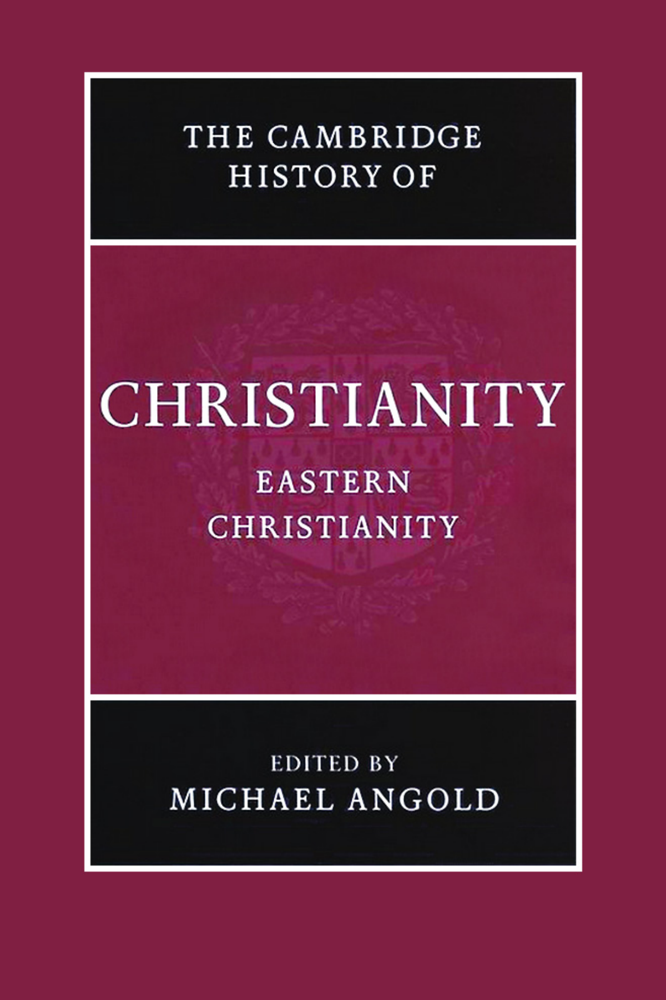

# 卷首资料

<!-- PDF page 1; original page unnumbered -->

## 剑桥基督教史

### 第五卷 东方基督教

迈克尔·安戈尔德（Michael Angold）编

<!-- PDF page 2; original page unnumbered -->

## 《剑桥东方基督教史》

本卷将普世牧首区的正教会，以及俄罗斯、亚美尼亚、埃塞俄比亚、埃及和叙利亚的教会，纳入同一视野，追溯它们从中世纪晚期直到现代的命运；恰恰这一时期，是相关历史最受忽视的阶段。这种处理，不可避免地会突显教义与经历的差异，但也揭示共同线索，其中最显著的，是它们面对外来的、往往怀有敌意的政治政权时，所表现的韧性。本卷的核心主题，是各种形态的正教，如何在不利条件下存续至现代。事实表明，拜占庭最后阶段，对于这种存续具有出人意料的重要性：它为正教提供了思想、艺术和属灵的储备，以应对后来的挑战。例如，埃及的主日学运动，以及希腊的“生命兄弟会”（Zoë），都显示出各正教会持续的活力。

迈克尔·安戈尔德是英国皇家历史学会会士、爱丁堡大学拜占庭史荣休教授。他近期出版的著作包括 *The Fourth Crusade: Event and Context*（2003）、*Byzantium: The Bridge from Antiquity to the Middle Ages*（2001），以及 *Church and Society in Byzantium under the Comneni, 1081–1261*（1995）。

<!-- PDF page 3; original page unnumbered -->

<!-- 原书空白页；数字化版本的版权页脚除外。 -->

<!-- PDF page 4; original page unnumbered -->

## 剑桥基督教史丛书

《剑桥基督教史》依时间顺序，全面叙述基督教自起源直至今日，在神学、思想、社会、政治、区域和全球等各方面的发展。各卷本身，都对所论时代的学术研究作出实质贡献；全套合在一起，则构成一部重要的学术参考著作。本丛书力求提供全球视野，远不只是一部西欧基督教及其分支的历史。东方和科普特基督教，自早期起便得到充分考虑；在较晚时期，非洲、远东、新大陆、南亚，以及其他非欧洲地区的基督教发展，也获得应有的论述。各卷涵盖民众虔敬，以及基督教信仰的非正式表达，并在广阔文化背景中，讨论基督徒形成、敬拜与虔敬的社会学问题。基督教与其他主要信仰的关系，也始终受到关注。这部历史，将为学者与学生提供极为宝贵的资源。

### 各卷目录

| 卷名 | 编者 |
|---|---|
| 起源至君士坦丁 | 玛格丽特·M. 米切尔（Margaret M. Mitchell）、弗朗西丝·M. 扬（Frances M. Young） |
| 君士坦丁至约600年 | 奥古斯丁·卡西代（Augustine Casiday）、弗雷德·诺里斯（Fred Norris） |
| 中世纪早期基督教，约600—约1100年 | 托马斯·诺布尔（Thomas Noble）、朱莉娅·史密斯（Julia Smith） |
| 西欧基督教，约1100—约1500年 | 米里·鲁宾（Miri Rubin）、沃尔特·西蒙斯（Walter Simons；本页原印Walter Simon） |
| 东方基督教 | 迈克尔·安戈尔德（Michael Angold） |

<!-- PDF page 5; original page unnumbered -->

| 卷名 | 编者 |
|---|---|
| 改革与扩张，1500—1660年 | 夏伯嘉（Ronnie Po-chia Hsia） |
| 启蒙、复兴与革命，1660—1815年 | 斯图尔特·J. 布朗（Stewart J. Brown）、蒂莫西·塔克特（Timothy Tackett） |
| 世界基督教，约1815—1914年 | 布赖恩·斯坦利（Brian Stanley）、谢里登·吉利（Sheridan Gilley） |
| 世界基督教，约1914—约2000年 | 休·麦克劳德（Hugh McLeod） |

<!-- PDF page 6; original page unnumbered -->

## 剑桥基督教史

### 第五卷

### 东方基督教

迈克尔·安戈尔德编

<!-- PDF page 7; original page unnumbered -->

## 版权与出版资料

剑桥大学出版社

剑桥、纽约、墨尔本、马德里、开普敦、新加坡、圣保罗

Cambridge University Press, The Edinburgh Building, Cambridge CB2 2RU, UK

美国版由剑桥大学出版社纽约分社出版。

出版社网站：www.cambridge.org；本书信息：www.cambridge.org/9780521811132。

© 剑桥大学出版社，2006年。

本出版物受版权保护。除法定例外，以及有关集体许可协议规定的情形外，未经剑桥大学出版社书面许可，不得复制本书任何部分。

2006年初版。在英国剑桥大学印刷厂印制。

英国图书馆备有本书的编目记录。

- ISBN-13：978-0-521-81113-2，精装本。
- ISBN-10：0-521-81113-9，精装本。

剑桥大学出版社，对本书所提及的外部或第三方互联网网站地址，是否持续有效、是否准确，不承担责任；也不保证这些网站的任何内容，现在或今后都准确、适当。

*数字化版本页脚另标“Cambridge Histories Online © Cambridge University Press, 2008”；本译稿以版权页明确列出的2006年为原书出版年份。*

<!-- PDF page 8; original page unnumbered -->

谨以此书纪念斯蒂文·朗西曼（Steven Runciman）、迪米特里·奥博连斯基（Dimitri Obolensky）及谢尔盖·哈克尔（Sergei Hackel）。

<!-- PDF page 9; original page viii -->

## 目录

| 卷首资料 | 原页码 |
|---|---|
| 插图目录 | xi |
| 地图目录 | xii |
| 撰稿人 | xiii |
| 前言 | xvi |
| 缩略语 | xix |

### 第一编 普世牧首区

| 章节 | 作者 | 原页码 |
|---|---|---|
| 第1章 拜占庭共同体（1000—1500年） | 乔纳森·谢泼德 | 3 |
| 第2章 拜占庭与西方（1204—1453年） | 迈克尔·安戈尔德 | 53 |
| 第3章 中世纪拜占庭的平信徒虔敬文化（1054—1453年） | 莎伦·E. J. 格斯特尔、艾丽斯－玛丽·塔尔博特 | 79 |
| 第4章 静修主义的兴起 | 迪尔克·克劳斯米勒 | 101 |
| 第5章 拜占庭帝国晚期的艺术与礼仪 | 南希·P. 舍甫琴科 | 127 |
| 第6章 阿索斯山与奥斯曼人（约1350—1550年） | 伊丽莎白·A. 扎哈里亚杜 | 154 |
| 第7章 被囚禁的大教会（1453—1586年） | 伊丽莎白·A. 扎哈里亚杜 | 169 |

<!-- PDF page 10; original page ix -->

| 章节 | 作者 | 原页码 |
|---|---|---|
| 第8章 正教与西方：从宗教改革到启蒙运动 | 帕斯哈利斯·M. 基特罗米利迪斯 | 187 |
| 第9章 巴尔斯基与正教共同体 | 亚历山大·格里申 | 210 |
| 第10章 法国大革命的遗产：正教与民族主义 | 帕斯哈利斯·M. 基特罗米利迪斯 | 229 |

### 第二编 俄罗斯教会

| 章节 | 作者 | 原页码 |
|---|---|---|
| 第11章 俄国的虔敬与正教文化（1380—1589年） | 斯特拉·罗克 | 253 |
| 第12章 俄国的艺术与礼仪：鲁布廖夫及其继承者 | 琳赛·休斯 | 276 |
| 第13章 反宗教改革时代俄国与乌克兰的东正教 | 罗伯特·O. 克拉米 | 302 |
| 第14章 俄罗斯帝国时期的俄罗斯东正教会（1721—1917年） | 西蒙·迪克森 | 325 |
| 第15章 从彼得大帝到1917年的俄国虔敬与文化 | 克里斯·丘洛斯 | 348 |

### 第三编 东方基督教诸形态

| 章节 | 作者 | 原页码 |
|---|---|---|
| 第16章 东方基督教诸形态（十一至十四世纪）：科普特人、麦勒凯派、涅斯托里乌斯派与雅各派 | 弗朗索瓦丝·米绍 | 373 |
| 第17章 十字军时代的亚美尼亚人（1050—1350年） | S. 彼得·考伊 | 404 |

<!-- PDF page 11; original page x -->

| 章节 | 作者 | 原页码 |
|---|---|---|
| 第18章 教会与离散：亚美尼亚人的个案 | S. 彼得·考伊 | 430 |
| 第19章 教会与民族：埃塞俄比亚正统合一教会（十三至二十世纪） | 唐纳德·克拉米 | 457 |
| 第20章 现代埃及的科普特基督教 | 安东尼·奥马霍尼 | 488 |
| 第21章 现代中东的叙利亚传统基督教 | 安东尼·奥马霍尼 | 511 |

### 第四编 现代世界

| 章节 | 作者 | 原页码 |
|---|---|---|
| 第22章 俄国流亡者的离散问题 | 谢尔盖·哈克尔 | 539 |
| 第23章 东正教会与共产主义 | 迈克尔·布尔多、亚历山德鲁·波佩斯库 | 558 |
| 第24章 现代灵修与东正教会 | 约翰·宾斯 | 580 |

| 卷末资料 | 原页码 |
|---|---|
| 参考书目 | 600 |
| 索引 | 679 |

*译校说明：本目录按原书列第一章为1000—1500年；章首页与页眉作1000—1550年，译文章题依正文。*

<!-- PDF page 12; original page xi -->

## 插图目录

| 图号 | 图像及来源说明 | 原页码 |
|---|---|---|
| 3.1 | 解毒者圣阿纳斯塔西娅与阿纳斯塔西娅·萨拉马利娜；圣伊琳娜。塞浦路斯阿西努圣母福尔维奥蒂萨教堂（Panagia Phorbiotissa, Asinou）。莎伦·格斯特尔摄。 | 95 |
| 5.1 | 圣葬图织物（Epitaphios）。伦敦维多利亚与阿尔伯特博物馆。获Hirmer Fotoarchiv许可刊载。 | 132 |
| 5.2 | 使徒领圣餐，斯塔罗纳戈里奇诺（Staro Nagoricino）。获马尔堡图片档案馆（Bildarchiv Foto Marburg）许可刊载。 | 135 |
| 5.3 | 纳齐安祖斯的格里高利撰写讲道。西奈山，希腊文抄本339号，第4叶背面。承蒙密歇根—普林斯顿—亚历山大里亚西奈山考察队惠允刊载。 | 140 |
| 5.4 | 五月月历圣像。西奈山圣凯瑟琳修道院。承蒙密歇根—普林斯顿—亚历山大里亚西奈山考察队惠允刊载。 | 142 |
| 5.5 | 《不坐颂》第24节。马尔科夫修道院圣德米特里奥斯教堂。贝尔格莱德国立博物馆。贾德伦卡·普罗洛维奇摄。 | 149 |
| 9.1 | 巴尔斯基绘，希俄斯岛新修道院（Nea Moni），1732年。基辅科学院档案馆，v. no.1062。 | 214 |
| 9.2 | 巴尔斯基绘，从西南方观看多希亚里乌修道院，1744年。基辅科学院档案馆，v. no.1062。 | 223 |
| 12.1 | 《诺夫哥罗德人与苏兹达尔人之战》，十五世纪中叶。莫斯科特列季亚科夫美术馆。获布里奇曼艺术图书馆许可刊载。 | 280 |
| 12.2 | 安德烈·鲁布廖夫《圣三一》，十五世纪二十年代。莫斯科特列季亚科夫美术馆。获布里奇曼艺术图书馆许可刊载。 | 284 |
| 12.3 | 莫斯科圣瓦西里大教堂。琳赛·休斯摄。 | 298 |

<!-- PDF page 13; original page xii -->

## 地图目录

| 图号 | 标题 | 原页码 |
|---|---|---|
| 1 | 拜占庭共同体 | 4 |
| 2 | 阿索斯山 | 13 |
| 3 | 巴尔斯基的旅行 | 211 |
| 4 | 莫斯科罗斯 | 254 |
| 5 | 东方诸教会 | 374 |
| 6 | 中世纪亚美尼亚 | 405 |
| 7 | 埃塞俄比亚 | 458 |

<!-- PDF page 14; original page xiii -->

## 撰稿人

*下列任职、出版情况及时间表述，均据2006年原书。著作题名保留原文。*

**迈克尔·安戈尔德（Michael Angold）**，爱丁堡大学拜占庭史荣休教授。著作包括 *Church and society in Byzantium under the Comneni (1081–1261)*（1995）。

**约翰·宾斯牧师（Revd John Binns）**，剑桥大圣玛利亚教堂主任牧师。著作包括 *An introduction to the Christian Orthodox churches*（2002）。

**迈克尔·布尔多咏祷教士（Canon Michael Bourdeaux）**，牛津凯斯顿研究所创办人兼主席。多种著作中，包括 *Opium of the people: the Christian religion in the USSR*（1965）及 *Gorbachev, Glasnost and the Gospel*（1990）。

**克里斯·丘洛斯（Chris Chulos）**，芝加哥罗斯福大学基金会关系主任、历史学兼任教授，也是赫尔辛基大学历史系常任成员。著作包括 *Converging worlds: religion and community in peasant Russia, 1861–1917*（2003）。

**S. 彼得·考伊（S. Peter Cowe）**，加利福尼亚大学洛杉矶分校纳雷卡齐亚美尼亚研究讲座教授。著作包括 *Mxit’ar Sasnec’i’s theological discourses*（1993）及 *Catalogue of the Armenian manuscripts in the Cambridge University Library*（1994）。他主编了 *Ani: world architectural heritage of a medieval Armenian capital*（2001）。

**唐纳德·克拉米（Donald Crummey）**，伊利诺伊大学厄巴纳—香槟分校非洲史教授。著作包括 *Land and society in the Christian Kingdom of Ethiopia from the 13th to the 20th century*（2000），以及与T. J. 巴塞特合著的 *African savanna environments: global narratives and local knowledge of environmental change*（2003）。

**罗伯特·O. 克拉米（Robert O. Crummey）**，加利福尼亚大学戴维斯分校俄国史荣休教授。著作包括 *The Old Believers & the world of Antichrist: the Vyg Community and the Russian state, 1694–1855*（1970）及 *Aristocrats and servitors: the Boyar elite in Russia, 1613–1689*（1983）。

**西蒙·迪克森（Simon Dixon）**，利兹大学近代史教授。著作包括 *The modernisation of Russia 1676–1825*（1999）及 *Catherine the Great*（2001）。

<!-- PDF page 15; original page xiv -->

**莎伦·E. J. 格斯特尔（Sharon E. J. Gerstel）**，加利福尼亚大学洛杉矶分校拜占庭艺术与考古学副教授。著作包括 *Beholding the sacred mysteries: programs of the Byzantine sanctuary*（1999）。

**亚历山大·格里申（Alexander Grishin）**，澳大利亚国立大学艺术史负责人，2004年当选澳大利亚人文科学院院士。著作包括两卷本 *The art of John Brack*（1990），以及 *A pilgrim’s account of Cyprus: Bars’kyj’s travels in Cyprus*（1996）。

**† 大司祭谢尔盖·哈克尔（Archpriest Sergei Hackel）**，于2005年二月九日逝世。他兼任堂区司祭与苏塞克斯大学俄语教师，也是一位著名广播人。三十年间，他一直担任 *Sobornost* 的编辑；这是圣公会与东正教圣谢尔吉团契的会刊。他著有 *A pearl of great price: the life of Mother Maria Skobstova, 1891–1945*（修订版，1982）。

**琳赛·休斯（Lindsey Hughes）**，伦敦大学斯拉夫与东欧研究学院俄国史教授。著作包括 *Russia in the age of Peter the Great*（1998）。

**帕斯哈利斯·M. 基特罗米利迪斯（Paschalis M. Kitromilides）**，雅典大学政治学教授、希腊国家研究基金会现代希腊研究所所长。著作包括 *The Enlightenment as social criticism: Iosipos Moisiodax and Greek culture in the eighteenth century*（1992），以及 *Enlightenment, nationalism, orthodoxy: studies in the culture and political thought of south-eastern Europe*（1994）。

**迪尔克·克劳斯米勒（Dirk Krausmüller）**，敦巴顿橡树园研究图书馆与收藏馆研究员、贝尔法斯特女王大学荣誉研究员。论文包括‘Conflicting anthropologies in the Christological discourse at the end of Late Antiquity: the case of Leontius of Jerusalem’s Nestorian adversary’，刊于 *Journal of Theological Studies* 56（2005）。

**弗朗索瓦丝·米绍（Françoise Micheau）**，巴黎第一大学先贤祠—索邦大学中世纪伊斯兰史教授，法国国家科学研究中心联合研究单位8167“中世纪伊斯兰：空间、网络与文化实践”负责人。她是安条克的叶海亚·伊本·赛义德（Yaḥyā ibn Saʿīd），以及马金·伊本·阿米德（al-Makīn ibn al-ʿAmīd）这两位重要阿拉伯语基督徒编年史家作品的共同译者。她广泛发表阿拉伯医学研究，并合著 *Communautés chrétiennes en pays d’Islam*（1997）。

**安东尼·奥马霍尼（Anthony O’Mahony）**，伦敦大学海斯罗普学院基督教与宗教间对话中心研究主任。著作包括 *Palestinian Christians: religion, politics and society in the Holy Land*（1999）。他主编了 *Eastern Christianity: studies in modern history, religion and politics*（2004）。

**亚历山德鲁·波佩斯库（Alexandru Popescu）**，牛津大学贝利奥尔学院研究员，著有 *Petre Ţuţea: between sacrifice and suicide*（2004）。

<!-- PDF page 16; original page xv -->

**斯特拉·罗克（Stella Rock）**，曾任苏塞克斯大学研究员，参与主编 *Nationalist myths and modern media: contested identities in the age of globalization*（2006）。她的 *Popular religion in Russia: ‘double belief’ and the making of an academic myth* 即将出版。

**南希·舍甫琴科（Nancy Ševčenko）**，国际拜占庭研究协会副主席、*Oxford Dictionary of Byzantium* 副主编。著作包括 *The life of Saint Nicholas in Byzantine art*（1983），以及 *Illustrated manuscripts of the Metaphrastian menologion*（1990）。

**乔纳森·谢泼德（Jonathan Shepard）**，曾任剑桥大学彼得学院研究员、大学俄国史讲师。他与西蒙·富兰克林合著 *The emergence of Rus 750–1200*（1996），并担任 *Cambridge History of Byzantium* 主编。

**艾丽斯－玛丽·塔尔博特（Alice-Mary Talbot）**，敦巴顿橡树园研究图书馆与收藏馆拜占庭研究主任、*Oxford dictionary of Byzantium* 执行主编。她编纂了 *The correspondence of Athanasius I Patriarch of Constantinople*（1975），并著有 *Faith healing in late Byzantium*（1983），以及 *Women and religious life in Byzantium*（2001）。

**伊丽莎白·A. 扎哈里亚杜（Elizabeth A. Zachariadou）**，克里特大学地中海研究所研究员。著作包括 *Trade and crusade: Venetian Crete and the Emirates of Menteshe and Aydin (1300–1415)*（1983），以及 *Romania and the Turks (c.1300–c.1500)*（1985）。
