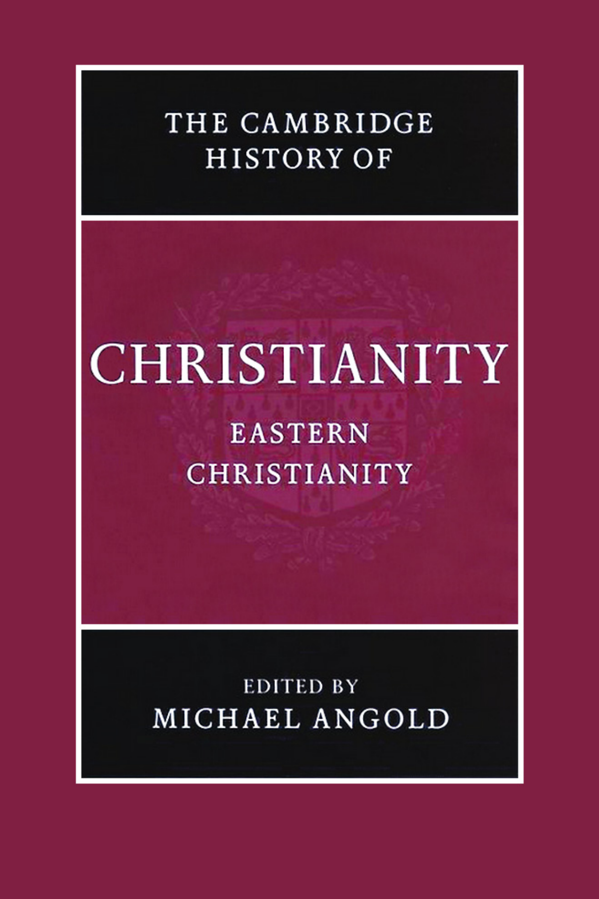
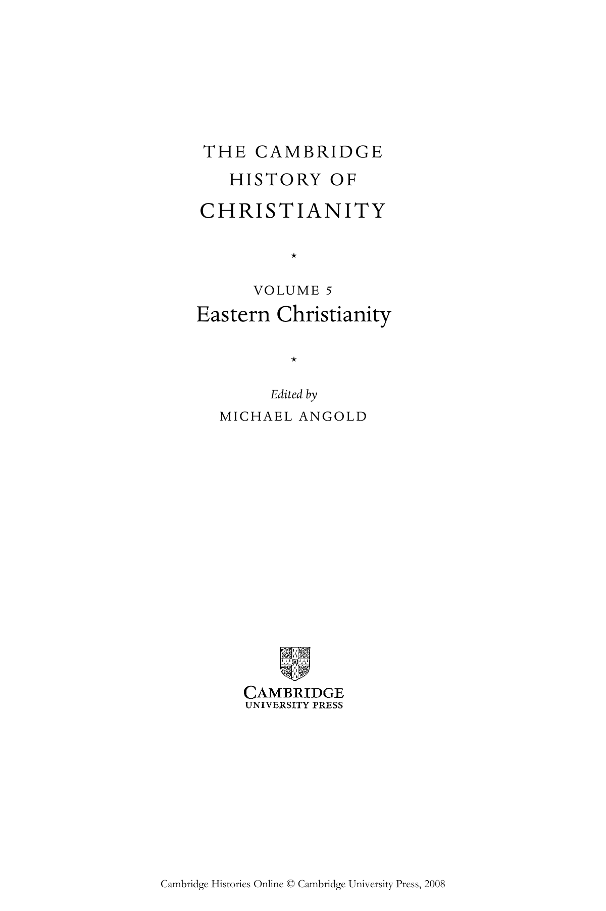

# 卷首资料：英文转换底稿

<!-- PDF page 1; original page unnumbered -->

<!-- PDF page 2; original page unnumbered -->

the cambridge history of

### E A S T E R N C H R I S T I A N I T Y

> This volume brings together in one compass the Orthodox churches of the ecumenical patriarchate – the Russian, Armenian, Ethiopian, Egyptian and Syrian churches. It follows their fortunes from the late Middle Ages until modern times – exactly the period when their history has been most neglected. Inevitably, this emphasises differences in teachings and experience, but it also brings out common threads, most notably the resilience displayed in the face of alien and often hostile political regimes. The central theme of this volume is the survival against the odds of Orthodoxy in its many forms into the modern era. The last phase of Byzantium proves to have been surprisingly important in this survival. It provided Orthodoxy with the intellectual, artistic and spiritual reserves to meet later challenges. The continuing vitality of the Orthodox churches is evident for example in the Sunday School Movement in Egypt and the Zoë brotherhood in Greece. Michael Angold is a Fellow of the Royal Historical Society and is Professor Emeritus of Byzantine History at the University of Edinburgh. His most recent publications include The Fourth Crusade: Event and Context (2003), Byzantium: The Bridge from Antiquity to the Middle Ages (2001) and Church and Society in Byzantium under the Comneni, 1081–1261 (1995).

<!-- PDF page 3; original page unnumbered -->

<!-- PDF page 4; original page unnumbered -->

the cambridge history of

### C H R I S T I A N I T Y

> The Cambridge History of Christianity offers a comprehensive chronological account of the development of Christianity in all its aspects – theological, intellectual, social, political, regional, global – from its beginnings to the present day. Each volume makes a substantial contribution in its own right to the scholarship of its period and the complete History constitutes a major work of academic reference. Far from being merely a history of Western European Christianity and its offshoots, the History aims to provide a global perspective. Eastern and Coptic Christianity are given full consideration from the early period onwards, and later, African, Far Eastern, New World, South Asian and other non-European developments in Christianity receive proper coverage. The volumes cover popular piety and non-formal expressions of Christian faith and treat the sociology of Christian formation, worship and devotion in a broad cultural context. The question of relations between Christianity and other major faiths is also kept in sight throughout. The History will provide an invaluable resource for scholars and students alike. List of volumes: Origins to Constantine edited by margaret m. mitchell and fr ances m. young Constantine to c. 600 edited by augustine casiday and fred norris Early Medieval Christianity c. 600–c. 1100 edited by thomas noble and julia smith Christianity in Western Europe c. 1100–c. 1500 edited by miri rubin and walter simon Eastern Christianity edited by michael angold

<!-- PDF page 5; original page unnumbered -->

> Reform and Expansion 1500–1660 edited by ronnie po-chia hsia Enlightenment, Reawakening and Revolution 1660–1815 edited by stewart j. brown and timothy tackett World Christianities c. 1815 –1914 edited by brian stanley and sheridan gilley World Christianities c. 1914 to c. 2000

<!-- PDF page 6; original page unnumbered -->

### T H E C A M B R I D G E

### H I S T O RY O F

### C H R I S T I A N I T Y

* VO LU M E 5

### Eastern Christianity

* Edited by M I C H A E L A N G O L D

<!-- PDF page 7; original page unnumbered -->

cambridge university press Cambridge, New York, Melbourne, Madrid, Cape Town, Singapore, São Paulo Cambridge University Press The Edinburgh Building, Cambridge cb2 2ru, UK Published in the United States of America by Cambridge University Press, New York www.cambridge.org Information on this title: www.cambridge.org/9780521811132 © Cambridge University Press 2006 This publication is in copyright. Subject to statutory exception and to the provisions of relevant collective licensing agreements, no reproduction of any part may take place without the written permission of Cambridge University Press. First published 2006 Printed in the United Kingdom at the University Press, Cambridge A catalogue record for this publication is available from the British Library isbn-13 978-0-521-81113-2 hardback isbn-100-521-81113-9 hardback Cambridge University Press has no responsibility for the persistence or accuracy of URLs for external

or third-party internet websites referred to in this publication, and does not guarantee that any content on such websites is, or will remain, accurate or appropriate.

<!-- PDF page 8; original page unnumbered -->

### In Memory of Steven Runciman,

### Dimitri Obolensky and Sergei Hackel

<!-- PDF page 9; original page viii -->

### Contents

List of illustrations xi List of maps xii List of contributors xiii Foreword xvi List of abbreviations xix

### pa rt i

T H E E C U M E N I C A L PAT R I A R C H AT E 1 · The Byzantine Commonwealth 1000–1500 3 j onat h a n s h e pa r d 2 · Byzantium and the west 1204–1453 5 3 m i c h a e l a n g o l d 3 · The culture of lay piety in medieval Byzantium 1054–1453 79 s h a ron e. j. g e r st e l a n d a l i c e - m a ry ta l b ot 4 · The rise of hesychasm 101 d i r k k r au s m ü l l e r 5 · Art and liturgy in the later Byzantine Empire 127 na n c y p. š e v č e n ko 6 · Mount Athos and the Ottomans c.1350–1550 1 5 4 e l i za b et h a. zac h a r i a d o u 7 · The Great Church in captivity 1453–1586 169 e l i za b et h a. zac h a r i a d o u

<!-- PDF page 10; original page ix -->

Contents 8 · Orthodoxy and the west: Reformation to Enlightenment 187 pa s c h a l i s m. k i t ro m i l i d e s 9 · Bars’kyj and the Orthodox community 210 a l e x a n d e r g r i s h i n 10 · The legacy of the French Revolution: Orthodoxy and nationalism 229 pa s c h a l i s m. k i t ro m i l i d e s

### pa rt i i

T H E RU S S I A N C H U R C H 11 · Russian piety and Orthodox culture 1380–1589 253 st e l la ro c k 12 · Art and liturgy in Russia: Rublev and his successors 276 l i n d s ey h u g h e s 13 · Eastern Orthodoxy in Russia and Ukraine in the age of the Counter-Reformation 302 ro b e rt o. c ru m m ey 14 · The Russian Orthodox Church in imperial Russia 1721–1917 325 s i m on d i xon 15 · Russian piety and culture from Peter the Great to 1917 348 c h r i s c h u lo s

### pa rt i i i

E A S T E R N C H R I S T I A N I T I E S 16 · Eastern Christianities (eleventh to fourteenth century): Copts, Melkites, Nestorians and Jacobites 373 f r a n c¸ o i s e m i c h e au 17 · The Armenians in the era of the crusades 1050–1350 404 s. pet e r co w e

<!-- PDF page 11; original page x -->

Contents 18 · Church and diaspora: the case of the Armenians 430 s. pet e r co w e 19 · Church and nation: the Ethiopian Orthodox Täwahedo Church (from the thirteenth to the twentieth century) 457 d ona l d c ru m m ey 20 · Coptic Christianity in modern Egypt 488 a n t h on y o ’ m a h on y 21 · Syriac Christianity in the modern Middle East 5 1 1 a n t h on y o ’ m a h on y

### pa rt i v

T H E M O D E R N WO R L D 22 · Diaspora problems of the Russian emigration 539 s e rg e i h ac k e l 23 · The Orthodox Church and communism 5 5 8 m i c h a e l b o u r d e au x a n d a l e x a n d ru p o pe s c u 24 · Modern spirituality and the Orthodox Church 580 j o h n b i n n s Bibliography 600 Index 679

<!-- PDF page 12; original page xi -->

### Illustrations

> 3.1 St Anastasia the Poison Curer and Anastasia Saramalyna; St Eirene. Panagia Phorbiotissa, Asinou, Cyprus. Photograph by Sharon Gerstel. 955.1 Epitaphios textile. Victoria and Albert Museum, London. Reproduced by permission of Hirmer Fotoarchiv. 1325.2 The Communion of the Apostles, Staro Nagoricino. Reproduced by permission of Bildarchiv Foto Marburg. 1355.3 Gregory of Nazianzos writing his homilies. Mount Sinai, Mss. Gr. 339, fol. 4v. Reproduced through the courtesy of the Michigan-Princeton-Alexandria expedition to Mount Sinai. 1405.4 Calendar icon for the month of May. Mount Sinai, monastery of St Catherine. Reproduced through the courtesy of the Michigan-Princeton-Alexandria expedition to Mount Sinai. 1425.5 Akathistos hymn, stanza 24. Markov Manastir, church of St Demetrios. National Museum, Belgrade. Photograph by Jadrenka Prolovic. 1499.1 Bars’kyj, monastery of Nea Moni on Chios, 1732. Akademiia Nauk Arkhiv, Kiev, v. no. 1062. 2149.2 Bars’kyj, Docheiariou monastery viewed from the south-west, 1744. Akademiia Nauk Arkhiv, Kiev, v. no. 1062. 223 12.1 Battle of the Novgorodians with the Suzdalians, mid-fifteenth century. Tretyakov Gallery, Moscow. Reproduced by permission of The Bridgeman Art Library. 280 12.2 The Holy Trinity (1420s) by Andrei Rublev. Tretyakov Gallery, Moscow. Reproduced by permission of The Bridgeman Art Library. 284 12.3 St Basil’s Cathedral, Moscow. Photograph by Lindsey Hughes. 298

<!-- PDF page 13; original page xii -->

### Maps

> 1 The Byzantine Commonwealth page 4 2 Mount Athos 133 Bars’kyj’s travels 2114 Muscovy 2545 Eastern churches 3746 Medieval Armenia 4057 Ethiopia 458

<!-- PDF page 14; original page xiii -->

### Contributors

> michael angold is Professor Emeritus of Byzantine History, University of Edinburgh. Among his publications is Church and society in Byzantium under the Comneni (1081–1261) (1995). revd john binns is Vicar of Great St Mary’s, Cambridge. Among his publications is An introduction to the Christian Orthodox churches (2002). canon michael bourdeaux is Founder and President of Keston Institute, Oxford. Among his many publications are Opium of the people: the Christian religion in the USSR (1965) and Gorbachev, Glasnost and the Gospel (1990). chris chulos is Director of Foundation Relations and Adjunct Professor of History at Roosevelt University, Chicago. He is also a permanent member of the History Faculty at Helsinki University. Among his publications is Converging worlds: religion and community in peasant Russia, 1861–1917 (2003). s. peter cowe holds the Narekatsi Chair of Armenian Studies at UCLA. Among his publications are Mxit’ar Sasnec’i’s theological discourses (1993); Catalogue of the Armenian manuscripts in the Cambridge University Library (1994). He is the editor of Ani: world architectural heritage of a medieval Armenian capital (2001). donald crummey is Professor of African History, University of Illinois at Urbana- Champaign. Among his publications are Land and society in the Christian Kingdom of Ethiopia from the 13th to the 20th century (2000) and African savanna environments: global narratives and local knowledge of environmental change (with T. J. Bassett, 2003). robert o. crummey is Emeritus Professor of Russian History, University of California, Davis. Among his publications are TheOldBelievers&theworldofAntichrist:theVygCommunity and the Russian state, 1694–1855 (1970) and Aristocrats and servitors: the Boyar elite in Russia, 1613–1689 (1983). simon dixon is Professor of Modern History at the University of Leeds. Among his publications are The modernisation of Russia 1676–1825 (1999) and Catherine the Great (2001).

<!-- PDF page 15; original page xiv -->

List of contributors

> sharon e. j. gerstel is Associate Professor of Byzantine Art and Archaeology, UCLA. Among her publications is Beholding the sacred mysteries: programs of the Byzantine sanctuary (1999). alex ander grishin is Head of Art History, Australian National University. In 2004 he was elected Fellow of the Australian Academy of the Humanities. Among his publications are his two-volume The art of John Brack (1990) and A pilgrim’s account of Cyprus: Bars’kyj’s travels in Cyprus (1996). †archpriest sergei hackel died on 9 February 2005. He combined the work of a parish priest with teaching Russian at the University of Sussex and was a well-known broadcaster. For thirty years he was editor of Sobornost, the journal of the Anglican-Orthodox Fellowship of St Sergius. He was the author of A pearl of great price: the life of Mother Maria Skobstova, 1891–1945 (revised edition 1982). lindsey hughes is Professor of Russian History at the School of Slavonic and East European Studies, University of London. Among her publications is Russia in the age of Peter the Great (1998). paschalis m. kitromilides is Professor of Political Science at the University of Athens and Director of the Institute of Neohellenic Research at the National Hellenic Research Foundation. Among his publications are TheEnlightenmentassocialcriticism:IosiposMoisiodax and Greek culture in the eighteenth century (1992) and Enlightenment, nationalism, orthodoxy: studies in the culture and political thought of south-eastern Europe (1994). dirk kr ausmü ller is a Research Fellow at Dumbarton Oaks Research Library and Collection and an Honorary Fellow of Queen’s University Belfast. Among his publications is ‘Conflicting anthropologies in the Christological discourse at the end of Late Antiquity: the case of Leontius of Jerusalem’s Nestorian adversary’, Journal of Theological Studies 56 (2005). fr anc¸ oise micheau is Professor of Medieval Islamic history at Université Paris 1 – Panthéon-Sorbonne and director of CNRS (UMR8167): Islam médiéval-éspaces, réseaux et pratiques culturelles. She is the co-translator of the important Christian Arab chronicles of Yahya ibn Saʿid of Antioch and of al-Makin ibn al-’Amid. She has published widely on Arabic medicine and is co-author of Communautés chrétiennes en pays d’Islam (1997). anthony o’mahony is Director of Research at the Centre for Christianity and Interreligious Dialogue, Heythrop College, University of London. Among his publications is Palestinian Christians: religion, politics and society in the Holy Land (1999). He is the editor of Eastern Christianity: studies in modern history, religion and politics (2004). alex andru popescu is Research Fellow of Balliol College, Oxford. He is the author of Petre Țuțea: between sacrifice and suicide (2004).

<!-- PDF page 16; original page xv -->

List of contributors

> stella ro ck was a research fellow at the University of Sussex. She is the co-editor of Nationalist myths and modern media: contested identities in the age of globalization (2006). Her Popular religion in Russia: ‘double belief’ and the making of an academic myth will shortly appear. nancy š evč enko is a Vice President of the Association internationale des études byzantines and Associate Editor of the Oxford Dictionary of Byzantium. Among her publications are The life of Saint Nicholas in Byzantine art (1983) and Illustrated manuscripts of the Metaphrastian menologion (1990). jonathan shepard is a former Fellow of Peterhouse, University of Cambridge, and University Lecturer in Russian History. He is the author with Simon Franklin of Theemergence of Rus 750–1200 (1996) and is the editor of the Cambridge History of Byzantium. alice-mary talbot is Director of Byzantine Studies, Dumbarton Oaks Research Library and Collection and Executive Editor of the Oxford dictionary of Byzantium. She edited The correspondence of Athanasius I Patriarch of Constantinople (1975) and is the author of Faith healing in late Byzantium (1983) and Women and religious life in Byzantium (2001). elizabeth a. zachariadou is a Fellow of the Institute for Mediterranean Studies, University of Crete. Among her publications are Trade and crusade: Venetian Crete and the Emirates of Menteshe and Aydin (1300–1415 ) (1983) and Romania and the Turks (c.1300–c.1500) (1985).
