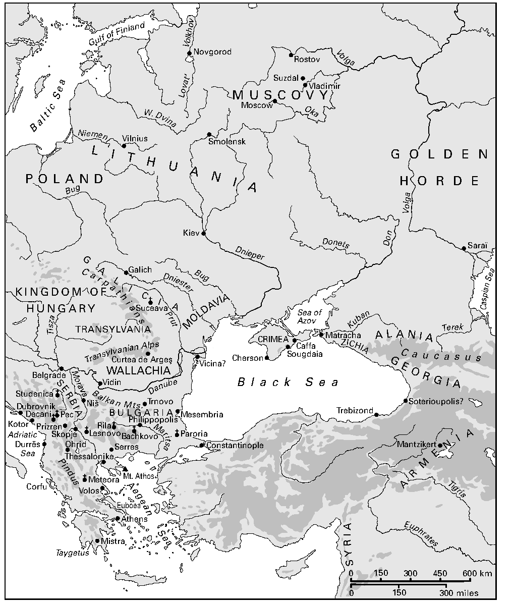
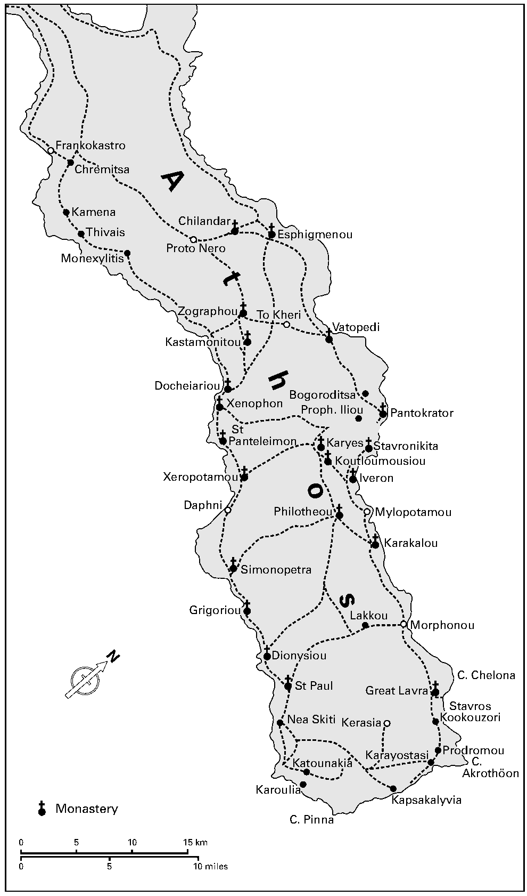

# 第1章 拜占庭共同体（1000—1550年）

乔纳森·谢泼德（Jonathan Shepard）

<!-- PDF page 24; original page 3 -->

## 引言

东罗马帝国的礼仪和遗存，会给居住在其周边或置身其间的大多数民族留下深刻印象，这实在不足为奇。君士坦丁堡是一座有意规划建造的城市，作为一个标志，即使最强大的“蛮族”军阀也不能指望将它抹去。城内众多的市场、厚重的城墙，以及金门等宣告新耶路撒冷与基督教胜利的纪念性建筑，使这座“上帝护佑之城”成为展示财富、社会凝聚力和军事力量的橱窗。宫廷仪式、艺术和演说家，都把这些物质福祉归功于皇帝及其臣民的虔敬——在典礼的欢呼辞中，他们往往被径称为“基督徒”——以及帝国在上帝为人类制定的计划中所占的核心地位。君士坦丁堡本身又受到上帝之母的特别保护。在中世纪，为报答玛利亚守护其城，人们以越来越富于戏剧性的方式敬礼她；“引路圣母像”（Hodegetria）等能行奇迹的圣像，定期被抬上街头巡行，以示尊崇。

即使最遥远的外部观察者，也能把拜占庭的繁荣、军事打击能力与宗教虔敬联系起来。“伯爵的诗人”阿尔诺尔（Arnor）从奥克尼群岛的视野出发，把上帝视为“随时庇护希腊人与加尔德之民的恩主”。[^p024-1]这些“加尔德之民”（Garð-folk），也就是罗斯人，在988年前后，其统治者弗拉基米尔接纳拜占庭传教团、本人也接受洗礼之后，便集体归入君士坦丁堡牧首的照管之下。弗拉基米尔之所以选择正教形式的基督教，一个主要原因，很可能正是这种宗教似乎带来的神圣“庇护”，具体表现为物质财富与社会秩序。弗拉基米尔采用当时首席皇帝的基督教名字巴西尔（Basil），并迎娶他的妹妹安娜，以此彰显自己与皇帝的私人联系。到1000年前后，拜占庭另外几个<!-- PDF page 25; original page 4 -->北方邻邦，例如阿兰人的统治家族，也已由拜占庭司祭施洗。这延续了九世纪中叶保加利亚人改宗时形成的模式。这些改宗的功劳，首先被归于皇帝；在官方通信中，凡祖辈曾由拜占庭人施洗的统治者，都被称为皇帝的“属灵之子”。十世纪中叶，保加利亚、阿兰，以及较具主张意味地被列入其中的亚美尼亚领袖，都受到过这样的称呼。[^p025-2]

*地图1 拜占庭共同体。中文地名对照见本章末。*

<!-- PDF page 26; original page 5 -->

很可能由米海尔七世·杜卡斯（Michael VII Doukas，1071—1078年在位）赠给匈牙利统治者盖扎（Géza）的珐琅饰片，清楚地以视觉形式呈现了拜占庭人心目中的正确秩序：米海尔和他的儿子头部都有光环；盖扎的服饰较为朴素，也没有光环。不过，他戴着一种王冠，而这些饰片原先装饰的器物，很可能本身就是一顶王冠；它也许是专为盖扎那位出生于拜占庭的贵族新娘制作，并于十一世纪七十年代中叶送给她的。新娘、王冠和珐琅肖像共同宣示了盖扎在既有统治者行列中的地位；盖扎肖像旁的希腊文铭文称他为国王（κράλης）。[^p026-3]这些帝王恩宠的标志也表明，盖扎如今或许能够把相应的庇护分施给自己麾下那些值得奖赏的权贵。

这些珐琅饰片，为我们留下了拜占庭外交实际运作的一幅速写。珐琅似乎只被用于为帝国外部统治者制作的冠冕，长久提醒人们拜占庭工艺的卓越。然而，米海尔·杜卡斯这份赠礼的后来遭遇，也显示出，各地统治者会以多么不同的方式，运用自己与皇帝（basileus）的联系：不久之后，这些饰片便成为后来所谓“圣斯蒂芬王冠”的下部。米海尔原本意在借此展示霸权，最后却产生了一个自主的匈牙利王国最具代表性的象征。对于许多统治者而言，从皇帝那里接受头衔、礼物与徽号，同自行掌控本国的抱负并不矛盾；更有自信的政权，还会改用乃至仿用那些被皇帝视为自身专有权利的象征。这些统治者挪用帝国符号，并公开援引帝国宫廷，其主要目的，是巩固自己对成分复杂、往往尚未充分整合的人口的统治。这些明确无误的权威标志，有助于超越地方差别与竞争，提供一套所有臣民都能理解的权力视觉语言。

与盖扎一样，中世纪早期的大多数统治者，都试图证明自己取得王位的正当性，无论其王位是继承而来、篡夺而得，还是尚在创设之中。他们谋求亲族和区域内其他有实力者的尊重，即使未必能够获得服从；对于生活在其名义领土以内及以外的人，也是如此。授予官职并由此确定身份等级，通常被视为衡量统治者权威的一个尺度。在这方面，拜占庭同样能够提供许多东西。皇帝是上帝在人间的代理者、仅向上帝负责的观念，<!-- PDF page 27; original page 6 -->尽管拜占庭教士和修士不断试图通过教会法、仪式与公开谴责加以约束，却仍然大行其道。许多外部统治者不仅希望主宰世俗事务，也希望主导宗教事务；那些对本国高级教士感到不耐烦的人尤其如此。对于有志成为君主、却与帝国既无密切文化联系、也无效忠传统的人，拜占庭提供了一个既庄严又有效的可行模式。有些人单方面取用拜占庭的视觉符号，既不求由皇帝颁赐，也不打算抹去旧帝国的中心。他们所追求的，是借用把自身统治表现为上帝所赐的方式，震慑并压倒国内强大的利益集团。例如，格鲁吉亚的塔玛拉女王（Tamara）重新组合了拜占庭君主图像的母题，以巩固自己作为独立执政女性的空前地位。格鲁吉亚王权长期以来就是通过源自拜占庭的图像语言来表达的。塔玛拉以各种方式加以改造，在教堂中自己的肖像上表现虔敬与合法性，同时突显格鲁吉亚本土值得尊崇的主题和人物。[^p027-4]

迪米特里·奥博连斯基（Dimitri Obolensky）认为，这类对拜占庭政治文化、宗教礼仪和视觉媒介的借用，构成了一种共同模式。在其权威著作《拜占庭共同体》（The Byzantine Commonwealth）中，他勾画出一群群承认帝国霸权的统治者及其臣民；所涉及的不仅是精英，也包括整个社会。他主张，使他们联结在一起的，是正教信仰、对教会与皇帝共同维护的法律的重视，以及对皇帝的尊敬。他们的基督教世界以君士坦丁堡为中心，因为其中大多数政治单位最初都接纳过拜占庭传教团，归属牧首的权威之下。奥博连斯基提出，这些边缘地区的统治者通常承认皇帝对全体正教基督徒的最高领主地位；他们这样做，既出于整合本国的务实愿望，也出于对皇帝的理想性忠诚。[^p027-5]

奥博连斯基承认，动机是混杂的：自身利益可能驱使正教统治者与皇帝交战，共同体的组成也随时间而变化。尽管东欧大多数使用斯拉夫语言的政权本身不断变化，又与多种文化保持联系，他仍认为，它们曾在各个不同时期遵奉拜占庭的规范性价值，<!-- PDF page 28; original page 7 -->这便足以构成它们作为一个制度性组织成员的资格。一些书评作者批评了奥博连斯基的理论，强调紧邻帝国实际领土的政治实体，与距离更远的政治实体，所处环境有着区别。他们还质疑，为什么意大利南部和高加索那些同源的文化，不在考察之列；他们认为，这个共同体至多是一个文化与宗教的范围，既缺乏制度基础，也不含政治意义。[^p028-6]在罗斯的例子中，表达对拜占庭皇帝效忠，或表明意识到拜占庭自称罗马继承者的材料，格外稀少。[^p028-7]蒙古征服以前流传于罗斯的那些最终源自希腊文的文本，内容大多是宗教性的，其中许多曾由南斯拉夫人翻译或改写。有些在十世纪初于保加利亚宫廷译成，目的在于为当地统治者提供正教基督教治理的准则。在这一过程中，它们帮助斯拉夫语读者形成了一种文本共同体。[^p028-8]如果只研究这些文本，人们可能会得出结论：拜占庭帝国秩序对于这些统治者来说，不过是一套可供组装的构件；他们任取所需，建立符合自身预先观念的结构。

然而，在那些主要从拜占庭接受基督教的社会之间，尽管地方差异很多，其政治文化中仍反复出现某些主题和母题。那些希望建立自己的物质庇护、神圣施惠与有序治理中心的领袖，把拜占庭皇帝能够授予和收回的官职与荣衔，作为自己的范本。这在十三、十四世纪的保加利亚统治者那里最为明显：其高级官员与尊位的名称，大多是拜占庭称谓的翻译或斯拉夫化形式。塞尔维亚领袖也大量借用拜占庭术语，建立宫廷等级。在神圣场合颁授、并据以确定等级的官职，<!-- PDF page 29; original page 8 -->对授予者和接受者同样具有吸引力；拜占庭授予个人帕特里基奥斯（patrikios）等头衔的典礼文本，也被译成了斯拉夫语。从发现的抄本数量来看，它们似乎构成了南斯拉夫宫廷实践的基础。不过，各地也作出了调整：库罗帕拉特斯（kouropalates）和帕特里基奥斯，被译为含义更为宽泛的克尼亚兹（kniaz，意为“亲王”或“显贵”）。[^p029-9]这些对博斯普鲁斯海峡畔宫廷的呼应，并不是在思想真空中发生的。斯特凡·杜尚（Stefan Dušan）1349年的法典，大量取材于马太·布拉斯塔雷斯（Matthew Blastares）几年前在帖撒罗尼迦编写的一部综合世俗法与教会法的论著。杜尚法典还改编了曼努埃尔一世·科穆宁（Manuel I Komnenos）等相对晚近皇帝的新律，以及缩编的《农民法》。与法典一道发布的“诏书”，宣示了他“希望制定某些合乎正教信仰的德行规范与最真实的法律，使之得到遵守”，由此将民事规范纳入信仰之中。这套帝国秩序的安排，预期同样适用于杜尚的斯拉夫臣民，以及他或早或晚新近获得的希腊臣民。法典是为实际施用而制定的：1354年又颁行了一个收入杜尚近期法令的修订本。与此同时，人们还通过视觉媒介，宣扬统治者的立法与执法具有神启性质。例如，杜尚位于莱斯诺沃（Lesnovo）的教堂，其壁画的一个突出主题，便是启迪统治者、以神秘方式赋予他引导人民之能力的“神圣智慧”。[^p029-10]这类对拜占庭帝王属性的描绘，与杜尚及其前任偏爱那些令人联想到帝国宫廷的等级称谓，相互契合。实际职务与荣誉头衔之间的界线并不分明；十四世纪保加利亚和塞尔维亚统治者授予较高官职与头衔，就像在拜占庭本土一样，近似于一种宗教授职礼。

拜占庭的世俗法典，以及通过官职改变个人身份的观念，在罗斯人那里都不甚重要，尽管莫斯科的谢苗亲王（Semen）曾在1347年奉承地宣称，帝国是“一切虔敬的泉源，是立法与成圣的导师”。[^p029-11]然而，拜占庭帝国秩序，无论罗斯人对它的理解多么模糊，终究提供了一整套概念、仪式和权威象征，并得到教会祝福的确认。罗斯领袖最终也利用了这一整套资源。君士坦丁堡陷于突厥人之手约一代人以后，莫斯科罗斯的伊凡三世，尤其有理由使自己的权力中心，带上<!-- PDF page 30; original page 9 -->古老帝国宫廷的气息。他扩大世俗权力的同时，社会中也盛行着末世期待；这些期待虽各不相同，强烈程度却丝毫不减。对于伊凡的都主教佐西马（Zosima）等教士而言，1453年新罗马的陷落，既可能预示现世的终结，也可能预示上帝将荣耀赐予“新君士坦丁之城莫斯科的新皇帝君士坦丁，整个罗斯大地与许多其他土地的君主”。[^p030-12]伊凡采用了拜占庭宫廷的一些外在排场与仪式，将克里姆林宫建设为新近汇集的领土和新社会的典范中心，仿佛立于今世与来世之间。[^p030-13]对于相信上帝所意欲的新时代即将到来的人，统治者作为灵魂守护者的身份，能够提供实际帮助。看似狭义宗教层面的关切，也影响着人们对于一位亲王是否称职的普遍期待；伊凡利用了这些期待，既通过砖石建筑，也通过耶路撒冷的象征，例如奉献给克里姆林宫内一座教堂的礼仪用圣匣。[^p030-14]在十五世纪晚期和十六世纪的罗斯精英之中，身为新以色列的意识，比身为新罗马的意识，表达得更为明确，信奉得也更为热切。然而，正是博斯普鲁斯海峡畔的帝国之都，为新耶路撒冷提供了最近的范本和熟悉的通路。

这并不只是唤起一个已经消失的帝国。源自正教思想的未来信念，为伊凡的政治抱负赋予了明确形态。各种末世理论尽管彼此不同，却都把拜占庭视为上帝在人间最眷顾的国度，认为这是理所当然的：其他任何正教统治者，都只能指望依照上帝的旨意，遵守虔敬皇帝确立的行为准则，才能在自己的领土上有所成就。统治者作为教会的监督者、臣民的保卫者和他们灵魂的照管者，这一角色在罗斯最充分的表达，见于1547年伊凡四世加冕为沙皇（皇帝）之时。伊凡及其顾问明确援引与拜占庭的历史联系。他们进一步铺陈了一个故事，声称君士坦丁九世·莫诺马霍斯（Constantine IX Monomachos）曾把一顶“王冠”赠给伊凡的一位远祖；加冕典礼本身，则改编了拜占庭的仪式与文本。在克里姆林宫金厅的壁画上，描绘着以色列和罗斯——也就是新以色列——历史中的场景；统治者权力的神授性质，是一个突出主题，而他的“神圣智慧”，也如同杜尚在莱斯诺沃的形象一样，被特别彰显。[^p030-15]这种<!-- PDF page 31; original page 10 -->象征，在观看这些图像的廷臣和教士眼中，也许有深浅不同的解读，但它们传达的信息却无可回避。

从某种意义上说，为这一目的而求助于拜占庭意识形态，是一种“别无更佳选择”的做法，因为人们缺乏其他既能表达帝王统治、又与正教教义相容的观念。为了论证并展示莫斯科卓越的权力与虔敬，教士们取用了拜占庭关于帝国中心的思想和母题，并明确援引昔日基督教领导权的枢纽。把莫斯科称为继博斯普鲁斯海峡畔“第二罗马”之后的“第三罗马”，便表达了它正在实际取代旧中心的意识。长期以来，那些希望建立自足中心的政治实体，尤其是毗邻拜占庭领土的政治实体，便会把自己新的政治与宗教权威中心，称作“新罗马”或“新皇城”（new Tsargrad）。从十三世纪后期起，保加利亚作家就已称大特尔诺沃（Veliko T’rnovo）为“新皇城”。更值得注意的是，十五世纪晚期，人们只是有些迟疑地尝试把这个称号用于莫斯科，随后过了相当时间，才充分展开这一主张。莫斯科作家在旧中心的概念框架中提出新中心的要求，主张本国亲王拥有长期归于皇城之中皇帝的神圣认可，因而不能随意无视后者由来已久的首要地位。他们大多本身就是教士，所隶属的组织，其总部依然留在皇帝的城市中。此外，还有其他原因，使莫斯科不敢公然摆出帝国姿态。大帐汗国的鞑靼可汗，因身为成吉思汗的后裔而被称作“沙皇”，直到十五世纪晚期，仍在向罗斯东北部征收贡赋；莫斯科亲王也一直受到克里米亚鞑靼人及其他鞑靼集团的威胁，在整个十六世纪都向他们支付巨额贡金。

然而，对于罗斯及其他统治者的抱负，始终有一项告诫：普世牧首区坚持认为，基督教世界的统一，以一个“罗马”帝国继续存在于君士坦丁堡为基础。例如，十五世纪初，驻莫斯科的基辅与全罗斯都主教佛提乌斯（Photios），有一件“萨科斯”礼袍（sakkos，典礼用外袍），上面的织绣图像便传播了这种观念。莫斯科亲王瓦西里（Vasilii）及其妻子，被描绘成面向皇帝约翰八世·巴列奥略（John VIII Palaiologos）和他的新娘；而这位新娘，正是瓦西里本人的女儿。皇帝与这位生于罗斯的皇后，都有光环，莫斯科亲王却没有。神圣统治及首要权威究竟位于何处，几乎不可能表现得更清楚了。[^p031-16]当瓦西里的首席教士穿着<!-- PDF page 32; original page 11 -->这件礼袍主持教会礼拜时，瓦西里便亲眼见证了这份来自君士坦丁堡的赠礼所传递的视觉信息。他也由此间接提升了自己的地位：至少，他的女儿已进入了头戴光环者的行列。1439年佛罗伦萨会议赞同与罗马合一，并没有对普世牧首区在斯拉夫人中的地位造成持久损害。因此，即使君士坦丁堡已陷于突厥人之手，任何有志成为新罗马皇帝的人，也仍必须顾及牧首区对于另立皇帝的保留意见。伊凡四世加冕典礼的筹办者，因而谨慎地征求牧首的同意，并最终获得认可。即便如此，在傅油之际，主持典礼的都主教马卡里（Makarii），仍使用了有别于拜占庭晚期登基礼的一套措辞。他的克制似乎反映出这样的认识：他并不是君士坦丁堡牧首，正如伊凡也不是罗马人的皇帝。[^p032-17]

1547年马卡里举行加冕礼时，拜占庭作为一个领土帝国，早已不复存在；金厅的绘画则表现了伊凡接受天使加冕的场景。在拜占庭影响范围内，其他统治者被描绘成接受加冕的例子极少，无论授冠者是基督还是天上的神灵。少数这样的统治者，通常着意追求与拜占庭皇帝相当的霸主地位，而非后者独一无二的“罗马”头衔。例如，1344—1345年间，一幅细密画表现了保加利亚的伊凡·亚历山大（Ivan Alexander）在基督面前接受天使加冕：基督被称为“万王之王与永恒之王”，伊凡则是“全体保加利亚人和希腊人的沙皇与专制君主”。[^p032-18]这种公开以视觉方式宣称主权出自神授的做法，比取用帝王头衔还要罕见。

这些统治者的迟疑表明，无论他们把拜占庭政体视为罗马人的帝国，还是仅仅看成希腊人的国土，他们都意识到了皇帝声称拥有的特殊人间地位。对于希望把权力缰绳集中到自己手中、并确保仅由自己后代继承的领袖，拜占庭国家作为一个以法律为支撑的政治秩序实际范本，具有相当价值。皇帝在上帝及其律法的帮助下主持一个等级体系，这对本国那些难以驾驭的竞争者，以及一般臣民，都有教诫意义。把拜占庭视为一个通过仪式形式传达霸主领导规范的典范中心，是很有道理的。这些仪式提供了<!-- PDF page 33; original page 12 -->或多或少普遍可辨认的权威象征，同时明确暗示统治权来自上天的委任；对于建立新的霸权结构而言，它们也是具有实际用途的构件。只要某位统治者明确援引拜占庭式的政治文化，他就很可能对这种文化最初、也是最主要的代表，表现出至少一定程度的尊重。至于使这个基督教权威的范本黯然失色，或取而代之，在1453年以前，几乎算不上值得考虑的选择。

这一逻辑，可以用较为传统的方式来表述：对于那些至少在精英层面知道拜占庭帝国的民族，各个王朝统治者和有志成为君主的人，都会计算自身利益与损益。在拜占庭拥有压倒性的物质财富与力量的时代，这种解释是可信的。然而，正如奥博连斯基所指出的，共同体的鼎盛期，却出现在拜占庭政治与军事衰退之后；它的宗教也因此失去了成功的光环。玛丽·赫尔姆斯（Mary Helms）等社会人类学家对“上位”（superordinate）中心的研究，有助于解释这个看似矛盾的现象。这类中心很像拜占庭首都：它们向外围领袖及其人民提供用来组织和界定自身的物品、仪式与象征，展示出个人、政治精英乃至整个共同体所向往的范本。[^p033-19]用赫尔姆斯的话来说，“上位”中心是一个“在地理上遥远的场所”，被认为是“外部世界的不同维度在宇宙论意义上发生接触、力量尤其集中的一个点或方向。正因为这种交汇，它便成为仪式能够使诸神与人类发生接触的地方”。[^p033-20]与这些超人力量的联系，使外围地区的领袖和精英，相对于他们的臣民及其他缺乏此类联系的人，处于有利地位，同时也给他们原有的特权注入了更多合法性。

中心的人则相信，自己“负有一种道德义务：面对世上不合道德或较少合乎道德者，不断重复或继续彰显道德合法性与意识形态中心地位这一任务”。他们赠给“蛮族”的精工制品或珍稀物品，便赋予这种道德优越性的主张以物质形式。[^p033-21]确保“上位”中心声望延续的，是这种能力，而不只是赤裸的武力；它也大大有助于解释拜占庭的悖论。在1204年以后很长时间里，拜占庭的帝国与教会复合体系，<!-- PDF page 34; original page 13 (map page without printed folio) --><!-- PDF page 35; original page 14 -->依然十分有能力，满足外部社会在伦理、观念、物质与政治方面的需要；其宣传也不断强化一种观念，即帝国宫廷礼仪与天上领域相互呼应。

*地图2 阿索斯山。中文地名对照见本章末。*

## 阿索斯山与塞尔维亚的圣徒、亲王及皇帝

“上位”中心的理论，为这样一个悖论提供了解释：“上帝护佑之城”在第四次十字军面前陷落，丧失物质财富、连续不断的主权以及圣髑之后，拜占庭帝国的地位却依然很高，甚至可以说进一步上升。尽管这座城市在1204年之后从未完全恢复，它仍然保持着吸引力。不过，人们之所以能够在相信帝国为神所立的同时，容纳这样一场灾难，还有其他更为具体的原因。在正教徒眼中，帝都的命运与帝国、与上帝为人类制定的计划，彼此交织。这座城市陷于蛮族之手，可能预示时间的终结；但也可能是上帝警告他的子民，应当改过自新，寻求属灵的重生。早先各世纪蛮族进攻之际，传道者就曾宣讲这样的主题。[^p035-22]因此，帝国的崩溃也可以解释为一个信号：上帝要求自己的子民更加严格地遵行宗教。即使最遥远的正教徒，似乎也密切关注着最终导致十字军攻占帝都的一连串事件。一部诺夫哥罗德编年史保留了完整叙述；它很可能写于事发后不久，所归咎的，是希腊皇帝之间的内斗，而不是拉丁人的侵略。[^p035-23]1261年收复首都，标志着君士坦丁堡重新成为上帝所祝福的人间权威中心。合法帝王照管一切真正信徒的神圣光环，对正教统治者具有吸引力，不只是因为皇帝如今更易受人左右、听从劝说，也因为面对拉丁人对正教信仰的威胁，他们之间新近产生了一种团结意识。

如果帝国首都是通向上帝之国的一条渠道，那么拜占庭修道院便提供了另一条。修道院被视为天上秩序的缩影，由此激发的敬意与畏惧，自十世纪中叶以后，越来越集中到阿索斯圣山。皇帝的庇护，保证了<!-- PDF page 36; original page 15 -->山上修士的特权地位。许多来自帝国以外的人受到吸引，前往那里；其中有些创立了宗教团体。几乎从一开始，那里便有伊比利亚人——即格鲁吉亚人——和阿马尔菲人的修道院；从十一世纪中叶起，阿索斯山又与基辅洞窟修道院建立了特别联系。其创立者安东尼（Anthony）先在阿索斯山接受剪发礼，随后受命返回罗斯。他在第聂伯河畔建立的修道院，被认为“起源于圣山的祝福”。[^p036-24]阿索斯山上的罗斯修道院克西卢尔古（Xylourgou），受益于1169年颁发的一份皇帝金玺诏书。这份诏书准许院长的请求，要求阿索斯山的管理机构再拨给他们一座圣潘泰莱蒙（St Panteleimon）修道院，以容纳人数众多、经费充足的罗斯修士；修士们应修复并加固这座修道院，事奉上帝，并“为我们最卓越的神圣皇帝祈祷”。[^p036-25]到十二世纪晚期，阿索斯山上数百所修道院与隐修处，对外来者的吸引力，至少不亚于对皇帝臣民的吸引力。塞尔维亚统治者斯特凡·内马尼亚（Stefan Nemanja）十七岁的儿子听到召唤后，便前往阿索斯山，在那里接受剪发礼，取得修道名萨瓦（Sava）。几年以后，1196年，他的父亲退位，也来到圣山与他会合，取修道名西缅（Symeon）。次年六月，皇帝阿莱克修斯三世·安格洛斯（Alexios III Angelos）将希兰达尔（Chilandar）修道院交给西缅和萨瓦，用来接纳“塞尔维亚民族中选择修道生活者”；它应当像“坐落在此山上的伊比利亚人和阿马尔菲人的”修道院一样，享有“自我管理与自治”的地位。[^p036-26]希兰达尔明确指望拜占庭皇帝保护自己，免遭贪婪税吏的侵扰。它还确保新当选的院长由皇帝确认，而非由阿索斯山的首席长老（protos）确认，从而把皇帝当作后者的制衡者；这位首席长老对于阿索斯山各修道院，拥有广泛的管辖权。[^p036-27]由此产生了一种“三角关系”：非希腊语团体可以凭皇帝颁发的权利文书，确保自己在“圣山”的地位；与此同时，它们又充当本族通向上帝的渠道，各自提出自己受到神圣保护的特别主张。

萨瓦及后来追随他的父亲之所以趋向阿索斯山，恰逢塞尔维亚与帝国的政治关系日渐紧张之时。在帝国贫困、军事无力的时代，赠礼与头衔失去了部分吸引力。1185—1186年，阿森兄弟领导的保加利亚反拜占庭<!-- PDF page 37; original page 16 -->起义，最初是针对过重税赋而发。起义者成分复杂，兄弟之间又有竞争，这些都是不利因素；不过，在讲述保加利亚昔日强盛的文本与民间传说的帮助下，复兴保加利亚政体的观念，开始围绕里拉的伊凡（Ivan of Rila）、保加利亚皇帝彼得等圣徒的崇敬而凝聚起来。第四次十字军的到来，使阿森兄弟中尚在世的卡洛扬（Kalojan）有机会转向教宗，请求确认自己的统治，从而巩固尚在形成中的领土。英诺森三世在授予他王冠与权杖的同时，还赐予“保加利亚人与瓦拉几亚人的国王”这一头衔。塞尔维亚人同样善于利用时机。1199年，萨瓦的兄弟、塞尔维亚统治者斯特凡，休弃拜占庭皇帝阿莱克修斯三世的女儿优多基亚（Eudokia），几乎赤身将她遣送回国，以此表现出对皇帝的不敬。斯特凡最终于1217年接受了教宗霍诺留三世使节送来的王冠，并在自己的文书中自称“首位受冠之王”。不过，这些脱离拜占庭轨道的举动，既短暂，也相当表面。其中一个原因，是当地无论讲希腊语还是斯拉夫语的人口，都依恋着正教的宗教礼仪与图像。

塞尔维亚和保加利亚统治者，希望统治散布于山地、成分各异的共同体，这种抱负极为依赖当地的合作；单凭武力与恐吓，只能一时奏效。与无可争议的神圣事物建立联系，是取得这种合作的一种办法。因此，保加利亚沙皇伊凡·阿森二世，在1230年于克洛科特尼察（Klokotnica）击败帖撒罗尼迦的“皇帝”狄奥多若·安格洛斯（Theodore Angelos）之后，最先采取的行动之一，就是前往阿索斯山，向那里各修道院慷慨赠礼，授予特权。对于斯特凡·内马尼亚家族，同阿索斯山的联系尤其珍贵，既突显了家族独一无二的地位，也突显了他们在本国创建的修道院的圣洁。1206年或1207年，斯特凡·内马尼亚的圣髑，从阿索斯山迁至他所创建的斯图代尼察（Studenica）修道院教堂；不久，它们又开始渗出圣油。迁髑之事由萨瓦主持；他虽然已不再常住阿索斯山，却仍经常前往。1219年，萨瓦在尼西亚由正教牧首祝圣为“佩奇及全塞尔维亚总主教”；一道在皇帝权威下颁发的教会会议法令，确认了他的地位。由此，塞尔维亚领导层对于东正教的承诺进一步加强。

在此例和其他例子中，与政体疆域大体重合的教会组织，不仅带来合法性，也使尚在形成中的政体获得了更清晰的领土界定。萨瓦主持了拉多斯拉夫（Radoslav）的加冕礼；他是“首位受冠之王”斯特凡与优多基亚所生的长子，也是王位继承人。随后，在1233—1234年间，萨瓦又为拉多斯拉夫的兄弟、篡位者弗拉迪斯拉夫（Vladislav）加冕。尽管并未<!-- PDF page 38; original page 17 -->得到精确表述，斯特凡·内马尼亚及其后代同圣山的密切关系，对于建立这个王朝，具有无法估量的价值。萨瓦在为父亲所写的《传记》、自己译出的《教会法与世俗法汇编》（Nomokanon），以及为希兰达尔撰写的修道院《规章》（Typikon）中，牢牢确立了他们的虔敬形象。[^p038-28]他的工作，在很大程度上把这些塞尔维亚酋长变成了一个王朝，更变成了一个在神圣秩序与法律上无可比拟的圣洁家族。王朝的文字辩护者，不断强调其与《圣经》人物的对应，把形形色色的臣民呈现为肩负上帝使命的新以色列，以求赋予他们清晰身份与共同目标感。这又强化了王朝合法自主的权利。同时，统治家族把自身与阿索斯山相认同，并庇护塞尔维亚人在“圣山”的神圣汇聚之所；当罗马皇帝返回君士坦丁堡之后，这些做法又在双方之间织就了如游丝般纤细却持久的联系。对于希兰达尔修士，如同对于阿索斯山其他修道院一样，皇帝的保护与财政特权，仍然具有无法估量的价值。

正是在这一背景下，斯特凡·乌罗什二世·米卢廷（Stefan Uroš II Milutin，1282—1321年在位），除了庇护继承或取得的领土内的修道院与教堂，也把目光投向阿索斯山。他攻占了南至普里莱普（Prilep）与奥赫里德的拜占庭领土，继而夺取都拉斯（Durrës，即Dyrrakhion）之后，转而议和，并于1299年迎娶安德罗尼科斯二世（Andronikos II）年幼的女儿西莫妮斯（Simonis）。这标志着他重新转向拜占庭、远离西方；此前，西方曾为塞尔维亚银矿的产品提供最有利可图的市场。直到当时，罗曼式与早期哥特式仍主导塞尔维亚教堂建筑，清楚显示出西方的影响。米卢廷如今希望用石造建筑，确立自己对新征服臣民、桀骜不驯的塞尔维亚贵族，以及心怀不满的兄长和侄子的霸权；但他所选择的，不是拉丁人的服务，而是受过拜占庭训练、技艺最精湛的建筑师和工匠。他们的才华，不仅闪耀在米卢廷出资于自己领土内建造的陵墓和壮丽教堂中，也体现在希兰达尔，以及君士坦丁堡、帖撒罗尼迦和耶路撒冷的纪念性建筑上。他的传记作者达尼洛（Danilo），把这些广泛的营建工程，同这位新君士坦丁的其他功业一道记载下来。[^p038-29]米卢廷还把大量土地赠给希兰达尔修道院；这座修道院充当了<!-- PDF page 39; original page 18 -->培养塞尔维亚高级教士的一种学府。[^p039-30]他谨慎地通过皇帝金玺诏书，确认这些赠予。安德罗尼科斯二世有时也以自己的赠礼和特权，表示并谋求友好。例如，1313年，为纪念拜占庭与塞尔维亚联军战胜一支四处劫掠的突厥队伍，安德罗尼科斯把斯特里蒙河（Strymon）畔一个拥有免税土地的村庄，交给“我最亲爱的儿子与女婿”米卢廷，以便后者将其捐给希兰达尔。[^p039-31]米卢廷也取得了皇帝金玺诏书，用来确认本国境内修道院地产的权利，例如斯科普里附近圣尼基塔斯（St Niketas）修道院的财产权。[^p039-32]

对于米卢廷来说，要构建符合自身抱负的政治文化，拜占庭提供了最丰富的资源库。直接同皇帝建立联系，以及唤起皇帝宫廷礼仪的种种做法，有助于使米卢廷取得的成果合法化，并巩固他的君主政权。在格拉查尼察（Gračanica）——米卢廷的修道院教堂，也被认为是他的陵墓——一幅施主肖像表现了两位天使奉基督之命，向他与妻子奉上王冠，为他们加冕。[^p039-33]米卢廷的宫廷以黄金和丝绸排场装点，犹如舞台布景；用一位来访拜占庭使节的话来说，它追求着“帝王的、并且尽可能达到罗马人的卓越”。[^p039-34]米卢廷将自己及妻子描绘成蒙上帝加冕，在这方面比前任走得更远；他的大胆，在很大程度上来自西莫妮斯身为皇帝之女，本身即拥有神授权威这一事实。据说，他在迎接她之前便已下马，接待她“如同一位君主，而非一个妻子”。[^p039-35]他还从拜占庭皇后那里，得到了一顶几乎与皇帝本人王冠同样华美的冠冕。[^p039-36]作为展示恭顺的回报，米卢廷获得了一些看似可信的准帝王属性，使自己的地位远远高于心怀不满的兄长及家族其他成员。这并不意味着祖先遭到忽视：在格拉查尼察，靠近米卢廷施主肖像之处，还有一幅壁画，以耶西之树的变体形式，表现他出自斯特凡·内马尼亚的世系。

与其祖父米卢廷一样，斯特凡·杜尚也愿意在有机可乘时同帝国作战。他利用约翰五世·巴列奥略年幼的时机，夺取马其顿东南部领土，将自己的疆域扩展到<!-- PDF page 40; original page 19 -->斯特里蒙河和哈尔基季基半岛（Chalkidike）。1345年九月占领重镇塞雷斯（Serres）后，斯特凡被拥立为皇帝。1346年四月十六日，新近被宣布为牧首的约阿尼基（Joanikij，原佩奇总主教），在斯科普里为他加冕为帝；在此之前，他已公开表明自己从拜占庭夺得的领土：一份1346年一月颁给阿索斯山的文书中，斯特凡自称“塞尔维亚与罗马尼亚的皇帝及专制君主”，借此指称现已落入其掌控的“希腊领土”。[^p040-37]与君士坦丁堡的政权形成鲜明对照的是，斯特凡能够提供有效的保护与秩序。据尼基弗鲁斯·格里高拉斯（Nikephoros Gregoras）所说，斯特凡“以罗马人的风尚取代了蛮族的生活方式”，戴上王冠，穿着与罗马皇帝相称的袍服，并把新征服地区“留归自己，依照罗马人的习俗统治”。[^p040-38]

与此一致，斯特凡让人将自己、妻子和儿子，描绘成直接从基督手中接受冠冕。同一幅位于莱斯诺沃的壁画，还宣告他凭神圣智慧获得启迪。总体来说，斯特凡在运用拜占庭图像构思与意识形态来服务本政权需要方面，比前任更加精巧。即便如此，他似乎仍不愿进攻君士坦丁堡的城墙。如果说斯特凡企图取得帝都的权力，他所诉诸的，也是王朝婚姻联系：1343年，他把年幼的儿子兼继承人，与已故皇帝安德罗尼科斯三世的女儿订婚。在颁给阿索斯山修道院的金玺诏书中，他也没有自称“罗马人的皇帝”，尽管这些文书的序言依照拜占庭皇帝本人的惯例，强调教会和修道院属于帝王所应关怀的事务。

斯特凡的克制有几个原因。他成长中的若干年，是在君士坦丁堡度过的。他对基督教法律与教会秩序的特别重视，部分来自亲眼观察它们在拜占庭环境中所发挥的益处。此外，若在君士坦丁堡巍峨的城墙前遭到击退，只会证实，这座城市仍然受到“上帝护佑”，能够抵御包括塞尔维亚人在内的“列国”。还有另一重约束：阿索斯山修道院承认“罗马人的皇帝”享有首要地位。斯特凡本人虔敬地尊重修士的生活方式，相信圣山具有保护力量。部分是为了躲避黑死病，他于1347—1348年间，同妻儿在山上住了八个月，走访数所修道院，敬礼其中的圣所。他把许多修道院在拜占庭内战期间丧失的大陆地产归还原主，又慷慨地<!-- PDF page 41; original page 20 -->赠予土地和税收收入。例如，他把自己托付给罗斯的圣潘泰莱蒙修道院修士，希望他们的祈祷，能使基督宽待他的所作所为。伊比利亚人修道院——此时主要由希腊人居住——同样获得土地赠予与免税权，多希亚里乌（Docheiariou）和埃斯菲格梅努（Esphigmenou）修道院也不例外。斯特凡的举措，在政治上明智，在属灵上也有益；不过，要取得修士们的祈祷，仍须付出代价。1345年，他们通知他，尽管他如此慷慨，他们仍要先为“罗马人的皇帝”祈祷，其后才为他的“王者之尊”（κραλοτῆς）祈祷；这一规定，不仅关乎先后次序，更饱含着拜占庭皇帝具有更高合法性的意味。[^p041-39]阿索斯山修士的祈祷或诅咒，并不由斯特凡·杜尚决定。拜占庭皇帝古老合法性所受到的普遍承认，是如此强烈，以至斯特凡在1351年，甚至请求约翰五世确认他自己颁给希兰达尔修道院的文书。[^p041-40]反过来，这实际上也排除了斯特凡以敌对方式谋取约翰五世王位的可能；后者作为罗马人的皇帝，其合法性无可争议。米卢廷也受到相近的约束；除了在某些印玺上，他始终没有自称沙皇。

塞尔维亚统治者把自己的统治扩展到阿索斯山，在其他正教统治者中显得突出；斯特凡1355年去世后，他们对于圣山的最高统治权，又维持了十六年。不过，其他几位胸怀抱负的统治者，也都希望在山上取得一处神圣据点，其中包括讲希腊语的皇帝；他们也许受到斯特凡榜样的刺激。1374年，特拉比松皇帝阿莱克修斯三世，解释了自己支持迪奥尼修（Dionysiou）修道院的理由：“凡具有一定声名的皇帝、国王或统治者，都曾在圣山建造修道院，以使自己得到永恒纪念。”因此，阿莱克修斯也要添设“一座新修道院，以便永远存留于人们的记忆之中”。[^p041-41]瓦拉几亚亲王们同样是热忱的庇护者。修士的祈祷，以及对山中圣所的虔敬，能够带来的世俗敬重与永恒福佑，对他们全都有吸引力。

这种热忱，也许会被视为又一个例证：外部人物利用拜占庭的帝王与宗教象征，为自己的政治结构提供建筑材料。杜尚必须顾及阿索斯山对于君士坦丁堡“罗马人的皇帝”的尊崇，但他是否实际<!-- PDF page 42; original page 21 -->支持当时在位的皇帝，显然取决于自身利益。此外，阿索斯山的修士们不断为地产和纪律问题争吵，远非一个团结集团，也相对少有人把自己看作某位皇帝的鼓吹者。尽管如此，山上许多资深修士与著名圣人，都与君士坦丁堡牧首区保持牢固的私人关系；1312年，牧首区正式承担了管理圣山的责任，即使各修道院依然把皇帝视为最高法律权威。十四世纪三位著名牧首——尼丰（Niphon，1310—1314年在位）、卡利斯托斯（Kallistos，1350—1353年、1355—1363年在位）和菲洛塞奥斯·科基诺斯（Philotheos Kokkinos，1353—1354年、1364—1376年在位）——都曾在山上生活；伊西多尔一世·布希拉斯（Isidore I Boucheiras，1347—1350年在位）也一样。围绕宗教纪律与静修主义的激烈争论，有时使阿索斯山修士与君士坦丁堡教阶对立起来，相关材料也极其丰富；不过，在一个积极探索灵修、对祈祷生活寄予厚望的时代，意志坚决的圣人与教会及修道院既有机构之间，发生不和，几乎不可避免。事实上，十四世纪修道生活的好争辩性质，反而使拥有正式教会或修院权威的人，更加希望有一位总揽全局的守护者，来维护教义与教阶的基本原则。与此同时，阿索斯山的领袖本就倾向于把“罗马人的神圣皇帝”置于其他一切统治者之上加以尊崇，视他为自己地产免税权及其他特权的首要法律保证人。

## 正教的弧形地带

如今，君士坦丁堡牧首在皇帝登基礼中发挥着独特作用，因此，他们也有自己的理由，坚持人们尊重帝王的尊严。十三世纪初，牧首开始以圣膏为皇帝傅油，以圣事方式确认皇帝配得上帝恩典、具有统治资格，从此使自己成为不可或缺的人物。到十三世纪中叶，牧首被描述为基督的属灵形象，以及皇帝权威的源泉；这进一步强化了九世纪佛提乌斯就已提出的主张。高级教会职务的神圣光环，在十四世纪也获得了图像表达：巴尔干地区的壁画，开始在礼仪场景中描绘身穿牧首萨科斯礼袍的基督。

这在一定程度上反映了帝国实际权威的退缩，而退缩又是1204年君士坦丁堡陷于拉丁人之手的后果。面对这一新局面的，是牧首日耳曼努斯二世（Germanos II，1223—1240年在位）。他<!-- PDF page 43; original page 22 -->屡次应邀，在缺乏帝国治理的地区，介入并仲裁高级教士与其信众之间的争端，例如受拉丁人支配的塞浦路斯，以及早已处于突厥人统治之下的梅利泰内（Melitene）。他发现，人们承认他是教会纪律与法律的仲裁者，这在同教宗交涉时具有价值，能够制衡教宗的普世性主张。日耳曼努斯1232年致罗马教廷枢机们的一封信，列举了那些服从拜占庭母教会、坚守正教信仰的全部民族：从埃塞俄比亚人和“全体叙利亚人”，到格鲁吉亚人（“伊比利亚人”）、阿兰人、“人数无穷的罗斯民族”，以及获胜的保加利亚国度。[^p043-42]这并不只是一项修辞宣言；1228年，应请求裁定罗斯主教与本地亲王之间管辖关系时，日耳曼努斯所发挥的作用，便足以证明。[^p043-43]

1261年，普世牧首区恢复驻于君士坦丁堡之后，要求牧首为各正教共同体提供指导的压力进一步增加。幸运的偶然，使1315年至十五世纪初的牧首座登记簿得以保存。与更早时期存留下来的材料相比，它提供了丰富得多的细节：信函副本保存得相当细致，记载的程序与判决，也表现出对于教会法的熟练掌握，以及对于所有相关当事人的关照。牧首区需要记录自己如何维护高于其他正教会的首要地位：顺应新的情势重组主教座，答复外部统治者与教士的询问，裁决争端，并至少试图作出具有约束力的规定。在这一过程中，牧首也可以希望赢得近在身旁的希腊语会众与世俗当局的更多尊重；这绝非无足轻重的动机。

几个例子，或可说明十三、十四世纪新罗马牧首如何以多种方式，牧养正教会与各共同体。许多主教座被设立、升格或合并。我们的证据虽很少具体交代缘由，但牧首区似乎相当迅速地适应了新环境。设立都主教座，以及将教士从一处主教座调往另一处，都需要皇帝的权威。值得注意的是，十三、十四世纪之交，一篇专论调任问题的文章，曾两次修订更新；而安德罗尼科斯二世据说<!-- PDF page 44; original page 23 -->还下令编写一部著作，把当时各主教座的等级次序，与传统版本并列列出。[^p044-44]

教会当局迅速应对意外局面的一个例子，是在伏尔加河下游金帐汗国总部设立主教座。这个主教座以当地兴起的营帐城市命名，称为萨莱（Saräı）；1261年，一位名叫米特罗凡（Mitrofan）的人来到此地，似乎是首任主教。米特罗凡本人显然出生于罗斯，由罗斯都主教任命；但其直接继任者却讲希腊语，并与君士坦丁堡保持密切联系。例如，1276年，主教狄奥格诺斯托斯（Theognostos）参加了一次牧首座会议，提出有关教会法与基督教纪律的问题。会议的答复涉及这样的情形：如果主教想举行圣餐礼，身边却只有司祭，而没有通常更适合协助礼仪的执事，应当怎么办？这些答复顾及了主教履职的草原环境。没有执事时，可以不由执事襄助而举行圣餐礼；祝圣过的饼可以携往各地；旧有的圣器也可以修复后重新使用。不过，司祭如果参过战，而且杀过人，就必须免职。邻近教区的高级教士，也不得前往萨莱，声称有权照管当地来自自己教区的信众。[^p044-45]这表明，正教教士本就有前往这个新权力中心的倾向。狄奥格诺斯托斯及其继任者，既充当可汗与君士坦丁堡当局之间的中间人，也为罗斯都主教和亲王频繁出访可汗宫廷牵线。君士坦丁堡牧首在扶植这处基督教前哨时，与皇帝保持密切联系；皇帝通常希望与金帐汗国领袖友好相处，把他们视为北方门户的稳定支柱，以及对抗小亚细亚突厥人的盟友。巴列奥略王朝最初三位皇帝，都有非婚生女儿嫁给可汗；她们带着人数可观的随从，居住在萨莱。因此，自十三世纪转折之际起，王朝联系便为拜占庭在伏尔加河下游的教会存在增添了活力；这展示出帝国与教会复合体系，如何在“蒙古治下的和平”（pax mongolica）中扩大影响范围，并与拉丁教会竞争。

牧首座登记簿还处理黑海东部地区的教会秩序问题。若干条目涉及阿兰尼亚（Alania）。当地都主教，<!-- PDF page 45; original page 24 -->正是那些过于热衷介入萨莱事务的人之一。主要问题似乎来自主教座增多、教会长官不服约束，而不是收入或可任司祭之人不足。例如，约1344年，沿海古老的索特里乌波利斯（Soterioupolis）主教座，被恢复为都主教座；它原本隶属阿兰尼亚教省，因此引起阿兰尼亚都主教的愤怒抗议。后来一任阿兰尼亚都主教西缅，自己也遭到顿河下游一带教士及一位修士的反复投诉：他被指控侵犯他们的权利、侵吞收入，以及买卖圣职。1356年，在牧首座会议上，对西缅又增加了一项指控：他擅自为“高加索人都主教座”祝圣了一位主教。[^p045-46]

与许多其他案件一样，这一案件的解决，也因牧首频繁更替而复杂化；这种更替，本身又反映了当时帝国政权的不稳定。关于遥远主教座的若干判决，随着帝都政治的反复无常而改变。同时，会议还必须应付地方情况不断发生的变化。许多问题，本质上是成功带来的问题，例如必须为人数众多、善于表达自身要求的共同体，提供基督教司祭。十四世纪前半叶出现了一个“高加索人都主教座”，这意味着阿兰尼亚以南的正教人口有所扩展；都主教西缅那种似是而非的辩解，也反映出这一点：他声称，除了这个主教座，如今还存在一个独立的“高加索主教区”，归他管辖。会议查核列举各主教座的“教规书”之后，证明西缅的擅自行动具有欺诈性质。这种胆大妄为，很可能受到他与蒙古可汗之间联系的鼓动；会议指出，他还在自己的“高加索主教”帮助下，为萨莱主教座祝圣了一位新主教。[^p045-47]

西缅既人脉广泛，又经费充足，而且好发牢骚；在这些方面，他远非孤例。从苏格代亚（Sougdaia）周围及克里米亚东南山区的希腊文墓碑姓名判断，鞑靼精英中有相当多人，成为了基督徒。十四世纪前半叶，沿黑海北岸延伸的正教弧形地带，各地主教间发生的一系列争端，正是以富裕正教家庭与共同体的扩大为背景。例如，1317年，苏格代亚都主教向会议投诉，哥特亚（Gotthia）都主教座的牧首特派官（exarchs），正在侵占本教区教堂的收入。会议依其惯常做法，<!-- PDF page 46; original page 25 -->决定由“邻近都主教”实地调查本案；此处具体指阿兰尼亚、维齐纳（Vicina）和齐基亚—马特拉哈（Zichia-Matracha）的都主教。[^p046-48]“邻近”并非用词不当，因为在热那亚人的推动下，沿黑海北岸，以及克里米亚与君士坦丁堡之间的航行，已变得十分便捷。前述案件所体现的，主要是竞争，而不只是教区边界不明或缺乏安全保障：争议围绕苏格代亚教区新建教堂的收入，以及当地代表牧首区行事的官员所采取的措施而展开。

在黑海以西、多瑙河三角洲地区的维齐纳，也有一位与阿兰尼亚都主教相对应的都主教。很可能在十三世纪六十年代，米海尔八世·巴列奥略下令，将这一主教座提升为都主教座。该城很快成为热那亚人的重要贸易转运中心。在巴列奥略时期的多瑙河三角洲，贸易及拜占庭物质文化留下了丰富迹象。[^p046-49]维齐纳都主教座的设立，既展示帝国与教会复合体系适应变化环境的能力，也反映出对当地商业潜力的认识；这种潜力造福了历任主教。例如，主教路加（Luke）将教会资金借出，每年收取800枚金币。[^p046-50]都主教的财力，可能直接或间接来自热那亚商人在维齐纳利润丰厚的交易。他利用资金，照料草原边缘地区所牧养的信众，同时也替皇帝从事其他服务。因此，1301年，都主教曾在安德罗尼科斯二世，与携家眷寻求庇护的数千名阿兰骑兵之间，担任中间人。[^p046-51]牧首区此时也通过拥有一系列据点，在多瑙河三角洲附近保持存在。[^p046-52]不过，这些举措并不能确保维齐纳获得持久安全。约1340年，该城遭一支鞑靼队伍摧毁，失去了作为热那亚商人重要商埠的作用；不久以后，其都主教也不再驻于当地。[^p046-53]

然而，这次挫折并未终结多瑙河下游地区有组织的正教存在。亚历山大（Alexander）是一位强有力的军事首领，即沃耶沃达（voevoda），<!-- PDF page 47; original page 26 -->以库尔泰亚德阿尔杰什（Curtea de Argeș）一带为根据地。他希望拜占庭批准在其领土上设立一个正教主教座，以此庄严确认自己脱离安茹王朝统治下的匈牙利王国。一段时间以来，流离失所的维齐纳都主教雅金托斯（Hyakinthos），一直住在他的宫廷。1359年，拜占庭同意了他的请求，让这位客人成为“全乌格罗瓦拉几亚（Oungrovlachia）的合法牧者，为他本人、子女及全部领地施予祝福和属灵指导”；并同意在雅金托斯去世后，设立一个“全乌格罗瓦拉几亚”都主教座。由此，该地区正教组织的重心，从沿海移向内陆的亚历山大宫廷。1370年，亚历山大获普世牧首区许可，设立“乌格罗瓦拉几亚一部分地区的都主教座”，辖区覆盖塞韦林巴纳特（Banate of Severin），即他沿匈牙利边境的领土。他本人被称为“全乌格罗瓦拉几亚的大沃耶沃达与主人”。作为回报，他出具书面保证，承诺其教会今后一切首长，都由牧首及其会议任命，整个乌格罗瓦拉几亚也将继续处于大教会权威之下。[^p047-54]皇帝和牧首，因而在多瑙河下游以北，又获得了一处由所任命者、私人联系人及仰慕者组成的新前哨。雅金托斯的调任获得皇帝批准；根据牧首卡利斯托斯1359年致亚历山大的信，这“尤其是因为阁下，对于我那最卓越、神圣、蒙上帝所立的专制君主，至高的罗马人皇帝，一切善的精华，具有无瑕的忠诚与爱”。[^p047-55]亚历山大的“忠诚”究竟有多少实际内容，尚可争论；不过，他的儿子兼继承人弗拉迪斯拉夫，确实娶了一位很可能出身帝国宫廷圈子的女子。[^p047-56]大约同一时期，亚历山大回应阿索斯山一再提出的请求，慷慨捐助破败的库特卢穆修（Koutloumousiou）修道院；其子弗拉迪斯拉夫更进一步，根据1369年颁给该院的文书，成为了它的“所有者与创建者”。[^p047-57]

年轻的瓦拉几亚修士涌入重建后的修道院；他们希望放宽部分纪律，遭到了仍居住在院内的希腊修士反对。不过，这些本质上仍是成功带来的问题，体现了圣山的吸引力。最终，对于库特卢穆修应当遵行何种程度的禁欲，院长<!-- PDF page 48; original page 27 -->哈里通（Chariton）、瓦拉几亚修士、山上的著名圣人与弗拉迪斯拉夫，达成了一项协议；后者以慷慨捐助表示鼓励。1372年，哈里通接替雅金托斯，被任命为乌格罗瓦拉几亚都主教，进一步加强了阿索斯山与外围那些财力雄厚、并非使用希腊语的人口之间的联系。而“乌格罗瓦拉几亚一部分地区的都主教”，则是大教会前高级官员达尼埃尔·克里托普洛斯（Daniel Kritopoulos）；他此时取名安西莫斯（Anthimos）。后来，哈里通又兼任圣山首席长老。由此，一张复杂的网络，将阿索斯山、帝国与教会的既有体制，同瓦拉几亚精英联结起来。许多线索虽属私人性质，却往往相当持久。同时，教会也与该地区其他统治者建立制度联系。例如，1391年，一位地位较低的沃耶沃达巴利察（Balitza）及其兄弟，把位于马拉穆列什（Maramureș，近锡盖图马尔马齐耶伊）的圣米迦勒修道院，赠给牧首区。作为“牧首修道院”，它直接接受君士坦丁堡监督；院长则担任牧首特派官，在当地行使教会司法权。[^p048-58]

君士坦丁堡同多瑙河三角洲以北另一处新兴政体的重要制度联系，在1386年之前已通过设立“黑瓦拉几亚”（Maurovlachia，即摩尔达维亚）都主教座而形成。不过，当地统治者把牧首为新主教座任命的人选驱逐出去，强行安排自己的一位亲属、名叫约瑟夫（Joseph）的人就职；牧首区直到1401年，才最终接受这一既成事实。与此同时，摩尔达维亚不断建立修道院，尤其是在亲王据点兼都主教座所在地苏恰瓦（Suceava）。邻近的加利西亚，在1385年波兰与立陶宛达成克雷沃联合后，如今处于天主教统治之下，这一事实也刺激了拜占庭对该地区的兴趣。约瑟夫去世后，皇帝曼努埃尔二世在1416年，自行承担了任命继任者的职责；选定人选之后，他又催促牧首，为新任者颁发“牧首信函”。这表明，该主教座对于曼努埃尔有多么重要，也表明曼努埃尔具有何等介入教会事务的能力。[^p048-59]

这里较为详细地叙述多瑙河下游地区的这些变化，是因为它们说明了拜占庭修士和教士适应环境的能力：他们可以利用远在帝国疆界之外、那些地位正在上升的统治者的精力与资源，把挫折转化为自身优势。对于这些教会人士中的大多数而言，皇帝独一无二地象征着<!-- PDF page 49; original page 28 -->普世教会的延续，而普世教会本身，又是上帝为人类制定的计划的一部分。在拉丁世界的观念体系中，并没有完全相应的事物。拜占庭皇帝即使遭突厥军队围困，仍能为心怀抱负的统治者，提供提升本政权尊严、赋予其合法性的手段，其中包括宫廷礼仪。十四世纪晚期和十五世纪，瓦拉几亚及摩尔达维亚的沃耶沃达，像此前保加利亚和塞尔维亚的统治者一样，把拜占庭式尊衔授予本国显贵。

## 应对草原以外的变局

在更广阔的草原与北方森林地带，情形有所不同。对于鞑靼进攻后出现的新权力中心，皇帝和牧首很愿意提供相应安排。十四世纪初，为罗斯的加利奇公国（Galich，即加利西亚）设立了都主教座；约1315年，又为立陶宛大公的政体设立了一个。立陶宛大公当时仍奉行异教，却已大幅向南及东南扩展疆域，将众多信奉正教的罗斯人口纳入统治。东正教会在异教政权下似乎相当兴旺，甚至在统治家族中获得了信徒。约1347年，大公奥尔格尔德（Olgerd）的儿子们，已经是正教信徒。据说，当三名基督徒因拒绝遵大公之命，在斋期吃肉而遭处死后，这些儿子还安排埋葬了其中一位殉道者。正教对于奥尔格尔德宫廷成员日益增强的吸引力，很可能正是触发迫害的原因。

不过，正教在立陶宛精英中的扩展，与大公继续兼并领土，以及同莫斯科亲王发生对抗，同时进行。莫斯科亲王之所以崛起，在很大程度上正因为他们承认鞑靼人的统治。他们为鞑靼可汗担任主要征贡者，所得回报，是授予其罗斯东北部最高统治权的敕令，即札儿里黑（iarlyki）。这些敕令的一个特点，是保证罗斯教会的地产与司法管辖权，从而把教会与亲王更加紧密地联结起来。自十四世纪二十年代初，“全罗斯”都主教彼得（1308—1326年在位），便把居所设在莫斯科；这里后来成为其继任者的永久驻地。这标志着拜占庭承认莫斯科的优势地位，却也使拜占庭人直接面对立陶宛人，以及他们把霸权扩展到全罗斯的野心。到1352年，奥尔格尔德大公要求的都主教，已不像过去那样只是“立陶宛人的”都主教，而是整个“罗斯”的都主教。最初，拜占庭的安排不过是一种权宜手段，用以把一个新兴权力纳入<!-- PDF page 50; original page 29 -->自身体系；如今，奥尔格尔德却利用这一安排，来使其全面扩张的抱负合法化。他无视驻莫斯科的都主教狄奥格诺斯托斯，提出让自己庇护的人选狄奥多雷托斯（Theodoretos），担任“全罗斯”都主教。奥尔格尔德的抱负，本身并非荒唐。都主教与莫斯科的密切关系，不仅建立不久，而且并未体现在职务名称上：名义上，他仍是“基辅与全罗斯都主教”。古老的基辅主教座，自1325年起，便处于立陶宛势力之下。尽管如此，普世牧首仍拒绝了奥尔格尔德对狄奥多雷托斯的提名。

对于拜占庭，在这个锐意扩张的新兴势力与莫斯科之间作出选择，又因一连串偶发事件而复杂化。1357年，别尔迪别克汗（Berdi-Beg）遭杀害，紧接着莫斯科亲王伊凡又去世，罗斯因而出现权力真空，都主教阿列克西（Aleksii）出面填补了它。与多数前任不同，他不是希腊人，而是出身莫斯科波雅尔贵族家庭。伊凡在死前，“把儿子德米特里的教育与抚养，托付给了〔阿列克西〕，因此〔都主教〕立即全心投入到对亲王的照料之中”，这是很久以后一次牧首座会议的简要说法。[^p050-60]

阿列克西熟悉拜占庭的做法，也能阅读希腊文。他在君士坦丁堡等待一年之后，于1354年被祝圣为“基辅与全罗斯”都主教。他把自己的职务，与莫斯科亲王家族的福祉及延续如此紧密地联系起来，本身未必会给拜占庭带来困难。但阿列克西摄理莫斯科政务，却极大激怒了立陶宛大公。奥尔格尔德遭君士坦丁堡牧首区冷落后，立即转向保加利亚牧首，后者在1352年把他提名的狄奥多雷托斯，祝圣为都主教。奥尔格尔德和莫斯科亲王宫廷，都向拜占庭寻求支持；但他们遇到的，是分裂的统治精英与不稳定的政治政权。在热那亚人及约翰五世的其他支持者中，也有同情奥尔格尔德的人；约翰五世于1354年十二月，在这些人的帮助下重新获得全部权力。他们把奥尔格尔德视为一个潜在的强大盟友，几个月内，便安排把他新提名的人选罗曼（Roman），祝圣为“立陶宛人的都主教”。拜占庭人很清楚，奥尔格尔德的目标，是“找到一种办法，在罗曼的帮助下统治大罗斯”；罗曼后来采用“基辅与全罗斯都主教”的头衔，并迁居基辅，也由此亮明了用意。[^p050-61]相较之下，阿列克西<!-- PDF page 51; original page 30 -->在十四世纪六十年代处理着莫斯科事务，遵从牧首座会议的决定，并且无论在君士坦丁堡，还是在可汗宫廷，都是备受尊重的客人。1362年罗曼去世，立陶宛都主教座空缺，阿列克西也因此受益。1370年，奥尔格尔德终于向君士坦丁堡投诉，称阿列克西从不访问立陶宛治下的领土，却站在莫斯科的德米特里一边：“他祝福莫斯科人去流血杀戮……而当有人向我亲吻十字架起誓，随后逃到他们那里时，都主教便解除他对我的效忠。”[^p051-62]

在远超实际政治影响范围的地区，力量对比不断波动，难免给拜占庭造成问题。此前为适应立陶宛崛起而展现的灵活性，在大公试图统治全罗斯之后，便受到考验。牧首菲洛塞奥斯对奥尔格尔德的投诉与要求作出的回应，虽颇具巧思，却迟迟未能奏效。在阿列克西仍在世时，菲洛塞奥斯把自己从前出使罗斯的使节基普里安（Kiprian），祝圣为“基辅、罗斯与立陶宛人的都主教”，派他暂住立陶宛统治的领土；但1375年颁布任命的会议法令，又明确指出，“将来应当恢复由一位都主教统辖的古老状态”：阿列克西死后，基普里安将接管整个罗斯，成为“全罗斯”都主教。[^p051-63]

实际情况是，阿列克西死后，莫斯科亲王德米特里，成功地使自己的人选皮缅（Pimen）出任都主教。直到1389年，亲王和都主教在同一年去世之后，基普里安才得以进驻莫斯科。不过，在不低估偶然因素重要性的前提下，异教徒奥尔格尔德与莫斯科领导层，却共享着一种假定：牧首与皇帝共同行动，对于教会布局的确定，拥有最终发言权。奥尔格尔德向菲洛塞奥斯抱怨阿列克西偏袒莫斯科，并请求采用自己的人选，这本身便预设，拜占庭教会纪律具有一定程度的公正性；这一点，与谢苗那句看似修辞性的宣称——帝国是“立法的导师”——并不相距太远。[^p051-64]奥尔格尔德的挫折，来自他承认，对于本国大多数罗斯居民，正教礼仪与虔敬不可或缺。鉴于臣民的这种倾向，即使大公军力强大，又暗示自己对拉丁教士抱有好感，他与君士坦丁堡牧首区讨价还价的力量，依然有限。

<!-- PDF page 52; original page 31 -->

都主教阿列克西的继任问题，揭示了拜占庭在草原以北仍可运用的多种影响形式。牧首区选择基普里安，颇见手腕。他不仅具有突出的学识与行政能力，而且出生于保加利亚，因此可以预期，他能轻易同立陶宛治下、使用斯拉夫语的正教居民交流，并最终与整个罗斯沟通。基普里安虽是保加利亚人，却也是“一个亲罗马人之人”；[^p052-65]他既体现了君士坦丁堡牧首区仍可动用的人才，也体现出外围政体中的个人，愿意投身那个古老、蒙神认可的中心。

君士坦丁堡牧首对于人力资源的巧妙运用，也延伸到了人的遗骸。约1347年，按奥尔格尔德命令处死的三名立陶宛人，被普世牧首区承认为殉道者；由此，奥尔格尔德实际上被置于神圣历史中恶人的角色。1374年，基普里安代表牧首菲洛塞奥斯出使奥尔格尔德宫廷，返回时将他们的圣髑带到博斯普鲁斯海峡。紧接着，大教会圈子中便有人撰写颂辞，赞美这些殉道者；又出现了他们的《殉道记》及其他敬礼他们的礼仪文本。承认他们为圣徒，是一种道德优越性的宣示；即使最强悍的统治者，若置之不理，也须自担风险。这也使人想起最早传教时代发生的事情。[^p052-66]

东方教士所确立的道德领导地位，不仅涉及牧首，也涉及皇帝，因为在帝国外部设立都主教座的正式职责，归于后者。此外，皇帝作为教会监督者的角色，虽是既定不变的，却有益处，因而获得牧首区高级教士的支持。他们视皇帝为一种共同效忠的焦点，能够抵御其他任何教会组织或信条。牧首安东尼四世（Anthony IV），曾致信莫斯科德米特里的儿子兼继承人瓦西里，催促他在礼仪纪名册（diptychs）中纪念皇帝的“神圣名字”，并表示尊敬：“不可能有教会而没有皇帝，因为帝国与教会有着极大的统一性与共同性，无法将它们分开。”[^p052-67]牧首区曾多次试图让外部统治者与教士认识到，他们共同起源于“罗马”的帝国秩序，并始终负有对它的债务；这封信，便是其中之一。拜占庭<!-- PDF page 53; original page 32 -->教士希望这份债务获得物质回报；牧首马太一世1400年致基普里安及罗斯其他高级教士的信，便可证明。马太把募集资金援助君士坦丁堡，称为最崇高的虔敬行为：相较于举行礼仪、施舍或释放囚徒，捐助此事更能使施予者在上帝面前积累功德，“因为这座圣城，是普天下各处基督徒的骄傲、堡垒、祝福与荣耀”。[^p053-68]

事实上，正如马太在信中承认的，曼努埃尔二世为寻求军事援助而出行，前往的是西方法兰克人那里，而不是巴尔干斯拉夫人或罗斯人那里。正教统治者据称对于“圣城”的尊崇，并未转化为一支解围军。不过，这反映的是他们自身军事与行政能力的局限；若因此低估他们对于一种光环的利用程度，就未免轻率：那种与更高的人间和天上权力相联结的光环，[^p053-69]仍然依附于拜占庭。对于罗斯北方亲王等仍须向鞑靼可汗纳贡的领袖，在金帐汗国开始分裂、无力再保障安全以抵御草原劫掠者之后，归属于另一个以神圣皇帝为顶点的秩序，这种观念，可能反而更具吸引力。莫斯科亲王要求臣民服从、服役与缴纳收入的权利，依靠恐惧、信念和习俗的结合。在这种情形下，拜占庭帝国秩序，为亲王的地位提供了某种外部确认；这一点，通过对统治等级的视觉表现，最容易得到理解。

莫斯科亲王与皇帝的相互关系，不仅隐含于都主教佛提乌斯的遗嘱，也在他主持礼仪时所穿的萨科斯礼袍上，获得庄严表达。[^p053-70]礼袍上，位于皇帝与亲王之间的，是三名立陶宛殉道者；拜占庭人此时正推动对他们的崇敬。头戴光环的皇帝，继续承担着传播信仰的使命，而罗斯亲王也在这套安排中占有一席之地。这些图像，在一定程度上表达了牧首安东尼致瓦西里信中的主张：皇帝和牧首照顾所有基督徒，无论地方上有些什么小困难；人们不应因为帝国物质上的脆弱，而蔑视他们。

这件承载图像的礼服十分华美，而且是拜占庭当局送给罗斯教会首长的礼物；这些事实，<!-- PDF page 54; original page 33 -->都很符合玛丽·赫尔姆斯提出的“上位”中心概念。仪式、神秘的神圣权威，以及对于近期事件——立陶宛人殉道——的援引，汇合在一起，使莫斯科精英把注意力集中到君士坦丁堡：它是“远在彼处”的一个“力量汇聚之点”，能使人通达“高在上方”的领域。[^p054-71]一个如此鲜明地宣称自身为文化起源之地的机构，能够超越周围政权的变动，甚至从它们万花筒般的转换中汲取活力。

中世纪晚期，东方基督教世界的政治与教会精英中，许多人愿意接受这类观念，即使他们按自己的方式加以理解，这也是十分可能的。罗斯旅行者对君士坦丁堡的描述，主要出自十四世纪，称它是一座遍布圣髑与奇观的基督教城市；这种材料的年代分布，或许并非保存上的偶然。那时，横渡黑海已相当常见。罗斯教士常常大批来到城中，为各自支持的人选争取全罗斯都主教职位；在这一过程中，相当可观的金钱，流进了君士坦丁堡牧首及其他人的钱袋。1389年，斯摩棱斯克的伊格纳提奥斯（Ignatios）随都主教皮缅抵达，并记录了自己停留期间的见闻。他主要关心城中的圣所、圣髑及能行奇迹的圣像。不过，他也详细描述了1392年曼努埃尔二世在圣索菲亚大教堂举行的加冕礼；典礼纯粹的美，使他深为震撼。[^p054-72]他的描述，很可能被人仔细记下，供罗斯本土的登基礼使用。[^p054-73]如果说，莫斯科宫廷的目的，是改造这类仪式，使本国政治秩序更加荣耀，那么，来自君士坦丁堡的高级教士，带着精工制作的器物抵达罗斯，其中包括佛提乌斯的萨科斯礼袍，[^p054-74]便会定期提醒人们：拜占庭确实具有作为“上位”中心的资质。

## 构想帝国秩序

普世牧首区派往罗斯领土的某些使节，也在其他东方教会任职，例如伯利恒总主教米海尔。他们本身，便是帝国式秩序的鲜活见证；东地中海教士愿意把地方争端提交<!-- PDF page 55; original page 34 -->牧首座会议，这同样是一种见证。牧首区的答复，往往颇为审慎：1397年，应邀为新近去世的亚历山大里亚牧首提名继任者时，它先向耶路撒冷牧首询问，马穆鲁克苏丹是否已经批准任命了一位牧首；如果确已如此，也是完全可以理解的。[^p055-75]黎凡特的麦勒凯派教士，仍向君士坦丁堡牧首寻求纪律争端的解决，而帝国法律，也依然是各基督徒共同体的规范。十三世纪，巴勒斯坦抄写员还在抄录《法律手册》（Procheiros Nomos）的麦勒凯派阿拉伯语译本。[^p055-76]皇帝至高的权威，也许正因为遥远，反而更受珍视。马穆鲁克人寄给皇帝的外交信函，其称呼格式中，对于“拜占庭共同体”有一种相当明确的表述；我们也许正应感谢受雇于埃及苏丹的正教徒，保存了这种表述。十三世纪与十四世纪初，人们向皇帝致意，称他为“古代诸凯撒的继承者，哲人之道的复兴者……精通其信仰事务，在各领土内秉公而治”，这与传统的帝王属性相呼应。匈牙利的盖扎及更早的统治者，会认出他就是“耶稣信仰中，唯一获准〔分授〕王位与冠冕的君主”。然而，从十四世纪中叶起，几近百年间，人们又用更为具体的称谓称呼皇帝：“十字架共融团体之首……保加利亚与瓦拉几亚之王，罗斯人与阿兰人各大城市的统治者，格鲁吉亚人与叙利亚人信仰的保护者。”[^p055-77]这套格式的起草者，很可能在来自君士坦丁堡的外交信函中，也见过相近的表达；不过，如果他们确如看来很可能的那样，本身就是与亚历山大里亚麦勒凯派牧首区有联系的基督徒，那么也不需要太多提示。[^p055-78]

对于在马穆鲁克政权中身居高位的基督徒，以及十四世纪罗斯那些正式为可汗及其家族福祉祈祷的教士，上帝所设立的现存统治者，虽容忍基督徒，却既不属于他们的群体，也不是他们自己选择的人。相信有一种古老秩序，超越这些不得不作出的妥协，成为其信仰在世上的最终保证，即使未必能带来慰藉，至少也提供了某种思想上的连贯性。这种情感很少得到长篇表达，也无法动员军队，把君士坦丁堡从突厥人手中解救出来。但“罗马人的帝国”属于<!-- PDF page 56; original page 35 -->上帝为人类制定的计划，它既是固定的支点，又是一张无所不包的网络——这一假定，广泛存在于从埃及到罗斯北方的东方基督徒之中。穆斯林政权，也必须把它纳入自己的政治思想范围，加以容纳。

另一类东方基督教领袖，采取了颇为不同的立场：他们希望从帝国取得法律与神授秩序的基础，并改造、利用帝国的权威象征，以满足自身的特殊需要。正如前文所述，他们的目标，是开创自己的道路，形成各自合法权威的支点，同时在信条、绝大多数教会礼仪及纪律方面，与君士坦丁堡教会保持一致。他们向拜占庭寻求各种手段，使臣民相信，他们同样构成一个上帝治下的民族，而上帝已指定某一王朝或个人保护他们。例如，塞尔维亚人崇敬统治家族成员的圣徒崇敬，或许侵犯了皇帝的一项主张，即在人间统治者中，只有他才是真正“由上帝差来”的人；但无论理论上还是实践上，他们都不能无视或贬低拜占庭所展示的基督教统治理想。人们认为，真正的信仰，凌驾于各地权力结构之上。这一点，在牧首权威方面表现得最清楚；[^p056-79]不过，拜占庭关于合法统治的精美象征，也能对那些主持新政治结构发展的人，传达信息。无论在格鲁吉亚人还是罗斯人那里，掐丝珐琅上的倒心形母题，都像在拜占庭一样，将统治家族与《旧约》人物及军人圣徒联系起来。这些家族的领袖和辩护者，有理由把自身统治呈现为宇宙和谐的一部分，与拜占庭皇帝相互应和。

如果这些对于政治、社会精英及教士成立，那么还剩下一个问题：所考察地区的普通人口，对于居住在博斯普鲁斯海峡畔的世界皇帝，究竟有什么看法，甚至是否有任何看法？源自帝国的成文法原则，在多大程度上，影响了他们的宗教遵行与日常实践？对于散布于巴尔干，以及黑海草原以北森林中的无数乡村共同体，自己的农庄或村落就是“世界”；外来人物与观念，往往会引起怀疑。他们很少有远行机会，也少有人鼓励他们这样做，因此，前往皇城或耶路撒冷朝圣，只是少数人的活动。拜占庭政治文化虽充满视觉图像，传递着连不识字者也能理解的神授等级信息，但直接接触这些图像的乡村人口，比例终究有限。不过，地理遥远，以及因神秘却有效的仪式、繁复的知识和无可比拟的技艺而享有声誉，<!-- PDF page 57; original page 36 -->本来就是“上位”中心的特点。十五世纪初，牧首与帝国机构从“君临之城”出发，几乎一致地行动，仍然符合这些标准。

## 阿索斯山的共同性与斯拉夫语文本共同体

不过，若把帝国与教会复合体系视为“共同体”的唯一支柱，就会忽略“圣山”：它既是一处地标，也是属灵运动的发生地，十四世纪作家称它为“德行的工场”。[^p057-80]在这里停留，使个人获得自我完善、最终融入神性的绝佳机会。这种前景，不仅吸引拜占庭人，也吸引那些在虔敬理想上与他们相近的个人或整个民族。阿索斯山修道生活，对于其中若干民族的灵修或政治形成，发挥了关键作用：它指引安东尼返回罗斯，并启发后代修士；它也为塞尔维亚人对于神圣王朝的崇敬，提供了摇篮。十四世纪的阿索斯山，是属灵努力的繁忙中心：这里出现了组织礼仪的新方式；人们通过斋戒、祈祷与默想，竭力寻求直接分享神圣，而格里高利·帕拉马斯（Gregory Palamas），则为此提供了神学基础。

塞尔维亚人的希兰达尔修道院，成为密集抄写、翻译希腊文文本的场所；译文使用一种具有南斯拉夫特色的书面语言，却足够清晰、一致，能让包括罗斯人在内的所有斯拉夫语读者与使用者理解。约1418年，一位出生于保加利亚、在塞尔维亚人中写作的修士，科斯泰内茨的君士坦丁（Constantine of Kostenets），指出只有两个中心，能够制作忠实再现希腊原文风格与内容的斯拉夫语文本：一个是阿索斯山，另一个是大特尔诺沃。[^p057-81]大特尔诺沃本是保加利亚牧首与沙皇的驻地；但到十四世纪下半叶，当地教士最关切的，似乎是参照希腊原文改进宗教文本。他们赞美希腊语本身所具有的优美与精确，也翻译讲希腊语的拜占庭人新近创作的祈祷文、赞美诗及其他礼仪祷课。

<!-- PDF page 58; original page 37 -->

长期以来，保加利亚统治精英，一直努力使自己的国家与希腊人的国度平起平坐。沙皇伊凡·亚历山大的颂扬者，称他为“新君士坦丁”，称其首都为“新皇城”。这些比拟，如同学识渊博的颂辞本身，都是把伊凡的城市抬高为智慧圣殿的手段，使它有别于其他保加利亚王朝竞争者那些“上帝护佑”的都城；这些竞争者，同样希望自己与权力中心获得帝国地位。伊凡向里拉、巴奇科沃（Bachkovo）等历史悠久的修道院捐助，并扶植那里的圣徒崇敬。不过，在伊凡及其随从看来，要达到高水平的文学文化与宗教知识，仍必须能够方便地接触希腊文教父著作。保加利亚教士，尊重当代拜占庭神学家的丰富作品，尤其是他们的祈祷文，以及新创作的礼仪祷课形式。阿索斯山各修道院保存着这些文本的抄本；与君士坦丁堡修道院不同，圣山几乎始终可以进入，不受皇帝与沙皇之间关系波动的影响。从十三世纪起，阿索斯山的佐格拉富（Zographou）修道院，便与保加利亚人联系紧密。它虽不及希兰达尔，却也成为抄写文本与沉思灵修的重要中心。其他若干修道院，也容纳着教师、抄写员及斯拉夫语译者，其中尤以大劳拉修道院为著。在那里，一位名叫约安（Ioann）的学者及其学生，“译成我们的保加利亚语”，并抄录了一大批著作：从《福音书》和《诗篇》，到修道院《规章》、约翰·克利马库斯的《天梯》，以及礼仪赞美诗释义。这些斯拉夫语文本中，许多被送往保加利亚，有些却最终来到西奈山圣凯瑟琳修道院，显示出当时各正教中心彼此间的密切兴趣。[^p058-82]

大劳拉另一位保加利亚学者叶夫提米（Evtimii），显然出于自愿返回故乡，并于1371年，在大特尔诺沃附近建立圣三一修道院。当时伊凡·亚历山大刚去世，这座新修道院之所以成为希腊文译为斯拉夫语的中心，完全依靠叶夫提米的能力、虔敬与人格力量。据叶夫提米的学生兼颂扬者格里高利·察姆布拉克（Gregory Tsamblak）说，他的学生“不仅来自保加利亚各族……还来自直到大洋的所有北方民族，以及向西直到伊利里库姆的地区……他成为他们的虔敬导师，而他们又成为自己故乡的教师”。[^p058-83]在翻译工作中，叶夫提米及其同道，<!-- PDF page 59; original page 38 -->对新近写成的作品最感兴趣，尤其是祈祷文、赞美诗及其他礼仪用文本。他们翻译了菲洛塞奥斯的若干祈祷文与讲道；他与叶夫提米一样，曾是阿索斯山的静修者。1375年获任保加利亚牧首之后，叶夫提米继续关心如何使礼拜形式与君士坦丁堡一致。他把大教会使用的文本与礼拜形式视为定准；在重写里拉的伊凡等早期保加利亚圣徒传记，或创作新作品时，他强调，据称那些虔敬皇帝，对牧首及其他高级教士十分尊重。同时，他也淡化了十三世纪及十四世纪较早时期保加利亚作家的主张，即他们的“新皇城”与旧皇城相对立。叶夫提米承认，君士坦丁堡是“众城之后”；十四世纪八十年代，保加利亚重要的维丁（Vidin）主教座，重新归入普世牧首区时，他也没有提出异议。[^p059-84]

此时，保加利亚其他修道院的建立，也见证了在阿索斯山形成的私人联系的重要性，表明人们并不拘泥于地方性的效忠关系，并具有近乎传教冲动的明确使命感。例如，一位出生于保加利亚的费奥多西（Feodosii），在大特尔诺沃的基利法雷沃（Kilifarevo）建立修道院，得到沙皇伊凡·亚历山大的支持。修士对翻译的热忱，与严格坚持纪律和礼仪实践并行；费奥多西及其学生罗曼，甚至写信给君士坦丁堡牧首卡利斯托斯，质疑本地保加利亚牧首的某些做法。他们有理由期待获得同情的答复，因为费奥多西与卡利斯托斯，都以西奈的格里高利为属灵导师。卡利斯托斯后来还写了格里高利的《传记》，[^p059-85]很快由基利法雷沃修道院译成斯拉夫语。保加利亚牧首，对于其中隐含的批评感到不满；费奥多西与罗曼便带着学生，迁往君士坦丁堡，投奔卡利斯托斯。费奥多西和卡利斯托斯，都曾住在西奈的格里高利所建的修道院中；格里高利在十四世纪二十年代后期离开阿索斯山，几年后，在拜占庭与保加利亚边境创立了这座修道院。他同样得到伊凡·亚历山大的庇护，又以熟悉早期教父传统著称，吸引了约七十名弟子，其中既有保加利亚人、塞尔维亚人，也有希腊人。格里高利是一位神秘主义者，<!-- PDF page 60; original page 39 -->将严格自律的克己生活，与默想及对书本学问的尊重，结合起来。他特别强调，将圣人传集及神学论著译成斯拉夫语。

有学者认为，格里高利在阿索斯山时，曾指导同名的格里高利·帕拉马斯。[^p060-86]他们坚持某种“原教旨主义”，依最严格的准则，引导个人走向上帝；这属于正教世界有思考力的人，面对人间制度的缺陷，以及拉丁教士、武士和商人带来的思想挑战与物质富足，所作连锁反应的一部分。这种情势，增强了他们对于彼此之间、以及与教父著作之间共同性的意识。这些既关心共同体、又提倡个人获得启明的人，具有超越空间、语言与时间障碍的特点；“静修者”虽然不免笼统，却是一个方便的统称。

如果说“静修运动”，便意味着有一个等级化的领导层在推动某项计划，或有一批持有会证、目标一致的正式成员，那就是误导。不过，上文提及的许多人，确实通过师生间的私人纽带联结起来。[^p060-87]阿索斯山的“德行工场”，对于主张新型严格修行的人，充当了一种培育之所或避风港；在那里，或在他们自己建立的修道院中形成的纽带，超越既有的制度框架。费奥多西和罗曼无视本地教会领袖，后来却受到君士坦丁堡牧首卡利斯托斯接待，便是一个例子。这种轻重缓急的安排，并未产生对于任何特定皇帝毫无保留的忠诚。事实上，这些修士的价值观，以及他们频繁穿行于东方基督教世界的旅行，似乎与皇帝的世界处于不同层面。然而，阿索斯山各修道院，仍然把自己首先置于拜占庭皇帝的保护之下；因为在正教末世论中，帝国的存在，与人类命运彼此相依。牧首区与阿索斯山修士之间虽有摩擦，也始终相互往来。牧首区利用严格修行的修士网络，为自己的目的服务。这张关系网，一面设定新的方位，一面又为已经衰弱的“罗马人”帝国注入生命。

与阿索斯山或同类修道院有联系的修士，常常受牧首区派遣，前往遥远的主教座任职，或为在那里办理牧首事务的教士提供建议。前文已提及，库特卢穆修前院长哈里通，被任命为<!-- PDF page 61; original page 40 -->乌格罗瓦拉几亚都主教。叶夫提米住在自己的圣三一修道院时，曾答复“乌格罗瓦拉几亚一部分地区”都主教安西莫斯，以及尼科德莫斯（Nikodemos）关于修道纪律的询问。尼科德莫斯同样成长于阿索斯山，由牧首菲洛塞奥斯派往乌格罗瓦拉几亚，后来在沃迪察（Vodita）和蒂斯马纳（Tismana）建立重要修道院。叶夫提米也答复过同乡保加利亚人、阿索斯山前修士基普里安的问题。基普里安后来成为罗斯都主教；在正式就任之前漫长的等待期间，他曾在君士坦丁堡斯图迪奥斯修道院从事学术工作，将约翰·克利马库斯的《天梯》译出。这是斯图迪奥斯抄写室保存下来的若干部斯拉夫语译本之一，年代可约定于十四世纪之交。

基普里安热心地在罗斯人中，更深、更广地灌输一种结合：准确的书本学问，与审慎节制的禁欲生活。他亲自翻译菲洛塞奥斯的祈祷文与讲道，这些作品后来在罗斯广为流传。他特别关注大教会使用的新近编定、修订的圣餐礼与日课文本，安排翻译，并亲自承担部分详尽礼仪指示的译写工作。其中包括更新后的《正教会议宣言》（Synodikon of Orthodoxy），格里高利·帕拉马斯的神学，在其中得到庄严认可。基普里安1395年在一封信中提到，自己给普斯科夫教士送去了一部抄本：“我把正确版本的《君士坦丁堡会议宣言》送给你们；我们这里〔莫斯科〕在纪念〔正教信徒〕、咒诅异端时，也依照这一版本：你们同样应当遵从。”[^p061-88]因此，使用准确文本，妥当地举行礼仪，对于使全境信仰保持纯正，不可或缺。基普里安渴望与耶路撒冷及其他地方的东方基督徒，在礼拜和信仰方面保持共同性，忠于教父。不过，要确定最佳礼仪实践与教会纪律，他所依靠的，是自己时代那些精力充沛的普世牧首。这种态度，也意味着接受牧首所宣扬的帝国秩序。很可能，是基普里安主动把皇帝的名字列入莫斯科的礼仪纪名册，仿效君士坦丁堡的做法。[^p061-89]

正如基普里安主张帝国秩序是正教合宜的外在框架，颇带有新皈依者的热忱一样，那些修道导师、牧首属员，以及派往遥远教区的都主教组成的网络，看起来也可能不过是一个彼此欣赏的圈子。他们密切的私人关系，以及精神与身体上的旅程，能够<!-- PDF page 62; original page 41 -->得到详细重建，是因为他们几乎立刻就会为彼此的事迹撰写颂辞。材料丰富到这种地步，人们很容易把共同体，只看作少数人的狂热交际网络：一个文化与政治精英圈子，其成员目的各异，只是部分地、而且松散地，围绕君士坦丁堡的帝国中心汇合。静修者主要关心进入精神世界，对此时此地漠然不顾。物质上衰弱的皇帝，似乎只是一个方便借用的人物，为这套安排增添尊严。外部统治者所改造的象征与图像，也可能被看作以最宏伟的排场装饰新权力中心的努力；观看它们的民众并不理解，遥远“希腊人”的习俗及其日渐缩小的帝国，对这些人几乎毫无意义。

这种审慎的提醒有其益处，却不能充分解释，为什么那些有意自行主宰广大领土的统治者，会如此持久地关注皇帝整套象征，并设法将其用于自己的目的：有时单方面取用，更多时候，则通过谈判与婚姻联系。这是一个谜，而更仔细地观察罗斯，有助于理解它；在罗斯广阔的土地上，本土亲王的权威，对于大多数居民而言，本身也相当薄弱。

## 共同体与发展中的社会：罗斯的个案

十三、十四世纪，罗斯森林地带的一个显著特点，是聚落模式发生改变。此前，人口往往聚集于所谓“紧密巢群”（compact nests），即湖泊或河道附近规模庞大的聚落群。它们密集交易毛皮及其他初级产品，供给遥远市场，并从这些市场获取白银、装酒的双耳陶罐、玻璃珠、手镯、金属十字架、锁和钥匙。聚落分布并不均衡，大片森林与沼泽几乎无人居住。从十三世纪起，这些“紧密巢群”逐渐瓦解，远距离贸易减少，聚落开始更均匀地散布到荒野之中。这些小型农业共同体和农庄，基本自给自足，不需要拿产品同外界交换器具或饰物。[^p062-90]不过，它们并未脱离正教<!-- PDF page 63; original page 42 -->的监督，因为修士和修道院，在开发森林方面发挥了重要作用；它们沿新聚落的踪迹而来，提供或施加经济与属灵的管理。这与蒙古征服前的时代不同，那时修道院大体局限于城镇和“紧密巢群”之中。许多修士可能主要把自己的森林隐居地，视为默想的机会，使之不受日常世俗事务牵扰。然而，即使小型团体，也需要持续经费，因此必须有所组织。不论最初意图为何，它们往往吸引更多人手，很快取得大面积可耕地。由于亲王与鞑靼宗主颁发免税权，它们能够收取较低地租，要求较轻的劳役。各处情形，难免随个人性格与优先考虑而异；但修道院群，确已成为罗斯北方强大的经济与社会力量，为自己地产以内及以外的居民，提供牧养。它们不仅为公开的灵修表现定下基调，也影响了农民的世界观。

到十五世纪，修道院和罗斯都主教教会所拥有的土地广阔，对于其上居民又享有广泛司法权，因此，在修道院与教会环境中，编纂或流传着形形色色的大量法律文本，并不令人意外。十三世纪六十年代，应都主教基里尔二世（Kirill II）的要求，一部重要的拜占庭教会法与民法译文集编成，参考了不久前编纂的一部塞尔维亚汇编。这部《舵手书》（Kormchaia kniga）的抄本，传播到整个罗斯，很快出现地方变体；基里尔本人，在颁布有关教会纪律的《规则》时，也援引了它。这些规章、格言和惩罚规定，覆盖包括犯罪在内的广泛世俗活动；到十四世纪，一部由帝国法典译文编成、称为《法律尺度》（Merilo pravednoe）的汇编，也已为高级教士所使用。不论施行多么零散，在教士或修道院庇护下生活的众多共同体中，总有机会应用其中一些准则。对于修士提出的物质要求、争端裁决与牧养，个别农民家庭如何回应，记载很少；但一些迹象表明，修道院的监督与榜样，无论好坏，都可能影响日常生活和死亡方式。因此，从十三世纪晚期<!-- PDF page 64; original page 43 -->起，开始有由教会人士见证的平信徒遗嘱保存下来；而原本为修道团体规定的葬礼仪式，包括墓旁吟诵的祈祷文，也成为罗斯广泛实行的做法。[^p064-91]这很可能反映出，修士经常为平信徒主持葬礼，而这本身又表明他们对世俗社会的参与。这些遗嘱与葬礼仪式，构成了一个背景：自十四世纪之交起，一些圣徒传作者，开始声称多位圣人从事慈善、行出奇迹，并受到近乎普遍的尊崇。

这些圣人乘着社会经济变迁的浪潮；如前所强调，这些变迁是罗斯特有的。他们并无直接经历东地中海世界修道生活的经验。尽管如此，其中最杰出的三位——拉多涅日的谢尔吉（Sergii）、别洛奥泽罗的基里尔（Kirill）和彼尔姆的斯特凡（Stefan）——不仅仰望沙漠教父及其他早期修道先驱，也关注阿索斯山、君士坦丁堡，以及与之相联、以灵修卓越著称的中心所实行的当代做法。他们相信自己可以直接通达上帝，同时也以准确的礼仪文本、新近写成的灵修指导手册，以及更具理论性的著作，部分弥补缺少在世智者指导的不足；他们密切关注“德行工场”，并与其中培养出来的人通信。拉多涅日的谢尔吉，在莫斯科以北很远的森林“旷野”中住了多年，为自己和一名弟兄建立住处，却吸引了其他人前来，据说这违背他的本意。他最终成为莫斯科圣三一修道院院长。他希望以纪律作为通向虔敬的手段，因此坚持禁欲的共同生活，并向拜占庭寻求范本。他反复征询牧首的建议，取得一封牧首——很可能是卡利斯托斯——具有权威的信函，责斥那些反对共住生活严苛要求的修士。[^p064-92]与此同时，谢尔吉的个人品格，也使他赢得各方人士的尊重，其中包括大公德米特里；后者在打破莫斯科旧例、于1380年在库利科沃（Kulikovo）武力对抗鞑靼人之前，曾向他求取祝福。他的地位，使1377年的一支拜占庭使团，得以成功请求他向大公德米特里斡旋，试图让基普里安被接纳为阿列克西的继任都主教。使团带给他的礼物中，有一枚小金十字架，内含<!-- PDF page 65; original page 44 -->教父亚历山大里亚的亚他那修，以及四十殉道者的圣髑微粒；此外，还包含铭文所称“新立陶宛殉道者”的遗物。[^p065-93]现存基普里安致谢尔吉的信函，预设牧首及其会议，同皇帝一道，共同维护教会秩序。帝国与教会复合体系，不仅掌握古代殉道者的关键资源，也掌握新近被确认为神圣者的关键资源。

别洛奥泽罗的基里尔，同样热衷于沙漠教父，以及阐述他们生活方式的著作。他为修道院图书馆充实了一套与谢尔吉圣三一修道院相近的藏书；后者的藏书，又可与藏书丰富的拜占庭修道院相比较。[^p065-94]为了传授教会史及典范社会的一般知识，基里尔使用原为拜占庭中等学校编写的教科书，但加上历史注释，使学生更容易理解。他自己还编纂了一部百科全书，意在为正确思想、纯洁生活、个人默观与最终启明，提供一本手册。[^p065-95]基里尔尤其关注巴勒斯坦和阿索斯山的“斯基特”（sketes），即半隐修院，因为它们提供了理想的属灵环境。他在百科全书中收入《半隐修院规章》（Skitskoi ustav）；这些规定写于十四世纪较早时期，或者原以希腊文写成，或者由一位熟悉当代希腊语的人，以斯拉夫语写成。有学者提出，百科全书抄本上看似草图的一幅图，是基里尔试图把阿索斯山半隐修院的标准布局，调整为适合别洛奥泽罗地形的方案。[^p065-96]

关注内在完善、献身于一个更美好而不可见的世界，与关怀本地世俗人口及传教，并不矛盾。最著名地体现这些品质的，是斯特凡。他的《传记》，由同时代的“智者”叶皮法尼（Epifanii the Wise）撰写；作者同样以精雕细琢的“编织词语”文风，写过《拉多涅日的谢尔吉传》。斯特凡是一位来自“子夜之地”的教士之子，在罗斯托夫成为修士；当地主教帕尔塞尼奥斯（Parthenios）显然是希腊人。他学会希腊语，始终在自己的小室中保存希腊文书籍。斯特凡获祝圣为<!-- PDF page 66; original page 45 -->司祭，前往乌拉尔附近的彼尔姆，学会当地兹梁人（Zyrians）所说的那种芬兰语，继而为他们创制字母表与书面语言。他翻译部分经书及礼仪文本，把文字用于传教工作。斯特凡明白，把兹梁人的语言提升到经书语言的地位，是把彼尔姆周围居民纳入更广阔基督教范围的一种有效手段。不过，他传教冲动的迫切性，很大程度上来自世界末日的期待。[^p066-97]无论理解得多么宽泛，他都力图在为时已晚之前，把他们纳入一个拜占庭共同体。叶皮法尼标明斯特凡1396年去世的年代时，这种归属一个更广泛共同体的意识，便表现出来：“当时，正教希腊沙皇曼努埃尔统治于皇城，君士坦丁堡总主教安东尼任牧首，耶路撒冷多罗塞奥斯、亚历山大里亚马可、安条克尼洛斯为牧首，全罗斯正教大公为瓦西里·德米特里耶维奇。”[^p066-98]

这不只是一个存在于思想中的帝国，不只是类似拉多涅日的谢尔吉及其他修道作家作品中，那座被颂扬为有序共同体范本的城市的隐喻；因为作为共同体成员，从来在本质上就是自愿的，1204年以后更必然如此。接受君士坦丁堡牧首的信仰宣认，以及拜占庭认可的礼拜形式——这几乎是归附拜占庭秩序唯一稳定的共同标志——并不排斥其他各种文化身份或政治效忠。帝国物质力量越弱，那些生活在其残余疆土以外、往往处于不合心意政权之下的人，就越容易把皇帝的使命，看成人类最后、也最好的希望：它或许能够实现，即使这违背一切理性预期。普世牧首区确实在修士和教士中扶植这种态度，以求东方基督徒保持连贯一致，并最终遵行教会与世俗纪律。不过，对于总揽秩序的愿望，也会在身处新环境的外部人中自发产生：不论是反对本地亲王措施的教士，还是十四世纪聚落模式变化之际，发现自己正在提供社会领导与属灵领导的罗斯圣人。他们首先关心的，是志同道合的灵魂共同体——修道院——的规章，以及正确的礼拜形式。不过，即使在这一领域，<!-- PDF page 67; original page 46 -->人间只有一位皇帝，主持一种蒙神认可的统一秩序，这个理想同样有其用途。

## 共同体中的横向纽带

这些考虑，在一定程度上回应了一种异议：拜占庭共同体既无实质内容，也缺少理论表述。不过，除了通过等级体系表达出来的纵向结构，横向纽带也形成了一种充满正负电荷的“力场”。这些回路，对于形成一个可被称作共同体的实体，同样重要。正如前文所见，十四世纪正教“静修者”的著述、言论和行程，都受属灵关切的支配。他们有时愿意谴责皇帝的政策，也愿意相互谴责；在言语和行动上，他们很少受世俗边界限制。然而，无论构想未来、批评现存社会政治秩序，还是尝试其他行为模式，修士与平信徒，都在很大程度上，以源自拜占庭的一组可能选择为取向。

几个例子，可以说明这个“力场”的运作。推动斯特凡在兹梁人中努力传教的末世期待，为罗斯许多高级教士所共有；他们对于神意和时间的推算，也与其他正教共同体相呼应。人们普遍预期，自创世以来第七个千年结束时，将引发基督再临与时间终结。拜占庭创世纪年7000年，相当于公元1492年九月一日至1493年八月三十一日。莫斯科领袖由此看到了建立自己神授霸权的契机，尤其是在这一年过去、世间生活仍然继续之后。已经屈服于突厥人统治的南斯拉夫和希腊作家，却不那么乐观；他们把末世期待与推算，同各自已经消失或摇摇欲坠的政体联系起来。[^p067-99]

有关末日的年代推算，以及由此得出的意识形态结论，大多出自政治与教会精英；不过，有关未来、天堂与地狱的异象，也以斯拉夫语译文的形式，在正教社会较低层次流传，或许会在<!-- PDF page 68; original page 47 -->信众兄弟会的聚会中朗读。游历另一个世界的叙述，在东方基督徒中很受欢迎：天堂被想象为皇帝人间等级秩序的更优版本，而今世的人，则在地狱中受罚。拜占庭中期的异象文学，例如《阿纳斯塔西娅启示录》，似乎带有批判意味，谴责政府严酷的体罚，以及贪腐官员。不过，它们并不旨在推翻帝国秩序本身，也不传播异端；相反，它们之所以流行，很可能是因为它们能够有效强化正教道德准则，抵御异端的传教。[^p068-100]《阿纳斯塔西娅启示录》很早就被译成斯拉夫语，也许是在十二世纪的保加利亚，其抄本远传至北方罗斯。科斯马斯（Kosmas）反异端论著的抄本，也有相同经历；这是一部十世纪的保加利亚文本，公开责斥波格米尔派。这些二元论者，既反对帝国秩序，也反对一切社会等级与物质事物。若干迹象，尤其是谴责他们的文本相当流行，表明南斯拉夫或拜占庭的二元论传教者，以及各种相关著述，曾在罗斯城市中心流传。甚至可能，彼尔姆的斯特凡与牧首尼洛斯撰文攻击的斯特里戈利尼基派（strigol’niki），也在某种程度上受了二元论观念影响。[^p068-101]这些异议表现，难免随时间与地点而异，但他们谴责的政治宗教秩序，却是按照拜占庭式等级组织起来的。这个由信念、忧惧与否定构成的“力场”，也可以化为物质形式，体现在未经认可、却并不自觉反正统的护身符上；例如，为保护女性而制作的青铜“子宫”坠饰。

“力场”运作的另一个例子，来自“为基督而愚者”的分布：他们以违反财产权和礼法规范的行为，肯定另一个世界的价值。他们可能从摊位抢取食物、扰乱教会礼拜，甚至责骂皇帝。古代晚期与中世纪较早时期的君士坦丁堡，人们已尊崇圣愚；到十二世纪，《圣愚安德烈传》及其他若干圣愚传记，也已译成斯拉夫语。在大多数深受拜占庭基督教影响的社会中，例如保加利亚人和格鲁吉亚人之中，都出现过为基督而愚的例子。在罗斯，个别修士至迟于<!-- PDF page 69; original page 48 -->十一世纪便已扮演圣愚：洞窟修道院修士以撒（Isaac），故意使自己成为嘲笑与辱骂的对象。[^p069-102]从他们的生活方式来看，圣愚不太可能从拜占庭远航来到罗斯；这个观念，更可能取自已有译本的拜占庭圣愚传。在此例及其他例子中，修士似乎都是向广大民众传播拜占庭观念与实践的人。为了基督而有意违背社会规范，并逐字践行他的“八福”教导，以自己的方式，呈现出一种活的圣像。圣愚是许多私人住宅与小堂中所供圣像的一种变体；这些圣像，向敬礼者提供直接通达神圣的渠道。在十六世纪，圣愚的观念与实践，在罗斯获得了相当重要的政治意义。亲见伊凡四世时代莫斯科罗斯的贾尔斯·弗莱彻（Giles Fletcher）指出，人们把圣愚看作“先知与极其圣洁的人”。其中一些人，例如瓦西里（Basil）及普斯科夫的尼古拉（Nikolai），曾毫无顾忌地责斥伊凡“对自己的人民所施加的一切残酷与压迫”；“这使人民非常喜欢他们，因为他们……指出那些显贵的过错，而其他任何人都不敢说出来”。[^p069-103]弗莱彻记载，罗斯人称他们为“圣人”。

在拜占庭，并不知道有哪种圣愚，能够与这样持续具有政治影响的人，形成精确对应，尽管圣人也毫不落后，会直言谴责官员乃至皇帝本人的恶行。同样，拜占庭皇帝之中，也很难找到令人信服的对象，足以对应恐怖伊凡的行为。伊凡整套典礼排场，可以理解为把拜占庭仪式与合法霸权观念，改造得适合本国需要；他由此向家族其他成员及桀骜的波雅尔贵族，强调自身权威的独一无二，并使他们与新被征服的人口，都燃起神圣使命感。伊凡加冕时，马卡里致辞所表达的意识形态，呼应了六世纪执事阿加佩图斯（Agapetos）论帝王权威的著作，这同样不足为奇。更引人注意的是，对于伊凡专制主张的一种主要回应，竟来自一些看似彼此孤立、又没有直接经历拜占庭先例的人。面对伊凡的尝试，他们作出反应，取用一种文化语言和一系列行为模式；这些如今<!-- PDF page 70; original page 49 -->已深植本国社会，却源自经拜占庭传来的东方基督教灵修。伊凡治下莫斯科罗斯的政治圣愚——偶尔也成为殉道者——正是在拜占庭主题上，演奏个人的变奏，甚至切分节奏。

这些相互穿行的信念与行为潮流，与拜占庭异象文学、二元论者或其他公开异端的教导，并非全然不同；它们构成了“力场”中的负电荷，而这一力场的主要坐标，却在遥远他方确定。希腊皇帝对于罗斯亲王虽已没有实际权力，在罗斯教士及某些重要平信徒心中，却仍受到尊敬。与此同时，十四世纪君士坦丁堡牧首，不仅提供道德领导、人员和具有权威的法律裁决，也号召东方基督徒拥护帝国理想。此外，阿索斯山的“德行工场”，仍在向外输送修士、手稿，以及如何通达上帝的思想。不过，到了十六世纪，等级体系对于罗斯统治者的约束，已极为微弱；莫斯科是新皇城的观念，也逐渐在意识形态上趋于连贯。君士坦丁堡牧首迟来的认可，虽未能延缓伊凡的帝王加冕礼，但伊凡对于神授专制权所作的宽泛解释，却激起圣愚们强烈谴责。至少，“力场”中的某些“横向”因素，在城市民众中仍然活跃。又由于阿索斯山的缘故，偶尔来访的修士，例如希腊人马克西姆（Maksim Grek），依然扶植一种观念：远方曾有一个信仰正确、如今虽已消失的帝国。[^p070-104]他表达的是虔敬的常谈：按照惯例，呼吁统治者敬神、行义，并谴责不配之人僭取帝王等级，因为他们的行为，更像施刑者而非沙皇。一个远离“罗马人”帝国的正教专制君主，所受约束，大多来自自我克制。然而，伊凡及其顾问在取用那些本应由希腊皇帝颁赐的权威象征，以及援引阿加佩图斯的帝王霸权理想时，也仍会遭遇反向指责与道德限制；拜占庭帝国意识形态能够、而且有时确实产生这些限制。我们已看到，1547年为伊凡傅油之际，都主教马卡里有所顾忌，显然是出于对旧有礼制及君士坦丁堡专有权利的尊重。[^p070-105]

<!-- PDF page 71; original page 50 -->

## 拜占庭“力场”

如果说，拜占庭在那些所谓“接受”社会中激发的政治文化与行为模式，其多样性几乎与共同特征同样显著，那么，这反映了拜占庭自身帝国与教会复合体系的双重性质与灵活性。皇帝希望延续君士坦丁大帝所受的神圣委任，按照《旧约》祭司君王的方式，引导新以色列；即使帝国在教义与教会治理上的干预，因圣像破坏运动而受挫，这种抱负也依然强烈。宫廷仪式与修辞宣言，坚持皇帝与高级教士之间的和谐，其实是对日常事务中不断发生的细微摩擦，以及双方在权限边界与价值上更深刻差异的一层粉饰。[^p071-106]皇帝对既有教会的控制，在十二世纪就已不稳，拉丁人征服君士坦丁堡后，更受到不可挽回的动摇。后来，米海尔八世强迫教士与罗马合一的努力失败，只进一步突显了帝国在教会政策上的权力限制。在整个十四世纪，牧首区官员的高素质与高昂士气，同笼罩帝国机器的阴郁气氛，形成鲜明对照。此外，牧首的财库，状况似乎也比皇帝的更好；部分原因是，外部统治者与教士，为取得合乎心意的裁决，愿意支付慷慨款项。尽管如此，皇帝及其同道，在牧首区高层，仍然具有影响力。牧首试图让外国统治者认识到，帝王权力具有神授性质；他们与皇帝共同行动，照管无论身在何处的正教基督徒，不论当地政权具有什么面貌。牧首对此最明确的宣言，恰恰出现在十四世纪下半叶，也就是帝国物质资源与军事地位开始恶化之时，这很可能并非偶然。最接近对拜占庭共同体作出表述的言论，产生于帝国世俗权力衰退、皇帝最无力施加强制、执行判决，或为正教共同体提供实际保护的时代。

我们很容易得出结论：那些被认为构成共同体的政体与共同体，彼此分享的特征，既微弱又平常，<!-- PDF page 72; original page 51 -->而它们之间的差异，以及对于其他文化或政治力量的亲近，却太过显著，因此，奥博连斯基提出的拜占庭共同体概念，并没有足够解释力。[^p072-107]正如我们所见，1261年以后，帝国政策普遍假定，有效的军事援助，最好向西方寻求，即使代价是改动宗教教义：正教统治者通常被认为过于遥远、冷淡，或野蛮而难以驾驭，无法提供实效。另一种情形，则如塞尔维亚人，尤其斯特凡·杜尚那样：他们离得太近，因而被视为潜在的征服者。然而，塞尔维亚人也提供了某种“力场”实际运作的关键证据；用“共同体”来称呼这个力场，并不十分不当。统治精英成员及虔敬个人，热衷取得有关正确宗教教义、教会与修道事务最佳实践的文本，也热衷接触活生生的典范。从某种意义上说，他们不过是在加入正教斯拉夫人的文本共同体。塞尔维亚亲王取用拜占庭政治制度与文化，不仅因为他们夺取了广大的拜占庭领土，也因为他们承认，据说由查士丁尼等虔敬皇帝颁行的法典，本身具有价值。一位极富野心、又拥有强大军力的统治者，例如斯特凡·杜尚，可以让一位新设的牧首为自己加冕为“皇帝”，也可以明确将本人的法典，置于先代皇帝的传统之中。然而，他似乎仍不愿尝试以武力为自己夺取君士坦丁堡。他必须顾及本国教士的顾虑，以及至少一部分阿索斯山修士可能提出的抗议；他很看重这些修士的祈祷。但也许对他分量最重的，是冒犯帝都超自然保护者的风险：作为历史的学习者，他很清楚这些保护者，截至当时，曾如何有效地守护了这座城市。

如果说，是自身利益劝告杜尚谨慎，那么，距离君士坦丁堡更远的正教组织领袖，也同样必须小心对待这个在古老帝国监护之下的基督教秩序范本。只要君士坦丁堡还有一位正教信仰无可指摘的皇帝在位，其他正教统治者，就不能公然脱离、无视这个理想，或宣称自己独占它；即使拜占庭皇帝对于他们本国政权没有直接影响，也是如此。此外，如拉多涅日的谢尔吉所显示的，这个理想甚至在他们本国最遥远的角落，也拥有支持者。那些领土广大、行政机构却过于单薄的统治者，需要这类人物的合作与祈祷；其臣民又偏爱<!-- PDF page 73; original page 52 -->历史悠久的圣徒崇敬、宗教仪式与虔敬形式，因此，维持与君士坦丁堡教会当局的联系，便成为实际政治上的审慎之举，而不只是虔敬或习惯。

由上述考虑所呈现出的跨区域实体，在政治上，也许显得被动或消极，是约束的来源，而非积极效忠的焦点。我们已经看到，塞尔维亚、保加利亚和立陶宛统治者，有时试图通过创建自己的牧首区，或到别处寻求本国教会首长的祝圣，摆脱对君士坦丁堡的教会依附。但我们也看到了另一种趋势：即使在基督教政体建立最久的保加利亚，教士仍会回望君士坦丁堡牧首区、阿索斯山灵修与希腊语，将其视为虔敬与正确教义的范本。正教政体的领袖，在把本人的霸权扩展到周围人口，并希望从源自君士坦丁堡的器物、王权标志与图像中，取得道德优越性时，似乎更加珍视帝王登基礼及权威象征的力量，不论君士坦丁堡当时处于何种状态。1547年伊凡四世加冕所用、据称是“莫诺马霍斯王冠”的那顶冠冕，就是如此。这些政体的动力，并不遵循同一套法律或原则，其运作目的，是创造新的中心。不过，通达超自然力量、宗教信仰，以及合法的霸权权威，在拜占庭帝国秩序中，交织成一张不可分解的、近乎礼仪性的网络；即使1204年以后，它在视觉上仍然引人注目。只要有一位配得上这个古老中心的皇帝，在君士坦丁堡统治，一种特定的宇宙秩序就仍然成立。对于其他正教政体的领袖，不让自己显得公然蔑视它，符合政治上的自身利益。事实上，遵行据说盛行于那个远方中心——君士坦丁堡——的礼拜仪式、宗教教义与至为虔敬的行为理想，本来就有很多理由。只要这些仪式与价值获得普遍认同，是否遵行，就不是领袖独自能够决定的事。一个人一旦进入“力场”，便可以操弄它；但只要皇帝、牧首与帝都，仍在博斯普鲁斯海峡畔居于主位，就不可能抛弃它，或对它作彻底改造，使其毫无保留地服务于个别统治者的利益。

## 译校说明

- 第一章原目录题名的年代为1000—1500年，章首页与页眉则为1000—1550年；本译文章题依正文。
- 原书第26页在1359年及1370年的叙述中，均以Alexander为主语；第29页将别尔迪别克被杀记为1357年；第46页将拜占庭创世纪年7000年对应为1492年九月一日至1493年八月三十一日。上述称谓与数字均按原文保留。
- 原书第23、40页的“turn of the thirteenth century”“turn of the fourteenth century”等世纪转折措辞，保留其原有表达，没有自行补定跨世纪的两端年份。希腊文字据原页恢复，其中第20页“王者之尊”所附词形按印刷原样录为κραλοτῆς。

## 地图中文对照

保留原图的地理定位，以下对照辅助阅读。原图中的问号照录，表示位置未定；C.为岬角。

### 地图1：拜占庭共同体

| 原图标记 | 中文 |
|---|---|
| The Byzantine Commonwealth | 拜占庭共同体 |
| Muscovy | 莫斯科罗斯 |
| Lithuania | 立陶宛 |
| Poland | 波兰 |
| Golden Horde | 金帐汗国 |
| Kingdom of Hungary | 匈牙利王国 |
| Transylvania | 特兰西瓦尼亚 |
| Galicia | 加利西亚 |
| Moldavia | 摩尔达维亚 |
| Wallachia | 瓦拉几亚 |
| Serbia | 塞尔维亚 |
| Bulgaria | 保加利亚 |
| Crimea | 克里米亚 |
| Zichia | 齐基亚 |
| Alania | 阿兰尼亚 |
| Georgia | 格鲁吉亚 |
| Armenia | 亚美尼亚 |
| Syria | 叙利亚 |
| Gulf of Finland | 芬兰湾 |
| Baltic Sea | 波罗的海 |
| Caspian Sea | 里海 |
| Sea of Azov | 亚速海 |
| Black Sea | 黑海 |
| Adriatic Sea | 亚得里亚海 |
| Aegean Sea | 爱琴海 |
| Volga | 伏尔加河 |
| Volkhov | 沃尔霍夫河 |
| Lovat | 洛瓦季河 |
| W. Dvina | 西德维纳河 |
| Oka | 奥卡河 |
| Niemen | 涅曼河 |
| Bug（波兰以东） | 西布格河 |
| Bug（加利西亚以东） | 南布格河 |
| Dnieper | 第聂伯河 |
| Don | 顿河 |
| Donets | 顿涅茨河 |
| Dniester | 德涅斯特河 |
| Prut | 普鲁特河 |
| Tisza | 蒂萨河 |
| Morava | 摩拉瓦河 |
| Danube | 多瑙河 |
| Strymon | 斯特里蒙河 |
| Maritsa | 马里查河 |
| Nestos | 内斯托斯河 |
| Kuban | 库班河 |
| Terek | 捷列克河 |
| Tigris | 底格里斯河 |
| Euphrates | 幼发拉底河 |
| Carpathians | 喀尔巴阡山脉 |
| Transylvanian Alps | 特兰西瓦尼亚阿尔卑斯山脉 |
| Balkan Mts. | 巴尔干山脉 |
| Caucasus | 高加索山脉 |
| Pindus | 品都斯山脉 |
| Taygetus | 泰格图斯山脉 |
| Mt. Athos | 阿索斯山 |
| Corfu | 科孚岛 |
| Euboea | 优卑亚岛 |
| Novgorod | 诺夫哥罗德 |
| Rostov | 罗斯托夫 |
| Suzdal | 苏兹达尔 |
| Vladimir | 弗拉基米尔 |
| Moscow | 莫斯科 |
| Smolensk | 斯摩棱斯克 |
| Vilnius | 维尔纽斯 |
| Kiev | 基辅 |
| Sarai | 萨莱 |
| Galich | 加利奇 |
| Suceava | 苏恰瓦 |
| Curtea de Argeș | 库尔泰亚德阿尔杰什 |
| Belgrade | 贝尔格莱德 |
| Studenica | 斯图代尼察修道院 |
| Vidin | 维丁 |
| Trnovo | 特尔诺沃 |
| Dubrovnik | 杜布罗夫尼克 |
| Decani | 德查尼修道院 |
| Peć | 佩奇 |
| Niš | 尼什 |
| Kotor | 科托尔 |
| Prizren | 普里兹伦 |
| Skopje | 斯科普里 |
| Rila | 里拉修道院 |
| Lesnovo | 莱斯诺沃修道院 |
| Bachkovo | 巴奇科沃修道院 |
| Mesembria | 梅森布里亚 |
| Philippopolis | 菲利波波利斯 |
| Paroria | 帕罗里亚 |
| Ohrid | 奥赫里德 |
| Durrës | 都拉斯 |
| Serres | 塞雷斯 |
| Constantinople | 君士坦丁堡 |
| Thessalonike | 帖撒罗尼迦 |
| Meteora | 迈泰奥拉 |
| Volos | 沃洛斯 |
| Athens | 雅典 |
| Mistra | 米斯特拉 |
| Trebizond | 特拉比松 |
| Soterioupolis? | 索特里乌波利斯？ |
| Vicina? | 维齐纳？ |
| Matracha | 马特拉哈 |
| Caffa | 卡法 |
| Cherson | 赫尔松（克里米亚古城） |
| Sougdaia | 苏格代亚 |
| Manzikert | 曼齐克尔特 |
| km / miles | 公里／英里 |

### 地图2：阿索斯山

| 原图标记 | 中文 |
|---|---|
| Mount Athos / Athos | 阿索斯山 |
| Frankokastro | 弗兰科卡斯特罗 |
| Chremitsa | 赫雷米察 |
| Kamena | 卡梅纳 |
| Thivais | 锡韦斯 |
| Monexylitis | 莫内克西利蒂斯 |
| Chilandar | 希兰达尔修道院 |
| Proto Nero | 普罗托内罗 |
| Esphigmenou | 埃斯菲格梅努修道院 |
| Zographou | 佐格拉富修道院 |
| To Kheri | 托赫里 |
| Vatopedi | 瓦托佩迪修道院 |
| Kastamonitou | 卡斯塔莫尼图修道院 |
| Docheiariou | 多希亚里乌修道院 |
| Xenophon | 色诺丰修道院 |
| Bogoroditsa | 博戈罗季察 |
| Proph. Iliou | 先知以利亚修院 |
| Pantokrator | 全能者修道院（潘托克拉托尔） |
| St Panteleimon | 圣潘泰莱蒙修道院 |
| Karyes | 卡里耶斯 |
| Stavronikita | 斯塔夫罗尼基塔修道院 |
| Koutloumousiou | 库特卢穆修修道院 |
| Iveron | 伊维龙修道院（伊比利亚人修道院） |
| Xeropotamou | 克塞罗波塔穆修道院 |
| Daphni | 达夫尼 |
| Philotheou | 菲洛塞乌修道院 |
| Mylopotamou | 米洛波塔穆 |
| Karakalou | 卡拉卡卢修道院 |
| Simonopetra | 西莫诺佩特拉修道院 |
| Grigoriou | 格里戈里乌修道院 |
| Lakkou | 拉库 |
| Morphonou | 莫尔福努 |
| Dionysiou | 迪奥尼修修道院 |
| St Paul | 圣保罗修道院 |
| Great Lavra | 大劳拉修道院 |
| C. Chelona | 赫洛纳角 |
| Stavros Kookouzori | 斯塔夫罗斯库库佐里 |
| Nea Skiti | 新斯基特 |
| Kerasia | 凯拉西亚 |
| Karayostasi | 卡拉约斯塔西 |
| Prodromou | 前驱者修院（普罗德罗穆） |
| Katounakia | 卡图纳基亚 |
| Karoulia | 卡鲁利亚 |
| Kapsakalyvia | 卡普萨卡利维亚 |
| C. Akrothöon | 阿克罗托翁角 |
| C. Pinna | 平纳角 |
| Monastery | 修道院；以十字及实点组合符号标示 |
| N | 北 |
| km / miles | 公里／英里 |

## 注释

[^p024-1]: Þorfinnz-drápa, in Corpus poeticum boreale, ed. and trans. G. Vigfusson and F. York Powell, ii (Oxford: Clarendon Press, 1883), 197.

[^p025-2]: Constantine Porphyrogenitus, De cerimoniis aulae byzantinae, ed. I. I. Reiske (Bonn: Ed. Weber, 1829), ii.48: i, 687–8, 690.

[^p026-3]: J. Deér质疑，这些饰片最初装饰的究竟是王冠，还是其他某种外交赠礼；这一疑问提出得很有道理，但并不能排除一种推定上的可能性，即这些珐琅饰片原本的载体就是王冠：J. Deér, Die heilige Krone Ungarns (ÖAW: Philosoph.-hist. Klasse, Denkschriften 91) (Vienna: Böhlau, 1966), 72–80.

[^p027-4]: A. Eastmond, Royal imagery in medieval Georgia (University Park: Pennsylvania State University Press, 1998), 39, 94, 149–53, 119–23, 181–4; Eastmond, ‘“Local” saints, art, and regional identity in the Orthodox world after the fourth crusade’, Sp 78 (2003), 717–24.

[^p027-5]: D. Obolensky, The Byzantine Commonwealth: eastern Europe 500–1453 (London: Weidenfeld and Nicolson, 1971), 2–3, 203, 206–8, 272–7, 289–90; Obolensky, ‘Nationalism in eastern Europe in the middle ages’, Transactions of the Royal Historical Society, ser. v, 22 (1972), 11–12.

[^p028-6]: A. Kazhdan in Vizantiiskii Vremennik 35 (1973), 261–2; G. G. Litavrin in Voprosy Istorii no. 5 (1972), 180–5; R. Browning in English Historical Review 87 (1972), 812–15.

[^p028-7]: S. Franklin, ‘The empire of the Rhomaioi as viewed from Kievan Russia: aspects of Byzantino-Russian cultural relations’, B 53 (1983), 507–37.

[^p028-8]: 哪些文本由谁、在何时翻译，争议极大：参见 F. J. Thomson, ‘The Bulgarian contribution of the reception of Byzantine culture in Kievan Rus’: the myths and the enigma’, Harvard Ukrainian Studies 12–13 (1988–89), 239–43; A. A. Turilov and B. N. Floria, ‘Khristianskaia literatura u slavian v seredine X-seredine XI v. i mezhslavianskie kul’turnye sviazi’, in Khristianstvo v stranakh vostochnoi, iugo-vostochnoi i tsentral’noi Evropy na poroge vtorogo tysiacheletiia, ed. B. N. Floria (Moscow: Jazyki slavianskoi kul’tury, 2002), 431–3; S. Franklin, Writing, society and culture in early Rus, c. 950–1300 (Cambridge: Cambridge University Press, 2002), 101–3, 136–45; A. Nikolov, ‘Tsariat bogopodrazhatel. Edin prenebregnat aspekt ot politicheskata kontseptsiia na Simeon I’, Annuaire de l’Université de Sofia ‘St Kliment Ohridski’. Centre de Recherches Slavo-Byzantines ‘Ivan Dujčev’ 91.10 (2002), 113–17.

[^p029-9]: I. Biliarsky, ‘Le rite du couronnement des tsars dans les pays slaves et promotion d’autres axiai’, OCP 59 (1993), 94–7, 106–9 (text), 120–2 (trans.); Biliarsky, ‘Some observations on the administrative terminology of the second Bulgarian empire (13th–14th centuries)’, BMGS 25 (2001), 79–80, 83.

[^p029-10]: Z. Gavrilović, ‘Divine wisdom as part of Byzantine imperial ideology’, in Studies in Byzantine and Serbian medieval art (London: Pindar, 2001), 51–3.

[^p029-11]: RPK ii, no. 168, 478–9.

[^p030-12]: ‘Mitropolita Zosimy izveshchenie’, RIB vi, cols. 798–9.

[^p030-13]: M. S. Flier, ‘Till the end of time. The apocalypse in Russian historical experience before 1500’, in Orthodox Russia: belief and practice under the tsars, ed. V. A. Kivelson and R. H. Greene (University Park: Pennsylvania State University Press, 2003), 135–6.

[^p030-14]: 同上, 156–8.

[^p030-15]: D. Rowland, ‘Two cultures, one throne room. Secular courtiers and orthodox culture in the Golden Hall of the Moscow Kremlin’, in Orthodox Russia, 41–3, 47–51, 54–5.

[^p031-16]: D. Obolensky, ‘Some notes concerning a Byzantine portrait of John VIII Palaeologus’, Eastern Churches Review 4 (1972), 141–6.

[^p032-17]: M. Arranz, ‘L’aspect rituel de l’onction des empereurs de Constantinople et de Moscou’, in Roma, Costantinopoli, Mosca [Da Roma alla terza Roma, documenti e studi 1] (Naples: Edizioni scientifiche italiane, 1983), 414–15.

[^p032-18]: C. Walter, ‘The iconographical sources for the coronation of Milutin and Simonida at Gračanica’, in Vizantijska umetnost početkom XIV veka, ed. S. Petković (Belgrade: Filozofski fakultet – Odeljenje za istoriju umetnosti, 1978), 199 and plate 16a.

[^p033-19]: M. W. Helms, Craft and the kingly ideal: art, trade and power (Austin: University of Texas Press, 1993).

[^p033-20]: 同上, 194.

[^p033-21]: 同上, 180, 181.

[^p035-22]: P. J. Alexander, ‘The strength of empire and capital as seen through Byzantine eyes’, Sp 37 (1962), 343–7; D. M. Nicol, Church and society in the last centuries of Byzantium (Cambridge: Cambridge University Press, 1979), 98–9, 104–5.

[^p035-23]: Novgorodskaia pervaia letopis’ starshego i mladshego izvodov, ed. A. N. Nasonov (Moscow and Leningrad: Akademia nauk SSSR. Institut istorii, 1950; reprinted St Petersburg, 2000), 240–6.

[^p036-24]: PVL, 69.

[^p036-25]: Actes de Saint-Pantéléèmôn, ed. P. Lemerle et al. [AA 12] (Paris: P. Lethielleux, 1982), 83 (text); D. Nastase, ‘Les débuts de la communauté oecuménique du mont Athos’, Σύμμεικτα 6 (1985), 290–2, 294.

[^p036-26]: Actes de Chilandar, ed. M. Živojinović et al. [AA 20] (Paris: CNRS, 1998), i, 108–9 (text).

[^p036-27]: 同上, i, 28–9.

[^p038-28]: V. Ćorović, Spisi sv. Save, in Zbornik za Istoriju, Jezik i Kniževnost Srpskog Naroda 17 (1928), 5–13.

[^p038-29]: Danilo II, Žitije kralja Milutina, in Archbishop Danilo et al., Životi kraljeva arhiepiskopa srpskih, ed. D. Daničić (Zagreb: US. Galca, 1866), 148–51.

[^p039-30]: 达尼洛曾任该修道院院长，后来于1324年成为塞尔维亚总主教。

[^p039-31]: Chilandar, i, 45, 205–8 (text).

[^p039-32]: 同上, i, 43, 69–70, 174–5 (text).

[^p039-33]: Walter, ‘Iconographical sources’, 183–5, 199–200 and fig. 1.

[^p039-34]: Theodore Metochites, Πρεσβευτικός, in K. N. Sathas, Μεσαιωνικὴ Βιβλιοθήκη (Venice: Chronos, 1872), i, 173.

[^p039-35]: George Pachymeres, Relations historiques, ed. and trans. A. Failler [CFHB 24/4], iv (Paris: Institut français d’études byzantines, 1999), x.4; 314–15.

[^p039-36]: Nikephoros Gregoras, Byzantina historia, ed. L. Schopen and I. Bekker (Bonn: Ed. Weber, 1829), vii.5: 1,242.

[^p040-37]: Actes d’Iviron, iv, De 1328 au début du XVIe siècle, ed. J. Lefort et al. [AA 19] (Paris: P. Lethielleux, 1995), 114; 116 (text).

[^p040-38]: Nikephoros Gregoras, ii, xv.1: 11,747.

[^p041-39]: Grčke povelje srpskih vladara, ed. A. Solovjev and V. A. Mošin (Belgrade: Srpska kraljevska akademija, 1936; reprinted London: Variorum, 1974), 32–3.

[^p041-40]: Obolensky, Byzantine Commonwealth, 256; D. Korać, ‘Sveta Gora pod srpskom vlašću (1345–1371)’, Zbornik Radova Vizantiloškog Instituta 31 (1992), 84–6, 108–11.

[^p041-41]: Actes de Dionysiou, ed. N. Oikonomides et al. [AA 4] (Paris: P. Lethielleux, 1968), 60 (text).

[^p043-42]: A. L. Tăutu, Acta Honorii III (1216–1227) et Gregorii IX (1227–1241) (Rome, 1950), 251–2; Reg. no. 1257.

[^p043-43]: Reg. no. 1247.

[^p044-44]: RPK ii, no. 138, 300–1; Reg. no. 2235; Notitiae episcopatuum, ed. Darrouzès, 179–81; J. Darrouzès, ‘Le traité des transferts. Édition critique et commentaire’, REB 42 (1984), 169.

[^p044-45]: ‘Otvety konstantinopol’skogo patriarshogo sobora’, in RIB vi, prilozheniia i, cols. 8–12; Reg. no. 1427.

[^p045-46]: RPK iii, no. 215, 212–17; Reg. no. 2392; Nikephoros Gregoras, xxxvii.6–8: iii, 532–3.

[^p045-47]: RPK iii, no. 215, 218–19; Reg. no. 2392.

[^p046-48]: RPK i, no. 52, 342–7; Reg. no. 2082.

[^p046-49]: 关于维齐纳确切位置的问题，以及热那亚人在当地的贸易活动，参见 P. Ş. Năsturel, ‘Mais où donc localiser Vicina?’, BF 12 (1987); ODB, iii (sub Vicina). 另参见 V. François, ‘Elaborate incised ware: une preuve du rayonnement de la culture byzantine à l’époque paléologue’, Bsl 61 (2003), 161.

[^p046-50]: Athanasios, Correspondence, ed. Talbot, 56–7; Reg. no. 1613.

[^p046-51]: George Pachymeres, Relations historiques, iv, x.16; 336–9.

[^p046-52]: 这些据点列于约1321年的一份文书：RPK i, no. 64, 400–1; Reg. no. 2101.

[^p046-53]: RPK ii, nos. 115, 117, 118; 130–3, 136–45; Reg. no. 2184.

[^p047-54]: RPK iii, no. 243, 412–13, 414–17; Reg. no. 2411. 关于第二个都主教区，参见 Miklosich and Müller, i, 532–3, 535–6; Reg. nos. 2588, 2593.

[^p047-55]: RPK iii, no. 244, 420–1; Reg. no. 2412.

[^p047-56]: S. Andreescu, ‘Alliances dynastiques des princes de Valachie (XIV–XVI siècles)’, Revue des Études Sud-Est Européennes 23 (1985), 359–60.

[^p047-57]: Actes de Kutlumus, ed. P. Lemerle [AA 2], new edition (Paris: P. Lethielleux, 1988), 9–11; 104 (text).

[^p048-58]: 关于圣米迦勒修道院，参见 Miklosich and Müller, ii, 156–7; Reg. no. 2892.

[^p048-59]: E. Popescu, Christianitas Daco-Romana (Bucharest: Editura Academiei, 1994), 461–3.

[^p050-60]: Miklosich and Müller, ii, 117; Reg. no. 2847. 另参见 ibid., ii, 12; Reg. no. 2705.

[^p050-61]: Miklosich and Müller, ii, 12–13; Reg. no. 2705; RPK iii, no. 259, 530–1; Reg. no. 2434; J. Meyendorff, Byzantium and the rise of Russia: a study of Byzantino-Russian relations in the fourteenth century (Cambridge: Cambridge University Press, 1981), 169–70.

[^p051-62]: Miklosich and Müller, i, 581; Reg. no. 2625; Meyendorff, Byzantium, 193–5, 288.

[^p051-63]: Miklosich and Müller, ii, 120; Reg. no. 2665; Meyendorff, Byzantium, 200–1.

[^p051-64]: RPK ii, no. 168, 478–9.

[^p052-65]: Miklosich and Müller, ii, 361; Reg. no. 3112.

[^p052-66]: 该颂辞的编校本见 M. N. Speransky, Serbskoe zhitie litovskikh muchenikov (Moscow, 1909), 35–47; D. Baronas, Trys Vilniaus kankiniai: Gyvenimas ir istorija [Fontes ecclesiastici historiae lithuaniae 2] (Vilnius: Aidai, 2000), 200–43. 另参见 Meyendorff, Byzantium, 187–8; D. Baronas, ‘The three martyrs of Vilnius: a fourteenth-century martyrdom and its documentary sources’, Analecta Bollandiana 122 (2004), 85–7, 90–2.

[^p052-67]: Miklosich and Müller, ii, 191; Reg. no. 2931.

[^p053-68]: Miklosich and Müller, ii, 361; Reg. no. 3112.

[^p053-69]: 参见 V. A. Kivelson, ‘Merciful father, impersonal state: Russian autocracy in comparative perspective’, Modern Asian Studies 31 (1997), 648–51.

[^p053-70]: A.-E. N. Tachiaos, ‘The testament of Photius Monembasiotes, metropolitan of Russia (1408–31): Byzantine ideology in XVth-century Muscovy’, Cyrillomethodianum 8–9 (1984–85), 87–8, 106. 另参见 Obolensky, ‘Byzantine portrait of John VIII Palaeologus’, 141–6.

[^p054-71]: 参见 Helms, Craft and the kingly ideal, 173–80, 192–6.

[^p054-72]: G. Majeska, Russian travelers to Constantinople in the fourteenth and fifteenth centuries [DOS 19] (Washington, DC: Dumbarton Oaks Research Library and Collection, 1984), 104–5, 110–11.

[^p054-73]: 同上, 52, 112–13.

[^p054-74]: T. V. Nikolaeva, Proizvedeniia russkogo prikladnogo iskusstva s nadpisiami XV–pervoi chetverti XVI v. (Moscow: Nauka, 1971), 19–20.

[^p055-75]: Miklosich and Müller, ii, 273–4; Reg. no. 3036.

[^p055-76]: J. Pahlitzsch, Graeci und Suriani im Palästina der Kreuzfahrerzeit [Berliner historische Studien 33] (Berlin: Duncker und Humbolt, 2001), 213 and n. 475.

[^p055-77]: D. A. Korobeinikov, ‘Diplomatic correspondence between Byzantium and the Mamluk Sultanate in the fourteenth century’, Al-Masaq 16 (2004), 58, 59.

[^p055-78]: 同上, 66–7.

[^p056-79]: Eastmond, ‘“Local” saints’, 746–7.

[^p057-80]: RPK ii, no. 56, 428–9; Reg. no. 2309; Nicol, Church and society, 19.

[^p057-81]: V. Jagić, Codex Slovenicus grammaticarum (Rassuzhdeniia iuzhnoslavianskoi i russkoi stariny o tserkovnom-slavianskom iazyke) (St Petersburg: Weidmann, 1896), 190. 参照 Obolensky, ‘Late Byzantine culture’, 21 n. 58.

[^p058-82]: G. Popov, ‘Novootkrito svedenie za prevodacheska deinost na b’lgarski knizhovnitsi ot Sveta Gora prez p’rvata polovina na XIV v.’, B’lgarski Ezik 28 (1978), 402–10.

[^p058-83]: Gregory Tsamblak, Pokhvalno slovo za Evtimii, ed. P. Rusev et al. (Sofia: B’lgarskata akademiia na naukite, 1971), 196–7.

[^p059-84]: D. I. Polyviannyi, Kul’turnoe svoeobrazie srednevekovoi Bolgarii v kontektse vizantiiskoslavianskoi obshchnosti IX–XV vekov (Ivanovo: Ivanovskii gosudarstvennyi universitet, 2000), 197–8.

[^p059-85]: Patriarch Kallistos, Βίος καὶ πολιτεία τοῦ ἐν ἁγίοις πατρὸς ἡμῶν Γρηγορίου τοῦ Σιναΐτου, ed. I. Pomialovskii, in Zhitie izhe vo svatykh otsa nashego Grigoriia Sinaita [Zapiski istoriko-filologicheskogo fakul‘teta imperatorskago St.-Peterburgskogo Universiteta 35] (St Petersburg, 1896).

[^p060-86]: D. Balfour, ‘Was St Gregory Palamas St Gregory the Sinaite’s pupil?’, St Vladimir’s Theological Quarterly 28 (1984), 115–30.

[^p060-87]: 参见 Obolensky, ‘Late Byzantine culture’, 25.

[^p061-88]: ‘Gramota mitropolita Kipriana pskovskomu dukhovenstvu’, in RIB vi, col. 241; Meyendorff, Byzantium, 123–4, 260.

[^p061-89]: Meyendorff, Byzantium, 253–6.

[^p062-90]: N. A. Makarov et al., Srednevekovoe rasselenie na Belom ozere (Moscow: Iazyki russkoi kul’tury, 2001), 56, 64–8, 78–94, 216–26; Makarov, ‘Rus’ v XIII veke: kharakter kul’turnykh izmenenii’, in Rus’ v XIII veke: drevnosti temnogo vremeni, ed. N. A. Makarov et al. (Moscow: Nauka, 2003), 5–11.

[^p064-91]: D. H. Kaiser, The growth of the law in medieval Russia (Princeton: Princeton University Press, 1980), 153–5; Franklin, Writing, society and culture, 181, 184–6; A. A. Musin, Khristianizatsiia novgorodskoi zemli v IX–XIV vekakh: pogrebal’nyi obriad i khristianskie drevnosti [Archaeologica Petropolitana Trudy 5] (St Petersburg: Institut istorii material’noi kul’tury, 2002), 75–6.

[^p064-92]: ‘Poslanie konstantinopol’skogo patriarkha’, in RIB vi, cols. 187–90; Meyendorff, Byzantium, 134 n. 62.

[^p065-93]: V. A. Kuchkin, ‘Sergii Radonezhskii i “Filoveevskii krest”’, in Drevnerusskoe iskusstvo. Sergii Radonezhskii i khudozhestvennaia kul’tura Moskvy XIV–XV vv., ed. M. A. Orlova et al. (St Petersburg: D. Bulanin, 1998), 16–22; Baronas, ‘Three martyrs of Vilnius’, 89–90, 120–1.

[^p065-94]: I. Ševčenko, ‘Russo-Byzantine relations after the eleventh century’, reprinted in his Byzantium and the Slavs in letters and culture (Cambridge, MA: Harvard Ukrainian Research Institute 1991), no. 20, 274.

[^p065-95]: Entsiklopediia russkogo igumena XIV–XV vv., ed. G. M. Prokhorov (St Petersburg: Oleg Abyshko, 2003), 149–55 (text); 341 (commentary).

[^p065-96]: 同上, 19–28 (introduction); 158–65 (text); 345–53 (commentary).

[^p066-97]: R. M. Price, ‘The holy man and Christianisation from the apocryphal apostles to St Stephen of Perm’, in The cult of saints in late antiquity and the early middle ages: essays on the contribution of Peter Brown, ed. P. Hayward and J. Howard-Johnston (Oxford: Oxford University Press, 1999), 232–5.

[^p066-98]: Epifanii Premudryi, Zhitie sviatogo Stefana episkopa Permskogo, ed. V. G. Druzhinin (St Petersburg: Arkheograficheskaia Kommissiia, 1897), 85; see also ibid., 74.

[^p067-99]: Polyviannyi, Kul’turnoe svoeobrazie, 219–22, 229–31; V. Tăpkova-Zaïmova and A. Miltenova, Istoriko-apokaliptichnata knizhnina v’v Vizantiia i v srednovekovna B’lgariia (Sofia: Universitetsko izdatelstvo ‘Sv. Kliment Okhridski’, 1996), 53–9; G. Podskalsky, Theologische Literatur des Mittelalters in Bulgarien und Serbien 865 –1459 (Munich: Beck, 2000), 472, 482–7.

[^p068-100]: J. Baun, ‘Middle Byzantine “tours of hell”: outsider theodicy?’, in Strangers to themselves: the Byzantine outsider, ed. D. C. Smythe (Aldershot, 2000), 58–9; Baun, Tales from another Byzantium: celestial journey and local community in the medieval Greek Apocrypha (Cambridge: Cambridge University Press, 2006). 另参见 D. Angelov, ‘The eschatological views of medieval Bulgaria as reflected in the canonical and apocryphal literature’, Bulgarian Historical Review 18 (1990), 31–42.

[^p068-101]: Meyendorff, Byzantium, 137, 231 and n. 19.

[^p069-102]: Kievo-Pecherskii paterik, ed. L. A. Ol’shevskaia in Biblioteka literatury drevnei Rusi, ed. D. S. Likhachev, iv (St Petersburg: Nauka, 1997), 478, 480; trans. M. Heppell, The Paterik of the Kievan Caves Monastery [Harvard Library of early Ukrainian Literature: English Translations 1] (Cambridge, MA: Ukrainian Research Institute, Harvard University, 1989), 208; S. Ivanov, Holy Fools, trans. S. C. Franklin (Oxford: Oxford University Press, 2006).

[^p069-103]: Giles Fletcher, Of the Russe Commonwealth (London: Thomas Charde, 1591), reprinted with introduction by R. Pipes (Cambridge, MA: Harvard University Press, 1966), 89v.–91r.

[^p070-104]: Maksim Grek, Tvoreniia (Moscow: Sviato-Troitskaia Sergieva Lavra, 1996), i, 203–6, 211–12; D. Obolensky, Six Byzantine portraits (Oxford: Clarendon Press, 1988), 218.

[^p070-105]: 参见上文原书第11页；I. Ševčenko, ‘A neglected Byzantine source of Muscovite political ideology’, Harvard Slavic Studies 2 (1954), 166–73.

[^p071-106]: G. Dagron, Emperor and priest: the imperial office in Byzantium (Cambridge: Cambridge University Press, 2003), 2–4, 48–50, 97–114.

[^p072-107]: C. Raffensperger, ‘Revisiting the idea of the Byzantine Commonwealth’, BF 28 (2004), 164–8, 172–4.
