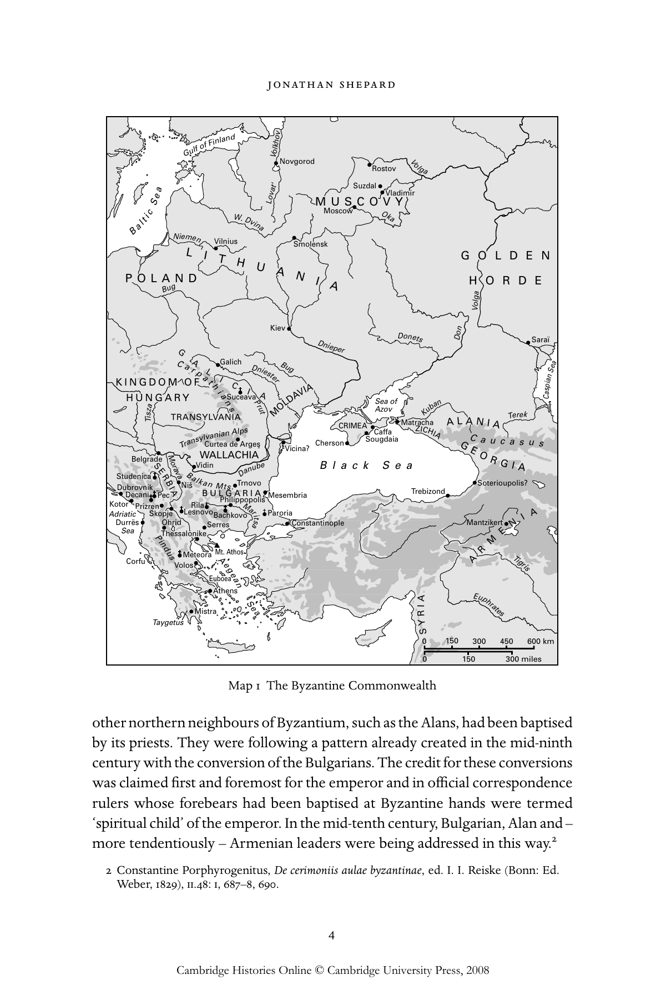
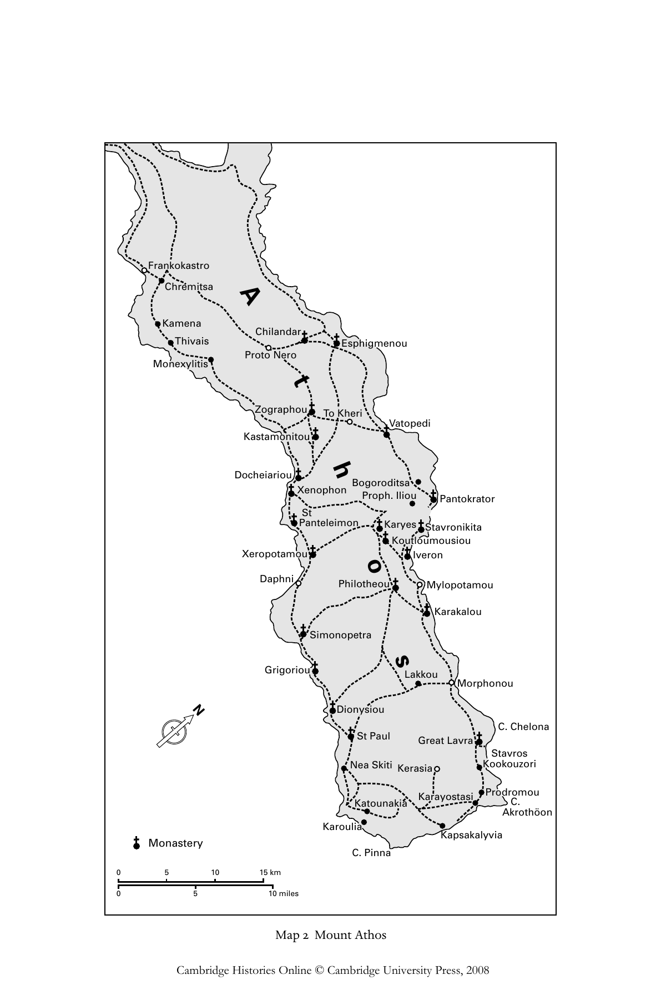

# 拜占庭共同体（1000—1550年）：英文转换底稿

<!-- PDF page 24; original page 3 -->

### 1

### The Byzantine Commonwealth

### 1000–1550

### j o nat h a n s h e pa r d

### Introduction

That the rites and remains of the east Roman Empire made an impression on most of the peoples surrounding or settled among them is hardly surprising. Constantinople was purpose-built, a landmark not even the mightiest ‘barbarian’ warlord could hope to efface. With its numerous market places, massive walls and monuments such as the Golden Gate proclaiming a New Jerusalem and Christian triumph, the ‘God-protected city’ was a showcase for displays of wealth, social cohesion and military force. These material blessings were attributed by the palace ceremonies, art and orators to the piety of the emperors and their subjects – often termed simply ‘the Christians’ in the ceremonial acclamations – and to the empire’s central role in God’s plan for mankind. Constantinople itself was under the special protection of the Mother of God. In the medieval era Mary was venerated ever more dramatically in return for safeguarding her city, wonder-working icons such as the Hodegetria being paraded regularly through the streets in her honour.

Even furthest-flung outsiders could make the connection between Byzantine prosperity, striking-power and religious devotions. From his Orkney vantage point, Arnor the Earl’s Poet viewed God as ‘ready patron of the Greeks and Garð-folk’.[^p024-1] These ‘Garð-folk’ – Rus – had collectively come under the care of the patriarch of Constantinople, when in or around 988 their ruler, Vladimir, received a Byzantine religious mission and was himself baptised. A prime reason for Vladimir’s choice of the Orthodox form of Christianity was probably the divine ‘patronage’ – in terms of material wealth and social order – which their religion seemed to have secured. Vladimir flagged his personal associations with the senior emperor, by adopting his Christian name, Basil, and by marrying his sister, Anna. By around 1000 the ruling houses of several

[^p024-1]: Þorfinnz-drápa, in Corpus poeticum boreale, ed. and trans. G. Vigfusson and F. York Powell, ii (Oxford: Clarendon Press, 1883), 197.

<!-- PDF page 25; original page 4 -->

other northern neighbours of Byzantium, such as the Alans, had been baptised by its priests. They were following a pattern already created in the mid-ninth century with the conversion of the Bulgarians. The credit for these conversions was claimed first and foremost for the emperor and in official correspondence rulers whose forebears had been baptised at Byzantine hands were termed ‘spiritual child’ of the emperor. In the mid-tenth century, Bulgarian, Alan and – more tendentiously – Armenian leaders were being addressed in this way.[^p025-2]

[^p025-2]: Constantine Porphyrogenitus, De cerimoniis aulae byzantinae, ed. I. I. Reiske (Bonn: Ed. Weber, 1829), ii.48: i, 687–8, 690.

<!-- PDF page 26; original page 5 -->

The enamel plaques most probably sent by Michael VII Doukas (1071–78) to the Hungarian ruler Géza make a clear visual statement of the Byzantine version of the correct order of things: Michael and his son are portrayed with nimbuses round their heads; Géza’s garb is plainer and he lacks a nimbus. But he wears a crown of sorts, and the object which the plaques adorned was probably itself a crown, perhaps designed for Géza’s noble Byzantine-born bride and sent to her in the mid-1070s. Bride, crown and enamelled portraits jointly declared Géza’s place among established leaders, and the Greek inscription beside Géza calls him king (κράλης).[^p026-3] Such marks of imperial favour also suggested the patronage, which Géza might now be able to dispense to deserving magnates of his own.

These enamels offer a snapshot of Byzantine diplomacy at work. It seems that enamels were only used on crowns designed for external potentates, standing reminders of the superlative craftsmanship of the Byzantines. Yet the fate of Michael Doukas’s gift to Géza demonstrates the diversity of uses to which potentates put their associations with the basileus: before long, the enamels were forming the lower part of what became known as ‘the crown of St Stephen’. What had been intended by Michael as a demonstration of hegemony ended up as the quintessential symbol of an autonomous Hungarian realm. For many potentates, receipt of titles, gifts and emblems from the emperor was compatible with aspirations to control their own dominions; more confident regimes would adapt, if not mimic, symbols, which the basileus considered his sole prerogative. Through acts of appropriation and overt references to the imperial court, such potentates were primarily concerned to consolidate their rule over heterogeneous, often inchoate populations. Such unmistakable marks of authority could help transcend local differences and rivalries, providing a visual vocabulary of power that all subjects could understand.

Like Géza, most early medieval potentates sought to demonstrate their right to the throne, whether it was inherited, usurped or still being fashioned. They sought respect, if not obedience, from their kinsmen and other figures of substance in the region, and from those living within their nominal dominions and beyond. The bestowing of offices and concomitant determination of status tended to be viewed as a measure of a ruler’s authority. Here, too, Byzantium had much to offer. The notion of the emperor as God’s viceroy on earth and

[^p026-3]: The doubts of J. Deér as to whether the plaques originally decorated a crown, rather than some other diplomatic gift, are well put, but do not rule out the a priori likelihood that a crown was the enamels’ original holder: J. Deér, Die heilige Krone Ungarns (ÖAW: Philosoph.-hist. Klasse, Denkschriften 91) (Vienna: Böhlau, 1966), 72–80.

<!-- PDF page 27; original page 6 -->

answerable to Him alone flourished, for all the efforts of Byzantine churchmen and monks to qualify it by means of canon law, ritual and denunciations. A commanding role in religious affairs as well as earthly ones appealed to many external potentates, especially those impatient with their senior churchmen. Byzantium offered a working model, dignified yet also efficient, to would-be monarchs without close cultural affinities or traditions of allegiance towards the empire. Some drew unilaterally on Byzantium’s stock of visual symbols, seeking neither their bestowal from the emperor nor to efface the old imperial centre. They aimed, rather, at overawing and outshining powerful interest groups in their own realm through borrowed ways of presenting their rule as God-given. For example, Queen Tamara of Georgia reshuffled motifs of Byzantine imagery of monarchy to bolster her unprecedented position as a woman ruling in her own right. Byzantine-derived imagery had long been the means of expressing Georgian kingly power. Tamara modified it in various ways to represent her piety and legitimacy in church portraits of herself, while also highlighting specifically Georgian themes and figures worthy of veneration.[^p027-4]

Dimitri Obolensky believed that such borrowings from Byzantium’s political culture, religious rites and visual media formed a pattern. In his magisterial work The Byzantine Commonwealth, he envisaged constellations of potentates and their subjects acknowledging imperial hegemony – whole societies as well as elites. They were, he maintained, joined together in Orthodox faith, in regard for the laws, which church and emperor jointly upheld, and in respect for the emperor. The centre of their Christian universe was Constantinople, for most of these units had initially received Byzantine missions and came under the patriarch’s authority. Obolensky postulated that these peripheral rulers usually accepted the emperor’s overlordship of all Orthodox Christians as much from pragmatic desire to unify their own realms as from idealistic devotion to the basileus.[^p027-5]

Obolensky recognised that motives were mixed: self-interest could impel Orthodox rulers into hostilities against the emperor, and the commonwealth’s composition varied over time. He regarded the adherence to Byzantine normative values of most of eastern Europe’s Slavonic-speaking regimes at one

[^p027-4]: A. Eastmond, Royal imagery in medieval Georgia (University Park: Pennsylvania State University Press, 1998), 39, 94, 149–53, 119–23, 181–4; Eastmond, ‘“Local” saints, art, and regional identity in the Orthodox world after the fourth crusade’, Sp 78 (2003), 717–24.

[^p027-5]: D. Obolensky, The Byzantine Commonwealth: eastern Europe 500–1453 (London: Weidenfeld and Nicolson, 1971), 2–3, 203, 206–8, 272–7, 289–90; Obolensky, ‘Nationalism in eastern Europe in the middle ages’, Transactions of the Royal Historical Society, ser. v, 22 (1972), 11–12.

<!-- PDF page 28; original page 7 -->

time or another as amounting to membership of an institution, for all their mutability and multiple cultural affinities. Obolensky’s theory incurred criticism from some reviewers, who highlighted the difference in circumstances between polities located on the edge of the territorial empire and others further afield. They also questioned why cognate cultures in southern Italy and Caucasia did not qualify for consideration and suggested that the commonwealth was no more than a culturo-religious sphere, lacking any institutional basis or political connotations.[^p028-6] In the case of Rus, avowals of allegiance to the tsar, or awareness of Byzantium’s claim to be Rome’s heir, are singularly sparse.[^p028-7] The texts ultimately of Greek origin circulating in pre-Mongol Rus were mostly of religious content, and many had been translated or refashioned among the South Slavs. Several had been translated in the early tenth century at the Bulgarian court, with the aim of furnishing its rulers with guidelines for Orthodox Christian governance. In the process they helped to create a kind of textual community for Slavonic-readers.[^p028-8] One might conclude from the study of such texts alone that the Byzantine imperial order provided these rulers with little more than an assembly kit, from which to take what they pleased and set up structures to suit their own preconceptions.

Yet for all the local variations between societies owing their Christianity mainly to Byzantium, certain themes and motifs in their political culture recur. Leaders aspiring to create their own nodes of material patronage, sacral largesse and orderly governance took as a model the offices and honours which Byzantine emperors could confer and retract. This is clearest with thirteenthand fourteenth-century Bulgarian rulers: most of the names of their senior officials and dignities were translations, or slavicised forms, of Byzantine ones. Serbian leaders, too, borrowed heavily from Byzantine terminology to create court hierarchy. Offices bestowed in sacral settings and determining rank

[^p028-6]: A. Kazhdan in Vizantiiskii Vremennik 35 (1973), 261–2; G. G. Litavrin in Voprosy Istorii no. 5 (1972), 180–5; R. Browning in English Historical Review 87 (1972), 812–15.

[^p028-7]: S. Franklin, ‘The empire of the Rhomaioi as viewed from Kievan Russia: aspects of Byzantino-Russian cultural relations’, B 53 (1983), 507–37.

[^p028-8]: The issue of which texts were translated by whom, and when, is highly controversial: see F. J. Thomson, ‘The Bulgarian contribution of the reception of Byzantine culture in Kievan Rus’: the myths and the enigma’, Harvard Ukrainian Studies 12–13 (1988–89), 239–43; A. A. Turilov and B. N. Floria, ‘Khristianskaia literatura u slavian v seredine X-seredine XI v. i mezhslavianskie kul’turnye sviazi’, in Khristianstvo v stranakh vostochnoi, iugo-vostochnoi i tsentral’noi Evropy na poroge vtorogo tysiacheletiia, ed. B. N. Floria (Moscow: Jazyki slavianskoi kul’tury, 2002), 431–3; S. Franklin, Writing, society and culture in early Rus, c. 950–1300 (Cambridge: Cambridge University Press, 2002), 101–3, 136–45; A. Nikolov, ‘Tsariat bogopodrazhatel. Edin prenebregnat aspekt ot politicheskata kontseptsiia na Simeon I’, Annuaire de l’Université de Sofia ‘St Kliment Ohridski’. Centre de Recherches Slavo-Byzantines ‘Ivan Dujčev’ 91.10 (2002), 113–17.

<!-- PDF page 29; original page 8 -->

appealed to dispenser and recipient alike and texts of Byzantine ceremonies for conferring on individuals such titles as patrikios were translated into Slavic. Judging by the quantity of manuscripts found, they seem to have formed the basis for South Slav court practice. There was local adaptation, however: kouropalates and patrikios were rendered by the more general kniaz (‘prince’ or ‘notable’).[^p029-9] Such allusions to the palace on the Bosporus did not occur in an intellectual vacuum. Stefan Dušan’s law-code of 1349 drew heavily on the treatise synthesising secular and church law that Matthew Blastares had composed in Thessalonike some years earlier. Dušan’s law-code also adapted novels of fairly recent basileis, such as Manuel I Komnenos, as well as The Farmer’s Law in shortened form. The ‘charter’ accompanying his code avowed his ‘desire to enact certain virtues and truest laws of the Orthodox faith to be adhered to’, thus subsuming civil regulation within faith. This scheme of imperial order was supposed to apply to Dušan’s Slav and more or less recently acquired Greek subjects alike. The code was intended for practical use: an updated version incorporating Dušan’s recent edicts was promulgated in 1354. The divinely inspired nature of the ruler’s law making and enforcement was simultaneously propounded through visual media. For example, a prominent theme of the wall paintings in Dušan’s church at Lesnovo is the ‘holy wisdom’ that enlightens the ruler, mystically informing his guidance of his people.[^p029-10] Such depictions of Byzantine imperial attributes dovetail with the predilection of Dušan and his predecessors for terms of rank redolent of the imperial court. The distinction between functional and honorific title was not clear-cut, and bestowal of the more senior offices and titles by fourteenth-century Bulgarian and Serb rulers was akin to a religious ordination, as in Byzantium itself.

Neither Byzantine secular law-codes nor the concept of office transforming an individual’s status counted for very much among the Rus, for all Prince Semen of Moscow’s flattering avowal in 1347 that the empire was ‘the fount of all piety and the teacher of law-giving and sanctification’.[^p029-11]  Yet the Byzantine imperial order, however hazily conceived among the Rus, held out a comprehensive ‘package’ of concepts, rites and authority-symbols, sealed with the church’s blessing. And eventually their leaders took advantage of it. Ivan III of Muscovy had particular reason for making his power-centre redolent of the

[^p029-9]: I. Biliarsky, ‘Le rite du couronnement des tsars dans les pays slaves et promotion d’autres axiai’, OCP 59 (1993), 94–7, 106–9 (text), 120–2 (trans.); Biliarsky, ‘Some observations on the administrative terminology of the second Bulgarian empire (13th–14th centuries)’, BMGS 25 (2001), 79–80, 83.

[^p029-10]: Z. Gavrilović, ‘Divine wisdom as part of Byzantine imperial ideology’, in Studies in Byzantine and Serbian medieval art (London: Pindar, 2001), 51–3.

[^p029-11]: RPK ii, no. 168, 478–9.

<!-- PDF page 30; original page 9 -->

ancient imperial court, a generation or so after Constantinople fell to the Turks. His build-up of earthly power coincided with eschatological expectations no less intense for being variegated: to churchmen such as Ivan’s metropolitan, Zosima, the fall of New Rome in 1453 might herald the present world’s end but also God’s glorification of ‘the new emperor Constantine for the new city of Constantine, Moscow, the sovereign of the whole Rus land and many other lands’.[^p030-12]  Ivan adopted some of the trappings and ritual of the Byzantine court, laying out the Kremlin as the exemplary centre of newly gathered lands and a new society, poised between this world and the next.[^p030-13]  The ruler as guardian of souls could be of practical help to whoever believed that a God-willed new age was at hand. What might seem narrowly religious concerns coloured general expectations of a prince’s worth, which Ivan built on – in bricks and mortar, and with symbols of Jerusalem such as the liturgical arks donated to one of the Kremlin’s churches.[^p030-14]  The sense of being a New Israel was more clearly articulated and fervently believed among the late fifteenthand sixteenth-century Rus elite than that of being the New Rome. Yet it was the imperial city on the Bosporus that provided the most recent model of, and familiar pathway towards, the New Jerusalem.

This was not simply a matter of evoking a vanished empire. Ivan’s political ambitions gained definition from beliefs about the future that emanated from Orthodox thinking. And, for all their diversity, the eschatological theories took for granted that Byzantium was God’s most favoured kingdom on earth: any other Orthodox ruler could only hope to succeed in his own domain by God’s will, observing the codes of conduct set out by pious tsars. The ruler’s role as overseer of the church, defender of his subjects and caretaker of their souls received fullest articulation in Rus with the coronation of Ivan IV as emperor in 1547. Ivan and his counsellors expressly invoked historical associations with Byzantium. They elaborated upon the tale of the ‘crown’ sent to one of Ivan’s distant forebears by Constantine IX Monomachos and adapted Byzantine rites and texts for the coronation ceremony itself. On murals of the Kremlin’s Golden Hall were depicted scenes from the history of Israel and Rus (the New Israel); the God-given quality of the ruler’s power was a prominent theme, his ‘divine wisdom’ being highlighted in the manner of Dušan’s at Lesnovo.[^p030-15]  The

[^p030-12]: ‘Mitropolita Zosimy izveshchenie’, RIB vi, cols. 798–9.

[^p030-13]: M. S. Flier, ‘Till the end of time. The apocalypse in Russian historical experience before 1500’, in Orthodox Russia: belief and practice under the tsars, ed. V. A. Kivelson and R. H. Greene (University Park: Pennsylvania State University Press, 2003), 135–6.

[^p030-14]: Ibid., 156–8.

[^p030-15]: D. Rowland, ‘Two cultures, one throne room. Secular courtiers and orthodox culture in the Golden Hall of the Moscow Kremlin’, in Orthodox Russia, 41–3, 47–51, 54–5.

<!-- PDF page 31; original page 10 -->

symbolism may have been interpreted with varying degrees of subtlety by the courtiers and churchmen who viewed these pictures, but their message was inescapable.

Recourse to Byzantine ideology for this purpose was, in a sense, faute de mieux, in default of alternative formulations of imperial dominance consistent with Orthodox doctrine. For justification and demonstration of Moscow’s preeminent power and piety, the churchmen appropriated Byzantine ideas and motifs about the imperial centre and made express allusions to the old hub of Christian leadership. The sense that Moscow was actually superseding it was conveyed by dubbing the city the ‘Third Rome’, in succession to the ‘Second Rome’ on the Bosporus. Describing a new centre of political and religious authority as a ‘new Rome’, a ‘new Tsargrad’, had long been a claim made for polities aspiring to create their own self-sufficient centres, especially if adjoining Byzantine territory. From the later thirteenth century, Bulgarian writers were hailing Veliko T’rnovo as a ‘new Tsargrad’. More striking is the delay in elaborating upon this claim for Moscow, after somewhat halting experimentation with the epithet in the late fifteenth century. In couching claims for a new centre within the conceptual framework of the old, claiming for their own prince the divine sanction long attributed to the basileus in Tsargrad, Muscovite writers could not casually flout his longstanding pre-eminence. They were, for the most part, churchmen themselves and therefore belonged to an organisation whose headquarters remained in his city. There were additional reasons for Moscow’s self-restraint from overtly imperial posturing. Tatar khans of the Great Horde, who were, as descendants of Genghis Khan, termed tsars, still collected tribute from north-east Rus until the late fifteenth century and Muscovite princes remained vulnerable to the Crimean Tatars and other Tatar groupings, to whom they paid heavy tribute throughout the sixteenth century.

But a standing caveat to the aspirations of Rus and other rulers was the ecumenical patriarchate’s commitment to the idea that Christendom’s unity was underpinned by the persistence of a ‘Roman’ empire in Constantinople. This was given currency by, for example, images woven on the sakkos (ceremonial tunic) belonging to Photios, the Moscow-based metropolitan of Kiev and all Rus in the early fifteenth century. Prince Vasilii of Moscow and his wife are depicted facing Emperor John VIII Palaiologos and his bride, who was Vasilii’s own daughter. Emperor and Rus-born empress are haloed, unlike the prince of Moscow. The locus of holy rulership and primary authority could scarcely be made plainer.[^p031-16]  At church services conducted by his head churchman wearing

[^p031-16]: D. Obolensky, ‘Some notes concerning a Byzantine portrait of John VIII Palaeologus’, Eastern Churches Review 4 (1972), 141–6.

<!-- PDF page 32; original page 11 -->

the sakkos, Vasilii bore witness to the visual message of this gift from Constantinople. He thereby gained status vicariously: his daughter, at least, was now in the nimbus-league. Assent to union with Rome at the council of Florence in 1439 did not inflict lasting damage on the standing among the Slavs of the ecumenical patriarchate. Its reservations about alternative emperors had therefore to be taken into account by any would-be emperor of a New Rome even after Constantinople had fallen to the Turks. Hence the organisers of the coronation of Ivan IV took the precaution of seeking the patriarch’s consent, which was eventually given. Even so, at the moment of anointing, the officiating metropolitan, Makarii, pronounced a different form of words from those used in late Byzantine inauguration-rituals. Seemingly, his self-restraint registered awareness that he was no more patriarch of Constantinople than Ivan was emperor of the Romans.[^p032-17]

Byzantium was long gone as a territorial empire by the time Makarii performed the coronation in 1547, and paintings in the Golden Hall portrayed Ivan being crowned by angels. Very few other rulers within the Byzantine ambit are shown being crowned, whether by Christ or by heavenly beings. Those few were generally intent on hegemonial status comparable to that of the basileus, rather than on his uniquely ‘Roman’ title. In 1344–45, for example, the Bulgarian Ivan Alexander was depicted in a miniature being crowned by an angel before Christ: Christ is termed ‘tsar of tsars and eternal tsar’ while Ivan is ‘tsar and autocrat of all the Bulgarians and Greeks’.[^p032-18]  Such outright visual claims to sovereign authority divinely bestowed were rarer even than appropriation of an imperial title.

Such hesitations on the part of potentates suggest awareness of the special status on earth claimed by the basileus, whether or not they regarded his polity as the empire of the Romans or merely the land of the Greeks. As a working model of political order underpinned by law, the Byzantine state was of value for leaders seeking to gather the reins of power into their own hands and secure them exclusively for their offspring. With the help of God and His law the basileus presided over a hierarchy, which held out a moral for one’s own troublesome domestic rivals and subjects in general. There is much to be said for regarding Byzantium as an exemplary centre, conveying in ritualised form the norms of hegemonial leadership. Such rites provided more or less

[^p032-17]: M. Arranz, ‘L’aspect rituel de l’onction des empereurs de Constantinople et de Moscou’, in Roma, Costantinopoli, Mosca [Da Roma alla terza Roma, documenti e studi 1] (Naples: Edizioni scientifiche italiane, 1983), 414–15.

[^p032-18]: C. Walter, ‘The iconographical sources for the coronation of Milutin and Simonida at Gračanica’, in Vizantijska umetnost početkom XIV veka, ed. S. Petković (Belgrade: Filozofski fakultet – Odeljenje za istoriju umetnosti, 1978), 199 and plate 16a.

<!-- PDF page 33; original page 12 -->

universally recognisable symbols of authority together with clear intimations of a heaven-sent mandate to rule and they were of practical use as building blocks in the establishment of new structures of hegemony. In so far as a ruler was expressly invoking the Byzantine brand of political culture, he was likely to show at least a measure of deference to its original and principal exponent. The alternative, of seeking to eclipse or to take over the template of Christian authority, was scarcely an option worth considering before 1453.

This rationale can be set out in more or less conventional terms, of selfinterest and the profit-and-loss accruing to individual dynasts and would-be monarchs among peoples whose elites, at least, were conscious of the Byzantine Empire. And it is plausible for the period when Byzantium enjoyed overwhelming material wealth and power. However, as Obolensky noted, the heyday of the commonwealth came after Byzantium’s politico-military decline and its religion’s consequent loss of the aura of success. The work of social anthropologists, such as Mary Helms, on ‘superordinate’ centres helps to explain this apparent paradox. These are centres, much like the Byzantine capital, which provide outlying leaders and their peoples with the goods, rites and symbols with which to organise and define themselves. They hold out a template to which individuals, political elites or whole communities aspire.[^p033-19] A ‘superordinate’ centre is, in Helms’s formulation, ‘a geographically distant setting’ deemed to be a ‘particularly charged point or direction of cosmological contact between various dimensions of the outside. Because of this conjunction it is a place where ritual can bring the gods into contact with humans’.[^p033-20] Association with such superhuman forces sets the leaders and elites of outlying lands in positions of advantage over their subjects and all others lacking in such links, and at the same time imbues their existing privileges with further legitimacy.

For their part, those at the centre believe themselves ‘charged with the moral obligation to repeat or continue the task of manifesting moral legitimacy and ideological centrality in the face of the non-moral or the less moral on this earth’. These claims to moral superiority over the ‘barbarians’ take material form in the well-crafted or rare objects, which they bestow on them.[^p033-21] It is this ability, rather than just brute force, which ensures a ‘superordinate’ centre’s continuing prestige and goes a long way towards explaining the Byzantine paradox. Long after 1204 Byzantium’s imperial-ecclesiastical complex

[^p033-19]: M. W. Helms, Craft and the kingly ideal: art, trade and power (Austin: University of Texas Press, 1993).

[^p033-20]: Ibid., 194.

[^p033-21]: Ibid., 180, 181.

<!-- PDF page 34; original page 13 -->

<!-- PDF page 35; original page 14 -->

continued to be well equipped to meet the ethical and conceptual as well as material and political requirements of external societies, and its propaganda fostered the idea that the imperial court ceremonial was attuned to the heavenly sphere.

### Mount Athos and Serb saints, princes and emperors

The theory of the ‘superordinate’ centre offers an explanation for the paradox that the standing of the Byzantine Empire remained high, arguably rising further, after ‘the God-protected city’ succumbed to the Fourth Crusade, losing material wealth and unbroken continuity of sovereignty, as well as sacred relics. The city kept its allure even though it never fully recovered after 1204. But there were other, more specific, reasons why beliefs that the empire was divinely ordained could accommodate such a catastrophe. In Orthodox eyes the fate of the City was intertwined with that of the empire and God’s design for mankind. The City’s fall to barbarians could herald the End of Time, but it might alternatively warn His people to mend their ways and find spiritual rebirth. Such had been the theme of preachers during barbarian assaults in earlier centuries.[^p035-22]  The collapse could therefore be interpreted as signalling God’s demand for stricter religious observance from His people. The events culminating in the crusaders’ seizure of the City seem to have been followed intently by even the most distant Orthodox. A full narrative comes from a Novgorodian chronicle. Probably composed not long afterwards, it apportions blame to the Greek tsars’ internecine strife rather than to Latin aggression.[^p035-23]  The restoration of the capital in 1261 signalled the rehabilitation of Constantinople as a locus of God-blessed authority on earth. The mystique of its rightful incumbents watching over all true-believers appealed to Orthodox rulers not only because the basileus was now more malleable and suggestible, but also because of a new-found solidarity in the face of the threat to the Orthodox faith from the Latins.

If the imperial capital provided one conduit to God’s kingdom, Byzantine monasteries offered another. The veneration and awe they generated as microcosms of the celestial order had come increasingly since the mid-tenth century to focus on the Holy Mountain of Athos. Imperial patronage ensured

[^p035-22]: P. J. Alexander, ‘The strength of empire and capital as seen through Byzantine eyes’, Sp 37 (1962), 343–7; D. M. Nicol, Church and society in the last centuries of Byzantium (Cambridge: Cambridge University Press, 1979), 98–9, 104–5.

[^p035-23]: Novgorodskaia pervaia letopis’ starshego i mladshego izvodov, ed. A. N. Nasonov (Moscow and Leningrad: Akademia nauk SSSR. Institut istorii, 1950; reprinted St Petersburg, 2000), 240–6.

<!-- PDF page 36; original page 15 -->

privileged status for its monks. Many individuals were attracted there from outside the empire, some founding religious communities. Almost from the first there were houses of Iberians (Georgians) and Amalfitans, and from the mideleventh century special ties linked Athos with the Kievan cave-monastery, whose founder, Anthony, was tonsured there before being directed back to Rus. His monastery on the Dnieper was thought to have ‘originated with the blessing of the Holy Mountain’.[^p036-24]  Xylourgou, the Rus house on Athos, was the beneficiary of an imperial chrysobull issued in 1169. It granted the abbot’s request that the governing body of Athos set aside an additional house, St Panteleimon, to accommodate the numerous and well-funded Rus monks, who were expected to restore and fortify it, to serve God and ‘pray for our most excellent holy emperor’.[^p036-25]  By the later twelfth century the hundreds of religious houses and hermits’ retreats on Athos exerted at least as great a drawing-power over outsiders as they did over the emperor’s subjects. When the seventeenyear-old son of Stefan Nemanja, the Serb ruler, heard the call, he headed for Athos. There he was tonsured and received the monastic name of Sava. A few years later in 1196 his father abdicated and joined him on the Holy Mountain, taking the monastic name of Symeon. The following June the Emperor Alexios III Angelos assigned to Symeon and Sava the monastery of Chilandar, which was to receive ‘those of the Serb people choosing the monastic way of life’ and was to be ‘self-governing and autonomous’ like the houses ‘of the Iberians and the Amalfitans... situated on this mountain’.[^p036-26]  Chilandar expressly looked to the Byzantine emperor for protection from predatory tax-officials. By ensuring that the emperor rather than the protos of Athos confirmed newly elected abbots of the monastery, it also saw the emperor as a counterweight to the protos, who exercised a wide-ranging jurisdiction over the monasteries of Athos.[^p036-27]  A kind of ‘triangulation’ emerged: non-Greek-speaking communities could secure their place on ‘the Holy Mountain’ through imperial title-deeds, even while serving as channels for their own people’s access to God, each staking its special claim to divine protection.

The gravitation towards Athos of Sava, followed by his father, occurred while Serb political relations with the empire were fraying. Gifts and titles lost something of their allure in a time of imperial indigence and military impotence. The uprising in Bulgaria led by the Asen brothers against Byzantine

[^p036-24]: PVL, 69.

[^p036-25]: Actes de Saint-Pantéléèmôn, ed. P. Lemerle et al. [AA 12] (Paris: P. Lethielleux, 1982), 83 (text); D. Nastase, ‘Les débuts de la communauté oecuménique du mont Athos’, Σύμμεικτα 6 (1985), 290–2, 294.

[^p036-26]: Actes de Chilandar, ed. M. Živojinović et al. [AA 20] (Paris: CNRS, 1998), i, 108–9 (text).

[^p036-27]: Ibid., i, 28–9.

<!-- PDF page 37; original page 16 -->

rule in 1185–86 was initially directed against excessive taxes. The heterogeneous nature of the insurgents and rivalries between the brothers were handicaps, but the notion of a revived Bulgarian polity began to coalesce around the cults of saints such as Ivan of Rila and Emperor Peter of Bulgaria, aided by texts and folklore concerning past Bulgarian power. The onset of the Fourth Crusade gave the surviving Asen brother, Kalojan, a chance to consolidate his embryonic dominions by turning to the papacy for confirmation of his rule. Together with a crown and sceptre Innocent III bestowed on Kalojan the title of king of the Bulgarians and Vlachs. The Serbs were equally opportunistic. In 1199 the Serb ruler, Sava’s brother Stefan, showed his lack of respect for the Byzantine Emperor Alexios III, repudiating the latter’s daughter Eudokia and despatching her homewards virtually naked. Stefan eventually received a crown from the legate of Pope Honorius III in 1217, referring to himself in his charters as the ‘first-crowned king’. However, these thrusts away from the Byzantine orbit were short-lived and rather superficial. This was partly due to the attachment of local populations, Greek-speaking or Slavonic-speaking, to Orthodox religious rites and imagery.

The aspirations of Serb and Bulgarian rulers to rule over heterogeneous communities scattered across mountainous terrain relied heavily on local cooperation: brute force and intimidation were of only momentary value. Association with the incontestably sacred was a means of gaining such cooperation: thus one of the first moves of the Bulgarian tsar Ivan Asen II upon defeating the ‘emperor’ of Thessalonike, Theodore Angelos, at Klokotnica in 1230 was to head for Athos and lavish gifts and privileges on the monasteries there. To the family of Stefan Nemanja, association with Athos was especially valuable, highlighting their unique status as well as the sanctity of the monasteries they founded in their own land. In 1206 or 1207 the relics of Stefan Nemanja were borne from Athos to the monastery-church of Studenica he had founded, and soon they were oozing holy oil again. The translation was the work of Sava who, although no longer resident on Athos, was still a frequent visitor. The Serb leadership’s commitment to eastern Orthodoxy was further reinforced in 1219 when Sava was ordained ‘archbishop of Peć and of all Serbia’ by the Orthodox patriarch in Nicaea, his standing being recognised by a synodal decree issued with the emperor’s authority.

In this, as in other cases, coterminous ecclesiastical organisation sharpened the territorial definition of still-embryonic polities, while also bringing legitimisation. Sava performed the coronation of Radoslav, the eldest son (by Eudokia) and successor of Stefan ‘the first-crowned’. Subsequently, in 1233/4, Sava crowned Radoslav’s brother, the usurper Vladislav. Without being

<!-- PDF page 38; original page 17 -->

precisely formulated, the close involvement of Stefan Nemanja and his descendants with the Holy Mountain was of inestimable value in establishing the dynasty. Sava embedded their piety in his Life of his father, in his translation of the Nomokanon, and in the monastic rulebook (Typikon), which he composed for Chilandar.[^p038-28]  His work went far towards turning these Serb chieftains not merely into a dynasty, but into a holy family, incomparable in sacred order and law. Through harping on parallels with scriptural figures, literary apologists for the dynasty sought to bring definition and a sense of common purpose to disparate subject-populations, by presenting them as a New Israel with a mission from God. This, in turn, reinforced the dynasty’s title to legitimate self-determination. At the same time the ruling house’s self-identification with Mount Athos and its patronage of the Serbs’ sacral rallying-point on ‘the Holy Mountain’ wove ties, gossamer-thin yet durable, with the Roman emperors once the latter returned to Constantinople: the basileus’s protection and fiscal privileges remained of inestimable value to the monks of Chilandar, as to other Athonite houses.

It was against this background that Stefan Uroš II Milutin (1282–1321) looked to Athos as well as to the patronage of monasteries and churches within the dominions he inherited or acquired. After overrunning Byzantine territories as far south as Prilep and Ohrid and then capturing Durrës (Dyrrakhion), Milutin came to terms, wedding Simonis, the infant daughter of Andronikos II, in 1299. This marked a turning back towards Byzantium and away from the west, which had provided the most lucrative markets for the production of Serbia’s silvermines. Western influence was all too clear in the Romanesque and early Gothic, which had hitherto predominated in Serb church architecture. Milutin now sought to set in stone his hegemony over newly conquered subjects, truculent Serb nobles, and his own disgruntled elder brother and nephew, but he chose to call on the services, not of Latins, but of the most proficient Byzantinetrained architects and craftsmen. Their skills shine out not only from the mausoleums and show-churches built at his expense within his dominions, but also from Chilandar and from monuments in Constantinople, Thessalonike and Jerusalem. These extensive building-projects were recorded among other feats of this new Constantine by his biographer, Danilo.[^p038-29]  Milutin also made substantial gifts of lands to the monastery of Chilandar, which served as a

[^p038-28]: V. Ćorović, Spisi sv. Save, in Zbornik za Istoriju, Jezik i Kniževnost Srpskog Naroda 17 (1928), 5–13.

[^p038-29]: Danilo II, Žitije kralja Milutina, in Archbishop Danilo et al., Životi kraljeva arhiepiskopa srpskih, ed. D. Daničić (Zagreb: US. Galca, 1866), 148–51.

<!-- PDF page 39; original page 18 -->

kind of seminary for senior churchmen in Serbia.[^p039-30]  He took care to have these grants confirmed by imperial chrysobulls. On occasion, Andronikos II showed and sought goodwill through his own gifts and privileges. For example, in 1313 to mark the victory of a joint Byzantine–Serbian force over a marauding band of Turks Andronikos provided Milutin, ‘my dearest son and son-in-law’, with a village with tax-exempt lands on the Strymon, so that he could donate it to Chilandar.[^p039-31]  Milutin also obtained imperial chrysobulls to confirm the title of monastic possessions within his dominions, for example for the house of St Niketas near Skopje.[^p039-32]

Byzantium offered Milutin the richest arsenal for devising a political culture consonant with his aspirations. Direct association with the basileus and evocations of his court ceremonial served to legitimise Milutin’s gains and to consolidate his monarchical regime. The donor-portrait in Milutin’s monasterychurch and putative mausoleum at Gračanica shows two angels presenting him and his wife with royal crowns, crowning them on behalf of Christ.[^p039-33]  Milutin’s court decked out with gold and silken trappings was like a stage set, striving for ‘imperial and, so far as was possible, even Roman excellence’, in the words of a visiting Byzantine ambassador.[^p039-34]  If he went further than his predecessors in portraying himself and his wife as God-crowned, his audacity owed much to the fact that Simonis was the emperor’s daughter, possessing divinely conferred authority in her own right: reportedly, he had dismounted before receiving her ‘as a sovereign, not a wife’.[^p039-35]  He received from the Byzantine empress a crown almost as splendid as the emperor’s own.[^p039-36]  In return for his displays of deference Milutin acquired plausibly quasi-imperial attributes, setting him head and shoulders above his malcontent brother and other members of his family. Not that ancestors were disregarded: near Milutin’s donor-portrait in Gračanica, a wall painting depicts his descent from Stefan Nemanja by means of a variant on the Tree of Jesse.

Like his grandfather Milutin, Stefan Dušan was willing to war with the empire when opportunities presented themselves. Exploiting the minority of John V Palaiologos he seized the lands of south-east Macedonia and extended

[^p039-30]: Danilo was its abbot before eventually becoming, in 1324, archbishop of Serbia.

[^p039-31]: Chilandar, i, 45, 205–8 (text).

[^p039-32]: Ibid., i, 43, 69–70, 174–5 (text).

[^p039-33]: Walter, ‘Iconographical sources’, 183–5, 199–200 and fig. 1.

[^p039-34]: Theodore Metochites, Πρεσβευτικός, in K. N. Sathas, Μεσαιωνικὴ Βιβλιοθήκη (Venice: Chronos, 1872), i, 173.

[^p039-35]: George Pachymeres, Relations historiques, ed. and trans. A. Failler [CFHB 24/4], iv (Paris: Institut français d’études byzantines, 1999), x.4; 314–15.

[^p039-36]: Nikephoros Gregoras, Byzantina historia, ed. L. Schopen and I. Bekker (Bonn: Ed. Weber, 1829), vii.5: 1,242.

<!-- PDF page 40; original page 19 -->

his dominions as far as the Strymon and the Chalkidike peninsula. Upon capturing the key town of Serres in September 1345, Stefan was proclaimed emperor and, by the time the newly proclaimed Patriarch Joanikij (formerly archbishop of Peć) crowned him emperor at Skopje on 16 April 1346, he was signalling his territorial acquisitions at Byzantium’s expense: in an Athonite charter of January 1346 Stefan styled himself ‘emperor and autocrat of Serbia and Romania’, thereby alluding to the ‘Greek lands’ now under his control.[^p040-37] In stark contrast to the regimes in Constantinople, Stefan could offer effective protection and order. According to Nikephoros Gregoras, Stefan ‘exchanged the barbarian way for the manners of the Romans’, wore a crown and robes befitting a Roman emperor, and reserved newly conquered regions ‘for himself to rule according to the Romans’ custom’.[^p040-38]

In keeping with this, Stefan had himself portrayed as receiving, together with his wife and son, crowns directly from Christ. The same wall painting, at Lesnovo, declares his enlightenment by virtue of divine wisdom. In general, Stefan outshone his predecessors in the sophistication with which he harnessed Byzantine iconographical programmes and ideology to his regime’s needs. Even so, he appears to have baulked at assailing Constantinople’s walls. In so far as Stefan aspired to power in the City, it was through dynastic links: in 1343 he betrothed his infant son-and-heir to the daughter of the late Emperor Andronikos III. He also forbore from styling himself ‘emperor of the Romans’ in his chrysobulls for Athonite houses, even though their prefaces emphasise that the church and monasteries featured among imperial concerns – in accordance with the basileus’s own conventions.

There were several reasons for Stefan’s forbearance. He had spent some of his formative years in Constantinople. The emphatic regard he showed for Christian law and church order owed something to his observation of their benefits in a Byzantine setting. Besides, repulse from Constantinople’s formidable walls would only confirm that the City was still ‘God-protected’ against ‘the nations’, the Serbs included. There was another constraint: the primacy accorded to the ‘emperor of the Romans’ by the monasteries of Athos. Stefan showed personal devotion to the ways of the monks and belief in the mountain’s protective force. Partly to escape the Black Death, he stayed there for eight months in 1347–48 together with his wife and son, visiting several monasteries and venerating their shrines. He restored to many houses properties on the mainland lost during the Byzantine civil wars and made

[^p040-37]: Actes d’Iviron, iv, De 1328 au début du XVIe siècle, ed. J. Lefort et al. [AA 19] (Paris: P. Lethielleux, 1995), 114; 116 (text).

[^p040-38]: Nikephoros Gregoras, ii, xv.1: 11,747.

<!-- PDF page 41; original page 20 -->

generous gifts of lands and tax-revenues. For example, he commended himself to the monks of the Rus house of St Panteleimon, hoping their prayers might render Christ merciful for his actions. The monastery of the Iberians – now occupied mostly by Greeks – likewise received land grants and tax-exemptions, as did the houses of Docheiariou and Esphigmenou. Stefan’s moves were politic as well as spiritually salutary, but obtaining the monks’ prayers came at a price. In 1345 they notified him that despite his generosity they would be praying first for ‘the emperor of the Romans’ and only then for his ‘kingliness’ (κραλοτῆς), a stipulation fraught with connotations of the basileus’s superior legitimacy as well as precedence.[^p041-39]  The prayers or maledictions of Athonite monks were not for Stefan Dušan to decide. General acknowledgement of the basileus’s age-old legitimacy was such that in 1351 Stefan even sought confirmation by John V for the charter that he himself had issued for the house of Chilandar.[^p041-40]  This, in turn, virtually ruled out a hostile bid by Stefan for the throne of John V, an incontestably legitimate emperor of the Romans. Similar constraints weighed with Milutin, who had refrained from styling himself tsar, save on some of his seals.

The Serb rulers stood out from other Orthodox rulers in extending their dominion to Athos: they maintained their overlordship of the mountain for sixteen years after Stefan’s death in 1355. But a sacred enclave on the mountain was sought by several other aspiring rulers, Greek-speaking basileis among them, perhaps goaded by Stefan’s example. In 1374 the emperor of Trebizond, Alexios III, explained his support for the monastery of Dionysiou thus: ‘all emperors, kings or rulers of some fame have built monasteries on the Holy Mountain for their eternal memory’. Alexios was therefore adding ‘a new foundation in order to survive eternally in the memory of the people’.[^p041-41]  The princes of Wallachia were no less zealous patrons. The earthly respect and eternal blessings, which the monks’ prayers and devotion to the mountain’s shrines could earn, spoke to them all.

Such zeal may be dismissed as just another example of how Byzantium’s imperial and religious symbols were used as building-materials by external figures for their own political structures. Dušan had to take account of Athonite reverence for the ‘emperor of the Romans’ in Constantinople, but his practical

[^p041-39]: Grčke povelje srpskih vladara, ed. A. Solovjev and V. A. Mošin (Belgrade: Srpska kraljevska akademija, 1936; reprinted London: Variorum, 1974), 32–3.

[^p041-40]: Obolensky, Byzantine Commonwealth, 256; D. Korać, ‘Sveta Gora pod srpskom vlašću (1345–1371)’, Zbornik Radova Vizantiloškog Instituta 31 (1992), 84–6, 108–11.

[^p041-41]: Actes de Dionysiou, ed. N. Oikonomides et al. [AA 4] (Paris: P. Lethielleux, 1968), 60 (text).

<!-- PDF page 42; original page 21 -->

support for the emperor of the day was clearly determined by self-interest. Besides, the monks of Athos, constantly squabbling over properties and matters of discipline, were far from a united bloc and relatively few saw themselves as cheerleaders for individual emperors. None the less many senior monks and leading holy men on the mountain had strong personal ties with the patriarchate of Constantinople, which assumed formal responsibility for the Holy Mountain in 1312, even if the monasteries continued to look to the emperor as supreme legal authority. Three notable patriarchs of the fourteenth century had spent time on the mountain, Niphon (1310–14), Kallistos (1350–53; 1355–63) and Philotheos Kokkinos (1353–54; 1364–76); so, too, had Isidore I Boucheiras (1347–50). Bitter, heavily documented disputes over religious discipline and hesychasm sometimes divided Athonite monks from the hierarchy in Constantinople, but in an era of spiritual exploration and the high expectations invested in a life of prayer, discord between driven holy men and the ecclesiastical and monastic establishments was more or less inevitable. In fact, the disputatious character of fourteenth-century monasticism made the notion of an overarching custodian of the fundamentals of doctrine and hierarchy all the more desirable to those vested with formal ecclesiastical or monastic authority. This combined with the predisposition of leading Athonites to venerate the ‘holy emperor of the Romans’ above all others, regarding him as the prime legal guarantor of their estates’ tax-exemptions and other privileges.

### The arc of Orthodoxy

The Constantinopolitan patriarchs had reasons of their own for insisting on respect for the imperial majesty, now that they played a unique part in the inauguration ritual of emperors. They made themselves indispensable in the early thirteenth century once they began anointing the emperor with chrism, thus providing sacramental confirmation of his fitness to rule with God’s grace. By the mid-thirteenth century the patriarch was being described as the spiritual image of Christ and source of the emperor’s authority, redoubling claims already made by Photios in the ninth century. The mystique of high ecclesiastical office gained iconographic expression in the fourteenth century, when wall paintings in the Balkans began to depict Christ wearing a patriarchal sakkos in liturgical scenes.

In part, this was a reflection of the retreat of effective imperial authority, a consequence of the loss of Constantinople to the Latins in 1204. It was the Patriarch Germanos II (1223–40) who had to confront the new situation. He

<!-- PDF page 43; original page 22 -->

was repeatedly called upon to intervene and arbitrate between prelates and their flocks in areas lacking imperial governance, for example Latin-dominated Cyprus or Melitene, long under Turkish rule. He found that such recognition of him as arbiter of church discipline and law was of value in dealings with the papacy, as a counterbalance to papal claims to universality. A letter of Germanos addressed to the curia’s cardinals in 1232 lists all those peoples who in obedience to their Byzantine mother-church have stayed firm in their Orthodoxy. They range from the Ethiopians and ‘all the Syrians’ to the Georgians (‘Iberians’), Alans, ‘the numberless people of the Rus’ and the victorious realm of the Bulgarians.[^p043-42]  That this was more than a rhetorical declaration is evident from Germanos’ role in 1228, when called on to determine the jurisdiction of Rus bishops in relation to their princes.[^p043-43]

After the restoration in 1261 of the ecumenical patriarchate to Constantinople the pressure on the patriarch to provide guidance to Orthodox communities mounted still further. A happy accident has preserved the patriarchal register for the period from 1315 to the beginning of the fifteenth century. It provides a wealth of detail in comparison with what survives from earlier: copies of letters were quite carefully kept, while the proceedings and judgements recorded display competence in church law and regard for all interested parties. The patriarchate needed to put on record the ways in which it was vindicating its pre-eminence over other Orthodox churches: reorganising sees to take account of new circumstances; answering enquiries from external potentates and churchmen; adjudging disputes; and at least attempting to lay down the law. The patriarchs could, in the process, hope to inspire greater respect from the Greek-speaking congregations and secular authorities on their own doorstep, and this was not the least incentive for them.

A few examples may illustrate the manifold ways in which thirteenthand fourteenth-century patriarchs of the New Rome provided pastoral care for Orthodox churches and communities. Many sees were instituted, raised in status or merged. While our evidence is seldom specific, the patriarchate seems to have been adapting to new circumstances with alacrity. For the creation of metropolitan sees and transfers of churchmen from one see to another, the emperor’s authority was needed. Significantly, a tract dedicated to the subject of transfers underwent two revisions and updates around the turn of the thirteenth and fourteenth centuries, while Andronikos II is said to

[^p043-42]: A. L. Tăutu, Acta Honorii III (1216–1227) et Gregorii IX (1227–1241) (Rome, 1950), 251–2; Reg. no. 1257.

[^p043-43]: Reg. no. 1247.

<!-- PDF page 44; original page 23 -->

have commissioned a work listing the current ranking-order of sees side by side with a traditional version.[^p044-44]

One example of the speed with which the ecclesiastical authorities reacted to the unexpected is the see instituted at the headquarters of the Golden Horde on the Lower Volga. The see of Saraï, named after the encampment that sprang up there, received in 1261 a certain Mitrofan, seemingly its first incumbent. Although Mitrofan himself was apparently Rus-born, appointed by the Rus metropolitan, his immediate successors were Greek-speakers and in close touch with Constantinople. In 1276, for example, Bishop Theognostos attended a meeting of the patriarchal synod and posed questions of canon law and Christian discipline. The synod’s answers deal with such questions as what the bishop should do if he wished to celebrate mass and only had priests to hand, rather than (more appropriately) deacons. The responses made allowances for the steppe world in which the bishop was officiating. Masses could be celebrated without deacons, if none were available; consecrated bread could be transported around and former sacred vessels could be restored and reused. However, a priest who had fought in battle must be dismissed from office if he had killed anyone. And the prelates of neighbouring sees were not to visit Saraï and claim the right to look after members of their congregations there,[^p044-45]  which suggests a predisposition of Orthodox churchmen to frequent the new power centre. Theognostos and his successors served as intermediaries between the khans and the Constantinopolitan authorities, while also brokering the frequent visits of the metropolitans and princes of Rus to the khan’s court. In fostering this Christian out-station, the patriarchs of Constantinople acted in close liaison with the emperors, who generally sought amicable relations with the leaders of the Golden Horde, as pillars of stability on their northern approaches and allies against the Turks in Asia Minor. Illegitimate daughters of all three of the first Palaiologan emperors were married to khans, maintaining themselves at Saraï with sizeable entourages. Thus dynastic ties enlivened the Byzantine ecclesiastical presence on the Lower Volga from the turn of the thirteenth century, an example of the way the imperial–ecclesiastical complex extended its reach across the pax mongolica in competition with the Latin church.

The patriarchal registers also deal with issues of church order in the eastern Black Sea region. Alania is the subject of several entries. Its metropolitan

[^p044-44]: RPK ii, no. 138, 300–1; Reg. no. 2235; Notitiae episcopatuum, ed. Darrouzès, 179–81; J. Darrouzès, ‘Le traité des transferts. Édition critique et commentaire’, REB 42 (1984), 169.

[^p044-45]: ‘Otvety konstantinopol’skogo patriarshogo sobora’, in RIB vi, prilozheniia i, cols. 8–12; Reg. no. 1427.

<!-- PDF page 45; original page 24 -->

was among those overeager to intervene at Saraï. The main issues seem to have arisen from the proliferation of sees and recalcitrant prelates, rather than lack of revenues or priestly material. Thus around 1344 the ancient coastal see of Soterioupolis was restored to metropolitan status, provoking indignant protests from the metropolitan of Alania, to whose province it had belonged. A subsequent metropolitan of Alania, Symeon, was himself the butt of repeated complaints from clergymen and a monk around the Lower Don: he was accused of infringing their rights, appropriating their revenues, and simony. A further charge levelled against Symeon at the patriarchal synod in 1356 was presuming to consecrate an incumbent for the ‘metropolitan see of the Caucasians’.[^p045-46]

Resolution of this, as of many other cases, was complicated by the rapid turnover of patriarchs, itself a reflection of the instability of imperial regimes at the time: several judgements concerning distant sees shifted with the vagaries of politics in the City. The synod had simultaneously to cope with continuing changes in local circumstances. Many problems were essentially ones of success: the need, for example, to provide Christian priests for numerous and articulate communities. The appearance of a ‘metropolitan see of the Caucasians’ in the first half of the fourteenth century implies an expansion in Orthodox populations to the south of Alania; so, too, does Metropolitan Symeon’s specious argument that besides this see there now existed a separate ‘bishopric of Caucasia’ which came under his authority. Symeon’s presumption – shown to be fraudulent after the synod consulted ‘the canonical books’ listing the sees – was probably fuelled by his connections with the Mongol khans: the synod noted that with the aid of his ‘bishop of Caucasia’ he had also consecrated a new bishop for the see at Saraï.[^p045-47]

Symeon was far from unique in being well connected and well funded, or, indeed, in being querulous. Substantial numbers of the Tatar elite became Christians, judging by the names on Greek-language gravestones around Sougdaia and in the mountains of the south-eastern Crimea. The expansion of well-to-do Orthodox households and communities forms the background to a number of disputes involving prelates across an arc of Orthodoxy spanning the north coast of the Black Sea in the first half of the fourteenth century. Thus in 1317 the metropolitan of Sougdaia complained to the synod that patriarchal officials (exarchs) from the metropolitan see of Gotthia were appropriating revenues from churches belonging to his own see. The synod characteristically

[^p045-46]: RPK iii, no. 215, 212–17; Reg. no. 2392; Nikephoros Gregoras, xxxvii.6–8: iii, 532–3.

[^p045-47]: RPK iii, no. 215, 218–19; Reg. no. 2392.

<!-- PDF page 46; original page 25 -->

determined that the case should be investigated on the spot by ‘neighbouring metropolitans’, in this case of Alania, Vicina and Zichia-Matracha.[^p046-48]  ‘Neighbouring’ was no misnomer, seeing how easy – thanks to the Genoese – journeys along the north coast of the Black Sea and between the Crimea and Constantinople had become. The problem in the fore-mentioned case bespeaks rivalries rather than simply uncertainty over diocesan boundaries or insecurity: the issue turned on revenues from newly built churches in the Sougdaian see, and the measures taken by officials acting on behalf of the patriarchate there.

The metropolitan of Alania had a counterpart west of the Black Sea, at Vicina, in the region of the Danube delta. This see was raised to metropolitan status at the behest of Michael VIII Palaiologos, probably during the 1260s. The town soon became an important entrepôt of the Genoese. There are ample signs of trade and Byzantine material culture in the Danube delta of the Palaiologan period.[^p046-49]  Besides illustrating the adaptability of the imperial– ecclesiastical complex to altered circumstances, the creation of a metropolitan see at Vicina reflected an awareness of its commercial potential, which worked to the benefit of its incumbents, such as Bishop Luke who lent out his church funds for 800 gold pieces annually.[^p046-50]  The metropolitan’s means probably stemmed directly or indirectly from the Genoese merchants’ lucrative dealings at Vicina. The metropolitan used his funds to attend to the needs of his spiritual flocks on the fringes of the steppes, as well as carrying out other services for the emperor. Thus in 1301 the metropolitan acted as the intermediary between Andronikos II and several thousand Alan cavalrymen, who were seeking asylum with their families.[^p046-51]  The patriarchate also maintained a presence at this time in the vicinity of the Danube delta through the possession of a series of strongholds.[^p046-52]  These initiatives could not, however, ensure lasting security for Vicina. Devastated around 1340 by a Tatar band, the town lost its role as an important emporium for Genoese merchants. Soon afterwards its metropolitans ceased to reside there.[^p046-53]

This setback did not, however, put paid to an organised Orthodox presence in the region of the Lower Danube. Alexander was a forceful warlord (voevoda)

[^p046-48]: RPK i, no. 52, 342–7; Reg. no. 2082.

[^p046-49]: On the problem of the precise location of Vicina and on Genoese trading activities there, see P. Ş. Năsturel, ‘Mais où donc localiser Vicina?’, BF 12 (1987); ODB, iii (sub Vicina). See also V. François, ‘Elaborate incised ware: une preuve du rayonnement de la culture byzantine à l’époque paléologue’, Bsl 61 (2003), 161.

[^p046-50]: Athanasios, Correspondence, ed. Talbot, 56–7; Reg. no. 1613.

[^p046-51]: George Pachymeres, Relations historiques, iv, x.16; 336–9.

[^p046-52]: These are listed in a deed of c.1321: RPK i, no. 64, 400–1; Reg. no. 2101.

[^p046-53]: RPK ii, nos. 115, 117, 118; 130–3, 136–45; Reg. no. 2184.

<!-- PDF page 47; original page 26 -->

based around Curtea de Argeș, who sought Byzantine approval for the creation of an Orthodox see for his territories, as a way of solemnising his secession from the Angevin kingdom of Hungary. For some time he had been hosting at his court the displaced metropolitan of Vicina, Hyakinthos. In 1359 Byzantium acceded to his request that his guest should become the ‘legitimate pastor of all Oungrovlachia for the blessing and spiritual direction of himself, his children and all his lordship’ and agreed to the creation of a metropolitan see for ‘all Oungrovlachia’ after Hyakinthos’s death. The centre of gravity of Orthodox ecclesiastical organisation in the region thus shifted inland to Alexander’s court. In 1370 Alexander obtained permission from the ecumenical patriarchate to create a ‘metropolitan see of part of Oungrovlachia’, which covered the Banate of Severin, his territories along the Hungarian border. He himself was dubbed ‘great voevoda and master of all Oungrovlachia’. In return, he provided a written pledge that the patriarch and his synod would appoint all future heads of his church and that all Oungrovlachia should remain under the authority of the Great Church.[^p047-54]  The emperor and patriarch thereby gained a new out-station of appointees, personal contacts and admirers, north of the Lower Danube. The transfer of Hyakinthos received imperial approval, which was, according to Patriarch Kallistos’s letter to Alexander of 1359, ‘especially because of your Honour’s unblemished good-faith and love towards my most excellent and holy autocrat from God, most sublime emperor of the Romans, the quintessence of all good things’.[^p047-55]  How far Alexander’s ‘good-faith’ had substance is debatable, but his son and heir Vladislav took a bride who may well have belonged to the imperial court-circle.[^p047-56]  Around the same time, responding to repeated requests from Mount Athos, Alexander made generous donations to the dilapidated monastery of Koutloumousiou, while his son Vladislav went further still, becoming its ‘proprietor and founder’, according to his charter for the monastery of 1369.[^p047-57]

Young Wallachian monks streamed into the rebuilt house, and their desire to relax some of its disciplines aroused objections from the Greeks remaining there. These were, however, essentially problems of success, exemplifying the attraction exerted by the mountain. An agreement on the degree of asceticism to be practised in Koutloumousiou was eventually reached between its abbot,

[^p047-54]: RPK iii, no. 243, 412–13, 414–17; Reg. no. 2411. For the second metropolitanate, see Miklosich and Müller, i, 532–3, 535–6; Reg. nos. 2588, 2593.

[^p047-55]: RPK iii, no. 244, 420–1; Reg. no. 2412.

[^p047-56]: S. Andreescu, ‘Alliances dynastiques des princes de Valachie (XIV–XVI siècles)’, Revue des Études Sud-Est Européennes 23 (1985), 359–60.

[^p047-57]: Actes de Kutlumus, ed. P. Lemerle [AA 2], new edition (Paris: P. Lethielleux, 1988), 9–11; 104 (text).

<!-- PDF page 48; original page 27 -->

Chariton, the Wallachian monks, leading holy men of the mountain, and Vladislav; the latter making generous donations by way of encouragement. In 1372 Chariton was appointed metropolitan of Oungrovlachia in succession to Hyakinthos, supplementing Athos’s links with outlying non-grecophone populations of substantial means, while the ‘metropolitan of part of Oungrovlachia’ was a former senior official of the Great Church, Daniel Kritopoulos, who now took the name of Anthimos. Chariton later added the charge of protos of the Holy Mountain to his responsibilities. Thus an intricate web joined Athos and the imperial–ecclesiastical establishment to the Wallachian elite. While many threads were of a personal nature, they often proved durable. At the same time institutional links were forged with other potentates of the region. For example, in 1391 a lesser voevoda, Balitza, and his brother presented their monastery of St Michael in Maramureș (near Sighetu Marmatiei) to the patriarchate; as a ‘patriarchal monastery’, it received direct supervision from Constantinople, while the abbot dispensed ecclesiastical justice locally, serving as patriarchal exarch.[^p048-58]

Another important institutional link between Constantinople and a nascent polity north of the Danube delta had been forged by 1386 with the creation of the metropolitan see of ‘Maurovlachia’ (Moldavia). The local ruler, however, expelled the patriarch’s appointee to the new see and imposed his own nominee, a relative named Joseph: a fait accompli, which the patriarchate finally accepted in 1401. Meanwhile monasteries were being founded in Moldavia, not least at Suceava, the princely stronghold and metropolitan see. The fact that neighbouring Galicia was now under Catholic rule following the Polish– Lithuanian Union of Krewo in 1385 acted as a stimulus to Byzantine interest in the region. When Joseph died, Emperor Manuel II took it upon himself to appoint his successor in 1416; having made his choice, he pressed the patriarch to issue the new appointee with ‘patriarchal letters’. Such was the importance of the see to Manuel, and such was Manuel’s capacity for intervening in church affairs.[^p048-59]

These developments in the region of the Lower Danube have been recounted at length because they illustrate the adaptability of Byzantine monks and churchmen to circumstances: they turned setbacks to their advantage through their ability to harness the energies and resources of ‘upwardly mobile’ potentates far beyond the empire’s territorial bounds. For most of these men of the cloth, the emperor uniquely symbolised the continuity

[^p048-58]: For St Michael’s, see Miklosich and Müller, ii, 156–7; Reg. no. 2892.

[^p048-59]: E. Popescu, Christianitas Daco-Romana (Bucharest: Editura Academiei, 1994), 461–3.

<!-- PDF page 49; original page 28 -->

of the universal church as part of God’s design for mankind. There was no exact counterpart to this in the Latin scheme of things. Beleaguered as they were by Turkish armies, Byzantine emperors could still offer aspiring rulers means of dignifying and legitimising their regimes, not least court ritual. Late fourteenthand fifteenth-century Wallachian and Moldavian voevody conferred Byzantine-style dignities on their notables, like Bulgarian and Serb rulers before them.

### Coping with the flux beyond the steppes

Matters stood rather differently in the wider world of the steppes and the northern forest zones. Emperor and patriarch had readily provided for the new power-centres that emerged there after the Tatars’ onslaught; early in the fourteenth century, metropolitan sees were created for the Rus principality of Galich (Galicia) and, around 1315, for the polity of the Lithuanian grand dukes. The latter were still practising pagans, but they had drastically extended their dominions to the south and south-east, incorporating large populations of Orthodox Rus. The Orthodox Church seems to have flourished under the pagan regime, and even gained adherents among the ruling family. Sons of Grand Duke Olgerd were Orthodox believers by c. 1347. When three Christians were put to death for refusing the grand duke’s orders to eat meat during a fast, the sons reportedly saw to the burial of one of the martyrs. It may well have been the mounting appeal of Orthodoxy to members of Olgerd’s court that precipitated persecution.

However, the expansion of Orthodoxy among the Lithuanian elite coincided with further annexations by the grand dukes and confrontation with the princes of Moscow, whose rise to prominence owed much to their acknowledgement of Tatar dominion. Reward for their services as chief tributecollectors for the Tatar khans came in the form of patents of overlordship (iarlyki) over the north-east lands of Rus. A feature of these iarlyki was the guarantee they provided of the church’s landholdings and jurisdiction in Rus, which bound church and prince still more tightly. From the early 1320s the metropolitan of ‘all Rhosia’ Peter (1308–26) fixed his residence in Moscow, which was to become the permanent abode of his successors. This signalled Byzantine recognition of Moscow’s ascendancy, but it also brought the Byzantines face to face with the Lithuanians and their ambition to extend their hegemony over all Rus. By 1352 Grand Duke Olgerd was seeking a metropolitan not, as before, ‘of the Lithuanians’ but ‘of Rhosia’ in general. What had initially been an expedient means of accommodating a new power within the

<!-- PDF page 50; original page 29 -->

Byzantine fold was now re-employed by Olgerd to legitimise the full sweep of his ambitions: disregarding the metropolitan resident in Moscow, Theognostos, he proposed a protégé, Theodoretos, for the post of metropolitan of ‘all Rhosia’. Olgerd’s ambition was not inherently absurd. The metropolitan’s close association with Moscow was not only fairly novel, but also unsignalled in the nomenclature of his office: he was still notionally the ‘metropolitan of Kiev and all Rhosia’. The ancient see of Kiev had been under Lithuanian sway since 1325. None the less, the ecumenical patriarch rejected Olgerd’s nomination of Theodoretos.

For Byzantium the choice between this thrusting new power and Moscow was complicated by a series of contingencies. The murder of Khan Berdi-Beg in 1357 followed in quick succession by the death of Prince Ivan of Moscow created a power vacuum in Rus, which the metropolitan Aleksii came to fill. Unlike most of his predecessors, he was not a Greek, but came from a Muscovite boyar family. Before his death Ivan had ‘entrusted to [Aleksii] the education and upbringing of his son Dmitrii, so that [the metropolitan] became fully and immediately absorbed by his concern for the prince’, as a much later patriarchal synod tersely stated.[^p050-60]

Conversant with Byzantine ways and able to read Greek, Aleksii was consecrated as metropolitan ‘of Kiev and all Rhosia’ in 1354, after waiting a year in Constantinople. That he associated his office so closely with the welfare and continuity of the Muscovite princely house need not, in itself, have raised difficulties for Byzantium. But Aleksii’s regency in Moscow was a red rag to the Lithuanian grand duke: snubbed by the Constantinopolitan patriarchate, he had promptly turned to the Bulgarian patriarch who consecrated his nominee Theodoretos as metropolitan in 1352. Olgerd and the Muscovite princely court both looked for support in Byzantium, but found a divided ruling elite and an unstable political regime. Olgerd had his sympathisers among the Genoese and other supporters of John V, who regained full power with their help in December 1354. They saw in Olgerd a formidable potential ally and within a few months had arranged for the consecration of his new candidate, Roman, as ‘metropolitan of the Lithuanians’. Olgerd was, as the Byzantines well knew, aiming ‘to find a means, with Roman’s help, of ruling Great Russia’, and Roman subsequently showed his hand, by adopting the title of ‘metropolitan of Kiev and all Rhosia’ and going to live in Kiev.[^p050-61]  Aleksii, in contrast, managed

[^p050-60]: Miklosich and Müller, ii, 117; Reg. no. 2847. See also ibid., ii, 12; Reg. no. 2705.

[^p050-61]: Miklosich and Müller, ii, 12–13; Reg. no. 2705; RPK iii, no. 259, 530–1; Reg. no. 2434; J. Meyendorff, Byzantium and the rise of Russia: a study of Byzantino-Russian relations in the fourteenth century (Cambridge: Cambridge University Press, 1981), 169–70.

<!-- PDF page 51; original page 30 -->

Muscovite affairs during the 1360s, abided by the patriarchal synod’s decisions, and was an honoured guest both at Constantinople and at the khan’s court. He benefited from the vacancy of the Lithuanian metropolitan see following the death of Roman in 1362. Olgerd finally complained to Constantinople in 1370 that Aleksii never visited the Lithuanian-ruled lands and sided with Dmitrii of Moscow: ‘he blesses the Muscovites to commit bloodshed... And when someone kisses the cross to me and then escapes to them, the metropolitan frees him from his allegiance [to me].’[^p051-62]

The fluctuating power-balances in regions far beyond effective political reach inevitably posed problems for Byzantium. The flexibility earlier shown in accommodating the rise of Lithuanian power was strained once the grand duke aspired to dominance over all Rus. Patriarch Philotheos’s response to Olgerd’s complaints and demands was, for all its ingenuity, slow to take effect. During Aleksii’s lifetime, Philotheos consecrated his own former envoy to Rus, Kiprian, as ‘metropolitan of Kiev, Rus and the Lithuanians’ and sent him to live temporarily in the lands under Lithuanian dominion; but the synodal act promulgating his appointment in 1375 expressly stated that ‘the ancient state of affairs should be restored in the future under one metropolitan’; Kiprian was, after Aleksii’s death, to assume jurisdiction over the whole of Rus and be metropolitan ‘of all Rhosia’.[^p051-63]

In the event, after Aleksii’s death Prince Dmitrii of Moscow secured the installation as metropolitan of his own candidate, Pimen. Only after the deaths of prince and metropolitan in the same year, 1389, was Kiprian able to take up residence in Moscow. Yet, without downplaying the importance of contingency, both the pagan Olgerd and Moscow’s leadership shared the assumption that patriarch and emperor, acting in conjunction, would have the last word in determining the ecclesiastical landscape. Olgerd’s complaint to Philotheos about Aleksii’s partisanship and plea for his own candidate presupposes a degree of impartiality in Byzantine church discipline not so far removed from Semen’s rhetorical-seeming declaration that the empire was ‘the teacher of law-giving’.[^p051-64]  Olgerd’s frustration sprang from recognition of the indispensability of Orthodox rites and devotions to most of the Rus inhabitants of his dominions; in light of his subjects’ proclivities, the grand duke’s bargaining power with the Constantinopolitan patriarchate was limited, for all his martial prowess and intimations of sympathy for Latin churchmen.

[^p051-62]: Miklosich and Müller, i, 581; Reg. no. 2625; Meyendorff, Byzantium, 193–5, 288.

[^p051-63]: Miklosich and Müller, ii, 120; Reg. no. 2665; Meyendorff, Byzantium, 200–1.

[^p051-64]: RPK ii, no. 168, 478–9.

<!-- PDF page 52; original page 31 -->

The issue of the succession to Metropolitan Aleksii reveals the diverse forms of influence still available to Byzantium north of the steppes. The patriarchate showed finesse in choosing Kiprian. Besides being of marked scholastic and administrative ability, he was Bulgarian by birth and so could be expected to communicate easily with the Orthodox Slavonic-speaking inhabitants of Lithuanian-ruled lands and, eventually, throughout Rus. Kiprian, a Bulgarian yet also ‘a Roman-friendly man’,[^p052-65]  embodied the talents, upon which the Constantinopolitan patriarchate could still draw, together with the willingness of individuals from peripheral polities to align themselves with the ancient, divinely sanctioned, centre.

The Constantinopolitan patriarch’s skilful use of human resources extended to human remains. Olgerd found himself cast as, in effect, a villain in sacred time when the three Lithuanians executed at his behest c. 1347 were recognised as martyrs by the ecumenical patriarchate; their relics were brought to the Bosporus by Kiprian upon his return from a mission to Olgerd’s court on behalf of Patriarch Philotheos in 1374. There quickly followed an encomium of the martyrs, composed in the milieu of the Great Church, a Passio and other liturgical texts honouring them. Their canonisation was an affirmation of moral superiority that hard-bitten potentates ignored at their peril and called to mind events from the earliest era of evangelisation.[^p052-66]

The notion of a moral lead set by eastern churchmen involved the emperor as well as the patriarch, given that formal responsibility for instituting external metropolitan sees rested with the former. Moreover the emperor’s role as superintendent of the church, static yet salutary, had support from senior churchmen in the patriarchate. They saw in him a kind of unifying focus of allegiance, proof against all alternative church organisations or creeds. Patriarch Anthony IV wrote to Dmitrii of Moscow’s son and successor, Vasilii, urging him to let the emperor’s ‘sacred name’ be commemorated in the liturgical diptychs and to show respect: ‘it is not possible to have a church and not to have an emperor, for the empire and the church have a great unity and commonality, and it is impossible to separate them’.[^p052-67]  This was one of a series of attempts by the patriarchate to impress upon external rulers and churchmen their common origins in, and lasting debt to, the ‘Roman’ imperial order. Byzantine

[^p052-65]: Miklosich and Müller, ii, 361; Reg. no. 3112.

[^p052-66]: The encomium is edited in M. N. Speransky, Serbskoezhitielitovskikhmuchenikov (Moscow, 1909), 35–47; D. Baronas, Trys Vilniaus kankiniai: Gyvenimas ir istorija [Fontes ecclesiastici historiae lithuaniae 2] (Vilnius: Aidai, 2000), 200–43. See also Meyendorff, Byzantium, 187–8; D. Baronas, ‘The three martyrs of Vilnius: a fourteenth-century martyrdom and its documentary sources’, Analecta Bollandiana 122 (2004), 85–7, 90–2.

[^p052-67]: Miklosich and Müller, ii, 191; Reg. no. 2931.

<!-- PDF page 53; original page 32 -->

churchmen were hoping for material repayment of the debt, as witness the letter sent by Patriarch Matthew I in 1400 to Kiprian and other senior churchmen in Rus. Matthew represents the raising of funds to aid the city of Constantinople as a supreme act of piety: donors will earn more merit with God for this than by performing the liturgy, almsgiving or freeing prisoners, ‘for this holy city is the pride, the bulwark, the benediction and the glory of Christians everywhere in the inhabited world’.[^p053-68]

It was, in fact, to the Franks in the west and not to the Balkan Slavs or the Rus that Manuel II journeyed in quest of military support, as Matthew’s letter acknowledges. The Orthodox potentates’ reputed veneration for the ‘holy city’ did not materialise in a relief force. But this is a reflection of their own military and administrative limitations: it would be rash to underestimate how useful they found the aura of affinity to higher earthly and celestial powers[^p053-69]  – an aura which still clung to Byzantium. For leaders such as the northern Rus princes, still obliged to render tribute to Tatar khans, the notion of belonging to an alternative order capped by a sacred emperor probably grew more attractive, not less, as the Golden Horde began to fragment and could no longer maintain security against steppe marauders. The prince of Moscow’s right to obedience, service and revenues from his subjects relied on a combination of fear, belief and custom. In these circumstances, the imperial Byzantine order brought the prince’s stance a certain external validation, best understood through visual renderings of the hierarchy of rulership.

The interrelationship of the Moscow prince and the emperor was solemnised on the sakkos, which Metropolitan Photios wore during liturgies, besides being implied in Photios’s testament.[^p053-70]  On the sakkos were depicted, between emperor and prince, the three Lithuanian martyrs whose cult the Byzantines were now furthering: the haloed emperor’s mission to spread the faith goes on, but the Rus prince has a place in this scheme of things. The imagery conveys something of what Patriarch Anthony asserted in his letter to Vasilii: that the emperor and the patriarch care for all Christians, irrespective of little local difficulties, and should not be despised because of the empire’s material frailties.

The sumptuousness of the vestment carrying the images and the fact that it was a gift from the Byzantine authorities to the head of the church in Rus

[^p053-68]: Miklosich and Müller, ii, 361; Reg. no. 3112.

[^p053-69]: See V. A. Kivelson, ‘Merciful father, impersonal state: Russian autocracy in comparative perspective’, Modern Asian Studies 31 (1997), 648–51.

[^p053-70]: A.-E. N. Tachiaos, ‘The testament of Photius Monembasiotes, metropolitan of Russia (1408–31): Byzantine ideology in XVth-century Muscovy’, Cyrillomethodianum 8–9 (1984–85), 87–8, 106. See also Obolensky, ‘Byzantine portrait of John VIII Palaeologus’, 141–6.

<!-- PDF page 54; original page 33 -->

fit well with the concept of the ‘superordinate’ centre as formulated by Mary Helms. The blend of ritual, numinous authority and allusion to recent events, the martyrdom of the Lithuanians, focused the Muscovite elite’s attention on Constantinople as a ‘charged point’ ‘out-there’, offering access to ‘up-there’.[^p054-71] An institution so graphically presenting claims to be the site of cultural origins could override fluxes in surrounding regimes, actually drawing vitality from their kaleidoscopic shifts.

That many among the political and clerical elite in the late medieval eastern Christian world were amenable to such notions, even if interpreted on their own terms, is likely enough. It may be no accident of survival that Rus travellers’ descriptions of Constantinople as a Christian city abounding in holy relics and marvels date mainly from the fourteenth century. This was an era when travel across the Black Sea was relatively commonplace. Large parties of Rus churchmen were not infrequently in town to press their respective candidate’s claim to become metropolitan of all Rus; considerable sums of money made their way into patriarchal and other purses in Constantinople in the process. Arriving in 1389 with Metropolitan Pimen was Ignatios of Smolensk, who recorded what he saw during his stay. He was mainly interested in the City’s shrines, relics and wonder-working icons. But Ignatios also gives a detailed description of the coronation of Manuel II in 1392 in St Sophia. He was left awe-struck by the sheer beauty of the ceremony.[^p054-72]  His description may well have been carefully noted for use in inauguration-ritual back in Rus.[^p054-73]  If the aim of the Muscovite court was to adapt such ritual to the greater glory of their own political order, the arrival in Rus of senior churchmen from Constantinople bearing finely crafted artefacts, including Photios’s sakkos,[^p054-74]  served as periodic reminders of Byzantine credentials as a ‘superordinate’ centre.

### Envisaging an imperial order

Some of the envoys sent by the ecumenical patriarchate to the lands of Rus held offices in other eastern churches, for example Michael, archbishop of Bethlehem. They were living testimony to an imperial scheme of things, as was the readiness of eastern Mediterranean churchmen to refer local disputes

[^p054-71]: See Helms, Craft and the kingly ideal, 173–80, 192–6.

[^p054-72]: G. Majeska, Russian travelers to Constantinople in the fourteenth and fifteenth centuries [DOS 19] (Washington, DC: Dumbarton Oaks Research Library and Collection, 1984), 104–5, 110–11.

[^p054-73]: Ibid., 52, 112–13.

[^p054-74]: T. V. Nikolaeva, Proizvedeniia russkogo prikladnogo iskusstva s nadpisiami XV–pervoi chetverti XVI v. (Moscow: Nauka, 1971), 19–20.

<!-- PDF page 55; original page 34 -->

or problems to the patriarchal synod. The patriarchate’s response was often politic: when invited to nominate a successor to the lately deceased patriarch of Alexandria in 1397, it first checked with the patriarch of Jerusalem whether, as would be quite understandable, the Mamluk sultan had already approved the appointment of a patriarch.[^p055-75]  Melkite churchmen in the Levant still looked to the patriarch for resolution of disciplinary disputes, while imperial laws remained normative for Christian communities. In the thirteenth century Palestinian scribes were still copying the Melkite Arabic translation of the Procheiros Nomos.[^p055-76]  The emperor’s overriding authority was perhaps the more cherished for being remote. It may be to Orthodox employees of the Egyptian sultans that we owe a fairly explicit formulation of the ‘Byzantine Commonwealth’ in the shape of address-formulae for diplomatic letters sent by the Mamluks to the basileus. Thirteenthand early fourteenth-century salutations of the latter as ‘heir of the ancient Caesars, reviving the ways of the philosophers... versed in his faith’s affairs, equitable in his realms’ chime in with conventional imperial attributes. Géza of Hungary and earlier potentates would have recognised in him ‘the only sovereign of the faith of Jesus authorised to [distribute] thrones and crowns’. But for almost a hundred years, from the mid-fourteenth century onwards, the basileus was addressed in such specific terms as ‘head of the communion of the Cross... king of Bulgaria and Vlachia, ruler of the great cities of the Rus and the Alans, protector of the faith of the Georgians and Syrians’.[^p055-77]  While the drafters of this formula may well have found sentiments in similar vein among the diplomatic correspondence received from Constantinople, they would have needed little prompting if, as seems likely, they were themselves Christians linked with the Melkite patriarchate of Alexandria.[^p055-78]

To high-placed Christians in Mamluk service, as to the churchmen who formally prayed for the wellbeing of the khan and his family in fourteenth-century Rus, God had sent powers-that-be, which were tolerant of Christians and yet not of their own kind or choosing. Belief in an ancient order transcending these necessary compromises, an ultimate warranty of their faith on earth, offered a certain intellectual coherence, if not solace. The sentiment was seldom articulated at length. Nor could it mobilise armies to relieve Constantinople from the Turks. But the assumption that ‘the empire of the Romans’ was part of

[^p055-75]: Miklosich and Müller, ii, 273–4; Reg. no. 3036.

[^p055-76]: J. Pahlitzsch, Graeci und Suriani im Palästina der Kreuzfahrerzeit [Berliner historische Studien 33] (Berlin: Duncker und Humbolt, 2001), 213 and n. 475.

[^p055-77]: D. A. Korobeinikov, ‘Diplomatic correspondence between Byzantium and the Mamluk Sultanate in the fourteenth century’, Al-Masaq 16 (2004), 58, 59.

[^p055-78]: Ibid., 66–7.

<!-- PDF page 56; original page 35 -->

God’s design for mankind, at once fixed point and all-encompassing skein, was widespread among eastern Christians from Egypt to northern Rus. And it was something which Muslim powers had to accommodate within their own spectrum of political thought.

A rather different stance was taken by eastern Christian leaders seeking to acquire the foundations of law and a divinely sanctioned order from the empire and to adapt and enlist its authority-symbols to their particular needs. As has been seen, their aim was to strike out and form their own fulcrums of legitimate authority, while aligned with the creed and most of the church ritual and discipline of the Constantinopolitan church. They sought from Byzantium means of convincing their subjects that they, too, constituted a nation under God, who had allocated a particular dynasty or individual to protect them. Cults venerating members of the ruling family among, for example, the Serbs may have infringed the basileus’s claim to be the one true ‘Godsend’ among earthly rulers, but neither in theory nor in practice could they ignore or belittle the ideal of Christian rulership on display in Byzantium. There was a sense that the true faith overarched local power structures. While this emerges most clearly in relation to patriarchal authority,[^p056-79]  Byzantium’s exquisite symbols of legitimate rule spoke to those in charge of developing political structures. Among the Georgians as among the Rus, the motif of inverted hearts on cloisonné enamels associated ruling houses with Old Testament figures and military saints, as it did in Byzantium. Leaders of and apologists for such houses had an interest in representing their rule as part of cosmic harmony, in key with the basileus.

If this holds true of political and social elites and of churchmen, there remains the question of what, if anything, the populations in the regions under review made of a world-emperor residing on the Bosporus: how far did the axioms of written law emanating from the empire impinge on their religious observances and everyday practices? For myriads of rural communities strung across the Balkans and in the forests north of the Black Sea steppes, one’s homestead or village was ‘the world’, and persons or notions from outside tended to evoke suspicion. Few opportunities or encouragements for longdistance travel were available, making pilgrimages to Tsargrad or Jerusalem a minority pursuit. And while Byzantine political culture abounded in visual imagery, beaming out messages of divinely sanctioned hierarchy that even illiterates could grasp, the proportion of rural populations directly exposed to it was finite. But remoteness and a reputation for mystifying yet efficacious

[^p056-79]: Eastmond, ‘“Local” saints’, 746–7.

<!-- PDF page 57; original page 36 -->

rites, complex lore and incomparable techniques are characteristics of ‘superordinate’ centres. The patriarchal and imperial establishment acting in virtual unison from ‘the reigning City’ still met these criteria in the early fifteenth century.

### The commonality of Mount Athos and a Slavonic

### textual community

But to treat the imperial–ecclesiastical complex as sole pillars of a ‘commonwealth’ would be to disregard ‘the Holy Mountain’, at once landmark and generator of spiritual movement, and known to fourteenth-century writers as ‘the workshop of virtue’.[^p057-80]  A stay there offered individuals outstanding opportunities for self-improvement and eventual absorption within the godhead. The prospect appealed not only to Byzantines but also to individuals or whole peoples whose ideals of piety were closely aligned with theirs. Athonite monasticism played a key role in the spirituality or political formation of several of these peoples, whether through directing Anthony to return to Rus and inspiring later generations of monks, or cradling the cult of a sacred dynasty among the Serbs. Fourteenth-century Athos was a hive of spiritual endeavour: it produced innovative ways of staging the liturgy; there were intensive efforts to partake directly of the divine through fasting, prayer and meditation, while Gregory Palamas provided the theological foundations.

The Serb monastery of Chilandar became the scene of intensive copying and the translating of Greek texts into a literary language with South Slav characteristics but of sufficient clarity and consistency to be comprehensible to all readers and speakers of Slavonic, including the Rus. A Bulgarian-born monk writing among the Serbs around 1418, Constantine of Kostenets, remarked that there were only two centres producing Slavonic texts that faithfully reproduced the style and content of their Greek originals: one of these was Mount Athos and the other was Veliko T’rnovo.[^p057-81]  This had been the seat of the Bulgarians’ patriarch and tsar, but by the second half of the fourteenth century the overriding concern of its churchmen seems to have been to improve their religious texts through reference to Greek originals, praising Greek for its inherent elegance and precision as a language, and also translating prayers, hymns and other liturgical offices recently composed by Greek-speaking Byzantines.

[^p057-80]: RPK ii, no. 56, 428–9; Reg. no. 2309; Nicol, Church and society, 19.

[^p057-81]: V. Jagić, Codex Slovenicus grammaticarum (Rassuzhdeniia iuzhnoslavianskoi i russkoi stariny o tserkovnom-slavianskom iazyke) (St Petersburg: Weidmann, 1896), 190. Cf. Obolensky, ‘Late Byzantine culture’, 21 n. 58.

<!-- PDF page 58; original page 37 -->

Bulgarian ruling elites had long been trying to secure parity with the realm of the Greeks for their dominions. The encomiasts of Tsar Ivan Alexander proclaimed him ‘a new Constantine’ and his capital ‘a new Tsargrad’. The analogies, like the learned encomia themselves, were a means of exalting Ivan’s city as a temple of wisdom, setting it apart from alternative ‘Godprotected’ capitals of rival Bulgarian dynasts, who likewise aspired to imperial status for themselves and their seats of power. Ivan made donations to and fostered cults at long-established monasteries such as Rila and Bachkovo. But high levels of literary culture and religious knowledge still required, in the eyes of Ivan and his entourage, ready access to the Church Fathers in Greek. Bulgarian clergymen showed respect for the copious writings of contemporary Byzantine divines, not least their prayers and the new forms of liturgical offices being composed. The monasteries of Athos contained copies of these texts and, unlike Constantinople’s houses, they were more or less continuously accessible, unaffected by the fluctuating relations between basileus and tsar. The house of Zographou on Athos was closely associated with the Bulgarians from the thirteenth century onwards. It became an important centre for copying texts and reflective spirituality, even if it did not match Chilandar. Several other monasteries accommodated teachers, copyists and Slavonic translators, notably the Great Lavra. There, a scholar named Ioann and his pupils ‘translated into our Bulgarian tongue’ and made copies of a formidable corpus of writings, from the Gospels and the Psalter to a monastic Typikon, John Klimax’s Ladder of Paradise, and exegeses of liturgical hymns. Many of these Slavonic texts were sent to Bulgaria, but some ended up in St Catherine’s monastery on Sinai, an indication of the keen mutual interest of Orthodox centres in this period.[^p058-82]

Another Bulgarian bookman of the Great Lavra, Evtimii, returned apparently of his own accord and founded the Trinity monastery near Veliko T’rnovo in 1371. Ivan Alexander had just died and it was wholly due to Evtimii’s ability, piety, and force of personality that his new house became a centre for translating from Greek into Slavonic. According to Evtimii’s pupil and encomiast, Gregory Tsamblak, his pupils came ‘not only from the Bulgarian peoples... but from all the northern peoples as far as the Ocean and from the west as far as Illyricum... He became their teacher in piety and they became instructors in their homelands.’[^p058-83]  In their translation work, Evtimii and his circle showed

[^p058-82]: G. Popov, ‘Novootkrito svedenie za prevodacheska deinost na b’lgarski knizhovnitsi ot Sveta Gora prez p’rvata polovina na XIV v.’, B’lgarski Ezik 28 (1978), 402–10.

[^p058-83]: Gregory Tsamblak, Pokhvalno slovo za Evtimii, ed. P. Rusev et al. (Sofia: B’lgarskata akademiia na naukite, 1971), 196–7.

<!-- PDF page 59; original page 38 -->

keenest interest in recently composed works, especially prayers, hymns and other texts used for the liturgy. They translated several prayers and sermons of Philotheos, like Evtimii himself, a former hesychast on Athos. Evtimii’s concern to align forms of worship with those in Constantinople continued after his appointment as Bulgarian patriarch in 1375. Evtimii treated the texts and forms of worship used in the Great Church as definitive and, in rewriting works on earlier Bulgarian saints such as Ivan of Rila or composing new ones, he underlined the respect that pious emperors had supposedly shown for patriarchs and other senior churchmen. At the same time, he toned down claims made by thirteenthand earlier fourteenth-century Bulgarian writers that their ‘new Tsargrad’ was at odds with the old. Evtimii acknowledged that Constantinople was ‘the queen of cities’ and raised no objection when the important Bulgarian see of Vidin returned to the fold of the ecumenical patriarchate in the 1380s.[^p059-84]

The foundation of other Bulgarian monasteries at this time also bears witness to the importance of personal links forged on Athos, a disregard for localised loyalties, and a purposefulness amounting to missionary drive. For example, Feodosii, a Bulgarian by birth, founded a monastery at Kilifarevo in Veliko T’rnovo, which received the support of Tsar Ivan Alexander. The monks’ zeal for translation was accompanied by strict insistence on discipline and liturgical practices, to the point where Feodosii and his pupil Roman wrote to the Constantinopolitan patriarch, Kallistos, querying some of the practices of their local – Bulgarian – patriarch. They had reason to expect a sympathetic response, seeing that both Feodosii and Kallistos had the hesychast Gregory of Sinai as a spiritual father. Kallistos went on to write Gregory’s Life,[^p059-85]  which was soon translated into Slavonic at the Kilifarevo monastery. The Bulgarian patriarch resented the implied criticism and Feodosii and Roman migrated, with their pupils, to Kallistos in Constantinople. Feodosii and Kallistos had both lived in the monastery, which Gregory of Sinai had founded in the Byzantino- Bulgarian borderlands several years after leaving Athos in the later 1320s. Gregory, too, had received patronage from Ivan Alexander and, renowned for his familiarity with the traditions of the early Fathers, had attracted some seventy disciples, Bulgarian, Serb, but also Greek. Gregory was a mystic, who

[^p059-84]: D. I. Polyviannyi, Kul’turnoe svoeobrazie srednevekovoi Bolgarii v kontektse vizantiiskoslavianskoi obshchnosti IX–XV vekov (Ivanovo: Ivanovskii gosudarstvennyi universitet, 2000), 197–8.

[^p059-85]: Patriarch Kallistos, Βίος καὶ πολιτεία τοῦ ἐν ἁγίοις πατρὸς ἡμῶν Γρηγορίου τοῦ Σιναΐτου, ed. I. Pomialovskii, in Zhitie izhe vo svatykh otsa nashego Grigoriia Sinaita [Zapiski istoriko-filologicheskogo fakul‘teta imperatorskago St.-Peterburgskogo Universiteta 35] (St Petersburg, 1896).

<!-- PDF page 60; original page 39 -->

combined disciplined self-denial with meditation and respect for book learning. He laid emphasis on translation into Slavonic of collections of lives of holy men and theological tracts.

It has been argued that while on Athos Gregory gave guidance to his namesake Gregory Palamas.[^p060-86]  Their adherence to a kind of ‘fundamentalism’, directing an individual to God via the strictest guidelines, formed part of a chain reaction among reflective souls across the Orthodox world to the shortcomings of earthly institutions and to the intellectual challenge and material wellbeing of Latin churchmen, warriors and traders. This heightened their sense of what they held in common with one another and with the writings of the Fathers. Transcending obstacles of space, language and time was characteristic of these communally aware proponents of individual enlightenment, for whom hesychast is a convenient if ‘catch-all’ term.

To speak of a ‘hesychast movement’ is misleading if it implies a hierarchical leadership directing a programme, or card-carrying members with agreed objectives. But the personal bonds of pupil and teacher linked very many of the persons mentioned above.[^p060-87]  The ‘workshop of virtue’ on Athos served as a kind of seminary or haven for advocates of the new rigorism; the bonds forged there or in their own foundations transcended existing institutional frameworks. An example of this is the disregard of Feodosii and Roman for their local church leader and the reception they subsequently received from Patriarch Kallistos in Constantinople. Such priorities did not engender unqualified allegiance to any particular emperor. Indeed, these monks’ values and frequent journeys across the eastern Christian world might seem on another plane from that of emperors. And yet, the Athonite houses continued to place themselves first and foremost under the protection of the Byzantine emperor, for the empire’s existence was interdependent with the fate of mankind in Orthodox eschatology. If there was friction between the patriarchate and the monks of Athos, there was also constant interaction. The patriarchate drew on the networks of monastic rigorists, employing them for its own purposes. This nexus breathed life into the emaciated empire of the ‘Romans’, even while setting out new coordinates.

Not infrequently monks with affiliations to Athos or kindred houses received assignments from the patriarchate to far-flung sees or gave counsel to churchmen carrying out patriarchal business there. We have already encountered Chariton, the former abbot of Koutloumousiou, who was appointed

[^p060-86]: D. Balfour, ‘Was St Gregory Palamas St Gregory the Sinaite’s pupil?’, St Vladimir’s Theological Quarterly 28 (1984), 115–30.

[^p060-87]: See Obolensky, ‘Late Byzantine culture’, 25.

<!-- PDF page 61; original page 40 -->

metropolitan of Oungrovlachia. While residing in his Trinity monastery, Evtimii answered questions on monastic discipline put to him by Anthimos, metropolitan ‘of part of Oungrovlachia’ and by Nikodemos. Nikodemos, himself a product of Athos, assigned by Patriarch Philotheos to Oungrovlachia, proceeded to found important monasteries at Vodita and Tismana. Evtimii also answered questions from a fellow-Bulgarian and former monk of Athos, Kiprian, a future metropolitan of Rus, who spent part of the long interval before taking up this post in scholarly labours in the Stoudios monastery in Constantinople, where he translated the Ladder of John Klimax. It is one of several Slavonic translations datable to around the turn of the fourteenth century, which have survived from the Stoudios scriptorium.

Kiprian proved eager to inculcate a combination of accurate book learning and carefully tempered asceticism more deeply and widely among the Rus. He himself translated the prayers and sermons of Philotheos, which became popular in Rus. He paid particular attention to the recently codified and amended texts for the Eucharist and daily offices in use in the Great Church and he saw to their translation, doing some of the work on their detailed rubrics himself. Among them was an updated version of the Synodikon of Orthodoxy, wherein the theology of Gregory Palamas was solemnly endorsed. A copy was sent to the clergy of Pskov, as Kiprian noted in a letter in 1395: ‘I sent you the correct version of the Synodikon of Constantinople, which we also follow here [in Moscow] in commemorating [the Orthodox] and cursing the heretics: you, too, should conform to it.’[^p061-88]  Thus due performance of the liturgy using accurate texts was indispensable for keeping the faith pure across the land. Kiprian was anxious to maintain worship and belief in common with eastern Christians in Jerusalem and elsewhere, staying true to the Church Fathers. But he looked to the vigorous ecumenical patriarchs of his own day for determination of best liturgical practice and church discipline. Such an attitude entailed acceptance of the imperial order, which the patriarchs propounded. It is probable that Kiprian took the initiative in having the basileus’s name entered into Moscow’s liturgical diptychs, as in Constantinople.[^p061-89]

Just as Kiprian’s advocacy of the imperial order as a fitting casement for Orthodoxy has something of the zeal of the convert, so the networks of monkish instructors, patriarchal staff, and metropolitans assigned to remote sees might seem little more than a mutual admiration society. The intensity of their personal relations and their spiritual and physical journeys can be

[^p061-88]: ‘Gramota mitropolita Kipriana pskovskomu dukhovenstvu’, in RIB vi, col. 241; Meyendorff, Byzantium, 123–4, 260.

[^p061-89]: Meyendorff, Byzantium, 253–6.

<!-- PDF page 62; original page 41 -->

reconstructed in detail thanks to their almost instant encomia of one another’s doings; so much so that it is tempting to dismiss the commonwealth as merely frenetic networking on the part of a handful of individuals, a culturo-political elite whose members’ variegated agenda converged partially – and only loosely – around an imperial centre in Constantinople. The hesychasts were mainly concerned with entering the world of the spirit, oblivious to the hereand-now. The materially enfeebled emperor might be regarded as merely a figure of convenience, dignifying this scheme of things. The symbols and imagery adapted by external rulers could be dismissed as efforts to deck out new power-centres in grandest style before an uncomprehending populace to whom the ways of the distant ‘Greeks’ and their dwindling empire meant little or nothing.

Such salutary caution cannot, however, fully account for the persistence with which would-be masters of their own extensive realms looked to the basileus’s panoply of symbols and sought to appropriate them to their own purposes, sometimes unilaterally but often through negotiations and marriageties. It is a puzzle, which benefits from a closer look at Rus, in whose far-flung lands indigenous princely authority was itself tenuous for most of the inhabitants.

### Commonwealth and a developing society:

### the case of Rus

A change in settlement-patterns is a salient feature of the forest zones of Rus in the thirteenth and fourteenth centuries. Formerly, populations had tended to congregate in so-called ‘compact nests’, huge clusters of settlements in the vicinity of lakes or river ways engaged in intensive trading in furs and other primary produce destined for distant markets, while gaining from those markets silver, amphorae containing wine, glass beads and bracelets, metal crosses, locks and keys. The pattern of settlement was uneven, with vast tracts of forest and marshland left virtually uninhabited. From the thirteenth century onwards the ‘compact nests’ broke up, longer-distance trading became less common, and settlements began to be dispersed more evenly across the wilderness. These small agrarian communities and homesteads were essentially self-sufficient and did not need to barter produce for implements or ornaments from the outside world.[^p062-90]  They did not, however, slip out of Orthodox

[^p062-90]: N. A. Makarov et al., Srednevekovoe rasselenie na Belom ozere (Moscow: Iazyki russkoi kul’tury, 2001), 56, 64–8, 78–94, 216–26; Makarov, ‘Rus’ v XIII veke: kharakter kul’turnykh izmenenii’, in Rus’ v XIII veke: drevnosti temnogo vremeni, ed. N. A. Makarov et al. (Moscow: Nauka, 2003), 5–11.

<!-- PDF page 63; original page 42 -->

supervision altogether, for monks and monasteries played an important part in opening up the forests, following the trail of new settlements and offering or imposing economic and spiritual management. This marked a change from the pre-Mongol era, when monasteries had largely been confined to towns and ‘compact nests’. Many monks probably regarded their forest retreats primarily as opportunities for meditation, uncomplicated by routine secular concerns. But even small communities required continuous funding and consequent organisation. Whatever their original intentions, they tended to draw in additional manpower and rapidly acquired sizeable acreages of cultivable land. They could afford to set rents quite low and impose lighter labour services thanks to the fiscal exemptions issued by their princes and Tatar overlords. Circumstances inevitably varied according to personality and priorities, but monastic complexes emerged as potent economic and social forces in northern Rus, providing pastoral care for the inhabitants of their own lands and beyond. They set the tone for overt displays of spirituality as well as colouring the peasants’ view of the world.

Given the extent of the lands belonging to monasteries and to the Rus metropolitan church by the fifteenth century and their sweeping jurisdictional rights over those living on them, the profusion of legal texts of one kind or another compiled or circulating in the monastic and ecclesiastical milieu is unsurprising. An important collection of translated texts of Byzantine church and civil law had been made in the 1260s at the behest of Metropolitan Kirill II, drawing on a recently compiled Serb compendium. Copies of this Helmsman’s Book (Kormchaia kniga) were disseminated across Rus, and regional variants soon appeared, while Kirill himself invoked it in the Rule on church discipline that he promulgated. These sets of regulations, dictums and penalties covered a broad range of secular activities, including crimes, and in the fourteenth century a compilation from imperial law-codes in translation known as Merilo pravednoe (‘Measure of law’) was available to senior churchmen. However piecemeal, there were opportunities to apply some of these guidelines among the many communities living under the clerical or monastic wing. The responses of individual peasant households to the monks’ material demands, adjudication of disputes and pastoral care are sparsely documented, but there are hints that monastic supervision and example could have an impact for better or for worse on everyday living and manners of dying. So, laymen’s testaments witnessed by churchmen start to survive from the late thirteenth

<!-- PDF page 64; original page 43 -->

century onwards, while funeral rites (including the prayers chanted at the graveside) prescribed for monastic communities became widespread practice in Rus.[^p064-91]  This may well reflect the frequency with which monks conducted funeral services for laypersons, itself a mark of their involvement with secular society. The wills and funeral rites form a backdrop to the claims of charitable works, miracles, and near-universal veneration made for a number of holy men by their hagiographers from the turn of the fourteenth century.

These holy men were riding waves of socio-economic change that were, as stressed above, peculiar to Rus. They lacked direct experience of monasticism in the eastern Mediterranean world. None the less, three of the most prominent, Sergii of Radonezh, Kirill of Beloozero and Stefan of Perm, looked not only to the Desert Fathers and other early exponents of monasticism but also to contemporary practices on Mount Athos, in Constantinople and in affiliated centres of spiritual excellence. While trusting in their own direct access to God, they sought partly to compensate for instruction by living sages with accurate liturgical texts, recently written manuals of spiritual instruction, and more theoretical works, paying close attention to the ‘workshop of virtue’ and corresponding with its products. Sergii of Radonezh spent years in a forest ‘desert’ well to the north of Moscow, founding a house for himself and one brother, but attracting others, reportedly against his will. Eventually he became abbot of the Trinity monastery in Moscow. Anxious to impose discipline as the means to piety, he insisted on ascetic communal living and looked to Byzantium for a model. He repeatedly sought the patriarch’s counsel, and obtained an authoritative letter from a patriarch, probably Kallistos, berating those monks who objected to the rigours of cenobitic ways.[^p064-92]  At the same time Sergii’s personal qualities earned him respect from a wide range of persons, including Grand Prince Dmitrii, who sought his blessing before breaking with Muscovite precedent and making a military stand against the Tatars at Kulikovo in 1380. His standing was such that a Byzantine embassy of 1377 successfully sought his good offices with Grand Prince Dmitrii in an attempt to have Kiprian accepted as metropolitan in succession to Aleksii. Among the gifts which the embassy brought him was a small gold cross containing particles of the

[^p064-91]: D. H. Kaiser, The growth of the law in medieval Russia (Princeton: Princeton University Press, 1980), 153–5; Franklin, Writing, society and culture, 181, 184–6; A. A. Musin, Khristianizatsiia novgorodskoi zemli v IX–XIV vekakh: pogrebal’nyi obriad i khristianskie drevnosti [Archaeologica Petropolitana Trudy 5] (St Petersburg: Institut istorii material’noi kul’tury, 2002), 75–6.

[^p064-92]: ‘Poslanie konstantinopol’skogo patriarkha’, in RIB vi, cols. 187–90; Meyendorff, Byzantium, 134 n. 62.

<!-- PDF page 65; original page 44 -->

Church Father Athanasios of Alexandria and of the Forty Martyrs, but also of ‘the new Lithuanian martyrs’, as its inscription terms them.[^p065-93]  Surviving letters of Kiprian addressed to Sergii presuppose that the patriarch and his synod together with the emperor were joint upholders of order within the church. The imperial–ecclesiastical complex held the key to the newly sacred, as well as to martyrs of old.

Kirill of Beloozero likewise showed enthusiasm for the Desert Fathers and for writings setting out their ways. He filled his monastery’s library with a similar array of books to that in Sergii’s Trinity monastery, whose holdings bear comparison with those available to monks in well-stocked Byzantine houses.[^p065-94] To impart general knowledge about church history and exemplary societies Kirill used textbooks originally intended for Byzantine secondary schools, but glossing them with historical notes, to make them more accessible to his pupils. He himself compiled an encyclopaedia with the aim of providing a manual for right thinking and pure living, for individual contemplation and eventual enlightenment.[^p065-95]  Kyrill paid particular attention to the ‘sketes’ – semi-eremitic houses – of Palestine and Mount Athos, because they offered an ideal spiritual environment. He included in his encyclopaedia the ‘skete rule’ (Skitskoi ustav), regulations composed earlier in the fourteenth century, whether in Greek or in Slavonic by someone familiar with contemporary Greek. It has been suggested that what appears to be a sketch-map on the encyclopaedia’s manuscript is Kirill’s attempt to adapt the standard layout of an Athonite skete to the lie of the land at Beloozero.[^p065-96]

Preoccupation with inner perfection and dedication to a better, invisible, world were compatible with care for the local secular population and also with evangelisation. The most celebrated embodiment of these qualities is Stefan, whose Life was composed by a contemporary, Epifanii the Wise, writing in the same mannered ‘word-weaving’ style that he used for his Life of Sergii of Radonezh. Stefan, son of a clergyman in ‘the land of midnight’, became a monk in Rostov, where the bishop, Parthenios, was apparently a Greek; he learnt Greek and always kept Greek books in his cell. Stefan was ordained a

[^p065-93]: V. A. Kuchkin, ‘Sergii Radonezhskii i “Filoveevskii krest”’, in Drevnerusskoe iskusstvo. Sergii Radonezhskii i khudozhestvennaia kul’tura Moskvy XIV–XV vv., ed. M. A. Orlova et al. (St Petersburg: D. Bulanin, 1998), 16–22; Baronas, ‘Three martyrs of Vilnius’, 89–90, 120–1.

[^p065-94]: I. Ševčenko, ‘Russo-Byzantine relations after the eleventh century’, reprinted in his Byzantium and the Slavs in letters and culture (Cambridge, MA: Harvard Ukrainian Research Institute 1991), no. 20, 274.

[^p065-95]: Entsiklopediia russkogo igumena XIV–XV vv., ed. G. M. Prokhorov (St Petersburg: Oleg Abyshko, 2003), 149–55 (text); 341 (commentary).

[^p065-96]: Ibid., 19–28 (introduction); 158–65 (text); 345–53 (commentary).

<!-- PDF page 66; original page 45 -->

priest and went to Perm near the Urals where he learnt the type of Finnish spoken by the local Zyrian population. He proceeded to create an alphabet and literary language for them. He translated parts of the scriptures and liturgical texts, harnessing the written word to his missionary work. Stefan understood that elevating the Zyrians’ tongue to the rank of scriptural language was an effective means of bringing the people around Perm within the wider Christian sphere. But his missionary drive owed much of its urgency to expectations of the end of the world.[^p066-97]  However loosely understood, he was striving to bring them within a Byzantine commonwealth before it was too late. This sense of belonging to an overarching community emerges, when Epifanii places Stefan’s death in 1396: ‘During the reign of the Orthodox Greek tsar Manuel, reigning in Tsargrad, under Patriarch Anthony, archbishop of Constantinople, under Patriarchs Dorotheos of Jerusalem, Mark of Alexandria, Neilos of Antioch, under the Orthodox Grand Prince Vasilii Dmitrievich of all Rus.’[^p066-98]

This was not merely an empire of the mind, a metaphor akin to the city extolled as a model for well-ordered communities in the works of Sergii of Radonezh and other monastic writers, for membership of the commonwealth had always been quintessentially voluntary and was inevitably so after 1204. Acceptance of the Constantinopolitan patriarch’s profession of faith and the Byzantine-authorised forms of worship – virtually the only stable denominators of adherence to the Byzantine order – did not rule out a variety of other cultural identities or political allegiances. The weaker the empire was in material terms, the easier it became for individuals living far beyond its territorial remains, often under uncongenial regimes, to conceive of the emperor’s mission as a last best hope for mankind, which might against all rational expectations be fulfilled. Such an attitude among monks and clergy was certainly fostered by the ecumenical patriarchate for the sake of coherence and, ultimately, ecclesiastical and civil discipline among eastern Christians. But the desire for overarching order also arose spontaneously among outsiders in novel situations, whether churchmen objecting to the measures of their local princes or Rus holy men, who found themselves providing social as well as spiritual leadership amidst changing settlement patterns in the fourteenth century. Their prime concern was with regulations for communities of like-minded souls – monasteries – and with correct forms of worship. But in this sphere,

[^p066-97]: R. M. Price, ‘The holy man and Christianisation from the apocryphal apostles to St Stephen of Perm’, in The cult of saints in late antiquity and the early middle ages: essays on the contribution of Peter Brown, ed. P. Hayward and J. Howard-Johnston (Oxford: Oxford University Press, 1999), 232–5.

[^p066-98]: Epifanii Premudryi, Zhitie sviatogo Stefana episkopa Permskogo, ed. V. G. Druzhinin (St Petersburg: Arkheograficheskaia Kommissiia, 1897), 85; see also ibid., 74.

<!-- PDF page 67; original page 46 -->

too, the ideal of a single emperor on earth presiding over a single divinely authorised order of things had its uses.

### Horizontal strands in the commonwealth

These considerations go some way to meeting objections that the Byzantine Commonwealth lacked both substance and theoretical formulation. But besides the vertical structures, expressed through hierarchies, horizontal strands served to create a kind of ‘force field’, replete with positive and negative charges. These circuits were no less important in creating an entity that may be described as a commonwealth. As we have seen, the writings, utterances and itineraries of fourteenth-century Orthodox ‘hesychasts’ were governed by spiritual preoccupations. They were on occasion prepared to denounce the policies of emperors, as well as one another, and in word and deed they were seldom constrained by earthly boundaries. Yet in envisaging the future, criticising the existing socio-political order or essaying alternative behaviour-patterns, monks and laymen were to a large extent orientated by the range of options deriving from Byzantium.

A few examples may illustrate the workings of this ‘force field’. Shared by many senior churchmen in Rus were the expectations of the world’s end, which propelled Stefan’s endeavours among the Zyrians. Their reckonings about providence and time were likewise in tune with those of other Orthodox communities. The completion of the seventh millennium since the Creation was widely expected to trigger the Second Coming and the end of time. The Byzantine year 7000 from the Creation corresponded to ad 1 September 1492 to 31 August 1493. The leaders of Moscow saw an opening here for their own God-given hegemony, particularly once life on earth continued after that year. South Slav and Greek writers succumbing to Turkish domination were less sanguine, linking up eschatological expectations and calculations with their respective defunct or faltering polities.[^p067-99]

Chronological calculations about the end and ideological inferences from them were mostly carried out by the political and clerical elite, but visions of the future, of heaven and hell, circulated, in the form of texts in Slavonic translation, at humbler levels of Orthodox societies, perhaps being read out at

[^p067-99]: Polyviannyi, Kul’turnoe svoeobrazie, 219–22, 229–31; V. Tăpkova-Zaïmova and A. Miltenova, Istoriko-apokaliptichnata knizhnina v’v Vizantiia i v srednovekovna B’lgariia (Sofia: Universitetsko izdatelstvo ‘Sv. Kliment Okhridski’, 1996), 53–9; G. Podskalsky, Theologische Literatur des Mittelalters in Bulgarien und Serbien 865 –1459 (Munich: Beck, 2000), 472, 482–7.

<!-- PDF page 68; original page 47 -->

meetings of confraternities. Accounts of journeys to the other world were very popular among eastern Christians: heaven was envisaged as a superior version of the emperor’s hierarchy on earth, while people of this world were punished in hell. Works of Middle Byzantine vision literature, such as the Apocalypse of Anastasia, seem to have had negative nuances, criticising the government’s harsh corporal punishments and also corrupt officials. However, they did not set out to overturn the imperial order as such or propagate heresy: on the contrary they probably owed their popularity to their effective reinforcing of the Orthodox moral code against proselytising heretics.[^p068-100]   The Apocalypse of Anastasia was translated into Slavonic at an early date, perhaps in twelfth-century Bulgaria, and copies of this Apocalypse circulated as far north as Rus. So, too, did copies of Kosmas’s treatise against the heretics, a tenth-century Bulgarian text overtly castigating the Bogomils, dualists at odds with the imperial order, as with all ranks and material things. There are several hints, not least the popularity of texts denouncing them, that South Slav or Byzantine dualist proselytisers and writings of one kind or another circulated through the urban centres of Rus. It could even be that the strigol’niki, targets of treatises penned by Stefan of Perm as well as by Patriarch Neilos, owed something to dualist notions.[^p068-101]   These manifestations of dissent inevitably varied according to time and place, but the politico-religious order they denounce is structured along Byzantine hierarchical lines. This ‘force field’ of beliefs, apprehensions and negations could also take material form in unauthorised but not consciously unorthodox amulets, for example the bronze ‘womb’ pendants made for the protection of women.

Another instance of the ‘force field’s’ workings comes from the distribution pattern of those whose behaviour flouted conventions of property and propriety in affirmation of otherworldly values, the fools for Christ. They might snatch food from a market-stall, disrupt church services or even berate an emperor. Holy fools were venerated in late antique and earlier medieval Constantinople and the Lives of St Andrew the Fool and several other fools had been translated into Slavonic by the twelfth century. Instances of folly for Christ occur in most societies imbued with Byzantine Christianity, for example the Bulgarians and Georgians. Individual monks were acting the fool in Rus by

[^p068-100]: J. Baun, ‘Middle Byzantine “tours of hell”: outsider theodicy?’, in Strangers to themselves: the Byzantine outsider, ed. D. C. Smythe (Aldershot, 2000), 58–9; Baun, Tales from another Byzantium: celestial journey and local community in the medieval Greek Apocrypha (Cambridge: Cambridge University Press, 2006). See also D. Angelov, ‘The eschatological views of medieval Bulgaria as reflected in the canonical and apocryphal literature’, Bulgarian Historical Review 18 (1990), 31–42.

[^p068-101]: Meyendorff, Byzantium, 137, 231 and n. 19.

<!-- PDF page 69; original page 48 -->

the eleventh century, when Isaac, a monk of the cave-monastery, deliberately made himself an object of ridicule and vilification.[^p069-102]   Given their lifestyle, holy fools are unlikely to have made the voyage to Rus from Byzantium and the concept was most probably picked up from Lives of Byzantine fools available in translation. In this instance, as in others, monks seem to have been the broadcasters of Byzantine notions and practices to the populace at large. Deliberate transgression of social norms for the sake of Christ and literal enactment of His Beatitudes presented, in their way, a kind of living icon. The fool constituted a variant on the icons lodged in many private houses and chapels, which offered their venerators direct access to the holy. During the sixteenth century the theory and practice of holy foolery gained considerable political significance in Rus. Giles Fletcher, an eyewitness of Ivan IV’s Muscovy, observed that the fools were regarded ‘as prophets and men of great holiness’. Some, such as Basil and Nikolai of Pskov, had freely rebuked Ivan ‘for all his cruelty and oppressions, done towards his people’; ‘this maketh the people to like very well of them, because they... note their great men’s faults, that no man else dare speak of’.[^p069-103]   They were, Fletcher recorded, called ‘holy men’ by the Rus.

No precise analogies to fools of such persistent political prominence are known from Byzantium, although holy men were not behindhand in speaking out about misdeeds of officials or the emperor himself. Nor do Byzantine emperors offer convincing counterparts to Ivan the Terrible’s conduct. Ivan’s panoply of ceremonial is understandable in terms of adapting Byzantine rites and concepts of legitimate hegemony to the needs of his own polity, impressing the uniqueness of his authority upon fellow members of his family and truculent boyars, firing them and newly subjugated populations with a sense of divine purpose. That the ideology voiced in Makarii’s address at Ivan’s coronation should have echoed that of a sixth-century treatise on imperial authority by Deacon Agapetos is likewise unremarkable. More striking is the fact that one of the main responses to Ivan’s pretensions to autocracy came from individuals acting in apparent isolation from one another, lacking direct experience of Byzantine precedents. Faced with Ivan’s experiment, they reacted by drawing on a cultural idiom and range of behaviour-patterns now

[^p069-102]: Kievo-Pecherskii paterik, ed. L. A. Ol’shevskaia in Biblioteka literatury drevnei Rusi, ed. D. S. Likhachev, iv (St Petersburg: Nauka, 1997), 478, 480; trans. M. Heppell, The Paterik of the Kievan Caves Monastery [Harvard Library of early Ukrainian Literature: English Translations 1] (Cambridge, MA: Ukrainian Research Institute, Harvard University, 1989), 208; S. Ivanov, Holy Fools, trans. S. C. Franklin (Oxford: Oxford University Press, 2006).

[^p069-103]: Giles Fletcher, Of the Russe Commonwealth (London: Thomas Charde, 1591), reprinted with introduction by R. Pipes (Cambridge, MA: Harvard University Press, 1966), 89v.–91r.

<!-- PDF page 70; original page 49 -->

engrained in their own society yet deriving from eastern Christian spirituality, as transmitted via Byzantium. The political holy fools (and occasional martyrs) of Ivan’s Muscovy were performing individual variations – if not syncopations – on a Byzantine theme.

These cross-currents of belief and behaviour, not unlike Byzantine vision literature, the teachings of dualists or of other outright heretics, constituted the negative charges in a ‘force field’ whose principal coordinates had been determined far away. The Greek tsars remained objects of respect among Rus churchmen and some leading laymen, although lacking tangible powers over Rus princes, while Constantinopolitan patriarchs not only provided moral leadership, personnel and authoritative legal rulings but also rallied eastern Christians to the imperial ideal in the fourteenth century. Moreover, ‘the workshop of virtue’ on Athos still discharged monks, manuscripts and ideas about means of gaining access to God. But by the sixteenth century hierarchical constraints on the rulers of Rus were very faint and the idea of Moscow as the new Tsargrad was gaining ideological coherence. But while the belatedness of the Constantinopolitan patriarch’s approval of the imperial coronation of Ivan did not hold back the ceremony, Ivan’s sweeping interpretation of God-given autocracy evoked vigorous condemnation from the holy fools. Some ‘horizontal’ elements of the ‘force field’, at least, were still active among the urban populace. And, thanks to Athos, the notion of a right-believing empire-outthere, albeit now lost, was still fostered by occasional visiting monks, such as Maksim Grek.[^p070-104]   His sentiments were pieties: conventional calls for godliness and righteous conduct on the ruler’s part, and a denunciation of assumption of imperial rank by the unworthy, who behaved like torturers rather than tsars. The inhibitions of an Orthodox autocrat in a realm far from the empire of the ‘Romans’ were largely self-imposed. Yet in appropriating the sort of authority symbols that were supposed to have been in the Greek tsar’s gift and in drawing upon Agapetos’s ideal of imperial hegemony, Ivan and his counsellors remained open to the countercharges and moral constraints which Byzantine imperial ideology could – and sometimes did – generate. We have seen how Metropolitan Makarii showed some compunction at the moment of anointing Ivan in 1547, apparently out of respect for past form and Constantinople’s prerogatives.[^p070-105]

[^p070-104]: Maksim Grek, Tvoreniia (Moscow: Sviato-Troitskaia Sergieva Lavra, 1996), i, 203–6, 211–12; D. Obolensky, Six Byzantine portraits (Oxford: Clarendon Press, 1988), 218.

[^p070-105]: See above, p. 11; I. Ševčenko, ‘A neglected Byzantine source of Muscovite political ideology’, Harvard Slavic Studies 2 (1954), 166–73.

<!-- PDF page 71; original page 50 -->

### The Byzantine ‘force field’

If the political culture and behavioural patterns which Byzantium prompted in so-called ‘acquiring’ societies are almost as notable for their diversity as for common traits, this reflects upon the ambivalence and flexibility of Byzantium’s own imperial–ecclesiastical complex. The emperor’s aspirations to carry on the divine mandate of Constantine the Great and lead the New Israel in the manner of Old Testament priest-kings remained robust, even after imperial intervention in doctrine and church governance came to grief with iconoclasm. The insistence of court ceremonial and rhetorical declarations on the harmony between emperor and senior churchmen represents the gloss on incessant minor points of friction in everyday affairs and more fundamental differences as to boundaries and values.[^p071-106]   The emperor’s hold over the established church, already uncertain in the twelfth century, was shaken irreparably by the Latin conquest of Constantinople. The subsequent failure of Michael VIII’s attempt to dragoon churchmen into union with Rome only served to accentuate the limitations of imperial power in matters of church policy. Throughout the fourteenth century the high calibre and morale of the patriarchate’s officials were in marked contrast to the gloom surrounding the imperial apparatus. Moreover, the patriarch’s treasury seems to have been in a better state of repair than the emperor’s, owing in part to the generous payments which external rulers and churchmen were ready to make in return for decisions to their liking. None the less, the emperor and his associates remained an influential presence in the higher echelons of the patriarchate. Patriarchs tried to impress upon foreign potentates the God-given nature of imperial power and that they were acting in concert with the emperor in caring for Orthodox Christians wherever they were, regardless of the complexion of the local regime. It is probably no accident that patriarchal declarations to this effect became clearest-cut in the second half of the fourteenth century, precisely the time when the material resources and military position of the empire took a turn for the worse. The nearest approach to a formulation of the Byzantine Commonwealth comes from the time when the empire’s earthly power was on the ebb and the emperor was least capable of applying duress, enforcing judgements or providing Orthodox communities with physical protection.

It is tempting enough to conclude that the characteristics shared in common by supposedly constituent polities and communities are too faint or banal and

[^p071-106]: G. Dagron, Emperor and priest: the imperial office in Byzantium (Cambridge: Cambridge University Press, 2003), 2–4, 48–50, 97–114.

<!-- PDF page 72; original page 51 -->

their divergences and alternative affinities too pronounced for the concept of a Byzantine Commonwealth as formulated by Obolensky to have force.[^p072-107]   As we have seen, the prevailing assumption of imperial policy after 1261 was that effective military aid was best had from the west, even at the price of tampering with religious doctrine: Orthodox rulers were generally deemed too remote, indifferent, or barbarous and unruly to be effectual. Alternatively, as in the case of the Serbs, especially Stefan Dušan, they were all too close, and viewed as prospective conquerors. Yet the Serbs also serve as crown witnesses to the operations of some kind of ‘force field’ for which the term commonwealth is not so mal à propos. Members of this ruling elite and pious individuals showed enthusiasm for acquiring texts about, and encountering living exponents of, correct religious doctrine and best practice in church and monastic affairs. In a sense, they were merely joining in the textual community of Orthodox Slavs. Serbian princes appropriated Byzantine political institutions and culture, not merely because they had seized extensive Byzantine territories, but also because they recognised inherent merit in law-codes supposedly issued by pious emperors such as Justinian. A highly ambitious ruler, Stefan Dušan for example, operating from a position of military strength, could have himself crowned ‘emperor’ by a newly instituted patriarch and expressly place his law-code in the tradition of earlier emperors. But he seems to have baulked at trying to seize Constantinople for himself by force. He had to reckon with the inhibitions of his own churchmen and likely protests from at least some of the monks of Athos whose prayers he valued. But what may have weighed most heavily with him was risk of giving offence to the City’s supernatural protectors: he was, as a student of history, well aware of their impressive record to date in shielding the City.

If self-interest counselled caution to Dušan, leaders of Orthodox structures further away from Constantinople also had to handle with care this model of Christian order under ancient imperial tutelage. So long as an unimpeachably Orthodox emperor reigned in Constantinople, no other Orthodox rulers could afford overtly to disengage from, ignore or claim exclusive proprietorship of that ideal, even if the basileus had no direct impact on their own regime. Besides, the ideal had support, even within the remoter recesses of their own polities, as the example of Sergii of Radonezh demonstrates. The overlords of extensive territories with undersized administrations needed the cooperation and prayers of such figures, while their populations’ predisposition in favour of

[^p072-107]: C. Raffensperger, ‘Revisiting the idea of the Byzantine Commonwealth’, BF 28 (2004), 164–8, 172–4.

<!-- PDF page 73; original page 52 -->

long-established cults, religious rites and forms of devotion made maintenance of contacts with church authorities in Constantinople a matter of practical prudence, rather than just piety or habit.

The supra-regional entity, which emerges from these considerations, may appear politically passive or negative, a source of inhibitions rather than a focus of active allegiance. We have observed episodes when Serb, Bulgarian and Lithuanian rulers sought to shake off ecclesiastical dependency on Constantinople through creating their own patriarchates or looking elsewhere for consecration of their head churchmen. But we have also seen the tendency of churchmen in even the longest-established Christian polity, Bulgaria, to look back to the Constantinopolitan patriarchate, Athonite spirituality and the Greek language as templates of piety and correct doctrine. And the potency of imperial inauguration-rituals and authority-symbols seems to have become more valued by leaders of Orthodox polities when they were extending their own hegemony over surrounding populations and seeking moral superiority from the artefacts, regalia and imagery emanating from Constantinople, irrespective of its current state, as was the case with the supposed ‘crown of Monomachos’ with which Ivan IV was crowned in 1547. The dynamics of these polities did not conform to a single set of laws or principles and they operated for the purpose of creating new centres. But access to supernatural powers, religious faith and legitimate hegemonial authority were interwoven in the Byzantine imperial order in an indissoluble and, even after 1204, visually striking, quasi-liturgical web. So long as an emperor worthy of this ancient centre reigned in Constantinople, a particular cosmic order still obtained. It was a matter of political self-interest for leaders of other Orthodox polities not to be seen to flout it. In fact, there was much to be said for abiding by the rites of worship, religious doctrines and ideals of supremely pious conduct that were supposed to prevail in the centre-out-there – Constantinople. In so far as these rites and values commanded general assent, adherence to them was not a matter for the leaders alone to decide. The ‘force field’, once entered, could be manipulated, but it could not be abandoned or radically reprogrammed to the unequivocal advantage of individual rulers while emperor, patriarch and City still presided on the Bosporus.
