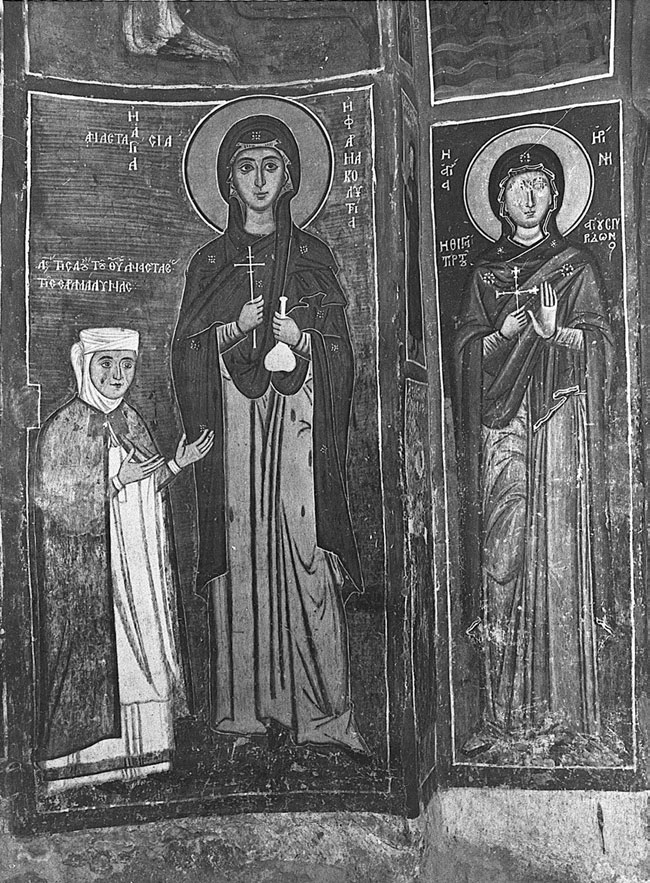

<!-- PDF page 100; original page 79 -->

# 第3章 中世纪拜占庭的平信徒虔敬文化（1054—1453年）

莎伦·E. J. 格斯特尔、艾丽斯－玛丽·塔尔博特

正教信仰渗透着拜占庭男女的日常生活：不仅在他们参加教会礼拜时如此，在家中、街头，甚至工作时也是如此。礼仪历规定一周中的某些日子须守斋，星期日须参加礼拜，为虔诚信众提供了时间框架。一年中的每一天都有特殊意义：或是庆祝基督的主节，或是敬礼圣母马利亚的节日，或是圣徒纪念日，或是纪念基督及其母亲生平重要事件的日子。教会仪式使出生、婚姻、死亡等人生转折获得神圣意义。最后，拜占庭人除了关心今世生活，也极为重视来世，将永恒的救恩视为首要目标。

## 教堂中的平信徒

无论城市还是乡村，拜占庭的景观中都分布着大小、形制和用途各异的教会建筑。在城市中，平信徒可以前往规模宏大的都主教座堂；这些教堂往往保留了帝国早期建造的古老巴西利卡式教堂的建筑形式。从贝罗亚、卡兰巴卡、塞尔维亚、奥赫里德、埃德萨（中世纪称沃德纳）以及其他大小拜占庭城市中至今仍存的中世纪巴西利卡式教堂的规模来看，一座教堂的主体空间足可容纳数百名堂区信众。这些建筑提供了具体的空间背景，使我们能够想象格里高利·帕拉马斯等人的有力讲道。帕拉马斯担任帖撒罗尼迦主教期间（1347—1359年），曾使城中居民的宗教热情达到顶点。此外，拜占庭城市中还散布着数十座其他宗教建筑，为平信徒提供接触神圣仪式和空间的机会。较大城市应当拥有若干堂区教堂，用于举行每周礼拜及特别仪式。约1405年，一名罗斯朝圣者记录了帖撒罗尼迦堂区教堂的名称：“都主教座堂圣索菲亚、阿赫罗波伊埃托斯<!-- PDF page 101; original page 80 -->（阿希罗尼提）、圣阿索马托伊，以及其他许多教堂。”[^p101-1] 在贝罗亚、卡斯托里亚等较小城市，许多家族小堂至今仍隐藏在居民区中，一如拜占庭时代。这些朴素建筑的规模和装饰都显得亲切，满足了城市居民日常的敬拜需要；在中世纪，它们也用于安葬大家族的成员。

城市中还有修道院的围院，以及地处偏远乡村或圣山的修道院所设的附属院（metochia）。有些平信徒与当地修道院建立了密切关系，定期在那里参加礼拜，并向院长求教，将其视为灵性上的母亲或父亲。他们可能以多种形式资助这些机构，并希望葬在院墙之内。即使不进入修道院建筑群，它的存在本身也会使人联想到一个神圣祈祷与实践的世界；修道院外墙上的圣像使这种感受更加有力，让过路人也能接近院内所敬奉的圣徒。妇女虽然不得进入费赖的世界救主圣母修道院，却可以“若她们愿意，就在修道院围院入口上方的诞神女马赛克像前敬拜”。[^p101-2] 同样，帖撒罗尼迦一座拜占庭晚期修道院的主教堂（今称先知以利亚教堂），在西立面设有高大的壁龛，里面绘着基督、怀抱圣婴的圣母，以及怀抱幼年圣母的圣安娜。即使教堂大门紧闭，祈求者仍能敬礼展示在教堂外部的至圣圣像。

拜占庭乡村的小村庄中，同样分布着形制与功能多样的教堂。考古和建筑遗存表明，村庄的大致中心往往有一座较大的教堂；它可能是每周举行礼仪，以及其他对整个共同体具有重要意义的礼拜的场所。较小的教堂或小堂则位于不同街坊，居民多为大家族成员。这些小堂举行礼仪的频率低于村中心教堂，由家族维持，服务于其自身的敬拜需要，并常常奉献给对个别祈求者具有特殊意义的圣徒。纳克索斯岛阿佩兰索斯圣母教堂圣所附近南墙上绘写的一则铭文，或可说明这类教堂并不经常使用。

<!-- PDF page 102; original page 81 -->

铭文先列出捐献人德米特里奥斯·毛里卡斯及其妻马利亚的姓名，接着写道：“若有司祭在此教堂举行礼仪，愿他纪念我们。主历6789年〔即1280/81年〕。”[^p102-3] 小村庄的许多教堂由一群捐献人共同建造，他们之间往往具有亲属关系，各自捐献少量金钱或土地，用于维持教堂并供养司祭。不少教堂通常位于村庄边缘，周围设有墓地，供家族或更大的共同体举行丧葬和追思仪式。另一些祠堂位于村庄的最外围，通过祈求与护佑生命和牲畜有关的圣徒，或可发挥保护聚落边界及耕地的作用。

除这些开展宗教实践的公共场所外，私人小堂还容纳着更为私密的敬拜形式。富人往往在宅邸中设有祈祷室，皇宫也不例外。中世纪的遗嘱和财产清单列有此类建筑，为我们了解私人小堂的陈设和装饰提供了资料。例如，1073年赐予安德罗尼科斯·杜卡斯的一处米利都附近地产，包括“一座以砂浆砌石建成的教堂，穹顶由八根柱子支撑……一座前厅……并铺有大理石地面”。[^p102-4] 欧斯塔提奥斯·博伊拉斯在1059年的遗嘱中，将一批书籍及其他珍贵物品遗赠给自己庄园内的教堂。[^p102-5] 我们可以推想，这些小堂保存着对个别家族具有特殊意义的圣像。约翰·策策斯的一封信，使我们得以一窥十二世纪君士坦丁堡宅邸中此类建筑的内部情形。策策斯谴责大量冒充修士者在拜占庭首都街头游荡，抱怨说：“出身最高贵的显要妇女，以及为数不少的男子，竟以装饰自己的私人小堂为盛事；他们所陈列的，并非出自一流画家之手的圣者画像，而是这些可憎恶棍的脚镣、桎梏与锁链。”[^p102-6] 这类金属器具原本是真正圣者通常使用的忏悔苦修用具，往往陈列在修道圣徒的墓旁，也会出现在圣像中。策策斯谴责那些受假修士蒙骗的平信徒。看来，对虚假圣物而非圣者圣像的不受约束的敬礼，<!-- PDF page 103; original page 82 -->或许足以说明，教会高层何以担忧那些不受教会秩序管辖的私人小堂不断增多。

在考察神圣仪式和祈祷如何通过具体空间承载平信徒虔敬时，还须重视嵌入防御工事，或与帝国其他基础设施相连的众多小堂。例如，吉奈科卡斯特罗是一处十四世纪初建造的设防聚落，距帖撒罗尼迦约40英里；对其制高点塔楼的发掘表明，塔楼上层曾有一座饰以壁画的小堂。[^p103-7] 另一些塔楼由修道院兴建，以保护院产，并进而保护生活、劳作于这些地产上的村民。阿索斯山的多希亚里乌修道院于1373年在古奥林索斯附近建造了一座高塔。塔楼上层的东侧设有小堂。这类塔楼点缀着拜占庭景观，既用于保护拜占庭驻军，也使周围地区置于神圣护佑之下。圣者形象，以及十字架或驱邪护佑语等神圣标记，还出现在城市防御工事的墙壁上，并由军队随身携带。拜占庭传说中充满了神圣人物出面代祷、保护城市或确保战斗胜利的故事。

与拜占庭虔敬相关的物件和标记，也护佑着港口、桥梁、道路及使用它们的旅人。十二世纪伊萨克·科穆宁在色雷斯修建的一座桥上，“竖起了那块刻有诞神女形象的石板，供过桥之人敬拜，也作为我这卑微灵魂的祈祷”。[^p103-8] 十五世纪中叶，居住在摩里亚的拉乌尔·曼努埃尔·梅利克斯，修缮了卡里泰纳横跨阿尔菲奥斯河的一座桥。他在第二座桥墩上增建一座小堂，并刻立大理石铭文，写下自己的姓名和祈愿：“旅人啊，请知晓：此桥由虔诚之人拉乌尔·曼努埃尔·梅利克斯重建。凡欲从此经过者，当以全副心灵祈求恩典，免得如从前一般，俯视深渊。6948年〔即1440年〕，第三征税纪年。”[^p103-9] 水磨坊也像桥梁一样带有基督教标记，例如装饰性的砖砌十字架和缩写铭文。字母“ΦΧΦΠ”即为一例，其全称意为“基督之光照耀众人”。这些醒目的基督教信仰象征，使<!-- PDF page 104; original page 83 -->平信徒确信，旅人的安全和充沛的水源都受到神圣护佑。

因此，在公共和私人领域，无论城市还是乡村，无论边境堡垒还是精英宅邸，拜占庭平信徒所面对的，都是赋有神圣意义、充溢着神圣临在的建筑。这些建筑有力地提醒人们：他们隶属于同一个教会，而帝国则由同一种礼仪联结为一体；在内外危机之时，这些因素还具有政治意义。这些建筑帮助平信徒置身于一幅神圣地景之中，既要求、也引导他们坚守正确信仰，并借助无所不在的实物提醒，激发出一种自然而深厚有力的宗教情感。

与宗教景观在空间上的这种组织方式相并行的，是一个依教会仪式和历法安排平信徒生活的时间框架。在城市、城镇和村庄，人们都被期望参加每周的教会礼拜。然而，就现有史料而言，我们无法衡量普通拜占庭人究竟在多大程度上遵从了这一要求。米海尔·普塞洛斯所悼念的幼女斯提利亚妮，“总乐于参加晚祷，参与颂赞，并吟唱圣歌”。据其父亲所述，她忠实地参加教会礼仪和神圣节庆，也吟唱晨祷。[^p104-10] 然而，也有史料表明并非人人都经常去教堂，从而与这类平信徒虔敬的描写形成了另一面。虽然当时一篇颂词声称，帖撒罗尼迦的教堂昼夜开放，以便人们参加礼拜或进行个人敬拜，[^p104-11] 格里高利·帕拉马斯却抱怨说，一年中有数个月，信众在城墙外从事农业生产，城内教堂便空无一人。[^p104-12] 拜占庭晚期乡村教堂中的“最后审判”图像，描绘了在星期日躺卧床上的堂区信众；这在艺术上谴责了圣日的性交行为，同时也隐约透露出礼拜出席人数减少的情况。十四世纪初，牧首阿塔纳西奥斯一世下令，从星期六午后至星期日午后，酒馆和浴场一律停业，以鼓励信众参加礼拜。[^p104-13]

<!-- PDF page 105; original page 84 -->

本章所讨论的时期，最常用的是圣金口约翰的礼仪；根据教堂地位和主礼人数的不同，其时长可以从不足一小时到两个多小时不等。大斋期的星期日和重要节庆则使用圣巴西略礼仪。礼仪进行时，信众应当站立并专心聆听；不过，从不同教士的抱怨来看，平信徒并非总能安静、庄重地坚持参加仪式，或从头到尾留在堂内。一篇可能写于巴列奥略时代的文献警告平信徒：他们不经常去教堂，即使参加礼拜也不专心，上帝将在最后审判时予以责罚。

> 即使你们来到〔教堂〕，也不过是双脚来到，灵魂却远远落后……你们满脑子都是日常生活的忧虑，彼此交谈，不留意经文……勉强待到宣读福音，便立即匆匆奔出，离开教堂，仿佛有一股力量把你们推了出去；人人推挤他人，互相践踏，仿佛被人从那里驱赶出来一般。[^p105-14]

文字和图像证据都表明，在教堂主体空间内，男性和女性平信徒是分开的；不过，具体如何划分，则取决于教堂的规模、形制及共同体的类型。文献表明，在拜占庭首都的大教堂中，妇女，尤其是地位较高的妇女，站在楼廊或侧廊。中世纪的艺术证据显示，在城市教堂里，男女分处中殿的南北两侧，与本书成书时的做法相同。在更偏远的地区，小型乡村教堂的绘画证据则显示，男女或分处教堂南北两侧，甚至可能按照人们对不同神圣程度的理解来安排：男人站得更靠近圣所，妇女则被安排在建筑的西端。

人们普遍认为，与早期基督教相比，中世纪领圣餐的频率已经降低。虽然十二世纪的狄奥多若·巴尔萨蒙明确指出，平信徒只要妥善准备，每天都可以领圣餐，但大多数参加礼拜的人似乎<!-- PDF page 106; original page 85 -->一年只领几次圣餐，集中在重大节日和复活节。[^p106-15] 领圣餐需要灵性准备和守斋。据十三世纪一位主教所言，守斋时只能吃面包、无花果干、椰枣和青菜。[^p106-16]

不常领圣餐，加上教士对礼拜出席情况的抱怨，表明平信徒接触神圣仪式的方式发生了变化。到十三世纪，许多教堂都设有不透明的屏障，使信众无法看见圣餐礼进行的大部分过程。这种仪式实践的遮蔽丝毫没有削弱宗教体验。事实上，目睹一连串神圣显现、置身于缭绕的香烟之中，以及通过聆听参与吟诵的祈祷，都可能增强信众与神圣者相遇的灵性体验。此外，司祭举行礼仪时，信众还可以亲近一系列以绘画呈现的有力代祷者。这些大型圣像设在圣所屏障朝向中殿的一面、像架上及教堂内墙上，呈现了在敬拜或教义上具有重要意义的人物，并以对个人、家族或堂区信众具有特殊意义的神圣人物为基础，构成一套复杂的救恩安排。圣像通过多种联系组织着虔敬实践：祈求者在受洗时与某位圣徒形成的联系；他或她对圣徒生平、某位神圣人物特殊能力的了解；以及圣徒姓名字面意义所唤起的抽象品性，如“长寿”（Polychronia）或“多结果实”（Polykarpos）。从拜占庭圣徒画像上大量附加的祈求铭文来看，神圣人物构成了平信徒最直接的代祷者，为他们的健康、兴旺、安全与救恩提供保障。因此，平信徒的宗教体验，既与共同体的仪式相关，也与极为私密的个人祈祷体系相连。

## 节日与朝圣

众多重要节日是教堂出席人数最多的时候。皇帝曼努埃尔一世担心法庭正式停办公务的日子过多，于是颁布敕令，<!-- PDF page 107; original page 86 -->将节日限制为66个全天假日和27个半天假日，而且这还不包括星期日！[^p107-17] 这些重要节日的庆祝活动延伸到教堂围墙之外。本书成书时许多与教会节庆相关的传统，都可以追溯至拜占庭实践。十一世纪米蒂利尼的克里斯托弗的一首诗，便记述了用芳香的月桂叶装饰教堂，“作为神圣节日的象征”。[^p107-18] 1222年，纳夫帕克托斯都主教约翰·阿波卡夫科斯写给一位属下主教的信，提到了复活节碰蛋的习俗。他在描述名为约翰·克莱普特斯的一名奴隶男孩时写道：“在他〔克莱普特斯〕尚在学习读写的年纪，他经常观察鸟儿，偷偷探入鸟巢，把蛋取走，尤其是在大斋期的第五周；按照乡间习俗，他称那一周为‘科菲周’（Κωφή）。随后，他把蛋仔细藏好，以便复活节时和其他孩子一起碰蛋。”[^p107-19] 复活节期间，人们还会将鸟蛋嵌入面团中烘烤成面包，作为礼物送给当地村庄的司祭。[^p107-20] 十四世纪，以弗所的马太生动地描述了君士坦丁堡在复活节这个“节日之母”所举行的欢乐庆祝：圣星期六的夜晚，家家户户提着灯笼，聚集街头，吟唱圣歌，甚至在教堂门前起舞。[^p107-21]

主显节（1月6日）是平信徒的重要节日。这一天，司祭为水祝圣，或将十字架浸入盆中，或直接将其投入海中，再由人取回。后一仪式的文献证据，见于热那亚属地卡法的一项法令，其中规定了包括主显节在内的若干节日的经费支出：

> 每年主显节，须按以下规定支出。首先，应给予前来宫邸、吟唱卡利梅拉颂歌的希腊人（Greci）200阿斯佩尔；同样，在司祭祝圣海水时，给予潜入海中的那些男孩75阿斯佩尔。给予在宫邸庭院吟唱赞颂的司祭100阿斯佩尔；另给予敲钟人6阿斯佩尔。[^p107-22]

在这一仪式中祝圣的水，往往被装瓶带回家中，人们相信它对人、牲畜和庄稼都具有疗愈作用。

<!-- PDF page 108; original page 87 -->

圣徒节日充分调动了拜占庭平信徒的参与，每一座城市和村庄都会加入庆祝。在重要圣徒的敬奉中心，每年都举行仪式，吸引朝圣者前来，也吸引商人参加与节庆同时举行的集市。拜占庭时期有关教会节庆的描述留存甚多。例如，尼西亚在2月1日庆祝圣特里丰节，这一节日与百合花反季节奇迹般绽放的现象相关。十三世纪中叶，狄奥多若·拉斯卡里斯为这位圣徒所写的颂词，描绘了聚集庆祝的人群：

> 奇迹发生时，人人都在欢庆——婴儿、儿童、少年、成年男子、老人、长者、年迈之人、妇女、平信徒、军人、官员、司祭和修士——各类、各年龄的人都亲眼看见，欢欣雀跃。因为这一切并非发生在某个角落或阴暗处，而是在上帝的教堂之中。[^p108-23]

在帖撒罗尼迦一年一度的圣德米特里奥斯节，访客既来敬礼圣徒，也参加持续一周的大型集市。

重要圣像的巡游同样吸引了拜占庭民众。君士坦丁堡每周举行引路圣母像的祈祷巡游，由一个兄弟会负责维持，其成员抬着沉重的圣像，吸引大批祈求者与旁观者。人们相信这幅圣像具有医治能力；它在每个星期二穿行君士坦丁堡，访问几座教堂，随后返回霍德贡修道院。罗斯朝圣者“书记亚历山大”于1394—1395年到访君士坦丁堡，目睹了圣像每周的巡游；据他说，“凡怀着信心前来的人，都能获得健康”。[^p108-24] 帖撒罗尼迦的欧斯塔提奥斯写道，他的城市也曾举行类似的引路圣母像巡游。[^p108-25] 在远离首都的底比斯地区，一个平信徒兄弟会的成员则将另一幅圣像——纳夫帕克提萨圣母像——从一座教堂运送到另一座教堂。阿尔塔附近布拉赫奈教堂的前厅，有一幅十三世纪绘画表现了君士坦丁堡的巡游，题名为“君士坦丁堡至圣诞神女引路者节庆”。画面除描绘圣像巡游外，还出现大量摊贩，表明展示圣像既是宗教盛事，也是一场商业活动。

<!-- PDF page 109; original page 88 -->

前往神圣祠堂和圣者住处朝圣，也在拜占庭平信徒的灵性生活中发挥了重要作用。拜占庭中晚期，前往圣地诸圣迹遗址的长途朝圣主要由修士进行；不过，已知仍有少数平信徒不顾穆斯林占领巴勒斯坦所带来的危险，踏上这一旅程。斐莱的基里尔和他的兄弟在尚为平信徒时，就曾前往罗马及霍奈的圣所。[^p109-26] 更常见的是较短的敬拜旅程：前往附近拥有重要圣所的城镇，赴乡间修道院祈祷，或走访自己城市、街坊中的教堂。例如，上文提到的基里尔，每周都从距君士坦丁堡约30英里的色雷斯斐莱村出发，到布拉赫奈教堂敬礼圣母像。[^p109-27] 这些虔敬旅程，尤其是前往乡间的旅程，有时也带有度假的性质。年轻的格里高利·帕拉马斯有一次随全家乘船沿博斯普鲁斯海峡北上，到圣福卡斯修道院拜访一位苦修者；途中，他的父亲还捉了一条鱼，作为送给圣者的礼物。[^p109-28] 一篇十四世纪的文字描写了到圣普罗科皮奥斯圣所（靠近特拉比松）的朝圣，自然环境所带来的愉悦洋溢其中：“西风从高耸于上的所谓密特拉山吹来，尤其在春天，人们到这里欣赏花草，盛开的花朵和茂密的青草，使他们心旷神怡。”[^p109-29]

不过，大多数朝圣都有严肃目的。信众拜访神圣祠堂，为的是表达感恩、祈求救恩，以及求医治各种疾病和不育等长期病患。在一个婴幼儿及儿童死亡率接近50%的社会中，婚姻的主要目的在于生育，因此不孕被视为严重的不幸。拜占庭史料充满了这样的故事：无法生育的夫妇向各式各样的圣徒祈求帮助。在女性圣徒中，圣母马利亚及其母亲安娜被认为特别能够使不孕妇女生育。人们也会请求男性圣徒代祷。据说，特拉比松的圣欧根尼奥斯曾<!-- PDF page 110; original page 89 -->使教会管事马古拉斯不育的妻子怀上孩子。[^p110-30] 为作这类祈求，平信徒会到教堂寻求帮助，向形象绘于墙壁或圣像上的圣徒祈祷。人们还普遍相信，在缺乏医疗援助时，圣徒能够出面干预，帮助妇女顺利分娩，或处理棘手的妇科病例。

患病的朝圣者为了寻求奇迹般的治愈，会采取多种仪式：亲吻安放圣者遗骸的棺柩；在圣徒墓旁祈祷或留宿求梦；以圣髑流出的香油，或圣徒坟墓、圣像上方悬灯中的油膏抹身体；饮用因接触圣髑而获得祝圣的水。十四世纪关于君士坦丁堡牧首阿塔纳西奥斯一世身后奇迹的记载，叙述了一种近乎巫术的不同寻常的仪式。一个名叫马利亚·弗兰戈普利娜的妇女，“偷偷从这位伟人神圣而破旧的衣服上取下一小块布，放在香炉里的热炭上，吸入烟气；随后〔愿上帝的判断受赞美〕，她便摆脱了痛苦”，长期的子宫疾病因此痊愈。[^p110-31] 信众还会把盛有圣油、圣水的小瓶，以及压印圣徒形象的铅制或陶制纪念物带回家，以备日后自用或分赠亲友。这类器物中留存至今的，有十三、十四世纪的小铅瓶（koutrouvia），上有圣狄奥多拉、圣乔治、圣德米特里奥斯及圣涅斯托尔的形象，推测均来自帖撒罗尼迦；十一世纪时，人们仍不断从叙利亚带回年轻柱头修士圣西缅的铅制徽章。为了感谢奇迹般的治愈，朝圣者会向圣所献上礼物，从蜡和油，到专门订制的鎏金银质圣像框或礼仪器皿，不一而足。

朝圣者也会寻找在世的圣者，有时为了求医治，更多时候则为了告解、领受祝福或获得灵性劝导。从《圣马克西莫斯·考索卡利维特斯传》可以看出，少数平信徒甚至来到阿索斯山偏僻的隐修所求教。住处距君士坦丁堡相对较近的修士斐莱的基里尔，会接待从首都前来寻求灵性教导的平信徒。[^p110-32] 其他生活在城市环境中的圣者，如帖撒罗尼迦的格里高利·帕拉马斯，以及君士坦丁堡牧首<!-- PDF page 111; original page 90 -->伊西多尔一世·布希拉斯，更容易为普通民众所接近；少数幸运的人甚至能以他们为灵性导师，请教婚姻或是否可能蒙召进入修道生活等问题。[^p111-33]

## 家庭领域

无论城市还是乡村，敬拜实践也融入了家庭生活的许多方面。房屋奠基，或一家人初次入住新居时，都会为房屋本身举行祝福；司祭在这类场合会诵读适当的祈祷，并向屋内洒圣水。[^p111-34] 在饭前饭后、就寝等日常活动中，人们也会祈求神圣代祷，并作感恩祈祷。[^p111-35] 人生不同阶段也各有适用的祈祷，尤其是在生命的开端和终点；婴儿出生、第一次理发及开始识字时，都有相应祝福。[^p111-36] 临产妇女可能希望在分娩之前领圣餐。[^p111-37] 成年人在重病或濒临死亡时，则有祈求宽恕的祷文。[^p111-38]

吟唱圣歌、阅读《圣经》和其他神圣著作、敬礼圣像等个人敬拜活动，也都可以在家中进行。在社会最高层，皇帝阿莱克修斯一世·科穆宁（1081—1118年）的家庭便是例子；他的母亲安娜·达拉塞娜为皇室其他成员树立了虔敬榜样。据其孙女安娜·科穆宁娜记述，她常将夜晚的大部分时间用于守夜祈祷和吟唱圣歌；她坚持要求全家定时吟唱圣歌，以致“宫廷的面貌倒更像一座修道院”。[^p111-39] 她的儿媳伊琳娜·杜凯娜常常必须被人从灵修阅读中拉开，才肯坐下用餐；她最喜欢的<!-- PDF page 112; original page 91 -->著作包括认信者马克西莫斯的作品及圣徒传记。[^p112-40] 一篇十四世纪的圣徒传，为我们展示了帖撒罗尼迦家庭生活的一个片段：一家之主每晚都在兼作孩子卧室的家庭小堂中祈祷，作好这番准备之后，再前往当地修道院参加晨间礼拜。[^p112-41]

对于能够接触书籍的中上阶层家庭而言，在家进行灵修阅读是一项常见活动。《诗篇》是拜占庭儿童的启蒙读本。例如，普塞洛斯的女儿斯提利亚妮学会字母后，“接着研读《大卫诗篇》，在学习的过程中，她已经能够……形成完善的言语表达”。[^p112-42] 后来的新神学家圣西缅，在父母家中发现约翰·克利马库斯的《天梯》，潜心阅读之后，决定响应修道的召唤。[^p112-43] 后来成为君士坦丁堡牧首阿塔纳西奥斯一世的少年阿莱克修斯，童年时不以游戏度日，而是阅读《旧约》和《新约》；读了《柱头修士圣阿利皮奥斯传》后，他受到启发，离开家乡，前往叔父所在的修道院。[^p112-44]

儿童也可能通过母亲讲故事，熟悉神圣传说。米海尔·普塞洛斯的母亲狄奥多特哄他入睡时，讲的并非童话，而是《旧约》中神圣儿童的故事：以撒如何险些被父亲亚伯拉罕献祭，后来又如何祝福自己的儿子雅各。[^p112-45] 儿童还可能通过讲道和绘画了解圣徒故事。教堂装饰，以及供公共或私人敬拜之用的圣像，都包含描绘圣徒生平的图像。在文盲比例很高的社会中，这些视觉文本对于向拜占庭绝大多数民众——无论城镇居民还是乡村居民——传达教会教义和圣徒生平，发挥了重要作用，向普通人传授了正教的信仰原则。儿童甚至会把基督教仪式的某些要素带进游戏，模仿辅祭奉香和司祭举行礼仪。[^p112-46]

<!-- PDF page 113; original page 92 -->

有一定经济能力的家庭，会设法购置一幅或数幅圣像，并经常敬礼。年轻的莱昂提奥斯——后来于1176—1185年担任耶路撒冷牧首——在前往君士坦丁堡途中借宿一户人家，晚餐后便独自敬拜，在“存放神圣图像的地方”吟唱圣歌，祈求旅程平安。[^p113-47] 在塞浦路斯，年轻圣萨瓦的敬奉者将他的形象绘在木板上，在家中以蜡烛、香油和乳香敬礼这些圣像。[^p113-48] 米海尔·普塞洛斯对佐伊女皇与其基督应答者圣像之间情感依恋的著名描述，让我们得以了解神圣图像对个人敬拜的重要性。他写道：“我自己就常常见她在极度痛苦之时，把这神圣之物捧在手中，凝视它，对它说话，仿佛它真有生命一般，并以一个接一个温柔亲昵的称呼向它倾诉。”[^p113-49] 圣像还被视为有形资产，代代传承。主教会议法庭的记录、财产清单和遗嘱都列有圣像，有时还注明其价值；一幅家传圣像会在嫁妆契约中占据显要位置。格外贵重的圣像，例如覆有银质饰面的圣像，可能被收藏在衣箱里，而非陈列出来。[^p113-50]

个人佩饰既保护身体，也护佑灵魂。男女都会佩戴胸前圣像坠（enkolpia），即以链条悬于颈部、带有神圣图像的坠饰。坠饰使用的材料多种多样，从珐琅、黄金到木材不等；有些内部藏有圣髑，因而更加珍贵。戒指上也常有神圣图像和简短祷文，例如“主啊，扶助你的仆人”，或“诞神女啊，扶助你的仆人”。这类戒指供男女佩戴，材料的优劣反映了佩戴者的地位。刻有基督、圣母和圣徒形象的浮雕宝石及其他宝石，提供灵性和身体上的保护；背面还往往雕有第二位圣徒、叙事场景、祈愿语或十字架。护符的材质也有意义；宝石学著作将医治能力归于<!-- PDF page 114; original page 93 -->不同种类的石头，表明在具有强大力量的护符中，物质和灵性因素的结合可能格外有效。

中世纪拜占庭留下了数百件十字架坠饰，其中既有中空以置入圣髑的，也有实心铸造的。这些坠饰既有以普通金属大量制造的，也有豪华制品，因此许多人应当都能负担得起。十字架上刻有圣母、基督或圣徒的形象，以及简单的叙事场景，通过图像与教会教义联系起来。它们紧贴身体佩戴，既护佑佩戴者，也使佩戴者通过观看，以及感受其悬于颈间的重量，反思虔敬祈祷。

## 信仰与劳动

即使在工作场所，人们也不忽略敬拜实践。例如，一些节庆在宗教环境中庆祝特定的商业活动。普塞洛斯描述了每年5月12日在君士坦丁堡举行的圣阿加特节。[^p114-51] 节庆的主要参与者是妇女——纺线者、织布者和梳毛者，也许是行会成员；在仪式的一个环节中，她们向圣像献上装饰品，推测应是纺织品。米蒂利尼的克里斯托弗则描述了神圣书记员圣马尔提里奥斯与圣马尔基亚诺斯的节日。10月25日，学习文书工作的学生及其教师穿着各种装束，其中包括女装，列队穿过首都街道，前往位于城西山丘上的圣书记员教堂。[^p114-52]

在村庄环境中，教会还参与其他礼仪之外的仪式，使日常劳动与神圣者接触。例如，农人可能请村庄司祭祝福田地，为蚕的健康祈祷，或帮助医治患病的牲畜。播种与收割的周期、打谷场、葡萄园的栽植和收获，以及风调雨顺，都有专门的祷文。[^p114-53] 有一次，帖撒罗尼迦都主教格里高利·帕拉马斯亲自前往一片不结果实的橄榄林，为之祝福、洒圣水。[^p114-54] 在这些事务上，村庄或乡间教堂的装饰，往往便利了人们直接向专司农业活动的圣徒祈祷，如<!-- PDF page 115; original page 94 -->圣马马斯、圣特里丰等。水手和渔民则可以请求司祭为渔网，或为建造新船诵读祝福祷文。

## 人生礼仪

除在家中举行的人生礼仪外，还有其他过渡仪式，使男女平信徒进入教堂、参与虔敬实践。儿童在教堂内受洗，名字主要取自教会历：多数是圣徒之名，偶尔也与基督、圣母或节庆有关。给孩子命名，使其与同名圣徒建立了密切联系；这种根本纽带将在一生中引导其敬拜祈祷。教堂及圣像绘画的铭文，以及其他媒介，都呈现了这类联系。马尼地区哈鲁达的圣米海尔教堂，年代为1371/72年，便提供了一个例子：画面上，这座小建筑的捐献人——卑微的米海尔·卡里迪亚诺斯——向总领天使米海尔献上教堂模型。[^p115-55]

订婚和结婚是拜占庭家庭生活中最重要的事件之一；拜占庭中晚期礼仪书将两者列为彼此独立的仪式。拜占庭女孩很小就会订婚，往往尚未满12岁。视家庭情况而定，正式结婚可能在几年后举行。订婚与结婚的仪式都在教堂中进行，因此，解除这些经教会认可的契约，也必须由教会法庭监督。事实上，妇女向教会法庭提出的不少案件，都涉及订婚、结婚、通奸，甚至离婚。

依拜占庭晚期的礼仪文本，订婚双方在仪式全程都站在教堂中殿内、正对圣所门的位置。[^p115-56] 订婚仪式有略微不同的传本；仪式进行时，司祭先问准新郎是否愿意接受其未婚妻，再向准新娘提出同样问题。双方肯定宣誓后，便接受祝福。两人随后获得戒指：男方得到金戒指，女方得到银戒指；有时，女方的戒指以铁或铜制成。戒指交换三次，最终较贵重的金属仍归男方。司祭分别向双方宣告：

<!-- PDF page 116; original page 95 -->

*图3.1 解毒者圣阿纳斯塔西娅与阿纳斯塔西娅·萨拉马利娜；圣伊琳娜。塞浦路斯阿西努圣母福尔维奥蒂萨教堂。*

<!-- PDF page 117; original page 96 -->

“奉父及子及圣灵之名，上帝的仆人〔姓名〕与上帝的仆人〔姓名〕订婚。”仪式结束时，两人领圣餐，以教会的祝福确立这一契约。

教会婚礼又称“加冠礼”，依循一套至迟在十一世纪已经形成的仪式。本章所讨论时期的文献记述了以下环节：在圣所门前祝福新人，诵读祷文，祈求繁衍子女，以婚冠在双方头上三次画记，并在两人同饮一杯、领圣餐之前，将他们的双手交合。[^p117-57] 仪式文本多次提到《旧约》中以坚固著称的婚姻，如亚伯拉罕与撒拉、以撒与利百加、雅各与拉结，也提到《新约》中的婚姻，尤其是迦拿婚宴。依当时若干礼仪书，仪式结束后，人们将新人从教堂护送回家。

中世纪拜占庭的丧礼，在家中料理遗体之后，于教堂举行。死者若为平信徒，其遗体便置于教堂前厅或中殿，进行丧葬仪式。丧礼祈求灵魂安息，并邀请哀悼者走近遗体，作最后告别。富有的拜占庭人往往葬在教堂内，墓穴通常挖在前厅或附属小堂的地板之下。较为贫寒的基督徒，则安葬在围绕墓地小堂的墓园里，以便在小堂内举行追思礼。多数情况下，死者裹着寿衣，直接入土；考古材料仅在极少数情况下证实使用了木棺。遗体在墓穴中头朝西，使面部朝向东方基督复活之地；很多墓葬还用石枕垫起头部。双手交叠胸前，这一姿态也再现于许多圣像及大型壁画中的丧葬肖像。一个墓穴可能合葬多人，尤其是母子，或因疾病死亡的一家人。

安葬之后是漫长的哀悼期，其间在死后第三、第九、第四十天，以及周年之日，举行追思礼。一些拜占庭作者，如帖撒罗尼迦的西缅，将这些分阶段的追思仪式与基督生死中的特定日子联系起来。因此，第三天被视为在仪式上效法<!-- PDF page 118; original page 97 -->基督的复活，第四十天则效法他的升天。追思仪式在教堂和墓穴、坟墓旁举行，家人聚集祈祷，并向教堂献上科利瓦（kollyva），即以煮熟的小麦混合杏仁、坚果和葡萄干制成的食物。[^p118-58]

## 寻求救恩

在拜占庭，对救恩的焦虑是促使平信徒与修道机构建立密切联系的重要因素。由此产生的一种倾向，是平信徒在生命接近终点时发愿修道，因为他们相信，献身修道生活的人更有希望得救。他们可能在子女成年后、配偶去世后，甚至临终病榻上采取这一步。这些年长修士和修女不仅能够在余生获得住所、食物和医疗照料，更重要的是，死后可以保证安葬在修道院建筑群内，并由修道共同体举行追思礼；人们认为，修道者的代祷格外有效。

通过向教堂捐款，信众可以建造坟墓，并确保死者获得追思礼。为了保证有人持续为自己的灵魂祈祷，极为富有的平信徒可能出资兴建附属于重要修道院的丧葬小堂，或通过捐献，确保自己安葬在重要教会机构的院墙之内。城市居民也可以通过数额较小的捐献，寻求救恩与身后纪念。例如，在卡斯托里亚和贝罗亚，拜占庭中晚期教堂至今仍保存着男女敬拜者色彩鲜明的肖像，他们的墓穴沿建筑外侧设置。塞浦路斯的长形丧葬圣像，以及克里特和罗得岛的大型肖像，同样记录了安葬于正教教堂内外的死者姓名和形貌。村庄的安葬方式与城市相似，只是规模较小。马尼地区凯普拉的神圣无偿医者教堂，年代为1265年，保存着一则长篇铭文，列出捐献人的姓名，以及他们为这座小教堂的建造和装饰提供的款项。小堂周围田地中发现的中世纪陶片与人骨，表明建筑原先由墓地环绕；其中安葬的，很可能就是<!-- PDF page 119; original page 98 -->铭文提及的捐献人及其家属。这座朴素教堂和许多晚期教堂一样，兴建目的既是容纳礼仪、为个人敬拜提供实体空间，也是作为家族墓地的中心，以及永久纪念死者的场所。文献明确证实，平信徒向教堂捐献，是为了确保人们在祈祷中记念死者。1457年，君士坦丁·斯特雷利察斯及其妻子，在向圣基里亚克教堂捐献的文书上画下十字作为签署；这座教堂位于伯罗奔尼撒中部山顶城镇穆赫利。据这份简短文书，两人将自己购买的一座葡萄园捐给教堂，“为了我们灵魂的得救，将其给予圣基里亚克教堂，以纪念我们的父母和我们自己”。[^p119-59] 阿索斯山文书中，有许多以捐赠换取灵性益处的类似契约，称为“灵魂捐献”（ψυχικά）。无论男女，都积极向圣山修道院捐赠地产，以换取修士保证在他们死后举行追思，其频率从每日到每年不等。

丧葬小堂的装饰，为了解其安葬和追思用途提供了大量资料。一些小堂的墙壁和拱顶上，绘有丧礼祷文的引句，或礼仪文本唤起的图像。不过，所有丧葬小堂最核心的表现主题，都是通常位于西墙的“最后审判”。这一复杂构图详细呈现了灵魂接受审判的过程；对将来安葬在室内地板下的人，以及观看这一艺术构图的人而言，这都是切身关切的问题。拜占庭文学中，到处可见关于灵魂审判的记述。例如，启示文学提到，灵魂在通过关卡时受到盘问，守关者审查特定罪行，并施加相应惩罚。拜占庭晚期作者则将天上法庭的审判与腐败的世俗司法作比较。写于1414年1月至1415年10月间的《马扎里斯冥府之旅，或与亡者谈论皇廷若干官员》，以高度讽刺的方式描绘了拜占庭晚期宫廷的社会政治环境。文本的中心人物马扎里斯发现自己来到冥府，便询问灵魂在来世如何受审。回答是：“公正地……不偏不倚，没有腐败或徇私；谄媚和贿赂都不能影响<!-- PDF page 120; original page 99 -->〔法官〕。”[^p120-60] 从留存证据看，拜占庭晚期许多村庄教堂的壁画体系中，罪人的图像有所增加。这表明，在帝国末期经济与政治不稳之际，平信徒越来越关心今世对教会和社会所犯罪行的追责问题。

然而，来世的景象并非一味阴沉可怖。得救者获许进入乐园；拜占庭文学和艺术将其想象为一座花园。拜占庭最后几个世纪的悼词和铭文，经常提到伊甸园或乐园的花园。在拜占庭晚期，亡故的平信徒常被描绘在繁花盛开的景色中，表达其进入乐园的希望，也向活人显示祈祷得到实现。当时文本还将死者比作各式各样的植物，从被剪断的葡萄藤，到等待收割的成熟麦秆，进一步体现了这种思维方式。[^p120-61]

虽然多数史料描述的是拜占庭虔敬的正教表现，我们仍须记住，大量文字和图像证据也表明，某些根深蒂固的迷信与仪式持续存在；它们或继承自拜占庭的古典时代，或是从未从帝国居民生活中彻底清除的民间习俗遗存。上文提到的马利亚·弗兰戈普利娜焚烧牧首袍服布片的举动，便超出了正教实践可以接受的范围。拜占庭晚期教堂描绘罪人的壁画中，有些妇女被标作女巫，表明不合正教的实践相当普遍，并遭教会反对。在一些仪式中，异教习俗与基督教实践混合在一起，显示一种不易压制的古老信仰体系仍然存续。1月1日交换礼物、穿戴特殊服饰庆祝新年的卡兰德节，源自异教习俗，有时受到教会当局谴责。更严重的是，十二世纪帖撒罗尼迦都主教尼基塔斯，曾处理司祭在死者墓上宰杀鸽子的问题；这一实践带有浓厚的异教色彩。[^p120-62] 布鲁马利亚节是深秋庆祝新酒酿成的狄俄尼索斯节庆，直至拜占庭晚期仍有其存在的记载，也仍遭教士批评。另有一些农业<!-- PDF page 121; original page 100 -->节日，也根植于源自古代习俗的自然现象庆典。尽管一些作者谴责这些实践，但与本书成书时的情况相似，回应迷信与恐惧的仪式似乎在一定程度上受到容忍；某些仪式还被覆上一层正教外衣，使其至少在表面上可以为教会接受。

在一个包含不同经济、社会阶层，人口又分为城市和乡村居民的文化中，平信徒虔敬可以有许多表现方式。若以为每个拜占庭人都以同等热情从事宗教敬拜，便是不正确的。社会中有些人，尤其是受教育程度足以阅读神学文本、与高级教士通信的上层人士，极为虔诚，其世俗生活宛如修道生活。大量史料记述了上层平信徒妇女的善行与修道志向；她们年事渐高之后，便退居修道院。拜占庭中晚期留下的许多最精美的宗教艺术作品，都是由极为虔诚的精英平信徒委托制作的：有些用作个人敬拜物，另一些则捐赠给教堂和修道院。然而，牧首阿塔纳西奥斯一世等严格教士的讲道和通谕，却不断抱怨君士坦丁堡劳动阶层行为松懈，提醒他们星期日不可劳动，不可前往浴场和酒馆，不可在礼拜结束前离开教堂，必须遵守斋日，并避免巫术和占卜。

正如我们已经说明的，乡村居民以更为朴素的方式表达虔敬。对他们来说，教堂与农业劳动及人生礼仪密切相连。他们无法阅读文本，因而影响了敬拜方式；在缺少高阶教士讲论的情况下，支撑他们的必定是深植于心的信仰。因此，平信徒虔敬是一幅复杂图景；研究它，可以发现男女、精英与贫寒者、识字者与不识字者，在敬拜实践上存在显著差异。由此可见，拜占庭人深怀虔敬这一判断无疑正确，但这种虔敬的具体表现，却有着细微而多样的差别。

## 注释

[^p101-1]: M. Rautman, ‘Ignatios of Smolensk and the late Byzantine monasteries of Thessaloniki’, REB 49 (1991), 145, 146 n. 11.

[^p101-2]: L. Petit, ‘Typikon du monastère de la Kosmosotira près d’Aenos (1152)’, Izvestiia Russkago Arkheologicheskago Instituta v Konstantinopole 13 (1908), 61; Thomas and Hero, ii, 836.

[^p102-3]: S. Kalopissi-Verti, Dedicatory inscriptions and donor portraits in thirteenth-century churches of Greece (Vienna: Verlag ÖAW, 1992), 109.

[^p102-4]: M. Nystazopoulou-Pelekidou, Βυζαντινὰ ἔγγραφα τῆς μονῆς Πάτμου (Athens: Ethnikon Idryma Ereunon, 1980), ii, 102–3.

[^p102-5]: P. Lemerle, Cinq études sur le XIe siècle byzantin (Paris: CNRS, 1977), 20–9.

[^p102-6]: Ioannis Tzetzae Epistulae, ed. P. A. M. Leone (Leipzig: B. G. Teubner, 1972), no. 104.

[^p103-7]: A. Tourta, ‘Fortifications of Gynaikokastro, Greece’, in Secular medieval architecture in the Balkans, 1300–1500, and its preservation, ed. S. Ćurčić and E. Hadjitryphonos (Thessalonike: Aimos, Society for the Study of the Medieval Architecture in the Balkans and Its Preservation, 1997), 110–11.

[^p103-8]: Petit, ‘Kosmosotira’, 51; Thomas and Hero, ii, 828.

[^p103-9]: N. Moutsopoulos, ‘Ἀπὸ τὴν Βυζαντινὴ Καρύταινα’, Πελοποννησιακά, 16 (1985–86), 185.

[^p104-10]: K. N. Sathas, Μεσαιωνικὴ Βιβλιοθήκη (Paris: Maisonneuve, 1876), v, 67.9–18; M. J. Kyriakis, ‘Medieval European society as seen in two eleventh-century texts of Michael Psellos’, Byzantine Studies/Études Byzantines 3 (1976), 86. 参见 A. Leroy-Molinghen, ‘Stylianè’, B 39 (1969), 755–63.

[^p104-11]: PG 109, 642c–d.

[^p104-12]: PG 151, 333d.

[^p104-13]: PG 161, 1066c–d. 关于星期日的其他限制，参见 G. Dagron, ‘Jamais le dimanche’, in Εὐψυχία: mélanges offerts à Hélène Ahrweiler, ed. M. Balard et al. (Paris: Publications de la Sorbonne, 1998), 165–75.

[^p105-14]: 《年轻巴西略传》，A. N. Veselovskij 编， ‘Razyskanija v oblasti russkogo duchovnogo sticha’, Sbornik Otdelenija Russkago Jazyka i Slovesnosti Imperatorskoj Akademii Nauk 53 (1891–92), suppl. 172–3. 英文译文由 S. McGrath、D. Sullivan 和 A.-M. Talbot 译出，未发表。

[^p106-15]: PG 138, 968c. 参见 R. F. Taft, ‘The frequency of the eucharist in Byzantine usage: history and practice’, Studi sull’ Oriente Cristiano 4.1 (2000), 103–32.

[^p106-16]: J. B. Pitra, Analecta sacra Spicilegio Solesmensi parata (Paris: Roger and Chernowitz, 1891; reprinted Farnborough: Gregg International, 1967), vii (vi), col. 668. 这位主教是基特罗斯的约翰，参见 J. Darrouzès, ‘Les réponses canoniques de Jean de Kitros’, REB 31 (1973), 329.

[^p107-17]: R. Macrides, ‘Justice under Manuel I Komnenos’, Fontes Minores 6 (1984), 140–55.

[^p107-18]: E. Kurtz, Die Gedichte des Christophoros Mitylenaios (Leipzig: Neumann, 1903), poem 32.

[^p107-19]: H. Bees-Seferlis, ‘Unedierte Schriftstücke aus der Kanzlei des Johannes Apokaukos des Metropolitan von Naupaktos (in Aetolien)’, Byzantinische-Neugriechische Jahrbücher 21 (1971–74), 151.

[^p107-20]: Rhalles and Potles, ii, 355.

[^p107-21]: A. Pignani, Matteo di Efeso: l’ekphrasis per la Festa di Pasqua (Naples, [1981]), 29–38; Pignani Matteo di Efeso. Racconto di una festa popolare (Naples: M. D’Auria, 1984), 32–5.

[^p107-22]: S. P. Karpov, ‘Chto i kak prazdnovali v Kaffe v XV veke’, Srednie Veka 56 (1993), 226–32.

[^p108-23]: C. Foss, Nicaea: a Byzantine capital and its praises (Brookline, MA: Hellenic College Press, 1996), 105–7.

[^p108-24]: G. Majeska, Russian travelers to Constantinople in the fourteenth and fifteenth centuries [DOS 19] (Washington, DC: Dumbarton Oaks Research Library and Collection, 1984), 160.

[^p108-25]: Eustathios of Thessalonike, The capture of Thessaloniki, trans. John R. Melville Jones (Canberra: Australian Association for Byzantine Studies, 1988), 142.3–21.

[^p109-26]: É. Sargologos, La vie de Saint Cyrille le Philéote moine byzantin (1110) (Brussels: Société des Bollandistes, 1964), §§ 18, 20.

[^p109-27]: 同上, §14.

[^p109-28]: 《格里高利·帕拉马斯传》，载 D. G. Tsames, Φιλοθέου Κωνσταντινουπόλεως τοῦ Κοκκίνου ἔργα, i, Θεσσαλονικεῖς Ἅγιοι (Thessalonike: Aristoteleio Panepistemio Thessalonikes, 1985), 433–4.

[^p109-29]: J. O. Rosenqvist, The hagiographic dossier of St. Eugenios of Trebizond in Codex Athous Dionysiou 154 (Uppsala: Uppsala Universitet, 1996), 268–71.

[^p110-30]: 同上, 290–1.

[^p110-31]: A.-M. Talbot, Faith healing in late Byzantium: the posthumous miracles of the patriarch Athanasios I of Constantinople by Theoktistos the Stoudite (Brookline, MA: Hellenic College Press, 1983), 113.

[^p110-32]: Sargologos, Cyrille le Philéote, §§ 34, 35, 46, 47, 50 and 51.

[^p111-33]: 例如参见 Tsames, Φιλοθέου Κωνσταντινουπόλεως, 373–7, 572–4, 579–80.

[^p111-34]: J. Goar, Εὐχολόγιον seu Rituale Graecorum (Venice: Bartholomaeus Javarina, 1730; reprinted Graz: Akademische Druck- und Verlagsanstalt, 1960), 483–4. 另参见 Les regestes des actes du Patriarcat de Constantinople, ed. J. Darrouzès (Paris: Institut français d’études byzantines, 1971), iv:1777, no. 8.

[^p111-35]: Goar, Euchologion, 529, 568–9.

[^p111-36]: 同上, 261, 264, 306, 572.

[^p111-37]: 参见 V. Grecu, Ducas: istoria Turco-Bizantina (1341–1462) ([Bucharest]: Editura Academiei Republicii Populaire Romîne, 1958), 323–5.

[^p111-38]: Goar, Euchologion, 543–4, 549–50.

[^p111-39]: Anna Comnène, Alexiade, iii, viii, 3–4; ed. B. Leib (Paris: Belles Lettres, 1937), i, 125–6; ed. D. R. Reinsch [CFHB 40 (Series Berolinensis)] (Berlin: De Gruyter, 2001), 105–6.

[^p112-40]: 同上, v, ix, 3; ed. Leib, ii, 38.2–18; ed. Reinsch, 165–6; ibid., xii, iii, 2; ed. Leib, iii, 60.5–12; ed. Reinsch, 364–5.

[^p112-41]: 《日耳曼努斯·马鲁莱斯传》，载 Tsames, Φιλοθέου Κωνσταντινουπόλεως, 105.

[^p112-42]: Sathas, Μεσαιωνικὴ Βιβλιοθήκη, v, 65.17–21; Kyriakis, ‘Medieval society’, 85.

[^p112-43]: I. Hausherr and G. Horn, Un grand mystique byzantin: vie de Syméon le Nouveau Théologien (949–1022) par Nicétas Stéthatos [OCA 14] (Rome: Pontificium institutum studiorum orientalium, 1928), §6, 12.21–2.

[^p112-44]: A. Papadopoulos-Kerameus, ‘Zhitija dvukh’ Vselenskikh’ patriarkhov XIV v., svv. Afanasiia I i Isidora I’, Zapiski Istoriko-Filologischeskago Fakul’teta Imperatorskago S.- Peterburgskago Universiteta 76 (1905), 3–4.

[^p112-45]: U. Criscuolo, Michele Psello. Autobiografia: encomio per la madre (Naples: M. D’Auria editore, 1989), §8, 101.458–65.

[^p112-46]: Tsames, Φιλοθέου Κωνσταντινουπόλεως, 334.

[^p113-47]: D. Tsougarakis, The Life of Leontios, Patriarch of Jerusalem [The Medieval Mediterranean 2] (Leiden: E. J. Brill, 1993), §5, 36.1–16.

[^p113-48]: Tsames, Φιλοθέου Κωνσταντινουπόλεως, 214.

[^p113-49]: Michel Psellos, Chronographie, ed. É. Renauld (Paris: Belles Lettres, 1926; reprinted Paris: Belles Lettres, 1967), i, 149; Michael Psellus. Fourteen Byzantine rulers, trans. E. R. A. Sewter (Harmondsworth: Penguin Books, 1966), 188.

[^p113-50]: Miklosich and Müller, i, 538–9, 一份1370年的主教会议文书，记述一名窃贼从私人住宅偷走一幅覆有贵金属饰面的施洗者圣约翰圣像，留下贵重银饰，却将圣像丢弃。参见 N. Oikonomides, ‘The Holy Icon as an asset’, DOP 45 (1991), 35–44.

[^p114-51]: Sathas, Μεσαιωνικὴ Βιβλιοθήκη, v, 527–31. 参见 A. E. Laiou, ‘The festival of “Agathe”. Comments on the life of Constantinopolitan women’, in Byzantium: tribute to Andreas N. Stratos (Athens: [N. A. Stratos], 1986), i, 111–22.

[^p114-52]: Kurtz, Gedichte, 91–8.

[^p114-53]: Goar, Euchologion, 523, 551–2, 609–20, 710.

[^p114-54]: Tsames, Φιλοθέου Κωνσταντινουπόλεως, 471–2.

[^p115-55]: N. B. Drandakes, ‘Ὁ Ταξιάρχης τῆς Χαρούδας καὶ ἡ κτιτορικὴ ἐπιγραφή του’, Λακωνικαὶ Σπουδαί, 1 (1972), 287–8.

[^p115-56]: P. N. Trempelas, Μικρὸν Εὐχολόγιον: i. Αἱ ἀκολουθίαι καὶ τάξεις μνήστρων καὶ γάμου, εὐχελαίου, χειροτονιῶν καὶ βαπτίσματος (Athens: [s.n.], 1950), 7–40.

[^p117-57]: 同上, 41–96.

[^p118-58]: PG 155, 688d–691a; 692b.

[^p119-59]: M. Manoussacas, ‘Un acte de donation à l’église Sainte-Kyriakè de Mouchli (1457)’, TM 8 (1981), 319.

[^p120-60]: Mazaris’ Journey to Hades or Interviews with Dead Men about Certain Officials of the Imperial Court (trans.) [Seminar Classics 609] (Buffalo: State University of New York at Buffalo, 1975), 16–19.

[^p120-61]: Manuelis Philae Carmina. Ex codicibus Escurialensibus, Florentinis, Parisinis et Vaticanis, ed. E. Miller (Paris: Excusum in Typographeo imperiali, 1855), i, 448–9.

[^p120-62]: Rhalles and Potles, v, 387–8.
