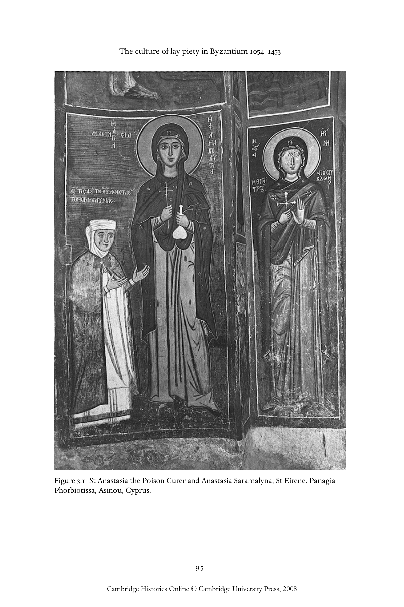

# 中世纪拜占庭的平信徒虔敬文化（1054—1453年）：英文转换底稿

<!-- PDF page 100; original page 79 -->

### 3

### The culture of lay piety in medieval

### Byzantium 1054–1453

### s h a r o n e. j. g e r s t e l a n d a l i c e - m a ry ta l b ot

Orthodox faith permeated the everyday lives of Byzantine men and women, not just when they attended church services, but at home, in the streets and even at work. The liturgical calendar, which designated certain days of the week for fasting and Sundays for worship, provided a temporal framework for the pious. Each day of the year had a special significance, whether it was a dominical feast day of Christ, a celebration of the Virgin Mary, a saint’s day, or a commemoration of key events in the lives of Christ and His Mother. Ecclesiastical rituals sanctified life passages, such as birth, marriage and death. Finally, in addition to their concerns about life on earth, Byzantines focused intensely on the afterlife, with eternal salvation as their foremost goal.

### The laity at church

The Byzantine landscape, whether urban or rural, was marked by ecclesiastical structures of varying size, shape and purpose. Within the city, the laity had access to large-scale metropolitan churches, which often retained the architectural form of the venerable basilicas constructed in the early centuries of the empire. Judging from the size of the medieval basilicas that still stand in Berroia, Kalambaka, Servia, Ohrid and Edessa (medieval Vodena), as well as in other large and small Byzantine cities, hundreds of parishioners could have been accommodated within the body of a single church. These buildings provide us the spatial context in which to imagine the powerful sermons of such figures as Gregory Palamas, who, as bishop of Thessalonike (1347–59), brought the city’s residents to the heights of religious fervour. In addition, Byzantine cities were marked by dozens of other religious structures, which also provided the laity with access to sacred rite and space. Larger cities would have had a number of parish churches to accommodate weekly services as well as special rites. Around 1405, a Russian pilgrim recorded the names of Thessalonike’s parish churches as ‘St. Sophia the Metropolis, Acheiropoietos

<!-- PDF page 101; original page 80 -->

(Akhironiti), and Holy Asomatoi and many others’.[^p101-1] In smaller cities such as Berroia and Kastoria numerous family chapels still stand hidden in residential neighbourhoods as they were in Byzantine times. These modest buildings, intimate in scale and decoration, served the day-to-day devotional needs of the city dweller and were used, in the medieval period, for the burials of members of extended families.

Also present were the enclosures for urban monasteries and for dependencies (metochia) of monastic foundations located in more isolated rural settings or on holy mountains. Some members of the laity developed a close relationship with local monasteries, attending services there regularly and consulting the superior as a spiritual mother or father. They might offer various forms of financial support to these institutions and seek burial within their walls. Even if one did not enter within the monastic complex, its very presence conjured up a world of sacred prayer and action, made all the more potent by the icons placed on the outer walls of the monastery, which provided passersby with access to the saints venerated within. While women were not permitted to enter the monastery of the Virgin Kosmosoteira in Pherrai, they could ‘if they wished, worship at the mosaic image of the Mother of God above the entrance to the monastic enclosure’.[^p101-2] In a similar fashion, the west fac¸ade of the katholikon of a late Byzantine monastery at Thessalonike (today known as Prophitis Elias) contains tall niches in which holy portraits of Christ, the Virgin holding the Christ child, and St Anne holding the infant Virgin were painted. Supplicants could venerate the all-holy images displayed on the church exterior even when the doors to the church were firmly closed.

A wide range of churches of different form and function also marked the small villages of rural Byzantium. Archaeological and architectural remains demonstrate that a larger church was often located at the proximate centre of the village and that this may have served as the site of weekly liturgical celebration and of other services of importance to the entire community. Smaller churches or chapels were located in discrete neighbourhoods populated by members of extended families. These chapels, which offered liturgical celebration less frequently than the village’s central church, were maintained by families for their own devotional purposes and were often dedicated to saints of special import to individual supplicants. The infrequent use of such churches may be inferred from an inscription painted on the south wall near

[^p101-1]: M. Rautman, ‘Ignatios of Smolensk and the late Byzantine monasteries of Thessaloniki’, REB 49 (1991), 145, 146 n. 11.

[^p101-2]: L. Petit, ‘Typikon du monastère de la Kosmosotira près d’Aenos (1152)’, Izvestiia Russkago Arkheologicheskago Instituta v Konstantinopole 13 (1908), 61; Thomas and Hero, ii, 836.

<!-- PDF page 102; original page 81 -->

the sanctuary of the church of the Virgin at Apeiranthos, Naxos. After naming the donors, Demetrios Maurikas and his wife Maria, the text reads: ‘and if a priest celebrates the liturgy in this church, may he commemorate us, in the year of the Lord 6789 (=1280/81)’.[^p102-3] Many churches in small villages were built by groups of donors, often related by kinship, who provided small sums of money or gifts of land to sustain the church and to support its priest. A number of churches, often situated on the periphery of the village, were surrounded by graveyards and would have accommodated funerary and commemorative rites for families or larger communities. Other shrines, sited at the extremities of villages, may have protected the boundaries of habitation and the cultivated fields through the invocation of saints concerned with the protection of life and livestock.

In addition to these public settings for religious practice private chapels accommodated a more intimate form of worship. The wealthy often included oratories within their homes, as was the case in the imperial palace. Such structures are listed in wills and inventories of the medieval period, which provide information about the furnishings and decoration of private chapels. A property near Miletos, which was given to Andronikos Doukas in 1073, included, for example, ‘a church built of mortared masonry, with a dome supported by eight columns... a narthex... and with a marble floor’.[^p102-4] In his will of 1059, Eustathios Boilas bequeathed a set of books and other precious objects to the church on his estate.[^p102-5] We might assume that these small chapels housed icons of special significance to individual families. A letter of John Tzetzes provides some insight into the conditions within these structures in Constantinopolitan homes of the twelfth century. Decrying the large number of fraudulent monks wandering the streets of the Byzantine capital, Tzetzes complains that ‘leading ladies, and not a few men, of the highest birth consider it a great thing to fit out their private chapels, not with icons of saintly men by the hand of some first-rate artist, but with the leg irons and fetters and chains of these accursed villains’.[^p102-6] Such metal implements were standard penitential devices of legitimate holy men, and were often displayed near the tombs of monastic saints and illustrated in holy portraits. Tzetzes condemns those members of the laity who were deceived by false monks. It would seem that the unregulated veneration of false relics rather than the icons of saintly men

[^p102-3]: S. Kalopissi-Verti, Dedicatory inscriptions and donor portraits in thirteenth-century churches of Greece (Vienna: Verlag ÖAW, 1992), 109.

[^p102-4]: M. Nystazopoulou-Pelekidou, Βυζαντινὰ ἔγγραφα τῆς μονῆς Πάτμου (Athens: Ethnikon Idryma Ereunon, 1980), ii, 102–3.

[^p102-5]: P. Lemerle, Cinq études sur le XIe siècle byzantin (Paris: CNRS, 1977), 20–9.

[^p102-6]: Ioannis Tzetzae Epistulae, ed. P. A. M. Leone (Leipzig: B. G. Teubner, 1972), no. 104.

<!-- PDF page 103; original page 82 -->

might have justified concerns of the church hierarchy about the proliferation of private chapels, which fell outside the bounds of church order.

Important, too, in considering the physical accommodation of sacred rite and prayer in terms of lay piety, were the numerous chapels that were embedded in fortifications or associated with other elements of the empire’s infrastructure. For example, at Gynaikokastro, a fortified settlement built in the early fourteenth century some 40 miles from Thessalonike, excavations at the tower that crowned the settlement have revealed the existence on its upper floor of a chapel, which was once decorated with frescos.[^p103-7] Other towers were built by monasteries to protect their estates and, by extension, the villagers, who lived and worked on their properties. The Athonite monastery of Docheiariou constructed a tall tower near ancient Olynthos in 1373. A chapel occupied the eastern side of the tower’s upper floor. Marking the Byzantine landscape, such towers were intended to protect the Byzantine garrison as well as to place the surrounding territory under sacred protection. Images of holy figures and sacred signs such as crosses or apotropaic formulae also branded the walls of urban fortifications and were carried by armies. Byzantine lore is replete with tales of sacred figures interceding to protect cities or to guarantee victory in battle.

Objects and signs associated with Byzantine piety protected ports, bridges and roads as well as the travellers who used them. On a bridge built in Thrace in the twelfth century by Isaac Komnenos ‘was set up that stone panel with the image of the Mother of God, as an object of worship for those who are passing across, and as the prayer of my wretched soul’.[^p103-8] In the mid-fifteenth century, Raoul Manuel Melikes, a resident of the Morea, repaired a bridge that spanned the River Alpheios at Karytaina. He added a small chapel to the structure’s second pier and an inscription, carved in marble, that bore his name and an invocation: ‘Learn, O stranger, this bridge was built anew by Raoul Manuel Melikes, a pious man. He who wishes to pass across, let him pray for grace with all his soul lest he look as before into the abyss. In the year 6948 (=1440), the third indiction.’[^p103-9] Like bridges, watermills were also marked by Christian signs, for example decorative brick crosses and abbreviated inscriptions, such as the letters ΦΧΦΠ– standing for ΦΩΣ ΧΡΙΣΤΟΥ ΦΑΙΝΕΙ ΠΑΣΙ (‘the light of Christ shines on all’). These prominent symbols of Christian faith assured

[^p103-7]: A. Tourta, ‘Fortifications of Gynaikokastro, Greece’, in Secular medieval architecture in the Balkans, 1300–1500, and its preservation, ed. S. Ćurčić and E. Hadjitryphonos (Thessalonike: Aimos, Society for the Study of the Medieval Architecture in the Balkans and Its Preservation, 1997), 110–11.

[^p103-8]: Petit, ‘Kosmosotira’, 51; Thomas and Hero, ii, 828.

[^p103-9]: N. Moutsopoulos, ‘Ἀπὸ τὴν Βυζαντινὴ Καρύταινα’, Πελοποννησιακά, 16 (1985–86), 185.

<!-- PDF page 104; original page 83 -->

the laity that the safety of the wayfarer and the bounty of the water supply were under divine protection.

Within the public and private spheres, then, whether in city or countryside, whether in border fortresses or the homes of the elite, the Byzantine laity was confronted with buildings imbued with sacred meaning and infused with holy presence. These structures were powerful reminders of an affiliation to a single church and the unification of the empire under a single rite – factors that assumed political significance in times of internal and external crisis. These constructions helped situate laypeople within a sacred topography that both mandated and guided their adherence to correct faith and encouraged, through the omnipresence of physical reminders, a deep religiosity that was both reflexive and potent.

Parallel to this physical structuring of a religious landscape was a temporal framework that ordered the life of the laity according to church rite and calendar. Attendance at weekly church services was expected in city, town and village. Considering the available sources, however, the degree to which the average Byzantine adhered to such expectations is impossible to gauge. Styliane, the lamented young daughter of Michael Psellos, ‘would attend vespers readily, taking part in the doxology, and in the chanting of hymns’. According to her father, she faithfully attended the church liturgy, as well as holy feasts, and chanted matins.[^p104-10]  Such descriptions of lay piety are counterbalanced by sources suggesting that not everyone attended church with regularity. Although a contemporary panegyric claimed that in Thessalonike the churches were open day and night to facilitate access for services and private devotions,[^p104-11]  Gregory Palamas complained that the city’s churches were deserted for several months of the year as the faithful engaged in agricultural activity outside the city’s walls.[^p104-12]  Images of the Last Judgement in late Byzantine rural churches depict parishioners who spend Sunday in bed – an artistic statement condemning sexual intercourse on holy days, but one that also hints at diminishing church attendance. In the early fourteenth century the patriarch Athanasios I sought to encourage the faithful to go to services by ordering that taverns and baths be closed from mid-afternoon on Saturday to mid-afternoon on Sunday.[^p104-13]

[^p104-10]: K. N. Sathas, Μεσαιωνικὴ Βιβλιοθήκη (Paris: Maisonneuve, 1876), v, 67.9–18; M. J. Kyriakis, ‘Medieval European society as seen in two eleventh-century texts of Michael Psellos’, Byzantine Studies/Études Byzantines 3 (1976), 86. Cf. A. Leroy-Molinghen, ‘Stylianè’, B 39 (1969), 755–63.

[^p104-11]: PG 109, 642c–d.

[^p104-12]: PG 151, 333d.

[^p104-13]: PG 161, 1066c–d. On further Sunday restrictions, see G. Dagron, ‘Jamais le dimanche’, in Εὐψυχία: mélanges offerts à Hélène Ahrweiler, ed. M. Balard et al. (Paris: Publications de la Sorbonne, 1998), 165–75.

<!-- PDF page 105; original page 84 -->

The most common liturgy in the period under discussion was that of St John Chrysostom, a service that could range in length from less than one hour to more than two, depending on the status of the church and number of celebrants. The Liturgy of Basil was used for the Sundays of Lent and for important feast days. As the liturgy unfolded, the faithful were expected to stand and to pay attention, although, judging from the complaints of various churchmen, it was not always easy for the laity to endure the ceremony in quietude and solemnity, or to remain for the duration of the service. A text that is probably of Palaiologan date warns laymen of God’s strictures at the Last Judgement for their irregular church attendance and for not paying attention when they did come to services.

> Even if you come to [the churches], you go to them with your feet, but you lag behind with your soul... being preoccupied with the worries of daily life you engage each other in conversation, and do not pay attention to the scriptures... barely staying until the reading of the Gospel, straightaway you quickly rush out and leave the church as if some force were pushing you out, each person shoving another and trampling upon them as if they were being chased out of there.[^p105-14]

Within the body of the church, according to both textual and artistic evidence, laymen and women were segregated, although the manner of division depended on the size and shape of the church as well as on the type of community. Written sources demonstrate that in the great churches of the Byzantine capital women – particularly those of high status – stood in the gallery or in the side aisles. Artistic evidence from the medieval period suggests that in city churches women and men were divided along the north and south sides of the nave, as is the case in contemporary practice. Further afield, as suggested by painted evidence in small rural churches, women and men were divided along the north and south sides of the church, or perhaps even according to perceived levels of sanctity, with men standing closer to the sanctuary and women relegated to the building’s west end.

It is widely accepted that communion, in the medieval period, had decreased in frequency compared to early Christian practice. Although in the twelfth century Theodore Balsamon affirms that the laity may receive communion every day (provided that they are properly prepared), most churchgoers appear to

[^p105-14]: Vita of Basil the Younger, ed. A. N. Veselovskij, ‘Razyskanija v oblasti russkogo duchovnogo sticha’, Sbornik Otdelenija Russkago Jazyka i Slovesnosti Imperatorskoj Akademii Nauk 53 (1891–92), suppl. 172–3. Unpublished English translation by S. McGrath, D. Sullivan and A.-M. Talbot.

<!-- PDF page 106; original page 85 -->

have communicated only a few times a year, on the Great Feasts and at Easter.[^p106-15] The reception of communion required spiritual preparation and fasting which, according to one thirteenth-century bishop, consisted of a diet of only bread, dried figs, dates and green vegetables.[^p106-16]

The infrequency of communion, paired with complaints about church attendance, signals a change in the manner in which laypeople approached sacred rite. By the thirteenth century, in many churches, much of the eucharistic celebration was visually obscured from the faithful by an opaque barrier. This obfuscation of ritual practice in no way diminished the religious experience. In fact, the faithful’s spiritual encounter with the sacred may have been heightened by witnessing a series of holy appearances, by being enveloped in incense and by auditory participation in intoned prayers. Moreover, while the priest was celebrating the liturgy the faithful had access to a series of powerful intercessors rendered in paint. Located on the nave side of the sanctuary barrier, on stands and on the interior walls of the church, these large-scale icons presented figures of devotional or doctrinal importance and constituted a complex plan of salvation based on sacred figures of personal, familial or congregational import. The icons structured pietistic exercises through the supplicant’s baptismal association with a specific saint, through his or her knowledge of holy biography and the special powers wielded by a specific holy figure, or through the evocation of abstract qualities embodied in the literal understanding of saints’ names, such as ‘many years’ (Polychronia) or ‘much fruit’ (Polykarpos). Judging from the numerous supplicatory inscriptions affixed to portraits of saints in Byzantium, it was the holy figure that constituted the most immediate intercessor for laypeople, guaranteeing their health, prosperity, safety and salvation. Thus the religious experience of the laity was associated both with the corporate rite and with an intensely private system of prayer.

### Feast days and pilgrimage

Churches saw their greatest attendance on important feast days, which were numerous. An edict issued by the emperor Manuel I (who was concerned about the number of days that the law courts were officially closed)

[^p106-15]: PG 138, 968c. Cf. R. F. Taft, ‘The frequency of the eucharist in Byzantine usage: history and practice’, Studi sull’ Oriente Cristiano 4.1 (2000), 103–32.

[^p106-16]: J. B. Pitra, Analecta sacra Spicilegio Solesmensi parata (Paris: Roger and Chernowitz, 1891; reprinted Farnborough: Gregg International, 1967), vii (vi), col. 668. The bishop was John of Kitros: see J. Darrouzès, ‘Les réponses canoniques de Jean de Kitros’, REB 31 (1973), 329.

<!-- PDF page 107; original page 86 -->

limited the number of festivals to sixty-six full holidays (in addition to Sundays) and twenty-seven half-holidays![^p107-17]  The celebration of these important feasts extended outside the walls of the church. Many of the traditions today associated with church festivals can be traced to Byzantine practices. The decoration of the church with sweet-smelling bay leaves ‘as a symbol of the holy feast’ is attested in an eleventh-century poem of Christopher of Mytilene.[^p107-18]  A reference to cracking eggs at Easter is found in a letter written by John Apokaukos, Metropolitan of Naupaktos, to a suffragan bishop in 1222. In describing a slave boy named John Kleptes, Apokaukos notes: ‘at the age when he [Kleptes] was still learning to read and write, he used to watch birds and steal into their nests and remove the eggs, mainly in the fifth week of Lent, which he, according to peasant custom, called Κωφή. Then he would hide the eggs away carefully so that he could crack eggs with the other children at Easter.’[^p107-19]  Breads made of birds’ eggs set in dough were baked at Easter time, and might be offered to the local village priests as a gift.[^p107-20]  In the fourteenth century Matthew of Ephesos vividly described the joyous celebrations in Constantinople at Easter, ‘the mother of feast days’, as entire families carrying lanterns assembled in the streets singing hymns and even danced before the church doors on the evening of Holy Saturday.[^p107-21]

Epiphany (6 January) constituted an important feast day for the laity. On this day, the priest blessed the waters, either by submerging a cross in a basin or by tossing it directly into the sea to be retrieved. Documentary evidence for the latter ritual is found in a Genoese statute from Kaffa, which describes the outlay of money for a number of feasts, including that of Epiphany:

> The expenses ought to take place yearly on the feast of the epiphany as written below. First of all, the Greeks (Greci) who come to the palace and sing the kalimera should be given two hundred aspers; likewise for those boys who dive into the sea when the priest blesses the sea water, 75 aspers. For those priests who chant lauds in the palace courtyard 100 aspers. Likewise for the person who sounds the bell six aspers.[^p107-22]

The waters blessed during this rite, often bottled and taken home, were considered therapeutic for man, animal and crops.

[^p107-17]: R. Macrides, ‘Justice under Manuel I Komnenos’, Fontes Minores 6 (1984), 140–55.

[^p107-18]: E. Kurtz, Die Gedichte des Christophoros Mitylenaios (Leipzig: Neumann, 1903), poem 32.

[^p107-19]: H. Bees-Seferlis, ‘Unedierte Schriftstücke aus der Kanzlei des Johannes Apokaukos des Metropolitan von Naupaktos (in Aetolien)’, Byzantinische-Neugriechische Jahrbücher 21 (1971–74), 151.

[^p107-20]: Rhalles and Potles, ii, 355.

[^p107-21]: A. Pignani, Matteo di Efeso: l’ekphrasis per la Festa di Pasqua (Naples, [1981]), 29–38; Pignani Matteo di Efeso. Racconto di una festa popolare (Naples: M. D’Auria, 1984), 32–5.

[^p107-22]: S. P. Karpov, ‘Chto i kak prazdnovali v Kaffe v XV veke’, Srednie Veka 56 (1993), 226–32.

<!-- PDF page 108; original page 87 -->

Saints’ feast days fully engaged the Byzantine laity and every city and village participated in the celebration. Annual ceremonies were held at the cult centres of major saints, which attracted pilgrims as well as merchants to fairs held in conjunction with the feast. Numerous descriptions of church festivals survive from the Byzantine period. In Nicaea, for example, the feast of St Tryphon, which took place on 1 February, was associated with the miraculous blossoming of a lily out of season. A midthirteenth-century encomium to the saint, written by Theodore Laskaris, describes the crowds assembled for the celebration:

> When the miracle takes place, there is a universal festival – of infants, children, adolescents, men, old men, elders, the aged, women, laymen, soldiers, officials, priests and monks – every kind and age of people sees it and jumps with joy. For what happens does not happen in a corner or some shadowy place, but in the church of God.[^p108-23]

At the annual festival of St Demetrios in Thessalonike, visitors came to venerate the saint, but also to participate in the great week-long fair.

Processions of important icons also involved the Byzantine populace. The weekly litany of the Hodegetria icon in Constantinople, sustained by a confraternity whose members carried the heavy icon, attracted large crowds of supplicants and onlookers. The icon, attributed with healing powers, was carried through Constantinople on Tuesdays, when it visited several churches and was then returned to the Hodegon monastery. According to the Russian pilgrim Alexander the Clerk, who travelled to Constantinople in 1394–95 and witnessed the weekly procession of the icon, ‘whoever comes with faith receives health’.[^p108-24]  Eustathios of Thessalonike writes that a similar procession involving an icon of the Virgin Hodegetria took place in his city.[^p108-25]  Far from the capital in the area of Thebes, members of a lay confraternity transported another icon, the Virgin Naupaktissa, from church to church. The Constantinopolitan procession is represented in a thirteenth-century painting in the narthex of the Blakhernai church near Arta, labelled ‘Feast of the All Holy Theotokos the Hodegetria in Constantinople’. In addition to representing the procession of the icon, the scene includes a large number of vendors, suggesting that the display of the icon was as much a commercial event as a sacred one.

[^p108-23]: C. Foss, Nicaea: a Byzantine capital and its praises (Brookline, MA: Hellenic College Press, 1996), 105–7.

[^p108-24]: G. Majeska, Russian travelers to Constantinople in the fourteenth and fifteenth centuries [DOS 19] (Washington, DC: Dumbarton Oaks Research Library and Collection, 1984), 160.

[^p108-25]: Eustathios of Thessalonike, The capture of Thessaloniki, trans. John R. Melville Jones (Canberra: Australian Association for Byzantine Studies, 1988), 142.3–21.

<!-- PDF page 109; original page 88 -->

Pilgrimage to holy shrines and to holy men also played an important role in the spiritual life of the Byzantine laity. Although during the middle and late Byzantine eras long-distance pilgrimages to visit the loca sancta of the Holy Land were undertaken primarily by monks, a few laymen are known to have made this journey despite the dangers posed by the Muslim occupation of Palestine. While still laymen, Cyril Phileotes and his brother journeyed to the shrines of Rome and Chonai.[^p109-26]  Far more common were shorter devotional journeys, including trips to a nearby town or city with an important shrine, excursions into the countryside to pray at a rural monastery, or visits to churches within one’s own city or neighbourhood. For example, the abovementioned Cyril used to make weekly journeys from the Thracian village of Philea, some 30 miles distant from Constantinople, to venerate the icon of the Virgin at the church of Blakhernai.[^p109-27]  Sometimes these pious journeys, especially to the countryside, took on the nature of a holiday. Thus the young Gregory Palamas went once with his entire family by boat up the Bosporus to visit an ascetic at the monastery of St Phokas; en route his father caught a fish to present to the holy man.[^p109-28]  The pleasure derived from natural surroundings permeates a fourteenth-century description of a pilgrimage to the shrine of St Prokopios (near Trebizond), where ‘westerly winds come from the so called Mountain of Mithras which rises above, and especially in spring people come there and enjoy the flowers and plants and take great delight in the sight of their bloom and in the thick grass’.[^p109-29]

Most pilgrimages, however, had a serious purpose. The faithful visited holy shrines to offer thanksgiving, to pray for salvation, and to seek healing from various diseases and chronic afflictions, such as sterility. In a society with an infant and child mortality rate approaching 50 per cent the principal purpose of marriage was childbearing, and thus barrenness was viewed as a dire misfortune. Byzantine sources are replete with stories of couples who were unable to conceive children and who prayed to a wide variety of saints for assistance. Among female saints, the Virgin Mary and her mother, Anne, were believed to be especially efficacious in granting fertility to barren women. Male saints, too, could be asked for intervention. St Eugenios of Trebizond is

[^p109-26]: É. Sargologos, La vie de Saint Cyrille le Philéote moine byzantin (1110) (Brussels: Société des Bollandistes, 1964), §§ 18, 20.

[^p109-27]: Ibid., §14.

[^p109-28]: Vita of Gregory Palamas, in D. G. Tsames, Φιλοθέου Κωνσταντινουπόλεως τοῦ Κοκκίνου ἔργα, i, Θεσσαλονικεῖς Ἅγιοι (Thessalonike: Aristoteleio Panepistemio Thessalonikes, 1985), 433–4.

[^p109-29]: J. O. Rosenqvist, The hagiographic dossier of St. Eugenios of Trebizond in Codex Athous Dionysiou 154 (Uppsala: Uppsala Universitet, 1996), 268–71.

<!-- PDF page 110; original page 89 -->

credited with enabling the sterile wife of the oikonomos Magoulas to conceive.[^p110-30] For such entreaties, laypeople would have entered the church for assistance, praying to saints whose images graced the walls or whose portraits were found on icons. It was also widely believed that, in the absence of medical assistance, saints could intervene to facilitate the healthy delivery of children or to assist in difficult gynaecological cases.

Ailing pilgrims resorted to various rituals in their search for a miraculous cure: kissing the coffin containing the holy man’s remains; prayer or incubation next to the saint’s tomb; anointing themselves with perfumed oil that exuded from the saintly relics or with oil from the lamp hanging over the tomb or icon of the saint; or drinking water sanctified through contact with the holy relics. The fourteenth-century account of the posthumous miracles of Athanasios I, patriarch of Constantinople, relates an unusual rite, which verges on sorcery. A certain Maria Phrangopoulina was healed of a long-term uterine disease ‘by secretly stealing a tiny piece of the holy ragged garment of the great man; she placed it in a censer over hot coals and inhaled the fumes, and then (praised be the judgments of God) she was delivered from her suffering’.[^p110-31] The faithful might also take home with them flasks of holy oil and water or lead and clay tokens imprinted with the image of a saint for their own later use or for distribution to friends and relatives. Preserved examples of such artefacts include the small lead flasks (koutrouvia) of the thirteenth and fourteenth centuries bearing the images of Sts Theodora, George, Demetrios and Nestor, all presumably from Thessalonike, and in the eleventh century lead medallions of St Symeon the Stylite the Younger were still being brought from Syria. In gratitude for a miraculous cure, pilgrims would bring to the shrine gifts, ranging from wax and oil to specially commissioned silver-gilt icon frames or liturgical vessels.

Pilgrims might also seek out living holy men, sometimes for healing, but more often to make confession, or to receive a blessing or spiritual advice. A few laymen even made their way to isolated hermitages on Mount Athos to seek counsel, as can be seen in the Vita of St Maximos Kausokalybites. The monk Cyril Phileotes, who lived relatively close to Constantinople, received lay visitors from the capital in need of spiritual instruction.[^p110-32]  Other holy men, such as Gregory Palamas in Thessalonike and the Constantinopolitan patriarch

[^p110-30]: Ibid., 290–1.

[^p110-31]: A.-M. Talbot, Faith healing in late Byzantium: the posthumous miracles of the patriarch Athanasios I of Constantinople by Theoktistos the Stoudite (Brookline, MA: Hellenic College Press, 1983), 113.

[^p110-32]: Sargologos, Cyrille le Philéote, §§ 34, 35, 46, 47, 50 and 51.

<!-- PDF page 111; original page 90 -->

Isidore I Boucheiras, who lived in an urban environment, were more easily accessible to the general public, and could even serve as a spiritual father to fortunate individuals, counselling them on such issues as marriage or a possible monastic vocation.[^p111-33]

### The domestic sphere

Devotional practices were also incorporated into many aspects of home life, in city and countryside alike. There were blessings upon the house itself, when the foundation stone was laid, or when a family first entered a new home; on such occasions a priest would recite the appropriate prayers and sprinkle the house with holy water.[^p111-34]  Invocation of divine intercession and prayers of thanksgiving marked the daily routine, such as before and after meals, and at bedtime.[^p111-35]  There were also prayers appropriate to various stages of the lifecycle, especially at the beginning and end of life, blessings on the birth of a child, the child’s first haircut, and his introduction to his letters.[^p111-36]  Women in labour might seek to receive Holy Communion before giving birth.[^p111-37]  For adults there were prayers for forgiveness at times of severe illness and impending death.[^p111-38]

Other forms of private devotion such as singing of hymns, reading of scripture and other sacred writings, and the veneration of icons all might be carried out in the home. This can be seen at the highest level of society in the household of the emperor Alexios I Komnenos (1081–1118), whose mother, Anna Dalassene, set an example of piety for the rest of the imperial family. We are told by her granddaughter, Anna Komnene, that she spent much of the night in prayerful vigils and singing hymns; she insisted that there be set times for chanting of hymns by the household so that ‘the palace assumed the appearance rather of a monastery’.[^p111-39]  Her daughter-in-law, Irene Doukaina, had to be torn away from her spiritual reading to sit down to meals; among her favourite

[^p111-33]: See, for example, Tsames, Φιλοθέου Κωνσταντινουπόλεως, 373–7, 572–4, 579–80.

[^p111-34]: J. Goar, Εὐχολόγιον seu Rituale Graecorum (Venice: Bartholomaeus Javarina, 1730; reprinted Graz: Akademische Druck- und Verlagsanstalt, 1960), 483–4. See also Les regestes des actes du Patriarcat de Constantinople, ed. J. Darrouzès (Paris: Institut français d’études byzantines, 1971), iv:1777, no. 8.

[^p111-35]: Goar, Euchologion, 529, 568–9.

[^p111-36]: Ibid., 261, 264, 306, 572.

[^p111-37]: Cf. V. Grecu, Ducas: istoria Turco-Bizantina (1341–1462) ([Bucharest]: Editura Academiei Republicii Populaire Romîne, 1958), 323–5.

[^p111-38]: Goar, Euchologion, 543–4, 549–50.

[^p111-39]: Anna Comnène, Alexiade, iii, viii, 3–4; ed. B. Leib (Paris: Belles Lettres, 1937), i, 125–6; ed. D. R. Reinsch [CFHB 40 (Series Berolinensis)] (Berlin: De Gruyter, 2001), 105–6.

<!-- PDF page 112; original page 91 -->

works were the writings of Maximos the Confessor and the lives of saints.[^p112-40] A fourteenth-century Vita offers a vignette of family life in Thessalonike. The paterfamilias used to pray every night in the family chapel which doubled as his children’s bedroom. Thus prepared he would then go to the local monastery for morning services.[^p112-41]

For families of the middle and upper classes who had access to books, devotional reading in the home was a common pursuit. The psalter was the primer of the Byzantine child; for example, Psellos’s daughter Styliane, after learning her letters, ‘went on to study the “Psalms of David” and while learning them she was able... to form perfect speech’.[^p112-42]  The future St Symeon the Theologian decided upon his monastic vocation after discovering a copy of the Spiritual Ladder of John Klimax in his parents’ house and reading it assiduously.[^p112-43]  The young Alexios, who was destined to become Patriarch Athanasios I of Constantinople, spent his childhood reading the Old and New Testaments, instead of playing games, and was inspired to leave home for his uncle’s monastery after reading the Vita of St Alypios the Stylite.[^p112-44]

Children might also be imbued with sacred lore through the storytelling of their mothers; thus Theodote, the mother of Michael Psellos, lulled him to sleep not with fairytales but with stories about holy children from the Old Testament, such as Isaac’s narrow escape from sacrifice by his father Abraham and Isaac’s later blessing of his son Jacob.[^p112-45]  Children may also have learned the stories of saints through sermons and painted images. Representations of the lives of saints were included in church decoration as well as on icons intended for public and private devotion. In a society with a high degree of illiteracy, these visual texts played an important role in transmitting church dogma and biography to the vast majority of the Byzantine populace, whether in towns or in the countryside, and taught the common people the tenets of Orthodoxy. Children might even incorporate elements of Christian ritual into their play, imitating the censing of deacons and the liturgical practice of priests.[^p112-46]

[^p112-40]: Ibid., v, ix, 3; ed. Leib, ii, 38.2–18; ed. Reinsch, 165–6; ibid., xii, iii, 2; ed. Leib, iii, 60.5–12; ed. Reinsch, 364–5.

[^p112-41]: Vita of Germanos Maroules, in Tsames, Φιλοθέου Κωνσταντινουπόλεως, 105.

[^p112-42]: Sathas, Μεσαιωνικὴ Βιβλιοθήκη, v, 65.17–21; Kyriakis, ‘Medieval society’, 85.

[^p112-43]: I. Hausherr and G. Horn, Un grand mystique byzantin: vie de Syméon le Nouveau Théologien (949–1022) par Nicétas Stéthatos [OCA 14] (Rome: Pontificium institutum studiorum orientalium, 1928), §6, 12.21–2.

[^p112-44]: A. Papadopoulos-Kerameus, ‘Zhitija dvukh’ Vselenskikh’ patriarkhov XIV v., svv. Afanasiia I i Isidora I’, Zapiski Istoriko-Filologischeskago Fakul’teta Imperatorskago S.- Peterburgskago Universiteta 76 (1905), 3–4.

[^p112-45]: U. Criscuolo, Michele Psello. Autobiografia: encomio per la madre (Naples: M. D’Auria editore, 1989), §8, 101.458–65.

[^p112-46]: Tsames, Φιλοθέου Κωνσταντινουπόλεως, 334.

<!-- PDF page 113; original page 92 -->

Families of sufficient means would endeavour to acquire one or more icons, which would be venerated regularly. When the youthful Leontios (future patriarch of Jerusalem 1176–85) stayed in a private home while en route to Constantinople, he engaged in private devotions after dinner, singing hymns ‘in the place where the divine images were kept’ and praying for an uneventful journey.[^p113-47]  On Cyprus, devotees of St Sabas the Younger had his image painted on wooden boards and venerated these icons in their homes with candles, perfumed oil and incense.[^p113-48]  Michael Psellos’s famous description of the emotional attachment of the empress Zoe to her icon of Christ Antiphonetes gives us some idea of the importance of holy images for private devotions. As he writes, ‘I myself have often seen her, in moments of great distress, clasp the sacred object in her hands, contemplate it, talk to it as though it were indeed alive, and address it with one sweet term of endearment after another.’[^p113-49]  Icons were also viewed as tangible assets and passed down through the generations. They are listed in records of the synodal court, inventories and wills, sometimes with their prices, and an heirloom icon would take pride of place in a dowry contract. Particularly valuable icons, with silver revetments for example, might be stored in a clothes chest, rather than kept on display.[^p113-50]

Articles of personal adornment protected the body as well as the spirit. Both men and women wore enkolpia, pendants bearing a sacred image and worn on a chain around the neck. The pendants were made of a variety of materials, from enamel and gold to wood; some enclosed relics, thus increasing their value. Finger rings, as well, frequently bore sacred images and abbreviated prayers, such as ‘Lord, help thy servant’ or ‘Bearer of God, help thy servant’. Such rings were made for both men and women, and the quality of the materials reflected the status of the wearer. Cameos and precious stones carved with images of Christ, the Virgin and saints offered spiritual and physical protection and were often inscribed on the reverse side with a second saint or narrative scene, with invocations or with crosses. The material from which the amulet was made was significant; lapidary prescriptions attributed healing powers to

[^p113-47]: D. Tsougarakis, The Life of Leontios, Patriarch of Jerusalem [The Medieval Mediterranean 2] (Leiden: E. J. Brill, 1993), §5, 36.1–16.

[^p113-48]: Tsames, Φιλοθέου Κωνσταντινουπόλεως, 214.

[^p113-49]: Michel Psellos, Chronographie, ed. É. Renauld (Paris: Belles Lettres, 1926; reprinted Paris: Belles Lettres, 1967), i, 149; Michael Psellus. Fourteen Byzantine rulers, trans. E. R. A. Sewter (Harmondsworth: Penguin Books, 1966), 188.

[^p113-50]: Miklosich and Müller, i, 538–9, a synodal act from 1370 describing a thief who stole a revetted icon of St John the Baptist from a private house, kept the precious silver covering, and threw away the icon. See N. Oikonomides, ‘The Holy Icon as an asset’, DOP 45 (1991), 35–44.

<!-- PDF page 114; original page 93 -->

different types of stones, indicating that in powerful amulets the marriage of physical and spiritual elements could be particularly efficacious.

Hundreds of pendant crosses survive from medieval Byzantium, both hollow, for the insertion of relics, and solid cast. These were manufactured in mass quantities in base metals, as well as in deluxe versions, and must have been affordable for many individuals. Bearing images of the Virgin and Christ or saints and simple narrative scenes, these crosses were linked to church dogma through their imagery. Worn close to the body, the crosses protected the wearer and invited reflection on pietistic prayer through their contemplation and through the perception of their suspended weight around the neck.

### Faith and work

Even in the workplace devotional practices were not neglected. Certain festivals, for example, celebrated specific commercial activities within a religious setting. Psellos describes the annual festival of St Agathe, which took place in Constantinople on 12 May.[^p114-51]  The main actors in the festival were women – spinners, weavers and wool carders (perhaps guild members) – who, in one part of the ceremony, offered ornaments, presumably textiles, to icons. Christopher of Mytilene describes the feast of the Holy Notaries, Saints Martyrios and Markianos. On 25 October, student notaries and their teachers, dressed in a variety of costumes (including women’s garments), processed through the streets of the capital to the church of the Hagioi Notarioi, located on a hill in the western part of the capital.[^p114-52]

In the village context the church was involved in other extra-liturgical rites that brought daily labour into contact with the sacred. Agricultural workers, for example, might turn to the village priest to bless the fields, pray for the health of silkworms, or to help heal ailing animals. There were special prayers for the cycle of sowing and reaping, prayers over the threshing floor, for planting and harvesting a vineyard, and for good weather.[^p114-53]  On one occasion, the metropolitan of Thessalonike, Gregory Palamas, himself went to bless and sprinkle holy water at an olive grove whose trees had failed to bear fruit.[^p114-54]  In these matters, the decoration of the village or rural church often facilitated unmediated prayer to saints who specialised in agricultural activities, such as

[^p114-51]: Sathas, Μεσαιωνικὴ Βιβλιοθήκη, v, 527–31. See A. E. Laiou, ‘The festival of “Agathe”. Comments on the life of Constantinopolitan women’, in Byzantium: tribute to Andreas N. Stratos (Athens: [N. A. Stratos], 1986), i, 111–22.

[^p114-52]: Kurtz, Gedichte, 91–8.

[^p114-53]: Goar, Euchologion, 523, 551–2, 609–20, 710.

[^p114-54]: Tsames, Φιλοθέου Κωνσταντινουπόλεως, 471–2.

<!-- PDF page 115; original page 94 -->

Mamas, Tryphon and others. Sailors and fishermen could request prayers to bless their fishing nets or the construction of a new boat.

### Lifecycle rituals

In addition to lifecycle rituals observed in the home, other rites of passage brought laymen and women into the church and engaged them in pious practices. Children were baptised within the church and were given names that derived primarily from the church calendar, most often names of saints, but occasionally with reference to Christ, the Virgin or feasts. The naming of a child established a close association between the name bearer and the name saint, a fundamental bond that would guide a layperson’s devotional prayers throughout his or her lifetime. This bond is demonstrated through inscriptions in church and icon painting as well as in other media. One such example is seen in the church of St Michael, Charouda, in the Mani, dated 1371/72, where the represented donor of the small structure, the humble Michael Karydianos, offers a model of the church to the Archangel Michael.[^p115-55]

Among the most important events in the lives of Byzantine families were betrothal and marriage, which the service books of the middle and late Byzantine period include as separate rites. Girls were betrothed at a young age in Byzantium, often before they turned twelve. Depending on family circumstances the actual marriage could take place some years later. Since the rites of both betrothal and marriage took place within the church, the dissolution of these ecclesiastical contracts had to be overseen by church courts. Indeed, a number of cases brought before church courts by women concerned betrothal, marriage, adultery and even divorce.

According to liturgical texts of the late Byzantine period, the betrothed couple stood in the nave of the church directly in front of the sanctuary gates for the duration of the ceremony.[^p115-56]  In the course of the betrothal rite, preserved in slightly varied forms, the priest asked the prospective groom if he would accept his betrothed before posing the same question to the prospective bride. After swearing in the affirmative, the couple was blessed. Rings were given to the couple, a gold ring to the man and a silver ring to the woman. On occasion, the woman’s ring was made of iron or copper. The rings were exchanged three times, the more precious metal ultimately remaining with the man. The priest

[^p115-55]: N. B. Drandakes, ‘Ὁ Ταξιάρχης τῆς Χαρούδας καὶ ἡ κτιτορικὴ ἐπιγραφή του’, Λακωνικαὶ Σπουδαί, 1 (1972), 287–8.

[^p115-56]: P. N. Trempelas, Μικρὸν Εὐχολόγιον: i. Αἱ ἀκολουθίαι καὶ τάξεις μνήστρων καὶ γάμου, εὐχελαίου, χειροτονιῶν καὶ βαπτίσματος (Athens: [s.n.], 1950), 7–40.

<!-- PDF page 116; original page 95 -->

> Figure 3.1 St Anastasia the Poison Curer and Anastasia Saramalyna; St Eirene. Panagia Phorbiotissa, Asinou, Cyprus.

<!-- PDF page 117; original page 96 -->

affirmed to each: ‘The servant of God [name] is engaged to the servant of God [name] in the name of the Father and of the Son and of the Holy Spirit.’ At the end of the ceremony, the couple took communion, sealing the contract through the blessings of the church.

The ecclesiastical marriage rite, or crowning (στεφάνωμα), followed a ritual that was already in place by the eleventh century. Texts from the period under discussion describe the blessing of the couple in front of the sanctuary portal, the reading of prayers, petitions regarding the propagation of children, the marking of the heads of the couple three times with marriage crowns, and the joining of the couple’s hands before they took communion from a common cup.[^p117-57]  The text of the rite is full of references to Old Testament marriages of renowned strength, such as those of Abraham and Sarah, Isaac and Rebecca, Jacob and Rachel, as well as to New Testament marriages, particularly the Wedding at Cana. At the conclusion of the rite, according to several service books of the period, the couple was escorted from the church to their house.

Funerals, in medieval Byzantium, were held in the church following preparation of the corpse at home. The body of the deceased, if a member of the laity, was placed in the church narthex or nave for the funeral rites. The funeral service offered prayers for the repose of the soul and invited the mourners to approach the body for a final farewell. Wealthy Byzantines were often buried in churches, usually in graves dug below the floor of either the narthex or subsidiary chapels. More humble Christians were laid to rest in cemeteries, which often surrounded burial chapels in which commemorative services could be held. In most cases, the deceased was wrapped in a shroud and placed directly into the earth; only on rare occasions have wooden caskets been documented archaeologically. Corpses were laid in the tomb with their heads at the west end so that their faces would look towards the site of Christ’s resurrection in the east; in many cases the heads were propped up by a stone pillow. The hands were crossed over the chest, a pose that is reproduced in numerous funerary portraits on icons and in monumental painting. Graves could be used for multiple burials; this was particularly the case for mothers and children, or for families taken by disease.

Burial was followed by a long period of mourning, punctuated by commemorative services (μνημόσυνα) on the third, ninth and fortieth days after death as well as on the first anniversary. Some Byzantine writers, such as Symeon of Thessalonike, associated these staged memorials with specific days in the life and death of Christ. Thus, the third day was viewed as a ritual imitatio of

[^p117-57]: Ibid., 41–96.

<!-- PDF page 118; original page 97 -->

Christ’s resurrection, and the fortieth his ascension. Commemorations took place in the church and at the tomb or grave, where the family would gather for prayer, bringing offerings to the church of kollyva, a dish of boiled wheat mixed with almonds, nuts and raisins.[^p118-58]

### The search for salvation

In Byzantium, anxiety about salvation was an important factor in developing close links between the laity and monastic institutions. One consequence of this concern was a tendency among the laity to take vows towards the end of their lives in the belief that those consecrated to the monastic life had greater hopes of salvation. They might take this step once their children were grown, or after the death of a spouse, or even on their deathbed. Not only were these elderly monks and nuns assured of housing, food and medical care for the rest of their lives, but, even more important, after death they were guaranteed burial within the monastic complex and commemorative services by the monastic community, whose intercessory prayers were viewed as particularly effective.

Through financial contributions to churches, the faithful were able to build tombs and guarantee commemorative services for the deceased. In order to secure ongoing prayers for their souls, very wealthy laypeople might construct funerary chapels as architectural appendages to important monasteries or guarantee, through donations, their burial within the walls of important ecclesiastical foundations. City dwellers could also seek salvation and commemoration through more modest financial contributions. In Kastoria and Berroia, for example, churches of the middle and late Byzantine period still preserve the colourful portraits of male and female worshippers who were buried in tombs positioned along the buildings’ exterior. Elongated funeral icons from Cyprus and monumental portraits on Crete and Rhodes equally record the names and portraits of deceased Christians who were buried within and around Orthodox churches. Burial patterns in villages mirror those from urban contexts, though on a more modest scale. The church of the Holy Anargyroi, in Kepoula, Mani, dated 1265, contains a lengthy inscription enumerating the names of donors and their financial contributions towards the construction and decoration of a small church. The presence of medieval potsherds and human bones in the field surrounding the chapel demonstrates that the building was originally surrounded by a graveyard, most likely housing

[^p118-58]: PG 155, 688d–691a; 692b.

<!-- PDF page 119; original page 98 -->

the remains of those mentioned in the inscription and their families. The motivation for construction of this modest church, like many of the late period, was to house liturgical celebrations and provide a physical context for private devotions, but also to serve as the nucleus of a family burial plot and the site of perpetual commemoration of the deceased. Written sources confirm, explicitly, that donations were made to churches by the laity in order to ensure that the memory of the deceased be recalled in prayer. In 1457, Constantine Strelitzas and his wife penned crosses on an act of donation to the church of St Kyriake at Mouchli, a hilltop town in the central Peloponnese. According to the brief act, the couple gave a vineyard that they had purchased, ‘for the salvation of our souls to the church of St Kyriake for the commemoration of our parents and of ourselves’.[^p119-59]  Many similar acts of donation in exchange for spiritual benefits (so-called ψυχικά) are found in the acts of Mount Athos. Both men and women eagerly gave property to monasteries on the Holy Mountain in exchange for guarantees of posthumous commemoration (ranging from daily to annual) by the brethren.

The decoration of funeral chapels provides abundant information on their use for burials and for commemorative rites. In a number of chapels, quotations from the funeral service or images evoked in the liturgical text are represented on the walls and vaults. The central representation of all funeral chapels, however, was the scene of the Last Judgement, which was often located on the west wall. This elaborate composition spelled out the process by which the soul would be judged, a process of immediate concern to those who would be buried below the chamber’s pavement and those who would view the artistic composition. References to the judgement of the soul are found throughout Byzantine literature. Apocalyptic literature, for example, refers to the interrogation of the soul as it passed through tollgates, whose keepers assessed specific sins and assigned appropriate punishments. Writers of the late Byzantine period draw comparison between judgement by the heavenly court and the corrupt, earthly judiciary. The text of Mazaris’s Journey to Hades or Interviews with Dead Men about Certain Officials of the Imperial Court, written between January 1414 and October 1415, describes, in highly satirical form, the social and political milieu of the late Byzantine court. The central figure of the text, Mazaris, who finds himself in Hades, asks how a soul is judged in the afterlife. The answer is as follows: ‘Justly... and impartially, without corruption or favouritism; neither flattery nor bribes can influence

[^p119-59]: M. Manoussacas, ‘Un acte de donation à l’église Sainte-Kyriakè de Mouchli (1457)’, TM 8 (1981), 319.

<!-- PDF page 120; original page 99 -->

[the judges].’[^p120-60]  Judging from surviving evidence, representations of sinners within the painted programme of many village churches increased in the late Byzantine period, suggesting that accountability for earthly sins against church and society was an increasing concern of the laity towards the end of the empire when Byzantium was destabilised economically and politically.

But the picture for the afterlife was not exclusively grim. Those who were saved were promised entrance into Paradise, which was envisioned as a garden in Byzantine literature and art. Eulogies and inscriptions of the last Byzantine centuries make frequent reference to Eden or the gardens of Paradise. Deceased laypeople, in the late Byzantine period, are frequently represented in flowering landscapes, expressing their hopes of entering Paradise and manifesting, for the living, the fulfilment of their prayers. This manner of thinking is further expressed in the comparison of the deceased in contemporary texts to all manner of plant life – from cut vines to stalks of wheat ready to be harvested.[^p120-61]

While most sources describe Orthodox manifestations of Byzantine piety, we must recall that a large body of written and visual evidence witnesses the survival of deeply held superstitions and certain ceremonies that were the inheritances of Byzantium’s antique past or the remnants of folk practices that were never completely expunged from the lives of the empire’s citizens. The action of Maria Phrangopoulina, described above, in burning of a piece of the patriarchal robe, fell outside the acceptable boundaries of Orthodox practice. Images of women labelled as witches in wall paintings of the sinners in late Byzantine churches suggest that un-Orthodox practices abounded and were frowned upon by the church. Pagan practices were mingled with Christian ones in a number of rites, and these signal the survival of an ancient belief system that could not be easily suppressed. Calends, the celebration of the New Year on 1 January when gifts were exchanged and costumes worn, was derived from pagan customs and was censured, on occasion, by church authorities. More seriously Niketas, the twelfth-century metropolitan of Thessalonike, confronted the issue of priests slaughtering doves over the tombs of the deceased, a practice redolent of paganism.[^p120-62]  The Broumalia, a late autumn Dionysiac festival celebrating the production of new wine, is also attested (and criticised by churchmen) well into the late Byzantine era. Several agricultural

[^p120-60]: Mazaris’ Journey to Hades or Interviews with Dead Men about Certain Officials of the Imperial Court (trans.) [Seminar Classics 609] (Buffalo: State University of New York at Buffalo, 1975), 16–19.

[^p120-61]: Manuelis Philae Carmina. Ex codicibus Escurialensibus, Florentinis, Parisinis et Vaticanis, ed. E. Miller (Paris: Excusum in Typographeo imperiali, 1855), i, 448–9.

[^p120-62]: Rhalles and Potles, v, 387–8.

<!-- PDF page 121; original page 100 -->

festivals, as well, were rooted in celebrations of natural phenomena that derived from antique practices. Although a number of writers condemned these practices, it would seem, as today, that rites responding to superstition and fear were tolerated to some extent and, in some cases, were provided with an Orthodox veneer that made them, at least superficially, acceptable to the church.

In a culture comprised of different economic and social levels, and one in which the population was divided between urban and rural dwellers, lay piety could be manifested in many ways. It would be incorrect to assume that every Byzantine approached his or her religious devotions with equal fervour. Some members of society, particularly those of the upper classes whose education enabled them to read theological texts and to correspond with members of the high clergy, were so pietistic that their worldly lives resembled a monastic existence. An ample number of sources attest to the good works and monastic vocations of upper-class laywomen, who retired to monasteries as they advanced in age. Many of the most stunning works of religious art surviving from the middle and late Byzantine periods were commissioned by extremely pious lay members of the elite: some as personal devotional objects, and others for donation to churches and monasteries. Yet the sermons and encyclical letters of strict churchmen like the patriarch Athanasios I constantly complain of the lax behaviour of the working classes of Constantinople, who are reminded not to work or go to the baths and taverns on Sunday, not to leave church before the service is over, to observe fast days and to avoid magical practices and divination.

Members of the rural population, as we have demonstrated, expressed their piety in a more humble manner. For them, the church was closely linked to agricultural work and to lifecycle rituals. Their manner of worship was affected by their inability to read texts, and their deeply held faith must have sustained them in the absence of high-church rhetoric. Thus the picture of lay piety is a complex one and its study reveals significant differences in the devotional practices of men and women, the elite and the humble, the literate and the unlettered. Thus, while the assumption that the Byzantines were deeply pious is undoubtedly correct, the manifestations of that piety were subtly diverse.
