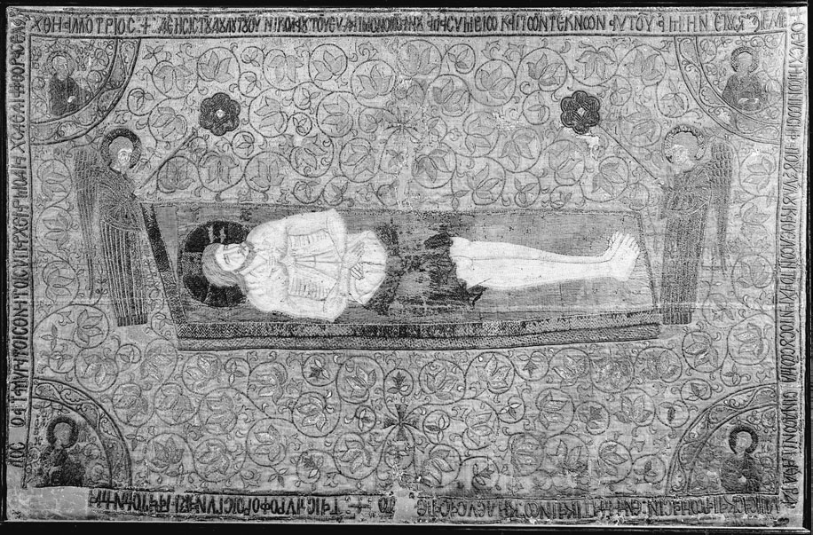
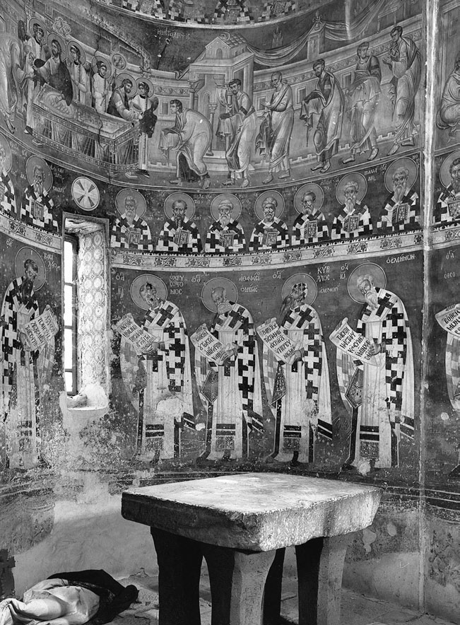
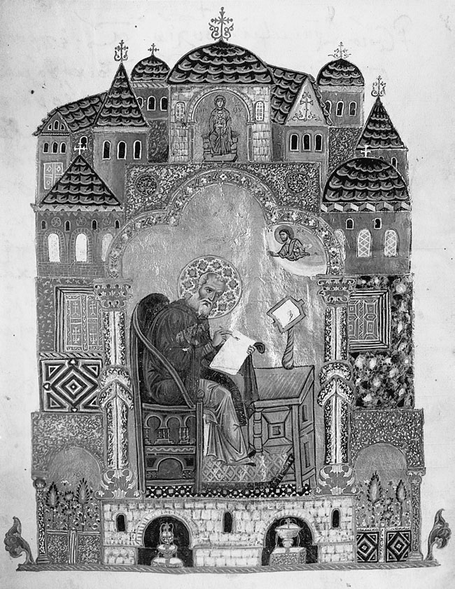
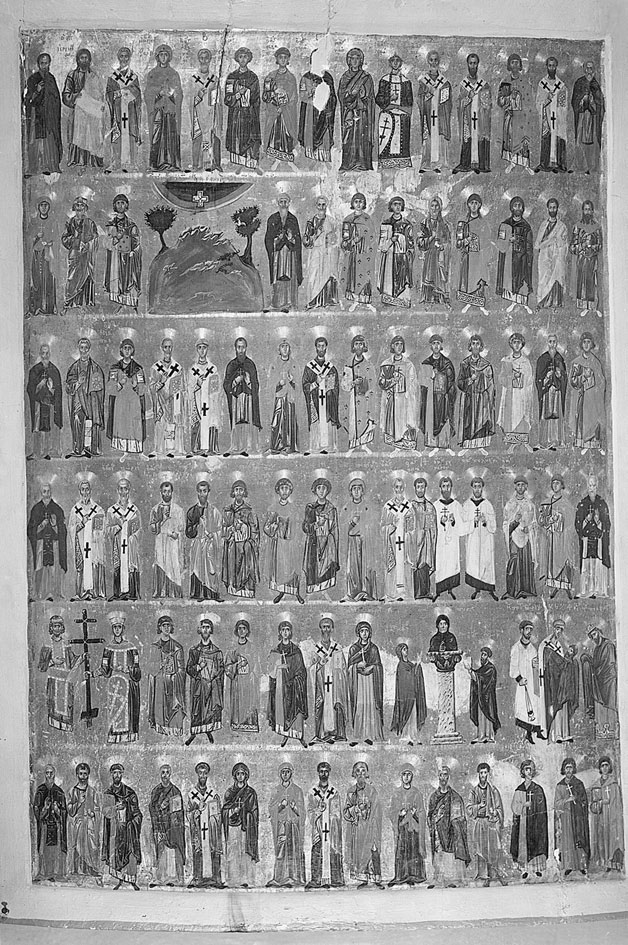
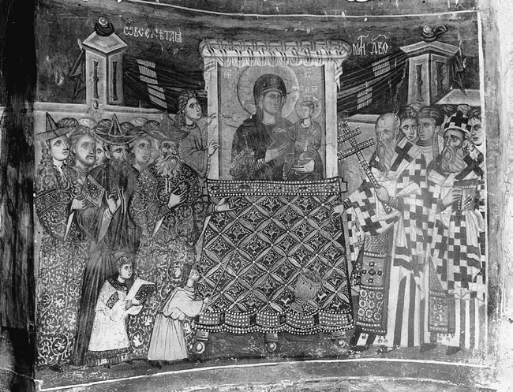

<!-- PDF page 148; original page 127 -->

# 第5章 拜占庭帝国晚期的艺术与礼仪

南希·P. 舍甫琴科

通常认为，到十一世纪，拜占庭礼仪文本已基本定型，并在希腊语世界的大部分地区以相当一致的方式举行。就圣餐礼而言，这一判断大体正确，不过此后仍有发展：圣金口约翰的圣餐礼仪广泛取代圣巴西略的礼仪，圣餐礼开始前的备祭礼（prothesis）也有所扩充。然而，就教会年历中的节庆而言，情况便不尽相同，因为即使帝国终结之后，基本纪念历中仍不断加入新的圣徒，并继续为节庆创作新的诗歌作品。这一时期礼仪史上最重要的发展，是君士坦丁堡大教会礼仪与巴勒斯坦修道礼仪的融合；这一过程始于九世纪，到十二世纪才完成。前者的宏大排场，因后者富有诗意的圣歌而更加丰富。然而，直至十五世纪，帖撒罗尼迦教会仍保留大教会礼仪——即所谓“歌唱礼序”（Asmatike akolouthia）——的某些要素。其繁复仪式对十四世纪巴尔干艺术产生了一定影响。[^p148-1]

要界定拜占庭中晚期艺术与这种礼仪的关系，并非易事，因为这一时期留存至今的拜占庭艺术，大部分都<!-- PDF page 149; original page 128 -->受到广义教会实践的支配，甚至从根本上由其决定。礼仪在许多层面影响艺术：选择表现什么主题，如何安排其位置，一幅构图内部的图像细节，场景的整体构想，以及呈现它的风格。以往研究以不同方式处理这批庞大材料。斯特凡内斯库的基础性著作《礼仪的图像表现》，以圣餐礼为重点，认为教堂环境中的各种主题，在某个层面上都是对圣餐礼的图解。[^p149-2] 沃尔特的《艺术与仪式》，特别关注拜占庭艺术如何表现各种礼仪仪式。[^p149-3] 帕拉斯的研究《受难与安葬》，部分探讨了十二世纪“新”修道礼拜的影响，揭示艺术与礼仪的关系绝非静止不变，而可以说具有自身的历史。[^p149-4] 安德烈·格拉巴尔和戈尔达娜·巴比奇的许多专题研究，也探讨了艺术与礼仪的关系。[^p149-5]

本章首先将拜占庭礼仪分为两个主要部分：圣餐礼，以及与教会年历循环相关的仪式。随后，将转向主要由修道者举行的日课，即一天中各时辰的礼拜，以及与之相伴的圣歌创作。前两个部分，即圣餐礼与历法，大致对应这一时期拜占庭教堂的空间划分：一是中殿（naos），属于平信徒——包括修士——的空间；二是圣所，保留给已受圣职的教士。它们也对应两种时间观念：圣餐礼旨在超越时间，教会历却以时间为根本的组织原则。[^p149-6] 在各部分中，<!-- PDF page 150; original page 129 -->分析都将先讨论相关礼仪手稿的插图，不过我们很快就会发现，拜占庭礼仪艺术绝非一种以文本为基础的艺术。

## 圣餐礼

### 圣餐礼手稿中的文本与图像

礼仪中的“常式”，即固定不变的部分，见于礼仪祈祷书（euchologion）；这类手稿的现存例子可上溯至八世纪。它们通常包括圣金口约翰和大圣巴西略的圣餐礼文本，以及供司祭使用的其他各种礼拜和祷文。[^p150-7] 虽然完整的礼仪祈祷书手稿从不配插图，但早在十一世纪，其中某些祷文便已附有细密画。这些是所谓“默祷”，即主礼司祭或主教以几乎不可听见的声音诵读的祈祷；它们依礼拜次序汇集、抄写于羊皮卷上。这些“礼仪卷轴”（εἰλητάρια）包含拜占庭三种礼仪的祷文，即金口礼仪、巴西略礼仪和预先祝圣礼仪；有时也包括辅祭的应答，以及授予圣职的仪式程序。礼仪卷轴若有图像装饰，通常也仅限于卷首题饰和带人物的首字母。[^p150-8] 卷首题饰描绘礼仪的作者；首字母可能与祷文的含义或措辞略有关联，却往往带有世俗性质。帕特莫斯的一份卷轴，可能属于十二世纪，载有大圣巴西略的礼仪。画中，巴西略在祭台前主持礼拜，上方由穹顶和大理石饰面构成的繁复建筑，与同时代科穆宁时期的教堂建筑和细密画十分相似。巴西略手持一卷文书，推测就是他所写、接着出现在这份羊皮卷轴上的那些祷文。[^p150-9]

插图很少具有高度复杂的思想内涵，但耶路撒冷的一份礼仪卷轴——希腊牧首区藏斯塔夫鲁109号，十一世纪后期君士坦丁堡的作品——却作了非同寻常的尝试，以视觉方式<!-- PDF page 151; original page 130 -->阐释各篇祷文所蕴含的神学。每篇祷文开头的边栏人物和首字母，意味着福音节庆被附着于特定的圣餐祷文。某些主题，如备祭祷文所配的初步“天上礼仪”图式，直到很久之后的巴列奥略时期，才在大型绘画中得到发展。[^p151-10]

### 用于圣餐礼或与之相关的器物上的圣餐主题

圣餐仪式尤其密切地反映在礼仪器具上，尽管拜占庭中晚期制作这些器具的材料，通常不如早期基督教时期贵重。[^p151-11] 圣盘上可能刻有基督在最后晚餐时说的话——“你们拿着吃，这是我的身体……”——也就是司祭祝圣圣饼时所诵读的文句。一种称为“圣母饼盘”（panagiarion）的器皿，用于把备祭礼中奉献给圣母的饼送入圣所；拜占庭晚期，其多人物装饰日益繁复。阿索斯山克塞罗波塔穆修道院的一件十四世纪皂石制品，就同时表现“天上礼仪”和“使徒领圣餐”；此时，两者已是圣所装饰的常见主题。[^p151-12] 用于覆盖圣爵或圣盘的覆巾（aer），早在十二世纪就已用这种领圣餐场景装饰。[^p151-13] 用于祝圣饼的饼印，展示了一系列与其礼仪用途直接相关的主题。[^p151-14] 大型金属游行十字架上，常见三圣代祷像（Deesis：基督居中，圣母与施洗者约翰在两侧向他祈求），或基督受难像；两者都是适当的选择。[^p151-15] 到十四世纪初，同时覆盖圣爵和圣盘的大覆巾，已成为<!-- PDF page 152; original page 131 -->圣葬布（epitaphios，绘有圣葬图的织物；图5.1）的灵感来源。这是一种大得多的织物，上面绣着死去的基督伸展于石板上、即将安葬的形象；其依据，是将大进堂礼解释为护送基督前往坟墓的行列这一古老释义。也许正因为它的装饰，圣葬布后来被引入一种截然不同的礼仪语境，即圣星期五和圣星期六的仪式；至迟在十四世纪中叶，这一用法已经确立。然而，到了十五世纪，其圣餐意义逐渐减弱，天使侍立于献身受祭的基督身旁这一单纯鲜明的形象，往往被多人参与的“哀悼基督”场景取代。[^p152-16]

礼仪中穿戴的各种圣职服饰，在拜占庭晚期日益繁复。主礼者的袍服绣有福音场景、圣者肖像，甚至礼仪本身的文句。例如，辅祭的奥拉里翁肩带可能绣有取自《凯旋颂》的“荣耀，荣耀，荣耀”；罗斯都主教佛提奥斯（1408—1431年）的小萨科斯礼袍，则以《信经》文句装饰。[^p152-17] 然而，严格意义上的礼仪主题，在圣服上相对少见。无论如何，要从礼仪角度解释圣服上的福音图像，就必须预设一种特定的历史化礼仪释义：把圣餐礼视为基督全部生平的重演。这种解释尤以十一世纪安迪达的尼古拉斯的注解最为人熟知，也构成了上述耶路撒冷卷轴插图的基础。[^p152-18]

人们往往认为，圣像是举行礼仪不可分割的一部分。圣餐礼文本并未提到圣像；考虑到其形成时间很早，这一点毫不奇怪。圣像从来不是礼仪器具。然而，它们的存在本身，就与圣餐礼相联，因为如同后殿中的圣母像，圣像确认了道成肉身的讯息，以及物质能够被圣化、获得神圣性的可能；这正是圣餐礼的核心。十四世纪起，礼仪规程开始提到圣像。

<!-- PDF page 153; original page 132 -->

*图5.1 圣葬图织物。基督躺在石板上，天使持扇侍立。伦敦维多利亚与阿尔伯特博物馆。*

<!-- PDF page 154; original page 133 -->

不过，这些记述涉及在中殿举行的各种预备仪式，而非圣餐礼本身。

此时，圣像已安置于圣所屏障或圣像屏（templon / iconostasis）上，直接面向会众；这一屏障把中殿与后殿及圣所（bema）分开。更早的十一世纪，通常的圣所屏障在地面高度以栏板封闭，上部却仍然开放，间隔较宽的柱子支撑着横楣。柱间原先以帘幕遮闭，十二世纪逐渐被大型圣像板取代，形成一道圣像墙，阻断从中殿望入圣所的视线。[^p154-19] 圣像屏上的圣像包括基督、圣母，也常有教堂所奉献的圣者或事件。横楣或直接绘画，或在上方承托一排圣像。在横楣圣像中，三圣代祷像的三位人物，可能加入天使和使徒，形成所谓“大代祷像”；也可能在两侧排列节庆圣像，描绘从圣母领报到圣母安眠（Koimesis）之间，基督及其母亲生平的重要事件。这些圣像以更小的规模和更集中的形式，重复教堂其他部位的节庆图像。圣像屏图像与主要节庆循环图像之间的功能差异，至今仍未完全厘清。从中殿进入圣所，须经过圣像屏中央的门；门上常绘圣母领报像，因为《以西结书》46:1—2所说紧闭的门，被解释为指向圣母及道成肉身的奥秘。

有学者提出，某些脱离原有环境而留存至今的大型双面圣像，原先来自圣像屏，传达着双重讯息：一面对会众，另一面朝向圣所，面向教士。[^p154-20] 这些圣像朝向圣所的一面所绘的主题，可能被有意识地整合进该空间整体的绘画体系；朝向中殿的一面则不同，如上所述，它往往重复中殿已有的图像要素。从圣像屏面向中殿的基督与圣母大型形象，<!-- PDF page 155; original page 134 -->即使不参与实际礼仪，也在平信徒虔敬中发挥重要作用。

圣餐主题在圣像屏圣像上十分少见，实际上，在各种圣像上都很少见。[^p155-21] 然而，献祭母题确实进入了较晚的拜占庭图像，例如带有受难器具的圣母子像，以及“忧患之子”（Akra Tapeinosis）像；此外，还有下文将讨论的若干预表主题。[^p155-22]

### 圣所空间的装饰

到十一世纪之交，圣所区域——后殿及圣所的下层墙面——几乎完全由圣餐主题占据。[^p155-23] 这一发展无疑与该空间中举行的仪式相联，也与圣像屏的封闭有关。后殿墙壁上绘着站立的主教，其中，两种主要礼仪的作者金口约翰与大圣巴西略，位置最靠近中央。主教手持福音书，身着奥摩佛里翁肩带；这是他们受按立为主教时获得的身份标志。

主教上方绘有“使徒领圣餐”：基督从画中的祭台上，将饼与酒递给自左右两边前来的十二使徒（图5.2）。这一主题取代了“历史性的”最后晚餐；背景中常写有基督当时说出、又由主礼者重复的设立圣餐之言：“你们拿着吃，这是我的身体……”这种构图从十一世纪起流行起来，细心描绘了当时圣餐礼的细节，包括器皿、祭台华盖，以及正确的礼仪手势。天使辅祭站在祭台旁，手持礼仪扇（rhipidia）。[^p155-24] 基督的形象，或多个形象——因为他常被画两次，一次递饼，一次递酒——从十四世纪起，首次被描绘为穿着君士坦丁堡牧首的萨科斯礼袍。

“使徒领圣餐”的构图一直十分稳定，主教行列却在十二世纪有了新的面貌。

<!-- PDF page 156; original page 135 -->

*图5.2 使徒领圣餐，以及手持礼仪卷轴的主礼主教。斯塔罗纳戈里奇诺，后殿南半部。*

<!-- PDF page 157; original page 136 -->

他们不再是正面站立的人物，而是朝祭台躬身的主礼者，展开的卷轴上写着“默祷”的开头；所选祷文，正出自上文所述羊皮“礼仪”卷轴汇集的文本。[^p157-25] 几个世纪中，人数不断增加：不仅后殿，圣所墙壁上也列满主礼者；其上还增加一排排圆框半身像，仿佛想象教会历史上的所有主教都聚在一处圣所，共同举行礼仪。

主教朝向后殿墙壁中央画出的祭台，或朝向那里表现基督献祭的某种图像。这类图像形式多样：一种是“预备宝座”（Hetoimasia），受难器具——荆冠、长矛、海绵——置于宝座上或附近，两旁是身着辅祭服的天使；另一种则是令人震动的圣婴形象，躺在圣盘或祭台上，盖着覆巾，仿佛他就是即将被擘开的饼。[^p157-26] 这一鲜明图像最早有明确年代的例子，见于1199年的库尔比诺沃教堂。[^p157-27] 当地的图像题为“羔羊”（Amnos）；十三世纪起，它也被称作“分割像”（Melismos，意为分割或擘开）。[^p157-28] 随着备祭礼的发展，人们又认为，圣饼祝圣发生于大进堂行列之前的备祭处，而非圣所内；于是，后殿或备祭处中圣婴躺在圣盘上的图像，逐渐让位于成年基督死后伸展在墓石上的形象，墓石使人联想到他的坟墓。正如我们所见，这一图像后来转移到圣葬布上。[^p157-29]

后殿图像体系强烈的圣餐倾向，使空间上与之相关的其他图像也获得圣餐意味。例如，印有基督面容的圣物“圣容布”（Mandylion），成为道成肉身的标志，因此常与圣母领报图相联。然而，当它被置于后殿、取代“羔羊”图像时，便获得了圣餐意义。[^p157-30]

<!-- PDF page 158; original page 137 -->

### 天上礼仪与其他圣餐图像

拜占庭晚期出现了一种富有戏剧性的圣餐图像，即“天上礼仪”：天界最尊贵的居民——天使——在上帝宝座前永恒举行的礼仪。[^p158-31] 此前，耶路撒冷卷轴已经略露其端。[^p158-32] 在壁画中，例如米斯特拉佩里布莱普托斯教堂，天使承担辅祭和司祭的角色，身着相应圣服，列队将圣爵、圣盘、星盖（asterikos）及覆巾等礼仪器具，从备祭处运往圣所，生动再现大进堂礼。这一行列或被描绘为在穹顶环绕基督，或位于天使启程举行大进堂礼的备祭处，甚至出现在后殿本身。

另一些图像更纯粹具有预表性质。圣所或后殿附近，常出现《旧约》中预示献祭的场景：以撒被献为祭，亚伯拉罕向来访的三一献上食物，以利亚受乌鸦供养，或烈火窑中的三位希伯来青年；其中许多主题的源头，可远溯至早期基督教的大型绘画。取自圣徒传的圣餐图像，则包括沙漠隐修者埃及的马利亚从佐西马斯领圣餐，[^p158-33] 以及“亚历山大里亚的彼得的异象”；后者最初表现反阿里乌派的神学，后来因基督被置于祭台之上站立，而成为一种礼仪宣示。[^p158-34]

## 教会年历的循环

### 福音经课集与使徒经课集中的文本与图像

一年中每日应读的福音段落，从《圣经》中摘出，依教会历的需要重新编排，构成“福音经课集”。通常的经课集，先列日期取决于复活节的移动节期读经，从复活节主日至次年圣周结束。大斋期的读经，大体依次取自四位福音作者——约翰、马太、路加，以及大斋期的马可。在这些移动节期的福音读经之后，是冗长的固定节日历，即每年在同一日期庆祝的节日，并注明指定读经。大多数固定节日纪念圣徒，但也包括<!-- PDF page 159; original page 138 -->福音故事中的重要事件，如圣母诞生与进殿、基督降生、受洗、献于圣殿、圣母领报、显容，最后是圣母安眠。这些事件并非按历史发生顺序排列，而是依它们在一个教会年中受庆祝的次序安排。福音经课集的这一历法部分，有些手稿称“圣徒月录”（menologion），有些称“圣徒纪念集”（synaxarion），从9月1日开始，至8月31日结束。当日应读的福音段落，或全文抄出，或在手稿前部已全文出现的情况下，仅注明交叉参照。福音经课集的插图类型差异很大：有的手稿载有整页节庆图像，另一些却仅有两三个带人物的首字母。一部福音经课集——梵蒂冈希腊文1156号——试图在相应条目的正文和边栏中，表现每一位受纪念的圣徒及每一个事件；另一些的插图则限于福音作者像、若干重大节庆细密画，以及较重要圣徒的肖像。[^p159-35]

福音经课集将基督生平事件从历史顺序中抽离，改按教会历重新编排。这种礼仪重排反过来影响了某些福音书的插图：每卷福音前置一幅基督生平事件的细密画，但所选主题取决于该福音段落在哪个节日诵读。[^p159-36]

另外两种经课书，是“使徒经课集”（praxapostolos，选读《使徒行传》与书信）和“先知经课集”（prophetologion，《旧约》读经）。后者从不配插图，前者的插图则主要是《新约》这一部分各位作者的肖像。

库尔特·魏茨曼认为，插图福音经课集，是这一时期拜占庭教堂墙壁上福音节庆图像的来源。[^p159-37] 如果假定每幅图像都<!-- PDF page 160; original page 139 -->源于书籍，是专为某篇文本而创作，随后才转移至其他媒介，那么，福音经课集当然是最可能的来源。遗憾的是，配有节庆场景的福音经课集数量，远远不足以使这一理论令人信服；绝大多数插图经课集的装饰，仅限于四福音作者肖像。此外，拜占庭图像具有独立性质，很少是某一单独文本的字面图解；因此，更可能的情况恰好相反：节庆循环的图像首先在大型绘画或圣像上形成，随后才进入插图手稿及其他媒介。

### 讲道集与圣徒传集中的文本与图像

教会历的观念，内在于许多其他类型的礼仪书。[^p160-38] 十一世纪起，供特定节日诵读的讲道集，便在手稿中按诵读节日的日期编排。[^p160-39] 纳齐安祖斯的格里高利《讲道集》的手稿，尤其如此（图5.3）；如同福音经课集，它以复活节读经开篇，在这里，就是格里高利的一篇复活节讲道。其插图通常限于卷首题饰和首字母，虽然往往反映讲道内容，却也呼应诵读该讲道的节日。[^p160-40] 金口约翰的讲道，也在整个教会年中的礼拜里诵读，且常配插图，却不像格里高利的讲道那样按教会历编排。[^p160-41] 尼科米底亚的乔治等其他作者的讲道，在特定节日诵读，对该节庆的图像表现产生了巨大影响；其影响或直接发生，或通过以这些讲道为基础的圣歌间接发生。[^p160-42]

<!-- PDF page 161; original page 140 -->

*图5.3 纳齐安祖斯的格里高利撰写讲道。西奈山，希腊文抄本339号，第4叶背面。*

<!-- PDF page 162; original page 141 -->

循环教会历的观念，内在于圣徒传手稿；这类手稿记录一年中每日应纪念的圣徒或事件。约1000年的《皇帝巴西略二世圣徒月录》（梵蒂冈希腊文1613号），共配有430幅独立细密画，记录教会年前六个月——9月至次年2月——每日不少于一项的纪念。实际上，由于各位圣徒的记述十分简短，其文本属于圣徒纪念集。图像以圣者肖像和殉道场景为主，也包含福音节庆及对君士坦丁堡有意义的纪念，例如圣髑迁入城内，以及城市遭受的自然灾害。每幅图像与一篇16行的圣徒事迹摘要共占一页。在一些情况下，尤其是地震等灾难，事件本身的表现，被纪念它的礼仪庆典图像取代。[^p162-43] 这项庞大工程只有第一卷留存至今；第二卷是否曾经制作，不得而知。

有一部较晚的作品可与巴西略《圣徒月录》相提并论：牛津收藏的一部十四世纪手稿，以单卷呈现一年中每日纪念的图像。除卷末诗和细密画的韵文题注外，它完全没有正文。其图像源头似乎在于大型绘画中的历法循环，而非任何可追溯至《巴西略二世圣徒月录》的手稿传统。[^p162-44]

较长的圣徒传文本，也按历法次序汇编。[^p162-45] 十世纪末，改写者西缅（Symeon Metaphrastes）撰写的《圣徒传》，在十一世纪被编为十卷：第一卷为9月圣徒，最后第十卷收录5月至8月的圣徒。这些传记供修道院晨祷（orthros）时诵读。尽管圣徒生平具有丰富的叙事性，为西缅这些作品配制的大篇幅细密画循环，却十分

<!-- PDF page 163; original page 142 -->

*图5.4 五月月历圣像。西奈山圣凯瑟琳修道院。*

<!-- PDF page 164; original page 143 -->

少见。[^p164-46] 通常做法，是在每位圣徒传记开篇的绘画题饰中，或以取代题饰的方式，放置其肖像。一套年代为1063年的卷册，将某卷全部传记人物的形象集中在同一叶，作为该卷卷首插图。这类群像，与同时代的月历圣像（图5.4）完全对应，也与米蒂利尼的克里斯托弗及其他作者在十一世纪及此后创作的历法助记诗相呼应。[^p164-47]

### 教堂装饰中的教会年历

组成整个教会年的事件和圣徒形象，充满拜占庭教堂中殿。穹顶拜占庭教堂内部独具特色的建筑与装饰之间的惊人协调，将这些纪念转变为一个体系；每一组成部分，相对于中央穹顶或拱顶中的基督形象，以及相对于彼此，都有特定位置。[^p164-48] 环绕基督的是天使或先知；《新约》重要事件，以大约十二幅节庆场景的形式，排列在拱顶或上层墙壁；较低处的墙壁，以及转角小堂等附属区域，则排列着圣徒图像。这一体系直到后拜占庭时代才被编订成文，[^p164-49] 但教堂图像体系中的各要素，相对于基督和彼此的位置，在大多数拜占庭教堂中都相当一致地重复出现，无论主教座堂、堂区教堂还是修道院教堂。

这里值得注意的是，教会历对于图像体系具体组织的影响竟如此微小。例如，圣徒完全不按纪念日期排列，而按身份分类：使徒、战士、修士、女性圣徒、隐修者或柱头修士，<!-- PDF page 165; original page 144 -->各类被安排在教堂特定区域。由于空间不足以表现教会历史上的全部圣徒，所画者便是各圣徒“班列”或类别的领袖、最著名的人物。在这一点上，他们像宫臣朝见皇帝一样，按界限明确的群体接近基督。这种圣徒排列，与通常位于中殿之外、尤其前厅中的历法循环形成鲜明对照；后者延续《巴西略二世圣徒月录》的传统，逐月表现全年教会纪念。[^p165-50] 在中殿，圣徒已从世俗时间和历法时间的轮转中获得解放。

在节庆构图中，情况略有不同。它们环绕中央基督形象旋转，仿佛教会年的循环运行。然而，拜占庭教堂中的节庆循环并不遵循历法的礼仪顺序，而保留了历史时间的要素：各事件大致依基督生平次序展现，起于设在中殿东部的圣母领报。保留历史时间的某些方面，使拜占庭晚期的教堂图像体系更容易纳入严格遵守叙事次序的基督受难循环，或圣母生平循环。各节庆的具体位置，会因教堂建筑而异，但总有可以识别的年代顺序。不同时间观念始终相互对话。圣星期四的濯足礼（Pedilavum），有时就在基督为十二使徒濯足的图像下举行。[^p165-51] 在这里，福音事件、事件图像与礼仪纪念彼此呼应，与这些时间层次形成丰富共鸣。

世俗时间被推得离圣所越来越远，甚至离开中殿，进入教堂西端的前厅。前厅装饰的主题较为灵活，强调它作为预备空间的作用。有学者认为，其主要礼仪主题，与圣诞及圣周之前数周斋期的忏悔和准备性质相关。[^p165-52] 拜占庭中期，个别<!-- PDF page 166; original page 145 -->圣徒的生平开始被绘在前厅或侧小堂中，有时多达十或十二个不同片段。这类循环常与坟墓相联；在这种情况下，其目的似乎是讲述圣徒哪些事迹使他或她获得上帝垂听，成为死者有效的代祷者。不过，前来敬拜的信众也可以随时到圣徒肖像前祈求，不受教堂内部严格等级秩序和教会历的限制。

## 其他教会仪式

当然，还有许多只在不定期场合举行的礼拜：授予圣职、洗礼、婚礼、丧礼，以及教堂祝圣、房屋祝福、井水洁净，甚至——至少对牧首而言——加冕礼。每一场合都有自己的仪式，却少有在艺术中留下重要痕迹者。[^p166-53] 这些礼拜的图像，大多嵌入圣徒生平绘画循环或编年史之中。例如，授予辅祭、司祭和主教的三次按立，是圣尼古拉斯生平图像循环的常见部分。[^p166-54] 安葬场景最初表现一位圣徒被置入石棺、旁有主教奉香，后来逐渐繁复；十四世纪有些描绘圣尼古拉斯等人去世的精美丧礼图像，甚至包括歌者。[^p166-55] 圣以法莲或圣萨瓦等隐修者的死亡场景，则置于广阔的山坡与洞穴景观中，其他隐修者从中走出，参加为亡故同道举行的露天仪式。[^p166-56]

人们在个人忌日举行追思礼（μνημόσυνα）。皇帝约翰·科穆宁在1136年为君士坦丁堡全能者修道院制定的院规中规定，每逢他本人、妻子和儿子的忌日，都应将著名的引路圣母像从其圣所抬出，横穿城市送往修道院，放置在他的墓旁，停留一夜。翌日，“应在神圣圣像在场时举行神圣礼仪”。[^p166-57]

<!-- PDF page 167; original page 146 -->

约翰的兄弟伊萨克·科穆宁，安葬于色雷斯世界救主圣母修道院；该院由他在1152年创建。圣母和基督的圣像，应永久安置于其墓旁，院中修士须每日经过墓前，“在立于彼处的神圣圣像之前”为其灵魂祈祷。[^p167-58] 这些圣像没有特定礼仪功能，却为墓旁的代祷提供焦点，无论这种祈祷每年举行还是每日进行。科穆宁时期的这类文献证据令人感兴趣，因为它暗示圣像与实际礼仪之间的关系，比仅依赖图像或礼仪史料所能推测的时间更早。

这类坟墓的建筑环境，主要是墓穴上方的拱龛（arcosolia，即墙壁凹龛），带有绘画、雕刻，或两者兼有的装饰；但图像主题通常关乎救恩，而非丧礼本身。[^p167-59]

## 时辰礼仪

### 日课手稿中的文本与图像

修道生活对拜占庭礼仪发展的最大贡献，是其圣歌；它在九世纪初，随巴勒斯坦修道礼拜程序进入君士坦丁堡。拜占庭的《时辰书》（horologion），自九世纪起便有手稿见证，提供一天中各主要时课——第一、第三、第六、第九时课——的文本，以及晨祷、晚祷和寝前祷（apodeipnon）的文本。它很少配插图：现存时辰书中，只有两部具有较完整的插图体系。一部为十二世纪末作品，现藏莱斯博斯，为一日每个时辰设置一项礼拜；另一部为十五世纪克里特作品，现藏巴尔的摩。[^p167-60] 两者的插图都主要借自其他类型手稿。例如，晨祷中取自《圣经》的颂歌，采用《诗篇》手稿中熟知的传统颂歌构图。在巴尔的摩《时辰书》中，第三、第六、第九时课，分别配以圣灵降临、基督受难和哀悼基督场景，<!-- PDF page 168; original page 147 -->因为《圣经》明确记载了原事件发生的时辰，即第三、第六、第九时，相应的修道时课便成为对圣经事件的某种纪念。因此，这三件事不再只于每年纪念，而可以每日庆祝。

《诗篇》是主教座堂和修道礼仪的基本组成部分，也是最常配插图的礼仪文本之一。有些《诗篇》手稿的页边带有重要的视觉注解；这些注解倾向于强调段落的预表和神学意义，而非礼仪用途。[^p168-61] 《旧约》颂歌一贯被收录于《诗篇》手稿中，曾是晨祷不可缺少的部分，也常是装饰的主要重点。九篇圣经颂歌各自发展出稳定的图像：或描绘引发颂歌的事件，如三位希伯来青年、渡红海、摩西受律法、约拿与鲸鱼等；或表现相关人物——大多数是先知——举起双臂，向上帝献上赞歌。[^p168-62] 与其他颂歌不同，最后一篇《尊主颂》的配图，在拜占庭晚期艺术中继续发展；这是唯一取自《新约》的颂歌（《路加福音》1:46—54）。圣母在往见伊利莎白之后赞美上帝的形象，开始越来越像怀抱基督的圣母圣像。于是，《尊主颂》的图像又被重新塑造；耶路撒冷的一部《诗篇》——希腊牧首区塔富55号——就表现一名赞助者走向站立的圣母子。圣母已成为接受祈祷的人物，而非亲自向上帝祈祷的人物。[^p168-63]

以年历循环为基础的礼仪手稿，包括供固定节日使用的《月课经》（menaion）、大斋期的《三歌经》（triodion），以及复活节主日至圣灵降临节期间的《五旬经》（pentekostarion）。它们较晚才发展为独立书籍，分别在十二、十、十四世纪，但合在一起，记录了一年中每日的圣歌、祷文和读经。某些特定圣歌类型的合集，例如按八周循环编排、供每周各日使用的《八调经》（octoechos），<!-- PDF page 169; original page 148 -->以及依节日日期顺序编排短诗的《附经诗集》（sticherarion），偶尔也有某种插图。墨西拿的一部《八调经》，在复活附经诗（stichera anastasima）之前，配有相传为《八调经》作者的大马士革的约翰的非同寻常图像。这些图像并不根植于其他手稿插图，显然是围绕修道文本进行的自由而独特的创作。[^p169-64]

修道礼拜由不同长度的圣歌构成，尤其重要的是“圣颂典”（canon），一种由九首诗或颂歌组成的音乐作品。至十一世纪，它已取代晨祷中吟唱的九篇圣经颂歌；数篇圣颂典可以逐歌交织演唱。较早的一种圣歌类型“孔达克颂歌”（kontakion）被圣颂典取代，在日课中仅以简略形式存续：其序颂（proimion）与第一诗节（oikos，即孔达克的一组诗句），可能插在圣颂典第六歌之后。不过，有一篇孔达克颂歌——《不坐颂》（Akathistos）——至少每年仍会完整吟唱一次，即在大斋期第五周的星期六。这是一篇分为24节、献给圣母的颂歌，相传出自六世纪诗人罗马诺斯之手。十四世纪起，《不坐颂》文本有时也收入《诗篇》手稿。[^p169-65] 其前半部分叙述从圣母领报到基督献于圣殿的童年故事，后半部分则专注于对圣母的华美赞颂。有一部精美的拜占庭手稿，几乎完全用于呈现这一篇诗歌。[^p169-66] 叙事部分的插图相当传统，但到了纯粹赞颂的诗节，便出现有趣的圣母图像：信众环绕她周围，而她的姿态开始呼应十四世纪已发展出的某些圣母圣像类型。在这首古老颂歌中对圣母的敬礼，越来越常被构想为对圣母圣像的敬礼。在最后的第24节，信众被十分直接地描绘为敬礼一幅特定圣像：引路圣母像置于覆有织物的木架上。[^p169-67]

<!-- PDF page 170; original page 149 -->

*图5.5 《不坐颂》第24节。马尔科夫修道院，圣德米特里奥斯教堂，圣所北墙。*

至于圣颂典插图，却没有堪与精美《不坐颂》插图（图5.5）相比的作品。一组水准平常的细密画，伴随“灵魂与身体分离圣颂典”；这些画附于上文提到的莱斯博斯十二世纪末《时辰书》手稿，并与之同时。图像追踪灵魂从临终修士身体中脱离、接受审判，并初步升入乐园的过程。此圣颂典的每一歌都有配图，与诗句内容紧密相联。另一组可比而无直接关联的图像，置于十二世纪一部《诗篇》之前——阿索斯山迪奥尼修65号；它们在这里并不附于圣颂典，而附于一组极少使用、按字母顺序排列的祷文，供修士在独居室内私人祈祷，而非共同礼拜。[^p170-68] 莱斯博斯插图每歌一幅细密画的格式，也见于另一篇圣颂典：收入约翰·克利马库斯《天梯》手稿的“忏悔圣颂典”。图像置于每一歌之前，因此<!-- PDF page 171; original page 150 -->以可预测的间隔反复出现。[^p171-69] 在这些配图的圣颂典中，只有“灵魂与身体分离圣颂典”曾进入大型绘画。

### 大型绘画中的圣歌

十二世纪起，拜占庭教堂墙壁上出现圣歌作者的肖像，表明圣歌对大型绘画的重要性。[^p171-70] 例如，在内雷齐教堂（1164年），北墙整个下部都用于表现五位诗人，其中包括斯图迪奥斯的狄奥多若与圣歌作者约瑟夫，两人都生活至九世纪。这些圣歌作者的位置，比西侧的战士圣徒更为显要，并与对面南墙上深受敬仰的早期教会修道圣徒平等。[^p171-71]

不过，圣歌对大型绘画的影响，并不总是容易评估。诚然，某些特定圣歌被直接图解在教堂墙上。例如，十四世纪初以后，《不坐颂》相当经常地进入教堂图像体系；在各种媒介中，最早的循环是约1300年绘于埃拉松奥林皮奥蒂萨教堂的作品。[^p171-72] 大马士革的约翰的圣诞附经诗，也在某些十四世纪巴尔干教堂中被图解：传统圣诞构图被从节庆序列中分离出来，扩展为包括信众人物的场景，甚至出现真实历史人物，表现他们通过吟唱这首圣歌庆祝节日。[^p171-73] 阿索斯山希兰达尔修道院的一座塔楼中，则绘有一系列图解“灵魂与身体分离圣颂典”的场景。[^p171-74]

<!-- PDF page 172; original page 151 -->

有时，某个节日所唱圣颂典的作者，会被画在该节庆场景旁，甚至置身其中。例如，在帕特莫斯的修道院食堂，圣歌作者科斯马斯与大马士革的约翰，如同一对先知，使手中卷轴垂入基督受难场景。[^p172-75] 他们也出现在圣母安眠图两侧，卷轴上写着各自安眠圣颂典的文句。有时，两位圣徒甚至进入构图边框之内，站在哀悼的使徒附近，只是身形略大。在这些构图中，圣歌作者与上文的歌者一样，将过去的事件与当下的庆祝联系起来。

圣歌对节庆循环的影响更难把握。要将某个母题追溯至某一特定圣歌，并不总是容易，尤其当圣歌本身又依据更早的散文文本时。不过，罗马诺斯的基督受难孔达克颂歌，显然影响了一件十一世纪象牙雕刻，以及一幅十四世纪受难壁画；后者甚至题写了该颂歌的文句。[^p172-76] 人们认为，十二世纪起，圣歌对受难事件更具情感感染力的新版本的发展，产生了重要影响。帕拉斯与贝尔廷主张，涉及圣母哀哭的读经和圣歌，在十二世纪被引入新形成的圣星期五礼拜，促成“忧患之子”（Akra Tapeinosis）圣像类型。如果这一观点正确——人们也许过度强调了相关礼拜的“新”——那么，这些发展就代表了圣所之外，礼仪与艺术之间最清晰、最密切的联系。[^p172-77]

### 其他媒介中的圣歌

在这一方面，圣像绘画与大型绘画的发展大致相同。有些圣像以《不坐颂》24节环绕圣母；有些圣母安眠像包括圣歌作者科斯马斯和大马士革的约翰。“忧患之子”有时与哀悼圣母的半身像配成双联画，成为<!-- PDF page 173; original page 152 -->人们熟悉的圣像类型；有学者推测，它实际参与了圣星期五礼仪。更确定参与这些礼仪的，是圣葬布，即绘有死去基督形象、大小如坟墓的大型覆布（图5.1）。它无疑参与了圣星期五与圣星期六的安葬行列；十四世纪已有这类行列的记载。

无论采用何种图像类型，圣母像常获得取自礼仪诗歌的称号，如“生命之泉”（zoodochos pege）、“广于诸天者”（platytera）、“至福者”（pammakaristos）等。[^p173-78] 偶尔，影响也反向发生。例如，拜占庭晚期显灵圣像日益增多，人们开始创作诗歌圣颂典，所颂对象不仅是圣母，也包括个别圣母圣像。这些献给圣像的圣颂典，似乎属于后拜占庭时期，但其中有些可能会被证实年代更早。[^p173-79]

## 结论

拜占庭礼仪及其注释者，不断处理尘世与天上时间的观念。圣餐礼被说成纪念基督献祭及此前的一系列事件，同时又是这些事件在上帝永恒领域中实现的图像和预表。[^p173-80] 它既唤起历史事件的次序，也唤起天国的无时间性。解释圣餐礼的作者，在安提阿与亚历山大里亚两种路径之间，在“历史”（Ἱστορία）与“观照”（Θεωρία）之间来回转换。[^p173-81] 由于以礼仪重现事件，已能联结过去与未来，这种艺术便无须依赖广泛的象征或寓意等其他联结方式，因此始终坚定地保持具象性质。

它也始终具有多重意义：建立严格一一对应关系的尝试，通常并不成功。各种礼仪循环和礼拜——移动节期、固定节日、时课、圣餐礼——在一天中彼此交错、重叠，因此，礼仪中可变的要素，不断为固定不变者赋予新的色调与意义。艺术也是<!-- PDF page 174; original page 153 -->如此。在一座教堂中，一幅图像与另一幅相互呼应，双方的意义都随之受到影响。圣服上与教堂墙壁上的同一图像，若被复制到书中，看起来可能完全相同；但在原有场所，它便因不同语境而各具色彩。拜占庭艺术不仅从礼仪获得丰富图像和深刻神学观念，也学会了如何进出时间，如何运用语境，使自身不断增添新的意义层次。

## 译校说明

- 原文在圣服段落将辅祭肩带上的文句写作“Glory Glory Glory”，此处依原文译为“荣耀，荣耀，荣耀”。
- 原文以《以西结书》46:1—2说明紧闭之门，并在读经编排段落两次提到“大斋期”（Lent）；这些引文定位与表述按原书保留。

## 注释

[^p148-1]: 关于这些发展的简要综述，参见 R. F. Taft, The Byzantine rite: a short history (Collegeville, MN: Liturgical Press, 1992) 及其收入下列文集的论文： Liturgy in Byzantium and beyond (Aldershot: Variorum, 1995). 另参见 T. Pott, La réforme liturgique byzantine: étude du phénomène de l’évolution non-spontanée de la liturgie byzantine (Rome: CLV – Edizioni liturgiche, 2000); S. Janeras, Le Vendredi-saint dans la tradition liturgique byzantine: structure et histoire de ses offices [Analecta liturgica 13; Studia Anselmiana 99] (Rome: Pontificio Ateneo S. Anselmo, 1988); H.-J. Schulz, The Byzantine liturgy: symbolic structure and faith expression (New York: Pueblo Publishing, 1986); G. Bertonière, The historical development of the Easter Vigil and related services in the Greek church [OCA 193] (Rome: Pontificium institutum orientalium studiorum, 1972); A. Schmemann, Introduction to liturgical theology (London: Faith Press, and Bangor, Maine: American Orthodox Press, 1966).

[^p149-2]: J. D. Stefanescu, L’illustration des liturgies dans l’art de Byzance et de l’Orient (Brussels: Institut de philologie et d’histoire orientales, 1936). 另参见 Schulz, Byzantine liturgy, esp. 79–80.

[^p149-3]: C. Walter, Art and ritual of the Byzantine church (London: Variorum, 1982). 另参见 N. K. Moran, Singers in late Byzantine and Slavonic painting [Byzantina Neerlandica 9] (Leiden: Brill, 1986) 其中有歌者参与仪式的图像。

[^p149-4]: D. I. Pallas, Die Passion und Bestattung Christi in Byzanz: der Ritus – das Bild [Miscellanea Byzantina Monacensia 2] (Munich: Institut für byzantinistik und neugriechische Philologie der Universität München, 1965).

[^p149-5]: 参见 A. Grabar, ‘Une source d’inspiration de l’iconographie byzantine tardive: les cérémonies du culte de la Vierge’, CA 25 (1976), 143–62; Grabar, ‘Les peintures dans le chœur de Sainte-Sophie d’Ochrid’, CA 15 (1965), 257–65; G. Babić, Les chapelles annexes des églises byzantines: Fonction liturgique et programmes iconographiques [Bibliothèque des cahiers archéologiques 3] (Paris: Klincksieck, 1969); Babić, ‘Les discussions christologiques et le décor des églises byzantines au XII siècle’, Frühmittelalterliche Studien 2 (1968), 368–86. 另参见 Vostochnochristjanskij chram: liturgija i iskusstvo, ed. A. M. Lidov (St Petersburg: Dmitrii Bulanin, 1994).

[^p149-6]: Schmemann, Liturgical theology, 20, 对后者使用“时间的礼仪”一语。参见 ibid., 38, n. 6, and 139–40.

[^p150-7]: S. Parenti, L’eucologio Barberini gr. 336 [Biblioteca ephemerides liturgicae 80] (Rome: CLV – Edizioni liturgiche, 1995).

[^p150-8]: B. V. Farmakovskij, ‘Vizantijskij pergamennyi rukopisnyi svitok s miniaturami’, Izvestija Russkogo Arkhaeologicheskogo Instituta v Konstantinopole 6 (1900), 253–359; V. Kepetzis, ‘Les rouleaux liturgiques illustrés, 11e–14e siècles’, 未刊论文，巴黎第四大学（1979）; S. E. J. Gerstel, ‘Liturgical scrolls in the Byzantine sanctuary’, Greek, Roman and Byzantine Studies 35 (1994), 195–204.

[^p150-9]: Patmos, Monastery of St John, Ms. gr. 707. 参见 A. Kominis, Patmos: the treasures of the monastery (Athens: Ekdotike Athenon, 1988), 289–91; figs. 25–34.

[^p151-10]: P. Vokotopoulos, Byzantine illuminated manuscripts of the Patriarchate of Jerusalem (Athens and Jerusalem: Greek Orthodox Patriarchate of Jerusalem, 2002), no. 19, figs. 43–58; A. Grabar, ‘Un rouleau constantinopolitain et ses peintures’, DOP 8 (1954), 163–99; Schulz, Byzantine liturgy, 80–9.

[^p151-11]: S. A. Boyd, ‘Art in the service of the Liturgy: Byzantine silver plate’, in Heaven on earth: art and the church in Byzantium, ed. L. Safran (University Park: Pennsylvania State University Press, 1998), 152–85, esp. 180–3; A. Ballian, ‘Liturgical implements’, in Byzantium: faith and power (1261–1557), ed. H. C. Evans (New York, New Haven and London: Yale University Press (for the Metropolitan Museum of Art), 2004), 117–24.

[^p151-12]: I. Kalavrezou-Maxeiner, Byzantine icons in steatite [Byzantina vindobonensia 15] (Vienna: Verlag ÖAW, 1985), no. 131.

[^p151-13]: W. Woodfin, ‘Liturgical textiles’, in Faith and power, 295–8, and figs. 10.2 and 10.3.

[^p151-14]: G. Galavaris, Bread and the liturgy: the symbolism of early Christian and Byzantine bread stamps (Madison and London: University of Wisconsin Press, 1970).

[^p151-15]: J. A. Cotsonis, Byzantine figural processional crosses [Dumbarton Oaks Collection Publications 10] (Washington, DC: Dumbarton Oaks Research Library and Collection, 1994).

[^p152-16]: Woodfin, ‘Liturgical textiles’, 296–7; H. Belting, ‘An image and its function in the liturgy: the Man of Sorrows in Byzantium’, DOP 34–35 (1980–81), 1–16; S. Ćurčić, ‘Late Byzantine loca sancta? Some questions regarding the form and function of Epitaphioi’, in The twilight of Byzantium: aspects of cultural and religious history in the late Byzantine Empire, ed. S. Ćurčić and D. Mouriki (Princeton: Princeton University Press, 1991), 251–61; Robert F. Taft, The Great Entrance: a history of the transfer of gifts and other preanaphoral rites of the liturgy of St. John Chrysostom [OCA 200] (Rome: Pontificium institutum orientalium studiorum, 1978), 217–19.

[^p152-17]: Woodfin, ‘Liturgical textiles’; P. Johnstone, The Byzantine tradition in church embroidery (Chicago: Argonaut, 1967).

[^p152-18]: R. Bornert, Les commentaires byzantins de la Divine Liturgie du VIIe au XVe siècle [Archives de l’orient chrétien 9] (Paris: Institut français d’études byzantines, 1966), esp. 180–206.

[^p154-19]: 较新研究参见 S. E. J. Gerstel, Beholding the sacred mysteries: programs of the Byzantine sanctuary [Monographs on the Fine Arts 56] (Seattle and London: University of Washington Press, 1999), 5–14 (不过，同上第9页引述、被德米特里耶夫斯基定为十三世纪的帕特莫斯719号卷轴，实际属于十六或十七世纪), and J.-M. Spieser, ‘Le développement du templon et les images des Douze Fêtes’, Bulletin de l’Institut Historique Belge de Rome 69 (1999), 131–64.

[^p154-20]: S. E. J. Gerstel, ‘An alternate view of the late Byzantine sanctuary screen’, in Thresholds of the sacred: architectural, art historical, liturgical and theological perspectives on religious screens, east and west, ed. S. E. J. Gerstel (Washington, DC: Dumbarton Oaks Center for Byzantine Studies, 2006).

[^p155-21]: 一幅描绘使徒领圣餐的圣像，是少见的例外，反而印证了一般情况： Χαριστήριον εἰς Ἀναστάσιον Κ. Ὀρλάνδον (Athens: Bibliotheke tes en Athenais Archaiologikes Hetaireias, 1967), iii, 395.

[^p155-22]: J. Albani, ‘Icons and the Divine Liturgy. A reciprocal relationship’, in Ceremony and faith: Byzantine art and the Divine Liturgy (Athens: Hellenic Ministry of Culture – Directorate of Byzantine and Post-Byzantine Monuments, 1999), 57–62.

[^p155-23]: Gerstel, Sacred mysteries, 5–67.

[^p155-24]: 同上, 48–67.

[^p157-25]: 同上, 15–36.

[^p157-26]: 例如，内雷齐的预备宝座图，也有鸽子，见 I. Sinkević, The church of St. Panteleimon at Nerezi: architecture, programme, patronage (Wiesbaden: Reichert Verlag, 2000), 35–6; Gerstel, Sacred mysteries, 37–47; A. L. Townsley, ‘Eucharistic doctrine and the liturgy in late Byzantine painting’, Oriens Christianus, ser. iv. 22 (1974), 138–53.

[^p157-27]: L. Hadermann-Misguich, Kurbinovo: les fresques de Saint-Georges et la peinture byzantine du XIIe siècle [Bibliothèque de Byzantion 6] (Brussels: Éditions de Byzantion, 1975), 67–78.

[^p157-28]: R. F. Taft, ‘Melismos and comminution: the fraction and its symbolism in the Byzantine tradition’, Studia Anselmiana 95 (1988), 531–52.

[^p157-29]: Pott, Réforme, 169–94; Schulz, Byzantine liturgy, 64–7.

[^p157-30]: Gerstel, Sacred mysteries, 68–77.

[^p158-31]: 它也被称为“神圣礼仪”（Divine Liturgy）或“天界礼仪”（Celestial Liturgy）。

[^p158-32]: V. Kepetzis, ‘Tradition iconographique et création dans une scène de communion’, Jahrbuch der Österreichischen Byzantinistik 32/5 (1982), 443–51.

[^p158-33]: Gerstel, Sacred mysteries, 57.

[^p158-34]: Walter, Art and ritual, 213–14.

[^p159-35]: Oriente cristiano e santità (Milan: Centro Tibaldi; Rome: Ministero per i beni culturali e ambientali, 1998), no. 18. 细密画一直画到12月31日。 关于插图福音经课集，参见 J. C. Anderson, The New York Cruciform Lectionary (University Park: University of Pennsylvania Press, 1992); M.-L. Dolezal, ‘Illuminating the liturgical word: text and image in a decorated lectionary (Mount Athos, Dionysiou Monastery, cod. 587)’, Word & Image 12 (1996), 23–60. 关于礼仪手稿的一般情况，参见 N. P. Ševčenko, ‘Illuminating the Liturgy: illustrated service books in Byzantium’, in Heaven on earth, 186–228.

[^p159-36]: C. Meredith, ‘The illustrations of Codex Ebnerianus. A study in liturgical illustration of the Comnenian period’, Journal of the Warburg and Courtauld Institutes 29 (1966), 419–24.

[^p159-37]: 魏茨曼关于这一主题的许多研究，已重印于 K. Weitzmann, Byzantine liturgical psalters and gospels (London: Variorum, 1980)。

[^p160-38]: Walter, Art and ritual, 67–72.

[^p160-39]: A. Ehrhard, Überlieferung und Bestand der hagiographischen und homiletischen Literatur der griechischen Kirche von den Anfängen bis zum Ende des 16. Jahrhunderts [Texte und Untersuchungen zur Geschichte der altchristlicher Literatur 50–52] (Leipzig: J. C. Hinrichs Verlag, 1937–52), 3 vols. in 4.

[^p160-40]: G. Galavaris, The illustrations of the Homilies of Gregory of Nazianzenus [Studies in Manuscript Illumination 6] (Princeton: Princeton University Press, 1969); Ševčenko, ‘Illuminating the liturgy’, 219–20.

[^p160-41]: K. Krause, Die illustrierte Homilien des Johannes Chrysostomos in Byzanz (Wiesbaden: Reichert Verlag, 2004). 金口约翰的讲道，是对《圣经》各卷的注解，尤其是《马太福音》《约翰福音》和《创世记》，因此依经卷而非年历编集。

[^p160-42]: H. Maguire, Art and eloquence in Byzantium (Princeton: Princeton University Press, 1981), 91–108; M. Vassilaki and N. Tsironis, ‘Representations of the Virgin and their association with the Passion of Christ’, in Mother of God: representations of the Virgin in Byzantine art, ed. M. Vassilaki (Milan: Skira, 2000), 453–63.

[^p162-43]: 影印本： Il Menologio di Basilio II. Cod. Vaticano greco 1613 [Codices e Vaticani selecti... 8], 2 vols. (Turin: Fratelli Bocca, 1907). 原书写作时，梵蒂冈计划很快推出新版影印本。 J. Baldovin, ‘A note on the liturgical processions in the Menologion of Basil II (ms. Vat. gr. 1613)’, Εὐλόγημα: studies in honor of Robert Taft, S.J., ed. E. Carr et al. (Rome: Centro Studi S. Anselmo, 1993), 25–39. Il Menologio, 164 所示维苏威火山喷发造成灰雨的有趣图像，是一个例外。

[^p162-44]: Oxford. Bodl. Gr.th.f.1: I. Hutter, Corpus der byzantinischen Miniaturenhandschriften: Oxford, Bodleian Library, 3 vols. (Stuttgart: Hiersemann, 1982), iii, no. 1.

[^p162-45]: Ehrhard, Überlieferung.

[^p164-46]: N. P. Ševčenko, Illustrated manuscripts of the Metaphrastian Menologion (Chicago and London: University of Chicago Press, 1990). 只有偶尔，详细的文本叙事才配有同样详尽的图像叙事。例如，一部节庆讲道及传记集——阿索斯山埃斯菲格梅努14号——包含较长的图像循环；不过，文本仍是改写者西缅传记的选编，在此与其他类型文本结合，见 S. M. Pelekanides et al., The treasures of Mount Athos: illuminated manuscripts, 4 vols. (Athens: Ekdotike Athenon (for the Patriarchal Institute for Patristic Studies), 1974–91), ii, figs. 327–408, esp. 327–36.

[^p164-47]: N. P. Ševčenko, ‘Marking holy time: the Byzantine calendar icons’, in Byzantine icons: art, technique and technology, ed. M. Vassilaki (Heraklion: University of Crete Press, 2002), 51–62; E. Follieri, I calendari in metro innografico di Cristoforo Mitileneo [Subsidia hagiographica 63] (Brussels: Société des Bollandistes, 1980), 2 vols. 本书成书时留存的拜占庭时期历法圣像，全部位于西奈山修道院。

[^p164-48]: 经典研究是 O. Demus, Byzantine mosaic decoration (London: Kegan Paul, 1948; reprinted New Rochelle: Caratzas Brothers, 1976). 另参见 J.-M. Spieser, ‘Liturgie et programmes iconographiques’, TM 11 (1991), 575–90.

[^p164-49]: The ‘Painter’s Manual’ of Dionysius of Fourna, trans. P. Hetherington (London: Sagittarius Press, 1974).

[^p165-50]: P. Mijović, Menolog (Belgrade: Arheoloshki Institut, 1973).

[^p165-51]: W. Tronzo, ‘Mimesis in Byzantium. Notes toward a history of the function of the image’, Res 25 (1994), 61–76.

[^p165-52]: B. Todić, ‘L’influence de la liturgie sur la décoration peinte du narthex de Sopoćani’, in Drevnerusskoe iskusstvo. Rus’, Balkani XIII vek, ed. A. L. Batalov et al. (St Petersburg: Dmitrii Bulanin, 1997), 43–58. 另参见 S. Tomeković, ‘Contribution à l’étude du programme du narthex des églises monastiques (XIe–première moitié du XIIIe siècle)’, B 58 (1988), 140–54.

[^p166-53]: Walter, Art and ritual, passim.

[^p166-54]: N. P. Ševčenko, The life of St. Nicholas in Byzantine art (Turin: Bottega d’Erasmo, 1983), 76–85.

[^p166-55]: 同上, 134–42; Moran, Singers, 72–85.

[^p166-56]: Faith and power, no. 80. 这幅十五世纪圣像表现圣以法莲的丧礼，场景中出现一幅大型引路圣母像。

[^p166-57]: Thomas and Hero, ii, 756; Ševčenko, ‘Icons in the liturgy’, DOP 45 (1991), 52.

[^p167-58]: Thomas and Hero, ii, 839.

[^p167-59]: S. Brooks, ‘Sculpture of the late Byzantine tomb’, in Faith and power, 95–103; E. Velkovska, ‘Funeral rites according to Byzantine liturgical sources’, DOP 55 (2001), 21–45.

[^p167-60]: Lesbos, Leimonos 295. 参见 P. Vokotopoulos, ‘Ἡ εἰκονογράφηση τοῦ κανόνος εἰς ψυχορραγοῦντα στὸ Ὁρολόγιον 295 τῆς μονῆς Λειμῶνος’, Σύμμεικτα 9 (1994), 95–114. 莱斯博斯《时辰书》的一幅图像（第222页），似乎表现修士在教堂门前集合参加礼拜。 Baltimore, Walters w534. 参见 N. P. Ševčenko, ‘The Walters’ Horologion’, Journal of the Walters Art Museum 62 (2004), 7–21.

[^p168-61]: K. Corrigan, Visual polemics in ninth century Byzantine psalters (New York: Cambridge University Press, 1992); S. Der Nersessian, L’illustration des psautiers grecs du Moyen Âge, ii, Londres, Add. 19.352 [Bibliothèque des cahiers archéologiques 5] (Paris: Editions Klincksieck, 1970); A. Cutler, ‘Liturgical strata in the marginal psalters’, DOP 34–5 (1980–81), 17–30.

[^p168-62]: A. Cutler, The aristocratic psalters in Byzantium [Bibliothèque des cahiers archéologiques 13] (Paris: Picard, 1984); Weitzmann, Liturgical psalters.

[^p168-63]: N. P. Ševčenko, ‘The Mother of God in illuminated manuscripts’, in Mother of God, ed. M. Vassilaki, 155–65, esp. 158; Vokotopoulos, Illuminated manuscripts, no. 16. (fol. 260r). 圣母形象如同圣像般装框，顶部甚至设有用于悬挂的圆环。

[^p169-64]: Messina, San Salvatore 51. 参见 A. Weyl Carr, ‘Illuminated musical manuscripts in Byzantium. A note on the late twelfth century’, Gesta 28 (1989), 41–52. 在十四世纪的附经诗集——阿索斯山库特卢穆修412号——中，装饰由一系列圣者肖像构成，见 Pelekanides, Treasures of Mount Athos, i, figs. 377–84.

[^p169-65]: 现存最早的《不坐颂》细密画，实际上见于约1360年的保加利亚《托米奇诗篇》，现藏莫斯科历史博物馆，muz, 2752。参见 A. Dzhurova, Tomichov psaltir [Monumenta slavico-byzantina et mediaevalia europensia 1] (Sofia: Universitetsko izd-vo ‘Kliment Okhridski’, 1990). 这部手稿为《诗篇》134篇——多怜悯颂（Polyeleos）——配有一幅类似图像，表现歌者站在圣像前，第226叶正面，见 Moran, Singers, pl. vii.

[^p169-66]: Moscow, Historical Museum gr. 429, c.1360. 参见 Ševčenko, ‘Icons in the liturgy’, 50, 注35，附参考书目.

[^p169-67]: 关于手稿与壁画中的《不坐颂》，参见 Moran, Singers, 93–114.

[^p170-68]: Pelekanides, Treasures of Mount Athos, i, figs. 118, 121–2; G. Parpulov, ‘Text and miniatures from Codex Dionysiou 65’, Twenty-fifth Annual Byzantine Studies Conference. Abstracts (College Park: Pennsylvania State University Press, 1999), 124–6.

[^p171-69]: J. R. Martin, The illustration of the Heavenly Ladder of John Climacus [Studies in Manuscript Illumination 5] (Princeton: Princeton University Press, 1954), 128–49.

[^p171-70]: G. Babić, ‘Les moines poètes dans l’église de la Mère de Dieu à Studenica’, in Studenica i vizantijska umetnosti oko 1200 (Belgrade: Srpska akademija nauka i umetnosti, 1988), 205–19; A. Grabar, ‘Les images des poètes et des illustrations dans leurs œuvres et dans la peinture byzantine tardive’, Zograf 10 (1979), 13–16.

[^p171-71]: Sinkević, Nerezi, 60–66; N. P. Ševčenko, ‘The five hymnographers at Nerezi’, Palaeoslavica 10 (2002), 55–68.

[^p171-72]: A. Paetzold, Der Akathistos-Hymnos: die Bilderzyklen in der byzantinischen Wandmalerei des 14. Jahrhunderts [Forschungen zur Kunstgeschichte und christlichen Archäologie 16] (Stuttgart: Franz Steiner Verlag, 1989); E. C. Constantinides, The wall paintings of the Panagia Olympiotissa at Elasson in Northern Thessaly (Athens: Canadian Archaeological Institute at Athens, 1992), 134–77.

[^p171-73]: Moran, Singers, 115–25.

[^p171-74]: B. Todić, ‘Freske xiii veka u paraklisu na pirgu sv. Georgija u Hilandaru’, Hilandarski Zbornik 9 (1997), 35–70 (英文摘要, 71–3), esp. 55–70, figs. 12–17 and sketch 11.

[^p172-75]: 十二世纪末博亚纳的受难图中，显然已经出现这两位人物，见 E. Bakalova, ‘Liturgična poezia i crkovna stenopis (Tekst ot oktoexa v Bojanskata c’rkvata)’, Starob’lgarska Literatura 28–9 (1994), 143–52.

[^p172-76]: M. E. Frazer, ‘Hades stabbed by the cross of Christ’, Metropolitan Museum Journal 9 (1974), 153–61; G. Babić, ‘Quelques observations sur le cycle des fêtes de l’église de Pološko (Macédoine)’, CA 27 (1978), 163–78, esp. 172–4.

[^p172-77]: Pallas, Passion, 29–38; Belting, ‘Image and its function’, 5, 7. 帕拉斯和贝尔廷特别指出、称为 presbeia 的礼拜，就其结构而言，并非星期五晚间礼拜中的新事物；他们引用的关键文本——恩惠者修道院院规——也没有称其为 presbeia。参见 Ševčenko, ‘Icons in the liturgy’, 50–4; Janeras, Vendredi-saint, 427–28.

[^p173-78]: S. Eustratiades, Ἡ Θεοτόκος ἐν τῆ ὑμνογραφία [Ἁγιορετικἡ Βιβλιοθήκη 6] (Paris: Librairie ancienne; Chennevières-sur-Marne: L’Hermitage, 1930).

[^p173-79]: Ševčenko, ‘Icons in the liturgy’, 55.

[^p173-80]: Schmemann, Liturgical theology, 34–6, 57–64; Bornert, Commentaires, 36, 168–76.

[^p173-81]: R. F. Taft, ‘The liturgy of the Great Church: an initial synthesis of structure and interpretation on the eve of Iconoclasm’, DOP 34–5 (1980–81), 45–75; Bornert, Commentaires, esp. 52–82.
