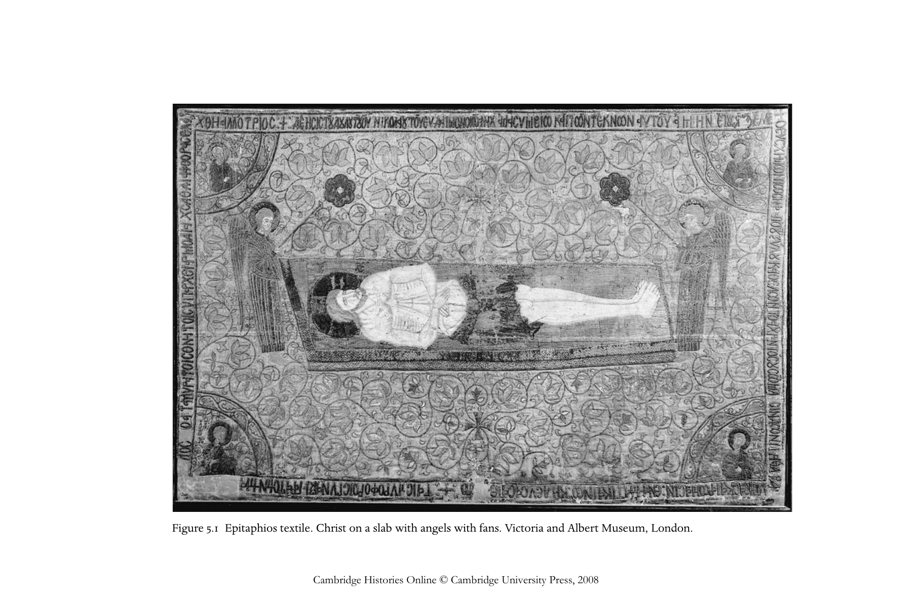
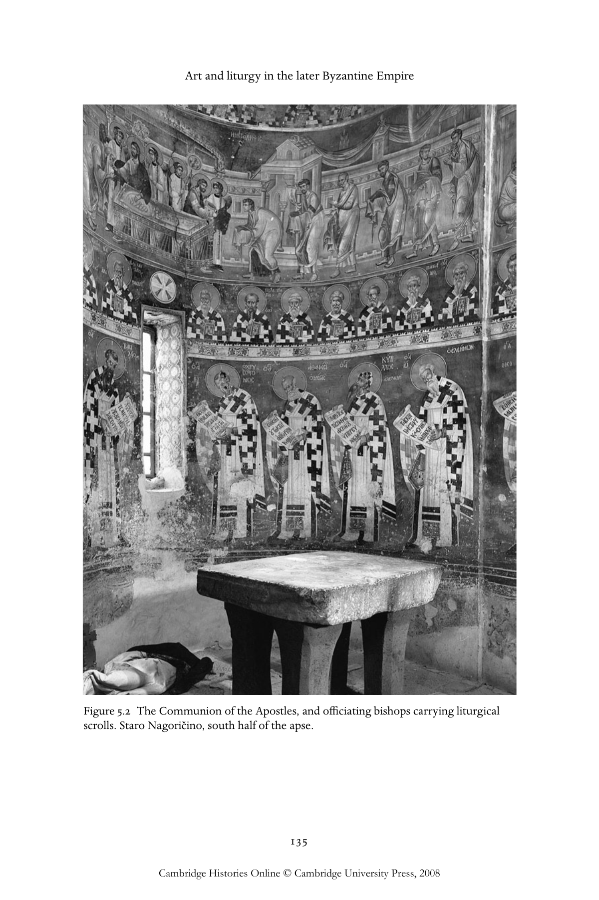
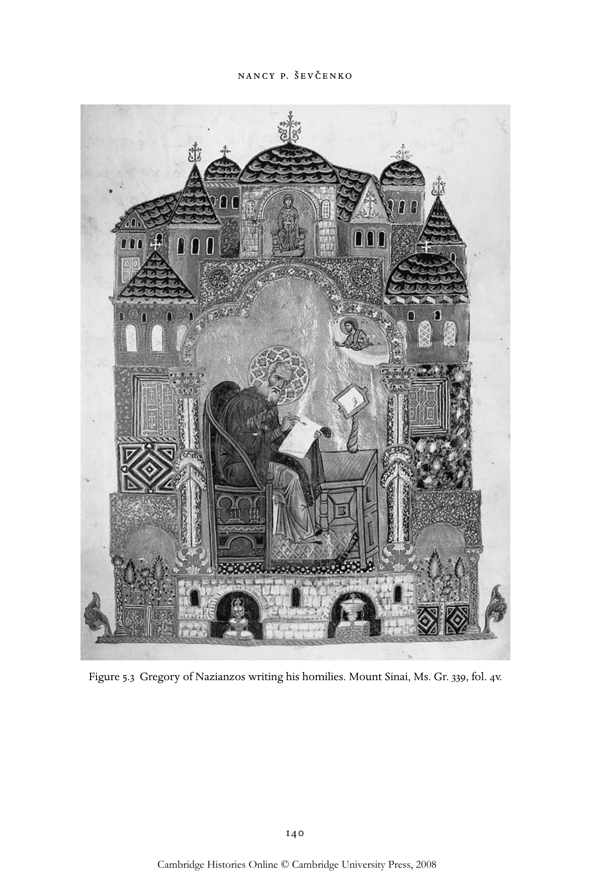
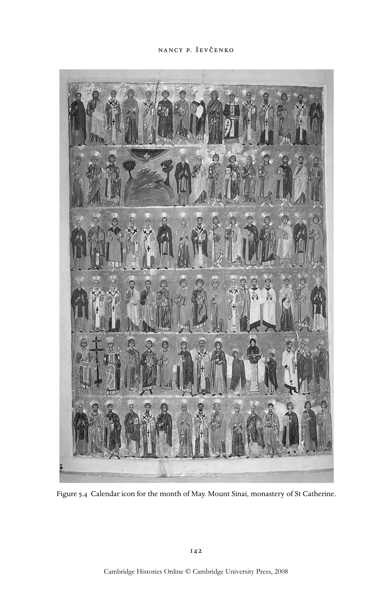
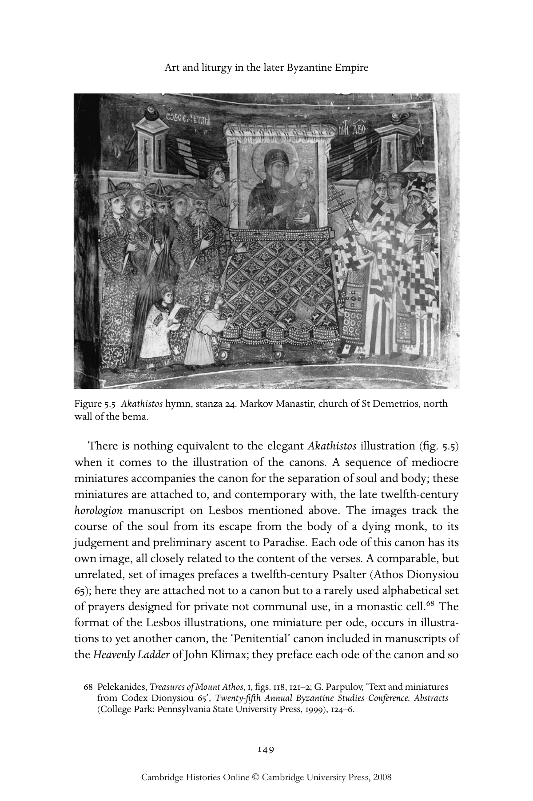

# 拜占庭帝国晚期的艺术与礼仪：英文转换底稿

<!-- PDF page 148; original page 127 -->

### 5

### Art and liturgy in the later

### Byzantine Empire

### na n c y p. š e v č e n k o

It is generally assumed that by the eleventh century the text of the Byzantine liturgy was well established and was performed in a consistent manner throughout much of the Greek-speaking world. For the Eucharist, this assumption is essentially true, though some evolution was still to take place with the widespread adoption of the Eucharistic liturgy of John Chrysostom in preference to that of St Basil and with the expansion of the prothesis rite, that is, the prefatory rite before the beginning of the Eucharist. For the feasts of the church year, however, this is less true, as new poetic pieces were still being composed for, and saints being added to, the basic calendar of commemorations even after the end of the empire. Of most importance for the history of the liturgy in this period was the merging of the liturgy of the Great Church of Constantinople with Palestinian monastic rites: a process which started in the ninth century and was only completed in the twelfth. The pomp and circumstance of the former was enriched by the poetic hymnody of the latter. However, even as late as the fifteenth century, the church of Thessalonike continued to preserve elements of the Asmatike akolouthia, as the liturgy of the Great Church was known. Its elaborate ceremonies had some influence on the art of the Balkans in the fourteenth century.[^p148-1]

Defining the relation of middle and late Byzantine art to this liturgy is a challenge, in that so much of Byzantine art surviving from this period is

[^p148-1]: For a succinct survey of the developments, see R. F. Taft, The Byzantine rite: a short history (Collegeville, MN: Liturgical Press, 1992) and his articles collected in his Liturgy in Byzantium and beyond (Aldershot: Variorum, 1995). See also T. Pott, La réforme liturgique byzantine: étude du phénomène de l’évolution non-spontanée de la liturgie byzantine (Rome: CLV – Edizioni liturgiche, 2000); S. Janeras, Le Vendredi-saint dans la tradition liturgique byzantine: structure et histoire de ses offices [Analecta liturgica 13; Studia Anselmiana 99] (Rome: Pontificio Ateneo S. Anselmo, 1988); H.-J. Schulz, The Byzantine liturgy: symbolic structure and faith expression (New York: Pueblo Publishing, 1986); G. Bertonière, The historical development of the Easter Vigil and related services in the Greek church [OCA 193] (Rome: Pontificium institutum orientalium studiorum, 1972); A. Schmemann, Introduction to liturgical theology (London: Faith Press, and Bangor, Maine: American Orthodox Press, 1966).

<!-- PDF page 149; original page 128 -->

dominated and even fundamentally determined by church practices in their wider form. The liturgy affects the art on many levels: the very choice of subjects to be represented; their placement; the details of iconography within a composition; the overall conception of the scene, and the style in which it is presented. Prior scholarship has taken various approaches to this vast body of material. Stefanescu’s fundamental work, L’illustration des liturgies, focuses on the Eucharist, seeing the themes present in a church setting as being all of them on some level illustrations of the Eucharist.[^p149-2] Walter’s book, Art and ritual, is particularly concerned with the representation of various liturgical ceremonies in Byzantine art.[^p149-3] The study of Pallas, Die Passion und Bestattung, deals in part with the impact in the twelfth century of the ‘new’ monastic services and reveals that the relationship of art and liturgy was by no means static but can be said to have its own history.[^p149-4] The theme of art and liturgy is addressed in numerous individual studies by André Grabar and Gordana Babić.[^p149-5]

This chapter will proceed by dividing the Byzantine rite into two main components: the Eucharistic rite and those rites connected with the cycle of the church year. It will then turn to the primarily monastic Divine Office, that is, the Hours of the day, and to the hymnography that accompanies them. The first two components, those of the Eucharist and the calendar, roughly correspond to the spatial division of a Byzantine church of this period into the naos, or nave, which is the space of the laity (including monks), and the sanctuary, the space reserved for the ordained clergy. They also correspond to two conceptions of time: the Eucharist aiming to transcend time, while for the church calendar time is its fundamental organising principle.[^p149-6] In all

[^p149-2]: J. D. Stefanescu, L’illustration des liturgies dans l’art de Byzance et de l’Orient (Brussels: Institut de philologie et d’histoire orientales, 1936). See also Schulz, Byzantine liturgy, esp. 79–80.

[^p149-3]: C. Walter, Art and ritual of the Byzantine church (London: Variorum, 1982). See also N. K. Moran, Singers in late Byzantine and Slavonic painting [Byzantina Neerlandica 9] (Leiden: Brill, 1986) for images of ceremonies involving singers.

[^p149-4]: D. I. Pallas, Die Passion und Bestattung Christi in Byzanz: der Ritus – das Bild [Miscellanea Byzantina Monacensia 2] (Munich: Institut für byzantinistik und neugriechische Philologie der Universität München, 1965).

[^p149-5]: See A. Grabar, ‘Une source d’inspiration de l’iconographie byzantine tardive: les cérémonies du culte de la Vierge’, CA 25 (1976), 143–62; Grabar, ‘Les peintures dans le chœur de Sainte-Sophie d’Ochrid’, CA 15 (1965), 257–65; G. Babić, Les chapelles annexes des églises byzantines: Fonction liturgique et programmes iconographiques [Bibliothèque des cahiers archéologiques 3] (Paris: Klincksieck, 1969); Babić, ‘Les discussions christologiques et le décor des églises byzantines au XII siècle’, Frühmittelalterliche Studien 2 (1968), 368–86. See also Vostochnochristjanskij chram: liturgija i iskusstvo, ed. A. M. Lidov (St Petersburg: Dmitrii Bulanin, 1994).

[^p149-6]: Schmemann, Liturgical theology, 20, uses for the latter the phrase ‘liturgy of time’. Cf. ibid., 38, n. 6, and 139–40.

<!-- PDF page 150; original page 129 -->

sections, the analysis will deal first with illustrations of the relevant liturgical manuscripts, although it will soon become clear that Byzantine liturgical art is in no way a text-based art.

### The Eucharist

Text and image in manuscripts of the Eucharistic liturgies The ‘ordinary’, the fixed or invariable part of the liturgy, is found in the euchologion, which survives in manuscripts from the eighth century onwards. These generally include the text of the Eucharistic liturgies of St John Chrysostom and of St Basil the Great, as well as various other services and texts for the use of a priest.[^p150-7] Though full euchologion manuscripts were never illustrated, certain prayers from the euchologion were accompanied by miniatures as early as the eleventh century: these were the so-called ‘secret’ prayers, the prayers spoken almost inaudibly by the officiating priest or bishop, assembled and copied in the order of the service onto parchment rolls. These ‘liturgical’ rolls (εἰλητάρια) contain the prayers of the three Byzantine liturgies, those of Chrysostom, Basil and the pre-sanctified; they may also include the words of the deacon, and the order of service for clerical ordinations. Where the liturgical rolls have any form of illustration, decoration is generally restricted to a headpiece at the beginning of the roll and figured initials.[^p150-8] The headpieces depict the author of the liturgy; the initials may relate loosely to the meaning or language of the prayer, although they are very often secular in character. A roll from Patmos (dating probably to the twelfth century) contains the liturgy of Basil the Great, who is shown celebrating at an altar under an extraordinary collection of domes and marble revetments familiar from contemporary Comnenian church architecture and miniatures. Basil is holding a roll, presumably one with the very prayers he wrote that follow in the parchment roll itself.[^p150-9]

Only rarely is the illustration of much intellectual sophistication, but that of a liturgical roll in Jerusalem (Greek Patriarchate, Stavrou 109), a product of Constantinople of the later eleventh century, is a remarkable attempt at

[^p150-7]: S. Parenti, L’eucologio Barberini gr. 336 [Biblioteca ephemerides liturgicae 80] (Rome: CLV – Edizioni liturgiche, 1995).

[^p150-8]: B. V. Farmakovskij, ‘Vizantijskij pergamennyi rukopisnyi svitok s miniaturami’, Izvestija Russkogo Arkhaeologicheskogo Instituta v Konstantinopole 6 (1900), 253–359; V. Kepetzis, ‘Les rouleaux liturgiques illustrés, 11e–14e siècles’, unpublished thesis, Université de Paris IV (1979); S. E. J. Gerstel, ‘Liturgical scrolls in the Byzantine sanctuary’, Greek, Roman and Byzantine Studies 35 (1994), 195–204.

[^p150-9]: Patmos, Monastery of St John, Ms. gr. 707. See A. Kominis, Patmos: the treasures of the monastery (Athens: Ekdotike Athenon, 1988), 289–91; figs. 25–34.

<!-- PDF page 151; original page 130 -->

interpreting visually the theology embedded in each of the various prayers. Marginal figures and initials at the beginning of each prayer mean that Gospel feasts are being attached to specific Eucharist prayers. Some of the themes, such as an incipient Heavenly Liturgy for the Proskomide prayer, were to be developed in monumental painting only considerably later, in the Palaiologan period.[^p151-10] Eucharistic themes on objects used in or associated with the celebration of the Eucharist The Eucharistic rite was reflected particularly closely in liturgical implements, though in the middle and late Byzantine periods these were generally fashioned from less precious materials than they had been in the early Christian period.[^p151-11]  Patens may be inscribed with Christ’s words at the Last Supper (‘Take, eat, this is my body...’), the words spoken by the priest at the consecration of the host. A form of paten known as the panagiarion, used for transporting to the sanctuary the bread dedicated to the Virgin in the prothesis, receives an ever-expanding multi-figured decoration in the late Byzantine period: a fourteenth-century steatite example in the Xeropotamou monastery on Mount Athos bears representations both of the Heavenly Liturgy and of the Communion of the Apostles, themes by now common in sanctuary decoration.[^p151-12] The aer, a cloth to cover the chalice or the paten, was already being decorated with this communion scene in the twelfth century.[^p151-13]  Bread stamps for the consecrated loaves exhibit a range of themes directly related to their liturgical purpose.[^p151-14]  Large metal processional crosses often bore an image of the Deesis (Christ flanked by the Virgin and John the Baptist who petition Him), or of the Crucifixion, which was an appropriate choice.[^p151-15]  By the early fourteenth century the Great Aer, a cloth to cover both chalice and paten, had become the

[^p151-10]: P. Vokotopoulos, Byzantine illuminated manuscripts of the Patriarchate of Jerusalem (Athens and Jerusalem: Greek Orthodox Patriarchate of Jerusalem, 2002), no. 19, figs. 43–58; A. Grabar, ‘Un rouleau constantinopolitain et ses peintures’, DOP 8 (1954), 163–99; Schulz, Byzantine liturgy, 80–9.

[^p151-11]: S. A. Boyd, ‘Art in the service of the Liturgy: Byzantine silver plate’, in Heaven on earth: art and the church in Byzantium, ed. L. Safran (University Park: Pennsylvania State University Press, 1998), 152–85, esp. 180–3; A. Ballian, ‘Liturgical implements’, in Byzantium: faith and power (1261–1557), ed. H. C. Evans (New York, New Haven and London: Yale University Press (for the Metropolitan Museum of Art), 2004), 117–24.

[^p151-12]: I. Kalavrezou-Maxeiner, Byzantine icons in steatite [Byzantina vindobonensia 15] (Vienna: Verlag ÖAW, 1985), no. 131.

[^p151-13]: W. Woodfin, ‘Liturgical textiles’, in Faith and power, 295–8, and figs. 10.2 and 10.3.

[^p151-14]: G. Galavaris, Bread and the liturgy: the symbolism of early Christian and Byzantine bread stamps (Madison and London: University of Wisconsin Press, 1970).

[^p151-15]: J. A. Cotsonis, Byzantine figural processional crosses [Dumbarton Oaks Collection Publications 10] (Washington, DC: Dumbarton Oaks Research Library and Collection, 1994).

<!-- PDF page 152; original page 131 -->

inspiration behind the epitaphios (fig. 5.1), a far larger textile which, following ancient interpretations of the Great Entrance as the procession bringing Christ to his tomb, was embroidered with the image of the dead Christ stretched out on a slab on his way to burial. Perhaps because of its decoration, the epitaphios was introduced, surely by the mid-fourteenth century, into a quite different liturgical context, that of the Good Friday and Holy Saturday ceremonies. By the fifteenth century, however, its Eucharistic meaning was receding and the stark image of the sacrificed Christ attended by angels was often replaced by a multi-figured depiction of the Lamentation.[^p152-16]

The various clerical vestments worn during the liturgy grew increasingly elaborate in the late Byzantine period, enveloping the celebrant in garments embroidered with Gospel scenes, with holy portraits, and even with the words of the liturgy itself. So the orarion of a deacon may display the words Glory Glory Glory, from the Epinikios Hymn, while the words of the creed adorn the minor sakkos of the metropolitan of Russia, Photios (1408–31).[^p152-17]  Narrowly liturgical subjects, however, are relatively rare on vestments. In any case, a liturgical interpretation of their Gospel iconography presupposes a particular historicising approach to the interpretation of the liturgy, one that views the Eucharist as a re-enactment of the entire life of Christ. It was familar above all from the eleventh-century commentary of Nicholas of Andida and underlay the illustration of the Jerusalem roll mentioned above.[^p152-18]

Icons are often thought to have constituted an integral part of the celebration of the liturgy. The words of the Eucharistic liturgies make no reference to icons, which is not at all surprising, given the early date of their composition. Icons were never to serve as liturgical implements. Still, their very existence connects them to the Eucharist in that they confirm, as does the image of the Virgin in the apse, the message of the Incarnation and the possibility of the sanctification of the material into the divine that is at the heart of the Eucharist. Icons are mentioned in rubrics to the liturgies from the fourteenth century on, though

[^p152-16]: Woodfin, ‘Liturgical textiles’, 296–7; H. Belting, ‘An image and its function in the liturgy: the Man of Sorrows in Byzantium’, DOP 34–35 (1980–81), 1–16; S. Ćurčić, ‘Late Byzantine loca sancta? Some questions regarding the form and function of Epitaphioi’, in The twilight of Byzantium: aspects of cultural and religious history in the late Byzantine Empire, ed. S. Ćurčić and D. Mouriki (Princeton: Princeton University Press, 1991), 251–61; Robert F. Taft, The Great Entrance: a history of the transfer of gifts and other preanaphoral rites of the liturgy of St. John Chrysostom [OCA 200] (Rome: Pontificium institutum orientalium studiorum, 1978), 217–19.

[^p152-17]: Woodfin, ‘Liturgical textiles’; P. Johnstone, The Byzantine tradition in church embroidery (Chicago: Argonaut, 1967).

[^p152-18]: R. Bornert, Les commentaires byzantins de la Divine Liturgie du VIIe au XVe siècle [Archives de l’orient chrétien 9] (Paris: Institut français d’études byzantines, 1966), esp. 180–206.

<!-- PDF page 153; original page 132 -->

Figure5.1 Epitaphiostextile.Christonaslabwithangelswithfans.VictoriaandAlbertMuseum,London.
Cambridge Histories Online © Cambridge University Press, 2008

<!-- PDF page 154; original page 133 -->

in connection with various preliminary rites taking place in the naos, not with the Eucharist itself.

By this time, icons had already taken their place in the templon or iconostasis, the barrier separating the naos from the apse and bema (i.e. sanctuary), and they faced the congregation directly. Earlier, in the eleventh century, the usual templon screen was closed at floor level by chancel slabs, but was still open above, with widely spaced columns supporting an epistyle. Originally curtains closed the spaces between the columns, to be replaced in the course of the twelfth century by large icon panels, so as to form an icon wall that blocked any view from the nave into the sanctuary.[^p154-19]  These iconostasis icons were of Christ, and the Virgin, and, frequently, the person or event to whom or to which the church was dedicated. The epistyle either was painted or carried a row of icons above it. On these epistyle icons the three figures of the Deesis might be joined by angels and apostles in what is known as the ‘Great Deesis’, or flanked by a row of feast icons depicting the primary events in the life of Christ and of his mother from the Annunciation to the Dormition (Koimesis) of the Virgin, repeating, on a smaller scale, and in a more concentrated form, feast images found elsewhere in the church. The functional difference between these iconostasis images and those of the main feast cycle is still not entirely clear. Entrance from the nave into the sanctuary was made through doors in the centre of the iconostasis, doors which often bore an image of the Annunciation (the closed door of Ezekiel 46:1–2 being interpreted as a reference to the Virgin and the mystery of the Incarnation).

It has been proposed that certain of the large two-sided icons that have survived shorn of their original context came originally from iconostaseis, and bore a two-sided message, one addressed to the congregation, the other (on the side facing the sanctuary) to the clergy.[^p154-20]  The themes painted on the sanctuary side of these icons may have been consciously integrated into the overall painted programme of that space, something that is not true of their naos side, which, as noted above, tends to repeat elements present in the naos programme. The large images of Christ and the Virgin facing the nave from

[^p154-19]: See most recently S. E. J. Gerstel, Beholding the sacred mysteries: programs of the Byzantine sanctuary [Monographs on the Fine Arts 56] (Seattle and London: University of Washington Press, 1999), 5–14 (although Patmos roll #719, cited ibid., 9 and dated by Dmitrievskij to the thirteenth century, is actually of the sixteenth or seventeenth century), and J.-M. Spieser, ‘Le développement du templon et les images des Douze Fêtes’, Bulletin de l’Institut Historique Belge de Rome 69 (1999), 131–64.

[^p154-20]: S. E. J. Gerstel, ‘An alternate view of the late Byzantine sanctuary screen’, in Thresholds of the sacred: architectural, art historical, liturgical and theological perspectives on religious screens, east and west, ed. S. E. J. Gerstel (Washington, DC: Dumbarton Oaks Center for Byzantine Studies, 2006).

<!-- PDF page 155; original page 134 -->

their place on the iconostasis had a significant role to play in lay piety, if not in the actual liturgy.

Eucharistic subjects are rare on iconostasis icons, indeed on icons of any kind.[^p155-21]  Sacrificial motifs, however, do make their way into later Byzantine iconography, for example, the Virgin and Child with instruments of the Passion and the Man of Sorrows (Akra Tapeinosis), as do a number of typological themes, which will be discussed below.[^p155-22] Decoration of the sanctuary space By the turn of the eleventh century the decoration of the sanctuary area – the lower walls of the apse and the bema – was being almost exclusively devoted to Eucharistic themes.[^p155-23]  This development is unquestionably attached to the ritual that takes place in that space and is not unrelated to the closing of the iconostasis. On the walls of the apse were standing figures of bishops, among them the authors of the two main liturgies, John Chrysostom and Basil the Great, placed nearest to the centre. The bishops hold Gospel books, and wear the omophorion, the insignium that they acquired upon their ordination to episcopal rank.

Above the bishops was painted the Communion of the Apostles, with Christ offering from a painted altar bread and wine to the twelve apostles who approach him from left and right (fig. 5.2). This theme replaced the ‘historical’ Last Supper; the words of institution spoken by Christ at that time and reiterated by the celebrant (‘Take, eat, this is my body...’) are frequently inscribed onto the background of the scene. The composition, which was popular from the eleventh century on, depicted with some care the details of a contemporary Eucharist, complete with vessels, ciborium and proper liturgical gestures. Angel deacons stand by the altar holding rhipidia (liturgical fans).[^p155-24]  The figure of Christ (or figures, as he is often represented twice, once offering the bread, once offering the wine) is shown wearing the sakkos, the vestment of the patriarch of Constantinople, first in the fourteenth century.

While the Communion of the Apostles composition remained remarkably stable, in the twelfth century the line of bishops took on a new aspect, depicted

[^p155-21]: One exception to prove the rule is an icon depicting the Communion of the Apostles: Χαριστήριον εἰς Ἀναστάσιον Κ. Ὀρλάνδον (Athens: Bibliotheke tes en Athenais Archaiologikes Hetaireias, 1967), iii, 395.

[^p155-22]: J. Albani, ‘Icons and the Divine Liturgy. A reciprocal relationship’, in Ceremony and faith: Byzantine art and the Divine Liturgy (Athens: Hellenic Ministry of Culture – Directorate of Byzantine and Post-Byzantine Monuments, 1999), 57–62.

[^p155-23]: Gerstel, Sacred mysteries, 5–67.

[^p155-24]: Ibid., 48–67.

<!-- PDF page 156; original page 135 -->

> Figure 5.2 The Communion of the Apostles, and officiating bishops carrying liturgical scrolls. Staro Nagoričino, south half of the apse.

<!-- PDF page 157; original page 136 -->

now not as standing frontal figures but as celebrants who bend towards the altar and hold out scrolls inscribed with the opening words of the ‘secret’ prayers, chosen from among the very texts assembled in the parchment ‘liturgical’ rolls described above.[^p157-25]  Their number was constantly being increased over the centuries: celebrants line the bema walls as well as the apse, and above them, rows of busts in medallions were added, as though all the bishops in the history of the church were imagined as present, concelebrating in a single sanctuary.

The bishops move towards a painted altar at the centre of the apse wall, or towards an image there of Christ’s sacrifice that took a variety of forms: one such was the Hetoimasia or prepared throne, on or near which rest the instruments of the Passion (crown of thorns, lance, sponge) flanked by angels clad as deacons; another was the startling image of the Christ child lying on a paten or altar, covered with an aer as though He were the bread about to be divided.[^p157-26]  The first dated example of this graphic image is at the church of Kurbinovo of 1199.[^p157-27]  The image there is labelled the Amnos (lamb); from the thirteenth century on, it was also called the Melismos (meaning partitioning or fraction).[^p157-28]  With the growth of the prothesis rite and with the consecration of the host now thought to take place in the prothesis before the Great Entrance procession, rather than in the sanctuary, the image of the child Christ on the paten in the apse or in the prothesis gave way to that of the dead adult Christ stretched out on a tomb slab that evokes his tomb, an image, which, as we have seen, was to migrate to the epitaphios.[^p157-29]

The strongly Eucharistic thrust of the apse programme meant that other images spatially associated with it acquired Eucharistic overtones. The Mandylion, for example, the cloth relic bearing the imprint of Christ’s face, became a sign of the Incarnation and as such was often found in connection with the Annunciation. It assumed Eucharistic significance, however, when placed in the apse in place of the Amnos.[^p157-30]

[^p157-25]: Ibid., 15–36.

[^p157-26]: E.g. the Hetoimasia (with dove as well) at Nerezi: I. Sinkević, The church of St. Panteleimon at Nerezi: architecture, programme, patronage (Wiesbaden: Reichert Verlag, 2000), 35–6; Gerstel, Sacred mysteries, 37–47; A. L. Townsley, ‘Eucharistic doctrine and the liturgy in late Byzantine painting’, Oriens Christianus, ser. iv. 22 (1974), 138–53.

[^p157-27]: L. Hadermann-Misguich, Kurbinovo: les fresques de Saint-Georges et la peinture byzantine du XIIe siècle [Bibliothèque de Byzantion 6] (Brussels: Éditions de Byzantion, 1975), 67–78.

[^p157-28]: R. F. Taft, ‘Melismos and comminution: the fraction and its symbolism in the Byzantine tradition’, Studia Anselmiana 95 (1988), 531–52.

[^p157-29]: Pott, Réforme, 169–94; Schulz, Byzantine liturgy, 64–7.

[^p157-30]: Gerstel, Sacred mysteries, 68–77.

<!-- PDF page 158; original page 137 -->

The Heavenly Liturgy and other Eucharist images In the late Byzantine period a dramatic form of Eucharist image was developed, that of the Heavenly Liturgy, the liturgy performed in perpetuity before the throne of God by the most exalted residents of heaven, the angels.[^p158-31]  Hints of this had appeared earlier, in the Jerusalem roll.[^p158-32]  In fresco painting, for example in the church of the Peribleptos at Mistra, these angels assume the roles and robes of deacons and priests, and are shown bearing in procession the liturgical implements such as chalice, paten, asterikos and aer from the prothesis to the sanctuary, in a vivid re-creation of the Great Entrance. The procession was depicted circling Christ in the dome, or in the prothesis, whence the angels emerge to make the Great Entrance, or even in the apse itself.

Other images are more purely typological in character. Often located in the vicinity of the bema or apse are certain Old Testament prefigurations of sacrifice: the Sacrifice of Isaac, Abraham offering food to the visiting Trinity, Elijah fed by the raven or the Three Hebrews in the Fiery Furnace; many of these have origins far back in monumental painting of the early Christian period. Eucharistic imagery drawn from hagiography included that of the desert hermit Mary of Egypt receiving communion from Zosimas,[^p158-33]  and the Vision of Peter of Alexandria, which started as anti-Arian theology and became a liturgical statement once the figure of Christ was made to stand atop an altar.[^p158-34]

### Cycle of the church year

Text and image in the Gospel lectionary and praxapostolos Gospel readings proper to each day of the year were excerpted from the Bible and rearranged according to the demands of the church calendar in a manuscript called the Gospel lectionary. The usual lectionary starts with readings for the movable feasts, those dependent upon the date of Easter, from Easter Sunday to the end of Holy Week the following year. The readings for Lent are drawn roughly from each of the four Evangelists in turn ( John, Matthew, Luke and, for Lent, Mark). Following these Gospel readings for the movable feasts comes a long calendar of fixed feasts, those celebrated on the same date every year, with reference to their assigned readings. Most of the fixed feasts commemorate saints, but also include important events in the

[^p158-31]: It was also known as the Divine Liturgy or the Celestial Liturgy.

[^p158-32]: V. Kepetzis, ‘Tradition iconographique et création dans une scène de communion’, Jahrbuch der Österreichischen Byzantinistik 32/5 (1982), 443–51.

[^p158-33]: Gerstel, Sacred mysteries, 57.

[^p158-34]: Walter, Art and ritual, 213–14.

<!-- PDF page 159; original page 138 -->

Gospel story such as the Birth and the Presentation of the Virgin, the Nativity, the Baptism, the Presentation of Christ, the Annunciation, the Transfiguration, and eventually the Dormition of the Virgin. These are not arranged in the order in which they took place in historical time but in the order in which they are celebrated in the course of a single church year. This calendar section of a Gospel lectionary (entitled in some manuscripts a menologion, in some a synaxarion) starts with 1 September and ends with 31 August. The Gospel passage that is to be read on that day may be written out in full, or there is merely a cross-reference if it has already been written out in full earlier in the manuscript. There is a great range of types of illustration of the Gospel lectionary, from full-page feast images in one manuscript to little more than a couple of figured initials in another. One Gospel lectionary (Vaticanus graecus 1156) undertook to represent each saint and event celebrated, within the text and in the margins of the relevant notice; in others the illustration was limited to Evangelist portraits, some miniatures of the major feasts and portraits only of the more notable saints.[^p159-35]

The Gospel lectionary removed the events in the life of Christ from their historical sequence and arranged them into a sequence based on the church calendar instead. This liturgical reordering retroactively influenced the illustration of certain Gospel books, which have a miniature of an event in the life of Christ preceding each Gospel, but the subject chosen reflects the feast at which the Gospel passage was read.[^p159-36]

The two other books of scripture readings were the praxapostolos (readings from the Acts and Epistles) and the prophetologion (Old Testament readings). The latter was never illustrated; the former was illustrated primarily with portraits of the authors of this section of the New Testament.

Kurt Weitzmann argued that the illustrated Gospel lectionary was the source for the images of the Gospel feasts encountered on the walls of Byzantine churches of this period.[^p159-37]  If one assumes that every image had

[^p159-35]: Oriente cristiano e santità (Milan: Centro Tibaldi; Rome: Ministero per i beni culturali e ambientali, 1998), no. 18. The miniatures go as far as December 31. On illustrated gospel lectionaries, see J. C. Anderson, The New York Cruciform Lectionary (University Park: University of Pennsylvania Press, 1992); M.-L. Dolezal, ‘Illuminating the liturgical word: text and image in a decorated lectionary (Mount Athos, Dionysiou Monastery, cod. 587)’, Word & Image 12 (1996), 23–60. On liturgical manuscripts in general, see N. P. Ševčenko, ‘Illuminating the Liturgy: illustrated service books in Byzantium’, in Heaven on earth, 186–228.

[^p159-36]: C. Meredith, ‘The illustrations of Codex Ebnerianus. A study in liturgical illustration of the Comnenian period’, Journal of the Warburg and Courtauld Institutes 29 (1966), 419–24.

[^p159-37]: Many of his studies on the subject have been reprinted in K. Weitzmann, Byzantine liturgical psalters and gospels (London: Variorum, 1980).

<!-- PDF page 160; original page 139 -->

its origins in a book, that it was created specifically to accompany a written text from which it migrated into other media, then the Gospel lectionary is certainly the most likely source. Unfortunately, there are not nearly as many Gospel lectionaries adorned with feast scenes as one would like for this theory to be convincing (the decoration of the great majority of the illustrated lectionaries is restricted to portraits of the Four Evangelists). Furthermore, given the independent nature of Byzantine iconography, which is rarely a literal illustration of any single text, it is more likely that things worked the other way around and that the iconography of the feast cycle was developed first in monumental painting or on icons, and only then made its way into illustrated manuscripts and other media. Text and image in homiletic and hagiographic collections The concept of the church calendar is intrinsic to many other kinds of liturgical books.[^p160-38]  Collections of homilies to be delivered on certain feast days were, from the eleventh century on, being arranged in manuscripts according to the date of the feast at which they were to be read.[^p160-39]  This is true primarily for manuscripts of the Homilies of Gregory of Nazianzos (fig. 5.3), which, as would any Gospel lectionary, open with an Easter reading; in this case, with one of Gregory’s homilies on Easter. While their illustrations, usually restricted to headpieces and initials, do tend to reflect the content of the homily, they also make reference to the feast at which the homily is read.[^p160-40]  Though also read in services throughout the church year and often illustrated, the homilies of John Chrysostom were not organised according to the church calendar as were those of Gregory.[^p160-41]  Homilies by other authors, such as George of Nikomedeia, which were read out at specific feasts, had a tremendous influence on the depiction of that feast, either directly or through hymnography based on these homilies.[^p160-42]

[^p160-38]: Walter, Art and ritual, 67–72.

[^p160-39]: A. Ehrhard, Überlieferung und Bestand der hagiographischen und homiletischen Literatur der griechischen Kirche von den Anfängen bis zum Ende des 16. Jahrhunderts [Texte und Untersuchungen zur Geschichte der altchristlicher Literatur 50–52] (Leipzig: J. C. Hinrichs Verlag, 1937–52), 3 vols. in 4.

[^p160-40]: G. Galavaris, The illustrations of the Homilies of Gregory of Nazianzenus [Studies in Manuscript Illumination 6] (Princeton: Princeton University Press, 1969); Ševčenko, ‘Illuminating the liturgy’, 219–20.

[^p160-41]: K. Krause, Die illustrierte Homilien des Johannes Chrysostomos in Byzanz (Wiesbaden: Reichert Verlag, 2004). His homilies are commentaries on the various books of the Bible (esp. Matthew, John and Genesis), and are collected therefore according to the book, not the calendar year.

[^p160-42]: H. Maguire, Art and eloquence in Byzantium (Princeton: Princeton University Press, 1981), 91–108; M. Vassilaki and N. Tsironis, ‘Representations of the Virgin and their association with the Passion of Christ’, in Mother of God: representations of the Virgin in Byzantine art, ed. M. Vassilaki (Milan: Skira, 2000), 453–63.

<!-- PDF page 161; original page 140 -->

> Figure 5.3 Gregory of Nazianzos writing his homilies. Mount Sinai, Ms. Gr. 339, fol. 4v.

<!-- PDF page 162; original page 141 -->

The concept of the revolving church calendar was intrinsic to hagiographic manuscripts, those devoted to recording the saint or event to be commemorated each day of the year. The Menologion of Emperor Basil II (Vaticanus graecus 1613), a manuscript of around the year 1000 (the text is actually that of a synaxarion in that the notices for each saint are very brief ), is fully illustrated with 430 separate miniatures; it contains at least one commemoration per day for the first six months of the year, September through February. Holy portraits and scenes of martyrdom predominate, and there are Gospel feasts as well as commemorations of interest to Constantinople, such as translations of relics into the city, and natural disasters it suffered. Each image shares a page with a sixteen-line summary of the saint’s exploits. In several cases, especially for the catastrophes such as earthquakes, the representation of the event is replaced by an image of its liturgical celebration.[^p162-43]  Only the first volume of this enormous undertaking survives; it is unknown whether a second one was ever executed.

There exists one later equivalent to the Basil Menologion, a fourteenth-century manuscript in Oxford containing in a single volume images of the commemorations for every day of the year. It has no text at all other than a closing poem and verse captions to the miniatures. Its iconographic roots seem to lie in the calendar cycles in monumental painting rather than in any manuscript tradition traceable back to the Menologion of Basil II.[^p162-44]

Longer hagiographic texts were also being assembled in calendar order.[^p162-45] The Lives of the saints composed by Symeon Metaphrastes in the late tenth century were arranged in the eleventh in a series of ten volumes, starting with one for the saints of September in volume i, and ending with the saints from May to August in volume x. The Lives were intended for reading at monastic orthros (matins). Despite the rich narrative character of the saints’ lives, extensive miniature cycles illustrating these works of Metaphrastes are

[^p162-43]: Facsimile: Il Menologio di Basilio II. Cod. Vaticano greco 1613 [Codices e Vaticani selecti... 8], 2 vols. (Turin: Fratelli Bocca, 1907). The Vatican is due to issue a new facsimile shortly. J. Baldovin, ‘A note on the liturgical processions in the Menologion of Basil II (ms. Vat. gr. 1613)’, Εὐλόγημα: studies in honor of Robert Taft, S.J., ed. E. Carr et al. (Rome: Centro Studi S. Anselmo, 1993), 25–39. The interesting representation of the rain of ashes caused by the eruption of Vesuvius shown on Il Menologio, 164 is an exception.

[^p162-44]: Oxford. Bodl. Gr.th.f.1: I. Hutter, Corpus der byzantinischen Miniaturenhandschriften: Oxford, Bodleian Library, 3 vols. (Stuttgart: Hiersemann, 1982), iii, no. 1.

[^p162-45]: Ehrhard, Überlieferung.

<!-- PDF page 163; original page 142 -->

> Figure 5.4 Calendar icon for the month of May. Mount Sinai, monastery of St Catherine.

<!-- PDF page 164; original page 143 -->

scarce.[^p164-46]  The usual system was to place a portrait of the saint in, or in place of, a painted headpiece at the beginning of his or her Life. In one set of volumes dated 1063, images of all the saints whose Lives were contained in a particular volume were assembled together on one folio to serve as its frontispiece. This kind of group portrait had its exact counterpart in contemporary calendar icons (fig. 5.4) and was paralleled by the poems of Christopher of Mytilene and others writing mnemonic calendar verses in the eleventh century and later.[^p164-47] The church year in church decoration Representations of the events and saints that together make up the church year filled the naos of a Byzantine church. The astonishing coordination of architecture and decoration characteristic of the interior of a domed Byzantine church transformed these commemorations into a system in which each component had a particular place relative both to the image of Christ in the central dome or vault, and to each other.[^p164-48]  Surrounding Christ are angels or prophets; the major New Testament events unfold, in the form of twelve – more or less – feast scenes arranged in the vaults or along upper walls, while at a lower level the walls, together with subsidiary areas such as corner chapels, are lined with images of the saints. The system was not codified until post-Byzantine times,[^p164-49] but the positions of the various elements relative to Christ and to each other in a church programme were repeated fairly consistently in most Byzantine churches, whether cathedral, parish or monastic.

What is interesting here is how little influence the church calendar exerted on the articulation of the programme. The saints, for example, are not arranged at all according to the dates of their commemorations, but according to their profession, whether apostle, warrior, monk, female saint, hermit or stylite,

[^p164-46]: N. P. Ševčenko, Illustrated manuscripts of the Metaphrastian Menologion (Chicago and London: University of Chicago Press, 1990). Only occasionally was the elaborate textual narrative accompanied by a comparable illuminated narrative: a panegyrikon: Athos Esphigmenou 14, has longer cycles, though the texts are still a selection of Metaphrastian lives, here combined with other types of text: S. M. Pelekanides et al., The treasures of Mount Athos: illuminated manuscripts, 4 vols. (Athens: Ekdotike Athenon (for the Patriarchal Institute for Patristic Studies), 1974–91), ii, figs. 327–408, esp. 327–36.

[^p164-47]: N. P. Ševčenko, ‘Marking holy time: the Byzantine calendar icons’, in Byzantine icons: art, technique and technology, ed. M. Vassilaki (Heraklion: University of Crete Press, 2002), 51–62; E. Follieri, I calendari in metro innografico di Cristoforo Mitileneo [Subsidia hagiographica 63] (Brussels: Société des Bollandistes, 1980), 2 vols. All the calendar icons from the Byzantine period that survive today are located in the monastery of Mount Sinai.

[^p164-48]: The classic study is O. Demus, Byzantine mosaic decoration (London: Kegan Paul, 1948; reprinted New Rochelle: Caratzas Brothers, 1976). See also J.-M. Spieser, ‘Liturgie et programmes iconographiques’, TM 11 (1991), 575–90.

[^p164-49]: The ‘Painter’s Manual’ of Dionysius of Fourna, trans. P. Hetherington (London: Sagittarius Press, 1974).

<!-- PDF page 165; original page 144 -->

with the various groups relegated to specific areas of the church. As there was not enough space to represent all the saints in the history of the church, those depicted were the leaders, the best-known figures of each ‘choir’ or category of saint. In this respect, they approach Christ as courtiers would approach the emperor, in well-defined groups. This ordering of saints is in striking contrast to the calendar cycles usually placed somewhere outside the naos, especially in the narthex, that show, month by month, the church commemorations for the whole year, in the tradition of the Menologion of Basil II.[^p165-50]  In the naos, the saints have been liberated from earthly time and from the rotation of calendar time.

Within the feast compositions, the situation is a little different. They rotate around the central figure of Christ as if in the cyclical revolution of the church year. However, the cycle of feasts in a Byzantine church does not follow the liturgical sequence of the calendar, but maintains elements of historical time. For the events are displayed in roughly the order of the life of Christ (starting with the Annunciation, located in the eastern part of the naos). The maintenance of some aspect of historical time made it easier to incorporate into later Byzantine church programmes cycles of the Passion of Christ or of the Life of the Virgin, with their very strict narrative sequence. The placement of the individual feasts will vary with the architecture of each church, but there is always a recognisable chronological sequence. The conceptions of time are in constant dialogue. The ceremony of the Pedilavum, or the washing of feet on Maundy Thursday, sometimes took place under an image of Christ washing the feet of the twelve apostles.[^p165-51]  The correspondence here of Gospel event, image of the event and liturgical commemoration resonates richly with these layers of time.

Earthly time was pushed further and further away from the sanctuary, away even from the naos, into the narthex at the western end of the church. The themes of the decoration of the narthex were more fluid and stressed its role as preparatory space. It has been suggested that the main liturgical themes relate to the penitential and preparatory character of the Lenten weeks leading to Christmas and Holy Week.[^p165-52]  In the middle Byzantine period the lives of

[^p165-50]: P. Mijović, Menolog (Belgrade: Arheoloshki Institut, 1973).

[^p165-51]: W. Tronzo, ‘Mimesis in Byzantium. Notes toward a history of the function of the image’, Res 25 (1994), 61–76.

[^p165-52]: B. Todić, ‘L’influence de la liturgie sur la décoration peinte du narthex de Sopoćani’, in Drevnerusskoe iskusstvo. Rus’, Balkani XIII vek, ed. A. L. Batalov et al. (St Petersburg: Dmitrii Bulanin, 1997), 43–58. See also S. Tomeković, ‘Contribution à l’étude du programme du narthex des églises monastiques (XIe–première moitié du XIIIe siècle)’, B 58 (1988), 140–54.

<!-- PDF page 166; original page 145 -->

individual saints began to be painted, sometimes in as many as ten or twelve different episodes, in the narthex or side chapel. These cycles are often found in conjunction with tombs, in which case their purpose seems to have been to recount the saint’s deeds that earned him or her the ear of God, and made him or her an effective intercessor for the deceased. Yet the visiting faithful could also come to address the portrait of the saint at any time, outside the strict hierarchy of the church interior, and outside the constraints of the church calendar.

### Other ecclesiastical rites

There were of course many other services that took place only at irregular intervals: clerical ordinations, baptisms, weddings and funerals, as well as consecrations of churches, the blessing of houses, the purification of wells, and even, for the patriarch at least, coronations. Each of these occasions had its own rite, though few have left any significant trace in art.[^p166-53]  Images of these services are found for the most part embedded in painted hagiographic cycles or chronicles: the three ordinations, to deacon, priest and bishop, for example, are a regular part of the Vita cycles of St Nicholas.[^p166-54]  Burial scenes, originally showing a saint being laid in a stone sarcophagus in the presence of a censing bishop, become more elaborate over time, and there are fine fourteenth-century depictions of funeral ceremonies, complete with singers, that illustrate the death of St Nicholas and others.[^p166-55]  The deaths of hermits such as St Ephrem or St Sabas are set instead into an expansive landscape of mountainsides and caves from which other hermits are emerging to attend the open-air rites for their dead colleague.[^p166-56]

Memorial services (μνημόσυνα) were held on the anniversary of an individual’s death. The emperor John Komnenos stipulated in his Typikon of 1136 for the monastery of the Pantokrator in Constantinople, that on the anniversaries of his death and those of his wife and son, the famous icon of the Virgin Hodegetria was to be carried from its sanctuary across town to the monastery and set up by his tomb, where it was to remain overnight. On the next day, ‘the divine liturgy should be celebrated while the holy icon is present’.[^p166-57]

[^p166-53]: Walter, Art and ritual, passim.

[^p166-54]: N. P. Ševčenko, The life of St. Nicholas in Byzantine art (Turin: Bottega d’Erasmo, 1983), 76–85.

[^p166-55]: Ibid., 134–42; Moran, Singers, 72–85.

[^p166-56]: Faith and power, no. 80. This fifteenth-century icon shows a large icon of the Hodegetria present at the funeral of Ephrem.

[^p166-57]: Thomas and Hero, ii, 756; Ševčenko, ‘Icons in the liturgy’, DOP 45 (1991), 52.

<!-- PDF page 167; original page 146 -->

John’s brother Isaac Komnenos was buried in Thrace at the monastery of the Virgin Kosmosoteira which he had founded in 1152; icons of the Virgin and of Christ were to be set up permanently alongside his tomb, and the monks of the monastery were to pass by the tomb daily, and ‘in front of the holy icons standing there’ say prayers for his soul.[^p167-58]  The icons in these cases had no specific liturgical function, but they provided a focus for the intercessory prayers at the tomb, whether these were yearly or daily. This documentary evidence for the Comnenian period is intriguing, in that it implies a relation of icon to actual liturgical rite at an earlier time than we would suspect if relying on the visual or liturgical sources alone.

The architectural setting of tombs such as these, mainly arcosolia (wall niches) over the grave, bore painted and/or sculpted decoration, but the themes depicted are generally concerned with salvation, not with the funeral rite itself.[^p167-59]

### The liturgy of the Hours

Text and image in manuscripts of the Divine Office The greatest contribution of monasticism to the development of the Byzantine liturgy is its hymnody, which reached Constantinople in the early ninth century, with the Palestinian monastic cursus. The horologion, the Byzantine Book of Hours, is attested in manuscripts from the ninth century on; it provides texts for each of the main Hours of the day (prime, terce, sext, none), together with those for orthros, vespers and apodeipnon (compline). It is rarely illustrated: only two extant horologia have any sort of extended programme of illustration: one of the late twelfth century now on Lesbos, with an office for each hour of the day, and another dating to the fifteenth century, of Cretan origin, but now in Baltimore.[^p167-60]  In both these cases the illustration is essentially borrowed from other types of manuscripts: the biblical canticles for orthros, for example, are illustrated with traditional ode compositions well known from Psalter manuscripts. In the Baltimore horologion, the Hours of terce, sext and none are illustrated with scenes of Pentecost, Crucifixion and Lamentation respectively,

[^p167-58]: Thomas and Hero, ii, 839.

[^p167-59]: S. Brooks, ‘Sculpture of the late Byzantine tomb’, in Faith and power, 95–103; E. Velkovska, ‘Funeral rites according to Byzantine liturgical sources’, DOP 55 (2001), 21–45.

[^p167-60]: Lesbos, Leimonos 295. See P. Vokotopoulos, ‘Ἡ εἰκονογράφηση τοῦ κανόνος εἰς ψυχορραγοῦντα στὸ Ὁρολόγιον 295 τῆς μονῆς Λειμῶνος’, Σύμμεικτα 9 (1994), 95–114. One image in the Lesbos Horologion (p. 222) shows what appear to be monks assembling for a service at the doors of a church. Baltimore, Walters w534. See N. P. Ševčenko, ‘The Walters’ Horologion’, Journal of the Walters Art Museum 62 (2004), 7–21.

<!-- PDF page 168; original page 147 -->

because the hour at which the original events took place (third, sixth and ninth) is specified in the Bible, and the corresponding monastic hour became a sort of memorial of the biblical event. It thus allowed the celebration of the three events on a daily basis and not just yearly.

The Psalter, a basic component of both cathedral and monastic rites, is one of the most frequently illustrated liturgical texts of all. Some Psalter manuscripts received significant visual commentary in the margins of their pages, commentary which tends to stress the typological and theological meanings of the passage more than its liturgical use.[^p168-61]  The Old Testament canticles were consistently included in Psalter manuscripts; they once formed an essential part of orthros and were often the primary focus of decoration. A consistent iconography was developed for each of the nine biblical canticles: either the event that prompted the canticle was pictured (e.g. the Three Hebrews, the Crossing of the Red Sea, Moses receiving the Law, Jonah and the whale, etc.), or the individual involved (most of them prophets) was shown addressing a song of praise to God, arms upraised.[^p168-62]  Unlike the others, the image accompanying the final canticle, the Magnificat – the only canticle drawn from the New Testament (Luke 1:46–54) – continued to develop in late Byzantine art, so that the image of the Virgin praising God after the Visitation begins to resemble icons of herself bearing Christ in her arms. This led in turn to a refashioning of the image of the Magnificat, such as we find in a Psalter in Jerusalem (Greek Patriarchate Taphou 55), where a patron approaches the standing Virgin and child: the Virgin has become a figure to whom prayers are addressed, not a figure addressing God herself.[^p168-63]

The liturgical manuscripts based on the yearly cycle – the menaion for the fixed feasts, the triodion for Lent and the pentekostarion for the period from Easter Sunday through Pentecost – developed late as individual books (twelfth, tenth and fourteenth century respectively), but together they recorded the hymns and prayers and readings for every day of the year. Some collections of specific types of hymns (the octoechos with hymns for each day of the week in

[^p168-61]: K. Corrigan, Visual polemics in ninth century Byzantine psalters (New York: Cambridge University Press, 1992); S. Der Nersessian, L’illustration des psautiers grecs du Moyen Âge, ii, Londres, Add. 19.352 [Bibliothèque des cahiers archéologiques 5] (Paris: Editions Klincksieck, 1970); A. Cutler, ‘Liturgical strata in the marginal psalters’, DOP 34–5 (1980–81), 17–30.

[^p168-62]: A. Cutler, The aristocratic psalters in Byzantium [Bibliothèque des cahiers archéologiques 13] (Paris: Picard, 1984); Weitzmann, Liturgical psalters.

[^p168-63]: N. P. Ševčenko, ‘The Mother of God in illuminated manuscripts’, in Mother of God, ed. M. Vassilaki, 155–65, esp. 158; Vokotopoulos, Illuminated manuscripts, no. 16. (fol. 260r). The figure of the Virgin is framed like an icon, even with a ring at the top for its suspension.

<!-- PDF page 169; original page 148 -->

eight-week cycles; the sticherarion or collection of short poetic pieces arranged chronologically by feast day) very occasionally have some form of illustration. In an octoechos in Messina, the stichera anastasima are prefaced by unusual images of the presumed author of the octoechos, John of Damascus. This imagery has no roots in other manuscript illustration and is certainly a free and unusual improvisation on the monastic text.[^p169-64]

Monastic services were made up of hymns of varying lengths, above all the canon, a musical composition of nine verses or odes which, by the eleventh century, had come to replace the nine biblical canticles sung at orthros; several canons might be interwoven, ode by ode. An older hymn type, the kontakion, had been displaced by the canon, and survived in the Divine Office only in abbreviated form: its proimion and first oikos (or set of verses of a kontakion) might be inserted after the sixth ode of the canon. But one kontakion, the Akathistos, a hymn in twenty-four stanzas to the Virgin attributed to the sixthcentury poet Romanos Melodos, continued to be sung in full at least once a year: on Saturday of the fifth week of Lent. The text of the Akathistos is sometimes included in Psalter manuscripts from the fourteenth century on.[^p169-65] The first half of the text conveys the Infancy story from the Annunciation to the Presentation in the Temple, while the second half focuses on elaborate praise to the Virgin. One splendid Byzantine manuscript is devoted almost entirely to this one poetic text.[^p169-66]  The illustrations to the narrative section are fairly conventional, but when it comes to the verses of pure praise, interesting images are created of the Virgin surrounded by the faithful, in which the Virgin’s poses begin to echo some of the Virgin icon types developed by the fourteenth century. Veneration of the Virgin in this ancient hymn is being conceived more and more often as the veneration of an icon of the Virgin. In the final stanza, the twenty-fourth, the faithful are shown quite literally venerating a specific icon, that of the Virgin Hodegetria placed on a wooden stand covered with a textile.[^p169-67]

[^p169-64]: Messina, San Salvatore 51. See A. Weyl Carr, ‘Illuminated musical manuscripts in Byzantium. A note on the late twelfth century’, Gesta 28 (1989), 41–52. In the fourteenth-century sticherarion (Athos Kutlumus 412) the decoration consists of a sequence of holy portraits: Pelekanides, Treasures of Mount Athos, i, figs. 377–84.

[^p169-65]: The earliest surviving Akathistos miniatures are in fact in a Bulgarian psalter of c.1360, the Tomić Psalter, Moscow (Historical Museum, muz, 2752). See A. Dzhurova, Tomichov psaltir [Monumenta slavico-byzantina et mediaevalia europensia 1] (Sofia: Universitetsko izd-vo ‘Kliment Okhridski’, 1990). This manuscript illustrates Ps. 134, the Polyeleos, with a similar image of singers before an icon (fol. 226r): Moran, Singers, pl. vii.

[^p169-66]: Moscow, Historical Museum gr. 429, c.1360. See Ševčenko, ‘Icons in the liturgy’, 50, note 35 with bibliography.

[^p169-67]: On the Akathistos in both manuscripts and fresco, see Moran, Singers, 93–114.

<!-- PDF page 170; original page 149 -->

> Figure 5.5 Akathistos hymn, stanza 24. Markov Manastir, church of St Demetrios, north wall of the bema.

There is nothing equivalent to the elegant Akathistos illustration (fig. 5.5) when it comes to the illustration of the canons. A sequence of mediocre miniatures accompanies the canon for the separation of soul and body; these miniatures are attached to, and contemporary with, the late twelfth-century horologion manuscript on Lesbos mentioned above. The images track the course of the soul from its escape from the body of a dying monk, to its judgement and preliminary ascent to Paradise. Each ode of this canon has its own image, all closely related to the content of the verses. A comparable, but unrelated, set of images prefaces a twelfth-century Psalter (Athos Dionysiou 65); here they are attached not to a canon but to a rarely used alphabetical set of prayers designed for private not communal use, in a monastic cell.[^p170-68]  The format of the Lesbos illustrations, one miniature per ode, occurs in illustrations to yet another canon, the ‘Penitential’ canon included in manuscripts of the Heavenly Ladder of John Klimax; they preface each ode of the canon and so

[^p170-68]: Pelekanides, Treasures of Mount Athos, i, figs. 118, 121–2; G. Parpulov, ‘Text and miniatures from Codex Dionysiou 65’, Twenty-fifth Annual Byzantine Studies Conference. Abstracts (College Park: Pennsylvania State University Press, 1999), 124–6.

<!-- PDF page 171; original page 150 -->

recur at predictable intervals.[^p171-69]  Of these illustrations, only the canon for the separation of soul and body is ever illustrated in monumental painting. Hymnography in monumental painting Portraits of hymnographers on the walls of Byzantine churches from the twelfth century on provide an indication of the importance of hymnography to monumental painting.[^p171-70]  At the church of Nerezi (1164), for example, the entire lower section of the north wall is devoted to the representation of five of these poets, including Theodore of Stoudios and Joseph the Hymnographer, both of whom lived into the ninth century. The hymnographers here occupy a position more prominent than that awarded to the warrior saints to the west, and equal to the highly revered monastic saints of the early church painted opposite, on the south wall.[^p171-71]

Yet the impact of hymnography on monumental painting is not always easy to assess. To be sure, certain specific hymns are illustrated on the walls of churches, as with the Akathistos hymn, which is included fairly frequently in church programmes after the early fourteenth century (the earliest cycle in any medium being that painted in the church of the Olympiotissa at Elasson c. 1300).[^p171-72]  The Nativity sticheron of John of Damascus was illustrated in some fourteenth-century Balkan churches: here a traditional Nativity composition was isolated from the feast sequence and expanded to include figures of the faithful, among them even actual historical personages, shown celebrating the feast by singing the hymn.[^p171-73]  There is a sequence of scenes illustrating the canon for the separation of soul and body painted in a tower of the Chilandar monastery on Mount Athos.[^p171-74]

[^p171-69]: J. R. Martin, The illustration of the Heavenly Ladder of John Climacus [Studies in Manuscript Illumination 5] (Princeton: Princeton University Press, 1954), 128–49.

[^p171-70]: G. Babić, ‘Les moines poètes dans l’église de la Mère de Dieu à Studenica’, in Studenica i vizantijska umetnosti oko 1200 (Belgrade: Srpska akademija nauka i umetnosti, 1988), 205–19; A. Grabar, ‘Les images des poètes et des illustrations dans leurs œuvres et dans la peinture byzantine tardive’, Zograf 10 (1979), 13–16.

[^p171-71]: Sinkević, Nerezi, 60–66; N. P. Ševčenko, ‘The five hymnographers at Nerezi’, Palaeoslavica 10 (2002), 55–68.

[^p171-72]: A. Paetzold, Der Akathistos-Hymnos: die Bilderzyklen in der byzantinischen Wandmalerei des 14. Jahrhunderts [Forschungen zur Kunstgeschichte und christlichen Archäologie 16] (Stuttgart: Franz Steiner Verlag, 1989); E. C. Constantinides, The wall paintings of the Panagia Olympiotissa at Elasson in Northern Thessaly (Athens: Canadian Archaeological Institute at Athens, 1992), 134–77.

[^p171-73]: Moran, Singers, 115–25.

[^p171-74]: B. Todić, ‘Freske xiii veka u paraklisu na pirgu sv. Georgija u Hilandaru’, Hilandarski Zbornik 9 (1997), 35–70 (English summary, 71–3), esp. 55–70, figs. 12–17 and sketch 11.

<!-- PDF page 172; original page 151 -->

Sometimes the author of a canon sung at a particular feast is painted alongside or even within the representation of that feast. In the refectory at Patmos, for example, the hymnographers Kosmas and John of Damascus, like a pair of prophets, let down their scrolls into a Crucifixion scene.[^p172-75]  They also flank depictions of the Dormition of the Virgin, holding scrolls with words from their Dormition canons. The two saints may even on occasion enter the frame of the composition and stand, if on a slightly enlarged scale, near the mourning apostles. The hymnographers in these compositions, like the singers mentioned above, serve to link a past event to its present celebration.

The effect of hymnography on the feast cycle is more elusive: it is not always easy to trace a particular motif back to a specific hymn, especially when the hymns are based on earlier prose texts. But it is clear that Romanos’s Crucifixion kontakion influenced an eleventh-century ivory and a fourteenth-century fresco of the Crucifixion where the words of the kontakion are inscribed on the fresco.[^p172-76]  Hymnography is thought to have had a significant influence on the development of new and more affective versions of the Passion events from the twelfth century on: Pallas and Belting have argued that readings and hymns involving the laments of the Virgin were introduced during the twelfth century into newly fashioned Good Friday services and led to the icon type of the Man of Sorrows (Akra Tapeinosis). If correct – and perhaps too much has been made of the newness of the service in question – these developments represent the clearest and closest ties between liturgy and art to be found outside the sanctuary area.[^p172-77] Hymnography in other media Icon painting follows much the same course as monumental painting in this regard. There are icons on which the twenty-four stanzas of the Akathistos Hymn surround the Virgin; there are icons of the Dormition which include the hymnographers Kosmas and John of Damascus. The Man of Sorrows, sometimes on a diptych paired with a bust icon of the mourning Virgin, became a

[^p172-75]: They were apparently already present in the late twelfth-century Crucifixion at Bojana: E. Bakalova, ‘Liturgična poezia i crkovna stenopis (Tekst ot oktoexa v Bojanskata c’rkvata)’, Starob’lgarska Literatura 28–9 (1994), 143–52.

[^p172-76]: M. E. Frazer, ‘Hades stabbed by the cross of Christ’, Metropolitan Museum Journal 9 (1974), 153–61; G. Babić, ‘Quelques observations sur le cycle des fêtes de l’église de Pološko (Macédoine)’, CA 27 (1978), 163–78, esp. 172–4.

[^p172-77]: Pallas, Passion, 29–38; Belting, ‘Image and its function’, 5, 7. The service Pallas and Belting single out and call the presbeia is in structure actually nothing new for a Friday evening, nor does the crucial text they cite, the typikon of the Evergetis monastery, refer to it as a presbeia. See Ševčenko, ‘Icons in the liturgy’, 50–4; Janeras, Vendredi-saint, 427–28.

<!-- PDF page 173; original page 152 -->

familiar icon type, postulated to be an actual participant in the Good Friday liturgy. More surely an actual participant in these liturgical ceremonies was the epitaphios, the large tomb-size covering that bore the image of the dead Christ (fig. 5.1). It was unquestionably to play a part in the burial processions of Good Friday and Holy Saturday, which are attested by the fourteenth century.

Icons of the Virgin, whatever their iconographic type, often acquired epithets that derive from those given to her in liturgical poetry (the zoodochos pege, the platytera, the pammakaristos, etc.).[^p173-78]  Just occasionally the influence runs the other way: with the proliferation of miracle-working icons in late Byzantium, for example, poetic canons began to be composed not just to the Virgin but to individual icons of the Virgin. These canons to icons seem to belong to the post-Byzantine period, but some may prove to be earlier.[^p173-79]

### Conclusions

The Byzantine liturgy and its commentators have continually wrestled with notions of earthly and heavenly time. The Eucharist was said to commemorate Christ’s sacrifice and the events leading up to it, but it was at the same time an image, a figure of the fulfilment of these events in the eternal realm of God.[^p173-80]  It evoked both a historical sequence of events and the timelessness of the heavenly kingdom. The writers who commented on the Eucharist went back and forth between two approaches, the Antiochene and Alexandrian, between ‘Ιστορία and Θεωρία.[^p173-81]  Because the liturgical performance of an event served to link past and future, this art could dispense with other kinds of linkage such as extensive symbolism or allegory, and so it remains firmly and unwaveringly representational.

And it remains polyvalent: the drawing of strict one-to-one relationships usually failed. The various liturgical cycles and services – the movable feasts, the fixed feasts, the Hours, the Eucharist – jostle and overlap in the course of a day, and as a result the variable elements of the liturgy constantly give new tonalities and meaning to the fixed and unchanging ones. The same is

[^p173-78]: S. Eustratiades, Ἡ Θεοτόκος ἐν τῆ ὑμνογραφία [Ἁγιορετικἡ Βιβλιοθήκη 6] (Paris: Librairie ancienne; Chennevières-sur-Marne: L’Hermitage, 1930).

[^p173-79]: Ševčenko, ‘Icons in the liturgy’, 55.

[^p173-80]: Schmemann, Liturgical theology, 34–6, 57–64; Bornert, Commentaires, 36, 168–76.

[^p173-81]: R. F. Taft, ‘The liturgy of the Great Church: an initial synthesis of structure and interpretation on the eve of Iconoclasm’, DOP 34–5 (1980–81), 45–75; Bornert, Commentaires, esp. 52–82.

<!-- PDF page 174; original page 153 -->

true of the art. In a church, one image resonates with the other, and the meaning of both is affected. The same image on a vestment or on the church wall may look identical if reproduced in a book, but on location it takes on a different colouring in each different context. Along with all the rich imagery and profound theological ideas that Byzantine art derived from the liturgy, it also learned how to move in and out of time, and how to play with context so as to enrich itself constantly with new levels of meaning.
