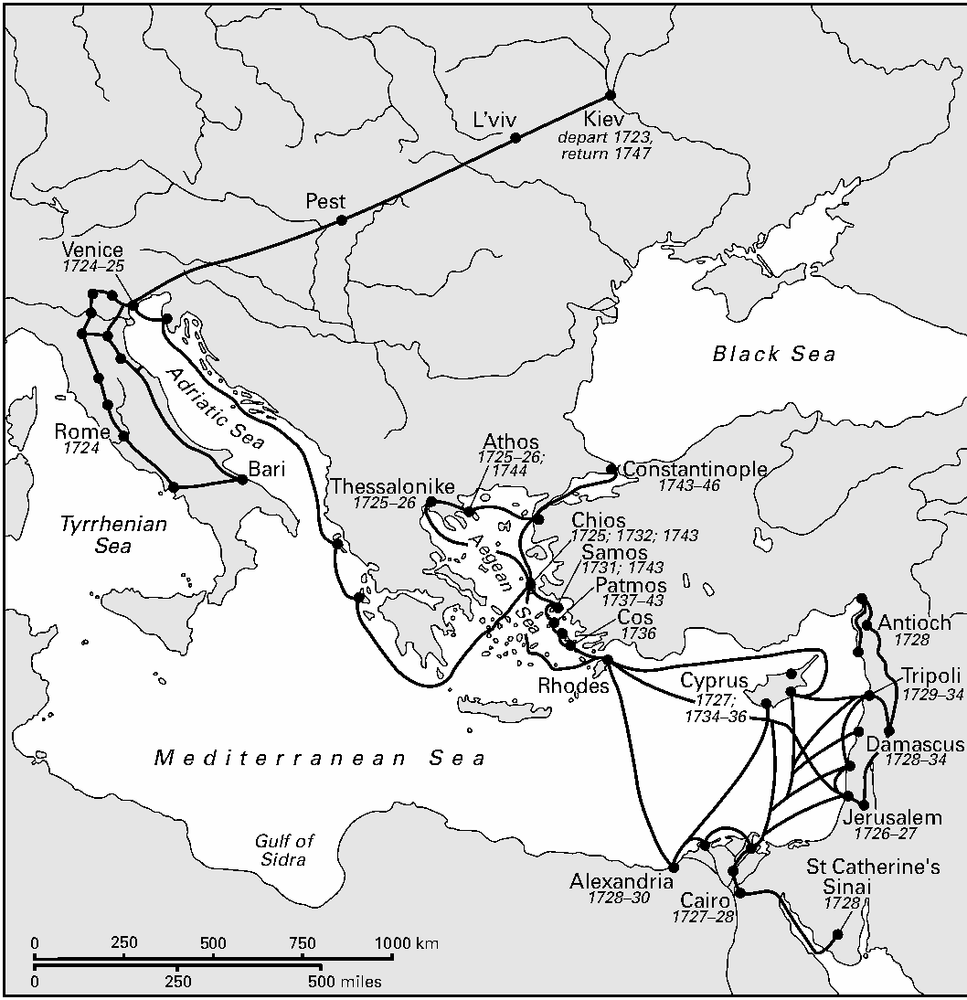
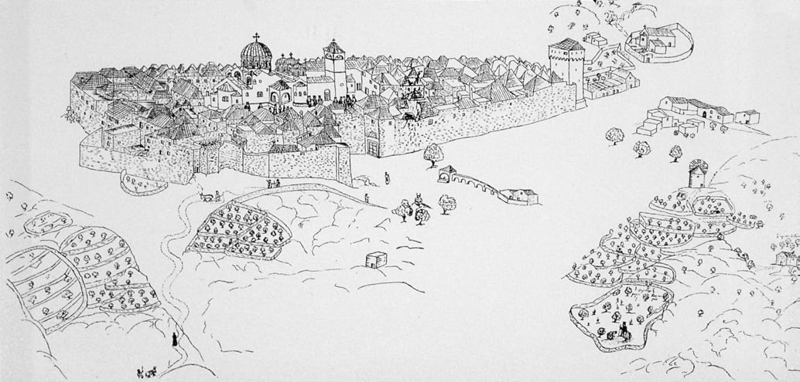
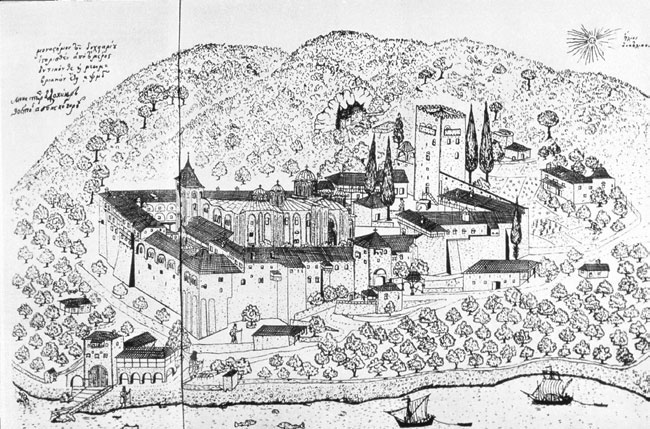

<!-- PDF page 231; original page 210 -->

# 第9章 巴尔斯基与正教共同体

亚历山大·格里申

瓦西里·赫里霍罗维奇—巴尔斯基是一位靠乞食旅行的斯拉夫朝圣者，游历从1723年持续至1747年，共24年。他从故乡基辅出发，经东欧前往意大利，在巴里、罗马、威尼斯的基督教圣所敬拜；随后前往圣地，途中停留希腊诸岛。他还两度长期居住阿索斯山，三访塞浦路斯，广泛游历希腊与小亚细亚，在君士坦丁堡居住一段时间，再由那里返乡基辅。[^p231-1] 当时，无论宗教热忱者还是好奇旅行者，朝圣都很普遍；然而，巴尔斯基的旅程在持续时间、范围，以及留下的详尽图文记录上，都极不寻常。[^p231-2] 不寻常的还有其正教旅行者身份：沿途寻找正教共同体，记录习俗、教堂、礼仪与敬拜传统，视角属于热情投入的内部人，而非好奇的局外人。

虽然我们对他的生平了解较多，研究史料丰富多样，但确切出生日期、准确姓名及教育细节等基本问题，仍未解决。他似乎于1701年末出生于基辅洞窟修道院一带，在十个孩子中排行第三，父亲是一位半识字商人。他于1715或1716年进入基辅神学院。

<!-- PDF page 232; original page 211 -->

*地图3 巴尔斯基的游历。原图所示时间为1723—1747年。*

地图地名及停留年代对照如下；日期依原图。黑色实线表示游历路线，比例尺分别以千米、英里标示。

| 原图标注 | 中文对照与年代 |
| --- | --- |
| L’viv | 利沃夫 |
| Kiev | 基辅；1723年出发，1747年返回 |
| Pest | 佩斯 |
| Venice | 威尼斯；1724—1725年 |
| Rome | 罗马；1724年 |
| Bari | 巴里 |
| Thessalonike | 帖撒罗尼迦；1725—1726年 |
| Athos | 阿索斯山；1725—1726年、1744年 |
| Constantinople | 君士坦丁堡；1743—1746年 |
| Chios | 希俄斯岛；1725年、1732年、1743年 |
| Samos | 萨摩斯岛；1731年、1743年 |
| Patmos | 帕特莫斯岛；1737—1743年 |
| Cos | 科斯岛；1736年 |
| Rhodes | 罗得岛 |
| Cyprus | 塞浦路斯；1727年、1734—1736年 |
| Antioch | 安提阿；1728年 |
| Tripoli | 的黎波里（今黎巴嫩）；1729—1734年 |
| Damascus | 大马士革；1728—1734年 |
| Jerusalem | 耶路撒冷；1726—1727年 |
| St Catherine’s, Sinai | 西奈山圣凯瑟琳修道院；1728年 |
| Alexandria | 亚历山大里亚；1728—1730年 |
| Cairo | 开罗；1727—1728年 |
| Black Sea | 黑海 |
| Adriatic Sea | 亚得里亚海 |
| Tyrrhenian Sea | 第勒尼安海 |
| Aegean Sea | 爱琴海 |
| Mediterranean Sea | 地中海 |
| Gulf of Sidra | 锡德拉湾 |

不过，腿上一处巨大溃疡迫使他中断学业，未能完成八年课程。1723年7月，他前往利沃夫求医。离开基辅时，他所受教育十分初步，包括斯拉夫诸语言知识、实用拉丁语，以及基本正教神学。他在利沃夫获得自认奇迹般的治愈，发愿前往巴里圣尼古拉斯圣所，作感恩朝圣。同在利沃夫，他试图进入当地耶稣会学院时，亲历归于罗马的合一派天主教当局对正教信徒的迫害。阅读其日记，必须放在乌克兰分裂的背景中：一部分属于正教俄罗斯帝国，另一部分属于天主教<!-- PDF page 233; original page 212 -->波兰—立陶宛联邦。作者是立场鲜明的正教信徒，其朝圣同时也是自我发现与持续学习的旅程。

离开利沃夫后，巴尔斯基徒步前往巴里圣尼古拉斯圣所，继而游历那不勒斯、罗马、佛罗伦萨及威尼斯。[^p233-3] 日记第一部分，以格外丰富的自传与地志资料为特点。新鲜体验反映于对朝圣细节的关注。旅程开始时，他对波兰联邦鲁塞尼亚地区所说的语言很熟悉，精确记下经过的村庄名称及相互距离，评论周边乡村，甚至所过溪流水质清澈还是混浊。他还关注人际关系，既包括同行者，也包括途中遇见的人，例如将他们赶出桑博尔附近圣救主修道院的天主教主教。[^p233-4]

在这一早期阶段，很难确定他详记事件和见闻的确切目的。但大量偶然细节表明，多数观察直接在现场记下，而非日后凭记忆编成：每日天气变化、星期几、偶遇人物，以及精确的铭文记录。他也时而说明写作过程，回忆某次“坐着写我的旅程，一直写到傍晚”。[^p233-5]

直到1724—1725年冬在威尼斯开始学希腊语之前，巴尔斯基完全依赖斯拉夫语言和拉丁语。早期旅行中，他不断感叹不懂其他语言，尤其德语、意大利语和希腊语。因此，他常被修道院或城镇拒之门外，须找到懂拉丁语的人，通常是司祭或学生，才能向值守者传达请求。抵达新城镇或村庄，他首先寻找斯拉夫同胞，常记下当地鲁塞尼亚、俄罗斯、波兰或塞尔维亚家庭的<!-- PDF page 234; original page 213 -->数量。这些人似乎也常是他描述所访地点的主要信息来源。

日记前部出现他对不同民族的评价，一部分反映个人经历，一部分取决于对方对正教的态度。未获准进入布达或佩斯后，他在城墙外找到塞尔维亚共同体。对方最初怀有敌意，凭外表认定他是赴罗马的天主教朝圣者；得知他是正教徒，便拥抱他，邀至塞尔维亚教堂庆祝圣灵降临节，并募集一笔可观钱款助其前行。[^p234-6] 他赞美塞尔维亚人的热情好客，也同样赞美希腊人。他两度住在威尼斯圣乔治教堂的希腊共同体，先在1724年6月，后自同年10月至1725年2月底。第一次，他尚不懂希腊语，却以正教旅人身份获接纳。他注意到，虽听不懂语言，教堂礼仪与故乡相似，只是福音不从教堂中央诵读，而从左侧高处的讲道台宣读。[^p234-7]

最初两年，巴尔斯基似乎一直被新鲜体验压倒，因不懂当地语言而畏缩，且大部分时间专注寻找斯拉夫同胞，既为友谊和支持，也为物质生计。随后五年，他的眼界根本改变，日记第二部分记录了这一变化。它叙述1725年2月28日第二次离开威尼斯，至1729年末的事件；那时，他已在安提阿牧首、塞浦路斯人西尔维斯特接待下，定居的黎波里继续学习。

在威尼斯学习后，他的希腊语已相当流利；日记常穿插希腊铭文抄录、词语讨论，以及修道院藏书中各种希腊手稿的评论。他也掌握足供交谈的阿拉伯语。有一次，圣诞庆典前找不到希腊司祭听告解，他记道：“我只得用阿拉伯语告解。”[^p234-8] 至于旅程这一阶段，他的

<!-- PDF page 235; original page 214 -->

*图9.1 巴尔斯基绘，希俄斯岛新修道院，1732年。*

<!-- PDF page 236; original page 215 -->

土耳其语程度仍不清楚，但他确实常解释土耳其词，并已熟悉到足以用其咒骂准备袭击他的窃贼。在日记第一部分，他是站在城门外、等待懂拉丁语或斯拉夫语者的朝圣人；第二部分中，他已成为熟练的多语言使用者，甚至鄙视只懂一种语言的人。

贫困仍紧随巴尔斯基，但日记第二部分不再总把乞求施舍视为唯一生计。牧首、总主教与修道院长，越来越以贵客而非乞食朝圣者的礼遇接待他。希腊修士和教士更愿接纳他为自己人，将其作为可疑局外人拒绝的情形减少。旅行节奏也稍慢：他愿在某城镇停留数月，或在圣地停留数周，不再像从前那样匆匆几日、甚至数小时。

更重要的是，第二部分的形式和编排发生根本变化，尤为显著的是用墨水线描说明观察。这一习惯始于1726年9月30日抵达耶路撒冷后不久。图画与文字常密切对应。他有时说，某幅圣像正如配图所示，或约瑟井结构、某地形状，参看详细而标注周全的附图，会更易理解。[^p236-9] 在这一阶段，图画相当于解释性脚注或装饰小景。他是一位朴拙而真实的观察记录者，可能了解当时希腊游记中的建筑绘图程式，却似乎把这些惯例调整至眼前建筑，而非抄袭已有插图。他的画在技巧上缺少的专业性，由精确观察弥补；没有十八世纪西欧游记常见的巴洛克饰物和寓意拟人形象。

<!-- PDF page 237; original page 216 -->

描述的形式也逐渐改变。巴尔斯基不再沿用列举总体印象、间插城镇与圣地描述的旧方式，而转向更具分析性的方法。变化不仅在于细节增多或篇幅变长。虽然这一部分确有对希俄斯新修道院、耶路撒冷外圣萨瓦修道院及西奈圣凯瑟琳修道院格外详尽的长篇描述，材料呈现方法本身也在渐变。早期，他列出相互冲突的证据，不解释矛盾，而将其视为主更大智慧的一部分；第二部分则出现更理性的路径，尽管《圣经》权威仍至高无上。福音记载圣家逃往埃及，当开罗当地基督徒将一处小屋指认为他们住所时，他毫无困难便予接受。[^p237-10] 然而，遇到矛盾时，例如两处房屋都被称为总领天使加布里埃尔向圣母传达主旨意的那所房屋，他便采取分析态度。第一处是洛雷托圣所；1724年到访时，他接受其真实性，转述天使如何从巴勒斯坦将房屋运来的奇迹。[^p237-11] 五年后，他在拿撒勒本地遇见第二处。有趣的并非他宣布洛雷托房屋是假迹，而是其理由。他不怀疑天使若愿意便能搬房屋，却无法接受整所房屋从拿撒勒消失，当地居民竟毫无察觉、口传传统也无记录。否定洛雷托建筑真实性的最重要证据，是他所说：“洛雷托的房屋由窑烧红砖砌成，但拿撒勒过去从没有、如今也没有砖房；所有房屋都用从周围山中开采的天然白石建造，那里无论新砖、旧砖，一概找不到。”[^p237-12] 他敢于拒斥已被接受的传统，部分因为这里面对两个互相矛盾的传统，一由天主教、一由正教提出；而此例的真相显然在<!-- PDF page 238; original page 217 -->正教一边。此后的著述中，同样深入的质疑，也被用于纯粹正教传统。

日记第二部分，巴尔斯基减少依赖口头信息，更倚重文献。有一处手稿留下空白，边栏注明，提醒自己查书，补入圣徒生平简述。[^p238-13] 另一些地方，他声称亲眼目睹、也很可能确实见过的事件，叙述却改写自其他文献。他详细讨论的“圣火”便是一例；这是正教复活节在圣墓教堂举行的奇迹仪式。虽然他亲自出席1727年4月的仪式，叙述开头却显露了对更早教会斯拉夫语著述的依赖。其中提到，许多朝圣者错误地说，圣灵以鸽子形状从天带来火焰，另一些人则看见闪电般的火；这些细节最早见于十二世纪初的记载。巴尔斯基有意识地回到“游历记”（khozhdeniia）的惯例，可见于罗斯十二世纪旅行者达尼尔院长的著作。[^p238-14] 在这一点上，他追随阿尔谢尼·苏哈诺夫；后者比他早半世纪来到圣地，著述却于十八世纪二十年代流行，[^p238-15] 恰逢巴尔斯基在基辅成长求学。[^p238-16] 他在基辅和利沃夫学院都可能接触达尼尔手稿的抄本，[^p238-17] 看来是在凭记忆复述文本。

就路程与距离而言，旅程第二部分以长途航海为特点。巴尔斯基本说要在1725年初春从威尼斯返乡，却在圣马可广场偶遇司祭修士鲁维姆·古尔斯基，使计划剧变。鲁维姆在彼得大帝宫廷失宠，因恶意流言攻讦逃离圣彼得堡，决定同巴尔斯基一起朝拜希腊圣所。两人于1725年2月28日乘船出发，4月9日抵达科孚。巴尔斯基详细描述敬礼圣斯皮里东圣髑的经过。从科孚，他们航向凯法利尼亚，<!-- PDF page 239; original page 218 -->继而扎金索斯（赞特）、米科诺斯，终于1725年8月4日抵达希俄斯。这是他六访该岛的第一次，产生了对新修道院最详尽的描述。

1725年9月9日，他离开希俄斯，前往帖撒罗尼迦，再赴阿索斯，在俄国圣潘泰莱蒙修道院过冬。除让他感到宾至如归的圣潘泰莱蒙外，其他修道院得知他是从罗马来的朝圣者，似乎多少怀有敌意；他甚至须证明正教信仰，才获准领圣餐。[^p239-18] 1726年2月1日，他离开阿索斯，在帖撒罗尼迦度过七个月，完善希腊口语，并使土耳其语达到一定流利程度。

1726年9月1日，巴尔斯基乘船前往圣地，途中访问罗得与塞浦路斯。9月23日抵达雅法，加入有护卫的商旅队，步行赴耶路撒冷；但因与队伍走散，遭抢劫、殴打。他不气馁，仍劝所有斯拉夫人朝拜圣墓，因为“没有哪个国家来的朝圣者，比俄罗斯诸地还少”。[^p239-19] 第一次停留圣地，约七个月，自1726年9月至1727年4月。他广泛游历，大多住修道院，常重访圣地。关于圣地的资料，多来自口头信息，但他在圣萨瓦修道院停留四周期间，也在院内图书馆读书。除赴死海、约旦河，以及圣诞前往伯利恒外，他大部分时间住在耶路撒冷。

1727年4月17日，他乘船拟赴西奈，却被风吹偏，抵达塞浦路斯利马索尔。[^p239-20] 他认为这是上帝安排，便留岛三个月，访问、描述若干修道院。7月31日前，他设法到达开罗，准备前往西奈山圣凯瑟琳修道院，却得知阿拉伯人怀有敌意，访客无法进入。在开罗住约八个月后，他扮作水手前往西奈，先横渡苏伊士湾至图尔，再穿沙漠，终于1728年3月31日抵达紧闭的修道院门前。经过<!-- PDF page 240; original page 219 -->数小时焦虑等待，他被秘密带入院内，停留一周，访问圣地、检查藏书。对修道院的详细讨论显示其相当渊博的学识，例如分析西奈礼仪形式，并寻找与修道院礼规的相似处。[^p240-21] 着眼于故乡礼仪改革，巴尔斯基越来越关心确定最早、最真实的正教礼仪。他从西奈经苏伊士返回开罗，住进牧首宫邸。第二部分横跨五年，其确切写作顺序很难确定。内部证据表明，它以日记式条目写成，并依现有顺序编排；也可看出，他打算修订手稿，因为某些地方留白，等待查证补入。这一工作从未完成，手稿仍处于未经作者修订的状态。

日记第三、也是最后一部分，记录1730至1744年末的事件。最后三年，即1744年至1747年9月返基辅的旅程，只能从书信、图画和零散文书重建，没有存世的连贯叙述。这三年图画上的详细批注，表明他打算写成这一部分；可惜，返乡不到一个月便早逝，剥夺了完成任务的机会。他可能为此积累的实地笔记，除主要讨论君士坦丁堡的一小段之外，都已散失。存世图画主要涉及希腊大陆及克里特的教堂和修道院，对研究希腊拜占庭遗产的艺术史家而言，是十八世纪上半叶最有价值的文献之一。

最后一部分未能写成，显示工作方法已改变到何种程度。早期日记保留逐日记事的顺序，穿插日常事件，富有地方色彩和自传细节，因现场感而珍贵；第三部分的方法与呈现却大不相同，需要大量时间组织材料，以及一座藏书相当好的图书馆。仅存的君士坦丁堡片段，至少使用八种二手来源，便足以说明问题。在这一最后部分，具体日期很少出现，<!-- PDF page 241; original page 220 -->旅途情形大多退居次要。巴尔斯基先将材料汇为经过研究的实地笔记，包含大量铭文、手稿与文书抄录、建筑尺寸，以及与古迹相关的口传传统。相隔颇久后，再依理性结构重组材料，校核，并以其他文献补充。

这一时期工作方法的最好例证，是对阿索斯材料的处理。他于1744年5月12日第二次抵达，似乎住到11月。逐院搜集材料时，遵循系统模式，偶因修士不好客而中断。例如，在库特卢穆修，他未获足够时间敬礼圣髑、丈量教堂、研究创建者历史、调查藏书、金玺诏书及其他文书，并绘制修道院。[^p241-22] 事实上，这份清单只是其最低要求。他对二十座主要修道院的各篇记述，近乎一部关于院内实体、行政和社会经济结构的百科全书式调查，兼有详细的灵性珍宝目录。读者可了解建筑结构与环境，且至少有一幅仔细标注的图画相佐。[^p241-23] 多数情况下，他详细调查院史，分析园圃、牲畜、蜂箱、葡萄园，以及附属半隐修院（sketes）和独修院舍（kellia）等财产；还记录行政等级、修士人数与族源、礼拜和教会程序的细节。主教堂描述尤详，通常附尺寸；大拉夫拉、全能者、迪奥尼修和圣保罗诸院，还配完整平面图。他也描写教堂装饰，抄录铭文，记录重要圣像、壁画和马赛克的位置，并转述相关传说；又长篇列举宝库内容，包括圣髑——有时质疑其真实性——[^p241-24] 金玺诏书和特许状。

<!-- PDF page 242; original page 221 -->

对于金玺诏书，他通常登记希腊语、斯拉夫语及拉丁语标题；但若认为某篇文本对建院、捐产或获得重要圣髑意义重大，便以原文全部抄录，附教会斯拉夫语译文。[^p242-25] 对藏书的处理不尽相同，既反映他对重要性的判断，也取决于获准接触的程度。有时，他只估计书籍与手稿数量，通常注明羊皮卷数目，并列举抄本中的作者姓名；有时，则讨论特定手稿、争议归属，抄录题跋。除主教堂及珍宝之外，他还常列举院内外小堂，有时描述装饰、显灵圣像，以及重要半隐修院的历史，通常以若干院中传说结束。

直到1745或1746年回到君士坦丁堡，能够使用俄国常驻使节阿列克谢·安德烈耶维奇·维什尼亚科夫及其继任者涅普柳耶夫的藏书时，巴尔斯基才真正编纂阿索斯材料。[^p242-26] 各条内部及相互之间，都经过系统安排。修道院依地理位置逐一讨论，先半岛东侧，后西侧。大拉夫拉被选作核心条目，篇幅极大，约占整个阿索斯卷的四分之一。[^p242-27] 其中约三分之一，是详细的礼仪研究，以及教会程序和修道仪式记述。后续许多条目回指大拉夫拉，说明建筑、经营管理、修道行政和礼仪在何种程度上遵循或偏离其模式。巴尔斯基有时提及在君士坦丁堡能够接触、并<!-- PDF page 243; original page 222 -->用来核查实地笔记事实的新近出版物。[^p243-28] 他也提到1746年发生于君士坦丁堡、与所述修道院有关的事件。[^p243-29] 日记早期，他反复强调向读者提供刚发生事件的新鲜目击记述；第三部分的重点，则是提供经过深思与充分研究、足以启益故乡人们的判断。

随着他越来越以文书与考古证据为主要材料，早期对口头事实信息的依赖几乎消失。阿索斯部分的许多院史材料，直接来自他阅读、翻译的金玺诏书。有时，他试图将存世建筑、圣像、圣髑，与文献所载相联系，借考古证据检验文献的准确和可靠。这一方法在克塞罗波塔穆记述中尤为明显：他将现存圣髑、圣像、建筑，与铭文及金玺诏书资料相互对照。[^p243-30] 从大拉夫拉院长以赛亚，以及伊维龙圣器保管官贝萨里翁的书信看，巴尔斯基在圣山享有极高学术声望，被称为比任何其他旅人都更博学。[^p243-31]

日记最后部分，图画越来越重要，主要作用不再是辅助、装饰文字，而是支持证据。他不断提醒读者看图，说明精确作画角度，以及记录古迹的时刻。这不是说早期图画通常出于幻想，而是其技术精确度和观察力随时间提高。将十八世纪三十年代初最大、最精美的一幅——1732年希俄斯新修道院（图9.1）[^p243-32]——同十二年后任何一幅阿索斯图画比较，

<!-- PDF page 244; original page 223 -->

*图9.2 巴尔斯基绘，从西南方观看多希亚里乌修道院，1744年。*

例如1744年多希亚里乌图（图9.2），[^p244-33] 这一发展便清晰可见。前者精美，却未注明日期，也几乎没有批注；仅有的文字标明当地一位俄国修士的园地和圣安东尼小堂，而且只有结合附文的一般描述，才能理解。虽然本书成书时的学者可能将其视为重建修道院1881年地震毁坏穹顶之前面貌的“无价资料”，[^p244-34] 他们指出某些不准确处，也有道理。[^p244-35] 多希亚里乌图的铭文则说明，它作于1744年、从西南方观看；另一铭文标出升起的太阳，以说明精确视角，正文还说描绘的是正午所见面貌。[^p244-36] 现代学者赞赏其对主教堂、院墙、小堂、塔楼、海岸线与整体地形的精确观察；将图画与古迹比较，无论按本书成书时的遗存，还是按<!-- PDF page 245; original page 224 -->早期照片，其准确性都很明显。[^p245-37] 频繁火灾、地震与蓄意破坏，使阿索斯、塞浦路斯和希腊的古迹毁灭或彻底改观，因此，他的图画成为记录已消失古迹的独特、无价材料。

巴尔斯基以自学成才的艺术家身份为荣，日记一段明确说到这一点。[^p245-38] 现代人看来，其笔墨技术简单，“如此不受外界影响、真挚而纯净，能够立即表达艺术家的视觉，以及他对对象的心理感受”，[^p245-39] 却不妨碍他采取学者而非业余爱好者的态度。1730年，他在亚历山大里亚抄绘一座称为“克娄巴特拉之针”的方尖碑，显示了完成任务时的精确。他测量宽度、估计高度，找不到人解释象形文字意义，便开始临摹方尖碑一面；依他所说，“令旁观者惊叹”。[^p245-40] 这幅画，是十八世纪最早的一批准确象形文字摹录之一。[^p245-41]

继续受教育，也许最能解释日记最后部分的变化。在安提阿牧首、塞浦路斯人西尔维斯特支持下，1729至1734年，巴尔斯基从学杰出学者、司祭修士雅各。[^p245-42] 1737至1743年，他又住在帕特莫斯，至少部分时间在当地学校学习；先随早年访问时便曾相处的马卡里奥斯，[^p245-43] 后随继任者格拉西莫斯。不过，多数时间，他独立研习、教授当地儿童，并编写供希腊语使用者学习拉丁语的教材。[^p245-44] 他似乎十分看重<!-- PDF page 246; original page 225 -->帕特莫斯的马卡里奥斯在1737年1月临终时给予的劝告：放弃旅行，专注希腊语研究，以益自己与故乡。[^p246-45] 因此，他尚在帕特莫斯时，便询问返基辅教授希腊语的可能性。正如下文将述，多年之后，基辅学院终于作出积极答复。

希腊学校对他的确切影响难以确定，但日记中的方法和思路，明显发生若干重要变化。他对来源的评估，具有越来越强的批判意识。虽然《圣经》权威仍至高无上，其他文献与口传来源的可靠性，都须严格检验。金玺诏书必须先确认真伪，内容才可接受；口头传统须同文字来源核验，才可认作有效。某事被正教传统视为真实，本身不足以构成证明。这种批判态度，不仅体现于对古物和民族志细节的新兴趣，也具体体现于第三访塞浦路斯后，对基科斯圣像及总领天使修道院挪亚石的讨论。[^p246-46] 好奇、体验异地风俗的愿望，从日记开头就存在；但最初，新经验仍被纳入较紧密的宗教训诲解释框架。到第三部分，他对非基督教建筑和古迹的察看、绘图与研究，已像此前对纯粹基督教古迹一样细心精确。例如，1731年访问萨摩斯，他虽谴责赫拉为异教女神，却仍仔细描述其圣所，提供尺寸，赞美其美丽。[^p246-47] 对异族外貌、衣饰和风俗，也有类似兴趣。早期，他大体因宗教而谴责某些族群，斥为邪恶，不值得评论；后来，却留下大量细致观察，涉及民间服饰、头饰、首饰及当地习俗。他长篇描述锡米岛服饰，[^p246-48] 科斯岛陶器，[^p246-49]<!-- PDF page 247; original page 226 -->以及村广场上喝咖啡、吸烟的生活方式，希腊人与土耳其人和谐相处的情景。[^p247-50]

巴尔斯基采用的文本模式发生变化，反映了希腊教育影响。如果最初部分受斯拉夫“游历记”传统影响，最后部分则更多得益于希腊朝圣指南（proskynetaria）。约翰·科穆宁所写十八世纪朝圣指南，是他描述阿索斯时最重要的二手文献。[^p247-51] 他查阅了1701、1745两个版本。[^p247-52] 在某种意义上，他的叙述为科穆宁的阿索斯敬拜图文指南，提供了改进、扩充和校正版。

日记重点逐渐从指南、日记、自传，转向旨在捍卫真理、揭露虚假、造福故乡的学术与论战著作。文本不断攻击土耳其压迫者和教皇主义，也充满关于甘为神圣正教会殉道者的虔诚训诲。他同西尔维斯特牧首友谊的叙述，其贯穿线索，是持续保护正教会独立、抵御罗马天主教侵蚀的斗争。[^p247-53] 同样，极长的阿索斯部分，以攻击米海尔八世·巴列奥略与牧首约翰十一世·贝科斯的背叛政策为高潮。他们于1276年迫害反合一修士，[^p247-54] 与故乡乌克兰正教信众受罗马天主教合一派攻击的经历遥相呼应。另一方面，他精确记录希腊正教礼仪程序、教堂陈设及组织，贡献于乌克兰与俄国正教传统的净化与保存。日记越来越成为一部指南，介绍仍存于圣地、希腊诸地与圣山的古老正教传统；“古老”的言外之意，也是“纯正”。

<!-- PDF page 248; original page 227 -->

就实际旅行和距离而言，1730至1744年的第三部分最少冒险。大部分时间，他居住、学习或任教于三个中心之一，再以付费乘客身份前往特定目的地，持介绍信，也有必要资金。这三个中心，是西尔维斯特在的黎波里和大马士革的牧首宫廷、帕特莫斯圣约翰修道院，以及君士坦丁堡俄国使节驻所。他出行时，更像贵宾，而非乞食朝圣者。1743年9月，他航往以弗所，再赴希俄斯，新修道院修士邀其访问、考察。他使他们难堪，斥其虚伪：自己贫困时受轻视，如今成了知名学者，却来讨好。他最终到访，立即谴责修士不爱护藏书，形容他们没有学习或求明的意愿。[^p248-55] 然而，新的富足处境，并未磨去他对正教徒受迫害的感受。这在1735年一次相会的描述中，表现得尤其生动：牧首西尔维斯特与旧师雅各被迫避难塞浦路斯，他写道：

> 恰巧在11月，我的灵性父亲与恩人、安提阿牧首西尔维斯特，同我的第一位老师雅各，离开驻所，来到塞浦路斯。他们正受到憎恨基督的教皇派迫害；这些人与我们信仰不同，想把所有正教阿拉伯人都转入他们的异端。[^p248-56]

巴尔斯基看到教皇派与穆斯林之间的相似：后者向塞浦路斯所有非穆斯林征收哈拉吉税，找到迫害基督徒的方式。“我在这里写下这些时，眼泪不断涌出；我记得亲眼看见许多穷人，再也忍受不了税收和土耳其压迫，否认了对基督的信仰。”[^p248-57] 他本人也难缴这项税，因而认同受压迫的正教共同体。

他离开君士坦丁堡的情形仍不清楚。1745年7月29日，朋友兼恩人、俄国常驻使节维什尼亚科夫去世，他似乎与继任者阿德里安·伊万诺维奇<!-- PDF page 249; original page 228 -->·涅普柳耶夫争吵。从他同西尔维斯特的书信看，[^p249-58] 双方曾言辞激烈，可能因为涅普柳耶夫代表俄罗斯帝国同罗马教会秘密谈判；他被威胁逮捕，并立即由海路遣送圣彼得堡。他于是逃离君士坦丁堡，1746年10月抵达布加勒斯特，踏上返基辅之路。从那里写给母亲的信，抱怨“未能实现留在君士坦丁堡完成工作的意愿”。[^p249-59] 他有两个目标：完成君士坦丁堡部分的手稿，如今只留下笔记；还须整理出版，期望既作为朝圣记，也作为古老正教敬拜传统指南，服务故乡的教会改革。他始终未能完成。

在布加勒斯特，基辅波多尔学校教务长瓦尔拉姆·拉谢夫斯基来函，邀请他担任基辅学院希腊语教师。[^p249-60] 他因病滞留至1747年7月，才启程基辅，于9月5日抵达，结束24年游历。返乡不久，他致信西尔维斯特：“非死非生，我精疲力竭地躺着，仿佛一具可怜尸体。”[^p249-61] 返基辅约一个月后，即1747年10月7日，巴尔斯基去世，以隆重礼仪安葬于基辅兄弟会修道院主教堂祭台附近。[^p249-62]

## 注释

[^p231-1]: 参见 T. G. Stavrou and P. R. Weisensel, Russian travelers to the Christian East from the twelfth to the twentieth century (Columbus, OH: Slavica, 1986), 70–3.

[^p231-2]: 这部无题旅行日记，通常称《瓦西里·赫里霍罗维奇—巴尔斯基东方圣地游记》，以作者亲笔手稿形式留存，500余叶、约24万词，附数十幅极其精确的考古绘图，主要表现教堂和修道院。原稿藏于基辅科学院档案馆，Kiev v, No. 1062。最准确的已刊版本是 N. Barsukov, Stranstvovaniia Vasil’ia Grigorovicha-Barskago po sviatym mestam vostoka s 1723 po 1747 g., 4 vols. (St Petersburg: Pravoslavnoe palestinskoe obshchestvo, 1885–87)。下文均引手稿，而非印本。

[^p233-3]: A. Grishin, ‘Vasyl’ Hryhorovyc Bars’kyj: an eighteenth-century Ukrainian pilgrim in Italy’, Harvard Ukrainian Studies 17 (1993), 7–26.

[^p233-4]: Bars’kyj Ms., fol. 7v.

[^p233-5]: Bars’kyj Ms., fol. 12v.

[^p234-6]: Bars’kyj Ms., fols. 13v.–14v.

[^p234-7]: Bars’kyj Ms., fol. 26r.

[^p234-8]: Bars’kyj Ms., fol. 236r.

[^p236-9]: 巴尔斯基文本中多处提到自己的图画，包括塞浦路斯基科斯修道院显灵圣像、约瑟井及拿撒勒整体面貌。参见 Bars’kyj Ms., fols. 180r, 190r, 237r。

[^p237-10]: Bars’kyj Ms., fol. 191r.

[^p237-11]: Bars’kyj Ms., fols. 32r–34r.

[^p237-12]: Bars’kyj Ms., fol. 293r.

[^p238-13]: Bars’kyj Ms., fols. 131r–132v.

[^p238-14]: 参见 A. Grishin, ‘Vasylijy Bars’kyj and the xozhenija tradition’, Australian Slavonic and East European Studies Journal 11 (1988), 29–42.

[^p238-15]: N. I. Ivanovskii, ‘Proskinitarii Arseniia Sukhanova’, Pravoslavnii Palestinskii Sbornik 7 (St Petersburg, 1889), pt 3.

[^p238-16]: 关于巴尔斯基的圣火记述，参见 Bars’kyj Ms., fols. 173r–176v.

[^p238-17]: 基辅抄本为十六世纪末或十七世纪抄写，藏基辅学院图书馆，目录号157；利沃夫抄本年代为1701年，目录号132(105)。

[^p239-18]: Bars’kyj Ms., fol. 116r.

[^p239-19]: Bars’kyj Ms., fol. 139v.

[^p239-20]: 巴尔斯基塞浦路斯记述的译本，参见 A Pilgrim’s Account of Cyprus: Bars’kyj’s Travels in Cyprus, ed. A. D. Grishin [Sources for the History of Cyprus 3] (Altamont, NY: Greece and Cyprus Research Center, 1996).

[^p240-21]: Bars’kyj Ms., fols. 194r–205v.

[^p241-22]: Bars’kyj Ms., fol. 387v.

[^p241-23]: 阿索斯图画中，现存23幅独立整页插图，以及9幅插入手稿正文的图画。若干与瓦托佩迪、希兰达尔和普罗塔顿有关的大幅图画，已经散失。

[^p241-24]: 例如，迪奥尼修修道院向他出示一条细金属链，据称是曾捆绑圣彼得的锁链。巴尔斯基冷静评论，这不像他在罗马见过的同一时期其他锁链，因此怀疑真实性。见 Bars’kyj Ms., fol. 471v。

[^p242-25]: 例如，克塞罗波塔穆条目，详细抄录该院所藏金玺诏书的希腊文本。见 Bars’kyj Ms., fols. 449v–463r。

[^p242-26]: A. A. 维什尼亚科夫于1729年抵达君士坦丁堡，1734年末取代 I. I. 涅普柳耶夫任俄国常驻使节，任职至1745年；继任者 A. I. 涅普柳耶夫是其前任之子。巴尔斯基返君士坦丁堡的确切日期不明，书信证明1746年他已在那里，也很可能1745年就已抵达。参见其1746年10月31日信，Barsukov, Stranstvovaniia, iv, 67–8。

[^p242-27]: 大拉夫拉条目超过63叶；相比之下，1725年访阿索斯时对该院的描述，仅一叶半。参见 Bars’kyj Ms., fols. 332v.–395v.；比较 fols. 110v.–111r。

[^p243-28]: 例如，他曾查阅1745年威尼斯出版的一部朝圣指南，核查希兰达尔修士对某件圣髑的主张。参见 Bars’kyj Ms., fol. 400r。

[^p243-29]: Bars’kyj Ms., fol. 426v.

[^p243-30]: Bars’kyj Ms., fols. 444r.–463r.

[^p243-31]: Barsukov, Stranstvovaniia, iv, 64–7.

[^p243-32]: 同上, ii, 204: plate 26. 关于此画及相关文献的讨论，参见 C. Bouras, Nea Moni on Chios: history and architecture (Athens: Commercial Bank of Greece, 1982), 50, esp. fn. 4.

[^p244-33]: Barsukov, Stranstvovaniia, iii, 274: plate 21.

[^p244-34]: Bouras, Nea Moni, 50.

[^p244-35]: 同上, 107.

[^p244-36]: Bars’kyj Ms., fol. 432r.

[^p245-37]: 彼得·伯里奇谈及巴尔斯基的多希亚里乌图时写道：“图中每一项主要要素，今天都能辨认。”P. J. Burridge, ‘The development of monastic architecture on Mount Athos with special reference to the monasteries of Pantocrator and Chilandari’, 博士论文，英国约克大学，1976, 253。

[^p245-38]: Bars’kyj Ms., fol. 292r.

[^p245-39]: P. M. Mylonas, Athos and its monastic institutions through old engravings and other works of art (Athens: National Academy of Fine Arts, 1963), 21.

[^p245-40]: Barsukov, Stranstvovaniia, ii, 163; 复制图见图版18；其工作过程的描述见 Bars’kyj Ms., fol. 245r.

[^p245-41]: 参见 E. Iversen, Obelisks in exile (Copenhagen: G. E. C. Gad Publishers, 1972), ii, 90–147. 谨感谢伦敦大英博物馆埃及文物部 C. Andrews 女士，就巴尔斯基的象形文字摹录提供意见。

[^p245-42]: 关于司祭修士雅各，参见 Bars’kyj Ms., fols. 240v.–241v., 247r., 264v.

[^p245-43]: 关于帕特莫斯的马卡里奥斯，参见 Bars’kyj Ms., fols. 256v., 316v.–320v.

[^p245-44]: 巴尔斯基的拉丁语语法书似未存世。他对该书的讨论，参见 Bars’kyj Ms., fol. 320v.

[^p246-45]: Bars’kyj Ms., fol. 318r.

[^p246-46]: Bars’kyj Ms., fols. 285r., 285v., 295r., 295v.

[^p246-47]: Bars’kyj Ms., fol. 258r.

[^p246-48]: Bars’kyj Ms., fol. 248r.

[^p246-49]: Bars’kyj Ms., fol. 251v.

[^p247-50]: Bars’kyj Ms., fol. 249v.

[^p247-51]: Ioannis Komnenos, Προσκυνητάριον τοῦ Ἁγιοῦ Ὄρους τοῦ Ἄθωνος (Venice: N. Glykys, 1745). 关于这一传统若干惯例的讨论，参见 K.-D. Seemann, Die altrussische Wallfahrtsliteratur. Theorie und Geschichte eines literarischen Genres (Munich: W. Fink, 1976); G. D. Lenhoff Vroon, ‘The making of the medieval Russian journey’, 博士论文，密歇根大学，1978.

[^p247-52]: 巴尔斯基说，他在君士坦丁堡查阅这部朝圣指南的1745年威尼斯版，以核查某一条目相较1701年旧版是否改动。见 Bars’kyj Ms., fol. 400r。

[^p247-53]: Bars’kyj Ms., fol. 407r.

[^p247-54]: Bars’kyj Ms., fols. 487r.–488v.

[^p248-55]: Bars’kyj Ms., fol. 325v.

[^p248-56]: Bars’kyj Ms., fol. 307r., fol. 307v.

[^p248-57]: Bars’kyj Ms., fol. 306v.

[^p249-58]: Barsukov, Stranstvovaniia, iv, 69–74.

[^p249-59]: 同上, iv, 68.

[^p249-60]: 同上, iv, 72.

[^p249-61]: 同上, iv, 72.

[^p249-62]: 巴尔斯基手稿最初由 V. G. Ruban 以大幅删节、错讹甚多的版本出版，题为 Peshekhnodtsa Vasiliia Grigorovicha Barskago... (St Petersburg: Imperatorskaja akademiia nauk, 1778)，后来又有1785、1793、1800和1819年各版。
