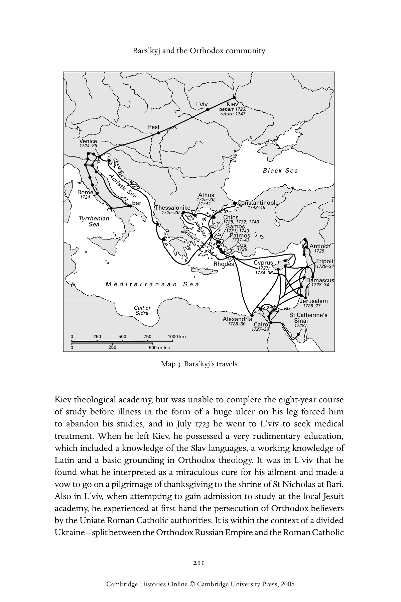
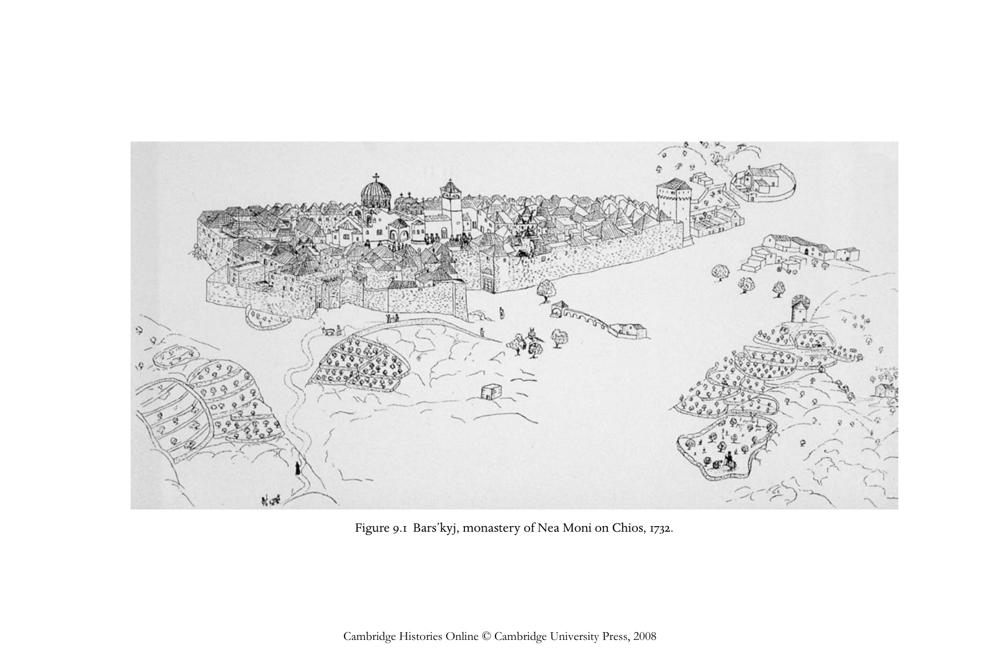
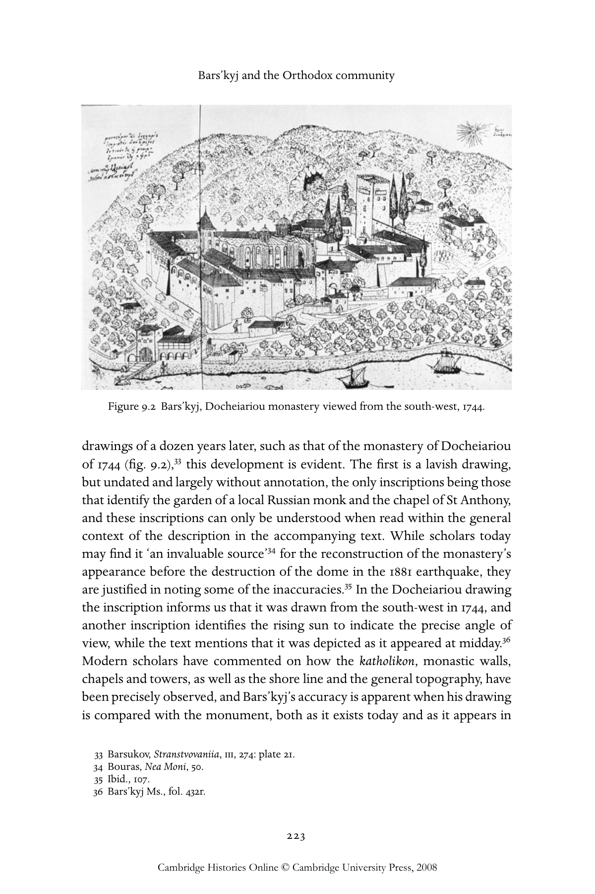

# 巴尔斯基与正教共同体：英文转换底稿

<!-- PDF page 231; original page 210 -->

### 9

### Bars’kyj and the Orthodox community

### a l e x a n d e r g r i s h i n

Vasyl Hryhorovyc-Bars’kyj was a Slav mendicant pilgrim whose travels lasted twenty-four years between 1723 and 1747. They took him from his native Kiev through eastern Europe to Italy, where he worshipped at Christian shrines in Bari, Rome and Venice. He then travelled to the Holy Land, en route spending time in the Greek islands; he also spent two extended periods living on Mount Athos, visited Cyprus on three occasions, and travelled extensively throughout Greece and Asia Minor. He spent some time in Constantinople from where he returned home to Kiev.[^p231-1] While pilgrimages were common in this period, both by religious zealots and by curious travellers, Bars’kyj’s pilgrimage was unusual in both its duration and its scope, as well as for the detailed written and illustrated record that he kept.[^p231-2] It was also unusual in that he wrote as an Orthodox traveller, who throughout his journeys sought out Orthodox communities and recorded their customs, churches, liturgies and traditions of worship from the perspective of a passionate insider, rather than as a curious outsider.

Although our knowledge of Bars’kyj’s biography is relatively extensive, and extant sources for its study are rich and varied, basic questions such as the exact date of his birth, his precise name and details of his education remain unresolved. He appears to have been born in Kiev towards the end of 1701 in the region of the Monastery of the Caves; the third in a family of ten children, the son of a semi-literate merchant. In 1715 or 1716 he entered the

[^p231-1]: See T. G. Stavrou and P. R. Weisensel, Russian travelers to the Christian East from the twelfth to the twentieth century (Columbus, OH: Slavica, 1986), 70–3.

[^p231-2]: His untitled travel journal, usually referred to as ‘The travels of Vasyl’ Hryhorovyc- Bars’kyj in the holy lands of the East’, survives in the autograph manuscript of over 500 folios, or about 240,000 words, and is accompanied by scores of painstakingly accurate archaeological drawings mainly of churches and monasteries. The autograph manuscript is in Kiev at the Akademiia Nauk Archive, Kiev v, No. 1062. The most accurate published edition is N. Barsukov, Stranstvovaniia Vasil’ia Grigorovicha-Barskago po sviatym mestam vostoka s 1723 po 1747 g., 4 vols. (St Petersburg: Pravoslavnoe palestinskoe obshchestvo, 1885–87). References will be given below to the manuscript and not to the printed edition.

<!-- PDF page 232; original page 211 -->

L’viv Kiev depart 1723, return 1747 Pest Venice 1724–25 Black Sea R 1 o 72 m 4 e AdriaticSea Bari Thessalonike 1 A 7 1 2 t 7 5 h 4 –4 o 2 s 6; Con 1 s 7 t 4 a 3 n –4 ti 6 nople 1725–26 Tyrrhenian Chios Sea Aegean 171 S 2 7 P a 5 3; m 1 a 1; t 7 1 m o 3 7 s 2 4 o; 3 s 1743 Sea 173 C 1 7 7 o –3 s 4 6 3 A 1 n 7 t 2 io 8 ch Rhodes C 1 y 7 p 2 r 7 u; s 1 T 7 r 2 ip 9– o 3 l 4 i 1734–36 Damascus M e d i t e r r a n e a n S e a 1728–34 Jerusalem Gulf of 1726–27 Sidra St Catherine's Alexandria Sinai 1728–30 Cairo 1728 1727–28

0250 500 750 1000 km

0250 500 miles

> Map 3 Bars’kyj’s travels

Kiev theological academy, but was unable to complete the eight-year course of study before illness in the form of a huge ulcer on his leg forced him to abandon his studies, and in July 1723 he went to L’viv to seek medical treatment. When he left Kiev, he possessed a very rudimentary education, which included a knowledge of the Slav languages, a working knowledge of Latin and a basic grounding in Orthodox theology. It was in L’viv that he found what he interpreted as a miraculous cure for his ailment and made a vow to go on a pilgrimage of thanksgiving to the shrine of St Nicholas at Bari. Also in L’viv, when attempting to gain admission to study at the local Jesuit academy, he experienced at first hand the persecution of Orthodox believers by the Uniate Roman Catholic authorities. It is within the context of a divided Ukraine – split between the Orthodox Russian Empire and the Roman Catholic

<!-- PDF page 233; original page 212 -->

Polish–Lithuanian Commonwealth – that Bars’kyj’s travel journal needs to be read. The author was a partisan Orthodox believer, whose pilgrimage was part of a journey of self-discovery and continuing education.

On leaving L’viv, Bars’kyj set out on foot for the shrine of St Nicholas at Bari, going on from there to Naples, Rome, Florence and Venice.[^p233-3] The first section of Bars’kyj’s travel journal is characterised by the exceptional richness of autobiographical and topographical information. The novelty of the experience is reflected in the attention paid to the details of the pilgrimage. At the start of his journey Bars’kyj felt at home with the languages spoken in the Ruthenian lands of the Polish Commonwealth and noted with precision the names of the villages that he passed through and the distances between them; he commented on the surrounding countryside and on such details as whether the water in the streams that he crossed was clear or murky. He was also preoccupied with human relationships, both with his travelling companions and with the people whom they encountered, such as the Catholic bishop who chased them away from the monastery of the Holy Saviour near Sambor.[^p233-4]

At this early stage it is difficult to determine the exact purpose Bars’kyj had in mind in keeping this detailed diary of events and observations. The fact that most of the observations were made and recorded directly on the spot, rather than being put together later from memory, is attested by the inclusion of numerous incidental details such as the daily changes in the weather, reference to the days of the week, descriptions of casual encounters with people, and precise epigraphic records. Also, from time to time, he noted how he wrote his account, recalling how on one occasion he had ‘sat until evening writing about my journey’.[^p233-5]

Until the winter of 1724–25, when Bars’kyj commenced his study of Greek in Venice, he was forced to rely exclusively on his knowledge of the Slav languages and Latin. During his early travels he constantly lamented his lack of knowledge of other languages, particularly of German, Italian and Greek. It meant that he frequently found monasteries and towns barred to him until he could find someone who knew Latin, usually a priest or a student, who could communicate his wishes to the guards on duty. The first thing Bars’kyj did on reaching a new town or village was to seek out fellow Slavs and he often recorded the number of Ruthenian, Russian, Polish or Serbian families

[^p233-3]: A. Grishin, ‘Vasyl’ Hryhorovyc Bars’kyj: an eighteenth-century Ukrainian pilgrim in Italy’, Harvard Ukrainian Studies 17 (1993), 7–26.

[^p233-4]: Bars’kyj Ms., fol. 7v.

[^p233-5]: Bars’kyj Ms., fol. 12v.

<!-- PDF page 234; original page 213 -->

that were resident in a particular place. It also appears that these people were often his primary source of information for his descriptions of the places he visited.

In the early part of his travel journal we encounter a number of Bars’kyj’s expressed attitudes to various nationalities, in part reflecting his personal experiences, but also in part determined by their attitudes to the Orthodox religion. Having failed to gain admission either to Buda or to Pest, Bars’kyj found a Serbian community living outside their city walls. The Serbs were initially hostile to Bars’kyj, concluding from his appearance that he was a Catholic pilgrim on the way to Rome. On learning that he was Orthodox, he was embraced and invited to the Serbian church to celebrate the feast of the Descent of the Holy Spirit and a considerable sum of money was gathered to help him on his way.[^p234-6] Bars’kyj praises the Serbs for their warmth and hospitality, as he does the Greeks. He stayed twice with the Greek community at the church of St George in Venice, first in June 1724 and again from October 1724 until the end of February 1725. During his first stay he knew no Greek but was accepted as an Orthodox traveller. He noted that, although he could not understand the language, the church liturgy was similar to the one back home, except that here the Gospel was read not from the centre of the church but from the pulpit high up on the left-hand side.[^p234-7]

During his first two years of travelling Bars’kyj appeared to be constantly overwhelmed by the novelty of the experience, intimidated by his lack of knowledge of local languages and, for much of the time, preoccupied with the search for fellow Slavs, as much for companionship and support as for material sustenance. The next five years saw fundamental changes in his outlook, which are documented in the second part of Bars’kyj’s travel journal. This deals with the events that took place between his second departure from Venice on 28 February 1725 and the end of 1729, by which time he had settled in Tripoli to further his studies as a guest of the patriarch of Antioch, Sylvester the Cypriot.

After his period of study in Venice he gained a degree of fluency in Greek and his travel journal entries are frequently punctuated with transcriptions of Greek inscriptions, discussion of Greek words and comments about various Greek manuscripts that he found in monastic libraries. He also became proficient in Arabic, sufficient for purposes of conversation, noting on one occasion that, as he could not find a Greek priest to hear his confession before the Christmas celebrations, ‘I had to say my confession in Arabic.’[^p234-8] While the extent of his

[^p234-6]: Bars’kyj Ms., fols. 13v.–14v.

[^p234-7]: Bars’kyj Ms., fol. 26r.

[^p234-8]: Bars’kyj Ms., fol. 236r.

<!-- PDF page 235; original page 214 -->

Figure9.1 Bars’kyj,monasteryofNeaMonionChios,1732.
Cambridge Histories Online © Cambridge University Press, 2008

<!-- PDF page 236; original page 215 -->

knowledge of Turkish at this stage of his travels is unclear, he does frequently explain Turkish words and was sufficiently at home in the language to swear abuse in Turkish at thieves who were preparing to attack him. While in the first part of his journal Bars’kyj emerges as the pilgrim who stands outside the city gates, waiting for someone who understands Latin or a Slavonic language, in the second part he appears as the accomplished polyglot, scornful of those who know but a single language.

Although poverty continued to stalk Bars’kyj, the second part of his journal is far less preoccupied with begging for alms as the sole means of financial support. Increasingly patriarchs, archbishops and abbots received him with honour, as a distinguished visitor rather than as a mendicant pilgrim. Greek monks and clerics more readily accepted him as belonging to their number and there were fewer instances of him being rejected as the suspect outsider. The pace of travel also slowed down somewhat, with Bars’kyj prepared to spend months in a particular town or weeks at a sacred site instead of a few rushed days or a couple of hours, as was previously the case.

More significantly, the second part of Bars’kyj’s journal displayed fundamental changes in form and format. Most notable is his use of pen and ink line drawings to illustrate his observations: a practice which he started shortly after his arrival in Jerusalem on 30 September 1726. Frequently there is a close correlation between the drawings and the text, with Bars’kyj on occasion stating that a particular icon appeared the way in which he had shown it in the illustration, or that the structure of Joseph’s Well or a topographical description could be more clearly understood by consulting the accompanying drawings, which were both detailed and carefully labelled.[^p236-9] At this stage of the journal, drawings play the role of explanatory footnotes or decorative vignettes. Bars’kyj was a naive but authentic recorder of what he saw. He was probably aware of the schematic formulae of architectural drawings found in Greek travel books of the time, but he appears to have adapted their conventions to the monuments before him rather than copying existing illustrations. What his drawings lack in the professionalism of their execution they gain in their precision of observation. His drawings have none of the baroque trappings and allegorical personifications that are such a common feature in the eighteenth century of western European travel books.

[^p236-9]: In Bars’kyj’s text the many references that allude to his drawings include those concerning the miraculous icon at the Kykkos monastery on Cyprus, Joseph’s Well and the overall appearance of Nazareth. See Bars’kyj Ms., fols. 180r, 190r, 237r.

<!-- PDF page 237; original page 216 -->

The form of descriptions also starts to change gradually, as Bars’kyj moves away from his previously adopted form of listing general impressions interspersed with descriptions of towns and holy sites, to a much more analytical approach. The change is not purely one of the amount of detail included, or of the length of the entry. While exceptionally long and detailed descriptions of the monasteries of Nea Moni on Chios, St Sabas, outside Jerusalem, and St Catherine on Mount Sinai do appear in this section, there is a gradual change in Bars’kyj’s method of presentation of his material. In the earlier part he listed conflicting pieces of evidence with contradictions not explained but treated as part of the greater wisdom of the Lord. In the second part a more rationalist approach is evident, even if scriptural authority remains of paramount significance. Since the Gospels mention that the Holy Family fled to Egypt, Bars’kyj had no difficulty in accepting a small dwelling in Cairo as being the house in which they stayed, when it was identified as such by the local Christian community.[^p237-10]  However, when a contradiction arose, like two houses purporting to be the very house in which the Archangel Gabriel approached the Virgin Mary to deliver the Lord’s message, then Bars’kyj adopted an analytical approach. The first candidate for this site was the shrine in Loreto, which Bars’kyj accepted as genuine when he visited it in 1724 and related the miracle of how the angels had transported the house there from Palestine.[^p237-11]  He encountered the second candidate five years later in Nazareth itself. What is interesting is not so much that he declared the house in Loreto to be a fake, but the reasons he gave for his conclusion. While not doubting the ability of angels to carry houses, if they so desired, he found it impossible to accept that a whole house could disappear from Nazareth without the local inhabitants noticing it and without the event being recorded in local oral tradition. For Bars’kyj, the most important piece of evidence for discounting the Loreto building’s identification as the authentic dwelling was, as he notes, ‘that the house in Loreto is assembled out of red bricks, fired in ovens, but in Nazareth there have never been houses made out of bricks, nor are there now, but they are all made out of natural white stone cut out of the surrounding hills and in no way can bricks be found there, neither new nor ancient ones’.[^p237-12]  Bars’kyj’s boldness in rejecting an accepted tradition can be explained in part by the fact that here he was confronted by two contradictory traditions, one advanced by the Catholic Church and the other by the Orthodox Church, and in this instance the truth clearly lay on

[^p237-10]: Bars’kyj Ms., fol. 191r.

[^p237-11]: Bars’kyj Ms., fols. 32r–34r.

[^p237-12]: Bars’kyj Ms., fol. 293r.

<!-- PDF page 238; original page 217 -->

the side of the Orthodox. In his subsequent writings, the same penetrating questioning of convention is applied to purely Orthodox traditions.

In the second part of his travel journal, Bars’kyj started to rely less on oral sources and to lean more heavily on literary sources. In one instance there is a lacuna in Bars’kyj’s manuscript, with a note in the margin reminding the author to consult a book and to insert a short account of the saint’s life.[^p238-13]  Elsewhere, events to which Bars’kyj claims to be an eye witness, and in all probability was, are paraphrased from another literary source. This is the case with his detailed discussion of the Holy Fire, the miracle that was part of the Easter ritual for Orthodox Christians in the Church of the Holy Sepulchre. Despite his being present at the ceremony in April 1727, the prologue to his description betrays its dependence on much earlier writings in Church Slavonic. It contains the information that many pilgrims falsely say that the fire is carried from heaven by the Holy Spirit in the form of a dove while others see it like lightning, details which first appeared in early twelfth-century accounts. Bars’kyj was consciously reverting to the conventions of the khozhdeniia account, as found in the writings of the twelfth-century traveller from Rus, Igumen Daniil.[^p238-14]  In this he was following Arsenii Sukhanov, who had come to the Holy Land half a century before Bars’kyj, but whose writings gained popularity in the 1720s,[^p238-15] during Bars’kyj’s formative years in Kiev.[^p238-16]  Bars’kyj would have had access to copies of the Daniil manuscript at both the Kiev Academy and the L’viv Academy[^p238-17]  and he appears to be recalling the text from memory.

In terms of travel and distances, the second part of Bars’kyj’s pilgrimage is one of great sea voyages. Despite his stated intention of returning home from Venice in the early spring of 1725, the chance meeting in the Piazza San Marco with the hieromonk Ruvym Gur’skyj led to a dramatic change in plans. Ruvym was a priest who had fallen from grace at the court of Tsar Peter the Great and fled St Petersburg because of a campaign of malicious gossip directed at him. He decided to join Bars’kyj on a pilgrimage to the holy shrines of Greece and they set out together by boat for Corfu on 28 February 1725, reaching the island on 9 April. Bars’kyj provides a detailed description of how they worshipped the relics of St Spyridon. From Corfu they sailed to Kephallenia (Cephalonia),

[^p238-13]: Bars’kyj Ms., fols. 131r–132v.

[^p238-14]: See A. Grishin, ‘Vasylijy Bars’kyj and the xozhenija tradition’, Australian Slavonic and East European Studies Journal 11 (1988), 29–42.

[^p238-15]: N. I. Ivanovskii, ‘Proskinitarii Arseniia Sukhanova’, Pravoslavnii Palestinskii Sbornik 7 (St Petersburg, 1889), pt 3.

[^p238-16]: For Bars’kyj’s account of the Holy Fire, see Bars’kyj Ms., fols. 173r–176v.

[^p238-17]: The Kiev manuscript is a late sixteenth- or seventeenth-century copy held at the Kiev Academy Library, Cat. no. 157, while the one at L’viv is dated 1701 and is catalogue no. 132(105).

<!-- PDF page 239; original page 218 -->

Zakynthos (Zante) and Mykonos, and finally arrived at Chios on 4 August 1725. This was the first of Bars’kyj’s six visits to the island and produced his most detailed description of the Nea Moni monastery.

Bars’kyj set off from Chios on 9 September 1725 for Thessalonike, and thence to Athos where he spent the winter at the Russian monastery of St Panteleimon. Apart from St Panteleimon, where he felt at home, he appears to have received a somewhat hostile reception at the other monasteries when the monks learnt that he was a pilgrim travelling from Rome. He even had to have his Orthodoxy established before he was admitted to the Eucharist.[^p239-18]  He left Athos on 1 February 1726, and spent the next seven months in Thessalonike, where he perfected his spoken Greek and developed a degree of fluency in Turkish.

On 1 September 1726, Bars’kyj set off by boat for the Holy Land, visiting along the way Rhodes and Cyprus. On 23 September he arrived at Jaffa, from where he travelled on foot as part of an escorted caravan to Jerusalem, but becoming separated from the caravan he was robbed and beaten. Undeterred he urged all Slavs to make the pilgrimage to the Holy Sepulchre, as ‘there is no country from which so few pilgrims come as from the Russian countries’.[^p239-19]  Bars’kyj’s first stay in the Holy Land lasted about seven months, from September 1726 to April 1727. He travelled extensively, mostly residing in monasteries and frequently revisiting holy sites. He drew from oral sources much of the information that he provides concerning the Holy Land although he spent his four-week stay at the monastery of St Sabas reading books in the monastic library. Apart from visits to the Dead Sea and the Jordan River, and a trip to Bethlehem for Christmas, Bars’kyj passed most of his time in Jerusalem.

On 17 April 1727, Bars’kyj left by boat to visit Sinai, but was blown off course and fetched up at Limassol on Cyprus.[^p239-20]  Seeing the hand of God in this, he stayed on the island for three months and visited and described a number of monasteries. By 31 July he managed to reach Cairo, from where he planned to travel to St Catherine’s on Mount Sinai, but he was told that the monastery was inaccessible to visitors because of hostile Arabs. After a stay in Cairo that lasted some eight months, he set off for Sinai disguised as a sailor. First crossing the Gulf of Suez to al-T. ûr he set out across the desert until he finally arrived at the monastery’s locked gate on 31 March 1728. After

[^p239-18]: Bars’kyj Ms., fol. 116r.

[^p239-19]: Bars’kyj Ms., fol. 139v.

[^p239-20]: For a translation of Bars’kyj’s account of Cyprus see A Pilgrim’s Account of Cyprus: Bars’kyj’s Travels in Cyprus, ed. A. D. Grishin [Sources for the History of Cyprus 3] (Altamont, NY: Greece and Cyprus Research Center, 1996).

<!-- PDF page 240; original page 219 -->

many anxious hours he was smuggled into the monastery and he spent a week visiting the sacred sites and examining the library. His detailed discussion of the monastery displays considerable erudition over such things as the form of the liturgy celebrated on Sinai and parallels that could be discovered in monastic typika.[^p240-21]  With an eye to the reform of the liturgy back home, Bars’kyj was becoming increasingly preoccupied with establishing the form of the earliest and authentic Orthodox liturgy. From Sinai he returned via Suez to Cairo, where he settled in the patriarchal palace. The exact sequence of writing of the second part of the travel journal is difficult to determine in view of the five-year time span. Internal evidence suggests that it was written in the form of diary-like entries arranged in their present order. It is also apparent that Bars’kyj intended to revise the manuscript, because he left certain lacunae in the text for things that he felt he needed to look up and insert. This task was never completed and the manuscript remains unedited.

The third and final part of Bars’kyj’s travel journal deals with events that took place between 1730 and late 1744. The final three years of the pilgrim’s travels between 1744 and his return to Kiev in September 1747 can only be reconstructed from letters, drawings and miscellaneous documents, as no written account survives. The detailed annotations made on the drawings executed in these last three years indicate that Bars’kyj intended to write up this section, but alas, his premature death, barely a month after his return to Kiev, robbed him of the opportunity to fulfil this task. Any fieldwork notes he may have assembled for this section have been lost, except for a small extract of notes dealing for the most part with Constantinople. The drawings which have survived, mainly dealing with the churches and monasteries of mainland Greece and Crete, are among the most valuable extant documents from the first half of the eighteenth century for art historians working on the Byzantine heritage of Greece.

The fact that the final section was never written indicates the extent to which Bars’kyj’s working method had changed. Whereas earlier sections of his travel journal retained the sequence of a diary-like chronicle, studded with specific events from everyday life, rich in local colour and autobiographical detail, and precious for its immediacy, the method and presentation of the third section is quite different, for it required plenty of time to organise the material, plus access to a reasonably good library. It speaks for itself that Bars’kyj employed for the surviving fragment dealing with Constantinople at least eight secondary sources. In this final section, specific dates occur rarely and

[^p240-21]: Bars’kyj Ms., fols. 194r–205v.

<!-- PDF page 241; original page 220 -->

circumstances of travel are largely incidental to the account. Bars’kyj initially assembled this material in the form of researched fieldwork notes full of epigraphic data, transcriptions from manuscripts and documents, measurements of buildings, and a record of the oral traditions associated with a monument. At a considerably later stage he reorganised his material within a rational structure, checking it and supplementing it with material from other literary sources.

The best illustration of Bars’kyj’s working method in this period is his treatment of the material he gathered on Athos. He arrived on Athos for his second visit on 12 May 1744 and apparently stayed there until November of that year. His collection of material from each monastery followed a systematic pattern, which inhospitable monks might on occasion disrupt, as happened at the monastery of Koutloumousiou, where he was not allowed enough time to venerate the relics, measure the churches, research the history of the founders of the monastery, and investigate the library, the chrysobulls and other documents, as well as draw the monastery.[^p241-22]  In fact, this list was the bare minimum for Bars’kyj. In his account of each of the twenty major monasteries we have what approaches an encyclopaedic survey of the physical, administrative and socio-economic structure of the monastery, as well as a detailed catalogue of its spiritual treasures. We are informed about the physical structure and setting of the monastery, which is illustrated by at least one carefully labelled drawing.[^p241-23]  In most instances Bars’kyj carried out a detailed investigation into the history of the monastery, and presented an analysis of its possessions in terms of gardens, stock, beehives and vineyards, as well as dependent sketes and kellia. He also noted the administrative hierarchy of the monastery, the number and nationality of monks, and details of the church services and ecclesiastical procedures. The katholikon itself is described in great detail, usually accompanied with measurements and, in the case of the Lavra, Pantokrator, Dionysiou and St Paul monasteries, with a complete ground plan. Bars’kyj also describes the decorations within the churches, transcribes the inscriptions and notes the location of significant icons, wall paintings and mosaics, and relates some of the legends associated with them. He also provides lengthy lists of the contents of the monastic treasuries, listing the relics (at times questioning their authenticity),[^p241-24]  chrysobulls and charters.

[^p241-22]: Bars’kyj Ms., fol. 387v.

[^p241-23]: Of the Athos drawings, twenty-three separate full plate illustrations and nine drawings inserted in the text of the manuscript survive. Several of the major drawings associated with the monasteries of Vatopedi, Chilandar and the Protaton are lost.

[^p241-24]: For example, at the Dionysiou monastery he was shown a thin metal chain that allegedly was the one with which St Peter was bound. Bars’kyj soberly comments that it appeared to him unlike other chains of the period that he had seen in Rome and, therefore, he doubted the authenticity of this relic: Bars’kyj Ms., fol. 471v.

<!-- PDF page 242; original page 221 -->

With the chrysobulls, he generally catalogued their Greek, Slavonic and Latin titles, but where he considered the text to be of critical significance to the foundation of the monastery, its endowment or its acquisition of an important relic, the entire text is transcribed in the original language and provided with a Church Slavonic translation.[^p242-25]  The treatment of monastic libraries varies, reflecting both Bars’kyj’s evaluation of their importance and the access that he gained to them. Sometimes he simply estimates the number of books and manuscripts in a library’s holding, usually noting the number written on parchment and listing authors’ names preserved in handwritten manuscripts. At other times he discusses specific manuscripts, disputed attributions and transcribed colophons. Apart from the main church and its treasures, Bars’kyj frequently goes on to list the chapels, both inside and outside the monastery, sometimes describing their decorations and miracle-working icons as well as the history of the important sketes. He usually concludes his account by relating a number of legends associated with the monastery.

Bars’kyj left the actual compilation of this material from Athos until 1745 or 1746, when back in Constantinople he had access to the library of the Russian Resident, Aleksei Andreevich Vishniakov, and his successor Nepliuev.[^p242-26]  The material is arranged systematically, both within and between entries. The monasteries are discussed one by one in order of their location, first those on the eastern side of the Athos peninsula and then those on the western side. The monastery of Lavra is selected for the key entry, which is so massive that it takes up about a quarter of the entire volume dealing with Athos.[^p242-27]  About a third of this entry deals with a detailed liturgical investigation and an account of church procedures and monastic rites. Many of the subsequent entries refer back to the Lavra entry, indicating the extent to which church buildings, economic management, monastic administration and liturgical rites followed or departed from the Lavra model. Bars’kyj occasionally makes reference to recent editions of books to which he had access in Constantinople and which

[^p242-25]: For example, the entry on the Xeropotamou monastery contains a detailed transcription of the Greek text of the chrysobulls housed there: Bars’kyj Ms., fols. 449v–463r.

[^p242-26]: A. A. Vishniakov arrived in Constantinople in 1729 and replaced I. I. Nepliuev as the Russian resident in late 1734. He remained in this post until 1745, when he was succeeded by A. I. Nepliuev, his predecessor’s son. The exact date of Bars’kyj’s return to Constantinople is unknown. He was there in 1746, as attested in correspondence, but may well have arrived in 1745. See his letter of October 31, 1746, Barsukov, Stranstvovaniia, iv, 67–8.

[^p242-27]: The entry on the Lavra runs to over sixty-three folios, while his account of this monastery during the 1725 visit to Athos occupies merely a folio and a half, see Bars’kyj Ms., fols. 332v.–395v., cf. fols 110v.–111r.

<!-- PDF page 243; original page 222 -->

he used to check the facts assembled in his field notes.[^p243-28]  On other occasions he makes reference to events that occurred in Constantinople in 1746 that were of relevance to the monasteries he is describing.[^p243-29]  If in the earlier parts of the journal Bars’kyj repeatedly made the point that he was presenting his reader with a fresh eye-witness account of something that had just happened, in the third part the emphasis is on the way he is offering the reader a considered and well-researched opinion, an opinion which would benefit and enlighten those at home.

The earlier dependence on oral sources for factual information almost totally vanished as Bars’kyj increasingly turned to documents and to archaeological evidence for his primary material. In the section on Athos, much of the material that he provides on the history of the monasteries is taken directly from the chrysobulls, which he had read and translated. On occasion he tries to relate the surviving buildings, icons and relics to those mentioned in the literary sources and to use the archaeological evidence as a method of checking the accuracy and reliability of those literary sources. This approach is particularly evident in his discussion of the monastery of Xeropotamou, where he tries to match the evidence of the surviving relics, icons and buildings to the inscriptions and to the information provided in the chrysobulls.[^p243-30] To judge from the letters of Isaiah the hegoumenos of Lavra and Bessarion the skeuophylax of Iveron, Bars’kyj’s reputation as a scholar and a man of letters was very high on the Holy Mountain. They describe him as more learned than any other traveller.[^p243-31]

In the final section of the journal, drawings start to play an increasingly important role, not primarily as props and decorations for the text, but as supporting evidence. Bars’kyj is constantly calling the reader’s attention to the drawings, pointing out the precise angle from which a drawing was made and the time of day at which the monument was recorded. This is to suggest not that the earlier drawings were generally fanciful studies, but rather that Bars’kyj’s technical precision and powers of observation had increased with time. If one compares the finest and largest of his drawings from the early thirties, that of the monastery of Nea Moni on Chios of 1732 (fig. 9.1),[^p243-32]  with any of his Athos

[^p243-28]: For example, at one stage he refers to a Proskynetarion published in Venice in 1745, to check the claims being made by the monks of the Chilandar monastery concerning a relic, see Bars’kyj Ms., fol. 400r.

[^p243-29]: Bars’kyj Ms., fol. 426v.

[^p243-30]: Bars’kyj Ms., fols. 444r.–463r.

[^p243-31]: Barsukov, Stranstvovaniia, iv, 64–7.

[^p243-32]: Ibid., ii, 204: plate 26. For a discussion of this drawing and the literature devoted to it, see C. Bouras, Nea Moni on Chios: history and architecture (Athens: Commercial Bank of Greece, 1982), 50, esp. fn. 4.

<!-- PDF page 244; original page 223 -->

> Figure 9.2 Bars’kyj, Docheiariou monastery viewed from the south-west, 1744.

drawings of a dozen years later, such as that of the monastery of Docheiariou of 1744 (fig. 9.2),[^p244-33]  this development is evident. The first is a lavish drawing, but undated and largely without annotation, the only inscriptions being those that identify the garden of a local Russian monk and the chapel of St Anthony, and these inscriptions can only be understood when read within the general context of the description in the accompanying text. While scholars today may find it ‘an invaluable source’[^p244-34]  for the reconstruction of the monastery’s appearance before the destruction of the dome in the 1881 earthquake, they are justified in noting some of the inaccuracies.[^p244-35]  In the Docheiariou drawing the inscription informs us that it was drawn from the south-west in 1744, and another inscription identifies the rising sun to indicate the precise angle of view, while the text mentions that it was depicted as it appeared at midday.[^p244-36] Modern scholars have commented on how the katholikon, monastic walls, chapels and towers, as well as the shore line and the general topography, have been precisely observed, and Bars’kyj’s accuracy is apparent when his drawing is compared with the monument, both as it exists today and as it appears in

[^p244-33]: Barsukov, Stranstvovaniia, iii, 274: plate 21.

[^p244-34]: Bouras, Nea Moni, 50.

[^p244-35]: Ibid., 107.

[^p244-36]: Bars’kyj Ms., fol. 432r.

<!-- PDF page 245; original page 224 -->

early photographs.[^p245-37]  Frequent fires, earthquakes and wilful destruction have either demolished or totally transformed monuments on Mount Athos, in Cyprus and in Greece, making Bars’kyj’s drawings an invaluable and unique record of otherwise vanished monuments.

Bars’kyj took pride in being a self-taught artist, as one passage in his journal makes explicit.[^p245-38]  To the modern eye his technique in pen and ink looks simple and ‘so uninfluenced, genuine and pure that it is at once able to express the artist’s vision and his psychological approach to his subject’,[^p245-39] but this did not prevent his approach from being that of a scholar, rather than of a dilettante. The precision with which Bars’kyj set out to tackle his task can be seen in the manner in which he copied ‘Cleopatra’s Needle’, an obelisk, which he had seen in Alexandria in 1730. Having measured its width and estimated the height, and finding nobody to explain to him the meaning of the hieroglyphs, he proceeded to copy one side of the obelisk, as he says, ‘to the amazement of onlookers’.[^p245-40]  The resulting drawing is one of the earliest accurate transcriptions of hieroglyphs to be made in the eighteenth century.[^p245-41]

Further education may be the best explanation for the changes encountered in the final section of Bars’kyj’s journal. With the support of the patriarch of Antioch, Sylvester the Cypriot, Bars’kyj spent the years between 1729 and 1734 studying under the distinguished scholar, the hieromonk Jacob.[^p245-42]  Then from 1737 to 1743 Bars’kyj was on Patmos, at least part of the time studying at the Patmos School, initially under Makarios,[^p245-43]  with whom he had spent some time on an earlier visit, and then with his successor Gerasimos. However, most of the time he studied independently, taught local children and wrote a textbook for the study of Latin by Greek speakers.[^p245-44]  Bars’kyj appears to have placed

[^p245-37]: Peter Burridge writes concerning Bars’kyj’s Docheiariou drawing, ‘Every major element in Bars’kyj’s illustration can be identified today.’ P. J. Burridge, ‘The development of monastic architecture on Mount Athos with special reference to the monasteries of Pantocrator and Chilandari’, PhD dissertation, University of York (UK), 1976, 253.

[^p245-38]: Bars’kyj Ms., fol. 292r.

[^p245-39]: P. M. Mylonas, Athos and its monastic institutions through old engravings and other works of art (Athens: National Academy of Fine Arts, 1963), 21.

[^p245-40]: Barsukov, Stranstvovaniia, ii, 163; the reproduction is plate 18. For a description of his process of work, Bars’kyj Ms., fol. 245r.

[^p245-41]: See E. Iversen, Obelisks in exile (Copenhagen: G. E. C. Gad Publishers, 1972), ii, 90–147. I express my gratitude to Miss C. Andrews of the Department of Egyptian Antiquities at the British Museum in London for observations that she made to me concerning Bars’kyj’s transcription of hieroglyphs.

[^p245-42]: On the hieromonk Jacob, see Bars’kyj Ms., fols. 240v.–241v., 247r., 264v.

[^p245-43]: On Makarios of Patmos, see Bars’kyj Ms., fols. 256v., 316v.–320v.

[^p245-44]: Bars’kyj’s Latin grammar does not appear to have survived. For his discussion of it, see Bars’kyj Ms., fol. 320v.

<!-- PDF page 246; original page 225 -->

considerable importance on the advice he received from Makarios of Patmos, as he lay on his deathbed in January 1737, that he should abandon his travels and should dedicate himself to the study of Greek, to benefit himself and his homeland.[^p246-45]  While still at Patmos, it led him to inquire about the possibility of teaching Greek back in Kiev. Many years later, as we shall see, he received a positive response from the Kiev Academy.

While the exact impact of the Greek schools of learning on Bars’kyj is difficult to establish, there are a number of significant shifts in method and approach apparent in his journal. There is a growing critical awareness in his assessment of his sources. While the authority of scripture remains paramount, other literary and oral sources are rigorously assessed for their reliability. The authenticity of a chrysobull had to be established before the information that it contained could be accepted. An oral tradition needed to be tested against the written sources before it could be proclaimed as valid, and the fact that something was accepted by the Orthodox tradition as being authentic could not of itself be accepted as a validation. This critical attitude is apparent not only in a new interest in antiquarian and ethnographic detail, but also, more concretely, in his discussion both of the Kykkos icon and of Noah’s stone at the monastery of the Archangels following his third visit to Cyprus.[^p246-46]  While curiosity and the desire to experience different lands and customs were features of Bars’kyj’s journal from the outset, new experiences were at first recorded within a fairly tight framework of a didactic religious interpretation. But by the third section of the journal Bars’kyj was examining, drawing and researching non-Christian buildings and monuments with the same care and precision that he had previously reserved for purely Christian monuments. For example, when he visited the island of Samos in 1731, he may have condemned Hera as a pagan goddess, but he proceeded to give a careful description of her sanctuary, which provided measurements and praised its beauty.[^p246-47]  There is a similar fascination with the appearance, dress and customs of foreign peoples. Whereas in earlier sections of the travel journal, races were largely condemned because of their religion and were then dismissed as evil and hence not worthy of comment, later in the journal there is a whole wealth of closely observed detail concerning folk dress, headgear, jewellery and local customs. There are lengthy descriptions of folk costumes on Simi,[^p246-48]  local pottery on Kos,[^p246-49]

[^p246-45]: Bars’kyj Ms., fol. 318r.

[^p246-46]: Bars’kyj Ms., fols. 285r., 285v., 295r., 295v.

[^p246-47]: Bars’kyj Ms., fol. 258r.

[^p246-48]: Bars’kyj Ms., fol. 248r.

[^p246-49]: Bars’kyj Ms., fol. 251v.

<!-- PDF page 247; original page 226 -->

and the pattern of life in a village square with its coffee and tobacco, and the harmonious intermingling of Greeks and Turks.[^p247-50]

Changes to the model that Bars’kyj employed for his text will reflect his exposure to Greek education. If the first sections were influenced by the Slavonic khozhdenie tradition, then the final section owed much to the Greek proskynetaria. An eighteenth-century proskynetarion by Ioannis Komnenos was the single most important item of secondary literature used by Bars’kyj for his description of Athos.[^p247-51]  He consulted both the 1701 and 1745 editions.[^p247-52]  In some ways his account provides an improved, expanded and corrected version of Komnenos’s illustrated guide to worship on Athos.

The emphasis of his journal gradually moved away from being a guidebook, diary and autobiography, to being a scholarly and polemical treatise designed to defend the truth, expose falsehood and benefit his homeland. The text is constantly punctuated with attacks on the Turkish oppressors and on papism, and sparkles with pious sermons concerning those who were prepared to suffer martyrdom for the sake of the Holy Orthodox Church. Providing a unifying thread to his account of his friendship with Patriarch Sylvester is the continuous struggle to preserve the independence of the Orthodox Church from the encroachments of Roman Catholicism.[^p247-53]  In similar fashion, his very lengthy section on Mount Athos culminates in an attack on the treacherous policies of Michael VIII Palaiologos and the patriarch John XI Bekkos. Their persecution of anti-unionist monks in 1276[^p247-54]  resonated with events occurring in Bars’kyj’s native Ukraine, where the Orthodox faithful were under attack from Roman Catholic Uniates. On a different tack, Bars’kyj’s precise record of the liturgical procedures, arrangement of church furnishings and church organisation of the Greek Orthodox Church was a contribution to the purification and preservation of the Orthodox tradition, both in Ukraine and in Russia. His journal increasingly became a guide to the ancient – and by implication, pure – traditions of Orthodoxy as they survived in the Holy Land, in the Greek lands and on the Holy Mountain.

[^p247-50]: Bars’kyj Ms., fol. 249v.

[^p247-51]: Ioannis Komnenos, Προσκυνητάριον τοῦ Ἁγιοῦ Ὄρους τοῦ Ἄθωνος (Venice: N. Glykys, 1745). For a discussion of some of the conventions of this tradition see K.-D. Seemann, Die altrussische Wallfahrtsliteratur. Theorie und Geschichte eines literarischen Genres (Munich: W. Fink, 1976); G. D. Lenhoff Vroon, ‘The making of the medieval Russian journey’, PhD dissertation, University of Michigan, 1978.

[^p247-52]: Bars’kyj mentions that he consulted the 1745 Venice edition of this Προσκυνητάριον in Constantinople, to check if there had been any changes made to a particular entry from the earlier 1701 edition, Bars’kyj Ms., fol. 400r.

[^p247-53]: Bars’kyj Ms., fol. 407r.

[^p247-54]: Bars’kyj Ms., fols. 487r.–488v.

<!-- PDF page 248; original page 227 -->

In terms of physical travel and the distances travelled, the third section of Bars’kyj’s journal, between 1730 and 1744, is the least adventurous. For most of this period he was resident, studying or teaching in one of three centres, from where he travelled largely as a fare-paying passenger to specific destinations, for which he had letters of introduction as well as the necessary funding. The three centres were the patriarchal court of Sylvester the Cypriot in Tripoli and Damascus, the monastery of St John on Patmos, and the Russian Residence in Constantinople. When Bars’kyj travelled, it was more as a distinguished guest than as a mendicant pilgrim. In September 1743 he sailed to Ephesos and then on to Chios, where the monks of Nea Moni invited him to come and inspect their monastery. He put them to shame, accusing them of hypocrisy for looking down on him when he visited as a pauper pilgrim and, now that he was a distinguished and recognised scholar, trying to win his favour. When Bars’kyj finally did come to the monastery, he promptly condemned the monks for not looking after the books in the library, describing them as lacking the will for learning or enlightenment.[^p248-55]  His new prosperity did not blunt his sense of the Orthodox as a persecuted people, never more vividly expressed than in his description of a meeting in 1735 with the patriarch Sylvester the Cypriot, and his old teacher Jacob, who had been forced to take refuge on the island of Cyprus:

> By chance in November my spiritual father and benefactor, the Patriarch of Antioch, Sylvester, with my first teacher Jacob visited Cyprus, having left their see. They were being persecuted by the Christian hating papists, who are of a different faith and who wanted to convert all of the Orthodox Arabs to their heresy.[^p248-56]

Bars’kyj saw similarities between the papists and the Muslims, who by imposing the kharadj tax on all non-Muslims in Cyprus had found a way of persecuting Christians. ‘As I write this here, tears pour from my eyes as I remember how I saw many poor men, who could no longer endure the taxation and Turkish oppression, deny their faith in Christ.’[^p248-57]  Bars’kyj, who himself had difficulties in paying the kharadj, identified himself with the oppressed Orthodox community.

The circumstances surrounding his departure from Constantinople remain confused. On 29 July 1745, his friend and benefactor the Russian Resident Vishniakov died, and Bars’kyj apparently quarrelled with his successor, Adrian

[^p248-55]: Bars’kyj Ms., fol. 325v.

[^p248-56]: Bars’kyj Ms., fol. 307r., fol. 307v.

[^p248-57]: Bars’kyj Ms., fol. 306v.

<!-- PDF page 249; original page 228 -->

Ivanovich Nepliuev. From Bars’kyj’s correspondence with Patriarch Sylvester[^p249-58] it appears that heated words were exchanged (possibly over Nepliuev’s secret negotiations with the church of Rome on behalf of the Russian Empire), and Bars’kyj was threatened with arrest and prompt deportation by sea to St Petersburg. It was at this stage that he fled Constantinople and in October 1746 arrived in Bucharest on his way back home to Kiev. From here he complained in a letter to his mother how ‘I could not fulfil my intention of staying in Constantinople for the completion of my task.’[^p249-59]  He had two ends in view. He aimed to complete the manuscript containing the section on Constantinople, which survives only in note form, but he also needed to edit it for publication, when he hoped that it would serve both as an account of a pilgrimage and as a guide to the ancient traditions of Orthodox worship, which could be used in the reform of the church back in his homeland. He was never to complete these tasks.

While in Bucharest, Bars’kyj received from the prefect of the Kievo-Podol’sk School Varlaam Lashchevskyj an invitation to take up the position of teacher of Greek at the Kiev Academy.[^p249-60]  He was delayed by illness in Bucharest until July 1747, when he left for Kiev where he arrived on 5 September 1747, after twenty-four years of travel. Shortly after his arrival, he lamented in a letter to Patriarch Sylvester ‘neither dead, nor alive, I lie worn out, like a piteous corpse’.[^p249-61]  About a month after his arrival in Kiev, on 7 October 1747, Bars’kyj died, and he was buried with great honour at the Kiev-Bratsk monastery, near the altar of the main church.[^p249-62]

[^p249-58]: Barsukov, Stranstvovaniia, iv, 69–74.

[^p249-59]: Ibid., iv, 68.

[^p249-60]: Ibid., iv, 72.

[^p249-61]: Ibid., iv, 72.

[^p249-62]: Bars’kyj’s manuscript was first published in a highly abridged and corrupted edition by V. G. Ruban, Peshekhnodtsa Vasiliia Grigorovicha Barskago... (St Petersburg: Imperatorskaja akademiia nauk, 1778) with later editions in 1785, 1793, 1800 and 1819.
