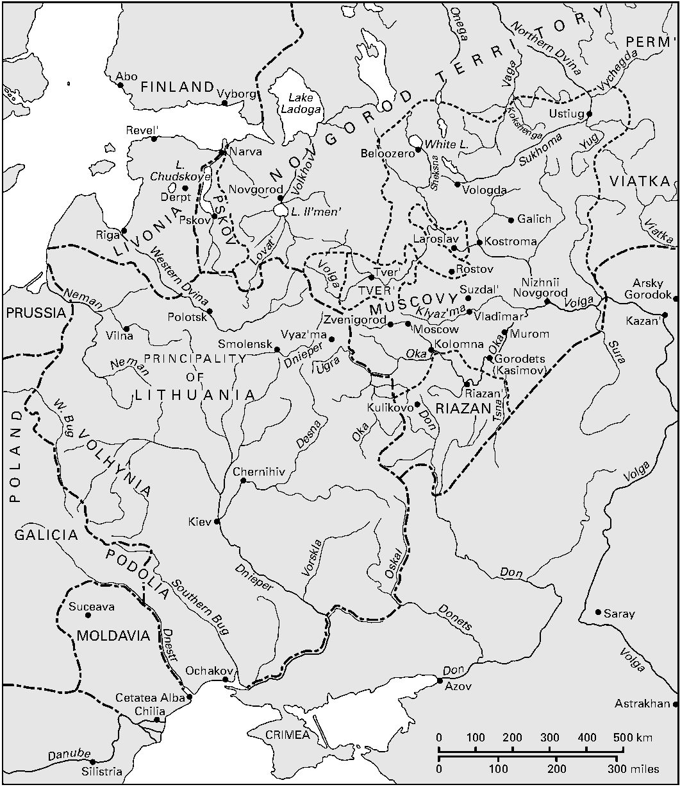

<!-- PDF page 274; original page 253 -->

# 第11章 俄国虔敬生活与正教文化，1380—1589年

斯特拉·罗克

## 引言

本章的年代范围，始于莫斯科大公德米特里在库利科沃原野击败一支鞑靼军队。相传，这场战斗得到拉多涅日的圣谢尔吉祝福，并被视为该民族生活中一个决定性的属灵及政治时刻。此后数百年，各种不同回应都见证了这一点：从几乎与战事同时代的各版本《库利科沃战记》（《顿河彼岸之歌》，Zadonshchina），[^p274-1] 到亚历山大·勃洛克的经典组诗《在库利科沃原野》，再到1988年把德米特里列入圣品——他曾获“顿斯科伊”，即“顿河的”这一荣衔。本章以俄国牧首区的创立为终点：这正式承认了俄国正教会的自主地位；随后不久，俄国第一个王朝便告终结，“混乱时期”随之到来。其间的历史，体现了通常所谓“民族意识”的逐步形成：原本彼此征战、为谋取经济或政治利益而与天主教、异教及穆斯林邻邦和宗主不断变换结盟的诸公国，在属灵、文化与政治上转变为一个正教民族，统一于沙皇与牧首之下，并自觉宣扬民族信仰，以及“忠于信仰的民族”这一观念。

这是对俄国及俄国正教会历史上一个关键时期的传统概括，经过简化，甚至带有神话色彩。从分散公国到集权莫斯科国家的转变确实发生了，但过程并不如通常认为的那样直线发展，细节也没有那么确定。

<!-- PDF page 275; original page 254 -->

*地图4 莫斯科罗斯（约1460年）。地名依原图；重复标注的同一河流仅列一次，比例尺以千米、英里标示。*

| 原图标注 | 中文 |
| --- | --- |
| FINLAND | 芬兰（地区） |
| NOVGOROD TERRITORY | 诺夫哥罗德领地 |
| PERM′ | 彼尔姆（地区） |
| VIATKA | 维亚特卡（地区） |
| LIVONIA | 利沃尼亚 |
| PSKOV | 普斯科夫（地区） |
| TVER′ | 特维尔（地区） |
| MUSCOVY | 莫斯科罗斯 |
| RIAZAN | 梁赞（地区） |
| PRUSSIA | 普鲁士 |
| PRINCIPALITY OF LITHUANIA | 立陶宛公国 |
| POLAND | 波兰 |
| VOLHYNIA | 沃里尼亚 |
| GALICIA | 加利西亚 |
| PODOLIA | 波多利亚 |
| MOLDAVIA | 摩尔达维亚 |
| CRIMEA | 克里米亚 |
| Abo | 阿博 |
| Vyborg | 维堡 |
| Revel′ | 雷瓦尔 |
| Narva | 纳尔瓦 |
| Dorpt | 多尔帕特 |
| Novgorod | 诺夫哥罗德 |
| Pskov | 普斯科夫（城镇） |
| Riga | 里加 |
| Beloozero | 别洛奥泽罗 |
| Ustiug | 乌斯秋格 |
| Vologda | 沃洛格达 |
| Galich | 加利奇 |
| Iaroslav | 雅罗斯拉夫尔 |
| Kostroma | 科斯特罗马 |
| Rostov | 罗斯托夫 |
| Tver′ | 特维尔（城镇） |
| Suzdal′ | 苏兹达尔 |
| Vladimar | 弗拉基米尔（原图拼作Vladimar） |
| Moscow | 莫斯科 |
| Kolomna | 科洛姆纳 |
| Zvenigorod | 兹韦尼哥罗德 |
| Viaz′ma | 维亚济马 |
| Smolensk | 斯摩棱斯克 |
| Polotsk | 波洛茨克 |
| Vilna | 维尔纳 |
| Murom | 穆罗姆 |
| Nizhnii Novgorod | 下诺夫哥罗德 |
| Arsky Gorodok | 阿尔斯克城 |
| Kazan′ | 喀山 |
| Gorodets (Kasimov) | 戈罗杰茨（卡西莫夫） |
| Riazan′ | 梁赞（城镇） |
| Kulikovo | 库利科沃 |
| Chernihiv | 切尔尼希夫 |
| Kiev | 基辅 |
| Suceava | 苏恰瓦 |
| Ochakov | 奥恰科夫 |
| Cetatea Alba | 白城 |
| Chilia | 基利亚 |
| Silistria | 锡利斯特拉 |
| Azov | 亚速 |
| Saray | 萨莱 |
| Astrakhan | 阿斯特拉罕 |
| Lake Ladoga | 拉多加湖 |
| L. Chudskoe | 楚德湖 |
| L. Il′men′ | 伊尔门湖 |
| White L. | 白湖 |
| Onega | 奥涅加河 |
| Northern Dvina | 北德维纳河 |
| Vaga | 瓦加河 |
| Vychegda | 维切格达河 |
| Kokshenga | 科克申加河 |
| Sukhoma | 苏霍纳河（原图拼作Sukhoma） |
| Yug | 尤格河 |
| Sheksna | 舍克斯纳河 |
| Viatka | 维亚特卡河 |
| Volkhov | 沃尔霍夫河 |
| Lovat′ | 洛瓦季河 |
| Western Dvina | 西德维纳河 |
| Volga | 伏尔加河 |
| Neman | 涅曼河 |
| W. Bug | 西布格河 |
| Dnieper | 第聂伯河 |
| Klyaz′ma | 克利亚济马河 |
| Oka | 奥卡河 |
| Sura | 苏拉河 |
| Tsna | 茨纳河 |
| Ugra | 乌格拉河 |
| Desna | 杰斯纳河 |
| Don | 顿河 |
| Vorskla | 沃尔斯克拉河 |
| Oskal | 奥斯科尔河（原图拼作Oskal） |
| Donets | 顿涅茨河 |
| Southern Bug | 南布格河 |
| Dnestr | 德涅斯特河 |
| Danube | 多瑙河 |

例如，圣谢尔吉是否祝福过德米特里1380年的出征，便绝无定论；[^p275-2] 这场战役也不是决定性的胜利——鞑靼人直到15世纪后期，仍继续向罗斯各地征收贡赋。16世纪后期，在“雷帝”伊凡四世[^p275-3]（1530—1584年）治下出现的社会与文化，是各类群体和思想影响复杂互动的产物。起初信奉异教、后来改信伊斯兰教的金帐汗国，赋予俄国教会的特殊地位；来自巴尔干与拜占庭的波格米勒派及静修主义属灵潮流；与德意志汉萨同盟的贸易关系——这些<!-- PDF page 276; original page 255 -->全都影响了莫斯科国家。鞑靼征服前罗斯的重要组成部分——西部与南部说罗斯语、信正教的领土，后来将形成现代白俄罗斯与乌克兰——归入与天主教波兰结盟的立陶宛大公国统治之下，使正在形成的罗斯民族分裂为两个共同体；它们常常彼此竞争，政治与宗教经历也十分不同。15世纪，西部罗斯人——拜占庭人称之为“小罗斯人”——设法拥有了自己的都主教。在特维尔、梁赞、雅罗斯拉夫尔、罗斯托夫、维亚特卡、诺夫哥罗德和普斯科夫，地域身份始终极其重要，直到莫斯科大公在“收集罗斯土地”的过程中，吞并这些自治领地。

现代史学不再把虔敬与文化视为精英的专属领域。本章主体所讨论的，是俄国生活多样的物质面貌，以及俄国社会共同具有的丰富信仰与仪式谱系。历史学家继续思考“高层”与“底层”文化、“精英”与“民众”信仰等二分，也试图呈现宗教经验的多样性，涵盖男女、教士与平信徒、修道院与堂区、城市与乡村。人们认识到，中世纪及近代早期的基督教信仰，尽管复杂，却从根本上具有共享或共同性质；这一认识在一定程度上修正了上述史学二分。到16世纪，至少在俄国已基督教化的共同体中——整个这一时期仍有信奉异教的“臣属民族”，以及数量变化不定的穆斯林和犹太少数群体——农民与王公同样依照教会斋期和庆节的历法安排生活，通常使用基督教名字，并以正教圣事和仪式标记出生、婚姻与死亡等生命转折。[^p276-4] 为祈求或感恩，他们诉诸朝圣、圣徒敬礼与灵验圣像。他们使用共同的虔敬语言。文学固然主要属于受教育者的媒介，但教堂建筑、礼仪、音乐及绘画文化，却向所有信徒开放。同样，被禁止的信仰与实践也不限于某一社会阶级或等级：当地神职人员和平民妇女一样，会因施行咒术及诅咒而受到斥责；异端既见于大公随从，也见于城市穷人。

## “生活中的正教”与非正统信仰

要重建这一时期实际践行的正教，即“生活中的正教”，所面临的困难之一，是多数<!-- PDF page 277; original page 256 -->史料带有规定或禁令性质，由教士撰写，告诉我们哪些事应做、哪些不应做；历史学家必须通过推论，辨认该时期人们实际做了什么。《治家格言》（Domostroi）是16世纪一部与克里姆林宫圣母领报大教堂大司祭西尔维斯特有关的作品，为管理一个富裕家庭提供属灵、道德及实际指导。它指导人们如何藉祈祷与朝圣治病、何时及如何在家祷告、宗教斋日应准备哪些食物，因而相当详细地展现出作者心目中理想的基督徒家庭生活。[^p277-5] 《百章会议录》（Stoglav，意为“一百章”）记录1551年教会会议对“正确”或被禁止的虔敬及文化形式所作的裁决，是此类史料中最有意思的一种。教会谴责为不可接受的做法，主要见于第41、92、93章，包括跳舞、酗酒等娱乐，以及巡回艺人（skomorokhi）的活动：他们陪同婚礼，用“魔鬼的游戏”使人误入歧途；还包括圣三主日在墓旁先过度哀哭、再过度欢闹的仪式；巫术及各种迷信，例如把胎膜、盐和肥皂留在祭台上——显然得到堂区司祭默许；以及教会庆节前夕的淫秽或失序行为，尤其在圣约翰日、圣诞节及主显节前夕，被形容为“污秽的异教与希腊异教习俗和游戏”。[^p277-6] 然而，很难把这些段落理解为对16世纪莫斯科罗斯虔敬生活的准确反映，因为《百章会议录》大量援引教会法；多位研究者也发现其文字先例，来自《翡翠集》（Izmaragd）、《舵手书》（Kormchaia kniga，即《教会法规与民法汇编》，是从拜占庭继承的最早规范性文本之一）、《弗拉基米尔法令》及《圣经》。把“目击”证言与文学借用区分开来，是一项复杂而冒险的工作；对民众实践的观察，无疑经过了这一文字遗产的折射。这份文本固然让我们瞥见平信徒的虔敬生活，或许更多透露的，却是教会高层关心什么。

“民众宗教”或“民间信仰”研究，往往集中讨论dvoeverie，即“双重信仰”这一存在问题、却影响很大的概念。自19世纪中叶以来，学者便用它来描述俄国正教<!-- PDF page 278; original page 257 -->共同体有意或无意保存异教信仰及仪式的现象。[^p278-7] 这一概念影响了学界对俄国中世纪、往往也包括现代灵修生活的理解，令人们一心寻找虔敬与文化中潜藏的异教成分。“双重信仰”常被当作俄国特有现象，而这一词语源于中世纪的事实，又被用来支持这种看法。然而，文本本身显示，这个词最初并非如此理解；[^p278-8] 俄国教士关心的问题，与西欧同行相近。

让我们进入非教士“普通人”内心世界的史料确实存在，但很有限，主要是保存在诺夫哥罗德及俄国若干其他城市的大量桦树皮文书。不过，这些普通生活的零碎见证，大部分不涉及宗教，而是谈论贸易、法律争端及家庭破裂等物质事务。但它们的确显示，到了14世纪后期，农民已称自己为基督徒，证实“普通人”具有自觉的基督徒身份。[^p278-9] 16世纪起大量出现的神迹故事，也让我们稍能了解平信徒的虔敬，虽然通常要经过记录它们的教士之手。依照获治者的记录，治病敬礼主要吸引当地小贵族、商人、手工业者、富裕农民及教士；但即使后来获得全国意义的敬礼，也可能由地位低微者发起，例如喀山天主之母灵验圣像，便是1579年由一名士兵年幼的女儿发现。[^p278-10]

外国旅行者为宗教生活的外在表现提供另一视角。例如，西吉斯蒙德·冯·赫伯斯坦（1486—1566年）、[^p278-11] 理查德·钱塞勒（卒于1556年）、[^p278-12] 安东尼·詹金森（1530—1611年）、[^p278-13] 安东尼奥·波塞维诺（1533—1611年）、[^p278-14] 贾尔斯·弗莱彻<!-- PDF page 279; original page 258 -->（卒于1611年）[^p279-15] 和杰罗姆·霍西（卒于1626年），[^p279-16] 都记录了16世纪俄国虔敬生活的细节，其中某些人的叙述比另一些更可靠。[^p279-17] 外国观察者常把亲见的热烈虔敬——每年四次严格守斋、极其漫长的礼仪、大量使用圣像与蜡烛——与显得格格不入的酗酒和粗暴行为相对照，助长了至今仍然流传的民族刻板印象。

这一时期圣愚的盛行，是通常所谓“民众”虔敬的一种面貌。最著名的真福圣瓦西里（卒于1552年），于1588年被列入圣品。他如此广受尊崇，以至被安葬在红场的波克罗夫大教堂，即天主之母覆帡大教堂旁；该堂后来为纪念他，获得圣瓦西里大教堂之名。Iurodivye Khrista radi，即“为基督的缘故而愚拙的人”（出自《哥林多前书》4:10），并非俄国独有的现象；但在14至17世纪，俄国社会孕育“为基督而愚拙者”的程度却是独一无二的。[^p279-18] 圣愚假装疯癫，赤身走在雪中，以不合常规的外貌和行为招致嘲弄与虐待。有些人口出看似无意义之语，后来的事件却证明是预言。关于圣瓦西里及普斯科夫圣愚圣尼古拉的传说，显示在一个暴力而日益专制的社会中，人们认为他们享有特殊的言论自由。[^p279-19] 一则年代错置的记载说，瓦西里曾送给伊凡四世鲜肉，以象征方式责备他1570年洗劫诺夫哥罗德。伊凡威胁普斯科夫时，圣尼古拉也作出同样举动；当伊凡声称自己遵守大斋期禁食时，他责备伊凡饮用基督徒的鲜血却毫无顾忌。[^p279-20]

<!-- PDF page 280; original page 259 -->

有人认为，“伟大主宰”诺夫哥罗德这座城堡式城市，“体现了俄国民众生活与心灵的印记”；[^p280-21] 因为它大体避开了鞑靼人在其他地区造成的破坏，从而保存了“真正的”俄罗斯性。该城虽向鞑靼宗主纳贡，却继续同东西双方进行思想与经济交流。这或许可以解释，为何这一时期影响大到留下记录的异端，会出现于诺夫哥罗德及另一座贸易中心普斯科夫。14世纪后期的strigol’niki，即“剪发派”，批评买卖圣职及松弛的教士生活，似乎拒绝接受他们眼中有缺陷、无正当地位的神职人员所施行的圣事。他们似乎也倡导向大地告解；[^p280-22] 有人把这一举动理解为异教顽固存续、以及忠于“湿润的大地母亲”的证据。[^p280-23] 我们对这一异端所知不多，但它曾一度困扰主教团。编年史记载诺夫哥罗德若干剪发派成员被溺死，半个世纪之后的1427年，都主教佛提奥斯仍致信抱怨普斯科夫的剪发派。后来“犹太化派”异端出现时，根纳季总主教又指控其中一位领袖是剪发派成员。[^p280-24]

15世纪后期这一所谓“犹太化派”异端，同时影响了精英与下层神职人员。“犹太化派”并非当时的用语，而是在很久以后的史学中出现；如今，该异端的“犹太性”受到严重质疑。[^p280-25] 与通常情形一样，主要迫害者——沃洛科拉姆斯克的约瑟夫及诺夫哥罗德根纳季总主教——也是这种异端的主要记录者。因此，任何试图理解当时流传的非正统信仰之真实性质的努力，都只能部分成功。约瑟夫声称，异端始于一名来自基辅、“名叫斯哈里亚的犹太人”：他使诺夫哥罗德两位司祭改信，并在另两名立陶宛犹太人的帮助下开始传教。[^p280-26] 这种异端显然反对三一论、批评神职人员并反对圣像，在这些方面类似早期新教运动。

<!-- PDF page 281; original page 260 -->

当大公聘用这两位改信的教士到克里姆林宫教堂任职时，异端便传入莫斯科宫廷；他或许看中了他们对教会土地世俗化计划的支持。[^p281-27] 伊凡三世的儿媳摩尔达维亚的叶莲娜，以及国务秘书费奥多尔·库里岑，是地位最高的“异端分子”。尽管根纳季总主教于1487年开始以宗教裁判方式打击他们，大公仍有数年拒绝用暴力根除异端。

异端分子的命运与当时政治密切相联：既有关于教会土地所有权的冲突，也有伊凡三世之孙德米特里——摩尔达维亚的叶莲娜之子——与伊凡之子瓦西里之间的继承斗争。瓦西里的母亲，是伊凡的第二任妻子索菲娅·帕莱奥洛吉娜，末代拜占庭皇帝的侄女。1490年的主教会议宽大处理异端分子。首次审判指控他们拒绝敬礼莫斯科与罗斯托夫的圣徒，被认为具有明显的反诺夫哥罗德倾向。[^p281-28] 后来，瓦西里主导的1504年审判，判处异端分子死刑或终身流放；叶莲娜则恰于1505年死在狱中。

## 虔敬文化与富有创造力的虔敬

总体而言，在本章讨论的整个时期，莫斯科罗斯在文化上、并在很大程度上于政治上，仍是中世纪社会。正如人们所预料，其文学、视觉艺术、建筑及有记谱的音乐等文化遗存，与宗教的目的和表达密不可分。保存下来的史学著述、私人及外交通信，以及法律行政文本，也都带有正教基督教色彩。然而，若以为所有文化生产都出于虔敬性质，便会犯错。巡回艺人发展并传播了数量庞大的口头文学，包括史诗性的壮士歌（byliny）、历史歌曲、抒情歌、咒语、谜语等；[^p281-29] 他们有时受到宫廷宠爱，例如伊凡四世时期，但始终为教会所不满。

这一时期，传入虔敬文化的西方神学影响相对有限，俄国精英大体仍对新教和天主教抱有疑虑。但也有例外：诺夫哥罗德根纳季总主教除了对以宗教裁判手段控制异端感兴趣，也曾连续数年聘用一位道明会修士，并在把整部《圣经》译为斯拉夫语时，使用<!-- PDF page 282; original page 261 -->拉丁文史料。这项翻译于1499年完成，但直到1580—1581年才通过印刷传播。[^p282-30]

俄国中世纪文化曾被形容为“思想上的沉默”：未产生伟大的神学或科学著作，因接触古典教育与世俗知识的机会有限，又过度沉溺于非理性的宗教热情，而贫乏或发育受阻。但这种评判并不公平。[^p282-31] 制书、绘画、刺绣、教堂建造和宫殿装饰等艺术，彰显的是与我们不同的文化品质：独创性不受重视，忠于正教传统及既定形式却受到推崇；留下这一时期文化作品的，也不是天才转瞬即逝的灵光，而是缓慢、沉思式的虔敬劳动。人们更看重对既有属灵素材的创造性重组，而非原创神学写作。中世纪俄国的制书方式，被比作万花筒的运作：通过把数量有限、现存的虔敬文本重新排列成新的图案，获得新的属灵领悟。[^p282-32]

G. P. 费多托夫富有成效地研究了《翡翠集》（Izmaragd），认为这部显然为平信徒和教士共同编写的虔敬读本，提供了了解14与15世纪识字群体虔敬生活的途径。[^p282-33] 它首先颂扬书籍——这种态度同样属于俄国虔敬生活的基辅时期——并阐释如何正确阅读所有属灵著述，无论《圣经》还是教诲作品。阅读与写作一样被视为虔敬行为，应当勤勉进行，吸收并默想每一个字。

教士精英——修道教士，亦称“黑衣教士”，主教从他们中间选出——及大型修道院，在这一时期尤其重要，因为他们是文字文化的主要创造者、复制者与保存者。

<!-- PDF page 283; original page 262 -->

他们以编年史形式撰写历史，其巅峰是16世纪在马卡里都主教指导下编成、手稿逾一万页的《插图编年史汇编》（Litsevoi letopisnyi svod），也以圣徒传记录重要人物的生平。14世纪后期至15世纪初，这种创造活动受到一场文化运动的推动和塑造。该运动始于巴尔干，原本试图依照教规标准改革宗教文本的正字法与语言，后来发展为整个正教欧洲的文化更新动力。新的圣徒传被写成，新的圣德典范受到推崇，突出个体人格与经验的重要性，并发展出一种复杂而讲求修辞、名为“词语编织”（pletenie sloves）的文体。这种新风格部分通过保加利亚和塞尔维亚移民传入俄国，例如基普里安都主教。早期表现之一，是“智者”叶皮法尼（premudryi）的圣徒传著述；他以“词语编织”文体写成《圣谢尔吉传》与《彼尔姆的圣斯特凡传》。[^p283-34] 学者把这一运动称为“第二次南部斯拉夫影响”，第一次发生在罗斯皈依基督教之时。但这个名称既未充分体现本土贡献，也未充分反映与拜占庭、尤其与阿索斯山恢复联系所发挥的作用；重要圣徒传作家“塞尔维亚人帕霍米”便于1438年从阿索斯山前来。

学者一致认为，静修主义的神秘主义潮流是这一泛斯拉夫更新过程的一部分，但其具体方式仍难以捉摸。部分问题在于，这一词语有多种定义和用法。“静修主义”源于希腊语ἡσυχασμός，意为“保持安静”，首先指沙漠教父确立的内在静默与不断祈祷的修道实践。直到14世纪拜占庭默祷技巧复兴时，它才被用来指一种独特的属灵运动；最典型的是“心祷”，即耶稣祷文，以及对他泊山“神圣而非受造之光”的追求。[^p283-35] 这场复兴与西奈的格里高利及格里高利·帕拉马斯相联，其中前者对斯拉夫人的影响远为深远。广义来看，它可被视为修道灵修的复兴；也有学者试图辨认一种<!-- PDF page 284; original page 263 -->“政治静修主义”，认为它不同程度地影响了拜占庭与斯拉夫社会。[^p284-36]

静修主义究竟在多大程度上影响了俄国虔敬生活，仍有争论；[^p284-37] 它对俄国文化，特别是圣像绘画技法及“词语编织”的影响，也同样如此。[^p284-38] 似乎可以肯定，14世纪拜占庭静修主义复兴，促进了正教世界跨地域的修道联系，推动许多拜占庭修道著作的翻译、重抄与传入斯拉夫地区，也在一定程度上促成了14世纪后期至15世纪初俄国修道生活的惊人繁荣。例如，圣三一—圣谢尔吉修道院的藏书，当时包括多部梅延多夫所谓“静修灵修的经典”，圣基里尔—白湖修道院亦然。[^p284-39] 在这一时期的圣徒传中，很难找到神秘异象及帕拉马斯神学等形式的、受到拜占庭静修主义影响的直接证据。然而，静修主义鼓励一种更个人化的宗教生活，强调人与神直接接触的可能，以及属灵高于世俗；就此而言，它似乎显著影响了数代修士，使他们选择俄国北部及东部森林“荒野”中的默观祈祷，而非大型城市或近郊共住制修道中心里积极的社会生活。不出所料，这些“伏尔加河彼岸长老”的代表人物尼尔·索尔斯基，在其修道规章中明确提到静修实践；[^p284-40] 但也应记住，即使务实的沃洛科拉姆斯克的约瑟夫——积极参与社会与政治的共住制之典范——也建议修士安排静默与含泪自省的时段。[^p284-41]

修道者的谦卑，以及担心因曲解神圣原典而无意间把异端写上纸面的恐惧，促使人们尽量精确地复制任何属灵论著，连累积的错误也一并保留。但到了16世纪，新的批判精神已经进入教会高层。

<!-- PDF page 285; original page 264 -->

阿索斯山修士希腊人马克西姆于1518年抵达莫斯科，把《圣咏集》及注释从希腊语译出；他被留在那里，很可能违背本人意愿，继续翻译并校正重要的属灵著作。马克西姆在莫斯科罗斯的生活，不幸卷入当时政治。他于1525年被捕，部分原因是他公开反对瓦西里三世当年违反教规的离婚与再婚。[^p285-42] 马克西姆被囚于沃洛科拉姆斯克修道院，六年后又受到达尼尔都主教审判，罪名包括“希腊异教及异端巫术”和亵渎性翻译，随后再度被囚于特维尔一所修道院。直到1551年，即去世前五年，他才终于获释，得以自由居住在圣三一—圣谢尔吉修道院。[^p285-43] 他翻译的《圣咏集》《福音书》和《三歌经》，属于1560年代最早印行的一批书。1988年，教会把他列入圣品，承认其对俄国正教的贡献。1551年教会会议除释放马克西姆外，还承认系统校订教会文本及改善神职教育已是迫切需要；但在国家滑入特辖制的动荡、后来又陷入伊凡四世留下的政治混乱——“混乱时期”（1598—1613年）——以前，所取得的成效十分有限。

这一时期圣像绘画的繁荣，将于下章讨论。[^p285-44] 鲁布廖夫与狄奥尼西的作品，被理所当然地赞颂为俄国中世纪文化成就的巅峰，女性的虔敬艺术却往往遭到忽视。由王室女性主持的作坊，例如瓦西里三世第一任妻子索洛莫尼娅·萨布罗娃（卒于1542年）、伊琳娜·戈东诺娃（卒于1603年）及叶夫罗西尼娅·斯塔里茨卡娅（卒于1569年）的作坊，绣制具有复杂象征意义而优美的圣葬布、祭台布与礼仪服饰；它们是用丝线绘成的圣像，或织物中的祈祷。这些作品在女修道院内制作，或由富裕妇女献给修道院，以纪念亡亲、表达感恩或提出祈求。索洛莫尼娅悲哀最动人的见证之一，是1525年献给圣三一—圣谢尔吉修道院的一幅织绣；不久后，她便因未能生育继承人而遭离婚并被剃度为修女。织绣以马利亚年迈母亲安娜、施洗约翰之母伊利莎白，以及天主之母本人奇迹般生育的图像，记录她的盼望。[^p285-45] 一位<!-- PDF page 286; original page 265 -->出身诺夫哥罗德贵族的15世纪修女玛丽娅·奥多耶夫斯卡娅，在回忆录中记载，院长特别重视她抄写“书籍与编年史”的书写技能。[^p286-46] 富裕妇女如同男子一样，也出资兴建和装饰教堂。[^p286-47] 平信徒赞助支持了砖石教堂建造的复兴，最先出现于诺夫哥罗德：14世纪中叶，当地波雅尔贵族与富商经常充当赞助者。[^p286-48]

教堂建筑是这一时期虔敬文化中具有指示意义的重要方面。诺夫哥罗德早期朴素而雄伟的建筑风格，逐渐让位于更多样的形式。最有意思的创新与莫斯科有关，例如得名于农妇头饰、层层排列装饰山花的“科科什尼克”，以及1530年代开始出现的奇特“帐篷式”教堂。15世纪可以观察到，人们有意识地向鞑靼征服前的历史寻找灵感：旧建筑得到大规模修复；伊凡三世委托一位意大利人为莫斯科克里姆林宫兴建足够宏伟的大教堂时，命令他研究早期罗斯建筑。到该世纪末，莫斯科克里姆林宫已被改造为巨大堡垒，象征莫斯科作为俄国政治中心的重要性日益增长。[^p286-49]

这一时期出现的所有建筑地标中，或许最令人震撼的，是为纪念1552年攻克喀山而建的巨大惊人建筑。它现称圣瓦西里大教堂，由围绕一座巨大尖顶的九座独立礼拜堂组成。其中数座礼拜堂奉献给与围攻喀山各事件相应的庆节，中央教堂奉献给波克罗夫，即“天主之母覆帡”。一座礼拜堂奉献给圣三一，象征民族和解；另一座奉献给基督进入耶路撒冷。整组建筑常被称作“耶路撒冷”，并有明确证据表明，它被视为圣城的一幅圣像。[^p286-50] 俄国特有的“洋葱头穹顶”，虽然早已见于手稿插图及siony，即耶路撒冷复活<!-- PDF page 287; original page 266 -->教堂或圣墓教堂的微型复制品，却直到16世纪末才首次出现于教堂建筑。它们被形容为古老圣墓圣所的圣像图式，证明耶路撒冷主题在这一时期俄国虔敬与文化中的重要性。[^p287-51]

## 修道生活

正如这一时期的文化遗存所见证，居主导地位的虔敬形式是修道生活，部分承袭拉多涅日的圣谢尔吉（卒于1392年）的属灵遗产。虽然对修道院数量的估计有所不同，证据显示，14世纪新建修道院约150所，15世纪为250所以上，16世纪超过330所。它们有些未能兴盛，或遭火灾、瘟疫摧毁，但可以推断，16世纪末莫斯科罗斯境内运作的修道机构，远超500所。[^p287-52] 到本章讨论时期结束时，圣三一—圣谢尔吉修道院已有700多位修士；不过，大多数重要修道院的修士或修女在80至200人之间。[^p287-53] 与较早的城市修道院不同，新修道院有许多建立于偏远乡村。隐修处与半隐修院——通常由二至六位修士共同住在荒野——往往发展为重要修道院，有助于整合新领土并使原住民基督教化。

修道生活如此兴盛，毫不奇怪，因为这是暴力而不安定的时代。民众饱受与立陶宛、利沃尼亚、克里米亚及喀山的战争摧残，也遭遇王公和贵族派系间血腥的权力斗争、鞑靼汗国不断袭扰、瘟疫爆发，以及后来伊凡四世治下的暴政、劫掠与处决。至少在识字社会中，一种观念广泛流传：世界将于1492年终结，也就是从公元前5508年创世起算的7000年。这无疑进一步鼓励了这种“逃离尘世”。正教会如此确信世界<!-- PDF page 288; original page 267 -->将终结，以至没有准备1492年以后的礼仪历，必须在该年由佐西马都主教编制。[^p288-54]

圣谢尔吉对俄国文化影响巨大，绝不只因他作为“俄国的建设者”所具有的无处不在的象征价值。[^p288-55] 他的巨大声望使他在去世后不久便列入圣品；其圣髑于1422年被发现，第一座以他为主保的教堂于1460年在诺夫哥罗德建成。他对当时社会影响如此之大，1400年前后的数十年被称为“谢尔吉时期”；[^p288-56] 在其中大部分时间，知识与文化生活的中心，就是他在莫斯科东北70千米处建立、今称圣三一—圣谢尔吉的修道院。谢尔吉既振兴了俄国修道生活的共住制传统，即真正的共同生活、共有财物与共同起居，有别于当时更普遍、修士分别居住而只共同敬拜的自律制，也振兴了独居修道的隐修传统。

通过圣谢尔吉的榜样，这种隐修传统在北部领土的拓殖中，影响了俄国社会与地理结构。《拉多涅日的圣谢尔吉传》描述这一时期众多修道院建立的方式：一位寻找静默与独处的修士设立隐修处；[^p288-57] 随后，一小群寻求其属灵指导的弟兄加入，新修道院逐渐形成并吸引更多来访者；又有修士离开，另寻更安静的祈祷处。谢尔吉的门徒不断重复这个循环。相传谢尔吉生前亲自建立十所修道院，并培育了一代修士。他们与自己的属灵子弟后来创建北部领土的壮丽修道院，例如基里尔—白湖的圣母安眠修道院：1397年由圣基里尔建立；他原是西蒙诺夫修道院修士，该院院长则是拉多涅日的圣谢尔吉的侄子。还有1398年建立的费拉蓬托夫天主之母诞生修道院，以及索洛夫基的救主显圣容修道院。

<!-- PDF page 289; original page 268 -->

白海索洛夫基群岛上最后这所修道院的发展，说明了这一过程。修士萨瓦季在基里尔—白湖修道院剃度，但为寻找更安静的祈祷处，先赴瓦尔拉姆修道院，后于1429年与另一位隐修士格尔曼一起，前往完全荒无人烟的索洛夫基群岛。格尔曼后来离开群岛。萨瓦季去世后，格尔曼于1436年带着修士佐西马返回索洛夫基，两人逐渐建立修道院。在后来成为莫斯科都主教的圣腓力领导下，修道院在物质及属灵方面均十分兴盛。腓力监督开凿运河系统、兴建包括大教堂在内的石造建筑、经营园圃、面包坊、磨坊、水坝与驯鹿饲养，其创造和组织能力由此得到磨炼。到16世纪末，这座岛上隐修处已成为白海的一座巨大堡垒，象征俄国正教会经历的变化。[^p289-58]

一些历史学家把修道院扩展与拓殖、或农民日益受到束缚紧密相联；[^p289-59] 向北迁移的修士固然从未把这些明确列为目标，但在某些地区，它们的确是修道院成功的副产品。叶皮法尼在斯特凡1396年去世后不久写成的《圣斯特凡传》中，呈现了一位献身传教工作的修士之特殊例子。斯特凡没有把所有礼仪及属灵文本使用的教会斯拉夫语强加给新近皈依的彼尔姆人——芬兰语族部落，即今天的科米人——而是为他们创制字母，把基督教基本著作译为他们的语言。彼尔姆地区原先与诺夫哥罗德相联，后来置于莫斯科大公德米特里的“保护”之下。具有讽刺意味的是，在叶皮法尼的《传》中，彼尔姆人反对基督教的理由之一，正是来自莫斯科的统治及随之而来的负担与税赋。叶皮法尼赞扬圣斯特凡曾在莫斯科和诺夫哥罗德为彼尔姆人说情。但他的语言适应实验未能存续。16世纪，教会斯拉夫语取代彼尔姆语礼仪，彼尔姆人也变得俄国化，至少在官方层面如此。

为免修道复兴看起来完全属于男性，也应记住，创建修道院的不只是游方修士。例如，叶夫罗西尼娅·斯塔里茨卡娅公爵夫人于1544年建立戈里齐复活女修道院；但这一时期，贵族妇女似乎既是女修道院的创办者，也同样是其中囚徒，<!-- PDF page 290; original page 269 -->叶夫罗西尼娅也不例外。她遭伊凡四世指控叛国后被剃度，很可能出于强迫，后来又被特辖军杀害。她的女修道院还收容过伊凡四世遗孀玛丽娅·费奥多罗芙娜（纳加娅），她被鲍里斯·戈东诺夫流放到那里；[^p290-60] 还有伊凡第四任妻子安娜·阿列克谢耶芙娜，以及他的儿媳佩拉格娅·米哈伊洛芙娜。强迫剃度不仅是一种使男女政治对手噤声的便捷办法，尽管未必可靠；它也是一种离婚手段。

无法或不愿进入修道院的人，可以通过捐赠参与其发展。王公、富裕贵族、商人和高级教士的资金投入，大大促进了修道生活的扩张。常见捐赠包括食物、石造教堂与村庄；作为回报，捐赠者及其亲人可以期待得到祈祷，并在死后被永远纪念。遗赠十分普遍，贵族把家族土地留给修道院而非亲族，导致教会地产大增，引发当时一场重大争论：一方是支持教会拥有土地的“占有派”，另一方是“非占有派”，认为修道院拥有土地、依靠耕种土地的农民劳动而生活，并不合宜。[^p290-61]

这一时期史学中两位举足轻重的人物，尼尔·索尔斯基（1433—1508年）与沃洛科拉姆斯克的约瑟夫（1439—1515年），通常被分别描绘为这两个派别的代表，也分别体现了作为圣谢尔吉遗产而被接纳的修道生活两个方面：静默的隐修，以及积极参与社会的共住生活。差异主要在于侧重：指导他人趋向属灵完善时，尼尔强调内在属灵生活，约瑟夫强调外在实践。

尼尔留下的文字遗产很少：几封致“属灵子弟”的信、其《修道规章》（Ustav，其实更像讨论内在生活的论著，而非规条），以及短篇《传统》（Predanie），所以我们对他的生平只有粗略了解。我们知道，他曾在阿索斯山及基里尔—白湖修道院居住，后来到白湖地区北方森林寻求不受干扰的宁静。他赞成几个弟兄在荒野共同生活的半隐修院，而非隐修生活的完全独居。由于退隐北方荒野，其追随者常被称为“伏尔加河彼岸长老”。

尼尔被尊为俄国“虚己”精神的典范：一种自我倒空的谦卑，使他不像约瑟夫那样参与公共生活及施加政治影响。另一<!-- PDF page 291; original page 270 -->个传统上归于尼尔、实际上更多由其追随者表达的温和灵修特征，是对异端分子的仁慈。这使他与热衷迫害犹太化派的约瑟夫鲜明有别。然而，尼尔同样热心维护真正信仰，《传统》开篇便声明自身的正统信仰及对正教会的忠诚。他谨慎引述教父，以支持自己的论断；其属灵著述没有哪一项可以称为原创。简言之，他倡导一种有弹性的生活制度：贫穷、体力劳动、按年龄与体力节制，以及不断的内心祈祷。[^p291-62] 更不寻常的特点，是他认为并非所有宗教文本具有同等价值；阅读应有批判精神，错误的文本也应得到校正。

约瑟夫出生于沃洛科拉姆斯克城附近一个十分虔诚的家庭：一位祖父、父母双方、两位堂表兄弟及两个兄弟都曾入修道生活，其中一个兄弟后来成为西蒙诺夫修道院院长和罗斯托夫总主教。他在博罗夫斯克的帕夫努季修道院剃度，随后在出生地附近创办自己的严格共住制修道院。贵族及教士的捐赠，例如诺夫哥罗德根纳季总主教（1484—1504年在任）的捐赠，确保修道院在物质上兴盛。约瑟夫以政治操弄、热衷追剿异端，以及支持修道院地产而闻名；但其雄心勃勃的慈善计划，包括赈饥、建立医院与孤儿院等服务，许多大型修道院也效法这套计划。约瑟夫并不是为了财富本身而积聚财富。

在追随尼尔·索尔斯基、后来称为非占有派或伏尔加河彼岸长老的人，与约瑟夫阵营之间，最著名的修道争论涉及教会地产。这场分歧由伊凡三世的行动引发：他愈来愈看中修道院与主教区的大量土地。新近被征服的诺夫哥罗德贵族——1471年被伊凡三世降服——也在这方面鼓动他，劝他夺取教会土地，而非他们的庄园。[^p291-63] 约瑟夫主张，修道院可以而且应当拥有土地与村庄，把所得盈余用于慈善；尼尔则认为，修士应靠双手劳动生活，修道院中的财富是一种诱惑。两种立场都有先例。[^p291-64]

<!-- PDF page 292; original page 271 -->

人们十分强调尼尔与约瑟夫所代表的两种修道潮流之差别。但即使关于地产存在激烈分歧，也未妨碍约瑟夫为自己的修道院购买尼尔的著述。[^p292-65] 约瑟夫固然利用世俗权力压制异端，却坚决维护教会权力与财富，反对世俗干预。还有一些证据显示，约瑟夫与尼尔曾合作谴责异端，甚至共同参与《启蒙者》的写作。[^p292-66] 不过，尼尔的追随者，尤其是被强迫剃度的瓦西安·帕特里凯耶夫亲王，强调应宽恕悔改的异端分子，并仁慈对待顽固者；约瑟夫则主张，即使悔改也应受惩罚，拒不认错者应判死刑。[^p292-67] 16世纪初，“约瑟夫派”获胜：瓦西安于1531年受审，其追随者被追逐至伏尔加河以北的森林。他们在那里继续成为“异议”的源泉，也可能启发了后来的非正统运动。“约瑟夫派心态”主张教会应利用世俗权力，深信教会应积极参与尘世事务；它的胜利，常被视为随后四百年政教纠缠、使各方都受损害的根源。[^p292-68]

## 民族意识形态与民族神话

整个时期可以概括为政治、领土及属灵上的巩固，最终创立自主的民族教会。与此同时，俄国逐渐而明显地远离拜占庭母教会，反映出这种虔敬生活的“民族化”。1390年代，君士坦丁堡牧首安东尼四世不得不致函瓦西里一世大公，责备他在祈祷中省略皇帝之名，并声称俄国虽有教会，却没有皇帝。[^p292-69] 下个世纪，关系并未改善。1438—1439年的佛罗伦萨会议使东西教会统一于教皇之下，加速了俄国争取教会自主的进程。1441年，伊西多尔都主教返回莫斯科，宣扬佛罗伦萨合一，瓦西里二世立即因其背信行为而将他<!-- PDF page 293; original page 272 -->囚禁，俄国教会也拒绝承认合一的合法性。七年后，俄国主教会议未请示君士坦丁堡，便选举梁赞的约拿为都主教。无论后来解释得如何恭敬，这实际上都是含蓄地宣布教会自主。[^p293-70]

1453年君士坦丁堡陷落，被俄国人视为对背弃信仰的神圣惩罚，进一步巩固了这种新生的独立。正教欧洲的其他地区，以及圣城本身，都在穆斯林统治之下，俄国教会高层遂把自己看作真正信仰最后的守护者。“第三罗马”这一著名而备受争议的概念，正是在这种背景下出现；最初表述于16世纪初几封通常归于普斯科夫修士菲洛费伊的信中。[^p293-71] 现代史学尤其喜欢用“莫斯科是第三罗马”来解释俄国政治行为。但菲洛费伊并非在阐述莫斯科罗斯扩张主义与专制统治的思想纲领，而是在强调大公有义务维护正教信仰的纯洁，具体涉及保护教会土地、正确画十字的方式，以及根除鸡奸的需要。罗马与君士坦丁堡未能维护正教，遂遭覆灭；既然不会有第四罗马，若莫斯科也失败，便将预告末日来临。一些历史学家有说服力地指出，“第三罗马”这一象征观念，不如莫斯科是“新耶路撒冷”、或俄国是“新以色列”的观念普遍；[^p293-72] 然而，它在正式文件中唯一一次出现，仍意义重大：1589年设立莫斯科牧首区的敕令，把整个“伟大俄罗斯沙皇国”称为第三罗马。[^p293-73]

“神圣俄罗斯”“第三罗马”“新耶路撒冷”等受宗教启发的观念，以及它们在建筑、文字与<!-- PDF page 294; original page 273 -->仪式中的表现，究竟在多大程度上体现一种自觉的政治意识形态，仍有争论。有些观念，例如第三罗马，在史学与现代民族主义神话建构中的重要性，肯定超过它在16世纪本身的重要性。[^p294-74] 但俄国正教会对民族整合进程，以及对自觉民族身份形成的象征性与实际贡献，是明确的。莫斯科圣枝主日游行等宗教仪式，以沙皇牵着牧首坐骑、重演基督凯旋进入耶路撒冷的场面，公开提醒众人：统治者是正教的守护者与引导者。[^p294-75] 马卡里都主教正式为伊凡四世加冕，立其为沙皇与专制君主，也同时反映出莫斯科统治者自认从陷落的君士坦丁堡继承了宗教权威，以及他们渴求神圣认可。

统治者也发现，公开朝圣与宗教仪式，是把自身权威印刻于新领土的有效办法；[^p294-76] 正教象征和修辞，则同时支持对内及对外的征服。莫斯科都主教公开支持大公的统一行动。编年史记载，腓力都主教奉伊凡三世大公之命，致信反叛的诺夫哥罗德人，命令他们服从“上帝以强有力的手臂，将你们和事奉上帝的罗斯大地置于其下的那个人”，而非他们选中的领袖——基辅的立陶宛亲王米哈伊尔·亚历山德罗维奇，后者会把他们带进“拉丁教”的黑暗。[^p294-77] 编年史把伊凡三世征服诺夫哥罗德，描绘为虔诚君主为捍卫正教而承担的痛苦责任，得到圣徒祈祷与上帝恩宠的支持。伊凡三世与立陶宛斗争的正当理由，则是其信奉天主教的女婿亚历山大，拒绝让他的女儿叶莲娜拥有希腊教堂和神职人员；有人企图使她改宗；曾属于罗斯的波洛茨克等城镇兴建天主教堂；立陶宛境内的正教居民受到迫害。伊凡四世效法祖父，以宗教修辞为对立陶宛及其他敌人的战争辩护，无论<!-- PDF page 295; original page 274 -->政治现实如何：例如，1552年针对喀山的“十字军”，仍得到信奉伊斯兰教的诺盖鞑靼人支持。[^p295-78]

罗斯土地在政治与领土上的巩固，与正教的统一及标准化相互映照。这始于15世纪前半叶礼仪历的整合，通过复兴或设立各种庆节，强调“基辅”罗斯与莫斯科罗斯之间的连续性，例如纪念罗斯第一位受洗统治者圣奥尔加的庆节。15世纪后期，北方城镇与修道院的主保圣徒也被纳入。这一过程最终形成马卡里都主教的《大圣徒月录》（Velikaia mineia chet’ia），为全年每一天提供属灵读物。[^p295-79] 《大圣徒月录》在马卡里任都主教期间（1542—1563年）出现三种版本，均献给伊凡四世，是他试图编成俄国属灵遗产及正教文化之权威汇编的成果，体现一个统一的民族与教会。收入其中的许多文本，包括某些受马卡里委托撰写者，都强调受神委任的沙皇有义务保护正教信仰、支持教会机构，并发展出一种以莫斯科为正教历史中心的世界史叙述。

马卡里都主教还监督编成《帝王谱系阶梯书》（Stepennaia kniga tsarskogo rodosloviia）。这是一部选择性叙述统治者及都主教的历史，始于对罗斯第一位受洗统治者圣奥尔加的颂扬，继而把从10世纪基辅圣徒亲王弗拉基米尔一世，到伊凡四世的“俄罗斯专制君主”，连接为一个延续不绝、神圣化、源自凯撒·奥古斯都的王朝。马卡里《大圣徒月录》及《阶梯书》吸纳的大多数观念和文本，并非原创。例如，统治者是“第二个君士坦丁”的主题，以及出自奥古斯都后裔的神话，都在15世纪出现。然而，以系统方式加以呈现，却是新的，标志着一个自觉奉行正教及专制统治、骄傲披上拜占庭遗产外衣的“大俄罗斯”国家诞生。

如果说《大圣徒月录》试图确立权威的属灵文库，那么1551年的百章会议，则试图确认莫斯科实践的“正确”，藉此使虔敬生活标准化；它忽视地区差异，并在某些情形下忽视教规上的正确<!-- PDF page 296; original page 275 -->性。《治家格言》为俄国家庭提供类似服务，作为一本按照正教道德正确生活的手册。[^p296-80] 这些文字汇编、把地方受敬礼人物列为全民族圣徒的行动，以及1547、1549和1551年具有规制作用的教会会议，可以视为一场协调努力：规范或“民族化”信仰，并以王朝、领土和正教信仰的相互联系，建立俄国民族意识。[^p296-81] 费奥多尔沙皇（1584—1598年在位）无嗣而终，不久便将打破这种建构出的“三位一体”。但在王朝危机及“混乱时期”的动荡到来之前，俄国首位牧首约夫已于1589年，由君士坦丁堡牧首耶利米二世立任。耶利米于1588年前往莫斯科，为自己的教会募捐；他发现自己事实上受到拘禁，直到同意祝圣约夫才得自由。俄国民族与俄国正教会，终于正式登场。

## 注释

[^p274-1]: R. Jakobson and D. S. Worth (eds.), Sofonija’s tale of the Russian–Tatar battle on the Kulikovo field [Slavistic Printings and Reprintings 51] (The Hague: Mouton, 1963). 我十分感谢罗宾·米尔纳—古兰教授的指导、合作与支持，也感谢伊芙·莱文教授提出许多富有启发的建议。

[^p275-2]: 例如参见 John Fennell, A history of the Russian church to 1448 (London: Longman, 1995), 238–9.

[^p275-3]: Groznyi，更准确的意思是“令人敬畏者”。

[^p276-4]: 参见 D. H. Kaiser, ‘Quotidian Orthodoxy. Domestic life in early modern Russia’, in Orthodox Russia: belief and practice under the Tsars, ed. V. A. Kivelson and R. H. Greene (Philadelphia: Pennsylvania State University Press, 2003), 179–92.

[^p277-5]: Carolyn Johnston Pouncy (ed. and trans.), The Domostroi: rules for Russian households in the time of Ivan the Terrible (Ithaca, NY: Cornell University Press, 1994). 关于作者与读者群的问题，见 Pouncy, 37–49, and P. Bushkovitch, Religion and society in Russia: the sixteenth and seventeenth centuries (New York and Oxford: Oxford University Press, 1992), 47–9.

[^p277-6]: E. V. Emchenko, Stoglav: issledovanie i tekst (Moscow: Indrik, 2000), 402.

[^p278-7]: 参见 E. Levin, ‘Dvoeverie and popular religion’, in Seeking God: the recovery of religious identity in Orthodox Russia, Ukraine, and Georgia, ed. S. K. Batalden (DeKalb: Northern Illinois University Press, 1993), 31–52 其中有简要的研究史综述。

[^p278-8]: S. Rock, ‘What’s in a word? A historical study of the concept dvoeverie’, Canadian-American Slavic Studies 35, no. 1 (2001), 19–28.

[^p278-9]: E. Levin, ‘Lay religious identity in medieval Russia: the evidence of Novgorod birchbark documents’, General Linguistics 35 (1997), 131–55.

[^p278-10]: Bushkovitch, Religion and society, 102–11.

[^p278-11]: Sigismund von Herberstein, Moscovia der Haupstadt (Vienna: Michael Zimmerman, 1557) [重印收入, Early exploration of Russia, ed. Marshall Poe (New York: Routledge, 2003), ii].

[^p278-12]: ‘The voyage of Richard Chanceller Pilote major, the first discoverer by sea of the kingdome of Moscovia, Anno 1553’, in Richard Hakluyt, The principal navigations, voyages, traffiques and discoveries of the English nation (London: J. M. Dent and Sons, 1927), i, esp. 264–6.

[^p278-13]: Hakluyt, Principal navigations, i, esp. 424–7, 430–7.

[^p278-14]: Antonio Possevino, The Moscovia of Antonio Possevino, S.J., trans. Hugh F. Graham [UCIS Russian and East European Studies 1] (Pittsburgh, PA: University of Pittsburgh, 1977).

[^p279-15]: Giles Fletcher, Of the Russe Common Wealth (London: Thomas Charde, 1591) [重印收入 Early exploration, ed. Poe, i].

[^p279-16]: ‘A Relacion or memoriall abstracted owt of Sir Jerome Horsey his travells, imploiments, services and negociacions, observed and written with his owne hand; wherein he spent the most part of eighteen years tyme’, in Russia at the close of the sixteenth century, ed. E. A. Bond (London: Hakluyt Society, 1856; 重印 New York: Burt Franklin, 1963).

[^p279-17]: 参见 Marshall Poe, A people born to slavery: Russia in early modern European ethnography, 1476–1748 (Ithaca, NY: Cornell University Press, 2000); L. E. Berry and R. O. Crummey (eds.), Rude and barbarous kingdom: Russia in the accounts of sixteenth-century English voyagers (Madison: University of Wisconsin Press, 1968).

[^p279-18]: 参见 G. P. Fedotov, The Russian religious mind, ii, The Middle Ages; the thirteenth to the fifteenth centuries (Cambridge, MA: Harvard University Press, 1966), 316–43 其中有关于俄国圣愚传统的良好概述。 另参见 S. Ivanov, Holy Fools (Oxford: Oxford University Press, 2006).

[^p279-19]: 例如参见 Jerome Horsey on St Nikolai, in Russia at the close of the sixteenth century, 161.

[^p279-20]: Michael Petrovich, ‘The social and political role of the Muscovite Fools-in-Christ: reality and image’, Forschungen zur Osteuropäischen Geschichte 25 (1978), 283–96.

[^p280-21]: Fedotov, Russian religious mind, ii, 333.

[^p280-22]: N. A. Kazakova and Ia. S. Lur’e, Antifeodal’nye ereticheskie dvizheniia na Rusi XIV–nachala XVI veka (Moscow: AN SSSR, 1955), 241.

[^p280-23]: 参见 Fedotov, Russian religious mind, ii, 135–9.

[^p280-24]: R. G. Skrynnikov, ‘Ecclesiastical thought in Russia and the Church Councils of 1503 and 1504’, Oxford Slavonic Papers 25 (1992), 37.

[^p280-25]: 关于这一运动，最全面的研究为 Kazakova and Lur’e, Antifeodal’nye. 参见 Jakov S. Lur’e, ‘Unresolved issues in the history of the ideological movements of the late fifteenth century’, in Medieval Russian culture, ed. H. Birnbaum and M. S. Flier [California Slavic Studies 12] (Berkeley: University of California Press, 1984), 150–71. 另参见 J. D. Klier, ‘Judaizing without Jews? Moscow–Novgorod, 1470–1504’, in Culture and identity in Muscovy, 1359–1584, ed. A. M. Kleimola and G. D. Lenhoff (Moscow: ITZ- Garant, 1997), 336–49.

[^p280-26]: Iosif Volotskii, Prosvetitel’, ili, Oblichenie eresi zhidovstvuiushchikh, 第4版 (Kazan: Imperatorskii Universitet, 1903; 重印 Farnborough: Gregg International, 1972).

[^p281-27]: J. L. I. Fennell, Ivan the Great of Moscow (London: Macmillan, 1961), 327.

[^p281-28]: Skrynnikov, ‘Ecclesiastical thought’, 36.

[^p281-29]: 参见 Z. I. Vlasova, Skomorokhi i fol’klor (St Petersburg: Aleteiia, 2001); R. Zguta, Russian minstrels: a history of the Skomorokhi (Oxford: Clarendon Press, 1978).

[^p282-30]: V. A. Romodanovskaia, ‘O tseliakh sozdaniia Gennadievskoi Biblii ka pervogo polnogo russkogo Bibleiskogo kodeksa’, in Knizhnye tsentry Drevnei Rusi: Severnorusskie monastyri, ed. S. A. Semiachko (St Petersburg: Dmitrii Bulanin, 2001), 278–305; H. R. Cooper, Slavic Scriptures: the formation of the Church Slavonic version of the Holy Bible (London, Ontario: Cranbury, 2003).

[^p282-31]: 参见 Georges Florovsky, ‘The problem of Old Russian culture’, Slavic Review 21 (1962), 1–15; J. H. Billington, ‘Images of Muscovy’, Slavic Review 21 (1962), 24–34; D. S. Likhachev, ‘Further remarks on the problem of Old Russian culture’, Slavic Review 22 (1963), 115–20; F. J. Thomson, ‘The corpus of Slavonic translations available in Muscovy: the cause of Old Russia’s intellectual silence and a contributory factor in Muscovite cultural autarky’, in Christianity and the Eastern Slavs, i, Slavic cultures in the Middle Ages, ed. B. Gasparov and O. Raevsky-Hughes [California Slavic Studies 16] (Berkeley: University of California Press, 1993), 179–214.

[^p282-32]: W. R. Veder, ‘Old Russia’s “intellectual silence” reconsidered’, in Medieval Russian culture, ed. M. S. Flier and D. Rowland [California Slavic Studies 19] (Berkeley: University of California Press, 1994), ii, 18–28.

[^p282-33]: Fedotov, Russian religious mind, ii, 37–112.

[^p283-34]: V. G. Druzhinin (ed.), Zhitie sviatogo Stefana, episkopa Permskogo napissanoe Epifaniem Premudrym [Apophoreta slavica 2] (The Hague: Mouton, 1959), 1897年版重印。 英文节译见 S. A. Zenkovsky, Medieval Russia’s epics, chronicles and tales (New York: E. P. Dutton, 1964), 206–8.

[^p283-35]: 参见 J. Meyendorff, St Gregory Palamas and Orthodox spirituality (Crestwood, NY: St Vladimir’s Seminary Press, 1998) 其中把帕拉马斯的静修主义置于东方修道灵修的历史传统之中，作了清楚阐释。 参见上文第4章。

[^p284-36]: G. M. Prokhorov, ‘Isikhazm i obshchestvennaia mysl’ v Vostochnoi Evrope v XIV v.’, in Literaturnye sviazi drevnikh slavian, ed. D. S. Likhachev [Trudy otdela devnerusskoi literatury 23] (Leningrad: Nauka, 1968), 86–108; P. Bushkovitch, ‘The limits of hesychasm: some notes on monastic spirituality in Russia 1350–1500’, Forschungen zur Osteuropäischen Geschichte 38 (1986), 97–109, esp. 109.

[^p284-37]: 参见 Bushkovitch, ‘Limits of hesychasm’.

[^p284-38]: 参见 J. Meyendorff, ‘Is “hesychasm” the right word?’ in Okeanos: essays presented to Ihor Ševčenko on his sixtieth birthday by his colleagues and students [Harvard Ukrainian Studies 7] (Cambridge, MA: Harvard University Press, 1983), 447–57. 参见 above 38–41.

[^p284-39]: J. Meyendorff, Byzantium and the rise of Russia, 124–5.

[^p284-40]: 参见 G. A. Maloney, Russian hesychasm: the spirituality of Nil Sorskii (The Hague: Mouton, 1973) 这是对此最充分的英文阐述。

[^p284-41]: D. M. Goldfrank, The monastic rule of Iosif Volotsky [Cistercian Studies Series 36] (Kalamazoo, MI: Cistercian Publications, 1983), 105.

[^p285-42]: J. Martin, Medieval Russia 980–1584 (Cambridge: Cambridge University Press, 1995), 292.

[^p285-43]: J. V. Haney, From Italy to Muscovy: the life and works of Maxim the Greek (Munich: Wilhelm Fink Verlag, 1973).

[^p285-44]: 参见下文第12章。

[^p285-45]: I. Thyrêt, Between God and Tsar: religious symbolism and the royal women of Muscovite Russia (DeKalb: Northern Illinois University Press, 2001), 25–7; D. B. Miller, ‘Motives for donations to the Trinity-Sergius monastery, 1392–1605: gender matters’, Essays in Medieval Studies 14 (1997), 91–106.

[^p286-46]: S. Bolshakoff, Russian mystics [Cistercian Studies Series 26] (Kalamazoo, MI: Cistercian Publications, 1980), 45.

[^p286-47]: N. Pushkareva, Women in Russian history from the tenth to the twentieth century, trans. and ed. Eve Levin (Armonk, NY: M. E. Sharpe, 1997), esp. 22–3.

[^p286-48]: D. B. Miller, ‘Monumental building as an indicator of economic trends in northern Rus’ in the late Kievan and Mongol periods, 1138–1462’, American Historical Review 94 (1989), 360–90, esp. 383–5.

[^p286-49]: 参见 R. Milner-Gulland, ‘Art and architecture of Old Russia, 988–1700’, in An introduction to Russian art and architecture, ed. R. Auty and D. Obolensky (Cambridge: Cambridge University Press, 1980), 28–56.

[^p286-50]: R. Milner-Gulland, The Russians (Oxford: Blackwell, 1997), 212–18. 参见下文第 299–300.

[^p287-51]: A. M. Lidov, ‘Ierusalimskii kuvuklii. O proiskhozhdenii lukovichnykh glav’, in Ikonografiia arkhitektury, ed. A. L. Batalov (Moscow: Akademiia khudozhestv, 1990), 57–68.

[^p287-52]: 参见 E. I. Kolycheva, ‘Pravoslavnye monastyri vtoroi poloviny XV–XVI veka’, in Monashestvo i monastyri v Rossii XI–XX veka, ed. N. V. Sinitsyna (Moscow: Nauka, 2002), 81–115, 其中有较新的统计资料综述。 重印的马卡里（布尔加科夫）都主教19世纪多卷本 Istoriia Russkoi Tserkvi，详细概述本时期的修道生活，参见 Istoriia Russkoi Tserkvi v period postepennogo perekhoda ee k samostoiatel’nosti (1240–1589) (Moscow: Izd. Spaso-Preobrazhenskogo Valaamskogo Monastyria, 1995–96), iii, ch. 3; iv, pt 1, ch. 4, 以及各卷更新的附录，其中列出修道机构及其创立年代。

[^p287-53]: E. I. Kolycheva, ‘Pravoslavnye monastyri vtoroi poloviny XV–XVI veka’, 89.

[^p288-54]: M. S. Flier, ‘Till the end of time: the Apocalypse in Russian historical experience before 1500’, in Orthodox Russia, ed. Kivelson and Greene, 127–58.

[^p288-55]: N. Zernov, St Sergius, builder of Russia, with the life, acts and miracles of the holy abbot Sergius of Radonezh (London: SPCK, 1939).

[^p288-56]: R. Milner-Gulland, ‘Russia’s lost Renaissance’, in Literature and western civilization, ed. D. Daiches and A. K. Thorlby (London: Aldus, 1973), iii, 435–68.

[^p288-57]: Zhitie Sergiia Radonezhskogo, in Biblioteka Literatury Drevnei Rusi, iv, XIV–seredina XV veka, ed. D. S. Likhachev et al. (St Petersburg: Nauka, 1999), 256–411; M. Klimenko, The ‘Vita’ of St Sergii of Radonezh (Houston, TX: Nordland, 1980).

[^p289-58]: 参见 R. R. Robson, Solovki: the story of Russia told through its remarkable islands (New Haven and London: Yale University Press, 2004) 其中从长时段考察索洛夫基的发展。

[^p289-59]: I. U. Budovnits, Monastyri na Rusi i bor’ba s nimi krest’ian v 14–16 vekakh (po ‘zhitiiam sviatykh’) (Moscow: Nauka, 1966), 357–8.

[^p290-60]: 杰罗姆·霍西认为，她遭下毒后自愿入院。 参见 Russia at the close of the sixteenth century, 255.

[^p290-61]: 参见 D. Ostrowski, ‘Church polemics and monastic land acquisition in sixteenth-century Muscovy’, Slavonic and East European Review 64 (1986), 355–79.

[^p291-62]: Nil Sorsky: the complete writings, ed. and trans. G. A. Maloney (New York: Paulist Press, 2003), 40.

[^p291-63]: Skrynnikov, ‘Ecclesiastical thought’, 34.

[^p291-64]: S. Hackel, ‘Late medieval Russia: the possessors and non-possessors’, in Christian spirituality: high middle ages and Reformation, ed. J. Raitt (London: SCM Press, 1989), 223–35.

[^p292-65]: D. M. Goldfrank, The monastic rule of Iosif Volotsky [Cistercian Studies Series 36] (Kalamazoo, MI: Cistercian Publications, 1983), 31.

[^p292-66]: Lur’e, ‘Unresolved issues’, 163–71.

[^p292-67]: 参见 J. L. I. Fennell, ‘The attitude of the Josephians and the Trans-Volga Elders to the heresy of the Judaisers’, Slavonic Review 29 (1950–51), 486–509.

[^p292-68]: 参见 D. Pospielovsky, The Orthodox Church in the history of Russia (Crestwood, NY: St Vladimir’s Seminary Press, 1998), ch. 4.

[^p292-69]: Miklosich and Müller, ii, 191. 参见上文第 31–2.

[^p293-70]: D. Obolensky, Byzantium and the Slavs (Crestwood, NY: St Vladimir’s Seminary Press, 1994), 185.

[^p293-71]: 关于作者归属及年代的讨论，参见 Slovar’ knizhnikov i knizhnosti Drevnei Rusi, ed. D. S. Likhachev (Leningrad: Nauka, 1989), ii, 471–3; N. Andreyev, ‘Filofey and his Epistle to Ivan Vasil’yevich’, Slavonic and East European Review 38 (1959), 1–31. 这些信件刊于 V. N. Malinin’s Starets’ Eleazarova monastyria Filofei i ego poslaniia (Kiev: Tipografiia Kievo-Pecherskoi Uspenskoi Lavry, 1901). 其致瓦西里三世信件的英文节译见 G. Vernadsky, A source book for Russian history from early times to 1917, i, Early times to the late seventeenth century (New Haven and London: Yale University Press, 1972), 155–6.

[^p293-72]: 例如参见 J. Raba, ‘Moscow – the Third Rome or the New Jerusalem?’, Forschungen zur Osteuropäischen Geschichte 50 (1995), 297–307; D. B. Rowland, ‘Moscow–the Third Rome or the New Israel?’ RR 55 (1996), 591–614.

[^p293-73]: D. Ostrowski, Muscovy and the Mongols: cross-cultural influences on the steppe frontier, 1304–1589 (Cambridge: Cambridge University Press, 1998), 239.

[^p294-74]: 参见 同上, 219–43; P. Bushkovitch, ‘The formation of a national consciousness in early modern Russia’, Harvard Ukrainian Studies 10 (1986), 355–76; Andreyev, ‘Filofey and his Epistle to Ivan Vasil’yevich’, 1–31.

[^p294-75]: M. S. Flier, ‘Breaking the code: the image of the Tsar in the Muscovite Palm Sunday ritual’, in Medieval Russian Culture, ed. Flier and Rowland, ii, 213–42.

[^p294-76]: N. S. Kollmann, ‘Pilgrimage, procession and symbolic space in sixteenth-century Russian politics’, in Medieval Russian Culture, ed. Flier and Rowland, ii, 163–81.

[^p294-77]: R. Michell and N. Forbes, The Chronicle of Novgorod: 1016–1471 [Camden Society, ser. iii, 25] (London: Camden Society, 1914), 210.

[^p295-78]: 例如参见 S. Bogatyrev, ‘Battle for divine wisdom: the rhetoric of Ivan IV’s campaign against Polotsk’, in The military and society in Russia, 1450–1917, ed. E. Lohr and M. Poe (Leiden: Brill, 2002), 325–63.

[^p295-79]: R. D. Bosley, ‘The changing profile of the liturgical calendar in Muscovy’s formative years’, in Culture and identity in Muscovy, 1359–1584, ed. A. M. Kleimola and G. D. Lenhoff (Moscow: ITZ-Garant, 1997), 26–38.

[^p296-80]: Pouncy, Domostroi. 参见上文第 256.

[^p296-81]: D. B. Miller, ‘The Velikie Minei Chetii and Stepennaia Kniga of Metropolitan Makarii and the origins of Russian national consciousness’, Forschungen zur Osteuropäischen Geschichte 26 (1979), 263–373; Wil van den Bercken, Holy Russia and Christian Europe: East and West in the religious ideology of Russia (London: SCM Press, 1999), 140–60.
