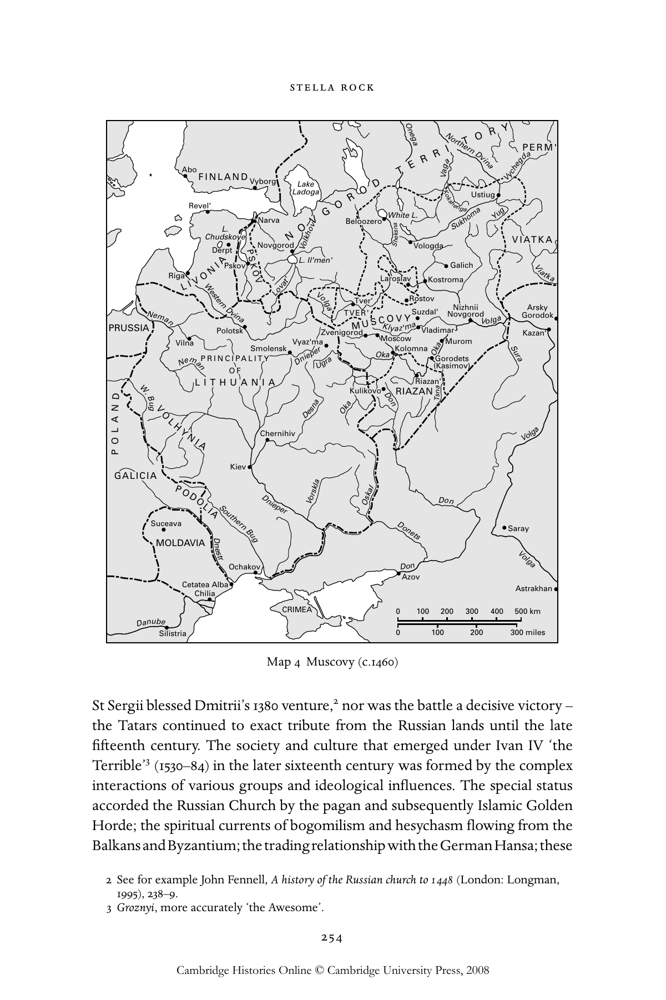

# 俄国的虔敬与正教文化（1380—1589年）：英文转换底稿

<!-- PDF page 274; original page 253 -->

### 11

### Russian piety and Orthodox culture

### 1380–1589

### s t e l la r o c k

### Introduction

The chronological span of this chapter begins with the victory of Grand Prince Dmitrii of Moscow over a Tatar army at Kulikovo Field, a battle supposedly blessed by St Sergii of Radonezh and recognised as a defining spiritual, as well as political, moment in the life of the nation: as many disparate responses over the intervening centuries bear witness, from the near-contemporary versions of the Kulikovo Tale (Zadonshchina)[^p274-1] to Aleksandr Blok’s classic poetic cycle On Kulikovo Field and the canonisation in 1988 of Dmitrii (honoured with the title Donskoi, ‘of the Don’). Our period ends with the creation of the Russian patriarchate, formal recognition of the autocephalous status of the Russian Orthodox Church, shortly to be followed by the extinction of the first Russian royal dynasty and the ‘Time of Troubles’. The interim period represents the gradual formation of what is generally called ‘national consciousness’: the spiritual, cultural and political transformation of a disparate collection of warring principalities forming mobile alliances with their Catholic, pagan and Muslim neighbours and overlords for economic or political gain, into an Orthodox nation, unified under tsar and patriarch and self-consciously promoting both a national faith and an ideology of a faithful nation.

This is the traditional, simplified, even mythologised, overview of a crucial period in Russian history and the history of the Russian Orthodox Church. Transformation from disparate principalities to centralised Muscovite state indeed took place, but the process was less linear and the details were less definite than is generally allowed. It is by no means certain, for example, that

[^p274-1]: R. Jakobson and D. S. Worth (eds.), Sofonija’s tale of the Russian–Tatar battle on the Kulikovo field [Slavistic Printings and Reprintings 51] (The Hague: Mouton, 1963). I am most grateful for the guidance and collaborative support of Professor Robin Milner-Gulland and to Professor Eve Levin for many informative suggestions.

<!-- PDF page 275; original page 254 -->

Vilna PRINCIPALITY O F W L I T H U A N I A.B Chernihiv Kiev

GALICIA PODOLIA Suceava MOLDAVIA Ochakov Cetatea Alba Chilia 0100 200 300 400 500 km 0100 200 300 miles

ALOP ug T O R Y Abo T E R R I FINLAND Vyborg La L d a o ke ga R O D Reve C l' h D u e d L r s p. k t oye P N N o a v rv g a or N od O Volkho Vv G O White L V. ologda Rig L a IVONI A Pskov S K O V Lovat' L. Il'men' Kostro G m a a lich

Suzdal' V G A or r o sk d y ok PRUSSIA Polotsk Kazan' Murom Smolensk Ugra

Riazan' N D Desna Oka RIAZAN Vorskla Oskal o l ga Kly Vladimar O M ka os K c o o l w omna Ok ( a G K o as ro im de o t v s ) Sura a z ' Vaga NorthernDvina Vychegd P a ERM' Ustiug Beloozero Sukhoma Yug She VIATKA Laroslav Viatka Neman Volga TV M T E v U R e ' r S ' COV Y m R a ostov N N ov iz g h o n r i o i d Zvenigorod Vyaz'ma KulikovoDon ansk Kokshenga Volga Don Donets Azov D o n WesternDvina Neman Dnieper SouthernBug Dnieper Saray Volga Astrakhan CRIMEA Dn VO LHYNIA estr D Silistria a n u Oneg Tsna be a

> Map 4 Muscovy (c.1460)

St Sergii blessed Dmitrii’s 1380 venture,[^p275-2] nor was the battle a decisive victory – the Tatars continued to exact tribute from the Russian lands until the late fifteenth century. The society and culture that emerged under Ivan IV ‘the Terrible’[^p275-3] (1530–84) in the later sixteenth century was formed by the complex interactions of various groups and ideological influences. The special status accorded the Russian Church by the pagan and subsequently Islamic Golden Horde; the spiritual currents of bogomilism and hesychasm flowing from the Balkans and Byzantium; the trading relationship with the German Hansa; these

[^p275-2]: See for example John Fennell, A history of the Russian church to 1448 (London: Longman, 1995), 238–9.

[^p275-3]: Groznyi, more accurately ‘the Awesome’.

<!-- PDF page 276; original page 255 -->

all impacted upon the Muscovite state. Integral parts of pre-Tatar Rus – russophone, Orthodox territories in the west and south which will eventually form the modern Belarus and Ukraine – came under the rule of the Grand Duchy of Lithuania (in alliance with Catholic Poland), fracturing the nascent Rus nation into two communities (often in rivalry) with very different political and religious experiences. In the fifteenth century the western Russians (to the Byzantines, ‘Little Russians’) managed to acquire their own metropolitan. Regional identities remained of paramount importance in Tver, Riazan, Iaroslav, Rostov, Viatka, Novgorod and Pskov, until the Muscovite grand princes swallowed these autonomous territories in their ‘gathering-in of the Russian lands’.

Modern historiography no longer regards piety and culture as the preserve of elites, and the body of this chapter is concerned with the variegated material fabric of Russian life and the rich spectrums of belief and ritual shared by Russian society. Historians continue to grapple with dichotomies such as ‘high’ and ‘low’ culture, ‘elite’ and ‘popular’ belief, and seek to portray the diversity of a religious experience both male and female, clerical and lay, monastic and parish, urban and rural. To a certain extent, these historiographical dichotomies have been modified by the recognition of the fundamentally shared or common (if complex) nature of medieval and early modern Christian belief. By the sixteenth century, at least in the christianised communities of Russia (there were pagan ‘subject peoples’ and fluctuating Muslim and Jewish minorities throughout this period), peasant and prince alike regulated their lives according to the church calendar of fasts and feasts, generally used Christian names and marked the transitions of birth, marriage and death with Orthodox sacrament and ritual.[^p276-4] In supplication or thanksgiving they turned to pilgrimage, saints’ cults and miraculous icons. They spoke a common language of devotion, and, if literature was primarily a medium of the educated, the culture of church architecture, liturgy, music, painting was accessible to all the faithful. Nor were proscribed forms of belief and practice confined to particular social classes or estates – local clergy as well as peasant women were reprimanded for practising charms and curses, and heretics were to be found in the entourage of the grand prince as well as amongst the urban poor.

### ‘Lived Orthodoxy’ and heterodoxy

One of the difficulties faced by those who seek to reconstruct Orthodoxy as it was actually practised during this period – ‘lived’ Orthodoxy – is that most

[^p276-4]: See D. H. Kaiser, ‘Quotidian Orthodoxy. Domestic life in early modern Russia’, in Orthodox Russia: belief and practice under the Tsars, ed. V. A. Kivelson and R. H. Greene (Philadelphia: Pennsylvania State University Press, 2003), 179–92.

<!-- PDF page 277; original page 256 -->

sources are prescriptive or proscriptive, written by clerics to tell us what should and should not be done, and historians must decipher by inference what actually was done during the period in question. The Domostroi, a sixteenth-century work associated with the archpriest Sil’vestr of the Annunciation Cathedral in the Kremlin, offers spiritual, moral and practical guidance on managing a (wealthy) household. Instructions on issues such as curing sickness by prayer and pilgrimage, when and how to pray at home, what food to prepare on religious fast days, project a fairly detailed picture of the author’s ideal of Christian family life.[^p277-5] The Stoglav, or One Hundred Chapters, which records the rulings made by the Church Council of 1551 on ‘correct’ or prohibited forms of piety and culture, is one of the most interesting sources of this type. Practices condemned by the church as unacceptable (mostly listed in chapters 41, 92 and 93) include amusements such as dancing, drunkenness, and the activities of itinerant minstrels (skomorokhi) who accompanied weddings and led people astray with ‘devilish games’; graveside rituals on Trinity Sunday involving excessive lamenting followed by excessive merry-making; sorcery and various superstitions such as leaving cauls, salt and soap on the altar (apparently with the connivance of the parish priest); and lewd or unruly behaviour on the eve of church festivals, especially St John’s Day, Christmas and Epiphany, described as ‘foul pagan and Hellene customs and games’.[^p277-6] It is difficult to interpret these passages as accurately reflecting Muscovite piety in the sixteenth century, however, since the Stoglav cites canon law liberally, while various commentators have identified textual antecedents such as the Izmaragd, Kormchaia kniga (Nomocanon, or Book of the Helmsman, one of the earliest prescriptive texts inherited from Byzantium), Statute of Vladimir, and the Bible. Distinguishing ‘eye-witness’ testimony from literary borrowing is a complex and risky task, and observations of popular practices were no doubt made through the prism of this literary heritage. While this text offers glimpses of the lay public’s piety, it tells us perhaps more about the preoccupations of the clerical hierarchy.

Studies of ‘popular religion’ or ‘folk belief’ have tended to focus on the problematic but highly influential concept of dvoeverie or ‘double-belief’, a term used by scholars since the mid-nineteenth century to describe the conscious or unconscious preservation of pagan beliefs and/or rituals by Russian Orthodox

[^p277-5]: Carolyn Johnston Pouncy (ed. and trans.), The Domostroi: rules for Russian households in the time of Ivan the Terrible (Ithaca, NY: Cornell University Press, 1994). The question of authorship and readership is dealt with by Pouncy, 37–49, and P. Bushkovitch, Religion and society in Russia: the sixteenth and seventeenth centuries (New York and Oxford: Oxford University Press, 1992), 47–9.

[^p277-6]: E. V. Emchenko, Stoglav: issledovanie i tekst (Moscow: Indrik, 2000), 402.

<!-- PDF page 278; original page 257 -->

communities.[^p278-7] This concept has coloured academic perception of Russian medieval (and often modern) spirituality, leading to a preoccupation with identifying latent paganism in piety and culture. ‘Double-belief’ has often been considered a specifically Russian phenomenon, with the medieval origins of the term cited as evidence. The texts themselves suggest that the term was not originally understood in this way, however,[^p278-8] and that the preoccupations of Russian clerics were similar to those of their western European counterparts.

Limited sources that allow us to enter the non-clerical, ‘common’ mind do exist – primarily the multitude of birchbark letters preserved in Novgorod and some other Russian cities. However, the majority of these fragmentary testimonies to ordinary lives make no reference to religion, but are concerned with such material matters as commerce, legal disputes and family breakdown. They do, however, demonstrate that by the late fourteenth century peasants called themselves Christians, confirming a self-conscious Christian identity among the ‘common people’.[^p278-9] Miracle stories, which proliferate from the sixteenth century, also offer some insight into lay piety, although usually mediated by their clerical recorders. Healing cults appear to have attracted, according to the records of those healed, predominantly local support from the lower gentry, merchants, artisans, well-to-do peasants and clerics, but even cults which eventually gain national significance, such as the miracle-working icon of the Mother of God of Kazan (discovered by the young daughter of a soldier in 1579), might be initiated by low-status individuals.[^p278-10]

Foreign travellers give another perspective on the externals of religious life: Sigismund von Herberstein (1486–1566),[^p278-11]  Richard Chancellor (d.1556),[^p278-12] Anthony Jenkinson (1530–1611),[^p278-13]  Antonio Possevino (1533–1611),[^p278-14]  Giles Fletcher

[^p278-7]: See E. Levin, ‘Dvoeverie and popular religion’, in Seeking God: the recovery of religious identity in Orthodox Russia, Ukraine, and Georgia, ed. S. K. Batalden (DeKalb: Northern Illinois University Press, 1993), 31–52 for a brief summary of the historiography.

[^p278-8]: S. Rock, ‘What’s in a word? A historical study of the concept dvoeverie’, Canadian-American Slavic Studies 35, no. 1 (2001), 19–28.

[^p278-9]: E. Levin, ‘Lay religious identity in medieval Russia: the evidence of Novgorod birchbark documents’, General Linguistics 35 (1997), 131–55.

[^p278-10]: Bushkovitch, Religion and society, 102–11.

[^p278-11]: Sigismund von Herberstein, Moscovia der Haupstadt (Vienna: Michael Zimmerman, 1557) [reprinted in, Early exploration of Russia, ed. Marshall Poe (New York: Routledge, 2003), ii].

[^p278-12]: ‘The voyage of Richard Chanceller Pilote major, the first discoverer by sea of the kingdome of Moscovia, Anno 1553’, in Richard Hakluyt, The principal navigations, voyages, traffiques and discoveries of the English nation (London: J. M. Dent and Sons, 1927), i, esp. 264–6.

[^p278-13]: Hakluyt, Principal navigations, i, esp. 424–7, 430–7.

[^p278-14]: Antonio Possevino, The Moscovia of Antonio Possevino, S.J., trans. Hugh F. Graham [UCIS Russian and East European Studies 1] (Pittsburgh, PA: University of Pittsburgh, 1977).

<!-- PDF page 279; original page 258 -->

(d.1611)[^p279-15]  and Jerome Horsey (d.1626)[^p279-16]  (for example) recorded details of sixteenth-century Russian piety, some more reliably than others.[^p279-17]  Foreign observers often contrasted the fervent devotion they witnessed (strict fasting four times a year, interminably long liturgies, the prolific use of icons and candles) with the incongruous tendencies of drunkenness and brutish behaviour, contributing to the creation of national stereotypes still current today.

One facet of what is generally called ‘popular’ piety is the prevalence of holy fools during this period. The most famous, St Basil the Blessed (d.1552), was canonised in 1588 and was so widely revered that he was buried alongside the Pokrov (or Protecting Veil of the Mother of God) Cathedral in Red Square, which eventually acquired the name St Basil’s in his honour. Iurodivye Khrista radi, ‘fools for Christ’s sake’ (from i Corinthians 4:10), are not solely a Russian phenomenon, but between the fourteenth and seventeenth centuries Russian society nurtured ‘fools for Christ’s sake’ to a unique degree.[^p279-18] Feigning madness, holy fools wandered naked in the snow, inviting mockery and abuse by unconventional appearance and behaviour. Some spouted apparent nonsense, which subsequent events revealed as prophecy, and they are credited with having special verbal licence in a violent and increasingly autocratic society, as the legends surrounding St Basil and the Pskovian fool St Nikolai reveal.[^p279-19]  Anachronistically, Basil is recorded as symbolically reproaching Ivan IV for the 1570 sack of Novgorod by offering him fresh meat. St Nikolai did the same when Ivan threatened Pskov, answering Ivan’s declaration of Lenten abstinence with the rebuke that he drinks Christian blood without scruples.[^p279-20]

[^p279-15]: Giles Fletcher, Of the Russe Common Wealth (London: Thomas Charde, 1591) [reprinted in Early exploration, ed. Poe, i].

[^p279-16]: ‘A Relacion or memoriall abstracted owt of Sir Jerome Horsey his travells, imploiments, services and negociacions, observed and written with his owne hand; wherein he spent the most part of eighteen years tyme’, in Russia at the close of the sixteenth century, ed. E. A. Bond (London: Hakluyt Society, 1856; reprinted New York: Burt Franklin, 1963).

[^p279-17]: See Marshall Poe, A people born to slavery: Russia in early modern European ethnography, 1476–1748 (Ithaca, NY: Cornell University Press, 2000); L. E. Berry and R. O. Crummey (eds.), Rude and barbarous kingdom: Russia in the accounts of sixteenth-century English voyagers (Madison: University of Wisconsin Press, 1968).

[^p279-18]: See G. P. Fedotov, The Russian religious mind, ii, The Middle Ages; the thirteenth to the fifteenth centuries (Cambridge, MA: Harvard University Press, 1966), 316–43 for a good summary of Russian foolishness. See also S. Ivanov, Holy Fools (Oxford: Oxford University Press, 2006).

[^p279-19]: See for example Jerome Horsey on St Nikolai, in Russia at the close of the sixteenth century, 161.

[^p279-20]: Michael Petrovich, ‘The social and political role of the Muscovite Fools-in-Christ: reality and image’, Forschungen zur Osteuropäischen Geschichte 25 (1978), 283–96.

<!-- PDF page 280; original page 259 -->

It has been argued that the city-stronghold of ‘Lord Great’ Novgorod ‘expressed the stamp of Russian popular life and mind’,[^p280-21]  preserving ‘true’ Russianness because it largely escaped the devastation wreaked elsewhere by the Tatars. While paying tribute to Tatar overlords, the city continued intellectual and economic commerce with both east and west, which may explain why those heresies significant enough to be recorded during this period appear in Novgorod and its fellow trading centre Pskov. The late fourteenth-century strigol’niki or ‘Shearers’ criticised simony and the lax priesthood, and seem to have rejected the sacraments offered by a clergy they perceived as flawed and illegitimate. They also seem to have advocated confession to the earth,[^p280-22] an act interpreted by some as evidence of obdurate paganism and loyalty to ‘Moist Mother Earth’.[^p280-23]  Little more is known about this heresy, but it troubled the hierarchy for some time. In 1427, Metropolitan Photios wrote complaining about strigol’niki in Pskov, half a century after the chronicles record the drowning of certain strigol’niki in Novgorod, and during the later ‘Judaiser’ heresy Archbishop Gennadii accused one leader of being a strigol’nik.[^p280-24]

This so-called ‘Judaiser’ heresy of the late fifteenth century impacted upon both the elite and the lower clergy. ‘Judaiser’ was not a contemporary term but appeared in much later historiography, and the ‘Jewishness’ of the heresy is now seriously disputed.[^p280-25]  The chief persecutors (Iosif of Volokolamsk and Archbishop Gennadii of Novgorod) are – as usual – the main recorders of the heresy, so any attempt to understand the true nature of the unorthodox beliefs circulating at this time will be only partially successful. Iosif declares that the heresy began when ‘a Jew by the name of Skhariia’ from Kiev converted two Novgorodian priests and, with the help of two more Jews from Lithuania, began to proselytise.[^p280-26]  The heresy was apparently anti-Trinitarian, critical of the clergy and iconoclastic, and as such resembled early Protestant movements.

[^p280-21]: Fedotov, Russian religious mind, ii, 333.

[^p280-22]: N. A. Kazakova and Ia. S. Lur’e, Antifeodal’nye ereticheskie dvizheniia na Rusi XIV–nachala XVI veka (Moscow: AN SSSR, 1955), 241.

[^p280-23]: See Fedotov, Russian religious mind, ii, 135–9.

[^p280-24]: R. G. Skrynnikov, ‘Ecclesiastical thought in Russia and the Church Councils of 1503 and 1504’, Oxford Slavonic Papers 25 (1992), 37.

[^p280-25]: The most comprehensive work on this movement is Kazakova and Lur’e, Antifeodal’nye. Cf. Jakov S. Lur’e, ‘Unresolved issues in the history of the ideological movements of the late fifteenth century’, in Medieval Russian culture, ed. H. Birnbaum and M. S. Flier [California Slavic Studies 12] (Berkeley: University of California Press, 1984), 150–71. See also J. D. Klier, ‘Judaizing without Jews? Moscow–Novgorod, 1470–1504’, in Culture and identity in Muscovy, 1359–1584, ed. A. M. Kleimola and G. D. Lenhoff (Moscow: ITZ- Garant, 1997), 336–49.

[^p280-26]: Iosif Volotskii, Prosvetitel’, ili, Oblichenie eresi zhidovstvuiushchikh, fourth edition (Kazan: Imperatorskii Universitet, 1903; reprinted Farnborough: Gregg International, 1972).

<!-- PDF page 281; original page 260 -->

It spread to the Moscow court when the grand prince engaged the two clerical converts to serve in Kremlin churches – possibly as sympathisers of his plan for the secularisation of church lands.[^p281-27]  Elena of Moldavia, Ivan III’s daughter-inlaw, and state secretary Fedor Kuritsyn were the highest-ranking ‘heretics’, and for some years the grand prince refused to root out the heresy with violence, despite an inquisitorial campaign launched against these heretics in 1487 by Archbishop Gennadii.

The fate of the heretics was intimately tied to the politics of the day: the conflict over church landholdings and the struggle for succession between Ivan III’s grandson Dmitrii (son of Elena of Moldavia) and his son Vasilii, born to Ivan’s second wife Sophia Palaiologina, niece of the last Byzantine emperor. The synod of 1490 dealt leniently with the heretics, and this first trial, which accused the heretics of refusing to venerate Moscow and Rostov saints, has been seen as having a distinctly anti-Novgorodian bias.[^p281-28]  A later trial led by Vasilii in 1504 sentenced the heretics to death or life banishment, with Elena conveniently dying in prison in 1505.

### Pious culture and creative piety

In broad terms Muscovite culture remained, culturally and to a large extent politically, a medieval society throughout the period under discussion and, as one might expect, its cultural monuments of written literature, visual art, architecture and notated music are intimately bound up with the purposes and expressions of religion. The historiography, personal and diplomatic correspondence, and legal-administrative texts that remain to us are also coloured by Orthodox Christianity. Nevertheless, it would be a mistake to imagine that all cultural production was of a pious nature. A vast quantity of oral literature (epic byliny, historical songs, lyrics, spells, riddles, etc.) was developed and circulated by the skomorokhi,[^p281-29]  sometimes enjoying court favour (under Ivan IV for example), but always frowned upon by the church.

Relatively few western theological influences penetrated pious culture during this period, and for the most part the Russian elite remained suspicious of both Protestantism and Catholicism. There were exceptions: the Novgorodian Archbishop Gennadii, in addition to his interest in inquisitorial methods of controlling heresy, employed a Dominican monk for several years and used

[^p281-27]: J. L. I. Fennell, Ivan the Great of Moscow (London: Macmillan, 1961), 327.

[^p281-28]: Skrynnikov, ‘Ecclesiastical thought’, 36.

[^p281-29]: See Z. I. Vlasova, Skomorokhi i fol’klor (St Petersburg: Aleteiia, 2001); R. Zguta, Russian minstrels: a history of the Skomorokhi (Oxford: Clarendon Press, 1978).

<!-- PDF page 282; original page 261 -->

Latin sources during the translation of the entire Bible into Slavonic (completed in 1499 but not disseminated in print until 1580–81).[^p282-30]

Medieval Russian culture has been described as ‘intellectually silent’, producing no great theological or scientific works, impoverished or stunted by limited access to classical education and secular knowledge and an excess of irrational religiosity, but this is to judge it unfairly.[^p282-31]  The arts of book creation, painting, embroidery, the construction of churches and the decoration of palaces celebrated cultural qualities alien to us – originality was not valued, while loyalty to Orthodox tradition and established forms was; and slow, meditative devotion rather than quick flashes of genius created the cultural works that survive from this period. The creative reworking of existing spiritual material was valued above original theological composition, and the manner of book creation in medieval Russia has been compared to the workings of a kaleidoscope – new spiritual insights were gained by reshuffling the limited number of extant devotional texts into new patterns.[^p282-32]

G. P. Fedotov has fruitfully explored the Izmaragd (the Emerald), a devotional reader apparently compiled for both laypeople and clerics, as offering access to the piety of the literate community in the fourteenth and fifteenth centuries.[^p282-33] It begins with a glorification of books that belongs equally to the Kievan period of Russian piety and an exposition of the proper manner of reading all spiritual writings, whether scripture or didactic works. Reading, as well as writing, was considered an act of devotion, to be approached with diligence, absorbing and contemplating each word.

The clerical elite (monastic or ‘black’ clergy, from which bishops were chosen) and the great monastic houses have particular significance as the principal creators, reproducers and repositories of written culture during this period.

[^p282-30]: V. A. Romodanovskaia, ‘O tseliakh sozdaniia Gennadievskoi Biblii ka pervogo polnogo russkogo Bibleiskogo kodeksa’, in Knizhnye tsentry Drevnei Rusi: Severnorusskie monastyri, ed. S. A. Semiachko (St Petersburg: Dmitrii Bulanin, 2001), 278–305; H. R. Cooper, Slavic Scriptures: the formation of the Church Slavonic version of the Holy Bible (London, Ontario: Cranbury, 2003).

[^p282-31]: See Georges Florovsky, ‘The problem of Old Russian culture’, Slavic Review 21 (1962), 1–15; J. H. Billington, ‘Images of Muscovy’, Slavic Review 21 (1962), 24–34; D. S. Likhachev, ‘Further remarks on the problem of Old Russian culture’, Slavic Review 22 (1963), 115–20; F. J. Thomson, ‘The corpus of Slavonic translations available in Muscovy: the cause of Old Russia’s intellectual silence and a contributory factor in Muscovite cultural autarky’, in Christianity and the Eastern Slavs, i, Slavic cultures in the Middle Ages, ed. B. Gasparov and O. Raevsky-Hughes [California Slavic Studies 16] (Berkeley: University of California Press, 1993), 179–214.

[^p282-32]: W. R. Veder, ‘Old Russia’s “intellectual silence” reconsidered’, in Medieval Russian culture, ed. M. S. Flier and D. Rowland [California Slavic Studies 19] (Berkeley: University of California Press, 1994), ii, 18–28.

[^p282-33]: Fedotov, Russian religious mind, ii, 37–112.

<!-- PDF page 283; original page 262 -->

They produced historiography in the shape of chronicles (the pinnacle of which is the sixteenth-century Illustrated Chronicle Compendium or Litsevoi letopisnyi svod, over 10,000 manuscript pages compiled under the guidance of Metropolitan Makarii) and hagiography recording the lives of significant individuals. In the late fourteenth and early fifteenth centuries, this creative activity was accelerated and shaped by a cultural movement that began in the Balkans as an attempt to reform the orthography and language of religious texts according to canonical norms, and developed into a drive for cultural renewal across Orthodox Europe as a whole. New saints’ lives were written, new models of sanctity were promoted which highlighted the importance of the individual personality and experience, and a complex and rhetorical literary style known as ‘word weaving’ (pletenie sloves) developed. The new style reached Russia in part through the agency of Bulgarian and Serbian émigrés such as Metropolitan Kiprian. Among its early manifestations were the hagiographical writings of Epifanii ‘The Wise’ (premudryi), the ‘word-weaving’ author of the Life of St Sergii and the Life of St Stefan of Perm.[^p283-34]  Scholars have termed this movement the ‘Second South Slavonic Influence’ (the first having occurred at the time of the conversion of Rus), but it does not do justice either to the native input or to the role played by renewed contacts with Byzantium and, most importantly, with Mount Athos (whence came the important hagiographer ‘Pakhomii the Serb’ in 1438).

Scholars agree that the mystical current of hesychasm was part of this pan-Slavic renewal process, but exactly how remains elusive. Part of the problem resides in the several definitions and uses of the term. Derived from the Greek ἡσυχασμός’, ‘being quiet’, ‘hesychasm’ primarily describes the monastic practice of interior silence and continual prayer first established by the Desert Fathers and was not used to indicate a distinct spiritual movement until the fourteenth-century Byzantine revival of meditative prayer techniques, most characteristically the ‘prayer of the heart’ or Jesus Prayer and the striving towards the ‘Divine and Uncreated Light’ of Mount Tabor.[^p283-35]  This revival was linked to Gregory of Sinai and Gregory Palamas, the former having a far greater impact on the Slavs. It was a movement that can be viewed more broadly as a revival of monastic spirituality, while there are scholars who have

[^p283-34]: V. G. Druzhinin (ed.), Zhitie sviatogo Stefana, episkopa Permskogo napissanoe Epifaniem Premudrym [Apophoreta slavica 2] (The Hague: Mouton, 1959), reprint of 1897 edition. An extract in English can be found in S. A. Zenkovsky, Medieval Russia’s epics, chronicles and tales (New York: E. P. Dutton, 1964), 206–8.

[^p283-35]: See J. Meyendorff, St Gregory Palamas and Orthodox spirituality (Crestwood, NY: St Vladimir’s Seminary Press, 1998) for a clear exposition of Palamas’s hesychasm within the historical tradition of eastern monastic spirituality. See above chapter 4.

<!-- PDF page 284; original page 263 -->

sought to identify a ‘political hesychasm’, which had varying degrees of impact on Byzantine and Slavic society.[^p284-36]

The extent to which hesychasm influenced Russian piety is debated,[^p284-37]  as is its impact on Russian culture (specifically on the techniques of icon painting and ‘word weaving’).[^p284-38]  It seems clear that the fourteenth-century Byzantine hesychast revival promoted international monastic contacts within the Orthodox world, and the translation and recopying of many Byzantine monastic works and their transmission to Slavic lands, and was in part responsible for the spectacular flourishing of monasticism that we see in late fourteenthand early fifteenth-century Russia. The library of the Trinity-St Sergii monastery, for example, then contained a number of what Meyendorff calls ‘the classics of hesychastic spirituality’, as did that of the St Kirill-Belozerskii monastery.[^p284-39] Direct evidence of Byzantine hesychast influence in the shape of mystical visions and Palamite theology is hard to find in the hagiography of the period. However, in so far that it encouraged a more personal religion, which stressed the possibility of direct contact with the Divine and the supremacy of the spiritual over the secular, hesychasm appears to have impacted significantly upon the generations of monks who chose contemplative prayer in the forest ‘deserts’ of the Russian north and east over socially active life in the large urban or suburban cenobitic centres. As one might expect, the figurehead of these ‘trans-Volgan elders’, Nil Sorskii, makes clear references to hesychast practices in his monastic rule,[^p284-40]  but it should be recalled that even the practical Iosif of Volokolamsk, who epitomises socially and politically active cenobiticism, recommends periods of silence and tearful recollection to his monks.[^p284-41]

Monastic humility, and the fear of inadvertently committing a heresy to paper by misrepresenting the sacred original, was an incentive to reproduce any spiritual treatise as exactly as possible, including accrued mistakes, but by the sixteenth century a new critical spirit had reached the clerical hierarchy. The

[^p284-36]: G. M. Prokhorov, ‘Isikhazm i obshchestvennaia mysl’ v Vostochnoi Evrope v XIV v.’, in Literaturnye sviazi drevnikh slavian, ed. D. S. Likhachev [Trudy otdela devnerusskoi literatury 23] (Leningrad: Nauka, 1968), 86–108; P. Bushkovitch, ‘The limits of hesychasm: some notes on monastic spirituality in Russia 1350–1500’, Forschungen zur Osteuropäischen Geschichte 38 (1986), 97–109, esp. 109.

[^p284-37]: See Bushkovitch, ‘Limits of hesychasm’.

[^p284-38]: See J. Meyendorff, ‘Is “hesychasm” the right word?’ in Okeanos: essays presented to Ihor Ševčenko on his sixtieth birthday by his colleagues and students [Harvard Ukrainian Studies 7] (Cambridge, MA: Harvard University Press, 1983), 447–57. See above 38–41.

[^p284-39]: J. Meyendorff, Byzantium and the rise of Russia, 124–5.

[^p284-40]: See G. A. Maloney, Russian hesychasm: the spirituality of Nil Sorskii (The Hague: Mouton, 1973) for the fullest English-language exposition of this.

[^p284-41]: D. M. Goldfrank, The monastic rule of Iosif Volotsky [Cistercian Studies Series 36] (Kalamazoo, MI: Cistercian Publications, 1983), 105.

<!-- PDF page 285; original page 264 -->

Athonite monk Maksim Grek arrived in Moscow in 1518 to translate the Psalter and commentaries from Greek, and was detained there (probably against his will), continuing to translate and correct essential spiritual works. Maksim’s life in Muscovy became sadly tangled in the politics of the day – his arrest in 1525 was in part a result of his vocal objections to Vasilii III’s uncanonical divorce and remarriage in that year.[^p285-42]  Imprisoned in Volokolamsk monastery, Maksim was retried six years later by Metropolitan Daniil for sins including ‘Hellenic and heretical sorcery’ and blasphemous translations, and imprisoned again in a Tver monastery. He was finally released to live freely in the Trinity-St Sergii monastery in 1551, five years before his death.[^p285-43]  His translations of the Psalter, Gospels and Triodion were among the first books printed in the 1560s, and the church recognised his contribution to Russian Orthodoxy by canonising him in 1988. The 1551 Church Council, in addition to freeing Maksim, acknowledged the pressing need for systematic correction of church texts and for improved clerical education, but little was achieved before the country slid into the turmoil of the Oprichnina and, later, the ‘Time of Troubles’ (1598–1613), Ivan IV’s legacy of political chaos.

The blossoming of icon painting during this period is explored below,[^p285-44] but while the work of Rublev and Dionisii is understandably celebrated as the pinnacle of medieval Russia’s cultural achievement, the devotional art of women has often been overlooked. Workshops headed by royal women such as Solomoniia Saburova, the first wife of Vasilii III (d.1542), Irina Godunova (d.1603) and Evfrosiniia Staritskaia (d.1569) embroidered shrouds, altar cloths and liturgical vestments of complex symbolism and beauty, a form of icon painting in thread, or prayers in textile. These works were created within convents or presented to monasteries by wealthy women, in memory of deceased relatives, in thanksgiving or in supplication. One of the most poignant testimonies of Solomoniia’s sorrow is a tapestry donated to the Trinity-St Sergii monastery in 1525, shortly before she was divorced and tonsured for failing to produce an heir. It records her hopes with illustrations of the miraculous fecundity of Anna, the aging mother of Mary; Elizabeth, the mother of John the Baptist; and the Mother of God herself.[^p285-45]  The memoirs of a

[^p285-42]: J. Martin, Medieval Russia 980–1584 (Cambridge: Cambridge University Press, 1995), 292.

[^p285-43]: J. V. Haney, From Italy to Muscovy: the life and works of Maxim the Greek (Munich: Wilhelm Fink Verlag, 1973).

[^p285-44]: See below chapter 12.

[^p285-45]: I. Thyrêt, Between God and Tsar: religious symbolism and the royal women of Muscovite Russia (DeKalb: Northern Illinois University Press, 2001), 25–7; D. B. Miller, ‘Motives for donations to the Trinity-Sergius monastery, 1392–1605: gender matters’, Essays in Medieval Studies 14 (1997), 91–106.

<!-- PDF page 286; original page 265 -->

fifteenth-century nun from the Novgorodian nobility, Mariia Odoevskaia, record that she was especially valued by the abbess for her writing skills, copying ‘books and chronicles’.[^p286-46]  Wealthy women also, like men, commissioned the construction and decoration of churches,[^p286-47]  and lay patronage supported the revival of masonry church construction, first in Novgorod where in the mid-fourteenth century boyars and wealthy merchants were frequent patrons.[^p286-48]

Church architecture is an indicative and important aspect of pious culture during this period, and the plain, monumental style of early Novgorod building gives way to a more variegated manner. The most interesting innovations, such as kokoshniki, decorative tiers of gables named after peasant women’s headdresses, and the strange ‘tent’ churches that appear from the 1530s, are associated with Moscow. A conscious seeking of inspiration in the pre-Tatar past is observable in the fifteenth century: major restoration work was carried out on old buildings, and when Ivan III commissioned an Italian to build a suitably grand cathedral for the Moscow Kremlin, he ordered him to study early Russian architecture. By the end of the century, the Moscow Kremlin had been refashioned as a huge fortress, symbolic of Moscow’s increased significance as the political centre of Russia.[^p286-49]

Of all the architectural landmarks that arose in this period, perhaps the most dramatic is the massive, astonishing edifice built to commemorate the capture of Kazan in 1552. St Basil’s, as it is now known, consists of nine individual chapels grouped around a great spire. Several of the chapels are dedicated to feast days marking events in the siege of Kazan, and the central church to the Pokrov or ‘Protecting Veil of the Mother of God’. One chapel is dedicated to the Trinity, symbolising national reconciliation, and another to the Entry into Jerusalem. The whole ensemble was often referred to as ‘the Jerusalem’, and there is clear evidence that it was perceived as an icon of the Holy City.[^p286-50]  The characteristic Russian ‘onion domes’, although represented much earlier in manuscript illustrations and siony (miniature replicas of the Jerusalem Church

[^p286-46]: S. Bolshakoff, Russian mystics [Cistercian Studies Series 26] (Kalamazoo, MI: Cistercian Publications, 1980), 45.

[^p286-47]: N. Pushkareva, Women in Russian history from the tenth to the twentieth century, trans. and ed. Eve Levin (Armonk, NY: M. E. Sharpe, 1997), esp. 22–3.

[^p286-48]: D. B. Miller, ‘Monumental building as an indicator of economic trends in northern Rus’ in the late Kievan and Mongol periods, 1138–1462’, American Historical Review 94 (1989), 360–90, esp. 383–5.

[^p286-49]: See R. Milner-Gulland, ‘Art and architecture of Old Russia, 988–1700’, in An introduction to Russian art and architecture, ed. R. Auty and D. Obolensky (Cambridge: Cambridge University Press, 1980), 28–56.

[^p286-50]: R. Milner-Gulland, The Russians (Oxford: Blackwell, 1997), 212–18. See below, pp. 299–300.

<!-- PDF page 287; original page 266 -->

of the Resurrection or Holy Sepulchre), first appear in church architecture at the end of the sixteenth century. They have been described as iconographical motifs of the ancient shrine of the Holy Sepulchre, evidence of the importance of the Jerusalem motif in Russian piety and culture of this period.[^p287-51]

### Monasticism

As the cultural traces of this period bear witness, the dominant form of piety was monasticism, in part the spiritual legacy of St Sergii of Radonezh (d.1392). While estimates of the numbers of monasteries vary, evidence suggests that around 150 new monasteries were founded in the fourteenth century, 250 or more in the fifteenth century and over 330 in the sixteenth century. While some of these will have failed to flourish or been destroyed by fire or plague, one may assume that by the end of the sixteenth century well over 500 monastic establishments were functioning on Muscovite territory.[^p287-52]  There were over 700 monks at the Trinity-St Sergii monastery by the end of this period, but most major monasteries housed between 80 and 200 monks or nuns.[^p287-53]  Many of these new monasteries were founded in remote rural areas, in contrast to earlier urban constructions. Hermitages and sketes (where generally two to six monks lived together in the wilderness) often developed into significant monasteries, contributing to the integration of new territories and the christianisation of indigenous peoples.

This flourishing of monasticism is hardly surprising – these were violent and uncertain times. The population was ravaged by wars with Lithuania, Livonia, Crimea and Kazan; by bloody power struggles between princes and noble factions; by continuing harassment from the Tatar horde, outbreaks of plague, and later the tyranny, pillage and executions of Ivan IV’s reign. The belief, widespread at least within literate society, that the world was to end in 1492 (7000 years after its creation in 5508 bc) cannot but have encouraged this ‘flight from the world’. The Orthodox Church was so assured that the world

[^p287-51]: A. M. Lidov, ‘Ierusalimskii kuvuklii. O proiskhozhdenii lukovichnykh glav’, in Ikonografiia arkhitektury, ed. A. L. Batalov (Moscow: Akademiia khudozhestv, 1990), 57–68.

[^p287-52]: See E. I. Kolycheva, ‘Pravoslavnye monastyri vtoroi poloviny XV–XVI veka’, in Monashestvo i monastyri v Rossii XI–XX veka, ed. N. V. Sinitsyna (Moscow: Nauka, 2002), 81–115, for a recent overview of statistical data. The reprinted nineteenth-century multivolume Istoriia Russkoi Tserkvi by Metropolitan Makarii (Bulgakov) includes detailed surveys of monasticism during this period: see Istoriia Russkoi Tserkvi v period postepennogo perekhoda ee k samostoiatel’nosti (1240–1589) (Moscow: Izd. Spaso-Preobrazhenskogo Valaamskogo Monastyria, 1995–96), iii, ch. 3; iv, pt 1, ch. 4, and the updated appendices in each volume listing monastic establishments and the dates they were founded.

[^p287-53]: E. I. Kolycheva, ‘Pravoslavnye monastyri vtoroi poloviny XV–XVI veka’, 89.

<!-- PDF page 288; original page 267 -->

would end that there were no liturgical calendars ready for the years following 1492, and they had to be prepared that year by Metropolitan Zosima.[^p288-54]

The impact of St Sergii on Russian culture was huge, and not just in terms of his ubiquitous symbolic value as the ‘Builder of Russia’.[^p288-55]  His immense reputation ensured that he was canonised soon after his death; his relics were uncovered in 1422 and the first church built in his honour was constructed in Novgorod in 1460. The decades around 1400 have been termed the ‘Sergievan’ period,[^p288-56]  so great was his impact on society of the time, and the centre of intellectual and cultural life for much of this period was the monastery he founded, now called the Trinity-St Sergii, 70 kilometres north-east of Moscow. Sergii revitalised both the cenobitic tradition of Russian monasticism (a truly common life, with shared possessions and communal living in contrast to the more prevalent idiorrhythmic regime where monks lived separately and simply worshipped together) and the eremitic tradition, the practice of a solitary monastic life.

This eremitic tradition, through the example of St Sergii, impacted upon the social and geographical fabric of Russia in the colonisation of the northern territories. The Life of St Sergii of Radonezh portrays the manner in which the numerous monastic houses were founded during this period. An individual monk searching for silence and solitude sets up a hermitage.[^p288-57]  He is joined by a small group of brothers seeking his spiritual guidance, and a new monastery develops which attracts more visitors, from which monks leave to seek a quieter place of prayer. This cycle was repeated over and over again by Sergii’s disciples. Reputed to have established ten monasteries himself before his death, Sergii prepared a generation of monks who, together with their spiritual sons, subsequently founded the spectacular monasteries of the northern territories such as the Holy Dormition monastery of Kirill-Belozerskii (founded in 1397 by St Kirill, a monk of the Simonov monastery, where St Sergii of Radonezh’s nephew was abbot), the Nativity of the Mother of God monastery of Ferapontov (founded in 1398) and the Saviour-Transfiguration monastery at Solovki.

[^p288-54]: M. S. Flier, ‘Till the end of time: the Apocalypse in Russian historical experience before 1500’, in Orthodox Russia, ed. Kivelson and Greene, 127–58.

[^p288-55]: N. Zernov, St Sergius, builder of Russia, with the life, acts and miracles of the holy abbot Sergius of Radonezh (London: SPCK, 1939).

[^p288-56]: R. Milner-Gulland, ‘Russia’s lost Renaissance’, in Literature and western civilization, ed. D. Daiches and A. K. Thorlby (London: Aldus, 1973), iii, 435–68.

[^p288-57]: Zhitie Sergiia Radonezhskogo, in Biblioteka Literatury Drevnei Rusi, iv, XIV–seredina XV veka, ed. D. S. Likhachev et al. (St Petersburg: Nauka, 1999), 256–411; M. Klimenko, The ‘Vita’ of St Sergii of Radonezh (Houston, TX: Nordland, 1980).

<!-- PDF page 289; original page 268 -->

The development of this latter monastery on the Solovki islands in the White Sea illustrates this process. The monk Savvatii was tonsured in Kirill- Belozerskii monastery but, seeking a more peaceful place to pray, went first to the monastery of Varlaam and then, in 1429, to the absolute wilderness of the uninhabited Solovki islands, with German, another hermit who eventually left the islands. After Savvatii’s death, German returned to Solovki with the monk Zosima in 1436, and together they gradually established a monastery. The monastery flourished materially and spiritually under the leadership of St Filipp, future metropolitan of Moscow, whose creative and organisational skills were honed as he oversaw the development of a system of canals, stone buildings including the cathedral, gardens, a bakery, mills, dams and reindeer herding. By the end of the sixteenth century, this island hermitage had become a massive White Sea fortress, emblematic of the changes the Russian Orthodox Church had undergone.[^p289-58]

Some historians have firmly linked the spread of monasteries with colonisation or an increasingly indentured peasantry,[^p289-59]  and while these were certainly not articulated goals of the monks who spread northwards, they were in some areas by-products of monastic success. In the Life of St Stefan composed by Epifanii shortly after Stefan’s death in 1396, we meet the unusual case of a monk who dedicated himself to missionary work, but rather than imposing on his neophyte Permians (Finnish tribes, the modern day Komi) the Church Slavonic used in all liturgical and spiritual texts, Stefan created instead an alphabet for them and translated the essential Christian works into their language. The Permian lands, formerly associated with Novgorod, were taken under the ‘protection’ of the Muscovite Grand Prince Dmitrii. Ironically, one of the objections to Christianity voiced by the Permians in Epifanii’s Life is to rule from Moscow, with the burdens and taxes it entails. Epifanii credits St Stefan with interceding for the Permians in both Moscow and Novgorod. His experiment in linguistic accommodation was not to survive, however. In the sixteenth century Church Slavonic replaced the Permian liturgy, and the Permian people became russified, at least on an official level.

Lest the monastic revival appear entirely male, it should be recalled that not only wandering monks founded cloisters. Princess Evfrosiniia Staritskaia, for example, founded the convent of the Resurrection in Goritsy in 1544, but noble women seem to have been as much prisoners of convents as founders during

[^p289-58]: See R. R. Robson, Solovki: the story of Russia told through its remarkable islands (New Haven and London: Yale University Press, 2004) for the long view of Solovki’s development.

[^p289-59]: I. U. Budovnits, Monastyri na Rusi i bor’ba s nimi krest’ian v 14–16 vekakh (po ‘zhitiiam sviatykh’) (Moscow: Nauka, 1966), 357–8.

<!-- PDF page 290; original page 269 -->

this period, and Evfrosiniia was no exception. Tonsured (probably forcibly) after accusations of treason levelled by Ivan IV and subsequently murdered by the oprichniki, her convent also housed the widow of Ivan IV, Mariia Fedorovna (Nagaia), banished there by Boris Godunov,[^p290-60]  Ivan’s fourth wife Anna Alekseevna, and his daughter-in-law Pelageia Mikhailovna. Forcible tonsure was not only a convenient (if unreliable) way of silencing political rivals, both male and female. It was also a method of divorce.

Those who were unable or unwilling to join a monastery could contribute to its development by donation, and the expansion of monasticism was greatly aided by financial investment of princes, wealthy nobles, merchants and senior clerics. Popular donations included food, stone churches and villages – in return donors (and their relatives) could expect prayers and eternal remembrance in death. Bequests were popular, and the huge increase in landowning by the church as a result of nobles leaving family lands to monasteries rather than to their kin provoked one of the great debates of the day, between the ‘Possessors’ – those who supported church landowning – and the ‘Non- Possessors’, who argued that it was inappropriate for monasteries to own lands and to live from the labour of the peasants who farmed them.[^p290-61]

Two towering figures in the historiography of this period, Nil Sorskii (1433–1508) and Iosif of Volokolamsk (1439–1515), are usually portrayed as representatives of these two factions and of the two facets of monasticism – silent eremiticism and socially active cenobiticism – embraced as St Sergii’s heritage. The difference was rather one of emphasis: in guiding others towards spiritual perfection, Nil stressed the inner life of the spirit; Iosif, outer practice.

The details of Nil’s life are sketchy, since he left a small literary heritage: a few letters to ‘spiritual sons’, plus his Ustav or Monastic Rule (more a treatise on the interior life than regulations) and the short Predanie or Tradition. We know that he spent time on Mount Athos and in Kirill-Belozerskii monastery, before seeking undisturbed peace in the northern forests of the White Lake area. He favoured the skete, several brothers living together in the wilderness, rather than the complete solitude of eremiticism, and his followers are often referred to as the ‘Trans-Volga Elders’ because of their retreat into the northern wilds.

Nil is upheld as an example of Russian kenoticism, a self-emptying humility that led him, unlike Iosif, to avoid public life and political influence. Another

[^p290-60]: Jerome Horsey suggests she voluntarily entered, after being poisoned. See Russia at the close of the sixteenth century, 255.

[^p290-61]: See D. Ostrowski, ‘Church polemics and monastic land acquisition in sixteenth-century Muscovy’, Slavonic and East European Review 64 (1986), 355–79.

<!-- PDF page 291; original page 270 -->

feature of this gentle spirituality traditionally attributed to Nil but vocalised rather by his followers, mercy towards heretics, distinguished him sharply from Iosif, who was an enthusiastic persecutor of the Judaisers. Nil was, however, equally keen to preserve the true faith, and the Predanie begins with a declaration of his orthodoxy and loyalty to the Orthodox Church. Nil is careful to cite the Fathers to support his declarations, and none of his spiritual writing can be deemed original. In brief, he advocated a flexible system of poverty, physical labour, abstinence (according to one’s age and strength) and perpetual interior prayer.[^p291-62]  A more unusual trait was his belief that not all religious texts are of equal worth; that one should read critically, and that erroneous texts should be corrected.

Iosif was born near the town of Volokolamsk into a devoutly religious family: one grandfather and both parents took monastic orders, as did two cousins and two brothers, one of whom became archimandrite of the Simonov monastery and archbishop of Rostov. Tonsured in the monastery of Pafnutii of Borovsk, he founded his own strictly cenobitic monastery near his birthplace. Donations from nobles and clerics such as Archbishop Gennadii of Novgorod (1484–1504) ensured that the monastery prospered materially. While Iosif is notorious for his political machinations, enthusiastic pursuit of heretics and support for monastic landownership, his ambitious programme of philanthropy included famine relief and the creation of services such as hospitals and orphanages – a programme which was followed by many of the large monasteries. Iosif was not amassing wealth for wealth’s sake.

The most famous monastic dispute between those who aligned themselves with Nil Sorskii (and who came to be known as the Non-Possessors or Trans- Volga Elders) and those who fell into Iosif’s camp was over church landholdings. This division was provoked by the activities of Ivan III, who was increasingly attracted by the large landholdings of monasteries and bishoprics. He was encouraged in this by the recently conquered Novgorodian nobility (subjugated by Ivan III in 1471), who urged him to take the lands of the church rather than their estates.[^p291-63]  Iosif argued that monasteries could and should own lands and villages, using surplus wealth created for charitable ends; Nil argued that monks should live by the labour of their own hands and that wealth in a monastery was a temptation. Both positions had precedents.[^p291-64]

[^p291-62]: Nil Sorsky: the complete writings, ed. and trans. G. A. Maloney (New York: Paulist Press, 2003), 40.

[^p291-63]: Skrynnikov, ‘Ecclesiastical thought’, 34.

[^p291-64]: S. Hackel, ‘Late medieval Russia: the possessors and non-possessors’, in Christian spirituality: high middle ages and Reformation, ed. J. Raitt (London: SCM Press, 1989), 223–35.

<!-- PDF page 292; original page 271 -->

Much has been made of the contrast between the two currents of monasticism represented by Nil and Iosif, but if there was acrimonious division over landholdings, this did not prevent Iosif from purchasing the writings of Nil for his monastery.[^p292-65]  For all his harnessing of secular power when curbing heretics, Iosif was firmly committed to protecting church power and wealth from secular interference. There is also some evidence to suggest that Iosif and Nil collaborated in the condemnation of heretics, and even in writing the Enlightener.[^p292-66]  However, Nil’s followers, most notably the (forcibly) tonsured prince Vassian Patrikeev, stressed the need to forgive repentant heretics and be merciful to the obdurate, while Iosif advocated the punishment of the repentant and the death penalty for those who would not recant.[^p292-67]  In the early sixteenth century the ‘Josephites’ triumphed: Vassian was put on trial (1531) and his followers were hounded into the forests beyond the Volga, where they remained a source of ‘dissidence’ and the possible inspiration for later heterodox movements. This victory of the ‘Josephite mentality’ – the belief that secular power should be utilised by the church, and the conviction that the church should be active in worldly affairs – is often credited with the entanglement of church and state, to the detriment of all, for the next four centuries.[^p292-68]

### National ideologies/mythologies

This whole period can be characterised by a political, territorial and spiritual consolidation, culminating in the creation of an autocephalous, national church. A distinct but gradual parallel drift away from the mother-church in Byzantium mirrors this ‘nationalisation’ of Russian piety. In the 1390s, Patriarch Anthony IV of Constantinople had to write to Grand Prince Vasilii I to chastise him for omitting the name of the emperor from prayers and asserting that, while Russia had the church, it did not have the emperor.[^p292-69]  Relations were not to improve in the following century, and the 1438–39 Council of Florence, which united the western and eastern churches under the papacy, speeded up the drive to autocephalous status. When Metropolitan Isidore returned to Moscow in 1441 to propagate this Florentine Union, Vasilii II swiftly imprisoned

[^p292-65]: D. M. Goldfrank, The monastic rule of Iosif Volotsky [Cistercian Studies Series 36] (Kalamazoo, MI: Cistercian Publications, 1983), 31.

[^p292-66]: Lur’e, ‘Unresolved issues’, 163–71.

[^p292-67]: See J. L. I. Fennell, ‘The attitude of the Josephians and the Trans-Volga Elders to the heresy of the Judaisers’, Slavonic Review 29 (1950–51), 486–509.

[^p292-68]: See D. Pospielovsky, The Orthodox Church in the history of Russia (Crestwood, NY: St Vladimir’s Seminary Press, 1998), ch. 4.

[^p292-69]: Miklosich and Müller, ii, 191. See above pp. 31–2.

<!-- PDF page 293; original page 272 -->

him for his perfidious behaviour and the Russian Church refused to recognise the legitimacy of the union. Seven years later, a council of Russian bishops elected Iona of Riazan as metropolitan without reference to Constantinople, an implicit declaration of autocephaly, however respectful their subsequent explanations.[^p293-70]

The fall of Constantinople in 1453, perceived by the Russians as divine punishment for apostasy, confirmed this nascent independence. With the rest of Orthodox Europe and the holy city itself under Muslim rule, the Russian clerical hierarchy envisaged themselves as the last guardians of the true faith, and it is in this context that the notorious concept of the ‘Third Rome’ appears, first articulated in several early sixteenth-century letters commonly attributed to the Pskov monk Filofei.[^p293-71]  ‘Moscow the Third Rome’ has proved particularly popular in modern historiography as an explanation for Russian political behaviours, but rather than articulating a Muscovite ideological agenda of expansionism and autocracy, Filofei was stressing the duty of the grand prince to care for the purity of the Orthodox faith – specifically with regard to issues such as the protection of church lands, the correct way of making the sign of the cross, and the need to eradicate sodomy. Rome’s and Constantinople’s failure to preserve Orthodoxy led to their downfall, and since a fourth Rome there will not be, the failure of Moscow to do so will herald the apocalypse. While some historians have convincingly argued that the symbolic concept of the ‘Third Rome’ was less widespread than that of Moscow as a ‘New Jerusalem’, or Russia as a ‘New Israel’,[^p293-72]  its unique appearance in an official document is significant – in the decree establishing the Moscow patriarchate in 1589, the whole of the ‘great Russian Tsarstvo’ is called a third Rome.[^p293-73]

The degree to which religiously inspired concepts such as ‘Holy Russia’, the ‘Third Rome’, the ‘New Jerusalem’ and their architectural, textual and

[^p293-70]: D. Obolensky, Byzantium and the Slavs (Crestwood, NY: St Vladimir’s Seminary Press, 1994), 185.

[^p293-71]: For a discussion of authorship and dating, see Slovar’ knizhnikov i knizhnosti Drevnei Rusi, ed. D. S. Likhachev (Leningrad: Nauka, 1989), ii, 471–3; N. Andreyev, ‘Filofey and his Epistle to Ivan Vasil’yevich’, Slavonic and East European Review 38 (1959), 1–31. The letters are published in V. N. Malinin’s Starets’ Eleazarova monastyria Filofei i ego poslaniia (Kiev: Tipografiia Kievo-Pecherskoi Uspenskoi Lavry, 1901). An English translation of an extract from his letter to Vasilii III can be found in G. Vernadsky, A source book for Russian history from early times to 1917, i, Early times to the late seventeenth century (New Haven and London: Yale University Press, 1972), 155–6.

[^p293-72]: See for example J. Raba, ‘Moscow – the Third Rome or the New Jerusalem?’, Forschungen zur Osteuropäischen Geschichte 50 (1995), 297–307; D. B. Rowland, ‘Moscow–the Third Rome or the New Israel?’ RR 55 (1996), 591–614.

[^p293-73]: D. Ostrowski, Muscovy and the Mongols: cross-cultural influences on the steppe frontier, 1304–1589 (Cambridge: Cambridge University Press, 1998), 239.

<!-- PDF page 294; original page 273 -->

ceremonial representations are manifestations of a conscious political ideology is debated, and some concepts (such as the Third Rome) are certainly more significant in historiography and modern nationalist mythologising than they were in the sixteenth century.[^p294-74]  However, the symbolic and practical contribution of the Russian Orthodox Church to the process of national consolidation and the development of a self-conscious national identity is clear. Religious rituals such as the Palm Sunday processions in Moscow, in which the tsar led the patriarch’s horse in a pageant that replicated Christ’s triumphal entry into Jerusalem, were public reminders of the ruler’s role as guardian and guide of Orthodoxy,[^p294-75]  and Metropolitan Makarii’s formal coronation of Ivan IV as tsar and autocrat reflected both the mantle of religious authority the Muscovite rulers felt they had inherited from the fallen Constantinople, and their desire for divine sanction.

Rulers also found public pilgrimage and religious ritual an effective means of stamping their authority on newly acquired territories,[^p294-76]  and Orthodox symbol and rhetoric bolstered both domestic and foreign conquest. The metropolitan of Moscow became a public supporter of the unifying activities of the grand prince – the chroniclers record that Metropolitan Filipp, on Grand Prince Ivan III’s command, wrote to the rebellious Novgorodians ordering them to submit ‘to him under whose strong arm God has placed you and the Godserving land of Russia’, rather than their chosen leader, the Lithuanian Prince Mikhail Aleksandrovich of Kiev, who would lead them into the darkness of ‘Latinism’.[^p294-77]  The chroniclers present Ivan III’s subjugation of Novgorod as a painful duty undertaken by a pious sovereign in defence of Orthodoxy, supported by the prayers of saints and God’s favour. Ivan III’s struggle with Lithuania was justified as a response to his Catholic son-in-law Alexander’s refusal to allow his daughter Elena a Greek church and clergy, the efforts being made to convert her, the building of Catholic churches in formerly Russian towns such as Polotsk, and the persecution of Orthodox citizens of Lithuanian lands. Ivan IV followed his grandfather in his use of religious rhetoric to justify battles against Lithuania and other enemies, irrespective

[^p294-74]: See ibid., 219–43; P. Bushkovitch, ‘The formation of a national consciousness in early modern Russia’, Harvard Ukrainian Studies 10 (1986), 355–76; Andreyev, ‘Filofey and his Epistle to Ivan Vasil’yevich’, 1–31.

[^p294-75]: M. S. Flier, ‘Breaking the code: the image of the Tsar in the Muscovite Palm Sunday ritual’, in Medieval Russian Culture, ed. Flier and Rowland, ii, 213–42.

[^p294-76]: N. S. Kollmann, ‘Pilgrimage, procession and symbolic space in sixteenth-century Russian politics’, in Medieval Russian Culture, ed. Flier and Rowland, ii, 163–81.

[^p294-77]: R. Michell and N. Forbes, The Chronicle of Novgorod: 1016–1471 [Camden Society, ser. iii, 25] (London: Camden Society, 1914), 210.

<!-- PDF page 295; original page 274 -->

of the political realities: the 1552 ‘crusade’ against Kazan, for example, was nevertheless supported by the (Muslim) Tatar Nogai.[^p295-78]

The political and territorial consolidation of the Russian land was mirrored by a unification and standardisation of Orthodoxy. This began with a consolidation of the liturgical calendar in the first half of the fifteenth century, which emphasised the continuity between ‘Kievan’ Rus and Muscovy by the revival or institution of various feasts such as that of St Olga, the first baptised ruler of Rus. The patron saints of the northern towns and monasteries were included later in the fifteenth century, and this process culminated in Metropolitan Makarii’s Great Menologion (Velikaia mineia chet’ia), with spiritual readings for every day of the year.[^p295-79]  The Great Menologion, which appeared in three editions dedicated to Ivan IV during the metropolitan’s rule (1542–63), was Makarii’s attempt to compile a definitive compendium of the spiritual heritage and Orthodox culture of Russia, reflecting a unified nation and church. Many of the texts integrated in this work, including some commissioned by Makarii, stress the duties of the divinely appointed tsar to protect the Orthodox faith and support the institution of the church, and develop a historiography of the world that places Moscow at the centre of Orthodox history.

Metropolitan Makarii also oversaw the creation of the Book of Degrees of Imperial Genealogy (Stepennaia kniga tsarskogo rodosloviia), a selective history of rulers and metropolitans which begins with a panegyric to the first baptised ruler of Rus, St Olga, and proceeds to connect ‘autocrats of Russia’ from the tenth-century Kievan saint-prince Vladimir I to Ivan IV in a continuous, sanctified dynasty descended from Caesar Augustus. Most of the ideas and texts incorporated in Makarii’s Great Menologion and the Book of Degrees were unoriginal – the motif of the ruler as a ‘second Constantine’ and the myth of descent from Augustus appeared in the fifteenth century, for example. Their presentation in systematic fashion was, however, original, and signified the birth of a self-consciously Orthodox and autocratic state of ‘Great Russia’, wearing the inherited mantle of Byzantium with pride.

If the Great Menologion sought to establish the definitive spiritual library, the Stoglav Council of 1551 sought to standardise piety by confirming the ‘rightness’ of Moscow practices, ignoring regional differences and canonical correctness

[^p295-78]: See for example S. Bogatyrev, ‘Battle for divine wisdom: the rhetoric of Ivan IV’s campaign against Polotsk’, in The military and society in Russia, 1450–1917, ed. E. Lohr and M. Poe (Leiden: Brill, 2002), 325–63.

[^p295-79]: R. D. Bosley, ‘The changing profile of the liturgical calendar in Muscovy’s formative years’, in Culture and identity in Muscovy, 1359–1584, ed. A. M. Kleimola and G. D. Lenhoff (Moscow: ITZ-Garant, 1997), 26–38.

<!-- PDF page 296; original page 275 -->

in some instances. The Domostroi offered a similar service to Russian households, as a manual on how to live correctly according to Orthodox morality.[^p296-80] These literary compendiums, the canonisations of regionally revered figures as national saints and the regulatory church councils of 1547, 1549 and 1551 can be viewed as a concerted effort to regulate or ‘nationalise’ the faith and to create a Russian national consciousness built on the interconnectedness of dynasty, territory and the Orthodox faith.[^p296-81]  This constructed ‘trinity’ would soon be shattered by the death of the childless Tsar Fedor (1584–98), but before the dynastic crisis and turmoil of the ‘Time of Troubles’, the first Russian Patriarch Iov was installed in 1589 by the patriarch of Constantinople, Jeremias II, who had travelled to Moscow in 1588 to beg alms for his church and found himself effectively a prisoner until he agreed to Iov’s consecration. The Russian nation and the Russian Orthodox Church had finally arrived.

[^p296-80]: Pouncy, Domostroi. See above p. 256.

[^p296-81]: D. B. Miller, ‘The Velikie Minei Chetii and Stepennaia Kniga of Metropolitan Makarii and the origins of Russian national consciousness’, Forschungen zur Osteuropäischen Geschichte 26 (1979), 263–373; Wil van den Bercken, Holy Russia and Christian Europe: East and West in the religious ideology of Russia (London: SCM Press, 1999), 140–60.
