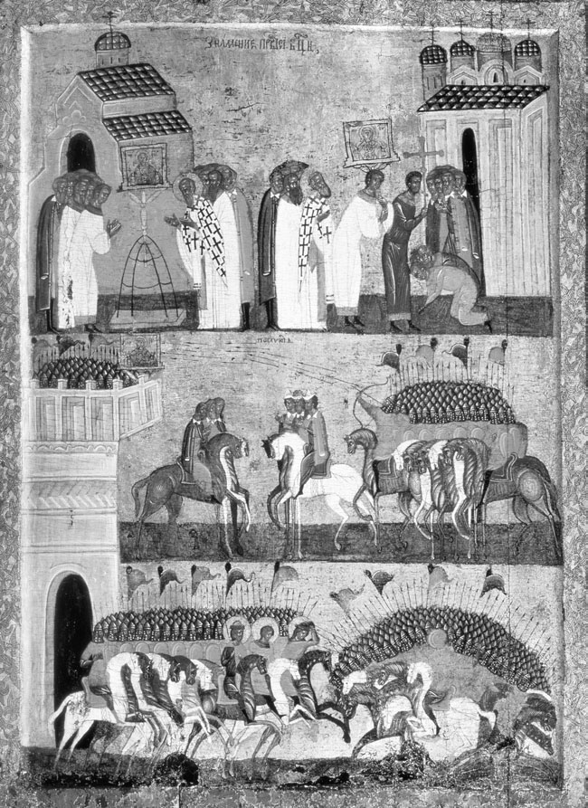
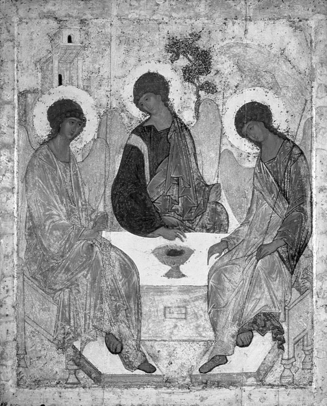
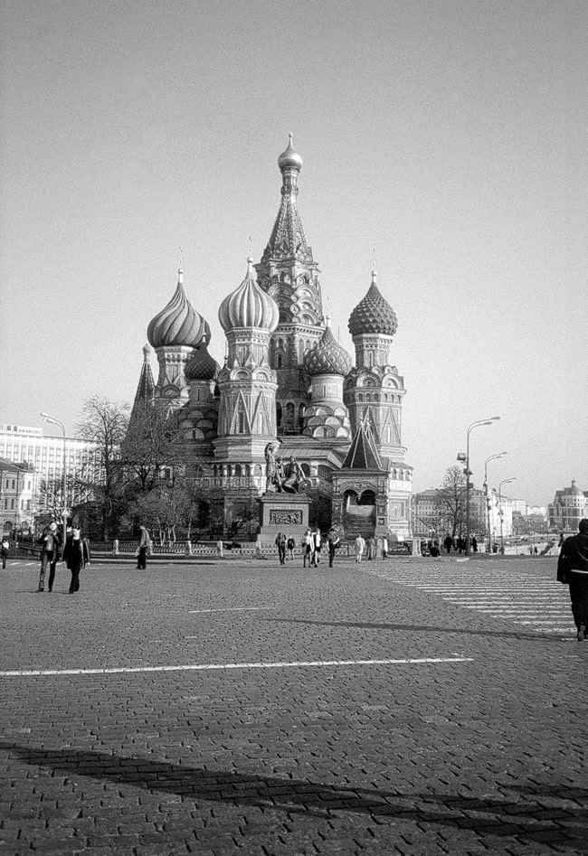

<!-- PDF page 297; original page 276 -->

# 第12章 俄国的艺术与礼仪：鲁布廖夫及其继承者

琳赛·休斯

13世纪，俄国大片地区落入蒙古入侵者之手。[^p297-1] 最初对宗教生活与艺术的打击是毁灭性的：司祭和修士被杀，教堂与圣像遭焚，以贵金属及宝石制作的敬拜器物被劫掠。1237年首先遇袭的是梁赞，《梁赞毁灭记》的匿名作者叙述道：

> 他们把整座梁赞城及其一切闻名的美与财富付之一炬，掳走基辅和切尔尼戈夫诸王公的亲族。他们毁坏上帝的教堂，在神圣祭台上流了许多血。城中没有一人幸存，人人都死去，同饮死亡之杯。这一切，都是因我们的罪而来。[^p297-2]

即使考虑到修辞上对彻底毁灭的强调，损失仍然极为惨重。大量正教基督徒死于异教徒之手，加之人们相信，上帝“因我们的罪”使俄国遭受毁灭，幸存者及其后代遂负有迫切责任：为亡者灵魂及生者得救祈祷。这场灾难孕育了宗教复兴的种子，后来被称为“俄罗斯圣德的繁花盛开”。[^p297-3]

俄国与新宗主的关系十分复杂。即使蒙古人在14世纪改信伊斯兰教之后——俄国史料通常称他们为鞑靼人——他们仍尊重帝国各地的宗教，以换取政治服从，以及按要求缴纳货币和实物贡赋。他们从远处统治。在俄国，没有强迫改宗的运动，没有干预正教仪式<!-- PDF page 298; original page 277 -->或圣像图式的惯例，更谈不上禁止人物图像。新的教会等级体系最终建立起来。蒙古人还豁免教会土地的税赋与征兵负担。俄国“是一片被征服、却往往看不到征服者的土地”，这使文字史料得以对征服本身维持一种“沉默的意识形态”。[^p298-4] 与此同时，惩罚性袭击的威胁始终存在：1247—1460年间至少发生四十次；而要求司祭为诸汗祈祷，又使人们持续意识到自己受“异教”权力占领。人口离开旧有城市中心，难民在森林或湖畔建造木质礼拜堂与圣所，吸引更多定居者。同一时期，新建修道院超过一百所；1352—1353年侵袭俄国的黑死病，又进一步推动人们退隐祈祷。[^p298-5]

蒙古对俄国文化的影响并不一致。西北的诺夫哥罗德与普斯科夫免遭毁灭，以贸易为基础的经济恢复较快，艺术与建筑也兴盛起来。西南一些起初落入蒙古控制的地区，包括基辅本身，后来并入信奉天主教的波兰—立陶宛；正教在那里不得不适应外来的艺术惯例。在俄国腹地，愿意合作的地方王公和教会首领，可以在蒙古人调控的等级秩序中繁荣。王公之间的竞争，表现为支持当地圣徒敬礼、捐赠修道院，以及委托制作教堂、圣像、手稿、教会贵金属器皿、法衣及其他物件。14与15世纪，俄国正教艺术出现了被称为“复兴”或“黄金时代”的景象，[^p298-6] 背景却始终是来自东方的袭击威胁、西方天主教的进逼，以及王公争夺优势地位的内部冲突。

这场“复兴”与同时代意大利文艺复兴几乎没有直接联系，也不以重新发现希腊罗马古典时代为中心；它没有产生世俗艺术。它更像是重新激活正教艺术的拜占庭根源，后者曾赋予俄国若干<!-- PDF page 299; original page 278 -->古典遗产成分。同时，从俄国基督教最初几个世纪起，本地艺术家就在宗教艺术上留下自己的印记。他们创作俄国圣徒与宗教庆节的图像，用木材建造教堂，以本地颜料绘制圣像。较扁平的拜占庭圆顶，最终发展为俄国独特的“洋葱头”穹顶。[^p299-7] 政治分裂强化了宗教艺术的地域差异，新的圣像画派由此兴起。不过，“画派”只能在宽泛的地理意义上使用，因为多数情况下，我们无法确定艺术家或作坊大师的姓名。[^p299-8]

## 诺夫哥罗德

诺夫哥罗德发展出多种鲜明的地方特征。13世纪后期起，商人共同体与城市街区委托建造许多小型单穹顶、四柱教堂，采用斜坡式或三叶式山墙，奉献给与当地有关的圣徒。灰泥外墙以壁龛、窗户及砖带装饰，内部绘制成组壁画。现存最好的例子包括利普纳圣尼古拉教堂（1293年）、圣狄奥多若·斯特拉蒂拉特斯教堂（1361—1362年），以及伊林街救主显圣容教堂（1372年）。[^p299-9] 诺夫哥罗德圣像画家偏好和谐排列的简洁形式、明亮色块及黑色轮廓线，红、白、金色尤其鲜艳。[^p299-10] 最著名的例子之一，是15世纪后期的《圣乔治与龙》：圣徒、坐骑与龙彼此相联的形体，充满鲜红背景前的画面空间。[^p299-11] 圣乔治受到王公敬礼，许多王公名为尤里或格奥尔基；诺夫哥罗德最古老的修道院，也以他为主保。在民众文化中，他与保护牲畜和农业相联，人们呼求他驱除不洁之灵。11月26日他的庆日，标记农业年度的结束。这幅及其他类似的圣乔治像，能够与欣赏水平不同的<!-- PDF page 300; original page 279 -->观者沟通。有节奏地组合的形状与色彩吸引目光；圣徒腾跃坐骑闪亮的白色，与倒地之龙的暗淡颜色形成对比。战士圣徒屠龙、拯救少女的戏剧性民间故事——这幅特定圣像并未画出少女——以关于人间善恶斗争的神学论述为基础：下方是险恶的地狱洞穴，上方则有上帝之手从天上伸出，指引人类一切事务。

这里没有世俗艺术，也没有独立的人物肖像、风景画或历史画。即使圣像表现有记载的历史事件，例如描绘1170年攻城战役的《诺夫哥罗德人与苏兹达尔人之战》（15世纪中后期，图12.1），其核心讯息仍是神恩。[^p300-12] 诺夫哥罗德的护城圣像《显兆圣母像》奇迹般介入，保护城市，召来战士圣徒乔治、鲍里斯与格列布击败敌人。圣像绘于诺夫哥罗德独立受到威胁之时，从过去汲取灵感，坚信人的行动与决定始终服从神意。若无祈祷相助及圣徒介入，武力便毫无用处。

诺夫哥罗德人生活的各个方面，都向圣像祈求。例如，马匹主保拜占庭圣徒弗洛鲁斯与劳鲁斯的圣像图式，于15世纪在这里发展。圣像下方，马匹在圣徒圣髑附近的圣井饮水；上方，另一位牲畜保护者总领天使米哈伊尔赐予祝福。[^p300-13] 以利亚防护火灾、带来雨水。一幅15世纪初著名圣像，以鲜红背景衬出这位严厉先知的正面形象。在其他构图中，他乘火车升入象征天界的红色圆圈。[^p300-14] 圣帕拉斯凯瓦·皮亚特尼察是妇女劳动与传统的主保；她在圣像中身穿红斗篷，右手持殉道十字架，左手持纺锤。[^p300-15] 最普遍受到敬礼的圣徒之一，是圣尼古拉，其保护力量涵盖人和牲畜的健康、庄稼、蜜蜂及城市。[^p300-16]

普斯科夫画家采用独特的深绿与橙色，辅以白色提亮，并常使用民间装饰元素。

<!-- PDF page 301; original page 280 -->

*图12.1 《诺夫哥罗德人与苏兹达尔人之战》，诺夫哥罗德画派，15世纪中叶，木板蛋彩与金饰。莫斯科特列季亚科夫画廊。*

<!-- PDF page 302; original page 281 -->

在《圣母会集像》（14世纪后期）中，山峦可见典型的“翡翠”绿色。这幅构图取材于颂扬主降生的赞美诗。上方熟悉的牧羊人、天使与东方贤士，下方又加入领唱者及执事唱诗班。这是礼仪本身的图像，把会众也纳入其中，使他们通过敬拜赞美上帝，并将自己的礼物献给基督。[^p302-17] 其他高水平圣像绘画的地方中心，包括弗拉基米尔、苏兹达尔、罗斯托夫和特维尔，其王公在14世纪曾竞争政治领导权。[^p302-18] 特维尔最著名的圣像之一，是所谓《蓝色圣母安眠像》（15世纪后期），这是一个广受欢迎题材的无数实例之一。[^p302-19] 同时也出现了学者称为“北方”画派的朴拙或“原始”艺术，以粗犷而大胆的笔法，以及吸收民间主题为特点。

在所有这些中心，王公、总主教及修道院的作坊都制作手抄本。制作在礼拜中使用、由司祭在游行时捧持、并陈列于祭台前的礼仪典籍，如《福音书》《使徒行传》与《圣咏集》，需要多种技艺。许多书以贵金属封套（oklady）华丽装帧，雕刻纹饰并镶嵌宝石。俄国手稿彩饰发展相对较晚，仍十分依赖圣像与壁画作为范本。图像不是用作插图，而是装饰文本；艺术家本人可能并不识读这些文字。最常见的主题，是传递圣书的四位福音作者。重要例子包括《西伊斯克福音书》（1339—1340年）与《希特罗沃福音书》（约1415年），两者都制作于莫斯科。[^p302-20]

## 莫斯科

14世纪起，政治与宗教权力日益集中于莫斯科城及公国。其雄心勃勃的统治者出自<!-- PDF page 303; original page 282 -->达尼尔·亚历山德罗维奇（1263—1303年）一系，兼并亲族与对手的土地，并获得蒙古人认可，使地位较高的大公头衔传给自己的继承人。1325年，俄国正教会首领彼得都主教，在伊凡一世亲王（1325—1340年在位）的莫斯科宫廷定居，大大推动了艺术发展。1327年，彼得与伊凡为莫斯科克里姆林宫第一座石造圣母安眠大教堂奠基。奉献给天主之母安眠（Uspenie）的教堂，被认为具有神迹力量；依据是经外传说：在耶路撒冷，使徒们在场见证马利亚的身体与灵魂升天。在君士坦丁堡，传为她的棺木与裹尸布的物件，与保护城市免遭敌袭，以及正教基督徒战胜非基督徒相联系。基辅洞窟修道院11世纪的圣母安眠教堂，则受到一位已皈依的异教徒蒙赐马利亚神视的启发。传说马利亚还以天火在地上烧出一幅平面图。因此，这些据说由马利亚亲自设计的教堂，成为后来圣母安眠大教堂的范本，其中最宏伟者于12世纪建于弗拉基米尔。[^p303-21] 莫斯科圣母安眠大教堂的兴建，表达了这样一种信念：上帝的恩宠经由耶路撒冷、君士坦丁堡、基辅与弗拉基米尔，转移到了莫斯科。这座建筑的意义植根于普世历史，并与神圣地景相联。它和其他重要大教堂，成为民族胜利及危难时举行礼仪的关键场所，也是汇集最神圣圣像及其他敬拜器物的中心。

修道院进一步为莫斯科提供实际和属灵保护。约1354年，后来成为拉多涅日的圣谢尔吉（约1314—1392年）的修士，在城北40千米处建立圣三一大修道院（lavra）。1360—1370年代，莫斯科城内建立了救主—安德罗尼科夫、楚多夫（意为“神迹”）与西蒙诺夫修道院。更北方，白湖的基里尔（卒于1447年）在湖畔建立修道院，吸引许多隐修士在附近居住；1420年代，圣佐西马与圣萨瓦季在白海建立索洛韦茨基修道院。画家逐渐发展出这些及其他修道圣徒的圣像图式，现存最早实例或许显示静修主义的内向凝视。静修主义的教导与实践——希腊语ἡσυχασμός，意为静谧——于14世纪在阿索斯山形成，经君士坦丁堡与巴尔干传至俄国。

<!-- PDF page 304; original page 283 -->

人们相信，静默的祈祷操练，能够使个人接触基督显圣容时在他泊山出现的神圣“非受造”之光；这是修道理想。但有学者认为，重要圣像画家“本身也是静修者，或以某种方式与他们有关”。[^p304-22] 证据缺乏，使这一说法无法得到证实；但总体而言，这一时期俄国与外国正教艺术家的联系确实增加了。例如，希腊人狄奥格诺斯托斯任都主教期间（1328—1354年），许多君士坦丁堡艺术家来到莫斯科。到该世纪末，城内建立起希腊人聚居区和教堂。

圣三一—圣谢尔吉修道院的圣三一大教堂（1422—1423年），很好地说明了在与静修主义相联的修道环境中，艺术与礼仪如何发挥作用。圣谢尔吉的传记作者智者叶皮法尼记载，圣徒祝圣大教堂，是“为了藉默观圣三一，克服对这世界可憎纷争的恐惧”。[^p304-23] 谢尔吉安葬于此。教堂是一座简洁的单穹顶建筑，穹顶下饰有名为科科什尼克的反曲线形山花，形成金字塔般的效果，属于早期莫斯科建筑的标志之一。它吸引朝圣者前来，在圣徒圣髑旁参与昼夜不断的祈祷。相传安德烈·鲁布廖夫正是为这座教堂绘制《旧约圣三一像》，悬挂于圣像屏上（图12.2）。[^p304-24]

## 圣像屏

圣像屏至今仍是俄国正教教堂敬拜不可分割的部分。[^p304-25] 拜占庭教堂以带帘幕的柱列，或称为templon的低矮透空栏屏，把中殿与圣所分开。这一设施后来发展为双层屏障；14世纪后期至15世纪初，在俄国又发展成更高、悬挂圣像的框架。到17世纪，框架获得鲜明的建筑特征，例如镀金、扭转、缠绕葡萄藤的柱子、檐口，以及容纳圣像的各式开口。大型大教堂的圣像屏有五层横排。最上方一排，表现《旧约》列祖，从亚当到摩西，中央常为《旧约圣三一像》。

<!-- PDF page 305; original page 284 -->

*图12.2 《圣三一》，1420年代，安德烈·鲁布廖夫（约1370—1430年）作，木板蛋彩。莫斯科特列季亚科夫画廊。*

下方是先知层，中央为《显兆圣母像》，即表示基督道成肉身的圣像。再下方是一排较小的《新约》主要庆节圣像。接着是最令人印象深刻的代祷层（Deesis），亦即祈祷层，中央为《荣光中登座的基督》。代祷层颂扬基督及其国度的来临；这是礼仪的核心事实。天主之母立于基督右侧，施洗约翰，亦即前驱，<!-- PDF page 306; original page 285 -->立于其左；两旁又有圣徒，最常见的是彼得与保罗，以及总领天使，低首倾身朝向基督。代祷层强调教堂建筑的作用：教堂本身是上帝居所的圣像，也是圣徒与天使为人类代求的场所。他们的图像与会众一起参与礼仪。正如约翰·梅延多夫所写：“正教宗教艺术与这样一种意识不可分离：人按上帝形象受造，圣像上的圣徒形象彰显一种圣德，而在上帝心中，这种圣德是所有人都能在礼仪中企及的。”[^p306-26]

与地面齐平的是圣像屏的“本地”层。其中央开王门，亦称圣门，自上而下饰以圣母领报、使徒领圣餐及四位福音作者的图像，象征上帝国度的入口；圣餐礼中，基督经此门被捧出。[^p306-27] 门右侧悬挂《威严中的基督》，以及教堂所奉献庆节的“本堂”圣像；圣三一大教堂所用，便是《旧约圣三一像》。门左侧是天主之母圣像，其他圣像补足这一排。

圣像屏过去与现在都是礼仪不可分割的部分：它既为司祭在礼拜关键时刻持十字架进出提供建筑背景，也是基督教普世历史与一年礼仪周期的缩影。敬拜者自上而下观看，可以读出《圣经》启示的救恩历史，并看见藉图像显现的天国应许。圣像屏并不被理解为会众所在中殿的象征空间——尘世、暂时——与圣所神圣奥秘——天界、永恒——之间的屏障，而是一扇窗，使敬拜者得以瞥见天界的临在。信徒在这一天地“边界”处，面对王门领受圣餐。教堂的中心功能，是举行圣餐礼；它既具有纪念面向，追念最后晚餐，也具有期待面向，等待基督再临。[^p306-28]

教堂建筑本身也是天地的圣像，无论内部布局——中殿、圣所与穹顶——还是外部空间——圆顶、立面的三分结构——都是如此。遍布堂内、置于礼仪空间中的壁画与圣像，为圣像屏发挥辅助作用。大型教堂内，各小礼拜堂及祭台，配有自己的小型圣像屏或<!-- PDF page 307; original page 286 -->独立圣像，为个别敬拜者服务；墙上成组壁画，则讲述《圣经》启示的救恩故事。全能基督从中央穹顶俯视，下有色拉芬承托。最后审判常绘于西门上方，连柱子也容纳圣徒形象。所有图像的形态，都被视为并非人类发明，而是植根于原型的历史真实性。它们可以依据真人绘成，例如圣路加为天主之母画像；也可以因神迹产生，例如印在布上的基督圣容布图像；可以依据代代相传的圣徒容貌及胡须形状之记忆；最后，也可以由上帝通过异象赐下。

《弗拉基米尔天主之母像》，亦称《温柔圣母像》，为考察这一时期灵验圣像在地方与民族生活中的作用，以及它们对同时代艺术家的影响，提供了有趣个案。这幅12世纪拜占庭原作，传说出自圣路加之手，先被送至基辅，后来转往弗拉基米尔。1395年帖木儿威胁莫斯科，莫斯科亲王德米特里命人从弗拉基米尔请来圣像，以帮助“拯救罗斯大地”。[^p307-29] 传说天主之母随后在异象中显现于帖木儿，命其离去，他便照办。圣像抵达莫斯科的8月26日，被庆祝为接迎节（sretenie），并成为新的圣像题材。斯列坚斯基修道院就建立于莫斯科人最初迎接圣像的地点。[^p307-30]

圣像永久移至莫斯科后，被安放于克里姆林宫圣母安眠大教堂王门右侧。[^p307-31] 人们制作复制品，包括所谓“备用像”（zapasnaia）。其中，马利亚不再忧伤地望向观者，而呈现更温和、更亲切的表情，目光转向自己的孩子。根据风格及间接证据，有学者认为，安德烈·鲁布廖夫可能至少参与其中一幅复制品的制作。[^p307-32] 这幅圣像还与<!-- PDF page 308; original page 287 -->其他神迹解救事件有关，包括1480年鞑靼人在乌格拉河与伊凡三世军队对峙后撤退；以及1521年6月23日，克里米亚、诺盖和喀山鞑靼人在异象中看见大军守卫城市后，决定不攻打莫斯科。[^p308-33] 这幅圣像属于若干与“帝权转移”（translatio imperii）观念相联的圣物之一。在这里，一幅12世纪圣像从君士坦丁堡迁移，象征天主之母的保护转至莫斯科。[^p308-34]

## 希腊人费奥凡与安德烈·鲁布廖夫

现存最早的莫斯科圣像绘画，出自1382年脱脱迷失袭击之后的年代。当时，俄国与外国画家受基普里安都主教（1390—1406年在任）及其他人委托，补作毁失作品。“黄金时代”莫斯科圣像的共同特征，包括修长身形、细小手足、安静而静止的姿态，以及纯净色彩的和谐呼应。[^p308-35] 14世纪后期受吸引来到莫斯科的艺术家中，有出自君士坦丁堡的希腊人费奥凡，即希腊人狄奥法尼斯（约1340—约1410年）。[^p308-36] 其早期艺术带有拜占庭帝国所谓帕莱奥洛格复兴的印记。费奥凡最著名的作品，是1378年为诺夫哥罗德伊林街救主显圣容教堂绘制的壁画，包括《旧约圣三一》；它们高度风格化，富于“表现主义”色彩和动感，以自由笔触、柔暗色调及白色提亮绘成。一般认为，费奥凡曾在莫斯科克里姆林宫的天主之母诞生教堂（1395年）、总领天使米哈伊尔教堂（1399年），以及王公的王室礼拜堂圣母领报教堂（1405年）工作。后者代祷层的若干圣像，被归于他名下，包括《救主》《天主之母》与《施洗约翰》。[^p308-37] 归于其作坊的还有著名《顿河天主之母像》，背面绘《圣母安眠》；以及来自佩列斯拉夫尔的《显圣容》，其中蓝色光芒从基督发出，落在门徒衣服上。[^p308-38]

<!-- PDF page 309; original page 288 -->

专家对费奥凡影响俄国画家的程度意见不一。甚至有人指出，这位希腊人后期作品反而显示俄国艺术家、尤其安德烈·鲁布廖夫的影响。[^p309-39] 鲁布廖夫是唯一在俄国以外也为人熟知的中世纪圣像画家，但我们对他确知的事情仍很少。对其生平与作品的严肃研究，直到20世纪最初十年、清理其《圣三一像》时才开始；这也是把圣像作为艺术品“重新发现”的里程碑。[^p309-40] 学者对他的出生时间与地点、家世、社会地位，以及何时何地成为修士，意见均有分歧。把1960年定为诞辰六百周年，与冷战期间苏联弘扬俄国文化遗产的关系，比与历史准确性的关系更密切。苏联历史学家给鲁布廖夫贴上“人文主义者”标签，认为他“克服教会教规的束缚”，成功创作出“在俄罗斯及世界艺术宝库中，如无价宝石般闪耀”的绘画。[^p309-41] 18世纪学者G. F. 米勒的文稿中，发现了一份记载他于1430年1月29日去世的铭文抄本，但原件已失。[^p309-42] 较近时期，V. G. 布留索娃把鲁布廖夫之死定于“约1427年”。[^p309-43]

学者依据编年史及圣徒传中的零星记载，梳理鲁布廖夫及达尼尔·乔尔内等同伴画家的活动；这些记载有些出于同时代，有些并非如此。1395年一则编年记载提到，费奥凡的若干学生（uchenitsy）在莫斯科克里姆林宫工作，其中一人或许就是安德烈。[^p309-44] 鲁布廖夫现存最早作品，很可能是兹韦尼哥罗德“城堡上”（na Gorodke）的圣母安眠大教堂壁画（1401—1405年）。[^p309-45] 他与费奥凡在1405年的联系更为可靠：一则大概写于1484年以后的记载称，莫斯科克里姆林宫旧圣母领报大教堂，由“希腊圣像画家费奥凡、来自戈罗杰茨的长老修士（starets）普罗霍尔，以及修士（chernets）安德烈·鲁布廖夫”绘饰。[^p309-46] 领报大教堂圣像屏庆节层左侧，归于鲁布廖夫的<!-- PDF page 310; original page 289 -->圣像包括《进入耶路撒冷》《基督降生》《拉撒路复活》及《显圣容》。[^p310-47]

最早与鲁布廖夫同时代的记载，见于1408年：“5月25日，遵大公之命，开始为弗拉基米尔那座伟大的石造天主至圣之母〔安眠〕大教堂绘画；画家是圣像画师（ikonnik）达尼尔〔乔尔内〕与安德烈·鲁布廖夫。”[^p310-48] 保存下来的题材包括显圣容、进入圣殿，以及约阿希姆、安娜与撒迦利亚。1420年代，应尼孔院长邀请，安德烈与达尼尔为圣三一—圣谢尔吉修道院的圣三一大教堂绘制壁画。尼孔生平的记述说，这些圣像画家“在其蒙上帝喜悦、受祝福的生命末尾，以壁画装饰那座教堂，然后亲近相伴、在属灵合一中归于主上帝，正如他们在此生活时一样；他们把最后这些画留下，作为人人可见的自身纪念”。[^p310-49] 然而，其他史料说，安德烈最后的工作在莫斯科安德罗尼科夫修道院；在那里，“他亲手以奇妙绘画装饰美丽的教堂”。[^p310-50] 遗憾的是，这些壁画与圣三一壁画都未保存下来，虽然后者17世纪的重绘或许沿袭鲁布廖夫的轮廓。[^p310-51]

鲁布廖夫的圣像没有一幅标明年代——中世纪圣像很少标年——也没有一幅在同时代编年史中被提及。其来源最初只有传统提供线索，后来才辅以风格及科学分析。《旧约圣三一像》这幅“最典型的俄罗斯圣像”（图12.2），也是如此。[^p310-52] 许多研究把它定年为1422—1427年，理由是鲁布廖夫在去世前不久，为新圣三一大教堂完成其杰作。《拉多涅日的尼孔传》叙述，院长如何请安德烈为圣像屏本地层绘制本堂圣像，圣像屏于1427年以前完成，用以“赞颂他的〔属灵〕父亲、行神迹者<!-- PDF page 311; original page 290 -->谢尔吉”。[^p311-53] 这幅圣像从15世纪至1920年代，一直挂在王门右侧，后来被带到莫斯科，在特列季亚科夫画廊展出；本书撰写时仍藏于那里。另一种说法认为，它实际上是为圣谢尔吉的墓而作，后来才置于圣像屏；到1640年代首次描述修道院时，已在屏上。[^p311-54] 然而，有学者提出更早的年代，认为安德烈为圣三一大教堂绘制的，是这一题材的另一个版本。[^p311-55] 一种激进理论认为，这幅圣像原绘于兹韦尼哥罗德，由曾在圣三一修道院受洗的伊凡四世沙皇于1550年代捐赠给该院。[^p311-56] 鲁布廖夫也确实直到伊凡四世时期，才开始声名渐盛。

这些或许无法调和的分歧，并不减损图像的重要性；它以绘画形式表达基督教的本质。围桌而坐的三个形象，出自《创世记》18:1—16，有时称为“亚伯拉罕款待来客”的一幕。三个人，即天使，在幔利橡树下向亚伯拉罕显现，预言他已过生育年龄的妻子撒拉将奇迹般生下一子。欣喜的夫妇命仆人宰肥牛，款待使者。有些版本在画面下方，绘出亚伯拉罕、撒拉，以及宰牛的仆人。[^p311-57] 基督教神学家把这段经文解读为《旧约》预示《新约》的众多原型或预表之一。天使代表圣父、圣子与圣灵，从左至右，大概依此排列。[^p311-58] 圣爵象征圣餐，是永生的凭据；人物轮廓又形成另一只杯。树，即生命树，预表十字架；左侧建筑象征神圣智慧，<!-- PDF page 312; original page 291 -->或许也象征教会；右侧山峦象征属灵力量。构图“超尘世”的几何安排——桌子上的逆透视、相交三角形、八角形，以及最重要、环抱天使与圣爵的圆形——既创造审美平衡与和谐，也增加象征层次。圣像体现牺牲的观念：宰牛的牺牲，即使未画牛犊，圣爵中也可能看见牛头，预表上帝羔羊基督为人类献身。[^p312-59]

归于鲁布廖夫的另一幅图像，结构较简单，却同样令人难忘：宏伟的《救主》。一般认为，它出自兹韦尼哥罗德“城堡上”的圣母安眠大教堂代祷层，暂定为15世纪最初十年。[^p312-60] 基督面容既令人敬畏，又充满怜悯，“与俄国的美之理想相契合”。[^p312-61] 木板的破损，以及1918年修复师G. O. 奇里科夫在一间棚屋的柴堆下发现它的故事，使这幅图像更为动人。与它一起发现的，还有尺寸相近的圣保罗与总领天使米哈伊尔像，推测都从原有七个或九个人物的代祷组像中幸存。[^p312-62] 三幅现陈列于特列季亚科夫画廊。

现代对鲁布廖夫的颂扬，强调他是世界级艺术家与工匠，或强调其“人文主义者”资格，扭曲了俄国中世纪对圣像画家的看法。鲁布廖夫最早的“传记作者”之一，沃洛科拉姆斯克的约瑟夫院长（1439—1515年），有一段归于他的话，概括了这种看法：

> 这些奇妙而著名的圣像画家，达尼尔、他的学生安德烈，以及许多与他们相似的人，对斋戒和修道生活怀有如此有德的热忱，以致能够领受神恩。他们不断把心智与思想提升至神圣的非物质之光，又把肉身之眼转向以物质颜料绘成的基督、其至洁之母及诸圣的图像。[^p312-63]

在鲁布廖夫作品中，灵性，即精神之美，与审美，即形式之美，密不可分。

<!-- PDF page 313; original page 292 -->

## 克里姆林宫[^p313-64]

鲁布廖夫的成就，全都与莫斯科地区有关。莫斯科克里姆林宫把艺术、建筑与礼仪结合得最为壮观。在这里，地方敬礼让位于一种全国性表达：莫斯科王公在教会主教团支持下，拥有最高地位。莫斯科教会与国家把自己呈现为正教的捍卫者，不仅在俄国，也在整个正教世界如此。历史学家常把这一愿望浓缩为“莫斯科是第三罗马”。1480年，伊凡三世（1462—1505年在位）正式拒绝向蒙古人纳贡。他采用拜占庭、亦为哈布斯堡所用的双头鹰，与末代拜占庭皇帝的侄女成婚，并偶尔在其他头衔外加入“沙皇”，即凯撒之称，都显示出帝国抱负。这种抱负也在15世纪末克里姆林宫的重建与整修中获得视觉表达。这些不只是供外人观看的“威望”工程。克里姆林宫各大教堂位于莫斯科神圣的核心，建筑及其中物件共同形成神圣地景。人们在这里以特别隆重的仪式庆祝熟悉的礼仪年周期，复活节周尤为壮丽；沙皇、其男性亲属、波雅尔贵族及教会高级教士出席。另有特别礼拜，纪念民族胜利及王朝生命礼仪：命名日、洗礼和婚礼通常在圣母领报大教堂举行，加冕和葬礼后来分别在圣母安眠及总领天使大教堂举行。此外，沙皇住所内有私人礼拜堂，包括供皇后及公主使用者；这些女性是敬拜器物的重要委托者。克里姆林宫圣像或由最优秀大师绘制，或因灵验力量、特殊联系而从别处搜集。

1475年，一座由俄国工匠建造的替代教堂倒塌后，伊凡三世邀请意大利建筑师阿里斯托蒂莱·菲奥拉万蒂，兴建新的圣母安眠大教堂。菲奥拉万蒂奉命以弗拉基米尔13世纪的圣母安眠大教堂为范本；这并非如现代历史学家有时年代错置地以为，是要确保新教堂具有“民族”精神，或避免“异端”天主教主题，而是为了遵循一项据说由天主之母亲自开创、神秘而奇迹性的传统。[^p313-65] 这座五穹顶大教堂于1479年完成，把俄国—拜占庭形式与文艺复兴的<!-- PDF page 314; original page 293 -->比例及工程技术相结合。1484年，俄国建造者兴建新的圣母领报王室礼拜堂。瓦西里三世沙皇（1505—1533年在位）又以总领天使米哈伊尔大教堂，完成克里姆林宫三大教堂的组合；该堂于1505—1509年由另一位意大利人阿莱维西奥·诺维设计。山墙上的威尼斯贝壳装饰，后来被许多建筑模仿。三座大教堂均设华丽圣像屏，遍绘成组壁画。就连由马尔科及皮耶罗·安东尼奥·索拉里建造、1487年动工的多棱宫，内部也饰宗教壁画。[^p314-66]

这一大型建筑计划，为画家创造了工作，包括狄奥尼西（约1440—约1507年）及其儿子们；他们经营着十分成功的作坊网络。[^p314-67] 其最早有记载的作品，是帕夫努季—博罗夫斯克修道院圣母诞生教堂壁画（1467—1477年）。1481年，他受委托为克里姆林宫新圣母安眠大教堂绘制壁画。原作可能尚存某些残片，包括《贤士来朝》，但多数已被重绘覆盖。[^p314-68] 现存代祷层部分归于他，一对彼得与阿列克谢都主教圣像亦然。其作品还见于克里姆林宫升天修道院、沃洛科拉姆斯克修道院、沃洛格达附近奥布诺尔斯克的圣保罗修道院圣三一大教堂，以及白湖圣费拉蓬特修道院。后者天主之母诞生大教堂的蓝、白、金色壁画（1502—1503年？），属于他保存最完整的作品。狄奥尼西及其团队也绘制了代祷层圣像（约1502年）：比例优雅、身形修长的人物，绘在高约155厘米、宽60厘米的木板上，以细腻提亮、丰富多样的色彩，映衬象征神圣之光的金色背景。[^p314-69]

狄奥尼西的标志，是高度风格化、修长、近乎无肉身感的人物，在金色或白色背景前有节奏地排列，细节减至最低。连苦难也被风格化而显得和谐。例如《钉十字架》（约1500年）中，基督身体只轻微弯曲；依照正教方式，不作任何自然主义的伤口描绘。狄奥尼西及其画派使用充满光辉的色彩，无须大量提亮便达到通透效果。[^p314-70] 常用颜色为赭石、朱砂、红、紫、蓝及翡翠绿。

<!-- PDF page 315; original page 294 -->

狄奥尼西的生涯，与圣尼尔·索尔斯基（1433—1508年）的苦修教导追随者，以及圣沃洛科拉姆斯克的约瑟夫（1439—1515年）较世俗观点的支持者之间的竞争相重叠；两者分别称为非占有派与占有派。他的艺术是“一种不寻常的妥协，企图结合两个无法结合的要素：内在纯洁与外在仪式主义”。[^p315-71] 他被称为俄国中世纪“最后一位伟大画家”。这种看法，与另一种信念相容：约瑟夫较世俗观点的胜利，以及国家日益增长的“凯旋主义”，与俄国圣像绘画灵性的衰落同时发生。同一时期，俄国正教会努力消除异议者剪发派及犹太化派异端中的反圣像倾向。1490年教会会议针对犹太化派的声明，谴责那些“嘲弄圣像上所绘基督与至洁圣母形象的人……另一些人毁坏圣像，将其投入火中焚烧。你们辱骂了圣像上所绘人物的神圣形象”。[^p315-72] 《致圣像画家书》（1480或1490年代）本身就包含对这些异端的论战；它分别被归于约瑟夫或尼尔，或许是回应狄奥尼西求取指导而写。[^p315-73]

正教神学既通过单幅圣像表达，也通过图像、时间——教会年——及空间——教堂内部——之间的关系表达。本章时期，俄国大多数平信徒不识字，但这并不意味着圣像如有时所想，是一种因别无更好办法、用来代替文字的图画教学辅助。它们本身与书写文字一样，构成基督教教义的文本。确实，许多圣像必须在远处、昏暗光线中观看，故偏好醒目简洁的轮廓及色块，使主要题材易于辨识；但这样“删繁就简”的动力，既是属灵的，也是教导性的。“圣像本质上不是一篇讲道，不是用颜色作出的劝诫。人凝望它、把自己交付给艺术默观时，它的道德与教育力量才发挥作用。”[^p315-74]

学者能在一定程度上研究其生涯的少数艺术家，大多服务于保存记录的重要大教堂和修道院。然而，正教虔敬并不限于教堂或修道院，圣像也不局限于正式祝圣的空间。任何地方都可成为<!-- PDF page 316; original page 295 -->上帝的居所：从农民茅屋里以角落一两幅圣像构成的“通天之窗”或“天上耶路撒冷”，到王公宫殿的私人礼拜堂。[^p316-75] 可携的折叠圣像屏，或分层绘画的单块木板，使信徒能够在任何地方展开一个属灵世界。军队把圣像置于便携礼拜堂随行，街头十字架游行也捧持圣像。

## 伊凡四世[^p316-76]

“雷帝”伊凡四世在位期间（1533—1584年）的发展，显示艺术与建筑、礼仪、国家体制及统治权之间复杂的联系；这既关乎人们所认定的俄国在世界史中的地位，也关乎君主作为真正信仰保护者之角色的增强。莫斯科统治者是上帝选民的观念，使他们承担某些义务，必须不断检查俄国属灵生活与实践的“纯洁”。1547年莫斯科发生大火，教士将其解释为悔改与洁净的信号。诺夫哥罗德圣像画家被调往莫斯科。在曾任诺夫哥罗德总主教、本身也是圣像画家的马卡里都主教帮助下，伊凡积极赞助圣物的制作与搜集。正如前任统治者把罗斯土地“收集”于莫斯科领导之下，伊凡如今从其他城市把古老圣像或复制品、圣徒圣髑及其他物件带往莫斯科。马卡里本人也有许多委托，例如所谓《博罗夫斯克福音书》，以鎏金银封套装帧，镶嵌宝石及珍珠母（1530—1533年）。

16世纪创作出许多新的圣像构图，以表达复杂思想；一位历史学家说，它们会“诉诸理智而非灵魂”。[^p316-77] 这些高度复杂的题材，表现圣经文本、赞美诗与祈祷。一幅著名例子来自圣母安眠大教堂，称为《天上君王的军旅有福了》，或《战斗的教会》，依据《但以理书》第12章及《启示录》第19章绘成。画中，总领天使米哈伊尔带领另一位被认定为伊凡四世的骑士及其军队，从喀山前往莫斯科，即从所多玛前往天上耶路撒冷；天使手持殉道者冠冕护送。未标身份的人物，或许包括圣徒亲王弗拉基米尔、鲍里斯与格列布。人间战争<!-- PDF page 317; original page 296 -->因此被表现为与邪恶势力的宇宙性斗争，莫斯科军事精英“被安排为上帝亲自的战士”。这种构图在巴尔干已有先例。[^p317-78] 另有较小版本，出自16世纪第三个四分之一时期，历史及圣经人物均有题字标明身份。[^p317-79] 简单把这些圣像斥为“政治性”，会造成误解，因为宫廷生活本身就依据神圣模式及对应关系来理解。在圣徒圣像中，重心也从引导默观祈祷、孤独而被神圣光辉转化的圣徒形象，转向沿木板四周排列其事迹的叙事，为他人提供生活榜样。

许多新“神学”圣像充满细小细节；有历史学家把它归咎于波斯及土耳其装饰性“东方蔓藤纹”的影响，[^p317-80] 认为由此导致灵性流失，以及“拜占庭礼仪艺术视野的瓦解”。[^p317-81] 当然，16世纪，尤其17世纪，俄国通过外交与贸易同外部世界、东西双方日益增长的接触，必然在艺术中留下痕迹。私人祈祷所需圣像的需求也增加了：它们通常尺寸不大，却细节丰富，适于近距离细看。16世纪神迹敬礼激增，促使人们创作表现神迹的新圣像题材，也复制古老灵验圣像。[^p317-82] 许多月历圣像（menaion）被制作出来，成套木板各以一排排微型圣徒及庆节图像，表现教会历中的一个月份。[^p317-83] 圣像图式惯例也应用于以其他媒材制作、供礼仪使用的图像，例如贵金属圣爵、游行十字架及圣髑十字架。圣徒墓上使用的织物覆毯或裹尸布，饰有全身肖像，以拼布、绣字，以及金银线和珍珠刺绣制成。俄罗斯博物馆所藏白湖圣基里尔墓覆毯，便是优良实例。一些最佳作品出自皇后作坊，例如腓力都主教墓覆毯（1590年代）。[^p317-84]

<!-- PDF page 318; original page 297 -->

没有原型的新题材，可能诱使人偏离。1551年的百章教会会议，试图遏止宗教生活各领域的弊端与失序，其声明中包括一段被称为“俄国史料中最早关于视觉艺术的详尽、公开且权威的评论”。[^p318-85] 它重申圣像绘画的严格规则：承认上帝赐予的天赋值得珍视，但认为画家的属灵及道德品质，比纯粹技术更重要。第43章规定，画家必须品德无可指摘，谦卑、温顺、虔诚、贞洁，并始终服从属灵之父。另一要求，是依照“受祝圣的类型”绘制圣像。画家若不依循既有图像，而“出于自己的发明与猜测”绘画，将受惩罚。教会高级教士负责组织检查。会议十分看重“古代画家”的榜样，命艺术家“依据古老范本绘制〔圣三一〕，如希腊圣像画家，以及安德烈·鲁布廖夫所画”。[^p318-86] 绘画范本书（podlinniki）提供标准圣像类型的线描，作为指导。

这些规则还不足以使国务秘书I. M. 维斯科瓦特安心。他在1553—1554年教会法庭上反对说，艺术家，尤其在克里姆林宫教堂工作的画家，“按照自己的理解”绘画，偏离传统，不加适当题字，还插入“世俗”元素，包括自然主义特征。有些人物依“拉丁”方式画得“宛如活人”；另有一些不可接受，例如把圣父上帝画成年长男子。[^p318-87] 教会驳回了维斯科瓦特的申诉。

16世纪俄国兴建的砖石教堂，比此前所有世纪的总和还多。大多数如同圣像一样，遵循传统拜占庭设计，融合俄国特征，例如此时已发展成熟的洋葱头穹顶，以及层叠的科科什尼克装饰山花。但也出现鲜明创新，特别是建于八角塔之上的帐篷形屋顶（shater）。一些建筑史家认为，这些八角柱式结构受到木造教堂建筑启发，但无法验证具体传播路径。由于内部空间有限，它们本来就以供外部观看为设计目的。其中有三座特别引人注目，标记伊凡四世生命中的关键日期。

<!-- PDF page 319; original page 298 -->

*图12.3 莫斯科圣瓦西里大教堂。*

<!-- PDF page 320; original page 299 -->

其父瓦西里三世于1532年在科洛缅斯科耶建造升天教堂，庆祝儿子诞生。第二座是附近季亚科沃的施洗约翰教堂，纪念伊凡1547年加冕。第三座是红场上俗称圣瓦西里大教堂的建筑（1555—1561年，图12.3）。

圣瓦西里大教堂的建筑，体现了许多关于俄国在神圣历史中地位、以及当时地缘政治角色的关键观念。它最初包括九座礼拜堂，每座有自己的圣像屏。更准确的名称应来自中央礼拜堂，奉献给天主之母覆帡，或代祷（Pokrov）。该节日为10月1日，即1552年俄国人攻克鞑靼要塞喀山的前一天。因此，这一奉献见证伊凡四世在胜利前夕对祈祷力量的信赖。[^p320-88] 它也被联系到沙皇攻克喀山后，访问苏兹达尔覆帡修道院，以及伊凡与12世纪弗拉基米尔—苏兹达尔王公的王朝纽带；这些王公从君士坦丁堡引入该节。圣像表现一则异象：在君士坦丁堡圣布拉西奥斯教堂，圣母把保护斗篷张覆在会众之上，而这种保护将转移到罗斯大地。[^p320-89]

中央覆帡礼拜堂四周，是四座八角形礼拜堂，其奉献都可与伊凡四世的胜利及虔敬关切相联。西面为基督进入耶路撒冷礼拜堂，该主题历来与帝王凯旋相联。北面奉献给圣基普里安与圣乌斯季尼娅，其庆日在10月2日，正值攻克喀山之日。东面为圣三一礼拜堂，反映伊凡对圣三一—圣谢尔吉修道院及圣三一像的敬重。[^p320-90] 南面奉献给韦利科列茨克的圣尼古拉，纪念一幅1555年送往莫斯科修复、游行时经过工地的灵验圣像。此外，还有四座较小的矩形礼拜堂：西北一座奉献给亚美尼亚的圣格里高利，其9月30日庆日，与伊凡1552年在阿尔斯卡亚原野获胜之日重合；西南一座奉献给圣瓦尔拉姆·胡滕斯基，其庆日在11月6日，伊凡几乎肯定在1552年攻克喀山后，于这一天凯旋进入莫斯科；而<!-- PDF page 321; original page 300 -->东南与东北另两座，则奉献给庆日在8月30日的圣徒；这也是1552年俄国人另一次战胜鞑靼人的日期。因此，大教堂是一组还愿感恩的圣所，向天主之母、圣三一，以及与围攻、征服喀山有关的圣徒致谢。它也被理解为天上耶路撒冷王国的一幅圣像，人们通过西面的礼拜堂，象征性地进入其中。伊凡在位后期，圣枝主日游行从克里姆林宫的内在圣域出发，来到更公开的红场空间，再到这座礼拜堂。[^p321-91] 大教堂也在其他艺术形式中有对应物。例如，圣瓦西里中央塔与1551年为圣母安眠大教堂制作的伊凡四世所谓“沙皇座位”（tsarskoe mesto），十分相似。两者都饰有科科什尼克、三角楣及小柱，显示其在神圣保护观念上的思想亲缘，把沙皇参与礼仪的位置，与王室胜利纪念物联系起来。[^p321-92]

大教堂的俗名，来自它与真福瓦西里（Vasilii Blazhenny，1489—1552年）这位“为基督的缘故而愚拙者”的联系。[^p321-93] 瓦西里穿破衣、戴沉重锁链，在莫斯科四处行走，以预言著称，包括预告1547年莫斯科大火。他预言伊凡将杀害长子后不久去世；伊凡后来确于1581年如此做了。[^p321-94] 1588年，伊凡另一子费奥多尔·伊凡诺维奇沙皇，在圣三一礼拜堂旁增建圣瓦西里礼拜堂。每天都有人在其圣龛前唱诵向圣瓦西里的祈祷；圣龛有独立的地面入口。礼拜堂也保存沃洛格达圣愚、“为基督而愚拙的约安”（Ioanna Khrista-rad，卒于1599年）的圣髑。

费奥多尔·伊凡诺维奇沙皇（1584—1598年在位），有时被描绘为某种王室圣愚。他无嗣而终，使一条经莫斯科达尼尔家系上溯至半传奇人物留里克的王统终结。其绝嗣引起的竞争，是王朝、社会及民族崩溃时期的根源之一；这一时期称为“混乱时期”（1598—1613年），发生于费奥多尔的继任者、波雅尔鲍里斯·戈东诺夫（1598—1605年在位）去世之后。[^p321-95] 人们相信，混乱时期与近四百年前的蒙古入侵一样，是对俄国“罪孽”的惩罚。到<!-- PDF page 322; original page 301 -->17世纪，人们对教堂、修道院、圣像及圣物的需要，一如以往；但俄国文化将日益受到西方潮流影响。这一趋势最终在彼得大帝的西化计划，以及宗教艺术与建筑设计中新惯例的出现中达到高潮。

## 注释

[^p297-1]: 本章通用“俄国”及“俄国人”等词，但我知道同时代文献使用的是“罗斯”（Rus）及其变体。

[^p297-2]: D. S. Likhachev, Pamiatniki literatury drevnei Rusi. XIII vek (Moscow: Khudozhestvennaia literatura, 1981), 190–1.

[^p297-3]: Leonid Uspenskii, Theology of the icon (Crestwood, NY: St Vladimir’s Seminary Press, 1992), ii, 257.

[^p298-4]: 参见 C. J. Halperin, Russia and the Golden Horde: the Mongol impact on Russian history (London: I. B. Tauris, 1985).

[^p298-5]: 历史背景参见 R. O. Crummey, The formation of Muscovy, 1304–1613 (London and New York: Longman, 1987).

[^p298-6]: M. A. Alpatov, Drevnerusskaia ikonopis’ (Moscow: Iskusstvo, 1974), 12. 1960—1970年代，研究俄国早期文化遗产的工作在官方认可下复兴，既产生了极有价值的学术成果，也出现了意识形态倾向较强的研究。 例如参见 D. S. Likhachev, Kul’tura Rusi vremeni Andreia Rubleva i Epifaniia Premudrogo (konets XIV–nachala XV v.) (Moscow and Leningrad: Nauka, 1962).

[^p299-7]: 参见 A. M. Lidov, ‘Ierusalimskii kuvuklii. O proiskhozhdenii lukovichnykh glav’, in Ikonografiia arkhitektury: sbornik nauchnykh trudov, ed. A. L. Batalov (Moscow: Akademiia khudozhestv, 1990), 57–68.

[^p299-8]: 俄国圣像绘画的通论，参见 M. V. Alpatov, Early Russian icon painting (Moscow: Iskusstvo, 1978); V. N. Lazarev, Russian icon: from its origins to the sixteenth century, ed. G. I. Vzdornov (Collegeville, MN: Liturgical Press, 1997).

[^p299-9]: 参见 William C. Brumfield, A history of Russian architecture (Cambridge: Cambridge University Press, 1993), 64–70.

[^p299-10]: 参见 V. Laurina (ed.), Novgorod icons, 12th–17th century (Oxford and Leningrad: Aurora, 1980).

[^p299-11]: 图版及包括年代问题的讨论，参见 R. Grierson, Gates of mystery: the art of Holy Russia (Fort Worth, TX: InterCultura, [1992]), 180–2.

[^p300-12]: 参见 Alpatov, Early Russian icon painting, plate 114.

[^p300-13]: 同上, plate 120.

[^p300-14]: 同上, plates 24, 25, 57.

[^p300-15]: Grierson, Gates of mystery, 175–7.

[^p300-16]: 参见 同上, 165–9, 其中有14世纪初的实例。

[^p302-17]: 图见 I. Kozlova, Masterpieces of the Tretyakov Gallery (Moscow: Acropolis, 1994), 18.

[^p302-18]: 参见 N. V. Rozanova, Rostovo-suzdal’skaia zhivopis’ XII–XVI vekov (Moscow: Izobrazitel’noe iskusstvo, 1970); V. L. Vakhrina, Ikony Rostova Velikogo (Moscow: Severnyi palomnik, 2003); A. Rybakov, Vologodskaia ikona: tsentry khudozhestvennoi kul’tury zemli Vologodskoi XIII– XVIII vekov (Moscow: Galart, 1995).

[^p302-19]: 图见 Masterpieces of the Tretyakov Gallery, 31. 另参见下文关于圣母安眠教堂的讨论。

[^p302-20]: J. Cracraft, The Petrine revolution in Russian imagery (Chicago: University of Chicago Press, 1997), 64; O. S. Popova, Russian illuminated manuscripts (London and New York: Thames and Hudson, 1984).

[^p303-21]: D. S. Likhachev, ‘Gradozashchitnaia semantika Uspenskikh khramov na Rusi’, in Uspenskii sobor Moskovskogo Kremlia, ed. E. S. Smirnova (Moscow: Nauka, 1985), 17–23.

[^p304-22]: Uspenskii, Theology, ii, 261.

[^p304-23]: 同上, 256; Likhachev, Kul’tura Rusi vremeni Andreia Rubleva.

[^p304-24]: 参见下文第 289–91.

[^p304-25]: N. Markina, ‘The iconostasis’, in The art of Holy Russia: icons from Moscow 1400–1660 (London: Royal Academy of Arts, 1998), 69–75; N. Labrecque-Pervouchine, L’iconostase: une évolution historique en Russie (Montreal: Bellarmin, 1982).

[^p306-26]: 载 Grierson, Gates of mystery, 41.

[^p306-27]: 例如参见 同上, 97.

[^p306-28]: 同上, 37–44.

[^p307-29]: Moskva, eia sviatyni i pamiatniki [Izbrannye stat’i po opisaniiu Moskvy] (St Petersburg: Iablonskii, 1898), 38.

[^p307-30]: Istoricheskoe opisanie moskovskogo Uspenskogo sobora i ego sviatyni (Moscow: Efimov, 1880), 27–9; Moskva, eia sviatyni, 70–1.

[^p307-31]: O. E. Etingof, ‘K rannei istorii ikony “Vladimirskaia Bogomater’” i traditsiia Vlakhernskogo Bogorodichnogo kul’ta na Rusi v XI–XII vv.’, in Drevnerusskoe iskusstvo: vizantiia i drevniaia Rus’. K 100-letiiu Andreia Nikolaevicha Grabara (1896–1990), ed. E. S. Smirnova (St Petersburg: Nauka, 1999), 296, 298–300.

[^p307-32]: E. K. Guseva, ‘Ikony “Donskaia” i “Vladimirskaia” v kopiiakh kontsa XIV–nachala XIV v., in Drevnerusskoe iskusstvo. XIV–XV vv (Moscow: Nauka, 1984), 56.

[^p308-33]: Moskva, eia sviatyni, 76.

[^p308-34]: 参见 J. Billington, The icon and the axe (London: Weidenfeld and Nicolson, 1966), 32.

[^p308-35]: The art of Holy Russia, 45.

[^p308-36]: 关于费奥凡生涯最详细的记述，是智者叶皮法尼的一封信（约1410年）。关于费奥凡，参见 V. N. Lazarev, Feofan Grek i ego shkola (Moscow: Iskusstvo, 1961); M. V. Alpatov, Feofan Grek (Moscow: Iskusstvo, 1979); G. I. Vzdornov, Feofan Grek, Tvorcheskoe nasledie (Moscow: Iskusstvo, 1983).

[^p308-37]: 参见 Engelina Smirnova, Moscow icons, 14th–17th centuries (Oxford: Phaidon, 1989), 263–4, 其中讨论了这些有争议的作者归属。

[^p308-38]: Alpatov, Early Russian icon painting, plates 59–66.

[^p309-39]: Uspenskii, Theology, ii, 273–4, n. 48.

[^p309-40]: 早期研究包括 N. P. Likhachev, Manera pis’ma Andreia Rubleva (St Petersburg: Tip. M. A. Aleksandrova, 1907) and N. I. Punin, Andrei Rublev (Petrograd: Apollon, 1916), 23.

[^p309-41]: 参见 Lindsey Hughes, ‘Inventing Andrei: Soviet and post-Soviet views of Andrei Rublev and his Trinity icon’, Slavonica 9 (2003), no. 2, 83–90. 引文出自 P. Sokolov-Skalia, ‘Andrei Rublev’, Nauka i Religiia 9 (1960), 85–7. 另参见 N. Kuz’min, ‘Zhivopis’ pereshagnivshaia veka’, Literaturnaia Gazeta, 15 Sept. 1960, 3.

[^p309-42]: G. I. Vzdornov, Troitsa Andreia Rubleva. Antologiia (Moscow: Iskusstvo, 1981), 7.

[^p309-43]: V. G. Briusova, Andrei Rublev i moskovskaia shkola zhivopisi (Moscow: Veche, 1998), 130.

[^p309-44]: 史料综述参见 M. N. Tikhomirov, ‘Andrei Rublev i ego epokha’, Voprosy istorii 1 (1961), 3–15.

[^p309-45]: V. A. Plugin, Master Sviatoi Troitsy: trudy i dni Andreia Rubleva (Moscow: ‘Mosgorarkhiv’, 2001), 508.

[^p309-46]: Tikhomirov, ‘Andrei Rublev i ego epokha’, 6.

[^p310-47]: Alpatov, Early Russian icon painting, plates 74, 76, 77, 79; Plugin, Master Sviatoi Troitsy, 21–43.

[^p310-48]: M. D. Priselkov, Troitskaia letopis’: rekonstruktsiia teksta (Moscow and Leningrad: Nauka, 1950), 466; Polnoe sobranie russkikh letopisei (以下简称PSRL), xxv, 237; Tikhomirov, ‘Andrei Rublev i ego epokha’, 5–6.

[^p310-49]: PSRL, vi, 138.

[^p310-50]: Kniga o Sergii (Moscow, 1646), 转引自 Tikhomirov, ‘Andrei Rublev i ego epokha’, 13.

[^p310-51]: Plugin, Master Sviatoi Troitsy, 509.

[^p310-52]: R. Milner-Gulland, The Russians (Oxford: Blackwell, 1997), 199. 另参见 ‘Andrei Rublev. (Sviatye zemli russkoi)’, Nauka i Religiia 4 (1998), 32–3; A. Nikitin, ‘Kto napisal “Troitsu Rubleva”?’, Nauka i Religiia 8 (1988), 44–8.

[^p311-53]: A. A. Saltykova, ‘Ikonografiia “Troitsy” Andreia Rubleva’, in Drevnerusskoe iskusstvo. XIV– XV vv., ed. O. I. Podobedova (Moscow: Nauka, 1984), 81. 关于鲁布廖夫绘制圣像“赞颂谢尔吉”的著名记载，依据17世纪汇编《神圣圣像画家述略》 (Skazanie o sviatykh ikonopistsakh).

[^p311-54]: V. Antonova, ‘O pervonachal’nom meste “Troitsy” Andreia Rubleva’, Gos. Tret’iakovskaia Galereia: Materialy i issledovaniia 1 (1956), 21–43.

[^p311-55]: 参见 Briusova, Andrei Rublev i moskovskaia shkola zhivopisi, 20, 其中根据风格将其定年为约1400年。鲁布廖夫研究进展综述，参见 V. G. Briusova, Andrei Rublev (Moscow: Izobrazitel’noe iskusstvo, 1995), 40–4.

[^p311-56]: Plugin, Master Sviatoi Troitsy, 509; V. A. Plugin, ‘O proiskhozhdenii “Troitsy” Rubleva’, Istoriia SSR 2 (1987), 64–79; Plugin, ‘Andrei Rublev i Ivan Groznyi. O sud’be “Troitsy”’, Nauka i Religiia 7 (1989), 55–8. 这一看法已进入教科书，例如 V. D. Chernyi, Iskusstvo srednevekovoi Rusi (Moscow: Vlasos, 1997), 189.

[^p311-57]: 例如参见 a mid-sixteenth-century Novgorod icon in Grierson, Gates of mystery, 114–17. 关于圣像图式，参见 N. Malitskii, ‘K istorii kompozitsii vetkhozavetnoi Troitsy’, Seminarium Kondakovianum 2 (1928), 33–46; Saltykova, ‘Ikonografiia “Troitsy” Andreia Rubleva’, 81; Uspensky, Theology, ii, 294–6, 398–402 and passim. 参见下文第 297.

[^p311-58]: 没有题字标明三者身份。中央或左侧天使何者代表基督，意见不一。参见 Vzdornov, Troitsa Andreia Rubleva, 12–13。

[^p312-59]: 参见 A. V. Voloshinov, Troitsa Andreia Rubleva: geometriia i filosofiia (Saratov: Nash Dom, 1997), 25, 27, 28–9, 32.

[^p312-60]: Plugin, Master Sviatoi Troitsy, 509.

[^p312-61]: Kozlova, Masterpieces of the Tretyakov Gallery, 20.

[^p312-62]: E. Konchin, ‘Rublev: novye otkrytiia i starye legendy’, Znanie-sila 10 (1974), 55–6.

[^p312-63]: Iosif of Volokolamsk, ‘Answer to the curious and brief study of the Holy Fathers who lived in the monasteries of the Russian lands’, 转引自 Uspenskii, Theology, ii, 261. 参见上文第 269–71.

[^p313-64]: 参见 N. Abramowa et al. (eds.), Der Kreml: Gottesruhm und Zarenpracht (Munich: Hirmer, 2004).

[^p313-65]: S. Eliseev, ‘Rozhdenie sobora’, Vstrechi s istoriei 2 (Moscow, 1988), 90.

[^p314-66]: 关于建筑，参见 Brumfield, History.

[^p314-67]: D. Chugunov, Dionisii (Leningrad: Izobrazitel’noe iskusstvo, 1979).

[^p314-68]: I. L. Buseva-Davydova, Khramy Moskovskogo Kremlia: sviatyni i drevnosti (Moscow: Nauka, 1997), 43–4.

[^p314-69]: V. A. Gusev, Dionisii v Russkom muzee: k 500-letiiu rospisi Rozhdestvenskogo sobora Ferapontova (St Petersburg: Palace Editions, [2002]).

[^p314-70]: Alpatov, Early Russian icon painting, 251.

[^p315-71]: Grierson, Gates of mystery, 59.

[^p315-72]: Uspenskii, Theology, ii, 263.

[^p315-73]: 同上, 264.

[^p315-74]: M. Alpatov, ‘The icons of Russia’, in The Icon, ed. K. Weitzmann et al. (London: Studio Editions, 1982), 241.

[^p316-75]: 参见 O. Tarasov, Icon and devotion: sacred spaces in imperial Russia, trans. R. Milner-Gulland (London: Reaktion, 2002), 38–9.

[^p316-76]: 关于伊凡四世，参见 A. P. Pavlov and M. Perrie, Ivan the Terrible (London: Pearson/Longman, 2003).

[^p316-77]: Engelina Smirnova, ‘Moscow icon painting from the 14th to the 16th century’, in The art of Holy Russia, 34.

[^p317-78]: 参见 D. Rowland, ‘Biblical military imagery in the political culture of early modern Russia. The Blessed Host of the Heavenly Tsar’, in Medieval Russian culture, ed. M. S. Flier and D. Rowland (Berkeley: University of California Press, 1994), ii, 197.

[^p317-79]: 参见 Art of Holy Russia, 180–1, plate 33.

[^p317-80]: G. H. Hamilton, The art and architecture of Russia (London: Thames and Hudson, 1983), 159.

[^p317-81]: Grierson, Gates of mystery, 40.

[^p317-82]: 关于敬礼，参见 P. Bushkovitch, Religion and society in Russia: the sixteenth and seventeenth centuries (Oxford: Oxford University Press, 1992).

[^p317-83]: 例见 Grierson, Gates of mystery, 91–3: Menaion for December, Moscow, 1569.

[^p317-84]: 同上, 146–7, 148–9, 160–1.

[^p318-85]: Cracraft, The Petrine revolution, 51, 其中有有用的讨论。

[^p318-86]: Rossiiskoe zakonodatel’stvo X–XX vekov (Moscow: Iuridicheskaia literatura, 1985), ii, 303.

[^p318-87]: Cracraft, The Petrine revolution, 54–5. 更详尽的叙述，参见 D. B. Miller, ‘The Viskovatyi affair of 1553–54. Official art, the emergence of autocracy, and the disintegration of medieval Russian culture’, RH/HR 8 (1981), 293–332.

[^p320-88]: F. Kampfer, ‘Über die Konzeption der Vasilij-Blazennyj-Kathedrale in Moskau’, Jahrbücher für Geschichte Osteuropas 24 (1976), 485.

[^p320-89]: 讨论参见 Milner-Gulland, The Russians, 213–15. 例见 Grierson, Gates of mystery, 187.

[^p320-90]: M. Kudriavstev and T. Kudriavtseva, ‘Krasnaia ploshchad’ – khram pod otkrytym nebom’, Mera 3 (1995), 29.

[^p321-91]: 参见 M. S. Flier, ‘Breaking the code: the image of the tsar in the Muscovite Palm Sunday ritual’, in Medieval Russian Culture, ii, 213–42.

[^p321-92]: N. I. Brunov, Khram Vasiliia Blazhennogo v Moskve (Moscow: Iskusstvo, 1988), 97. J. Cracraft and D. Rowland, Architectures of Russian identity, 1500 to the present (Ithaca and London: Cornell University Press, 2003), 34–50.

[^p321-93]: A. Beliankin, Skazanie o zhizni i chudesakh Sviatogo Blazhennago Vasiliia Khrista Radi Iurodivago Moskovskago chudotvortsa (Moscow, 1884).

[^p321-94]: H. Boldyreff Semler, Moscow: the complete companion guide (London: Equator, 1989), 78.

[^p321-95]: 关于戈东诺夫，参见 Cracraft and Rowland, Architectures of Russian identity, 34–51.
