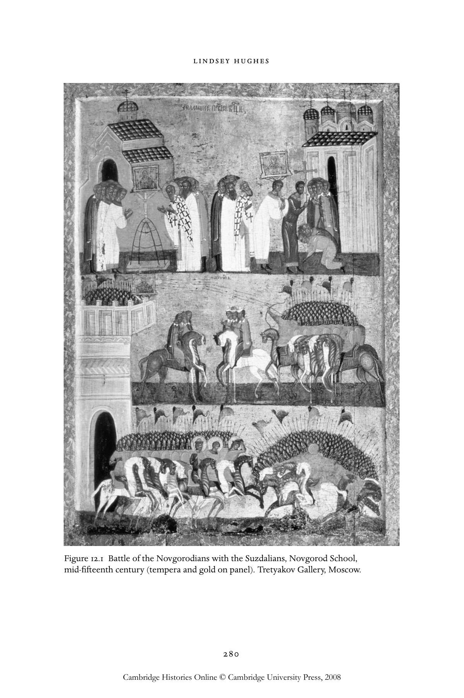
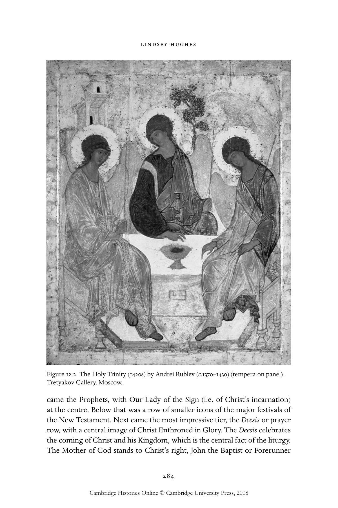
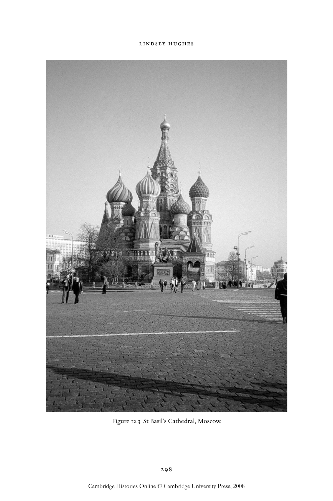

# 俄国的艺术与礼仪：鲁布廖夫及其继承者：英文转换底稿

<!-- PDF page 297; original page 276 -->

### 12

### Art and liturgy in Russia: Rublev

### and his successors

### l i n d s e y h u g h e s

In the thirteenth century large parts of Russia fell to the Mongol invaders.[^p297-1] The initial impact on religious life and art was devastating. Priests and monks were slain, churches and icons were burned, cult objects made of precious metals and gems were looted. The anonymous author of The Tale of the Destruction of Riazan, the first city to be attacked in 1237, recounted:

> They burnt the whole city of Riazan with all its renowned beauty and wealth and seized the relatives of the princes of Kiev and Chernigov. They destroyed God’s churches and spilt much blood on the sacred altars. Not one person was left alive in the city, all had died and supped from the same cup of death. And all this came about for our sins.[^p297-2]

Even if we make allowances for the rhetorical insistence upon complete annihilation, the losses were devastating. The sheer number of Orthodox Christians who perished at the hands of pagans, together with the belief that God had inflicted ruin on Russia as a punishment ‘for our sins’, left the survivors and their descendants with the imperative of praying for the souls of the dead and the salvation of the living. In this disaster lay the seeds of a religious revival that has been described as ‘the flowering of Russian holiness’.[^p297-3]

Russia’s relationship with its new overlords was complex. Even after they adopted Islam in the fourteenth century, the Mongols, or Tatars as they were generally called in Russian sources, respected the local religions of their empire in return for political obedience and compliance in delivering up tribute in money and kind. They ruled from afar. In Russia there was no campaign of forced conversions, no tampering with the conventions of Orthodox ritual

[^p297-1]: I refer to Russia and Russian(s) throughout this chapter in the awareness that contemporary documents used the term Rus and variants.

[^p297-2]: D. S. Likhachev, Pamiatniki literatury drevnei Rusi. XIII vek (Moscow: Khudozhestvennaia literatura, 1981), 190–1.

[^p297-3]: Leonid Uspenskii, Theology of the icon (Crestwood, NY: St Vladimir’s Seminary Press, 1992), ii, 257.

<!-- PDF page 298; original page 277 -->

or iconography, still less a ban on human images. A new church hierarchy eventually established itself. What is more, the Mongols exempted church lands from taxation and levies of recruits. That Russia was ‘a conquered land whose conquerors were often not in evidence’ allowed the maintenance in written sources of ‘an ideology of silence’ about the very fact of conquest.[^p298-4] At the same time, the threat of punitive raids was ever present – there were at least forty between 1247 and 1460 – and the requirement that priests pray for the khans kept alive the consciousness of occupation by an ‘infidel’ power. There was a population shift away from old urban centres. Refugees built wooden chapels and shrines in forests or on lakes, which attracted more settlers. In the same period over a hundred new monasteries were founded, with a further impetus given to prayerful retreat by the Black Death, which hit Russia in 1352–53.[^p298-5]

The Mongol impact on Russian culture was not uniform. The north-western cities of Novgorod and Pskov escaped devastation and their economies, based on trade, revived comparatively quickly. Their art and architecture flourished. Regions in the south-west that initially fell under Mongol control, including Kiev itself, later found themselves incorporated into Catholic Poland- Lithuania, where Orthodoxy had to accommodate itself to alien artistic conventions. In the Russian heartland local princes and primates who co-operated could prosper within a pecking order regulated by the Mongols. Competitiveness between princes manifested itself in support for cults of local saints, donations to monasteries, and commissions for churches, icons, manuscripts, church plate, vestments and other artefacts. The fourteenth and fifteenth centuries witnessed what has been described as a ‘renaissance’ or a ‘golden age’ in Russian Orthodox art,[^p298-6] against the background of the ever-present threat of raids from the east, the encroachment of Catholicism from the west, and internecine conflict as princes competed for supremacy.

This ‘renaissance’ had few direct links with the contemporaneous Italian Renaissance and was not focused on the rediscovery of Greek and Roman classical antiquity. It did not produce secular art. It was more a revitalising of the Byzantine roots of Orthodox art, which had endowed Russia with elements

[^p298-4]: See C. J. Halperin, Russia and the Golden Horde: the Mongol impact on Russian history (London: I. B. Tauris, 1985).

[^p298-5]: On the historical background, see R. O. Crummey, The formation of Muscovy, 1304–1613 (London and New York: Longman, 1987).

[^p298-6]: M. A. Alpatov, Drevnerusskaia ikonopis’ (Moscow: Iskusstvo, 1974), 12. The 1960s–1970s saw an officially approved revival of the study of Russia’s early cultural heritage, which produced invaluable scholarly studies, as well as the more ideologically tendentious. See, for example, D. S. Likhachev, Kul’tura Rusi vremeni Andreia Rubleva i Epifaniia Premudrogo (konets XIV–nachala XV v.) (Moscow and Leningrad: Nauka, 1962).

<!-- PDF page 299; original page 278 -->

of the classical heritage. At the same time, from the first centuries of Russian Christianity local artists put their own stamp on religious art. They created images of Russian saints and religious festivals, employed wood for building churches and local pigments for painting icons. The flattened Byzantine dome eventually developed into the distinctive Russian ‘onion’ cupola.[^p299-7] Regional variations in religious art were intensified by political fragmentation. New schools of icon-painting arose, although the term ‘school’ can be used only in a loose, geographical sense, since in most cases it is impossible to put names to artists or masters of workshops.[^p299-8]

### Novgorod

In Novgorod a number of striking local features developed. From the late thirteenth century many small singled-domed, four-piered churches, with sloping or trefoil gables, were commissioned by communities of traders and urban districts, and dedicated to saints with local associations. The stuccoed fac¸ades were decorated with niches, windows and bands of brick, the interiors with fresco cycles. Among the best surviving examples are St Nicholas at Lipna (1293), St Theodore Stratelates (1361–62), and the Transfiguration on Il’in Street (1372).[^p299-9] The icon-painters of Novgorod favoured simple forms harmoniously arranged, blocks of bright colour – reds, whites and golds were particularly vivid – and black outlines.[^p299-10]  One of the most famous examples is the late fifteenth-century icon of St George and the Dragon, in which the linked figures of saint, steed and dragon fill the picture space against a bright red background.[^p299-11]  St George was venerated in princely cults. Many princes bore the name Iurii or Georgii and Novgorod’s oldest monastery was dedicated to him. In popular culture he was associated with the protection of cattle and agriculture and was invoked to ward off unclean spirits. His feast day on 26 November marked the end of the agricultural year. This icon of St George and others like it could communicate

[^p299-7]: See A. M. Lidov, ‘Ierusalimskii kuvuklii. O proiskhozhdenii lukovichnykh glav’, in Ikonografiia arkhitektury: sbornik nauchnykh trudov, ed. A. L. Batalov (Moscow: Akademiia khudozhestv, 1990), 57–68.

[^p299-8]: For general introductions to Russian icon-painting, see M. V. Alpatov, Early Russian icon painting (Moscow: Iskusstvo, 1978); V. N. Lazarev, Russian icon: from its origins to the sixteenth century, ed. G. I. Vzdornov (Collegeville, MN: Liturgical Press, 1997).

[^p299-9]: See William C. Brumfield, A history of Russian architecture (Cambridge: Cambridge University Press, 1993), 64–70.

[^p299-10]: See V. Laurina (ed.), Novgorod icons, 12th–17th century (Oxford and Leningrad: Aurora, 1980).

[^p299-11]: For an illustration and discussion, including dating, see R. Grierson, Gates of mystery: the art of Holy Russia (Fort Worth, TX: InterCultura, [1992]), 180–2.

<!-- PDF page 300; original page 279 -->

with viewers of differing levels of sophistication. A rhythmic combination of shapes and colours attracts the eye. The gleaming white of the saint’s prancing horse contrasts with the dull colours of the fallen dragon. A dramatic folk narrative – the warrior-saint saves the maiden (not shown in this particular icon) by slaying the dragon – is underpinned by a theological discourse about the struggle between good and evil on earth, with the threatening cave of hell below and God’s hand directing all the affairs of humankind pointing from heaven above.

There was no secular art, no freestanding portraits, landscapes or history paintings. Even when an icon illustrates recorded historical events, as for example in The Battle of the Novgorodians with the Suzdalians (mid–late fifteenth century) (fig. 12.1), which refers to a campaign against the city in 1170, at the heart of its message is divine grace.[^p300-12]  The icon of Our Lady of the Sign, the palladium of Novgorod, miraculously intervenes to protect the city, summoning the warrior-saints George, Boris and Gleb to smite the enemy. Painted at a time when Novgorod’s independence was under threat, the icon draws inspiration from the past in the firm belief that the actions and decisions of men were ever subject to the divine will. Force of arms was useless without the assistance of prayer and the intervention of saints.

Novgorodians prayed to icons for all aspects of their lives. For example, the iconography of the Byzantine saints Florus and Laurus, patrons of horses, evolved there in the fifteenth century. At the foot of the icon horses drink from a holy well near the saints’ relics: at the top the Archangel Michael, another protector of livestock, gives a blessing.[^p300-13]  Elijah protected against fires and brought rain. A famous early fifteenth-century icon shows a frontal view of the stern prophet against a bright red background. In other compositions he ascends in his fiery chariot into a red circle, the symbol of heaven.[^p300-14] St Paraskeva Piatnitsa was a patron of women’s work and traditions. In her icon she wears a red cloak and holds a martyr’s cross in her right hand and a spindle in her left.[^p300-15]  One of the most universally venerated saints was St Nicholas, whose protective powers encompassed the health of humans and livestock, crops, bees and cities.[^p300-16]

The painters of Pskov used a distinctive palette of dark green and orange with white highlights and often incorporated elements of folk decoration into

[^p300-12]: See Alpatov, Early Russian icon painting, plate 114.

[^p300-13]: Ibid., plate 120.

[^p300-14]: Ibid., plates 24, 25, 57.

[^p300-15]: Grierson, Gates of mystery, 175–7.

[^p300-16]: See ibid., 165–9, for an early fourteenth-century example.

<!-- PDF page 301; original page 280 -->

> Figure 12.1 Battle of the Novgorodians with the Suzdalians, Novgorod School, mid-fifteenth century (tempera and gold on panel). Tretyakov Gallery, Moscow.

<!-- PDF page 302; original page 281 -->

their works. The characteristic ‘emerald’ green can be seen in the mountains in the icon of the Syntaxis of the Mother of God (late fourteenth century), a composition based on a hymn glorifying the Nativity of Our Lord. The familiar shepherds, angels and Magi above are joined by a cantor and choir of deacons below, an image of the liturgy itself, which draws in the congregation who will praise God and bring their own gifts to Christ through worship.[^p302-17] Other regional centres of high-quality icon painting were Vladimir, Suzdal, Rostov and Tver, whose princes in the fourteenth century were contenders for political leadership.[^p302-18]  One of the most celebrated Tver icons is the socalled Blue Dormition (late fifteenth century), one of countless examples of a popular subject.[^p302-19]  What scholars dub a ‘Northern’ school of naive or ‘primitive’ art also emerged, distinguished by crude but bold draughtsmanship and the incorporation of folk motifs.

In all these centres the workshops of princes, archbishops and monasteries produced manuscript books. Various skills were required to make the ceremonial liturgical volumes – the Gospels, Acts of the Apostles and Psalter – which were used during services, borne in processions by priests and displayed before the altar. Many were richly bound in covers (oklady) of precious metals, engraved and embellished with gems. Manuscript illumination developed relatively late in Russia and remained very reliant upon icons and frescos as models. Images were used not as illustrations, but as embellishments of texts that the artists themselves may have been unable to read. The most frequent motifs were the four Evangelists, transmitters of the holy books. Major examples were the Siisk (1339–40) and Khitrovo Gospels (c. 1415), both of which were produced in Moscow.[^p302-20]

### Moscow

From the fourteenth century political and religious power increasingly focused on the city and principality of Moscow, whose ambitious rulers of the line

[^p302-17]: Illustrated in I. Kozlova, Masterpieces of the Tretyakov Gallery (Moscow: Acropolis, 1994), 18.

[^p302-18]: See N. V. Rozanova, Rostovo-suzdal’skaia zhivopis’ XII–XVI vekov (Moscow: Izobrazitel’noe iskusstvo, 1970); V. L. Vakhrina, Ikony Rostova Velikogo (Moscow: Severnyi palomnik, 2003); A. Rybakov, Vologodskaia ikona: tsentry khudozhestvennoi kul’tury zemli Vologodskoi XIII– XVIII vekov (Moscow: Galart, 1995).

[^p302-19]: Illustrated in Masterpieces of the Tretyakov Gallery, 31. See below on churches of the Dormition.

[^p302-20]: J. Cracraft, The Petrine revolution in Russian imagery (Chicago: University of Chicago Press, 1997), 64; O. S. Popova, Russian illuminated manuscripts (London and New York: Thames and Hudson, 1984).

<!-- PDF page 303; original page 282 -->

of Daniil Aleksandrovich (1263–1303) annexed the lands of their kinfolk and rivals alike and secured Mongol approval for passing on the senior title of grand prince to their successors. In 1325 the head of the Russian Orthodox Church, Metropolitan Peter, established his residence in Moscow at the court of Prince Ivan I (1325–40), which gave a major boost to the arts. In 1327 Peter and Ivan laid the foundations of the first stone-built Dormition cathedral in the Moscow Kremlin. Churches dedicated to the Dormition (Uspenie) of the Mother of God were credited with miraculous properties, based on the apocryphal stories of the assumption of Mary’s body and soul into heaven from Jerusalem in the presence of the Apostles. In Constantinople what were alleged to be her coffin and shroud became associated with the protection of the city against enemy raids and with the victory of Orthodox Christians over non-Christians. In Kiev the eleventh-century church of the Dormition in the Caves monastery was inspired by the miraculous vision of Mary vouchsafed to a converted pagan. Mary is also said to have burned a plan in the ground with fire from heaven. Thus churches supposedly designed by Mary herself became models for later Dormition cathedrals, of which the grandest was built in Vladimir in the twelfth century.[^p303-21]  The construction of Moscow’s Dormition cathedral expressed a belief in the transfer of God’s grace to Moscow by way of Jerusalem, Constantinople, Kiev and Vladimir. The building’s meaning was rooted in universal history and linked with sacred landscapes. It and other major cathedrals became key locations for the celebration of the liturgy in times of national victory and danger, as well as centres for the collection of the holiest icons and other cult objects.

Monasteries provided further protection for Moscow, both practical and spiritual. In about 1354 the future St Sergii of Radonezh (c. 1314–92) founded the Holy Trinity monastery (lavra) 40 kilometres to the north of the city. In Moscow itself in the 1360s–1370s the Saviour-Andronikov, Chudov (Miracles) and Simonov monasteries were established. Further north Kirill of Beloozero (d.1447) built a monastery on a lake, which attracted the settlement of many hermits in the area, and in the 1420s Saints Zosima and Savatii founded the Solovetskii monastery on the White Sea. Painters developed the iconography of these and other monastic saints, the earliest surviving examples of which may suggest the inward gaze of hesychasm. The doctrine and practice of hesychasm (Greek ἡσυχασμός, quietude) took form on Mount Athos in the fourteenth century and reached Russia from Constantinople and the Balkans.

[^p303-21]: D. S. Likhachev, ‘Gradozashchitnaia semantika Uspenskikh khramov na Rusi’, in Uspenskii sobor Moskovskogo Kremlia, ed. E. S. Smirnova (Moscow: Nauka, 1985), 17–23.

<!-- PDF page 304; original page 283 -->

The belief that silent, prayerful exercises could put an individual in touch with the divine ‘uncreated’ light that appeared on Mount Tabor when Christ was transfigured was a monastic ideal, but some scholars suggest that leading icon-painters, too, were ‘hesychasts themselves or were somehow associated with them’.[^p304-22]  Lack of evidence makes it impossible to substantiate this claim, although in general contacts between Russian and foreign Orthodox artists increased during this period. Under the Greek metropolitan, Theognostos (1328–54), for example, many artists from Constantinople came to Moscow. By the end of the century a Greek colony and church were established in the city.

The Trinity cathedral (1422–23) of the Trinity-St Sergii monastery offers a good example of how art and liturgy worked in a monastic setting associated with hesychasm. St Sergii’s biographer Epifanii the Wise recorded that the saint consecrated his cathedral ‘so that contemplation of the Holy Trinity might conquer the fear of this world’s detestable discord’.[^p304-23]  Sergii was buried there. The church is a simple, single-domed structure, with decorative ogeeshaped gables known as kokoshniki beneath the dome, which create a pyramidal effect, one of the hallmarks of early Moscow architecture. It attracted pilgrims, who could participate in round-the-clock prayers over the saint’s relics. It was for this church that Andrei Rublev is said to have painted his icon of the Old Testament Trinity, to hang on the iconostasis (fig. 12.2).[^p304-24]

### Iconostasis

The iconostasis (or icon screen) remains integral to Russian Orthodox worship in church.[^p304-25]  In Byzantine churches columns with curtains or a low openwork rail known as the templon separated the nave from the sanctuary. In time this feature developed into a two-storey screen, which in Russia from the late fourteenth to the early fifteenth century evolved into an even higher frame hung with icons. In the seventeenth century the framework would acquire distinctive architectural features, such as gilded, twisted and vine-entwined columns, cornices, and variously shaped apertures to house the icons. In large cathedrals the iconostasis had five horizontal tiers. At the top was a row of icons representing the Patriarchs of the Old Testament (from Adam to Moses), often with an icon of the Old Testament Trinity at the centre. Below them

[^p304-22]: Uspenskii, Theology, ii, 261.

[^p304-23]: Ibid., 256; Likhachev, Kul’tura Rusi vremeni Andreia Rubleva.

[^p304-24]: See below, pp. 289–91.

[^p304-25]: N. Markina, ‘The iconostasis’, in The art of Holy Russia: icons from Moscow 1400–1660 (London: Royal Academy of Arts, 1998), 69–75; N. Labrecque-Pervouchine, L’iconostase: une évolution historique en Russie (Montreal: Bellarmin, 1982).

<!-- PDF page 305; original page 284 -->

> Figure 12.2 The Holy Trinity (1420s) by Andrei Rublev (c.1370–1430) (tempera on panel). Tretyakov Gallery, Moscow.

came the Prophets, with Our Lady of the Sign (i.e. of Christ’s incarnation) at the centre. Below that was a row of smaller icons of the major festivals of the New Testament. Next came the most impressive tier, the Deesis or prayer row, with a central image of Christ Enthroned in Glory. The Deesis celebrates the coming of Christ and his Kingdom, which is the central fact of the liturgy. The Mother of God stands to Christ’s right, John the Baptist or Forerunner

<!-- PDF page 306; original page 285 -->

to his left, and to either side of them are saints (Peter and Paul are the most usual) and archangels, their heads bowed and bodies inclined towards Christ. The Deesis emphasised the role of the church building, itself an icon of God’s house, as the location for the intercession of saints and angels on behalf of humankind. Their representations participate in the liturgy along with the congregation. As John Meyendorff writes, ‘The religious art of Orthodoxy is inseparable from the awareness that man was created in the image of God and that the saintly figures on the icons are manifesting a holiness which, in the mind of God, is accessible to all in the liturgy.’[^p306-26]

At ground level is the iconostasis’s ‘local’ tier. This is pierced in the centre by the Royal or Holy Doors, which bear images (from top to bottom) of the Annunciation, the Communion of the Apostles and the four Evangelists to signify the entrance to the kingdom of God through which Christ is carried in the Eucharist.[^p306-27]  To the right of the Doors hangs an icon of Christ in Majesty and the ‘house’ icon of the festival to which the church is dedicated (in the case of the Trinity cathedral, the icon of the Old Testament Trinity), to the left an icon of the Mother of God. Various icons complete the row.

The iconostasis was and is integral to the liturgy, both as an architectural setting for exits and entrances of priests with crosses at key moments in the service and as a microcosm of the universal history of Christianity and the annual cycle of the liturgical year. Scanning from top to bottom, worshippers could read the history of salvation as revealed in scripture and see the promise of the kingdom of Heaven, which made itself manifest through the images. The screen was construed not as a barrier between the symbolic space of the congregation in the nave (earth, the temporal) and the divine mysteries of the sanctuary (heaven, the eternal), but as a window that gave worshippers a glimpse of the presence of the heavenly. Believers received Holy Communion at this ‘border’ between heaven and earth in sight of the Royal Doors. The church’s central function was to celebrate the Eucharist, which had both a commemorative aspect (recalling the Last Supper) and an anticipatory one (awaiting the Second Coming).[^p306-28]

The church building was itself an icon of heaven and earth, in both the arrangement of its interior (nave and sanctuary, domes) and the exterior space (the cupolas, tripartite division of the fac¸ades). Murals and icons throughout the church, set in liturgical space, played a supporting role to the iconostasis. In large churches, chapels and altars with their own small iconostaseis or

[^p306-26]: In Grierson, Gates of mystery, 41.

[^p306-27]: For an example, see ibid., 97.

[^p306-28]: Ibid., 37–44.

<!-- PDF page 307; original page 286 -->

free-standing icons served individual worshippers, while cycles of frescos on the walls told the story of salvation as revealed in scripture. Christ Pantokrator looked down from the central dome, supported by seraphim. The Last Judgement was often depicted over the western door. Even the columns accommodated saintly figures. The forms of all images were regarded not as human invention, but as rooted in the historical reality of the prototype. They could be painted from life (e.g. the image of the Mother of God painted by St Luke), or created by a miracle (e.g. the Mandylion image of Christ, which was imprinted on a cloth), or based on the memory – passed down through the generations – of a saint’s features and the shape of his beard, or, finally, sent by God through visions.

The icon of the Vladimir Mother of God (Our Lady of Tenderness) provides an interesting case study of the role of miraculous icons in local and national life and their impact on contemporary artists during our period. The twelfth-century Byzantine original, which legend attributed to St Luke, was first brought to Kiev, and then taken to Vladimir. In 1395 Tamerlane threatened Moscow and Prince Dmitrii of Moscow had the icon collected from Vladimir to help to ‘save the Russian land’.[^p307-29]  Legend has it that the Mother of God duly appeared to Tamerlane in a vision and commanded him to depart, which he did. The day the icon reached Moscow, 26 August, was celebrated as the feast of its reception or meeting (sretenie) and became a new icon subject. The Sretenskii monastery was founded on the spot where the Muscovites first greeted it.[^p307-30]

Once the icon was permanently transferred to Moscow it was placed to the right of the Royal Doors in the Kremlin cathedral of the Dormition.[^p307-31] Copies were made, including the so-called ‘spare’ (zapasnaia), in which Mary no longer gazed sorrowfully at the viewer but assumed a milder and more tender expression, her eyes turned towards her child. Some scholars believe that Andrei Rublev may have been involved in making at least one of the copies, on both stylistic and circumstantial grounds.[^p307-32]  The icon was associated with

[^p307-29]: Moskva, eia sviatyni i pamiatniki [Izbrannye stat’i po opisaniiu Moskvy] (St Petersburg: Iablonskii, 1898), 38.

[^p307-30]: Istoricheskoe opisanie moskovskogo Uspenskogo sobora i ego sviatyni (Moscow: Efimov, 1880), 27–9; Moskva, eia sviatyni, 70–1.

[^p307-31]: O. E. Etingof, ‘K rannei istorii ikony “Vladimirskaia Bogomater’” i traditsiia Vlakhernskogo Bogorodichnogo kul’ta na Rusi v XI–XII vv.’, in Drevnerusskoe iskusstvo: vizantiia i drevniaia Rus’. K 100-letiiu Andreia Nikolaevicha Grabara (1896–1990), ed. E. S. Smirnova (St Petersburg: Nauka, 1999), 296, 298–300.

[^p307-32]: E. K. Guseva, ‘Ikony “Donskaia” i “Vladimirskaia” v kopiiakh kontsa XIV–nachala XIV v., in Drevnerusskoe iskusstvo. XIV–XV vv (Moscow: Nauka, 1984), 56.

<!-- PDF page 308; original page 287 -->

other incidents of miraculous deliverance, including the Tatar retreat from Ugra river after a confrontation with Ivan III’s army in 1480 and the decision on 23 June 1521 of the Crimean, Nogai and Kazan Tatars not to attack Moscow after they received a vision of many troops defending the city.[^p308-33]  The icon was one of several holy objects associated with the notion of translatio imperii: in this case the migration of a twelfth-century icon from Constantinople signifying the transfer of the protection of the Mother of God to Moscow.[^p308-34]

### Feofan Grek and Andrei Rublev

The earliest surviving examples of Moscow icon-painting date from the years following Toktamysh’s raid of 1382, when Russian and foreign painters carried out commissions for Metropolitan Kiprian (1390–1406) and others to replace lost works. Common features in Moscow icons of the ‘golden age’ include elongated bodies, small hands and feet, calm, static poses, and a harmonious interplay of pure colours.[^p308-35]  Among the artists attracted to Moscow in the late fourteenth century was Feofan Grek (Theophanes the Greek, c. 1340– c. 1410) from Constantinople.[^p308-36]  His early art bore the mark of the so-called Palaiologan Renaissance in the Byzantine Empire. Feofan’s most famous works were painted in Novgorod in 1378 for the church of the Transfiguration on Il’in Street. The frescos, which include an Old Testament Trinity, are highly stylised, ‘expressionistic’ and dynamic, created with free brush strokes, muted colours and white highlights. In the Moscow Kremlin Feofan is thought to have worked in the churches of the Nativity of the Mother of God (1395), the Archangel Michael (1399) and the Annunciation (1405), which was the princes’ chapel royal. Icons from the Deesis row of the latter have been attributed to him, including the Saviour, the Mother of God and John the Baptist.[^p308-37]  Also credited to his workshop are the famous icon of the Mother of God of the Don with the Dormition on the reverse and the Transfiguration from Pereislavl’, in which bluish light emanates from Christ and falls on the disciples’ clothing.[^p308-38]

[^p308-33]: Moskva, eia sviatyni, 76.

[^p308-34]: See J. Billington, The icon and the axe (London: Weidenfeld and Nicolson, 1966), 32.

[^p308-35]: The art of Holy Russia, 45.

[^p308-36]: The most detailed account of Feofan’s career is a letter (c.1410) by Epifanii the Wise. On Feofan, see V. N. Lazarev, Feofan Grek i ego shkola (Moscow: Iskusstvo, 1961); M. V. Alpatov, Feofan Grek (Moscow: Iskusstvo, 1979); G. I. Vzdornov, Feofan Grek, Tvorcheskoe nasledie (Moscow: Iskusstvo, 1983).

[^p308-37]: See Engelina Smirnova, Moscow icons, 14th–17th centuries (Oxford: Phaidon, 1989), 263–4, for a discussion of these disputed attributions.

[^p308-38]: Alpatov, Early Russian icon painting, plates 59–66.

<!-- PDF page 309; original page 288 -->

Specialists disagree about the extent of Feofan’s influence on Russian painters. Indeed, it has been argued that the Greek’s later works bore evidence of the influence of Russian artists, notably Andrei Rublev.[^p309-39]  We still know little for certain about Rublev, the only medieval icon-painter whose name is familiar outside Russia. The serious study of his life and work began only in the first decade of the twentieth century with the cleaning of his Trinity icon, which was a landmark in the ‘rediscovery’ of icons as works of art.[^p309-40]  Scholars disagree about Rublev’s date and place of birth, his parentage and social status, and when and where he became a monk. The designation of 1960 as the six-hundredth anniversary of his birth had more to do with the Soviet promotion of Russian cultural heritage during the Cold War than with historical accuracy. Soviet historians labelled Rublev as a ‘humanist’, who succeeded ‘in spite of’ the canons of the church’ in producing painting that ‘shines like a priceless gem in the treasure house of Russian and world art’.[^p309-41]  A copy of an inscription recording his death on 29 January 1430 was found among the papers of the eighteenth-century scholar G. F. Müller, but the original is lost.[^p309-42]  More recently, V. G. Briusova has located Rublev’s death ‘around 1427’.[^p309-43]

Scholars rely on fragmentary references in chronicles and saints’ lives, some contemporary, others not, to chart Rublev’s activities, along with those of fellow painters such as Daniil Chernyi. A chronicle entry for 1395 mentions certain pupils (uchenitsy) of Feofan Grek working in the Moscow Kremlin, one of whom may have been Andrei.[^p309-44]  Rublev’s earliest surviving work may well be frescos in the Dormition cathedral ‘na Gorodke’ in Zvenigorod (1401 to 1405).[^p309-45] He is linked more reliably to Feofan in the year 1405, when it was recorded (probably after 1484) that the old Annunciation cathedral in the Moscow Kremlin was painted ‘by Feofan the Greek icon-painter, the senior monk (starets) Prokhor from Gorodets and the monk (chernets) Andrei Rublev’.[^p309-46]  Icons from

[^p309-39]: Uspenskii, Theology, ii, 273–4, n. 48.

[^p309-40]: Early studies include N. P. Likhachev, Manera pis’ma Andreia Rubleva (St Petersburg: Tip. M. A. Aleksandrova, 1907) and N. I. Punin, Andrei Rublev (Petrograd: Apollon, 1916), 23.

[^p309-41]: See Lindsey Hughes, ‘Inventing Andrei: Soviet and post-Soviet views of Andrei Rublev and his Trinity icon’, Slavonica 9 (2003), no. 2, 83–90. Quotation from P. Sokolov-Skalia, ‘Andrei Rublev’, Nauka i Religiia 9 (1960), 85–7. See also N. Kuz’min, ‘Zhivopis’ pereshagnivshaia veka’, Literaturnaia Gazeta, 15 Sept. 1960, 3.

[^p309-42]: G. I. Vzdornov, Troitsa Andreia Rubleva. Antologiia (Moscow: Iskusstvo, 1981), 7.

[^p309-43]: V. G. Briusova, Andrei Rublev i moskovskaia shkola zhivopisi (Moscow: Veche, 1998), 130.

[^p309-44]: For a summary of sources, see M. N. Tikhomirov, ‘Andrei Rublev i ego epokha’, Voprosy istorii 1 (1961), 3–15.

[^p309-45]: V. A. Plugin, Master Sviatoi Troitsy: trudy i dni Andreia Rubleva (Moscow: ‘Mosgorarkhiv’, 2001), 508.

[^p309-46]: Tikhomirov, ‘Andrei Rublev i ego epokha’, 6.

<!-- PDF page 310; original page 289 -->

the left side of the Festival row of the iconostasis of the Annunciation cathedral attributed to Rublev include the Entry into Jerusalem, the Nativity of Christ, the Raising of Lazarus and the Transfiguration.[^p310-47]

The earliest contemporary reference to Rublev appears under the year 1408: ‘On 25 May they began to paint the great stone cathedral church of [the Dormition of] the Holy Mother of God, which is in Vladimir, by the order of the great prince, and the artists were the icon-painter (ikonnik) Daniil [Chernyi] and Andrei Rublev.’[^p310-48]  The subjects that survive include the Transfiguration, Entry into the Temple, and Joachim, Anna and Zacharius. In the 1420s Andrei and Daniil painted frescos for the Trinity cathedral in the Trinity-St Sergii monastery at the invitation of Abbot Nikon, in accounts of whose life it is related that the icon-painters ‘decorated that church with wall paintings at the end of their God-pleasing and blessed lives, then departed to the Lord God, in closeness to one another, in spiritual union, just as they lived here, and this last painting they left as a memorial to themselves for all to see’.[^p310-49] Other sources, however, state that Andrei’s last work was in the Andronikov monastery in Moscow, where ‘the beautiful church was decorated in marvellous painting by his own hands’.[^p310-50]  Sadly, neither these nor the Trinity frescos have survived, although the seventeenth-century over-painting of the latter may follow Rublev’s outlines.[^p310-51]

Not one of Rublev’s icons is dated (medieval icons rarely were) or mentioned in contemporary chronicles. Tradition alone suggested their provenance, supplemented later by stylistic and scientific analysis. This applies also to the Old Testament Trinity, ‘the quintessential Russian icon’ (fig. 12.2).[^p310-52]  Many studies give its dates as 1422–27, on the grounds that Rublev completed his masterpiece for the new Trinity cathedral shortly before his death. The Life of Nikon of Radonezh recounts how the abbot asked Andrei to paint a house icon for the local tier of the iconostasis (completed by 1427) ‘in praise of his [spiritual] father

[^p310-47]: Alpatov, Early Russian icon painting, plates 74, 76, 77, 79; Plugin, Master Sviatoi Troitsy, 21–43.

[^p310-48]: M. D. Priselkov, Troitskaia letopis’: rekonstruktsiia teksta (Moscow and Leningrad: Nauka, 1950), 466; Polnoe sobranie russkikh letopisei (hereafter PSRL), xxv, 237; Tikhomirov, ‘Andrei Rublev i ego epokha’, 5–6.

[^p310-49]: PSRL, vi, 138.

[^p310-50]: Kniga o Sergii (Moscow, 1646), quoted in Tikhomirov, ‘Andrei Rublev i ego epokha’, 13.

[^p310-51]: Plugin, Master Sviatoi Troitsy, 509.

[^p310-52]: R. Milner-Gulland, The Russians (Oxford: Blackwell, 1997), 199. See also ‘Andrei Rublev. (Sviatye zemli russkoi)’, Nauka i Religiia 4 (1998), 32–3; A. Nikitin, ‘Kto napisal “Troitsu Rubleva”?’, Nauka i Religiia 8 (1988), 44–8.

<!-- PDF page 311; original page 290 -->

Sergii the Miracle Worker’.[^p311-53]  The icon hung to the right of the Royal Doors from the fifteenth century until the 1920s, when it was brought to Moscow and exhibited in the Tret’iakov Gallery, where it remains. An alternative version is that the icon was in fact made for St Sergii’s tomb, and only later, by the time of the first description of the monastery in the 1640s, placed on the iconostasis.[^p311-54] However, some scholars have proposed a much earlier date, suggesting that Andrei painted a different version of the subject for the Trinity cathedral.[^p311-55]  A radical theory claims that the icon was originally painted in Zvenigorod and donated to the Trinity monastery in the 1550s by Tsar Ivan IV, who had been baptised there.[^p311-56]  It was only in Ivan IV’s time that Rublev began to gain in reputation.

These perhaps irreconcilable discrepancies do not detract from the importance of the image, which is an expression of the essence of Christianity in pictorial form. The three figures seated around a table appear in Genesis 18:1–16 in an episode sometimes referred to as the ‘Hospitality of Abraham’. Three men (angels) appear to Abraham under the oak of Mamre to foretell the miraculous birth of a son to his wife, Sarah, who is past childbearing age. The joyful couple have a servant slaughter a fatted calf to entertain the messengers. (Some versions of the icon show Abraham and Sarah with a servant killing a calf in the lower portion.[^p311-57]  ) Christian theologians interpret this passage as one of many examples of a prototype or prefiguration of the New Testament in the Old. The angels represent Father, Son and Holy Spirit, probably seated in that order from left to right.[^p311-58]  The chalice represents the Eucharist, which is the pledge of eternal life (another cup is formed by the contours of the figures); the tree (the Tree of Life) prefigures the Cross, the building to the left is divine wisdom,

[^p311-53]: A. A. Saltykova, ‘Ikonografiia “Troitsy” Andreia Rubleva’, in Drevnerusskoe iskusstvo. XIV– XV vv., ed. O. I. Podobedova (Moscow: Nauka, 1984), 81. The famous reference to Rublev painting the icon ‘in praise of Sergii’ was based on a seventeenth-century compilation, ‘The narrative of the holy icon painters’ (Skazanie o sviatykh ikonopistsakh).

[^p311-54]: V. Antonova, ‘O pervonachal’nom meste “Troitsy” Andreia Rubleva’, Gos. Tret’iakovskaia Galereia: Materialy i issledovaniia 1 (1956), 21–43.

[^p311-55]: See Briusova, Andrei Rublev i moskovskaia shkola zhivopisi, 20, who dates it about 1400 on stylistic grounds. For a summary of developments in Rublev studies, see V. G. Briusova, Andrei Rublev (Moscow: Izobrazitel’noe iskusstvo, 1995), 40–4.

[^p311-56]: Plugin, Master Sviatoi Troitsy, 509; V. A. Plugin, ‘O proiskhozhdenii “Troitsy” Rubleva’, Istoriia SSR 2 (1987), 64–79; Plugin, ‘Andrei Rublev i Ivan Groznyi. O sud’be “Troitsy”’, Nauka i Religiia 7 (1989), 55–8. This view has entered textbooks: e.g. V. D. Chernyi, Iskusstvo srednevekovoi Rusi (Moscow: Vlasos, 1997), 189.

[^p311-57]: See, for example, a mid-sixteenth-century Novgorod icon in Grierson, Gates of mystery, 114–17. On the iconography, N. Malitskii, ‘K istorii kompozitsii vetkhozavetnoi Troitsy’, Seminarium Kondakovianum 2 (1928), 33–46; Saltykova, ‘Ikonografiia “Troitsy” Andreia Rubleva’, 81; Uspensky, Theology, ii, 294–6, 398–402 and passim. See below p. 297.

[^p311-58]: No inscriptions identify the three. Opinion is divided over whether the central angel or the angel to the left represents Christ. See Vzdornov, Troitsa Andreia Rubleva, 12–13.

<!-- PDF page 312; original page 291 -->

or perhaps the Church, and the mountain to the right spiritual strength. The ‘otherworldly’ geometry of the composition – the use of reverse perspective in the table and the intersecting triangle, the octagon and, most important, the circle encompassing the angels and chalice – create an aesthetic balance and harmony, as well as adding symbolic dimensions. The icon embodies the idea of sacrifice, the sacrifice of the calf (even where no calf is represented, a calf’s head may be seen in the chalice) prefiguring the sacrifice of Christ the Lamb of God for mankind.[^p312-59]

A less complex but equally haunting image attributed to Rublev is the monumental Saviour thought to come from the Deesis of the cathedral of the Dormition ‘na Gorodke’ in Zvenigorod and tentatively dated to the first decade of the fifteenth century.[^p312-60]  Christ’s face is both awe-inspiring and compassionate, with ‘an affinity with the Russian ideal of beauty’.[^p312-61]  The image is made poignant by the damage to the panel and the story of how in 1918 the restorer G. O. Chirikov discovered it in a shed under a pile of firewood with two similarly sized images of St Paul and the Archangel Michael, salvaged from what is presumed to be a sevenor a nine-figure Deesis.[^p312-62]  The three are now displayed in the Tretyakov Gallery.

Modern eulogies to Rublev that emphasise his prominence as an artist and craftsman of world stature or his credentials as a ‘humanist’ distort the medieval Russian view of an icon-painter, which is summed up in words attributed to Abbot Iosif of Volokolamsk (1439–1515), one of Rublev’s earliest ‘biographers’.

> These marvellous, famous iconographers, Daniil, Andrei, his disciple, and many others who were like them, had such virtuous zeal for fasting and the monastic life that they were able to receive divine grace. They constantly raised their mind and thought to the divine immaterial light and their bodily eye toward the images of Christ, of his All-pure Mother and of all the saints painted with material colours.[^p312-63]

In Rublev’s work spirituality (beauty of spirit) and aesthetics (beauty of form) were inextricably linked.

[^p312-59]: See A. V. Voloshinov, Troitsa Andreia Rubleva: geometriia i filosofiia (Saratov: Nash Dom, 1997), 25, 27, 28–9, 32.

[^p312-60]: Plugin, Master Sviatoi Troitsy, 509.

[^p312-61]: Kozlova, Masterpieces of the Tretyakov Gallery, 20.

[^p312-62]: E. Konchin, ‘Rublev: novye otkrytiia i starye legendy’, Znanie-sila 10 (1974), 55–6.

[^p312-63]: Iosif of Volokolamsk, ‘Answer to the curious and brief study of the Holy Fathers who lived in the monasteries of the Russian lands’, quoted in Uspenskii, Theology, ii, 261. See above, pp. 269–71.

<!-- PDF page 313; original page 292 -->

### Kremlin[^p313-64]

Rublev’s attainments were all associated with the Moscow region. Art, architecture and liturgy combined at their most impressive in the Moscow Kremlin, where local cults gave way to a national expression of the supreme role of Moscow’s princes, supported by the hierarchs of the church. The Muscovite church and state presented themselves as defenders of Orthodoxy not only in Russia but also throughout the Orthodox world, an aspiration which historians often distil into the shorthand expression ‘Moscow the Third Rome’. In 1480 Ivan III (1462–1505) formally renounced the payment of tribute to the Mongols. His adoption of the Byzantine (and Habsburg) double-headed eagle, his marriage to the niece of the last Byzantine emperor, and the sporadic addition of the title ‘Tsar’ (Caesar) to his other titles indicated imperial aspirations that also found visual expression in the reconstruction and refurbishment of the Kremlin towards the end of the fifteenth century. These were not simply ‘prestige’ projects for outward show. The Kremlin cathedrals lay at Moscow’s sacred epicentre and its buildings and their contents formed a sacred landscape. The familiar cycle of the liturgical year was celebrated there with particular pomp and ceremony, reaching a height of splendour during Easter week, with the tsar, his male relatives, the boyars and church hierarchs in attendance. There were also special services to mark national victories and dynastic rites of passage: name days, baptisms and weddings (usually held in the Annunciation cathedral), coronations and funerals (later held in the Dormition and Archangel cathedrals respectively). In addition, the tsar’s residence contained private chapels, including those for the use of wives and daughters, the tsaritsy and tsarevny, who were major commissioners of cult objects. The Kremlin icons were painted by the best masters or collected from elsewhere for their miraculous properties or special associations.

In 1475 Ivan III invited the Italian architect Aristotile Fioravanti to build a new Dormition cathedral after a replacement erected by Russian masters collapsed. Fioravanti was instructed to take the thirteenth-century Dormition cathedral in Vladimir as his model, not, as modern historians sometimes anachronistically assume, to ensure that the new church was ‘national’ in spirit or to avoid ‘heretical’ Catholic motifs, but to adhere to a mystical, miraculous tradition allegedly initiated by the Mother of God herself.[^p313-65]  Completed in 1479, the five-domed cathedral combined Russo-Byzantine forms with Renaissance

[^p313-64]: See N. Abramowa et al. (eds.), Der Kreml: Gottesruhm und Zarenpracht (Munich: Hirmer, 2004).

[^p313-65]: S. Eliseev, ‘Rozhdenie sobora’, Vstrechi s istoriei 2 (Moscow, 1988), 90.

<!-- PDF page 314; original page 293 -->

proportions and engineering. In 1484 Russian builders constructed the new chapel royal of the Annunciation. Tsar Vasilii III (1505–33) completed the trio of major Kremlin cathedrals with the cathedral of the Archangel Michael, designed in 1505–9 by another Italian, Alevisio Novi. The Venetian shell motifs in the gables were much imitated in later buildings. All three cathedrals were fitted with magnificent iconostaseis and painted throughout with fresco cycles. Even the new Palace of Facets (by Marco and Piero Antonio Solari, begun in 1487) was decorated inside with religious murals.[^p314-66]

This major building programme created work for painters, including Dionisii (c. 1440 to c. 1507) and his sons, who ran a highly successful network of workshops.[^p314-67]  His first recorded works are the frescos of the church of the Nativity of the Virgin in the Pafnutiev-Borovskii monastery (1467–77). In 1481 he was commissioned to paint the frescos for the new Kremlin cathedral of the Dormition. Some fragments of his originals may survive, including the Adoration of the Magi, but most have been painted over.[^p314-68]  The surviving Deesis tier is attributed in part to him, as are a pair of icons of Metropolitans Peter and Aleksii. His work has also been identified in the Kremlin Ascension monastery, the Volokolamsk monastery, the St Paul monastery at Obnorsk near Vologda (Trinity cathedral), and the St Ferapont monastery at Beloozero, where the blue, white and gold frescos of the cathedral of the Nativity of the Mother of God (1502–3?) are among his most complete surviving works. Dionisii and his team also painted the icons for the Deesis row (c. 1502). The elegantly proportioned, elongated figures occupy panels some 155 cm high and 60 cm wide, with subtly highlighted, variegated colours against gold backgrounds representing divine light.[^p314-69]

Dionisii’s hallmarks were stylised, elongated, almost incorporeal figures, rhythmically organised against gold or white backgrounds. He used a minimum of detail. Even suffering is stylised and made harmonious, for example in the Crucifixion (c. 1500), in which Christ’s body is contorted with just a slight curve and, in the Orthodox manner, devoid of all naturalistic renditions of injury. Dionisii and his school used colours full of radiance, achieving translucence without the use of much highlighting.[^p314-70]  The favourite colours were ochre, cinnabar, red, purple, blue and emerald green.

[^p314-66]: On architecture, see Brumfield, History.

[^p314-67]: D. Chugunov, Dionisii (Leningrad: Izobrazitel’noe iskusstvo, 1979).

[^p314-68]: I. L. Buseva-Davydova, Khramy Moskovskogo Kremlia: sviatyni i drevnosti (Moscow: Nauka, 1997), 43–4.

[^p314-69]: V. A. Gusev, Dionisii v Russkom muzee: k 500-letiiu rospisi Rozhdestvenskogo sobora Ferapontova (St Petersburg: Palace Editions, [2002]).

[^p314-70]: Alpatov, Early Russian icon painting, 251.

<!-- PDF page 315; original page 294 -->

Dionisii’s career coincided with the rivalry between the followers of the ascetic teachings of St Nil Sorskii (1433–1508) and the more worldly views of St Iosif of Volokolamsk (1439–1515), known respectively as the Non-Possessors and the Possessors. His art was ‘an unusual compromise, an attempt to combine two elements, which cannot be combined: an internal purity and an external ritualism’.[^p315-71]  He has been described as medieval Russia’s ‘last great painter’, a view compatible with the belief that the victory of the more worldly views of Iosif and the increasing ‘triumphalism’ of the state coincided with a decline in the spirituality of icon-painting in Russia. In the same period the Russian Orthodox Church battled to stamp out iconoclastic tendencies in the heresies of the dissident strigol’niki and the Judaisers. A church council pronouncement against the Judaisers issued in 1490 condemned those who ‘mocked the images of Christ and the All Pure represented on the icons... Others have destroyed holy icons and burned them in the fire. You have reviled the holy image of those who are painted on the icons.’[^p315-72]  A polemic with such heretics is inherent in the ‘Message to an iconographer’ (1480s/90s), variously attributed to either Iosif or Nil and perhaps written in response to Dionisii’s appeal for guidance.[^p315-73]

Orthodox theology was expressed both in individual icons and in the relationships between images, time (the church year) and space (the church interior). In our period the majority of the Russian laity was illiterate, but this does not mean, as is sometimes assumed, that icons were some sort of pictorial teaching aid, which served faute de mieux as an alternative to texts. They themselves constituted the texts of Christian doctrine as much as the written word. It is true that many icons had to be seen from a distance and in dim light, hence the preference for bold, simple outlines and blocks of colour, allowing major subjects to be recognised easily, but the impulse behind ‘paring down’ images in this manner was as much spiritual as pedagogical. ‘In its essence the icon is not a sermon, not an exhortation in colour. Its moral and educational power is exerted when people, as they gaze at it, give themselves over to artistic contemplation.’[^p315-74]

The few artists whose careers scholars are able to study to any degree worked mainly in major cathedrals and monasteries where records were preserved, but Orthodox devotions were not confined to the church or cloister, nor were icons restricted to officially consecrated spaces. Anywhere could serve as a

[^p315-71]: Grierson, Gates of mystery, 59.

[^p315-72]: Uspenskii, Theology, ii, 263.

[^p315-73]: Ibid., 264.

[^p315-74]: M. Alpatov, ‘The icons of Russia’, in The Icon, ed. K. Weitzmann et al. (London: Studio Editions, 1982), 241.

<!-- PDF page 316; original page 295 -->

house of God, from the peasant hut, with one or two icons in the corner forming a ‘window to heaven’ or a ‘High Jerusalem’, to the private chapel in a prince’s palace.[^p316-75]  Portable folding iconostaseis or single boards divided into tiers allowed the faithful to unfold a spiritual world anywhere. Icons were carried with armies in portable chapels and in processions of the cross on the street.

### Ivan IV[^p316-76]

Developments during the reign of Ivan IV ‘the Terrible’ (1533–84) illustrate the complex links between art and architecture, liturgy, statehood and rulership, with reference both to Russia’s perceived place in world history and to the enhanced role of its monarchs as protectors of the true faith. The notion of Moscow’s rulers as God’s elect imposed certain obligations upon them and required constant checks on the ‘purity’ of Russian spiritual life and practice. In 1547 there was a great fire in Moscow, which churchmen interpreted as a signal for repentance and purification. Icon painters from Novgorod were transferred to Moscow. With the help of Metropolitan Makarii, formerly archbishop of Novgorod, and himself an icon-painter, Ivan actively sponsored the production and collection of holy objects. Just as his predecessors had ‘gathered in’ the Russian lands under Moscow’s leadership, now Ivan brought old icons or copies, saints’ relics and other objects to Moscow from other cities. Makarii himself made many personal commissions, for example the so-called Borovskii Gospels in a silver gilt cover studded with jewels and mother-of-pearl (1530–33).

In the sixteenth century many new iconographic compositions were created to express complicated ideas that would ‘appeal to the mind rather than the soul’, as one historian has expressed it.[^p316-77]  Highly complex subjects illustrated biblical texts, hymns and prayers. A famous example is the icon from the Dormition cathedral known as ‘Blessed is the Host of the Heavenly Tsar’ or the Church Militant, based upon texts from Daniel 12 and Revelation 19. In it the Archangel Michael leads another horseman identified as Ivan IV and his troops from Kazan to Moscow (from Sodom to the heavenly city of Jerusalem), escorted by angels bearing martyrs’ crowns. Unidentified figures may include the saintly princes Vladimir and Boris and Gleb. Earthly battles

[^p316-75]: See O. Tarasov, Icon and devotion: sacred spaces in imperial Russia, trans. R. Milner-Gulland (London: Reaktion, 2002), 38–9.

[^p316-76]: On Ivan IV, see A. P. Pavlov and M. Perrie, Ivan the Terrible (London: Pearson/Longman, 2003).

[^p316-77]: Engelina Smirnova, ‘Moscow icon painting from the 14th to the 16th century’, in The art of Holy Russia, 34.

<!-- PDF page 317; original page 296 -->

are thus represented in terms of cosmic struggle against the forces of evil, with the Muscovite military elite ‘cast in the role of God’s own warriors’. The composition has precedents in the Balkans.[^p317-78]  A smaller version exists, dating from the third quarter of the sixteenth century, in which historical and biblical figures are identified by inscriptions.[^p317-79]  To dismiss such icons as ‘political’ is misleading, for court life itself was construed on sacred models and parallels. In icons of saints, too, emphasis switched from the solitary transfigured image of the saint as a guide to contemplative prayer to a narrative of his deeds arranged around the edges of the panel, as an inspiration to others on how to live.

Many of the new ‘theological’ icons were packed with small details, which some historians have blamed on the influence of decorative ‘oriental arabesques’[^p317-80]  from Persia and Turkey, with a consequent loss of spirituality, and a ‘disintegration of the Byzantine vision of liturgical art’.[^p317-81]  Certainly, in the sixteenth century, and even more in the seventeenth, Russia’s growing contacts with the outside world through diplomacy and trade, to and from both east and west, were bound to leave traces in art. There was also an upsurge in demand for icons for private prayer, usually of modest dimensions, but richly detailed to satisfy close scrutiny. The proliferation of miracle cults in the sixteenth century prompted the production of new iconographic subjects featuring miracles, as well as copies of older wonder-working icons.[^p317-82]  Many examples of menaion or monthly calendar icons were made, comprising series of panels each containing rows of miniaturised images of saints and feasts for a single month of the church calendar.[^p317-83]  Iconographic conventions were applied to images for liturgical purposes created in other media, for example in precious metals on chalices, and processional and reliquary crosses. Fabric palls or shrouds were made for the tombs of saints, bearing their full-length portraits, created with patchwork, embroidered inscriptions and embroidery of gold and silver threads and pearls. The palls for St Kirill of Beloozero in the Russian Museum are fine examples. Some of the best were made in the workshops of the tsaritsy, for example the pall of Metropolitan Filipp (1590s).[^p317-84]

[^p317-78]: See D. Rowland, ‘Biblical military imagery in the political culture of early modern Russia. The Blessed Host of the Heavenly Tsar’, in Medieval Russian culture, ed. M. S. Flier and D. Rowland (Berkeley: University of California Press, 1994), ii, 197.

[^p317-79]: See Art of Holy Russia, 180–1, plate 33.

[^p317-80]: G. H. Hamilton, The art and architecture of Russia (London: Thames and Hudson, 1983), 159.

[^p317-81]: Grierson, Gates of mystery, 40.

[^p317-82]: On cults, see P. Bushkovitch, Religion and society in Russia: the sixteenth and seventeenth centuries (Oxford: Oxford University Press, 1992).

[^p317-83]: For examples, Grierson, Gates of mystery, 91–3: Menaion for December, Moscow, 1569.

[^p317-84]: Ibid., 146–7, 148–9, 160–1.

<!-- PDF page 318; original page 297 -->

New subjects without prototypes were a temptation to deviation. The Church Council of a Hundred Chapters (Stoglav, 1551), which attempted to curb abuses and indiscipline in all areas of religious life, included among its pronouncements what has been called ‘the first extended, public and authoritative commentary on visual art to be found in a Russian source’.[^p318-85]  It reaffirmed strict rules on icon-painting, acknowledging the desirability of God-given talent, but deeming a painter’s spiritual and moral qualities more important than mere technical skills. Chapter 43 stated that a painter must be irreproachably virtuous, humble, meek, pious and chaste and must always obey his spiritual father. Another requirement was to paint the holy images according to ‘consecrated types’. Artists who painted not in accordance with the images, but ‘out of their own invention and by guesswork’, would be punished. Church hierarchs were responsible for organising inspections. The Council set great store by the example of the ‘ancient painters’, instructing artists to ‘paint [the Trinity] from ancient models, such as the Greek icon painters, and as Andrei Rublev painted’.[^p318-86]  Guidance was provided in pattern books or podlinniki containing outlines of standard icon types.

These rules were not enough to reassure the state secretary I. M. Viskovatyi, who objected at a church tribunal in 1553–54 that artists, especially those working in the Kremlin churches, were painting ‘according to their own understanding’, deviating from tradition, failing to include proper inscriptions and inserting ‘profane’ elements, including naturalistic features. Some figures were represented ‘as though they were alive’, in the ‘Latin’ manner. Others, such as God the Father depicted as an elderly man, were inadmissible.[^p318-87]  The church rejected Viskovatyi’s complaints.

In the sixteenth century more masonry churches were constructed in Russia than in all previous centuries put together. Most, like icons, followed traditional Byzantine designs, with the incorporation of Russian features such as the now developed onion dome and tiers of decorative kokoshnik gables. But there were also striking innovations, notably in the appearance of the shater or tent-shaped roof, built over an octagonal tower. Some architectural historians maintain that these octagonal pillars were inspired by wooden church architecture, although it is impossible to verify specific paths of diffusion. With restricted interior space, they were built to be viewed from outside. A remarkable trio of

[^p318-85]: Cracraft, The Petrine revolution, 51, contains a useful discussion.

[^p318-86]: Rossiiskoe zakonodatel’stvo X–XX vekov (Moscow: Iuridicheskaia literatura, 1985), ii, 303.

[^p318-87]: Cracraft, The Petrine revolution, 54–5. For a fuller account, see D. B. Miller, ‘The Viskovatyi affair of 1553–54. Official art, the emergence of autocracy, and the disintegration of medieval Russian culture’, RH/HR 8 (1981), 293–332.

<!-- PDF page 319; original page 298 -->

> Figure 12.3 St Basil’s Cathedral, Moscow.

<!-- PDF page 320; original page 299 -->

such churches marked key dates in Ivan IV’s life. His father Vasilii III built the church of the Ascension at Kolomenskoe in 1532 to celebrate his son’s birth. The second, the church of John the Baptist at nearby D’iakovo, commemorated Ivan’s coronation in 1547. The third was the church on Red Square popularly known as St Basil’s cathedral (1555–61) (fig. 12.3).

Many key ideas about Russia’s place in divine history, as well as its contemporary geopolitical role, were embodied in the architecture of St Basil’s, which originally comprised nine chapels, each with its own iconostasis. It is more accurately named from the central chapel dedicated to the Protective Veil or Intercession (Pokrov) of the Mother of God. The festival falls on 1 October, which was the day before the Russians captured the Tatar stronghold of Kazan in 1552. The dedication therefore bears witness to Ivan IV’s trust in the power of prayer on the eve of victory.[^p320-88]  It has also been linked to the tsar’s visit to the Intercession (Pokrovskii) monastery in Suzdal after the capture of Kazan, as well as to Ivan’s dynastic links with the twelfth-century princes of Vladimir-Suzdal, who adopted the festival from Constantinople. The icon features a vision of the Virgin casting her protective mantle over the congregation in the church of St Blasios at Constantinople, a protection which was to be transferred to the Russian land.[^p320-89]

Surrounding the central chapel of the Intercession are four octagonal chapels, whose dedications can be linked to Ivan IV’s triumphs and pious concerns. To the west is the chapel of Christ’s Entry into Jerusalem, which was always associated with the theme of imperial triumph. To the north lies one dedicated to Sts Kiprian and Ustin’ia, whose festival fell on 2 October, the day of the capture of Kazan. To the east is the chapel of the Holy Trinity, which reflected Ivan’s reverence for the Trinity-St Sergii monastery and for the icon of the Trinity.[^p320-90]  To the south lies another dedicated to St Nicholas of Velikoretsk, which honoured a miracle-working icon brought to Moscow in 1555 for restoration and which was processed past the construction site. There are in addition four smaller rectangular chapels: to the north-west one dedicated to St Gregory of Armenia, whose feast day on 30 September coincided with Ivan’s victory at Arskaia Pole in 1552; to the south-west another dedicated to St Varlaam Khutynskii, on whose festival on 6 November Ivan almost certainly made his triumphal entry into Moscow in 1552 after the conquest of Kazan; and to the

[^p320-88]: F. Kampfer, ‘Über die Konzeption der Vasilij-Blazennyj-Kathedrale in Moskau’, Jahrbücher für Geschichte Osteuropas 24 (1976), 485.

[^p320-89]: See discussion in Milner-Gulland, The Russians, 213–15. For an example, Grierson, Gates of mystery, 187.

[^p320-90]: M. Kudriavstev and T. Kudriavtseva, ‘Krasnaia ploshchad’ – khram pod otkrytym nebom’, Mera 3 (1995), 29.

<!-- PDF page 321; original page 300 -->

south-east and the north-east others dedicated to saints whose feast days fell on 30 August, the day of another Russian victory over the Tatars in 1552. The cathedral is thus a collection of shrines for offering votive thanks to the Mother of God, the Holy Trinity, and saints associated with the siege and conquest of Kazan. It is also construed as an icon of the heavenly kingdom of Jerusalem, which one symbolically enters through its western chapel. Later in Ivan’s reign a Palm Sunday procession went from the inner sanctum of the Kremlin to the more public space of Red Square and then to this chapel.[^p321-91]  The cathedral had counterparts in other art forms. There is a striking similarity, for example, between the central tower of St Basil’s and the so-called Tsar’s Seat (tsarskoe mesto) of Ivan IV in the Dormition cathedral, made in 1551. Both are decorated with kokoshniki, pediments and small columns, suggesting an ideological kinship in the idea of divine protection, a link between the place where the tsar celebrated the liturgy and the memorial to royal victory.[^p321-92]

The popular name for the cathedral derives from its associations with Basil the Blessed or Vasilii Blazhenny (1489–1552), a ‘fool for Christ’s sake’.[^p321-93]  Basil roamed around Moscow in rags and heavy chains and was famed for his prophecies, including predicting the Moscow fire of 1547. He died shortly after prophesying that Ivan would kill his first-born son (which he did, in 1581).[^p321-94]  It was another son, Tsar Fedor Ivanovich, who in 1588 added St Basil’s chapel, next to the Trinity chapel. Prayers to St Basil were sung daily at his shrine, which has its own entrance at ground level. The chapel also contained the relics of Ioanna Khrista-rad (died 1599), a holy fool from Vologda.

Tsar Fedor Ivanovich (1584–98) has sometimes been depicted as a sort of royal holy fool. His death without issue ended the royal line that traced its origins back through the Moscow Daniilovichi to the semi-legendary Riurik. The rivalries engendered by its extinction were a root cause of the period of dynastic, social and national collapse known as the Time of Troubles (1598–1613) that occurred after the death of Fedor’s successor, the boyar Boris Godunov (1598–1605).[^p321-95]  The belief was that the Troubles, no less than the Mongol invasion almost four centuries earlier, were a punishment for Russia’s ‘sins’. In

[^p321-91]: See M. S. Flier, ‘Breaking the code: the image of the tsar in the Muscovite Palm Sunday ritual’, in Medieval Russian Culture, ii, 213–42.

[^p321-92]: N. I. Brunov, Khram Vasiliia Blazhennogo v Moskve (Moscow: Iskusstvo, 1988), 97. J. Cracraft and D. Rowland, Architectures of Russian identity, 1500 to the present (Ithaca and London: Cornell University Press, 2003), 34–50.

[^p321-93]: A. Beliankin, Skazanie o zhizni i chudesakh Sviatogo Blazhennago Vasiliia Khrista Radi Iurodivago Moskovskago chudotvortsa (Moscow, 1884).

[^p321-94]: H. Boldyreff Semler, Moscow: the complete companion guide (London: Equator, 1989), 78.

[^p321-95]: On Godunov, see Cracraft and Rowland, Architectures of Russian identity, 34–51.

<!-- PDF page 322; original page 301 -->

the seventeenth century, churches, monasteries, icons and holy objects would be needed as much as ever, but Russian culture would increasingly be subjected to currents from the west, a trend that culminated in Peter the Great’s programme of westernisation and the appearance of new conventions in the design of religious art and architecture.
