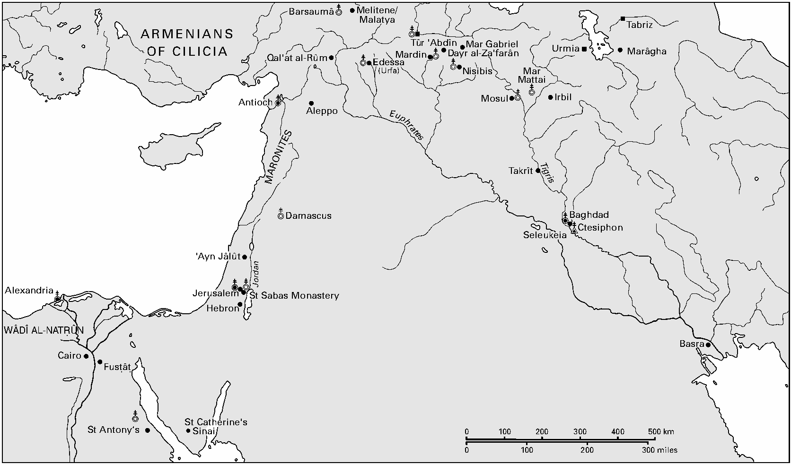

<!-- PDF page 394; original page 373 -->

# 第16章 东方基督教诸形态（11—14世纪）：科普特人、麦勒凯派、涅斯托里乌斯派与雅各派

弗朗索瓦兹·米绍

科普特、麦勒凯、涅斯托里乌斯及雅各派共同体，具有鲜明特征，有别于本卷研究的其他正教会。首先，而且绝非最不重要的一点，是它们建立于穆斯林而非基督徒统治的国家。这与拜占庭帝国、北方亚美尼亚及格鲁吉亚诸王国，或南方努比亚及埃塞俄比亚的情况，完全不同。其后果之一，是法律上较低的地位，阿拉伯语称为“齐米制”（dhimma）。它保障共同体成员的人身与财产受到保护，但在其他方面加以歧视。然而，他们的社会地位不能仅归结为法律身份，因为因时间、地点、社会环境及统治王朝不同，情况显著变化。伊斯兰教最初数世纪，基督教原是阿拉伯征服多数地区的主导信仰，仍占人口多数；但到11世纪，已不再如此。其逐步衰落，形成以重新确认身份为特点的新文化取向；依具体情形，可能需要适应伊斯兰教，或与外国势力结盟。[^p394-1]

这些基督徒共同体的另一特征，是其多样异质性，因为任何穆斯林政权，都没有充分理由，强令他们服从某一种而非另一种教会权威。

<!-- PDF page 395; original page 374 -->

*地图5 东方诸教会。原图以千米及英里标示比例尺。*

| 原图标注 | 中文 |
| --- | --- |
| ARMENIANS OF CILICIA | 奇里乞亚的亚美尼亚人 |
| MARONITES | 马龙派 |
| Barsaumâ | 巴尔萨乌马修道院 |
| Melitene / Malatya | 梅利泰内／马拉蒂亚 |
| Qal’at al-Rûm | 鲁姆堡 |
| Tûr ‘Abdîn | 图尔阿卜丁 |
| Mardin | 马尔丁 |
| Mar Gabriel | 马尔·加百列修道院 |
| Dayr al-Za‘farân | 扎法兰修道院 |
| Edessa (Urfa) | 埃德萨（乌尔法） |
| Nisibis | 尼西比斯 |
| Mar Mattai | 马尔·马泰修道院 |
| Urmia | 乌尔米耶 |
| Marâgha | 马拉盖 |
| Tabriz | 大不里士 |
| Antioch | 安提阿 |
| Aleppo | 阿勒颇 |
| Mosul | 摩苏尔 |
| Irbil | 埃尔比勒 |
| Takrît | 提克里特 |
| Damascus | 大马士革 |
| Baghdad | 巴格达 |
| Seleukeia | 塞琉西亚 |
| Ctesiphon | 泰西封 |
| ‘Ayn Jâlût | 艾因贾鲁特 |
| Jerusalem | 耶路撒冷 |
| St Sabas Monastery | 圣萨巴修道院 |
| Hebron | 希伯仑 |
| Alexandria | 亚历山大 |
| Wâdî al-Naṭrûn | 纳特伦谷 |
| Cairo | 开罗 |
| Fusṭâṭ | 福斯塔特 |
| St Antony’s | 圣安东尼修道院 |
| St Catherine’s, Sinai | 西奈山圣凯瑟琳修道院 |
| Basra | 巴士拉 |
| Euphrates | 幼发拉底河 |
| Tigris | 底格里斯河 |
| Jordan | 约旦河 |

<!-- PDF page 396; original page 375 -->

几个共同体聚集于同一地点，并不罕见，但这往往成为冲突及软弱的根源，而非力量。这些分裂可追溯至5世纪基督论争议，东方教会因此分成三种不同归属。为方便起见，通常称为迦克墩派，即接受451年迦克墩会议者，以及不接受会议的一性论派和涅斯托里乌斯派。由此出现的独立、相互竞争的主教体系，常以某一特定地区为重心，但并不意味着能够消灭对手。伊斯兰地区基督徒共同体的历史，通常以这些不同教会为焦点。[^p396-2] 本章将先简述其历史地理，但主要目的，是把它们作为一个整体现象，研究主要特征与发展；当然，也不会忽略各教派独特之处。

## 教会地理

一种一性论教会，即今天通常所称科普特教会，[^p396-3] 是伊斯兰统治下埃及基督教的主导力量。它围绕亚历山大牧首座组织，具有强烈埃及身份。从8世纪起，牧首经常居住穆斯林埃及首都福斯塔特。随后两个世纪，他们离开已失去安全及声望的亚历山大。不在福斯塔特时，宁可居住三角洲不同城镇，或沙漠修道院。牧首住所从亚历山大最终转往开罗，发生于基里尔二世任期（1078—1092年），而非通常所说其前任克里斯托杜洛斯时期（1047—1077年）。这一步与其说出于牧首希望靠近权力中心，不如说是大维齐尔巴德尔·贾马利强力中央集权政策的结果；他坚持牧首定居首都。[^p396-4] 但牧首仍继续在亚历山大及福斯塔特两地接受祝圣。

<!-- PDF page 397; original page 376 -->

969年，埃及归于新王朝法蒂玛王朝统治，其君主自称阿里与法蒂玛的后裔，以什叶派伊斯玛仪支派的教义为合法性基础，因而与坚持逊尼派教义的巴格达阿拔斯王朝竞争。他们对基督徒大体友好，或许是对自身在埃及处境的回应：他们是占压倒多数的逊尼派人口中的少数。另一考量，是必须与拜占庭及西欧基督教势力保持良好关系。例外是法蒂玛哈里发哈基姆于1004—1013年实行的迫害，[^p397-5] 包括落实服饰规定、禁止公开庆祝基督教庆节、没收教堂与修道院财产、毁坏圣墓教堂（1009年），以及撤除基督徒和犹太官员。但人们常忘记，哈基姆在统治末期撤销这些措施：归还没收财产，准许重建教堂，甚至允许受胁迫改信伊斯兰教者重返基督教。这使科普特人恢复短暂失去的优越地位，尤其在行政领域，他们担任许多职位及高职。

科普特人融入一个明确阿拉伯化的埃及，不可避免地导致阿拉伯化；[^p397-6] 科普特教会纯属埃及的性质，无疑使过程更容易。13世纪一位科普特高级教士宣称：“愿上帝——赞美归于祂——使他们的苏丹得胜，他也是我们的苏丹；使他们的伊玛目得胜，他也是我们的牧者。”[^p397-7] 这些话显示，至少精英对于苏丹主持的共同体，确有忠诚。

接下来讨论麦勒凯教会。“麦勒凯”意为王室或帝国，用以称呼忠于迦克墩信经的人；该信经由<!-- PDF page 398; original page 377 -->君士坦丁堡诸皇帝采纳。在埃及，它有自己的亚历山大牧首，但追随者始终不多，主要限于亚历山大及三角洲。相比之下，在叙利亚，[^p398-8] 尤其巴勒斯坦，它更具力量。麦勒凯派拥有耶路撒冷牧首座，这是唯一没有双重主教体系的牧首区。在叙利亚中部及北部，969年拜占庭再征服强化其地位，安提阿及周边地区受拜占庭统治一个多世纪。但与之对立的，是后来所称雅各派，即其一性论竞争者。

雅各派教会得名于创立者、6世纪埃德萨主教雅各·巴拉代乌斯，自设安提阿牧首座。它在叙利亚北部尤其强大，但10世纪失去许多信徒，改信伊斯兰教；拜占庭再征服后，又流失至麦勒凯派。重心遂东移至贾齐拉，[^p398-9] 即上美索不达米亚。主要机构，是梅利泰内／马拉蒂亚附近的巴尔萨乌马修道院、马尔丁附近的扎法兰修道院，以及摩苏尔附近的马尔·马泰修道院。虽然仍有雅各派“安提阿及叙利亚牧首”，自9世纪起，担任此衔者却宁愿住在叙利亚北部不同修道院。拜占庭再征服以后，多处成为牧首居所，尤其12世纪的巴尔萨乌马修道院及13世纪的鲁姆堡。

也不可忘记马龙派教会。其早期发展所知很少，直到十字军时代才进入历史记载。依当地传统，它得名于7世纪末成为牧首的修士约翰·马龙。他追随基督一志论异端，[^p398-10] 尽管16世纪起，马龙派一直宣称自身“一贯正统”。马龙派牧首原居阿帕米亚，11世纪逃至黎巴嫩山区，那里成为马龙教会中心。

最后还有一个地区须考虑，即涅斯托里乌斯派占优势的美索不达米亚。他们追随君士坦丁堡牧首涅斯托里乌斯的教导，后者在第一次以弗所会议<!-- PDF page 399; original page 378 -->（431年），因偏重基督人性而受谴责。波斯教会于486年接受涅斯托里乌斯派信仰，在居于塞琉西亚的牧首领导下，确立独立。面对拜占庭敌意，大多数叙利亚涅斯托里乌斯派定居波斯帝国。阿拉伯征服后，他们在阿拔斯王朝迎来光荣时期：有些担任行政高职，或任秘书、医生，备受尊重。780年，其教会总主教[^p399-11] 提摩太一世，把住所从泰西封迁至巴格达。该教会的语言文化属叙利亚语传统，即使在巴格达，尤其在北美索不达米亚，也与同属叙利亚传统的雅各派竞争。有些现代作者，如菲耶神父，把东叙利亚人，即涅斯托里乌斯派，与西叙利亚人，即雅各派区分。12世纪，负责东方领土——原萨珊帝国境内地区——的雅各派都主教，采用“玛弗里安”（maphrian）头衔，在提克里特设座，引发教堂被劫掠、没收。[^p399-12] 12世纪中叶，玛弗里安迁至摩苏尔附近马尔·马泰修道院；摩苏尔自1127年起，是一个自治公国的首都。当地雅各派及涅斯托里乌斯派共同体，享有稳定繁荣时期；最显著证据，是他们对镶嵌金属器艺术发展的贡献。[^p399-13]

涅斯托里乌斯派教会，分“内地”与“外部”诸省。前者涵盖美索不达米亚的尼西比斯、巴士拉、埃尔比勒及摩苏尔，以及伊朗边缘；后者对应“东方”，即伊朗东部、阿拉伯、中央亚洲、中国、印度及印度尼西亚沿岸。这些地方在5至8世纪密集传教活动下，建立涅斯托里乌斯派教会。11世纪末，基督教在伊朗虽全面退却，更东方的共同体仍存在，并激起13世纪发现“东方”的西方人兴趣；但其历史不属本章范围。

每个教会都在牧首领导下自治。科普特教会也称其为教宗，涅斯托里乌斯派则称教会总主教。牧首名录很早已建立，近来研究虽略有补充修正。牧首由选举产生，未来牧首由一个会议选出，其组成<!-- PDF page 400; original page 379 -->随教会及时代而不同，但包括主教与院长，有时还有司祭、修士，甚至有影响的平信徒。也必须得到穆斯林统治当局确认。[^p400-14] 然后才能隆重祝圣新牧首。阅读各教会编年史便知，这一过程引起候选人激烈争执，诉诸买卖圣职、宗族仇争、政治内斗，以及穆斯林统治者的斡旋。撇开个人野心，职位竞争常揭示不同基督徒共同体内部的深层分歧，也揭示教会组织植根于人际关系及“有权势者”的影响。

这里只举两个例子。第一个是科普特教会，约翰六世于1216年去世后，牧首座空缺近二十年。[^p400-15] 埃及基督徒实际上分为两派。第一派支持法尤姆出身的司祭达乌德，他最终于1235年登上牧首座，成为基里尔三世。他务实看待教会与权力、财富的关系，获基督徒官员广泛支持。反对者支持一系列候选人，尤其一位以苦修著名、采取更强硬而不妥协立场的修士。斗争集中于开罗分成的两个城市：达乌德支持者在法蒂玛王朝建立、政治精英居住的城市中心卡希拉最强；对手则集中在旧城福斯塔特，那里有古老而受尊崇的穆阿拉卡教堂。事件曲折多变，显示双方都争取当时阿尤布苏丹卡米勒授予珍贵的任命文书，且毫不犹豫许诺巨款。达乌德支持者最终为其任命支付两千第纳尔。卡米勒则不愿任命尚未获基督徒共同体充分支持的候选人，竭力公正调停。现代历史学家不免感到，这种危机只能削弱科普特教会、损害其声望；而此时，第五次十字军士兵已攻取达米埃塔，正向开罗进军。

<!-- PDF page 401; original page 380 -->

1252—1263年雅各派教会分裂，是牧首座冲突的第二个例子。[^p401-16] 伊格纳提奥斯二世去世后，出现两位竞争牧首：梅利泰内／马拉蒂亚都主教狄奥尼修斯，以及玛弗里安巴尔·马达尼。前者1252年在巴尔萨乌马修道院，由“西部”诸省，即幼发拉底河上游以西诸省的主教组成的小型会议选出；后者稍后在阿勒颇，由“东部”诸省，即图尔阿卜丁及底格里斯河上游流域的主教选出。数年中，两位牧首都企图统领整个教会，许诺大笔款项，寻求穆斯林当局支持，无论是科尼亚塞尔柱人，还是大马士革阿尤布王朝。蒙古人出现，使事情更复杂，却也矛盾地带来解决。这远非雅各派东西两极唯一的分裂；其历史中，地方考虑常优先于任何统一感。但除此之外，狄奥尼修斯不懂阿拉伯语，仿佛象征一个依赖自身宗教文化传统、不善适应当时政治现实的教会：它敌视其前任伊格纳提奥斯二世启动的亲近拉丁教徒政策，并视蒙古人为反伊斯兰盟友。相反，巴尔·马达尼得到基督徒精英支持；这些人欢迎融入社会，出入权力中心，担任行政官与医生，宁愿在蒙古人到来前逃走。

## 齐美地位及其施行

伊斯兰地区基督徒共同体适用的齐米地位，广为人知。它可追溯至7与8世纪阿拉伯征服，其大体轮廓在8与9世纪法学著作中确立。[^p401-17] 它给予“有经人”，即犹太人及基督徒，穆斯林统治权力的保护、敬拜自由、教会、共同体及司法组织的延续，以及财产权与贸易自由。作为交换，<!-- PDF page 402; original page 381 -->齐米必须承认伊斯兰的政治主权，尊重穆斯林，不炫耀地庆祝宗教仪式，穿特定服饰，最后还须缴纳称为吉兹亚的人头税。有些当代作者认为，这证明穆斯林具有显著宽容；另一些则谴责它压迫非穆斯林。但毫无疑问，它一方面提供安全与自治，另一方面也规定法律上的低等地位；其施行随地区、时代、统治者与社会环境而不同。

总体趋势相当清楚。本章讨论的11至14世纪，齐米地位施行更严，齐米物质处境恶化，背后是伊斯兰内部的一般发展。正如1054年分裂对正教有重大象征意义，1055年同样标志伊斯兰历史重要断裂：该年，塞尔柱领袖图格里勒·贝格进入巴格达，终结了围绕哈里发统一泛伊斯兰共同体的梦想。伊拉克与伊朗塞尔柱人，及其后各种军事王朝，先在叙利亚，后随萨拉丁进入埃及，发展权力合法性及行使的新模式，以捍卫逊尼派伊斯兰为核心。基督教在人口、文化及社会影响日渐减弱，伊斯兰成为社会规范，意味着严格施行穆斯林法律及齐米地位。值得注意的是，所谓《欧麦尔条约》最早版本，恰好出于12世纪；确立齐米地位时，它被视为权威。[^p402-18]

萨拉丁苏丹（1171—1193年在位）的政策，颇具启发。他恢复看来已废弛的措施，例如要求基督徒佩黄色腰带，禁止骑马或骡，要求宗教仪式与建筑表现应有谦抑，包括拆除教堂外部十字架。统治者这种严格态度，可能鼓励针对基督徒的进一步行动。为防止此事，萨拉丁提醒阿勒颇居民，少数群体尊重穆斯林法律，便可期待保护。他告知他们：“我们命齐米穿上与穆斯林有别的特殊服饰后……听说，有些心怀仇恨的暴徒群伙攻击<!-- PDF page 403; original page 382 -->齐米，以言语及可憎行为，侵犯他们依据齐米契约享有的权利。我们强烈反对，并禁止煽动或实施这类事情。”[^p403-19]

除伊斯兰地区内部特有发展，另有两个外来因素，共同削弱基督徒共同体的地位：十字军东征与蒙古征服。

## 十字军东征与东方基督教的处境

1095年11月，教皇乌尔班二世致佛兰德人的动员书（excitatorium），先概述土耳其人征服耶路撒冷及基督徒苦难，再以如下话语呼吁：“听闻灾难消息，我们因应有的关切而深感痛苦，遂到法国，恳求该地多数王公及臣民，解放东方诸教会。”[^p403-20] 除哈基姆摧毁圣墓教堂外，基督教宣传也诉诸土耳其征服对基督徒造成的严重后果。但正如克洛德·卡昂权威论证，[^p403-21] 土耳其人统治叙利亚后，很快恢复秩序，并未显著改变非穆斯林处境，也未阻止赴耶路撒冷朝圣。一位科普特史家的观察，可为佐证：

> 乌古斯人〔即土库曼人〕占领了受保护的耶路撒冷城。他们原先否认圣光在圣复活教堂尊贵圣墓上降临，但得知每年降光的真相后，就善待城内基督徒。他们任用一位名为曼苏尔·巴勒拜伊、爱基督的雅各派基督徒管理当地。其妻也与他同道。他帮助每一位来自埃及及其他国家、抵达耶路撒冷的基督徒，并努力重建耶路撒冷雅各派正统教会的教堂。[^p403-22]

<!-- PDF page 404; original page 383 -->

十字军到来，打乱近东政治与宗教平衡，随着时间推移，对东方基督徒不利，马龙派及或许亚美尼亚人除外。在新建十字军国家，法兰克人——按定义即忠于罗马的拉丁教徒——对本土基督徒强加权威，如同对穆斯林一样。实际上，基督徒处境因所属共同体而异。麦勒凯派失去更多，不仅因为他们在拉丁诸国人数最多，也因被视为亲近拜占庭。征服安提阿及耶路撒冷后，十字军设拉丁牧首，驱逐原有麦勒凯牧首，迫其逃往君士坦丁堡。多数主教也遭同样命运，借口是一个身体不能有两个头。麦勒凯派如今从属于拉丁主教体系，但后者不坚持拉丁礼。因此，阿卡主教维特里的雅克（1216—1229年在任）惊恐发现，教区希腊基督徒有已婚司祭，圣餐礼用有酵饼，把傅膏礼并入婴儿洗礼，并在《尼西亚信经》中省略“和子句”。[^p404-23] 12世纪，耶路撒冷王国麦勒凯派与拉丁教徒关系略有改善。安提阿公国关系更紧张，因为还牵涉历代拜占庭皇帝的政治冲突；皇帝始终未放弃安提阿及奥龙特斯河谷的主张。他们拒绝承认安提阿拉丁牧首，转而支持流亡君士坦丁堡的另一系正教牧首。

相反，其他教会保留自身主教体系，因为牧首座及多数成员都在拉丁诸国境外。拉丁诸国内，雅各派保有宗教自治及敬拜场所。雅各派安提阿牧首叙利亚人米海尔（1166—1199年在任）写道：

> 占领安提阿及耶路撒冷的法兰克人，在其国家中有……主教。我们教会的领袖生活于其间，不受迫害或骚扰。因为，法兰克人虽在二性问题上同意希腊人，却在数项信仰问题上仍与之不同，习俗也十分有别……〔他们〕从不在信仰问题上制造困难，也不试图对各种语言的

<!-- PDF page 405; original page 384 -->

> 基督徒强加单一惯例。他们不进一步询问或考察，只要谁敬礼十字架，就满足于视其为基督徒。[^p405-24]

总体而言，雅各派对十字军的态度随情况变化：有时冷漠，有时现实而和解，甚至因共同敌视麦勒凯派而友好；但有时也敌对，如1148年十字军洗劫巴尔萨乌马大修道院时。

美索不达米亚及埃及基督徒共同体，距拉丁教徒较远，受拉丁国家建立的直接影响较小。但科普特人强烈反对第一次十字军。前面已见，《亚历山大牧首史》作者喜见土耳其征服后，耶路撒冷恢复和平秩序；数页之后，却这样写：

> 他们〔法兰克人〕在太阴历492年赖买丹月，占据尊贵的耶路撒冷城及周边。我们这个基督徒共同体，雅各派、科普特人，没有前往朝圣，也无法接近，因为众所周知，他们憎恨我们，对我们抱错误信念，并指控我们不虔敬。[^p405-25]

藉十字军东征，拉丁教会更了解这些东方教会，试图说服其领袖，无论牧首或教会总主教，接受罗马首席权、认同同一信仰宣认，同时尊重各自仪式，以实现教会合一。[^p405-26] 这一策略始于12世纪，13世纪得益于道明会及方济各会传教而充分发展。1237年，雅各派牧首伊格纳提奥斯二世访问耶路撒冷，受道明会友好接待后，庄严宣誓服从罗马圣座，并提供阿拉伯文及叙利亚文写成的正统信仰宣认。当时也在耶路撒冷的科普特及涅斯托里乌斯派总主教，随后效法。教皇格里高利九世致函祝贺。1246年，教皇使节隆朱莫的安德烈来访，伊格纳提奥斯再次表示归顺，同时寻求罗马保证尊重其教会自治。但这些服从声明，被认为纯属个人行动，并不适用<!-- PDF page 406; original page 385 -->于整个教会。1252年伊格纳提奥斯二世去世、随后发生分裂、[^p406-27] 蒙古风暴，以及最终1291年十字军国家覆灭，都使这种接近没有结果。

罗马与涅斯托里乌斯派也有接触。最重要的是教会总主教雅巴拉哈三世时期（1281—1317年）的接触，属于教皇与波斯伊儿汗交流的一部分。[^p406-28] 但同样没有长期后果，因为涅斯托里乌斯派仍依恋其信仰、传统与仪式。亚美尼亚人暂且不谈，[^p406-29] 这种合一政策只有在马龙派取得具体成果；他们于1182年归顺罗马，放弃基督一志论异端，尽管内部强烈反对。1215年，马龙派牧首参加第四次拉特兰会议，教皇英诺森三世向其颁布《因神圣智慧》（Quia divinae sapientiae）诏书，确认合一，并保证马龙派主教体系及仪式继续存在。

教皇支持的十字军，使一种进取的基督教形式出现在近东，决定性改变穆斯林对基督徒的态度。[^p406-30] 法律地位未受影响，因为穆斯林宗教及政治当局，明确区分住在伊斯兰地区、称为naṣrânî的基督徒，与统称法兰克人（Ifranj）的十字军。前者享齐米地位，后者来自国外，夺取穆斯林领土，因此是可正当作战的异教敌人。但虔诚人士及叙利亚、埃及统治者，呼吁对法兰克人发动圣战时，却用“基督教多神论者不虔敬、其存在玷污耶路撒冷”的语言。这些指控反过来打击本土基督徒。路易·普泽研究13世纪大马士革宗教生活时，显示这一点：如今，kuffâr，即“不信者”，也被用于该城基督徒，辱骂他们为十字架崇拜者。[^p406-31]

<!-- PDF page 407; original page 386 -->

针对基督徒的报复虽属例外，却更能显示十字军造成的猜疑气氛。1123年，埃德萨亲王库尔特奈的若斯兰围攻阿勒颇、劫掠周边，卡迪法官与共同体领袖拉伊斯，坚持让城内基督徒自费修复被法兰克人亵渎的穆斯林墓地及敬拜场所。城中两位主教，一位麦勒凯派、一位雅各派，不愿与法兰克人混为一谈，拒绝赔补。卡迪遂把城内六座教堂中的四座改为清真寺，逐出主教。

13世纪十字军主要针对埃及，对科普特人后果尤其严重。1218—1219年，第五次十字军围攻达米埃塔时，穆斯林当局向埃及科普特人征收沉重额外税赋；他们也成为暴民暴力的对象，是集体恐惧的替罪羊。亚历山大圣马可教堂被毁，借口是可能成为敌人辨认方向的地标。1240年代，卡迪奥斯曼·纳布卢西，厌恶行政机构中科普特人的数量，激烈撰文谴责其恶行。[^p407-32] 但13世纪中叶蒙古人出现，将进一步加剧十字军促成的猜疑气氛。

## 蒙古征服的后果

1206年忽里勒台上，蒙古首领承认成吉思汗为大汗或最高领袖。此后，蒙古展开一系列征服，统治从中国到欧洲门户的庞大帝国。在近东，征服伊拉克、1258年巴格达陷落及末代阿拔斯哈里发被杀、1260年入侵叙利亚，以及成吉思汗之孙旭烈兀建立伊朗伊儿汗国，深刻改变宗教政治局面。东方基督徒乐于与入侵者结盟，蒙古人也偏爱基督徒。成吉思汗一项规定，坚持所有宗教地位平等，确立尊重一切宗教领袖的原则。此外，涅斯托里乌斯派基督教早在内亚存在数世纪，尤其在克烈部，其影响通过大汗的基督徒妻子，以及<!-- PDF page 408; original page 387 -->涅斯托里乌斯派显贵进入蒙古宫廷，例如为大汗窝阔台及继任者任医生、秘书的西缅。

蒙古征服伴随惊人屠杀，但军队往往放过基督徒及其财产。例如，涅斯托里乌斯派免遭巴格达洗劫。叙利亚许多基督徒欢迎蒙古人，另有一些则宁愿逃亡或抵抗。1260年3月，旭烈兀麾下涅斯托里乌斯派大将怯的不花，左右由亚美尼亚国王赫图姆及安提阿亲王博希蒙德六世陪同，凯旋进入大马士革；城内基督徒欢呼欢迎，并于8月取得旭烈兀敕令后，组织反穆斯林示威，敕令准各宗教共同体公开实践宗教。[^p408-33] 不久之后，1260年5月，一位叙利亚画家改变《举扬十字架》的圣像图式，把君士坦丁与海伦娜，画成旭烈兀及其涅斯托里乌斯派妻子脱古思可敦的面貌。[^p408-34] 〔译注：原文先述8月，继称“不久之后，5月”，本段日期及次序照录。〕基督徒毫不掩饰的欢喜，很快招来残酷报复：马穆鲁克于1260年9月在艾因贾鲁特获胜，收复叙利亚城市。这一次，怀疑他们与蒙古敌人勾结，确有根据。

1258年阿拔斯哈里发国覆灭后，是蒙古统治下伊朗与美索不达米亚基督徒共同体的有利时期。教堂兴建，基督徒甚至免交人头税。1281年，一位来自内蒙古、叙利亚语掌握不佳的修士，成为涅斯托里乌斯派牧首雅巴拉哈三世（1281—1317年在任）。他在伊儿汗首都马拉盖着手建造大型修道院。其任期标志涅斯托里乌斯派基督教的顶峰：获益于蒙古统合亚洲，它共有三十个教省及二百五十个主教区。但基督徒也是反蒙古骚乱的受害者，如1262年的摩苏尔及1268年的巴格达。1295年伊儿汗合赞改信伊斯兰教后，其处境恶化，齐米规定重新生效，恢复服饰限制，取消免税。1296年大不里士及1310年埃尔比勒教堂被毁。14世纪，涅斯托里乌斯派基督教从伊朗，以及伊拉克南部和<!-- PDF page 409; original page 388 -->中部消失，退至摩苏尔周围的上美索不达米亚；教会总主教放弃巴格达，在这里定居。

埃及于1250年、叙利亚于1260年，归马穆鲁克苏丹统治。其军事政权以抵御十字军及蒙古人、捍卫伊斯兰的能力为合法性基础，表现为双重圣战。指控基督徒与这些伊斯兰敌人勾结，成为反齐米宣传的常调。例如，1265年拜巴尔斯苏丹进攻十字军要塞凯撒利亚及阿尔苏夫时，开罗接连发生火灾，人们立即认定是当地基督徒报复。叙利亚征服法兰克领土时，出现民众攻击基督徒，例如1262年拿撒勒圣母领报教堂被毁，以及1268年安提阿陷落后的基督徒屠杀。即使埃及，民众攻击也日增，受到讲道者偏执、乌里玛学者强硬，以及对蒙古侵略焦虑的鼓励。但敌意背后，是穆斯林反对基督徒秘书在行政中行使影响；这是反基督教论战的常见指控。[^p409-35] 这一社会层面尤其值得强调。[^p409-36] 1301年，盖拉温苏丹重颁一项曾数度施行、又总被撤销的法令，把犹太人及基督徒排除出公职，同时严格执行齐米歧视措施。此外，他关闭开罗教堂，并毁掉其中数座；某些犹太会堂也遭同样命运。拜占庭皇帝及阿拉贡国王干预后，才说服苏丹重开教堂、撤销措施。值得注意，此时只有外界干预，才能改善当地基督徒处境，却未能阻止1320年及1354年类似危机再现。反基督徒事件的数量与暴力，造成恐惧气氛，直接引起大量改信伊斯兰教。这又促使14世纪出现的新群体扩大，其成员称为musâlima，即“伊斯兰化者”，并在当时传记辞典中被如此<!-- PDF page 410; original page 389 -->标识。他们常被怀疑只是名义穆斯林，因压力而改宗。[^p410-37] 科普特共同体虽大为缩减、更趋内向，在某些地区仍重要，并继续积极参与埃及社会。

## 阿拉伯化与阿拉伯基督教的兴起

伊斯兰地区基督徒共同体此后的发展，有一个共同特征，即阿拉伯化：不只采用阿拉伯语为日常语言，也用作文学及礼仪语言，进而形成真正的阿拉伯基督教。1031年，拜占庭兼并埃德萨，一些雅各派与其他“阿拉伯人”离城，因为依叙利亚人米海尔之言，“他们在语言及文字上，接近阿拉伯人”。[^p410-38] 基督教与阿拉伯语联系古老而复杂，基督徒参与阿拉伯文字、语言及文化的发展。[^p410-39] 8世纪之交，出现最早阿拉伯语《圣经》译本。到本章时期，基督徒共同体大体、却未完全阿拉伯化；这取决于原有语言、地区、教会传统及社会环境等因素。

阿拉伯征服时埃及的书写及口语科普特语，逐渐让位于阿拉伯语，各种科普特方言[^p410-40] 被阿拉伯语方言取代。程度之深，使11世纪《亚历山大牧首史》编者决定把牧首传从科普特语译成阿拉伯语，理由是：“今日阿拉伯语是埃及人民懂得的语言……他们多数不懂科普特语及希腊语。”[^p410-41] 但科普特语并未完全从口语中消失。12世纪科普特作者阿布·马卡里姆的著作，提供有趣线索：他写到一个<!-- PDF page 411; original page 390 -->穆斯林及基督徒都说科普特语的村庄，也讲述一位改信基督教的犹太人，同化到会说科普特语的故事。[^p411-42] 作为文学语言，科普特语已成死语言，11世纪之后没有作品以其写成。保存遗产的愿望，使13与14世纪重新关注科普特语，产生二十余部以阿拉伯语撰写、使用阿拉伯术语的科普特语语法，以及阿拉伯—科普特语辞典；有些依阿拉伯辞书学经典字母顺序排列。A. 西达鲁斯研究这些作品，[^p411-43] 指出13世纪主要讨论博海里方言，14世纪则为萨希德方言，反映科普特人口集中于中埃及。阿拉伯语最终胜利，确认了自法蒂玛时期开始，一个真正阿拉伯埃及的形成；科普特人强烈认同它，同时保留宗教个性。[^p411-44]

希腊语的情况则不同。阿拉伯征服埃及与叙利亚时，它是主要由麦勒凯派使用的礼仪及文学语言；他们在埃及说各种科普特方言，在叙利亚及巴勒斯坦说阿拉姆语方言。希腊语很快让位阿拉伯语，因此到9世纪，至少穆斯林领土内，麦勒凯学者几乎不再用希腊语写作。969年拜占庭再征服的叙利亚北部，希腊语文学活动复兴。例如，君士坦丁堡所立安提阿麦勒凯牧首，以希腊语写作。矛盾的是，正是在拜占庭支持下，安提阿成为把圣经、教父及文学文本从希腊语译为阿拉伯语的重要中心。这促进麦勒凯礼仪的阿拉伯化，并进一步产生后果，因为使礼仪语言适应日常语言需要，是麦勒凯教会的特点。[^p411-45]

<!-- PDF page 412; original page 391 -->

叙利亚语及各种阿拉姆语方言的发展史，更加复杂而难以确立。[^p412-46] 叙利亚、美索不达米亚原说阿拉姆语的人口，逐渐采用阿拉伯语为日常语言。20世纪，阿拉姆语只在少数孤立地区继续使用：库尔德山区、图尔阿卜丁、乌尔米耶周围、摩苏尔平原，[^p412-47] 以及大马士革以北少数村庄，尤其马卢拉。但十字军时代，说叙利亚语者，即与雅各派及涅斯托里乌斯派教会相联的人，远为众多。前面已提到，1252年争取牧首座的梅利泰内都主教狄奥尼修斯，完全不懂阿拉伯语；到大马士革阿尤布苏丹面前申辩时，必须借助译员。[^p412-48]

不同于科普特语及希腊语，叙利亚语不只继续作为文学语言；传统上，13世纪被记作叙利亚语文学的黄金时代。[^p412-49] 直到14世纪，才让位于阿拉伯语。其文学成就广为人知，却常被孤立研究，忽略时代背景。了解同一作者为何交替使用阿拉伯语及叙利亚语，尤其有价值。好例子是巴尔·希伯来，阿拉伯语名阿布·法拉杰·伊本·伊卜里，1264—1286年任东部雅各派教会玛弗里安，留下庞大著作群；依其弟所列名录，共三十一部，涵盖历史、神学、哲学、医学、天文学、语法及文学。[^p412-50] 这种写作符合一位高级教士的关切：慰藉叙利亚语共同体，丰富知识遗产，保存其近东地位。巴尔·希伯来主要用叙利亚语写作，或把哲学、医学论著从阿拉伯语译为叙利亚语，也使用阿拉伯语，直接创作，或为某些叙利亚语作品编阿拉伯语版本。例如，其史学著作，一方面包括叙利亚语普世编年史，分世俗史及教会史两部分；另一方面，是阿拉伯语简编普世编年史。近来研究<!-- PDF page 413; original page 392 -->显示，两部编年史相互独立，依据不同史学传统：前者为基督教及叙利亚语传统，后者为阿拉伯传统。读者也不同：前者面向深浸圣经文化的雅各派高级教士，后者面向语言及文化已阿拉伯化的基督徒共同体。[^p413-51]

## 文学活动

本章篇幅不容穷尽基督徒学者用阿拉伯语、叙利亚语从事的写作，因为体裁与作品都数量众多、种类丰富。阿拉伯语作品，可从格拉夫的参考书，[^p413-52] 叙利亚语作品可从鲍姆施塔克的参考书，[^p413-53] 获得大量有价值资料。但严格而言，它们限于宗教文学，因而排除了基督徒对阿拉伯文化发展、尤其诗歌、哲学及科学的贡献。就基督教文学而言，科普特、麦勒凯、雅各派及涅斯托里乌斯派作者，经营所有通常体裁：神学大全、圣经注释、护教论、法律手册、讲道集及历史著作。

大型神学手册背后，是百科全书式动力，意在综合，而非提出新神学见解。一个好例子，是12世纪涅斯托里乌斯派马里·伊本·苏莱曼，以阿拉伯语编成的大全，取了悦耳的书名《塔楼之书》，把事业比作建筑。他为七章各取建筑性标题：基础、平面图、支柱等，最后以灌溉设施及园圃收尾。另一例是阿布·伊斯哈格·伊本·阿萨勒，约1260年编成的《宗教原理总集》（Kitâb Majmû‘ Uṣûl al-Dîn）。阿萨勒家族富裕而著名，为埃及行政机构提供多位科普特秘书。这部大全<!-- PDF page 414; original page 393 -->系统呈现基督教教义，以大段教父文字支持，也援引基督徒及穆斯林哲学家，特别采用拉齐的《四十论》（Kitâb al-Arba‘în）。[^p414-54] 同样的神学与哲学结合，再见于下个世纪阿布·巴拉卡特编成的著名百科全书《黑暗之灯》（Miṣbâḥ al-Ẓulma）。

本章时期，护教作品数量众多，却具有区别于早先数世纪的特点。[^p414-55] 论战与辩论等体裁，不如护教论发达；后者由基督徒作者解释、维护及证明教义，反驳穆斯林诋毁。他以圣经及理性论据，捍卫圣三一与神性统一、道成肉身及基督二性的教义。麦勒凯派拥有两位伟大护教家：11世纪，安提阿人阿卜杜拉·伊本·法德勒，著有许多捍卫基督教的作品，包括批评雅各派、涅斯托里乌斯派错误的《正教信仰的论证》。12世纪，安提阿修士、后来成为西顿主教的保罗·拉希卜，至少编成五部论著，针对异教哲学家、犹太人、穆斯林及其他基督教派。其同时代人、涅斯托里乌斯派都主教埃利亚斯·伊本·希纳亚，著书对穆斯林捍卫圣三一、对犹太人捍卫基督神性，并对麦勒凯及雅各派捍卫涅斯托里乌斯派强调的基督人性。显然，有些论著不仅对外捍卫基督教，也同样旨在证明某一教会优于另一教会。一部小论著是某种例外，名为《论信仰一致》（Kitâb ijtimâ‘ al-amâna）：11世纪作者阿里·伊本·达乌德·阿尔法迪，是除此之外无所知的雅各派，竭力证明各基督教派虽在表述基督奥秘时有差异，却共享同一信仰。[^p414-56]

神学大全与护教论著，都见证了穆斯林特有神学及哲学概念的影响。遗憾的是，现代研究往往过于局限于教会<!-- PDF page 415; original page 394 -->史，未能凸显这些“文化融入”实例，[^p415-57] 忽略基督徒神学家按穆斯林思想范畴呈现圣三一教义的例子。涅斯托里乌斯派阿卜杜拉·伊本·塔伊卜（卒于1043年）[^p415-58] 解释：“创造者的本质（dhât al-bâri’）为一，其属性（ṣifât）却为多。”在他看来，基督徒“称这本质为实体（jawhar），称属性为特性（khawâṣṣ）……也相信，上帝在其本质中具有知识（‘ilm）、能知（‘âlim）及所知（ma‘lûm）的属性……他们称知识的属性为父性，能知的属性为子性，所知的属性为发出”。他最后坚持，上帝“就本质而言为一，就属性而言为多”。基督徒作者看来竭力回应伊斯兰日增压力，抵御“以物配主”的指控，因为它使人面临不信者罪名。他们证明圣三一不损神的一体性，同时保持一定谨慎，避免直接攻击伊斯兰及其先知。

这也是雄心勃勃的法律手册时代。各教会保存自身法律与制度，教会当局因此在私法所有领域承担司法职能。法律汇编不仅包括处理教义的各大公会议及主教会议敕令，也涉及教会组织、教士修士和平信徒地位、礼仪秩序、圣事施行、学校修道院医院等机构，以及婚姻、血统、收养、遗嘱、继承、财产交易等私法、家庭法规定。重要汇编包括：11世纪阿卜杜拉·伊本·塔伊卜以阿拉伯语为涅斯托里乌斯派教会撰写的汇编；大约同时，尼西比斯的埃利亚斯以叙利亚语编成的同一教会法令；阿卜迪绍1318年写成的两部作品，即主教会议教规集及教会裁判规则，至本书撰写时，仍是涅斯托里乌斯派标准著作；最后，转至科普特教会，有两部《教会法规与民法汇编》。第一部由达米埃塔主教米海尔于12世纪编成，是最早不再随意、而按主题排列法律及裁决的手册<!-- PDF page 416; original page 395 -->之一。第二部出自伊本·阿萨勒，1238年问世，至本书撰写时，仍是科普特共同体私法领域的主要法典。

讲道集与赞美诗集，显然以礼仪用途为目的，是本时期另一种写作形式。教会偏好早期教父著名讲章，所以阿拉伯语讲道文学，最初以翻译出现。11世纪，安提阿麦勒凯执事阿卜杜拉·伊本·法德勒，把金口约翰多数讲章译为阿拉伯语。12世纪开始，出现以称为saj‘的押韵、富节奏阿拉伯散文写成的讲章，赞美诗则采用流行的rajaz诗律。涅斯托里乌斯派教会总主教埃利亚斯·伊本·哈迪西（1176—1190年在任），通常被视为此体裁的开创者。他以灿烂丰富、具有saj‘特征的阿拉伯语写讲章。用阿拉伯雄辩服务基督教的做法，在13世纪不同基督教派中引来许多仿效者。恰在此时，伊斯兰也发展讲道艺术（wa‘z）及讲道者（wu‘‘âz）的角色，难道纯属巧合？撇开分隔基督教与伊斯兰的教义分歧，考察相似文学形式及主题所显示的共同宗教情感，已成为重要任务。

基督徒众多历史著作，也对阿拉伯及穆斯林文化环境采取不同立场。严格而言，叙利亚语史学以叙利亚人米海尔及巴尔·希伯来的权威著作为主。[^p416-59] 依循上溯凯撒利亚的优西比乌之传统，他们并列两种普世史：世俗及教会。作品最明显地显示高级教士书写自身教会历史的关切：慰藉雅各派共同体，保存其近东地位。科普特及涅斯托里乌斯派也有自己的史学著作。12世纪，马里·伊本·苏莱曼在《塔楼之书》第五章，插入一部真正的涅斯托里乌斯派教会总主教座史。

科普特教会拥有宏伟的《亚历山大牧首史》。[^p416-60] 第一部分至1046年，汇编较古史料，传统上<!-- PDF page 417; original page 396 -->归于萨维鲁斯·伊本·穆格法（活跃于955—987年），实际上却出自晚一个世纪的马乌胡卜。第二部分涵盖1047—1216年，由各牧首同时代传记组成，资料十分充分。第三部分从1216年起，除基里尔三世（1216—1243年）的详细原创传记外，只包含一系列简短记事。

与这些彻底以自身教派为立场的历史不同，基督徒作者写成的许多阿拉伯语编年史，若非特别重视涉及基督徒的事件，几乎难与穆斯林作者区分。这些历史吸收了阿拉伯—穆斯林史学的主题及方法，大多出自科普特人，如麦金·伊本·阿米德[^p417-61] 及伊本·拉希卜，[^p417-62] 都在13世纪撰写普世史。前者在14世纪有穆法达勒·伊本·阿比·法达伊勒续作。[^p417-63] 同时，伊本·苏盖伊[^p417-64] 编纂传记辞典，是唯一这样做的基督徒作者。这些史家属于埃及有文化的城市精英。身为宗教少数群体，并未阻止他们采用统治阶层的词汇、思维模式及眼界。

科学，尤其医学，属于这种共同文化领域，宗教差异让位于共享知识的发展与传递。医学很大程度上由基督徒主导。在巴格达，有影响的基督徒医生服务哈里发的传统仍持续。例如，涅斯托里乌斯派医生兼司祭伊本·瓦西提，藉宫廷影响力，促成1092年任命一位牧首，以及1105年解除反基督徒措施；1132年去世前数日，他本人也当选牧首。另一位巴格达人物，是1165年去世的司祭兼医生伊本·提尔米兹。他深受同时代人欢迎，蒙哈里发宠信，主要贡献是培训新医生，许多人后来前往叙利亚及埃及。与犹太医生一起，还有许多<!-- PDF page 418; original page 397 -->涅斯托里乌斯派、麦勒凯及雅各派医生，奇怪的是科普特人很少。他们显然极好地融入穆斯林社会。[^p418-65] 基督徒医生收穆斯林学生，或相反，都很常见。成功个人的生涯，容易通过传记辞典追踪，但不应遮蔽医学与行政一样竞争激烈的事实。基督徒如今成为少数，藉从事社会认可的专长，试图在更可能把他们逐出权力中心及影响职位的社会中，保存优越地位。穆斯林时而批评基督徒医生，应视为剥夺齐米这一接近权力途径的尝试。例如，11世纪末，安萨里鼓励读者学医，因为他认为穆斯林较为忽视这一领域。许多小城镇的穆斯林，任由外来医者摆布，他觉得可叹；所谓外来者，指基督徒或犹太人。[^p418-66]

## 修道院的作用

修道生活及修道院，在东方基督教的宗教与知识生活中居核心地位，广为人知。修道院在埃及、巴勒斯坦、安提阿周围、上美索不达米亚图尔阿卜丁山区，以及伊拉克南部希拉周围，特别众多。7世纪阿拉伯征服后，仍保有重要性与活力，影响也不限于基督徒共同体。一种阿拉伯文学体裁《修道院之书》（Kitâb al-diyârât），可为见证：它以10世纪末沙布什提的作品尤其著名，[^p418-67] 属于穆斯林诗人访问基督教修道院时写作的诗歌选集，既生动见证修道院对基督徒及穆斯林的吸引，也见证其在10世纪阿拉伯文化中<!-- PDF page 419; original page 398 -->的地位。后来雅古特、阿布·马卡里姆、欧麦里及马格里齐等地理作者，抄录其中修道院描述，有时补充某处如今已是废墟，却从未系统进行。缺乏充分考古资料，使目前知识状况几乎不容建立11至14世纪修道院的满意名录，更谈不上判断其命运。

但总体发展脉络，争议不大。这一时期，大量修道院消失，是两项因素共同作用的结果：一方面，教会缩减，不仅修士减少，维持院舍的捐赠也减少；另一方面，许多地区遭战争、入侵及贝都因人勒索，受到破坏。个别修道院历史，往往是毁坏与劫掠的一长串记载；基督徒共同体资源不足，难以重建建筑、恢复经济生活，因此危害更大。当然，地区情况有异，有些地方比另一些保存较好。马丁神父杰出研究，使我们充分了解的中埃及，是一个好例子：尼罗河右岸古老修道院，比左岸保存好。右岸十六处古址中，十四处已被确认，六处仍是活跃宗教中心。左岸纸草记载的三十处中，二十二处完全消失，只有三处作为村庄教堂幸存。原因在于，左岸农业土地肥沃，人口大体伊斯兰化，首府阿什穆奈因甚至完全如此；陡峭右岸居民稀少，依作者结论，是“少数群体抵御穆斯林多数压力的避难处”。[^p419-68]

总体而言，城内或近郊修道院，似乎消失更快、数量更多。巴格达就是如此：塞尔柱时期史料提到仍有五座教堂活动，却无修道院。倭马亚时代，大马士革及周边有五所修道院，12世纪已消失。另一例，是摩苏尔著名“上修道院”（Dayr al-a‘la），<!-- PDF page 420; original page 399 -->9与10世纪曾居涅斯托里乌斯派教会中心；到13世纪，摩苏尔基督徒共同体虽仍强盛，它却降为普通教堂。开罗附近修道院也相似，例如首都以西数千米的纳希亚，曾供法蒂玛君主作宜人避暑地；1173年阿布·马卡里姆来访时，只余七位修士，正逐渐荒废。14世纪，马格里齐记载其已完全毁坏。

这些发展，使修道院作为社会交往及教育中心的重要性日减，主要成为保存东方基督教属灵文化价值的避难与朝圣处。以下用几所著名修道院说明。首先是巴尔萨乌马修道院，[^p420-69] 得名于5世纪苦修者巴尔萨乌马，却直到8世纪才进入历史记载。它近梅利泰内／马拉蒂亚，但位于托罗斯山脉深处偏远地区，有数百修士。巴尔萨乌马圣髑所行神迹，吸引大批人群；12世纪成为主要牧首居所之一。叙利亚人米海尔很可能在这里编纂编年史，随后是1232年匿名作者及巴尔·希伯来。1148年，它遭埃德萨亲王库尔特奈的若斯兰劫掠，1183年又毁于大火。叙利亚人米海尔负责重建，于1194年5月15日重新祝圣。它一直是雅各派中心，直到13世纪最后几年被毁。

查士丁尼皇帝在西奈山脚建立的圣凯瑟琳修道院，自9世纪起成为亚历山大圣凯瑟琳圣髑安置地。[^p420-70] 它成为热门朝圣目的地，包括西方朝圣者。图书馆极丰富，有约2300份希腊文手稿、600份阿拉伯文、270份叙利亚文、85份格鲁吉亚文及45份斯拉夫文。[^p420-71] 这不仅反映抄经室的重要，也反映其<!-- PDF page 421; original page 400 -->影响范围，因为许多手稿来自国外捐赠。例如，图书馆唯一拉丁文手稿，是9世纪《圣咏集》，几乎肯定出自北非，13世纪被带到修道院。

圣萨巴修道院，可追溯至同名圣徒：478年，他决定隐居于距耶路撒冷约15千米、汲沦峡谷的一处山洞。[^p421-72] 院舍建于峡谷边狭窄台地，至本书撰写时，仍住麦勒凯修士共同体。这里迅速成为重要写作中心，8世纪以大马士革的约翰为代表。圣萨巴及大马士革的约翰墓，吸引朝圣者，至少持续至13世纪；此时前者圣髑转至威尼斯，后者转至君士坦丁堡。修道院受到马穆鲁克苏丹拜巴尔斯压迫政策打击，之后地位下降，修士虽继续创作。[^p421-73] 约二百五十年前，丰富藏书大部毁于火，但近八百份手稿获救，19世纪转藏耶路撒冷牧首座。[^p421-74]

纳特伦谷沙漠地区，位于尼罗河三角洲西支以西，以及红海附近，建立了许多科普特修道院。我们择圣安东尼修道院讨论。它是由建筑、园圃组成的庞大群体，以长两千米围墙保护。最终摆脱纳特伦谷叙利亚修士影响后，在12及13世纪经历特别繁荣。1231—1306年该院制作、今存开罗的大量科普特手稿，证明存在优秀抄经室及丰富藏书，支持了13世纪知识复兴；著名科普特阿萨勒家族的活动，最能说明这一点。

抄经室工作有时与艺术活动相伴。例如，约1220年，摩苏尔附近马尔·马泰修道院抄成一部饰有五十二幅华丽细密画的福音书，今藏梵蒂冈图书馆；它是上美索不达米亚最古老的雅各派修道院<!-- PDF page 422; original page 401 -->之一，也是巴尔·希伯来安葬之处。此外，图尔阿卜丁扎法兰修道院，因黄墙而称“藏红花修道院”，藏书中保存两部13世纪华丽福音书；其插图比马尔·马泰福音书更显示强烈拜占庭影响。但叙利亚及科普特艺术，将走上截然不同的发展道路。

## 宗教生活

一篇名为《司祭的宴会》的讽刺短作，几乎可肯定出自基督徒医生伊本·布特兰（卒于1066年），[^p422-75] 为图尔阿卜丁叙利亚语教士生活提供宝贵线索。它模仿阿拉伯“玛卡梅”（Maqâmât，即“集会”）体裁，以优雅精致语言叙述主人公言行；叙述者描述马尔丁一位司祭家中举行的宴会。讽刺所谴责的缺点包括：利用职事赚钱，尤其葬礼及为亡者祈祷；不懂教会音乐；不善讲道，只满足于重炒金口约翰作品，而不创作雄辩新讲章。但它也显示，这些教士相对富裕，与穆斯林邻人关系良好，充分掌握阿拉伯语言文化。

礼仪举行主导宗教生活，依各教会历法规范，但地方庆节也很重要。它们把古代农业传统及地方记忆，与较严格的基督教内容混合，却不妨碍穆斯林参加。参与之多，以至矛盾地说，我们对庆节的知识，常只通过穆斯林史料传下。圣周四庆节就是如此，在埃及与叙利亚有多种名称：“扁豆周四”“米饭周四”，甚至“鸡蛋周四”。[^p422-76] 它吸收了<!-- PDF page 423; original page 402 -->标记春天重生的习俗：彩蛋、米饭或扁豆菜、为房舍及墓地焚香、给牲畜打烙印，以及晾晒衣物。14世纪，穆斯林学者马格里齐记载，“扁豆周四，至今仍是开罗最盛大庆节之一”。

但本章时期伊斯兰化加强，也往往意味着穆斯林接收基督教庆节与圣地。许多基督徒敬礼《旧约》先知或地方圣徒之处，融入严格意义上的穆斯林宗教结构。只举一例：巴赫纳萨基督教圣所，保存逃往埃及的记忆；13世纪初起，因兴建许多穆斯林圣者墓，日益伊斯兰化。[^p423-77] 阿勒颇苦修者哈拉维（卒于1215年）编成《朝圣地点指南》，[^p423-78] 把一系列原属基督教或犹太教的近东圣所视为穆斯林圣地。希伯仑与耶路撒冷“尊贵的双圣域”，[^p423-79] 是穆斯林接收最鲜明的例子。希伯仑圣所，犹太人及基督徒曾在此敬礼亚伯拉罕墓，数世纪中成为受欢迎的穆斯林圣地。1266年，马穆鲁克苏丹拜巴尔斯初次战胜法兰克人后，朝圣希伯仑，颁令禁止基督徒与犹太人进入；禁令持续至1967年以色列人占领该城。11至14世纪，耶路撒冷这座犹太人、基督徒与穆斯林共享圣城，经历动荡。970年起属法蒂玛统治，1073年归塞尔柱控制，1099年7月15日被十字军占领，近一个世纪为拉丁耶路撒冷王国首都；1187年10月2日落入萨拉丁之手，1229年回到皇帝腓特烈二世，1244年遭花剌子模人蹂躏，最终归埃及马穆鲁克。每个新政权都带来深刻宗教社会变化，反映于城市地形。最终，自马穆鲁克时期起，耶路撒冷转为以穆斯林为主的城市，[^p423-80] 尽管仍有<!-- PDF page 424; original page 403 -->重要犹太共同体；尽管包括拉丁教徒在内、[^p424-81] 各派基督徒仍居于此；尽管来自整个基督教世界的朝圣者，仍纷纷前来。

11至14世纪，埃及、叙利亚及伊拉克教会经历一系列深刻动荡。伊斯兰化使伊斯兰成为多数宗教；政治生活受强烈信奉伊斯兰的军事政权主导，尽管，或正因依赖外国新兵；齐米地位施行日严；十字军与拉丁定居挑战伊斯兰，蒙古征服又创造新政治秩序。不同基督徒共同体反应并不一致，而依时代、地点及环境采取不同策略。总体而言，试图平衡独特身份保存与适应环境的需要。一方面，继续使用自身语言，或如卡尔舒尼[^p424-82] 那样使用自身文字，使他们有别于阿拉伯语、穆斯林信仰的主导文化；维持特有习俗及丰富过去的记忆，即保存文化遗产，也有同样作用，但有时意味着远离活动及权力中心。另一方面，适应环境需要模糊文化边界、促进社会融合；城市精英显然如此，基督徒秘书与医生生涯最能证明。这使高度阿拉伯化、将在近东未来发展中发挥作用的基督徒共同体得以出现，也有利于改信伊斯兰，在某种意义上是同化的最终阶段。还有第三种办法，即寻求外援：与教皇及拉丁传教士建立联系，西奈山圣凯瑟琳修道院接待希腊朝圣者及修士，以及蒙古人初来时寄予厚望，都是好例子。这种策略，使教会获得外援、加强地位，却也使其容易被指为伊斯兰地区的异己。

## 注释

[^p394-1]: R. W. Bulliet, ‘Process and status in conversion and continuity’, in Conversion and continuity: indigenous Christian communities in Islamic lands (8th–18th centuries), ed. M. Gervers and R. J. Bikhazi [Papers in Mediaeval Studies 9] (Toronto: Pontifical Institute of Mediaeval Studies, 1990), 1–12, 他把改宗描述为“一个同时改变基督徒与穆斯林共同体的过程”（第5页），前者仍“在许多方面属于同一社会”（第7页）。这一“穆斯林—基督徒结构呈现四种‘状态’”（第7—8页）：前两种对应穆斯林政治上占优势、人口上却不占多数的时期；后两种则以穆斯林权力间的分裂竞争、非伊斯兰外部威胁，以及“更大的社会分化”为特点。

[^p396-2]: 这一方法的良好综合，见 Histoire du christianisme des origines à nos jours, ed. J.-M. Mayeur, C. Pietri, A. Vauchez and M. Venard, 13卷 (Paris: Desclée, 1990–2000).

[^p396-3]: “科普特人”（Copt）及“科普特的”（Coptic）源于阿拉伯语Qibṭ，后者来自希腊语Αἴγυπτος，又是古埃及语Ha-Ker-Ptah的变形。

[^p396-4]: 参见 J. Den Heijer, ‘Le patriarcat copte d’Alexandrie à l’époque fatimide’, in Alexandrie médiévale, ed. C. Décobert [Études alexandrines 8] (Cairo: Institut français d’archéologie orientale, 2002), ii, 83–97.

[^p397-5]: 这一政策既属反常，也违反齐米保护制度规定的义务。历史学家长期把它视为统治者疯狂的产物，认为他患有中世纪医学手册所谓“忧郁症”。但新解释认为，哈基姆的动机，是在与伊斯兰历400年相关的千禧年视野下，施行伊斯玛仪教义、惩治担任行政高职基督徒的傲慢，并改善道德。无论如何，哈基姆宗教政策的对象，并不只有犹太人与基督徒。

[^p397-6]: 参见 A. S. Atiya, A history of Eastern Christianity (London: Methuen, 1968).

[^p397-7]: Sawîrus ibn al-Muqaffa’, History of the patriarchs of the Egyptian Church, known as the History of the Holy Church, iv, 2: Cyril III, Ibn Laklak (1216–1243 A.D.), ed. A. Khater and O. H. E. Burmester (Cairo: Société d’archéologie copte, 1974), (text) 74; (trans.) 150.

[^p398-8]: 这里指从南方西奈山至北方托罗斯山口的地区，阿拉伯文本称al-Shâm。

[^p398-9]: 阿拉伯语意为“岛”，用来指底格里斯河与幼发拉底河之间的地区。

[^p398-10]: 这是皇帝希拉克略提出的教义折衷，后来被正教会拒绝。

[^p399-11]: 这是涅斯托里乌斯派牧首现用的称号。

[^p399-12]: 这一头衔最早见于1123年。

[^p399-13]: 参见 J.-M. Fiey, Mossoul chrétienne (Beirut: Imprimerie catholique, 1959); E. Baer, Ayyubid metalwork with Christian images (Leiden: E. J. Brill, 1988).

[^p400-14]: 参见授予教会总主教阿卜迪绍三世的文书，校订刊布于 A. Mingana, ‘A charter of protection granted to the Nestorian Church a.d. 1138 by Muktafi II, Caliph of Baghdad’, Bulletin of the John Rylands Library 10 (1926), 127–33.

[^p400-15]: 参见 History of the patriarchs, iv, 2.

[^p401-16]: 参见 Bar Hebraeus, Chronicon ecclesiasticum, ed. J. B. Abelloos and T. J. Lamy (Paris and Louvain: C. Peeters, 1877), ii, cols. 695–744.

[^p401-17]: Fiqh指穆斯林法律，意为施行沙里亚。最初把齐米法律处境编纂成文的，是阿拔斯哈里发哈伦·拉希德的卡迪阿布·优素福·雅古卜，见 Kitâb al-kharaj, trans. E. Fagnan [Bibliothèque archéologique et historique 1] (Paris: P. Geuthner, 1921).

[^p402-18]: 参见 al-Turtushî, Sirâj al-mulûk (Cairo, 1289/1872), 135ff.; trans. M. Alarcón, Lámparas de los príncipes por Abubéquer de Torotosa, ii (Madrid: Instituto de Valencia de Don Juan, 1931), 143ff. 参见 A. Fattal, Le statut légal des non-musulmans en pays d’Islam (Beirut: Imprimerie catholique, 1958), 60–3.

[^p403-19]: 参见 A.-M. Eddé, La principauté ayyoubide d’Alep (579/1183–658/1260) [Freiburger Islam Studien 21] (Stuttgart: Franz Steiner Verlag, 1999), 465.

[^p403-20]: H. Hagenmeyer, Die Kreuzzugsbriefe aus den Jahren 1088–1100 (Innsbruck: Verlag der Wagner’schen Universitäts-Buchhandlung, 1901), 136–7. 参见 B. Hamilton, The Latin Church in the Crusader States: the secular church (London: Variorum, 1980), 1.

[^p403-21]: C. Cahen, ‘Notes sur l’histoire de l’Orient latin: i – En quoi la conquête turque appelait-elle la croisade?’, Bulletin de la Faculté des Lettres de Strasbourg 21 (1950–51), 118–25 [= C. Cahen, Turcobyzantina et Oriens christianus (London: Variorum, 1974), c].

[^p403-22]: History of the patriarchs, ii, part 3: (text) 299; (trans.) 364.

[^p404-23]: Lettres de Jacques de Vitry, ed. R. B. C. Huygens (Leiden: E. J. Brill, 1960), ii.136–49: 84–5. 参见 Hamilton, The Latin Church, 163–4.

[^p405-24]: Chronique de Michel le Syrien, patriarche jacobite d’Antioche (1166–1199), trans. J.-B. Chabot (Paris: E. Leroux, 1905), iii, 222.

[^p405-25]: History of the patriarchs, ii, part 3: (text) 249; (trans.) 398–9.

[^p405-26]: J. Richard, La papauté et les missions d’Orient au Moyen Âge (XIIIe–XVe siècles) [Collection de l’École française de Rome 33], 第2版 (Rome: École française de Rome, 1998).

[^p406-27]: 参见上文第 380.

[^p406-28]: 1288年，伊儿汗阿鲁浑派涅斯托里乌斯派修士巴尔·扫马前往西方，受到教皇尼古拉四世接见；据叙利亚语史料，教皇承认雅巴拉哈三世为东方教会牧首。此后，道明会士里科尔多·迪·蒙特克罗切，努力说服教会总主教及其羊群放弃涅斯托里乌斯教义。

[^p406-29]: 参见下文第 415–17.

[^p406-30]: 参见 E. Sivan, ‘Note sur la situation des chrétiens sous les Ayyûbides’, Revue d’Histoire des Religions 172 (1967), 117–30.

[^p406-31]: L. Pouzet, Damas au VIIe/XIIIe siècle: vie et structures religieuses dans une métropole islamique [Recherches. Collection publiée sous la direction de la Faculté des Lettres et des Sciences Humaines de l’Université Saint-Joseph] (Beirut: al-Mashraq, 1988), cap. 7.

[^p407-32]: C. Cahen, ‘Histoires coptes d’un cadi médiéval’, Bulletin de l’Institut Français d’Archéologie Orientale 59 (1960), 133–50.

[^p408-33]: D. Sourdel, ‘Bohémond et les chrétiens de Damas sous l’occupation mongole’, in Dei Gesta per Francos: études sur les croisades dédiées à Jean Richard, ed. M. Balard, B. Z. Kedar and J. S. Riley-Smith (Aldershot: Ashgate, 2001), 295–9.

[^p408-34]: Bibl. Vatican cod. syr. 559. 参见 J. M. Fiey, ‘Iconographie syriaque. Hulagu, Doquz Khatun... et six ambons?’, Le Muséon 88 (1975), 59–68.

[^p409-35]: 参见 M. Perlmann, ‘Notes on anti-Christian propaganda in the Mamlûk Empire’, Bulletin of the School of Oriental and African Studies 10 (1939–42), 843–61.

[^p409-36]: L. S. Northrup, ‘Muslim–Christian relations during the reign of the Mamluk Sultan al-Mansûr Qalâwûn (a.d. 1278–1290)’, in Conversion and continuity, ed. Gervers and Bikhazi, 253–61.

[^p410-37]: D. P. Little, ‘Coptic converts to Islam during the Baḥrî Mamluk Period’, in ibid., 843–61.

[^p410-38]: Chronique de Michel le Syrien, III, 280.

[^p410-39]: 北阿拉伯文字创立于基督教拉赫姆王国。伊斯兰兴起后，它盖过南阿拉伯文字。基督徒主要于9世纪巴格达、从希腊语及叙利亚语从事翻译的作用，广为人知。

[^p410-40]: 科普特语分为两大方言：上埃及萨希德方言，来自阿拉伯语Sa‘îd；三角洲博海里方言，来自阿拉伯语“海”之词baḥarî。

[^p410-41]: History of the patriarchs of the Egyptian Church, ed. B. Evetts (Paris: P. Fages, 1904), i, 115.

[^p411-42]: M. Martin, ‘Chrétiens et musulmans à la fin du XIIe siècle’, in Valeur et distance: identités et sociétés en Égypte, dir. C. Décobert (Paris: Maisonneuve et Larose, 2000), 86–7.

[^p411-43]: A. Sidarus, ‘La philologie copte arabe au Moyen Âge’, in La signification du Bas Moyen Âge dans l’histoire et la culture du monde musulman [Actes du 8e Congrès de l’Union européenne des Arabisants et Islamisants, Aix-en-Provence 1976] (Aix-en-Provence: Edisud, 1978), 267–81.

[^p411-44]: J.-C. Garcin, ‘L’arabisation de l’Egypte’, Revue de l’Occident Musulman et Méditerranéen 43 (1987), 130–7; U. Haarmann, ‘Regional sentiment in medieval Islamic Egypt’, Bulletin of the School of Oriental and African Studies 43 (1980), 55–66.

[^p411-45]: 这解释了为何安提阿牧首区仍使用叙利亚语礼仪，西奈山麦勒凯圣凯瑟琳修道院亦然。该院以希腊语举行礼仪，无疑为方便拜占庭帝国来的朝圣者；也用阿拉伯语，并在为叙利亚人专设的小礼拜堂使用叙利亚语。

[^p412-46]: 叙利亚语是埃德萨的阿拉姆语方言，于4及5世纪成为叙利亚、美索不达米亚的学术语言。

[^p412-47]: 因此，叙利亚语在伊拉克与阿拉伯语、库尔德语并列，获得官方地位；1975年成立巴格达叙利亚语学院。

[^p412-48]: 参见上文第 380.

[^p412-49]: P. Kawerau, Die jakobitische Kirche im Zeitalter der syrischen Renaissance (Berlin: Akademie- Verlag, 1955).

[^p412-50]: J.-M. Fiey, ‘Esquisse d’une bibliographie de Bar Hébraeus (†1286)’, Parole de l’Orient 13 (1986), 279–312.

[^p413-51]: 参见 L. I. Conrad, ‘On the Arabic Chronicle of Bar Hebraeus: his aims and audience’, Parole de l’Orient 19 (1994), 319–78; D. Aigle, ‘Bar Hebraeus et son public, à travers ses chroniques en arabe et en syriaque’, Le Muséon 118 (2005), 83–106; F. Micheau, ‘Le Kâmil d’Ibn al-Athîr, source principale de l’histoire des Arabes dans le Mukhtaṣar de Bar Hébraeus’, Mélanges de l’Université St-Joseph 58 (2005).

[^p413-52]: G. Graf, Geschichte der christlichen arabischen Literatur, ii, Die Schriftsteller bis zur Mitte des 15 Jhs. [Studi e testi 133] (Vatican: Biblioteca apostolica vaticana, 1947). 参见 R. Coquin，载 Christianismes orientaux: introduction à l’étude des langues et des littératures (Paris: Éditions du Cerf, 1993).

[^p413-53]: A. Baumstark, Geschichte der syrischen Literatur (Bonn: De Gruyter, 1922).

[^p414-54]: 参见 G. C. Anawati, ‘The Christian communities in Egypt in the Middle Ages’, in Conversion and continuity, ed. M. Gervers and R. J. Bikhazi, 237–51.

[^p414-55]: 参见 K. Samir, ‘Bibliographie du dialogue islamo-chrétien. Auteurs chrétiens de langue arabe’, Islamochristiana 2 (1979), 201–45, 其中简要分析各篇论著。

[^p414-56]: G. Troupeau, ‘Le livre de l’unanimité de la foi de ‘Alî ibn Dâwud al-Arfâdî’, in Études sur le christianisme arabe au Moyen Âge (Aldershot: Variorum, 1995), xiii.

[^p415-57]: 我宁用“文化融入”（inculturation），即一种文化缓慢而有益地吸收另一文化的宗教、伦理、文化及社会前提，而不用“涵化”（acculturation），即少数群体采纳主导文化。

[^p415-58]: G. Troupeau, ‘Le traité sur l’Unité et la Trinité de ‘Abd Allâh ibn al-Ṭayyib’, in Études sur le christianisme arabe, vi.

[^p416-59]: 参见上文第 391–2.

[^p416-60]: Sawîrus ibn al-Muqaffa’, History of the patriarchs of the Egyptian Church, known as the History of the Holy Church, ed. and trans. Y. ‘Abd al-Masîh, A. Khater, A. S. Atiya and O. H. E. Burmester, 4卷 (Cairo: Société d’archéologie copte, 1943–74). 参见 J. den Heijer, Mawhûb ibn Manṣûr ibn Muffarigh et l’historiographie copto-arabe: étude sur la composition de l’ Histoire des Patriarches d’Alexandrie [CSCO 513, Subs. 83] (Louvain: E. Peeters, 1989).

[^p417-61]: Trans. A.-M. Eddé and F. Micheau, Chronique des Ayyoubides (602–658=1205 /6–1259/60) [Documents relatifs à l’histoire des croisades 16] (Paris: Belles Lettres, 1994).

[^p417-62]: A. Sidarus, Ibn ar-Râhibs Leben und Werk: ein koptisch-arabischer Encyclopädist des 7/13 Jahrhunderts [Islamkundliche Untersuchungen 36] (Freiburg im Breisgau: Klaus Schwarz, 1975).

[^p417-63]: Al-Mufaḍḍal ibn Abî ’l-Faḍâ‘il, Histoire des sultans mamlouks, ed. and trans. E. Blochet (jusqu’en 716/1316) in Patrologia Orientalis 12 (1919), 345–550; 14 (1920), 375–672; 20 (1929), 3–270.

[^p417-64]: Ibn al-Ṣuqâ‘î, Tâlî Kitâb Wafayât al-A ῾yân: un fonctionnaire chrétien dans l’administration mamelouke, ed. and trans. J. Sublet (Damascus: Institut français, 1974).

[^p418-65]: 参见 A.-M. Eddé, ‘Les médecins dans la société syrienne du VIIe/XIIIe siècle’, Annales Islamologiques 29 (1995), 91–109. F. Micheau, ‘Les médecins orientaux au service des princes latins’, in Occident et Proche-Orient: contacts scientifiques au temps des croisades. Actes du Colloque de Louvain-la-Neuve, 24 et 25 mars 1997, ed. I. Draelants, A. Tihon and B. van den Abeele (Louvain: Brepols, 2000), 95–115.

[^p418-66]: 参见 H. Lazarus-Yafeh, Studies in al-Ghazzali (Jerusalem: Magnes Press, 1975), 444–5.

[^p418-67]: H. Kilpatrick, ‘Monasteries through Muslim eyes: the Diyârât Books’, in Christians at the heart of Islamic life: church life and scholarship in ‘Abbasid Iraq, ed. D. Thomas [The History of Christian–Muslim Relations 1] (Leiden and Boston: Brill, 2003), 19–37; G. Troupeau, ‘Les couvents chrétiens dans la littérature arabe’, Nouvelle Revue du Caire 1 (1975), 265–79 [= G. Troupeau, Études sur le christianisme arabe au Moyen Âge, xx].

[^p419-68]: M. Martin, ‘La province d’Ašmūnayn: historique de sa configuration religieuse’, Annales Islamologiques 23 (1987), 1–28.

[^p420-69]: E. Honigmann, Le couvent de Barsauma et le patriarcat jacobite d’Antioche et de Syrie [CSCO 146 (Subsidia 7)] (Louvain: L. Durbecq, 1954).

[^p420-70]: Le Sinaï durant l’Antiquité et le Moyen Âge: 4000 ans d’histoire pour un désert (Actes du colloque ‘Sinaï’, UNESCO, 19–21 septembre 1997), ed. D. Valbelle and C. Bonnet (Paris: Errance, 1998).

[^p420-71]: A. S. Atiya, The Arabic manuscripts of Mount Sinaï: a hand-list of the Arabic manuscripts and scrolls microfilmed at the Library of the Monastery of St Catherine [Publications of the American Foundation for the Study of Man 1] (Baltimore: Johns Hopkins University Press, 1955); M. Kamil, Catalogue of all manuscripts in the monastery of St Catherine on Mount Sinaï (Wiesbaden: Harrassowitz, 1970); P. Géhin, ‘La bibliothèque de Sainte Catherine du Sinaï. Fonds ancien et nouvelles découvertes’, in Sinaï, 157–64.

[^p421-72]: D. Pringle, The churches of the Crusader Kingdom of Jerusalem: a corpus, ii (Cambridge: Cambridge University Press, 1998), 258–68.

[^p421-73]: Y. Frenkel, ‘Mar Saba during the Mamlouk and Ottoman periods’, in The Sabaite heritage in the Orthodox Church from the fifth century to the present, ed. J. Patrich [Orientalia lovaniensia analecta 98] (Louvain: Peeters, 2001), 111–16.

[^p421-74]: A. Peristeris, ‘Literary and scribal activities at the monastery of St Saba’, in Sabaite heritage, 171–94.

[^p422-75]: Ibn Buṭlân, Le banquet des prêtres: une maqâma chrétienne du XIe siècle, trans. J. Dagher and G. Troupeau (Paris: Geuthner, 2004).

[^p422-76]: 证据来自如下作者：亚历山大有巴克里（11世纪）；开罗有马格里齐（14世纪）；叙利亚有伊本·沙达德（13世纪）、迪马什基（14世纪）及伊本·泰米叶（14世纪）。后者为以严格著称的罕百里派思想家，在《必须遵循正道，以远离火狱同伴》一文中，严厉斥责参加基督教庆节的穆斯林，参见 G. Troupeau, ‘Les fêtes des chrétiens vues par un juriste musulman’, in Mélanges offerts à Jean Dauvillier (Toulouse: Centre d’histoire juridique méridionale, 1979), 795–802 [=Études sur le christianisme arabe au moyen âge, xix].

[^p423-77]: C. Décobert, ‘Un lieu de mémoire religieuse’, in Valeur et distance, 247–63.

[^p423-78]: al-Harawî, Guide des lieux de pélerinage, ed. and trans. J. Sourdel-Thomine, 2卷 (Damascus: Institut français, 1953–57).

[^p423-79]: 马穆鲁克把传统上指麦加与麦地那的al-ḥaramayn“双圣域”，用于自己正在巴勒斯坦及叙利亚创造的新宗教地形。

[^p423-80]: 参见 M. H. Burgoyne, Mamluk Jerusalem: an architectural study (London: Festival of Islam Trust (for the British School of Archaeology at Jerusalem), 1987). 奥斯曼时期初一份财政调查，列934位户主，其中616位穆斯林、199位犹太人、119位基督徒。

[^p424-81]: 1330年代，方济各会获准在锡安山建立修道院，负责接待西方朝圣者。

[^p424-82]: 即用叙利亚文字书写的阿拉伯语。
