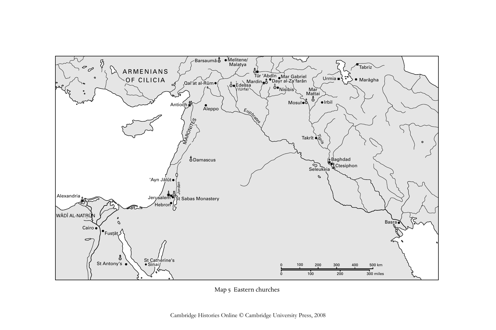

# 东方基督教诸形态（十一至十四世纪）：科普特人、麦勒凯派、涅斯托里乌斯派与雅各派：英文转换底稿

<!-- PDF page 394; original page 373 -->

### 16

### Eastern Christianities (eleventh to

### fourteenth century): Copts, Melkites,

### Nestorians and Jacobites

### f r a n c¸ o i s e m i c h e au

The Coptic, Melkite, Nestorian and Jacobite communities possessed distinctive features, which set them apart from the other Orthodox churches studied in this volume. The first – and not the least important – was their establishment in countries which were under Muslim – and not Christian – rule. This was in complete contrast to the situation existing in the Byzantine Empire and in the kingdoms of Armenia and Georgia to the north, or in Nubia and Ethiopia to the south. A consequence of this was their juridically inferior status, known in Arabic as dhimma. This guaranteed members of the community rights of protection for themselves and their property, but in other ways discriminated against them. Their place in society cannot, however, just be reduced to a matter of juridical status, since there were marked variations according to time, place, social setting and reigning dynasty. In the first centuries of Islam Christianity, originally the dominant faith in most of the lands conquered by the Arabs, remained a majority faith, but by the eleventh century this was no longer so. Its progressive decline produced a new cultural outlook characterised by a reaffirmation of identity, which might require, depending on circumstance, accommodation with Islam or alliance with foreign powers.[^p394-1]

Another distinctive feature of these Christian communities was their heterogeneity, which stemmed from the fact that there was no good reason for any Muslim power to impose on them one ecclesiastical obedience rather than

[^p394-1]: R. W. Bulliet, ‘Process and status in conversion and continuity’, in Conversion and continuity: indigenous Christian communities in Islamic lands (8th–18th centuries), ed. M. Gervers and R. J. Bikhazi [Papers in Mediaeval Studies 9] (Toronto: Pontifical Institute of Mediaeval Studies, 1990), 1–12, where he presents conversion as ‘a process, which changed both Christian and Islamic communities’ (p. 5), with the former remaining ‘in many respects members of a single society’ (p. 7) This ‘Muslim–Christian matrix has displayed four “states”’ (pp. 7–8): the first two correspond to a period when the Muslims were politically, but not numerically, dominant, while the last two were characterised by the divisions and rivalries among Muslim powers, the external threat from non-Islamic forces, and a ‘greater social differentiation’.

<!-- PDF page 395; original page 374 -->

Barsaumâ Melitene/
Malatya
Tabriz
ARMENIANS
OF CILICIA Qal'at al-Rûm Edess M a ar T d û i r n 'Abd D ıˆn ayr M a a l- r Z G a' a f b ar r â ie n l Urmia Marâgha
(Urfa) Nisibis Mar
Mattai
Antioch Mosul Irbil
Aleppo
Takrît
Damascus Baghdad
Ctesiphon
'Ayn Jâlût
Alexandria Jerusalem St Sabas Monastery
Hebron
Basra
Cairo
Fustât
St Catherine's
St Antony‘s Sinai 0100 200 300 400 500 km
0100 200 300 miles
nadroJ
E
S
Euphrates
T
NI
O
M
A R Tigris
Seleukeia
WÂDÎ AL-NATR.ÛN..
Map5 Easternchurches
Cambridge Histories Online © Cambridge University Press, 2008

<!-- PDF page 396; original page 375 -->

another. It was not uncommon for several communities to congregate in the same place, which tended to be a source of conflict and weakness rather than strength. These divisions went back to the christological controversies of the fifth century, which split the eastern churches into three separate allegiances, known for convenience’s sake as Chalcedonian (those who accepted the council of Chalcedon (451)) and Monophysite and Nestorian (those who did not). The independent and rival hierarchies that emerged often had their centre of gravity within a particular region, but this did not mean that they were able to eliminate their rivals. The history of Christian communities in the lands of Islam normally focuses on these different churches.[^p396-2] In this chapter I shall begin with a short introduction on their history and geography. However, my main purpose will be to study their main features and developments as a single phenomenon, without, of course, neglecting what was distinctive about each denomination.

### Ecclesiastical geography

A Monophysite church, currently known as the Coptic Church,[^p396-3] was the dominant force in Egyptian Christianity under Islam. Organised around the patriarchal see of Alexandria, the Coptic Church displayed a strongly Egyptian identity. From the eighth century onwards the patriarchs were frequently resident at Fust.ât., the capital of Muslim Egypt. During the two centuries that followed they abandoned Alexandria, which now lacked both security and prestige. When not at Fust.ât. they preferred to stay in different towns of the Delta or in desert monasteries. The definitive transfer of the patriarchal residence from Alexandria to Cairo occurred during the patriarchate of Cyril II (1078–92), and not, as is usually said, during that of his predecessor Christodoulos (1047–77). This step was less a matter of the patriarchs wishing to be closer to the centre of power and much more a result of the vigorous centralising policy of the grand vizier Badr al-Jamâlî, who insisted that the patriarch establish himself in the capital.[^p396-4] The patriarchs continued all the same to be ordained at both Alexandria and Fust.ât..

[^p396-2]: A good synthesis of this approach can be found in Histoire du christianisme des origines à nos jours, ed. J.-M. Mayeur, C. Pietri, A. Vauchez and M. Venard, 13 vols. (Paris: Desclée, 1990–2000).

[^p396-3]: The terms Copt and Coptic derive from the Arabic Qibṭ, itself derived from the Greek Αἴγυπτος, which is a corruption of the Ancient Egyptian Ha-Ker-Ptah.

[^p396-4]: See J. Den Heijer, ‘Le patriarcat copte d’Alexandrie à l’époque fatimide’, in Alexandrie médiévale, ed. C. Décobert [Études alexandrines 8] (Cairo: Institut français d’archéologie orientale, 2002), ii, 83–97.

<!-- PDF page 397; original page 376 -->

In 969 Egypt passed under the rule of a new dynasty, the Fatimids, who claimed descent from ‘Alî and Fât.ima. They based their legitimacy on the Ismailî variant of Shi‘a doctrine, which meant rivalry with the Abbasids of Baghdad, who upheld the Sunni doctrine. They adopted a largely favourable attitude towards the Christians. This may have been a reaction to the position in which the Fatimids found themselves in Egypt: a minority among an overwhelmingly Sunni population. Another consideration was the need to maintain good relations with the Christian powers of Byzantium and western Europe. An exception to this favourable treatment of Christians was the persecution carried out by the Fatimid Caliph al-H. âkim during the years 1004–13,[^p397-5] which involved the implementation of clothing regulations, prohibition of the public celebration of Christian festivals, confiscation of the property belonging to churches and monasteries, destruction of the church of the Holy Sepulchre (1009), and dismissal of Christian and Jewish functionaries. But it is often forgotten that at the end of his reign al-H. âkim rescinded these measures: he restored the confiscated property, authorised the rebuilding of churches, and even allowed those converted to Islam under duress to revert to Christianity. This allowed the Copts to recover the privileged position which they had momentarily lost, particularly in the administration, where they held numerous posts and high office.

The integration of the Copts into an unmistakably Arab Egypt led inevitably to arabisation,[^p397-6] which had certainly been facilitated by the fact that the Coptic Church was a purely Egyptian church. A Coptic prelate proclaimed in the thirteenth century: ‘May God – praised be He – make victorious their sultan, and he is our sultan, and their imam, and he is our shepherd.’[^p397-7] These words reveal the loyalty that existed – at least among the elite – to a community presided over by the sultan.

We now come to the Melkite Church. Melkite meaning royal or imperial was a term applied to those loyal to the Chalcedonian creed, which was

[^p397-5]: This policy was both an aberration and in breach of the obligations imposed by dhimma. Historians have long considered it as the product of the madness of a ruler struck down by ‘melancholy’, as the medieval medical handbooks described it. But a new interpretation suggests that al-Ḥâkim’s motivation was a wish to impose Ismaili doctrines, to punish the pride of the Christians who occupied high administrative office, and to improve morals, within a millenniarist perspective connected to the year 400 of the hegira. In any case, it was not only Jews and Christians who were the sole objects of al-Ḥâkim’s religious policy.

[^p397-6]: See A. S. Atiya, A history of Eastern Christianity (London: Methuen, 1968).

[^p397-7]: Sawîrus ibn al-Muqaffa’, History of the patriarchs of the Egyptian Church, known as the History of the Holy Church, iv, 2: Cyril III, Ibn Laklak (1216–1243 A.D.), ed. A. Khater and O. H. E. Burmester (Cairo: Société d’archéologie copte, 1974), (text) 74; (trans.) 150.

<!-- PDF page 398; original page 377 -->

adopted by the emperors of Constantinople. In Egypt it had its own patriarch of Alexandria, but it only ever had a few followers, limited in the main to Alexandria and the Delta. By way of contrast, in Syria[^p398-8] and particularly in Palestine it was a more formidable force. The Melkites held the patriarchate of Jerusalem, which was the only one where there was not a double hierarchy. In central and northern Syria the Byzantine reconquest of 969 reinforced their position. For more than a century Antioch and the surrounding region came under Byzantine rule. But confronting them were the Jacobites, as they have come to be called, their Monophysite rivals.

The Jacobite Church took its name from its founder, Jacob Baradaeus, a sixth-century bishop of Edessa. It established its own patriarchate of Antioch. It was especially strong in northern Syria, but in the tenth century it lost much of its flock to Islam and, following the Byzantine reconquest, to the Melkites. Its centre of gravity moved eastwards to the Jazira[^p398-9] or Upper Mesopotamia, where its main establishments were the monastery of Bars.aumâ near the city of Melitene/Malat.ya, that of Dayr al-Za‘farân near Mârdîn, and that of Mar Mataï near Mosul. Although there continued to be a Jacobite ‘patriarch of Antioch and Syria’, from the ninth century the holder of this title preferred to reside in different monasteries of northern Syria. From the time of the Byzantine reconquest various places served as the patriarchal residence, notably the monastery of Bars.aumâ in the twelfth century and the town of Qal‘at al-Rûm in the thirteenth.

Neither must we forget the Maronite Church. Very little is known about its early development, and it only enters history at the time of the crusades. According to local tradition it took its name from a monk John Maron, who became patriarch at the end of the seventh century. He was a follower of the Monothelite heresy,[^p398-10]  even if from the sixteenth century onwards the Maronites have proclaimed their ‘perpetual Orthodoxy’. Originally established at Apamea, the Maronite patriarch fled in the eleventh century to the mountains of Lebanon, which became the centre of the Maronite Church.

There is one final region that needs to be considered: Mesopotamia, where the Nestorians predominated. They followed the teaching of Nestorios, patriarch of Constantinople, who was condemned at the first council of Ephesus

[^p398-8]: This is the region running from Mount Sinai in the south to the passes of the Taurus in the north referred to in Arabic texts as al-Shâm.

[^p398-9]: This is an Arabic term meaning island used to designate the region between the Tigris and the Euphrates.

[^p398-10]: This was a doctrinal compromise put forward by the emperor Herakleios, which the Orthodox Church subsequently rejected.

<!-- PDF page 399; original page 378 -->

(431) for privileging the human nature of Christ. Having embraced the Nestorian confession in 486 the church of Persia had established its independence under the authority of a patriarch, who resided at Seleukeia. In the face of Byzantine hostility most of the Syrian Nestorians settled in the Persian Empire. After the Arabic conquest the Nestorians experienced their hour of glory under the Abbasids, when a number of them held high administrative office or were employed as secretaries and doctors and were highly esteemed. In 780 their catholicos[^p399-11]  Timothy I transferred his residence from Ctesiphon to Baghdad. The language and culture of this church is Syriac. Even in Baghdad, but especially in northern Mesopotamia, it was in competition with other Syrians in the shape of the Jacobites. Some modern writers, such as Père Fiey, distinguish the eastern Syrians (Nestorians) from the western Syrians ( Jacobites). In the twelfth century the Jacobite metropolitan in charge of the Oriental territories (i.e. those formerly included in the Sassanian Empire) took the title of maphrian and established himself at Takrît, which provoked the pillaging and confiscation of churches.[^p399-12]  In the middle of the twelfth century the maphrian moved to the monastery of Mar Mattaï, close to Mosul, which from 1127 was the capital of an autonomous principality. There the Jacobite and Nestorian communities enjoyed a period of stability and prosperity, of which the most notable evidence is their contribution to the development of the art of inlayed metal ware.[^p399-13]

The Nestorian Church was divided into ‘interior’ and ‘exterior’ provinces. The former covered Mesopotamia (Nisibis, Basra, Irbil, Mosul) and the confines of Iran, while the latter corresponded to the ‘Orient’ (eastern Iran, Arabia, central Asia, China, the coasts of India and Indonesia), where Nestorianism established itself as a result of intense missionary activity between the fifth and eighth centuries. If Christianity was in full retreat in Iran by the end of the eleventh century, the communities further to the east continued to exist and excited the interest of westerners, who discovered the ‘Orient’ in the thirteenth century, but their history lies outside the remit of this chapter.

Each of these churches was autonomous under the guidance of a patriarch – also called pope in the Coptic Church or catholicos in the Nestorian Church. Lists of these patriarchs were established long ago, even if more recent studies have made some slight additions and corrections. Designation of patriarch was by election. The future patriarch was chosen by an assembly, the composition

[^p399-11]: This is the term currently in use for the Nestorian patriarch.

[^p399-12]: The title is first mentioned in 1123.

[^p399-13]: See J.-M. Fiey, Mossoul chrétienne (Beirut: Imprimerie catholique, 1959); E. Baer, Ayyubid metalwork with Christian images (Leiden: E. J. Brill, 1988).

<!-- PDF page 400; original page 379 -->

of which varied according to church and period, but included bishops and abbots, sometimes priests and monks; sometimes even influential members of the laity. It was also necessary to obtain confirmation from the Muslim ruling authorities.[^p400-14]  Only then could the solemn ordination of the new patriarch take place. If you read the ecclesiastical chronicles of the different churches, it is clear that this process produced violent quarrels among the candidates, with recourse to simony, tribal feuds and political infighting, and to the good offices of a Muslim ruler. Leaving aside personal ambitions, the rivalry among candidates for office often reveals the underlying divisions within the different Christian communities. It equally reveals an ecclesiastical organisation grounded in personal ties and the influence of the ‘powerful’.

By way of illustration I shall limit myself to two examples. The first concerns the Coptic Church, which experienced a vacancy lasting nearly twenty years following the death of John VI in 1216.[^p400-15]  Christians in Egypt were effectively divided into two parties. The first supported the priest Dâ ᾿ûd, a native of the Fayyûm, who eventually succeeded to the patriarchal throne in 1235 as Cyril III. He had a pragmatic view of the relationship of the church to power and wealth and enjoyed wide support among Christian functionaries. His opponents backed a series of candidates – notably, a monk renowned for his asceticism – who took a harder, more uncompromising line. The struggle crystallised around the two cities into which Cairo was divided. Dâ ᾿ûd’s partisans were most strongly represented in al-Qâhira, the urban centre established by the Fatimids, which housed the political elite. His opponents were concentrated in Fust.ât., the old town, which housed the venerable old church known as al-Mu‘allaqa. The numerous twists and turns of this episode reveal not only that both sides sought to obtain the precious diploma of investiture from al- Kâmil, the Ayyubid sultan of the day, but also that they had no hesitation in offering him considerable sums of money. Dâ ᾿ûd’s supporters eventually paid 2000 dinars for his investiture. For his part, al-Kâmil had no desire to designate a patriarch until he had the full support of the Christian community and he did his best to act as an honest broker. A modern historian cannot help but feel that such a crisis can only have contributed to the weakening and discrediting the Coptic Church, just at the moment when the soldiers of the Fifth Crusade had taken Damietta and were marching on Cairo.

[^p400-14]: See the charter granted to the catholicos ‘Abdishô‘ III, edited by A. Mingana, ‘A charter of protection granted to the Nestorian Church a.d. 1138 by Muktafi II, Caliph of Baghdad’, Bulletin of the John Rylands Library 10 (1926), 127–33.

[^p400-15]: See History of the patriarchs, iv, 2.

<!-- PDF page 401; original page 380 -->

The schism within the Jacobite Church during the years 1252–63 provides a second example of a conflict over a patriarchal throne.[^p401-16]  It was a matter of the two rival patriarchs, who had been elected on the death of Ignatios II: Dionysios, metropolitan of Melitene/Malat.ya, and the maphrian Bar Ma‘dânî. The former was elected in 1252 at the monastery of Bars.aumâ by a small assembly comprising the bishops of the ‘western’ provinces (i.e. west of the Upper Euphrates), while the latter was elected a little later at Aleppo by the bishops of the ‘eastern’ provinces (i.e. T. ûr ‘Abdîn and the upper valley of the Tigris). Over a period of several years the two patriarchs attempted to impose themselves on the church as a whole. With promises of large sums of money they sought the support of the Muslim authorities, be they the Seljuqs of Konya or the Ayyubids of Damascus. The appearance of the Mongols complicated the affair still further, though, paradoxically, allowing its dénouement. This schism was far from being the only one that divided the eastern and western poles of the Jacobite Church. Its history was one where local considerations often took precedence over any feeling of unity. But leaving these to one side, Dionysios’s ignorance of Arabic makes him seem a figure emblematic of a church which lived off its religious and cultural traditions; which was not well attuned to current political realities; which was hostile to the policy of rapprochement with the Latins initiated by Patriarch Ignatios II, Dionysios’s predecessor; and which saw in the Mongols an ally against Islam. Bar Ma‘dânî, in contrast, had the support of the Christian elite, who welcomed integration, frequented the centres of power, acted as administrators and doctors, and preferred to flee before the Mongols.

### The status and application of dhimma

The dhimma status, which applied to Christian communities in the lands of Islam, is well known. It went back to the time of the Arab conquests in the seventh and eighth centuries and, in its broad lines, was fixed in the treaties of fiqh in the eighth and ninth centuries.[^p401-17]  It granted the ‘peoples of the Book’, Jews and Christians, the protection of the Muslim ruling authority, freedom of worship, and continuation of their ecclesiastical, communal and judicial organisation, together with property rights and freedom to trade. In return, the

[^p401-16]: See Bar Hebraeus, Chronicon ecclesiasticum, ed. J. B. Abelloos and T. J. Lamy (Paris and Louvain: C. Peeters, 1877), ii, cols. 695–744.

[^p401-17]: Fiqh is a term used for Muslim law, in the sense of implementing the sharî‘a. The first codification of the legal condition of dhimmîs was the work of Abû Yûsuf Ya‘qûb, kadi of the Abbasid caliph Hârûn al-Rashîd, in the Kitâb al-kharaj, trans. E. Fagnan [Bibliothèque archéologique et historique 1] (Paris: P. Geuthner, 1921).

<!-- PDF page 402; original page 381 -->

dhimmîs had to recognise the political sovereignty of Islam, to respect Muslims, to refrain from ostentatious religious celebrations, to wear distinctive clothing and, finally, to pay a poll-tax known as jizya. Some contemporary writers have seen these conditions as proof of the remarkable tolerance shown by the Muslims, while others have condemned it as an act of oppression inflicted on non-Muslims. There can, however, be no doubt that it provided security and autonomy on the one hand, and legal inferiority on the other, which was applied variously depending on region, period, rulers and social setting.

The general trend is quite clear. In the period under consideration, from the eleventh to the fourteenth century, dhimma status was imposed more severely and the material position of dhimmîs deteriorated. Behind this were general developments within Islam. Just as the schism of 1054 is of great symbolic significance for Orthodoxy, so the year 1055 marks an equally important rupture in the history of Islam, for in that year the Seljuq leader Tughril Beg entered Baghdad, putting an end to the dream of a pan-Islamic community united around its caliph. The Seljuqs of Iraq and Iran – and in their wake various military dynasties, first in Syria, and then with Saladin in Egypt – developed new models of legitimacy and of the exercise of power, for which the defence of Sunni Islam was central. At a time when the demographic, cultural and social influence of Christianity was on the wane, Islam set the social norm, which meant the strict application of Muslim law and of dhimma status. It is significant that the earliest version of the so-called pact of ‘Umar should date precisely from the twelfth century, since it was taken as authoritative when it came to establishing dhimma status.[^p402-18]

Instructive are the policies pursued by the sultan Saladin (1171–93). He revived measures that had apparently fallen into disuse: for example, Christians were required to wear a yellow belt, were forbidden to ride horses or mules, and were expected to show due modesty in their religious ceremonies and buildings, which meant among others things the removal of crosses from the exterior of churches. Such a rigorist attitude on the part of the rulers might have encouraged further measures against Christians. It was to guard against this that Saladin reminded the inhabitants of Aleppo that in return for respect for Muslim law minorities could expect protection. He informed them: ‘When we ordered the dhimmîs to wear the distinctive clothing which distinguishes them from Muslims... we heard that gangs of thugs inflamed by hatred attacked

[^p402-18]: See al-Turtushî, Sirâj al-mulûk (Cairo, 1289/1872), 135ff.; trans. M. Alarcón, Lámparas de los príncipes por Abubéquer de Torotosa, ii (Madrid: Instituto de Valencia de Don Juan, 1931), 143ff. Cf. A. Fattal, Le statut légal des non-musulmans en pays d’Islam (Beirut: Imprimerie catholique, 1958), 60–3.

<!-- PDF page 403; original page 382 -->

the dhimmîs with words and detestable actions in contravention of their rights under the dhimma pact. We strongly disapprove of this and we forbid either fomenting or executing such things.’[^p403-19]

Besides developments peculiar to the lands of Islam, two other factors, this time external, conspired to undermine the position of Christian communities: the crusades and the Mongol conquests.

### The crusades and the position of

### eastern Christianities

In an excitatorium of November 1095 addressed to the Flemings Pope Urban II first sketched the conquest of Jerusalem by the Turks and the sufferings of the Christians before making his appeal in the following words: ‘Being much distressed by the proper concern which we felt about the news of this disaster we have visited France, where we have implored most of the princes of the land and their subjects to liberate the Churches of the East.’[^p403-20]  Apart from the destruction of the church of the Holy Sepulchre by al-H. âkim, Christian propaganda resorted to the grave consequences that the Turkish conquest had for the Christians. But, as Claude Cahen has magisterially demonstrated,[^p403-21]  once masters of Syria the Turks quickly restored order, did not significantly modify the position of non-Muslims and did not impede pilgrimages to Jerusalem. This is borne out by an observation of a Coptic historian:

> The Ghuzz [i.e. Türkmen] had taken possession of the city of Jerusalem the protected and they had denied the descent of the light in the church of the Holy Resurrection over the Noble Sepulture, but, when they learned the verity of its descent every year, they had consideration for the Christians, who were living in it, and they employed for the administration of the country a Christian man, a Jacobite, a lover of Christ, known as Mans.ûr al-Balbâyî, and he had a wife like himself, and he was of assistance to every one who arrived in Jerusalem from among the Christians of Egypt and of their countries besides it. He endeavoured to rebuild the church of the Jacobite Orthodox in Jerusalem.[^p403-22]

[^p403-19]: See A.-M. Eddé, La principauté ayyoubide d’Alep (579/1183–658/1260) [Freiburger Islam Studien 21] (Stuttgart: Franz Steiner Verlag, 1999), 465.

[^p403-20]: H. Hagenmeyer, Die Kreuzzugsbriefe aus den Jahren 1088–1100 (Innsbruck: Verlag der Wagner’schen Universitäts-Buchhandlung, 1901), 136–7. Cf. B. Hamilton, The Latin Church in the Crusader States: the secular church (London: Variorum, 1980), 1.

[^p403-21]: C. Cahen, ‘Notes sur l’histoire de l’Orient latin: i – En quoi la conquête turque appelait-elle la croisade?’, Bulletin de la Faculté des Lettres de Strasbourg 21 (1950–51), 118–25 [= C. Cahen, Turcobyzantina et Oriens christianus (London: Variorum, 1974), c].

[^p403-22]: History of the patriarchs, ii, part 3: (text) 299; (trans.) 364.

<!-- PDF page 404; original page 383 -->

The arrival of the crusaders upset the political and religious balance of the Near East, which in time proved harmful to eastern Christians with the exception of the Maronites and possibly the Armenians. In the newly created crusader states the Franks – by definition Latins loyal to Rome – imposed their authority on native Christians, in the same way as on the Muslims. In point of fact, the position of Christians varied according to the community they belonged to. The Melkites had more to lose with the arrival of the crusaders, because they were not only the most numerous in the Latin states, but also recognised as close to the Byzantines. So, following the conquest of Antioch and Jerusalem, the crusaders instituted Latin patriarchs, driving out the existing Melkite patriarchs, who were forced to seek refuge at Constantinople. The same happened with the majority of bishops on the pretext that a single body cannot have two heads. The Melkites were now subject to a Latin hierarchy, which did not, however, insist on the Latin rite. As a result, James of Vitry, bishop of Acre (1216–29), was horrified to discover that the Greek Christians of his diocese had married priests, used leavened bread in the communion service, included the right of confirmation in infant baptism, and omitted the filioque from the Nicene creed.[^p404-23]  Over the twelfth century relations between the Melkites and the Latins in the kingdom of Jerusalem improved somewhat. Relations were more strained in the principality of Antioch, where they were complicated by political conflict with a succession of Byzantine emperors, who had never given up their claim to Antioch and the Orontes valley. They refused to recognise the Latin patriarchs of Antioch, supporting instead a rival line of Orthodox patriarchs in exile at Constantinople.

In contrast, the other churches preserved their own hierarchies, since their patriarchal seats lay outside the Latin states, as did most of their members. Within the Latin states the Jacobites retained their religious autonomy and places of worship. The Jacobite patriarch of Antioch, Michael the Syrian (1166–99), wrote as follows:

> The Franks, who occupied Antioch and Jerusalem, had... bishops in their states. And the leaders of our Church lived among them, without being persecuted or harassed by them, for, even if the Franks agreed with the Greeks over the double nature, they still disagreed with them over several points of faith and their customs were quite different... [They] never made any difficulties over matters of faith, nor did they seek to impose a single observance on all

[^p404-23]: Lettres de Jacques de Vitry, ed. R. B. C. Huygens (Leiden: E. J. Brill, 1960), ii.136–49: 84–5. Cf. Hamilton, The Latin Church, 163–4.

<!-- PDF page 405; original page 384 -->

> Christians of whatever language. They were content without further enquiry or examination to consider Christian whoever venerated the cross.[^p405-24]

Generally speaking, the attitude of the Jacobites towards the crusaders varied according to circumstance: sometimes they displayed indifference, sometimes they were realistic and conciliatory, even favourably disposed because of a common hostility to the Melkites, but sometimes they were antagonistic, as was the case in 1148 when the crusaders sacked the great monastery of Bars.aumâ.

Being at a greater distance from the Latins, the Christian communities in Mesopotamia and Egypt were less directly affected by the creation of the Latin states. Nevertheless, the Copts were bitterly opposed to the First Crusade. The author of the History of the Patriarchs of Alexandria, as we have already seen, took pleasure in the restoration of peace and order to Jerusalem in the aftermath of the Turkish conquest, but a few pages on we find him writing as follows:

> They [the Franks] gained possession of the noble city of Jerusalem and its district in the month of Ramadan of the Lunar Year 492. We, the community of Christians, the Jacobites, the Copts, did not join in the pilgrimage to it, nor were we able to approach it, on account of what is known of their hatred of us, as also, their false belief concerning us and their charge against us of impiety.[^p405-25]

Thanks to the crusades the Latin Church came to have a better knowledge of these Oriental churches and sought to effect a union of churches by persuading their leaders, whether patriarch or catholicos, to accept Roman primacy and to subscribe to the same confession of faith, while respecting their individual rituals.[^p405-26]  Initiated in the twelfth century, this strategy was fully developed in the thirteenth thanks to the missionary work of the Dominicans and the Franciscans. So in 1237 the Jacobite Patriarch Ignatios II visited Jerusalem, where after being well received by the Dominicans he solemnly swore obedience to the see of Rome and provided an Orthodox profession of faith drawn up in Arabic and Syriac. Those Coptic and Nestorian archbishops, who were also present in Jerusalem, followed suit. Pope Gregory IX sent them letters of congratulation. Patriarch Ignatios renewed his submission in 1246 during a visit from the papal envoy, Andrew of Longjumeau, while seeking assurances that Rome would respect the autonomy of his church. However, such declarations of obedience were considered to be purely personal actions and did not apply

[^p405-24]: Chronique de Michel le Syrien, patriarche jacobite d’Antioche (1166–1199), trans. J.-B. Chabot (Paris: E. Leroux, 1905), iii, 222.

[^p405-25]: History of the patriarchs, ii, part 3: (text) 249; (trans.) 398–9.

[^p405-26]: J. Richard, La papauté et les missions d’Orient au Moyen Âge (XIIIe–XVe siècles) [Collection de l’École française de Rome 33], second edition (Rome: École française de Rome, 1998).

<!-- PDF page 406; original page 385 -->

to the whole body of the church. The death of Ignatios II in 1252, the ensuing schism,[^p406-27]  the Mongol whirlwind, and finally the fall of the crusader states in 1291 meant that this rapprochement would lead nowhere.

There were equally contacts between Rome and the Nestorians. The most important were those that took place under the catholicos Yahballâhâ III (1281–1317), as part of exchanges between the papacy and the Ilkhâns of Persia.[^p406-28]  There were, however, no long-lasting consequences, for the Nestorians remained attached to their beliefs, traditions and ritual. Leaving aside the Armenians,[^p406-29] this unionist policy only obtained concrete results in the case of the Maronites, who entered the Roman obedience in 1182 and renounced the Monothelite heresy, despite strong internal opposition. This union was sealed by the papal bull Quia divinae sapientiae, which Pope Innocent III presented to the Maronite patriarch in 1215 on the occasion of the latter’s visit to the Fourth Lateran Council. It guaranteed the continuing existence of the Maronite hierarchy and ritual.

The appearance of an aggressive form of Christianity in the Near East in the shape of crusades backed by the papacy led to a decisive change in Muslim attitudes towards Christians.[^p406-30]  This did not affect the legal position, since the Muslim authorities, religious and political alike, made a clear distinction between the Christians living in the lands of Islam, known as nas.rânî, and the crusaders, denoted by the general term of Franks (Ifranj). While the former enjoyed dhimma status, the latter had come from abroad to seize Muslim territory and were therefore infidels against whom war was justified. However, the appeals for jihad against the Franks made by devout men and by the rulers of Syria and Egypt were couched in terms of the impiety of the Christian polytheists, who polluted Jerusalem with their presence. Such accusations rebounded on the native Christians, as Louis Pouzet has shown in his study of religious life in Damascus in the thirteenth century. He notes that the term kuffâr (infidels) was now applied to the Christians of the city, who were insulted as adorers of the cross.[^p406-31]

[^p406-27]: See above, p. 380.

[^p406-28]: In 1288 Bars.aumâ, a Nestorian monk, was sent to the west by the Ilkhân Arghun and received by Pope Nicholas IV, who according to Syriac sources recognised Yahballâhâ III as patriarch of the Church of the East. Thereafter the Dominican Ricoldo di Montecroce worked hard to persuade the catholicos and his flock to reject the doctrines of Nestorios.

[^p406-29]: See below, pp. 415–17.

[^p406-30]: See E. Sivan, ‘Note sur la situation des chrétiens sous les Ayyûbides’, Revue d’Histoire des Religions 172 (1967), 117–30.

[^p406-31]: L. Pouzet, Damas au VIIe/XIIIe siècle: vie et structures religieuses dans une métropole islamique [Recherches. Collection publiée sous la direction de la Faculté des Lettres et des Sciences Humaines de l’Université Saint-Joseph] (Beirut: al-Mashraq, 1988), cap. 7.

<!-- PDF page 407; original page 386 -->

Even if exceptional, still more revealing of the climate of suspicion created by the crusades were the reprisals against Christians. When Jocelyn of Courtenay, prince of Edessa, laid siege to Aleppo in 1123 and pillaged the surrounding region, the kadi and the ra’îs – the leaders of the community – insisted that the Christians of the city repair at their own expense the Muslim cemeteries and places of worship desecrated by the Franks. The two bishops of the city, one a Melkite, the other a Jacobite, reluctant to be lumped together with the Franks, refused to make good the damage done. The kadi responded by transforming four of the city’s six churches into mosques and by driving out the bishops.

The crusades of the thirteenth century were primarily directed against Egypt, with particularly severe consequences for the Copts. During the 1218–19 siege of Damietta by the armies of the Fifth Crusade the Muslim authorities imposed heavy additional taxation on the Copts of Egypt, who were also the objects of mob violence. They became the scapegoats of collective fears. At Alexandria the church of St Mark was destroyed on the pretext that it might serve as a landmark for the enemy. In the 1240s the kadi ‘Uthmân al-Nâbulusî found the numbers of Copts in the administration offensive and composed a violent denunciation of their misdeeds.[^p407-32]  But the appearance of the Mongols in the mid-thirteenth century was to aggravate still more this climate of suspicion, which the crusades had helped to create.

### The consequences of the Mongol conquest

Following the kuriltay of 1206, where the Mongol chiefs recognised Genghis Khan as Great Khan or supreme leader, the Mongols embarked upon a series of conquests which made them masters of an immense empire extending from China to the gates of Europe. In the Near East their conquest of Iraq, the fall of Baghdad and the execution of the last Abbasid caliph in 1258, the invasion of Syria in 1260, and the creation of the Ilkhânate of Iran by Hülegü, one of Ghengis’s grandsons, profoundly altered the religious and political situation. Eastern Christians were happy to ally with the invaders, who for their part favoured the Christians. A ruling of Genghis Khan insisted on the equal standing of all religions and established the principle of honouring all religious leaders. In addition, Nestorian Christianity had had a presence in inner Asia for centuries, notably among the Kereit, and its influence penetrated the Mongol court through the agency both of the Christian wives of the Great Khans and of

[^p407-32]: C. Cahen, ‘Histoires coptes d’un cadi médiéval’, Bulletin de l’Institut Français d’Archéologie Orientale 59 (1960), 133–50.

<!-- PDF page 408; original page 387 -->

Nestorian dignitaries, such as the Symeon who served the Great Khan Ö godei and his successors as a doctor and a secretary.

The Mongol conquests were the occasion for spectacular massacres, but the Mongol armies often spared the Christians and their property. For example, the Nestorians escaped the sack of Baghdad. In Syria many Christians welcomed the Mongols, if there were others who preferred flight or resistance. In March 1260, when Kitbugha, Hülegü’s great Nestorian general, entered Damascus in triumph, flanked by King Het῾um of Armenia, and Prince Bohemond VI of Antioch, the Christian inhabitants of the city acclaimed him and then in August organised an anti-Muslim demonstration after receiving a firman from Hülegü, which granted each religious community the right to practise its religion publicly.[^p408-33]  And shortly afterwards, in May 1260, a Syrian painter gave a new twist to the iconography of the Exaltation of the Cross by showing Constantine and Helena with the features of Hülegü and of his Nestorian wife Doquz-Khatun.[^p408-34]  The undisguised delight shown by the Christians would soon bring savage reprisals following the victory of the Mamluks at ‘Ayn Jâlût in September 1260 and their recovery of the Syrian cities. This time, any suspicion of complicity with the Mongol enemy was well founded.

The aftermath of the destruction of the Abbasid caliphate (1258) was an auspicious time for the Christian communities under Mongol rule in Iran and Mesopotamia. Churches were built and Christians were even exempted from the poll tax. In 1281 a monk from Inner Mongolia became Nestorian patriarch with the name Yahballâhâ III (1281–1317), despite his poor grasp of Syriac. At Marâgha, the Ilkhân capital, he set about the building of a large monastery. His patriarchate marks the high point of Nestorian Christianity, which profited from the unification of Asia under the Mongols to the extent that it comprised 30 provinces and 250 bishoprics. However, Christians were also the victims of anti-Mongol riots, such as those at Mosul in 1262 and at Baghdad in 1268. Their position deteriorated after the conversion in 1295 of the Ilkhân Ghazan to Islam. Once more the stipulations of dhimma came into force, while clothing regulations were reimposed and tax exemptions removed. Churches were destroyed at Tabriz in 1296 and at Irbil in 1310. In the fourteenth century Nestorian Christianity disappeared from Iran and from southern and

[^p408-33]: D. Sourdel, ‘Bohémond et les chrétiens de Damas sous l’occupation mongole’, in Dei Gesta per Francos: études sur les croisades dédiées à Jean Richard, ed. M. Balard, B. Z. Kedar and J. S. Riley-Smith (Aldershot: Ashgate, 2001), 295–9.

[^p408-34]: Bibl. Vatican cod. syr. 559. See J. M. Fiey, ‘Iconographie syriaque. Hulagu, Doquz Khatun... et six ambons?’, Le Muséon 88 (1975), 59–68.

<!-- PDF page 409; original page 388 -->

central Iraq and took refuge in Upper Mesopotamia around Mosul, where having abandoned Baghdad the Nestorian catholicos now established his residence.

Egypt passed under the rule of Mamluk sultans in 1250 and Syria in 1260. The Mamluks based the legitimacy of their military regime on their ability to defend Islam against the crusaders and the Mongols, which took the form of a double jihad. The accusation of Christian collusion with these enemies of Islam became a refrain of the propaganda directed against the dhimmîs. For example, during Sultan Baybars’s campaign against the crusader strongpoints of Caesarea and Arsûf in 1265 a series of fires swept through Cairo. It was immediately assumed that these were an act of revenge on the part of local Christians. In Syria the conquest of Frankish territories produced popular attacks on Christians, such as the destruction in 1262 of the church of the Annunciation at Nazareth and the massacre of Christians that followed the fall of Antioch in 1268. Even in Egypt there was a growing number of popular attacks on Christians, which were encouraged by the bigotry of preachers, by the intransigence of the ulemâ, and by anxiety in the face of Mongol aggression. But behind this hostility lay Muslim opposition to the influence exercised in the administration by Christian secretaries – a stock charge of anti-Christian polemic.[^p409-35]  It is this social aspect that deserves underlining.[^p409-36]  So, in 1301 Sultan Qalâwûn re-enacted a decree which had already been applied on a number of occasions, but always rescinded, excluding Jews and Christians from public office and at the same time strictly enforcing the discriminatory measures associated with dhimma status. Furthermore, he closed down the churches of Cairo and had several of them destroyed, a fate also suffered by certain synagogues. It required the intervention of the Byzantine emperor and the king of Aragon to persuade the sultan to reopen the churches and to rescind the measures taken. It is not without significance that at this juncture only outside intervention allowed an improvement in the position of the local Christians. But it did not prevent similar crises reoccurring in 1320 and 1354. The number and violence of these anti-Christian outbreaks created a climate of fear, which was the direct cause of numerous conversions to Islam. These contributed to the growth of a new group which made its appearance in the fourteenth century. Its members were known as musâlima, or ‘islamised’, and were identified

[^p409-35]: See M. Perlmann, ‘Notes on anti-Christian propaganda in the Mamlûk Empire’, Bulletin of the School of Oriental and African Studies 10 (1939–42), 843–61.

[^p409-36]: L. S. Northrup, ‘Muslim–Christian relations during the reign of the Mamluk Sultan al-Mansûr Qalâwûn (a.d. 1278–1290)’, in Conversion and continuity, ed. Gervers and Bikhazi, 253–61.

<!-- PDF page 410; original page 389 -->

as such in the biographical dictionaries of the time. They were often suspected of only being nominal Muslims, having converted under pressure.[^p410-37]  Though much diminished and more introspective, the Coptic community still remained important in some areas and continued to play an active role in Egyptian society.

### Arabisation and the emergence

### of an Arab Christianity

One general feature characterised the future development of Christian communities in the lands of Islam. This was arabisation, by which I mean the adoption of Arabic, not just as a vernacular, but as a literary and liturgical language, which in turn led to the emergence of a truly Arabic Christianity. When the Byzantines annexed Edessa in 1031, some Jacobites left the city along with the other ‘Arabs’, because, in the words of Michael the Syrian, ‘in language and writing they were close to the Arabs’.[^p410-38]  The ties linking Christianity to the Arabic language are ancient and complex. Christians contributed to the development of the Arabic script, language and culture.[^p410-39]  From the turn of the eighth century there appeared the first translations of the Bible into Arabic. By our period Christian communities were largely, but not completely, arabised. It depended on a number of factors: original language, region, ecclesiastical tradition and social setting.

Coptic, the language written and spoken in Egypt at the time of the Arab conquest, gave ground to Arabic. The different Coptic dialects[^p410-40]  were replaced by Arabic ones, so much so that the eleventh-century compiler of the History of the Patriarchs of Alexandria decided to translate the biographies of the patriarchs from Coptic into Arabic, giving as his reason that ‘today Arabic is the language that the people of Egypt know... most of them being ignorant of Coptic and Greek’.[^p410-41]  Coptic did not totally disappear, however, as a spoken language. There are some interesting pointers from the work of the twelfth-century Coptic author Abû Makârim, who writes of one village

[^p410-37]: D. P. Little, ‘Coptic converts to Islam during the Baḥrî Mamluk Period’, in ibid., 843–61.

[^p410-38]: Chronique de Michel le Syrien, III, 280.

[^p410-39]: It was in the Christian kingdom of the Lakhmids that the northern Arabic script was created. With the rise of Islam this eclipsed the southern Arabic script. The role of Christians as translators from the Greek and the Syriac, mainly at Baghdad in the ninth century, is very well known.

[^p410-40]: Coptic divides into two major dialects: Sahidic in Upper Egypt (from the Arabic Sa‘îd) and Bohaïric in the Delta (from the Arabic for sea, baḥarî).

[^p410-41]: History of the patriarchs of the Egyptian Church, ed. B. Evetts (Paris: P. Fages, 1904), i, 115.

<!-- PDF page 411; original page 390 -->

where both Muslims and Christians spoke Coptic. He also has the story of a Jewish convert to Christianity who assimilated to the extent of speaking Coptic.[^p411-42]  As a literary language, Coptic became a dead language. There is nothing written in it after the eleventh century. The desire to preserve this heritage led in the thirteenth and fourteenth centuries to a renewed interest in the Coptic language. It resulted in twenty or more Coptic grammars, written in Arabic and making use of Arabic terminology, as well as Arabic– Coptic dictionaries, some of which were organised in the classic alphabetical order of Arabic lexicography. These works have been studied by A. Sidarus,[^p411-43] who has noted that in the thirteenth century they dealt mostly with Bohaïric dialects and in the fourteenth century Sahidic. This reflected the concentration of the Coptic population in Middle Egypt. The final triumph of Arabic affirmed the coming into being from the Fatimid period onwards of a truly Arab Egypt, with which the Copts strongly identified, while retaining their religious individuality.[^p411-44]

It was quite otherwise with Greek. At the time of the Arab conquest of Egypt and Syria it was a liturgical and literary language mostly used by the Melkites, who spoke various Coptic dialects in Egypt and Aramaic ones in Syria and Palestine. Greek would soon give place to Arabic, so that by the ninth century, at least in Muslim territories, Melkite scholars had practically ceased to write in Greek. Those parts of northern Syria reconquered by the Byzantines in 969 saw a renewal of literary activity in Greek. For example, the Melkite patriarchs of Antioch installed by Constantinople wrote in Greek. Paradoxically, it was under Byzantine auspices that Antioch became an important centre of translation of biblical, patristic and literary texts from Greek to Arabic. This favoured the arabisation of the Melkite liturgy, which had further consequences, for adapting the liturgical language to the needs of the vernacular was a characteristic trait of the Melkite Church.[^p411-45]

[^p411-42]: M. Martin, ‘Chrétiens et musulmans à la fin du XIIe siècle’, in Valeur et distance: identités et sociétés en Égypte, dir. C. Décobert (Paris: Maisonneuve et Larose, 2000), 86–7.

[^p411-43]: A. Sidarus, ‘La philologie copte arabe au Moyen Âge’, in La signification du Bas Moyen Âge dans l’histoire et la culture du monde musulman [Actes du 8e Congrès de l’Union européenne des Arabisants et Islamisants, Aix-en-Provence 1976] (Aix-en-Provence: Edisud, 1978), 267–81.

[^p411-44]: J.-C. Garcin, ‘L’arabisation de l’Egypte’, Revue de l’Occident Musulman et Méditerranéen 43 (1987), 130–7; U. Haarmann, ‘Regional sentiment in medieval Islamic Egypt’, Bulletin of the School of Oriental and African Studies 43 (1980), 55–66.

[^p411-45]: This will explain why a liturgy in Syriac continued to be used in the patriarchate of Antioch, as well as at the Melkite monastery of St Catherine of Sinai, where the liturgy was celebrated in Greek, no doubt for the benefit of pilgrims coming from the Byzantine Empire, in Arabic, and in Syriac in a chapel set aside for Syrians.

<!-- PDF page 412; original page 391 -->

The history of the development of Syriac and of the various Aramaic dialects is still more complex and difficult to establish.[^p412-46]  The populations of Syria and Mesopotamia, who spoke Aramaic, gradually adopted Arabic as their vernacular. In the twentieth century Aramaic only continued to be spoken in a few isolated areas: in the mountains of Kurdistan, in the T. ûr ‘Abdîn, around Urmiya and in the plains of Mosul,[^p412-47]  as well as in a few villages to the north of Damascus, notably Ma‘lûlâ. But in the crusading period Syriac speakers, in other words those connected with the Jacobite and the Nestorian churches, were far more numerous. We have already noted that Dionysios, metropolitan of Melitene, who laid claim to the patriarchate in 1252, did not know any Arabic. When he went before the Ayyubid sultan of Damascus to plead his case, he had recourse to an interpreter.[^p412-48]

In contrast to Coptic and Greek, Syriac more than continued as a literary language. Traditionally, the thirteenth century is remembered as the golden age of Syriac literature.[^p412-49]  It was only in the fourteenth century that it gave ground to Arabic. Its literary achievements are well known and are often studied for their own sake, without regard for the context of their time. It would be particularly valuable to know why one and the same author will by turns use both Arabic and Syriac. A good example is Bar Hebraeus (known in Arabic as Abû ᾿l-Faraj ibn al-‘Ibrî), maphrian of the eastern Jacobite Church from 1264 to 1286, who left a large corpus of works – thirty-one according to the list drawn up by his brother – in the fields of history, theology, philosophy, medicine, astronomy, grammar and belles-lettres.[^p412-50]  This literary activity corresponded to the preoccupations of a prelate: to bring comfort to the Syriac community, to enrich its intellectual heritage and to preserve its standing in the Near East. If Bar Hebraeus mostly wrote in Syriac or translated philosophical and medical treatises from Arabic to Syriac, he also made use of Arabic, either writing directly in the language or establishing Arabic versions of some of his Syriac works. For instance, his historical oeuvre comprises, on the one hand, a universal chronicle written in Syriac consisting of two separate parts, one devoted to secular history and the other to ecclesiastical history, and, on the other, an abridged universal chronicle, written in Arabic. Recent research has

[^p412-46]: Syriac is the Aramaic dialect of Edessa, which became in the fourth and fifth centuries the learned language of Syria and Mesopotamia.

[^p412-47]: For this reason Syriac was given official status in Iraq alongside Arabic and Kurdish, and in 1975 the Syriac Academy of Baghdad was established.

[^p412-48]: See above, p. 380.

[^p412-49]: P. Kawerau, Die jakobitische Kirche im Zeitalter der syrischen Renaissance (Berlin: Akademie- Verlag, 1955).

[^p412-50]: J.-M. Fiey, ‘Esquisse d’une bibliographie de Bar Hébraeus (†1286)’, Parole de l’Orient 13 (1986), 279–312.

<!-- PDF page 413; original page 392 -->

shown that the two chronicles were independent of one another and based on different historiographical traditions: Christian and Syriac for the former; Arab for the latter. They were addressed to different audiences: the former to the prelates of the Jacobite Church, who were steeped in biblical culture; the latter to the Christian communities, who were linguistically and culturally arabised.[^p413-51]

### Literary activities

Within the limits of this chapter it is not possible to provide an exhaustive survey of literary activity carried on in the Arabic and Syriac languages by Christian scholars, since both the genres and the works of literature are numerous and various. The reader can find much that is valuable in the reference books of Graf[^p413-52]  for Arabic works and of Baumstark[^p413-53]  for Syriac works, but these are limited properly speaking to religious literature, thus excluding the contribution of Christians to the growth of Arabic culture, notably in the areas of poetry, philosophy and the sciences. Turning to the field of Christian literature, Coptic, Melkite, Jacobite and Nestorian authors cultivated all the usual genres: theological summa, biblical commentaries, apologies, legal handbooks, collections of sermons, works of history.

Behind the compilation of large-scale theological handbooks lay an encyclopaedic inspiration, which meant that they offered a synthesis, rather than any new theological insights. A good example is the summa compiled in Arabic by the Nestorian Mârî ibn Sulaymân in the twelfth century with the pleasing title of the ‘Book of the Tower’, in which he presents his undertaking as comparable to the construction of a building. Each of his seven chapters is given an architectural heading: the foundations, the ground plan, the supporting columns, etc., ending with irrigation works and gardens. Another example is the Kitâb Majmû‘ Us.ûl al-Dîn, which was compiled around 1260 by Abû Ish. âq Ibn al-‘Assâl. The Banû ‘Assâl were a rich and famous Coptic family, which supplied the Egyptian administration with a number of secretaries. This summa

[^p413-51]: See L. I. Conrad, ‘On the Arabic Chronicle of Bar Hebraeus: his aims and audience’, Parole de l’Orient 19 (1994), 319–78; D. Aigle, ‘Bar Hebraeus et son public, à travers ses chroniques en arabe et en syriaque’, Le Muséon 118 (2005), 83–106; F. Micheau, ‘Le Kâmil d’Ibn al-Athîr, source principale de l’histoire des Arabes dans le Mukhtaṣar de Bar Hébraeus’, Mélanges de l’Université St-Joseph 58 (2005).

[^p413-52]: G. Graf, Geschichte der christlichen arabischen Literatur, ii, Die Schriftsteller bis zur Mitte des 15 Jhs. [Studi e testi 133] (Vatican: Biblioteca apostolica vaticana, 1947). Cf. R. Coquin in Christianismes orientaux: introduction à l’étude des langues et des littératures (Paris: Éditions du Cerf, 1993).

[^p413-53]: A. Baumstark, Geschichte der syrischen Literatur (Bonn: De Gruyter, 1922).

<!-- PDF page 414; original page 393 -->

provided a systematic presentation of Christian dogma, supported by long passages from the Church Fathers, but also from philosophers, both Christian and Muslim, particular use being made of the Kitâb al-Arba‘în of al-Râzî.[^p414-54]  The same combination of theology and philosophy reappears in the celebrated encyclopaedia which Abû ᾿l-Barakât compiled in the following century under the title Mis.bâh. al-Z. ulma (‘Lamp of Darkness’).

In our period there were a large number of apologetic works, but with features that distinguished them from those of earlier centuries.[^p414-55]  Genres, such as polemic and disputation, were much less well developed than apologetics, where a Christian author explained, defended and justified Christian dogma against Muslim aspersions. He would defend the dogmas of the Trinity and the unity of the Godhead, of the Incarnation and the double nature of Christ, with the aid of arguments drawn from scripture and those based on reason. The Melkites boasted two great apologists: in the eleventh century they had ‘Abdallâh ibn Fad. l, a native of Antioch, who was the author of numerous works in defence of Christianity, including a ‘Demonstration of the Orthodox Faith’, which criticises the errors of the Jacobites and the Nestorians. In the twelfth century Paul al-Râhib, a monk of Antioch, who became bishop of Sidon, compiled at least five treatises directed against pagan philosophers, Jews, Muslims and other Christian denominations. His contemporary, the Nestorian metropolitan Elie ibn Shinaya, was the author of a work, in which he defends the doctrine of the Trinity against the Muslims, the divinity of Christ against the Jews, and the Nestorian emphasis on the humanity of Christ against the Melkites and the Jacobites. It becomes apparent that some of these treatises were just as much designed to justify the doctrines of one church over another as they were to defend Christianity against outsiders. Something of an exception is a little tract entitled ‘Treatise about the unanimity of the faith (Kitâb ijtimâ῾ al-amâna)’: its eleventh-century author, an otherwise unknown Jacobite called ‘Alî ibn Dâwud al-Arfâdî, is at pains to prove that despite divergences over the formulation of the mystery of Christ the different Christian confessions shared the same faith.[^p414-56]

The theological summa, along with the apologetical treatises, testify to the influence of theological and philosophical concepts that are properly Muslim. Unfortunately modern research – often too steeped in ecclesiastical

[^p414-54]: See G. C. Anawati, ‘The Christian communities in Egypt in the Middle Ages’, in Conversion and continuity, ed. M. Gervers and R. J. Bikhazi, 237–51.

[^p414-55]: See K. Samir, ‘Bibliographie du dialogue islamo-chrétien. Auteurs chrétiens de langue arabe’, Islamochristiana 2 (1979), 201–45, where he provides a brief analysis of each treatise.

[^p414-56]: G. Troupeau, ‘Le livre de l’unanimité de la foi de ‘Alî ibn Dâwud al-Arfâdî’, in Études sur le christianisme arabe au Moyen Âge (Aldershot: Variorum, 1995), xiii.

<!-- PDF page 415; original page 394 -->

history – has failed to bring out these instances of ‘inculturation’[^p415-57]  and has overlooked examples of Christian theologians presenting the doctrine of the Trinity according to categories of Muslim thought. The Nestorian ‘Abdallâh ibn al-T. ayyib (†1043)[^p415-58]  explains that, while ‘the essence of the Creator (dhât al-bâri’) is one, His attributes (sifât) are multiple’. It was his opinion that the Christians ‘say that this essence is a substance (jawhar) and they term the attributes properties (khawâs.s.)... they also believe that God in His essence possesses the attribute of knowledge (‘ilm), of knowing (‘âlim), and of being known (ma‘lûm)... They call the attribute of knowledge paternity, that of knowing filiation and that of being known procession’. He concluded by insisting that God ‘is one in respect of His essence, but multiple in respect of His attributes’. It looks as though Christian authors did their best to resist the growing pressures from Islam by defending themselves against the charge of associationism, which left them open to the accusation of unbelief. They did this by demonstrating that the doctrine of the Trinity did not impugn divine unity, while at the same time displaying a degree of discretion in that they avoided any direct attacks on Islam and its prophet.

This was also a period of ambitious legal handbooks. The various churches had preserved their law and their institutions. As a result, the ecclesiastical authorities assumed judicial functions in all areas of private law. The legal compendia included not only the edicts of councils and synods dealing with doctrine, but also regulations concerning ecclesiastical organisation; the status of the clergy, monks and laity; liturgical order; the administration of the sacraments; institutions, such as schools, monasteries and hospitals; and stipulations relating to private and family law covering marriage, descent, adoption, wills, inheritance, property transactions and so on. Among these legal compilations the following stand out: the compendium written in Arabic by ‘Abdallâh ibn al-T. ayyib in the eleventh century for the Nestorian Church; the decrees of the same church compiled about the same time by Elias of Nisibis, but in Syriac; the two works of Abdisho written in 1318 – a collection of synodal canons and rules of ecclesiastical judgements, which have remained standard works for the Nestorian Church to the present day; and finally, turning to the Coptic Church, two Nomokanones: the first compiled in the twelfth century by Michael, bishop of Damietta, was among the first of these legal handbooks to

[^p415-57]: I prefer the term ‘inculturation’ (the slow and beneficial assimilation of the religious, ethical, cultural and social assumptions of one culture by another) to ‘acculturation’ (the adoption by a minority of a dominant culture).

[^p415-58]: G. Troupeau, ‘Le traité sur l’Unité et la Trinité de ‘Abd Allâh ibn al-Ṭayyib’, in Études sur le christianisme arabe, vi.

<!-- PDF page 416; original page 395 -->

arrange laws and rulings by subject matter instead of randomly; the second drawn up by Ibn al-‘Assâl was published in 1238 and remains to the present the main legal code of the Coptic community in the sphere of private law.

Collections of sermons and of hymns, obviously with liturgical uses in mind, constituted another literary form cultivated in the period under review. Since the churches preferred sermons made famous by the early Fathers, homiletic literature in Arabic began in the form of translations. In the eleventh century the Melkite deacon of Antioch, ‘Abdallâh ibn Fad. l, translated most of John Chrysostom’s sermons into Arabic. But in the twelfth century there started to appear sermons written in the rhymed and rhythmic Arabic known as saj’, while hymns used the popular Arabic poetic metre of rajaz. The Nestorian catholicos Elias ibn al-Hadithî (1176–90) is usually regarded as the initiator of this genre. He wrote his sermons in a brilliantly rich Arabic characterised by the use of saj’. His employment of Arabic eloquence for Christian purposes found many imitators in the thirteenth century among the different Christian denominations. Can it have been sheer coincidence that at exactly this juncture Islam saw the development of the art of the sermon (wa‘z) and the role of the preacher (wu‘῾âz)? Leaving aside the doctrinal divisions separating Christianity and Islam, it has become a vital task to examine their shared religious sentiment, as revealed by the use of similar literary forms and themes.

The numerous historical works written by Christian authors equally take up a variety of positions in relation to the Arabic and Muslim cultural context. Syriac historiography, properly speaking, is dominated by the magisterial works of Michael the Syrian and of Bar Hebraeus.[^p416-59]  Following a tradition going back to Eusebius of Caesarea, they set side by side two universal histories: the one secular and the other ecclesiastical. Their works reveal most of all the concerns of prelates intent on writing the history of their church: they wanted to bring comfort to the Jacobite community and to preserve its standing in the Near East. The Coptic and Nestorian communities equally produced their own works of history. In the twelfth century Mârî ibn Sulaymân inserted into the fifth chapter of his ‘Book of the Tower’ a veritable history of the Nestorian catholicate.

The Coptic Church has the monumental History of the Patriarchs of Alexandria.[^p416-60]  The first part to 1046 is a compilation of older sources, traditionally

[^p416-59]: See above, pp. 391–2.

[^p416-60]: Sawîrus ibn al-Muqaffa’, History of the patriarchs of the Egyptian Church, known as the History of the Holy Church, ed. and trans. Y. ‘Abd al-Masîh, A. Khater, A. S. Atiya and O. H. E. Burmester, 4 vols. (Cairo: Société d’archéologie copte, 1943–74). See J. den Heijer, Mawhûb ibn Manṣûr ibn Muffarigh et l’historiographie copto-arabe: étude sur la composition de l’ Histoire des Patriarches d’Alexandrie [CSCO 513, Subs. 83] (Louvain: E. Peeters, 1989).

<!-- PDF page 417; original page 396 -->

attributed to Sawîrus ibn al-Muqaffa’ (fl. 955–987), but actually the work of Mawhûb, who lived a century later. The second part, covering the period from 1047 to 1216, consists of contemporary lives of the individual patriarchs, which were very well documented. The third part from 1216 contains a series of brief notices with the exception of a detailed and original life of Patriarch Cyril III (1216–43).

In contrast to these thoroughly partisan histories it would be difficult to distinguish many of the Arab chronicles written by Christian authors from those written by Muslim authors, were it not for a special emphasis on events involving Christians. These were histories, which had assimilated the themes and methodology of Arabo-Muslim historiography. They were very largely the work of Copts, such as al-Makîn ibn al- ‘Amîd[^p417-61]  and Ibn al-Râhib,[^p417-62]  both authors in the thirteenth century of universal histories. The former would find a continuator in the fourteenth century in the person of al-Mufad. d. al ibn Abî ᾿ l-Fad. â’il.[^p417-63]  At the same time Ibn al-S. uqâ‘î[^p417-64]  was compiling a biographical dictionary, the only Christian author to do so. These historians were members of the cultured urban elite of Egypt. Belonging to a minority religious community did not prevent them adopting the vocabulary, the thought patterns and the outlook of the ruling class.

The sciences – medicine in particular – belong to this common cultural sphere, where religious differences give way to the development and transmission of shared knowledge. Medicine was a profession largely dominated by Christians. At Baghdad the tradition of influential Christian doctors in the service of the caliphs still continued. So because of his influence at court the Nestorian doctor–priest Ibn al-Wâsit.i was able to obtain the appointment of a patriarch in 1092 and then in 1105 the lifting of anti-Christian measures. A few days before he died in 1132 he was himself elected patriarch. Another Baghdad personality was Ibn al-Tilmîdh, a priest and a doctor who died in 1165. He was very popular with his contemporaries and enjoyed the favour of the caliphs. His main contribution was to the training of new doctors, many of whom then went to Syria and Egypt. Along with Jewish physicians there were numerous

[^p417-61]: Trans. A.-M. Eddé and F. Micheau, Chronique des Ayyoubides (602–658=1205 /6–1259/60) [Documents relatifs à l’histoire des croisades 16] (Paris: Belles Lettres, 1994).

[^p417-62]: A. Sidarus, Ibn ar-Râhibs Leben und Werk: ein koptisch-arabischer Encyclopädist des 7/13 Jahrhunderts [Islamkundliche Untersuchungen 36] (Freiburg im Breisgau: Klaus Schwarz, 1975).

[^p417-63]: Al-Mufaḍḍal ibn Abî ’l-Faḍâ‘il, Histoire des sultans mamlouks, ed. and trans. E. Blochet (jusqu’en 716/1316) in Patrologia Orientalis 12 (1919), 345–550; 14 (1920), 375–672; 20 (1929), 3–270.

[^p417-64]: Ibn al-Ṣuqâ‘î, Tâlî Kitâb Wafayât al-A ῾yân: un fonctionnaire chrétien dans l’administration mamelouke, ed. and trans. J. Sublet (Damascus: Institut français, 1974).

<!-- PDF page 418; original page 397 -->

Nestorian, Melkite and Jacobite doctors, though curiously few Copts. They were to all appearances extremely well integrated into Muslim society.[^p418-65]  It was current practice for Christian physicians to have Muslim pupils and vice versa. Successful individual careers are easy to trace through biographical dictionaries, but they should not obscure the fact that the field of medicine, just like administration, was highly competitive. By practising an expertise that enjoyed social approval Christians – now that they were a minority – sought to preserve a privileged position in societies which were more likely to force them from the centres of power and positions of influence. From time to time there was Muslim criticism of Christian doctors, which should be seen as an attempt to deprive dhimmîs of this means of access to power. At the end of the eleventh century, for example, al-Ghazâlî encouraged his readers to study medicine, which to his way of thinking Muslims had rather neglected. He found it deplorable that in many small towns and cities Muslims were at the mercy of foreign practitioners, by whom he meant Christians or Jews.[^p418-66]

### The role of monasteries

The central role of monasticism and of monasteries in the religious and intellectual life of eastern Christianities is well known. Monasteries were particularly numerous in Egypt, in Palestine, around Antioch, in the T. ûr ‘Abdîn massif in Upper Mesopotamia, and around Hîra in southern Iraq. After the Arab conquest of the seventh century these monasteries still retained their importance and dynamism. Their sphere of influence was not solely limited to the Christian communities. Witness to this is a particular genre of Arabic literature known as Kitâb al-diyârât, or Book of monasteries. Well known for the illustrations done at the end of the tenth century by al-Shabushtî,[^p418-67]  these were anthologies of poems, written on the occasion of visits made to Christian monasteries by Muslim poets. They were an eloquent witness both to the attractions exercised by the monasteries on Christian and Muslim alike

[^p418-65]: See A.-M. Eddé, ‘Les médecins dans la société syrienne du VIIe/XIIIe siècle’, Annales Islamologiques 29 (1995), 91–109. F. Micheau, ‘Les médecins orientaux au service des princes latins’, in Occident et Proche-Orient: contacts scientifiques au temps des croisades. Actes du Colloque de Louvain-la-Neuve, 24 et 25 mars 1997, ed. I. Draelants, A. Tihon and B. van den Abeele (Louvain: Brepols, 2000), 95–115.

[^p418-66]: See H. Lazarus-Yafeh, Studies in al-Ghazzali (Jerusalem: Magnes Press, 1975), 444–5.

[^p418-67]: H. Kilpatrick, ‘Monasteries through Muslim eyes: the Diyârât Books’, in Christians at the heart of Islamic life: church life and scholarship in ‘Abbasid Iraq, ed. D. Thomas [The History of Christian–Muslim Relations 1] (Leiden and Boston: Brill, 2003), 19–37; G. Troupeau, ‘Les couvents chrétiens dans la littérature arabe’, Nouvelle Revue du Caire 1 (1975), 265–79 [= G. Troupeau, Études sur le christianisme arabe au Moyen Âge, xx].

<!-- PDF page 419; original page 398 -->

and to their place in tenth-century Arab culture. Later geographical works, such as those of Yâqût, Abû’l-Makârim, al-‘Umarî and al-Maqrîzî, copied their descriptions of monasteries. Sometimes they would add that such and such a foundation was now a ruin, but this was never done systematically. The lack of proper archaeological data has meant that our present state of knowledge more or less precludes the establishment of a satisfactory list of monasteries existing in the period from the eleventh to the fourteenth centuries, let alone pronouncing on their fate.

However, there is little dispute over the general lines of development. This period saw the disappearance of a large number of monasteries, as a result of the combined effect of two factors: on the one hand, the contraction of the churches meant not only fewer monks but also fewer gifts with which to maintain the monastery fabric; on the other, it was a time of devastation in those regions suffering war, invasions and the extortions of the Bedouin. The history of individual monasteries is often a litany of destruction and pillage, all the more damaging because without sufficient resources the Christian communities struggled to reconstruct buildings and to restore economic life. There were of course regional variations, with monastic life surviving better in some areas than in others. A good example is Middle Egypt, about which we are well informed thanks to the remarkable studies of Père Martin. Ancient monasteries survived better on the right bank of the River Nile than on the left bank. Fourteen out of the sixteen ancient sites on the right bank have been identified. Of these, six are still active religious centres. On the left bank twenty-two of the thirty sites attested by papyri have completely disappeared. Only three have survived as village churches. The difference can be explained by the fact that the left bank boasts rich agricultural land, where the population is largely – totally in the case of the capital Ashmûnayn – islamised, whereas the precipitous right bank has few inhabitants and, to repeat the author’s conclusion, ‘served as a refuge for the minority against the pressures of the Muslim majority’.[^p419-68]

Generally speaking, monasteries sited in cities, or close by, seem to have disappeared more quickly and in greater numbers. So it was at Baghdad, where in the Seljuq period the sources mention five churches still functioning, but no monasteries. Under the Umayyads there were five monasteries situated in Damascus and its environs, but these had disappeared by the twelfth century. Another example is the famous ‘Upper Monastery’ (Dayr al-a‘la) at Mosul,

[^p419-68]: M. Martin, ‘La province d’Ašmūnayn: historique de sa configuration religieuse’, Annales Islamologiques 23 (1987), 1–28.

<!-- PDF page 420; original page 399 -->

which in the ninth and tenth centuries had been at the centre of the Nestorian Church. By the thirteenth century, despite the continuing strength of the Christian community at Mosul, it had been turned into a simple church. Much the same happened with monasteries close to Cairo, such as that of Nahyâ, a few kilometres to the west of the capital, which served the Fatimids as a very agreeable summer retreat, but when Abû᾿l-Makârim visited it in 1173 it had only seven monks and was in the process of being deserted. In the fourteenth century al-Maqrîzî noted that it was now completely ruined.

These developments meant that monasteries were less and less important as centres of social interaction and education, becoming primarily places of refuge and of pilgrimage, which preserved the spiritual and cultural values of eastern Christianity. We shall use the examples of some celebrated monasteries to illustrate this, beginning with the monastery of Bars.aumâ,[^p420-69]  which took its name from a fifth-century ascetic, Bars.aumâ, but only emerges in the light of history in the eighth century. It lies close to Melitene/Malat.ya, but in a remote region in the heart of the Taurus mountains. It numbered some hundreds of monks. The miracles attributed to the relics of Bars.aumâ attracted the crowds. In the twelfth century it became one of the principal patriarchal residences. It was probably here that Michael the Syrian compiled his chronicle, to be followed by the anonymous of 1232 and Bar Hebraeus. Pillaged in 1148 by Jocelyn of Courtenay, prince of Edessa, it was then destroyed by a spectacular fire in 1183. Its reconstruction was the work of Michael the Syrian, who reconsecrated it on 15 May 1194. It remained a centre of the Jacobite Church until its destruction in the closing years of the thirteenth century.

From the ninth century the monastery of St Catherine founded by the emperor Justinian at the foot of Mount Sinai became the resting place of the relics of St Catherine of Alexandria.[^p420-70]  It became a popular destination for pilgrims, including westerners. It boasts an exceptionally rich library, with some 2300 Greek manuscripts, 600 Arabic, 270 Syriac, 85 Georgian and 45 Slavonic.[^p420-71] This is a reflection not only of the importance of its scriptorium, but also of its

[^p420-69]: E. Honigmann, Le couvent de Barsauma et le patriarcat jacobite d’Antioche et de Syrie [CSCO 146 (Subsidia 7)] (Louvain: L. Durbecq, 1954).

[^p420-70]: Le Sinaï durant l’Antiquité et le Moyen Âge: 4000 ans d’histoire pour un désert (Actes du colloque ‘Sinaï’, UNESCO, 19–21 septembre 1997), ed. D. Valbelle and C. Bonnet (Paris: Errance, 1998).

[^p420-71]: A. S. Atiya, The Arabic manuscripts of Mount Sinaï: a hand-list of the Arabic manuscripts and scrolls microfilmed at the Library of the Monastery of St Catherine [Publications of the American Foundation for the Study of Man 1] (Baltimore: Johns Hopkins University Press, 1955); M. Kamil, Catalogue of all manuscripts in the monastery of St Catherine on Mount Sinaï (Wiesbaden: Harrassowitz, 1970); P. Géhin, ‘La bibliothèque de Sainte Catherine du Sinaï. Fonds ancien et nouvelles découvertes’, in Sinaï, 157–64.

<!-- PDF page 421; original page 400 -->

sphere of influence, since it acquired many of its manuscripts through donations from abroad. To take the example of the one Latin manuscript held by the library: this is a Psalter of the ninth century almost certainly of north African provenance, which was brought to the monastery in the thirteenth century.

The monastery of St Sabas goes back to a saint of that name, who decided in 478 to shut himself away in a cave in the gorge of Kedron, some 15 kilometres from Jerusalem.[^p421-72]  The monastic buildings are set on a narrow platform on the edge of the ravine and to the present day shelter a community of Melkite monks. This monastery quickly became an important centre of literary activity, dominated in the eighth century by the figure of John of Damascus. The tombs of St Sabas and of John of Damascus attracted pilgrims, at least until the thirteenth century when the relics of the former were transferred to Venice and those of the latter to Constantinople. The monastery suffered from the repressive policies of the Mamluk Sultan Baybars and thereafter had a less prominent role to play, even if its monks continued to produce literary works.[^p421-73] Some 250 years ago a large part of its rich library was destroyed in a fire, but nearly 800 manuscripts were saved and transferred in the nineteenth century to the patriarchate of Jerusalem.[^p421-74]

From the many Coptic monasteries established both in the desert regions of the Wâdî al-Nat.rûn (to the west of the western branch of the Nile delta) and close to the Red Sea we shall single out St Antony’s monastery. This consisted of a vast complex of buildings and gardens protected by a wall 2 kilometres long. It experienced a particularly prosperous period in the twelfth and thirteenth centuries after its final emancipation from the Syrian monks of the Wâdî al-Nat.rûn. The large number of Coptic manuscripts produced by the monastery from 1231 to 1306 and preserved today in Cairo testifies to the existence of an excellent scriptorium and a well-stocked library, which will have underpinned the intellectual revival of the thirteenth century; this is best illustrated by the activities of the Banû ‘Assâl, a leading Coptic family.

The work of the scriptorium sometimes went hand in hand with artistic activities. For example, a gospel book embellished with fifty-two magnificent miniatures (now in the Vatican Library), was copied around 1220 in the monastery of Mar Mattaï near Mosul, one of the most ancient Jacobite

[^p421-72]: D. Pringle, The churches of the Crusader Kingdom of Jerusalem: a corpus, ii (Cambridge: Cambridge University Press, 1998), 258–68.

[^p421-73]: Y. Frenkel, ‘Mar Saba during the Mamlouk and Ottoman periods’, in The Sabaite heritage in the Orthodox Church from the fifth century to the present, ed. J. Patrich [Orientalia lovaniensia analecta 98] (Louvain: Peeters, 2001), 111–16.

[^p421-74]: A. Peristeris, ‘Literary and scribal activities at the monastery of St Saba’, in Sabaite heritage, 171–94.

<!-- PDF page 422; original page 401 -->

monasteries of Upper Mesopotamia, where Bar Hebraeus was buried. In addition, the library of the monastery of Dayr al-Za‘faran in the T. ûr ‘Abdîn – known as the Saffron monastery on account of its yellow walls – has preserved, among others, two magnificent gospel books of the thirteenth century, whose illustrations, even more than those of the Mar Mattaï gospel book, betray strong Byzantine influences. But Syriac and Coptic art would follow a quite different line of development.

### Religious life

A sarcastic little work entitled the ‘Priests’ banquet’, which we surely owe to the pen of the Christian physician Ibn But.lân (†1066),[^p422-75]  sheds precious light on the life of the Syriac clergy in the T. ûr ‘Abdîn. Modelled on the Arabic genre of Maqâmât or ‘Séances’, which relate the deeds and sayings of a hero in elegant and refined language, the narrator describes a banquet, which took place at Mârdîn in the house of the priest. This satire denounces the clergy for the following shortcomings: their ability to make money out of their ministry (especially over funerals and prayers for the dead); their ignorance of church music; and their incompetence as preachers, being content to rehash the works of John Chrysostom, rather than devise eloquent new sermons. But this satire also reveals a clergy who were relatively well-to-do, were on good terms with their Muslim neighbours, and had a perfect command of Arabic language and culture.

The celebration of the liturgy dominated religious life. It was regulated by the calendars of the different churches, but local festivals also had an important role to play. The latter combined a mixture of ancient agrarian traditions and local memories with a more strictly Christian content, but this did not prevent Muslims taking part, so much so that paradoxically knowledge of these festivals has often only come down to us through Muslim sources. This is the case for the feast of Holy Thursday, celebrated in Egypt and Syria under a variety of names: ‘Lentil Thursday’, ‘Rice Thursday’ or even ‘Egg Thursday’.[^p422-76]  It took

[^p422-75]: Ibn Buṭlân, Le banquet des prêtres: une maqâma chrétienne du XIe siècle, trans. J. Dagher and G. Troupeau (Paris: Geuthner, 2004).

[^p422-76]: Evidence is supplied by the following authors: for Alexandria al-Bakrî (eleventh century); for Cairo al-Maqrîzî (fourteenth century); for Syria Ibn-Shaddâd (thirteenth century), al-Dimashqî (fourteenth century) and Ibn Taymiyya (fourteenth century). The latter, a hanbalite thinker well known for his rigorism, castigated Muslims who participated in Christian festivals in a treatise entitled ‘the necessity of following the right path, so as to separate yourself from the companions of Gehenna’: see G. Troupeau, ‘Les fêtes des chrétiens vues par un juriste musulman’, in Mélanges offerts à Jean Dauvillier (Toulouse: Centre d’histoire juridique méridionale, 1979), 795–802 [=Études sur le christianisme arabe au moyen âge, xix].

<!-- PDF page 423; original page 402 -->

over the customs marking the rebirth of spring: coloured eggs, dishes of rice or lentils, the censing of houses and tombs, the branding of livestock, and the hanging out of clothes to air. In the fourteenth century the Muslim scholar al-Maqrîzî recorded that ‘Lentil Thursday has remained to this day one of Cairo’s grandest festivals.’

Our period nevertheless saw islamisation reinforced, which often meant that Muslims appropriated Christian festivals and holy places. Many places where Christians venerated the memory of some Old Testament prophet or local saint merged into a religious fabric that was properly speaking Muslim. To take but one example: the Christian sanctuary of Bahnasâ, which preserved the memory of the flight into Egypt. This was increasingly islamised from the early thirteenth century by the construction there of numerous tombs for Muslim holy men.[^p423-77]  ‘The guide to pilgrimage places’[^p423-78]  compiled by al-Harawî (d.1215), an Aleppan ascetic, regarded as Muslim a whole series of Near Eastern sanctuaries which had formerly been Christian or Jewish. The ‘twin noble h. arams’ of Hebron and Jerusalem [^p423-79]  provide the most striking examples of Muslim appropriation. The sanctuary at Hebron, where Jews and Christians venerated the tomb of Abraham, became over the centuries a popular Muslim shrine. In 1266, when, following his first victories over the Franks, the Mamluk sultan Baybars went on pilgrimage to Hebron, he promulgated an edict forbidding Christians and Jews from entering the sanctuary – a prohibition which remained in force until the Israelis occupied the city in 1967. From the eleventh to the fourteenth century the city of Jerusalem, a holy city common to Jews, Christians and Muslims, lived through troubled times: under Fatimid rule from 970, it passed under Seljuq domination in 1073, only to be seized by the crusaders on 15 July 1099, when for nearly a century it was the capital of the Latin kingdom of Jerusalem. Falling to Saladin on 2 October 1187, it returned to the emperor Frederick II in 1229; ravaged by the Khwarizmians in 1244, it finally passed to the Mamluks of Egypt. Each new regime brought profound religious and social changes, which were reflected in the topography of the city. The end result was the transformation of Jerusalem from the Mamluk period onwards into a mainly Muslim city,[^p423-80]  even if there was still an

[^p423-77]: C. Décobert, ‘Un lieu de mémoire religieuse’, in Valeur et distance, 247–63.

[^p423-78]: al-Harawî, Guide des lieux de pélerinage, ed. and trans. J. Sourdel-Thomine, 2 vols. (Damascus: Institut français, 1953–57).

[^p423-79]: The Mamluks applied the expression al-ḥaramayn, which traditionally designated Mecca and Medina, to the new religious topography that they were creating in Palestine and Syria.

[^p423-80]: See M. H. Burgoyne, Mamluk Jerusalem: an architectural study (London: Festival of Islam Trust (for the British School of Archaeology at Jerusalem), 1987). A fiscal survey from the beginning of the Ottoman period gives 934 heads of families, of whom 616 were Muslim, 199 Jewish and 119 Christian.

<!-- PDF page 424; original page 403 -->

important Jewish community; even if Christians, including Latins,[^p424-81]  from the various denominations continued to live there; even if pilgrims continued to flock there from all over the Christian world.

Between the eleventh and fourteenth centuries the churches in Egypt, Syria and Iraq underwent a series of profound upheavals. The process of islamisation turned Islam into the majority religion; political life became dominated by militaristic regimes which were fervently Muslim, despite (or perhaps because of ) their reliance on foreign recruits; dhimma status was applied with increasing rigour; the crusades and Latin settlement constituted a challenge to Islam, while the Mongol conquest created a new political order. The different Christian communities did not react in identical ways, but adopted different strategies depending on the time, the place and the setting. Broadly speaking, they attempted to balance the preservation of a distinct identity against the needs of accommodation. On the one hand, the continued use of their own language, or even their own script in the case of karshûnî,[^p424-82]  provided a means of distinguishing themselves from the dominant culture, Arab in language and Muslim in faith, as did keeping alive particular customs and the memory of a rich past – the preservation, in other words, of a cultural heritage – but this sometimes meant withdrawing far from the centres of activity and power. On the other, accommodation required the blurring of cultural boundaries and the promotion of social integration, as quite clearly happened among the urban elite, best documented in the careers of Christian secretaries and physicians. It made possible the emergence of heavily arabised Christian communities, who had a role to play in the future development of the Near East, but it also favoured conversion to Islam, which, in some sense, was the final stage in the process of assimilation. There was a third solution. This was to seek outside support. The ties established with the papacy and Latin missionaries, the reception of Greek pilgrims and monks at the monastery of St Catherine on Mount Sinai, and the hopes placed in the Mongols when they first arrived on the scene, are all good examples of a strategy which allowed churches to strengthen their position with outside help, but which left them open to the accusation that they were alien to the lands of Islam.

[^p424-81]: In the 1330s the Franciscans were authorised to found a monastery on Mount Sion, with responsibilities for the reception of western pilgrims.

[^p424-82]: This is Arabic written in the Syriac script.
