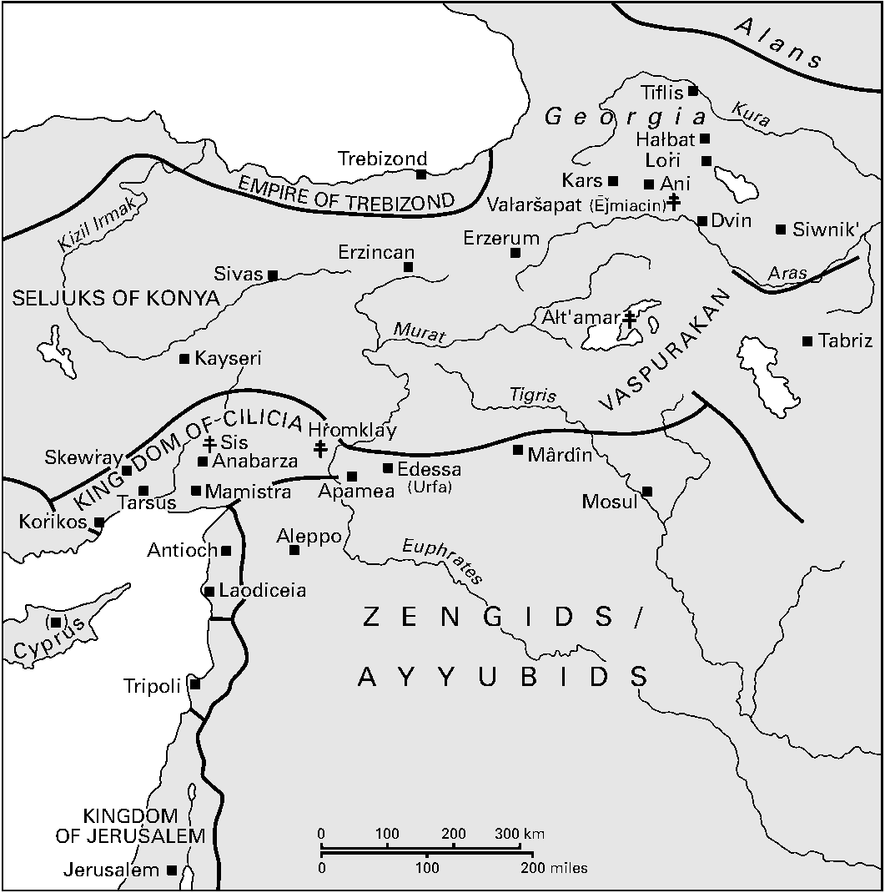

<!-- PDF page 425; original page 404 -->

# 第17章 十字军时代的亚美尼亚人（1050—1350年）

S. 彼得·考伊

本时期基督教世界的决定性问题，无疑属于教会论。对亚美尼亚人而言，表现为与其他基督教传统重启辩论。这些传统在古代晚期的拜占庭、西欧及近东出现：共同的教父基础，发展为各具特定重点、形式与表达的教义、礼仪及秩序组合。

亚美尼亚历史进入阿拉伯时期，也开启巩固阶段，以奥兹恩的霍夫汉任教会总主教（717—728年）为开端。[^p425-1] 主教会议重申亚美尼亚基督一性论，不仅以正统方式澄清基督肉身不可朽坏的独特教义，也把它与1月6日合庆基督降生及受洗，以及圣餐使用无酵饼、不掺水的葡萄酒，在教义上相联。[^p425-2] 面对广泛传播、反对圣像的保罗派，教会维护自身机构结构、圣事及具象艺术的合法性。教义与教会法汇编被编成，历史身份感逐渐增强，表现为扩充圣徒纪念历，突出本地圣徒、尤其殉道者，并以赞美诗、圣徒传及颂文，庆祝其成就。[^p425-3] 尤其重要的是，各种神学立场的亚美尼亚人，都特别敬礼启蒙者圣格里高利；

<!-- PDF page 426; original page 405 -->

*地图6 中世纪亚美尼亚。比例尺分别以千米及英里标示。*

| 原图标注 | 中文 |
| --- | --- |
| Alans | 阿兰人 |
| Georgia | 格鲁吉亚 |
| EMPIRE OF TREBIZOND | 特拉布宗帝国 |
| SELJUKS OF KONYA | 科尼亚塞尔柱人 |
| VASPURAKAN | 瓦斯普拉坎 |
| KINGDOM OF CILICIA | 奇里乞亚王国 |
| ZENGIDS / AYYUBIDS | 赞吉王朝／阿尤布王朝 |
| KINGDOM OF JERUSALEM | 耶路撒冷王国 |
| Tiflis | 第比利斯 |
| Halbat | 哈格巴特 |
| Lori | 洛里 |
| Kars | 卡尔斯 |
| Ani | 阿尼 |
| Vałaršapat (Ējmiacin) | 瓦加尔沙帕特（埃奇米阿津） |
| Dvin | 德温 |
| Siwnik′ | 休尼克 |
| Trebizond | 特拉布宗 |
| Sivas | 锡瓦斯 |
| Kayseri | 开塞利 |
| Erzincan | 埃尔津詹 |
| Erzerum | 埃尔祖鲁姆 |
| Ałt‘amar | 阿赫塔马尔 |
| Tabriz | 大不里士 |
| Skewray | 斯凯夫拉 |
| Sis | 西斯 |
| Hṙomklay | 赫罗姆克拉（鲁姆堡） |
| Anabarza | 阿纳巴尔扎 |
| Mamistra | 马米斯特拉 |
| Tarsus | 塔尔苏斯 |
| Korikos | 科里科斯 |
| Antioch | 安提阿 |
| Apamea | 阿帕米亚 |
| Aleppo | 阿勒颇 |
| Edessa (Urfa) | 埃德萨（乌尔法） |
| Mârdîn | 马尔丁 |
| Mosul | 摩苏尔 |
| Laodiceia | 老底嘉 |
| Tripoli | 的黎波里 |
| Jerusalem | 耶路撒冷 |
| Cyprus | 塞浦路斯 |
| Kizil Irmak | 克孜勒河 |
| Murat | 穆拉特河 |
| Kura | 库拉河 |
| Aras | 阿拉斯河 |
| Tigris | 底格里斯河 |
| Euphrates | 幼发拉底河 |

他在4世纪初，确立基督教为亚美尼亚宫廷宗教。[^p426-4]

上述教会对话的历史进程，很大程度上由这一时代几次大规模人口移动决定：11世纪中叶塞尔柱土耳其人从东方到来，13世纪蒙古人随之，1380年代又有帖木儿势力；十字军则带来与西方不断涌现的军事、教会及商业接触。这些接触不可避免地突出宗教差异，产生许多摩擦。

<!-- PDF page 427; original page 406 -->

尽管如此，仍发生大量交流，为参与其中的各教会体制留下印记。

## 动荡与重组时期，1050—1150年

本时期开始时，亚美尼亚人大规模迁居东加帕多家、原拜占庭与阿拉伯势力交界地带的进程，已深入第三、也是最后阶段。它始于880年代巴西尔一世时期拜占庭推进，旨在以基督徒重新充实人口；963年后尼基弗鲁斯二世·福卡斯治下更具动力，亚美尼亚人成为人口多数。884年重建的亚美尼亚王国，其西部三个主要继承国家的王族及大部分贵族，逐渐迁至这里，使过程达到顶点。[^p427-5] 1022年，瓦斯普拉坎国王塞内克里姆—霍夫汉内斯，在拜占庭及最初塞尔柱入侵双重压力下，把王国遗赠帝国；阿尼的阿绍特四世于1039年效法。亚美尼亚人遂成为帝国臣属，处于外来拜占庭官僚结构之下，领土重组为军区。[^p427-6]

教务可见平行过程，使希腊、亚美尼亚与雅各派共同体，以及通德拉克异端，再度接触，产生多种结果。其中之一，是980年代教会总主教哈奇克倡议，设立与拜占庭主教座平行的叙利亚及亚美尼亚主教座。这可能出乎君士坦丁堡宫廷预料，反而因仪式、教义差异彼此不能接受，引发宗派间族群与宗教论战，导致改变教会归属的信徒重新受洗。[^p427-7] 亚美尼亚世俗权力被整合并失去作用，鼓励君士坦丁堡牧首试图压制亚美尼亚教会总主教座。彼得罗斯教会总主教于1045年被召赴君士坦丁堡进行神学讨论，两年后再次。为抵御拜占庭压力，他<!-- PDF page 428; original page 407 -->违背惯例，预先祝圣侄子为继承人。后者1058年就职，一年后被新皇帝君士坦丁十世·杜卡斯召至首都，要求接受迦克墩基督论，以及君士坦丁堡牧首最高权威，亦即放弃自主。拒绝后，他被囚至1062年，再被限制居于塞巴斯特亚。三年后去世，皇帝起初禁止新选举，后来以亚美尼亚卡尔斯王国割让为交换而让步。[^p428-8] 最终获准当选教会总主教的候选人，是热爱希腊文化的瓦赫拉姆。他早先已服务拜占庭，从1048年起，担任美索不达米亚都督十年，其间毁坏通德拉克宗派据点、驱散成员。[^p428-9] 他出身帕赫拉武尼家族，自称启蒙者圣格里高利后裔。获祝圣为格里戈尔二世，开启此后一个半世纪，这一家系连续不断的教会首领序列。

11世纪后半叶，塞尔柱于1064年攻取阿尼，1071年又在曼齐刻尔特决定性击败拜占庭军，巩固安纳托利亚权力。由此出现的权力真空，使亚美尼亚人在托罗斯山脉以南山地建立实际自治。[^p428-10] 相对安全使亚美尼亚政治重心南移，形成一系列小封邑，逐渐发展为奇里乞亚新王国（1198—1375年），在本时期余下岁月，于地区政治与宗教史中发挥重要作用。[^p428-11]

亚美尼亚民族的破碎分散，鲜明体现在教会总主教格里戈尔二世（1065—1105年在任）不断旅行，为广布的羊群服务。亚美尼亚小王公想到以往先例，努力说服他居于自己领地，以加强合法性主张。纯粹实际需要，迫使格里戈尔把其他人提升为教会总主教，使其有权在<!-- PDF page 429; original page 408 -->当地作必要决定。[^p429-12] 因此，自1069年起，洛里人盖沃尔格与阿普勒加里普·阿尔茨鲁尼同居塔尔苏斯；彼得罗斯教会总主教的侄子萨尔吉斯，于1073年居于利坎多斯霍尼、菲拉雷托斯·布拉哈米奥斯，即瓦赫拉姆的领地；格里戈尔的侄子巴尔塞格，在阿尼获祝圣为主教，八年后在哈格巴特升为教会总主教。哈格巴特是残存洛里—塔希尔小型巴格拉提德王国主要修道院之一。另有证据，格里戈尔曾访埃及，并任命同名侄子，作为当地扩张中的亚美尼亚共同体最高教会权威。别处则因分离倾向而采取类似行动：瓦斯普拉坎希望至少在教会领域维持独立王国地位，于1113年宣布阿赫塔马尔为独立教会总主教座，由此产生的分裂，直到1441年才解决。相似地，12世纪初，鲁姆塞尔柱人似乎曾短暂考虑，把塞巴斯特亚主教阿纳尼亚立为对立教会总主教，以分隔其治下亚美尼亚人与其他亚美尼亚教会。[^p429-13] 更晚些，马穆鲁克反对奇里乞亚亚美尼亚宫廷亲拉丁方向，看来成为1311年设立耶路撒冷亚美尼亚牧首区的因素之一，意在管辖马穆鲁克地区的亚美尼亚基督徒。[^p429-14]

同时，这也符合愈加分散的共同体之属灵需要。11世纪中叶，过境贸易正常节律遭破坏，加剧亚美尼亚商人与手工业者外迁，在较安定的克里米亚、基辅罗斯、波兰及黑海西岸，使远方同胞人数增加。他们也定居意大利各港。[^p429-15] 甚至与冰岛有贸易联系；记载有三位亚美尼亚“主教”抵达，推测应挪威国王哈拉尔·西居尔松邀请。[^p429-16] 另一些亚美尼亚商人，先被塞尔柱人、后被蒙古人驱逐向东，在伊朗东北形成繁荣聚居地。[^p429-17]

<!-- PDF page 430; original page 409 -->

亚美尼亚人以军事才能广受重视。拜占庭战败后，一些有进取心的将领前往法蒂玛埃及。亚美尼亚人巴德尔·贾马利（1074—1094年在任），建立延续近一个世纪的维齐尔世系。他们大多改信伊斯兰，却庇护当地较早建立的亚美尼亚基督徒共同体，使其经历某种复兴。表现是建造约三十所教堂与修道院，其中索哈杰附近白修道院保存最好，具有凯松画家狄奥多尔所绘数幅壁画及铭文。[^p430-18]

亚美尼亚人虽常警惕拜占庭霸权野心，本时期许多人仍视君士坦丁堡为近东基督教世界的首要代表。首都亚美尼亚人口增长，利用其交通枢纽地位，重启从希腊语到亚美尼亚语的翻译。活动对11及12世纪亚美尼亚圣徒月录（yaysmawurk‘），以及圣亚他那修礼仪的发展，有重大影响；后者借用归于圣金口约翰的拜占庭对应礼仪要素。[^p430-19] 此外，精力充沛的格里戈尔二世，因委托从希腊语、叙利亚语译出一系列圣徒传及其他文本，赢得“敬爱殉道者”（Vkayasēr）之号，几位继任者又把事业推进至13世纪末。[^p430-20] 这些工作多聚焦尚无亚美尼亚语版本的古代教父作品；拜占庭及格鲁吉亚控制区内的亚美尼亚迦克墩派译者，则强调迦克墩会议之后的教父，如圣约翰·克利马库斯及大马士革的圣约翰。[^p430-21] 其修道院，如13世纪在北部洛里繁荣的科拜尔、基兰茨，以及阿赫塔拉，亦称普伦贾汉克，显示中期拜占庭偏好的壁画布局，<!-- PDF page 431; original page 410 -->覆盖教堂全部墙面，与中世纪亚美尼亚教堂通常较朴素的装饰不同。[^p431-22]

11世纪后期的新现象，是亚美尼亚与拉丁教会开始联系，随后四个半世纪不断展开；背景是12世纪教皇政策，试图使各种“分裂”的东方教会，在罗马首席权下合一。最初示好于1080年，由教皇格里高利七世致教会总主教格里戈尔二世；有些人说后者此前曾访罗马。[^p431-23] 这一接触开启丰富多样的教会、神学、政治及文化交流，在近东不同地区，并通过西方亚美尼亚共同体进行。因此，西方人对亚美尼亚人的了解，可能确比其他“东方”基督教派更多。

第一次十字军中，直接联系建立起来。鲁本王朝的科斯坦丁一世等亚美尼亚王公，协助十字军穿过奇里乞亚赴安提阿；埃德萨信奉迦克墩教义的亚美尼亚统治者托罗斯，则于1098年欢迎布洛涅的鲍德温入城，城市不久变成十字军伯国。亚美尼亚人与耶路撒冷王国（1099—1187年）早早建立融洽关系，其三位王后具有亚美尼亚血统。[^p431-24] 这些年，多位亚美尼亚显要朝圣，包括教会总主教格里戈尔三世及其兄弟涅尔塞斯；他们先在安提阿参加类似会议，再于1141／1142年陪教皇使节阿尔贝里希，出席最后晚餐厅的会议。同年，教皇欧根尼三世与教会总主教也友好通信。[^p431-25]

但这些无法掩饰，近东地缘政治主动权，已转入摩苏尔埃米尔赞吉及其子努尔丁手中。赞吉于1128年控制阿勒颇，1144年再取埃德萨，引发第二次十字军（1147—1148年）。其失败为努尔丁1154年兼并大马士革、1169年兼并埃及铺路。成功使某些亚美尼亚人，例如托罗斯亲王的兄弟姆莱赫，深信与之和睦有利，甚至改信伊斯兰，与努尔丁结盟；<!-- PDF page 432; original page 411 -->努尔丁本人也娶了亚美尼亚公主。兄长死后，姆莱赫从流亡归来，在赞吉王朝支持下夺权，统治变化不定：1172年击败安提阿与耶路撒冷联军，次年从拜占庭夺回奇里乞亚大部分海岸。但1174年努尔丁去世，他随即死于宫廷政变。这个动荡插曲，凸显当时亚美尼亚生活的不安定，也反映于缺乏重大艺术作品。

## 修道生活

9世纪后期起，巴格拉提德王国的财富，通过贵族、后来富商的大量捐赠，表现为虔敬，推动亚美尼亚修道院建设显著增长。[^p432-26] 事实上，此时多数教堂建于大型修道建筑群中。它们吸收称为“加维特”（gawit‘）的世俗建筑形式，作为日课、授课、抄稿、安葬等重要空间；此后四世纪扩展中，逐渐增设图书馆、食堂及钟楼，以及供院内使用的榨油、榨酒设施。[^p432-27] 规模是与早期的重要区别：新的共住制修道院，有时容数百修士，日常生活常依圣巴西略会规，由“瓦尔达佩特”监督；他们是获准讲道及教学的神学博士，其职责和声望，如今进入最具影响的阶段。[^p432-28] 此外，捐赠者慷慨，使共同体迅速成为强大经济单位，拥有大量地产、人力及磨坊等设备，不同于过去洞穴或简陋木造院舍。[^p432-29] 修道院也空前成为高等学术机构，采用结构化课程，集中阐释《圣经》、教父作者及一套希腊古代教科书。[^p432-30] 斯凯夫拉等修道院抄经室，在抄写及彩饰之精致上，可媲美<!-- PDF page 433; original page 412 -->赫罗姆克拉教会总主教座。[^p433-31] 亚美尼亚高地及奇里乞亚之外，安提阿附近黑山有一系列亚美尼亚修道院，同期也有希腊、格鲁吉亚、叙利亚及拉丁共同体，因此促进跨地域交流。当时最著名的亚美尼亚中世纪高等学术修道中心，设于休尼克的格拉佐尔，活动年代为1280—1340年。在负责人埃萨伊·恩切齐领导下，声望大增，学生从亚美尼亚各地来学。[^p433-32]

亚美尼亚修道院的灵修模式，明显从早期外在苦修，转向更强烈关注内在生活，反映这一时代广泛关切；拜占庭及正在发展的伊斯兰苏菲传统，也有类似现象。后者又似乎受尼尼微的圣以撒等较早基督教神秘作家影响。[^p433-33] 从保罗派基础形成的通德拉克派，其基本信条可视为这一取向的极端表现。它威胁对道成肉身、钉十字架及复活的救恩安排作正确理解，因此激发多种媒介回应：从学术性教义论著，到亚美尼亚特有“哈奇卡尔”（xačk‘ar）纪念物的广布，即以无数图式精雕十字架的大型矩形石碑。[^p433-34] 迫害使该派转入亚美尼亚地形难达之处，周期性重现，最晚延至19世纪。[^p433-35] 其他人逃往或被驱往保加利亚菲利波波利斯亚美尼亚中心；地理迁移中，信仰体系也转变，影响后来波格米勒派及阿尔比派等宗派。[^p433-36]

<!-- PDF page 434; original page 413 -->

## 与拜占庭讨论教会合一

1165年，姆莱赫流亡、发展穆斯林联系之际，涅尔塞斯·什诺尔哈利主教与帝国大马厩长阿莱克修斯·阿克苏赫，在奇里乞亚战役中偶然交谈，开启断续的神学讨论，探讨与拜占庭教会接近的可能，直到1180年曼努埃尔一世·科穆宁皇帝去世。[^p434-37] 皇帝把谈判交给经验丰富的神学外交家狄奥里阿诺斯，任务是实现曼努埃尔目标：维持安提阿附庸地位，作为权威南扩耶路撒冷、北扩科尼亚苏丹国的基础。1171年皇帝提出九项接受条件，包括承认最后四次大公会议、宣认迦克墩定义并绝罚否认者、从《三圣颂》删除“为我们被钉十字架者”，以及若干仪式问题，如圣餐使用有酵饼及掺水酒，还有教规规定，教会总主教任命须获皇帝确认。[^p434-38] 涅尔塞斯试图召开主教会议审议，却未及实现便去世。其继任者格里戈尔·特格哈伊（1173—1193年在任）时期，经过更多讨论，1178年终于有三十三位高级教士及院长，连同雅各派代表及高加索阿尔巴尼亚教会总主教，在赫罗姆克拉集会，提出平衡审慎的答复。在基督论等领域，他们“为教会和平”表现和解；另一些领域，则坚持举证责任在希腊方面，例如证明最后四次会议不违背前三次，以及指出《三圣颂》附句源于希腊而非亚美尼亚。[^p434-39] 值得注意的是，他们处理教会总主教座地位及继承问题的方式，显示安提阿已在多大程度上成为亚美尼亚教会抱负的焦点，世俗领域亦然。签署者同意皇帝确认，条件是此后承认亚美尼亚教会总主教为<!-- PDF page 435; original page 414 -->安提阿牧首，从而维持自主。[^p435-40] 几乎同时代，尼洛斯·多克索帕特雷斯论五大牧首辖区的希腊语著作，此时被译为亚美尼亚语，显然参与了有关亚美尼亚主教座地位的讨论。[^p435-41]

然而，这些会议敕令，并不代表当时亚美尼亚教会所有意见。反对来自统称“北方瓦尔达佩特”的学者及高级教士。[^p435-42] 后来一个问题，很能说明其尊重传统：亚美尼亚军队，在格鲁吉亚宫廷显贵扎卡雷与伊瓦内·埃尔卡伊纳巴祖克兄弟指挥下，参与格鲁吉亚战役。格鲁吉亚人已获准行军时在便携祭台举行礼仪，亚美尼亚军队却未获准引入。西斯会议虽于1204年许可，北方严格派仍不遵从，在扎卡雷召集的洛里地方会议（1205年）及阿尼首都会议（1207年）阻止措施，迫使他通过军纪强行实施。[^p435-43]

另一端，一些亚美尼亚教士较少关注自身宗派传统历史先例，或教会谈判中机构利益，而诉诸教会作为基督身体的属灵实在，肯定它是基督教世界根本合一的基础。包括姆希塔尔·戈什（约1140—1213年），以及下一代大亚美尼亚的瓦尔丹·艾盖克齐（约1170—1235年）。[^p435-44] 13世纪，民众诗人弗里克表达另一种基督教合一观点：缺乏合一是穆斯林推进的重要因素；他接着列出各教会妨碍更大凝聚合作的主要弱点。[^p435-45]

<!-- PDF page 436; original page 415 -->

此时最积极在最高层从事跨宗派接触的亚美尼亚教士，是年轻的塔尔苏斯总主教涅尔塞斯·兰布罗纳齐（1153—1198年）。其常被引用的话说：“西班牙与东方，都是一个头的肢体；希腊人与蛮族、亚美尼亚人与格鲁吉亚人、叙利亚人与埃及人〔科普特人〕，亦然。一切都在祂里面，以圣灵相联，藉信仰披戴祂。”[^p436-46] 1197年，他率亚美尼亚代表团，赴拜占庭皇帝阿莱克修斯三世·安格洛斯及牧首乔治·希菲利诺斯处，澄清与皇帝起初愿授奇里乞亚亲王列翁王冠、使领地升为王国相关的宗教问题。讨论延至五旬节，无果而终。而且，皇帝此举看来受消息刺激：亚美尼亚与德意志皇帝就同一目的谈判，已大有进展。涅尔塞斯也参与这些谈判，1190年曾奉派迎接进入奇里乞亚的腓特烈·巴巴罗萨，却得知其早逝。[^p436-47] 但他利用机会，把教皇卢修斯三世所送拉丁礼仪书、加冕礼规及圣本笃会规，译为亚美尼亚语。[^p436-48] 此时，亚美尼亚人也采用拉丁主教高冠、戒指及牧杖，代替拜占庭式主教冠冕；后者如今转由普通司祭使用。

## 与拉丁教徒的教会合一

12世纪末，奇里乞亚世俗及教会利益，聚焦德意志帝国与教皇，应置于拜占庭在保加利亚、塞尔维亚及塞浦路斯受挫的背景理解；塞浦路斯1184年宣布独立，七年后落入十字军。1190年代，这些政体在正式服从教皇最高权威后，都获得帝国承认。亚美尼亚效法，亲王列翁（1198—1219年在位），于1198年1月6日在塔尔苏斯原希腊圣索菲亚教堂、王国最大教堂加冕为王，<!-- PDF page 437; original page 416 -->由美因茨总主教、维特尔斯巴赫的康拉德主礼。[^p437-49] 总主教前一年抵达，带着英诺森三世指示，要亚美尼亚承认罗马首席权，并在若干事务上与罗马惯例一致，包括用固定历法安排圣徒庆日，取代以复活节周期决定的亚美尼亚传统移动体系；以及在圣诞斋期与大斋期开斋时，只食鱼与橄榄油。[^p437-50] 列翁在塔尔苏斯召开主教会议批准，只有十二位主教签署，意见却占上风。[^p437-51]

12世纪各亚美尼亚共同体亲西方情绪增长，可从《论敌基督讲辞》（Sermo de Antichristo）等经外作品看出；它们包含与塞尔柱入侵相联的亚美尼亚末世期待。高峰是《协和书简》（Dašanc‘ t‘ułt‘），[^p437-52] 声称叙述最早基督徒君王君士坦丁一世与特尔达特三世在罗马会面，更重要的是，首位亚美尼亚教会总主教启蒙者格里高利，受教皇西尔维斯特教导、祝圣。文书声称，各方同意划分教会及世俗权力的行使。[^p437-53] 其用意显然是说，服从教皇、与西方结盟，将明显有利于巩固亚美尼亚近东权力基础。随后数世纪，与教皇交流时常诉诸这一讯息。

前面已指出，奇里乞亚与安提阿，发展出密切却复杂的关系。共同利益使其联合对抗拜占庭，但内部竞争也引发严厉背信与报复。1170年代起，亚美尼亚教会抱负聚焦安提阿牧首座。的确，在教皇领导下合一的一项好处，是使亚美尼亚教会总主教摆脱拉丁牧首干预；后者仍主张塔尔苏斯及马米斯特拉主教座管辖权，这些城市<!-- PDF page 438; original page 417 -->归亚美尼亚控制时，原有拉丁主教。[^p438-54] 两国教会互动的另一方面，是列翁亲王对雅各派政策。1192年，他任命狄奥多尔·巴尔·瓦赫本为对立牧首，试图使地区雅各派共同体归其管辖。[^p438-55] 1187年萨拉丁攻击后，安提阿领土缩减、被迫与的黎波里联合，逐渐衰落，有利于列翁以巧妙联姻取得优势。但安提阿王公家族各成员竞争主张，加上意大利商人共同体利益，直到其统治结束，都使他未能得逞。

## 教皇传教举措

13世纪前半叶创立的道明会与方济各会，两大托钵修会的传教精神，加上结构灵活、纪律及制度组织，使其成为前所未有的属灵力量，劝亚美尼亚及其他东方基督徒改宗，并推进教皇外交。方济各会在奇里乞亚设立多处中心，该世纪中日益重要，涉及宗教艺术等领域。[^p438-56] 赫图姆二世（1289—1301年在位）尤其请求教皇，派六位修士作私人宫廷随从，后来自己也加入修会。[^p438-57] 道明会建立联系起步较慢，但下个世纪更关键。

这是蒙古支配时期，初期动荡后，有利于亚美尼亚教会。1255年起，它免向蒙古纳税。[^p438-58] 奇里乞亚赫图姆一世（1226—1269年在位），以及大亚美尼亚若干王公，谨慎接受蒙古宗主权，保护臣民免遭任意<!-- PDF page 439; original page 418 -->勒索。因此，13世纪中叶，两片亚美尼亚地区均享相当稳定繁荣，鲜明对照于十字军诸国挣扎维持地位；1204年拉丁人征服君士坦丁堡，也几乎致命打击拜占庭力量。在此背景下，应理解亚美尼亚人为何不愿进一步探讨列翁一世所公布与罗马合一的含义。

1243年，教会总主教科斯坦丁·巴尔兹尔贝尔德齐（1221—1267年在任），对英诺森四世询问是否承认终傅圣事及其他礼仪，积极答复。但其长期任内讨论的更实质问题，和子句及彼得首席权，只显露双方分歧程度。1245年3月25日，第一次里昂会议前夕，教皇派往东方的使者，包括方济各会士阿拉贡的多明我，任务是取得亚美尼亚信仰宣认。赫图姆一世与导师瓦尔丹·阿雷韦尔齐讨论时，后者写出一份拉丁教会十五项错误的简编作为回应。[^p439-59] 1247年在圣达太修道院新设总主教座，也可能是反对教皇首席权的回应之一。圣达太不仅传统上保证亚美尼亚教会的使徒性，[^p439-60] 其修道院还靠近伊朗西北马库附近的蒙古夏营。

同样，1251年西斯会议虽接受和子句教义，却激起大亚美尼亚教会强烈反应，威胁另立教会总主教、造成分裂。瓦纳坎博士与瓦尔丹·阿雷韦尔齐，似乎都接受圣灵双重发出的正统性，至少对神学造诣较深者如此，对普通民众却未必。但其语言、意象似乎表明，他们心目中或是圣灵在救恩安排中的活动，或是教父公式“从父、经子、在圣灵中”。拉丁论战者觉得这些表述不能令人满意。[^p439-61]

此外，1262年阿卡，姆希塔尔·斯凯夫拉齐与使节托马斯·阿涅·德·伦蒂诺，就彼得首席权激烈冲突，促使教皇派道明会士威廉·弗雷内赴奇里乞亚，试图恢复更友好<!-- PDF page 440; original page 419 -->气氛。[^p440-62] 亚美尼亚人未参加1274年第二次里昂会议，正与此前对教皇示好的保留相符；连伊儿汗都应格里高利十世邀请，派代表与会。[^p440-63]

## 贸易路线促进宗教交流

“蒙古治世”的有利条件，增加经新伊儿汗中心大不里士，把中国、中央亚洲、俄国、南高加索及小亚细亚相连，再通往奇里乞亚阿亚斯港的贸易；意大利船只从那里把东方商品运往西欧。另有较北的陆路，经过埃尔祖鲁姆、埃尔津詹及锡瓦斯。[^p440-64] 许多亚美尼亚商人参与，使各转口地形成共同体、建造教堂。[^p440-65] 拉丁托钵修会也受益。方济各会在亚美尼亚人口可观的埃尔祖鲁姆、圣达太、萨尔马斯、卡尔皮、第比利斯、苏丹尼耶及大不里士设中心，道明会则在大不里士及马拉盖有院舍。[^p440-66] 很快有人抱怨，罗马教义已渗入奇里乞亚、拜占庭主要城市及巴格拉提德旧都阿尼，如今又侵入大亚美尼亚。[^p440-67]

埃尔津詹的情况，或许最为我们熟知；它有13、14世纪最活跃的亚美尼亚商人、手工业共同体之一。周边乡村由土库曼人主导，当地门居贾克宫廷赞助波斯文化。[^p440-68] 文学与教规资料，暗示共同体间有一定交往，有时以婚姻及家族联盟巩固。[^p440-69] 例如，1280年制定的亚美尼亚城市青年兄弟会规章，<!-- PDF page 441; original page 420 -->反映纳西尔哈里发较早改革类似穆斯林组织的影响；[^p441-70] 13世纪末科斯坦丁·埃尔津卡齐以基督为中心的寓意诗，首次把波斯玫瑰与夜莺爱情主题，引入亚美尼亚文学，暗示熟悉苏菲诗歌中与神圣爱者神秘合一的意象。[^p441-71] 但也有紧张暗流，使塞尔柱人于1270年代中期，配合马穆鲁克苏丹拜巴尔斯进攻奇里乞亚，协调一系列反亚美尼亚袭击。[^p441-72]

前一个十年，马穆鲁克巩固近东权力，1260年控制叙利亚，随后在艾因贾鲁特战役击退包括亚美尼亚部队的蒙古军。此后一个多世纪，直至1375年奇里乞亚王国最终覆灭，支持蒙古、与西方结盟，使亚美尼亚人成为马穆鲁克特别愤怒的对象。他们成为亚美尼亚主要敌人，在口头史诗《萨孙的勇士》中留下印记，主要对手是姆斯拉·梅利克，即埃及王。依典型史诗方式，冲突以“小中见大”表现，呈现向基督徒横征暴敛、毁坏修道院、基督徒与穆斯林家庭关系等历史联系。[^p441-73]

13世纪末，政治军事局势决定性转为不利奇里乞亚亚美尼亚人。金帐汗国术赤系蒙古人，以伏尔加下游萨莱为中心，接受伊斯兰，与马穆鲁克联合。1291年，后者攻取大陆最后十字军据点阿卡；次年攻击亚美尼亚教会总主教座赫罗姆克拉，俘虏在任的斯特帕诺斯四世。继任者格里戈尔·阿纳瓦尔泽齐（1293—1307年在任）被迫迁居奇里乞亚首都西斯，面对赫图姆二世外交举措的教会后果。国王把两位姐妹，分别许配塞浦路斯吕西尼昂王室，以及拜占庭帕莱奥洛格王朝，引发基督教合一问题。[^p441-74] 阿纳瓦尔泽齐呼吁亚美尼亚人，“在这堕落时代”，<!-- PDF page 442; original page 421 -->“与希腊人及一切民族”合一，至少部分出于务实考虑。[^p442-75] 但其修订《圣徒月录》时，纳入拜占庭与罗马圣徒纪念历，清楚显示广博学识，也证明精通希腊语与拉丁语。[^p442-76] 此外，他致国王的著名信件表明，立场并非只由实用主义决定，教会合一问题对他分量甚重。他认同6世纪以来亚美尼亚迦克墩派圈子发展的观念：真正追随圣格里高利，意味着与普世教会共融。[^p442-77] 这解释为何他建议，亚美尼亚教会接受所有大公会议，因而接受迦克墩基督论定义。他起初反对圣餐酒加水，但教父权威的分量使其信服。[^p442-78] 格里戈尔仍忠于自身传统，可见于拒绝教皇进一步要求：他反对堂区司祭独身，也不觉得大斋期吃鱼与油需要教皇许可；虽承认罗马圣座首席权，也承认其他四个古代东方牧首区的尊严。[^p442-79]

大亚美尼亚的反对力量，如今集中于南部休尼克奥尔贝良家族；该家族1256年起，以“因朱”（inju）直属领地形式，直接归蒙古宗主权，其势力日升。[^p442-80] 1290年代，家族成员与其他贵族、高级教士，在斯特帕诺斯·奥尔贝良总主教主持下秘密集会，保护现状，反对与教皇订约。他们主张，亚美尼亚教会建立于单一教会传统：由使徒达太及巴多罗买创立，圣格里高利发展，前三次大公会议界定，并由<!-- PDF page 443; original page 422 -->5世纪以来一系列地方主教会议加以维护；这些会议把迦克墩会议视为隐蔽的涅斯托里乌斯主义，而予以拒绝。[^p443-81] 因此，他们要求格里戈尔停止一切迦克墩派联系，不再与之于12月25日庆祝降生，而守圣雅各所定庆日，亦即亚美尼亚惯例所源出的早期耶路撒冷经课。[^p443-82] 面对上级可能诉诸国王军事干预，奥尔贝良慷慨陈词：“为保存使徒教父传统，我们准备受苦、流亡、入狱与死亡。”[^p443-83] 他也首次呼吁，赴奇里乞亚的贵族返回大亚美尼亚，教会总主教座返回古址埃奇米阿津修道院。[^p443-84]

新世纪出现数次孤注一掷的尝试，希望订立拉丁—亚美尼亚—蒙古大联盟，对抗马穆鲁克。其中，伊儿汗合赞于1302年与基督教诸国通信，却无结果。1305年蒙古军未能阻止马穆鲁克入侵后，亚美尼亚贵族科里科斯的赫图姆，西行继续讨论。1307年8月，他在普瓦捷，应教皇克莱孟五世要求，撰写蒙古史《东方诸国史之花》（La flor des estoires de la terre d’orient）。[^p443-85] 同年，教皇坚持再开西斯会议，批准阿纳瓦尔泽齐趋向罗马正统的神学与礼仪调整。[^p443-86] 但会议不能代表整个教会，大亚美尼亚高级教士明显缺席。保守高级教士盖沃尔格·斯凯夫拉齐传记，记载广泛民众抗议，继而引发一系列向塞浦路斯的驱逐。[^p443-87] 蒙古人的反应，可从列翁三世国王及其叔、已成方济各修士的赫图姆二世，<!-- PDF page 444; original page 423 -->同年稍后拜访当地蒙古统治者时，连随从一起被杀看出。

## 穆斯林与基督徒的敌对

1295年6月，伊儿汗合赞改信伊斯兰，使伊朗宗教格局迅速变化，蒙古当局更难维持秩序与宗教平衡。[^p444-88] 合赞禁止佛教教士留在伊朗；将领纳兀鲁思攻击纳希切万、阿尔塔兹及马拉盖基督教堂，随后却因过度行为受罚。这鼓励赫图姆二世于1299年请求合赞，缓和无辜受苦的非穆斯林处境。

合赞之弟及继任者完者都的宗教转变，更显示权力平衡变化迅速。他最初受洗名尼古拉，纪念新教皇尼古拉四世，随后接受逊尼派信仰，最终改奉什叶派伊斯兰。[^p444-89] 其任内（1304—1316年），歧视基督徒增加，促使更多亚美尼亚人迁往奇里乞亚及克里米亚。强迫改宗、征新税及颁新规继起；1307年一则抄本题记说，基督徒须佩戴蓝布，以便公众辨认。[^p444-90] 这些措施逐渐削弱纳哈拉尔，即上层贵族的地位；其社会政治结构，自帕提亚时代便为亚美尼亚人提供区域凝聚。有些家族被迫离土，另一些则把所有权转给通常出自同一家族的主教，保持间接控制；因为伊斯兰法保护“瓦克夫”（waqf）宗教信托，通常不征税。因此，在埃尔津詹及马库等数个亚美尼亚主教座，以及阿赫塔马尔和高加索阿尔巴尼亚教会总主教座，藉“王公主教”（parontēr）制度，继承于同一家族直系延续多代。[^p444-91] 这一<!-- PDF page 445; original page 424 -->过程不可避免地铺路，使亚美尼亚人逐渐在法律上被承认为族群宗派实体。

## 大亚美尼亚的亚美尼亚—拉丁互动

1318年，依阿维尼翁教廷更重传教的特点，约翰二十二世在近东与远东设两大教区，分别交道明会、方济各会。前者以伊儿汗首都苏丹尼耶为中心，使主教能任教皇私人使节，并设六个附属主教座，其中锡瓦斯、大不里士、马拉盖三处，亚美尼亚人口可观。[^p445-92] 教皇通信显示，他深涉亚美尼亚事务，了解充分。[^p445-93] 他近来已施压召开1316年阿达纳会议，再确认九年前西斯决议，并希望比以往更系统接触大亚美尼亚高级教士。[^p445-94]

马库王公家族的阿尔塔兹人扎卡里亚，是关键人物；1298至约1340年，他在圣达太修道院，任教会总主教的东方特派代表。作为格里戈尔·阿纳瓦尔泽齐的亲拉丁盟友，他是少数与会东方教士之一，会后进一步接受天主教，并在与休尼克都主教霍汉·奥尔贝利通信中讨论此事。[^p445-95] 1321年，他收到教皇两封私人信，赞扬其引领灵魂回到“教会”。[^p445-96]

依教皇要求，其助手霍夫汉内斯·措尔措尔齐，在巴尔托洛梅奥·达·波焦主教帮助下，翻译托马斯·阿奎那对伦巴德的彼得《箴言四书》第四卷的注释；该卷是西方中世纪主要圣事入门书。[^p445-97] 某时，圣达太成立方济各会院，1320—1330年代，把其他拉丁经院手册及礼仪书译为亚美尼亚语。由此，亚美尼亚人接触西方亚里士多德逻辑、伦理、自然哲学，即物理学、形而上学，以及美学<!-- PDF page 446; original page 425 -->的发展，后者包括语法与文学批评；还有体现西方如何看待各种近东共同体、如何与其辩论的实用手册。[^p446-98] 这些翻译在历史上意义重大，是最早把当代拉丁思想译为其他语言的尝试之一，比德米特里奥斯与普罗霍罗斯·基多尼斯兄弟首次希腊语翻译，早一代。[^p446-99]

格拉佐尔修道学院负责人埃萨伊·恩切齐，阅读极广，十分理解教义及教会史发展。他深入接触西方思想，起初愿与拉丁教徒对话，同时完整保存亚美尼亚自主。的确，1323年，亲近同僚及继任者提拉图尔·基利凯齐，委托制作现存最早阿奎那注伦巴德彼得的亚美尼亚文抄本之一。[^p446-100] 14世纪之交《格拉佐尔福音书》的彩饰，很能显示这种平衡：有若干典型西方场景，整体却反映亚美尼亚神学与释经。[^p446-101] 如此前什诺尔哈利，恩切齐也接受，根据定义不同，可以正当地说基督有一性或二性。[^p446-102] 他性情求和，认为宜慢于争辩、快于和解与和平。同时，他主张，不平等联盟中，物质资源更丰一方，不应利用优势剥夺另一方权利。[^p446-103]

亚美尼亚学者摇摆的立场，反映神学局势流动，例如姆希塔尔·萨斯内齐，于1320年代离开前导师恩切齐，转而支持奥尔贝良对礼仪差异较“强硬”的立场。[^p446-104] 他是最早回应拉丁立场的亚美尼亚思想家之一，承认此前亚美尼亚人<!-- PDF page 447; original page 426 -->视法兰克人为弟兄，为在基督中合一而喜乐；但他发现，法兰克人的“希腊智慧”，与他所认定的道德松弛、斋戒缺乏纪律之间，有明显断裂。[^p447-105] 同时代霍夫汉内斯·塔尔贝鲁尼主张，神圣智慧通过光照传递，而非逻辑与推论，凸显当代亚美尼亚神学本质上的新柏拉图主义性质，与道明会传统的亚里士多德基础之对比。[^p447-106]

对城市生活、贸易干线较不固定的大亚美尼亚中东部传教，新设马拉盖主教座及巴尔托洛梅奥·达·波焦主教，极为重要，因为他激起亚美尼亚修士对罗马神学的好奇。极短时间中，竟前所未有地建立了附属于道明会的亚美尼亚修会团体，不同于圣达太方济各会地位，并为反宗教改革时期新一波合一派机构提供范本。1330年，主教率修士迁到休尼克埃尔恩贾克区的克尔纳修道院；随后发展也快，1331年交给修会，到1337年，已依道明会日课经与弥撒书敬拜，标志与传统亚美尼亚礼仪分离。[^p447-107] 道明会版本的圣奥古斯丁会规，成为纪律依据；1356年1月31日，英诺森六世批准团体章程，名为启蒙者圣格里高利会的“合一弟兄团”（Fratres Unitores）。[^p447-108] 新组织随后催化其他亚美尼亚合一派群体趋于一致，先是卡法圣尼古拉修道院，后是意大利亚美尼亚圣巴西略共同体，均被纳入修会。[^p447-109] 乌尔班五世于<!-- PDF page 448; original page 427 -->1362年11月20日，授予其道明会“旅行者会”（Societas Peregrinantium），即该会传教分支的特权，标志进一步融入拉丁教会。据说，世纪中叶全盛时，修会有五十所附属修道院及约七百修士，虽1347—1348年黑死病打击严重。[^p448-110]

显然，合一弟兄团比任何其他亚美尼亚教派，更彻底认同拉丁身份，仅语言方面保存亚美尼亚遗产。因此，洗礼作为进入教会的仪式，其关键问题虽不占早期拉丁、亚美尼亚差异清单的主要部分，却由其成员最常、最激烈提出，也不足为奇，尤其曼齐刻尔特总主教涅尔塞斯·帕连茨。由此，1336年亚美尼亚代表团赴阿维尼翁，寻求抵御马穆鲁克进攻奇里乞亚的援助，却因涉嫌异端被扣留。随后，应本笃十二世要求，帕连茨推动细密调查亚美尼亚信仰与实践，最终编成一百一十七条反亚美尼亚教会条目，使其与教皇关系蒙阴约二十年。[^p448-111] 除通常三一论及基督论问题外，还提出大量圣事、教会法问题，[^p448-112] 在1341／1342年西斯会议辩论。值得注意的是，逐条驳斥指控的答复，由原为圣达太修士的亚美尼亚方济各会士、大不里士的达尼尔送到阿维尼翁。[^p448-113]

## 后续发展

这种教皇审查，再次提醒我们，本时期末亚美尼亚政体的宗教复杂性。1113年在阿尔茨鲁尼旧领地另设教会总主教座，引发阿赫塔马尔分裂；虽多次试图解决，仍未成功。[^p448-114] 西斯教会总主教座名义上仍与罗马合一，宗教取向却随哪一派得势而摇摆。人们日益不满来自塞浦路斯的吕西尼昂君主，加上奇里乞亚政体内斗，<!-- PDF page 449; original page 428 -->削弱王国社会结构。马穆鲁克反复进攻，加速地方经济衰退，商人及手工业人口再次外迁。[^p449-115] 例如，与黑海热那亚商站联系，推动克里米亚及其北、西腹地亚美尼亚聚居地增长，使利沃夫等共同体扩展；其重要性获承认，世纪中叶升格主教座。[^p449-116]

1330年代起，蒙古伊儿汗衰落，大亚美尼亚愈发不稳，权力真空便利了该世纪最后二十年灾难性的帖木儿入侵。但亚美尼亚使徒教会，在马拉基亚·格里梅齐强有力的修道领导下，明显复兴；配合霍夫汉·奥罗特内齐（卒于1387年）及学生格里戈尔·塔特瓦齐的论辩技巧，从合一弟兄团手中夺回主动。[^p449-117] 其作品反对炼狱等教义，维护传统亚美尼亚基督论。同时，格里戈尔1397年神学汇编《问答之书》，显示阿奎那圣事神学，以及休·里佩林天使学、恶魔学的影响。[^p449-118] 此外，其主要著述两卷讲道集，以及1407年《宝库》（Oskep‘orik），同样显示熟悉奥古斯丁、伊西多尔、伊本·鲁世德，即阿威罗伊等人的思想，推测通过合一弟兄团翻译接触。[^p449-119]

这一阶段，亚美尼亚内部围绕与罗马合一的对话，在佛罗伦萨会议演出逻辑结局：1439年11月22日《致亚美尼亚人敕令》（Decretum pro Armenis），由教会总主教科斯坦丁六世·瓦赫卡齐，代表教会批准。[^p449-120] 但这一决定性举动，转而激起大亚美尼亚有影响<!-- PDF page 450; original page 429 -->教士同样迅速、明确的反驳。他们决定，实现前辈反复发出的分裂威胁，时机已到。因此，1441年，古都瓦加尔沙帕特的埃奇米阿津大教堂，成为对立教会总主教座，很快确立为整个教会首要主教座。[^p450-121] 亚美尼亚历史的中世纪奇里乞亚篇章，如今结束。

## 注释

[^p425-1]: A. Mardirossian, Le livre des canons arméniens (Kanonagirk‘ Hayoc‘) de Yovhannēs Awjnec‘i: église, droit et société en Arménie du IVe au VIIIe siècle [CSCO 606] (Louvain: Peeters, 2005).

[^p425-2]: S. P. Cowe, ‘Armenian Christology in the seventh and eighth centuries with particular reference to the contributions of Catholicos Yovhan Ōjnec‘i and Xosrovik T‘argmanič’, Journal of Theological Studies 55 (2004), 30–54.

[^p425-3]: Mayis Avdalbegyan, ‘Yaysmawurk‘’ žołovacunerə ev nranc’ patmagrakan aržek‘ə [《圣徒月录》汇编及其史学价值] (Erevan: Armenian Academy of Sciences, 1982), 122–36. 关于本领域最多产作者瓦尔丹·阿雷韦尔齐的简要作品概述，参见 Norayr Połarean, Hay grołner [亚美尼亚作家] (Jerusalem: St James Press, 1971), 294–9.

[^p426-4]: S. P. Cowe, ‘An Armenian Job fragment from Sinai and its implications’, Oriens Christianus 72 (1992), 148–54.

[^p427-5]: S. P. Cowe, ‘Armenian immigration patterns to Sebastia, tenth–eleventh centuries’, UCLA International Conference on Armenia Minor–Sebastia/Sivas, ed. R. G. Hovannisian (Costa Mesa, CA: Mazda Publishers, 2004), 115–24.

[^p427-6]: 参见 Robert Hewsen, Armenia: a historical atlas (Chicago: University of Chicago Press, 2001), 125–6.

[^p427-7]: 宗教论战，引发亚美尼亚教会总主教与塞巴斯蒂亚、梅利蒂内希腊都主教，以及历任雅各派牧首通信。由此产生阿纳尼亚·纳雷卡齐（卒于约985年），及同名阿纳尼亚·萨纳赫内齐（卒于约1070年）的反迦克墩驳论。

[^p428-8]: Cowe, ‘Armenian immigration patterns’, 125.

[^p428-9]: Avedis K. Sanjian, ‘Gregory Magistros: an Armenian Hellenist’, in Τὸ Ἑλληνικόν: Studies in honor of Speros Vryonis, Jr. (New Rochelle, NY: Caratzas, 1993), ii, 111–58.

[^p428-10]: 大致对应原吕坎多斯、梅利蒂内、塔尔苏斯、塞琉基亚、安提阿及埃德萨军区。

[^p428-11]: 这些领地的简明地图，参见 C. Mutafian, Le royaume arménien de Cilicie xiie–xive siècle (Paris: Éditions du CNRS, 1993), 18.

[^p429-12]: A. Kapoïan-Kouymjian, L’Égypte vue par des Arméniens (Paris: Fondation Singer-Polignac, 1988), 7–19.

[^p429-13]: Haïg Berbérian, ‘Le patriarcat arménien du Sultanat de Roum’, Revue des Études Arméniennes 3 (1966), 233–41.

[^p429-14]: Bezalel Narkiss (ed.), Armenian art treasures of Jerusalem (Jerusalem: Massada Press, 1979), 17.

[^p429-15]: G. Dédéyan, Histoire des Arméniens (Toulouse: Privat, 1982), 391–400.

[^p429-16]: Y. R. Dachkévytch, ‘Les Arméniens en Islande (XIe siècle)’, Revue des Études Arméniennes 20 (1986–87), 321–36.

[^p429-17]: A. G. Abrahamyan, Hamaṙot urvagic hay gałtavayreri patmut‘yan [亚美尼亚聚居地史简编] (Erevan: Haypethrat, 1964), 240–1.

[^p430-18]: Kapoïan-Kouymjian, Égypte, 15–16; Seda B. Dadoyan, The Fatimid Armenians [Islamic History and Civilization Studies and Texts 18] (Leiden: Brill, 1997), 85–105.

[^p430-19]: Nersēs Akinean, ‘Yovsēp‘ Kostandnupolsec‘i, targmanič yaysmawurk‘i (991)’ [作为《圣徒月录》译者的约瑟普·科斯坦德努波尔塞齐], Handēs Amsōreay 71 (1957), 1–12; H.-J. Feulner, Die armenische Athanasius-Anaphora [Anaphorae orientales 1] (Rome: Pontificio istituto orientale, 2001), 456–8.

[^p430-20]: Garegin Zarbhanalean, Matenadaran haykakan t‘argmanuteanc‘ naxneac‘ (dar D-ŽG) [古亚美尼亚译著文库（4—13世纪）] (Venice: St Lazar’s Press, 1889), xxviii–xxxi; Levon Ter Petrossian, Ancient Armenian translations (New York: St Vartan’s Press, 1992), 9–11.

[^p430-21]: S. P. Cowe, ‘Medieval Armenian literary and cultural trends (twelfth–seventeenth centuries)’, in History of the Armenian people from ancient to modern times, ed. R. G. Hovannisian (New York: St Martin’s Press, 1997), i, 311.

[^p431-22]: A. Lidov, The mural paintings of Akhtala (Moscow: Nauka, 1991).

[^p431-23]: Kapoïan-Kouymjian, Égypte, 11–13.

[^p431-24]: 鲍德温一世娶鲁本王朝托罗斯一世亲王之女阿尔塔；其女梅利桑德又嫁安茹的富尔克。鲍德温二世则娶梅利蒂内加布里埃尔之女莫尔菲娅。

[^p431-25]: A.-B. Schmidt and P. Halfter, ‘Der Brief Papst Innozenz II an den armenischen katholikos Gregor III: ein wenig beachtetes Dokument zur Geschichte der Synode von Jerusalem (Ostern 1141)’, Annuarium Historiae Conciliorum 31 (1999), 50–71.

[^p432-26]: Vrej Nersessian, The Tondrakian movement (London: Kahn and Averill, 1987), 74–5.

[^p432-27]: P. Donabédian, J.-M. Thierry and N. Thierry, Armenian art (New York: Harry N. Abrams, 1989), 195–200.

[^p432-28]: S. P. Cowe, ‘Armenological paradigms and Yovhannēs Sarkawag’s “discourse on wisdom” – philosophical underpinning for an Armenian renaissance?’ Revue des Études Arméniennes 25 (1994–95), 137–43.

[^p432-29]: 关于这些财富有时引发的民众起义，参见 Nersessian, The Tondrakian movement, 76–7.

[^p432-30]: Paroyr M. Mouradyan, ‘Les principes de la classification des livres en Arménie médiévale’, in Armenian studies in memoriam Haïg Berbérian, ed. Dickran Kouymjian (Lisbon: Calouste Gulbenkian Foundation, 1986), 591–600.

[^p433-31]: Treasures in heaven: Armenian illuminated manuscripts, ed. T. F. Mathews and R. S. Wieck (New York: The Pierpoint Morgan Library, 1994), 68–74.

[^p433-32]: G. M. Grigoryan, Syunik‘ə Ōrbelyanneri ōrok‘ (XIII–XV darer) [奥尔贝良家族时代的休尼克（13—15世纪）] (Erevan: Armenian Academy of Sciences, 1981), 241.

[^p433-33]: J. Baldick, Mystical Islam [New York University Studies in Near Eastern Civilization 13] (New York: New York University Press, 1989), 15–20.

[^p433-34]: Armenian folk arts, culture, and identity, ed. L. Abrahamian and N. Sweezy (Bloomington: Indiana University Press, 2001), 60–70; Donabédian and Thierry, Armenian art, 123–4, 205–7, figs. 67–8, 89, 105–7.

[^p433-35]: Nersessian, The Tondrakian movement, 89–96. 融合性教派arewordik‘，即“太阳之子”，遭遇相似命运；其部分成员于1170年代，在萨莫萨塔由涅尔塞斯·什诺尔哈利主持，与教会和解。

[^p433-36]: Babken H. Harut‘yunyan, Hayastani patmut‘yan atlas, I mas [亚美尼亚历史地图集，第一部分] (Erevan: Erevan State University, 2004), 60.

[^p434-37]: L. B. Zekiyan, ‘St. Nersēs Šnorhali en dialogue avec les Grecs: un prophète de l’oecuménisme au XIIe siècle’, in Armenian studies in memoriam Haïg Berbérian, 861–83.

[^p434-38]: Zekiyan, ‘St. Nersēs Šnorhali en dialogue avec les Grecs’, 866–67.

[^p434-39]: 参见 Clemens Galanus, Conciliationis Ecclesiae Armenae cum Romana (Rome: Urban Press, 1651), i, 331–44 （会议文献）; J. Meyendorff, Christ in eastern Christian thought (Crestwood, NY: St Vladimir’s Seminary Press, 1987), 35 （所涉神学问题）.

[^p435-40]: Abēl Mxit‘areanc‘, Patmut‘iwn žołovoc‘ hayastaneayc‘ ekełec‘woy [亚美尼亚教会主教会议史] (Vałaršapat: Mother See Press, 1874), 116–17.

[^p435-41]: F. N. Finck, Des Nilos Doxopatres taxis ton patriarchikon thronon armenisch und griechisch (Ēǰmiacin and Marburg: Vagarshapad, 1902).

[^p435-42]: 他们由格里戈尔·图特奥尔迪与达维特·科拜雷齐领导，集中于当时格鲁吉亚控制的领地。

[^p435-43]: Mxit‘areanc‘, Patmut‘iwn žołovoc‘ hayastaneayc‘ ekełec‘woy, 118–22.

[^p435-44]: Paroyr Muradean, ‘Dawanakan handuržołakanut‘ean ew azgamiǰean hamerašxut‘ean gałap‘arə ŽB–ŽG dareri Hayastanum’ [12—13世纪亚美尼亚宗派宽容及民族内部团结观念], Ganjasar 4 (1994), 95–108.

[^p435-45]: Frik, Frik Diwan, ed. Tirayr Melik‘ Muškambarean (New York: Melgonean Foundation, 1952), 274–80.

[^p436-46]: Nersēs Lambronac‘i, Atenabanut‘iwn vasn miut‘ean ekełec‘woy ew čaṙk’ i hambarjumn K‘ristosi ew i galust Hogwoyn Srboy [论教会合一的会议演说，及基督升天与五旬节讲道], ed. Mesrop Tałiadean (Calcutta, 1851), 35.

[^p436-47]: Anoushavan Tanielian, ‘Archbishop Nersēs Lambronac‘i’’s commentary on Wisdom of Solomon’, 未刊博士论文, Columbia University (2003), 34–5.

[^p436-48]: Nersēs Akinean, Nersēs Lambronac‘i ark‘episkopos Tarsoni keank‘n ew grakan vastaknerə [塔尔苏斯总主教涅尔塞斯·兰布罗纳齐：生平与文学成就] (Vienna: Mxitarist Press, 1956), 284–8, 302–16.

[^p437-49]: S. P. Cowe, ‘The inauguration of the Cilician coronation rite and royal ideology’, Armenian Review 45 (1992), 51, 54–5.

[^p437-50]: 亚美尼亚人传统上也以乳制品补充这些食品。

[^p437-51]: Tanielian, ‘Archbishop Nersēs Lambronac‘i’’s commentary on Wisdom of Solomon’, 37–8.

[^p437-52]: K. V. Šahnazareanc‘, Dašanc‘ tłt‘oc’ k‘nnut‘iwnn u herk‘umə [《协和书简》考察与驳斥] (Paris, 1862).

[^p437-53]: Zaroui Pogossian, ‘A revised-diplomatic edition, and a historical and textual investigation of “Letter of love and concordance between the Emperor Constantine the Great and Pope Sylvester and the King of the Armenians Trdat the Great and St. Gregory the Illuminator”’, 未刊博士论文, Central European University, Budapest (2004).

[^p438-54]: J. Richard, La papauté et les missions d’Orient au Moyen Âge (XIIIe–XVe siècles) [Collection de l’École française de Rome 33], 第2版 (Rome: École française de Rome, 1998), 43, 49–50.

[^p438-55]: P. Kawerau, Die jakobitische Kirche im Zeitalter der syrischen Renaissance (Berlin: Akademie Verlag, 1955), 68–9.

[^p438-56]: H. Evans, ‘Manuscript illumination at the Armenian patriarchate in Hṙomkla and the west’, 未刊博士论文, New York Institute of Fine Arts (1989), 153–4.

[^p438-57]: Richard, Papauté, 52.

[^p438-58]: R. Bedrosian, ‘Armenia during the Seljuk and Mongol periods’, in History of the Armenian people, ed. R. G. Hovannisian, i, 261.

[^p439-59]: Girk‘ t‘łt‘oc‘ [书信集], ed. Arch. Norayr Połarean (Jerusalem: St James Press, 1994), 657–65.

[^p439-60]: Levon Xačikyan, ‘Artazi haykakan išxanut‘yunə ev Corcori dproc‘ə’ [阿尔塔兹亚美尼亚公国及措尔措尔学校], Banber Matenadarani 11 (1973), 134.

[^p439-61]: J. N. D. Kelly, Early Christian doctrines (London: A. & C. Black, 1977), 256–63.

[^p440-62]: Mxit‘ar Skewṙac‘i, Patasxanik‘ Mxit‘ar k‘ahanayi Skewṙac‘woy yałags hamapetut‘ean erkotasan aṙak‘eloc‘ [论十二使徒地位平等] (Jerusalem: St James Press, 1865).

[^p440-63]: C. Dawson (ed.), The Mongol mission: narratives and letters of the Franciscans in Mongolia and China in the thirteenth and fourteenth centuries (London and New York: Sheed and Ward, 1955), xxi.

[^p440-64]: 这些路线的地图，参见 Hewsen, Historical atlas, 135. 关于中国的亚美尼亚共同体，参见 Dawson, Mongol mission, 232–3.

[^p440-65]: Dédéyan, Histoire des Arméniens, 395–400.

[^p440-66]: Richard, Papauté, 116.

[^p440-67]: Step‘annos Ōrbēlean, Hakačaṙut‘iwn ənddēm erkabnakac‘ [驳二性论派] (Constantinople, 1756), 43.

[^p440-68]: C. Cahen, Pre-Ottoman Turkey (London: Sidgwick and Jackson, 1968), 108–9.

[^p440-69]: Ē. Bałdasaryan, Hovhannes Erznkac‘in ev nra xratakan arjakə [霍夫汉内斯·埃尔津卡齐的劝诫散文] (Erevan: Armenian Academy of Sciences, 1977), 120–8.

[^p441-70]: D. A. Breebaart, ‘The development and structure of the Turkish futüwah guilds’, 未刊博士论文, Princeton University (1961), 52–68.

[^p441-71]: S. P. Cowe, ‘The politics of poetics: Islamic influence on Armenian verse’, Proceedings of the symposium redefining Christian identity: Christian cultural strategies since the rise of Islam (Leuven: Peeters, 2006)

[^p441-72]: Richard, Papauté, 101.

[^p441-73]: L. Surmelian译, Daredevils of Sassoun (Denver: A. Swallow, 1964), 142–8.

[^p441-74]: S. P. Cowe, ‘Catholicos Grigor Anavarzetsi (1293–1307) and Metropolitan Step‘anos Orpelian in dialogue’, in UCLA International Conference Series on Historic Armenian Cities and Provinces: Cilicia, ed. R. G. Hovannisian (Costa Mesa, CA: Mazda Publishers, 待刊).

[^p442-75]: Step‘annos Ōrbēlean, Patmut‘iwn nahangin Sisakan [休尼克省史] (Tiflis: Ałaneanc’ Press, 1910), 448.

[^p442-76]: Grigor Anavarzec‘i’, ‘T‘ułt‘ teaṙn Grigori Hayoc‘ katołikosi zor greac‘ aṙ krōnawor tagaworn Het‘om [sic], hayr ark‘ayin Hayoc‘ Lewoni’ [亚美尼亚教会总主教格里戈尔尊者致亚美尼亚国王列翁之父、修士国王赫图姆书] 载Galanus, Conciliationis, i, 444. 因缺乏抄本佐证，本文真伪曾遭质疑。然而，据涅尔塞斯·特尔—瓦尔达尼扬于2005年2月25日口头报告，近来在埃里温马什托茨古抄本研究所2037号（1421年）与7841号（1688年）抄本中，已识别此作。已知阿纳瓦尔泽齐曾阅读耶柔米及比德原文。

[^p442-77]: Cowe, ‘An Armenian Job fragment’, 148–52.

[^p442-78]: Grigor Anavarzec‘i’, ‘T‘ułt’ teaṙn Grigori Hayoc‘ katołikosi’, 438. 他为1307年西斯会议，编集这一问题的教父权威文献。

[^p442-79]: 同上, 450.

[^p442-80]: Grigoryan, Syunik‘e Ōrbelyanneri ōrok‘, 75.

[^p443-81]: Ōrbēlean, Hakačaṙut‘iwn ənddēm erkabnakac‘, 16.

[^p443-82]: Athanase Renoux, Le codex arménien Jérusalem 121 [PO 36, fasc. 168] (Turnhout: Brepols, 1971), 166.

[^p443-83]: Ōrbēlean, Hakačaṙut‘iwn ənddēm erkabnakac‘, 186.

[^p443-84]: Avedis K. Sanjian, ‘Step‘anos Orbelian’s “Elegy on the holy cathedral of Etchmiadzin”: critical text and translation’, in Armenian and biblical studies, ed. M. E. Stone (Jerusalem: St James Press, 1976), 237–82.

[^p443-85]: D. Bundy, ‘Het‘um’s la flor des estoires de la terre d’orient: a study in medieval Armenian historiography and propaganda’, Revue des Études Arméniennes 20 (1986–87), 231–2. 最后一卷提出一项未能实现的蒙古合作计划。

[^p443-86]: A. Balgy, Historia doctrinae catholicae inter Armenos unionisque eorum cum ecclesia romana in concilio florentino (Vienna: Mxit‘arist Press, 1878), 301–12.

[^p443-87]: Ē. Bałdasaryan, ‘Gevorg Skevṙac‘u ‘vark‘ə’ [盖沃尔格·斯凯夫拉齐传], Banber Matenadarani 7 (1964), 399–435; D. Bundy, ‘The anonymous life of Gēorg Skewṙac‘i in Erevan 8356: a study in medieval Armenian hagiography and history’, Revue des Études Arméniennes 18 (1984), 491–502.

[^p444-88]: 伊儿汗合赞汗改宗的重要因素，是须维持与蒙古军中某些力量的团结。

[^p444-89]: T. T. Allsen, Culture and conquest in Mongol Eurasia (Cambridge: Cambridge University Press, 2001), 36.

[^p444-90]: Levon Xačikyan (ed.), ŽD dari hayeren jeṙagreri hišatakaranner [14世纪亚美尼亚文抄本题记] (Erevan: Armenian Academy of Sciences, 1950), 46.

[^p444-91]: R. H. Hewsen, ‘The Artsrunid house of Sefedinian: survival of a princely dynasty in ecclesiastical guise’, Journal of the Society for Armenian Studies 1 (1984), 123–38.

[^p445-92]: Richard, Papauté, 169–73.

[^p445-93]: S. P. Cowe, ‘The role of correspondence in elucidating the intensification of Latin– Armenian ecclesiastical interchange in the first quarter of the fourteenth century’, Journal of the Society for Armenian Studies 13 (2003/4), 49–50.

[^p445-94]: Balgy, Historia doctrinae catholicae, 313–35.

[^p445-95]: Cowe, ‘The role of correspondence’, 53–4.

[^p445-96]: 同上, 62–3.

[^p445-97]: Xačikyan, ‘Artazi haykakan išxanut‘yunə’, 198–9.

[^p446-98]: M. A. van den Oudenrijn, Linguae haicanae scriptores ordinis praedicatorum congregationis fratrum unitorum et ff. Armenorum ordinis s. Basilii citra mare consistentium quodquod hucusque innotuerunt (Berne and Munich: A. Francke, 1960), 19–295; S. P. Cowe, ‘Catholic missionaries to Armenia and anti-catholic writings’, in Where the only-begotten descended: the church of Armenia through the ages, ed. Kevork B. Bardakjian (Detroit, MI: Wayne State University Press, 待刊).

[^p446-99]: 参见第66—67、70—71页。

[^p446-100]: Xačikyan, ŽD dari hayeren jeṙagreri hišatakaranner, 174.

[^p446-101]: T. Mathews and Avedis K. Sanjian, Armenian gospel iconography: The tradition of the Glajor Gospel [Dumbarton Oaks Studies 29] (Washington, DC: (Dumbarton Oaks Research Library and Collection, 1991).

[^p446-102]: Esayi Nčec‘i, ‘T‘ułt‘ Esayeay vardapeti aṙ tēr Matt‘ēos’ [埃萨伊博士致马特奥斯尊者书], Čṙak‘ał (1860), 157–64; (1861), 205–11.

[^p446-103]: Nčec‘i, ‘T‘ułt‘ Esayeay vardapeti’, 162.

[^p446-104]: Mxit‘ar Sasnec‘i, Mxit‘ar Sasnec‘i’s theological discourses, ed. S. P. Cowe [CSCO 21 (Armenian text); 22 (English translation)] (Leuven: Peeters, 1993), 101–2 （译文）.

[^p447-105]: 同上, xv–xvii （译文）.

[^p447-106]: Yovhannēs Tarberuni, ‘Yovhannu vardapeti Tarberunwoy dawanut‘iwn hawatoy’ [霍夫汉内斯·塔尔贝鲁尼博士的信仰宣认], Čṙak‘ał 2 (1861), 223.

[^p447-107]: M. A. van den Oudenrijn, ‘L’évêque dominicain Fr. Barthélemy fondateur supposé d’un couvent dans le Tigré au 14e siècle’, Rassegna di Studi Etiopici 4 (1946), 14.

[^p447-108]: M. A. van den Oudenrijn, ‘The Monastery of Aparan and the Armenian writer Fra Mxit‘aric’, Archivum Fratrum Praedicatorum 1 (1930), 267.

[^p447-109]: J. Richard, ‘La papauté en Avignon et l’Arménie’, in Arménie entre Orient et Occident, ed. C. Mutafian (Paris: Bibliothèque nationale de France, 1996), 187.

[^p448-110]: Van den Oudenrijn, ‘The Monastery of Aparan’, 294.

[^p448-111]: A. L. Tăutu, Acta Benedicti XII (1334–1342) [Fontes ser. iii, 8] (Rome: Typis polyglottis vaticanis, 1958), 119–55.

[^p448-112]: S. P. Cowe, ‘Catholic missionaries to Armenia and anti-catholic writings’.

[^p448-113]: 驳文全文，参见 Tăutu, Acta Benedicti XII, 160–234, 关于送信者身份，参见 P. Pelliot, ‘Zacharie de Saint-Thadée et Zacharie Séfêdinian’, Revue de l’Histoire des Religions 126 (1943), 150–4.

[^p448-114]: 13世纪末，赫图姆二世国王曾尝试解决；14世纪中叶，格里戈尔·塔特瓦齐也曾尝试。争端最终作为1441年教会总主教座返回埃奇米阿津后教会重组的一部分，获解决。

[^p449-115]: T. Sinclair, ‘Cilicia after the kingdom: population, monasteries, etc. under the Mamluks’, in UCLA International Conference Series on historic Armenian cities and provinces: Cilicia, 待刊.

[^p449-116]: Richard, Papauté, 92; Donabédian and Thierry, Armenian art, 270.

[^p449-117]: Van den Oudenrijn, ‘The Monastery of Aparan’, 284–96.

[^p449-118]: Sergio La Porta, ‘Grigor Tat‘ewac‘i’s Book of Questions: introduction, translation, and commentary – vol. 3: the theology of the Holy Dionysius’, 未刊博士论文, Harvard University (2001), 117. 另参见 Nona Manukyan, ‘The role of Bartolomeo di Bologna’s sermonary in medieval Armenian literature’, Le Muséon 105 (1992), 321–5.

[^p449-119]: Grigor Tat‘ewac‘i, Girk‘ or koči oskēp‘orik [名为《杂集》之书] (Constantinople: Abraham Dpir, 1746), 9–143.

[^p449-120]: Richard, Papauté, 264–6.

[^p450-121]: T‘ovma Mecop‘ec‘i, T‘ovma Mecop‘ec‘i patmagrut‘yun [托夫马·梅措佩齐史著], ed. Levon Xacikyan (Erevan: Magałat‘, 1999).
