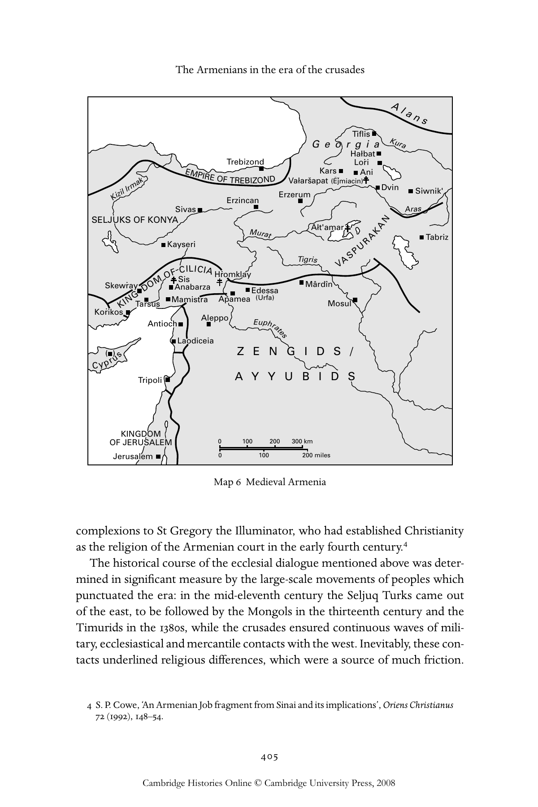

# 十字军时代的亚美尼亚人（1050—1350年）：英文转换底稿

<!-- PDF page 425; original page 404 -->

### 17

### The Armenians in the era of the crusades

### 1050–1350

### s. p et e r c o w e

The defining issue for Christendom in the period under discussion was undoubtedly one of ecclesiology. In the case of the Armenians this took the form of renewed debate with the other Christian traditions which had emerged in Byzantium, western Europe and the Near East in the course of late antiquity, when a common patristic matrix developed distinct constellations of doctrine, rite and order with characteristic emphases, forms and expressions.

The onset of the Arab period in Armenian history ushered in an era of consolidation inaugurated by the catholicate of Yovhan Ōjnec‘i (717–728).[^p425-1] Synods reaffirmed Armenia’s one-nature Christology, not only clarifying the distinctive Armenian doctrine of the incorruptibility of Christ’s flesh in an Orthodox fashion, but also linking this doctrinally both to the joint celebration of the Nativity and Baptism of Christ on 6 January and to the use of unleavened bread and unmixed wine in the Eucharist.[^p425-2] The structures of the institutional church, its sacraments and the legitimacy of its representational art were defended against the Paulicians, a widespread iconoclastic sect. Compilations on doctrine and canon law were drawn up and a greater sense of historical identity gradually emerged, which expressed itself in an expanded sanctorale, highlighting local saints, particularly martyrs, and celebrating their accomplishments in hymns, vitae and encomia.[^p425-3] Of particular significance in this connection was the signal devotion among Armenians of all theological

[^p425-1]: A. Mardirossian, Le livre des canons arméniens (Kanonagirk‘ Hayoc‘) de Yovhannēs Awjnec‘i: église, droit et société en Arménie du IVe au VIIIe siècle [CSCO 606] (Louvain: Peeters, 2005).

[^p425-2]: S. P. Cowe, ‘Armenian Christology in the seventh and eighth centuries with particular reference to the contributions of Catholicos Yovhan Ōjnec‘i and Xosrovik T‘argmanič’, Journal of Theological Studies 55 (2004), 30–54.

[^p425-3]: Mayis Avdalbegyan, ‘Yaysmawurk‘’ žołovacunerə ev nranc’ patmagrakan aržek‘ə [‘Menologium’ Compilations and their Historiographical Value] (Erevan: Armenian Academy of Sciences, 1982), 122–36. For a brief overview of the oeuvre of Vardan Arewelc‘i, the most prolific author in this field, see Norayr Połarean, Hay grołner [Armenian Writers] (Jerusalem: St James Press, 1971), 294–9.

<!-- PDF page 426; original page 405 -->

Trebizond EMPIREOF TREBIZOND Erzerum Erzincan Sivas

> SELJUKS OF KONYA A N Kayseri Murat UR A K

VASP

> DOMOFCILICIA Mârdîn KING Apamea Mosul

Korikos Antioch Aleppo Euphrates

Cyprus Tripoli KINGDOM OF JERUSALEM 0100 200 300 km Jerusalem 0100 200 miles T

> Alans

Tiflis G e o r g i a Kura Halbat Lori Kars Ani KizilIrmak Valaršapat (Ēǰmiacin) Dvin Siwnik' Tabriz igris Edessa (Urfa) Laodiceia ( ) A r a. s Alt'amar Hr·omklay Skewr.ay A S n i a s barza. Tarsus Mamistra

> Z E N G I D S / A Y Y U B I D S Map 6 Medieval Armenia

complexions to St Gregory the Illuminator, who had established Christianity as the religion of the Armenian court in the early fourth century.[^p426-4]

The historical course of the ecclesial dialogue mentioned above was determined in significant measure by the large-scale movements of peoples which punctuated the era: in the mid-eleventh century the Seljuq Turks came out of the east, to be followed by the Mongols in the thirteenth century and the Timurids in the 1380s, while the crusades ensured continuous waves of military, ecclesiastical and mercantile contacts with the west. Inevitably, these contacts underlined religious differences, which were a source of much friction.

[^p426-4]: S. P. Cowe, ‘An Armenian Job fragment from Sinai and its implications’, Oriens Christianus 72 (1992), 148–54.

<!-- PDF page 427; original page 406 -->

Despite this, substantial interchange occurred, which left its imprint on the various ecclesiastical polities involved in the process.

### A period of disruption and regrouping, 1050–1150

By the time our period opens the course of large-scale Armenian resettlement in the former marchlands of eastern Cappadocia between the Byzantine and Arab spheres of influence was already well into its third and final phase. Beginning as a means of repopulating the area with Christians during the Byzantine advance under Basil 1 in the 880s, it gained greater momentum under Nikephoros II Phokas after 963, at which point Armenians grew to be the majority population. It culminated in the gradual relocation there of the royalty and much of the nobility of the three main western successor states to the Armenian kingdom re-established in 884.[^p427-5] In 1022 King Sennek‘erim- Yovhannēs of Vaspurakan bequeathed his realm to the empire, under pressure both from the Byzantines and from the initial Seljuq incursions, and Ašot IV of Ani followed suit in 1039. Armenians then became imperial vassals under an alien Byzantine bureaucratic structure, while their territories were reorganised as themes.[^p427-6]

A parallel process can also be detected in ecclesiastical affairs, which brought into renewed contact Greek, Armenian and Jacobite communities as well as the heretical Tondrakite sect, with varied results. One of these was the formation in the 980s on the initiative of Catholicos Xačik of Syrian and Armenian sees parallel to the Byzantine ones. Perhaps unforeseen by the court in Constantinople, this in turn provoked ethnic and religious polemic between the confessions over mutually unacceptable divergences in rite and doctrine. This resulted in the rebaptism of those faithful who altered their affiliation.[^p427-7] The integration and neutralisation of Armenian secular authority encouraged the patriarchs of Constantinople in their attempts to suppress the Armenian catholicate. Catholicos Petros was called to Constantinople in 1045 for theological discussions, and again two years later. To counter pressure from the Byzantines he

[^p427-5]: S. P. Cowe, ‘Armenian immigration patterns to Sebastia, tenth–eleventh centuries’, UCLA International Conference on Armenia Minor–Sebastia/Sivas, ed. R. G. Hovannisian (Costa Mesa, CA: Mazda Publishers, 2004), 115–24.

[^p427-6]: See Robert Hewsen, Armenia: a historical atlas (Chicago: University of Chicago Press, 2001), 125–6.

[^p427-7]: The religious polemic led to exchanges between the Armenian catholicos and the Greek metropolitans of Sebasteia and Melitene as well as a succession of Jacobite patriarchs. It produced anti-Chalcedonian refutations by Anania Narekac‘i (d.c.985) and his namesake Anania Sanahnec‘i (d.c.1070).

<!-- PDF page 428; original page 407 -->

took the precaution – in contravention of accepted practice – of consecrating his nephew as his successor. The latter was summoned to the capital a year after assuming office in 1058 by the new emperor Constantine X Doukas, who required him to accept Chalcedonian Christology and the supremacy of the patriarch of Constantinople: in other words, to renounce his autocephaly. On refusing, he was held in captivity until 1062 and then confined to Sebasteia. On his death three years later the emperor at first prohibited a new election, but then relented against the cession of the Armenian kingdom of Kars.[^p428-8] The candidate subsequently cleared for election to the catholicate was Vahram, an avid philhellene, who had previously entered Byzantine service and had held the post of duke of Mesopotamia for ten years from 1048. In this capacity he destroyed the sectarian stronghold of T‘ondrak and dispersed its adherents.[^p428-9] He belonged to the house of Pahlawuni, which claimed descent from the line of St Gregory the Illuminator. His consecration as Catholicos Grigor II inaugurated an unbroken series of hierarchs from that lineage over the next century and a half.

The second half of the eleventh century witnessed the consolidation of Seljuq power in Anatolia through the capture of Ani in 1064, reinforced in 1071 by the decisive victory over Byzantine forces at Mantzikert. The resulting power vacuum created the conditions which allowed Armenians to establish de facto autonomy in the hill country south of the Taurus range.[^p428-10]  Its relative security led to a southward movement in the centre of gravity of the Armenian polity and the foundation of a series of small fiefdoms. These gradually evolved into a new kingdom in Cilicia (1198–1375), which was to play an important role in the political and religious history of the region over the rest of our period.[^p428-11]

The fragmentation and dispersion of the Armenian nation is dramatically etched in the constant travels of the catholicos Grigor II (1065–1105), as he sought to minister to his far-flung flock. With earlier precedents in mind, petty Armenian princes sought to persuade the catholicos to take up residence on their territories, as a means of strengthening their claims to legitimacy. Sheer expediency forced Grigor to raise others to the rank of catholicos, so that they would have the authority to take the necessary decisions on the

[^p428-8]: Cowe, ‘Armenian immigration patterns’, 125.

[^p428-9]: Avedis K. Sanjian, ‘Gregory Magistros: an Armenian Hellenist’, in Τὸ Ἑλληνικόν: Studies in honor of Speros Vryonis, Jr. (New Rochelle, NY: Caratzas, 1993), ii, 111–58.

[^p428-10]: This corresponded very roughly to the former themes of Lykandos, Melitene, Tarsos, Seleukeia, Antioch and Edessa.

[^p428-11]: For a convenient map of these territories, see C. Mutafian, Le royaume arménien de Cilicie xiie–xive siècle (Paris: Éditions du CNRS, 1993), 18.

<!-- PDF page 429; original page 408 -->

ground.[^p429-12]  Thus Gēorg Loṙec‘i resided with Aplłarip Arcruni in Tarsos from 1069; Sargis, nephew of Catholicos Petros, settled in the domain of Philaretos Brachamios (Vahram) at Honi in Lykandos in 1073; Grigor’s nephew Barseł was consecrated bishop in Ani and then elevated to the rank of catholicos eight years later in Hałbat, one of the main monasteries of the small remaining Bagratid kingdom of Loṙi-Tašir; while there is evidence that Grigor visited Egypt and established another nephew, his namesake, as supreme ecclesiastical authority over the expanding Armenian community there. In other instances, separatist tendencies dictated such moves, as in the case of Vaspurakan, which desired to perpetuate its status as an independent kingdom at least in the ecclesiastical realm by declaring Ałt‘amar a separate catholicate in 1113. In doing so it instituted a schism that was only settled in 1441. Similarly, it seems that at the beginning of the twelfth century the Seljuqs of Rum briefly toyed with the strategy of segregating their Armenian population from the rest of the Armenian Church by installing Anania, bishop of Sebasteia, as an anticatholicos.[^p429-13]  Much later it appears that Mamluk opposition to the Latinophile orientation of the Cilician Armenian court was a factor in the creation of an Armenian patriarchate in Jerusalem (1311), with a view to exercising jurisdiction over the Christian Armenian community in the Mamluk lands.[^p429-14]

At the same time it corresponded to the spiritual needs of a community that was increasingly dispersed. The disruption to the regular rhythms of transit trade in the mid-eleventh century intensified the exodus of Armenian merchants and artisans, who now swelled the ranks of their countrymen further afield in the relative calm of the Crimea, Kievan Rus, Poland and the western Black Sea coast. They also settled in various Italian ports.[^p429-15]  There were even trading connections with Iceland, where we hear of the arrival of three Armenian ‘bishops’, presumably at the invitation of the Norwegian king, Harald Sigurdson.[^p429-16]  Other Armenian traders were deported eastwards first by the Seljuqs and then by the Mongols to form thriving colonies in north-eastern Iran.[^p429-17]

[^p429-12]: A. Kapoïan-Kouymjian, L’Égypte vue par des Arméniens (Paris: Fondation Singer-Polignac, 1988), 7–19.

[^p429-13]: Haïg Berbérian, ‘Le patriarcat arménien du Sultanat de Roum’, Revue des Études Arméniennes 3 (1966), 233–41.

[^p429-14]: Bezalel Narkiss (ed.), Armenian art treasures of Jerusalem (Jerusalem: Massada Press, 1979), 17.

[^p429-15]: G. Dédéyan, Histoire des Arméniens (Toulouse: Privat, 1982), 391–400.

[^p429-16]: Y. R. Dachkévytch, ‘Les Arméniens en Islande (XIe siècle)’, Revue des Études Arméniennes 20 (1986–87), 321–36.

[^p429-17]: A. G. Abrahamyan, Hamaṙot urvagic hay gałtavayreri patmut‘yan [Concise sketch of the history of Armenian colonies] (Erevan: Haypethrat, 1964), 240–1.

<!-- PDF page 430; original page 409 -->

The Armenians were widely valued for their military prowess. In the aftermath of the Byzantine defeat some enterprising commanders moved to Egypt under the Fatimids where the Armenian Badr al-Jamâlî (1074–94) founded a dynasty of viziers lasting almost a century. Though most adopted Islam, they acted as patrons of the older Christian Armenian community established there, which underwent something of a renaissance. This is reflected in the building of some thirty churches and monasteries, of which the White Monastery near Sohag is the best preserved, featuring several frescos and inscriptions, the work of the artist T‘ēodor of K‘esun.[^p430-18]

Although Armenians were often wary of Byzantium’s hegemonic ambitions, many in this era still looked to Constantinople as the primary representative of Christendom in the Near East. The capital possessed a growing Armenian population, which exploited its position as a conduit for renewed translation from Greek into Armenian. Their activities had great influence on the development in the eleventh and twelfth centuries of the Armenian menologion (yaysmawurk‘) and of the liturgy of St Athanasius, which drew on elements from its Byzantine counterpart attributed to St John Chrysostom.[^p430-19] Moreover, the energetic catholicos Grigor II earned his epithet ‘Martyrophile’ (Vkayasēr) through commissioning a range of vitae and other texts from Greek and Syriac, an enterprise which several of his successors advanced into the late thirteenth century.[^p430-20]  While the focus of these endeavours tended to be older patristic works not yet available in Armenian, Armenian Chalcedonian translators operating in areas under Byzantine and Georgian control placed their emphasis on post-Chalcedonian Fathers, for example St John Klimax and St John of Damascus.[^p430-21]  Their monasteries, such as K‘obayr, K‘iranc‘ and Axt‘ala (Płnjahank‘), which flourished in the thirteenth century in the northern region of Loṙi, manifest the middle Byzantine penchant for fresco programmes

[^p430-18]: Kapoïan-Kouymjian, Égypte, 15–16; Seda B. Dadoyan, The Fatimid Armenians [Islamic History and Civilization Studies and Texts 18] (Leiden: Brill, 1997), 85–105.

[^p430-19]: Nersēs Akinean, ‘Yovsēp‘ Kostandnupolsec‘i, targmanič yaysmawurk‘i (991)’ [Yovsēp’ Kostandnupolsec‘i as translator of the menologium], Handēs Amsōreay 71 (1957), 1–12; H.-J. Feulner, Die armenische Athanasius-Anaphora [Anaphorae orientales 1] (Rome: Pontificio istituto orientale, 2001), 456–8.

[^p430-20]: Garegin Zarbhanalean, Matenadaran haykakan t‘argmanuteanc‘ naxneac‘ (dar D-ŽG) [Library of Ancient Armenian Translations (Fourth–Thirteenth Centuries)] (Venice: St Lazar’s Press, 1889), xxviii–xxxi; Levon Ter Petrossian, Ancient Armenian translations (New York: St Vartan’s Press, 1992), 9–11.

[^p430-21]: S. P. Cowe, ‘Medieval Armenian literary and cultural trends (twelfth–seventeenth centuries)’, in History of the Armenian people from ancient to modern times, ed. R. G. Hovannisian (New York: St Martin’s Press, 1997), i, 311.

<!-- PDF page 431; original page 410 -->

enveloping the entire wall space of the church in contrast to the more modest embellishment typical of medieval Armenian churches.[^p431-22]

A novel feature of the late eleventh century was the opening of Armenian relations with the Latin church, which unfolded over the next four and a half centuries against the backdrop of the twelfth-century papal policy of drawing the various ‘schismatic’ Eastern churches into union under Roman primacy. The first overtures in 1080 were extended by Pope Gregory VII to Catholicos Grigor II, who, according to some, had paid a prior visit to Rome.[^p431-23]  This contact inaugurated a rich and diverse range of ecclesiastical, theological, political and cultural interchange pursued in different parts of the Near East as well as via the Armenian communities in the west. As a result, it is probably true that westerners got to know the Armenians better than any of the other ‘oriental’ Christian confessions.

Direct contacts were established in the course of the First Crusade, during which Armenian princes like the Rubenid Kostandin I assisted the crusaders on their passage through Cilicia to Antioch, while T‘oros, the Armenian Chalcedonian ruler of Edessa, welcomed Baldwin of Boulogne into his city in 1098, which was soon to be transformed into a crusader county. An early rapport developed with the Kingdom of Jerusalem (1099–1187), three of whose queens were of Armenian descent.[^p431-24]  A number of high-ranking Armenians went on pilgrimage in those years, including Catholicos Grigor III and his brother Nersēs, who accompanied the papal legate Alberich to the synod of the cenacle in 1141/2 after participating in a similar gathering in Antioch. The same year also witnessed an amicable exchange of letters between Pope Eugenius III and the catholicos.[^p431-25]

This could not disguise the fact that the initiative in near eastern geopolitics had passed to Zangi, emir of Mosul, and his son Nûr al-Dîn. The former made himself master of Aleppo in 1128 and then of Edessa in 1144, which provoked the Second Crusade (1147–48). Its failure prepared the way for Nûr al-Dîn’s annexation of Damascus in 1154 and then of Egypt in 1169. His success persuaded Armenians, such as Mleh, brother of Prince T ῾oros, of the advantages of entente, so much so that Mleh accepted Islam and allied with Nûr al-Dîn,

[^p431-22]: A. Lidov, The mural paintings of Akhtala (Moscow: Nauka, 1991).

[^p431-23]: Kapoïan-Kouymjian, Égypte, 11–13.

[^p431-24]: Baldwin I married Arta, daughter of the Rubenid prince T‘oros I, and their daughter Melisende in turn married Fulk of Anjou, while Baldwin II married Morphia, daughter of Gabriēl of Melitene.

[^p431-25]: A.-B. Schmidt and P. Halfter, ‘Der Brief Papst Innozenz II an den armenischen katholikos Gregor III: ein wenig beachtetes Dokument zur Geschichte der Synode von Jerusalem (Ostern 1141)’, Annuarium Historiae Conciliorum 31 (1999), 50–71.

<!-- PDF page 432; original page 411 -->

who himself had married an Armenian princess. Returning from exile on his brother’s death, he seized power with Zangid support and led a mercurial reign, first defeating the combined forces of Antioch and Jerusalem in 1172 and then regaining control of most of the Cilician seaboard from Byzantium in the following year. However, on Nûr al-Dîn’s death in 1174 he fell victim to a palace coup. This tumultuous interlude underlines the unsettled tenor of Armenian life at the time, which is also reflected in the absence of any major work of art.

### Monastic life

From the late ninth century the wealth of the Bagratid realm found expression in displays of piety through major donations by aristocrats and later by rich merchants. These fuelled a significant growth in Armenian monastic construction.[^p432-26]  In fact, most churches at this time were built within large monastic complexes which appropriated the secular structure of the gawit‘ as an important space for the daily office, lectures, manuscript copying, burial, etc., and, as they expanded over the next four centuries, were gradually equipped with libraries, refectories and belfries, as well as oil and wine presses catering to their domestic needs.[^p432-27]  Scale was a key differential from the early period, the new cenobia sometimes housing hundreds of monks, their daily round often governed by the norms of St Basil’s rule under the oversight of the class of vardapets (doctors of theology licensed to preach and teach), who were now entering their most influential phase in both responsibilities and prestige.[^p432-28] Moreover, thanks to the generosity of their donors, these communities soon became powerful economic units rich in real estate, manpower and equipment (mills, etc.) in contrast to the caves or modest wooden structures of the past.[^p432-29]  These monasteries also became institutes of higher learning to an unprecedented degree, with a structured curriculum which concentrated on the elucidation of the Bible, patristic authors and a corpus of textbooks from Greek antiquity.[^p432-30]  Monastic scriptoria such as that of Skewṙay would rival the

[^p432-26]: Vrej Nersessian, The Tondrakian movement (London: Kahn and Averill, 1987), 74–5.

[^p432-27]: P. Donabédian, J.-M. Thierry and N. Thierry, Armenian art (New York: Harry N. Abrams, 1989), 195–200.

[^p432-28]: S. P. Cowe, ‘Armenological paradigms and Yovhannēs Sarkawag’s “discourse on wisdom” – philosophical underpinning for an Armenian renaissance?’ Revue des Études Arméniennes 25 (1994–95), 137–43.

[^p432-29]: For the popular uprisings this wealth sometimes provoked, see Nersessian, The Tondrakian movement, 76–7.

[^p432-30]: Paroyr M. Mouradyan, ‘Les principes de la classification des livres en Arménie médiévale’, in Armenian studies in memoriam Haïg Berbérian, ed. Dickran Kouymjian (Lisbon: Calouste Gulbenkian Foundation, 1986), 591–600.

<!-- PDF page 433; original page 412 -->

seat of the catholicos at Hṙomklay in the exquisite quality of their copying and illumination.[^p433-31]  Outside the Armenian highlands and Cilicia, a series of Armenian monasteries was located on the Black Mountain near Antioch, which also sustained Greek, Georgian, Syrian and Latin communities in this period and hence encouraged international contacts. The most illustrious medieval Armenian monastic centre of higher learning at this time was founded at Glajor in the region of Siwnik‘, whose activities spanned the years 1280–1340. It gained such a reputation under its director Esayi Nčec‘i that students came from all over the Armenian lands to study there.[^p433-32]

The patterns of spirituality practised in Armenian monasteries had significantly changed from the external asceticism of the earlier period to a more pronounced concern for interiority. In this it reflected a widespread preoccupation of the era also evidenced in Byzantium and in the developing sufi tradition of Islam, which in turn seems influenced by earlier Christian mystical writers like St Isaak of Nineveh.[^p433-33]  The fundamental creed of the sect of Tondrakites, moulded out of a Paulician matrix, may be viewed as an extreme manifestation of this approach. Its threat to a proper understanding of the economy of the incarnation, crucifixion and resurrection provoked a multimedia response: from learned doctrinal treatises to the proliferation of a characteristically Armenian type of monument, the xačk‘ar, a large rectangular block of stone elaborately carved with a representation of the cross in an infinite variety of motifs.[^p433-34]  Persecution resulted in the sect going underground in inaccessible areas of the Armenian terrain and surfacing periodically as late as the nineteenth century.[^p433-35]  Others fled or were deported to the Armenian centre at Philippopolis in Bulgaria. Transforming their belief system in the course of their geographical migration, they influenced the views of later sects like the Bogomils and the Albigensians.[^p433-36]

[^p433-31]: Treasures in heaven: Armenian illuminated manuscripts, ed. T. F. Mathews and R. S. Wieck (New York: The Pierpoint Morgan Library, 1994), 68–74.

[^p433-32]: G. M. Grigoryan, Syunik‘ə Ōrbelyanneri ōrok‘ (XIII–XV darer) [Siwnik‘ in the days of the Ōrbēleans (thirteenth–fifteenth centuries)] (Erevan: Armenian Academy of Sciences, 1981), 241.

[^p433-33]: J. Baldick, Mystical Islam [New York University Studies in Near Eastern Civilization 13] (New York: New York University Press, 1989), 15–20.

[^p433-34]: Armenian folk arts, culture, and identity, ed. L. Abrahamian and N. Sweezy (Bloomington: Indiana University Press, 2001), 60–70; Donabédian and Thierry, Armenian art, 123–4, 205–7, figs. 67–8, 89, 105–7.

[^p433-35]: Nersessian, The Tondrakian movement, 89–96. A similar fate was met by the syncretistic sect of arewordik‘ [children of the sun], a part of which was reconciled to the church in the 1170s at Samosata by Nersēs Šnorhali.

[^p433-36]: Babken H. Harut‘yunyan, Hayastani patmut‘yan atlas, I mas [Historical Atlas of Armenia, Part i] (Erevan: Erevan State University, 2004), 60.

<!-- PDF page 434; original page 413 -->

### Discussions on church union with Byzantium

In 1165, around the time Mleh was furthering his Muslim contacts in exile, a chance discussion between bishop Nersēs Šnorhali and the imperial protostrator Alexios Axouch during a campaign in Cilicia began a desultory set of theological discussions over the possibility of ecclesiastical rapprochement with Byzantium, which lasted until the Emperor Manuel I Komnenos’s death in 1180.[^p434-37]  The emperor entrusted these negotiations with the Armenians to an experienced theologian-diplomat called Theorianos, who had the task of realising Manuel’s goal of preserving Antioch’s client-status as a basis for expanding his authority south towards Jerusalem and northwards over the sultanate of Konya. The nine points the emperor presented for acceptance in 1171 encompassed the ratification of the last four ecumenical councils, confession of the Chalcedonian definition and anathema of those denying it, omission of the phrase ‘who was crucified for us’ from the trisagion hymn, and a few ritual issues including the employment of leavened bread and wine mixed with water in the preparation of the eucharistic elements, as well as the canonical regulation that the emperor should confirm appointments to the catholicate.[^p434-38] Nersēs sought to call a synod to review the stipulations, but died before this could be done. After much further discussion under his successor Grigor Tłay (1173–93), a synod of thirty-three hierarchs and abbots, including Jacobite representatives and the catholicos of Albania, finally met at Hṙomklay in 1178 and offered a balanced and judicious response. In certain areas such as Christology they displayed a conciliatory disposition ‘for the peace of the church’, while in others they maintained that the onus probandi remained firmly on the Greek side, such as in demonstrating the final four councils did not contradict the first three and in remonstrating that the addition to the trisagion was of Greek not Armenian origin.[^p434-39]  Significantly, their handling of the question of the standing of the catholicate and the problem of succession reveals the degree to which Antioch had become a focus of Armenian ecclesiastical ambition, as was also the case in the temporal sphere. The signatories approved of imperial sanction on condition that the Armenian catholicos henceforth be acknowledged as

[^p434-37]: L. B. Zekiyan, ‘St. Nersēs Šnorhali en dialogue avec les Grecs: un prophète de l’oecuménisme au XIIe siècle’, in Armenian studies in memoriam Haïg Berbérian, 861–83.

[^p434-38]: Zekiyan, ‘St. Nersēs Šnorhali en dialogue avec les Grecs’, 866–67.

[^p434-39]: See Clemens Galanus, Conciliationis Ecclesiae Armenae cum Romana (Rome: Urban Press, 1651), i, 331–44 (for the synodal acts); J. Meyendorff, Christ in eastern Christian thought (Crestwood, NY: St Vladimir’s Seminary Press, 1987), 35 (for the theological point at issue).

<!-- PDF page 435; original page 414 -->

patriarch of Antioch, thereby maintaining his autocephaly.[^p435-40]  Neilos Doxopatres’s near contemporary Greek treatise on the five patriarchal jurisdictions was translated into Armenian at this juncture and clearly played a part in discussions on the status of the Armenian see.[^p435-41]

Nevertheless, these synodal decrees were not representative of all shades of contemporary Armenian ecclesiastical opinion. Opposition came from a group of scholars and prelates collectively referred to as the ‘northern vardapets’.[^p435-42]  Their respect for tradition is well illustrated by a later issue arising from the service of Armenian troops on Georgian campaigns under the command of the brothers Zak‘arē and Ivanē Erkaynabazuk, who were dignitaries of the Georgian court. Whereas the Georgians had obtained dispensation to celebrate the liturgy on portable altars during manoeuvres, the Armenian forces had not received permission to introduce this practice. Although the synod of Sis gave its permission (1204), the rigorist party in the north refused to adhere to the ruling and blocked the measure at the local synods Zak‘arē summoned at Loṙi (1205) and at his capital in Ani (1207), compelling him to impose it within the context of military discipline.[^p435-43]

At the other end of the spectrum, a number of Armenian churchmen focused less on the historical precedents of the Armenian confessional tradition and matters of institutional advantage in inter-church negotiations, but appealed rather to the spiritual reality of the church as the body of Christ, affirming this as the basis for the underlying unity of Christendom. Their number included figures such as Mxit‘ar Goš (c. 1140–1213), and in the next generation Vardan Aygekc‘i (c. 1170–1235) from Greater Armenia.[^p435-44]  In the thirteenth century the popular poet Frik gave voice to another point of view on Christian unity: he argued that its absence had been a major factor in Muslim advances and proceeded to list the key foibles of each communion, which had militated against greater cohesion and cooperation.[^p435-45]

[^p435-40]: Abēl Mxit‘areanc‘, Patmut‘iwn žołovoc‘ hayastaneayc‘ ekełec‘woy [History of the Synods of the Armenian Church] (Vałaršapat: Mother See Press, 1874), 116–17.

[^p435-41]: F. N. Finck, Des Nilos Doxopatres taxis ton patriarchikon thronon armenisch und griechisch (Ēǰmiacin and Marburg: Vagarshapad, 1902).

[^p435-42]: They came under the leadership of Grigor Tutēordi and Dawit‘ K‘obayrec’I and were concentrated in territories then under Georgian control.

[^p435-43]: Mxit‘areanc‘, Patmut‘iwn žołovoc‘ hayastaneayc‘ ekełec‘woy, 118–22.

[^p435-44]: Paroyr Muradean, ‘Dawanakan handuržołakanut‘ean ew azgamiǰean hamerašxut‘ean gałap‘arə ŽB–ŽG dareri Hayastanum’ [The idea of confessional tolerance and internal national solidarity in twelfth–thirteenth century Armenia], Ganjasar 4 (1994), 95–108.

[^p435-45]: Frik, Frik Diwan, ed. Tirayr Melik‘ Muškambarean (New York: Melgonean Foundation, 1952), 274–80.

<!-- PDF page 436; original page 415 -->

The Armenian churchman most actively engaged at this time in interconfessional contacts at the highest level was the young archbishop of Tarsos, Nersēs Lambronac‘i (1153–98). In his oft-quoted words, ‘Spain and the East are limbs of the one Head, [as are] Greeks and barbarians, Armenians and Georgians, Syrians and Egyptians [Copts]. All are bound together in Him in spirit and have clothed themselves in Him through faith.’[^p436-46]  He led the Armenian delegation which was sent in 1197 to the Byzantine Emperor Alexios III Angelos and to the patriarch George Xiphilinos, with the intention of clarifying the religious issues associated with the emperor’s initial willingness to grant Prince Levon of Cilicia a crown, thereby elevating his lands to the rank of kingdom. Discussions were prolonged to Pentecost, but concluded without issue. Moreover, it appears that the stimulus for Alexios’s gesture was intelligence that negotiations towards the same end were already far advanced with the German emperor. Nersēs was also involved in those talks, having been sent to greet Frederick Barbarossa in 1190 as he entered Cilician territory, only to learn of his untimely death.[^p436-47]  However, he profited by the occasion to render into Armenian the Latin ritual book sent by Pope Lucius III, as well as the coronation ordo, and St Benedict’s rule.[^p436-48]  Around this time the Armenians also adopted the Latin episcopal mitre, ring and crosier, in the place of the Byzantine episcopal crown, which now devolved to regular priests.

### Church union with the Latins

That Cilician civil and ecclesiastical interests were focused on the German Empire and the papacy in the final years of the twelfth century is to be set against the backdrop of Byzantine reverses in Bulgaria, Serbia and Cyprus, which had claimed independence in 1184 and fell to the crusaders seven years later. All these gained imperial recognition after a formal submission to papal supremacy in the course of the 1190s. Armenia followed their precedent, Prince Levon (1198–1219) being crowned king on 6 January 1198 in the once Greek church of St Sophia in Tarsos, the largest in the realm, with Conrad of

[^p436-46]: Nersēs Lambronac‘i, Atenabanut‘iwn vasn miut‘ean ekełec‘woy ew čaṙk’ i hambarjumn K‘ristosi ew i galust Hogwoyn Srboy [Synodal oration on church union and homilies on Christ’s Ascension and Pentecost], ed. Mesrop Tałiadean (Calcutta, 1851), 35.

[^p436-47]: Anoushavan Tanielian, ‘Archbishop Nersēs Lambronac‘i’’s commentary on Wisdom of Solomon’, unpublished PhD thesis, Columbia University (2003), 34–5.

[^p436-48]: Nersēs Akinean, Nersēs Lambronac‘i ark‘episkopos Tarsoni keank‘n ew grakan vastaknerə [Nersēs Lambronac‘i, archbishop of Tarsus: life and literary achievements] (Vienna: Mxitarist Press, 1956), 284–8, 302–16.

<!-- PDF page 437; original page 416 -->

Wittelsbach, archbishop of Mainz, officiating.[^p437-49]  The archbishop had arrived the previous year with instructions from Innocent III to obtain Armenian recognition of Roman primacy and to align Armenian with Roman practice on a number of matters. These included adopting a fixed calendar for regulating the celebration of saints’ days rather than the traditional Armenian movable system determined by the Easter cycle, and breaking the Nativity and Lenten fasts with only fish and olive oil.[^p437-50]  Levon summoned a synod in Tarsos to ratify the process. Only twelve bishops signed, but their voice prevailed.[^p437-51]

The growth of pro-western sentiment in various Armenian communities over the twelfth century can be gauged by a series of apocryphal writings such as the Sermo de Antichristo, which enshrined Armenian eschatological expectations associated with the Seljuq invasion. These culminated in the Dašanc’ t‘ułt‘ (Letter of Concord),[^p437-52]  which purports to relate not only the meeting in Rome between the first Christian kings Constantine I and Trdat III but also – and more importantly – the instruction and consecration of the first Armenian catholicos Gregory the Illuminator by Pope Sylvester. It put forward the claim that the parties agreed to divide the exercise of ecclesiastical and secular authority between them.[^p437-53]  The document’s import is obviously that submission to the papacy and a western alliance will be of appreciable benefit in reinforcing the Armenian power base in the Near East. Appeal to its message was frequently made in exchanges with the papacy over the next few centuries.

As already indicated, a close but complex relationship had developed between Cilicia and Antioch. Common interests led them to unite against Byzantium, but internal rivalries occasioned harsh acts of duplicity and reprisal. Since the 1170s Armenian ecclesiastical ambitions had focused on the patriarchate of Antioch. Indeed, one advantage of church union under the pope was to free the Armenian catholicos from interference from the Latin patriarch, who continued to claim jurisdiction over the sees of Tarsos and Mamistra, which

[^p437-49]: S. P. Cowe, ‘The inauguration of the Cilician coronation rite and royal ideology’, Armenian Review 45 (1992), 51, 54–5.

[^p437-50]: The Armenians had traditionally supplemented these with dairy products.

[^p437-51]: Tanielian, ‘Archbishop Nersēs Lambronac‘i’’s commentary on Wisdom of Solomon’, 37–8.

[^p437-52]: K. V. Šahnazareanc‘, Dašanc‘ tłt‘oc’ k‘nnut‘iwnn u herk‘umə [Investigation and Refutation of the Letter of Concord] (Paris, 1862).

[^p437-53]: Zaroui Pogossian, ‘A revised-diplomatic edition, and a historical and textual investigation of “Letter of love and concordance between the Emperor Constantine the Great and Pope Sylvester and the King of the Armenians Trdat the Great and St. Gregory the Illuminator”’, unpublished PhD thesis, Central European University, Budapest (2004).

<!-- PDF page 438; original page 417 -->

had had Latin bishops at the time these cities came under Armenian control.[^p438-54]  Another aspect of ecclesiastical interaction between the two states was Prince Levon’s policy vis-à-vis the Jacobite community. In 1192 he appointed Theodore Bar Wahbun as anti-patriarch and attempted to have the Jacobite communities of the region submit to his jurisdiction.[^p438-55]  Antioch’s gradual decline marked by its reduction in territory and forced union with Tripoli after Saladin’s attack in 1187 favoured Levon’s efforts to gain ascendancy over it through an astute policy of intermarriage. However, the competing claims of members of the Antiochian princely house, coupled with the interests of the Italian merchant communities, conspired to thwart him to the end of his reign.

### Papal missionary initiatives

The missionary ethos of the two mendicant orders of Dominicans and Franciscans founded in the first half of the thirteenth century, combined with their structural flexibility, discipline and institutional organisation, rendered them an unprecedented spiritual force for proselytising among the Armenians and other eastern Christians and for furthering papal diplomacy. The Franciscans established various centres in Cilicia and played an increasingly important role as the century progressed, in various spheres including that of religious art.[^p438-56] Het‘um II (1289–1301), in particular, petitioned the pope for a personal retinue of six friars at court and later entered the brotherhood himself.[^p438-57]  The Dominicans made a slower start in establishing contacts, but became more pivotal in the following century.

This was the time of Mongol domination, which after initial upheavals worked to the benefit of the Armenian Church. From 1255 it was exempted from the payment of tax to the Mongols.[^p438-58]  Het‘um I (1226–69) of Cilicia and several princes of Greater Armenia took the precaution of placing themselves under Mongol suzerainty, thus protecting their subjects from arbitrary

[^p438-54]: J. Richard, La papauté et les missions d’Orient au Moyen Âge (XIIIe–XVe siècles) [Collection de l’École française de Rome 33], second edition (Rome: École française de Rome, 1998), 43, 49–50.

[^p438-55]: P. Kawerau, Die jakobitische Kirche im Zeitalter der syrischen Renaissance (Berlin: Akademie Verlag, 1955), 68–9.

[^p438-56]: H. Evans, ‘Manuscript illumination at the Armenian patriarchate in Hṙomkla and the west’, unpublished PhD thesis, New York Institute of Fine Arts (1989), 153–4.

[^p438-57]: Richard, Papauté, 52.

[^p438-58]: R. Bedrosian, ‘Armenia during the Seljuk and Mongol periods’, in History of the Armenian people, ed. R. G. Hovannisian, i, 261.

<!-- PDF page 439; original page 418 -->

exactions. As a result, both Armenian regions enjoyed a significant degree of stability and prosperity in the mid-thirteenth century, in marked contrast to the struggles of the crusader states to hold their own, while the Latin conquest of Constantinople in 1204 had dealt a nigh mortal blow to Byzantine power. This is the setting against which to view the Armenians’ lack of interest in exploring more fully the implications of the union with Rome promulgated by Levon I.

In 1243 Catholicos Kostandin Barjrberdc‘i (1221–67) responded positively to Innocent IV’s query regarding recognition of the sacrament of extreme unction and other liturgical rites. However, the more substantive issues debated during his long term of office, the filioque and Petrine primacy, only exposed the extent of the differences separating the two sides. Among the messengers the pope dispatched to the east on 25 March 1245 in the run up to the first Council of Lyons was the Franciscan Dominic of Aragon, who was to secure an Armenian confession of faith. When King Het‘um I discussed this with his mentor Vardan Arewelc‘i, the latter responded by writing a brief compilation of fifteen Latin errors.[^p439-59]  It may be that the creation in 1247 of a new archiepiscopal see at the monastery of St Thaddaeus was also part of this reaction to papal primacy. Not only was St Thaddaeus the traditional guarantor of the apostolicity of the Armenian Church,[^p439-60]  but his monastery also lay close to the Mongol summer quarters, not far from Maku in north-western Iran.

Similarly, though the synod of Sis of 1251 accepted the filioque doctrine, it provoked a major reaction from the church in Greater Armenia, which threatened to create a schism by setting up an anti-catholicos. Both Vanakan Vardapet and Vardan Arewelc‘i appear to have accepted the orthodoxy of the dual procession of the Spirit for the theologically sophisticated, if not for the general populace, but their language and images seem to suggest that they had in mind either the Spirit’s activity in the economy or the patristic formula ‘from the Father through the Son in the Spirit’. Latin polemicists found their formulations unsatisfactory.[^p439-61]

Moreover, the acerbity with which Mxit‘ar Skewṙac‘i and the legate Thomas Agni de Lentino clashed at Acre in 1262 over Petrine primacy caused the pope to send the Dominican William Freney to Cilicia to try to restore a more cordial

[^p439-59]: Girk‘ t‘łt‘oc‘ [Book of Letters], ed. Arch. Norayr Połarean (Jerusalem: St James Press, 1994), 657–65.

[^p439-60]: Levon Xačikyan, ‘Artazi haykakan išxanut‘yunə ev Corcori dproc‘ə’ [The Armenian principality of Artaz and the school of Corcor], Banber Matenadarani 11 (1973), 134.

[^p439-61]: J. N. D. Kelly, Early Christian doctrines (London: A. & C. Black, 1977), 256–63.

<!-- PDF page 440; original page 419 -->

atmosphere.[^p440-62]  In keeping with the Armenians’ reservations about these earlier papal overtures was their absence from the Second Council of Lyons in 1274, to which even the Ilkhân sent a representative at Gregory X’s invitation.[^p440-63]

### Trade routes facilitate religious interchange

The favourable conditions attendant on the pax mongolica intensified the volume of trade linking China with Central Asia, Russia, southern Caucasia and Asia Minor via the new Ilkhânid centre of Tabrîz and on to the Cilician port of Ayas, whence Italian shipping transported Oriental commodities to western Europe. A more northerly land route through Erzurum, Erzincan and Sivas was also used.[^p440-64]  Many Armenian merchants were engaged in this traffic, leading to the formation of communities in various entrepôts and to the construction of churches.[^p440-65]  The Latin mendicant orders also profited from these circumstances. The Franciscans established centres in the following sites with a significant Armenian population: Erzurum, St Thaddaeus, Salmast, Karpi, Tiflis, S. ult.ânîya and Tabrîz, while the Dominicans possessed houses in Tabrîz and Marâgha.[^p440-66]  Complaints were soon being voiced that Roman doctrine was encroaching on Greater Armenia, having already infiltrated Cilicia, the main Byzantine cities and the old Bagratid capital of Ani.[^p440-67]

We are perhaps best informed about Erzincan, which boasted one of the most vibrant Armenian merchant and artisan communities of the thirteenth and fourteenth centuries. Türkmen dominated the surrounding countryside, while the local Mengüjakid court patronised Persian culture.[^p440-68]  Literary and canonical references suggest a degree of interrelation between the communities, sometimes consolidated by ties of marriage or family alliance.[^p440-69]  For instance, the rules of the confraternity of Armenian urban youth drawn up

[^p440-62]: Mxit‘ar Skewṙac‘i, Patasxanik‘ Mxit‘ar k‘ahanayi Skewṙac‘woy yałags hamapetut‘ean erkotasan aṙak‘eloc‘ [On the equal rank of the twelve apostles] (Jerusalem: St James Press, 1865).

[^p440-63]: C. Dawson (ed.), The Mongol mission: narratives and letters of the Franciscans in Mongolia and China in the thirteenth and fourteenth centuries (London and New York: Sheed and Ward, 1955), xxi.

[^p440-64]: For a map of these routes, see Hewsen, Historical atlas, 135. For Armenian communities in China, see Dawson, Mongol mission, 232–3.

[^p440-65]: Dédéyan, Histoire des Arméniens, 395–400.

[^p440-66]: Richard, Papauté, 116.

[^p440-67]: Step‘annos Ōrbēlean, Hakačaṙut‘iwn ənddēm erkabnakac‘ [Refutation of the Dyophysites] (Constantinople, 1756), 43.

[^p440-68]: C. Cahen, Pre-Ottoman Turkey (London: Sidgwick and Jackson, 1968), 108–9.

[^p440-69]: Ē. Bałdasaryan, Hovhannes Erznkac‘in ev nra xratakan arjakə [Yovhannēs Erznkac‘i’s paraenetic prose] (Erevan: Armenian Academy of Sciences, 1977), 120–8.

<!-- PDF page 441; original page 420 -->

in 1280 reflect the impact of Caliph al-Nas.îr’s earlier reforms of similar Muslim organisations,[^p441-70]  while the christocentric allegorical poetry of Kostandin Erznkac‘i from the late thirteenth century is the first to introduce the Persian love motif of the rose and the nightingale into Armenian literature, suggesting familiarity with sufi verse on mystical union with the divine beloved.[^p441-71]  Nevertheless, undercurrents of tension were also present, which led the Seljuqs to coordinate a series of anti-Armenian attacks with the Mamluk Sultan Baybars’s campaign against Cilicia in the mid-1270s.[^p441-72]

The previous decade had witnessed the consolidation of Mamluk power in the Near East. The Mamluks seized control of Syria in 1260 and then threw back the Mongol armies, which included Armenian contingents, at the battle of ‘Ayn Jâlût. For more than a century thereafter – until the final demise of the Cilician kingdom in 1375 – support for the Mongols and alignment with the west made the Armenians the special object of Mamluk wrath. During this period the Mamluks became the Armenians’ main foe, leaving their stamp on the oral epic Daredevils of Sasun, in which the prime antagonist is Msra Melik‘ (King of Egypt). In typical epic fashion the conflict appears ‘writ small’, featuring the historical nexus of exorbitant tax impositions on the Christian population, the destruction of monasteries, Christian–Muslim family relations, etc.[^p441-73]

At the end of the thirteenth century the political and military situation turned decisively against the Armenians of Cilicia. The Jochid Mongols of the Golden Horde centred in Sarai on the lower Volga accepted Islam and made common cause with the Mamluks. In 1291 the latter captured Acre, the last mainland crusader outpost. The following year they attacked Hṙomklay, seat of the Armenian catholicate, and took the incumbent Step‘anos IV into captivity. His successor, Grigor Anavarzec‘i (1293–1307), was thus compelled to take up residence in the Cilician capital of Sis, where he found himself confronted with the ecclesiastical implications of King Het‘um II’s diplomatic initiatives. The king’s decision to betroth his two sisters, one into the Lusignan royal house of Cyprus and the other into the Palaiologan dynasty of Byzantium, raised questions of Christian unity.[^p441-74]  Anavarzec’i’s call ‘in these debased times’

[^p441-70]: D. A. Breebaart, ‘The development and structure of the Turkish futüwah guilds’, unpublished PhD thesis, Princeton University (1961), 52–68.

[^p441-71]: S. P. Cowe, ‘The politics of poetics: Islamic influence on Armenian verse’, Proceedings of the symposium redefining Christian identity: Christian cultural strategies since the rise of Islam (Leuven: Peeters, 2006)

[^p441-72]: Richard, Papauté, 101.

[^p441-73]: Trans. L. Surmelian, Daredevils of Sassoun (Denver: A. Swallow, 1964), 142–8.

[^p441-74]: S. P. Cowe, ‘Catholicos Grigor Anavarzetsi (1293–1307) and Metropolitan Step‘anos Orpelian in dialogue’, in UCLA International Conference Series on Historic Armenian Cities and Provinces: Cilicia, ed. R. G. Hovannisian (Costa Mesa, CA: Mazda Publishers, in press).

<!-- PDF page 442; original page 421 -->

for Armenians to unite ‘with the Greeks and all nations’ was at least partly impelled by pragmatic concerns.[^p442-75]  Nevertheless, his broad erudition is clear from his revision of the Menologion, in which he included commemorations from the Byzantine and Roman sanctorale: a testimony to his fluency in Greek and Latin.[^p442-76]  Moreover, his famous letter to the king suggests that his stance was not determined by pragmatism alone. Issues of ecumenism weighed heavily upon him. He subscribed to the idea developed in Chalcedonian Armenian circles from the sixth century that to be a true follower of St Gregory meant sharing in communion with the universal church.[^p442-77]  This explains his proposal that the Armenian church accept all the ecumenical councils and thereby the Chalcedonian christological definition. Though initially opposed to the practice of adding water to the eucharistic wine, the weight of patristic authority convinced him of its validity.[^p442-78]  That Grigor remained true to his own traditions is underlined by his refusal to accept further demands by the papacy: he opposed a call for the celibacy of parish priests and saw no need to seek papal permission to eat fish and oil during Lent. Though acknowledging the primacy of the Roman see, he also recognised the dignity of the other four ancient patriarchates of the east.[^p442-79]

Opposition in Greater Armenia now centred in the south in Siwnik‘ under the Ōrbēlean house, whose fortunes had been rising since 1256 when they had received their lands as an inju directly under Mongol suzerainty.[^p442-80]  Along with other nobility and upper clergy, members of the family met in conclave in the 1290s under the presidency of Archbishop Step‘anos Ōrbēlean in order to protect the status quo from the compact with the papacy. They argued that the Armenian Church rested on a unitary ecclesial tradition founded by the apostles Thaddaeus and Bartholomew, developed by St Gregory the Illuminator, defined by the first three ecumenical councils, and maintained by

[^p442-75]: Step‘annos Ōrbēlean, Patmut‘iwn nahangin Sisakan [History of the province of Siwnik‘] (Tiflis: Ałaneanc’ Press, 1910), 448.

[^p442-76]: Grigor Anavarzec‘i’, ‘T‘ułt‘ teaṙn Grigori Hayoc‘ katołikosi zor greac‘ aṙ krōnawor tagaworn Het‘om [sic], hayr ark‘ayin Hayoc‘ Lewoni’ [Letter of the Lord Grigor, catholicos of the Armenians, which he wrote to the cleric king Het‘um, father of Lewon, King of the Armenians] in Galanus, Conciliationis, i, 444. The authenticity of this text has been queried because of the lack of corroborating manuscript evidence. Recently, however, the work has been identified in codices 2037 (ad 1421) and 7841 (ad 1688) of the Maštoc‘ Matenadaran Institute in Erevan according to an oral presentation by Nerses Ter-Vardanyan on 25 February 2005. Anavarzec‘i’ is known to have read the works of Jerome and Bede in the original.

[^p442-77]: Cowe, ‘An Armenian Job fragment’, 148–52.

[^p442-78]: Grigor Anavarzec‘i’, ‘T‘ułt’ teaṙn Grigori Hayoc‘ katołikosi’, 438. He compiled a dossier of patristic authorities on the subject for the synod of Sis (1307).

[^p442-79]: Ibid., 450.

[^p442-80]: Grigoryan, Syunik‘e Ōrbelyanneri ōrok‘, 75.

<!-- PDF page 443; original page 422 -->

the whole apparatus of local synods from the fifth century which rejected the council of Chalcedon as crypto-Nestorian.[^p443-81]  Consequently, they demanded that Grigor refrain from all Chalcedonian contacts and desist from celebrating the feast of the Nativity with them on 25 December, but that he keep those feast days as ordained by St James; in other words, according to the early Jerusalem lectionary, from which Armenian practice derives.[^p443-82]  Here Ōrbēlean waxed eloquent in the face of his superior’s possible appeal to military intervention by the king: ‘We are ready for suffering, exile, prison, and death to preserve the traditions of the apostolic Fathers.’[^p443-83]  He also made the appeal for the first time for the nobles who had gone to Cilicia to return to Greater Armenia and for the seat of the catholicate to return to its early site in the monastery of Ēǰmiacin.[^p443-84]

The new century witnessed a number of last ditch attempts to seal a grand Latin–Armenian–Mongol alliance against the Mamluks. In one of these the Ilkhân Ghazan initiated correspondence with the Christian powers in 1302, but to no avail. After an unsuccessful Mongol campaign in 1305 to stem Mamluk incursions, the Armenian noble Het‘um of Koṙikos went west to pursue discussions, and in August 1307, while at Poitiers, he composed his Mongol history La flor des estoires de la terre d’orient at the request of Pope Clement V.[^p443-85]  In the same year, at papal insistence, another synod of Sis was held to ratify Anavarzec‘i’s theological and liturgical adjustments towards Roman orthodoxy.[^p443-86]  However, it was unrepresentative of the church as a whole, with hierarchs from Greater Armenia conspicuous by their absence. The vita of the conservative prelate Gēorg Skewṙac‘i notes widespread popular protest, which precipitated a series of deportations to Cyprus.[^p443-87]  The Mongol response can be gauged by the murder of King Levon III and his uncle Het‘um II, now a Franciscan friar,

[^p443-81]: Ōrbēlean, Hakačaṙut‘iwn ənddēm erkabnakac‘, 16.

[^p443-82]: Athanase Renoux, Le codex arménien Jérusalem 121 [PO 36, fasc. 168] (Turnhout: Brepols, 1971), 166.

[^p443-83]: Ōrbēlean, Hakačaṙut‘iwn ənddēm erkabnakac‘, 186.

[^p443-84]: Avedis K. Sanjian, ‘Step‘anos Orbelian’s “Elegy on the holy cathedral of Etchmiadzin”: critical text and translation’, in Armenian and biblical studies, ed. M. E. Stone (Jerusalem: St James Press, 1976), 237–82.

[^p443-85]: D. Bundy, ‘Het‘um’s la flor des estoires de la terre d’orient: a study in medieval Armenian historiography and propaganda’, Revue des Études Arméniennes 20 (1986–87), 231–2. The final book sets out an abortive plan for cooperation with the Mongols.

[^p443-86]: A. Balgy, Historia doctrinae catholicae inter Armenos unionisque eorum cum ecclesia romana in concilio florentino (Vienna: Mxit‘arist Press, 1878), 301–12.

[^p443-87]: Ē. Bałdasaryan, ‘Gevorg Skevṙac‘u ‘vark‘ə’ [The life of Gēorg Skewṙac‘i], Banber Matenadarani 7 (1964), 399–435; D. Bundy, ‘The anonymous life of Gēorg Skewṙac‘i in Erevan 8356: a study in medieval Armenian hagiography and history’, Revue des Études Arméniennes 18 (1984), 491–502.

<!-- PDF page 444; original page 423 -->

together with their entourage, when they visited the local Mongol ruler later that year.

### Muslim–Christian hostilities

The Mongol authorities found it more difficult to maintain law and order and religious equilibrium, at a time when the conversion of the Ilkhân Ghazan to Islam in June 1295 meant that the religious landscape in Iran was changing rapidly.[^p444-88]  The Ilkhân banned Buddhist clergy from Iran and his commander Nawruz attacked Christian churches in Naxčawan, Artaz and Marâgha, but was then punished for his excesses. This encouraged Het‘um II to approach Ghazan in 1299 about easing the situation of non-Muslims who had been suffering unjustly.

Ghazan’s brother and successor Öljeitu’s religious transition is even more illustrative of the rapid pace of the changing balance of power. First he was baptised Nicholas in honour of the new pope, Nicholas IV. Then he accepted the Sunni creed, before finally adopting Shi‘ite Islam.[^p444-89]  During his reign (1304–16) discrimination against Christians increased, provoking increased Armenian emigration to Cilicia and the Crimea. Forced conversions to Islam ensued, and new taxes were levied and regulations enacted, which according to a colophon of 1307 required Christians to wear a blue cloth so as to distinguish them in public.[^p444-90]  These measures gradually undermined the status of the naxarars or upper nobility, whose socio-political structure had provided Armenians with a form of regional cohesion since Parthian times. While some houses were compelled to leave their lands, others sought to maintain indirect control by transferring ownership to the bishop, who was normally a scion of the same house, since Islamic law protected a waqf or religious trust, which was not normally liable to tax impositions. In consequence, episcopal succession in several Armenian sees such as Erzkna (Erzincan) and Maku and the catholicates of Ałt‘amar and Caucasian Albania passed lineally within the same family for many generations through the institution of the prince-bishop (parontēr).[^p444-91]  This

[^p444-88]: A salient factor in the Ilkhân Ghazan Khan’s conversion was the need to maintain solidarity with elements within the Mongol army.

[^p444-89]: T. T. Allsen, Culture and conquest in Mongol Eurasia (Cambridge: Cambridge University Press, 2001), 36.

[^p444-90]: Levon Xačikyan (ed.), ŽD dari hayeren jeṙagreri hišatakaranner [Colophons of fourteenth-century Armenian manuscripts] (Erevan: Armenian Academy of Sciences, 1950), 46.

[^p444-91]: R. H. Hewsen, ‘The Artsrunid house of Sefedinian: survival of a princely dynasty in ecclesiastical guise’, Journal of the Society for Armenian Studies 1 (1984), 123–38.

<!-- PDF page 445; original page 424 -->

process inevitably paved the way for the gradual recognition of Armenians as an ethno-confessional entity in law.

### Armeno-Latin interaction in Greater Armenia

In 1318, in keeping with the greater focus on mission characteristic of the Avignon papacy, John XXII created two vast dioceses in the Near and Far East entrusted to the Dominicans and Franciscans respectively. The former was centred on the Ilkhânid capital of S. ult.ânîya, so that the incumbent might act as the pope’s personal emissary. It was also furnished with six suffragan sees, of which three (Sivas, Tabrîz and Marâgha) had a sizeable Armenian population.[^p445-92] As the pontiff’s correspondence indicates, he was quite involved in Armenian affairs and well informed on the subject.[^p445-93]  He had recently pressed for the convocation of the synod of Adana in 1316 to reconfirm the acts of Sis of nine years earlier, and wanted to engage the prelates of Greater Armenia more systematically than had ever been attempted before.[^p445-94]

Zak‘aria Artazec‘i of the princely family of Maku and the catholicos’s exarch in the east at St Thaddaeus monastery (1298–c. 1340) was a key figure in this task. A pro-Latin confederate of Grigor Anavarzec‘i, he was one of the few eastern churchmen to attend the synod, after which he took the step of accepting Catholicism, as he discussed in his exchange of letters with Yohan Ōrbēli, metropolitan of Siwnik‘.[^p445-95]  He was the recipient of two personal letters from the pope in 1321, who commended him for drawing souls back to the ‘church’.[^p445-96]

At the pope’s behest his assistant, Yovhannēs Corcorec‘i, with the help of Bishop Bartolomeo da Poggio, translated Thomas Aquinas’s commentary on the fourth book of Peter Lombard’s Sentences, the main western medieval primer on the sacraments.[^p445-97]  At some point a Franciscan house was established at St Thaddaeus, which engaged in rendering into Armenian other Latin scholastic manuals and liturgical books during the 1320s–30s. Through this process Armenians were introduced to western developments in Aristotelian logic, ethics, natural philosophy (physics), metaphysics and aesthetics

[^p445-92]: Richard, Papauté, 169–73.

[^p445-93]: S. P. Cowe, ‘The role of correspondence in elucidating the intensification of Latin– Armenian ecclesiastical interchange in the first quarter of the fourteenth century’, Journal of the Society for Armenian Studies 13 (2003/4), 49–50.

[^p445-94]: Balgy, Historia doctrinae catholicae, 313–35.

[^p445-95]: Cowe, ‘The role of correspondence’, 53–4.

[^p445-96]: Ibid., 62–3.

[^p445-97]: Xačikyan, ‘Artazi haykakan išxanut‘yunə’, 198–9.

<!-- PDF page 446; original page 425 -->

(grammar and literary criticism), as well as practical manuals embodying a western perception of various Near Eastern communities and how to engage them in debate.[^p446-98]  The results of this translation process are significant historically as one of the earliest attempts to render contemporary Latin thought into another language, antedating by a generation the first Greek renderings of the brothers Demetrios and Prochoros Kydones.[^p446-99]

Esayi Nčec‘i, the director of the monastic academy of Glajor, was extremely widely read and possessed an excellent understanding of the development of doctrine and church history. Profoundly engaged with western ideas, he was initially open to involvement in dialogue with the Latins, while still preserving Armenian autocephaly intact. Indeed, in 1323 his close associate and successor, Tiratur Kilikec‘i, commissioned one of our earliest extant copies of Aquinas’s commentary on Peter Lombard in Armenian.[^p446-100]   This balance is well illustrated by the illuminations in the Glajor Gospel from the turn of the fourteenth century, which include a number of typically western scenes, while in general reflecting Armenian theology and scriptural exegesis.[^p446-101]   Like Šnorhali before him, Nčec‘i also accepted the legitimacy of predicating either one or two natures in Christ, depending on how these were defined.[^p446-102]   Of an eirenic disposition, he maintained that it was better to be slow to engage in disputation and quick to approach conciliation and peace. At the same time, he argued that in an unequal alliance the partner better endowed with material resources should not exploit his advantage to deprive the other of his rights.[^p446-103]

The fluidity of the theological situation is reflected in the vacillating positions taken up by Armenian scholars, such as Mxit‘ar Sasnec‘i, who broke with his former mentor Nčec‘i in the 1320s in favour of Ōrbēlean’s ‘harder-line’ position on divergence of liturgical rites.[^p446-104]   One of the first Armenian thinkers to respond to the Latin position, he agreed that previously the Armenians

[^p446-98]: M. A. van den Oudenrijn, Linguae haicanae scriptores ordinis praedicatorum congregationis fratrum unitorum et ff. Armenorum ordinis s. Basilii citra mare consistentium quodquod hucusque innotuerunt (Berne and Munich: A. Francke, 1960), 19–295; S. P. Cowe, ‘Catholic missionaries to Armenia and anti-catholic writings’, in Where the only-begotten descended: the church of Armenia through the ages, ed. Kevork B. Bardakjian (Detroit, MI: Wayne State University Press, in press).

[^p446-99]: See pp. 66–67, 70–71.

[^p446-100]: Xačikyan, ŽD dari hayeren jeṙagreri hišatakaranner, 174.

[^p446-101]: T. Mathews and Avedis K. Sanjian, Armenian gospel iconography: The tradition of the Glajor Gospel [Dumbarton Oaks Studies 29] (Washington, DC: (Dumbarton Oaks Research Library and Collection, 1991).

[^p446-102]: Esayi Nčec‘i, ‘T‘ułt‘ Esayeay vardapeti aṙ tēr Matt‘ēos’ [Letter of the vardapet Esayi to the Lord Matt‘ēos], Čṙak‘ał (1860), 157–64; (1861), 205–11.

[^p446-103]: Nčec‘i, ‘T‘ułt‘ Esayeay vardapeti’, 162.

[^p446-104]: Mxit‘ar Sasnec‘i, Mxit‘ar Sasnec‘i’s theological discourses, ed. S. P. Cowe [CSCO 21 (Armenian text); 22 (English translation)] (Leuven: Peeters, 1993), 101–2 (trans.).

<!-- PDF page 447; original page 426 -->

had accepted the Franks as brothers and rejoiced at their unity in Christ, but he detected a dichotomy between the Franks’ ‘Hellenic wisdom’ and what he took to be their lax moral standards and their lack of discipline in matters of fasting.[^p447-105]   The contention by his contemporary Yovhannēs Tarberuni that divine wisdom is communicated through illumination not logic and inference points up the contrast between the essentially neoplatonic cast of contemporary Armenian theology and the Aristotelian foundations of the Dominican tradition.[^p447-106]

For the mission to the central and eastern parts of Greater Armenia, where urban life and trade arteries were less of a fixture, the recently inaugurated see of Marâgha and its bishop Bartolomeo da Poggio proved to be of the greatest importance, for he aroused the curiosity of Armenian monks about Roman theological scholarship. In a remarkably short time this led to the unprecedented establishment of an Armenian congregation affiliated with the Dominican order, very different from the status of the Franciscans at St Thaddaeus and providing a model for the new wave of Uniate foundations associated with the Counter-Reformation. In 1330 the bishop moved to the monastery of K‘ṙna in the Erňjak district of the Siwnik‘ region with a group of friars. Developments over the next years were also rapid: in 1331 the monastery was entrusted to the order and by 1337 it worshipped according to the Dominican breviary and missal, signalling a break with the traditional Armenian liturgy.[^p447-107]   The Dominican version of St Augustine’s rule became the arbiter of discipline, and the community’s constitution was ratified by Innocent VI on 31 January 1356 as the Fratres Unitores of the congregation of St Gregory the Illuminator.[^p447-108]   The new organisation then became the catalyst for bringing conformity to other Armenian Uniate groups, first to the monastery of St Nicholas in Caffa, and then to the Armenian Basilian communities in Italy, which were incorporated into the order.[^p447-109]   The congregation’s further integration into the Latin Church is signalled by their investment with the privileges of the Dominican Societas Peregrinantium, the order’s missionary wing, by Urban V on 20 November

[^p447-105]: Ibid., xv–xvii (trans.).

[^p447-106]: Yovhannēs Tarberuni, ‘Yovhannu vardapeti Tarberunwoy dawanut‘iwn hawatoy’ [The vardapet Yovhannēs Tarberuni’s confession of faith], Čṙak‘ał 2 (1861), 223.

[^p447-107]: M. A. van den Oudenrijn, ‘L’évêque dominicain Fr. Barthélemy fondateur supposé d’un couvent dans le Tigré au 14e siècle’, Rassegna di Studi Etiopici 4 (1946), 14.

[^p447-108]: M. A. van den Oudenrijn, ‘The Monastery of Aparan and the Armenian writer Fra Mxit‘aric’, Archivum Fratrum Praedicatorum 1 (1930), 267.

[^p447-109]: J. Richard, ‘La papauté en Avignon et l’Arménie’, in Arménie entre Orient et Occident, ed. C. Mutafian (Paris: Bibliothèque nationale de France, 1996), 187.

<!-- PDF page 448; original page 427 -->

1362. In its heyday in mid-century, the order is supposed to have claimed the affiliation of fifty monasteries and about 700 monks, though it was badly hit by the Black Death of 1347–48.[^p448-110]

Clearly the Fratres Unitores went further than any other Armenian confession in identifying themselves as Latins, their Armenian heritage being preserved only in the matter of language. Consequently, it is not surprising that, though not a major feature of early lists of discrepancies between Latins and Armenians, the pivotal question of baptism, the rite of entry into the church, was raised most frequently and vociferously by their members, especially Nersēs Palienc‘, archbishop of Manazkert. On this count an Armenian delegation to Avignon for assistance against Mamluk attack on Cilicia in 1336 was detained on suspicion of heresy. Thereafter, at Benedict XII’s behest, Palienc‘ instigated a minute investigation of the Armenian creed and practice that culminated in the compilation of 117 articles against the Armenian Church, which clouded Armeno–papal relations for about two decades.[^p448-111]   Apart from the usual trinitarian and christological issues, it raised a large number of sacramental issues and questions of canon law,[^p448-112]   which were debated at the synod of Sis of 1341/2. Significantly, the response, offering a point by point refutation of the charges, was brought to Avignon by the Armenian Franciscan Daniel of Tabrîz, previously a monk of St Thaddaeus.[^p448-113]

### Aftermath

Such papal scrutiny draws attention once more to the religious complexity of the Armenian polity at the close of our period. Despite various attempts to resolve the schism at Ałt‘amar begun in 1113 by the elevation of a separate catholicate on the old Arcruni lands, it continued to defy a solution.[^p448-114]   The catholicate at Sis still nominally in union with Rome vacillated in its religious orientation depending on which party was in the ascendant. Increasing disaffection with their Lusignan monarchs from Cyprus and internecine struggles

[^p448-110]: Van den Oudenrijn, ‘The Monastery of Aparan’, 294.

[^p448-111]: A. L. Tăutu, Acta Benedicti XII (1334–1342) [Fontes ser. iii, 8] (Rome: Typis polyglottis vaticanis, 1958), 119–55.

[^p448-112]: S. P. Cowe, ‘Catholic missionaries to Armenia and anti-catholic writings’.

[^p448-113]: For the text of the rebuttal, see Tăutu, Acta Benedicti XII, 160–234, and, for the identity of the bearer, P. Pelliot, ‘Zacharie de Saint-Thadée et Zacharie Séfêdinian’, Revue de l’Histoire des Religions 126 (1943), 150–4.

[^p448-114]: After attempts to resolve the issue by King Het‘um II in the late thirteenth century and by Grigor Tatewac‘i in the mid-fourteenth, the dispute was finally settled as part of the reorganisation of the church following the return of the catholicate to Ēǰmiacin in 1441.

<!-- PDF page 449; original page 428 -->

in the Cilician body politic weakened the social fabric of the realm. Repeated Mamluk attacks hastened the decline of the local economy and the renewed exodus of the merchant and artisan population.[^p449-115]   Links with the Genoese trading posts on the Black Sea, for example, encouraged the growth of Armenian colonies in the Crimea and in the hinterlands to the north and west, leading to the expansion of colonies such as that of L’viv, whose growing importance was recognised by its elevation to the status of an episcopal see in mid-century.[^p449-116]

The situation of Greater Armenia became increasingly unstable with the decline of the Mongol Ilkhâns from the 1330s onward, opening up a power vacuum facilitating the disastrous Timurid invasions of the last two decades of the century. Despite this, a resurgence of the Armenian Apostolic Church is manifest there under the forceful monastic leadership of Małak‘ia Łrimec‘i. This, combined with the skill in argument of Yovhan Orotnec‘i (d. 1387) and his pupil Grigor Tat‘ewac‘i, helped to regain the momentum from the Fratres Unitores.[^p449-117] Their works oppose doctrines such as purgatory and defend the traditional Armenian christological position. At the same time, Grigor’s theological compendium, the Book of Questions of 1397, attests the impact of Aquinas’s sacramental theology and Hugh Ripelin’s angelology and demonology.[^p449-118]   Moreover, his other main writings, two volumes of sermons and a Oskep‘orik, or treasury, of 1407, similarly reveal his familiarity with the views of Augustine, Isidore and Ibn Rushd (Averroes), etc., presumably mediated by translations made by the Fratres Unitores.[^p449-119]

The logical conclusion of this phase of internal Armenian dialogue on union with Rome played itself out at the council of Florence at which the Decretum pro Armenis of 22 November 1439 was ratified by catholicos Kostandin VI Vahkac‘i on behalf of the church.[^p449-120]   However, this decisive démarche in turn provoked an equally swift, unequivocal retort from influential members of the

[^p449-115]: T. Sinclair, ‘Cilicia after the kingdom: population, monasteries, etc. under the Mamluks’, in UCLA International Conference Series on historic Armenian cities and provinces: Cilicia, in press.

[^p449-116]: Richard, Papauté, 92; Donabédian and Thierry, Armenian art, 270.

[^p449-117]: Van den Oudenrijn, ‘The Monastery of Aparan’, 284–96.

[^p449-118]: Sergio La Porta, ‘Grigor Tat‘ewac‘i’s Book of Questions: introduction, translation, and commentary – vol. 3: the theology of the Holy Dionysius’, unpublished PhD thesis, Harvard University (2001), 117. See also Nona Manukyan, ‘The role of Bartolomeo di Bologna’s sermonary in medieval Armenian literature’, Le Muséon 105 (1992), 321–5.

[^p449-119]: Grigor Tat‘ewac‘i, Girk‘ or koči oskēp‘orik [Book called Miscellany] (Constantinople: Abraham Dpir, 1746), 9–143.

[^p449-120]: Richard, Papauté, 264–6.

<!-- PDF page 450; original page 429 -->

Greater Armenian clergy, who decided that the time was ripe to implement their predecessors’ frequently reiterated threats of schism. Thus in 1441 the cathedral of Ēǰmiacin in the ancient capital of Vałaršapat became the seat of an anti-catholicate, which soon established itself as the primary see of the whole church.[^p450-121]   The medieval Cilician episode in Armenian history had now come to an end.

[^p450-121]: T‘ovma Mecop‘ec‘i, T‘ovma Mecop‘ec‘i patmagrut‘yun [T‘ovma Mecop‘ec‘i historiography], ed. Levon Xacikyan (Erevan: Magałat‘, 1999).
