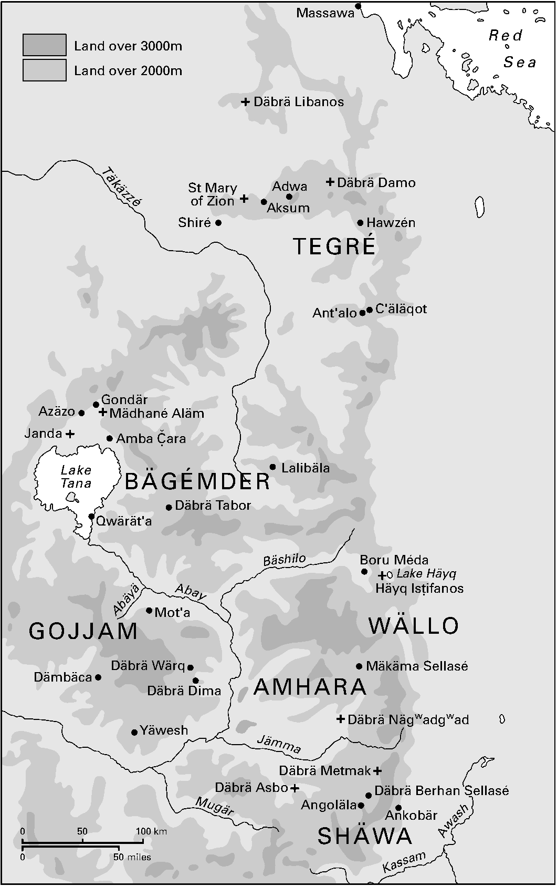

<!-- PDF page 478; original page 457 -->

# 第19章 教会与民族：埃塞俄比亚正统合一教会（十三至二十世纪）

**唐纳德·克拉米**

埃塞俄比亚自认拥有基督教世界最古老的民族传统之一。4世纪第二个四分之一，国王埃扎纳及宫廷改信基督教；应其请求，亚历山大主教圣亚他那修，任命埃塞俄比亚首任主教。王权倡议，由此建立主教制度上依赖亚历山大的民族教会。民众改宗速度，我们所知甚少，但基督教确实扎根高地农耕共同体，至本书写作时，仍是深入民间的宗教。[^p478-1] 王权主导、民众投入，是历史上埃塞俄比亚基督教两极；其间中介，一方面是埃及任命的主教，另一方面、更重要的是，遍布地理、文化景观的修道院。

埃塞俄比亚历史，在高原展开，山脉纵横、深切河谷遍布，主要雨季6月中至9月中，通行极难。高原位于红海南端、青尼罗河源头，后者是埃及每年洪水之源。基督教传到当时北高原首邑阿克苏姆，是公元最初数世纪红海商人希腊化文化的一部分。[^p478-2] 阿克苏姆王国，是红海南部最强国家。

<!-- PDF page 479; original page 458 -->

**地图7 埃塞俄比亚**

原图保留；中文标注对照如下。地名沿用原图历史拼法。

| 原图标注 | 中文对照 |
| --- | --- |
| Land over 3000m | 海拔3000米以上陆地（深灰） |
| Land over 2000m | 海拔2000米以上陆地（浅灰） |
| Massawa | 马萨瓦 |
| Red Sea | 红海 |
| Däbrä Libanos | 德布雷利巴诺斯（图中北部地点） |
| Täkäzzé | 特克泽河 |
| St Mary of Zion | 锡安圣母教堂 |
| Adwa | 阿杜瓦 |
| Aksum | 阿克苏姆 |
| Däbrä Damo | 德布雷达莫 |
| Shiré | 希雷 |
| Hawzén | 豪曾 |
| TEGRÉ | 提格雷 |
| Ant’alo | 安塔洛 |
| C’äläqot | 切莱科特 |
| Gondär | 贡德尔 |
| Azäzo | 阿泽佐 |
| Mädhané Aläm | 梅德哈内阿莱姆 |
| Janda | 詹达 |
| Amba Č̣ara | 阿姆巴查拉 |
| Lake Tana | 塔纳湖 |
| BÄGÉMDER | 贝格姆德尔 |
| Lalibäla | 拉利贝拉 |
| Däbrä Tabor | 德布雷塔博尔 |
| Qwärät’a | 克韦拉塔 |
| Bäshilo | 巴希洛河 |
| Boru Méda | 博鲁梅达 |
| Lake Häyq | 海克湖 |
| Häyq Isṭifanos | 海克伊斯蒂法诺斯 |
| WÄLLO | 沃洛 |
| Abay | 阿拜河（青尼罗河） |
| Abäyä | 阿贝亚河 |
| Mot’a | 莫塔 |
| GOJJAM | 戈贾姆 |
| Däbrä Wärq | 德布雷沃尔克 |
| Dämbäca | 登贝恰 |
| Däbrä Dima | 德布雷迪马 |
| AMHARA | 阿姆哈拉 |
| Mäkäma Sellasé | 梅卡内塞拉西（正文作Mäkanä Sellasé） |
| Däbrä Nägwadgwad | 德布雷内格瓦德格瓦德 |
| Yäwesh | 耶韦什 |
| Jämma | 加马河 |
| Däbrä Metmak | 德布雷梅特马克 |
| Däbrä Asbo | 德布雷阿斯博 |
| Däbrä Berhan Sellasé | 德布雷伯尔汉塞拉西 |
| Angoläla | 安戈莱拉 |
| Ankobär | 安科贝尔 |
| SHÄWA | 绍阿 |
| Mugär | 穆格尔河 |
| Awash | 阿瓦什河 |
| Kassam | 卡萨姆河 |
| 0–100 km; 0–50 miles | 比例尺：0—100公里；0—50英里 |

<!-- PDF page 480; original page 459 -->

该国始终敏感于从红海方向而来的发展。高地对埃塞俄比亚统治者已是挑战，对外部势力挑战更大，使国家面对数千年间席卷此地的力量，仍保一定自主。伊斯兰是其中最强力量之一，7世纪兴起，终结阿克苏姆红海优势；随着时间推移，伊斯兰主导了阿克苏姆人原本自如融入的希腊化世界。

埃塞俄比亚人渐将自身，看作敌对伊斯兰、异教海洋中的基督教岛屿。他们仰求指导的亚历山大、安提阿牧首区，在伊斯兰时代最初数十年，便受穆斯林统治，其教会信众很快成为少数。尼罗河中游努比亚基督教王国较迟屈服，最后一个于15世纪消失于历史记录。[^p480-3] 同时，伊斯兰在红海西侧、高地下沿海建立据点，再沿贸易路线缓慢内传。埃塞俄比亚地区，伊斯兰、基督教都面对多种宗教信仰、实践，双方皆视为异教。如将见，反前基督教信仰、实践斗争，不仅在王国边疆，也在王廷内进行。

作为基督教世界前哨，埃塞俄比亚发展了独特信仰、实践，虽常被不公地视为奇异。其人从未失去属于基督教世界的意识；正统观，在于忠于从亚历山大接受的基督论。他们理解此教义为“合一”（täwahedo），强调基督神、人二性结合，认为祂是一个位格、一个独特地兼具神性与人性的本性。西方惯以“一性论派”称此立场，并不为部分信徒欣然接受。[^p480-4]

<!-- PDF page 481; original page 460 -->

宗教实践许多方面，埃塞俄比亚人过去至今，符合正教常规：使徒传承中的主教，专有授司祭、执事圣职权；堂区教士已婚，修道生活溯源圣安东尼，共享正教世界宗教历，承认七圣事，以洗礼、圣餐为首，并守尊基督九大节：降生、主显、圣母领报、圣枝主日、圣周五、复活、升天、五旬及显圣容。但如将见，这种基督教深知自身闪米特根源；公元前数世纪以来，操闪米特语言者，一直主导埃塞俄比亚文化、政治，更强化此意识。至本书写作时，守安息日为与星期日同等节日，是规范；施割礼，基督徒遵《托拉》饮食规定，把举行圣餐的祭坛，即tabot，比作约柜。此外，虽结婚为教士常规，教会却未能完全使平信徒接受其婚姻观。多数埃塞俄比亚基督徒，依世俗习俗结婚，平信徒离婚也获接受。但教会规范仍受承认：多数人认为自身婚姻实践，阻其领圣餐，转把宗教热忱，投入严格斋戒。

同样，以亚历山大教导作正统试金石，未带来全体一致，却创造不断重新界定的框架。修道院是埃塞俄比亚基督教世界活跃不息的前沿，分两大修会，分别追随13及14世纪初两位圣修士，埃沃斯塔特沃斯、特克莱·海马诺特。主教权威，除有本已较弱国家权力支持，几不能约束修会。7世纪阿克苏姆衰落后，近千年，国王以流动都城治理，试图藉季节性驻临，控制农耕社会，以及依其剩余产出维系的地区世俗、宗教统治者。历史大部分时期，埃塞俄比亚教会仅一位都主教，且为科普特人，罕有附属主教支持。因此，修道院在教会事务角色，类似<!-- PDF page 482; original page 461 -->地区王公在整体政体角色。最底层是堂区，司祭、执事同时为农民，农业、礼仪历主导生活。

## 历史概述[^p482-5]

宫廷改宗后三世纪，奠定埃塞俄比亚正教会基础。《圣经》、礼仪译为阿克苏姆通用吉兹语，一种与南阿拉伯语言相关的闪米特语。埃塞俄比亚传统，将修道生活引入，归于叙利亚来的“九圣”；通常定其到达于5世纪末、迦克墩会议之后，他们反对该会议。[^p482-6] 据说，他们在今埃塞俄比亚北部，建立一系列至本书写作时仍活跃的修道院。传统也将教会音乐、礼仪舞蹈、多首圣歌创作，归于6世纪上半叶圣亚雷德。此时也开始赴巴勒斯坦、埃及圣地朝圣。伊斯兰兴起，终结这一时期。

直到13世纪，基督教王国才重入清晰历史视野：1270年，新王朝夺位，自称阿克苏姆统治者合法继承，也自称《圣经》所罗门王、示巴女王后裔。被所罗门王朝取代的扎格维王朝，留下持久印记：修建惊人的十一座岩凿教堂，地点后来以最杰出王室成员拉利贝拉命名。国家所罗门王朝复兴之前，教会已复兴，表现为有力修道运动。修士传教，促教会最显著扩展时期之一，进入中央高原腹地，越青尼罗河南进，为教会开辟贝格姆德尔、戈贾姆省；至本书写作时，已视为核心区。

新王朝首世纪，宫廷、修士关系，以冲突为标志。但感召力逐渐<!-- PDF page 483; original page 462 -->被丰厚赐地侵蚀，修道活力，日益转向神学争辩，而非政治行动。神学争论，在扎拉·雅各布王（意为“雅各的种子”，1434—1468年在位）时期达顶点；他或许是埃塞俄比亚教会史最有创造力、权威的声音。国王亲自主会议，确立安息日与星期日同等为圣日，以宗教论著、绘画支持的繁复节日体系，使尊崇圣母成为规范，[^p483-7] 并压制宗派异议及巫术。他领导“宗教民族主义”运动，创建政教关系范式，[^p483-8] 经历其曾孙莱布纳·登格尔（意为“圣母之香”，1508—1540年在位）任内开始的动荡世纪，仍存续。

1527至1632年，埃塞俄比亚教会、国家受入侵、内战重创，濒临极限。1527年，艾哈迈德·伊本·易卜拉欣发动大吉哈德，俗称“格兰”，即左撇子。中央高地基督教国家发展同时，一连串穆斯林苏丹国，从海岸，经东部高地、大裂谷，延伸毗邻基督教国家的高地。关系不稳，贸易互利、争霸相互平衡。14世纪初至16世纪初，基督徒凭战略位置、更强凝聚，占上风；但艾哈迈德军推翻一切，席卷基督教高地，毁掠教堂、修道院，使埃塞俄比亚统治者，在自身王国内成为难民。艾哈迈德宣布哈巴沙苏丹国，穆斯林、基督徒史料皆认，大批人背离基督教。[^p483-9] 短期内，冲突随1543年艾哈迈德战死而终结，但吉哈德对基督徒、穆斯林政体影响更久：削弱基督教国家边防、分散注意，<!-- PDF page 484; original page 463 -->使穆斯林、基督徒势力都远离边疆，为奥罗莫人显著扩张开路；他们操一种库希特语言，此时既不信基督教，也不信伊斯兰。[^p484-10]

奥罗莫迁徙，逆转基督教权力、文化两个半世纪南扩，重击王国，反复侵入，关键地区多转为定居，造成不安、耗竭资源，迫王国西北退入青尼罗河大弯及其北塔纳湖周边。16世纪末，所罗门王朝许多壮丽教堂已消失，原基督徒居住的大片地区，落新来者之手。[^p484-11] 正在这种处境，17世纪初两位统治者，转向由耶稣会传教士代表、背后有葡萄牙与西班牙力量的天主教。葡萄牙远征军，对艾哈迈德·格兰之死起关键作用，幸存者定居，娶当地女子，持续提醒欧洲武力之有效。

1557年，耶稣会首次抵埃塞俄比亚，误以为统治者愿服从天主教信仰、实践。[^p484-12] 很快醒悟后，退往北部，传教萎缩。1603年，一司铎奉派振兴，却应扎登格尔王（意为“属圣母的”，1603—1604年在位）召至宫廷，国王同情探究耶稣会教导。不久，苏塞尼约斯继起，1607年以武力夺位，很快转向耶稣会。1622年，公开正式服从罗马，立天主教为宫廷、全国宗教。但在改变与外省主导势力、修道院及贵族世系关系方面，天主教并不比正教更有助于这位所罗门王朝统治者。叛乱愈盛，1632年，他让位给子法西利德斯，后者立即恢复合一正教，逐耶稣会，断葡萄牙、西班牙联系。

<!-- PDF page 485; original page 464 -->

法西利德斯承继疲惫、沮丧国家王位，除回到扎拉·雅各布的正教，别无选择。重申教会、政体传统价值，使其受益，统治开启三代相对和平、文化复兴。在贡德尔，设阿克苏姆以来首个固定首都，建教堂、宫殿。子约翰内斯一世（1667—1682年在位）、孙伊亚苏一世大帝（1682—1706年在位），效法其例，主持外部威胁渐退的国家。但世纪初耶稣会影响兴起，激起教会强烈多样回应，使基督论重返正教争辩中心，逐渐固化为与两大竞争修会关联的宗派立场。约翰内斯、伊亚苏均主持一系列基督论会议，却不像扎拉·雅各布，无法强行统一。伊亚苏遇刺，死后十五年暴力、不稳。史料暗示，基督论争议主要创新方，是埃沃斯塔特沃斯派，口号“膏抹”（Qebat），强调圣灵膏抹在实现基督神、人二性合一的作用。从自身角度，他们深信反迦克墩立场，与亚历山大神学传统和谐。[^p485-13] 特克莱·海马诺特追随者抵制膏抹说，自倡耶稣藉圣灵恩典（Ṣäga）成为神子，称祂“恩典之子”（YäṢäga Lej）。第三派最小，与19世纪主教相关，称“卡拉”（Karra），即“刀”。

膏抹派势力，或在伊亚苏一世遇刺背后；其弟特沃弗洛斯（1708—1711年在位）时期，膏抹说成为官方教义，维持近六十年。但确立地位有代价：伊亚苏之子达维特（1716—1721年在位）时，宫廷军屠杀或约一百名特克莱·海马诺特会修士。这是早期高潮，同等暴力，直到19世纪才可能重现，甚至届时也未必。但宗派立场愈硬，各派内部也提出<!-- PDF page 486; original page 465 -->新立场。宗派纷争，并未削弱其他正教宗教表达。贡德尔大型教堂创建，尤其伊亚苏一世1694年建德布雷伯尔汉塞拉西，以及皇后门特瓦布1740年代建德布雷萨海克韦斯克瓦姆，树立全国效法近一百五十年的标准。[^p486-14] 城内大型教堂创建，延至1780年代。而且，贡德尔时期，恢复16、17世纪初风暴重创的遗产：抄旧稿、著新稿，绘画繁荣，装饰抄本、教堂。[^p486-15] 这些大型教会机构，各供养数百教士，反使贡德尔成为教会教育中心，延续至本书写作时。

国家、教会以混乱状态进入19世纪。1760年代末，地方大贵族成功颠覆王权，置一连串傀儡统治者，为自身、家族夺实权。教士编年史家，比作《圣经》犹太王国建立前时期，称“士师时代”（Zämänä Mäsafent）。教会命运，在19世纪上半叶试图领导教会的主教生涯中，体现尤痛：受虐待、逐出贡德尔，被迫内地流亡，教义权威遭拒。此时特定敌手，是德布雷利巴诺斯修士，及其恩典学说。埃塞俄比亚曾有中央机构弱期，但1830年代，外界不大可能任其自处，迹象已明：埃及复兴、扩张，军队到达埃塞俄比亚权威与尼罗河上游国家权威之间边地；同时，欧洲新教、天主教传教士及世俗旅行者，持续出现高地，唤起耶稣会冲突记忆，也唤起欧洲可供军事支援的可能。[^p486-16] 振兴埃塞俄比亚<!-- PDF page 487; original page 466 -->国家，势在必行；实现复兴的三位统治者，均视统一教会复兴，为国家复兴要素。

政治复兴始于1855年，卡萨·海卢登所罗门王位，取王号特沃德罗斯二世，统治至1868年。他以武力崛起，由武士转政治家时，恢复主教权威，试图恢复教义统一。1854年阿姆巴查拉会议，确立阿布纳·萨拉马主教，为亚历山大正统裁判者，绝罚宗派纷争。1855年，萨拉马为其加冕埃塞俄比亚“万王之王”。虽主教、国王不久因土地、权威冲突，国王仍维持正式礼数，从未以宗派主义削主教权威。[^p487-17] 后来继任者约翰内斯四世（1872—1889年在位），自称“锡安之王”，主张阿克苏姆遗产，选阿克苏姆锡安圣母教堂加冕，足为明证。如特沃德罗斯，他寻求教会复兴、统一，镇压膏抹、恩典派。1878年博鲁梅达会议，最后拒服主要地方统治者孟尼利克归顺，使其志得意满；他宣布教会信仰，是凯雷洛斯、萨拉马、阿特纳特沃斯的卡拉教义，强力执行。主教权威方面，1881年，说服科普特牧首，前所未有地任四位主教。

约翰内斯订下议程，由继任者孟尼利克二世（1889—1913年在位），带教会入20世纪。宗派纷争被边缘化，博鲁梅达教义立场，至本书写作时仍为规范。主教团扩大，虽属间接，却指向新全国性教会组织。孟尼利克缺前两王热忱，但采其政策，最终巩固成果。

政教进入20世纪，情况与百年前大异：君主国家恢复，教会<!-- PDF page 488; original page 467 -->教义统一占主流。1896年，孟尼利克在阿杜瓦战役败入侵意军，稳固国家独立。战前数十年，其军队广扩国家权威，也带正教会存在。新世纪将见重大转变：建立主教教阶，继而本土化、扩充；既属机构，也属地域扩张，教会进入新帝国遥远角落，并到海外牙买加、北美。它与亚历山大—叙利亚传统诸教会定期对话，加入世基联。但在现代国家建设的中心角色，既带特权，也带负担、局限。孟尼利克后来的继任者海尔·塞拉西一世（1930—1974年在位），保持前王的政教民族愿景，所治国家却比愿景容纳的更多样。19世纪后期扩土，纳入大量穆斯林，以及既非基督徒、亦非穆斯林的人口。且孟尼利克倡导、海尔·塞拉西推行的现代化，终压倒君主制；1974年废黜海尔·塞拉西，开启革命、撤销教会国教地位、建立世俗国家的时代。[^p488-18]

## 修士与君主：埃塞俄比亚民族

许多方面，定型的埃塞俄比亚国家、民族，形成于1270年所罗门王朝建立后两世纪，扎拉·雅各布（1434—1468年在位）达到顶点，调和地方实践与亚历山大权威。最易看见运作的主导力量，是修士、王廷，早期关系以冲突为标志。

<!-- PDF page 489; original page 468 -->

修道复兴早于所罗门王朝兴起。[^p489-19] 关键人物伊亚苏斯·莫阿，意为“耶稣已得胜”，约1248年，在海克湖岛上建圣司提反修道院。[^p489-20] 他起于北部古修道院德布雷达莫。早期传统说，他与新王朝创办者耶库诺·阿姆拉克订约；其支持看来确实重要。从其共同体，修士散至阿姆哈拉及南部绍阿，另建修道院。最著名弟子特克莱·海马诺特，意为“信仰之株”，约1284年建德布雷阿斯博，后名德布雷利巴诺斯，后世记忆甚至盖过导师。[^p489-21]

13世纪中央埃塞俄比亚修道生活，自视延续阿克苏姆传统，无固定形式，重感召力，奉行贫穷。个别圣人定居荒野无人地区，以严格实践引追随、建共同体，靠采野果、收获季为近村受雇劳动维生。[^p489-22] 从独立位置，一些人日益被卷入政治。最突出，是伊亚苏斯·莫阿第二代追随者贝萨洛塔·米卡埃尔，意为“藉圣米迦勒的祈祷”。[^p489-23] 王朝创办者死后，经历一系列继承危机，此时由精力充沛、向外扩张的阿姆达·塞永，意为“锡安之柱”（1314—1344年在位）代表，是王朝最杰出成员之一。

贝萨洛塔·米卡埃尔首次入廷，谴责教会都主教阿布纳·约翰内斯买卖圣职，因此被流放提格雷。[^p489-24]

<!-- PDF page 490; original page 469 -->

不久他重返宫廷，攻击阿姆达·塞永本人，娶多妻、蓄妾，并与父王一位妻子乱伦，违背基督教性道德。[^p490-25] 新鲜的并非做法，它们根深蒂固、将延续数代，而是攻击的热情。贝萨洛塔·米卡埃尔再次流放北部，死于当地。约1337年，新都主教阿布纳·雅各布到来，接续其事业。都主教、修道院关系，常不安，由王廷调解；都主教依赖王廷执行权威。雅各布联合修士、绝罚国王，国王鞭打、流放其修道盟友。紧张延至阿姆达·塞永继任者赛法·拉阿德（1344—1371年在位），他仿父娶三妻。主教、修士持续反对，招致流放：主教返埃及，修士逐王国境外。国王冲突中获胜，却发现教会攻击代价高昂。赛法·拉阿德之子达维特（1382—1411年在位）登位，带来从对抗，到15世纪新综合、整合的转变。[^p490-26] 新修道生活，吸入旧模式，亦即藉丰厚王室赐地，使感召力转成既成体制。[^p490-27]

中央埃塞俄比亚修士，自觉立于圣安东尼及阿克苏姆古修道院传统，尊所承纪律，也不断创新，警觉维护自主，易为包括三一论的众多教义争论。一些信念、实践，挑战日益希望强加统一信仰、实践的王廷。[^p490-28] 北部，一名伊斯蒂法诺斯修士，以严苦讲道、坚持<!-- PDF page 491; original page 470 -->崇敬只归上帝，不归荣福童贞女、圣像十字架等物质表象，亦不归国王等世俗人物，聚拢追随者。[^p491-29] 司提反派容易镇压，更严重的是埃沃斯塔特沃斯追随者，主张守安息日为与星期日同等圣日。[^p491-30] 特克莱·海马诺特派与都主教，都反对其安息日立场。

1449年，扎拉·雅各布王（1434—1468年在位）主持德布雷梅特马克会议，解决冲突。[^p491-31] 他同时重新确立主教权威，并依埃塞俄比亚、而非亚历山大先例，规范信仰、实践。从开罗请得两位主教，加一位附属主教，说服接受守安息日。[^p491-32] 会议成功立为规范，也立尊崇圣母为规范；国王宣称，她的代祷带来救恩，并引入大量每月节庆尊荣她。[^p491-33] 决定持久有效，统一实践强化全埃塞俄比亚基督教世界“宗教民族主义”。强至其继任者任内会议，公然讨论与亚历山大决裂。国王另有忧虑，感觉宫廷巫术威胁，残酷企图根除。虽虔敬博学，[^p491-34] 仍依前王婚俗，有三位正式妻子，各自宫廷<!-- PDF page 492; original page 471 -->在王室营帐组织中显著。最后，其专制统治引强烈反应，死后数年尤甚；教义共识，以及主教权威、修道生活综合，却短暂，成为后世萦绕、常不可及的理想。近四百年后，统治者才再实现这一整合。

## 王室教堂

王室教堂这一政教机构，或诞生于、确发展于中世纪所罗门王朝，历1527至1632年动荡、毁灭性暴力而存续。[^p492-35] 诚然，许多在艾哈迈德·格兰吉哈德被毁，另一些在16世纪后半叶奥罗莫战争中，脱离基督教王国。但制度桥接中世纪、贡德尔及以后，也参与19世纪后期王朝复兴。1520年代访埃塞俄比亚的葡萄牙司铎弗朗西斯科·阿尔瓦雷斯，已注意；其记述细致洞见大灾难吉哈德前夕王国，仍不可或缺。[^p492-36] 他认为，这一机构，特别体现当时所罗门王朝根基阿姆哈拉、绍阿地区特性。更广史料中，它于16世纪浮现，即扎拉·雅各布及子贝埃达·马里亚姆（意为“藉圣母之手”，1468—1478年在位）任内。〔译注：原文此处作“16世纪”，与本段所述两王在位年份不合，照录。〕贝埃达·马里亚姆建阿特龙萨马里亚姆，以富裕、收存多位前都主教及三位前王遗骸闻名，尤王朝创办者耶库诺·阿姆拉克。[^p492-37]

<!-- PDF page 493; original page 472 -->

王室教堂一职，是王朝墓地，后王也葬自身创堂。但另有功能。创于国王、非修士，因此依附国王，由恩宠得财富、由关联得声望；反过来，以宏伟向地方、区域民众呈现君主制。阿尔瓦雷斯视其与北部景观中修道院鲜明不同；但虽类似中世纪欧洲大型“参议教士”教堂，仍联系修会，典型具有“加达姆”（gädam），即圣所地位，该词常被视为“修道院”同义。[^p493-38] 因而跨越欧洲“世俗”与“修道”教堂区分。特征是：教士被称“德布特拉”（däbtära），阿尔瓦雷斯译“座堂教士”；[^p493-39] 国王倡建；持续丰厚王室赞助；王陵与圣所功能。主要靠赐地支持，一部分贡赋、租金收入，供圣餐礼、教堂建筑维护；另一部分，直接供养教士。有些也享地方市场征税权，及所控土地司法收费。

教会组织松散、许多方面极简，王室教堂也发挥实用角色。主要修会有全国知名度，却靠非正式弟兄纽带、非紧密治理联结。都主教有教阶声望，但层级极少，声望<!-- PDF page 494; original page 473 -->难化实权。教产由地方机构控制，成为地方自主基础。王室赐地过程，主教无实质作用，虽常以正式认可支持。教会所有的全国组织，由王廷与主教、有声望修道领袖合作提供，先是“阿卡贝·萨阿特”，即海克圣司提反修道院院长，后是“埃切盖”，即德布雷利巴诺斯院长。这事实上承认修道院权力、自主，却少约束。在此情境，王室教堂成为另一地方权威、影响节点，至少起源上，直接依赖王室赞助。

伊沙克（1413—1430年在位）起，统治者大量建堂。[^p494-40] 他在塔纳湖区建堂、捐赠现有修道院。扎拉·雅各布建众堂：阿姆哈拉的德布雷内格瓦德格瓦德、梅卡内塞拉西，绍阿的德布雷梅特马克、德布雷伯尔汉塞拉西。皆宏伟，但后者或最为国王重视；后世似也如此看，两百多年后，后裔伊亚苏一世（1682—1706年在位），为最钟爱教堂重用此名。[^p494-41] 扎拉·雅各布也捐现有修道院；绍阿德布雷利巴诺斯及特克莱·海马诺特派直到20世纪的优势，或由其促成。贝埃达·马里亚姆之子纳奥德（1495—1508年在位），建梅卡内萨拉姆，并葬此处。阿尔瓦雷斯视之为典型王室教堂。他1526年离开后，艾哈迈德·伊本·易卜拉欣·格兰大吉哈德，随即爆发，劫毁诸堂，梅卡内塞拉西、德布雷内格瓦德格瓦德、阿特龙萨马里亚姆尤著。但击败格兰的加劳德沃斯（1540—1559年在位），以及主要继任者萨尔萨·登格尔（意为“圣母之芽”，1593—1597年在位），皆恢复传统，建堂宏伟，影响犹存。[^p494-42]

<!-- PDF page 495; original page 474 -->

1630年代，为回应短暂罗马天主教经历而建的贡德尔王国，王室教堂是基石。法西利德斯建贡德尔的重要行动，是创设、捐赠梅德哈内阿莱姆，即“世界救主”教堂。建新都时，也未忘古都及主堂：重建阿克苏姆锡安圣母教堂，再赐土地。[^p495-43] 此后一百五十年，继任者无一例外建堂，许多人葬其间。孙伊亚苏，对阿克苏姆同样慷慨。[^p495-44] 法西利德斯之子及继任者约翰内斯一世，建埃格齐阿布赫尔阿布，即“父神”教堂，最初葬于此。[^p495-45] 他重建城外不远阿泽佐圣母教堂，原为耶稣会机构，却改为特克莱·海马诺特修会母院，因为原绍阿德布雷利巴诺斯母院，未熬过吉哈德、奥罗莫迁徙。

贡德尔机构，最突出是德布雷伯尔汉塞拉西、德布雷萨海克韦斯克瓦姆。[^p495-46] 如已见，皆有丰厚农地，供圣餐礼、建筑维护，以及“炭火”（embers）；统治者也赐地供纪念礼及直接供养教士。教士以个人名义持地，交换服务，传给后代，始终须履行服务。规模可观，德布雷伯尔汉塞拉西正式创设一百六十名德布特拉，德布雷萨海克韦斯克瓦姆，配二百六十名。二者成为王室教堂范本，北部提格雷、南部戈贾姆后建诸堂，皆援其先例。虽然贡德尔王国在<!-- PDF page 496; original page 475 -->1770年代崩溃，后世仍视王室教堂为关键遗产。继贡德尔诸王的“士师”，各以建堂为统治合法化重要行为。[^p496-47] 19世纪后期欲复君主制者亦然，唯一重要例外，是1850年代起奠恢复范式的特沃德罗斯。

已见，他恢复主教权威，坚持教义统一、镇压宗派主义。但他怨贡德尔教堂土地财富，关联的德布特拉，在其眼中象征王国堕落。统治第二年，便与当地教士冲突，权威、土地控制为核心。[^p496-48] 讽刺的是，冲突促教士、主教接近，强化国王机构改革，但其憎恶贡德尔、既有教士体制，与年俱增。他未建重要教堂，晚年更彻底攻击贡德尔诸堂：1864、1866年，劫烧城市、教堂，将“一切值钱之物”收入国库，包括“钟、圣爵、金银十字架，以及近千抄本”。[^p496-49]

继任者特克莱·吉约尔吉斯二世（1868—1871年在位）、约翰内斯四世，修复诸堂的张扬，堪比其破坏。约翰内斯留意多处历史教堂，首先为加冕地阿克苏姆锡安圣母教堂。依扎拉·雅各布、伊亚苏一世先例，在阿杜瓦建德布雷伯尔汉塞拉西；其指导下，主要附庸之一、戈贾姆特克莱·海马诺特王，也在领地广建教堂。[^p496-50]

1889年，约翰内斯战死，王位传绍阿孟尼利克。绍阿关联王朝初年，却被16、17世纪奥罗莫迁徙，与其余基督教<!-- PDF page 497; original page 476 -->埃塞俄比亚隔断。[^p497-51] 循前任地方统治者模式，孟尼利克南进，1874年定居今亚的斯亚贝巴上方山地恩托托，建圣母教堂，于此加冕。[^p497-52] 1886年下山建现代首都，1890年代初设圣三一、圣乔治两堂；后者成为继任者扎乌迪图（1916—1930年在位）、海尔·塞拉西（意为“三一之力”，1930—1974年在位）加冕处。依海尔·塞拉西之语，圣乔治是“王室教堂”。[^p497-53] 或许，王室教堂最后形态，是亚的斯亚贝巴圣三一教堂。[^p497-54] 重建为海尔·塞拉西帝业奠基行为之一：1931年，刚登位、取王号后启动，1935年意大利入侵、占领后，1941年复位不久完成，最终他也葬此。

## 基督论与冲突[^p497-55]

两个半世纪教义、宗派纷争后，约翰内斯四世试图统一教会，建新堂、赐地旧机构，是手段之一。埃塞俄比亚正教会内部基督论争议，爆发于苏塞尼约斯任内1620年会议，明显源于耶稣会营造氛围，把当地基督论攻为异端。[^p497-56]

<!-- PDF page 498; original page 477 -->

1557年，耶稣会抵埃塞俄比亚，是更广运动一部分，把奥斯曼土耳其人、葡萄牙人带入印度洋西北、红海。其根本误解，是以为宫廷准备接受天主教信仰、实践。[^p498-57] 使团由安德烈·德·奥维耶多主教领导，六人组成。要求统治者效忠，很快被加劳德沃斯皇帝打破；但与传教士对话，产生埃塞俄比亚信仰重要宣言，所谓《克劳狄乌斯信仰宣认》（Confessio Claudii）。[^p498-58] 皇帝终逐耶稣会，他们居北部提格雷、今阿杜瓦附近弗雷莫纳，日益凋零，直至1590年代最后一人去世。

1603年，佩罗·帕埃斯神父到来，重启传教；当地不但被数十年对奥罗莫战争深撼，也被1597年萨尔萨·登格尔死后长久继承斗争震荡。竞争者扎登格尔（1603—1604年在位），召其入廷，试探性接受天主教，立先例，影响直接继任者雅各布（1604—1607年在位），尤最终胜者苏塞尼约斯（1607—1632年在位）。[^p498-59] 1617年，后者对天主教兴趣、投入，激起大叛乱，在正教主教阿布纳·塞蒙积极支持下，举正教旗帜。国王镇压，主教丧命。四年后，苏塞尼约斯率宫廷正式接受天主教，面对日增叛乱，仍坚持至1632年，抵抗<!-- PDF page 499; original page 478 -->强度迫其退位。[^p499-60] 1610年代必是耶稣会激烈讲道的十年，广面攻击埃塞俄比亚正统，几乎质疑一切偏离特伦托规范的传统。拒迦克墩会议，尤为重要；1620年国王主持会议，耶稣会强力推动其权威。

争议首先在埃沃斯塔特沃斯修士中，形成倡膏抹学说的宗派；后来，竞争者特克莱·海马诺特修士，发展“恩典之子”教导。源于与迦克墩派耶稣会对抗，后来按看似多接近迦克墩立场解释各派，也不意外。[^p499-61] 但这无疑欧洲中心。争论各方，自视维护亚历山大传统、抵抗西方教导，应首先从此理解。[^p499-62]

不过，已见分歧造成分裂，竞争尖锐，时有暴力。本书写作时，教会官方立场，是依1854年阿姆巴查拉、1878年博鲁梅达会议决定，解释各派。背景为19世纪前期都主教受虐：阿布纳·约萨布（约1770—1803年）、凯雷洛斯（1815—约1828年？）、萨拉马（1841—1867年）。[^p499-63] 地方王公冲突，粗暴冲击他们。政治中心，是起源于穆斯林奥罗莫、以德布雷塔博尔为治所的王朝，主要敌手为北部统治者，多出提格雷贵族世系；南翼是戈贾姆诸王公；另有绍阿统治家族，与争斗各方隔开，却在该世纪愈发重要。

<!-- PDF page 500; original page 479 -->

世纪开端不佳。1803年，约萨布去世，德布雷塔博尔统治者拉斯·古格萨，掠主教财产，与埃切盖联合，在领地立“三次诞生”信仰。[^p500-64] 后来继任者凯雷洛斯，从提格雷前来，已卷入当地教义争论，很快拖入宗派、地方竞争网络；1815年到后不久，资助者拉斯·沃尔德·塞拉西去世，地位薄弱。数年后，应召贡德尔教义会议，发现权威被拒，据部分史料，暴力逐城；孤立返回提格雷，权威多遭无视。[^p500-65]

继任者阿布纳·萨拉马，[^p500-66] 1841年到来。如前任，其任命回应北部统治者资助的使团；也可能如1815年，都主教存在，是推翻德布雷塔博尔统治者军事行动的意识形态面向。策略失败、战败，萨拉马居贡德尔，很快与恩典之子派冲突；该派1841年在绍阿政变，逐主要教堂原领袖。

此时，三派教义分明。膏抹派仍突出，在当代争议主张，基督可理解有两次诞生：一是永恒中出于圣父，一是出于荣福童贞女；神、人二性合一，在受孕时实现。恩典之子派则主张三次：出于圣父、出于荣福童贞女，以及其后通过圣灵作用。都主教派最小，被贬称“卡拉”，即“刀”，同膏抹派承认两次诞生，却拒膏抹派强调圣灵膏抹实现基督二性合一。敌手认为，他们“砍去”第三次诞生，或圣灵膏抹。

<!-- PDF page 501; original page 480 -->

萨拉马争取绍阿被逐教士复职，1846年终遭暴力逐出贡德尔，回提格雷，再如凯雷洛斯，发现被边缘化。[^p501-67] 不安僵局延至1850年代初，因特沃德罗斯二世崛起而破；其雄心、且很快实现，是复兴所罗门君主制。统一教会是复兴王国愿景核心，恢复主教权威，又为其核心。

1853年，特沃德罗斯确立中央诸省军优，召萨拉马赴贡德尔；主教1854年6月入城。8月，特沃德罗斯会合，召主要权威，包括膏抹、恩典之子两派代表，在贡德尔附近阿姆巴查拉开会。他诉诸亚历山大及其任命都主教权威，挑战宗派：“亚历山大诸总主教中，可曾有人讲，因恩典而有第三次诞生，或因圣灵膏抹而按本性诞生？”信徒辩护：“但这不在亚历山大，而是我们此地的教父教导。”国王宣布：“不可偏离我们这些教父、总主教、都主教的信仰。”最后，会议谴责多种教导，编年史家称为“主张‘神子因恩典，经第三次诞生而生’者的信条、规制”。[^p501-68]

次月，特沃德罗斯自称“内格斯”（negus，国王），以教会仪式娶妻。1855年2月，萨拉马以“内古萨·内格斯特”（negusä nägäst，万王之王）称号为其加冕。随后重组宫廷，使主教不仅位在埃切盖，即德布雷利巴诺斯院长之上，也控制原属后者的“利卡·卡赫纳特”（liqä kahnat），即教士总管职。此举为现代君主立范式：在主教权威下，教会围绕亚历山大教义统一，国王本身遵教会祝圣的一夫一妻。[^p501-69] 后者根本背离所罗门前王惯例，前者则呼应扎拉·雅各布的宗教、世俗民族主义不可分割愿景。

<!-- PDF page 502; original page 481 -->

阿姆巴查拉会议，各派诉诸埃塞俄比亚先辈、而非亚历山大权威，呼应15世纪独立教会呼声。宗派异议旁落后，20世纪宗教民族主义，将转向主教新权威，以主教团本土化诉求表达。

特沃德罗斯所有继任者，短暂的特克莱·吉约尔吉斯二世、约翰内斯四世、孟尼利克二世、海尔·塞拉西一世，均循此范式。约翰内斯任期，对强化先例、恢复早期王朝捐赠尤重要。妻子1860年代末去世后，他似保持独身，遵教士规范；也镇压境内某些修道院所奉膏抹信仰。[^p502-70]

1878至1881年，他给教会持久印记。19世纪埃塞俄比亚政治权力，表现于战场；如特沃德罗斯，他以武力崛起。加冕后数年，力图征服视为前王遗产的历史领土。1873—1874年，使膏抹核心戈贾姆臣服，虽镇压该说，似仍容许统治者、新重要附庸拉斯·阿达尔，一定教义宽容空间。绍阿及恩典之子派，却无此待遇。1878年，迫最后对手孟尼利克归顺，随即在沃洛博鲁梅达，近古老海克圣司提反修道院，召教会会议。他确立亚历山大在基督论优先权，出示科普特牧首信，总体谴责宗派主义，尤其恩典之子教导。[^p502-71] 如阿姆巴查拉，确立阿布纳·萨拉马及前任的卡拉教义，继以积极镇压<!-- PDF page 503; original page 482 -->恩典之子派。三年后，从亚历山大获四位主教，数量空前。[^p503-72]

博鲁梅达后，基督论争论不再是教会核心议题，教会确认恪守亚历山大所传信仰。恩典之子派边缘化，尽失影响位置；膏抹派却静静保持戈贾姆诸堂影响。[^p503-73] 主教制度发展、本土化，转成20世纪核心关切。

## 本土主教体系

1881年，科普特牧首派给约翰内斯四世的彼得罗斯、马特沃斯、卢卡斯、约翰内斯四主教，严格说同侪同级，但居皇帝宫廷的彼得罗斯，获承认为都主教。严格说，也无教区，三位分配主要政治人物，一位贡德尔：阿布纳·马特沃斯配绍阿孟尼利克，不久去世的约翰内斯配贡德尔，卢卡斯配戈贾姆国王特克莱·海马诺特。[^p503-74] 教士位次，反映王公资助者世俗位次。彼得罗斯只在约翰内斯四世生前有都主教地位；1889年皇帝死、孟尼利克登位后，马特沃斯获承认，活过同僚、资助者，保持优势至1926年去世。领土辖权，不多不少，恰为资助者政治势力范围。约翰内斯四世满足于分权，不仅分四主教，也分主教与埃切盖，授后者宫廷教士总管职；孟尼利克却回特沃德罗斯先例，将有影响、收入丰职，交马特沃斯。[^p503-75] 埃塞俄比亚教士日益怨其优势，1920年代，开始主教团本土化运动。

运动与拉斯·塔法里·马康南崛起同时；1930年，他将加冕海尔·塞拉西一世“万王之王”，如所有所罗门君主，自称<!-- PDF page 504; original page 483 -->“蒙上帝拣选者”（seyumä Egzi’abehér）。[^p504-76] 其任期，与埃塞俄比亚应对现代性，密不可分，他欲作领袖。[^p504-77] 现代化，用以变革国家、克服1935年无法有效抵抗法西斯入侵所显弱点，真正成为国际平等参与者。同时，如前王，正教在其国家愿景居中心。1941年复位后，建立依西方模式教育体系，融现代化、正教、阿姆哈拉语。[^p504-78] 两者也同为专制工具，其政治权力观，形成于叔父孟尼利克宫廷养育，以及自身对历史理解。因此，教会变革，如全国变革，始终从属帝国统治利益。[^p504-79]

1926至1959年，教会空前转型，领袖本土化、机构能力细化，受国家政治干预，却一如起初。改革呼声，远在<!-- PDF page 505; original page 484 -->1926年马特沃斯死前，便针对批评者眼中其过度权力、买卖圣职。埃塞俄比亚基督徒民族情感增长，推动运动，缓慢却不可阻挡地追求自主地位，1959年，以埃塞俄比亚籍牧首加冕为教会领袖，达顶点。[^p505-80] 但自主，仅指与科普特、叙利亚牧首下诸教会同侪，非面对国家权威，决定自身命运的权力。

全国结构发展，始于1926年9月、马特沃斯死前不久，颁教会宪章，扩大埃切盖权威，建神圣主教会议。继任者任命谈判，因要求新都主教有祝圣主教权、继以科普特牧首本人去世，而复杂。1929年，终议定祝圣新都主教凯雷洛斯，科普特人，以及五位辅助主教，全为埃塞俄比亚修士。每阶段，教会会议作主要决定，提名祝圣候选人，再设其工作的教区结构。[^p505-81] 意义重大：“埃塞俄比亚历史首次，拥有部分本土化教阶，以及与国家需要有一定关系的教区结构。”[^p505-82]

通向完全自治，路途坎坷。[^p505-83] 1935年，意大利入侵，将其纳入意属东非，短短六年后结束。但占领既使自治运动复杂，也使之推进。1936年，海尔·塞拉西流亡，带走新埃切盖阿巴·加布拉·吉约尔吉斯，留下都主教、四位本土主教，原五位中一人已死。起初，意大利攻击教会，处决拒合作的阿布纳·彼得罗斯、阿布纳·米卡埃尔。

<!-- PDF page 506; original page 485 -->

意大利总督遭刺杀未遂后，占领当局轰炸数修道院，德布雷利巴诺斯尤著，数百人死。恐怖政策继以妥协，企图切断亚的斯亚贝巴、亚历山大教会联系，短期终成功。断交压力，超都主教阿布纳·凯雷洛斯愿合作限度，遂返埃及。意大利趁机召会议，1937年底，正式选阿布纳·阿布雷哈姆，为总主教、都主教；他是原五名本土主教之一，凯雷洛斯离境时指定署理总主教。会议也批准断交，他继祝圣五新主教。虽遭亚历山大、流亡首要教士埃切盖·加布拉·吉约尔吉斯绝罚，意大利已将独立议题推至逻辑终点，却是违抗、而非获亚历山大默许。获取默许，是海尔·塞拉西1941年复位后任务；此时，1939年去世的阿布雷哈姆及继任者，已祝圣十二主教，后者又授众多司祭、执事圣职，祝圣许多塔博特。

1942年，凯雷洛斯回来，复任总主教、都主教。科普特解除对整个埃塞俄比亚教会绝罚，包括占领时获祝圣主教，条件是后者恢复原地位。民族情感仍高，1945年11月，教会会议要求立即自治。皇帝顾虑使徒传承，也同19世纪前王敬亚历山大权威，因此不支持挑战其过程控制的要求。但科普特人仍感威胁，1948年终同意在亚历山大祝圣四名本土人。[^p506-84] 其中埃切盖·加布拉·吉约尔吉斯，取主教名巴西利约斯；后来继其高职的另一人，取名特沃弗洛斯。谅解为凯雷洛斯死后，由本土人继任。1950年10月，他去世；翌年1月，本土会议选巴西利约斯，祝圣首名埃塞俄比亚籍总主教、都主教。八年后，<!-- PDF page 507; original page 486 -->新科普特牧首，急欲化解因自身选举情势加剧的两教会紧张，公开告知“希望”将本土领袖升牧首，具“自行任命主教、总主教”全权。[^p507-85] 1959年6月28日，开罗仪式，皇帝、埃及总统纳赛尔共同出席，巴西利约斯受傅膏为牧首。教会成为自主教会。新主教皆出修士，过程终结主教、修道权威两极紧张。

此时，由牧首主持、六主教组成神圣主教会议治理，教会结构更细密。1960年代中叶，十四教区对应主要行政区，各由总主教领导，耶路撒冷另有一位。祝圣新主教、总主教，扩大主教团，总主教驻主要省会，其公署、行政仿牧首区。会议掌属灵事务，物质利益由行政委员会管理。1942年，复位政府最早举措之一，颁全教产管理规定。[^p507-86] 如何运作，所知不详。大量收入由政府征收，存国库特别账户，[^p507-87] 多数再交牧首区，归皇帝任命的世俗官员、行政总管负责。同时，许多收入仍直入古老捐赠教堂、修道院，因而对牧首、省总主教，保一定物质独立；受捐教堂也继续行地方行政权。中央机构扩充，设教育、发展等监督部门。1944年，在亚的斯亚贝巴设神学院，终附海尔·塞拉西一世大学。

<!-- PDF page 508; original page 487 -->

但教会能自由自治的程度，界限分明。1955年修订宪法，认正教为国教，规定国家财政支持，[^p508-88] 也赋皇帝颁教会敕令、法令、规章，以及批准主教、总主教候选人权。[^p508-89] 牧首区世俗事务，由皇帝所任官员管理。巴西利约斯升牧首六个月后，皇帝在私人内阁设宗教部门，分教会一般收入百分之二十，重建旧王廷教权分割。主管利卡·塞尔特纳特·哈布塔·马里亚姆，同时也是海尔·塞拉西“王室教堂”圣三一主教座堂负责人。

依自身历史、期望框架，教会已实现自治，密切宫廷关系，本属期望。海尔·塞拉西实现扎拉·雅各布、特沃德罗斯、约翰内斯四世愿景：一个国家、民族，以扎根本地文化、获国际承认的教会居中心，主教、修道权威调和；边界外加勒比、北美，信徒愈增。但其从约翰内斯、孟尼利克继承之国，非贡德尔旧国，而是多族群国家，母语人口最多者，非阿姆哈拉语、而是奥罗莫语；穆斯林占极重要比例。[^p508-90] 政府释放的现代性力量，日益超出控制；土地制度确保不平等，所生阶级关系，使族群关系复杂。国家处于愈发动荡的大陆、地区，正临革命边缘。

## 注释

[^p478-1]: 关于此事，如同众多其他问题，参见这一杰作： Taddesse Tamrat, Church and state in Ethiopia, 1270–1527 (Oxford: Clarendon Press, 1972). 同样有用、但问题较多的是 Sergew Hable Sellassie, Ancient and medieval Ethiopian history to 1270 (Addis Ababa: United Printers, 1972).

[^p478-2]: 埃塞俄比亚古典时代历史良好叙述，有 S. Munro-Hay, Aksum: an African civilization of late antiquity (Edinburgh: Edinburgh University Press, 1991); Munro-Hay, ‘Aksum. History of the town and empire’, in Encyclopædia Æthiopica (Wiesbaden: Harrassowitz Verlag, 2003), i, 173–9; and D. W. Phillipson, Ancient Ethiopia: Aksum, its antecedents and successors (London: British Museum Press, 1998).

[^p480-3]: W. Y. Adams, Nubia: corridor to Africa (Princeton: Princeton University Press, 1977), 525–46.

[^p480-4]: 叙利亚—亚历山大传统诸教会，在亚的斯亚贝巴会晤时，出版两部权威著作，一由牧首区、一由“埃塞俄比亚正教传教会”出版；后者是获宫廷支持、以圣三一教堂为基地的组织： The Church of Ethiopia: a panorama of history and spiritual life (Addis Ababa: Ethiopian Orthodox Church,1970) [下简称Panorama]; and Aymro Wondmagegnehu and Joachim Motovu (eds.), The Ethiopian Orthodox Church (Addis Ababa: The Ethiopian Orthodox Mission, 1970). 两者仍具权威陈述的价值。较近、由希腊正教会成员作的同情性叙述，参见 C. Chaillot, The Ethiopian Orthodox Tewahedo Church tradition: a brief introduction to its life and spirituality (Paris: Inter-Orthodox Dialogue, 2002). 较早外国人同情性叙述，包括 E. Hammerschmidt, Äthiopien: christliches Reich zwischen Gestern und Morgen (Wiesbaden: Harrassowitz, 1967); and F. Heyer, Die Kirche Äthiopiens: eine Bestandsaufnahme (Berlin: Walter de Gruyter, 1971).

[^p482-5]: 有用概述，见 S. Munro-Hay, ‘Christianity. History of Christianity’, in Encyclopædia Æthiopica, i, 717–23.

[^p482-6]: 通常解释的审慎陈述，参见 Taddesse, Church and state, 23–5. 较怀疑、指出诸圣传皆在据称所述年代后一千年才写成的，是 Munro-Hay, ‘Christianity’.

[^p483-7]: 埃塞俄比亚宗教艺术的出色导论，参见 M. Heldman, African Zion: the sacred art of Ethiopia (New Haven: Yale University Press, 1993). 另参见 S. Chojnacki, Major themes in Ethiopian painting: indigenous developments, the influence of foreign models, and their adaptation from the thirteenth to the nineteenth century [Äthiopistische Forschungen 10] (Wiesbaden: Franz Steiner Verlag, 1983).

[^p483-8]: 这一措辞出于Taddesse： Church and state, ch. 6: ‘Zar’a Ya’iqob and the growth of religious nationalism (1380–1477)’.

[^p483-9]: 吉哈德参与者的观点，见 Chihab ed-Din Ahmed Ben ‘Abd el-Qader, Histoire de la conquête de l’Abyssinie (XVIe siècle) (Paris: Ernest Leroux, 1897); 基督徒叙述，参见 W. Conzelman (ed. and trans.), Chronique de Galâwdêwos (Claudius) roi d’Éthiopie (Paris: É. Bouillon, 1895).

[^p484-10]: 16、17世纪概述，参见 Mordecai Abir, Ethiopia and the Red Sea: the rise and decline of the Solomonic dynasty and Muslim–European rivalry in the region (London: Cass, 1980).

[^p484-11]: 参见 Mohammed Hassen, The Oromo of Ethiopia: a history, 1570–1860 (Cambridge: Cambridge University Press, 1990).

[^p484-12]: 关于耶稣会传教，细致而资料丰富的叙述，参见 H. Pennec, Des Jésuites au Royaume du Prêtre Jean (Éthiopie): stratégies, rencontres et tentatives d’implantation 1495 –1633 (Paris: Fundação Calouste Gulbenkian, 2003).

[^p485-13]: Getatchew Haile, ‘Materials on the theology of Qebat or unction’, in Ethiopian studies: Proceedings of the Sixth International Conference, Tel-Aviv, 14–17 April 1980, ed. G. Goldenberg (Rotterdam: A. A. Balkema, 1986), 205–50. 另参见 Getatchew Haile, The faith of the Unctionists in the Ethiopian Church (Haymanot Mäsihawit) [CSCO, Scriptores Æthiopici 91] (Louvain: Peeters, 1990); Kindeneh Endeg Mihretie, ‘The role of Qebatoč in the Christological controversy within the Ethiopian Orthodox Church (1620–1764)’, 未刊硕士论文, Addis Ababa University, 2004.

[^p486-14]: 关于埃塞俄比亚教堂创建，尤其德布雷伯尔汉塞拉西、德布雷萨海克韦斯克瓦姆，参见 D. Crummey, Land and society in the Christian Kingdom of Ethiopia: from the thirteenth to the twentieth century (Urbana: University of Illinois Press, 2000). 一处17世纪机构的出色叙述，参见 Anaïs Wion, ‘“Aux confins le feu, au centre le paradis”: Qoma Fasilädäs, un monastère royal dans l’Éthiopie du 17ème siècle’, 未刊博士论文, 2卷, Université de Paris – Panthéon Sorbonne, 2003.

[^p486-15]: 贡德尔艺术在此书中有丰富呈现： Heldman, African Zion.

[^p486-16]: 概述参见 Mordechai Abir, Ethiopia: the era of the princes. The challenge of Islam and the unification of the Christian Kingdom 1769–1855 (London: Longmans Green, 1968); D. Crummey, Priests and politicians: Protestant and Catholic missionaries in Orthodox Ethiopia, 1830–1868 (Oxford: Clarendon Press, 1972); and S. Rubenson, The survival of Ethiopian independence (London: Heinemann Educational Books, 1976).

[^p487-17]: D. Crummey, ‘Doctrine and authority: Abunä Sälama, 1841–1854,’ in IV Congresso Internazionale di Studi Etiopici (Rome: Accademia Nazionale dei Lincei, 1972), i, 567–78; Crummey, ‘Orthodoxy and imperial reconstruction in Ethiopia, 1854–1878’, JThSt 29 (1978), 427–42; and D. Crummey and Getatchew Haile, ‘Abunä Sälama: Metropolitan of Ethiopia, 1841–1867. A new Ge’ez biography’, Journal of Ethiopian Studies 37 (2004), 191–209.

[^p488-18]: 埃塞俄比亚革命研究汗牛充栋。两部价值突出的叙述，是 Andargachew Tiruneh, The Ethiopian revolution, 1974–1987: a transformation from an aristocratic to a totalitarian autocracy (Cambridge: Cambridge University Press, 1993); and C. Clapham, Transformation and continuity in revolutionary Ethiopia (Cambridge: Cambridge University Press, 1988). 教会命运，参见 Haile Mariam Larebo, ‘The Ethiopian Church and politics in the twentieth century: part 2’, Northeast African Studies 10 (1988), 1–23; Haile Mariam Larebo, ‘The Orthodox Church and state in Ethiopian revolution’, Religion in Communist Lands 14 (1986), 148–59; J. Persoon, ‘Monks and cadres in the land of Prester John: an interdisciplinary study of modern Ethiopian monasticism and its encounter with communism’, 未刊博士论文, London University, 2003.

[^p489-19]: 中世纪埃塞俄比亚修道生活，参见 Taddesse, Church and state. 另参见 S. Kaplan, The monastic holy man and the christianization of early Solomonic Ethiopia [Studien zur Kulturkunde 73] (Wiesbaden: Franz Steiner Verlag, 1984); M.-L. Derat, Le domaine des rois éthiopiens (1270–1527): espace, pouvoir et monachisme (Paris: Publications de la Sorbonne, 2003).

[^p489-20]: 现存最古老的两部埃塞俄比亚抄本，皆为此院四福音抄本：Ethiopian Monastic Microfilm Library, St John’s University, Collegeville, MN, MS. 1832, Gold Gospel, Häyq Estifanos; and Paulos Sadua, ‘Un manoscritto etiopico degli Evangeli’, Rassegna di Studi Etiopici 11 (1952), 9–28.

[^p489-21]: 伊亚苏斯·莫阿与特克莱·海马诺特生涯的丰富叙述，参见 Taddesse, Church and state, 158–73.

[^p489-22]: 同上, 110, 172; Kaplan, Monastic holy man, 36–9, 54.

[^p489-23]: 参见 S. Wolde Yohannes and D. Nosnitsin, ‘BäṢälotä Mika’él’, in Encyclopædia Æthiopica, i, 493–4.

[^p489-24]: Taddesse的叙述，高度依赖所涉主要修道人物已刊、未刊圣传；王室编年史也反映这些事件： R. Basset, Études sur l’histoire d’Éthiopie (Paris: Imprimerie nationale, 1882), 10–11 （原文）; 99–100 （译文）; F. Béguinot, La Cronaca Abbreviata d’Abissinia: nuovo versione dall’Etiopico (Rome: Tipografia della casa edit. italiana, 1901), 7–10.

[^p490-25]: 此处依 Crummey, Land and society, 25–6. 参见 Taddesse, Church and state, 98–118. 这一时期教会内部宗教争论，参见 Getatchew Haile, ‘Religious controversies and the growth of Ethiopic literature in the fourteenth and fifteenth centuries’, Oriens Christianus 65 (1981), 102–36.

[^p490-26]: 参见 Getatchew Haile, ‘From strict observance to royal endowment: the case of the monastery of Däbrä Halle Luya, EMML 6343, fols. 177r–118v’, Le Muséon 93 (1980), 163–4. 参见 Kaplan, Monastic holy man, 55.

[^p490-27]: 参见 Crummey, Land and society, 17–49.

[^p490-28]: 参见 Taddesse, Church and state, ch. 6.

[^p491-29]: 参见 Taddesse Tamrat, ‘Some notes on the fifteenth century Stephanite ‘Heresy’ in the Ethiopian Church’, Rassegna di Studi Etiopici 22 (1966), 103–15; and Getatchew Haile, ‘The cause of the ∃st’ifanosites: a fundamentalist sect in the Church of Ethiopia’, Paideuma: Mitteilungen zur Kulturkunde 29 (1983), 93–119.

[^p491-30]: 参见 G. Lusini, Studi sul monachesimo eustaziano (secoli XIV–XV) (Naples: Istituto universitario orientale, 1993).

[^p491-31]: 年份依 Derat, Domaine des rois éthiopiens, 170. Taddesse, Church and state, 230, 作1450年。除国王众多著述外，重要原始史料是 J. Perruchon, Les Chroniques de Zar’a Yâ‘eqôb et de Ba’eda Mâryâm, rois d’Éthiopie dès 1434 à 1478 (Paris: Émile Bouillon, 1893).

[^p491-32]: 参见 Getatchew Haile, ‘The Homily of As’e Zär’a Ya‘eqob of Ethiopia in honour of Saturday’, Orientalia Lovaniensia Periodica 13 (1982), 185–231.

[^p491-33]: Getatchew Haile, ‘Ethiopian Orthodox Täwahédo Church’, in Encyclopædia Æthiopica, ii, 414–21; and Getatchew Haile, The Mariology of Emperor Zär’a Ya‘eqob of Ethiopia [Orientalia christiana analecta 242] (Rome: Pontificium institutum studiorum orientalium, 1992).

[^p491-34]: 他是多产作者。 参见 C. Conti Rossini and L. Ricci (ed. and trans.), Il Libro della Luce del Negus Zar’a Ya‘qob (Mashafa Berhan) [CSCO, Scriptores Æthiopici 47 （原文）, 48 （译文）; 51 （原文）, 52 （译文）] (Louvain: Secrétariat du Corpus scriptorum christianorum orientalium, 1964–1965); Getatchew Haile (ed. and trans.), The Epistle of Humanity of Emperor Zär’a Ya‘eqob (Tomarä Təsbə’t) [CSCO, Scriptores Æthiopici 95 （原文）, 96 （译文）] (Louvain: Peeters, 1991).

[^p492-35]: 参见 M.-L. Derat and H. Pennec, ‘Les églises et monastères royaux d’Éthiopie (XVe–XVIe et XVIIe siècles): permanences et ruptures d’une stratégie royal’, in Ethiopia in broader perspective: Papers of the XIIIth International Conference of Ethiopian Studies, ed. Katsuyoshi Fukui, Eisei Kurimoto and Masayoshi Shigeta (Kyoto: Shokado Book Sellers, 1997), i, 17–34; Derat, Le domaine des rois éthiopiens, ch. 6 and 7; and Crummey, Land and society, 29–35 及索引所列条目.

[^p492-36]: C. F. Beckingham and G. W. B. Huntingford, The Prester John of the Indies, 2卷 (London: Cambridge University Press for the Hakluyt Society, 1961).

[^p492-37]: Getatchew Haile, ‘A history of the Tabot of Atronəsä Maryam in Amhara (Ethiopia)’, Paideuma: Mitteilungen zur Kulturkunde 34 (1988), 13–22. 教堂财富，既使阿尔瓦雷斯印象深刻，其记述参见 Beckingham and Huntingford, Prester John, ii, 332–3; 也使吉哈德领袖艾哈迈德·格兰的编年史家印象深刻，参见 Chihab ed-Din, Histoire de la conquête, 311–13. 另参见, M.-L. Derat, ‘Atronsä Maryam’, in Encyclopædia Æthiopica, i, 394–5.

[^p493-38]: Beckingham and Huntingford, Prester John, i, 256. gädam词义，参见 Käsaté Berhan Täsamma, Yä‘Amareñña Mäzgäbä Qalät (Addis Ababa: Artistic Printing Press, 埃塞俄比亚历1951年), 1192; I. Guidi, Vocabolario Amarico-Italiano (Rome: Istituto per l’Oriente, 1953; 1901年版重印), cc. 776–7; J. Baeteman, Dictionnaire Amarigna–Français suivi d’un vocabulaire Français–Amarigna (Dire Dawa: Imprimerie St Lazare, 1929), cc. 1009–10. 以设立圣所为核心的创建实例，参见 D. Crummey, ‘Theology and political conflict during the Zämänä Mäsafent: the cast of Esté in Bägémder’, in Proceedings of the Ninth International Congress of Ethiopian Studies, Moscow, 26–29 August 1986, ed. A. Gromyko et al. (Moscow: Nauka, 1988), v, 201–11.

[^p493-39]: Däbtära原意为“会幕”或“帐篷”： A. Dillmann, Lexicon Linguae Æthiopicae cum Indice Latino (Osnabrück: Biblio Verlag, 1970; 1865年初版重印), c. 1106. 由此派生，起初指王室营地教堂服事的教士，进一步引申为“咏唱者”： Guidi, Vocabolario, cc. 671–2; Baeteman, Dictionnaire, 908; Täsamma, Mäzgäbä Qalät, 1098. 日益也指教会各学科专家。

[^p494-40]: 参见 Crummey, Land and society, 30; R. E. Cheesman, Lake Tana and the Blue Nile: an Abyssinian quest (London: Macmillan, 1936), 168–71.

[^p494-41]: F. A. Dombrowski, Tanasee 106: eine Chronik der Herrscher Äthiopiens (Wiesbaden: Franz Steiner Verlag, 1983), i, 36 （原文）; ii, 155 （译文）; Perruchon, Chroniques, 52–7, 67–8, 70–3, 86–7, 91–2 and 101; G. W. B. Huntingford, The land charters of northern Ethiopia (Addis Ababa: Institute of Ethiopian Studies and Faculty of Law, Haile Sellassie I University, 1965), 36–8, docs. 17, 18, 19 and 20. 参见 Crummey, Land and society, 30–1, 88–9.

[^p494-42]: 参见 Crummey, Land and society, 38–41, 55, 59 （表4）.

[^p495-43]: 梅德哈内阿莱姆创设文书，见仍藏教堂的Gäbrä Hemamat抄本，缩微胶卷亦藏伊利诺伊大学非洲研究中心、亚的斯亚贝巴大学埃塞俄比亚研究所，编号Illinois/IES, 84.i.7–8。阿克苏姆教堂，参见 Stuart Munro-Hay, ‘Aksum S’əyon’, in Encyclopædia Æthiopica, i, 183–5; C. Conti Rossini, Documenta ad Illustrandam Historiam, i, Liber Axumae [CSCO 27] (Paris: E typographeo reipublicae, 1909), 76–7 （原文）; 92–9 （译文）.

[^p495-44]: Huntingford, Land charters, 61–2 (doc. 63). 另参见 ibid. (doc. 64). 此书主要收译Conti Rossini的Liber Axumae文书，两书文书编号相同。

[^p495-45]: 参见 Crummey, Land and society, 82–3.

[^p495-46]: 参见 I. Guidi, Annales Iohannis I, Iyyasu I, et Bakaffa [CSCO, Scriptores Æthiopici ser. altera] (Paris: E typographeo reipublicae, 1903), v, 176–7; vi, 88–105/95–114. 参见 Crummey, Land and society, 88–9, 107–8. 门特瓦布，也慷慨在塔纳湖一岛创建纳尔加塞拉西： M. Di Salvo, S. Chojnacki and O. Raineri, Churches of Ethiopia: the monastery of Narga Sellase (Milan and New York: Skira and Abbeville Pub. Group, 1999).

[^p496-47]: 此类机构各援一或多个贡德尔范本，例如阿杜瓦的凯杜斯米卡埃尔（Qeddus Mika’él）、达拉斯盖马里亚姆（Däräsgé Maryam）、卡拉尼约梅德哈内阿莱姆（Qäranyo Mädhané Aläm）、莫塔吉约尔吉斯（Mot’a Giyorgis）教堂。参见Crummey, Land and society, 108, 111, 154, 157。

[^p496-48]: 同上, 204–5.

[^p496-49]: S. Rubenson, King of Kings: Tewodros of Ethiopia (Addis Ababa: Haile Sellassie I University, 1966), 71–2. 1868年英国远征埃塞俄比亚后，这批抄本多数最终入大英博物馆，至本书写作时藏大英图书馆。

[^p496-50]: Crummey, Land and society, 205–7, 210–14. 另参见Habtamu Mengistie, ‘Lord, Zéga and peasant in rural eastern Gojjam’, 未刊硕士论文, Addis Ababa University, 2003.

[^p497-51]: H. Marcus, The life and times of Menelik II: Ethiopia 1844–1913 (Oxford: Clarendon Press, 1975).

[^p497-52]: 参见 Haile Gabriel Dagne, ‘The establishment of churches in Addis Ababa’, in Proceedings of the International Symposium on the Centenary of Addis Ababa, November 24–25, 1986, ed. Taddese Beyene (Addis Ababa: Institute of Ethiopian Studies, Addis Ababa University, 1987), 57–78.

[^p497-53]: The autobiography of Emperor Haile Sellassie I. ‘My life and Ethiopia’s progress’ 1892–1937, ed. and trans. Edward Ullendorff (London: Oxford University Press, 1976), 175.

[^p497-54]: Haile Gabriel, ‘Churches of Addis Ababa’, 62–3.

[^p497-55]: 参见 U. Zanetti, ‘Christianity in the Ethiopian society’, in Encyclopædia Æthiopica, i, 723–8; J. L. Bandrés and U. Zanetti, ‘Christology’, in ibid., i, 728–32.

[^p497-56]: 参见 A. Martínez, ‘Paul and the other: the Portuguese debate on the circumcision of the Ethiopians’, in Ethiopia and the missions: historical and anthropological insights, ed. V. Böll et al. [Afrikanische Studien 25] (Münster: LIT Verlag, 2005). 争议起源，参见 Kindeneh, ‘The role of Qebatoč’, 50–1; Merid W. Aregay, ‘The legacy of Jesuit missionary activities in Ethiopia’, in The missionary factor in Ethiopia, ed. Getatchew Haile, A. Lande and S. Rubenson (Frankfurt am Main: Peter Lang, 1998), 31–56. 一部原始文本是 I. Guidi, ‘Uno squarcio di storia ecclesiastica di Abissinia’, Bessarione 8 (1900), 10–25. 反映17世纪初流传若干观点的文本，见 E. Cerulli, Scritti teologici etiopici dei secoli XVI–XVII, i, Tre opuscoli dei Mikaeliti (Vatican: Biblioteca apostolica vaticana, 1958).

[^p498-57]: 重要史料为 Chronique de Galâwdêwos (Claudius) roi d’Éthiopie, ed. W. E. Conzelman (Paris: É. Bouillon, 1895); The Portuguese Expedition to Abyssinia in 1541–1543, as narrated by Castanhoso, with some contemporary letters, the short account of Bermudez and certain extracts from Correa, ed. R. S. Whiteway (London: Hakluyt Society, 1902).

[^p498-58]: 参见 L. Lozza, ‘La confessione di Claudio re d’Etiopia’, Rassegna di Studi Etiopici 5 (1946), 67–78.

[^p498-59]: 这一时期主要史料为 Chronica de Susenyos, rei de Ethiopia, ed. F. M. Esteves Pereira (Lisbon: Imprensa Nacional, 1891–1900), 2卷; Rerum Æthiopicarum scriptores occidentales inediti a sæculo XVI ad XIX (Rome: C. de Luigi, 1903–1917), 15卷 仍有用的著作是 Balthazar Tellez, The travels of the Jesuits in Ethiopia... (London: J. Knapton et al., 1710); Job Ludolf, New history of Ethiopia (London: Samuel Smith, 1682). 现参见 Pennec, Des Jésuites au royaume du Prêtre Jean.

[^p499-60]: 参见 Girmah Beshah and Merid W. Aregay, The question of the union of the churches in Luso-Ethiopian relations (1500–1632) (Lisbon: Junta de Investigaçoes do Ultramar, 1964), 97–104.

[^p499-61]: Crummey, Priests and politicians, ch. 2. 尤其有争议的，是罗马天主教学者阿亚拉·特克拉·海马诺特的解释，其博士论文最初出版为 Mario da Abiy-Addi’, La dottrina della Chiesa etiopica dissidente sull’Unione Ipostatica (Rome: Pontificium institutum studiorum orientalium, 1956) ，后译为阿姆哈拉语。

[^p499-62]: Kindeneh, ‘The role of Qebatoč’, 以此方式处理埃沃斯塔特沃斯派。

[^p499-63]: I. Guidi, ‘Le liste dei metropoliti d’Abissinia’, Bessarione 6 (1899), 13–14.

[^p500-64]: H. Weld Blundell, The Royal Chronicle of Abyssinia 1769–1840 (Cambridge: Cambridge University Press, 1922), 190 （原文）; 474 （译文）.

[^p500-65]: Guidi, ‘Metropoliti’, 14; Weld Blundell, Royal Chronicle, 197 （原文）; 484 （译文）; C. Conti Rossini, ‘La cronaca reale abissina dall’anno 1800 all’anno 1840’, Rendiconti della Reale Accademia dei Lincei ser. v, 25 (1916), 32–8 （原文）; 890–3 （译文）; Conti Rossini, ‘Nuovi documenti per la storia d’Abissinia nel secolo XIX’, Atti della Reale Accademia Nazionale dei Lincei ser. vii, 2 (1947), 362–5; Crummey and Getatchew, ‘Abunä Sälama’, 译文首页。

[^p500-66]: 参见 Crummey and Getatchew, ‘Abunä Sälama’.

[^p501-67]: Crummey, Priests and politicians, ch. 4.

[^p501-68]: 此语出自阿布纳·萨拉马吉兹语编年史佚名作者。 参见 Crummey and Getatchew, ‘Abunä Sälama’.

[^p501-69]: D. Crummey, ‘Imperial legitimacy and the creation of neo-Solomonic ideology in nineteenth-century Ethiopia’, Cahiers d’Études Africaines 28, no. 109 (1988), 13–43.

[^p502-70]: Crummey, ‘Orthodoxy and imperial reconstruction’, 438–9.

[^p502-71]: 参见 ibid. 两部编年史尤有用：阿莱卡·莱姆莱姆以阿姆哈拉语撰的特克莱·吉约尔吉斯、约翰内斯二王史， Bibliothèque Nationale (Paris), Manuscrits éthiopiens, 259, f. 24; and Gäbrä Sellasé, Tarikä Zämän ZäDagmawi Menilek (Addis Ababa, 埃塞俄比亚历1959年), ch. 27; 另有翻译注释本 M. de Coppet, Chronique du règne de Ménélik II: Maisonneuve frères (Paris, 1930), 2卷 分别从恩典之子、卡拉立场叙述会议，并附恩典之子教义陈述，参见 Yaqob Beyene (ed. and trans.), Controversie Cristologiche in Etiopia: contributo alla storia delle correnti e della terminologia nel secolo XIX [Supplemento n. 11 agli Annali 37 (1977), fasc. 2] (Naples: Istituto orientale di Napoli, 1977).

[^p503-72]: Zewde Gabre-Sellassie, Yohannes IV of Ethiopia: a political biography (Oxford: Clarendon Press, 1975), 108–9.

[^p503-73]: Kindeneh, ‘Role of Qebatoč ’.

[^p503-74]: Sergew H. Sellassie, ‘The period of reorganisation’, in Panorama, 31–41.

[^p503-75]: 马特沃斯，参见如下简述： Getatchew Haile, ‘Ethiopian Orthodox Täwhédo Church’ and Sergew, ‘The period of reorganisation’.

[^p504-76]: 外国史料常以“犹大之狮”称海尔·塞拉西，源于根本误解这一格言： ‘Mo‘a anbässa zä’emNägädä Isra’el’, 即“犹大支派的狮子已得胜”，出于《启示录》5:5。如Sven Rubenson所示，这是国家格言，非王室称号： S. Rubenson, ‘The Lion of Judah, Christian symbol and/or imperial title’, Journal of Ethiopian Studies 3 (1965), 75–85. 称号误用，参见 L. O. Mosley, Haile Selassie: the conquering lion (London: Weidenfeld and Nicolson, 1964), and P. Schwab, Haile Selassie I: Ethiopia’s Lion of Judah (Chicago: Nelson-Hall, 1979). 皇帝未阻止这一用法，遂渐入官方文书。

[^p504-77]: 参见 Bahru Zewde, A history of modern Ethiopia 1855 –1991, 第2版 (Oxford, Athens, OH and Addis Ababa: James Currey, Ohio University Press and Addis Ababa University Press, 2001). 海尔·塞拉西与教会概述，参见 Haile Mariam Larebo, ‘The Ethiopian Orthodox Church and politics in the twentieth century: part 1’, Northeast African Studies 9, 3 (1987), 1–17. 海尔·塞拉西自传，分两卷： Haile Selassie I: i, My life and Ethiopia’s progress 1892–1937, ed. and trans. E. Ullendorff (London: Oxford University Press, 1976); ii, My life and Ethiopia’s progress, ed. H. G. Marcus with Ezekiel Gebissa and Tibebe Eshete (East Lansing: Michigan State University Press, 1994).

[^p504-78]: Abebe Fissiha, ‘Education and the formation of the modern state of Ethiopia, 1896–1974’, 未刊博士论文, University of Illinois at Urbana-Champaign, 2000. 皇帝对教育关切，见 Selected speeches of His Imperial Majesty Haile Selassie First 1918–1967 (Addis Ababa: Imperial Ethiopian Ministry of Information, 1967), 其中第一部分，第1—87页，专论此题。 另参见, 关于入侵前诸年， H. G. Marcus, Haile Sellassie I: the formative years, 1892–1936 (Berkeley: University of California Press, 1987), 99, 137.

[^p504-79]: Bahru Zewde, ‘Economic origins of the absolutist state in Ethiopia (1916–1935)’, Journal of Ethiopian Studies 17 (1984), 1–29.

[^p505-80]: Adugna Amanu, ‘The Ethiopian Orthodox Church becomes autocephalous’, 未刊学士论文，Haile Sellassie I University, 1969。另参见Sergew H. Sellassie，载Panorama， 34–6; Aymro and Motavu, The Ethiopian Orthodox Church, 11–14; S. Chernetsov, ‘Ethiopian Täwahedo Orthodox Church. From the time of Yohannes IV to 1959’, in Encyclopædia Æthiopica, 11, 421–4.

[^p505-81]: 除Adugna、Chernetsov，另参见 Gäbrä Egzi’abehér É lyas, Prowess, piety, and politics: the chronicle of Abeto Iyasu and Empress Zewditu of Ethiopia (1909–1930) recorded by Aleqa Gebre-Igziabiher Elyas, ed. and trans. R. K. Molvaer (Cologne: Rüdiger Köppe Verlag, 1994), chs. 81, 94–6.

[^p505-82]: Adugna, ‘Autocephalous’, 21–2.

[^p505-83]: 参见 ibid. and Chernetsov, ‘Yohannes IV to 1959’.

[^p506-84]: 协议全文，参见 Aymro and Motavu, Ethiopian Orthodox Church, 附录C.

[^p507-85]: Adugna, ‘Autocephalous’, 48.

[^p507-86]: Crummey, Land and society, 237–40. 此法令及同期其他财政法令全文，参见 Gäbrä Wäld Engeda Wärq, ‘Ethiopia’s traditional system of land tenure and taxation’, Ethiopia Observer 5 (1962), 327–8, 331–2. 另参见 Aymro and Motavu, Ethiopian Orthodox Church, 附录A.

[^p507-87]: Aymro and Motavu, Ethiopian Orthodox Church, 20.

[^p508-88]: 1955年修订宪法与教会有关段落，参见 Aymro and Motavu, Ethiopian Orthodox Church, 附录B.

[^p508-89]: Adugna, ‘Autocephalous’, 51–2.

[^p508-90]: 尽管成书前已作数次人口普查，族群、宗教归属数字，仍高度有争议。
