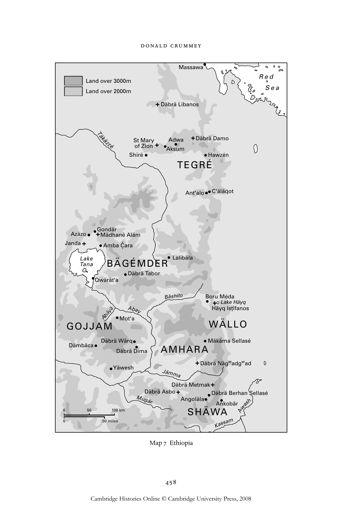

# 教会与民族：埃塞俄比亚正统合一教会（十三至二十世纪）：英文转换底稿

<!-- PDF page 478; original page 457 -->

### 19

### Church and nation: the Ethiopian

### Orthodox Täwahedo Church (from the

### thirteenth to the twentieth century)

### d o na l d c ru m m e y

Ethiopia claims one of the oldest national traditions in Christendom. In the second quarter of the fourth century, the Ethiopian king, Ezana, together with his court, converted to Christianity. At the request of Ezana, St Athanasios, bishop of Alexandria, appointed Ethiopia’s first bishop. Royal initiative thus founded a national church episcopally dependent on Alexandria. We know little about the pace of popular conversion, but Christianity did become embedded in the farming communities of the Ethiopian highlands, where it remains a deeply popular religion.[^p478-1] Royal dominance and popular commitment were the two poles of historic Ethiopian Christianity. Performing the role of mediator between these were, on the one hand, the Egyptian-appointed bishops, and on the other – and more importantly – the monasteries, which dotted the landscape, both geographical and cultural.

Ethiopian history unfolded on a high tableland, much intersected by mountain ranges and deeply fissured river valleys, which, during the principal rains lasting from mid-June to mid-September, is extremely difficult to traverse. The Ethiopian plateau lies at the southern end of the Red Sea and at the headwaters of the Blue Nile, the source of Egypt’s annual flood. Christianity came to Aksum, then the principal town on the northern plateau, as part of the Hellenistic culture of the traders who plied the Red Sea in the early centuries of the era.[^p478-2] The Aksumite kingdom was the most powerful state in the southern

[^p478-1]: For this, as for so many other issues, see the masterly work by Taddesse Tamrat, Church and state in Ethiopia, 1270–1527 (Oxford: Clarendon Press, 1972). Also useful, but more problematic, is Sergew Hable Sellassie, Ancient and medieval Ethiopian history to 1270 (Addis Ababa: United Printers, 1972).

[^p478-2]: Good accounts of Ethiopia’s classical history are S. Munro-Hay, Aksum: an African civilization of late antiquity (Edinburgh: Edinburgh University Press, 1991); Munro-Hay, ‘Aksum. History of the town and empire’, in Encyclopædia Æthiopica (Wiesbaden: Harrassowitz Verlag, 2003), i, 173–9; and D. W. Phillipson, Ancient Ethiopia: Aksum, its antecedents and successors (London: British Museum Press, 1998).

<!-- PDF page 479; original page 458 -->

B

> Abäyä

Mo A t' b a ay

### G O J J A M

Däbrä Wärq Dämbäca Mugär

050 100 km

050 miles ä s h i l o Massawa Red Land over 3000m Sea Land over 2000m Däbrä Libanos Täkäzzé S o t f M Zi a o r n y A A k d su w m a Däbrä Damo Shiré Hawzén

### T E G R É

Ant'alo C'äläqot Gondär Azäzo Mädhané Aläm Janda Amba Č. ara

### T L a a n ke a B Ä G É M D E R Lalibäla

Däbrä Tabor Qwärät'a Boru Méda Lake Häyq Häyq Ist.ifanos

### W Ä L L O

Mäkäma Sellasé

### A M H A R A

Däbrä Dima Däbrä Nägwadgwad Yäwesh Jämma Däbrä Metmak Däbrä Asbo Däbrä Berhan Sellasé Angoläla Ankobär wash

### S H Ä WA A

Kassam

> Map 7 Ethiopia

<!-- PDF page 480; original page 459 -->

Red Sea, and the country remained sensitive to developments stemming from this direction. The highlands, which presented such a challenge to Ethiopia’s rulers, presented an even greater challenge to external powers, and afforded the country a degree of autonomy vis-à-vis the millennial forces which swept the region. Of these forces, Islam was one of the most powerful. Its rise, in the seventh century of the era, ended Aksumite dominance in the Red Sea. Over time, Islam came to dominate the Hellenistic world into which the Aksumites had fitted so comfortably.

Ethiopians came to see themselves as an island of Christianity in a hostile sea of Islam and of paganism. The patriarchates – of Alexandria and of Antioch – to which they looked for guidance were subjected to Muslim rule in the first decades of the Islamic era and the adherents of the churches which they led soon became minorities. The Nubian Christian kingdoms of the middle Nile Valley were slower to succumb, the last of them passing out of the historical record in the fifteenth century.[^p480-3] Meanwhile, Islam was establishing itself on the western side of the Red Sea, on the coastlands below the Ethiopian highlands, from where it slowly spread inland along routes of trade. In the Ethiopian region, both Islam and Christianity were confronted with a multiplicity of religious beliefs and practices which both viewed as pagan. As we shall see, the struggle against pre-Christian belief and practice was waged not simply on the frontiers of the kingdom but even within the royal court itself.

Ethiopia’s position as an outpost of Christendom allowed the development of beliefs and practices which, while unfairly viewed as exotic, were none the less distinctive. Ethiopians never lost the sense of being part of Christendom. Their sense of Orthodoxy came in their commitment to christological doctrine as they had received it from Alexandria. This doctrine they understand as täwahedo, or union, emphasising the union of the divine and human natures in Christ, whom they view as one person with one nature, which is uniquely divine and human. The common western designation of this position as ‘Monophysite’ sits uneasily with some of its adherents.[^p480-4]

[^p480-3]: W. Y. Adams, Nubia: corridor to Africa (Princeton: Princeton University Press, 1977), 525–46.

[^p480-4]: On the occasion of the meeting in Addis Ababa of the churches of the Syrian–Alexandrian connection, two authoritative publications were issued, one by the patriarchate, the other by ‘The Ethiopian Orthodox Mission’, a palace-supported organisation based at the Church of the Holy Trinity: The Church of Ethiopia: a panorama of history and spiritual life (Addis Ababa: Ethiopian Orthodox Church,1970) [hereafter Panorama]; and Aymro Wondmagegnehu and Joachim Motovu (eds.), The Ethiopian Orthodox Church (Addis Ababa: The Ethiopian Orthodox Mission, 1970). Both retain their value as authoritative statements. For a more recent sympathetic account, by a member of the Greek Orthodox Church, see C. Chaillot, The Ethiopian Orthodox Tewahedo Church tradition: a brief introduction to its life and spirituality (Paris: Inter-Orthodox Dialogue, 2002). Older, sympathetic accounts by foreigners would include E. Hammerschmidt, Äthiopien: christliches Reich zwischen Gestern und Morgen (Wiesbaden: Harrassowitz, 1967); and F. Heyer, Die Kirche Äthiopiens: eine Bestandsaufnahme (Berlin: Walter de Gruyter, 1971).

<!-- PDF page 481; original page 460 -->

In many aspects of religious practice the Ethiopians were, and remain, conventionally Orthodox. Ordination to the priesthood and diaconate is the prerogative of a bishop standing in apostolic succession; their parish clergy are married; monasticism traces its roots to St Anthony; they share the religious calendar common throughout the Orthodox world; they recognise seven sacraments, of which Baptism and the Eucharist are held pre-eminent; they observe nine major festivals in honour of Christ: Nativity, Epiphany, Annunciation, Palm Sunday, Good Friday, Easter, Ascension, Pentecost and Transfiguration. However, as we will see, this was a Christianity deeply conscious of its Semitic roots, this consciousness reinforced by the fact that, since the centuries preceding the Christian era, Ethiopia has been culturally and politically dominated by Semitic speakers. Today, observance of the Sabbath as a feast day of equal status with Sunday is normative; circumcision is practised; Christian Ethiopians follow dietary prescriptions derived from the Torah; and they liken the altar (tabot) on which they celebrate the Eucharist to the Ark of the Covenant. Moreover, while marriage is de rigueur for the clergy, the church has not fully succeeded in imposing its views of marriage on the laity. Most Ethiopian Christians marry according to lay customs, and divorce is an accepted practice for the laity. However, church norms are recognised in that most Ethiopian Christians view their marriage practices as barring them from receiving the Eucharist, and instead channel their religious devotion into rigorous fasting.

Equally, the commitment to Alexandrian teaching as a touchstone of Orthodoxy did not lead to unanimity, but rather created a framework within which redefinition was constant. The monasteries constituted the restless frontiers of Ethiopian Christendom. They were organised into two broad orders, following the leadership of two saintly monks – Éwosṭ’atéwos and Täklä Haymanot – of the thirteenth and early fourteenth centuries. Episcopal authority could do little to contain the orders, unless backed by the power of the state, which was comparatively weak. For virtually a millennium, following the seventhcentury eclipse of Aksum, Ethiopia’s kings ruled from roving capitals, seeking to dominate by their seasonal presence an agrarian society and the regional lay and clerical rulers who depended on the surpluses produced by that society. For most of its history, the Ethiopian Church had but one metropolitan bishop, and he a Copt. Only rarely did he have the support of suffragan bishops. Thus, in ecclesiastical affairs the monasteries played a role analogous to that played

<!-- PDF page 482; original page 461 -->

by regional princes in the polity at large. And, at base, there were the parishes, staffed by priests and deacons who were at the same time farmers – parishes in which agriculture and the liturgical calendar dominated life.

### A historical synopsis[^p482-5]

The foundations of the Ethiopian Orthodox Church were laid in the three centuries following the conversion of the court. The Bible and the liturgy were translated into Ge’ez, the common language of Aksum, a Semitic language related to the languages of South Arabia. Ethiopian tradition attributes the introduction of monasticism to ‘the Nine Saints’, Syrians in origin, whose arrival is usually dated to the late fifth century in the aftermath of the council of Chalcedon, from which they were dissidents.[^p482-6] They are said to have founded an array of monasteries, still active, across what is now northern Ethiopia. Tradition also attributes the origins of church music, the practice of liturgical dance and the composition of numerous hymns to St Yaréd, who flourished in the first half of the sixth century. In this period also lie the origins of the practice of pilgrimage to the Holy Places of Palestine and Egypt. The period was brought to an end by the rise of Islam.

Not until the thirteenth century did the Christian kingdom re-emerge to the full light of history, with the seizure of the throne in 1270 by a dynasty claiming both the legitimate mantle of the Aksumite rulers and descent from the biblical King Solomon and the Queen of Sheba. The Zagwé, whom the Solomonics displaced, had made an enduring mark on Ethiopian Christianity through the creation of a remarkable set of eleven rock-hewn churches at a site later named after the dynasty’s most distinguished member, Lalibäla. Solomonic renewal in the state was preceded by renewal in the church, which expressed itself in a vigorous monastic movement. Evangelising by monks led to one of the most notable periods in the expansion of the Ethiopian Church, into the heart of the central plateau, and beyond the Blue Nile to the south, staking out for the church the provinces of Bägémder and Gojjam, which it now views as its heartland.

For the first century of the new dynasty, conflict marked the relations between the royal court and the monks. However, charisma was slowly

[^p482-5]: A useful general account is to be found in S. Munro-Hay, ‘Christianity. History of Christianity’, in Encyclopædia Æthiopica, i, 717–23.

[^p482-6]: For a judicious statement of the standard interpretation, see Taddesse, Church and state, 23–5. More sceptical, pointing out that the hagiographies of the saints were all composed one thousand years after the period to which, ostensibly, they pertain, is Munro-Hay, ‘Christianity’.

<!-- PDF page 483; original page 462 -->

subverted by rich land grants and monastic energy was increasingly channelled into theological disputation rather than into political activity. Theological dispute reached a climax in the reign of King Zär’a Ya‘qob (Seed of Jacob) (r.1434–68), perhaps the most creative and authoritative voice in the history of the Ethiopian Church. A council, presided over by the king himself, established the Sabbath as a holy day equal in status to Sunday, made normative the veneration of the Virgin Mary, through an elaborate array of feast days supported by religious tracts and painting,[^p483-7] and suppressed sectarian dissent and magical practice. Zär’a Ya’qob led a movement of ‘religious nationalism’, that created a model of church–state relations; this survived the turbulent century which began during the reign of his great grandson, Lebnä Dengel (Incense of the Virgin) (r.1508–40).[^p483-8]

Between 1527 and 1632 the Ethiopian church and state were battered by invasion and civil war, which brought both to their extremity: 1527 saw the launching of a great jihad led by Aḥmad ibn Ibrahim, popularly known as ‘Grañ’ (the left handed). The development of a Christian state in the central highlands of Ethiopia had been paralleled by that of a chain of Muslim sultanates reaching from the coast via the eastern highlands and the Great Rift Valley into the highlands adjoining the Christian state. Relations were uneasy, balancing mutual profit from trade with the quest for dominance. From the earlier fourteenth through to the earlier sixteenth century, the Christians held the upper hand, thanks to their strategic position and greater cohesion. However, all this was overthrown by Aḥmad’s forces, which overran the Christian highlands, destroyed and pillaged churches and monasteries, and made the Ethiopian rulers refugees within their own kingdom. Aḥmad proclaimed a sultanate of Habasha, and both Muslim and Christian sources agree that large-scale defections from the Christian faith occurred.[^p483-9] In the short run the conflict came to an end with Aḥmad’s death in battle in 1543. However, the jihad proved to have a more lasting impact on both Christian and Muslim polities. Through weakening the frontier defences of the Christian state and distracting the attention

[^p483-7]: For an excellent introduction to the religious art of Ethiopia, see M. Heldman, AfricanZion: the sacred art of Ethiopia (New Haven: Yale University Press, 1993). See also S. Chojnacki, Major themes in Ethiopian painting: indigenous developments, the influence of foreign models, and their adaptation from the thirteenth to the nineteenth century [Äthiopistische Forschungen 10] (Wiesbaden: Franz Steiner Verlag, 1983).

[^p483-8]: The phrase is Taddesse’s: Church and state, ch. 6: ‘Zar’a Ya’iqob and the growth of religious nationalism (1380–1477)’.

[^p483-9]: The jihadist viewpoint is forwarded by Chihab ed-Din Ahmed Ben ‘Abd el-Qader, Histoire de la conquête de l’Abyssinie (XVIe siècle) (Paris: Ernest Leroux, 1897); for a Christian account, see W. Conzelman (ed. and trans.), Chronique de Galâwdêwos (Claudius) roi d’Éthiopie (Paris: É. Bouillon, 1895).

<!-- PDF page 484; original page 463 -->

of both Muslim and Christian power away from the frontiers, it opened the way for the remarkable expansion of the Oromo people, speakers of a Kushitic language, and, at this stage, adherents of neither Christianity nor Islam.[^p484-10]

The migration of the Oromo reversed the two and a half centuries of southward expansion of Christian power and culture, hammered the Christian kingdom, making recurrent inroads which, in several key areas, turned into settlement, creating insecurity and draining resources, and forced the withdrawal of the kingdom northwestward into the great bend of the Blue Nile and the regions around Lake Tana, to its north. By the end of the sixteenth century many of the splendid churches built by the Solomonics had disappeared and significant areas, previously inhabited by Christians, now passed into the hands of the newcomers.[^p484-11]  It was in these circumstances that two of Ethiopia’s rulers at the beginning of the seventeenth century turned to the Catholic faith, represented by Jesuit missionaries behind whom stood the power of Portugal and Spain. A Portuguese expeditionary force had played a key role in the death of Aḥmad Grañ and its survivors settled in Ethiopia, marrying Ethiopian women. Their presence was a constant reminder of the efficacy of European arms.

The Jesuits had first arrived in Ethiopia in 1557 on the misunderstanding that the Ethiopian rulers were prepared to submit to Catholic belief and practice.[^p484-12] Quickly disabused they retreated to northern Ethiopia, where the mission atrophied. A Jesuit priest was sent out in 1603 to revive it, but found himself called to court by King ZäDengel (The Virgin’s) (1603–4), who explored Jesuit teaching sympathetically. ZäDengel was soon to be succeeded by King Susenyos, who, in 1607, fought his way to the throne and quickly turned to the Jesuits. In 1622 he made an open, formal submission to Rome, establishing Catholicism as the religion of court and country. But Catholicism served this Solomonic ruler no better than Orthodoxy had in transforming his relations with the powerful forces which dominated in the provinces – the monasteries and the noble lineages. Rebellion mounted, and in 1632 Susenyos abdicated in favour of his son, Fasilädäs, who directly restored Täwahedo Orthodoxy, expelled the Jesuits, and cut ties to Portugal and Spain.

[^p484-10]: For a general account of the sixteenth and seventeenth centuries see Mordecai Abir, Ethiopia and the Red Sea: the rise and decline of the Solomonic dynasty and Muslim–European rivalry in the region (London: Cass, 1980).

[^p484-11]: See Mohammed Hassen, The Oromo of Ethiopia: a history, 1570–1860 (Cambridge: Cambridge University Press, 1990).

[^p484-12]: For a nuanced and informative account of the Jesuit mission, see H. Pennec, Des Jésuites au Royaume du Prêtre Jean (Éthiopie): stratégies, rencontres et tentatives d’implantation 1495 –1633 (Paris: Fundação Calouste Gulbenkian, 2003).

<!-- PDF page 485; original page 464 -->

Fasilädäs inherited the throne of an exhausted, dispirited country with no option other than a return to the Orthodoxy of Zär’a Ya‘qob. He benefited from his reaffirmation of the value of tradition in church and polity and his rule ushered in three generations of comparative peace and cultural revival. At Gondär he established the first fixed capital since Aksum and built churches and palaces. His son Yoḥännes I (r.1667–82), and grandson Iyasu I, the Great (r.1682–1706), followed his example, presiding over a state from which the threat of external forces had receded. However, the rise of Jesuit influence early in the century had sparked vigorous and diverse responses from the Ethiopian Church, bringing Christology back to the centre of disputation among the Orthodox, responses which slowly hardened into sectarianism associated with the two rival monastic orders. Both Yoḥännes and Iyasu presided over a succession of councils devoted to Christology, but, unlike Zär’a Ya‘qob, they were unable to impose unity. Iyasu was assassinated and the fifteen years following his death were violent and uncertain. In the christological controversies the sources suggest that the principal party of innovation was the Éwost’atians, whose slogan was Qebat, or Unction, which emphasised the role of the unction of the Holy Spirit in effecting the union of the divine and the human in Christ. From their own standpoint they were deeply committed to an anti-Chalcedonian position, in harmony with the theological tradition of Alexandria.[^p485-13]  Qebat teaching was resisted by the followers of Täklä Haymanot, who themselves advocated a position which claimed that Jesus had become Son of God through the Grace (Ṣäga) of the Holy Spirit. He is, they said, the Son of Grace, YäṢäga Lej. A third party, much the smallest, associated with the bishops of the nineteenth century, was known as Karra or Knife.

Qebat forces were probably behind the assassination of Iyasu I, and in the reign of his brother Téwoflos (r.1708–11) Qebat became established doctrine. It was to hold this position for almost sixty years. Establishment came at a price, however. In the reign of Iyasu’s son Dawit (r.1716–21), perhaps one hundred monks of the order of Täklä Haymanot were slaughtered by palace troops. This was an early climax and the same level of violence was not again reached until the nineteenth century, and possibly not even then. Nevertheless, sectarian positions hardened, and within each sect new positions were

[^p485-13]: Getatchew Haile, ‘Materials on the theology of Qebat or unction’, in Ethiopian studies: Proceedings of the Sixth International Conference, Tel-Aviv, 14–17 April 1980, ed. G. Goldenberg (Rotterdam: A. A. Balkema, 1986), 205–50. See also Getatchew Haile, The faith of the Unctionists in the Ethiopian Church (Haymanot Mäsihawit) [CSCO, Scriptores Æthiopici 91] (Louvain: Peeters, 1990); Kindeneh Endeg Mihretie, ‘The role of Qebatoč in the Christological controversy within the Ethiopian Orthodox Church (1620–1764)’, unpublished MA thesis, Addis Ababa University, 2004.

<!-- PDF page 486; original page 465 -->

forwarded. Sectarianism did not dampen other expressions of Orthodox religion. The great church foundations of Gondär, notably the churches of Däbrä Berhan Sellasé by Iyasu I in 1694 and of Däbrä Ṣähay Qwesqwam by Empress Mentewwab in the 1740s, set a standard, which was emulated throughout the country for almost 150 years.[^p486-14]  Major churches continued to be founded in the town itself into the 1780s. Moreover, the Gondär period saw a recovery of the legacy so badly battered by the storms of the sixteenth and early seventeenth centuries. Manuscripts were copied. New manuscripts were written. And painting thrived, adorning manuscripts and church buildings alike.[^p486-15]  The great foundations each supported several hundred clergy, who, in turn, made Gondär a centre of church education, a role it has played down to the present.

The Ethiopian state and church entered the nineteenth century in a state of disarray. At the end of the 1760s powerful regionally based nobles succeeded in toppling the throne and instituting a succession of puppet rulers, gaining effective power for themselves and their lineages. Ethiopia’s clerical chroniclers likened the period to the biblical period preceding the foundation of the Jewish kingdom and dubbed it the Zämänä Mäsafent, ‘Era of the Judges’. The fate of the church was most poignantly seen in the careers of the bishops, who attempted to lead the church, during the first half of the nineteenth century. They were abused, chased from Gondär and forced into internal exile, their doctrinal authority rejected. At this stage their particular enemies were the monks of Däbrä Libanos and the Ṣäga doctrine, which they professed. Ethiopia had experienced previous periods of weak central institutions, but by the 1830s there were clear signs that the outside world was unlikely to leave the country alone. Egypt was reviving and expanding, and in the 1830s its armies reached the borderlands which separated Ethiopian authority from the authority of states based in the upper Nile Valley. At the same time Europeans – missionaries, both Protestant and Catholic, and lay travellers – became a constant presence in the highlands, reviving memories both of the Jesuit conflicts and of the potential that Europe offered for military support.[^p486-16]  Revival of the Ethiopian

[^p486-14]: For an account of the founding of Ethiopian churches in general and of Däbrä Berhan Sellasé and Däbrä Ṣähay Qwesqwam, in particular, see D. Crummey, Land and society in the Christian Kingdom of Ethiopia: from the thirteenth to the twentieth century (Urbana: University of Illinois Press, 2000). For an excellent account of a seventeenth-century foundation, see Anaïs Wion, ‘“Aux confins le feu, au centre le paradis”: Qoma Fasilädäs, un monastère royal dans l’Éthiopie du 17ème siècle’, unpublished PhD dissertation, 2 vols., Université de Paris – Panthéon Sorbonne, 2003.

[^p486-15]: Gondärine art is richly represented in Heldman, African Zion.

[^p486-16]: In general see, Mordechai Abir, Ethiopia: the era of the princes. The challenge of Islam and the unification of the Christian Kingdom 1769–1855 (London: Longmans Green, 1968); D. Crummey, Priests and politicians: Protestant and Catholic missionaries in Orthodox Ethiopia, 1830–1868 (Oxford: Clarendon Press, 1972); and S. Rubenson, The survival of Ethiopian independence (London: Heinemann Educational Books, 1976).

<!-- PDF page 487; original page 466 -->

state was an imperative, and the three rulers who effected that revival each saw the revival of a united church as an essential element in the revival of the state.

Political revival began in 1855 with the accession to the Solomonic throne of Kassa Haylu, who took the throne name of Téwodros II. He ruled until 1868. He fought his way to power, and in transforming himself from warrior to statesman he revived the authority of the bishops and tried to restore doctrinal unity to the church. The council of Amba Č. ara, in 1854, established the bishop Abunä Sälama as the arbiter of Alexandrian orthodoxy, and pronounced anathema on sectarianism. In 1855, Sälama crowned Téwodros as King of Kings of Ethiopia. While bishop and king soon came into conflict – over issues of land and authority – the king maintained a formal propriety in their relations and never resorted to sectarianism to undermine the bishop’s authority.[^p487-17]  Téwodros’s eventual successor was Yoḥ ännes IV (1872–89), who by proclaiming himself ‘King of Zion’ laid claim to the legacy of Aksum, as shown by his choice of the church of St Mary of Zion in Aksum as his coronation church. Like Téwodros, he sought ecclesiastical revival and unification. To this end he pursued a policy of suppressing the Qebat and Ṣäga sectarians. At the council of Boru Méda in 1878, where he basked in the submission of Menilek, the last of the major provincial rulers to hold out, he proclaimed the faith of the church to be the Karra doctrine of Qérelos, Sälama and Atnatéwos, and vigorously enforced it. As for episcopal authority, in 1881 Yoḥ ännes persuaded the Coptic patriarch to appoint an unprecedented four bishops.

Yoḥ ännes set the agenda which, under his successor Menilek II (1889–1913), carried the Ethiopian Orthodox Church into the twentieth century. Sectarianism was marginalised and the doctrinal position forwarded at the council of Boru Méda has remained normative to the present. Expansion of the episcopacy pointed, obliquely to be sure, towards a new national organisation for the church. Menilek lacked the zeal of Téwodros or Yoḥ ännes, but his adoption of their policies set a final seal upon them.

Church and state entered the twentieth century in a condition far different from that of a century before. The monarchical state was restored; doctrinal

[^p487-17]: D. Crummey, ‘Doctrine and authority: Abunä Sälama, 1841–1854,’ in IV Congresso Internazionale di Studi Etiopici (Rome: Accademia Nazionale dei Lincei, 1972), i, 567–78; Crummey, ‘Orthodoxy and imperial reconstruction in Ethiopia, 1854–1878’, JThSt 29 (1978), 427–42; and D. Crummey and Getatchew Haile, ‘Abunä Sälama: Metropolitan of Ethiopia, 1841–1867. A new Ge’ez biography’, Journal of Ethiopian Studies 37 (2004), 191–209.

<!-- PDF page 488; original page 467 -->

unity prevailed in the church. In 1896, Menilek defeated an invading Italian army at the Battle of Adwa, firmly establishing his country’s independence. In the decades preceding Adwa, Menilek’s armies had carried the authority of the state far and wide, and with it the presence of the Orthodox Church. The century was to see momentous transformations. An episcopal hierarchy was established and then indigenised and expanded. Expansion was territorial as well as institutional, the church establishing a presence in far-flung corners of the new Ethiopian Empire and overseas in Jamaica and in North America. The church entered into regular conversations with other churches of the Alexandrian–Syrian connection and became a member of the World Council of Churches. But its central role in the construction of the modern Ethiopian state brought burdens and limitations, as well as privileges. Menilek’s eventual successor, Haile Sellassie I (1930–74), retained the vision of church, state and nation which animated his predecessors, but the country over which he ruled was far more diverse than that vision allowed. Territorial expansion in the later nineteenth century had brought within the fold of the state large numbers of Muslims and peoples adherent to neither Christianity nor Islam. Moreover, the modernisation espoused by Menilek and pursued by Haile Sellassie eventually overwhelmed the monarchy, and, with the deposition of Haile Sellassie in 1974, ushered in an era of revolution, disestablishment of the church and the creation of a secular state.[^p488-18]

### Monks and monarchs: the Ethiopian nation

In many ways the definitive Ethiopian state and nation were formed in the two centuries following the establishment of the Solomonic dynasty in 1270. This process climaxed in the reign of Zär’a Ya’qob (1434–68), who reconciled local practice with Alexandrian authority. The dominant forces that we can most readily see at work were the monks and the royal court. Conflict marked their early relations.

[^p488-18]: The literature on the Ethiopian Revolution is voluminous. Two accounts of outstanding value are Andargachew Tiruneh, TheEthiopianrevolution,1974–1987:atransformationfrom an aristocratic to a totalitarian autocracy (Cambridge: Cambridge University Press, 1993); and C. Clapham, TransformationandcontinuityinrevolutionaryEthiopia (Cambridge: Cambridge University Press, 1988). For the fate of the church, see Haile Mariam Larebo, ‘The Ethiopian Church and politics in the twentieth century: part 2’, Northeast African Studies 10 (1988), 1–23; Haile Mariam Larebo, ‘The Orthodox Church and state in Ethiopian revolution’, Religion in Communist Lands 14 (1986), 148–59; J. Persoon, ‘Monks and cadres in the land of Prester John: an interdisciplinary study of modern Ethiopian monasticism and its encounter with communism’, unpublished PhD dissertation, London University, 2003.

<!-- PDF page 489; original page 468 -->

Monastic revival preceded the Solomonic rise.[^p489-19]  A formative figure in this revival was Iyäsus Mo‘a ( Jesus has prevailed), who, around 1248, founded the monastery of St Stephen on an island in Lake Häyq.[^p489-20]  Iyäsus Mo‘a had started his career at Däbrä Damo, one of the ancient monasteries of northern Ethiopia. Early traditions ascribe to him a pact with Yekunno Amlak, founder of the new dynasty, for whom his support seems, indeed, to have been important. From the community of Iyäsus Mo‘a monks dispersed across the landscape of Amhara and the province of Shäwa, to its south, founding their own monasteries. The most famous of his disciples was Täklä Haymanot (Plant of Faith), who founded the monastery of Däbrä Asbo (later known as Däbrä Libanos) around 1284, and who came, in the memory of later generations, to overshadow his master.[^p489-21]

Thirteenth-century monasticism in central Ethiopia saw itself continuing a monastic tradition which reached back to Aksum. It was informal, charismatic and committed to poverty. Individual holy men settled in wild, unsettled areas, attracting followers and creating communities through the rigour of their practice. They survived by gathering wild fruits and hiring out their labour to nearby farm villages at harvest time.[^p489-22]  From this position of independence some found themselves increasingly drawn to political involvement. Most prominent was BäṢälotä Mika’él (By the Prayer of St Michael), a secondgeneration follower of Iyäsus Mo’a.[^p489-23]  Meanwhile, the dynasty, having passed through a series of succession crises following the death of its founder, was now represented by the vigorous, expansionist Amdä Ṣeyon (Pillar of Zion) (1314–44), one of its greatest members.

In his first appearance at court BäṢälotä Mika’él attacked the metropolitan of the church, Abunä Yoḥ ännes, for simony. For this he was exiled to Tegré.[^p489-24]

[^p489-19]: On medieval Ethiopian monasticism see Taddesse, Church and state. But see also S. Kaplan, The monastic holy man and the christianization of early Solomonic Ethiopia [Studien zur Kulturkunde 73] (Wiesbaden: Franz Steiner Verlag, 1984); M.-L. Derat, Le domaine des rois éthiopiens (1270–1527): espace, pouvoir et monachisme (Paris: Publications de la Sorbonne, 2003).

[^p489-20]: The two oldest extant Ethiopian manuscripts are copies of the four gospels from this monastery:EthiopianMonasticMicrofilmLibrary,StJohn’sUniversity,Collegeville,MN, MS. 1832, Gold Gospel, Häyq Estifanos; and Paulos Sadua, ‘Un manoscritto etiopico degli Evangeli’, Rassegna di Studi Etiopici 11 (1952), 9–28.

[^p489-21]: For a rich account of the careers of Iyäsus Mo‘a and Täklä Haymanot, see Taddesse, Church and state, 158–73.

[^p489-22]: Ibid., 110, 172; Kaplan, Monastic holy man, 36–9, 54.

[^p489-23]: See S. Wolde Yohannes and D. Nosnitsin, ‘BäṢälotä Mika’él’, in Encyclopædia Æthiopica, i, 493–4.

[^p489-24]: Taddesse’s account rests heavily on the hagiographies, published and unpublished, of the principal monastic figures involved. The royal chronicles also reflect these events: R. Basset, Études sur l’histoire d’Éthiopie (Paris: Imprimerie nationale, 1882), 10–11 (text); 99–100 (trans.); F. Béguinot, La Cronaca Abbreviata d’Abissinia: nuovo versione dall’Etiopico (Rome: Tipografia della casa edit. italiana, 1901), 7–10.

<!-- PDF page 490; original page 469 -->

He shortly returned to court, where he attacked Amdä Ṣeyon himself, for defying Christian sexual morality in having married more than one wife, in keeping concubines and in committing incest with one of the wives of his father.[^p490-25]  New here were not the practices, which were deep-seated and were to persist for generations, but the fervour in attacking them. BäṢälotä Mika’él was again exiled to northern Ethiopia, where he died. Around 1337 a new metropolitan, Abunä Ya‘qob, reached Ethiopia and picked up the threads of BäṢälotä Mika’él’s mission. Relations between the metropolitans and the monasteries were often uneasy, mediated by the royal court, on which the metropolitans were dependent for imposition of their authority. Ya‘qob allied himself with the monks and excommunicated the king, who then flogged and exiled Ya‘qob’s monastic allies. Tension carried over into the reign of Amdä Ṣeyon’s successor, Sayfä Rä’ad (1344–71), who imitated his father in marrying three wives. Continuing opposition from bishop and monks led to exile – the bishop back to Egypt and the monks beyond the frontiers of the kingdom. The kings prevailed in these clashes, but found the price of attack from the church to be high. The accession of Sayfä Rä’ad’s son Dawit (1382–1411) brought a transition from confrontation to a new synthesis and integration in the fifteenth century.[^p490-26]  This synthesis involved the absorption of the new monasticism into the mould of the old: in other words, the conversion of charisma into establishment, which was made possible through rich royal grants of land.[^p490-27]

While the monks of central Ethiopia consciously stood in the tradition of St Anthony and of the historic monasteries dating to Aksumite times, and honoured the discipline which they had inherited, they were also restlessly innovating, wary of their autonomy and prone to controversy over numerous points of doctrine, the Trinity included. Some of their beliefs and practices challenged a royal court increasingly concerned to impose a unity of belief and practice in the church.[^p490-28]  In northern Ethiopia, a monk called Esṭifanos gathered a following with his preaching of austerity and his insistence that

[^p490-25]: This follows the account in Crummey, Land and society, 25–6. Cf. Taddesse, Church and state, 98–118. For religious disputes within the Ethiopian Church at this time, see Getatchew Haile, ‘Religious controversies and the growth of Ethiopic literature in the fourteenth and fifteenth centuries’, Oriens Christianus 65 (1981), 102–36.

[^p490-26]: See Getatchew Haile, ‘From strict observance to royal endowment: the case of the monastery of Däbrä Halle Luya, EMML 6343, fols. 177r–118v’, Le Muséon 93 (1980), 163–4. Cf. Kaplan, Monastic holy man, 55.

[^p490-27]: See Crummey, Land and society, 17–49.

[^p490-28]: See Taddesse, Church and state, ch. 6.

<!-- PDF page 491; original page 470 -->

reverence was due to God alone, not to the Blessed Virgin, nor to such physical representations as icons or crosses, nor to worldly figures such as the king.[^p491-29]  The Stephanites were readily suppressed, but more serious were the followers of Éwosṭatéwos, who advocated observance of the Sabbath as a holy day equally worthy as Sunday.[^p491-30]  The followers of Täklä Haymanot and the metropolitans both opposed the Éwosṭatian position on the Sabbath.

These conflicts were resolved at the council of Däbrä Meṭmaq in 1449, over which King Zär’a Ya‘qob (1434–68) presided.[^p491-31]  He managed, at one and the same time, to reimpose episcopal authority and to regularise belief and practice according to Ethiopian, rather than Alexandrian, precedent. He had obtained two bishops from Cairo, along with a suffragan, and persuaded them to accept observation of the Sabbath.[^p491-32]  This practice the council successfully declared to be normative, along with adoration of the Blessed Virgin, whose intercession, Zär’a Ya‘qob proclaimed, effected salvation. He introduced a host of monthly festivals whereby She would be honoured.[^p491-33]  These actions of the council proved lasting, and the common practices which it mandated strengthened a ‘religious nationalism’ throughout Ethiopian Christendom. So strong had this nationalism become, a rupture with Alexandria was openly discussed at a council during the reign of Zär’a Ya‘qob’s successor. The king had yet other concerns. He felt himself threatened by the practice of sorcery and witchcraft within the royal court itself, and attempted, ruthlessly, to stamp it out. Devout and learned as Zär’a Ya‘qob was,[^p491-34]  he followed the marital practices of his predecessors. He had three official wives whose individual

[^p491-29]: See Taddesse Tamrat, ‘Some notes on the fifteenth century Stephanite ‘Heresy’ in the Ethiopian Church’, Rassegna di Studi Etiopici 22 (1966), 103–15; and Getatchew Haile, ‘The cause of the ∃st’ifanosites: a fundamentalist sect in the Church of Ethiopia’, Paideuma: Mitteilungen zur Kulturkunde 29 (1983), 93–119.

[^p491-30]: See G. Lusini, Studi sul monachesimo eustaziano (secoli XIV–XV) (Naples: Istituto universitario orientale, 1993).

[^p491-31]: For the date, I follow Derat, Domaine des rois éthiopiens, 170. Taddesse, Church and state, 230, gives 1450. In addition to the numerous writings of the king, an important primary source is J. Perruchon, Les Chroniques de Zar’a Yâ‘eqôb et de Ba’eda Mâryâm, rois d’Éthiopie dès 1434 à 1478 (Paris: Émile Bouillon, 1893).

[^p491-32]: See Getatchew Haile, ‘The Homily of As’e Zär’a Ya‘eqob of Ethiopia in honour of Saturday’, Orientalia Lovaniensia Periodica 13 (1982), 185–231.

[^p491-33]: Getatchew Haile, ‘Ethiopian Orthodox Täwahédo Church’, in Encyclopædia Æthiopica, ii, 414–21; and Getatchew Haile, The Mariology of Emperor Zär’a Ya‘eqob of Ethiopia [Orientalia christiana analecta 242] (Rome: Pontificium institutum studiorum orientalium, 1992).

[^p491-34]: He was a prolific author. See C. Conti Rossini and L. Ricci (ed. and trans.), Il Libro della Luce del Negus Zar’a Ya‘qob (Mashafa Berhan) [CSCO, Scriptores Æthiopici 47 (text), 48 (trans.); 51 (text), 52 (trans.)] (Louvain: Secrétariat du Corpus scriptorum christianorum orientalium, 1964–1965); Getatchew Haile (ed. and trans.), The Epistle of Humanity of Emperor Zär’a Ya‘eqob (Tomarä Təsbə’t) [CSCO, Scriptores Æthiopici 95 (text), 96 (trans.)] (Louvain: Peeters, 1991).

<!-- PDF page 492; original page 471 -->

courts featured prominently in the organisation of the royal camp. Finally, the king’s rule was tyrannical and produced a strong reaction, especially in the years following his death, while the consensus on doctrine and the synthesis of episcopal authority and monasticism which he effected proved ephemeral, haunting future generations as an ideal too often beyond grasp. It was to be almost 400 years before Ethiopian rulers again achieved this integration.

### The royal church

One institution of church and state, possibly born and certainly developed under the medieval Solomonics, which survived the upheavals and destructive violence of the years from 1527 to 1632 was the royal church.[^p492-35]  To be sure, many of these churches were destroyed during the jihad of Aḥmad Grañ and others were lost to the Christian kingdom during the Oromo wars of the latter half of the sixteenth century. Nevertheless, the institution provides a bridge from the medieval to the Gondär period and beyond and played a role in the revival of the Solomonic monarchy in the later nineteenth century. It caught the attention of the Portuguese priest Francisco Alvares, who visited Ethiopia in the 1520s, and whose account has remained invaluable for its detailed insights into the Solomonic kingdom on the eve of the cataclysmic jihad.[^p492-36]  Alvares believed that this institution was peculiarly characteristic of the (then) districts of Amhara and Shäwa, where the Solomonics were based. It emerges from the broader historical record in the course of the sixteenth century, during the reigns of Zär’a Ya‘qob and his son Bä’edä Maryam (By the Hand of Mary) (1468–78). Bä’edä Maryam’s foundation of Atronsä Maryam was famous for its wealth and for harbouring the remains of numerous earlier metropolitans and of three of the king’s predecessors, most notably the dynasty’s founder, Yekunno Amlak.[^p492-37]

[^p492-35]: See M.-L. Derat and H. Pennec, ‘Les églises et monastères royaux d’Éthiopie (XVe–XVIe et XVIIe siècles): permanences et ruptures d’une stratégie royal’, in Ethiopia in broader perspective: Papers of the XIIIth International Conference of Ethiopian Studies, ed. Katsuyoshi Fukui, Eisei Kurimoto and Masayoshi Shigeta (Kyoto: Shokado Book Sellers, 1997), i, 17–34; Derat, Le domaine des rois éthiopiens, ch. 6 and 7; and Crummey, Land and society, 29–35 and as indexed.

[^p492-36]: C. F. Beckingham and G. W. B. Huntingford, The Prester John of the Indies, 2 vols. (London: Cambridge University Press for the Hakluyt Society, 1961).

[^p492-37]: Getatchew Haile, ‘A history of the Tabot of Atronəsä Maryam in Amhara (Ethiopia)’, Paideuma: Mitteilungen zur Kulturkunde 34 (1988), 13–22. The church’s wealth impressed both Alvares, for whom see Beckingham and Huntingford, Prester John, ii, 332–3; and the chronicler of the jihadist Aḥmad Grañ, for whom see Chihab ed-Din, Histoire de la conquête, 311–13. See also, M.-L. Derat, ‘Atronsä Maryam’, in Encyclopædia Æthiopica, i, 394–5.

<!-- PDF page 493; original page 472 -->

One function of the royal church was to serve as a dynastic burial site, and later kings would be buried in churches of their own foundation. But the royal church also served other functions. Founded by kings, not monks, these churches were beholden to the former, from whose favour they derived their wealth and from association with whom they derived their prestige. Reciprocally, in their magnificence they manifested monarchy to regional and local populations. Alvares saw them as quite distinct from monasteries, which characterised the landscape of northern Ethiopia, but, despite their similarities to the great ‘collegiate’ churches of medieval Europe, they retained their links to the monastic orders, and typically had the status of gädam, or sanctuary, a word often taken as synonymous with ‘monastery’.[^p493-38]  So they straddled the European divide between ‘secular’ as opposed to ‘monastic’ churches. Characteristic features were: the conceptualisation of their clergy as däbtära, a term which Alvares renders as ‘canon’;[^p493-39]  royal initiative in their founding; richness of continuing royal patronage; and the church as royal tomb and shrine. The royal churches were supported primarily by grants of land, some lands providing revenues derived from tribute and rent, for support of the Mass and maintenance of the church fabric, other lands providing direct support for the clergy with which the churches were staffed. Some churches also enjoyed the right to tax local markets and benefited from the fees, which derived from their judicial rights over the lands under their control.

The royal churches also played useful roles within the diffuse structure of ecclesiastical organisation, which, in many respects, was minimal. The principal monastic orders had national visibility, but were held together by informal fraternal ties, rather than by any tighter governance. The metropolitan bishops had hierarchical prestige, but the hierarchy was extremely flat and prestige was

[^p493-38]: Beckingham and Huntingford, Prester John, i, 256. For the meaning of gädam, see Käsaté Berhan Täsamma, Yä‘Amareñña Mäzgäbä Qalät (Addis Ababa: Artistic Printing Press, 1951 Eth. Cal.), 1192; I. Guidi, Vocabolario Amarico-Italiano (Rome: Istituto per l’Oriente, 1953; reprint of the edition of 1901), cc. 776–7; J. Baeteman, Dictionnaire Amarigna–Français suivi d’un vocabulaire Français–Amarigna (Dire Dawa: Imprimerie St Lazare, 1929), cc. 1009–10. For an example of a foundation in which the establishment of sanctuary is central, see D. Crummey, ‘Theology and political conflict during the Zämänä Mäsafent: the cast of Esté in Bägémder’, in Proceedings of the Ninth International Congress of Ethiopian Studies, Moscow, 26–29 August 1986, ed. A. Gromyko et al. (Moscow: Nauka, 1988), v, 201–11.

[^p493-39]: Däbtära, originally ‘tabernacle’ or ‘tent’: A. Dillmann, Lexicon Linguae Æthiopicae cum Indice Latino (Osnabrück: Biblio Verlag, 1970; reprint of the original edition of 1865), c. 1106. By derivation the term was originally applied to the clergy who served in the churches of the royal camp; by further derivation it acquired the meaning of ‘cantor’: Guidi, Vocabolario, cc. 671–2; Baeteman, Dictionnaire, 908; Täsamma, Mäzgäbä Qalät, 1098. Increasingly it also referred to specialists in various branches of church learning.

<!-- PDF page 494; original page 473 -->

hard to translate into real power. Church property came under the control of local institutions, which in turn were the basis of local autonomy. The bishops had no substantive role in the process of royal land granting, although they often supported the grants with their formal sanction. The royal court provided such national organisation as the church possessed, but in cooperation with the bishops and prestigious monastic leaders – first the Aqabé Sä’at, prior of Häyq Esṭifanos, and later the Ecägé, or prior of Däbrä Libanos. This recognised, de facto, the power and autonomy of the monasteries, but did little to curb them. In this situation the royal church functioned as an alternative local node of authority and influence, one directly dependent on royal patronage, at least in origin.

The rulers, from Yeshaq (1413–30) onwards, were prolific founders of churches.[^p494-40]  Yeshaq founded churches and endowed existing monasteries in the Lake Tana region. Zär’a Ya‘qob founded numerous churches: Däbrä Nägwädgwäd and Mäkanä Sellasé in Amhara; Däbrä Meṭmaq and Däbrä Berhan Sellasé in Shäwa. All these churches were magnificent, but Däbrä Berhan Sellasé may have been the most important to the king. This seems to have been how later generations saw the situation for, over 200 years later, his descendant, Iyasu I (1682–1706), revived the name for his own most favoured church.[^p494-41]  Zär’a Ya‘qob also endowed existing monasteries, and is probably responsible for the ascendancy which the monastery of Däbrä Libanos of Shäwa and its monastic followers of Täklä Haymanot were to enjoy down into the twentieth century. Bä’edä Maryam’s son Na‘od (1495–1508) founded Mäkanä Sälam and was buried there. For Alvares, Mäkanä Sälam was the paradigmatic royal church. Immediately following his departure from Ethiopia in 1526 the great jihad of Aḥmad ibn Ibrahim Grañ broke out. It brought the plundering and destruction of the royal churches, Mäkanä Sellasé, Däbrä Nägwädgwäd and Atronsä Maryam prominent among them. Yet the conqueror of Grañ, Gälawdéwos (1540–59), and his principal successor, Särṣä Dengel (Sprout of the Virgin) (1593–97), both revived the tradition and founded churches whose splendour still resonates.[^p494-42]

[^p494-40]: See Crummey, Land and society, 30; R. E. Cheesman, Lake Tana and the Blue Nile: an Abyssinian quest (London: Macmillan, 1936), 168–71.

[^p494-41]: F. A. Dombrowski, Tanasee 106: eine Chronik der Herrscher Äthiopiens (Wiesbaden: Franz Steiner Verlag, 1983), i, 36 (text); ii, 155 (trans.); Perruchon, Chroniques, 52–7, 67–8, 70–3, 86–7, 91–2 and 101; G. W. B. Huntingford, The land charters of northern Ethiopia (Addis Ababa: Institute of Ethiopian Studies and Faculty of Law, Haile Sellassie I University, 1965), 36–8, docs. 17, 18, 19 and 20. See Crummey, Land and society, 30–1, 88–9.

[^p494-42]: See Crummey, Land and society, 38–41, 55, 59 (table 4).

<!-- PDF page 495; original page 474 -->

The royal church was a cornerstone of the Gondär kingdom, founded in the 1630s in reaction to Ethiopia’s brief engagement with Roman Catholicism. A major act in Fasilädäs’s founding of Gondär was the establishment and endowment of the church of Mädhané Aläm (Saviour of the World). In founding a new capital, he did not ignore an earlier capital and its major church. In Aksum he had the church of St Mary of Zion rebuilt and freshly endowed with land.[^p495-43]  All of Fasilädäs’s successors, for 150 years, without exception founded churches, in which many of them were buried. His grandson Iyasu was equally generous to Aksum.[^p495-44]  His son and successor, Yoḥ ännes I, founded the church of Egziabhér Ab (God the Father), in which he was initially buried.[^p495-45]  He refounded a church dedicated to St Mary at Azäzo, just outside the town. Azäzo Maryam was originally a Jesuit establishment, but Yoḥ ännes refounded it as the motherhouse of the monastic order of Täklä Haymanot, whose original motherhouse, Däbrä Libanos of Shäwa, had not survived the jihad and Oromo migrations.

Most notable among the Gondär establishments were Däbrä Berhan Sellasé and Däbrä Ṣähäy Qwesqwam.[^p495-46]  All these churches were richly endowed with agricultural lands dedicated, as we have seen, to the support of the Mass as well as to maintenance of the fabric of the church, and for ‘embers’. Rulers also gave lands for commemoration services and for direct support of the clergy. Clergy held their lands on an individual basis in return for service, and passed these lands to their descendants, always on condition that service was paid. These were sizeable establishments, Däbrä Berhan Sellasé being officially founded with 160 däbtära, while Däbrä Ṣähäy Qwesqwam was endowed with 260 däbtära. Däbrä Berhan Sellasé and Däbrä Ṣähäy Qwesqwam became models of the royal church, their precedent evoked by later foundations in Tegré, to the north, and in Gojjam, to the south. Although the Gondär kingdom collapsed in the

[^p495-43]: For the foundation document of Mädhané Aläm, see the manuscript of the Gäbrä Hemamat still held at the church, also available on microfilm at the Center for African Studies, University of Illinois, and the Institute of Ethiopian Studies, Addis Ababa University, reference number Illinois/IES, 84.i.7–8. For the Aksum church, see Stuart Munro-Hay, ‘Aksum S’əyon’, in Encyclopædia Æthiopica, i, 183–5; C. Conti Rossini, Documenta ad Illustrandam Historiam, i, Liber Axumae [CSCO 27] (Paris: E typographeo reipublicae, 1909), 76–7 (text); 92–9 (trans.).

[^p495-44]: Huntingford, Land charters, 61–2 (doc. 63). See also ibid. (doc. 64). This is primarily a collection of documents translated from Conti Rossini’s Liber Axumae. The document numbers are the same in both works.

[^p495-45]: See Crummey, Land and society, 82–3.

[^p495-46]: See I. Guidi, Annales Iohannis I, Iyyasu I, et Bakaffa [CSCO, Scriptores Æthiopici ser. altera] (Paris: E typographeo reipublicae, 1903), v, 176–7; vi, 88–105/95–114. Cf. Crummey, Land and society, 88–9, 107–8. Mentewwab also munificently founded Narga Sellasé on one of the islands in Lake Ṭana: M. Di Salvo, S. Chojnacki and O. Raineri, Churches of Ethiopia: the monastery of Narga Sellase (Milan and New York: Skira and Abbeville Pub. Group, 1999).

<!-- PDF page 496; original page 475 -->

1770s, later generations saw the royal church as one of its essential legacies. The ‘judges’, who succeeded the Gondär kings, each found the establishment of a church an important act of legitimation for his reign.[^p496-47]  So, too, did the rulers who aspired to resurrect the monarchy in the later nineteenth century, with one significant exception: Téwodros, who, from the 1850s onwards, did so much to set the model of restoration.

We have already noted how Téwodros restored the authority of the bishops and insisted on doctrinal unity and the suppression of sectarianism. However, he resented the landed wealth of the Gondär churches, and, for him, the däbtära associated with them epitomised the decadence into which the kingdom had fallen. During the second year of his reign, he and the Gondär clergy came into confrontation to which both authority and the control of land were central.[^p496-48] Ironically, this confrontation brought about a rapprochement between the clergy and the bishop, which reinforced the king’s institutional reforms, while his detestation of Gondär and its clerical establishment intensified with each passing year. Téwodros founded no churches of consequence, and, towards the end of his reign, launched a root and branch assault against the Gondär churches. He plundered and burned the city and its churches in 1864 and in 1866, adding to the royal treasury ‘everything of value’ from the churches, ‘bells, chalices, crosses of gold and silver, and almost one thousand manuscripts’.[^p496-49]

His successors, Täklä Giyorgis II (1868–71) and Yoḥ ännes IV, were as ostentatious in their restoration of the Gondär churches as Téwodros had been in their destruction. Yoḥ ännes proved attentive to an array of historical churches, first among them being Aksum Ṣeyon, where he was crowned. Following the precedents of Zär’a Ya‘qob and Iyasu I, he founded the church of Däbrä Berhan Sellasé in Adwa, and under his tutelage one of his principal vassals, King Täklä Haymanot of Gojjam, made numerous foundations throughout the lands under his control.[^p496-50]

In 1889, following the death in battle of Yoḥ ännes, the throne passed to Menilek of Shäwa, a province associated with the earliest years of the Solomonic dynasty, but one which had been cut off from the rest of Christian

[^p496-47]: Examples of such establishments, each of which evoked one or more Gondär models, are: the churches of Qeddus Mika’él, Adwa; Däräsgé Maryam; Qäranyo Mädhané Aläm; and Mot’a Giyorgis; for which see Crummey, Land and society, 108, 111, 154, 157.

[^p496-48]: Ibid., 204–5.

[^p496-49]: S. Rubenson, King of Kings: Tewodros of Ethiopia (Addis Ababa: Haile Sellassie I University, 1966), 71–2. The bulk of these manuscripts, following a British military expedition to Ethiopia in 1868, ended up in the British Museum and are now in the British Library.

[^p496-50]: Crummey, Land and society, 205–7, 210–14. Also Habtamu Mengistie, ‘Lord, Zéga and peasant in rural eastern Gojjam’, unpublished MA thesis, Addis Ababa University, 2003.

<!-- PDF page 497; original page 476 -->

Ethiopia by the Oromo migrations of the sixteenth and seventeenth centuries.[^p497-51]  Following a pattern set by previous rulers of the province, Menilek moved southward, and, in 1874, settled at Enṭoṭṭo, on the hills above what is today Addis Ababa, founding a church dedicated to St Mary. It was here that he was crowned.[^p497-52]  In 1886 he moved downhill to create Ethiopia’s modern capital city, where he founded in the early 1890s two churches, one dedicated to the Trinity and one to St George. It was in the latter that two of his successors, Zäwditu (1916–30) and Haile Sellassie (Power of the Trinity) (1930–74), were to be crowned. The church of St George was, in Haile Sellassie’s phrase, ‘the royal church’.[^p497-53]  Perhaps the final incarnation of the royal church was the Trinity Church, Addis Ababa.[^p497-54]  Its rebuilding was one of the foundational acts of Haile Sellassie as emperor. He started the process in 1931, just after ascending the throne and assuming his regnal name, and completed it shortly after his restoration to power in 1941, following the Italian occupation which had begun with the invasion of 1935. It was here that, eventually, he was to be buried.

### Christology and conflict[^p497-55]

Founding churches and granting land to existing foundations was one of the devices that Yoḥ ännes IV used in his attempt to unify the church after two and a half centuries of doctrinal, sectarian strife. Christological controversies internal to the Ethiopian Orthodox Church broke out at a council held in 1620, during the reign of Susenyos, and clearly had their origins in the ethos created by the Jesuits, who attacked the Ethiopian christological position as heretical.[^p497-56]

[^p497-51]: H. Marcus, The life and times of Menelik II: Ethiopia 1844–1913 (Oxford: Clarendon Press, 1975).

[^p497-52]: See Haile Gabriel Dagne, ‘The establishment of churches in Addis Ababa’, in Proceedings of the International Symposium on the Centenary of Addis Ababa, November 24–25, 1986, ed. Taddese Beyene (Addis Ababa: Institute of Ethiopian Studies, Addis Ababa University, 1987), 57–78.

[^p497-53]: The autobiography of Emperor Haile Sellassie I. ‘My life and Ethiopia’s progress’ 1892–1937, ed. and trans. Edward Ullendorff (London: Oxford University Press, 1976), 175.

[^p497-54]: Haile Gabriel, ‘Churches of Addis Ababa’, 62–3.

[^p497-55]: See U. Zanetti, ‘Christianity in the Ethiopian society’, in Encyclopædia Æthiopica, i, 723–8; J. L. Bandrés and U. Zanetti, ‘Christology’, in ibid., i, 728–32.

[^p497-56]: See A. Martínez, ‘Paul and the other: the Portuguese debate on the circumcision of the Ethiopians’, in Ethiopia and the missions: historical and anthropological insights, ed. V. Böll et al. [Afrikanische Studien 25] (Münster: LIT Verlag, 2005). On the origins of the controversy, see Kindeneh, ‘The role of Qebatoč’, 50–1; Merid W. Aregay, ‘The legacy of Jesuit missionary activities in Ethiopia’, in The missionary factor in Ethiopia, ed. Getatchew Haile, A. Lande and S. Rubenson (Frankfurt am Main: Peter Lang, 1998), 31–56. A primary text is I. Guidi, ‘Uno squarcio di storia ecclesiastica di Abissinia’, Bessarione 8 (1900), 10–25. Texts, expressive of some of the views circulating in the early seventeenth century, are to be found in E. Cerulli, Scritti teologici etiopici dei secoli XVI–XVII, i, Tre opuscoli dei Mikaeliti (Vatican: Biblioteca apostolica vaticana, 1958).

<!-- PDF page 498; original page 477 -->

Jesuit missionaries arrived in Ethiopia in 1557, as part of larger movements which had brought both the Ottoman Turks and the Portuguese into the north-west Indian Ocean and the Red Sea. The Jesuit mission rested on a fundamental misconception that the Ethiopian court was prepared to embrace Catholic belief and practice.[^p498-57]  The Jesuit mission comprised six members led by Bishop Andre de Oviedo. Its claims to the allegiance of Ethiopia’s ruler were quickly disabused by Emperor Gälawdéwos, but out of his dialogue with the missionaries came a seminal statement of Ethiopian belief, the so-called Confessio Claudii.[^p498-58]  The emperor eventually banished the Jesuits, who took up residence in the northern province of Tegré at a place called Fremona, not far from the modern Adwa. There they were a dwindling presence until the last Jesuit died in the 1590s.

Their mission was renewed with the arrival in Ethiopia in 1603 of Fr Pero Paes, who found an Ethiopia deeply shaken not only by decades of war against the Oromo but also by a prolonged succession struggle, which had broken out in 1597 on the death of Emperor Särṣä Dengel. One of the contenders, ZäDengel (1603–4), brought Paes to court and tentatively committed himself to the Catholic faith, thereby setting a precedent which influenced his immediate successor, Ya‘qob (1604–7), and, more importantly, the eventual victor, Susenyos (1607–32).[^p498-59]  In 1617 the latter’s interest in, and commitment to, Catholicism provoked a major rebellion, which with the active support of the Orthodox bishop Abunä Sem.on raised the banner of Orthodoxy. Susenyos crushed the rebellion and the bishop lost his life. Four years later the court led by Susenyos formally committed itself to Catholicism, an undertaking maintained in the face of mounting rebellion until 1632, when the intensity

[^p498-57]: Important sources are Chronique de Galâwdêwos (Claudius) roi d’Éthiopie, ed. W. E. Conzelman (Paris: É. Bouillon, 1895); The Portuguese Expedition to Abyssinia in 1541–1543, as narrated by Castanhoso, with some contemporary letters, the short account of Bermudez and certain extracts from Correa, ed. R. S. Whiteway (London: Hakluyt Society, 1902).

[^p498-58]: See L. Lozza, ‘La confessione di Claudio re d’Etiopia’, Rassegna di Studi Etiopici 5 (1946), 67–78.

[^p498-59]: Major sources for this period are Chronica de Susenyos, rei de Ethiopia, ed. F. M. Esteves Pereira (Lisbon: Imprensa Nacional, 1891–1900), 2 vols.; Rerum Æthiopicarum scriptores occidentales inediti a sæculo XVI ad XIX (Rome: C. de Luigi, 1903–1917), 15 vols. Still useful are Balthazar Tellez, The travels of the Jesuits in Ethiopia... (London: J. Knapton et al., 1710); Job Ludolf, New history of Ethiopia (London: Samuel Smith, 1682). See now Pennec, Des Jésuites au royaume du Prêtre Jean.

<!-- PDF page 499; original page 478 -->

of resistance forced him to abdicate.[^p499-60]  The 1610s must have been a decade of intense Jesuit preaching, which attacked Ethiopian orthodoxy on a very broad front and called into question virtually all points where the Ethiopian tradition deviated from Tridentine norms. Not least of these was the Ethiopian rejection of the council of Chalcedon, whose claims the Jesuits forcefully promoted at the council sponsored by Susenyos in 1620.

The first sect to emerge from these controversies was located among the monastic followers of Ewosṭatéwos and advocated the doctrine of Qebat or Unction. Subsequently, their rivals, the monastic followers of Täklä Haymanot, gave rise to the teaching of YäṢäga Lej, Son of Grace. Given their origins in the confrontation with the Chalcedonian Jesuits, it is not surprising that subsequent interpretation has read these sects in the light of their apparent proximity to a Chalcedonian position.[^p499-61]  This is undoubtedly Eurocentric. The contending parties thought of themselves as defenders of the Alexandrian tradition against western teaching and they should be approached, in the first instance, on these terms.[^p499-62]

Nevertheless, as we have seen, doctrinal disagreements were divisive and rivalry was acrimonious, and at times violent. The official position of the Ethiopian Orthodox Church today is to interpret the parties and their positions in light of the decisions of the councils of Amba Č. ara (1854) and Boru Méda (1878). The background to these councils was shaped by the abuse suffered by the metropolitans of the earlier nineteenth century – Abunä Yosab (c. 1770–1803), Abunä Qérelos (1815–28?) and Abunä Sälama (1841–67).[^p499-63]  They were rudely buffeted by the conflicts between Ethiopia’s regionally based princes. At the political centre was a dynasty with Muslim Oromo origins ruling from Däbrä Tabor. Their leading opponents were the rulers of northern Ethiopia, generally drawn from noble lineages of the province of Tegré. On their southern flank were the princes of Gojjam province. Finally, separated from these contending parties, but of increasing importance through the century, was Shäwa province and its ruling house.

[^p499-60]: See Girmah Beshah and Merid W. Aregay, The question of the union of the churches in Luso-Ethiopian relations (1500–1632) (Lisbon: Junta de Investigaçoes do Ultramar, 1964), 97–104.

[^p499-61]: Crummey, Priests and politicians, ch. 2. Particularly controversial has been the interpretation of the Roman Catholic scholar Ayyala Takla Haymanot, whose dissertation was originally published as Mario da Abiy-Addi’, La dottrina della Chiesa etiopica dissidente sull’Unione Ipostatica (Rome: Pontificium institutum studiorum orientalium, 1956) and later translated into Amharic.

[^p499-62]: Kindeneh, ‘The role of Qebatoč’, does this for the Ewost’atian party.

[^p499-63]: I. Guidi, ‘Le liste dei metropoliti d’Abissinia’, Bessarione 6 (1899), 13–14.

<!-- PDF page 500; original page 479 -->

The century did not open propitiously. In 1803, on the death of Abunä Yosab, the Däbrä Tabor ruler, Ras Gugsa, plundered the episcopal property, and, in league with the ečägé, established the Three Births faith in his domains.[^p500-64] Qérelos, Yosab’s eventual successor, came from Tegré, where he was already embroiled in doctrinal controversy. He was quickly dragged into the matrix of sectarian and regional rivalry, but the death of his sponsor, Ras Wäldä Sellasé, soon after his arrival in 1815 left him in a weak position. When a few years later he was called to Gondär for a doctrinal council, he found his authority rejected, and, according to some sources, was driven violently from town. He returned an isolated figure to Tegré, where his authority was largely disregarded.[^p500-65]

Qérelos’s successor was Abunä Sälama,[^p500-66]  who arrived in Ethiopia in 1841. His appointment, like that of his predecessor, was in response to a delegation sponsored by the ruler of northern Ethiopia. As had probably been the case in 1815, the metropolitan’s presence was the ideological dimension of what was otherwise a military campaign to unseat the Däbrä Tabor rulers. The strategy failed, the battle was lost and Sälama took up residence in Gondär, where he soon came into conflict with YäṢäga Lej partisans, who in 1841 had effected a coup in the province of Shäwa, ousting the established leaders of the province’s principal churches.

There were now three clearly defined doctrinal groups. Still prominent were the Qebat, who in contemporary controversies advocated the position that it was appropriate to think of two births in Christ, one from the Father, from eternity, and one from the Blessed Virgin; the union of the divine and human natures being effected at the moment of conception. By contrast the YäṢäga Lej partisans advocated three births, one from the Father, one from the Blessed Virgin and one through the subsequent action of the Holy Spirit. The party of the metropolitans was the smallest and known by the pejorative Karra, or ‘Knife.’ They, with the Qebat, recognised two births, but rejected Qebat emphasis on the unction of the Holy Spirit in effecting the union of the two natures in Christ. Their enemies held that they had cut off either the third birth or the unction of the Holy Spirit.

[^p500-64]: H. Weld Blundell, The Royal Chronicle of Abyssinia 1769–1840 (Cambridge: Cambridge University Press, 1922), 190 (text); 474 (trans.).

[^p500-65]: Guidi, ‘Metropoliti’, 14; Weld Blundell, Royal Chronicle, 197 (text); 484 (trans.); C. Conti Rossini, ‘La cronaca reale abissina dall’anno 1800 all’anno 1840’, Rendiconti della Reale Accademia dei Lincei ser. v, 25 (1916), 32–8 (text); 890–3 (trans.); Conti Rossini, ‘Nuovi documenti per la storia d’Abissinia nel secolo XIX’, Atti della Reale Accademia Nazionale dei Lincei ser. vii, 2 (1947), 362–5; Crummey and Getatchew, ‘Abunä Sälama’, first page of the translation.

[^p500-66]: See Crummey and Getatchew, ‘Abunä Sälama’.

<!-- PDF page 501; original page 480 -->

Sälama’s efforts to gain restitution for the ousted Shäwan clergy eventually resulted, in 1846, in his violent expulsion from Gondär, back to Tegré. Here, again like Qérelos before him, he found himself marginalised.[^p501-67]  An uneasy deadlock lasted into the early 1850s, when it was broken with the rise to the throne of Téwodros II, whose ambition, soon realised, was to revive the Solomonic monarchy. Central to his vision of a revived monarchy and kingdom was a unified church, and central to that vision was the restoration of episcopal authority.

By 1853 Téwodros had established military supremacy in the central provinces and summoned Sälama to Gondär. The bishop re-entered the city in June 1854. In August, Téwodros joined the bishop and summoned leading authorities, including representatives of both the Qebat and the YäṢäga Lej schools, to a council. It met at Amba Č. ara, near Gondär. Téwodros challenged the sectarians by evoking the authority of Alexandria and of the Alexandrianappointed metropolitans. ‘Has there’, he asked the council, ‘been any one of the archbishops of Alexandria who preached a third birth by grace or natural birth by the unction of the Holy Spirit?’ In defence of these teachings, their adherents pleaded, ‘But this is not in Alexandria, rather our fathers here have taught us.’ Téwodros then proclaimed, ‘Do not deviate from the faith of these our fathers archbishops and metropolitans.’ Finally, the council condemned a variety of teachings, which the chronicler describes as ‘the creed and ordinance of those who maintain, “The Son of God was born by Grace through a third birth”.’[^p501-68]

The following month, Téwodros proclaimed himself negus (king) and married his wife in a church ceremony. In February 1855 Sälama crowned him with the title negusä nägäst (king of kings). Téwodros then reorganised his court, giving the bishop not only precedence over the ečägé, or prior of Däbrä Libanos, but also control of the office of the liqä kahnat, general supervisor of the clergy, one previously held by the ečägé. Through these actions Téwodros laid down the template for modern Ethiopian monarchs: a church unified around Alexandrian doctrine under episcopal authority, the kings themselves bound to a church-sanctified monogamy.[^p501-69]  The latter was a radical departure from the practice of their Solomonic forerunners; the former an echo of Zär’a Ya‘qob’s vision that religious and secular nationalism were inseparable.

[^p501-67]: Crummey, Priests and politicians, ch. 4.

[^p501-68]: The words are those of the anonymous author of the Ge’ez chronicle of Abunä Sälama. See Crummey and Getatchew, ‘Abunä Sälama’.

[^p501-69]: D. Crummey, ‘Imperial legitimacy and the creation of neo-Solomonic ideology in nineteenth-century Ethiopia’, Cahiers d’Études Africaines 28, no. 109 (1988), 13–43.

<!-- PDF page 502; original page 481 -->

The sectarian appeal, at the council of Amba Č. ara, to the authority of their Ethiopian forefathers, rather than to that of Alexandria, echoed fifteenthcentury calls for an independent Ethiopian Church. With sectarian dissidence sidelined, Ethiopian religious nationalism would come in the twentieth century to focus on the new-found authority of the bishops and find expression in calls for the indigenisation of the episcopacy.

The template was followed by all of Téwodros’s successors: the ephemeral Täklä Giyorgis II; Yoḥ ännes IV; Menilek II; and Haile Sellassie I. The reign of Yoḥ ännes was most important in reinforcing the precedents established by Téwodros and in returning to the church endowment practices of earlier Solomonics. His wife had died sometime in the late 1860s and he appears, thereafter, to have been celibate, following practice normative for the clergy. He suppressed the Qebat faith, adhered to by some of the monasteries in his domain.[^p502-70]

He put his lasting stamp on the church between 1878 and 1881. Political power in nineteenth-century Ethiopia expressed itself on the battlefield and Yoḥ ännes, like Téwodros, had fought his way to power. In the years following his coronation he pursued the subjugation of the historic territories, which he viewed as the patrimony of his royal predecessors. In the course of 1873–74 he secured the submission of Gojjam province, heartland of Qebat teaching. While he acted to suppress Qebat in Gojjam, he seems to have allowed its ruler, now a leading vassal, Ras Adal, some space for doctrinal toleration. Such was not the case with the province of Shäwa and its YäṢäga Lej adherents. In 1878 he forced the submission of his last outstanding rival, Menilek, ruler of Shäwa, and, following Menilek’s submission, he called a church council at Boru Méda in Wällo province, close to the ancient monastery of St Stephen of Hayq. At Boru Méda he established the precedence of Alexandria in questions of Christology and then produced a letter from the Coptic patriarch, which condemned sectarianism in general and the ‘Son of Grace’ teaching in particular.[^p502-71]  It established, as had Amba Č. ara, the Karra doctrine of Abunä Sälama and his predecessors. The council was followed by an active suppression of the

[^p502-70]: Crummey, ‘Orthodoxy and imperial reconstruction’, 438–9.

[^p502-71]: Cf. ibid. Two chronicle sources are particularly useful: Aläqa Lämläm’s Amharic history of As’é Täklä Giyorgis and As’é Yohännes, Bibliothèque Nationale (Paris), Manuscrits éthiopiens, 259, f. 24; and Gäbrä Sellasé, Tarikä Zämän ZäDagmawi Menilek (Addis Ababa, 1959 Eth. Cal.), ch. 27; also translated and annotated as M. de Coppet, Chronique du règne de Ménélik II: Maisonneuve frères (Paris, 1930), 2 vols. For accounts of the council from both ‘Son of Grace’ and Karra standpoints, together with a statement of ‘Son of Grace’ doctrine, see Yaqob Beyene (ed. and trans.), Controversie Cristologiche in Etiopia: contributo alla storia delle correnti e della terminologia nel secolo XIX [Supplemento n. 11 agli Annali 37 (1977), fasc. 2] (Naples: Istituto orientale di Napoli, 1977).

<!-- PDF page 503; original page 482 -->

‘Son of Grace’ school. Three years later, Yoḥ ännes obtained from Alexandria four bishops, an unprecedented number.[^p503-72]

Following Boru Méda, christological controversy ceased to be a central issue for the Ethiopian Church, which affirmed its adherence to the faith as received from Alexandria. The ‘Son of Grace’ school was marginalised and lost all its positions of influence. Qebat, by contrast, has quietly remained influential within the churches of Gojjam province.[^p503-73]  Development and indigenisation of the episcopacy, by contrast, became central concerns of the twentieth century.

### An indigenous episcopal hierarchy

The four bishops – Péṭros, Mattéwos, Luqas and Yoḥ ännes – whom Yoḥ ännes IV received from the Coptic patriarch in 1881, were technically peers, equal in rank, but Péṭros, who resided at the court of the emperor, was recognised as metropolitan. They were also, in the strict sense, without dioceses. Three were assigned to major political figures, the fourth to Gondär. Abunä Mattéwos was assigned to Menilek of Shäwa; Yoḥ ännes, who was shortly to die, to Gondär; and Luqas to Negus Täklä Haymanot of Gojjam.[^p503-74]  Precedence amongst the ecclesiastics reflected the secular precedence of their princely patrons. Péṭros enjoyed the status of metropolitan only during the life of Yoḥ ännes IV. Following the latter’s death in 1889 and the ascent to the throne of Menilek, Mattéwos was recognised as metropolitan and retained this position of precedence, outliving his peers and his patron, until his death in 1926. As for the bishops’ territorial jurisdiction, it was neither more nor less than the political sway of their patrons. Yoḥ ännes IV had been satisfied to see ecclesiastical authority divided, not simply among the four bishops, but also between the bishops and the ečägé, assigning to the latter within his court the office of liqä kahnat. Menilek, by contrast, returned to the precedent set by Téwodros and gave control of this influential and lucrative office to Mattéwos.[^p503-75]  Mattéwos’s ascendancy increasingly became an object of resentment to Ethiopian churchmen, who in the 1920s began a campaign to indigenise the episcopacy.

This campaign coincided with the rise of Ras Täfäri Mäkonnen, who, in 1930, was to be crowned Negusä Nägäst Haile Sellassie I, claiming, as did all

[^p503-72]: Zewde Gabre-Sellassie, Yohannes IV of Ethiopia: a political biography (Oxford: Clarendon Press, 1975), 108–9.

[^p503-73]: Kindeneh, ‘Role of Qebatoč ’.

[^p503-74]: Sergew H. Sellassie, ‘The period of reorganisation’, in Panorama, 31–41.

[^p503-75]: For Mattéwos, see the summary accounts by Getatchew Haile, ‘Ethiopian Orthodox Täwhédo Church’ and Sergew, ‘The period of reorganisation’.

<!-- PDF page 504; original page 483 -->

Solomonic monarchs, to be seyumä Egzi’abehér, ‘Elect of God’.[^p504-76]  His reign has been associated indelibly with Ethiopia’s grappling with modernity, a process in which he sought to act as a leader.[^p504-77]  Modernisation was a tool to transform Ethiopia, to overcome the weakness manifest by the country’s inability effectively to resist Fascist invasion in 1935, and to make it truly a peer player in the international arena. Simultaneously, like his predecessors, he, too, held a vision of an Ethiopia in which Orthodox Christianity played a central role. He brought together modernisation, Orthodoxy and the Amharic language in the system of education, based on western models, which he put in place following his restoration in 1941.[^p504-78]  Modernisation and Orthodoxy were equally tools to support autocracy, for the emperor’s vision of political power was the product of his upbringing at the court of his uncle Menilek and was based on his understanding of the Ethiopian past Thus, transformation of the church, like transformation of the country at large, was a process always subordinated to the interests of imperial rule.[^p504-79]

Between 1926 and 1959 the Ethiopian Church underwent an unprecedented transformation, which indigenised its leadership and elaborated its institutional capacities, but which left it as subject to political interference from the state as it had been in the beginning. Agitation for change started well before

[^p504-76]: The epithet ‘Lion of Judah’, popularly applied to Haile Sellassie in foreign sources, rests on a fundamental misunderstanding of the slogan ‘Mo‘a anbässa zä’emNägädä Isra’el’, ‘The Lion of the Tribe of Judah has prevailed’, a reference to Revelations 5:5, which, as Sven Rubenson has shown, is a national motto, not a royal title: S. Rubenson, ‘The Lion of Judah, Christian symbol and/or imperial title’, Journal of Ethiopian Studies 3 (1965), 75–85. For misuse of the epithet see L. O. Mosley, Haile Selassie: the conquering lion (London: Weidenfeld and Nicolson, 1964), and P. Schwab, Haile Selassie I: Ethiopia’s Lion of Judah (Chicago: Nelson-Hall, 1979). The emperor did nothing to discourage this usage, which began to creep into official documents.

[^p504-77]: See Bahru Zewde, A history of modern Ethiopia 1855 –1991, second edition (Oxford, Athens, OH and Addis Ababa: James Currey, Ohio University Press and Addis Ababa University Press, 2001). For a general account of Haile Sellassie and the church, see Haile Mariam Larebo, ‘The Ethiopian Orthodox Church and politics in the twentieth century: part 1’, Northeast African Studies 9, 3 (1987), 1–17. Haile Sellassie’s autobiography is in two volumes: Haile Selassie I: i, My life and Ethiopia’s progress 1892–1937, ed. and trans. E. Ullendorff (London: Oxford University Press, 1976); ii, My life and Ethiopia’s progress, ed. H. G. Marcus with Ezekiel Gebissa and Tibebe Eshete (East Lansing: Michigan State University Press, 1994).

[^p504-78]: Abebe Fissiha, ‘Education and the formation of the modern state of Ethiopia, 1896–1974’, unpublished PhD dissertation, University of Illinois at Urbana-Champaign, 2000. The emperor’s concern with education may be seen in Selected speeches of His Imperial Majesty Haile Selassie First 1918–1967 (Addis Ababa: Imperial Ethiopian Ministry of Information, 1967), of which Section i (pp. 1–87) is dedicated to the subject. See also, with reference to the pre-invasion years, H. G. Marcus, Haile Sellassie I: the formative years, 1892–1936 (Berkeley: University of California Press, 1987), 99, 137.

[^p504-79]: Bahru Zewde, ‘Economic origins of the absolutist state in Ethiopia (1916–1935)’, Journal of Ethiopian Studies 17 (1984), 1–29.

<!-- PDF page 505; original page 484 -->

the death of Mattéwos in 1926 and was directed against what critics saw as his overweening power and his practice of simony. This agitation, which arose from increasing nationalist feeling amongst Ethiopian Christians, led, slowly but inexorably, to a drive for autocephalous status, which culminated with the crowning of an Ethiopian patriarch as leader of the Ethiopian Orthodox Church in 1959.[^p505-80]  But autocephaly meant only peer status vis-à-vis the Coptic Church and the churches under the Syrian patriarchate, not the power of the church to determine its own fate vis-à-vis state authority.

Development of the church’s national structure started in September 1926 shortly before the death of Mattéwos, with the promulgation of a constitution for the church, which enlarged the authority of the ečägé and created a holy synod. Negotiations for the appointment of Mattéwos’s successor were complicated by Ethiopian demands that the new metropolitan be empowered to consecrate bishops and then by the death of the Coptic patriarch himself. Finally, in 1929 agreement was reached on the consecration of a new metropolitan, a Copt who took the name Qérelos, and of five supporting bishops, all Ethiopians and all monks. At each stage of the process church assemblies made the major decisions, nominating the candidates for consecration, and then creating a diocesan structure within which they were to work.[^p505-81]  It was a momentous development: ‘For the first time in its history Ethiopia had a partially Ethiopianised hierarchy and a diocesan structure which had some relationship to the country’s needs.’[^p505-82]

The road to full autonomy proved bumpy.[^p505-83]  In 1935 the Italians invaded the country and absorbed Ethiopia into an Italian East Africa, which came to an end six short years later. However, the period of Italian domination both complicated and advanced the movement towards autonomy. In 1936 Haile Sellassie went into exile, taking with him the new ečägé, Abba Gäbrä Giyorgis, and leaving behind the metropolitan and four Ethiopian bishops (one of the original five had died). Initially, the Italians attacked the church, executing both Abunä Péṭros and Abunä Mika’él for their refusal to cooperate. Following

[^p505-80]: Adugna Amanu, ‘The Ethiopian Orthodox Church becomes autocephalous’, unpublishedBAthesis,HaileSellassieIUniversity,1969.SeealsoSergewH.SellassieinPanorama, 34–6; Aymro and Motavu, The Ethiopian Orthodox Church, 11–14; S. Chernetsov, ‘Ethiopian Täwahedo Orthodox Church. From the time of Yohannes IV to 1959’, in Encyclopædia Æthiopica, 11, 421–4.

[^p505-81]: In addition to Adugna and Chernetsov, see also Gäbrä Egzi’abehér É lyas, Prowess, piety, and politics: the chronicle of Abeto Iyasu and Empress Zewditu of Ethiopia (1909–1930) recorded by Aleqa Gebre-Igziabiher Elyas, ed. and trans. R. K. Molvaer (Cologne: Rüdiger Köppe Verlag, 1994), chs. 81, 94–6.

[^p505-82]: Adugna, ‘Autocephalous’, 21–2.

[^p505-83]: Cf. ibid. and Chernetsov, ‘Yohannes IV to 1959’.

<!-- PDF page 506; original page 485 -->

an assassination attempt against the Italian governor, the occupying authority bombed a number of monasteries, most prominently Däbrä Libanos. Hundreds died in these attacks. The policy of terror was followed by a policy of accommodation and by attempts, eventually successful, in the short run, to break the ecclesiastical ties between Addis Ababa and Alexandria. Pressure to break with Alexandria pushed Abunä Qérelos, the metropolitan, beyond his willingness to cooperate with the Italians, and he left for Egypt. The Italians seized this opportunity to call an ecclesiastical assembly, which, at the end of 1937, formally elected Abunä Abreham (one of the original five Ethiopian bishops and designated acting archbishop by Qérelos on his departure) to the status of archbishop and metropolitan and sanctioned the breaking of relations with Alexandria. Abreham then consecrated five new bishops. Although their action met with excommunication from Alexandria and from the leading Ethiopian churchman in exile, Ečägé Gäbrä Giyorgis, the Italians had pressed the issue of independence to its logical end. But they did so in defiance of Alexandria, not with its acquiescence. Gaining that acquiescence was the task taken up by Haile Sellassie on his return to power in 1941, by which time Abreham, who died in 1939, and his successor had consecrated twelve bishops, who, in turn, had ordained numerous priests and deacons and blessed many tabots.

Qérelos returned to Ethiopia in 1942 and resumed his position as archbishop and metropolitan. The Copts lifted their excommunication from the entire Ethiopian Church, including those who had been consecrated bishop during the Italian occupation, provided that the latter return to the status which they had previously held. Nationalist feelings continued to run high, with an Ethiopian ecclesiastical council demanding immediate autonomy in November 1945. The emperor had scruples over the Apostolic Succession and shared with his nineteenth-century predecessors deference to Alexandrian authority. He therefore did not support the demand which challenged his control of the process. The Copts nevertheless felt threatened by the Ethiopian demand and finally agreed in 1948 to the consecration, in Alexandria, of four Ethiopians as bishops.[^p506-84]  One of them was Ečägé Gäbrä Giyorgis, who took the episcopal name of Baselyos, another, who was eventually to succeed Baselyos in his high office, took the name Téwoflos. The understanding was that, on the death of Qérelos, his successor would be an Ethiopian. Qérelos died in October 1950. The following January Baselyos was elected by an Ethiopian assembly and consecrated as the first Ethiopian archbishop and metropolitan. Eight years later,

[^p506-84]: For the text of this agreement, see Aymro and Motavu, Ethiopian Orthodox Church, Appendix C.

<!-- PDF page 507; original page 486 -->

a new Coptic patriarch, eager to overcome tensions between the two churches exacerbated by the circumstances of his own election, publicly informed the Ethiopians of his ‘desire’ to elevate the head of the Ethiopian Church to the status of patriarch with full authority ‘to appoint bishops and archbishops on his own’.[^p507-85]  On 28 June 1959, Archbishop Baselyos was anointed patriarch in a ceremony in Cairo attended by both the emperor and the Egyptian president Nasser. The Ethiopian Orthodox Church had become autocephalous. Since all the newly created bishops were drawn from the ranks of the monks, the process ended the tension between episcopal and monastic poles of authority in the church.

Now governed by a holy synod, consisting of six bishops, chaired by the patriarch, the church took on a new, more elaborate structure. By the mid-1960s it had fourteen dioceses, corresponding to the principal administrative divisions of the country, each headed by an archbishop, with an additional archbishop in Jerusalem. With the consecration of new bishops and archbishops, the episcopacy expanded, with archbishops resident in all the major provincial capitals, their courts and administrative structure modelled on the office of the patriarchate. Holy synod had authority over spiritual matters, while the material interests of the church were managed by an administrative board. One of the earliest acts of Haile Sellassie’s restored government was a decree of 1942, establishing regulations for the administration of all church lands.[^p507-86] Exactly how these regulations functioned is not very well known. A good deal of church revenue was now collected by the government and maintained in a special account in the government treasury.[^p507-87]  The government turned the bulk of these funds over to the patriarchate, where they became the responsibility of an administrator general, a secular official appointed by the emperor. At the same time, a good deal of church revenue continued to flow directly to the anciently endowed churches and monasteries, who thus retained a degree of material independence from the patriarch and provincial archbishops. The endowed churches also continued to exercise local administrative rights. The central administration of the church expanded, with offices for the oversight of such matters as education and development. In 1944 a theological college was established in Addis Ababa, where it eventually became affiliated to Haile Sellassie I University.

[^p507-85]: Adugna, ‘Autocephalous’, 48.

[^p507-86]: Crummey, Land and society, 237–40. For the text of this, and other fiscal decrees of the period, see Gäbrä Wäld Engeda Wärq, ‘Ethiopia’s traditional system of land tenure and taxation’, Ethiopia Observer 5 (1962), 327–8, 331–2. See also Aymro and Motavu, Ethiopian Orthodox Church, Appendix A.

[^p507-87]: Aymro and Motavu, Ethiopian Orthodox Church, 20.

<!-- PDF page 508; original page 487 -->

However, there were distinct limits to the extent to which the church was now free to govern itself. The revised Ethiopian constitution of 1955 recognised Orthodox Christianity as the state religion and made provision for the state financially to support the church.[^p508-88]  The constitution also gave the emperor the right to promulgate edicts, decrees and regulations for the church and to approve the candidates nominated for election to the ranks of bishop and archbishop.[^p508-89]  The management of the secular affairs of the patriarchate was in the hands of an official appointed by the emperor. Six months after Baselyos’s elevation to the status of patriarch, the emperor opened a department of religion within his private cabinet, directing to it 20 per cent of general church revenues, and re-creating the division of ecclesiastical authority which had characterised the royal courts of old. To head the department he appointed Liqä Selṭenat Habtä Maryam, who was also head of the ‘Holy Trinity Cathedral’, Haile Sellassie’s ‘royal’ church.

Within the framework of its own history and expectations the Ethiopian Orthodox Church had become autonomous. Intimate relations with the palace were part of those expectations. Haile Sellassie had realised the vision of Zär’a Ya‘qob, Téwodros and Yoḥ ännes IV – a state and nation to which a church, embedded in local culture and internationally recognised, was central, a church in which episcopal and monastic authority were reconciled. It was a church with increasing numbers of adherents beyond its own borders, in the Caribbean and North America. However, the country which Haile Sellassie had inherited from Yoḥ ännes and Menilek was not the country of Gondär times, but a multiethnic state in which the language with the largest number of first-language speakers was not Amharic, but Oromo; one in which Muslims constituted a very significant proportion of the population.[^p508-90]  Moreover it was a country whose government had unleashed forces of modernity, which, increasingly, proved beyond its control; one in which ethnic relations were complicated by class relations deriving from a system of land tenure that ensured inequality. It was a country on a continent and in a region of increasing volatility. It was a country on the verge of revolution.

[^p508-88]: For passages from the revised Constitution of 1955, of relevance to the church, see Aymro and Motavu, Ethiopian Orthodox Church, Appendix B.

[^p508-89]: Adugna, ‘Autocephalous’, 51–2.

[^p508-90]: In spite of several recent censuses the numbers surrounding ethnicity and religious adherence remain highly controversial.
