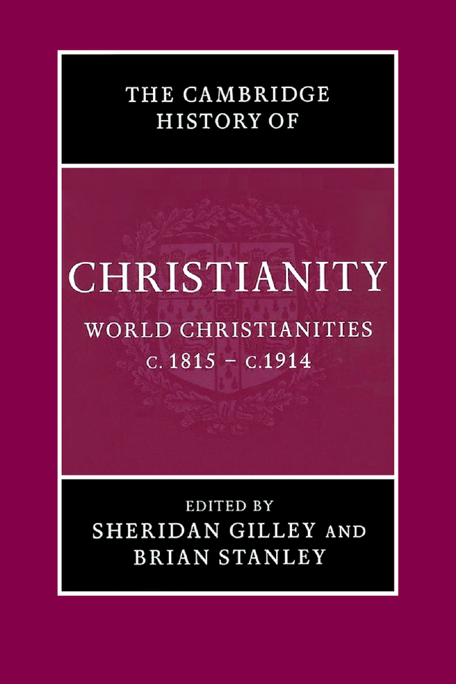

# 剑桥基督教史 第八卷：世界基督教（约1815—约1914年）

编者：谢里丹·吉利、布赖恩·斯坦利

原书2006年出版。全卷中文校订稿已完成，包含卷首资料、三编、36章、原注、参考书目与索引。全文译校状态见校核记录。原书页码与PDF页码均保留，便于对照。

全卷译文一致性校订、重点复核与阅读版PDF校核已完成；本稿尚未经专业精校。

[阅读版PDF](<../output/pdf/08 世界基督教（1815-1914）（中文校订版）.pdf>) · [全卷校核记录](<全卷校核记录.json>)

> 译文范围说明：36章正文、卷首说明及原注说明文字均已译出；书目按学术惯例保留作者、原题名与出版信息，索引译出主题、机构、地名及交叉参照，多数人名保留原文。

- [卷首资料](#pdf-001)
- [导论](#pdf-018)
- [第一编 基督教与现代性](#pdf-028)
- [教皇制度](#pdf-030)
- [神学与反抗启蒙运动](#pdf-047)
- [自愿性宗教的增长](#pdf-070)
- [礼拜与灵修中的天主教复兴](#pdf-087)
- [女性讲道人与新修会](#pdf-101)
- [教会建筑与宗教艺术](#pdf-120)
- [音乐潮流与西方教会：“古”与“今”的碰撞](#pdf-138)
- [基督教与英语文学](#pdf-153)
- [基督教社会思想](#pdf-159)
- [基督教与科学](#pdf-181)
- [历史与《圣经》](#pdf-198)
- [城乡民众宗教与不信宗教](#pdf-214)
- [第二编 教会与民族认同](#pdf-232)
- [法国的天主教：从王朝复辟到政教分离（1815—1905年）](#pdf-234)
- [意大利：教会与民族复兴运动](#pdf-250)
- [天主教、爱尔兰与爱尔兰离散群体](#pdf-267)
- [大匈牙利与波兰的天主教民族主义](#pdf-277)
- [基督教与德意志的建立](#pdf-299)
- [圣公会、长老宗与联合王国的宗教认同](#pdf-318)
- [新教的主导地位与宗派政治：瑞士和荷兰](#pdf-340)
- [斯堪的纳维亚：路德宗与民族认同](#pdf-359)
- [“基督教美国”与“基督教加拿大”](#pdf-376)
- [西班牙与葡萄牙：教会面临的挑战](#pdf-398)
- [拉丁美洲：教会与民族独立](#pdf-412)
- [东西方之间：东方天主教（“合一派”）教会](#pdf-429)
- [第三编 基督教的扩展](#pdf-444)
- [非裔美国人的基督教](#pdf-446)
- [基督教传教、反奴隶制与人道诉求（约1813—1873年）](#pdf-460)
- [中东：西方传教事业与东方教会、伊斯兰教、犹太教](#pdf-475)
- [英属印度帝国的基督徒与宗教传统](#pdf-490)
- [东亚的基督教：中国、朝鲜与日本](#pdf-510)
- [印度支那的基督教](#pdf-530)
- [作为教会与叙事的基督教，以及十九世纪菲律宾民族的诞生](#pdf-545)
- [澳大拉西亚与太平洋的基督教](#pdf-559)
- [传教与帝国（约1873—1914年）](#pdf-577)
- [埃塞俄比亚主义与现代非洲基督教的根源](#pdf-593)
- [1914年基督教的前景](#pdf-610)
- [参考书目](#pdf-618)
- [索引](#pdf-673)

---

<!-- PDF page 1; original page unnumbered -->

# 卷首资料

## 原书封面

*《剑桥基督教史》第八卷：世界基督教，约1815—约1914年。*

<!-- PDF page 2; original page unnumbered -->

## 本卷介绍

本书是第一部在全球背景下讨论十九世纪基督教的学术著作。第一编分析天主教与新教，对欧洲现代性带来的思想、社会挑战的回应，关注自愿性基督教新形式的蓬勃发展，以及妇女在宗教生活中日益扩大的作用。第二编考察教会与民族主义之间多样而复杂的关系，以及由此引起的政教关系根本变化。第三编研究基督教的不同命运：它扩展在亚洲、非洲的历史基地，首次在澳大拉西亚立足，并回应欧洲殖民时代的挑战与机遇。每章均附完整书目，为进一步阅读提供指引。

谢里丹·吉利（Sheridan Gilley）为杜伦大学神学荣休准教授（Emeritus Reader），著有 *Newman and His Age*（2003年再版），以及大量近代宗教史论文。他与罗杰·斯威夫特合编 *The Irish in the Victorian City*（1985）、*The Irish in Britain 1815–1939*（1989）、*The Irish in Victorian Britain*（1999），并与W.J.希尔斯合编 *A History of Religion in Britain*（1994）。

布赖恩·斯坦利（Brian Stanley）为剑桥神学联合体亨利·马丁传教与世界基督教研究中心主任、剑桥圣埃德蒙学院研究员。他撰写、编纂多部近代基督教传教史著作，包括 *The Bible and the Flag*（1990）、*The History of the Baptist Missionary Society 1792–1992*（1992）、*Christian Missions and the Enlightenment*（2001），以及 *Missions, Nationalism, and the End of Empire*（2003）。

<!-- PDF page 3; original page unnumbered -->

## 丛书介绍

《剑桥基督教史》按年代，全面叙述基督教从起源至今各方面的发展，包括神学、思想、社会、政治、地区与全球层面。每卷独立地对相应时期研究作出重要贡献，整套丛书则构成一部大型学术参考著作。

本丛书旨在提供全球视野，远不止西欧基督教及其分支的历史。从早期起，东方与科普特基督教就得到充分考虑；较晚时期，非洲、远东、新世界、南亚及其他非欧洲地区的基督教发展，也获得适当篇幅。各卷涉及民众虔敬与基督教信仰的非正式表达，在广阔文化背景中，考察基督徒塑造、礼拜及灵修的社会学。基督教与其他主要信仰的关系，也始终在关注之列。本丛书将为学者、学生提供宝贵资源。

### 各卷书目

| 卷次 | 书名 | 编者 |
| --- | --- | --- |
| 1 | 起源至君士坦丁 | 玛格丽特·M.米切尔、弗朗西丝·M.扬 |
| 2 | 君士坦丁至约600年 | 温里希·勒尔、弗雷德·诺里斯、奥古斯丁·卡西迪 |
| 3 | 中世纪早期基督教：约600—约1100年 | 托马斯·诺布尔、朱莉娅·史密斯 |
| 4 | 西欧基督教：约1100—约1500年 | 米里·鲁宾、沃尔特·西蒙 |
| 5 | 东方基督教 | 迈克尔·安戈尔德 |
| 6 | 改革与扩张：约1500—约1660年 | 夏伯嘉 |
| 7 | 启蒙、复兴与革命：1660—1815年 | 斯图尔特·J.布朗、蒂莫西·塔克特 |
| 8 | 世界基督教：约1815—约1914年 | 布赖恩·斯坦利、谢里丹·吉利 |
| 9 | 世界基督教：约1914—约2000年 | 休·麦克劳德 |

本页各卷书名与署名，按本卷丛书介绍原载保留。

<!-- PDF page 4; original page unnumbered -->

## 扉页

《剑桥基督教史》

**第八卷　世界基督教：约1815—约1914年**

主编：谢里丹·吉利，杜伦大学；布赖恩·斯坦利，剑桥大学。

<!-- PDF page 5; original page unnumbered -->

## 出版与版权资料

剑桥大学出版社；出版地：剑桥、纽约、墨尔本、马德里、开普敦、新加坡、圣保罗。

英国地址：The Edinburgh Building, Cambridge CB2 2RU, UK。美国版由剑桥大学出版社纽约分社出版。

出版社网站：www.cambridge.org；本书资料：www.cambridge.org/9780521814560。

© 剑桥大学出版社，2006年。2006年首次出版，由英国剑桥大学印刷厂印制。

本书受版权保护。除法律规定的例外及相关集体许可协议允许的情形外，未经剑桥大学出版社书面许可，不得复制本书任何部分。

英国图书馆备有本书目录记录。

### 美国国会图书馆编目资料

*World Christianities, c.1815–c.1914* / Sheridan Gilley、Brian Stanley编。

页；厘米。——《剑桥基督教史》，第8卷。含参考书目及索引。

ISBN 0-521-81456-1，精装。

主题：1. 教会史——十九世纪。2. 教会史——二十世纪。

检索项：一、Gilley, Sheridan。二、Stanley, Brian, 1953–。三、题名。四、丛书。

分类及控制号：BR477.W87 2005；270.8—dc22；2005008392。

ISBN-13：978-0-521-81456-0，精装。ISBN-10：0-521-81456-1，精装。

对于本书所引外部或第三方网站，剑桥大学出版社不负责其网址能否持续使用、内容是否准确，也不保证网站内容目前或将来仍然准确、适当。

在线版页脚标识：Cambridge Histories Online © Cambridge University Press, 2008。

<!-- PDF page 6; original page v -->

## 原书目录

以下页码为英文原书印刷页码，并非中文重排后的页码。

撰稿人：ix。

| 章次与题名 | 作者 | 原页码 |
| --- | --- | --- |
| 1　导论 | 谢里丹·吉利 | 1 |

### 第一编　基督教与现代性

| 章次与题名 | 作者 | 原页码 |
| --- | --- | --- |
| 2　教皇制度 | 谢里丹·吉利 | 13 |
| 3　神学与反抗启蒙运动 | 道格拉斯·赫德利 | 30 |
| 4　自愿性宗教的增长 | 戴维·贝宾顿 | 53 |
| 5　礼拜与灵修中的天主教复兴 | 玛丽·海曼 | 70 |
| 6　女性讲道人与新修会 | 贾妮丝·霍姆斯、苏珊·奥布赖恩 | 84 |
| 7　教会建筑与宗教艺术 | 安德鲁·桑德斯 | 103 |
| 8　音乐潮流与西方教会：“古”与“今”的碰撞 | 杰里米·迪布尔 | 121 |

<!-- PDF page 7; original page vi -->

| 章次与题名 | 作者 | 原页码 |
| --- | --- | --- |
| 9　基督教与英语文学 | 安德鲁·桑德斯 | 136 |
| 10　基督教社会思想 | 约翰·莫洛尼、戴维·M.汤普森 | 142 |
| 11　基督教与科学 | 尼古拉斯·A.鲁普克 | 164 |
| 12　历史与《圣经》 | 约翰·罗杰森 | 181 |
| 13　城乡民众宗教与不信宗教 | 戴维·M.汤普森 | 197 |

### 第二编　教会与民族认同

| 章次与题名 | 作者 | 原页码 |
| --- | --- | --- |
| 14　法国的天主教：从王朝复辟到政教分离（1815—1905年） | 詹姆斯·F.麦克米兰 | 217 |
| 15　意大利：教会与民族复兴运动 | 弗兰克·科帕 | 233 |
| 16　天主教、爱尔兰与爱尔兰离散群体 | 谢里丹·吉利 | 250 |
| 17　大匈牙利与波兰的天主教民族主义 | 加布里埃尔·阿德里亚尼、耶日·克沃乔夫斯基 | 260 |
| 18　基督教与德意志的建立 | 安东尼·J.施泰因霍夫 | 282 |
| 19　圣公会、长老宗与联合王国的宗教认同 | 约翰·沃尔夫 | 301 |
| 20　新教的主导地位与宗派政治：瑞士和荷兰 | 乌尔斯·阿尔特马特、弗兰齐斯卡·梅茨格、迈克尔·温特尔 | 323 |

<!-- PDF page 8; original page vii -->

| 章次与题名 | 作者 | 原页码 |
| --- | --- | --- |
| 21　斯堪的纳维亚：路德宗与民族认同 | 达格·托尔基尔森 | 342 |
| 22　“基督教美国”与“基督教加拿大” | 马克·A.诺尔 | 359 |
| 23　西班牙与葡萄牙：教会面临的挑战 | 威廉·J.卡拉汉 | 381 |
| 24　拉丁美洲：教会与民族独立 | 约翰·林奇 | 395 |
| 25　东西方之间：东方天主教（“合一派”）教会 | 罗伯特·J.塔夫脱 | 412 |

### 第三编　基督教的扩展

| 章次与题名 | 作者 | 原页码 |
| --- | --- | --- |
| 26　非裔美国人的基督教 | 乔恩·森斯巴赫 | 429 |
| 27　基督教传教、反奴隶制与人道诉求（约1813—1873年） | 布赖恩·斯坦利 | 443 |
| 28　中东：西方传教事业与东方教会、伊斯兰教、犹太教 | 海伦·穆雷—范登贝尔赫 | 458 |
| 29　英属印度帝国的基督徒与宗教传统 | 罗伯特·埃里克·弗里肯伯格 | 473 |
| 30　东亚的基督教：中国、朝鲜与日本 | 丹尼尔·H.贝斯、詹姆斯·H.格雷森 | 493 |
| 31　印度支那的基督教 | 彼得·C.潘 | 513 |

<!-- PDF page 9; original page viii -->

| 章次与题名 | 作者 | 原页码 |
| --- | --- | --- |
| 32　作为教会与叙事的基督教，以及十九世纪菲律宾民族的诞生 | 何塞·马里奥·C.弗朗西斯科 | 528 |
| 33　澳大拉西亚与太平洋的基督教 | 斯图尔特·皮金、艾伦·戴维森 | 542 |
| 34　传教与帝国（约1873—1914年） | 安德鲁·波特 | 560 |
| 35　埃塞俄比亚主义与现代非洲基督教的根源 | 奥格布·U.卡卢 | 576 |
| 36　1914年基督教的前景 | 布赖恩·斯坦利 | 593 |
| 综合参考书目选目 |  | 601 |
| 分章参考书目 |  | 604 |
| 索引 |  | 656 |

<!-- PDF page 10; original page ix -->

## 撰稿人

以下机构、职称、研究计划及“目前”等表述，均依原书出版时的情况。出版物题名与定位保留原文。

**加布里埃尔·阿德里亚尼（Gabriel Adriányi）**，波恩大学天主教神学院教会史荣休教授，研究范围包括东欧教会史；也是布达佩斯罗兰大学教会史教授。他撰写、编纂多部近代教会史著作，包括 *Geschichte der katholischen Kirche in Ungarn*（Cologne: Böhlau, 2004）、*Die Ostpolitik des Vatikans 1958–1978 gegenüber Ungarn: der Fall Kardinal Mindszenty*（Herne: Schäfer, 2003）、*Kleine Kirchengeschichte Ungarns*（Herne: Schäfer, 2003）、*Prohászka és a római index*（Budapest, 2002），以及 *Geschichte der Kirche Osteuropas im 20. Jahrhundert*（Paderborn: Schöningh, 1992）。

**乌尔斯·阿尔特马特（Urs Altermatt）**，自1980年任瑞士弗里堡大学当代史教授，2003年起任校长，曾在克拉科夫、布达佩斯、萨拉热窝、索非亚等中东欧大学任客座教授。他出版大量近代欧洲、瑞士政治史、社会史与宗教史著作，包括 *Der Weg der Schweizer Katholiken ins Ghetto*（Zurich and Cologne: Benziger, 1972，第3版1995）、*Katholizismus und Moderne*（Zurich: Benziger, 1989）、与Hanspeter Kriesi等合著的 *Rechtsextremismus in der Schweiz*（Zurich: Neue Züricher-Zeitung, 1995）、*Das Fanal von Sarajevo: Ethnonationalismus in Europa*（Zurich: Neue Züricher-Zeitung, 1996）、*Katholizismus und Antisemitismus*（Frauenfeld, Stuttgart and Vienna: Huber, 1999），以及主编的 *Katholische Denk- und Lebenswelten*（Fribourg: Academic Press, 2003）。

**丹尼尔·H.贝斯（Daniel H. Bays）**，密歇根州大急流城加尔文学院历史学教授、亚洲研究项目主任，撰写或编纂多篇论文、章节和著作，研究十九、二十世纪中国基督教史。其中包括主编 *Christianity in China, from the eighteenth century to the present*（Stanford: Stanford University Press, 1996），合编 *The foreign missionary enterprise at home*（Tuscaloosa: University of Alabama Press, 2003），以及论文‘Chinese Protestant Christianity today’，载 *The China Quarterly* 174（June 2003）；‘A tradition of state dominance’，载Jason Kindopp、Carol Lee Hamrin编 *God and Caesar in China*（Washington, DC: Brookings Institution Press, 2004）。

**戴维·贝宾顿（David Bebbington）**，斯特灵大学历史学教授，著有 *Patterns in history*（Leicester: Inter-Varsity Press, 1979）、*The nonconformist conscience: chapel and politics, 1870–1914*（London: Allen and Unwin, 1982）、*Evangelicalism in modern Britain: a history from the 1730s to the 1980s*（London: Unwin Hyman, 1989），以及<!-- PDF page 11; original page x -->*William Ewart Gladstone: faith and politics in Victorian Britain*（Grand Rapids, MI: Eerdmans, 1993）、*Holiness in nineteenth-century England*（Carlisle: Paternoster, 2000）、*The mind of Gladstone: religion, Homer and politics*（Oxford: Oxford University Press, 2004）、*The dominance of evangelicalism: the age of Spurgeon and Moody*（Leicester: Inter-Varsity Press, 2005）。他主编的作品包括 *Protestant nonconformist texts: the nineteenth century*（Aldershot: Ashgate, 2005）。

**威廉·J.卡拉汉（William J. Callahan）**，多伦多大学历史学荣休教授。他的 *Church, politics and society in Spain, 1750–1874*（Cambridge, MA: Harvard University Press, 1984），获加拿大历史协会华莱士·K.弗格森奖。其他著作包括 *Honor, commerce, and industry in eighteenth-century Spain*（Boston: Baker Library, Harvard Graduate School of Business Administration, 1972）、*The Catholic Church in Spain, 1875–1998*（Washington, DC: Catholic University of America Press, 2000）。他与David Higgs合编 *Church and society in Catholic Europe of the eighteenth century*（Cambridge: Cambridge University Press, 1979）。

**弗兰克·科帕（Frank Coppa）**，纽约圣约翰大学历史学教授、近代世界史博士研究主任，撰写或编纂十余卷关于统一意大利和近代教皇制度的著作。研究既涉及民族复兴运动，也涉及反民族复兴运动，包括卡米洛·迪卡沃尔、庇护九世、贾科莫·安东内利枢机的传记。近作有 *The modern papacy since 1789*（London and New York: Addison Wesley Longman, 1998）、*The papacy confronts the modern world*（Krieger, 2003）；他还主编并参与撰写 *Controversial concordats*（Washington, DC: Catholic University Press, 1999），以及两卷本 *Great popes through history*（Westport, CT: Greenwood Press, 2002）。

**艾伦·戴维森（Allan Davidson）**，奥克兰大学神学院研究生事务主任，并讲授教会史。他广泛研究新西兰、南太平洋基督教史，撰写或编纂的作品，包括 *Semisi Nau: the story of my life: a Tongan missionary at Ontong Java*（Suva, Fiji: Institute of Pacific Studies, 1996）、*Tongan Anglicans 1902–2002*（College of the Diocese of Polynesia, 2002），以及 *Christianity in Aotearoa: a history of church and society in New Zealand*，第3版（Wellington, New Zealand: Education for Ministry, 2004）。

**杰里米·迪布尔（Jeremy Dibble）**，杜伦大学音乐学教授，专长为维多利亚、爱德华及乔治时代音乐。这体现于两部重要研究：*C. Hubert H. Parry: his life and music*（Oxford: Oxford University Press, 1992）、*Charles Villiers Stanford: man and musician*（Oxford: Oxford University Press, 2002），以及最近为Musica Britannica Trust编的帕里小提琴奏鸣曲集。他研究范围广泛，包括史学、歌剧、英国教会音乐；目前研究约翰·斯泰纳的生平、音乐，并为Musica Britannica编帕里钢琴三重奏集。未来计划，是撰写弗雷德里克·戴留斯音乐研究。

**何塞·马里奥·C.弗朗西斯科（José Mario C. Francisco）**，1996年起任东亚牧灵学院主任，2005—2006年将任波士顿学院加森讲席教授。在完成文学与神学的研究生学习后，<!-- PDF page 12; original page xi -->他开始在马尼拉的洛约拉神学院、雅典耀大学任教，也在伯克利耶稣会神学院讲学。除在亚洲各地主持会议、发表演讲，他也为期刊、论文集撰写宗教与文化论文，并出版西班牙殖民时期菲律宾本地语文本，例如 *Sermones*〔Prancisco Bloncas de San José O.P.，人名拼写依原书〕和 *Bocabulario Tagalo*〔Miguel Ruiz, O.P.〕。

**罗伯特·埃里克·弗里肯伯格（Robert Eric Frykenberg）**，威斯康星大学麦迪逊分校荣休教授，著作包括 *Guntur district, 1788–1848: a history of local influence and central authority*（Oxford: Clarendon Press, 1965）、*Land control and social structure in Indian history*（Madison: University of Wisconsin Press, 1969, 1978）、*Land tenure and peasant in South Asia*（New Delhi: Manohar, 1977, 1981）、*Delhi through the ages*（New Delhi: Oxford University Press, 1986, 1993）、*History and belief: the foundations of historical understanding*（Grand Rapids, MI: Eerdmans, 1996）。他与布赖恩·斯坦利，担任“基督教传教史研究”丛书共同总主编，其中包括 *Christians, cultural interactions, and India’s religious traditions*（Grand Rapids, MI: Eerdmans, 2002）、*Christians and missionaries in India*（Grand Rapids, MI: Eerdmans, 2003）；目前，正撰写牛津版印度基督教史。

**谢里丹·吉利（Sheridan Gilley）**，杜伦大学神学荣休准教授，著有 *Newman and his age*（再版，London: Darton, Longman, and Todd, 2003），以及大量近代宗教史论文。他与罗杰·斯威夫特，合编三卷英国爱尔兰人研究：*The Irish in the Victorian city*（London: Croom Helm, 1985）、*The Irish in Britain, 1815–1939*（London: Pinter, 1989）、*The Irish in Victorian Britain: the local dimension*（Dublin: Four Courts Press, 1999）；并与W.J.希尔斯合编 *A history of religion in Britain*（Oxford: Blackwell, 1994）。

**詹姆斯·H.格雷森（James H. Grayson）**，谢菲尔德大学东亚研究学院现代朝鲜研究教授，亦为人类学家、卫理宗牧师，曾在朝鲜半岛传教。他广泛研究，包括基督教在内的朝鲜宗教传统，著有 *Early Buddhism and Christianity in Korea*（Leiden: E.J. Brill, 1985）、*Korea: a religious history*（Oxford: Clarendon Press, 1989；修订版Routledge-Curzon, 2002）。关于朝鲜基督教社会文化层面的论文，包括‘The Shintô shrine conflict and Protestant martyrs in Korea, 1938–1945’，*Missiology* 29（2001），以及‘Cultural encounter: Korean Protestantism and other religious traditions’，*International Bulletin of Missionary Research* 25（2001）。

**道格拉斯·赫德利（Douglas Hedley）**，剑桥大学宗教哲学高级讲师、克莱尔学院研究员。2002年，任巴黎索邦高等研究实践学院客座研究主任；2004年，在杜伦大学，担任基督教护教的艾伦·理查森讲座讲师。他曾任英国宗教哲学学会秘书、欧洲宗教哲学学会主席，著有 *Coleridge, philosophy and religion: aids to reflection and the mirror of the spirit*（Cambridge: Cambridge University Press, 2000）。

<!-- PDF page 13; original page xii -->

**玛丽·海曼（Mary Heimann）**，斯特拉斯克莱德大学历史学高级讲师，兼任 *Oxford Dictionary of National Biography*（Oxford: Oxford University Press, 2004）副编辑，负责天主教条目。她著有 *Catholic devotion in Victorian England*（Oxford: Oxford University Press, 1995），并为多部近代宗教史综述撰稿。目前，正完成一部捷克斯洛伐克政治史，拟由Hambledon and London出版，也计划研究近代英国对超自然的态度。

**贾妮丝·霍姆斯（Janice Holmes）**，阿尔斯特大学科尔雷恩校区爱尔兰史讲师，专长包括宗教复兴、女性牧职、爱尔兰长老宗。她与Diane Urquhart合编 *Coming into the light: the work, politics and religion of women in Ulster, 1840–1940*（Belfast: Institute of Irish Studies, 1994），并出版 *Religious revivals in Britain and Ireland, 1859–1905*（Dublin: Irish Academic Press, 2000）。

**奥格布·U.卡卢（Ogbu U. Kalu）**，芝加哥麦考密克神学院亨利·温特斯·卢斯世界基督教与传教学讲席教授，兼芝加哥全球牧职中心副主任。他撰写、编纂多部著作，包括 *Divided people of God: church union movement in Nigeria, 1875–1966*（New York: NOK Publishers, 1978）、*The history of Christianity in West Africa*（London: Longman, 1980）、*Power, poverty and prayer: the challenges of poverty and pluralism in African Christianity, 1960–1996*（Frankfurt: Peter Lang, 2000），以及 *Embattled gods: the Christianization of Igboland, 1841–1991*（Lagos: Africa World Press, 2003）。

**耶日·克沃乔夫斯基（Jerzy Kłoczowski）**，卢布林天主教大学历史学教授、卢布林中东欧研究所所长、中东欧研究所国际联合会主席、教会比较史波兰委员会主席、教会比较史国际委员会副主席，以及联合国教科文组织波兰委员会主席。其大量著作，包括 *A history of Polish Christianity*（Cambridge: Cambridge University Press, 2000）、*Chrześcijaństwo i historia*〔基督教与历史〕（1990）、*Młodsza Europa*〔年轻的欧洲〕（Cracow: Znak, 2004），以及 *Historia Europy Środkowo-Wschodniej*〔中东欧史〕（Paris: PUF, 2004）。

**约翰·林奇（John Lynch）**，伦敦大学拉丁美洲史荣休教授，著有大量西班牙、拉丁美洲研究，包括 *Bourbon Spain 1700–1808*（Oxford: Blackwell, 1989）、*Argentine dictator: Juan Manuel de Rosas 1829–1852*（Oxford: Clarendon Press, 1981）、*The Spanish American revolutions 1808–1826*（New York: Norton, 1986）、*Caudillos in Spanish America 1800–1850*（Oxford: Clarendon Press, 1992）、*Massacre in the Pampas, 1872: Britain and Argentina in the age of migration*（Norman: University of Oklahoma Press, 1998），以及 *Latin America between colony and nation*（Basingstoke: Palgrave, 2001）。

**詹姆斯·F.麦克米兰（James F. McMillan）**，爱丁堡大学理查德·佩尔斯历史学讲席教授，撰写大量近代法国宗教史论文、章节，特别关注法国文化战争、政治天主教，以及<!-- PDF page 14; original page xiii -->宗教与性别的关系。他还出版 *France and women 1789–1914: gender, society and politics*（London: Routledge, 2000），并主编、参与撰写 *Modern France 1880–2002*（The short Oxford history of France；Oxford: Oxford University Press, 2003）。他获利弗休姆重大研究奖助，开展下一项研究：*War and belief: the Great War and the western religious imagination*。

**弗兰齐斯卡·梅茨格（Franziska Metzger）**，弗里堡大学当代史研究助理。她关于宗教史、史学史的著述，包括 *Die ‘Schildwache’: Eine integralistisch-rechtskatholische Zeitung 1912–1945*（Fribourg: Universitätsverlag, 2000）；与C. Bosshart-Pfluger、J. Jung合编 *Nation und Nationalismus in Europa: Festschrift für Urs Altermatt*（Frauenfeld: Huber, 2002）；‘Die Reformation in der Schweiz zwischen 1850 und 1950. Konkurrierende konfessionelle und nationale Geschichtskonstruktionen und Erinnerungsgemeinschaften’，载H.-G. Haupt、D. Langewiesche编 *Nation und Religion in Europa*（Frankfurt a.M.: Campus, 2004）；以及与Urs Altermatt合著‘Milieu, Teilmilieus und Netzwerke’，载Urs Altermatt编 *Katholische Denk- und Lebenswelten*（Fribourg: Academic Press, 2003）。

**约翰·莫洛尼（John Molony）**，澳大利亚国立大学历史学荣休教授、《澳大利亚传记辞典》访问研究员，兼任澳大利亚天主教大学兼职教授。他著有 *The Roman mould of the Australian Catholic Church*（Carlton, Victoria: Melbourne University Press, 1969）、*The emergence of political Catholicism in Italy, Partito Popolare, 1919–1926*（London: Croom Helm, 1980）、*The Penguin bicentennial history of Australia*（Ringwood, Victoria: Viking, 1987）、*The worker question: a new historical perspective on Rerum Novarum*（Dublin: Gill and Macmillan, 1991），以及 *Luther’s pine*（Pandanus Books, 2004）。

**海伦·穆雷—范登贝尔赫（Heleen Murre-van den Berg）**，荷兰莱顿大学世界基督教史副教授，专研中东诸基督教传统，尤其东方亚述教会，以及西方在中东的传教史。近作包括‘Migration of Middle Eastern Christians to western countries and Protestant missionary activities in the Middle East: a preliminary investigation’，*The Journal of Eastern Christian Studies* 54, 1–2（2002），39–49；‘Generous devotion: women in the colophons of the Church of the East (1550–1850)’，*Hugoye: Journal of Syriac Studies* 7/1（2004）；原书所列网址为http://syrcom.cua.edu/Hugoye。

**马克·A.诺尔（Mark A. Noll）**，伊利诺伊州惠顿学院麦克马尼斯基督教思想讲席教授。著作包括 *America’s God, from Jonathan Edwards to Abraham Lincoln*（New York: Oxford University Press, 2002）、*The rise of evangelicalism: the age of Whitefield, Edwards, and the Wesleys*（Leicester: Inter-Varsity Press, 2004）、*The old religion in a new world: the history of North American Christianity*（Grand Rapids, MI: Eerdmans, 2002），以及 *Turning points: decisive moments in the history of Christianity*，第2版（Grand Rapids, MI: Baker Book House, 2000）。

**苏珊·奥布赖恩（Susan O’Brien）**，独立学者、剑桥圣埃德蒙学院高级成员、剑桥神学联合体玛格丽特·博福特神学研究所董事会主席。2002年以前，她任斯塔福德郡<!-- PDF page 15; original page xiv -->大学副校长。她在期刊、论文集中，广泛撰写十八世纪跨大西洋复兴主义，以及近代英国、爱尔兰罗马天主教隐修女与活动修女的历史。

**彼得·C.潘（Peter C. Phan）**，目前任乔治敦大学伊格纳西奥·埃利亚库里亚天主教社会思想讲席教授。他发表250余篇论文、十余本书，包括 *Mission and catechesis: Alexandre de Rhodes and inculturation in seventeenth-century Vietnam*（1998），以及亚洲神学三部曲：*Christianity with an Asian face*、*In our own tongues*、*Being religious interreligiously*，均由纽约州Maryknoll的Orbis Books出版。

**斯图尔特·皮金（Stuart Piggin）**，澳大利亚悉尼麦考瑞大学基督教思想与经验史研究中心主任，该中心包括澳大利亚基督教研究中心。他发表百余篇福音主义、传教及灾难史论文，著有 *Making evangelical missionaries: the social background, motivation, and training of British Protestant missionaries*（出版地不详：Sutton Courtenay Press, 1984）、*The Mount Kembla disaster*（South Melbourne: Oxford University Press, 1992）、*Evangelical Christianity in Australia: Spirit, word and world*（Melbourne: Oxford University Press, 1996），以及 *Firestorm of the Lord: the history of and prospects for revival in the church and the world*（Carlisle: Paternoster, 2000）。

**安德鲁·波特（Andrew Porter）**，伦敦大学国王学院罗兹帝国史讲席教授，广泛研究十八世纪中叶至二十世纪中叶的帝国问题。著作包括 *The origins of the South African War*（Manchester: Manchester University Press, 1980）、*Victorian shipping, business and empire*（Woodbridge: Boydell Press, 1986）、*An atlas of British overseas expansion*（London: Routledge, 1991）。他主编 *The Oxford history of the British Empire* 第4卷：*The nineteenth century*（Oxford: Oxford University Press, 1999），以及 *The imperial horizons of British Protestant missions, 1880–1914*（Grand Rapids, MI: Eerdmans, 2003）。最新著作为 *Religion versus empire? British Protestant missionaries and overseas expansion, 1700–1914*（Manchester: Manchester University Press, 2004）。

**约翰·罗杰森（John Rogerson）**，谢菲尔德大学圣经研究荣休教授，主要著述聚焦《旧约》解释的历史、前提，以及今日《圣经》的使用。包括 *Myth in Old Testament interpretation*（Berlin: De Gruyter, 1974）、*Anthropology and the Old Testament*（Oxford: Blackwell, 1978）、*Old Testament criticism in the nineteenth century: England and Germany*（London: SPCK, 1984），以及 *The Bible and criticism in Victorian Britain: profiles of F.D. Maurice and William Robertson Smith*（Sheffield: Sheffield Academic Press, 1995）。

**尼古拉斯·A.鲁普克（Nicolaas A. Rupke）**，哥廷根大学科学史教授、科学史研究所所长。他的 *The great chain of history*（Oxford: Clarendon Press, 1983）、*Richard Owen*（New Haven, CT: Yale University Press, 1994），都突出讨论宗教与科学。目前，他正研究题为‘Eminent lives in twentieth-century science and religion’的项目。

<!-- PDF page 16; original page xv -->

**安德鲁·桑德斯（Andrew Sanders）**，杜伦大学英语教授，广泛研究十九世纪文学，尤其查尔斯·狄更斯。他编辑多部维多利亚时代小说，著有 *The short Oxford history of English literature*，第3版（Oxford: Oxford University Press, 2004）。他也持续研究艺术、建筑，曾多年担任维多利亚学会委员会成员。

**乔恩·森斯巴赫（Jon Sensbach）**，佛罗里达大学历史学教授，著有 *Rebecca’s revival: creating black Christianity in the Atlantic world*（Cambridge, MA: Harvard University Press, 2005）、*A separate Canaan: the making of an Afro-Moravian world in North Carolina, 1763–1840*（Chapel Hill and London: University of North Carolina Press, 1998）。

**布赖恩·斯坦利（Brian Stanley）**，剑桥神学联合体亨利·马丁传教与世界基督教研究中心主任、剑桥圣埃德蒙学院研究员。他撰写、编纂多部近代基督教传教史著作，包括 *The Bible and the flag*（Leicester: Apollos, 1990）、*The history of the Baptist Missionary Society 1792–1992*（Edinburgh: T. & T. Clark, 1992）、*Christian missions and the Enlightenment*（Grand Rapids, MI and Richmond: Eerdmans and Curzon, 2001），以及 *Missions, nationalism, and the end of empire*（Grand Rapids, MI: Eerdmans, 2003）。

**安东尼·J.施泰因霍夫（Anthony J. Steinhoff）**，田纳西大学查塔努加分校近代欧洲史助理教授，曾在 *Central European History*、*Geschichte und Gesellschaft*、*Journal of Urban History*，发表近代欧洲宗教史、文化史论文，并为 *The Blackwell companion to nineteenth-century Europe*，Helmut Walser Smith编 *Protestants, Catholics, and Jews in Germany, 1800–1914*（New York: Berg, 2001），以及Lucian Hölscher编 *Religiöse Vergemeinschaftung in der Moderne*（Göttingen: Wallstein, 2005）撰稿。目前，他正完成一部十九世纪晚期斯特拉斯堡新教与城市宗教文化专著。

**罗伯特·J.塔夫脱（Robert J. Taft）**，罗马宗座东方学院东方礼仪荣休教授、梵蒂冈东方教会部礼仪顾问，已撰写690余项出版物，主要研究东方礼仪，其中包括十五本书。

**戴维·M.汤普森（David M. Thompson）**，剑桥菲茨威廉学院研究员兼院务主席（President）、剑桥大学近代教会史准教授、宗教与神学高级研究中心主任。他广泛发表关于维多利亚非国教派、十九世纪基督教社会思想、基督徒合一运动史的著述。

**达格·托尔基尔森（Dag Thorkildsen）**，奥斯陆大学神学院教授，专研挪威、斯堪的纳维亚教会史，出版多种关于民族国家建设与宗教、宗教觉醒与社会现代化的著作：*Nationality, identity and morality*（KULTs skriftserie, 1995）；‘Church and nation in the 19th century – the case of Norway’，载Ingmar Brohed编 *Church and people in Britain and Scandinavia*（Lund: Lund University Press, 1996）；以及<!-- PDF page 17; original page xvi -->*Grundtvigianism and nationalism in Norway during the 19th century*（KULTs skriftserie, 1996）；‘Religious identity and Nordic identity’，载Øystein Sørensen、Bo Stråth编 *The cultural construction of Norden*（Oslo: Scandinavian University Press, 1997）。

**迈克尔·温特尔（Michael Wintle）**，阿姆斯特丹大学欧洲史教授，负责欧洲研究学位课程。2002年以前，他在英国赫尔大学任欧洲史讲席教授，自1980年起，便在那里任教。他广泛发表近代荷兰史研究，包括 *Pillars of piety*（Hull: Hull University Press, 1985）、*An economic and social history of the Netherlands*（Cambridge: Cambridge University Press, 2000），也关注欧洲认同，尤其欧洲的视觉呈现。

**约翰·沃尔夫（John Wolffe）**，开放大学宗教史教授，著有 *The Protestant crusade in Great Britain, 1829–1860*（Oxford: Oxford University Press, 1991）、*God and Greater Britain: religion and national life in Britain and Ireland, 1843–1945*（London: Routledge, 1994）、*Great deaths: grieving, religion and nationhood in Victorian and Edwardian Britain*（Oxford: Oxford University Press, 2000）。

---

<!-- PDF page 18; original page 1 -->

# 第一章　导论

**谢里丹·吉利（Sheridan Gilley）**

在二十一世纪初世俗主义的寒风中，西欧近代基督教史家写作时，也许会忍不住为自己的研究对象道歉：为什么要写一个重要性不断减退、自法国革命以来便一直衰落的事物？研究中世纪或近代早期的人，没有谁怀疑宗教的核心作用；近现代史学，却似乎可以不理会它。

其实，十九世纪基督教史家无须为自己的主题辩护。宗教仍深入那个时代社会与政治冲突的肌理。从某一层面说，意大利统一是天主教的失败，德意志帝国建立则是新教的胜利；同样，对教会的攻击——有些人视为世俗化的开端——也是一个引人入胜的故事。至少就眼前结果而言，它不只带来宗教衰落，也带来更新与复兴。

然而，即使在本书写作的当下，西欧也许仍有些特殊。其他地方的基督教仍在增长、扩展：第三世界、美国，以及无神论共产主义崩溃后的东欧，都是如此。这一定也是本卷，相比其他十九世纪基督教史，显得有些不同寻常的原因之一：我们至少将三分之一篇幅，给予欧洲以外的新基督教会。

天主教通过十六世纪西班牙、葡萄牙帝国，以及十七、十八世纪法国传教士，成为全球宗教。本卷若干章节，讨论这一较早时代的遗产。其中包括拉丁美洲：十九世纪的罗马天主教会呈现种种辉煌与困境，遭到后殖民时代的反教士攻击，神父数量又不足。也包括菲律宾：天主教在本土文化中深深扎根，拥有本地教士，其中有人抵抗西班牙统治。还有印度：葡萄牙人在建立自己教会时，曾经<!-- PDF page 19; original page 2 -->迫害古老的多马基督徒群体，也试图使他们转入自己的教会。

其他古老天主教传教区，包括十九世纪被法国占领的印度支那；加拿大，魁北克人在那里更新一种，社会整体由天主教贯穿的旧模式；中国，天主教虽遭残酷镇压，仍然存续；最引人注目的则是日本：1865年，人们发现，尽管十七世纪国家已对外国人关闭，教士被处死或流放，一个小型天主教会仍然存活。

中国、印度支那、日本，以及另一个具有英勇传教历史的国家朝鲜，天主教徒惨遭殉难，与当地人害怕欧洲入侵、征服有关。有些情况下，这种恐惧并非没有根据。

美洲殖民地的兴起、大英帝国的扩张，以及十八世纪新国际福音派新教传教运动的崛起，也通过传教与移民定居的复杂结合，使新教成为全球宗教。这一传教运动，由摩拉维亚弟兄会领袖尼古拉乌斯·冯·亲岑多夫伯爵，以及卫理宗创始人约翰·卫斯理开创。

新教的巨大扩张发生在十九世纪，尤其借助新教国家中，国教会以外的自愿团体。在大不列颠，各种卫理宗、浸礼宗、公理宗、长老宗，以及许多小型或纯属地方的团体，扩展十分显著；加拿大这个新的英国社会，也有类似发展。最惊人的仍是美国：那里有数百宗派，大多源于英国，也有来自欧洲大陆，或本土产生的宗派。

事实上，尽管在奴隶制问题、向美洲原住民传教方面遭遇失败，又有宗派间竞争、分裂，这个新国家在本时期前半段仍由福音复兴主义主导。1860年后，更多罗马天主教徒，以及数量较少的犹太人、东正教徒到来，才扰动这一局面。

英国、北欧和美国自身日益兴旺的传教新教，有时受到同样植根复兴主义的、千禧年前基督再临期待的推动，在许多地方建立新教会。直到本书写作时，这些地方的基督徒，虽只占总人口很小比例，人数仍然众多。

印度文化、语言极其纷杂，新教传教事业既吸引一部分受教育者，也吸引边缘种姓、族群。在中国，新教机构向少数受教育者提供西方教育；天主教徒则像别处一样，试图在乡村，建立全然天主教化的共同体。

两国地方精英，都对外来西方力量威胁自己的权威、文化，感到惊恐；而欧洲人，也<!-- PDF page 20; original page 3 -->不愿使基督教适应完全不同的古老文明。

中东，是传教普遍失败的地区之一，尽管收复圣地，在新教的抱负中，占有重要位置。无论天主教还是新教传教士，都未能使大量穆斯林、犹太人改宗。

天主教徒加强自己的东方合一派教会希望吸引东正教会与之合一；新教徒，却未能按自己的思路，“改革”东正教，最终建立许多小型基督教会众。这些会众，提供较优越的教育，而教育，往往是更广泛现代化使命的重要部分。

传教基督教与殖民帝国扩张的关系，常常困难、含混。帝国有完全不同的目标，有时甚至反对传教，如在印度、苏丹。

不过，传教事业尽管怀有理想主义目标，仍不可能不受十九世纪种族、文化优越假定的影响；这些假定，部分来自欧洲更大的财富、权力，对非洲人尤其如此。

这引出难题：究竟建立独立的本土教会还是由欧洲人控制的教会？世纪初，人们普遍乐观，相信本土各族天生具备成为基督徒的能力；如今，却从这种乐观退却。

帝国中的白人态度，也激起反作用，产生“埃塞俄比亚主义”，希望形成一种本质上属于非洲的基督教，恢复黑人基督徒的尊严、价值感。于是，本土黑人非洲教会出现，有时受到美国蓬勃的黑人新教教会启发。

后者本身，也是新教传教活动的产物，却又反抗其他教会的偏见；其信仰，深深植根于自身遭受奴役、压迫的历史经验。

海外基督教的增长，在欧洲，并不总有对应发展。有些信仰挑战，来自思想层面。德国、英国新教思想者，如黑格尔、柯勒律治，试图以同情时代精神的方式，回答时代提出的问题。

浪漫主义运动反抗十八世纪理性主义，重新唤起对敬畏、奥秘、惊奇价值的感受。因此，它强烈倾向基督教，无论新教还是天主教，并深刻影响十九世纪文学中的基督教层面，英语国家尤其如此。本卷另有一章，专论这一主题。

浪漫主义对社会凝聚力的坚持，见于夏多布里昂，为天主教文明所作的辩护；也见于德迈斯特与年轻拉梅内，彼此对立的保守、自由天主教教皇至上理论，<!-- PDF page 21; original page 4 -->德国天主教图宾根学派，以及英格兰牛津运动。

然而，浪漫主义受惠于柏拉图、斯宾诺莎，甚至一位论，因此，有时既趋向正统，也趋向片面的内在论。例如，黑格尔将基督教与普鲁士的“时代精神”等同；谢林、克尔凯郭尔所持的反文化基督教观，则坚持其自主性，预示后来的巴特。这一传统中无神论的可能性，也在费尔巴哈、尼采著作中，得到明确表达。

与此同时，新的历史主义，使新教的《圣经》批判研究，发生革命。不过，学者激进程度不同，采取的立场，也有多种。在这里，德国神学、哲学，尤其黑格尔，对学术研究影响重大。

不论是否接受这些前提，至少对受教育者而言，采用1820年代千禧年前论运动产生的《圣经》字面观在思想上变得更加困难，虽绝非完全不可能。

在较通俗的层面，对地狱烈火、预定论的传统态度减弱；一些新教团体，深受启蒙之后乐观主义、进步主义影响，与政治自由主义相呼应。

达尔文主义这一新的生物进化科学，似乎要求一种，与《创世记》所述大不相同的创造、人类观，对依《圣经》字面立论的宗教，提出特殊难题。然而，在这里，基督徒的反应，也远比有时理解的，更加细致、复杂。天主教内部，则出现规模较小的自由天主教运动，以及后来的现代主义运动，回应时代批评。

这些变化，与更广泛的反教会攻击，又引发反作用。罗马天主教、福音派新教，都抵制新的自由主义。

但即便乡村腹地，基督教有时，也因社会、政治变化削弱。赴教堂礼拜的情形，有很大地区差异，与新的思想怀疑主义关系不大，反而更多取决于政治、经济。

在西班牙、葡萄牙、意大利，由小农构成、彻底基督教化的北方，与部分去基督教化、实行大庄园制的南方，形成对照。

城市化、工业化，却又产生不信宗教的工人阶级这一新问题。当然，也常有虔诚例外，例如英国矿工、渔民。工业化冲击，最先发生于大不列颠。在英格兰、苏格兰，新礼拜场所的供应迟缓，尤其国教的圣公会、长老宗教会使许多人得不到教会服务。适应<!-- PDF page 22; original page 5 -->人口激增的压力——快速扩张、没有国教地位的非国教派教会起初更能应对——使1800年后，威尔士大部分人口，转向各种自愿主义的非国教福音派，也促成1843年苏格兰教会分裂，形成新的自由教会。后者实践上，依靠自愿参与，原则上，却并非自愿主义。

1830年后，英国大兴教堂建设，部分得到宗派竞争推动，却并未单凭建筑热潮，便使贫民窟重归宗教。大众疏远正式宗教实践，即便没有疏远信仰本身，原因更加复杂，部分在于，英国许多基督教形式，带有中产阶级性质。

欧洲大陆城市工人阶级，受到反教士社会主义，以及极端情况下共产主义的影响；但各地，同样有重大差别。欧洲、北美的新教牧灵拓展、社会基督教、基督教社会主义，都尝试应对。天主教也如此：良十三世在《新事》通谕中，阐述社会教导，十九世纪最后二十五年，天主教自助组织，大幅增长。

这里有许多值得世俗人道主义者肯定的事情：福音派反奴隶贸易的运动、教皇谴责奴隶制；试图援助穷人的无数自愿社团，为大量有秩序、节制的生活，提供框架；教会对家庭福利、医疗、教育的巨大贡献。

对世俗化、自由主义的某些回应，跨越宗派边界。法国革命之后，以及十九世纪稍后，世俗社会主义兴起之际，宗教实践的削弱，更多发生于男性，而非女性。

许多地方，尤其罗马天主教，出现宗教女性化，促成大量从事教育、社会工作的新女性修会发展，法国尤其显著。妇女也对英国非国教派形式多样的活力，发挥关键作用；其中领袖与礼拜会众——不同于正式成员的构成——往往以男性为主。

女性讲道，以及牧职上的完全平等，通常限于救世军，这类不强调圣礼的灵恩团体，或一位论派，这类自由团体。妇女为新的新教传教事业作出重大贡献，走进男性无法进入的地方；不过，这也部分涉及，对所谓异教徒低下地位的看法。

增长，意味着竞争。一些国家，教会竞争的后果之一，就是强化宗派差异。这些差异，融入更广泛的政治冲突，例如<!-- PDF page 23; original page 6 -->爱尔兰天主教徒与新教徒的冲突、瑞士天主教州与新教州之间的战争，以及新教普鲁士的“文化斗争”。普鲁士试图由国家严格管制天主教，最终失败。这类冲突最不寻常的表现，是十九世纪荷兰社会的“支柱化”：温和或保守的加尔文宗、天主教徒、世俗社会主义者，可以分别在自己的机构中，过着完全隔绝的生活；只有领导层彼此会面协商。

在旧欧洲，教会之间的冲突、竞争，还伴随一种趋势，即使在某些新教国家也如此：关于教会、牧职、圣礼的观念，变得更为崇高。这部分是为了加强教士精英，对抗政府侵入国教会在家庭事务、教育方面的传统领域。

天主教的反应最强。教会财产遭剥夺，始于1773年取缔耶稣会，以及约瑟夫二世皇帝的改革；随后，是1790年法国全部宗教财产国有化，神圣罗马帝国教会诸侯国被废，以及拿破仑一度夺取教皇国本身。

教皇对整个革命传统，以及随后旨在建立统一意大利、吞并教皇国的民族复兴运动的反应，推动了新的、新教皇至上主义运动，提高教皇治理整个教会的权利主张。这最终导致1869—1870年，梵蒂冈第一届大公会议，界定教皇在信仰、道德事务上的无谬性。

新教皇至上主义在地中海、拉丁美洲的天主教会中取得优势，反对自由派反教士主义。意大利、伊比利亚、拉丁美洲，甚至高卢主义的法国，主教团与教士，都日益仰望罗马，从那里寻求鼓舞，摆脱反基督教国家的拯救。

这种反应，又部分表现为传统敬礼的强劲复兴。圣母向儿童、女性神视者显现的新事件，给予部分支持；教会也向不信者，重申神迹、超自然的力量。

这场灵修运动，远不只是权威对政治挑战的回应。灵性生活有自己的动力，也反映更直接的日常、家庭关切，以及女性化。不过，庇护九世本人，确实认为，1854年界定圣母始胎无染原罪教义，与整整十年后同一天、同样在始胎无染原罪瞻礼日，发表《谬误表》，谴责“进步、自由主义与现代文明”，有密切联系。

这种对教士权威的新强调，以及新的灵修热情，在英格兰教会也有醒目例子，即<!-- PDF page 24; original page 7 -->1833年兴起于牛津大学的牛津运动。参与的圣公会高教会派，不满英格兰教会的国教性质受到削弱，寻求抵制辉格党政府教会改革的方法。当时，英格兰教会仍同新教性质更强的爱尔兰教会合并。

牛津运动，不诉诸依法设立之教会的官方、民族性质，而诉诸主教、司祭、执事三重圣职，上帝赐予的大公权威，并诉诸早期教会传统和《圣经》。这使约翰·亨利·纽曼等领袖，脱离英格兰教会加入罗马天主教；其他人，在爱德华·布弗里·普西、约翰·基布尔鼓舞下，继续坚持：英格兰教会是更广大的至圣、大公、具使徒性教会的一部分。

结果，一个传统新教教会的整支派别，否认自己的新教遗产，采取更天主教化的神学、牧灵实践，包括每日礼拜、个别耳语告解、朝拜圣体，以及向圣母、圣人祈祷。圣公会礼仪，更向天主教方向发展；教士的身份、服饰，也更具教会色彩。

起初反弹之后，这种变化，又加强英国非国教派牧师中，原有的教士主义趋势。

1790至1830年，英国新教传统，尤其福音主义，已先行复兴。因此，一种与之抗衡的天主教化运动兴起，便在英格兰教会内部，同新教派、自由派之间，造成尖锐紧张，也加剧同新教非国教派教会的冲突。

第七章讨论教会建筑、艺术，展示这种天主教化教会复兴，在石材与绘画中的部分后果。尤其在新教世界，教堂、教育机构，越来越流行中世纪新哥特风格；古典主义，被广泛认为，反映世俗异教精神，因而遭拒绝，不过，这种拒绝远非普遍一致。

市政厅、火车站等现代建筑，也采用哥特形式，则更一般地体现，浪漫主义对中世纪天主教风格的偏爱。

基督教音乐，同样取得令人赞叹的成就：既有正式的天主教、路德宗礼仪音乐，也有圣诗、宗教歌曲。然而，天主教可用资源减少，又为传统素歌、复调音乐、歌剧影响，引起争论；在追求适当教会风格的过程中，教皇试图控制这些争论。

在艺术、建筑中，如此强大的新中世纪主义，常与新兴浪漫民族主义携手。罗马，在意大利虽反对这种民族主义，却在<!-- PDF page 25; original page 8 -->爱尔兰、波兰、匈牙利，以及这些国家的移民离散群体中，从天主教民族主义者，对英、普、俄、奥多民族帝国，更强烈的抵抗中，得到加强。

布列塔尼人等抵抗中央的地区群体，信仰兴盛。对于十九世纪，民族自觉增强的较小民族，如克罗地亚人、斯洛文尼亚人、捷克人，本还可以说得更多。

不过，宗教也刺激欧洲帝国主义。新教，可以说是全球大英帝国的意识形态，也是扩张中美国“昭昭天命”的一部分。

在新的法兰西帝国，直到埃米尔·孔布政府出现，反教士主义，原本并不向外输出。尽管有紧张，教会仍被视作法国“文明使命”的工具。

在新西兰等英国新殖民地，法国传教士发现，新教教会与移民，已先占据其地位。英国新教、法国天主教的传教竞争，刺激双方，横跨太平洋、穿越非洲，争夺帝国。

宗教，与民族文化、性格紧密相连。英属澳大利亚，以新教为主，重现维多利亚英国的宗派分裂，也有虔诚的天主教、非国教派少数群体，尽管1840年后，不再有国教会。

但它的新教，又有不同，有人也许会说，显得冷淡：一般性的基督教信念，与民族心理中，根植文化、对制度化教会的强烈保留，并存。

本书的一个目的，朴素说来，是提供理解这一研究对象，以及最新文献所需的资料。尽管希望公平涵盖整个基督教，本卷却有一项完全令人遗憾的遗漏：东正教。这使全书，显得不幸地有所欠缺。

东正教，将由专门一卷讨论；这种安排，并非本卷编者的决定。与教皇共融、有时称作希腊天主教徒或合一派的东方礼基督徒，尴尬地处在东正教与罗马过度管制之间。他们，另有专章，其他章节，也有所涉及。

这样的论文集，方法、进路必然多样，无论叙事的使用，还是分析广度、深度的平衡。尽管如此，作者们都维持各自题名所示的主题统一。

各章，旨在供人独立阅读，因此内容，也有重叠：例如多处讨论宗教实践的社会模式；从不同角度，两次叙述苏格兰教会大分裂；教皇制度章与意大利民族复兴运动章；以及爱尔兰天主教离散群体的问题。后者，不仅有专章，<!-- PDF page 26; original page 9 -->也在各个接纳他们定居的国家，分别得到较简短讨论。

编者没有试图，将自身观点强加作者。关于法国政教分离的两处讨论，就存在相反意见。编者，不会仅因自己认为，某种解释错误，便出手干预。

历史缪斯克利奥，很少给出最终定论；对一种行动或运动，是否明智、可取的历史判断，会随史家的一般信念而变。

宗教信仰，有许多深藏人心，超出历史观察、概括所及，难以简单总结。本卷既有同情，也有批评。像基督教史大多数时期一样，从不同角度看，这既是最好的时代，也是最坏的时代。

宗教信仰成功与否，很难界定标准；有多少基督徒，进入天国，唯有上帝知道。但如果影响之广、委身之深，仍有意义，那么，相比大多数时期，这也许是基督教更为成功的一个时代。

<!-- PDF page 27; original page 10 -->

（原书此页空白。）

---

<!-- PDF page 28; original page 11 -->

# 第一编　基督教与现代性

<!-- PDF page 29; original page 12 -->

（原书此页空白。）

---

<!-- PDF page 30; original page 13 -->

# 第二章　教皇制度

**谢里丹·吉利（Sheridan Gilley）**

十九世纪是罗马天主教会历史上充满悖论的时期。这是一个复兴时代，尤其表现为积极开展外在活动的女性修会增长，以及天主教在处境不利或居少数的地区，获得加强：德意志、荷兰、不列颠群岛及英语世界，都是如此。与此同时，在南欧、南美传统天主教的拉丁国家，教会却承受压力或迫害。

但更新与衰落，有一条共同线索：新的、新教皇至上主义运动，抬高教皇权威。对于“全然”投身宗教的人而言，它既鼓舞复兴，也抵御衰退。

在法国，它犹如抵抗主教的神父的工会主义；在西班牙、普鲁士，它保护抵抗国家的主教；在英格兰，它是由新教转入天主教、抵抗各种不信思想的归信者的热情；对于各地反对皮埃蒙特—萨伏依王国，在1860至1870年间夺取教皇国的天主教徒，它同样提供动力。

新教皇至上主义捍卫传统教皇至上派关于教皇在信仰、道德教导上的无谬性，以及罗马教皇普遍管辖权的教义。它反对1789年前，在天主教世界占优势的旧高卢理论：无谬权威，只属于代表整个教会的大公会议；各国教会独立于罗马，实际上由君主、国家控制，只承认教皇名义上的首权。

1829年，高卢主义仍然盛行。646位教区主教中，教皇在教皇国之外任命的，只有24人。新教皇至上主义与传统观点不同之处在于它的民众性。这有时使它比罗马神学家的理论，走得更远、更过分；现代传播手段，又使它化为对教皇个人的崇敬。

1870年意大利占领罗马后，教皇有了“梵蒂冈囚徒”的新身份。一位巴黎女士听说他连内衣都匮乏，便寄去内衣。这位女士，同倡导此运动的伟大主教、新闻作者与神学家一样，<!-- PDF page 31; original page 14 -->都是教皇至上运动的一部分。教皇在教会中的威望、权威，借种种途径兴盛，而罗马本身，往往并未为激发这些途径，做多少事情。

不过，新教皇至上主义也得到一连串强有力、富吸引力的教皇人格支持；在天主教徒眼中，他们是殉道者。1809至1814年，庇护七世遭囚，回到亲手缝补神父长袍的修士角色。

1814年，拿破仑皇帝战败，使他得以返回罗马，重建耶稣会。精明的埃尔科莱·孔萨尔维枢机，在维也纳会议，谈成几乎完整恢复教皇国，只失去法国境内的阿维尼翁、沃奈桑；在旧制度众多教会诸侯国中，教皇国几乎是唯一如此复辟者。此后，孔萨尔维掌握教皇政府大权。被法国人掠走的教皇档案，以及大量艺术珍宝，也送回罗马。

教皇威望恢复，体现于同巴伐利亚、撒丁（1817）、那不勒斯（1818）、普鲁士（1821）、上莱茵诸省（1821）订立政教协定。托马斯·劳伦斯爵士，受摄政王委托绘制的庇护画像，以消瘦面容的美，以及除祝福外从不抬起的修长双手，传达这个人的疲惫。它是新时代的第一幅教皇圣像。

教皇国恢复，属于对法国革命、拿破仑战争动荡的保守反应。奥地利外交大臣、后来的首相梅特涅亲王，这位“欧洲的马车夫”，引导大陆重回旧政治轨道。

天主教仍是欧洲信众最多的宗教，约有一亿信徒，对比四千万新教徒、四千万东正教徒。但“会议体系”，使大陆由非天主教列强——英国、普鲁士、俄国——支配，它们治下，有数百万爱尔兰、德意志、波兰天主教徒。这些人，可能更亲近激进政治，乃至革命，而非现状。

然而，新安排，也使教皇制度在一定程度上，依附梅特涅创造的保守秩序。最重要的新护教者之一、《论教皇》（1819）作者约瑟夫·德迈斯特伯爵，是极端保守派，把罗马看作君主统治的认可者。不过，罗马拒绝加入，非天主教的俄、普，与天主教奥地利组成的神圣同盟；该同盟，试图给梅特涅秩序，披上宗教色彩。

罗马最主要的问题，却更靠近家门。孔萨尔维，把教皇国分为四个枢机使节区、十三个教皇代表区，引入一定程度的平信徒<!-- PDF page 32; original page 15 -->参与，并在拿破仑法与教会法之间妥协。但罗马涅自1800年起，已有世俗治理；较富裕的居民，再也不会满意神父统治。

支持孔萨尔维改革的“政治派”（politicani）枢机，在1823年教皇选举中，被“热诚派”（zelanti）以多数压倒。后者选出孔萨尔维的敌人、保守的安尼巴莱·德拉真加，为良十二世（1760—1829；在位1823—1829）。他废除平信徒参与高层政府，禁止狂欢节跳华尔兹舞，重新设立犹太隔离区。

这种保守主义，迫使反对者，进入烧炭党这一秘密革命兄弟会，即carbonari、“烧炭者”。1829年选举，出现反作用：孔萨尔维门徒阿尔巴尼枢机，努力促成温和的蒙塔尔托主教弗朗切斯科·萨韦里奥·卡斯蒂廖内当选，取名庇护八世（1761—1830；在位1829—1830）。

普鲁士政府，希望他允许，在1815年取得的天主教莱茵地区，举行异宗婚姻。他试图妥协，却未成功。法国1830年革命建立七月王朝，他起初苦恼，后来予以承认。

与此同时，罗贝尔·费利西泰·德拉梅内，领导一小群影响重大的法国天主教教皇至上派，要求教皇支持自由改革。实际上，联合王国1829年第三部《天主教徒救济法》，1830年比利时天主教徒与自由派联合，推翻新教荷兰统治，以及1830—1831年波兰反俄起义，都说明：尽管教皇保留，自由主义，有时可能符合教会利益。

但庇护当选时，颈部已生脓肿；在位仅一年半稍多，便于1830年11月去世。

保守的良十二世，继温和的庇护七世而立，又由温和的庇护八世继任；此后，庇护的继任者，却是十九世纪最保守的教皇卡马尔多利会修士巴尔托洛梅奥·卡佩拉里，修会名毛罗，取名额我略十六世（1765—1846；在位1831—1846）。

卡佩拉里嗜吸鼻烟，因而面部长出肿瘤，却仍是健壮、精力充沛的老人。他的神学，一向强烈支持教皇至上主义，最著名的书，题为《圣座的胜利》（1799）。

他当选时，罗马涅起义；奥地利应教皇请求，予以镇压。因此，法国路易—菲利普的自由派政府，在英国支持下，组织列强驻罗马使节，联署备忘录，要求改革教皇行政。

额我略赦免叛乱者，随后却又发生起义、奥军占领。当代最著名的三位自由天主教徒，<!-- PDF page 33; original page 16 -->拉梅内、拉科代尔、蒙塔朗贝尔伯爵，前往罗马，劝他接受自由天主教的价值。拉梅内得到礼貌接待，其自由主义，却在1832年《Mirari Vos》通谕中，遭到谴责。他1834年，发表带末世色彩的《一个信徒的话》，辛辣讽刺额我略后者又于同年，在《Singulari Nos》通谕中，谴责此书。

拉梅内离开教会追随者却没有。他们对天主教复兴的贡献，很大程度上，使教会在法国1848年革命中，受到欢迎。

额我略仍不妥协。波兰人起义后，他敦促忠诚的天主教波兰人，服从沙皇。1832年，国务卿贝尔内蒂枢机，创设“百夫长”民卫队，其不守纪律的行为，加深民众对教皇统治的不满。

1843年，自由派策划，绑架三位重要教士，其中一位，是未来的庇护九世。另一位国务卿路易吉·兰布鲁斯基尼，以处决、判处桨帆船苦役，镇压阴谋。

自1835年起，西班牙反教士政府摧毁隐修制度；1837年，科隆总主教，又因抵制普鲁士异宗婚姻法而被囚。这些事，坚定额我略的反自由主义。欧洲自由派，把他反对在教皇国内修铁路，视作敌视变化的象征。

这并不完全公允。他重组梵蒂冈、拉特朗博物馆，重建天主教传教事业，创设七十多个新教区、宗座代牧区；英格兰代牧区，从四个加倍至八个。在新独立的拉丁美洲国家，以及印度，他任命主教时，不理会西班牙、葡萄牙的王室保教权；1839年，又以《In Supremo》，谴责非洲奴隶贸易。

他务实地接受比利时自由宪法，却使教皇制度显得是意大利统一的主要障碍，为未来留下预兆。

意大利天主教复兴，包括神学家安东尼奥·罗斯米尼、小说家曼佐尼等重要人物，以及切萨雷·巴尔博伯爵等自由派。他们寻求教会与时代精神之间的调和。

因此，神父文琴佐·焦贝尔蒂，在《意大利人的道德与公民首位》（1843）中，捍卫由教皇主持统一意大利的理想。他影响了伊莫拉主教、枢机若望·马里亚·马斯泰—费雷蒂；1846年选举，后者当选教皇号庇护九世，即Pio Nono（1792—1878；在位1846—1878），为历史上在位最久的教皇。

1831年，庇护曾替叛乱者求情，给年轻烧炭党人路易—拿破仑签发安全通行证。如今，他宣布赦免政治犯，任命平信徒咨询会议。一只鸽子落在马车上时，自由派眼中，仿佛天堂已来到人间。

<!-- PDF page 34; original page 17 -->

教皇制度是梅特涅会议体系的薄弱环节，自由派教皇当选，又促发1848年革命。1848年，皮埃蒙特—萨伏依的卡洛·阿尔贝托，出兵驱逐奥地利势力；情绪激昂的罗马革命俱乐部，通过大规模示威，向庇护施压，要求加入皮埃蒙特反奥统治的讨伐。

教皇大臣佩莱格里诺·罗西伯爵，遭暗杀；罗马，受一个公共安全委员会控制，教皇沦为囚徒。1848年11月，他夜乘封闭马车，逃往那不勒斯王国加埃塔；随身携带的圣体，装在庇护六世当年流亡时带走的圣体盒中。

1849年2月，罗马民选制宪会议，宣布罗马共和国，受到朱塞佩·加里波第，以及富远见的新闻作者朱塞佩·马志尼推动。马志尼认为，共和“第三罗马”，将取代此前普世帝国、教皇的两个罗马，象征重生的人类。

1849年，奥地利在诺瓦拉击败皮埃蒙特，恢复哈布斯堡在意大利北部的统治；法国军队，则恢复教皇权力。1850年4月，庇护回到罗马。

他是爱国的意大利人，却坚持本国领土完整，此后成为自由主义最坚定的公开敌人。1850年代，卡米洛·迪卡沃尔伯爵，主持皮埃蒙特，攻击教产、修会、教会司法权，更使他坚定这一方向。精明、勇敢，虽也好扩张自身权势的国务卿贾科莫·安东内利，鼓励他拒绝放弃君权。

1859年，法国战胜奥地利，导致皮埃蒙特入侵教皇国；1861年，除圣伯多禄领地外，包括教皇国大部分地区的意大利多数领土，统一于维托里奥·埃马努埃莱二世国王的反教士政府之下。

直到1870年，罗马城，都受到拿破仑三世保护；他承受法国天主教徒压力。教皇的困境，也深刻影响欧洲教皇至上派，其中有人，自愿为他作战。

浪漫主义中，推动天主教复兴的神秘、神视因素，也鼓舞他。圣母新的显现，如1830年在巴黎，向圣加大肋纳·拉布雷，1846年在拉萨莱特，向儿童显现，都得到官方支持。1858年，圣母在卢尔德，向乡村少女圣伯尔纳德，确认庇护1854年界定的始胎无染原罪教义。

圣母敬礼传播，与一位从圣公会归信者弗雷德里克·威廉·费伯，所称的教皇敬礼，彼此相伴：庇护宣布，玛利亚无染原罪；教会宣布，教皇无谬。

庇护和蔼、英俊、机智，不同于严肃阴郁、相貌丑陋的前任额我略。他喜欢拿《圣经》开略带不敬的玩笑；他为一位修女，在一幅画得难看的本人肖像上题道<!-- PDF page 35; original page 18 -->“别怕，是我”。庇护是第一位，让普通天主教徒，熟知其个人性格的教皇。

这种“新”的、民众性教皇至上主义，最伟大的宣传者，是法国新闻作者路易·沃约；其“大祭司”，则是前圣公会会吏长亨利·爱德华·曼宁，后来的威斯敏斯特第二任枢机总主教。

新工业、传播手段，以大量生产的报纸、书籍、图片、敬礼物品，创造一种民众文化；每个天主教神父住宅、学校、家庭，都有教皇肖像。这启发怀斯曼枢机，在圣诗《在罗马跳动的心脏深处》中，把新教皇至上派的忠诚，比作电报。

在这种凯旋气氛中，教皇与西班牙（1851、1859）、奥地利（1855），议定政教协定；恢复英格兰、威尔士（1850）、荷兰（1853）的主教圣统，后来又在苏格兰（1878）恢复，最后一项，由良教皇完成。

法国人在非洲、亚洲开拓的传教区，美国、大英帝国，也大为扩充天主教圣统；欧洲移民，尤其爱尔兰移民，使教会增长、兴盛。

教皇在教皇国内修铁路，欣赏英国制造品，又向泰晤士河畔船厂，订造名为“始胎无染原罪号”的英国螺旋桨蒸汽船。

但意识形态自由主义，是另一回事。反教士自由派迫害教会使他于1864年，发表《Quanta Cura》通谕，以及所附《谬误表》，列出时代八十项重大思想、社会、政治错误。

它在教义颁布十年后，同样于始胎无染原罪瞻礼发表，最后谴责“进步、自由主义，以及公民社会的新近变化”。最后一项，有时译作“现代文明”。[^p035-1]

这些“错误”，引自先前教皇回应拉丁天主教腹地，反教会攻击的文件，须放回语境阅读；但它们未恰当区分两种自由主义：北欧自由主义，给予教会开设教堂、学校、修院的新自由；拉丁自由主义，却将它们关闭。

精明的奥尔良主教迪庞卢，主张《谬误表》描述人人皆天主教徒的理想世界，而非教会必须妥协的现实世界。

为教皇辩护者可以说，他看见许多十九世纪自由主义的自利性质、关于个人自主的自私观念，以及觊觎教会财产的贪欲；这些财产，本是公共遗产、穷人的遗产。对庇护的批评，则是他使教会受制于<!-- PDF page 36; original page 19 -->较旧社会秩序的价值，未像自由天主教徒那样，欢迎自由主义中，庇护七世曾承认，是基督教自身产物的那一面。

与此同时，1862年日本殉道者封圣、1867年圣伯多禄与圣保禄殉道一千八百周年纪念，吸引各国神父、主教大规模聚集罗马，成为1869年开幕的大公会议的前奏。

与会高级教士，约三分之一是意大利人，西班牙语国家，也有大批代表，绝大多数是教皇至上派。会议宣布，教皇在信仰、道德上的无谬性，为圣座对教会的胜利，盖上印章，否定数百年来困扰罗马的一切高卢主义。

教皇积极维护自己的立场，声称“我就是传统”。约八十位高级教士，多来自北欧，拒绝对《Pastor Aeternus》中，法令的最终形式投赞成票；不过，实际投反对票的，只有两位。

同时界定的，教皇对全教会的管辖权，也影响深远。随后半世纪，欧洲国家退出对教会的控制，使之得以实现。

但1870年，普法战争爆发，法国驻军撤出罗马，意大利将其占领。失去法国保护，会议散会，议程尚未完成；教皇则退离本城，成为“梵蒂冈囚徒”，统治新的精神帝国。

欧洲自由派，敌视梵蒂冈第一届大公会议。意大利，有一代人的时间，仍与教会保持一定疏离。1871年，意大利政府，在《保障法》中，单方面提出：每年付款，给予意大利教会一定程度的国家之外的自由，并保护教廷及其精神权威的行使，以换取罗马问题解决。教皇拒绝该法。

尽管国家确认主教任命，以及继续没收教产、修院财产，尤其罗马本城的财产，仍引发冲突，该法却以准官方方式运作。庇护九世晚年的忧虑之一，是夺去自己领土的维托里奥·埃马努埃莱二世，能否在教会礼仪陪伴下去世。

奥地利废弃政教协定。1870年普鲁士击败法国、拿破仑三世垮台后，1871年成立、以新教徒为主的新德意志帝国中，“铁血宰相”奥托·冯·俾斯麦，自1872年起，在普鲁士发动迫害天主教的“文化斗争”（Kulturkampf），德意志若干邦，随后效仿。

不过，迫害教士，只使德意志天主教原已显著的团结更强。德意志、瑞士，少数受教育的中产阶级天主教徒，拒绝<!-- PDF page 37; original page 20 -->梵蒂冈会议法令，离开教会建立或加入，与乌得勒支分裂教会共融的旧天主教会。

法国，对1871年巴黎公社暴力的保守反应，似乎可能恢复天主教君主制，但1875年，法国转入第三共和国，使教会暴露于，将严重削弱其影响的反教士主义之下。

尽管受挫，庇护九世，仍是现代教皇制度的缔造者。失去教皇国，是因祸得福：它减轻梵蒂冈，卷入意大利政治的程度，标志其转化为，更纯粹的全球精神力量。

庇护九世，反对极端现代性的策略，有得有失，给继任者若阿基诺·文琴佐·拉法埃莱·路易吉·佩奇，即良十三世（1810—1903；在位1878—1903），留下困难遗产。良活到93岁；在若望·保禄二世任内之前，是历史上在位第二久的教皇，仅次于庇护。

良是意大利小贵族的第六个儿子，在罗马学院、贵族教士学院，接受司铎教育。他是最后一位，曾以地方官身份行使世俗行政权的教皇：1838年任教皇飞地贝内文托总督，1841年任佩鲁贾总督。

他短期出任驻比利时教廷大使后，因不受安东内利信任，在佩鲁贾主教任上，待了三十余年。他善于外交、行政，寻求与欧洲国家达成新的共处安排；有人认为，他太自由，不宜继庇护但他的目标，其实更加广泛：重建天主教基督教世界。

他的名字、愿景，都有帝王气象。最喜爱的教皇是权势极盛的英诺森三世；他将其遗骸，迁葬到自己的拉特朗主教座堂，安置在自己陵墓对面。

良也从十三世纪，寻找天主教思想生活更新的依据。1879年《Aeterni Patris》通谕，宣告一切天主教哲学，都应以研究圣托马斯·阿奎那为基础，遂引发延续至二十世纪的托马斯思想复兴。

良的社会哲学，源于阿奎那自然法学说：自然法，是印在人心中的永恒法，原则上，人人理性皆可认识，而教会是其守护者、保护者。因此，罗马以唯一正确的政治、社会哲学保管者身份，声称自身对所有人，都具有新的普遍重要性。

这套哲学虽受中世纪启发，却针对现实天主教世界的需要。1870年代，选举权、教育，越出自由派中产精英，扩展到天主教大众，使新的民众政党、社会机构出现。

天主教报纸、农民合作社、银行、青年组织、学校、<!-- PDF page 38; original page 21 -->堂区，组织信众。在意大利，由“大会事业组织”（Opera dei Congressi）统筹；与此同时，修会、海外传教，蓬勃发展。

1880年代起，英语世界面向民众的枢机——威斯敏斯特的曼宁、巴尔的摩的吉本斯、悉尼的莫兰——引导初生的劳工运动，试图避免它走向世俗主义、社会主义或马克思主义的极端。

良为这一西方世界最大的民众政治运动，提供哲学。他精通拉丁文，善外交，是普世拉丁精神的典范：文雅地熟悉文学、文化、语言，意识到自己代表的，不只是某种意大利传统，而是罗马的伟大名号。

其社会教导，大致如下：教会、国家各自分立，都源于上帝，在各自领域具有主权。不论基督教国家，还是异教国家，都从上帝取得认可。民主，与其他政体一样，可以容许，条件是承认其神圣根基，以及教会独有的主权领域。

国家受自然法约束，而自然法，要求限制道德、宗教错误的表达。理想的基督教社会中，教育、公共道德管理，属于教会。家庭，同教会、国家一样，是源于上帝的神圣制度，国家有义务保护。自愿结社，是积极的善。

良敌视法国革命，以及左派继承者。他的社会模式，不以阶级战争、社会平等为基础，而是理想的机体和谐：传统等级秩序中，不平等的阶级，以基督徒的爱德、忍让，彼此相待。

这是常规天主教教导。其独创变化，在于良一贯谴责，两个对立体系：不受约束、自由放任的自由资本主义，以及社会主义。他认为两者同样错误，都宣讲自主的世俗社会、国家学说，把社会、国家，置于宗教约束、自然法之外。

垄断形式的资本主义，鼓吹、实行只为赚钱的经济制度；它把人当作原子化个体，而非共同体中的受造者，不在道德上顾及家庭需要，因而造成无法忍受的贫困、苦难，产生不道德的后果。

1891年《新事》（Rerum Novarum）通谕，是良对这一主题，最全面的阐述，后来被称为“工人宪章”。他用的措辞，不逊于卡尔·马克思，足以使虔诚的厂主，逃出教堂。他宣称：“少数极富的人，<!-- PDF page 39; original page 22 -->得以把几乎不亚于奴役的枷锁，加在人数众多的贫苦劳动者身上。”[^p039-2]

但通谕同样激烈地，反对社会主义批评者，捍卫私有财产权；它并不维护，对财产的自私使用。在这方面，同税收一样，国家可以有所作为。家庭，应获得维持生计的工资；工人，应被鼓励组织工会，以及其他介于国家、家庭之间的社团，其中，又回望中世纪行会。

良的教导同传统社会主义一样，高度重视国家，反对个人主义，强调共同体。但他认为，财产分布越广，越能得到保护。因此，英国对其教义的表达，称为“分配主义”（distributism），源于他所说的，向所有人分配的正义。

其理想社会最接近意大利北部、法国、西班牙、葡萄牙，以及德意志、奥地利部分地区：那里，拥有农场、住宅、小企业的小业主甚多。社会主义、无约束的资本主义，却都违背社会和谐、自然法。

天主教选民、政治家，如今得到一份具有战斗力、可实际运用的指南，把天主教作为既非社会主义、也非自由主义的第三条道路。

这一方案，也有反讽。在意大利，它只能部分适用；根据1867年“不宜”（non expedit）规则，天主教徒，不得参加投票、同掠夺教产的意大利国家合作。

正如一些爱尔兰起义者指出，良敌视革命，却忽略了中世纪天主教传统，所肯定的一项权利。而这套运动的成长，又有赖于民主扩展；对民主，它充其量，只视为诸多可能政体之一。

这一教导的政治背景，是良试图，恢复与欧洲大国的关系。德意志最为成功：俾斯麦有意改善与天主教政党中央党的关系，结束文化斗争。

但1880年代，法国反教士势力又攻击教会在公共生活，尤其教育中的作用。良力图，使君主派法国天主教徒，“归附”第三共和国，却遭德雷福斯事件中，再度兴起的反教士主义挫败，未能阻止1901年，法国修会被解散、驱逐。应英国推动，他也干预爱尔兰事务，但未奏效。

不过，这是明智的保守主义，而非自由主义。1879年，他大胆地应纽曼的<!-- PDF page 40; original page 23 -->导师诺福克公爵请求，授予约翰·亨利·纽曼枢机帽。〔“导师”为原书tutor之译；这一关系表述待核。〕

1893年《Providentissimus Deus》通谕，却很审慎，欢迎《圣经》学术研究，同时严格限制；1902年，后设的圣经委员会，也如此。罗马的事，没有不先从别处开始的。在信仰团结、政治分裂的教会中，良应美国保守高级教士要求，谴责名为“美国主义”的异端。

1896年，他在《Apostolicae Curae》诏书中，以“绝对无效、完全无用”，否定圣公会司铎圣秩的有效性，也应沃恩枢机、梅里·德尔瓦尔蒙席等英国天主教徒要求。德尔瓦尔虽是西班牙血统，却在英格兰出生，并在那里接受部分教育，后来成为良继任者的国务卿。

良创纪录地，发表75封通谕，多数纯论宗教；仅玫瑰经，就有九封。不过，其抱负、视野，也遍及全球，如1899年，将全人类奉献给耶稣圣心。

他英俊的脸、白长袍下纤瘦优雅的身姿，赢得人心，甚至未经许可，出现在英国Bovril广告中。但虽失领土，他仍以教皇兼国王身份，要求身边完整遵行王室礼仪；他缺乏前任、继任者，亲近民众的作风，以及轻松自然的个人魅力。

他希望，欧洲基督教世界更新，在教皇指导下，建立公正社会秩序，以清晰教导、精明外交实现。

良的继任者庇护十世（1835—1914；在位1903—1914），原名朱塞佩·梅尔基奥雷·萨尔托生于威尼托里耶塞。父亲是当地市政信差，母亲是裁缝，家中八个孩子。

萨尔托在特雷维索教区，当了九年助理司铎，直到1867年，才任堂区司铎。1884年，任曼图亚主教，1893年，成为枢机、威尼斯宗主教。1914年8月，第一次世界大战刚爆发，他便去世；1944年开棺时，遗体未腐。庇护十二世，1951年宣布其为真福，1954年列圣品。他是近代史上首位工人阶级出身的教皇也是近代首位获列圣品的教皇。

庇护的地域出身，对后继者，颇具代表性。威尼托的宗教实践率高。约翰·波拉德说：“意大利天主教运动的力量，位于北部，依次是威尼斯地区、伦巴第东北部、皮埃蒙特南部。更具体说，集中于贝卢诺、帕多瓦、特雷维索、维琴察、维罗纳，以及贝加莫、布雷西亚、科莫、松德里奥、库内奥各省。”这些，是基督教民主党的所谓“白色地区”。[^p040-3]

萨尔托是二十世纪五位出身该<!-- PDF page 41; original page 24 -->地区的教皇中的第一位。他生于特雷维索，在帕多瓦受司铎训练，后任威尼斯宗主教。意大利北部教会很大程度上，得益于奥地利人建立、皮埃蒙特人保留的教育制度；萨尔托享受优质免费小学教育。

教会在小自耕农中很强；意大利许多其他地区，教会却过于同大地主相联系，不受无地劳工欢迎。

北部，教堂满座；十九世纪晚期社会天主教善工众多，使天主教以现代社会形式重塑。不过，萨尔托自觉不宜为教皇因为缺少外交经验、外语能力。

一些枢机，希望良的继任者，继续其政策，便投票支持国务卿兰波拉枢机。但奥地利皇帝弗兰茨·约瑟夫，厌恶兰波拉，认为他过分同情，其动荡帝国中的民族分立诉求。克拉科夫总主教普齐纳枢机，代表皇帝，否决兰波拉当选。〔原书将皇帝写作“Franz Joseph II”，此处保留姓名，不据此补译世次。〕

庇护任教皇后，最初举措之一，就是废除这种否决权，但直到1909年，才得以公布。即使没有皇帝否决，兰波拉，大概也不会当选；选举会议，希望改变，以牧者接替外交家。

需要帮助之际，萨尔托求助于年仅37岁的选举会议秘书拉斐尔·梅里·德尔瓦尔，请他任国务卿。德尔瓦尔，了解教皇不熟悉的外语、上流社会、外交。

但庇护纲领，体现其爱好秩序、整洁、完整，并以之为牧灵框架。他的格言，是“在基督内重建一切”（Instaurare omnia in Christo）。

教皇开始，三个世纪来最彻底的教廷改革。依原书所记，1906年《Sapiento Consilio》宪令，体现他对行政细节的热情，即“建设与简化的天才”。他又选人执行：德尔瓦尔、加埃塔诺·德莱枢机、西班牙人比韦斯—图托；后者勤勉，被称为“比韦斯包办一切”（Vives fa tutto）。

这些改革，将梵蒂冈37个机关、部门，重组为十一个圣部、三个法庭、五个办事机构。新教徒占多数国家，以及新教统治下的教会——荷兰、英格兰、苏格兰、爱尔兰、美国、加拿大——脱离数百年来所隶属的传信部管理。它们的教会已经成年，不再是传教区。

同样出于对秩序的热情，教皇以《Arduum Sane Munus》自动手谕，开始编纂教会法典；至其去世，已大致完成，1917年，由继任者颁布。恰有一位天才，可任此事：彼得罗·加斯帕里，<!-- PDF page 42; original page 25 -->后来任本笃十五世、庇护十一世的国务卿。法典编纂，对二十世纪教会影响巨大，尤其第329条，把主教任命，保留给圣座。

这些变化，也是牧灵性的。1906年起，修院教育、纪律，经历细致改革。庇护改革《日课经》，将诵读圣咏数量，减少四分之一，坚持礼仪历中，主日优先于圣人瞻礼。1905年《Acerbo Nimis》通谕，敦促通过教理问答，忠实教授基督教教义。教皇为罗马教省，颁布新教理问答，后推广至其他地区。

在礼拜中，他试图坚持格列高利素歌、复调音乐，取代广受喜爱的、效法莫扎特而较逊色的现代歌剧式弥撒配乐。他支持索莱姆版本素歌，也消除许多地方习惯。这些改革，促进平信徒参与礼仪。

詹森派以不配领受为由，阻止频领圣体；庇护反驳，劝信徒经常，乃至每日领圣体：这是成圣手段，而非成圣奖赏。1910年《Quam Singulari Christus Amore》法令，降低能辨识圣体圣事儿童的初领圣体年龄。

庇护为罗马人口增长地区，设堂区、建教堂。与大多数教皇相比，他更像本城主教，少像君王，多像牧者；例如，主日下午，他在圣达玛苏庭院，亲授基督教教理问答。

庇护同客人，随意共餐，禁止自己进入圣伯多禄大殿时鼓掌，不许信众亲吻其脚。他把三重冠，戴得略有些俏皮地歪斜，不肯让亲属致富。

他把教皇看作整个基督教世界的堂区司铎，这一观念有种宏大的质朴。意大利人，爱他如同自己人。他出生时，是奥地利帝国臣民；那里的意大利民族主义，反帝国，而非反教皇。因此，旧教皇国那种，做好天主教徒，便做不好意大利人的感受，他很少有。

庇护仍须抗议教皇国丧失，却告诉一位天主教平信徒：假如维托里奥·埃马努埃莱，提议将罗马交还，他会立刻回答，“留在你那里吧”。

“教廷成员，获准公开与国家官员合作；王国众、参两院议员，得到私人接见；更不可思议的是，梵蒂冈内，出现三色国旗，意大利宗教团体代表，伴着《王室进行曲》进入。”[^p042-4]一直避开意大利君主制的罗马黑色贵族，惊愕旁观。

<!-- PDF page 43; original page 26 -->

这减轻国家、教会的敌意。禁止天主教徒，在意大利选举投票的“不宜”规则，逐渐放宽，也有同样效果。庇护借鉴威尼斯经验：那里，天主教徒曾同自由派行动，阻止激进派、社会主义者。

他不是民主派。他不信任，激进天主教徒提出的改革主张：组建独立于教士、向非天主教徒开放的基督教民主党。这会把天主教同一个不受教士指导的政党绑定，使教会为其错误负责，却不能因其成功获誉。

相反，庇护解散平信徒经营的大会事业组织，在“天主教行动”的旗帜下，重组这些团体，确立对平信徒的权威。于是，教士可以指导天主教徒，投票给任何政党中的天主教候选人。

天主教选票，如今有利于意大利温和自由派；后者，传统上反对教会，如今却同教皇一样，更害怕社会主义者。

天主教“现代主义”运动，使庇护的政治，更加复杂。意大利现代主义偏重政治，而非教义，吁请教会接受社会、政治改革。

不过，有人认为，庇护十世，同庇护九世一样，在处理法国教会、谴责现代主义时，强行推行一种，敌视现代性、不妥协的“整全”天主教。

假如庇护继续良的政策，能否使法国天主教免遭进一步迫害？法国反教士政治家，如总理埃米尔·孔布，面对一个困境：废除拿破仑1802年政教协定，取消教会国教地位，就会摧毁国家对它的控制，将它投入罗马怀抱。

孔布下台，法律的提出，留给温和派阿里斯蒂德·白里安；其周围政治家，比他更反教士。他的政府，除反教会外，几无共同之处；利用这种反对，也许能使政府生存。

1905年《政教分离法》，废除国家长期支付教士薪俸的制度，把全部财产——主教座堂、教堂、修院、神父住宅——转给国家，再免费租回，由平信徒主导的“礼拜协会”。

这在未获另一方罗马同意下，单方面废除国际条约，即政教协定。该法本身，也建立在矛盾上：声称保障礼拜自由，却坚持教会通过平信徒的“礼拜协会”（associations cultuelles）改造自身，绕过教皇、主教、教士，继续使宗教，受国家管制。

法律执行，属民事机构国务委员会（Conseil d’État）。因此，教会落入最不利处境：失去国家支持，<!-- PDF page 44; original page 27 -->却继续受国家控制。虽然法律，容许各协会相互联系，因而与教会统一性可以相容，却违背天主教关于权威从教皇向下逐级授予的观念。它也否定天主教教导，即理想状况下，教会、国家应联盟。1906年，庇护在《Vehementer Nos》《Gravissimo》中，谴责分离法。

令人惊讶，法国教会服从庇护拒绝遵守该法。主教交出府邸，教区交出办公处、修院，堂区交出神父住宅、教堂，本堂神父交出薪俸，改领养老金。

实际上，执法较宽：宗教实践率高的地方，教会继续使用教堂礼拜，信众供养教士；宗教实践率低，或市镇不愿资助修缮的地方，教堂却破败、被弃置。

因此，一种解释是：法国教会为教皇拙劣外交、不妥协态度受苦。良在位时，绝不会发生这种事。

但国家，既放弃主教任命权，罗马便历史上第一次，不须顾及政治家，独自任命法国天主教圣统。反教士主义，把法国天主教送到教皇手中。高卢主义自主于罗马的传统，遭国家抛弃，终于寿终正寝。

更有利的解释是：教皇重申，教会作为超自然团体的自由，挣脱国家加给它的金锁链。依此看法，他维护教会精神上的独立，不惜承担国家，可能要求的任何牺牲。假如这是“整全主义”，它同样，也是救赎主的君权。

法国局面，并非庇护造成，最好的相关研究，会平衡两面。现代主义则不同，虽然它也起于法国。

最著名的天主教现代主义者，是神父、教授、《圣经》学者阿尔弗雷德·卢瓦西。他把最著名的1902年《福音与教会》，写成对新教徒哈纳克的答复。

卢瓦西说，《圣经》中所有的是教会对基督信仰的宣告；新教徒，将基督、《圣经》，同教会分开，始终是错误的。基督宣讲天国，天国以教会形式到来；因此，正统天主教徒，可以把他的书理解为以卓越学识说明每个天主教徒，原已相信的事。

<!-- PDF page 45; original page 28 -->

然而，卢瓦西并不相信耶稣兼具神性、人性，也不相信他有意建立教会。卢瓦西的信仰，落在天主教会当代经验上：教会须更新学术，按现代观念，重新解释基督教以过去使它存活的那种发展、变化、成长，继续前进。

德国哲学中，以仅内在于世界的神，取代上帝超越性的趋向，也影响现代主义。一个显著例外，是当代最优秀的天主教学者弗里德里希·冯·许格尔。他将卢瓦西激进的《圣经》研究，与深刻的超越感，乃至深厚的祈祷生活结合。

庇护及其神学家，所谓现代主义是卢瓦西异端性重释基督教与哲学内在主义的结合；但他们误解了布隆代尔、拉贝尔托尼埃等正统学者。他们希望通过现代《圣经》研究、哲学、思想更新天主教知识生活。社会改革性的法国天主教“犁沟”运动（Le Sillon），也遭误解，尽管其正统性，无可指摘。

1907年7月3日，教皇《Lamentabili》法令，谴责65项现代主义命题；9月8日，又以《Pascendi》通谕，更普遍地谴责现代主义。

现代主义被称为一切异端的综合，暗示现代主义信念，具有某种一致性，但这种一致性，在任何单一思想家、体系中，都找不到。有些陈述，措辞宽泛，意义很大程度上取决于解释。

1908年，卢瓦西被绝罚。1910年，引入反现代主义宣誓，要求领受高级圣秩的候选人、新任听告解司铎、讲道者、本堂司铎、咏祷司铎、有俸教士、主教属员、四旬期讲道者，以及罗马圣部、法庭的官员，以及团体长上、教授宣誓。

与此同时，翁贝托·贝尼尼蒙席，建立“庇护会”（Sodalitium Pianum），即“圣庇护五世善会”，旨在铲除现代主义者。到1911年，连德尔瓦尔，都认为它过头了。

1914年，庇护去世，反现代主义运动停止。据说，新教皇本笃十五世首日坐到办公桌前，就发现一封信，指控自己是现代主义者。

本笃于1914年，迅速谴责庇护会，1921年再次谴责。贝尼尼最后，在梵蒂冈邮件室，成为墨索里尼间谍；不过，反现代主义誓词，保留到1960年代。

教皇谴责现代主义使异端者，与伟大的正统天主教学者隔离；后者，虽不满，仍服从教皇谴责。反现代主义措施，执行不一。《Pascendi》要求教区设立监察委员会，但并非全部照办。威斯敏斯特总主教伯恩，保护了冯·许格尔。

<!-- PDF page 46; original page 29 -->

如今，后现代性揭露现代主义者的教条预设，已动摇其拥护者。庇护追捕现代主义者，或许未把握好分寸；但从正统立场看，他并不像他们所说，错得那么严重。他在手段上是革命者，在目标上是保守者；他对教皇制度的重塑决定此后半世纪的面貌。

本时期的七位教皇中，四位——庇护七世、庇护九世、良十三世、圣庇护十世——有资格被称为伟大。他们的选择疏远许多天主教徒，但也引领一个不断增长、欣欣向荣的教会走入新时代。

### 译校说明

本章原书第23—24页，有几处关系、姓名或纪年疑点：称诺福克公爵为纽曼的“tutor”，将奥地利皇帝写作“Franz Joseph II”，记教皇废止选举否决权的公布年为1909，并将教廷改革宪令题作“1906年《Sapiento Consilio》”。已对照原PDF页面；本稿保留原书表述并标识疑点，尚未据其他史料逐项核定，不作暗改。

## 注释

[^p035-1]: Ehler and Morrall (eds.), Church and state through the centuries, p. 285.

[^p039-2]: 同上，第325页。

[^p040-3]: Pollard, ‘Italy’, p. 71.

[^p042-4]: Binchy, Church and state in Fascist Italy, p. 55.

---

<!-- PDF page 47; original page 30 -->

# 第三章　神学与反抗启蒙运动

**道格拉斯·赫德利（Douglas Hedley）**

从滑铁卢战役到1914年，英国的安全、国力与帝国扩张，使许多英格兰作家把这一时期看作黄金时代。然而，即便英格兰人，也始终深切忧虑激进的动荡。整个十九世纪，革命与战争不断震撼、撕裂欧洲：反动的梅特涅统治令人不满；1848年革命之后，德意志与意大利相继统一；普奥战争、普法战争接踵而至，继而是最终引发第一次世界大战的外交紧张。工业革命、交通与通信的巨大进步，以及十九世纪后期的繁荣，与思想方向的转变同时发生：人们开始着重理解那些正以惊人规模被利用的自然力量。哲学、神学从唯心主义—浪漫主义的精神，转向更唯物、更务实的风尚；查尔斯·达尔文悲观的学说与阴郁精神，对这一发展的影响无可否认。二十世纪初思想界的末世气氛，在此前一个世纪中已有许多先声。

十九世纪，艺术与神学的联系，比基督教史上任何以往时期都更为明确。施莱尔马赫处于柏林浪漫主义运动的中心；《牛津小册子》派形成于沃尔特·司各特小说所唤起的、中世纪基督教世界的怀旧氛围；罗斯金与莫里斯追随诺瓦利斯、夏多布里昂、司各特明确带有宗教性的美学。在艺术上，这一时期的开端具有浓厚、富于想象力的浪漫主义色彩：其意象脉络，从《古舟子咏》浪漫主义中超越现象的海洋、山峦、湖泊，经卡斯帕·大卫·弗里德里希的绘画，延至世纪末、活动于蒙马特咖啡馆与普鲁斯特笔下巴黎林荫大道之间的印象派。柯勒律治《文学传记》充满德国唯心主义与思辨新柏拉图主义，其令人眩目的思辨，开启了一个时代；这个时代，结束于卢瓦西《福音与教会》务实、怀疑的气氛，以及左拉、<!-- PDF page 48; original page 31 -->易卜生的现实主义。世纪末的实用主义，也同工业革命在欧洲的扩展，以及法国、德意志显著的繁荣相连。

## 浪漫主义的柏拉图式一元论

早期浪漫主义的这种幻视因素，与十九世纪初思辨柏拉图主义复兴有关；其特征，是对自然作宏大解释。产生黑格尔、谢林、荷尔德林的图宾根大学，拥有悠久的人文主义柏拉图传统，并与德意志西南部本土的神秘主义—敬虔主义相互滋养。谢林已知最早的著作之一，便是对柏拉图《蒂迈欧篇》的评注。

柏拉图主义复兴，并不限于德意志南部。浪漫主义代表人物弗里德里希·施莱格尔与施莱尔马赫，共同构想首批柏拉图著作德译；这项浩大工程由施莱尔马赫完成。在英格兰，关于1780年代、尚在基督公学读书的少年S.T.柯勒律治，有人描写他讲解“扬布利科斯或普罗提诺的奥秘”。[^p048-1]这种“柏拉图主义”具有混合性质，斯宾诺莎是重要组成部分；它关注、执着的问题往往深具神学性，并以一元性、体系性为抱负。

这种柏拉图化一元论的核心动力与方向，是神的内在性。十八世纪神学，常严格区分自然与超自然；十九世纪神学，却使二者边界模糊。极端超越的神，以及以无误的《圣经》神谕为中心、强烈诉诸法庭意象与机械论的基督教观，逐渐被另一观念取代：内在的神圣之灵，塑造先知、使徒的心灵，因而通过圣典，向读者的灵魂说话。

内在性的推动，同时影响新教与天主教。从良十三世1879年《Aeterni Patris》通谕的影响，可清楚看到梵蒂冈对浪漫主义柏拉图式一元论的敌意：该通谕把托马斯·阿奎那确立为天主教哲学的规范。1891年对“本体论主义”的批评，同样趋于压制柏拉图倾向。不过，这些宏大、思辨、柏拉图化的一元论体系，后来让位于更怀疑、更务实的哲学—神学关系论。十九世纪末，里奇尔学派与天主教现代主义者，代表这种较务实的取向。

<!-- PDF page 49; original page 32 -->

## 启蒙运动的遗产：索齐尼主义与唯灵主义

浪漫主义者把宗教前辈，讽刺成平庸的俗人：比起精神生活或真正的宗教经验，他们更满足于闲职，以及对上帝仁慈的安适论证。其实，巴特勒、贝克莱两位主教，以及拒誓派威廉·劳，都是才华卓越的基督教护教者，放在哪个时代，都足以增光。沙夫茨伯里、伯克、理查德·普赖斯等真正关切宗教的哲学家，同边沁、潘恩一样，代表理性时代。

英格兰启蒙运动的领袖牛顿、洛克，都是虔诚基督徒；埃德蒙·劳、威廉·佩利、理查德·沃森等人，完全有理由把自己看作基督教的洛克—牛顿传统继承者。近来的史家，如J.C.D.克拉克、J.G.A.波考克、B.W.扬，试图纠正一种错误印象：启蒙运动大体铁板一块地拒斥基督教，宗教只是边缘兴趣。[^p049-2]

要理解宗教浪漫主义对启蒙运动的反抗，必须联系贯穿启蒙运动、上溯宗教改革与文艺复兴的神学争论。正统新教与特伦托会议前后的天主教，共享基本教义内容。浪漫主义反抗，却处于激进新教传统——索齐尼主义与唯灵主义——之中。相关作者，能够真诚诉诸《圣经》、教父，为自己的索齐尼主义或阿里乌主义辩护，因此，根本质疑传统、既有权威的气氛，便能在其中形成。

启蒙时期的一项重大挑战，是宣称作为教义体系的基督教不只错误，而且不道德。玛丽·雪莱极富浪漫主义色彩的小说《弗兰肯斯坦》中，怪物捡起弥尔顿《失乐园》，把它按字面读作一位残酷的神折磨人类的描写。[^p049-3]这些挑战，往往源于基督教内部的激进运动。其中，对十九世纪尤其重要的两条线索，是索齐尼主义与唯灵主义。

索齐尼主义植根意大利文艺复兴晚期，尤其锡耶纳神学家福斯托·索齐尼。阿里乌主义，则是一种古老得多的异端，本质上，以从属关系解释三位一体。二者都认为，严格说来，唯父是上帝，但索齐尼主义的反三位一体立场更激进。尤其经由尼德兰，<!-- PDF page 50; original page 33 -->索齐尼思想在十七世纪英格兰产生重大影响，常与阿里乌主义融合。它化为一位论派的制度性力量，以此形式，成为十九世纪英语世界极强的势力。其遗产，是坚持使基督教教义服从逻辑、道德规则：三位一体被认为逻辑不通，赎罪教义则被宣告，在伦理上低于基督教自身标准。

柯勒律治曾多年信奉一位论，深感这一挑战；后期思想生涯中，他花费很大精力，讨论基督教逻辑、形而上主张的一致性，尤其通过区分“理性”与“知性”，并回应救恩教义不道德的指控。索齐尼主义—一位论，从基督教传统内部立论，因而对正统基督教，构成腐蚀性、危险性大得多的力量。哈纳克使基督教教义去希腊化的方案，是索齐尼主义的晚期产物。

唯灵主义，是宗教改革内部、根源于德国神秘主义的运动。索齐尼主义认为，基督教“证据”是“外在”的，即创始者真实性的可见证据；唯灵主义则认为，证据是“内在”的。德国最伟大的倡导者，是雅各布·伯默（1575—1624）；在英格兰，典型代表是贵格会。

戈特霍尔德·埃弗赖姆·莱辛（1729—1781），深受这一传统影响；因此，他能认为，《圣经》批判研究的结果，不影响基督教的内在真理。同索齐尼主义一样，唯灵主义因其基督教根源，使人深切感到挑战。它也不限于新教：天主教神秘传统，塑造法国约瑟夫·德迈斯特的思想，以及弗朗茨·冯·巴德尔、晚年谢林所代表的德国天主教浪漫主义倾向。

索齐尼主义与唯灵主义，都是宗教改革的产物。前者继承唯独聚焦《圣经》的取向，后者继承宗教改革的个人主义。然而，二者都不同于新教、天主教正统，并共同威胁大部分既有信仰结构：索齐尼主义结合阿里乌主义，致力于拆解教义；唯灵主义，则倾向侵蚀基督教的历史根基。

常被视为启蒙运动特征的休谟、吉本那种轻快的异教精神，对十九世纪基督教思想形成的重要性，远低于通常的假定。若考虑洛克在十八世纪的巨大影响，尤其对劳、佩利、沃森、莱辛、康德的影响，便会明白，

<!-- PDF page 51; original page 34 -->索齐尼主义、唯灵主义遗产，在启蒙神学中多么强大。[^p051-4]真正的战场，在基督教世界内部，而非外部。

## 莱辛、康德与斯宾诺莎

歌德、席勒对基督教，充其量冷淡；莱辛、康德，却表现出深刻知识，以及虽不无批评、但深入的关切。德国启蒙运动教父莱辛，在1777年《论精神与力量的证明》中，批评传统上，以《圣经》见证的预言、神迹立论；1758年《理性的基督教》，则按理性内容解释基督教教义。

不论新斯宾诺莎主义，还是对基督教教义的理性解释，莱辛都预示，并决定性地塑造了十九世纪德国神学的黑格尔形态。

康德，也是关键人物。《纯粹理性批判》中，他以对理性心理学、宇宙论的批判，攻击为上帝存在、灵魂不朽所作的理性主义—经院论证，却又在道德神学基础上，重建理性神学。浪漫主义者，看出康德思想中，一种此后通常被忽略的深刻神学向度，把它作为理解康德整个事业的关键。十九世纪末，里奇尔、哈纳克等神学家，以及间接受其影响的天主教现代主义者，又极重视康德，足见其遗产贯穿整个十九世纪。

如果说，莱辛留下的兴趣，是在恰当的批判、历史背景中，理解基督教教义的哲学、精神意义；康德则坚持，自由是任何恰当神学、形而上学的关键；那么，斯宾诺莎双面神式的面孔，则最显著地笼罩十九世纪。

十七世纪，人们普遍视斯宾诺莎为无神论者、怀疑主义者，他的哲学，却立即吸引施莱尔马赫，也吸引尼采、赫胥黎、海克尔等思想冷峻的达尔文追随者。他们寻求，与自然选择这一阴郁学说相配的形而上学。颇耐人寻味的是，十九世纪两位最伟大的达尔文学说普及者，赫胥黎、海克尔，都是斯宾诺莎的热心拥护者。

<!-- PDF page 52; original page 35 -->

## 对启蒙挑战的五种回应

传统而广泛的十九世纪观，认为新教向世俗文化、理想妥协，天主教则以不屈的权威为护符，顽强却徒劳地抵抗世俗文化。这种概括固然有明显真实之处，实际图景却更细致。更准确地说，新教、天主教内部，都兼有寻求对话与反动的动力；只是在天主教，法国革命的影响，以及梵蒂冈在意大利常处于不稳、受围攻地位等政治环境，使反动因素更加突出。

然而，十九世纪也是天主教思想复兴时期，常有弗里德里希·施莱格尔、约翰·亨利·纽曼这样杰出的归信者，以及许多创新学派参与。即使极为保守的东正教传统，也产生索洛维约夫等同现代文化、思想对话的思想家。

尽管如此，这一时期的主线，仍是回应启蒙运动关于基督教教义不合理的批评。本章以下，按五类分析这些回应：

1. 极端浪漫主义：认为“启蒙”挑战误入歧途，或基于错误假定，因而拒绝它。
2. 唯心主义：承认挑战正当，却否认“启蒙”采用了充分的“理性”“宗教”或“基督教”概念。
3. 存在主义：试图同时绕过启蒙运动与宗教唯心主义。
4. 理性主义：接受启蒙批评，同意传统理解的基督教是幻觉。通常，以某种自然主义或唯物主义形而上学作判断基础，彻底改造或拒绝基督教。
5. 实用主义：承认启蒙批评有效，却把适用范围限于事实领域，区别于价值领域。

## 极端浪漫主义对有教养的蔑视者的拒斥

施莱尔马赫常被视为“现代神学之父”。须区分德国浪漫主义奠基著作之一、1799年《论宗教：对有教养的蔑视者的演讲》中的早期浪漫主义施莱尔马赫，<!-- PDF page 53; original page 36 -->与其1821—1822年、1830—1831年教义学巨著《基督教信仰》中的晚期施莱尔马赫。他的名字，字面意思是“制面纱者”；而他确实复杂、矛盾。一方面，他同时批判理性主义、超自然主义，把斯宾诺莎思辨泛神论，与F.H.雅可比的信仰哲学结合，发展出耐人寻味的宗教理论。

在他那里，上帝与宇宙可以互换；但他不设定对这一整体的理性认识，而认为恰当把握方式是“情感”——“直观与情感”（die Anschauung und Gefühl），从而放弃有神论的上帝与个人不朽观念。这是他发展启蒙激进思想、尤其斯宾诺莎思想的一面。

另一方面，他坚持基督教宗教独立于形而上学、伦理学，因而代表对启蒙的反动。宗教恰是对宇宙的直观与情感，而非认识，即形而上学，或行动，即伦理学。启蒙哲学家，如洛克，假定理性能够、也应该批评启示；对施莱尔马赫，理性却是启示的一种。整个宇宙，是上帝的自我启示。在这种浪漫主义、新斯宾诺莎主义背景中，理性依赖启示。

此外，宗教不能理解为，意识到义务乃神圣命令，也就是意识到道德律的约束性、神圣性。相反，它的定义，不是“自主”，而是“依赖”。康德的宗教，本质上主动；施莱尔马赫的宗教，则基本被动。

施莱尔马赫处于德国浪漫主义早期的中心。可以说，他早年宣布基督教本身自主、不能还原为其他领域，后来在《基督教信仰》，把神学定义为：对具有自觉意识的历史共同体中基督徒敬虔的描述性阐释，进一步强化这一立场。这种神学观，旨在抵御启蒙运动或黑格尔主义从外部定义基督教的企图，意味着基督教，无须按世俗标准证明自己。就强调基督教自主性而言，他可以视为卡尔·巴特的先驱。

约瑟夫·德迈斯特（1753—1821）神权政治、末世论的愿景，对浪漫主义反抗启蒙主张，非常重要。[^p053-5]他关于基督教自主性的观点，带着<!-- PDF page 54; original page 37 -->法国革命即恐怖统治的经验印记。德迈斯特常被看作时代错置的人物：一位萨伏依出身、信奉罗马天主教、支持教皇至上、批评法国革命的人。[^p054-6]在其严酷愿景中，罪剥夺人类意志真正的自主，因此，迫切要求严格服从神的代表；由此，他分析世俗性，批判世俗主义与自由主义在现实中骇人的破坏性：尽管自称解放，它们只是“对人类的暴力毁灭”。革命之后，基督教与世俗哲学，处于战争之中。[^p054-7]

约翰·亨利·纽曼，明确分享德迈斯特对自由主义的蔑视：“自由主义的错误，在于把那些本性上超越、独立于人类判断的启示教义，置于人类判断之下；并声称能依内在理由，确定一些命题的真理、价值，而这些命题之所以被接受，本来只根据圣言的外在权威。”[^p054-8]

在某些方面，牛津运动呼应德迈斯特、弗朗索瓦—勒内·德夏多布里昂（1768—1848）的论点：西方文化需要教会，充当抵御野蛮的堡垒。1833年7月14日，在议会广泛改革社会、教会结构之后，约翰·基布尔发表《民族背教》讲道；纽曼把它视为牛津运动开始的标志。

牛津运动首先强调，使徒传承的客观事实：教会由此延续道成肉身，成为圣灵的载体。它可被看作，日益世俗化社会中的避难所。1837年，纽曼出版《论教会先知职分的讲演》，提出影响深远的“圣公会”观，称其为罗马天主教与通俗新教之间的中道；翌年第二版，又将此称为“圣公会大公派”。

不过，正如英格兰避开恐怖统治、革命，纽曼神学也不只是反动。他任研究员的奥里尔学院，在牛津思想最先进、最富创新性。他同柯勒律治一样，关心宗教的精神层面、心灵、想象，而不只是礼仪、规章。成圣，被视为称义的必要表达，是纽曼神学的指导原则；他在此与广教会运动相通，而柯勒律治，正是后者的精神领袖。虽然起源完全独立，

<!-- PDF page 55; original page 38 -->康德、纽曼都从良心中，对神圣立法者、审判者的义务感，导出信仰，二者有相似之处，参见纽曼1843年《大学讲道》。纽曼的教义发展观，认为基督教教义，在圣灵引导下，数百年来，从原始观念有机展开而成长；参见1845年《论基督教教义的发展》。这与图宾根学派天主教神学家J.S.冯·德赖、J.A.默勒的思想，也有亲缘。

反过来，教会是道成肉身延展的观念，也影响英国黑格尔派。在1889年《世界之光》派的自由派大公思想中，可见它超出普西、利登受围攻式的保守立场，试图把《圣经》批判研究、进化论，纳入自觉以有机体理解教会的观念。这种神学，多取自教父思想中，亚历山大里亚的柏拉图化传统，着重神的内在性、目的论。

## 以唯心主义调和哲学与神学

格奥尔格·威廉·弗里德里希·黑格尔（1770—1831），与施莱尔马赫同时代，才是真正的现代神学之父。十九世纪德国神学的重大进展，直接受到黑格尔学派启发，或是其产物：戴维·弗里德里希·施特劳斯震撼性的《耶稣传》，图宾根学派创始人费迪南德·克里斯蒂安·鲍尔宏大的教义史著作，以及布鲁诺·鲍威尔、路德维希·费尔巴哈、卡尔·马克思等所谓黑格尔左派，具有腐蚀性的批判。即使克尔凯郭尔、尼采，也更明显地反对黑格尔，而非施莱尔马赫。

许多界定十九世纪神学的工作，发生于黑格尔1832年身后出版的《宗教哲学讲演录》之后。其中，“宗教”指有限心灵，意识到自身为绝对精神。这可看作对施莱尔马赫的反对，二人关系中，也夹杂嫉妒、怨怼。

黑格尔思想，很大程度受惠于谢林。后者同样来自德意志西南、施瓦本地区，同样属于黑格尔、荷尔德林的文化、思想世界，即图宾根神学院那群非凡天才。谢林年轻时，以不同草稿，发展绝对唯心主义体系，认为自然、文化、历史，都是同一个展开中的绝对精神的表达。这种既非明确有神论、也非明确泛神论的动态一元论，成为<!-- PDF page 56; original page 39 -->黑格尔《精神现象学》《逻辑学》中，更严密、精细的形而上学的基础。

在黑格尔，哲学、宗教处理同一个对象：上帝。哲学，以概念（Begriff）考察；宗教借助想象性的表象（Vorstellung）把握宗教真理。他同意早期施莱尔马赫，宇宙是上帝的自我显现；但在神圣与有限的意识生命所经历的辩证过程中，人与上帝，也有重要区别，并在宗教中得到克服。

上帝既非绝对超越，也非宇宙中纯粹内在的原则，而是在世界中运作、使世界回归神圣来源与目标的精神化进程。人意识到自己，是神自我意识的一部分，并非斯宾诺莎式、相对静止地洞见现实统一整体，而是神、人相互中介的过程之结果。

因为上帝是爱，是主体，而非斯宾诺莎式实体，上帝只有在与世界的关系中才是其自身，世界亦然。基督教，作为绝对宗教，表现有限者与上帝疏离，最终又与之和解。黑格尔恢复三位一体、救赎教义，是大胆尝试的一部分：在哲学意义上，运用这些教义。

表象与概念两个层次的区别，可作两种根本不同的解释。第一，教义表达中的传统基督教意象，如“父”“子”“祭献”等，因被转译为概念，而得到证成。这样，黑格尔是一位伟大哲学神学家，向有教养的蔑视者，为基督教辩护。

然而，这对概念，也可作完全不同、内在还原性的解释：概念揭示了表象中，那些夸大、形而上学上多余语言的真正意义。因此，神学家的真正任务，是根本性的修订。这正是费尔巴哈、施特劳斯的立场。

黑格尔、谢林思想，具有丰富神学背景，德国天主教徒，因而容易运用。弗赖堡、明斯特、维尔茨堡、维也纳，是德国天主教思想的重要传统中心。浪漫主义—唯心主义运动，使人更重视天主教会在中世纪欧洲的积极作用，鼓励许多重要新教知识分子，转入罗马天主教。弗里德里希·施莱格尔与妻多萝特娅·法伊特——伟大启蒙哲学家摩西·门德尔松之女——归信天主教，从新教柏林，迁往天主教维也纳。

<!-- PDF page 57; original page 40 -->

约翰·塞巴斯蒂安·德赖（1777—1853）、约翰·亚当·默勒（1796—1838）的图宾根学派，是十九世纪天主教思想中，格外丰富的一脉。尤其，他们利用唯心主义及施莱尔马赫，对生活、思想社会层面的重视，为天主教反对新教作护教，并以此理解教会史。默勒、德赖都以有机体观点看待天主教教义，汲取浪漫主义对符号领域的兴趣。

在许多方面，他们代表一种传统的盛放：它建基于影响重大的格奥尔格·赫尔梅斯（1775—1831）的创新，以及维也纳安东·京特（1783—1863）所谓赫尔梅斯主义，即某种康德主义风格。京特发展了更明确的唯心、思辨哲学神学。[^p057-9]另两位重要人物，是才华出众、性情古怪的弗朗茨·冯·巴德尔（1765—1841），以及黑格尔。巴德尔体现德迈斯特法国神秘传统与谢林之间的联系；黑格尔，则大大唤醒人们对中世纪德国神秘主义的兴趣。

1826年，巴德尔获任慕尼黑哲学讲席。巴伐利亚首府，还有1827年获任历史讲席的约翰·约瑟夫·格雷斯（1776—1848），一位精力旺盛、才华横溢的天主教论战家、宣传者。

意大利民族复兴运动的阵痛中，焦贝尔蒂（1801—1852）、安东尼奥·罗斯米尼—塞尔巴蒂（1797—1855）的“本体论主义”，属于十九世纪奥古斯丁—方济各式柏拉图主义的普遍复兴：强调灵魂与上帝关系的直接性，因此，亲近德国唯心主义，以及德迈斯特法国复辟时期思想的柏拉图倾向。

有限心灵在哲学、宗教中走向上帝，指向思想与存在，在作为绝对主体性的上帝中相合。焦贝尔蒂、罗斯米尼都反对，传统教科书托马斯主义，严格划分自然、超自然，强调个人判断的重要性。他们怀疑粗糙超自然主义的护教价值，批评伦理上过度禁欲，以及神学上过分诉诸权威。二人都被批评，内在主义、理性主义、泛神论过强。

尽管彼此有分歧，他们都意识到，这一基督教思想脉络，在教父、中世纪的深厚传统，也意识到有必要，用可信的现代语言，重述基督教信仰。罗斯米尼，<!-- PDF page 58; original page 41 -->是伟大意大利小说家曼佐尼的密友。然而，罗马天主教正统中的强大力量，尤其耶稣会，深疑这种调和努力。二人在民族复兴、意大利统一之前，参与革命政治活动，更加强这种对现代思想的敌意。在许多方面，他们都预示天主教现代主义。

柯勒律治，同焦贝尔蒂、罗斯米尼一样，是希望结合信仰与知识、传统与自由的自由保守派。马克·帕蒂森，在《论文与评论》那篇学识极深的〈1688—1750年英格兰宗教思想趋势〉中写道：“神学几乎已死之时，从柯勒律治那里，得到新推动、新方向。”[^p058-10]

柯勒律治，以温和、审慎的方式，把德国批判思想引入英格兰，同时复兴剑桥柏拉图学派、威廉·劳的本土传统，从而开启影响十九世纪大部分时间的英格兰神学转变。其气质，更希腊而非拉丁；活生生的中心，是道成肉身，而非赎罪。华兹华斯诗歌，强调神的临在、宗教经验，也加强柯勒律治道成肉身、成圣的神学。

J.S.密尔说，“开明的激进派或自由派”，应“为柯勒律治这样的保守派欢欣”。[^p058-11]柯勒律治确实精通德语，广泛、细致地了解同时代德国人。论及其神学，密尔认为，“新牛津神学家”，即“正在兴起的一代托利党人与高教会派”，很可能觉得，他“自由得过了头”。[^p058-12]纽曼的著名评价，确实是：柯勒律治放任“任何基督徒都不能容忍的思辨自由，倡导的结论，往往更属异教，而非基督教”。[^p058-13]

柯勒律治在《反思助言》中主张，理性是智慧的器官、真理的源泉；考察基督教教义，应看它们在改善伦理或心智方面的倾向。这说明他在多大程度上，已经内化了启蒙运动的理想。

他的政治理论，同样反对霍布斯专制主义、卢梭抽象理性主义。他设想，宪制是两种对抗力量的动态平衡，

<!-- PDF page 59; original page 42 -->分别代表稳定与进步：一方是地主利益集团，另一方是商界、制造业、分销业和专业阶层。由教士、教师、学者构成的广义“教养阶层”（clerisy），是民族的培育力量。

密尔赞赏，这种动态宪制观，比辉格派拥护地主集团占据优势的立场，更为激进。他正确指出，在柯勒律治看来，教会存在理由，是培育民族及其各个共同体，而非“举行宗教仪式”。英格兰教会的“严重错误”，是执着权力、特权，而不培育人民。[^p059-14]因此，教育，而非使徒传承、圣礼，是柯勒律治教会论的关键。

基督教与文化之间的和谐，至少连续性，是这一时期的核心问题。柯勒律治的教养阶层观，影响伟大教育家托马斯·阿诺德的基督徒绅士愿景，影响马修·阿诺德对“文化”的倡导，也影响约翰·罗斯金。里奇尔将上帝国，视为伦理、文化理想的康德式观点，促成对基督教、文化和谐的强调。

这种“文化新教主义”（Kulturprotestantismus），引发弗朗茨·奥弗贝克（1837—1905）激烈反对。他坚持基督教与人类文化的根本断裂，以末世论理解基督教，认为它本质上否定世界，与人类文化尖锐对立。他在巴塞尔，与尼采是同事、朋友，深刻影响后者，把基督教视为本质上禁欲的观点。

直到1860年《论文与评论》出版，柯勒律治思想的许多批判含义，才得到阐明、广泛辩论。他拒绝以神迹为基督教护教基础，坚持《圣经》文字不能理解为直接口授，也不能把粗糙法庭类比，强加给神。

《论文与评论》的核心人物，或许是本杰明·乔伊特（1817—1893）。他受教于伟大人文学校圣保罗公学，作为牛津钦定希腊语讲席教授，以及推动改革的贝利奥尔学院院长，堪为重建该校的科利特教长，在文艺复兴基督教柏拉图传统中的继承者。他同施莱尔马赫一样，翻译柏拉图著作。在他看来，基督教是<!-- PDF page 60; original page 43 -->终极精神价值的宗教，其本质，是信徒生活中，效法基督的死与复活：向罪、与上帝隔离的状态死去，重生而在圣灵中，与神结合。他把基督教、柏拉图、黑格尔思想融为一体，对十九世纪末英格兰，产生巨大影响。

## 晚年谢林、克尔凯郭尔的思辨断裂：上帝、不连续性与存在先于本质

十九世纪反抗黑格尔，很大程度受惠于晚年谢林对他的批判。尽管人们通常不把黑格尔视为“浪漫主义者”，德国尤其如此，他却可视为本期后段，某些反唯心主义倾向、运动的根源。

谢林被称为“浪漫主义王子”。这位看似千变万化的哲学家，一生集中思考两大主题：神话与自然，都极具浪漫主义特征。他始终思索这些现象中，不可测、既予的方面，把它们视为“思想不能预先把握”的。从早期自然哲学，到晚期《神话哲学》，他试图发展一种唯心主义体系，纳入其他唯心体系会贬低、重新描述的这些因素。

他认为，真正哲学应描述存在的现实，区别于只关心现实抽象观念的消极哲学。但他坚持，不能从概念本质、抽象而贫瘠的“是什么”（quid或Was），推导存在实际经验的“确实存在”（quod或Das）。消极哲学，可以认识形式本质，即纯粹逻辑，却须由以上帝为“存在之主”（Herr des Seins）的积极哲学完成。正因这一面，海德格尔、蒂利希，视他为存在主义创始者。

谢林思想，许多处指向克尔凯郭尔，尤其自1809年《论人类自由》开始的反黑格尔论战，在1832—1833年慕尼黑讲演中，鲜明表现为“逻辑”哲学与“历史”哲学之别。他晚年迁往柏林，更被宣告为反击黑格尔“泛神论”的“龙牙”。

慕尼黑的地理、文化环境，或许是关键。早年谢林，卷入对法国革命、拿破仑的普遍热情。正如弗里德里希·施莱格尔迁维也纳、归信天主教，标志思想同情的转变，谢林长期留慕尼黑，接近雅可比、冯·巴德尔，也标志他从早期<!-- PDF page 61; original page 44 -->思想上的乐观与革命激情，转向更为静观、神秘的心境。尽管他归信天主教的传闻不实，若将其思想，与德国晚期浪漫主义日益典型的混合联系起来——神智学、天主教反拿破仑、同情封建中世纪秩序——仍有几分道理。

黑格尔直到早逝，仍着迷于宪制改革；谢林思想，却远不及他开放于时代政治改革，更接近诺瓦利斯、德迈斯特的贵族保守主义。

黑格尔的辉格式乐观，可看作一种文化新教主义。在他的论述中，基督教经受启蒙考验，表现一种成熟的、西方的、基本自由主义文化的精神价值，远早于哈纳克、威廉·坦普尔。谢林、克尔凯郭尔，则都可视为这种隐含驯化基督教做法的批评者。

无论如何，道成肉身的悖论、“存在之主”不可测的现实，都绝不能与欧洲文明成就等同。因此，第一次世界大战后的“灾难年代”，二人受到强烈关注，并非偶然。

索伦·克尔凯郭尔（1813—1855），至少有两方面特殊。首先，他对十九世纪几无影响，思想遗产留待下个世纪，尤其通过海德格尔、巴特发挥。他又广用笔名，因而难以判断。通过批评丹麦同代人汉斯·拉森·马滕森的黑格尔主义，他的作品，把哈曼的反启蒙论战，与辩证神学家对新教自由主义的攻击连接起来。

他区分人的存在三“阶段”：审美、伦理、宗教；又坚持，基督教堕落教义，意味着不可能实现真正基督教的伦理存在。罪人因罪，无法维持真正伦理生活。由此，必须从纯粹伦理，转入宗教领域。

他采用亚伯拉罕意象：献以撒的困境，鲜明显示伦理、神圣命令不相容。然而，1843年《恐惧与战栗》中，亚伯拉罕、以撒故事的确切地位，难以确定，因为笔名所提出的立场，在多大程度代表克尔凯郭尔，仍极不清楚。

<!-- PDF page 62; original page 45 -->

亚伯拉罕可怕、挥之不去的处境，旨在说明，基督徒生活几乎无法实际活出。克尔凯郭尔，自视将基督教重新引入，一个世俗、自满的基督教世界；黑格尔把国家视为地上神圣理念，更加强这种自满。由此，这位极具新教特色的思想家，可视为拉梅内至涂尔干等法国思想家的反面：后者，把宗教看作不可缺的凝聚力量。他猛烈攻击，一切驯化基督教的企图。

1844年《哲学片断》中，他用柏拉图笔下苏格拉底，代表人类已拥有真理，只需回忆的观点。真正攻击对象，是黑格尔关于有限者可以通达无限者的假定。他认为，这与基督教关于人类罪性的教义完全不相容；历史中的基督，乃是闯入时间的永恒意识。

这意味着，真理并非内在于人，而只能作为外来的礼物领受。要跨越神、人鸿沟，上帝必须成为人，进入时间；永恒神性在时间中道成肉身的悖论，实现这一点。他用美妙意象描述：国王必须乔装，才能求爱于卑微少女。

由此，其神学根本拒绝黑格尔理性主义：有限、无限之间，是不连续，而非连续；是悖论，而非中介。

## 悲观主义与实证主义：科学、宗教及达尔文的遗产

路德维希·安德烈亚斯·费尔巴哈（1804—1872），在1841年《基督教的本质》中，主张人类学是神学的秘密线索。他不把人对上帝的知识，视为神圣主体辩证自知的一部分，而把它还原成人的自知。被误认作神圣主体知识的东西，其实是对整个人类种属事实的投射：人类种属，被看作神圣、无限。

布鲁诺·鲍威尔（1809—1882），在1841年《对无神论者和反基督者黑格尔的末日审判号角》中，认为这正是黑格尔本人隐而未宣的意图。但费尔巴哈，把黑格尔《逻辑学》看作真正的神学，陷入所有神学同一圈套：把本质上内在的意识，错误客体化。此外，在费尔巴哈看来，黑格尔还受制于<!-- PDF page 63; original page 46 -->其柏拉图化立场，坚持存在与理智同一。费尔巴哈相反，坚持理智与真实、也就是物质存在的区别；后者不能成为思辨思想的对象。存在与理智相对，其特殊、个体性，不能由理智把握。在他看来，黑格尔代表以理知世界取代现实世界的新柏拉图传统；新哲学则是感觉论，肯定物理现实。

尼采生命的最后三十年，在十九世纪初非凡繁盛之后，是德国哲学相对贫瘠的时期。晚期德国哲学，充满俾斯麦式强硬：或为新康德主义、实证主义等科学哲学，或为活力主义，即某种生命哲学。尼采提出一种科学唯物主义。

达尔文，对创造、人类起源问题的遗产重大。自然选择，作为生物进化运作方式的理论，是极强的思想力量。它不只似乎挑战《圣经》的人类起源叙述；达尔文深刻的悲观，也加强祛魅气氛，大大削弱盛行的浪漫主义内在神学。1871年《人类的由来》中，他明确说，人类与其余动物界，只有“程度”、并非“种类”的差别。[^p063-15]

例如，西格蒙德·弗洛伊德（1856—1939）思想，可见达尔文影响：其中混合叔本华形而上学悲观主义，对科学解释范围的钦佩，以及活力主义式，迷恋远强于文明薄层的原始冲力、生命力。这同样反抗启蒙，尽管显然不是神学反抗。

德国的D.F.施特劳斯，在1872年《旧信仰与新信仰》中，以极正面方式，把达尔文主义描述成唯心主义进步观的成果。然而，由于恩斯特·海克尔追随路德维希·毕希纳1855年《力与物质》的唯物主义，达尔文在德国，受到公开、彻底非有神论式的接受。原书记1889年，海克尔出版《世界之谜》，以泛神论宗教形式，提出斯宾诺莎式一元自然主义。[^p063-16]

<!-- PDF page 64; original page 47 -->

格奥尔格·布兰德斯，把尼采（1844—1900）列入克尔凯郭尔的遗产。[^p064-17]克尔凯郭尔反对自满的基督教世界；《恐惧与战栗》的亚伯拉罕，某种意义上，超出资产阶级“善恶”。尼采则以打破规范为乐，早期《悲剧的诞生》，已可见。

他钦佩荷马时代的希腊，包括其对暴力与苦难的接纳，强调狄俄尼索斯文化，反对自温克尔曼、席勒以来，吸引德国崇尚希腊文化的人士的阿波罗文化。在这对立中，可见叔本华将世界分为意志与表象的思想。狄俄尼索斯象征一切生命基础的非理性意志。

尼采认为，艺术应肯定本质上无意义的存在；唯有艺术，尤其此阶段的瓦格纳，才能恰当表达，现象背后的非理性意志。苏格拉底、柏拉图给希腊人的重大遗产，是拒绝前苏格拉底希腊文化的悲观，代之以存在之理性、天意秩序的乐观形而上学。尼采关注谱系，使他与涂尔干、弗洛伊德相联系。

他汲取才华横溢、性情古怪的叔本华。1813年《论充足理由律的四重根》，追随康德观念：现象领域，由直观、范畴运用产生，范畴最终可还原为因果性。1819年《作为意志和表象的世界》，则以绝对、盲目、永不满足、不断制造苦难的意志，取代唯心主义，对上帝或绝对者乐观、目的论的理解。

哲学核心问题，成为能否逃脱意志：哲学是一种救赎学说。他同黑格尔一样，认为哲学、宗教的形而上内容相同，但只有基督教、佛教，具有足够悲观的人类观，因而可以为真。上帝人格、创造世界、灵魂不朽等具体基督教教义，则被排除。

尼采攻击真理即理智与对象相符、现实的层次，以及现实的道德意义，属于其西方思想谱系论，根源于柏拉图，终结于

<!-- PDF page 65; original page 48 -->黑格尔。这是长期争论黑格尔形而上学的一部分。尼采拒绝把道德视为一致的理性结构，也拒绝救赎，均与钦佩狄俄尼索斯相连。他采用强烈的达尔文主义、活力主义语言，欣赏这些观念，对既有道德的腐蚀。

法国，达尔文常被忽视；让—巴蒂斯特·拉马克的声望，阻碍接受这位英国人。法国传统，则通过丰富、精细的宗教社会学，施加影响。

奥古斯特·孔德（1798—1857）与德迈斯特一样，担心现代社会，带有腐蚀性的个人主义、理性主义、蔑视权威。他的“人类教”，是一种奇特尝试：结合德迈斯特、拉梅内所强调，宗教作为社会黏合剂的重要性，却放弃其形而上、神学主张，延续老师圣西门（1760—1825）的科学“实证主义”。

他认为，人类社会先经历，以超自然解释为主的神学阶段，再进入以抽象概念，取代超自然力量的形而上阶段；这一历史过程，最终以观察性、能恰当预测的科学，取代形而上学。他发展复杂的制度、仪式，代替基督教，有人机智称之为“减去基督教的天主教”。[^p065-18]

于格—费利西泰·罗贝尔·德拉梅内（1782—1854）的生涯，可看作德迈斯特激进教皇至上主义，与孔德人类教之间的桥梁。早年，他强烈反启蒙理性主义、反新教、反高卢主义，提出由强大教皇领导的新基督教秩序之神权愿景，反对屈服于世俗、颓败国家利益，而丧失活力的民族教会。他的战斗口号，是在秩序与无政府之间选择。

作为主要从社会、政治关心教会，主要忧惧不信思想腐蚀的思想家，他实际上，对现实教会圣统，越来越失望，转向较民主的教会观，公开鼓励更多自由、社会公正。最终，其思想越来越趋于自然神论，留下残缺、人造的替代基督教，与孔德主张接近。

<!-- PDF page 66; original page 49 -->

埃米尔·涂尔干发展孔德工作，把社会学建立为自主学科。他同样看见，道德、宗教紧密相连，都从社会角度理解：道德是社会集体意识，宗教则象征社会统一。1912年《宗教生活的基本形式》，研究原住民宗教，认为宗教是人类社会，必要的统一、稳定力量。这成为布罗尼斯瓦夫·马林诺夫斯基等，功能主义社会理论的基础。

## 实用主义的解决方案与反思辨

哥廷根阿尔布雷希特·里奇尔，在1870—1874年《基督教称义与和解学说》中，主张基督教神学，必须利用教会创立时期的文献，真正理解基督教：《新约》是上帝在基督中启示的唯一来源。他遵从《约翰福音》，将上帝定义为爱，视之为基督教上帝论的决定性主题。

他把拒绝自然神学、教父教义发展，与吸纳康德伦理学结合。基督教，基于创始者生平，是完美的精神、伦理宗教，也是上帝国的基础。与康德一样，里奇尔把上帝观念看作实践思维而非理论思维的对象。在1881年的《神学与形而上学》中，他倚重哥廷根哲学同事洛采；后者区分“存在判断”（Seinsurteilen）和“价值判断”（Werturteilen）。现代新教对形而上学的激烈拒绝，即使在卡尔·巴特达到顶峰，也奠基于里奇尔。

阿道夫·冯·哈纳克宏伟的1886—1889年《教义史教科书》，是鲍尔权威著作的倒转。鲍尔，以黑格尔方式，看见最早文献隐含的理念，在基督教教义中理性、进步地展开；哈纳克（1851—1930），却看见偏离原始基督教最初洞见的衰落，看见希腊精神在福音土壤上的作用。

他认为，基督教与柏拉图主义的结合，本质是异质因素的混合。原始基督教本来内容，则在1900年著名讲演《基督教的本质》中描述。

<!-- PDF page 67; original page 50 -->

天主教现代主义者，多在法国，英国、意大利也有杰出代表。他们不满新经院哲学，深知康德，尤其与阿尔弗雷德·卢瓦西（1857—1940），以及1902年《福音与教会》联系。该书，处于新托马斯主义与自由新教“基督教本质”观之间：基督教，须视自己为动态过程的一部分。

他们对里奇尔—哈纳克学派的反对，在某种意义上，修辞多于实质；他们以新康德主义，使基督教免受科学、历史批评侵入，激进程度，不亚于里奇尔学派。爱德华·勒鲁瓦（1870—1954）等现代主义者，论战式反对“理论”知识、“思辨”，与自由新教，多有共同之处。吕西安·拉贝尔托尼埃1904年《基督教现实主义与希腊唯心主义》，正如题名，表现不逊于哈纳克的反希腊倾向。

然而，天主教现代主义，同德国里奇尔学派一样，与科学的妥协，内在地无法成立。一个有趣例外，是查尔斯·戈尔主编、1889年出版的牛津论文集《世界之光》。它认为，进化论迫使神学家，在神无所不在与神不存在之间选择：“在自然中，一切都必须是他的作为，否则便全不是。”[^p067-19]

十九世纪伟大神学家共有的确信，是在日益民主、工业化，且自然科学广被视为，合法知识唯一路径的背景中，既有正统必须得到解释。未经诠释、调适就直接回到传统正统，已不可能。启蒙运动，重视信仰的伦理层面，是对的，即使它倾向忽略审美层面。

## 结论

基督教会，无法预见历史批判、自然科学的攻击，将如何影响滑铁卢后一个世纪的信仰结构。但在同法国巨大国力、拿破仑残酷精力的长期战争中，艺术、哲学、宗教天才，展现出或许文艺复兴以来，未曾有过的辉煌，丰富、震撼西方心灵与生活。德国，是这种富于想象力的复兴的中心。许多<!-- PDF page 68; original page 51 -->精神能量，明确受基督教启发；即使如卡斯帕·大卫·弗里德里希风景画中，神学符号，有时含蓄、低调，其基础原则，仍是唯物主义者、享乐主义者无法理解的：经死亡、苦难，生命更新。

对德国民族主义者，这种生命由神圣罗马帝国死亡而来的信息，政治层面明显。但法国教皇至上派、柯勒律治，以及较虔敬的英格兰浪漫主义，也以不同方式，呼应这一基督教主题。

许多愿景、主张，令制度性基督教惊愕；但不应忽略，十九世纪末英格兰、德国，基督教仍有巨大文化威望、力量。德国哈纳克，进入皇帝核心圈；英格兰未来坎特伯雷大主教威廉·坦普尔，1915年任国王荣誉牧师，表明本期末，神学家与世俗权力，仍紧密相连。

对超然观察者，他们的生涯，似代表文化新教主义顶峰，而非病态衰竭、贫瘠。第一次世界大战后，在巴特批评自然神学，以及两战间文化批评背景中，他们思想，被视为无可救药的乐观、过时。但确实不应把十九世纪，看成科学、《圣经》批判兴起，导致宗教衰亡的时期：二者影响，都延后许久。

从某种意义说，巴特谴责自由新教自满，其精神接近德迈斯特、拉梅内、纽曼的论战。即使德国新教之外，也能看见人们，意识到护教须重新回应。德迈斯特、拉梅内、纽曼，这三位典型个人主义者，在捍卫权威，批评世俗个人主义或“自由主义”上，极为激进；实际上，却吸收大量时代精神，敏锐感受时代关切。因此，他们更像先知，而非错置于时代；尤其纽曼、德迈斯特，对二十世纪影响巨大。

十九世纪神学的伟大贡献，是强调基督教精神层面——自我、救恩问题——并通过同现代科学、其他宗教对话，沟通这些精神问题。本期末，特洛尔奇、威廉·詹姆斯、莫里斯·布隆代尔等人，都体现这点。

神学正统，已在天主教内，退回阿奎那、中世纪经院哲学；在坚守信纲的路德宗、改革宗传统中，退回新教正统。当大战可怕的炮火，<!-- PDF page 69; original page 52 -->即将带来空前规模的屠杀、伤残，比拿破仑更可怕的暴君，也将出现，十九世纪的创造能量、探问精神，便将被一种更不妥协的对立气氛取代：基督教与其有教养的蔑视者，彼此相抗。

### 译校说明

原书第46页将海克尔《世界之谜》的出版年记为1889；本稿标明原书纪年，尚未据其他版本校定。唯灵主义（Spiritualism）在本章指源于宗教改革、强调内在宗教证据的思想传统，不能与十九世纪招魂、通灵运动混同。

## 注释

[^p048-1]: Holmes, Coleridge, p. 32（引兰姆语）。

[^p049-2]: Clark, English society; Pocock, Barbarism and religion; Young, Religion and enlightenment.

[^p049-3]: Mary Shelley, Frankenstein or, the modern Prometheus (1818).

[^p051-4]: Young, Religion and enlightenment.

[^p053-5]: Lebrun, Joseph de Maistre.

[^p054-6]: Berlin, ‘Joseph de Maistre’.

[^p054-7]: J. de Maistre, “Considérations”, in Œuvres complètes (Lyons, 1884–6), vol. i, p. 50。

[^p054-8]: Newman, Apologia, p. 387.

[^p057-9]: Oßwald, Anton Günther.

[^p058-10]: Essays and reviews (London: John W-Parker and Son, 1860), p. 263.

[^p058-11]: Mill, ‘Coleridge’, p. 207.

[^p058-12]: 同上，第211、225页。

[^p058-13]: Newman, Apologia, p. 94.

[^p059-14]: Coleridge, Table talk, vol. i, p. 189.

[^p063-15]: 参见下文第十一章。

[^p063-16]: 关于海克尔，另见下文第十一章。

[^p064-17]: Brandes, Friedrich Nietzsche.

[^p065-18]: Reardon, Religion in the age of Romanticism, p. 234.

[^p067-19]: Gore (ed.), Lux mundi, p. 99.

---

<!-- PDF page 70; original page 53 -->

# 第四章　自愿性宗教的增长

**戴维·贝宾顿（David Bebbington）**

查尔斯·哈登·司布真是十九世纪自愿性宗教成功的典型。1860年代初至1890年代初，这位著名浸礼宗传道人经常在大都会会幕向约六千人讲道。他的讲道生动、机智而不拘一格，使他成为伦敦的一景。1865年，讲道稿每周约售两万五千份，并供英语世界各地报纸刊载。

他毫无英格兰国教的特权，却极受欢迎；部分原因，恰在于此。他所捍卫的英格兰非国教派，此时正处于影响力的顶峰。十七世纪离开国教的清教徒后裔，十八世纪又有卫理宗加入，人数已与英格兰教会大致相当。1851年，约19.7%人口参加英格兰教会礼拜，非国教派则吸引高达18.6%。

“异议派”与“非国教派”同义，过去七八十年，增长迅速。1773至1851年，非国教派的堂会数量增至十倍，远超人口增长。[^p070-1]1851年后，自由教会相对于人口的扩展，至少以会籍衡量，又持续约四分之一世纪。[^p070-2]不列颠群岛其他地方、本世纪英国移民定居的地区，尤其美国，国家支持教会之外，也有平行的增长浪潮。

即使在更为坚持宗教垄断的欧洲大陆国教会之外，也开始出现类似英格兰那些重要群体的基督教团体。

<!-- PDF page 71; original page 54 -->

自愿性宗教成为十九世纪全球景观的重要特征。

要理解这一运动的范围，可先细看英格兰、威尔士；其许多情形，在别处也有反映。两地非国教派包含的宗派极为繁多。约翰·卫斯理建立的卫理宗团体联会，由主要传道人组成的年议会管理，是最大的非国教团体，1851年服务5.5%人口。[^p071-3]同卫斯理一样，其领袖不愿联合非国教派，对抗英格兰教会，但卫斯理宗自1795年起，已自主。

卫斯理派每周举行班会，讨论成员的灵性生活进展；称为“会社”的会众，由巡回传道人服务，年议会每两三年，调换一次任所；少数常任官员，监督联会事务，1850年代初以前，最重要的是强势的贾比兹·邦廷。

这种严格的上层控制，或许是必要制衡，因为平信徒，作为班长、会社干事、地方传道人，已有广泛权威。但严厉纪律，仍无法阻止一系列分裂：卫理宗新联会，主张平信徒在宗派决策中，应有更多权利，1851年占人口0.4%；原始卫理宗，实践更不受拘束的复兴主义，占1.9%；圣经基督徒会，大多限于英格兰西南，占0.3%；联合卫理自由教会，仅名称便表明独立于中央控制，占0.7%，不过1851年，仍在脱离卫斯理派过程中。

他们共享的，是约翰·卫斯理的教导、弟弟查尔斯的圣诗。他们从约翰那里接受阿民念主义的信念：上帝赋予所有人接受福音的自由；由此推论，没有任何信徒能保证自己不会陷入罪中，因而丧失救恩。他们从查尔斯那里得到无可比拟的圣诗灵修遗产；当人们全心歌唱时，这些圣诗就成为卫理宗最强大的布道资源。

十七世纪以来的旧异议传统，包括一位论派、公理宗、浸礼宗、贵格会。一位论派，继承上世纪、背景通常为长老宗的“理性异议派”，坚持上帝是一，<!-- PDF page 72; original page 55 -->且唯独为一。他们吸引非国教群体中，许多富裕商人、工业家、专业人士，但教导通常过于精细、推理论证太多，难以吸引大众。因此，它是十九世纪少数衰退的自愿性宗教分支之一：1851年宗教普查，仅吸引0.2%人口。

相反，越来越被称为公理宗的独立派，大幅扩展，1851年达到3.9%。世纪初，他们是温和加尔文主义者，相信选民被预定得救；维多利亚时期，大多数却抛弃这一信念，转向较宽观点。他们认为，每个会众应自治，故称“公理宗”，不受任何外在权威支配，故称“独立派”。

不过，各教会经郡级协会联系，1831年起，又有完全自愿的公理宗联合会，提供一定全国协调。

浸礼宗，在治理上与独立派相同，区别在于实行信徒浸礼，而非婴儿洗礼。特恩浸礼派，原与独立派一样信预定，但本世纪，多数人的加尔文主义渐淡。因此，到1891年，已能与普恩浸礼派新联会合并；后者同卫理宗一样，持人人皆可得救的阿民念主义。1851年，浸礼宗各支，共吸引2.9%人口。

贵格会，正式名为公谊会，却不同于独立派、浸礼宗，高度集中；地方、区域聚会，服从全国年会。本世纪很长时间，仍坚持独特教导，如“内在之光”的引导，保留谈话使用古式Thou等习俗。

但1860年起，人数下降——1851年仅吸引0.1%人口——使他们放弃若干宗派性特征，如禁止与外人通婚。十九世纪后期，贵格会也充分参与，独立派、浸礼宗已长期享有的扩展。

卫理宗与旧异议两大类别，远未涵盖非国教派，几乎无穷的多样性。威尔士，占优势的卫理宗，是加尔文派。其礼拜通常用威尔士语，构成当地第二大宗派，仅次于独立派，1851年吸引15.9%人口。英格兰另有加尔文派，亨廷登伯爵夫人联会，占<!-- PDF page 73; original page 56 -->0.1%人口；它与独立派密切合作，仍保留独立组织。

没有走上一位论道路的长老宗，占0.3%，在许多城市有教会，在接近苏格兰边界的诺森伯兰，尤其强盛；不少成员，就来自苏格兰。国际摩拉维亚教会，也有礼拜场所，有些位于利兹附近福尔内克等聚居社区，服务相当人数，虽远少于人口0.1%。

1851年，另一吸引相当人数、但同样远少于0.1%的团体，是平信徒带领、每周守主餐的活跃群体。他们拒绝一切标签，却因早期一个中心，被称为普利茅斯弟兄会。另一个新组织，是1878年成立的救世军，以军号、旗帜、战斗口号，有计划地攻击赤贫者之中的“撒但堡垒”。另有许多“宣教站”，常建于工人区街角，声明不属任何宗派。英格兰教会之外，新教基督徒群体，数量繁多。

此外，还有宗派性边缘。斯威登堡派、摩门教徒、基督弟兄会、神智学派，若声称属于基督教信仰范围，同时代人会以其异端性提出质疑。不过，大多数小派，仍接受某种正统基督教。

桑德曼派、英厄姆派、苏格兰浸礼派，承自十八世纪；基督教会派、英格兰自由教会，甚至自称“特属子民”（Peculiar People）的团体，都是十九世纪产物。礼仪同圣公会礼仪派一样繁复的大公使徒教会，拒绝“新教”标签，却仍属这一宗派世界。

或许最有趣，也最能说明宗教领域地方主动性的，是“依靠者会”（Society of Dependants）。1850年代，英格兰南部萨塞克斯、萨里交界，前鞋匠约翰·瑟古德讲道，使它兴起，绰号科克勒派（Cokelers）；1885年他去世时，约有两千人。

这是圣洁团体，神学近卫斯理，却不隶卫理宗。他们以在礼拜中作朴实见证为特色，还创作简单的圣诗，以手稿形式代代相传。他们相信，与基督联合意味着在经济生活和灵性生活中都应彼此团结，因此按合作原则经营乡村商店。但与基督联合，也被解释为，不鼓励婚姻，<!-- PDF page 74; original page 57 -->这在很大程度上解释了该团体为何不久便迅速衰退。[^p074-4]英格兰、威尔士的自愿性宗教，呈现极大的多样性。

这些看似杂多的团体，绝大多数共享福音主义。一位论派全然拒绝福音教义，部分贵格会抵制，非正统小派也不接受；但其余几乎都信奉，源于十八世纪福音复兴的某种教导。

第一项特征，是对《圣经》的忠诚。例如，偏远乡村一些原始卫理宗信徒，把针插进家庭《圣经》，标记上帝应许，直到书里有两三千根针。[^p074-5]同样重要的，是以基督十字架为神学支点、灵修核心。1852年，一位濒死的公理宗牧师，以“赎罪的无限价值”为安慰，很具代表性。[^p074-6]

第三，是坚持归信的必要。1859年，一位圣经基督徒会成员迎来了“幸福的一天，上帝的平安首次成为他蒙福的所得”。[^p074-7]对于是否必须有一次能明确指出日期的归信经历，大家意见不一，但都承认生命的改变不可或缺。

第四，是行动性。司布真敦促自己训练的神学生：“弟兄们，做些事；做些事；做些事。委员会在决议上浪费时间时，做些事。”[^p074-8]福音派精力，常溢入有组织的慈善、社会改革，但最热衷的，仍是传播福音。

这种强调《圣经》、十字架、归信、行动的福音主义，联合大多数非国教派，部分超越正式信条边界。[^p074-9]

如何解释，福音派非国教所代表的自愿性宗教增长？首先，社会条件有利。过去一度认为，十九世纪形成的城市工业社会，并不接受<!-- PDF page 75; original page 58 -->教会；依此解释，从乡村迁入城市的人，疏远有组织宗教。后来研究显示，虽然工人比高社会地位者，更少参加礼拜，许多城市会众，却大多由工人与家属组成。例如，整个维多利亚时期，卫理宗所有分支，都以工人阶级为多数。[^p075-10]

工业聚落迅速增长，尤其世纪上半叶，实际上使自愿性宗教受益，而国教受损。英格兰教会新建礼拜场所，受复杂法律约束，非国教派却无同样问题。乡村，有些圣公会乡绅，不肯卖地建异议派礼拜堂；但集镇、新聚落等地方，土地分散持有，非国教徒能找到所需地点。

此外，在城市工业区，上层的赞助给非国教派带来优势的可能性，与使其处于劣势的可能性同样大。世纪中叶左右，兰开夏纺织区，棉厂主可能是非国教徒，也可能是圣公会徒；商人鼓励工人去礼拜堂，颇为常见。因此，福音派非国教，得以扎根城乡。

自愿性宗教，也不只吸引一种性别。贵格会、救世军、部分较小卫理团体之外，妇女很少获准任牧职，却通常能参与非国教共同体决策。公理宗、浸礼宗妇女，教会会议中，通常有平等投票权；卫理宗妇女，任班长，常牧养男女双方。

许多角色，主要由妇女承担：照顾病人、主持义卖、主日学教学，尤其分区探访。礼拜堂周围，通常划为各区，各派一名探访者，定期联系，提供精神支持，征求捐款。礼拜堂常是共同体妇女社交中心，因此，妇女占正式成员多数，通常约二比一，并不奇怪。

不过，不承担会籍责任的出席者中，男性比例始终较高。许多早堂礼拜，男性实际占多数，即便<!-- PDF page 76; original page 59 -->本期末仍然如此，因为妻子、家仆，此时常须准备主日正餐。非国教会众的男性比例，经常高于堂区教会。礼拜堂塑造阳刚形象。司布真著作，常谈男子气概；他宣称：“我们是男子汉，不是奴隶。”[^p076-11]因此，相比许多其他时地宗教组织，非国教礼拜堂的性别失衡，小得多。男子、妇女，都受到吸引。

其成功，也是教育努力的结果。主日学，是青年接受基督教训练的主要途径，通常上午、下午各一次。世纪初，主日学常服务整个社区，后来却越来越与特定礼拜场所相连。维多利亚晚期，它们极受欢迎。女王统治结束时，伦敦一个公理宗教会，竟有两千六百多名学生、284位教师。[^p076-12]

虽然大量青少年离开礼拜堂，早期教导播下的种子，仍可能由后来的外展努力，收获成果。平日学校教育，也加强礼拜堂的信息。世纪前期，小学识字的主要课本，是《圣经》。

主要获非国教派支持的不列颠及海外学校协会，以及建立自身教育网络的卫斯理派，所办大部分学校，在1870年《教育法》后，交给学校董事会；但由此形成的国家资助体系，其宗教教学内容，与礼拜堂主日学相差不多。

在渴望社会向上流动的时代，较大非国教会众，赞助互助进修会，吸引青年，参加讲演、辩论。各年龄层，都有充足基督教读物。依原书所记，不列颠及海外圣经公会，自1807年创立后的一个世纪，出版《圣经》全本、新约单行本、经文选本，不下1.86亿册。[^p076-13]另有廉价单张，以及世纪后期的基督教小说，补充其间。

<!-- PDF page 77; original page 60 -->

如此庞大的读物，必对当时教会，产生强有力的支持。

福音派非国教徒，也直接投身福音传播。世纪初，独立派、浸礼宗效法卫理宗，组织巡回传道人，进入没有本宗礼拜场所的地区。他们支持女圣经传道员、售书布道员，办乡舍聚会、剧院礼拜，赞助城市宣教、美国布道家。

世纪末一种流行方法，是户外聚会，盼吸引路人，参加随后晚间礼拜，救世军尤其喜用。另一鼓励归信的方法，是晚间礼拜后的“续会”：邀请为灵魂忧虑者留下，呼吁受感动者举手，工作人员穿梭会众，提供灵性指导。

更多归信，发生于复兴，卫理宗尤其常见。世纪初复兴爆发时，整个社区，可能陷入宗教焦虑。这些场面，往往喧闹，常有拍手、尖叫、跳跃，有时出现震颤、倒地等身体现象。一位卫理牧师，回忆1862年康沃尔复兴：“忽然，人们仿佛被一颗落下的炸弹惊醒。四面爆发呻吟、哀叹、悲泣、强烈呼喊与眼泪。”[^p077-14]

后来，复兴主义虽化为访问布道家预先安排的常规程序，起初却是强烈的群体情感表达。许多自称归信者，可能离去，另一些却由此持久委身。

宣教，绝不限于布道；非国教徒相信，自己也蒙召服侍身体、灵魂。礼拜堂通常在圣餐时募济贫款，分给会众中的贫困者。援助，也可更精密组织。1862年，美国内战使兰开夏棉业工人失业，浸礼宗联合会，设专项基金，救济家庭困苦。[^p077-15]

礼拜堂，越来越多地提供活动，教导大众健康、节俭、文明生活。世纪末宣教堂，有互助储蓄会、便士银行、男孩<!-- PDF page 78; original page 61 -->体操班、女孩缝纫班、母亲聚会。非国教徒，也直接经营慈善机构，维持孤儿院，资助医院，建立女执事培训机构，训练妇女从事基督教社会服务。他们支持在埃克塞特会堂，举行五月年会的大型跨宗派自愿协会。

某些最成功人士，更把慈善当成事业。公理宗纺织业百万富翁、后任国会议员塞缪尔·莫利，在慈善捐助上的通信量，不亚于商业事务。[^p078-16]各种形式的慈善，是非国教派最好的宣传之一。

有利社会条件、对两性的吸引、教育供给、持续布道、持久慈善，正是这些因素，确保英格兰、威尔士非国教增长。世界其他地方，相应自愿性宗教形式的兴起，原因类似，但各地特点，也须讨论。

苏格兰长老宗盛行，英格兰却弱，常掩盖二者的相似程度。作为国教的苏格兰教会，在正式信条上奉行加尔文主义，以区会组织起来，牧师与从事世俗职业的长老在区会中平等议事。不过，十九世纪长老宗，远未统一。

上世纪，已出现“分离派”：他们认为，苏格兰教会，未足够严格维持教义、行为标准。又有“救济教会”，庇护那些希望聘任，与自己同属福音派的牧师，却受到教会当局刁难的人。世纪之交，两支小型分离派，又分裂，较福音派的一方，被称“新光派”。他们迅速成长，1820年彼此联合，为联合分离教会；最终1847年，与救济教会，组成联合长老教会。

异议长老宗，在低地城市，追随者很多。1835年，获格拉斯哥27%、爱丁堡30%礼拜者支持。[^p078-17]严格说，苏格兰圣公会，即边界以南英格兰教会的对应教会，并非国教，因此，也是自愿性教会。独立派、浸礼宗、卫理宗，与英格兰同宗者紧密相连，也同样如此；本土团体，例如福音<!-- PDF page 79; original page 62 -->联合会。后者，1843年成立，是拒绝加尔文主义的复兴团体。苏格兰虽以长老宗占绝对优势，宗教异议群体，仍是强大部分。

十九世纪苏格兰史最重大事件，1843年大分裂，又增加国教之外的宗教力量。国教福音派，长期困扰于，社会精英中的教会荐举权人，能把自己选择、教导往往远非福音派的牧师，强加即“侵入”不愿接受的会众。1834年，教会最高权威总会，通过法令，允许家长否决这类任命。

一系列诉讼，确定此举违反苏格兰世俗法；但如今被称为“反强加派”的福音派，不愿接受，先求上议院推翻苏格兰法院判决，又求整个议会，立法反对教会荐举权，均失败。典型政教冲突，又受到两种怨愤推动：社会精英的自负，以及不愿补救的英格兰议会多数。

最终，托马斯·查默斯领导，超过三分之一牧师，退出苏格兰教会，建立与国教平行的全国教会：苏格兰自由教会。它很快，几乎每个堂区，都有会众、学校。各地支持不一，有些地区，尤其高地，大多数民众加入。1851年普查，礼拜人数，已与国教相同。

起初，它处境奇特，理论维护国教原则，实践却拒绝；但随着世纪推进，尤其苏格兰教会开始收复失地，自由教会，日益希望结束宗教特权，因而能在1900年，与联合长老教会，组成苏格兰联合自由教会。它的存在，却已确保，世纪下半叶，多数苏格兰基督徒，不属于国教会。

爱尔兰新教教会，虽生活在压倒性罗马天主教多数的阴影下，十九世纪仍显著成长。北部强大的长老宗，世纪初内部紧张：影响传统英格兰长老宗的非正统思想，也在其间发展。1829年，发生分裂，持这些观点者退出，<!-- PDF page 80; original page 63 -->组成抗辩派教会总会。十一年后，此时已完全由福音派组成的阿尔斯特教会总会，与分离派联合，建立有活力的爱尔兰长老教会。

卫理宗，在阿尔斯特部分地区，也是重要力量，随着复兴运动的起伏而时盛时缓地扩展。但1859年阿尔斯特复兴，卷入最多的，是长老宗：大型户外聚会、倒地等身体现象，以及众多归信者，标志此事。

爱尔兰教会，直到1869年，与英格兰教会联合；同年，取消国教地位，使其成为自愿性教会。其福音派，与长老宗、卫理宗等，日益合作；1886年，自治提案，似乎唤起“罗马统治”的幽灵，更强化合作。新教抵抗，锻造防御性团结，成为二十世纪阿尔斯特宗教的特征。

英国移民殖民地，复制不列颠群岛的宗派格局，却混合英格兰、苏格兰的分布。圣公会、长老宗、卫理宗、公理宗、浸礼宗比例，各地不同，但很少有其中任何传统，全然缺席。甚至有一个魁北克省，复制爱尔兰天主教的优势。

新斯科舍，复兴传道人亨利·阿莱恩的遗产，使浸礼宗占优势；加拿大其他地方，圣公会、卫理宗、长老宗，则争夺领先。世纪前期，安大略保留教士土地，为英格兰教会，设一种初步国教制度，但新世界条件，使之无法维持。随后的宗教自由市场，各宗派兴盛，使多伦多，被称为地球上最福音派的城市。

澳大利亚新南威尔士、维多利亚殖民地，仍残存圣公会国教特征，其他宗派早期移民，努力消除。相反，浸礼宗乔治·法伊夫·安加斯，1836年建立南澳大利亚，从起初，就设计为宗教自愿主义的示范，是首个彻底政教分离的英国殖民地。

新西兰，起初更像传教区、而非移民殖民地，是卫理宗丰饶土壤；开普邻近伦敦会活动地区，公理宗尤其强盛。就连非洲南部荷兰改革宗教会，<!-- PDF page 81; original page 64 -->也由苏格兰长老宗出身牧师主导。[^p081-18]这些地方的基督教，与本土显著相似，因为人员，绝大多数是移民或其后裔。

同样原因，美国也有相应特征。美国宗教例外性，被大大夸张，因为大多数宗派，来自英国。尽管联邦宪制禁止制定确立国教的法律，康涅狄格、马萨诸塞，仍分别至1818、1833年，保留某些政教融合。

新英格兰公理宗，是最初清教移民后裔；十九世纪初，许多堂会采用自由派信仰，导致分裂，结果同英格兰、爱尔兰一样，产生庞大一位论群体。卫理宗，同英格兰一样，扩张能力最强，1840年，成为全国最大宗派。区别在于由主教管理；美国幅员，又要求设多个年议会。但除此，传道人、会社、班会结构相同，尽管1840年，“定居”传道人，已多于巡回骑马传道者。

浸礼宗，规模次之，南部发展尤其好，被奴役的非裔美国人中，也如此。卫理宗、浸礼宗，分别在1844、1845年，因能否容忍蓄奴分裂，预示内战的全国冲突。

长老宗主要分歧，在于教义标准，能放宽到何种程度，容纳复兴主义：坎伯兰长老宗，最支持复兴；旧派，抵制最强；新派，介于二者。虽新旧两派，1869年复合，内战却又引发南、北长老宗分裂。天主教徒，持续由爱尔兰补充。

不过，美国与不列颠群岛，有两项重要不同。一方面，欧洲大陆移民，带来自己的基督教传统，尤其路德宗、门诺派。另一方面，美国为新宗教团体，提供肥沃土壤，尤其产生耶稣基督后期圣徒教会，即摩门教，以及基督复临安息日会。

美国普通人，在宗教同政治上，都受鼓励，走自己的道路，使共和国宗教，比英国领地更加多样。

尽管国教会仍支配欧洲大陆，自愿性宗教，也在那里发展。独立基督教见证，早有一些<!-- PDF page 82; original page 65 -->据点：法国新教徒，自1685年《南特敕令》撤销，仍在逆境坚持；荷兰异议派，享受宗教宽容，比英格兰同类更久；意大利瓦勒度派，则可追溯宗教改革之前。

不过，这些独立渠道中的宗教，大部分是新近的，来自福音复兴。其西欧表达，通常称Réveil，即“复兴”，迟至十九世纪初，才出现。虽深受敬虔主义遗产滋养，常由摩拉维亚弟兄会，或与英国福音派的联系促成。

主要影响，是重振法国、荷兰改革宗；瑞士复兴，却产生接近英格兰“普利茅斯”弟兄会的新团体。意大利，也有类似本土运动，最初以圭恰尔迪尼伯爵为中心，发展为自由福音教会。荷兰改革宗，终于1886年，遭遇类似苏格兰教会的大分裂：许多较福音派者，追随亚伯拉罕·凯波尔，建立自由改革宗教会。[^p082-19]

其他地方，新发展，也常受摩拉维亚或英国福音派推动。挪威，摩拉维亚人率先，在国教会之外，成立传教机构；丹麦，苏格兰人埃比尼泽·亨德森，创哥本哈根圣经公会；瑞典，斯德哥尔摩英国卫理传道人乔治·司各特，提供重要动力，最终促成自由教会会众。[^p082-20]

德意志部分地区，虽然敬虔主义，通常被国教会容纳，卫理宗仍扎根，浸礼宗展开传教。英国福音联盟，尤其1850年代，常及时向当局交涉，支持德意志新兴福音团体。

俄国，则受两种极不同动力影响。乌克兰，施通德派，代表源于俄国东正教的本土严格派运动；圣彼得堡，1870年代，英国贵族拉德斯托克勋爵的沙龙布道，触动宫廷周围精英。因此，大陆自愿性宗教增长，形式虽多样，却常与不列颠群岛福音信仰，密切相连。

在自由教会成为强大力量的所有地方，增长都面临多种挑战。大众文化的许多方面，同那些高度委身基督教者的立场，发生<!-- PDF page 83; original page 66 -->冲突。迷信，虽容易与福音派的天意信念相合，其他民间信仰，却遭自由教会谴责。护身符驱邪等传统，世纪末，即便伦敦，也仍强盛。通常坚持守安息日，也同劳动者想把这一天另作他用相冲突。

但大众文化中，最大的障碍，是普遍嗜酒。直到世纪后期，酒精消费持续增加；大城市酒吧、边疆酒馆等售酒场所，数量庞大。酒馆是男性社交中心，维持一套价值：鼓励赌博，容忍咒骂，钦佩可能以暴力表达的男子气概。

禁酒运动，虽起于教会之外，后来接入教会生活。教会活动禁酒，成立“希望之队”等组织，教导青年酒害，又赞助咖啡馆等替代去处，越来越诉诸政治措施，限制烈酒供应。

结果，社会更加两极化：上教会的体面人，与不去教会的粗豪饮酒者。赞同完全禁酒，在自由教会与许多潜在归信者之间，筑起障碍。

世纪最后二三十年，问题增多。交通变便宜，世界大城市已有的郊区化，获得新动力。虽为郊居者，建立新礼拜场所，原成员迁往乡村边缘住宅，使市中心附近老会众变少。自愿组织所依赖的平信徒领袖，尤其可能有进取心，致富迁往郊区。

乡村教会，有时兴盛，却常遭农业萧条重创，英国尤其如此，无力再付牧师薪资。城市工人，工资却较从前高，能负担新娱乐。1870年代起，歌舞杂耍剧场吸引庞大观众，有组织体育，成为大众主要兴趣，新活动与教会，争取民众欢心。

另一方面，与教会联系的非宗教理由减少。世纪早期，主日学提供的基础读写训练，随公立学校普及，变得多余。专业社工开始出现，<!-- PDF page 84; original page 67 -->福利服务兴起，慈善不再那么由教会垄断。政治，似比宗教，更能可靠改善工人处境。工会开始吸引，本来会将全部精力，投入礼拜场所的男子。

所有趋势，二十世纪初，会更强；但十九世纪末，社会变化，已使自由教会外展，更为困难。

教会认真尝试应对。一种方法，是发挥音乐优势：训练有素的诗班，定期歌唱，圣诞节前后，特别演出亨德尔《弥赛亚》。另一方法，是进入体育领域，视其为福音盟友，而非敌人；自由教会组球队，参加地方联赛。

顺应社会趋势、最富想象力的行动，是卫斯理派1880年代起，建立中央会堂：巨型阶梯式礼堂，供著名传道人讲道并上演优质音乐，又有由专业护士等人员，负责的福利设施。

例如，曼彻斯特中央宣教机构，附设男子收容所、劳动场、妇女收容所、产妇之家、医院、残疾人协会，又聘请艺人，为大众举办星期六晚间音乐会。[^p084-21]

部分中央会堂传道人，成为社会福音倡导者，回应工业社会弊病。西伦敦宣教领袖休·普赖斯·休斯，1887年，称耶稣基督为“世界有史以来最伟大的社会改革者”。[^p084-22]社会福音，直至第一次世界大战仍盛行，美国尤其如此，试图说服那些开始谴责资本主义的工人，教会站在他们一边：顺应新的社会态度，吸收社会主义中一切好的因素，表明基督徒的关怀。

然而，十九世纪推进中，自由教会的内在力量，确在削弱。部分原因是思想变化，较温和神学流行。最明显的症状，是讲台渐不谈地狱。年轻牧师，不声不响，从讲道删去永罚；有些作者，则对未归信者命运，采用新理论。

<!-- PDF page 85; original page 68 -->

例如，颇具分量的英格兰公理宗人物R.W.戴尔，接受“有条件不朽”：只有得救者，获永生礼物，未得救者则被消灭，而非受罚。[^p085-23]戴尔的转变，出于思想确信；许多人，却属更广泛趋势，以较合郊区居民口味的形式，呈现基督教教导。

较柔和教义，伴随文雅举止、高尚趣味，一言以蔽之，体面。人们也不愿公开罪行，因而放弃教会纪律：醉酒、破产，不再交聚集的圣徒，由教会裁决，改为悄悄交牧师，作牧灵指导。连死亡，也难启齿。世纪中叶，宗派杂志，充满临终基督徒遗言，1880年代，却因令人不快，而放弃。过去回避的剧院，许多人如今能接受。自由教会人士，尤其致富者，观念、行为，不再那么独特。

少数成员，却反向发展。十九世纪末三十年，源于卫理宗的圣洁理想，向外传播。约翰·卫斯理关于，信徒在世能达完全成圣的教导，在普通卫理宗中，已衰退；但美国内战之后，许多人重新热衷。圣洁露营聚会，遍及美国，大量人宣称瞬间成圣，新宗派宣告，归信后可以得到第二次祝福。

圣洁教导，既使人谨慎避免世俗娱乐，也重燃专心布道热情。1904—1905年威尔士复兴，也鼓励这一趋势；数百礼拜堂，大规模归信，是典型复兴。神秘难测的埃文·罗伯茨，尚只是牧职候选人，四处行走，热烈唱诗，伴随自发呼喊、个人悔罪。

圣洁运动、威尔士复兴，共同创造五旬节运动兴起的背景。人们期待新的属灵能力；1906年，洛杉矶一个不久迁至阿苏萨街的宣教机构，响起说方言之声，似实现期待。

<!-- PDF page 86; original page 69 -->

过去，已有类似事件，但如今，新五旬节的消息，传遍世界。一个将在二十世纪，改变全球基督教的运动，由此奠基。

拿破仑战争结束后的一个世纪，基督教中自愿组织的部分大幅扩展。卫理宗，是增长的主要动力；国教会之外，纷纷兴起的团体，种类繁多，也是时代特征。大多数、但非全部增长的自由教会，共享福音运动，致力传播福音的特征。

时代条件，给教会外在优势，但进展，主要归于自身能力：吸引男女，提供教育，布道，行慈善。英格兰、威尔士，苏格兰、爱尔兰，英国移民殖民地，美国，这些团体，多有共同点；欧洲大陆，类似教会，也源于同一福音动力。

虽然世纪后期，自由教会增速减慢，仍能适应新环境，创造新灵修形式。或许，它们十九世纪最大的成就，前文尚未提及：促使本土传福音的同一使命，也推动海外传教。如本卷第三编所示，结果是基督教，首次植入许多国家。十九世纪自愿性宗教活力的最伟大见证，就是此后遍布世界的信徒。

## 注释

[^p070-1]: Watts, Dissenters, p. 24.

[^p070-2]: Gilbert, Religion and society, p. 39.

[^p071-3]: 1851年普查所列比例仅指英格兰，取自Watts, Dissenters, p.28。

[^p074-4]: Jerrome, John Sirgood’s way.

[^p074-5]: Stephenson, J[ohn], The man of faith and fire: or the life and work of the Rev. G. Warner (London: Robert Bryant, 1995), p. 184.

[^p074-6]: Christian Witness, 1852, p. 256.

[^p074-7]: W. J. Mitchell, Brief biographical sketches of Bible Christian ministers and laymen, 2 vols. ( Jersey: Beresford Press, 1906), vol. i, p. 42.

[^p074-8]: C. H. Spurgeon, Lectures to my students (London: Marshall, Morgan and Scott, 1954), p. 217.

[^p074-9]: Bebbington, Evangelicalism in modern Britain, ch. 1.

[^p075-10]: Field, ‘Social structure’.

[^p076-11]: Spurgeon, Lectures, p. 21.

[^p076-12]: Richard Mudie-Smith (ed.), The religious life of London (London: Hodder and Stoughton, 1904), p. 324.

[^p076-13]: William Canton, A history of the British and Foreign Bible Society, 5 vols. (London: John Murray, 1904–10), vol. v, p. 377.

[^p077-14]: Davies et al. (eds.), Methodist Church, vol. iv, p. 559.

[^p077-15]: Baptist Magazine, November 1862, p. 702.

[^p078-16]: Edwin Hodder, Life of Samuel Morley (London: Hodder and Stoughton, 1888), p. 237.

[^p078-17]: Brown, Religion and society, p. 45.

[^p081-18]: Ross, ‘Student kaleidoscope’, p. 206.

[^p082-19]: 参见下文第二十章。

[^p082-20]: 参见下文第十三章。

[^p084-21]: George Jackson, Collier of Manchester (London: Hodder and Stoughton, 1923), pp. 49, 133–5.

[^p084-22]: H. P. Hughes, Social Christianity (London: Hodder and Stoughton, 1889), p. 54.

[^p085-23]: A. W. W. Dale, The life of R. W. Dale of Birmingham (London: Hodder and Stoughton, 1898), pp. 310–16.

---

<!-- PDF page 87; original page 70 -->

# 第五章　礼拜与灵修中的天主教复兴

**玛丽·海曼（Mary Heimann）**

十九世纪，大多数虔诚的罗马天主教徒表达宗教委身的方式发生了广泛变化，他们对宗教委身的理解看来也随之改变。十八世纪大部分时间，人们通常认为，过虔诚生活，只需受洗、主日望弥撒，认真履行告解、至少每年一次领圣体的义务。教理说，“复活节或前后”；惯例，则是在较大瞻礼，每年约八次。

主流天主教讲道，同主流新教一样，首先强调基督教核心信条的合理性与道德性。不能证明，对社会“有用”，或以过度依恋教皇著称的修会团体，成员减少，有时被强制关闭。

《圣经》神迹，除非被认为是教义根本，天主教神学家，往往回避或以解释消解；圣人生平的传统传说，也同样谨慎处理。于是，自认开明者，已把亚西西圣方济各，看作“无害的热心人，虔诚、真挚，却很难说精神健全；他使人类在思想上、而非道德上堕落，倒更有一份责任”。[^p087-1]

十九世纪中叶，即后称“天主教复兴”的时期，天主教信息的语气、呈现方式开始改变，一代人之内，几乎各地天主教共同体，都以之为特征。教堂不再仿新古典神庙，改建哥特式、罗马式，暗示永恒价值，<!-- PDF page 88; original page 71 -->不在古希腊、罗马，更不在欧洲启蒙运动，而在中世纪基督教世界的神圣。告解、领圣体，不再是只留给礼仪历，最庄严日子的可畏特权，而成为追求圣德者，每周、甚至每日的习惯。

新圣传，强调、而非为圣人生平神迹辩解；默观修会，再被视为灵性先进者的前锋；长期受怀疑的教士，如今因人们所见的自我牺牲、圣德，广受赞扬。连由“梵蒂冈囚徒”庇护九世代表的教皇制度，也成为同情性祈祷、激昂圣诗、圣伯多禄献金，以及专门“教皇敬礼”的对象。

讲道、圣传整体语气改变，同时，各种自愿、礼仪之外的实践，数量、受欢迎程度，也急剧增加。天主教称之为“敬礼”，许多明显带中世纪色彩。最常见、到十九世纪末，已被视为天主教虔敬不可分部分的，包括：圣母敬礼，如玫瑰经，每日三次三钟经，五月定为“圣母月”；补赎敬礼，如耶稣圣心敬礼、拜苦路；还有通过专注圣体来默想天主教核心奥迹“实体转变”的敬礼，乃至整套礼仪。

后者包括朝拜圣体、四十小时圣体敬礼，以及统称“圣体降福”的各种特别礼仪，高潮都是以装入精美圣体光座的圣体，降福会众。

平信徒使用定式敬礼，显著增加，是国际现象。十九世纪天主教共同体，似乎几乎无一不受影响。其发展，可从堂区公开诵玫瑰经、圣体降福等特别礼仪安排，巡视报告，以及各种祈祷书出版、销售增加，追踪出来。许多祈祷书，十九世纪历次版本，不断扩充，纳入新创、或新推广的敬礼材料。

教理问答、简短教义纲要的附录，也越来越教导，向准备初领圣体的天主教儿童推荐虔敬习惯：屈膝礼、诵玫瑰经、饭前祈祷、<!-- PDF page 89; original page 72 -->白天使用虔敬感叹，如“玛利亚、若瑟、耶稣！”，睡前诵祈祷，为善终求恩。

大量纯天主教团体，即善会、兄弟会、公会，尤其积极推广、传播敬礼；其兴起，也是十九世纪宗教景观的重要特征。有些称“第三会”，使平信徒能参与，某修会、最常为道明会或方济各会的宗教生活，却不必真正成为初学生。

另一些，如女学生的“圣母子女会”，旨在引导天主教徒，度过特别困难的人生阶段。圣文生·德保禄会，主要帮助穷人；十字架协会、圣母与圣若翰洗者禁酒公会，则从独特天主教角度，对付具体社会问题，此处是酗酒。

然而，绝大多数敬礼团体，明确以灵性为目的：玫瑰经、圣体、圣心、圣家、始胎无染原罪、无玷圣心、苦路、宝血等善会、公会，种类繁多，使人眼花；它们希望，成员专注某项敬礼，藉此强化，对特定天主教教义的委身。

天主教对礼拜与敬礼的要求，似乎越来越严格，同时，信徒也越来越与非天主教徒隔离。尽可能分开教育，强烈阻止与外人通婚，鼓励更常参与本宗特有的人生礼仪，以及避静、游行、朝圣等集体活动，使天主教徒日常经验，越来越不同于外人。

总的说，自十九世纪中叶，席卷礼拜、敬礼的变化，对大多数虔敬信徒，等于采用半隐修式纪律，尽管生活在“世界”中，而非神学院、修女院或修道院的隔绝环境中。

舍“世俗”、求“永恒”，对天主教徒，乃至任何基督徒，当然不新；但其灵性，最终其身份认同，越来越与特定礼仪、敬礼仪式、准隐修实践绑定，使他们与邻人，日益不同。正是这种<!-- PDF page 90; original page 73 -->差异感，同报纸偶尔报道的教皇言论一样，导致十九世纪下半叶，反天主教偏见加深。英语世界，表现为修女院生活的猥亵故事、前神父在低俗报刊的“揭露”，以及不时反教皇骚乱；欧洲大陆，则表现为国家支持的反天主教运动，俾斯麦文化斗争，是典型。[^p090-2]

十八世纪，住在新教多数国家的天主教徒，总体上倾向于融入周围社会，避免劝人改宗，强调自身传统与其他基督教、甚至非基督教派共有之处。十九世纪中叶起，少数声音响亮、战斗性的天主教徒，常自称“教皇至上派”，以别于“高卢派”，似越来越珍视，本宗神学、教会史中，最不合外人口味的因素。

于是，民主、平等主义，刚被推崇为政治、社会进步标志，教皇却在1864年《谬误表》，不合时宜地，把“进步、自由主义、现代文明”，列为最有害的“时代谬误”；自由派刚开始，诉诸“科学”为最高权威，一系列据称的圣母显现——最著名的是1846年的拉萨莱特和1858年的卢尔德——却宣告时代的“唯物主义”精神从根本上误入歧途；1870年，教皇终于失去世俗权力，庇护九世却以抗拒姿态，宣布教皇无谬性，是全教会应持的教义。

难怪英国归信者、后为枢机的约翰·亨利·纽曼感到：“天上如此安排：在我们的时代，圣教会应向我国同胞，呈现恰好最符合他们根深蒂固反教会偏见、最无望使其归信的那一面。”[^p090-3]

十九世纪中叶起的天主教变化，常被解释为，一个至少自法国革命、或可说自十六世纪新教改革，便被迫防御的教会，最后的反动挣扎。依此观点，梵蒂冈政治权力，越遭批评者挑战，就越强调其精神<!-- PDF page 91; original page 74 -->权威。因此，1830、1848年欧洲革命引起的恐惧，使罗马寻求，团结教内人士，部分借全面复兴礼拜、敬礼，使信徒更牢固依附信仰；意大利民族复兴运动，对梵蒂冈的威胁，为《谬误表》铺路；1870年教皇国丧失的危机，又导致同年宣布，教皇在信仰、道德上的无谬性，民间却误解为，教皇在任何事情上，都不会错。[^p091-4]

赞同这类制度解释的史家，倾向把十九世纪礼拜、敬礼，整套变化，看作梵蒂冈政治斗争的伴随：收紧队伍、强化内部团结、要求整个天主教世界服从。使宗教实践同质化，同收紧教会纪律，理由相近：把各地天主教徒，塑成单一、强大、拥护教皇的游说力量。

很少史家，会走到宣称，虔敬变化是“罗马精心管理的策略”，通过“天主教徒每日仪式、实践”，施加“控制”，[^p091-5]或与日内瓦某阴谋中心相连；[^p091-6]但研究各国十九世纪天主教的学者，都注意到：常被称为“罗马式”“意大利化”“教皇至上派”的敬礼增加，同时，天主教共同体退出非天主教社会，形成所谓天主教“隔离区”。[^p091-7]

若认为复兴，主要为增加教皇、教会权威，铲除共同体敬礼多样性，其遗产，很难不令人反感、遗憾。埃米特·拉金，便描绘世纪中叶爱尔兰，教士领导的“敬礼革命”：逐渐排除地方主保瞻礼庆典、守灵等民俗，同时系统削弱本土盖尔灵修。[^p091-8]

约翰·博西也指出，抗拒国教传统中的沙洛纳主教，著名祈祷书《灵魂花园》，所代表的传统英国天主教虔敬，在1840、1850年代“第二个春天”宣传之后，越来越被批评为<!-- PDF page 92; original page 75 -->“怯懦”“辩解式”“不完整”，[^p092-9]暗示唯有完全“罗马”的天主教，才是真天主教。

热拉尔·绍尔维、伊夫—马里·伊莱尔，许多论点由拉尔夫·吉布森用英文介绍，也惋惜地描述，众多独特法国圣人，如何被巴黎圣叙尔皮斯教堂附近，出售的无趣、大量生产、石膏或陶土反宗教改革圣人像取代。原有圣像，常与治病、半魔法力量相关。[^p092-10]

澳大利亚天主教史家，也呼应同一说法，称该共同体，放弃较重合一的传统，变成英国归信者亨利·曼宁，那句臭名昭著的话所说：“比罗马更罗马”，“比教皇本人更教皇至上”。[^p092-11]美国天主教史家，则仍争论，独特美国特征，被“罗马”特征取代到何种程度。[^p092-12]

不过，“教皇至上派”战胜“自由天主教”或“高卢主义”的论点，乍看再有力，其功能主义本身，也应使我们警惕。现实生活，少有如此整齐，只是一群人，直接向另一群人施加“权力”。

纸面上，天主教确是严密圣统组织，指挥链不异于军队；实践中，这模型却极误导。教皇、枢机、主教、神父，很难把喜好强加羊群；信徒完全能忽略教士精神建议，换教堂，自办敬礼团体，最终甚至彻底退出。

十九世纪天主教，在十八世纪后期，海外传教已远落后新教，不太可能犯如此基本的错，把理论权威，当成实际权力。

印度，得到1817年恢复的传信部祝福、出派的天主教传教士，通常遭到抵制、怀疑；不仅来自印度教精英，也来自本土“多马”基督徒、东印度公司、对立的新教传教机构。虽有著名的全村<!-- PDF page 93; original page 76 -->受劝转信天主教的事例，对基督教排他主张的压倒性抵抗，仍迫使多数新、旧教传教士，降低目标，只求向传统印度社会，注入定义含混的“基督教价值”；最终，牺牲教义严谨，接受混合信仰。[^p093-13]

非洲西部、南部，也如此。依本章叙述，额我略十六世任内（1831—1846），为“归化”非洲，派出许多天主教传教团体，包括非洲传教会、圣神会、维罗纳教父会、白衣神父会；但他们大体无法，与本土宗教竞争。因此，非洲大部分地区，要到第一次世界大战后许久，才可说存在天主教共同体。

只有东非，尽管面临伊斯兰、圣公会、埃塞俄比亚东正教激烈竞争，似乎取得一点立足地。但即便那里，也唯有容忍相当敬礼多样性，闭眼不问，欧洲基督徒视为“异教”的许多习俗，天主教才得扎根。[^p093-14]

十九世纪前四十年，天主教主要传教目标中国，这种失败模式，更为明显。第一次鸦片战争（1839—1842）之后，基督教实践，才不再被禁。1858、1860年条约，后来虽允许传教士，入内地旅行、传教，太平天国起义（1851—1864）惨败——一个准基督教千禧年派，未能推翻清朝，即满族王朝——却使各类基督徒，普遍失信。

结果，中国天主教会，几乎完全由外国神父掌握；他们同非洲一样，常身处主要由爱尔兰、法国、美国、澳大利亚神父，组成的白人“隔离区”，无法进入当地社会。[^p093-15]

日本，基督教迟至1873年，才解除禁令，本土基督教派直到第二次世界大战之后才较多地出现；即便那时，天主教，仍普遍被看作不宜移植传统日本文化的外来信仰。只有欧洲控制已久的地方，如菲律宾北部，<!-- PDF page 94; original page 77 -->或拉丁美洲前西班牙领土，似乎广泛支持，进一步传播天主教。

十九世纪初，有些传教士，渴望使世界归信“祖先的信仰”，起初希望很高。但到世纪中叶，即使最乐观者，也已明白，大多数非基督教民族，对欧洲新教、天主教传教士带来的“好消息”，不是冷淡，便是敌视。

随后，在欧洲、新世界大部分地区，发生的“天主教复兴”，区别于此前传教：几乎完全转向白人。因此在实践中，它仅对那些本来就被划为天主教的共同体具有意义。

正是在这些名义天主教群体中，诞生了宏大使命感：去“归化异教徒”，“恢复”特伦托天主教的全部辉煌。那些在意大利、法国受训，向不信者“传教”的严格教皇至上派教士，常怀疑这些群体。

意大利苦难会神父多明我·巴尔贝里，或许梦想、祈求，归化新教英国：它是当时欧洲最大经济强国、庞大帝国中心。但尽管牛津运动相关著名圣公会教士，归信成为头条，他的成功，主要仍是赢得爱尔兰移民忠诚；无论他们遵守天主教教义、实践，多么不完整，出生以来，便自认天主教徒，而非新教徒。[^p094-16]

十九世纪中叶的复兴虽以不尽坦诚的口吻宣称，为它所说的“基督教”赢得了新的归信者，但在实践中，主要只是劝说原有天主教群体的成员改变敬礼和礼拜习惯。“归信”在此，无非更常望弥撒，更多公开表信仰，加入纯天主教团体，将新创或新推荐的公私敬礼、虔敬习惯，纳入日常。

新教复兴技术，差不多同时，也对自己群体，产生类似作用。因此，这究竟超出宗教风尚改变，多少，并不清楚：普遍变化，不过是离开十八世纪，曾被认为合乎品味的、较绅士式的虔敬，<!-- PDF page 95; original page 78 -->因为到十九世纪中叶，这种虔敬，已普遍被视为“冷淡”、过分“理智”，简言之，不够积极、热情，无法证实信仰确信真挚。

这种浪漫主义或“福音传播式”的热情，使十九世纪中后期，新旧教礼拜、灵修，都有一种广泛的家族相似性，尽管双方，也越来越尖锐强调，仍划分彼此的教义差别。

凡天主教人口显著的国家，其实践，都显得更排他、宗派性更强。各地信徒，开始远离日益被视为危险的非天主教影响：定期上教堂，加入纯天主教团体，子女就读天主教学校，日常加入虔敬实践、定式祈祷。

当时读物，强调彼岸、圣人重要性、补赎中心地位、质朴的圣洁，给信徒共同价值感；普及的朝圣地、圣人、圣像、敬礼，也给他们共同参照、灵性词汇。

然而，共通之处再多，任何天主教徒，都没有义务，特别依恋某一种敬礼、灵修取向，正如无须特别敬奉某位圣人。当时的教皇至上派热心者，以及后来的现代史家，虽掩盖国家差异，它们仍然显著。

十九世纪初几十年，意大利天主教的变化，至少英文研究，还发表很少；但传统意大利敬礼，集中地方圣人、流血圣像的独特地方崇敬，似未传到其余天主教世界。

大众法国灵修，关注儿童见异象者，以及接连声称圣母显现，引发十九、二十世纪的仿效，远及德国马尔平根（1876）、爱尔兰诺克（1879）、葡萄牙法蒂玛（1917）。不过，绝大多数这类显现宣称，仍是法国的独特贡献：拉萨莱特1846，卢尔德1858，蓬曼，原书记1870，蒂伊—叙尔—瑟勒1896—1899。

英格兰、爱尔兰天主教徒似未引入法国、意大利使用还愿奉献物的习惯；比利时的<!-- PDF page 96; original page 79 -->灵修，崇敬地方圣人遗物，流行圣婴奇迹像，有些类似哈布斯堡布拉格圣婴传统，也不同于德国、荷兰、法国，更不用说非洲、印度、中国。大体看来，每个共同体，仍依恋自己特有的神迹，而非不加批判，接受邻人的神迹。

神迹宣称如此，敬礼实践也如此。信徒可用的实践，日增，但无一能强迫。即使教皇权威，最强硬的“教皇至上派”倡导者，包括英国亨利·曼宁、爱尔兰保罗·卡伦两位枢机，也愿承认，只要不违教义，就不能明确禁止某项敬礼。

即使新情感虔敬，最难抑制的热心者，包括布朗普顿祈祷会的F.W.费伯，也承认敬礼趣味因人而异：正如他所说，“圣神”引导“不同灵魂”，走向“不同敬礼”，给它们“不同光照”。[^p096-17]

分歧另一方，即在教皇权威问题，较支持“高卢”“自由”立场者，也承认，爱德要求宽容各种天主教敬礼趣味，无论“低俗”“高雅”。他们或许无法回应，许多新推广的敬礼，却仍承认，不只个人，“每一民族、时代”，都有“自己的趣味”。

伯明翰祈祷会的纽曼，不为伦敦同会弟兄喜爱的甜腻情感所动，劝一位过于拘谨的通信者：“按你的趣味来，也让我按我的。”[^p096-18]

敬礼趣味变化，似与教皇言论、梵蒂冈指导，几乎无关，更非含混所谓“教皇至上主义”，全面击败同样不精确的“高卢主义”“自由天主教”。

英国与别处一样，少数教皇至上派热心者，努力争取，把梵蒂冈认可的祈祷书《Raccolta》，即《附大赦祈祷集》，译成英文，在本土推广。英国天主教徒，却继续购买，不断增订的<!-- PDF page 97; original page 80 -->自身灵修经典，沙洛纳《灵魂花园》。[^p097-19]爱尔兰，也同样淡然对待罗马意旨：《天堂之钥》，原名《穷人手册，或虔诚基督徒每日伴侣》，直到第一次世界大战，仍是灵修经典，十九世纪，约出38版。

当时法国、德国灵修，虽强调圣母虔敬，英语国家，连本世纪主要圣母敬礼，公开诵玫瑰经，也仍被另一拒绝国教传统的经典遮盖：一种圣体降福礼。它最初发展于杜埃英国流亡者群体，后收入《灵魂花园》，不同于同时代意大利、法国，同名礼仪。[^p097-20]

面对如此多样性，即使梵蒂冈想，也很难把偏好的灵修类型，强加全世界，而不冒彻底失去吸引力之险。它试图控制、影响海外自发崇敬、敬礼的工具，只有四种：颁赐教皇大赦，赞许某敬礼或朝圣地；宣布被认为特别有圣德者，为真福；选择虔敬、服从、行政能力可靠的主教；推广特定宗教单张、小册、书籍。

仅这些有限工具，梵蒂冈，很难创造受爱戴圣人、制造大众敬礼。按自身规则，只要未真正违背教义，也不能谴责再低俗、古怪的实践。

简言之，罗马可派某意大利、法国传教会，赴印度、非洲，乃至爱尔兰、英格兰、德意志这些“传教”地区，命令建一座托斯卡纳、布列塔尼乡村教堂的完美复制品，却无法保证，建筑如何使用，更不说正统、热心到何种程度。

同样，它可倡导、教授，用玫瑰念珠帮助祈祷，增强圣母敬礼，却很难阻止，乡村<!-- PDF page 98; original page 81 -->爱尔兰农民，把念珠放在，人们认为特别虔敬的年轻女孩遗体上，[^p098-21]正如无法阻止西非村民，把念珠当驱邪护符，挂在家墙上。[^p098-22]

若假定，天主教复兴的敬礼趣味、实践变化，源于梵蒂冈，就是赋予教会，任何人类组织都不可能有的权力。它似非发动变化，而是奋力追赶，世界各地主教、神父报来的虔敬新形式爆发，尽可能剔除教义可疑者，保留无可指摘者，虽不总成功，却始终希望，取悦、留住尽可能多的信徒。

为什么十九世纪下半叶，如此多新敬礼，涌入天主教市场，争夺关注、官方认可，史家尚未圆满解释。可能与世界因铁路旅行、出版降价、廉价敬礼俗艳制品大量制造出口，而变“小”有关：信徒趣味更折衷，在传统爱好外，选择加入外国敬礼。

无疑，也与宗派竞争骤增有关。这变化，似由世纪初海外传教引发，世纪中叶起，则由新、旧教在本土，广泛使用复兴技巧维持。[^p098-23]

最重要的，礼拜、敬礼语气变化，似源于一种新的、对敬礼形式更为包容的风气，其目标既关乎灵性，也考虑实际需要。最显著的特征，或许是它不只容许，更积极鼓励，未受教育的平信徒，<!-- PDF page 99; original page 82 -->从朴实意大利农民，到卑微爱尔兰女裁缝、法国牧牛人，按自己的方式、趣味，形成、表达天主教敬礼。

传统基督教，强调穷人、被排斥者的内在神圣，既合浪漫主义赞许质朴、童真，也合较平凡的制度压力：鼓励被认为多属工人阶级、疏于实践的天主教徒，重新积极践行“祖先的信仰”。

由此产生的“通俗虔敬”，比前世纪更“无产阶级”、更“女性化”，并不奇怪。毕竟，此时工人男子，尤其妇女，更积极创建、重建、支持天主教学校、修女院、善会及其他纯天主教组织，因而有条件推广特定敬礼、虔敬实践。[^p099-24]

社会上层，也急于显示信赖、童真、谦卑，常同样热衷，效仿农民、劳工“质朴”的虔敬。因此，当代全世界，最受天主教徒敬奉的人物，是农家少女伯尔纳德·苏比鲁，吸引力恰在其不算计的纯朴；时代标志性的定式敬礼，是直接、感伤、不复杂的“向圣心补赎”“圣家敬礼”，都非偶然。

当时流行的虔敬套语说，玫瑰经等朴实、民间习惯，对自然喜欢者、对不喜欢者，都好：对不能有更精细虔敬者，胜于没有；对可能精神骄傲者，又能使其谦卑。

史家较宽泛所谓“教皇至上派”虔敬，是一种特定趣味，现代感官看来，颇感伤、甜腻，但审美、情感上，人人可及，最不精细者，也能参与。圣心、始胎无染原罪、圣家图像等典型表达，长期被认为，十九世纪强加各共同体，以清除各民族教会中的“高卢主义”，也就是规避教皇控制的倾向。

但史家长期假定“罗马式”的敬礼，<!-- PDF page 100; original page 83 -->细看却常发现，不仅非意大利、意大利化，不由梵蒂冈推广，也无任何有意义的“罗马”“教皇至上”属性，反而如英格兰，恰是民族共同体珍视已久的实践。

敬礼证据表明，十九世纪，各地天主教群体，确更显热烈、外露、炫目，但并非奉梵蒂冈命令。信徒，并非盲从罗马模式，而同其他基督徒一样，强受新“福音传播式”“传教式”语调影响；这种广泛趣味、气氛变化，同时影响新旧教，使几乎每个宗派，都认真发动自己独特的“复兴”，同时加倍努力，向内部疏于实践、冷淡者传教。

天主教复兴，虽使信徒表面看来，比十八世纪，更独特、更宗派排他，也说明，基督徒普遍宗派竞争时代，天主教群体，同新教一样，正变得更高声、华丽、民众化。

十九世纪晚期，天主教徒，虽似在社交、敬礼行为上，更排他地只属天主教，却不意味着，失去民族独特性、自由。新教徒、自由派、反教权主义者、教会其他敌人，见罗马教会，似乎复兴、自信，深感不安，轻易认定，每项新敬礼，都由教皇命令。

实际上，普世天主教会，远非“比罗马更罗马”，而是更接受，世界各地，最贫困、最边缘成员的低俗趣味，使其敬礼、美学，都更折衷、多元。

## 注释

[^p087-1]: 哈勒姆语，转引自T.Okey, introduction to “The little flowers” and the life of St Francis with the “Mirror of perfection”, ed.E.Rhys (London,n.d.), p.xxi；另见Heimann,“St Francis and modern English sentiment”。

[^p090-2]: 例如Wolffe, The Protestant crusade in Great Britain；Sperber, Popular Catholicism in nineteenth-century Germany。文化斗争的较详论述见下文第十八章。

[^p090-3]: 转引自W.Ward, The life of John Henry Cardinal Newman,2 vols.(London:Longmans,Green,1912),vol.i,p.14。

[^p091-4]: 《谬误表》及1870年教义界定的较详讨论，见第二章、第十五章。

[^p091-5]: McSweeney, Roman Catholicism, p. 38.

[^p091-6]: Lamberts, ‘L’Internationale noire’.

[^p091-7]: McLeod, Religion and the people of western Europe, p. 36.

[^p091-8]: Larkin, ‘The devotional revolution in Ireland’.

[^p092-9]: Bossy, The English Catholic community, pp. 297, 364–5.

[^p092-10]: Cholvy and Hilaire, Histoire religieuse; Gibson, Social history of French Catholicism, pp. 154–6.

[^p092-11]: 引自Altholz, The Liberal Catholic movement in England,p.212。澳大利亚的情况，见Molony, The Roman mould of the Australian Catholic Church。

[^p092-12]: 例如Morris, American Catholic中的“An American Church”,pp.134–5；Taves, The household of faith,pp.113–33。

[^p093-13]: 十九世纪印度天主教传教事业的较详分析，见下文第二十九章。

[^p093-14]: Hastings, African Catholicism, pp. 75–6.

[^p093-15]: 太平天国起义及其对中国基督教的影响，见下文第三十章。

[^p094-16]: Connolly, ‘Catholicism in Manchester and Salford’, vol. iii, pp. 5–6; Wilson, BlessedDominic Barberi, p. 262.

[^p096-17]: F. W. Faber, Growth in holiness; or the progress of the spiritual life (London: Burns and Oates, 1854), p. 371.

[^p096-18]: 纽曼致威廉·弗劳德夫人，1855年1月2日，载C.S.Dessain等编，The letters and diaries of John Henry Newman,31 vols.(London:T.Nelson,1961–77；Oxford:Clarendon Press,1978–),vol.xxvi,pp.342–3。

[^p097-19]: Heimann, Catholic devotion in Victorian England, pp. 72–6.

[^p097-20]: Fr. Herbert Thurston, ‘Our English Benediction service’, The Month 106 (1905), 394–404; ‘Benediction of the Blessed Sacrament’, The Month 97 (1901), 587–97 and 98 (1901), 58–69, 186–93, 264–76; Heimann, Catholic devotion in Victorian England, pp. 45–58.

[^p098-21]: Gilley, ‘Vulgar piety and the Brompton Oratory’, p. 20.

[^p098-22]: Hastings, African Catholicism, p. 77.

[^p098-23]: 十九世纪英国福音主义，尤参David Bebbington, Evangelicalism in modern Britain: a history from the 1730s to the 1980s (London:Unwin Hyman,1989)；Richard Carwardine, Trans-Atlantic revivalism: popular evangelicalism in Britain and America,1790–1865 (Westport and London:Greenwood Press,1978)；John Kent, Holding the fort: studies in Victorian revivalism (London:Epworth Press,1978)。

[^p099-24]: Gilley, ‘Vulgar piety and the Brompton Oratory’; O’Brien, ‘Making Catholic spaces’; Gibson, Social history of French Catholicism, pp. 158–226.

---

<!-- PDF page 101; original page 84 -->

# 第六章　女性讲道人与新修会

## A　新教教会中的女性讲道人

**贾妮丝·霍姆斯（Janice Holmes）**

> 次日，星期日，［1763年］7月31日，我告诉他，当天早晨参加了一场，人们所称的贵格会聚会，听见女人讲道。约翰逊说：“先生，女人讲道，就像狗用后腿走路。做得不好；但你惊讶的是，它居然能做。”[^p101-1]

塞缪尔·约翰逊，评论贵格会允许妇女讲道的这句话，成为英国文学中最著名的女性牧职评论之一，却绝非孤见。西方基督教史中，观察者常评论，妇女向男女混合的公众听众讲道，是“非凡”“不寻常”的景象，尤其因为，这类活动本应留给按立教士，至少男性平信徒。

然而，在基督教传统中，妇女虽时断时续，却始终有领导位置：初期教会的“同工”，中世纪修女，激进宗教改革的女先知，都占有一定公共宗教空间。

十九世纪新教，也不例外。整个跨大西洋世界，不同宗派、地区、年代，妇女参与公共宗教领域，运用常被认为只适合男性的属灵恩赐。

要确定这种女性事工，实际涉及什么，很复杂，取决于观察者神学立场，如何解释《圣经》关于女性行为的经文，也取决于教会论假定：女性，能否在教会行使“权威”，即承担教导、圣礼、组织职分。

保守一端，认为《圣经》不许妇女，在男人之上“作头”，所以应禁止<!-- PDF page 102; original page 85 -->她们承担教会领导。在此视角，女性事工，是扎根家庭领域的服务活动。较自由的一端，认为《圣经》肯定，男女属灵平等，许多女性领导事例，赋予妇女，进入正式教会圣职结构的权利。此视角中，女性事工，是公开领导活动，如任长老、执事，在教会会议投票，尤其讲道、布道、任牧职。

十九世纪，新教女性所从事的服务性事工不断扩展。慈善、公益组织增加，使妇女有更多机会，积极、有益地实践信仰。但这些活动的正当性，常建立在，对妇女“适合”“恰当”“自然”影响范围的限制态度上。

当时，人们认为妇女比男性虔敬，是家庭灵性、道德成长的守护者。慈善工作，不过是其主要社会角色，母亲、妻子的延伸。

公开事工，则另当别论。十九世纪，大西洋两岸，主流新教宗派，都只让男性承担。圣公会、长老宗、浸礼宗、公理宗，某种程度也包括卫理宗，正式排除妇女受按立，严格限制其平信徒领导参与。

尽管如此，整个世纪，妇女仍担任巡回布道家、执事、宗派会议代表、海外传教士、禁酒演说者。1860年代中期起，美国妇女开始获得按立，另一些较受限角色，也更获制度认可。

因此，不同于某些解释，女性事工并非1800年“出现”、1914年“衰退”；应视为凯瑟琳·布雷库斯所说，一系列“不连续”“重新创造”。整个世纪，宗派、社会背景各异的妇女，在不同时间、地点，努力建立女性宗教领导传统，与男性并肩，实现宗教抱负。[^p102-2]

将她们联系起来的，是她们都经历过上帝对事工的“呼召”，以及其权威共有的非正式性与脆弱性。大多数人的公开事工，<!-- PDF page 103; original page 86 -->只能在较小、较不强调圣礼的宗派，或远离宗派权力中心的会众中实现。

本节几乎只讨论，跨大西洋新教世界，尤其美国、英国。两地，特别美国，对女性事工研究，兴趣强烈；欧洲、其他地区的新教妇女，相似研究，却有限得多。非洲、亚洲新基督教共同体，女性领导兴起，是很近的发展，不在本调查时间范围。[^p103-3]

十九世纪英、美女性公开事工，可粗分三期：1790至1840年，妇女在一定宗派认可下，巡回布道；1840至1860年代，女性讲道零散、不连贯；1870至1920年代，她们开始在更多宗派，取得更多平信徒、教士权利。

十九世纪初，女性公开事工，有两大源头，至少都起于上世纪。英国内战激进时期兴起的公谊会，从起初便采独特灵修，“内在圣言”，让妇女与男性，在属灵领导上，有平等权威。

据估计，十八世纪，一千三百至一千五百名妇女，在正式认可下，从事本地、巡回讲道。[^p103-4]活动延续整个十九世纪，但宗派控制、行政中，妇女越来越让位男性。[^p103-5]

第二大源头，是福音主义兴起。这宗教思想运动，强调个人归信，对教会增长，采取务实态度。福音复兴最重要的产物，卫理宗，早期给予妇女积极角色。约翰·卫斯理，鼓励若干熟识的英格兰妇女讲道，却只视为“例外”活动。[^p103-6]这种暧昧，使正式女性事工难以维持。1803年，卫斯理<!-- PDF page 104; original page 87 -->宗已着手禁止。只有脱离的卫理小派，如原始卫理宗（1812）、圣经基督徒会（1816），正式允许女性讲道。1820年代扩展，1830年代人数达顶峰；截至1860年代，约九十位原始卫理宗、75位圣经基督徒会妇女，曾任全职、受薪“巡回传道人”，即这些松散组织中，最高牧灵职位。[^p104-7]

美国受十八世纪末福音复兴影响的宗派，也重复女性讲道迅速增长、然后持续衰退的模式。宗派结构缺乏，加上宗教情感高度外露，创造女性领导兴盛的环境。不同社会背景、主要来自北方州的年轻未婚妇女，带领复兴礼拜，在露营聚会，向男女会众讲道。

自由意志浸礼宗、基督徒联会，以及非洲卫理主教制教会（AME，1816）[^p104-8]、卫理新教会（1830）等脱离卫理宗的群体，允许妇女登讲台，有些还让她们，参与教会治理决策。[^p104-9]

这些妇女的讲道带有乡土气息，风格自发，她们的地位始终容易受到批评的冲击。1830、1840年代，公众敌意增加。主流宗派，忧虑女性事工神学根据、公开讲道的女性主义含义；复兴宗派内部，也越来越不安。

英、美福音派，希望巩固人数增长，培育社会体面，越来越坚持，教士须受教育，敦促妇女，在家庭范围教导。一些女讲道人，转入允许继续事工的宗派；但更多人，干脆退出公开事工，接受大幅缩小的宗教角色。[^p104-10]

十九世纪中叶，并非如常见描绘，女性公开事工停止的时期，但确似<!-- PDF page 105; original page 88 -->失去动力，既有权利，遭到剥夺。宗派日益要求受教育教士，妇女失去机会，却仍无法获得，可能使其重获位置的高等世俗、神学教育。在这教育缺口中，她们艰难寻找，表达事工才干的方法。结果，这些年代女性讲道，显得零碎、不连贯；限制严格的角色，也只勉强获接受。

1840年代，英国卫理宗，任事工角色的妇女，已跌至个位数。1848年，圣经基督徒会，只剩三名女巡回传道人；1850年，原始卫理宗，只剩一名。[^p105-11]

但有证据表明，卫理宗、其他非国教派，女性公开事工，并未消失，而是转入地下。地方巡回区、礼拜堂，远离宗派规章控制，若有同情的牧师、女性讲道传统，妇女仍能找到，认可其事工的会众。

另一些，则把讲道，包装为“圣经教学”、慈善工作。世纪中叶，若干英格兰妇女，向工人阶级设福音宣教机构，有些甚至建新教会。记述表明，这包括向男女会众公开讲道。[^p105-12]

英国世纪中叶，福音派次文化兴起，为妇女的公共抱负，提供较有利环境。受1859年阿尔斯特复兴刺激，福音派，对福音工作更重合一，更愿意用包括妇女的平信徒，达成归信目标。

整个1860年代，玛蒂尔达·巴斯、伊莎贝拉·阿姆斯特朗、威廉·贝尔上校夫人等女布道家，常登运动最有影响的《复兴报》。她们大多已婚、中产，来自没有女性事工传统的宗派，如英格兰教会、苏格兰教会、浸礼宗。她们讲道，如此<!-- PDF page 106; original page 89 -->受欢迎，以至二十五六岁的圣公会徒杰拉尔丁·胡珀·德宁，被称为“女司布真”。[^p106-13]

美国，世纪中叶，女性公开事工，出现于不同环境，得到极不同神学立场支持。自由神学的一位论派、普救派，为白人中产妇女，提供同情环境。这些宗派，积极参与早期女权运动，首先正式按立妇女；1864年，召奥林匹娅·布朗，任普救派牧职。[^p106-14]

但正统神学的圣洁运动，也提供肥沃土壤。例如，到1864年，激进反奴隶制、圣洁取向的卫斯理卫理宗（1842），已让地方年议会，有权按立妇女为长老。世纪中叶，一位主要女讲道人，是卫理主教制教会成员、圣洁演说者菲比·帕尔默。二十世纪初，艾米·森普尔·麦克弗森、阿尔玛·怀特等，创圣洁宗派，公开广泛讲道。圣洁运动强调灵恩领导，圣灵已“浇灌凡有血气的”，有力支持，妇女讲道权。[^p106-15]

但不应夸大，女性公共活动，较广的社会、宗教影响。没有宗派认可的中产妇女布道，虽可能使人知名，却从未成为按立的踏脚石，更不意味着官方许可。认可女性讲道的宗派，大多在美国新教，处边缘；所给认可，也限制严格、勉强。

奥林匹娅·布朗等特殊个人，获正式承认，不表示宗派接受女性事工，也未必为后来者铺路。世纪之交，普救派女教士，在压倒性男性<!-- PDF page 107; original page 90 -->领导层中，仍感到被“禁声”“无能为力”。[^p107-16]即使菲比·帕尔默，在1860年《父的应许》，有力论证女性讲道，自己的事工，却基于强烈家庭意识形态，不鼓励其他妇女效法。[^p107-17]新圣洁小派，一旦宗派化，过去鼓励妇女承担的角色，也越来越关闭。接受似更多，她们却仍在制度边缘活动。

十九世纪最后几十年，可视为宗派日益认可，妇女正式领导角色的时期。部分原因，是广泛社会变化。1880年代，英、美女性，参与越来越多抗议运动，更常登讲台、作倡议者。高等教育、选举权、禁酒运动，都提供独特公共演讲机会。社会开始接受女性公共角色，宗派也更容易考虑，她们参与宗教公共领域。

迅速扩展的海外传教区，也给女性，前所未有的讲道机会。她们利用自由、空间，不只布道，也任医生、行政人员、植堂者。1900年，美国超过四十个女性新教传教会，代表一千多名女传教士。[^p107-18]1909年，英格兰教会传教士，约60%为女性。[^p107-19]

但这种权威，与其说来自女性讲道权的神学变化，不如说来自种族态度：把“异教徒”视为低等，因而适合，成为女性事工听众。

女性公共角色空前增多，较广新教共同体，开始变化，并不奇怪。最重大进展之一，是救世军形成。威廉·布思、凯瑟琳·布思夫妇，深受世纪中叶圣洁、复兴运动影响，1865年，决定开展自己的工作，给予妇女，与男性完全同等的讲道权威。这种正式认可，前所未有，且极成功。救世军扩展，<!-- PDF page 108; original page 91 -->女“军官”增加，1884年，已超一千。有人质疑，女军官主持圣餐是否适当，救世军宁弃圣餐实践，也不限制她们职分。[^p108-20]

这些“哈利路亚姑娘”的明显成功，刺激其他主流宗派，尝试类似工作。虽都不愿给同等事工自主权，却看见，有组织、受训练的女布道团体之价值。英国卫理宗，尤其试办“女布道家之家”、女执事职分。[^p108-21]

救世军宁弃圣礼，不阻女性事工，说明十九世纪末，新教如何严肃看待教会权威。传统派认为，妇女主持圣餐，近乎亵渎；任平信徒职分，也严重破坏上帝的神圣秩序。

但态度渐变，人们越来越承认，妇女能承担一定正式领导，而不违反经文禁令。英国宗派，变化缓慢，直到1920年代，圣公会、卫理宗，才开始讨论完全按立。美国，主流宗派，也大多拒绝讨论女性按立。

许多较小美国宗派，却在本期，给予完全按立权，如自由意志浸礼宗、弟兄会、联合弟兄会、拿撒勒人会；其他则认可，妇女任地方传道人、长老、执事。

许多宗派的困难，是把地方实践，变成正式政策。单个会众支持按立，要扩展到全宗派，常是跨不过的一步。于是，或给更有限角色，或让既有实践，维持原状。

例如，1907年，自由卫理宗，虽有独立女性布道传统、创始者全力支持，辩论二十年，仍不能取得，赞成完全按立的多数，只允许妇女任执事。[^p108-22]绝大多数新教宗派，要到1950、1960、1970年代，才实行女性完全按立。

整个十九世纪跨大西洋新教世界，妇女的公共领导，程度令人惊讶。活动并未随世纪衰落，而经历一系列“重新创造”，<!-- PDF page 109; original page 92 -->失去某些阵地，又在新的、多样领域取得进展。也不是朝完全按立目标，单向、辉格式进步。有些圈子，正式认可女性公共活动，容易取得；别处，则不可能。

清楚的是，这些妇女经验，根本相似。宗派等级较弱，强调灵恩领导，不以教育、按立为公开讲道前提，圣礼观较“低”，重增长扩展、多于巩固时，女性领导兴盛。

这些特征，尤其见于新宗教运动；整个十九世纪，妇女发现，正是在这些团体，自己的领导技能，最受重视。但运动制度化，重心转为维持既有结构，而非创建新结构；如今重要的牧师、理事、司库职位，都被视为男性，妇女不可避免地，被挤出去。

妇女获得最多接纳的地方，是制度化宗教的边缘：在充满宗教热情的非正式环境中，性别不受重视，“被圣灵充满”是对宗教领袖唯一的教育要求。

十九世纪，比此前任何时代，至少给妇女有限正式牧职机会。她们获得一定宗派认可，少数杰出者，有高度公开的事工生涯。但这未必总是，人们所称的解放成就。

任这些职位者，始终只占女性礼拜人口，很小部分；权威常仅地方有效，易遭将来限制。她们受公众、宗派内部严重歧视，常被派到乡村、艰难会众，男性同事不愿接受的岗位。

一旦获按立，也不表示，对女性负面态度改变，或宗派突然普遍接受女性事工。她们常仍是例外，很少成为常规。

如此敌意，至少暧昧，许多女性，仍选择此生涯，令人惊讶。无论背景、宗派、地区，每位女讲道人，赖以坚持的，<!-- PDF page 110; original page 93 -->都是讲道的“呼召”。她们知道，圣灵呼召自己，便愿面对外在反对、敌意，以及内心不足感。

但她们解释呼召，不尽相同。有些人，尽管身为女性，或因自己软弱、天生不宜公开角色，而承担事工。另一些，如凯瑟琳·布思，认为女性有权讲道，不论性别，只因她们是上帝儿女。[^p110-23]

整个十九世纪，男性主导的西方新教，抵抗妇女从事公开事工的愿望，限制角色，拒给完整教会成员权利，不只相信，这违《圣经》，也怕妇女夺取宗派控制。

但追求这些角色的妇女，始终以“服务”理解事工，强调只为更好服侍上帝、子民，才想要职位。在一种更重“拥有等级、权威”，较少实践“仆人身份”的公共事工观下，[^p110-24]妇女，很难实现抱负。二十世纪，许多继承者做到，正证明，早期先驱的坚持、决心、信仰。

<!-- PDF page 111; original page 94 -->

## B　新的女性修会

**苏珊·奥布赖恩（Susan O’Brien）**

1794年，十九岁的玛丽—克洛迪娜·泰韦内，伴送两位兄弟，与一列其他年轻人，前往里昂“莱布罗托”荒地，接受法兰西共和国革命法庭处决。两兄弟，因参与前一年里昂反共和国起义而受罚。他们兄弟姊妹，生长于富裕丝商、虔诚天主教家庭，公开反对革命的反教权主义与反基督教立场。

这次改变人生的经验之后，泰韦内在家二十余年，祈祷、个人慈善生活，显著到引起他人注意。1816年，她与著名本地神父安德鲁·宽德尔，建立“虔敬联合会”，聚集同类妇女，扩大服务，迈出创建新罗马天主教修会的第一步。

后称耶稣玛利亚女修会的团体，起初是里昂总教区教学修会，经营学校、孤儿院。1841年，又受邀赴印度北部，便毫不犹豫，转为国际传教修会。

印度工作，使更多主教、神父认识它，遂受请，在西班牙（1850）、加拿大（1855）、英格兰（1860）建院。1902年，从西班牙，派西班牙语修女，赴墨西哥；1877年，从加拿大，随赴美国东北寻工的法裔加拿大人，进入美国。

1912年，从英格兰，在爱尔兰建院，此次并非传教，而是回应会内许多爱尔兰修女愿望，并为国际工作，招收更多人。同年，梵蒂冈允许，其印度附属修女，获准发永久愿、取得修会成员地位；这一群体，建于1860年代，1909年，已按教会法并入。

这段细节独特、复杂的历史，典型表现，构成十九、二十世纪新修会宏观史的诸多个别因素。

拿破仑战争结束，到第一次世界大战开始的一百年，多达四十万妇女，成为<!-- PDF page 112; original page 95 -->活动修女、隐修女。[^p112-25]起初，约有两万，随后每十年迅速增加。主要来自西欧、北美，世纪末，已生活、工作于各大陆；在中国、印度等地，是小型传教团体、萌芽本土群体；意大利、美国等地，则是庞大、深植社会的组织。

总体最多不过10%，是本笃、加尔默罗、奥斯定等传统隐修会的默观修女；这些修会，本期仍稳定增长，在新地方建分院。但绝大多数，是1800年以后，在欧洲、新世界，为活动、使徒性修道生活，新创或重建的数百修会成员。

几乎全是罗马天主教徒；但自宗教改革以来，圣公会也首次，出现称为“姊妹会”的修院。广泛运动，看似多国自发、平行发生；细看，却有法国、法语比利时这一地理核心，向外传播，各国领袖，从中取得模型、启发，常也接受训练。

某些环境，运动更强，且始终深受法国起源影响，却证明，能灵活适应不同政治、社会经济、教会论条件。

直到1980年代，史家开始认识重要性，才展开严肃研究。[^p112-26]女性修道生活复兴，通常被认可，为天主教复兴、抵抗理性主义与法国革命影响的重要力量，也被称为十九世纪，罗马天主教会女性化，最重要的单一<!-- PDF page 113; original page 96 -->来源。[^p113-27]如果没有那些创立新修会的男女领袖，这一切都不可能发生；他们在灵性上往往表现出惊人的自信。但他们有效，也因在城市化、工业化、帝国时代，预见、回应教会当局、重要政治社会精英，以及广大天主教共同体的实际需要。

史家认为，十九世纪新性别意识形态，建构女性道德优越、男女各自活动领域，提供新修会兴盛的文化环境。它并非毫无矛盾：修会领袖、教士，反复争执控制、权威，记载充分；但总体，运动被主流文化容纳。

使徒性修会，也属较广的十九世纪女性慈善、福音行动运动；后者，又帮助妇女，发展专业意识、自主性。修会为之贡献，若干特别天主教因素。

灵性上，首要的是，朱莉·比利亚尔、玛达肋纳·卡诺萨、凯瑟琳·德雷克塞尔等女性的神恩，如何写入会宪，体现在所创修会生活中。

实践、专业上，是空前规模的机构建设，要求领导、组织、财务管理，也给许多社会无权阶层妇女机会：把追求自身救恩，与有效、持久的集体行动结合。

总的说，这些发展，创造修道生活史新时代，正如早先隐修、托钵运动。新颖之处，与其说是女性活动型修道生活的观念、实践——数百年来，虽艰难，却始终有人追求——[^p113-28]不如说是增长规模、由此改变的教会人员趋势、活动女修会新治理模式，以及天主教妇女传教扩张。

诸发展，紧密相联；有人认为，<!-- PDF page 114; original page 97 -->治理创新，是其余发展的重要推动；它确实，突破此前许可。

十九世纪以前，天主教女性活动团体，获准存在，都有约束。一种选择，是放弃教会法、社会意义的修会成员地位，承认为平信徒机构，成员每年发简愿，如十七、十八世纪法国，许多世俗女修、仁爱修女团体。此时，可以集中组织，由总会长领导，如仁爱修女会，受遣使会总会长统辖。

另一选择，依本笃十四世1749年，对圣母修女会的重要裁决，可被认可为修道机构，发永久简愿，但只能服从教区主教，不得由总会长领导。

首次正式批准，女性修道机构，由选举产生、直接向梵蒂冈负责的总会长治理，便解开历史死结。这类宗座机构，使妇女能在梵蒂冈支持下，领导跨国传教组织；成员以永久简愿，获得修会身份认可、保障。

绝非所有新修会，都是这种集中、国际类型：十九世纪，主教赞助的教区修会增多；革命后，仁爱修女会，以国际平信徒机构重建、复兴；爱尔兰仁慈修女会，以没有中央管理机构的自治会院，显著扩展。但趋势，越来越趋向新式修会，理由充分。它对女性活动修会的地位、权威、传教自由、统一、成长，意义不容低估。

法国圣心修女会创始者索菲·巴拉，深知如此。她向良十二世，请求宗座地位，写道：“本会希望，使圣心敬礼，遍及全世界，以神圣之爱，点燃每一个人。但本会涵盖不同国家，在那里能行善，因此，在蒙召去的各地，必须有统一会规；而统一，只能来自教宗陛下的意愿、批准。”

1826年，获批后，她说：“［此批准］与耶稣会同类……对非严格禁院的修女，前所未有。”她充分利用这一许可，到<!-- PDF page 115; original page 98 -->1865年去世时，已在十二个国家设立会院。[^p115-29]

即便如此，仍须恰当衡量，变化、自由的程度。巴拉与许多人，不得不接受，不想要的半禁院形式。“新修女”，在外观、举止、共同日课上，模仿传统隐修女，足见保守力量，以及满足社会期待的必要。

圣公会姊妹会，也同样须满足期待，但罗马天主教治理问题的核心地位，在圣公会，没有对应。相反，教会领导层，对于姊妹会，没有既定框架、共识，使创始者，能自行取得“教会长上”地位。

姊妹会，带私人创办精神，创始者常为上层、中上层妇女；阶级地位，加强团体独立。虽与英格兰教会，关系暧昧、常不愉快，运动发展，却未因此受阻。[^p115-30]

治理创新之外，十九世纪修道生活，又出现若干持久趋势。第一，如前所述，女性修道人，活动、而非默观生活，成为规范，很快反映于日常对“修女”的称呼；1900年颁布《Conditio a Christo》，终于确认其教会法修会成员身份。

第二，不再是新团体，依附既有传统，或相近倡议合并，而是明显趋向，不断新创、繁衍。已知法国最多，1880年，超过两百个新创、重建修会，已稳固；别处也多。美国1800至1900年，近八十个；意大利，同期183个；加拿大仅魁北克，1837至1914年，便有26个。

英格兰教会，也如此，1845年后五十年，建立九十个独立姊妹会。虽然彼此，共有依纳爵修道取向、法国组织模式等影响，却仍是数百个独立组织，各有历史、特点。

第三，增长规模如此大，使许多国家，教会宗教专职人员，性别平衡，首次从男性转向女性，<!-- PDF page 116; original page 99 -->发愿生活的女性，超过神父、隐修士、托钵修士、修会兄弟总和。例如，1900年，爱尔兰女性修道人，占教会人员64%；完全不同的澳大利亚，也重复这模式：1888年，约一千名修女，神父、修会兄弟、其他男修道人合计，不足其一半。[^p116-31]

第四，增长中，女性修道生活，显著民主化。新修会，同更早的仁爱修女团体一样，增加下层、农民、工人妇女入会机会，改变传统社会构成。工人、农民妇女，自己也创建新修会；例如，法国，多达三分之一，出自农民、下层女性，此现象，并非法国独有。[^p116-32]

最后，教学使徒工作，迅速超过其他使徒工作总和，现代时期，有时因而被称为教学修会时代。[^p116-33]

世纪末，修女社会行动，极为可见。新修会，经营或提供人员，服务广泛机构；许多在天主教次文化内部，有些服务更广社会，越来越多在传教环境。

凡修女活动的国家，都可见教育、医疗、社会工作，相同组合，只是重点、地方类型不同。修会常专长一项，却很少完全排除其他。

教育，不只公立小学、私立日校、寄宿校，也含特殊需要、工业、工艺学校，以及师范学院。小学教育扩展，无论法国世俗体系，美国堂区体系，或爱尔兰、澳大利亚、英格兰、威尔士，国家资助宗派学校的混合体系，都创造，对教学修女的巨大需求。

甚至西方社会，普及义务初教之前，罗马天主教圣统，便优先建立，独立天主教学校体系；这一抱负，最初只有<!-- PDF page 117; original page 100 -->靠修会的低成本劳动、高度委身，才能实现。有些修会传播，真如野火：母院派两三位修女，建小修院，在当地小学教书。

例如，1845年在密歇根创立的美国圣母无玷圣心婢女会，1914年，已在三个教区，超过一百所学校任教；世纪中叶，法国、爱尔兰、比利时、意大利、英格兰、荷兰其他修会，也有类似模式。

继而参与师范教育，十分自然。德国圣母学校修女会、法国圣合一修女会、比利时那慕尔圣母修女会，在多国教师培训，地位显著，推动新教学法发展。

修女，通过训练、培育，影响大量天主教青年妇女；部分入修会，其他结婚、成家后，仍亲近修女、修院文化。学院，对修女自身专业生活，尤其重要，因为必须获政府认证、接受检查。

若干修会，建基师范优势，转向更广学位高教。如那慕尔圣母会，1900年，开华盛顿三一学院；同会在英格兰，1903年，附属新获特许的利物浦大学。

医疗方面，修女经营诊所、医院、护理院、疗养院、精神卫生机构。仁慈会等，在美国内战、克里米亚战争中的护理表现，报纸广泛报道，在天主教之外，也有良好影响。

圣公会诸圣姊妹会、圣若望神学家护理姊妹会，为伦敦数家大型教学医院，包括国王学院、查令十字、大学学院医院，提供护理人员，直到世纪末，也使英国姊妹会，更受尊敬。

罗马天主教修女医疗服务，一项严重限制，是1860年罗马法令，认为助产，与贞洁愿不相容，直到1936年，才得推翻。除此——这是服从问题，并非选择或使命偏好——至少1880年代之前，她们明显处于，护理及相关医疗，作为妇女半专业领域发展的前沿。医疗训练，对于<!-- PDF page 118; original page 101 -->二十世纪非洲、亚洲传教工作，越来越重要，使既有修会，以及1900年后新修会，都加以重视。

医疗、教育，也是社会工作，发展为独立专业的一部分，修会在这些活动间，容易转移，并不奇怪。社会照顾方面，她们经营数百所，供身体残障儿童、成人、老人的院舍；城市青年女工宿舍；未婚孕妇，以及被认为，可能受到性侵者伤害，或因自身性行为而陷于险境的妇女之家；托儿所，以及暂时、永久收容孤儿、家庭无力支持儿童的院舍。

专业机构之外，堂区、家庭中，也有许多服务。显著者，包括组织善会、敬礼聚会，缝制教堂布品、贫者衣物的缝纫小组，都有社交层面；又有居家护理，以及向因疾病、死亡、失业、近期分娩而受影响的家庭，提供一般支持。

法国圣母升天小姊妹会、圣文生·德保禄仁爱修女会、英国玛利亚小团体等，发展早期医疗、社会综合服务，为贫困家庭，提供合资格居家护理、健康探访、家务帮助。

修院自身，也成为使徒工作一部分。在自己的空间，尤其小圣堂，女性修道人，最能影响礼仪、敬礼实践，包括天主教视觉、物质文化。整个世纪，各修会，按自身、圣统认为有益的方向，采用新工作。

1914年，活动修会，被视为全球天主教，必要组成部分。她们挺过1870年代德国文化斗争驱逐，又挺过1904年法国驱逐、大批迁居世界其他地方，以及1910年葡萄牙驱逐。

招募新修女，仍极强，几近自成体系，人数顶峰，尚在将来。但创新阶段，已在过去。1917年新《教会法典》，意味着多样性，甚至个人神恩表达的空间，都比从前小。

公众、官方、修会内部，对于修女应该是谁、怎样生活，已有较固定期待，教会控制，更集中。未受教育的创始者，以及有婚姻、子女、改宗等复杂人生经历的创始者、初创成员，<!-- PDF page 119; original page 102 -->都成了另一个时代的往事；年轻便被任长上、传教团体领袖的工人阶级妇女，也如此。

二十世纪新要求，已清楚：教育、医疗、社会照顾，专业化、国家管理大增，带来更多检查、标准化、成本，以及同国家更深联系。愿景、冒险、新倡议，仍有空间，但1914年后，更常见于，服务最边缘人群，或工作于帝国边缘的修会、修女。[^p119-34]

## 注释

[^p101-1]: G. B. Hill (ed.), Boswell’s Life of Johnson, 6 vols. (Oxford: Clarendon Press, 1934), vol. i, p. 463.

[^p102-2]: Brekus, Strangers and pilgrims, pp. 15–16.

[^p103-3]: 简要概述，见Tucker and Liefeld, Daughters of the church, pp. 291–327。

[^p103-4]: Larson, Daughters of light, pp. 63–4.

[^p103-5]: Plant, ‘“Subjective testimonies”’.

[^p103-6]: Chilcote, John Wesley and the women preachers.

[^p104-7]: Graham, ‘Chosen by God’, p. 90; Wilson, ‘Decline of female itinerant preachers’, pp. 17–18.

[^p104-8]: Dodson, Engendering church, chs. 1–3.

[^p104-9]: Billington, ‘“Female labourers”’; Brekus, Strangers and pilgrims, pp. 134–6.

[^p104-10]: Brekus, Strangers and pilgrims, pp. 284–305.

[^p105-11]: Graham, ‘Chosen by God’, p. 90; Wilson, ‘Decline of female itinerant preachers’, pp. 17–18.

[^p105-12]: Wilson, ‘“Constrained by zeal”’, pp. 193–4。Holmes, Religious revivals, pp. 127–31，也认为1880年代，存在独立卫理宗女性讲道的地下网络。

[^p106-13]: 引自Anderson, ‘Women preachers in mid-Victorian Britain’, p. 471。

[^p106-14]: 美国首位获按立的妇女，是1853年公理宗安托瓦内特·布朗。不过，事工仅持续一年，随后她投入妇女选举权运动、照顾子女，并转信一位论，似未继续讲道。Cazden, Antoinette Brown Blackwell。

[^p106-15]: Tucker and Liefeld, Daughters of the church, pp. 261–8, 285–9, 359–74; Dayton and Dayton, ‘“Your daughters shall prophesy”’, pp. 67–92.

[^p107-16]: Tucker, Prophetic sisterhood, p. 7.

[^p107-17]: Hovet, ‘Phoebe Palmer’s “altar phraseology”’.

[^p107-18]: Robert, American women in mission, p. 129; Tucker and Liefeld, Daughters of the church, p. 301.

[^p107-19]: Gill, Women and the Church of England, p. 173.

[^p108-20]: Walker, Pulling the devil’s kingdom down, pp. 105–19.

[^p108-21]: Holmes, Religious revivals, ch. 4; Lenton, ‘“Labouring for the Lord”’.

[^p108-22]: Dayton and Dayton, ‘“Your daughters shall prophesy”’, pp. 86–8.

[^p110-23]: Walker, Pulling the devil’s kingdom down, pp. 22–31.

[^p110-24]: Tucker and Liefeld, Daughters of the church, p. 441.

[^p112-25]: 此总数，将法国、比利时、加拿大、爱尔兰、美国已知数字，加上英国、荷兰、德国、意大利、澳大利亚，以及英法非洲、亚洲属地的估计数得出。在有准确数字的地区，世纪下半叶，默观修女约占6%至8%，可说明其比例。据估计，英国约一万妇女，曾在圣公会姊妹会生活，其中约五千终身留下。

[^p112-26]: 奠基研究，见Langlois, Le catholicisme au féminine；西欧修道生活近来史学综述，见De Maeyer, Leplae and Schmieal (eds.), Religious institutes in western Europe。

[^p113-27]: Gibson, A social history; McMillan, France and women; Magray, Transforming power; Wynants, ‘Les religieuses de vie active’.

[^p113-28]: Harline, ‘Actives and contemplatives’ and Rapley, Les dévotes.

[^p115-29]: Williams, Society of the Sacred Heart, pp. 50–1.

[^p115-30]: Mumm, Stolen daughters, ch. 5.

[^p116-31]: 1878年，女性修道人，占法国教会人员58%；1900年，比利时约三万一千女性修道人，修会、教区神父约六千；美国1900年，女性修道人四万，教区神父约一万。

[^p116-32]: Langlois, Lecatholicismeauféminine, pp. 273 and 611–25; O’Brien, ‘Religious life for women’, pp. 115–18.

[^p116-33]: Wittberg, The rise and decline of Catholic religious orders.

[^p119-34]: 本章用“修会”（religious order或order），涵盖严格教会法意义的修会，也涵盖修会团体（religious congregations）。严格说，两者在教会法不同，通俗用语却不分；正如nun与sister，在教会法有别，天主教徒、外人，通常也不区分。隐修女（nuns），属发隆重愿、过禁院生活的修会；活动修女（sisters），属发简愿的使徒性修会团体。原注称，她们的修会成员地位，于1990年获承认；此年与上文正文1900年不一致，保留并标识原注纪年。

---

<!-- PDF page 120; original page 103 -->

# 第七章　教会建筑与宗教艺术

**安德鲁·桑德斯（Andrew Sanders）**

西方基督教世界的两座重要宗教建筑，可以体现十九世纪艺术追溯历史样式的倾向。其一，罗马城外圣保禄大殿，自1830年代重建，是耗资巨大、信心十足的新古典主义最后一次盛大展现；其二，伦敦威斯敏斯特主教座堂，1903年，为新建天主教总教区完成，采用新拜占庭式。

两座建筑都有意避开十九世纪最常用的基督教建筑样式：哥特复兴式。它们标示出这一时期的两端，处在二者之间的，是世纪中叶力求媲美基督教中世纪艺术成就的努力。

古老的四世纪圣保禄大殿，1823年7月，几乎全毁于火。灾讯，瞒着垂死的庇护七世；他原在旁边修院，开始修道生涯。继任者良十二世、庇护八世、额我略十六世，负责募款，由罗马建筑师帕斯夸莱·贝利、彼得罗·博西奥、朱塞佩·坎波雷塞主持重建。

以适当宏伟样式重建，是国际行动。埃及总督穆罕默德·阿里，送东方雪花石膏柱；沙皇尼古拉一世，送孔雀石、青金石，装两座祭台。1840年，东部交叉间，重新开放礼拜；1854年，庇护九世，在185位主教前，为完整教堂祝圣。

虽八十根花岗岩柱，支撑中堂，十分壮丽，内部华美，批评者仍多。多数哀惜旧堂，痛斥严格新古典细节的“冷”；奥古斯都·黑尔，甚至称外表，“像座相当难看的火车站”。

重建大殿，在天主教罗马边缘，重申基督教传统连续性；相反，威斯敏斯特新座堂，则在新教<!-- PDF page 121; original page 104 -->英格兰中心，强调天主教存在。教区1850年恢复，但威斯敏斯特总教区座堂，直到1895年6月，才奠基。

推动工程的沃恩枢机，与建筑师约翰·弗朗西斯·本特利（1839—1902），都认为不应哥特式，以免重复威斯敏斯特修道院，也不应巴洛克复兴式，以免似与圣公会圣保罗大教堂竞争。沃恩坚持“巴西利卡式”形制，最终使本特利选拜占庭样式。

为准备，本特利，广游意大利北部，米兰、帕维亚、卢卡、拉文纳、威尼斯。沃恩坚持，中堂宽广、圣所视线无阻；加上本特利，对意大利原型的直接认识，使成品，适合天主教、而非东正教礼拜。

建筑的取法来源虽明显不属英格兰，却向伟大的英格兰艺术批评家约翰·罗斯金（1819—1900）的美学致敬。罗斯金，极爱威尼斯鼎盛哥特建筑，也深情向英格兰读者，描述圣马可的异国奇观，鼓励他们，理解建筑色彩效果。

威斯敏斯特座堂内部，即使尚未完成，许多规划的马赛克尚缺，仍以彩色大理石、镶嵌、雕塑发光；若是北欧哥特原型建筑，这些便不协调。它确是“帝国”建筑：热烈庄严，见证古老地中海根源；高贵节制，又适合大英帝国中心。

## 建筑

罗斯金，是哥特复兴最雄辩、最有影响的护卫者，影响遍及欧美，1904年，马塞尔·普鲁斯特，将《亚眠的圣经》译法文，可见一斑。他在世俗、宗教艺术，提倡哥特形式，与世纪初古典、意大利化，尤其希腊复兴式流行，对比鲜明。

不只罗马圣保禄重建，四座公款资助、庆祝恢复或重组君主制的伟大天主教堂，也如此。那不勒斯保拉圣方济各堂，1817—1832年，彼得罗·比安基作；都灵天主之母大堂，1818—1831年，费迪南多·邦西尼奥雷作，都受万神殿启发。拿破仑倒台后，巴黎两座出色教堂，<!-- PDF page 122; original page 105 -->平面更原创：让—雅克·于韦，1836至1845年，以罗马神庙形式，完成玛德莱娜堂；皮埃尔—弗朗索瓦—莱奥纳尔·枫丹，设计较小而精致的赎罪礼拜堂（1815—1826），纪念路易十六、玛丽·安托瓦内特。

巴黎郊区，另两座巴西利卡式教堂，值得提及：装饰华丽的洛雷托圣母堂（1823—1836），路易—伊波利特·勒巴作；位置宏伟、由一系列纪念性坡道通达的圣文生·德保禄堂，1824年，让—巴蒂斯特·勒佩尔开工，女婿雅克—伊尼亚斯·伊托夫，改为早期基督教式，1848年完成。

北欧新教国家，国家赞助教堂的质量，也显著。芬兰大公国，1809年并入俄国；赫尔辛基元老院广场，因精美新古典公共建筑而改观。坡地广场，由圆顶、十字平面路德宗座堂主导，登临须经庄严花岗岩阶梯。它由德国约翰·卡尔·路德维希·恩格尔（1778—1840）设计，1830至1851年建。

哥本哈根主要教堂，圣母堂，受原文所称“纳尔逊海军”炮击损坏，1811至1829年，华丽重建。克里斯蒂安·弗雷德里克·汉森（1756—1845）设计的新堂，入口为严整多立克柱廊，上耸大胆、无饰塔。

内部，精美带格间装饰的筒形拱顶、雕塑尤其显著。雕塑由居罗马的丹麦人贝特尔·托瓦尔森（1770—1844）作：中堂，两侧十二使徒；祭台上，庄严大理石复活基督像，成为十九世纪艺术核心圣像。美丽洗礼盆，是跪天使托贝壳，由艺术家捐赠。

路德宗普鲁士，世纪初最显著教堂，是波茨坦尼古拉堂，1830至1837年，依卡尔·弗里德里希·申克尔（1781—1841）设计建造。原拟立方体，西端两座低塔，后来改为，高圆顶，置科林斯柱鼓座。俯瞰全城、极优雅的圆顶，1849年才完成。教堂二战重创后，获修复。

长老宗苏格兰，对中世纪“天主教”哥特偏见仍强，格拉斯哥，却建三座非凡、原创的古典教堂，皆由亚历山大“希腊派”汤姆森（1817—1875）作。卡利多尼亚路教堂（1856—1857），原书写作时已成废墟；1867年，奇特锥顶的王后公园联合<!-- PDF page 123; original page 106 -->长老教堂，1943年遭炸毁；1857年圣文生街联合长老教堂，却完整保存。它既参照希腊先例，也参照画家约翰·马丁（1789—1854），末世性的建筑幻想。但渐收的雕塑性塔楼、无祭台内部，创新配色背后，还有高度个人的理论，把所罗门圣殿奥秘，与保罗式基督教化希腊主义理想相连。

对比路德宗北欧、长老宗苏格兰，英格兰、爱尔兰，在1829年解放法前后建的天主教堂，往往是不显眼的新古典盒子。例如都柏林圣玛利亚代座堂，1815—1825年，通常归约翰·斯威特曼；伯里圣埃德蒙兹的圣埃德蒙堂，1837年，查尔斯·戴作。

财力强得多的英格兰教会，在1818年《教堂建设法》后，大建教堂，庆祝拿破仑战争结束，回应城市人口增长。伦敦，新希腊式占主流，如“滑铁卢”诸堂：布里克斯顿圣马太（1822—1824，C.F.波登），肯宁顿圣马可（1822—1824，D.R.罗珀），西诺伍德圣路加（1822—1825，弗朗西斯·贝德福德），滑铁卢圣约翰（1823—1824，同为贝德福德）。无一特别杰出。

同期伦敦最佳，是圣潘克拉斯堂区教堂（1819—1822），W.、H.W.英伍德设计，有爱奥尼柱廊，塔源雅典风之塔，外挑侧祭衣室，由仿卫城厄瑞克忒翁神庙的陶土女像柱支撑。

约翰·纳什，在摄政街规划高潮处，放置朗厄姆广场诸灵堂（1822—1824），成为视觉焦点，巧联两条大路。圆形爱奥尼柱廊、针尖塔，当时被嘲笑，又在英格兰哥特复兴重要著作，A.W.N.普金1836年《对照》中，遭严厉批评。

1835年转信天主教的普金（1812—1852），认为古典建筑属异教，唯哥特式适合基督徒；不过，他宁称“尖拱式”，认为“哥特”带贬意。越来越多天主教、圣公会艺术家，回望中世纪，觉得当时艺术、产生艺术的社会，更有秩序、更纯；他是其中，最雄辩的论战者。

若英格兰宗教改革，意味着攻击宗教艺术，此前文艺复兴，似也包含，反基督教、反民族美学的原则。十三世纪以来，<!-- PDF page 124; original page 107 -->英格兰哥特发展，本质是英格兰精神的表达。

但普金，不只拘泥复古。他认为结构体现道德原则：“建筑中，不应有任何，不为便利、构造或得体所必需的特征”；“一切装饰，都应丰富建筑的基本构造”。他期待天主教，会回应恢复中世纪形式的呼吁，却知道，教会缺钱，许多神父，又向往与罗马相连的古典式。

他找到富裕赞助者，天主教什鲁斯伯里第十六伯爵，出钱鼓励，建其宗教杰作，斯塔福德郡奇德尔圣吉尔斯堂（1841—1846）。尖塔精美，主导周围城景；真正荣耀，是红、绿、蓝发光的丰富内部，以及建筑师最美彩窗。普金积极培育，新一代石、木、玻璃、陶瓷创新匠人。

其他教堂，无一媲美圣吉尔斯。预算有限，使其预备恢复圣统、所建四座英格兰天主教座堂，装饰实验、建筑实质，均受限：伯明翰圣查德（1839—1841，北德红砖），诺丁汉圣巴拿巴（1841—1844），泰恩河畔纽卡斯尔圣玛利亚（1842—1844），以及最大、二战重创的萨瑟克圣乔治（1841—1848）。

爱尔兰作品，尤其基拉尼圣玛利亚座堂（1842—1849），也受缺款影响，饥荒更加重困难。他宣传，恢复失落天主教英格兰荣耀的潜力，成功不限于论战书籍——最佳是1844年《教会装饰与服饰词汇》——以及建成教堂。

1851年万国博览会，他组织“中世纪展厅”，尤其明显：满布所设计圣器、织物、雕塑、家具，由为拉姆斯盖特教堂设计、现藏萨瑟克座堂的圣体柜主导。

乔治·吉尔伯特·司各特（1811—1878），自传说，普金著作的雷声，“把我从沉睡中唤醒”。他同许多英格兰同代人，受古典训练，只略涉哥特；普金“雷声”，唤醒一代人，直接取法中世纪教堂建筑。

此建筑意识，正与新的教会观相合：回应圣公会礼仪，潜在的“大公”因素，而牛津<!-- PDF page 125; original page 108 -->运动凸显，并由有影响的《教堂学家》（1841—1868）推广。高级教士，虽通常反对《牛津小册子》派原则，浪漫主义普遍文化，却缓和英国传统上，对天主教礼拜、实践的敌意。

因此，1850年代中期后，多数新堂，采用中世纪堂区教堂布局，中堂与深长圣坛区分开。旧圣公会讲道坛主导，转向祭台礼仪意义。教会音乐复兴，要求诗班席，置东端，而非西端楼廊。

利兹堂区教堂，1838至1841年，牧师W.F.胡克支持，不甚著名的R.D.钱特雷尔精心重建，已见新布局。《教堂学家》读者，或认为样式“不纯”，但礼仪抱负，确实创新。

理查德·厄普约翰，纽约三一堂（1839—1846），同样创造性回应普金原则，标志美国哥特复兴设计重大转变；但灰泥拱顶、很小圣坛区，相比英格兰同代作品，仍保守。

英格兰世纪中叶，教堂建筑，将由三人主导：威廉·巴特菲尔德（1814—1900），乔治·埃德蒙·斯特里特（1824—1881），约翰·拉夫伯勒·皮尔逊（1817—1897）。相比他们，连G.G.司各特，也显温顺、守常。

只有司各特最好的，哈利法克斯海利山诸灵堂（1855—1859），爱丁堡圣玛利亚圣公会座堂（1874—1879），以及为所修复许多中世纪座堂，设计的部分陈设，堪与竞争者比。

三人主要新教堂委托，来自同情牛津运动的客户。巴特菲尔德早期杰作，玛格丽特街诸圣堂（1839—1859），位伦敦西区狭小地块，处布局紧密庭院后部，旁连牧师住宅、诗班学校。

高塔覆石板瓦、由方转八角的尖顶，主导地块；依原文说法，它强调构图的水平向。最悦目，是鲜明红砖，表面以黑砖，做条带、菱格、菱形图案，原与周围暗淡、煤烟污染的黄砖民居，鲜明对照。

内部，更爆发红、绿、蓝、赭、黑、金诸色；材料丰富，访者却先被<!-- PDF page 126; original page 109 -->东墙祭台背屏吸引。这是世纪关键建筑之一，以北德砖堂、亚西西色彩辉煌的回忆，丰富伦敦，却适应维多利亚城市背景。

巴特菲尔德在德文郡巴巴科姆诸圣堂（1865—1874）、牛津基布尔学院礼拜堂（1867—1883），创造同样富挑战性的多彩内部。他还为圣公会大公派礼拜设计了两座出色的伦敦教堂：霍尔本圣奥尔本（1856—1862），二战大毁；肯辛顿王后门圣奥斯定（1870—1877），1920年代，因原配色冒犯当时精致感官，内部被刷白。

苏格兰大坎布雷岛米尔波特，紧凑而如画的群岛座堂、旁圣灵学院（1849—1851），对比其澳大利亚墨尔本圣公会座堂，较克制的设计（1878—1886）。

巴特菲尔德，喜红砖配黑带的潜能；斯特里特，在威斯敏斯特小雅各堂（1859—1861），也如此。它也与学校相联，最鲜明外观，是独立钟塔。细节多取法国、意大利，原内部却厚重、富丽，陈设尤其讲道坛、圆顶洗礼盆盖，更增效果。

1855年《中世纪砖石建筑》作者斯特里特，坚信哥特复兴，应以欧洲大陆，而非仅仅英格兰的先例，获得活力。他偏爱早期法国哥特，维多利亚人，有时称“强健式”，可见于牛津圣腓力与圣雅各堂（1858—1866），以及较紧凑的斯塔福德郡登斯通诸圣堂（1860—1862）。

北意大利哥特影响，可见其罗马两座圣公会堂，均采锡耶纳座堂条带风格：诸圣堂（1882），以及民族街，更华丽的美国圣保罗堂（1879）。后者后殿，有爱德华·伯恩—琼斯，极醒目的马赛克。

皮尔逊第一座重要教堂，是比例优美的沃克斯霍尔圣彼得堂（1859—1865），同斯特里特一样，依据早期法国原型；高贵石砖拱顶、圆后殿，使其非凡。设计拱顶的才华，贯穿他所有佳作。

基尔伯恩圣奥斯定堂（1870—1877），或为最佳。高尖塔，取法诺曼底西北石塔，1898年才完成；高耸的<!-- PDF page 127; original page 110 -->内部廊台，在侧廊上方，穿过扶壁，改造法国阿尔比座堂的中世纪先例。石诗班屏、圣坛区，遍覆雕饰。

利物浦塞夫顿公园圣阿格尼丝堂（1883—1885），无塔，却有难忘宁静内部；方石拱顶，细腻创新，几近游戏。约克郡南道尔顿圣玛利亚高塔（1858—1861），特鲁罗座堂宏伟三尖塔（1880—1910），也独特。他与儿子弗兰克，1887年起，设计澳大利亚布里斯班圣约翰座堂。

英格兰外，十九世纪最非凡圣公会座堂，是威廉·伯吉斯，爱尔兰科克圣芬巴尔座堂（1863—1904）。伯吉斯（1827—1881），也设计约克郡两座出色乡村堂：尤尔河畔斯凯尔顿安慰者基督堂（1870—1876），斯塔德利罗亚尔圣玛利亚堂（1871—1878）；但三塔圣芬巴尔，是最雄心勃勃、最成功的宗教作品。

科克某些设计，源于他与亨利·克拉顿，1856年赢得里尔新座堂国际竞赛。虽奠基、付奖金，最终未依其方案。二人既非法国人、又非天主教徒，可能是地方排外主义的受害者。

爱尔兰，教会建筑委托，确实只给天主教建筑师。最佳，是都柏林生的詹姆斯·约瑟夫·麦卡锡（1817—1882），为天主教首席主教座，建阿马圣帕特里克座堂。

1840年开工，原为英格兰垂直式、缩小甚多的约克座堂。1853年，麦卡锡接手，已建甚多；他大改，西端两塔加尖顶，更关键，把样式改为，带明显法国口音、较严整的英格兰装饰式。

他也设计德里、莫纳亨、瑟勒斯天主教座堂，最后一座立面，松取比萨座堂。麦卡锡作品中偏重法国而非英格兰哥特式先例的倾向，也决定了可称为“流亡爱尔兰座堂”的纽约圣帕特里克座堂的建筑风格：詹姆斯·伦威克（1818—1895），1858年设计，折衷、双塔，宏伟宣示天主教存在，却有某种笨拙，部分因建筑师资金有限。

十九世纪美国，最独特的教会建筑师，取法罗马式，而非盛期哥特。

<!-- PDF page 128; original page 111 -->

亨利·霍布森·理查森（1838—1886），毕业哈佛，在巴黎美术学院受训。早期作品，平面不受圣公会礼仪要求支配：波士顿布拉特尔广场浸礼堂（1871—1872），马萨诸塞斯普林菲尔德，一位论合一堂（1866）、北公理堂（1872—1873）。后者，英格兰哥特式，无圣坛区、耳堂，有精美尖塔。

他作为建筑创新者的声誉，确立于宽阔、金字塔体量组合的波士顿三一堂（1874—1877）。耗约八十万美元，以粉红花岗岩方石、褐砂石饰边建，交叉间上，升起宏伟采光塔。

其华丽的内部有一座巨大的半圆形后殿，以及威廉·莫里斯、伯恩—琼斯、克莱顿与贝尔和美国艺术家约翰·拉法奇设计的彩色玻璃窗。拉法奇，也设计墙壁、优美双曲木屋顶的绘饰。

法国哥特复兴，同英格兰一样，扎根历史先例，受浪漫主义激励；也带民族主义，部分为宣告现代天主教，与中世纪连续。这里，十八世纪革命，比十六世纪宗教改革，更为关键。

十九世纪天主教徒，很容易相信，宗教遗产，被理性主义美学、哲学攻击，以及革命者亵渎教堂、拆毁修院的掠夺，挥霍殆尽。建堂，部分补赎，部分重申，天主教在民族核心的地位。

例如马赛港，受两座大堂主导：莱昂·沃杜瓦耶（1803—1872）、学生亨利—雅克·埃斯佩朗迪厄（1829—1874），设计圣母大座堂（1852—1893）；港另一侧山上，是后者，略笨重的守护圣母堂（1853—1864）。宽广座堂，混拜占庭、锡耶纳、佛罗伦萨元素，使获准留于其影中的中世纪旧堂，显得渺小。

同英格兰一样，法国哥特复兴，伴随恢复残存建筑遗产，昔日荣耀的运动。最广、最有声望的，是巴黎圣礼拜堂，以及1844年起，圣母院修复，由法国最杰出、能干的两位哥特专家，让—巴蒂斯特—安托万·拉叙斯（1807—1857）、欧仁—埃马纽埃尔·维奥莱—勒迪克（1814—1879）主持。

<!-- PDF page 129; original page 112 -->

连接座堂南侧、宏伟新议事厅，也是二人作品。

巴黎首座完整现代哥特堂，却是德国建筑师弗朗茨·克里斯蒂安·高（1790—1853）的圣克洛蒂尔德堂（1846—1857）。比例宏伟，以十四世纪样式，作丰富表现；高死后，泰奥多尔·巴吕（1817—1885），完成西端高塔。

法国世纪中叶，最独特哥特堂，仍属拉叙斯、维奥莱及众学生。1840年，负责修复沙特尔座堂的拉叙斯，接手南特大型新圣尼古拉堂；沙特尔影响明显，但立面，以中央钟塔、复杂尖顶主导。穆兰圣心堂（1849年起），同巴黎美丽城圣若翰洗者堂（1854—1859），都双塔立面，穆兰比例却优美得多。

维奥莱—勒迪克，以两项宏大学术工程，获全欧声誉：《十一至十六世纪法国建筑详解辞典》（1854—1868，1875），《加洛林时期至文艺复兴法国家具详解辞典》（1858—1875）。同普金一样，他宣传不倦；大量插图卷册，成为数代宗教、世俗建筑师、设计师的素材库。

建筑辞典，主张理性的哥特式：教堂由扶壁、飞扶壁骨架系统界定，支撑肋、拱顶。他坚持：“凡非结构所指示的形式，都必须拒绝。”〈座堂〉条目，一幅重要图示，将“理想座堂”，定义为西、南、北，山墙立面，旁列双尖塔；交叉间，上升坚实中央尖塔；扶壁规则相续，顶置伸出的滴水兽。

他最接近真正设计座堂，是完成克莱蒙费朗，十三世纪圣母座堂；最佳宗教成就，却是巴黎郊圣但尼，圣但尼—德莱斯特雷堂（1864—1866）。中堂宽阔，全覆拱顶，但已失原装饰。

重要学生之一，保罗·阿巴迪（1812—1884），曾大改佩里格圣弗龙座堂；继而发展罗马式、拜占庭式折衷，决定蒙马特圣心大殿（1876—1919）的圆顶，成为巴黎天际线独特标志。兴建意在全国<!-- PDF page 130; original page 113 -->补赎，为1871年始于蒙马特、公社社员的不敬神起义赎罪。

虔诚天主教比利时，中世纪遗产复杂，宗教偏保守，普金论战，容易找到听众；1850年，布鲁日出版《真正原则》法译。让—巴蒂斯特·马卢（1806—1886），1849年祝圣为布鲁日主教，穿普金亲设计祭衣；后来，委托其子爱德华，建乡间退修所。

爱德华·普金，也为显赫范卡卢恩家族，设计洛彭庄园。家族，又聘主教外甥，让—巴蒂斯特·贝蒂纳（1821—1894），任美学顾问，设计许多所赞助建筑。贝蒂纳，是老普金虔诚弟子，对比利时哥特复兴，影响持久。

尽管持续建堂、修复，比利时，没有产生第一流教会建筑师。这点，不同于新教占多数的荷兰。十九世纪初，全面宗教宽容，1853年恢复天主教圣统，使新堂需求，恰与成熟认识哥特复兴潜力相遇。

此认识，来自普金，尤其维奥莱—勒迪克，促成极原创的天主教建筑师，彼得鲁斯、又称皮埃尔·约瑟弗斯·胡贝尔图斯·屈珀斯（1827—1921）。他在安特卫普受训，1865年，从故乡鲁尔蒙德，迁事务所至阿姆斯特丹。

同法国同行，早期堂区堂，常按“座堂式”原则建，尤以双塔埃因霍温圣加大肋纳堂（1859—1867），及已拆除阿姆斯特丹城外圣威利布罗德堂（1854—1866）为例。前者内部，多彩惊人；职业发展中，他的彩砖、面砖使用，却更克制、微妙。

他也从常规“理想座堂”平面，转试集中式。阿姆斯特丹圣心大堂，即冯德尔堂（1870，原书写作时已改世俗用途），大胆结合巴西利卡中堂、八角交叉间，内部，以不同尺寸、质感砖带，见长。更大的赞街玛利亚·玛达肋纳堂（1887），圣坛砖拱顶，高中堂则用木拱顶。

儿子约瑟夫（1861—1949），设计哈勒姆天主教圣巴沃座堂（1895—1930），极折衷，混哥特、罗马、摩尔元素，兼一点有趣的新艺术风格。

<!-- PDF page 131; original page 114 -->

1872年，P.J.H.屈珀斯，获任德国美因茨座堂建筑师，重建东塔，以新罗马式八角塔、尖顶，替换旧铸铁哥特式圆顶。

美因茨修复，属于德国一系列工程，天主教试图，比新教建得更多、更好。本期最大挑战，完成中世纪天主教科隆座堂（1842—1880），与新教乌尔姆大教堂，巨大西尖塔建设（1843—1890），互相竞逐，均依据原始立面图。

1815年，天主教为主的莱茵区，并入新教普鲁士后，双方代表，争取完成科隆座堂的威望。普鲁士国家，欲接管工程责任，却被天主教律师奥古斯特·赖兴斯佩格尔（1808—1895）的宣传，有效阻止。

双方都视建造，为德意志民族的宣示；但赖兴斯佩格尔还想证明，哥特式专属于天主教。他1845年《基督教—日耳曼建筑及其与当代的关系》称，哥特代表自由、独立精神，摆脱古典美理想；后者，在他看来，与普鲁士理性主义、新教僵硬相连。

虽知道科隆原设计，源自法国，他仍视其为德国核心建筑，成功在仍未统一的全德，而非只普鲁士募款。此为欧洲同类最大工程，推动德国天主教区、奥地利帝国，一系列较小相关项目：雷根斯堡座堂塔，1869年完成；布拉格中世纪座堂，原书记1892年完成；奥洛穆茨座堂，1883—1890年重建；布尔诺座堂，1906年重建两侧塔；布达佩斯圣马加什“加冕教堂”，1874—1896年，由弗里杰什·舒勒克改造。

大型新天主教堂，最重要或是，宏伟林茨始胎无染原罪座堂（1862—1924），由曾参与科隆设计的教区建筑师文岑茨·施塔茨（1819—1898）作。

稍早，维也纳环城大道还愿教堂（1857—1879），海因里希·冯·费尔斯特尔（1828—1883）作，双塔，十三世纪法国式，纪念弗兰茨·约瑟夫皇帝，刺杀中生还。赖兴斯佩格尔，却不喜欢，<!-- PDF page 132; original page 115 -->遵普金、维奥莱原则，认为缩小座堂的形制，不适合并非座堂的建筑。

柏林，1870年后，恢复的德意志帝国首都，深感需要一座宏大路德宗教堂，配霍亨索伦帝室尊严。1747—1750年，王宫旁，已建古典盒式教堂；1816—1817年，依申克尔设计改造、增美，却不成功。

1894至1905年，尤利乌斯·拉施多夫（1823—1914）主持建宏伟新堂，如今称座堂。炫目的新文艺复兴式，与王宫相配，大中央圆顶，四小顶相随。二战炸毁甚重，后以克制方式修复，在柏林中心，受创城景中，仍占重要地位。

同处市中心、更微妙的腓特烈韦尔德堂，1830年，按K.F.申克尔设计，以严整英格兰垂直哥特式完成。长期半废，1987年，修为申克尔博物馆。

威廉皇帝纪念教堂，1891—1895年，纪念首任皇帝兴建，残部，留于选帝侯大街，成为醒目废墟。弗朗茨·海因里希·施韦希滕（1841—1924）设计，以精致方式，庆祝霍亨索伦王朝、捍卫新教。晚期罗马式高西塔，曾是柏林及附近最高建筑。1943年部分毁坏，首都又分裂，废墟所纪念的含义，已异于最初动机。

世纪中叶，哥特是特别基督教样式的观念，普金在英、维奥莱在法、赖兴斯佩格尔在德，各有表达，又与民族样式观交缠：中世纪英、法、日耳曼地区，各自发展。

哥特，既连被忽略的民族成就，也连民族认同本质。维多利亚晚期，小乔治·吉尔伯特·司各特（1839—1897）、乔治·弗雷德里克·博德利（1827—1907）等，拒绝十三世纪法国“强健”原型，改选“英格兰第二尖拱式”，即十四世纪“精致”风格。

须在此“民族”背景，理解拜占庭威斯敏斯特座堂的独特。世纪初，爱德华·吉本《罗马帝国衰亡史》（1776—1788），雄辩文笔，<!-- PDF page 133; original page 116 -->使拜占庭艺术，同政治成就一样，普遍被贬低。1890年代，哥特复兴，未失创新能量，但审美更折衷，开放于基督教建筑史的另一解释。

威斯敏斯特细节，若主要受地中海启发，将之移至北欧，便见证一种，更同情基督教传统的读法：超出民族国家边界、西方教会的教会观。

## 绘画

同建筑一样，十九世纪初，宗教绘画，仍牢守新古典传统。天主教欧洲，罗马学院影响，仍至高，为拿破仑后宗教复兴，提供保守艺术焦点。

忠新古典原则的意大利宗教画家，如托马索·米纳尔迪（1787—1871）、路易吉·穆西尼（1813—1888），现代艺术史中，大多被抹去；法国同行作品，则常被视为异常。让—奥古斯特—多米尼克·安格尔（1780—1867），遭忽略的宗教画，便是例。

安格尔，在意大利受训，极敬拉斐尔，也受早年驻罗马的法国大师普桑影响。三幅主要祭台画，可见这些影响：1817年，罗马山上天主圣三堂，委托《基督把钥匙交给圣伯多禄》；1824年，为故乡蒙托邦座堂，《路易十三的誓愿》；1834年，为欧坦座堂，《圣辛福里安殉道》。

然而，反学院惯例、新古典形式的艺术反抗，首先显现于罗马，另一群外国艺术家。德国新教艺术家，如卡斯帕·大卫·弗里德里希，以风景，深刻表达宗教感受；一些同胞，多为居意大利的天主教徒，却向盛期文艺复兴之前，寻求启发。

1809年，一群浪漫派画家，在维也纳，组成“圣路加同盟”，亦称圣路加公会，受威廉·瓦肯罗德《一个热爱艺术的修士的心声》影响。此短书，收十五、十六世纪画家生平轶事，坚持信仰时代繁盛艺术，本质上属灵。1810年，团体迁往罗马，已被世俗化的<!-- PDF page 134; original page 117 -->圣依西多禄修院，共居；长发、奇异半《圣经》式衣着，使他们获“拿撒勒派”绰号。创始者中，弗朗茨·普福尔（1788—1812）、约翰·弗里德里希·奥弗贝克（1789—1869），尤突出。

后来，彼得·科尔内利乌斯（1783—1867）、仍为新教徒的尤利乌斯·施诺尔·冯·卡罗尔斯费尔德（1794—1872）、弗里德里希·奥利维耶（1791—1859）、弗里德里希·威廉·沙多（1788—1862）、菲利普·法伊特（1793—1877），相继加入。

早期作品，僵直“中世纪”性格，拒绝学院透视、新古典线条。代表如奥弗贝克《基督进入耶路撒冷》（1810—1824），科尔内利乌斯《圣家》（1809—1811），普福尔《哈布斯堡鲁道夫伯爵与神父》（1809）。

罗马时期，后来的明确宗教画，包括沙多《苦路》（1817）、《柱廊下的圣家》（约1818），以及施诺尔温柔的《圣母领报》（1820）。最重要委托，来自普鲁士驻罗马领事萨洛蒙·巴托尔迪，为西斯蒂纳街宫邸房间，画约瑟故事湿壁画；1887年，转往柏林。

最佳，是奥弗贝克《约瑟被兄弟出卖》（1816—1817），科尔内利乌斯《约瑟与兄弟和解》《约瑟解释法老之梦》（均1817）。另一次，装饰罗马马西莫别馆，取但丁、塔索、阿里奥斯托场景（1818—1828），则见共同体逐渐散去。

多数回德国。施诺尔、科尔内利乌斯，定居慕尼黑；1834年，菲利普·法伊特，任法兰克福艺术学院主任，鼓励其所谓“新德国宗教艺术”。重要画《基督教把美术引入德国》，仍留当地。

奥弗贝克，却以罗马为基地，1831年，开始《宗教在艺术中的胜利》，自认为最充分的信仰宣示。晚年，为庇护九世，拟议七圣事巨幅挂毯，作图稿，保存梵蒂冈绘画馆。

十九世纪初，最伟大德国画家，卡斯帕·大卫·弗里德里希（1774—1843，卒年依原书），是新教浪漫主义者；风景画充满神光、明显基督教象征，表达信仰。故乡格赖夫斯瓦尔德郊，埃尔德纳修院残迹，或启发画中哥特废墟。

《座堂》（1818）、《山中十字架》（1811—1812）、《有教堂的冬景》（1811），尖塔林立、雾中若隐的教堂，也<!-- PDF page 135; original page 118 -->源自德国波罗的海沿岸，中世纪晚期建筑。

山景十字架，如《林中十字架》（1820），或壮丽天景中的十字架，如《波罗的海边的十字架》（1815）、精彩《里森山晨景》（1810—1811），最明确要求，以基督教阅读风景。

1811年《冬景》，一男子，弃拐杖雪中，凝望十字架；远方教堂，受阳光照耀。这基督教语境，尤其体现于所谓“泰申祭坛画”，即《山中十字架》（1807—1808）：将山景圣像化，虽无人、无神圣事件，却使风景神圣。德国新教、天主教宫廷，圣彼得堡俄国东正教宫廷，均有赞助者。

拿撒勒派早期作品，深刻影响十九世纪英格兰绘画。在罗马工作的英格兰画家，谨慎赞许巴托尔迪宅、马西莫别馆壁画的新颖；奥弗贝克，则获怀斯曼枢机积极推广，与阿伯丁出生的威廉·戴斯（1806—1864），建立互相同情关系。

1828年，戴斯在罗马，画《圣母》，今佚，引起德国侨民注意；但《死去的基督》（1835）、后来的《圣母》（1838），最清楚显示拉斐尔、拿撒勒派影响。威斯敏斯特宫，1851年高贵壁画《宗教：加拉哈德爵士与同伴的异象》，也有拉斐尔痕迹。

然而，许多晚期宗教画，独特之处，在气氛丰富的风景，尤其《圣若望引领圣母》（1844—1860）、萦绕难忘的《客西马尼》（约1853）、《基督与撒马利亚妇人》（1860）。戏剧性的《约阿施射出拯救之箭》（1844），伦敦皇家美术学院展出成功，德收藏家购，原书写作时，藏汉堡美术馆。

拿撒勒影响，也是拉斐尔前派兄弟会，早期风格的重要成分。最初成员，包括独立年轻画家，但丁·加布里埃尔·罗塞蒂（1828—1882）、约翰·埃弗里特·米莱（1829—1896）、威廉·霍尔曼·亨特（1827—1910），根本挑战皇家美术学院惯例，以及同时代，对拉斐尔、十七世纪博洛尼亚、罗马画派的过度钦佩。

他们都不甚了解，<!-- PDF page 136; original page 119 -->拉斐尔之前的艺术家。1848年相聚，列最钦佩的历史“不朽者”，多为文学人物，英雄金字塔顶，却是耶稣。

画作神秘署名“P.R.B.”，最早展出的作品，主要受到宗教启发，如罗塞蒂《少女时代的圣母玛利亚》（1848—1849）、其圣母领报版本《看哪，主的婢女》（1849—1850）。圣母主要模特之一，是妹妹、诗人克里斯蒂娜。

评论不佳，但初期最大风波，是米莱《基督在木匠作坊》（1849—1850），又名《基督在父母家中》。怪异透视、自然主义环境、非理想化模特的别扭姿势，激怒包括查尔斯·狄更斯的批评者；但象征预示受难，却使同情牛津运动、普金新哥特宣传者欢喜。艺术、宗教运动的松散关联，讽刺刊《笨拙》，并未忽略。

罗塞蒂、米莱，都不特别虔诚，未持续追求，专注宗教艺术；不过米莱，为1863年《主的比喻》，所作极富创意木版插图，是例外。

霍尔曼·亨特，更保留新教取向，如《归信的不列颠家庭庇护受德鲁伊迫害的基督教传教士》（1849—1850）。讽刺的是，买者恰为牛津运动，主要平信徒支持者之一；后来，又买象征性基督画《世界之光》（1853—1856）。

罗斯金，极力赞扬、细心阐释此画；借版画，以及亨特1899年所作、更大、原书写作时悬圣保罗座堂的版本，它在虔诚新教徒中，取得近乎圣像地位。

1864年，多番辩论后，圣保罗座堂，开始内部马赛克。圆顶八块拱隅，由乔治·弗雷德里克·沃茨（1817—1904），作四福音作者；阿尔弗雷德·斯蒂文斯（1817—1875），作四大先知，约1891年，才完成。

1892—1896年，诗班区，威廉·布莱克·里士满爵士（1842—1921），设计形式化、色调丰富的马赛克，更拜占庭，却有新艺术触感。圣保罗这迟来装饰，与十九世纪末，欧洲其他大堂竞美，但许多方案，被战争、时间、风尚改变摧毁。

切萨雷·弗拉卡西尼<!-- PDF page 137; original page 120 -->（1838—1868）、弗朗切斯科·格兰迪（1831—1891），为罗马古老城外圣老楞佐大殿，设计雄心勃勃的壁画、马赛克（1869—1870）。1943年轰炸，严重损坏，未恢复；但1881年，为庇护九世遗骸，建于大殿东端的墓室小堂，丰富马赛克，仍保存。

---

<!-- PDF page 138; original page 121 -->

# 第八章　音乐潮流与西方教会：“古”与“今”的碰撞

**杰里米·迪布尔（Jeremy Dibble）**

要理解十九世纪，尤其欧洲大陆、英国，教会音乐的角色，必须认识若干关键问题，多继承自十八世纪后半。启蒙哲学发展、美国独立、法国革命等重大事件，预告新世俗时代，音乐社会功能，根本改变。

教会原是音乐“进步”的主要赞助者乃至守护者；当其他音乐体裁成为创作与抱负的中心后，教会同音乐艺术及其各类从业者之间的关系便逐渐减弱。歌剧院取代教会，成为资产阶级的“主教座堂”；随着器乐取得高于声乐的地位，音乐厅成为新文化知识阶层与鉴赏家的归宿。朱利安·拉什顿指出：“礼仪，不再是先进音乐艺术的自然归宿，教会自身，也有部分责任。”[^p138-1]

十八世纪路德宗音乐，很能说明：敬虔主义稳步增长、加尔文主义影响，使华丽康塔塔、经文歌、众赞歌前奏曲，逐渐衰退；1800年，德国新教音乐，几乎只剩唱众赞歌。

最佳例子，在莱比锡：J.S.巴赫，任圣托马斯教堂乐长，所作精密圣乐，与继任J.A.希勒，很少为礼仪作曲，形成对比。

天主教虽不那么严厉，也有改革热情，排斥器乐，除非服从人声。这些限制，只更激起，“旧”“新”教会音乐的论战区分。莫扎特、海顿、约梅利、加卢皮、佩尔戈莱西作品，可见严格对位，<!-- PDF page 139; original page 122 -->如赋格、帕莱斯特里纳式经文歌，与优雅风格、从歌剧输入的花巧风格，鲜明相对。

晚期古典礼仪风格，最丰富的综合，或是交响弥撒：四部合唱、乐队、管风琴通奏低音，在天主教奥地利、富裕修院传统，最盛。约瑟夫·海顿，为埃斯特哈齐宫廷，作最后六首弥撒，常被引为典型，但全帝国，创作皆多；波希米亚布拉格F.X.布里克西，斯洛文尼亚卢布尔雅那、戈里齐亚K.V.弗拉特尼，都有大量作品。

最大、最多产处，却是萨尔茨堡：科洛雷多总主教赞助下，莫扎特、海顿弟米夏埃尔活跃。奥地利与拿破仑战争，造成贫困，限制音乐；较大、雄心勃勃的弥撒、安魂曲，按特定场合委托。

交响弥撒，十九世纪仍流行。胡梅尔1804至1811年，任埃斯特哈齐宫廷乐长，作相当数量；贝多芬，受该宫廷委托，写《C大调弥撒》（1807）；凯鲁比尼，个人融合古今技法，产生两首精美安魂曲，c小调1816、d小调1836，以及为巴黎复辟波旁王朝，多首庄严弥撒。

世纪中叶，布鲁克纳，仍任圣弗洛里安修院管风琴师，依古典弥撒典范，如《安魂曲》（1848—1849）、《庄严弥撒》（1854）。1860年代末风格转变，后来弥撒，长度、灵性抱负扩张，以至音乐厅，成为自然归宿。这与更早，贝多芬宏大《庄严弥撒》（1819—1823）、舒伯特晚期降A大调（1819—1822）、降E大调（1828）弥撒，相通。

十九世纪后期，弥撒、安魂曲，确发展为大型合唱体裁，戏剧、叙事可能，堪比清唱剧，容纳多种非正统解释：传统信徒，德沃夏克、李斯特、布鲁克纳、古诺、斯坦福；怀疑者，柏辽兹、勃拉姆斯、福雷；直至公开无神论者，威尔第、戴留斯。

启蒙自由思想、浪漫主义新美学，不可避免，激起跨宗派教会争论。一方面，希望恢复传统宗教感情、教会权威、礼仪要求；另一方面，浪漫主义本身，也激起向往过去、历史化的热情。十八世纪初，对<!-- PDF page 140; original page 123 -->少用、或不用器乐的“理想”教会音乐，已有热忱，促成慕尼黑、帕绍、维也纳，以及巴伐利亚、奥地利其他城市，建立圣则济利亚联盟（Caecilian-Bündnisse）。本笃十四世1749年通谕、良十二世1824年、庇护八世1830年言论，都支持；最重要，是庇护十世1903年自动手谕，终于全面认可圣则济利亚运动，并欲禁止意大利等国，被认为偏常的做法。

“真正教会音乐”的美学，已见赫尔德、J.F.赖夏特、K.A.冯·马斯蒂奥、弗里德里希与奥古斯特·威廉·冯·施莱格尔、J.A.P.舒尔茨著述，与C.P.E.巴赫，尤其米夏埃尔·海顿，所用富克斯式“古风”，即帕莱斯特里纳式，相应。

后者圣乐，热爱古技法：卡农、赋格、模仿、定旋律，以及有效、易演出的主调写作，尤其升阶经配曲。不只使其在十九世纪天主教受欢迎，也保住声誉；遗憾的是，并未如哥哥世俗音乐的名声，持久至同样程度。

米夏埃尔圣乐，获E.T.A.霍夫曼赞许。霍夫曼1814年《古今教会音乐》，同A.F.J.蒂博，广泛阅读的1825年《论音乐艺术的纯净》、赛勒1839年《论宗教与艺术的结合》，一起影响圣则济利亚派。

这一运动力求重新创造一种圣乐，媲美帕莱斯特里纳的纯净、虔敬、“非世俗性”；他在天主教改革者中，地位如圣像。意大利音乐学者、曾为教皇礼拜堂唱诗员的朱塞佩·拜尼，1828年历史研究，又推高其地位。

F.S.坎德勒译本，身后由R.G.基泽韦特编刊，广传；后者也研究尼德兰作曲家。该书大大提高，帕莱斯特里纳在全欧声望，尤其《圣母悼歌》《教皇马尔切洛弥撒》，作为音乐会作品，极受欢迎。

随后，有温特费尔德1834年传记，贝勒曼1862年理论著作，A.W.安布罗斯《音乐史》第四卷（1878）详细评论；帕里1887年《伟大作曲家研究》，将之收入；汉斯·普菲茨纳，1915年歌剧《帕莱斯特里纳》，又作浪漫化描绘。

乐谱方面，拜尼1841年起、阿尔菲耶里1846年完成的《圣乐集》版本，被<!-- PDF page 141; original page 124 -->F.X.哈伯尔，1862至1903年，主编三十三卷的大型全集取代。

音乐浪漫主义增长，圣则济利亚热情、影响，也从巴伐利亚外传。1816年圣周五，埃特、施密德，在熄灯日课，复演格雷戈里奥·阿莱格里，《圣咏》第51篇《求主怜悯》，象征意义重大。曾为罗马教皇诗班独有，这首最著名补赎乐，1770年，打动莫扎特，后来也深动歌德、门德尔松。

埃特复兴十六、十七世纪初圣乐，获巴伐利亚路德维希一世支持；重要学术工作，却多由雷根斯堡卡尔·普罗斯克承担。他1829—1830年《改善座堂音乐备忘录》，影响巨大，推动新的音乐学严谨，为运动理想一部分。

他大量收藏天主教礼仪作品，1853年起，刊《神圣音乐》，生前三卷，1864年身后第四卷；1872年起，弗朗茨·X.哈伯尔继续出版。

哈伯尔，在此学术，更为重要。除继续《神圣音乐》，1879年创帕莱斯特里纳协会，接手布赖特科普夫与黑特尔，1862年开始的作曲家全集编辑。他与阿道夫·桑德贝格，合作拉索全集早期卷，又依据1614年《美第奇版》，编新素歌集，1868年获罗马认可。

但庇护十世，认可索莱姆本笃会修院，盖朗热、若西翁、波蒂埃所备《梵蒂冈版》（1905—1923）后，这些版本，实际上被淘汰。此后，索莱姆，居素歌复兴前沿，波蒂埃《格列高利旋律》（1880）、《常用圣歌集》（1883），奠基而有争议。

李斯特，虽在运动边缘，也鼓励哈伯尔；弗朗茨·X.维特，同样支持，与米夏埃尔·哈勒，作供出版、并获运动刊物推荐的作品。但维特最重要的，是传播目标：编辑关键刊物，出版奠基《天主教教会音乐现状，首先论旧巴伐利亚》（1865），以及1868年，创全德圣则济利亚协会。

普罗斯克、哈伯尔、维特努力，使雷根斯堡，成为十九世纪末，学术、<!-- PDF page 142; original page 125 -->教育、无伴奏演唱中心；由男童、男子组成的雷根斯堡座堂合唱团，在整个天主教欧洲，著名至今，此处仍依原书语境。

历任教皇强力支持，改革也获法国肖龙、尼德迈尔，意大利巴西利、斯蓬蒂尼、拜尼、阿尔菲耶里、津加雷利、赖蒙迪，西班牙埃斯拉瓦，瑞士舒比格，比利时费蒂斯接受。

比利时，管风琴家、教师、作曲家雅克·尼古拉斯·莱门斯，在主教支持下，1879年1月，梅赫伦，创宗教音乐学校，又设圣额我略协会，提升教会音乐标准，训练教士、管风琴师、诗班指挥。他主持至1881年去世，继任者、热心圣则济利亚派埃德加·蒂内尔，接续。

学校最重要影响之一，是许多佛兰德管风琴师，受爱尔兰主教邀请，填补座堂、大堂新职位；1829年解放后，建堂极活跃。卡伦总主教，1850年瑟勒斯会议，推动爱尔兰教会音乐基础，重申帕莱斯特里纳、格列高利素歌理想。

但更大进展，在1888年6月，德国神父、哈伯尔学生海因里希·贝韦伦格，获任梅努斯圣帕特里克学院，“教会圣咏与管风琴”讲席。重要学者、评论者，成为爱尔兰，最重要音乐力量之一。

他并不忽视，歌剧在西方音乐的优点、当代文化意义，却借此说明，表达神圣伦理、教义真理，须有独特音乐语言。[^p142-2]

戈尔韦郡天主教地主家族出身的爱德华·马丁，后来支持其帕莱斯特里纳、拉索主张，慷慨出一万英镑，为圣玛利亚代座堂，建立帕莱斯特里纳诗班。

差不多同时，英国天主教，1903年，在R.R.特里领导下，创威斯敏斯特座堂诗班。演出帕莱斯特里纳、维多利亚、拉索，教外也兴奋，不只引发<!-- PDF page 143; original page 126 -->对英国都铎遗产的新兴趣，也鼓励斯坦福、查尔斯·伍德、霍尔斯特等，以古风，写当代拉丁文作品。

许多天主教徒，虽欢迎历史化改革，各方也强烈反对，追求“纯”教会样式，所含的保守限制。雄心作曲者，似无空间，跨出狭窄风格参数。运动作曲家，许多原创礼仪乐，因自身美学、神学要求，艺术上不高，常平庸。

新的和声进步主义者，李斯特、布鲁克纳，甚至较保守的莱因贝格，被斥“世俗”。布鲁克纳非凡经文歌，尤其《圣母颂》（1861），升阶经《此地》（1869）、《基督顺从至死》（1879），对经《看哪，大司祭》（1885），以及合唱、管乐队《e小调弥撒》（1866，1876、1882修订），以毫不掩饰的半音化与调性消解，震惊许多听众；尽管素歌、严格对位，在其语言中，仍活跃。

约翰内斯·哈伯特等，一生反对这一运动禁止教堂使用器乐的主张，公然在奥地利教堂、座堂，演维也纳交响弥撒。意大利，歌剧、器乐协奏风格占主流，会众惯听咏叹调、短咏叹调、军乐进行曲、炫技管风琴独奏、喧闹合唱。

圣词，配熟悉歌剧旋律；大瞻礼，聘歌剧歌手；罗西尼、多尼采蒂、贝利尼、梅尔卡丹特名曲，常听见。这种习惯，与拜尼、巴西利等，日益成长的梵蒂冈圣则济利亚学派相反。连以《贞女》《奥林匹亚》等，领先欧洲歌剧的斯蓬蒂尼，1839年，也谴责意大利教堂音乐的世俗态度。[^p143-3]

事实是，意大利礼拜者，并不区分“神圣”“世俗”；罗西尼等名家，也不分。他在《圣母悼歌》（1832，1841修订）、《小庄严弥撒》（1863），愉快并置，严谨复调、赋格与歌剧咏叹调。

此外，意大利诗班，十九世纪最后三分之一时期，人数严重下降，更无力应付<!-- PDF page 144; original page 127 -->复调要求。自动手谕，为制止世俗实践，禁止妇女唱诗，更加剧困难。科克康拉德·施韦茨等，较自由天主教管风琴师，愤而辞职、移美。

法国，1789年革命后，教会音乐严重中断。1725年起，菲利多的“精神音乐会”，使巴黎人熟悉，教外听圣乐；华丽“大经文歌”，成为时髦音乐会特色。革命前，已有证据，兴趣下降，更戏剧化、受清唱剧影响的音乐上升，领军者是让—弗朗索瓦·勒叙厄尔，1786—1787年，圣母院诗班主管。

座堂参议会谴责创新，将他解雇；后来拿破仑任命，杜伊勒里宫礼拜堂主管，却使其观念复归。革命后，诗班学校废除，近十二年，直到1801年7月政教协定，几乎没有公开创作、演唱圣乐。

签约后，第一执政拿破仑，迅速决定，承法国旧王传统，在杜伊勒里设礼拜堂。他喜意大利歌剧，尤其帕伊谢洛、奇马罗萨，任那不勒斯帕伊谢洛，为新音乐主管。

薪资优厚，法国同行嫉妒，他大量作弥撒、经文歌，却在大歌剧院失败：自身意大利正歌剧，与梅于尔、勒叙厄尔、凯鲁比尼、斯蓬蒂尼新风格冲突。失望之下，1804年春离法，已为十二月加冕礼，写华丽《感恩赞》。

勒叙厄尔接任，至1830年。依原文，1816年波旁复辟后，与J.P.E.马尔蒂尼共享；马尔蒂尼，同年去世，又与凯鲁比尼共享。

十九世纪前三十年，杜伊勒里礼拜堂，无疑是法国教会音乐核心。薪资册，见证歌手、器乐手不断增加，弥撒、葬礼乐、《圣母悼歌》配乐等曲目丰富，不只主管，也有普朗塔德、戈塞克、马尔蒂尼、津加雷利、<!-- PDF page 145; original page 128 -->杜兰特、约梅利、罗兹、佩尔叙伊作品。[^p145-4]1830年革命后，“公民国王”路易—菲利普新政权，却解雇勒叙厄尔、凯鲁比尼，连同大批乐手。拿破仑三世，虽恢复王室礼拜堂，音乐再未如此华丽、壮观。

为拿破仑，以及路易十八、查理十世礼拜堂，所作许多大型作品，以歌剧、剧场风格为主，几无对位、严整古风。质量不一，却与座堂、堂区贫弱音乐，鲜明对比；后者，几乎只唱素歌。

少数诗班学校恢复，如圣母院，稍有改善，在君主制时期，它们是唯一重要音乐教育机构。但革命、战争，使教会贫困，音乐经费，极少。

作曲家、出版人、教师亚历山大·肖龙，看见缺陷，与元首宫廷潮流相反，承担推广意大利大师圣乐。出版，最终因缺订户失败，却继续“历史”音乐兴趣。

复辟后，1820年，他刊《每年圣周在罗马教皇礼拜堂演出的宗教音乐作品集》，广取伯尼同名集，使不熟早期圣乐的法国公众，接触意大利无伴奏作品。1818年开办的王室古典与宗教音乐学院，学生演文艺复兴、巴洛克，更加强熟悉。

但缺款，学院衰落；公众忧虑教会音乐低劣，政府才同意资助，1853年重开，按负责人、瑞士教育家、作曲家路易·尼德迈尔，称尼德迈尔学校。

使命，是重振萎缩的法国教会音乐、诗班学校。学生，除基础教育，还须掌握素歌、伴奏，广识帕莱斯特里纳，管风琴上，深懂J.S.巴赫方法。

尼德迈尔，与约瑟夫·多尔蒂格，1857年合刊《素歌伴奏理论与实践》，<!-- PDF page 146; original page 129 -->试示现代和声，与素歌调式，如何调和；又合办《诗班学校》，提升神圣礼拜演出标准，惜只1857—1861年，四年。

尼德迈尔，自是称职作曲家，教学却更有影响。据各种记述，他容忍现代和声，尤其等音转调、远关系调、更自由处理不协和、和声进行中的调式色彩，说明方法，比巴黎音乐学院，更先进、自由。

1861年去世，圣桑获任学校，教至1865年。圣桑圣乐，虽少唱，体量丰富、多样，多为管风琴、各类独唱；微妙、保守和声，适合尼德迈尔约束，却也有文明沙龙、马斯内精致趣味的色彩。

学生包括安德烈·梅萨热、欧仁·吉古、加布里埃尔·福雷；后者，从学校环境，获益巨大。[^p146-5]或比同代任何作曲家，福雷更公开采用教育中的调式取向，以日益原创、创造方式运用。

早期《让·拉辛赞歌》，作品11（1865），形式、姿态，虽大体门德尔松式，像“无词歌”，已含密集和声语言的胚芽。稍后《小弥撒》（1881，1906修订），更有《安魂曲》，易识别的独特调性、调式融合。

《安魂曲》，1888年，在玛德莱娜堂首演，小乐队、管风琴伴奏，男童高音，唱〈仁慈耶稣〉，福雷在堂训练的儿童，担女高音声部。此作不循常规，无疑最适合礼仪、而非音乐厅。

他把调式和声、旋律等“古”成分，与“新”浪漫语言融合，有瓦格纳、李斯特意识，却也惊人现代：如〈奉献经〉开端，尖锐三全音、严整模仿对位；〈垂怜经〉，近素歌旋律，配半音和声。

精细的音乐化学，完美体现，他不可知论式灵性，完全没有审判、永罚感。另一种法国感性，<!-- PDF page 147; original page 130 -->见于古诺十五首弥撒，风格多样：一端，认可帕莱斯特里纳纯净，如《克洛维弥撒》（1895）；另一端，毫不掩饰情绪、丰富歌剧性，如《圣则济利亚庄严弥撒》（1855）。

阿尔弗雷德·爱因斯坦说后者：“这弥撒，趋向天主教，却自身非天主教。尽管有〈信经〉这样宏伟、管弦统一的乐章，它仍诗意、主观、抒情；是浪漫化的教会音乐。”[^p147-6]

塞扎尔·弗兰克、吉尔芒、皮埃内与维多的圣乐，以及维埃尔纳为圣叙尔皮斯教堂创作、供合唱与双管风琴演奏的巨型《庄严弥撒》，都体现了类似倾向。

十八世纪末，路德宗教会音乐衰退后，普鲁士腓特烈·威廉四世，统一礼仪，启发复兴，推动柏林教堂、座堂，激励门德尔松等作曲家，以及J.A.施皮塔、R.冯·利林克龙等音乐学者。

利林克龙，任《德国音乐艺术纪念文献》编委主席，大力复兴早期大师，尤森弗尔、普雷托里乌斯、许茨、巴赫。但南德教堂，热烈以古乐为礼仪载体；北德学者成果，却只用于较有结构的座堂礼仪，或音乐厅。

限制，却未阻某些复兴中的帕莱斯特里纳倡导者，如A.E.格雷尔，采取彻底教条、训导立场，谴责器乐，仿佛是教会、学校、家庭奏乐的异端。

门德尔松背景折衷，吸纳巴赫、亨德尔、古典大师，也愿浪漫地解释文艺复兴复调、加布里埃利家族。1843年，任柏林座堂诗班主管后，〈荣耀归于至高上帝〉、〈圣哉，圣哉，上帝〉、简短却崇高〈垂怜经〉、作品79《六首格言》，都体现。

作品78、91两首《圣咏》，更浪漫；作品23第2首〈圣母颂〉，两端也如此，中段，却见巴赫虔诚。1829年，他在歌唱学院，复演《马太受难曲》，更极重要。

这一混合新教圣乐风格，后来，由格雷尔学生阿诺德·门德尔松，两位天主教徒赫尔措根贝格、雷格，以及基尔，尤其勃拉姆斯推广，<!-- PDF page 148; original page 131 -->后者研究许茨、加布里埃利、洛蒂，深刻影响无伴奏经文歌，尤其作品109《节庆与纪念格言》；路德宗众赞歌背景、对巴赫的崇敬，则见作品29第1首《救恩已临》、作品74第1首《为何把光赐给受苦者》等。

1830、1840年代，英国神学、音乐报刊，出现“古今”争论；当时，座堂合唱水平低，男童减少，成年唱诗员无纪律，曲目受限，均被质疑。随后三十年，各种改革因素，使之改变，却由堂区、教育机构，而非座堂领军。

《牛津小册子》复兴，推动教会改革，大幅改善礼拜，强调诗班举止、衣着、出席等外在表现。最热心，是教堂学派，信应回素歌、经文歌式，以十六、十七世纪方式作新曲，普遍避当代教会音乐。

玛格丽特礼拜堂，后称玛格丽特街诸圣堂，以及托马斯·赫尔莫尔领导的切尔西圣马可学院，可见这种更论战性反应。[^p148-7]

多数有音乐抱负的堂区、学院，后来也包括座堂，对圣咏、古乐，热情较少，更想改善歌唱、音乐修养、新礼仪创作。E.J.霍普金斯，任伦敦圣殿教堂；T.A.沃尔米斯利，任剑桥三一学院；E.G.蒙克，办拉德利公学合唱礼拜，都成改变中心。

奥斯利自费，建滕伯里圣米迦勒学院，欲为座堂理想范本，或最非凡。座堂方面，最响亮呼声，却来自S.S.卫斯理，1849年《略论座堂音乐》，回应议会建议，进一步降低座堂诗班地位。

1852年座堂委员会，标志根本转变：长期停滞、冷淡之后，座堂重居教区生活中心，在许多<!-- PDF page 149; original page 132 -->业余堂区诗班推动下，以新活力、专业理想，投入诗班。1872年，约翰·斯泰纳，任圣保罗座堂管风琴师，或最能代表。

斯泰纳，曾在滕伯里，任奥斯利助手；建基既有改革，把前任约翰·戈斯治下，纪律松散的诗班，锤炼、扩为严格组织的合唱工具，很快成其他座堂范本。奥斯利、斯特恩代尔·贝内特，也改革古老大学音乐学位；其最终训练座堂管风琴师的抱负，与圣公会，紧密相连。

世纪初座堂音乐体裁，与十六、十七世纪，几无改变：独唱、合唱交替的分节颂歌，全诗班唱、偶有中央独唱段的全体颂歌，以及为早晚祷圣颂、弥撒常规经文配曲的礼仪套曲。

风格，也多形成于巴洛克，至莫扎特学生托马斯·阿特伍德，才有变化：古典颂歌〈求你回转〉（1817）、〈来，圣灵〉（1831）、〈求你转脸不看我的罪〉（1835）；最后一首，深受莫扎特〈圣体颂〉影响。[^p149-8]

戈斯，以简化奏鸣曲式，写庄严的〈若我们信耶稣死了〉，为1852年惠灵顿国葬，以及〈世界的救主〉（1869），也显古典思维。

严谨对位，在威廉·克罗奇、塞缪尔·卫斯理、托马斯·阿特伍德·沃尔米斯利等，也流行。后者1855年《d小调晚祷礼乐》，满调式和声、对位、近素歌定旋律，体现1830年代起，流行的古风。

塞缪尔·塞巴斯蒂安·卫斯理，无疑维多利亚早期，英国最有天分作曲家；在他的音乐中，古典主义让位于对门德尔松与施波尔的偏爱。他强烈反对，倡“古风”适当者，支持现代取向、全面吸收浪漫主义，见〈愿颂赞归与上帝和父〉（1834）、〈听我祈求、恳切呼喊〉（约1835）、〈让我们举心〉（约1836）、〈求你将我洗净〉（1840），及有影响《E大调礼仪套曲》（1845）。

尤其后者，呈一种自然音和声，把十六、十七世纪古风、巴赫对位、当代不协和，作完全现代的融合，将<!-- PDF page 150; original page 133 -->深刻影响同代、后继者。

斯泰纳〈诸天，从上滴下〉（1866）开端，见此和声倾向；其风格，更典型世纪中叶者，却是较强剧场性、情绪性，常与“维多利亚盛期风格”相连。早期〈我看见主〉（1858）、〈慈光引领〉（1868）、极流行受难曲《受难》（1887），最典型。

1870年代，爱尔兰生、莱比锡受训的查尔斯·维利尔斯·斯坦福，对这种“情绪化”风格作出了反拨。他的音乐深受勃拉姆斯与舒曼影响，也坚信器乐创作的价值，为作品10《降B大调晨祷、圣餐与晚祷礼乐》，引交响、循环维度，诗班、管风琴充分融合。

回避终止式，调性整体作用，持续变奏感，管风琴根本角色，都使之异于卫斯理、斯泰纳较分段配乐。这种新风格最鲜明的特点，是优先考虑音乐的句法、连续性与连贯性，而不是描摹歌词细节和表达神学含义。

著名〈尊主颂〉，或其最持久教会作品，进一步作“舞蹈”类比：清晰三部谐谑曲，两强健主题，鲜明对比，原创解释“玛利亚之歌”。谐谑曲，更属较广方案，仿交响曲乐章：〈西缅颂〉，充满悲情的“慢乐章”；〈感恩赞〉，“第一乐章”；〈欢呼颂〉，另一舞曲。

还有，反复引用早期格列高利片段，如安布罗斯《感恩赞》的素歌起句、德累斯顿“阿们”，使全套更统一，让主日礼仪，可听为广阔交响作品。

更重要，这方案，使有机性、类比、主题与调性象征，层层交缠，形成复杂教会“总体艺术作品”（Gesamtkunstwerk）：时间、建筑空间、礼仪、音乐、语言，融合为整体，大于各部分之和。

1880年，为圣保罗座堂，更交响性的《A大调晚祷礼乐》，原书亦标作品10，他再次尝试。杰作，却是汲德国艺术歌曲的作品81《G大调礼仪套曲》（1902），以及难以捉摸、复杂的作品115《C大调礼仪套曲》（1909），将<!-- PDF page 151; original page 134 -->斯泰纳的维多利亚盛期风格、卫斯理不协和，转成全新信仰愿景。

圣公会引领英格兰合唱音乐的发展，却迟迟未认识到圣诗的价值；一旦认识到这一点，它便培育出或可说是世界上最丰富、最受欢迎的圣诗传统。

重要来源之一，是北德、斯堪的纳维亚，伴早期音乐研究，复兴大量路德宗众赞歌文献，尤瓦克纳格尔1864年《从最早时期至十七世纪初的德国教会歌曲》。十八世纪，敬虔主义使此传统活跃，启发约翰·卫斯理，以及英格兰和威尔士、尤其后者的卫理宗。

非国教会众，因而拒绝，圣公会堂区仍用的格律诗篇，圣诗，在主日、露天聚会，日益流行。以撒·沃茨、查尔斯·卫斯理，成为圣诗文学艺术的两大先驱。更重要，1780年，约翰·卫斯理《供称为卫理宗者使用的圣诗集》，作为首部宗派圣诗集出版，说明圣诗，已成非国教礼拜精髓。

圣公会堂区，仍以无伴奏格律诗篇为主；有些乡村，尤其英格兰西部，也流行“西廊音乐”：歌手、乐手在后端，会众转身面向他们。

起初，只有地方堂区，试出圣诗；1850年代，高教会、福音派，各类诗集增加。领军者，有J.M.尼尔《附谱圣诗集》（1851—1854），译拉丁圣诗，音乐多取素歌；爱德华·默瑟《教会诗篇与圣诗集》（1854）；爱德华·比克斯特斯，以《基督教诗歌》为基础的《诗篇与圣诗》（1858）；凯瑟琳·温克沃思《英格兰众赞歌集》（1863，斯特恩代尔·贝内特编音乐）。

商业利益，也已重大；趋势顶峰，是亨利·贝克主编、W.H.蒙克编音乐的《古今圣诗》（1861）。销量胜其他，达数千册，1868、1875年，迅速增版，使由诗班、管风琴带领的“维多利亚圣诗”，成为普遍钦佩、时髦、独特的艺术体裁。

成功，又鼓励其他宗派，出“官方”诗集，请名音乐编辑，赋声望：沙利文编《教会圣诗》（1871），巴恩比编，高教会派的<!-- PDF page 152; original page 135 -->《圣诗汇编》（1872），E.J.霍普金斯编《公理宗教会圣诗集》（1887），斯泰纳编《长老宗教会圣诗集》（1898）。[^p152-9]

但受众最广，仍《古今圣诗》。格列高利旋律、众赞歌、十八世纪诗篇曲调、专为诗集的新曲，结合吸引各派；真正抓住时代想象的，却是新曲。

供曲者，冈特利特、巴恩比、S.S.卫斯理、沙利文、戈斯、E.J.霍普金斯、H.斯马特、斯泰纳、戴克斯，众多；最能体现典型艺术形式、供曲最多的，是戴克斯。

〈主牧养我〉，配“慈爱之王是我牧者”，渴望的旋律轮廓、模进乐句，动人；真正独特，却是和声、声部写作、大胆结构。

他是热心剑桥音乐家，创大学音乐协会，与沃尔米斯利、奥斯利为友。天生音乐性，使他亲近门德尔松、施波尔、舒曼、肖邦、韦伯等当代浪漫派。

吸收这些大陆大师，化为〈梅利塔〉，配“永恒圣父，大能拯救”；〈力量与依靠〉，配“啊，力量与依靠”；以及少知的〈爱德〉，配“荣耀之主，你已赎买我们”，半音、情绪性的曲调。

强低音线、挂留音、惊人转调、灵巧调性回归、微型变奏结构，使艺术上新层次。更重要，其富表现圣诗，建立规范；下一代编辑，虽激烈反应，如沃恩·威廉斯，1906年《英国圣诗集》，删改半音，或干脆省略，其作品，仍属此体裁最常唱者。

## 注释

[^p138-1]: Rushton, Classical music, p. 118.

[^p142-2]: 见White, The Keeper’s recital, pp. 74–93。

[^p143-3]: Hutchings, Church music, pp. 61–2.

[^p145-4]: 见Mongrédien, French music, pp. 162–87。

[^p146-5]: Orledge, Gabriel Fauré, pp. 6–7.

[^p147-6]: Einstein, Romantic music, p. 166.

[^p148-7]: 见Zon, The English plainchant revival；Adelmann, The contribution of Cambridge ecclesiologists。

[^p149-8]: 见Temperley, ‘Mozart’s influence on English music’。

[^p152-9]: 见Bradley, Abide with me；Watson, The English hymn。

---

<!-- PDF page 153; original page 136 -->

# 第九章　基督教与英语文学

**安德鲁·桑德斯（Andrew Sanders）**

在去世前一天写的一封信中，查尔斯·狄更斯坚持说，自己“始终努力，在作品中，表达对救主生平、教训的敬意”，却又补充，“从未站在屋顶，高声宣告”。[^p153-1]这封信是在回应一位通信者的抱怨：狄更斯在《艾德温·德鲁德之谜》的某段文字中，轻率地引用了《圣经》。

这一有力回应包含两层意思：他的宗教信仰隐含在作品之中，但他不愿明确宣示这种信仰。他不常上教堂，1840年代，偶尔去一位论礼拜堂。

他的回应，可以代表十九世纪前约三分之二时期的大量英语文学。这些文学在广泛的文化背景与道德精神上属于基督教，却很少以明确的宗教宣传为目的，或受特定教派立场激发，或有严格的教义界定。对于十九世纪的主导文学体裁——小说——而言，尤其如此。

其作品隐含基督教道德根基的自述，同样适合，牧师之女、之妹简·奥斯汀，牧师之女、之妻夏洛蒂·勃朗特，一位论牧师之妻盖斯凯尔夫人，以及纳撒尼尔·霍桑。甚至，可用于维多利亚中期，那位“虔诚的不可知论者”，乔治·艾略特的大量作品。

明确宗教确信，反而常受冷遇，尤其新教非国教派，在小说中，“到处被人反对”；狄更斯的查德班德先生等，最明显。但两大俄国小说家，托尔斯泰、陀思妥耶夫斯基，钦佩他为大众福音传播者，后者在匹克威克先生身上，认出在基督最充分体现的“绝对美”，并不意外。

<!-- PDF page 154; original page 137 -->

不过，本世纪，确有重要宣传性、或信条性小说家，显著影响时代信仰。起初，许多福音派新教徒，普遍不尚世俗，严格守安息日，怕闲事浪费时间，始终敌视剧院，因而全然反对小说，除汉娜·莫尔小姐，《科勒布斯寻妻记》（1809）等，明确宗教故事。

但除最严小派，读小说渐受认可，各宗派，有偏爱作家，如长寿卫理牧师塞拉斯、约瑟夫·霍金，1930年代仍写。新教儿童，喜欢有教益的玛丽·玛莎·舍伍德《费尔柴尔德一家》（三部，1818—1847）。

大量作品，短暂即逝，如基督徒家庭刊物连载、宗教单张会无数出版物，作为主日学奖品，除小说，也含大量大众历史、科学。

基督教传记，通常圣传式，也是重要体裁，从简短教益传，到死者妻、子女所写，收书信、文学“遗稿”的厚重三卷本。新教也强烈影响，给男孩的爱国冒险书，如苏格兰自由教会长老R.M.巴兰坦，《珊瑚岛》《马丁·拉特勒》（均1858）。

哈丽雅特·比彻·斯托《汤姆叔叔的小屋》（1852），首年约售三十万册，充满义愤，使小说成为反美国奴隶制道德运动的重要部分；该运动，在大西洋两岸，以福音派热力推进。

英国牛津运动、罗马天主教复兴，也刺激独特历史小说宣传。司各特爵士，本为苏格兰圣公会新教徒，历史诗、小说，滋养十九世纪中世纪兴趣，使公众，迷恋天主教外观，赋其新文化声望，虽有时伴新教恐惧的战栗。

某些小说，主张早期教会史的天主教读法，如尼古拉斯·怀斯曼枢机，《法比奥拉，或地下墓穴的教会》（1854），J.H.纽曼，《卡莉斯塔：三世纪素描》（1855）；另有自由新教读法，如查尔斯·金斯利，《希帕蒂娅，或旧面孔的新敌人》（1853）。

两位天主教座堂教士作家，爱尔兰帕特里克·奥古斯丁·希恩，写1867年芬尼亚起义的《基尔莫纳的坟墓》（1915），<!-- PDF page 155; original page 138 -->与英格兰的威廉·巴里，写维多利亚女性主义的《新安提戈涅》（1887），都反映时代政治、社会关切，读者超出本教会。

最优秀的天主教归信小说家，也如此：约翰·奥利弗·霍布斯，即克雷吉夫人，著《些许情感与一则寓意》（1891）、《罪人的喜剧》（1892）；坎特伯雷大主教之子R.H.本森，著属灵鬼故事集《不可见之光》（1903），历史小说《凭何权柄？》（1904）、《任凭刑架！任凭绞索！》（1912）。弗雷德里克·罗尔夫，幻想教皇小说《哈德良七世》（1904），则独成一类；他属产生若干天主教归信者的颓废派。

牛津运动理念，以不同方式，进入纽曼《失与得》（1848），写牛津人归信天主教；圣公会大公派教士约翰·梅森·尼尔，《狄奥多拉·弗兰扎》等东方小说，1853—1854年连载，1857年单刊，暗示英格兰教会，与东正教亲缘。尼尔，也译拉丁中世纪、东正教圣诗，写东正教史。

忠圣公会的夏洛特·玛丽·扬（1823—1901），《雷德克利夫的继承人》（1853）、《雏菊链》（1856），以家庭环境，展开精细道德、神学论辩。

相反，安东尼·特罗洛普，非常世俗的教会生活小说，尤其《养老院长》（1855）、《巴彻斯特的教堂尖塔》（1857），温和讽刺，政治、派系分化的座堂城市教士，而非记灵性危机、伦理抱负。

但这些困境、抱负，却是托马斯·休斯《汤姆·布朗的求学生涯》（1857）的核心。明确为男孩而写，受其对导师托马斯·阿诺德道德原则的理解——大概误解——塑造。

极流行的弗雷德里克·威廉·法勒座堂教士，《埃里克，或一点一滴》（1858），试把学校故事，归于基督教。学校故事，整体也成为，灌输以冷水淋浴、端正挥棒打板球为标志的“肌肉基督教”的工具，与《埃里克》却不同。

维多利亚作家中，深刻影响二十世纪基督教写作者的，是富异象的前公理宗牧师乔治·麦克唐纳；《公主与妖精》（1872）、《公主与库尔迪》（1883），可说创造现代幻想体裁。

夏洛蒂·勃朗特《简·爱》（1847），可视为在明确新教、基督教背景，研究良心。世纪末，不可知论，对纽曼、扬、休斯等明确虔敬小说的反应，<!-- PDF page 156; original page 139 -->可见于威廉·黑尔·怀特的《马克·卢瑟福自传》（1881），叙述失去信仰；沃尔特·佩特《伊壁鸠鲁主义者马里乌斯》（1885），探索基督教之外的美学选择；玛丽·沃德《罗伯特·埃尔斯米尔》（1888），走向不可知论；以及托马斯·哈代《无名的裘德》（1895），攻击他所见的基督教婚姻伪善。

十九世纪许多“正典”诗歌，比主流小说更明确地具有宗教性。严格正统者，或认为威廉·布莱克（1757—1827）的诗，个人主义极端；但其作品深刻的灵性，当时虽被忽略，后来却赢得许多虔诚仰慕者。

兼收并蓄的布莱克，喜爱、重新运用《圣经》先知、以撒·沃茨道德诗、斯威登堡神秘思想、但丁与弥尔顿史诗异象。作品从边缘，进入英格兰诗歌正典的中心。《天真之歌》一首，进入圣公会诗集；休伯特·帕里爵士为《耶路撒冷》配曲后，此诗几乎成为，英格兰另一首基督教国歌。

同代威廉·华兹华斯（1770—1850），从宽泛泛神论，逐渐走向常规圣公会立场。宣称“觉得不需要救赎者”[^p156-2]约十年后，1822年，他出版102首十四行诗《教会素描》，其中一首，显著同情圣母始胎无染原罪。

这组诗追溯英格兰的基督教史，见证他相信，在民族生活中心，存在不断发展、多样、连续的基督教，深刻影响后继者。

两位牧师诗人，〈求主同住〉作者亨利·弗朗西斯·赖特（1793—1847）、约翰·基布尔（1792—1866），与这历史回望相应，都追溯十七世纪宗教诗传统，尤其始终流行的乔治·赫伯特。

基布尔，屡次重印的《基督教年》（1827），本作《公祷书》诗歌伴侣，为主日、主要节期，提供默想，重新激起，人们对教会历、年度独特季节节奏的兴趣。其诗，基本平静、始终清晰，在次要《牛津小册子》派诗人，以撒·威廉斯（1802—1865，1838年《座堂》作者），<!-- PDF page 157; original page 140 -->以及重要诗人克里斯蒂娜·罗塞蒂（1830—1894）作品中，找到回声。

罗塞蒂，最著名或是〈寒冬中〉，但也发表广泛宗教诗、散文。虽世俗写作，更受批评界关注，明确基督教诗歌，却以细腻、观察、富挑战的直接性见长。

约翰·亨利·纽曼《杰隆修斯之梦》，原书记1864年，大多后来由爱德华·埃尔加配曲，其中两首〈我坚定真诚地相信〉、〈赞美至高至圣者〉，加入庞大、流行的维多利亚圣歌正典，与青年希望、渴慕之诗〈慈光引领〉并列。

季节节奏、基督教节期，标志十九世纪最长、或最伟大的宗教诗：阿尔弗雷德·丁尼生勋爵1850年《悼念A.H.H.》。丁尼生（1809—1892），林肯郡牧师之子，因密友、导师阿瑟·哈勒姆1833年早逝，写下伟大挽歌。

它从一系列剧烈、似不可慰藉悲伤的抒情诗，逐渐长成；诗人称这些诗为：

> 哀伤而机械的操练，  
> 如迟钝的麻醉药，麻木伤痛。

后来，这些短诗融入更大结构，探索哀悼本质，试把哈勒姆之死，置于进化过程：人类爱、抱负，与神道成肉身、复活的奇迹相连。

开篇，呼告“上帝强大的圣子，不朽的爱”；虽带怀疑，反映达尔文之前，对进化的焦虑，结尾却充满信心，指向充满万有的上帝：

> 那永远活着、永远爱着的上帝，  
> 一位上帝，一种法则，一种元素，  
> 一个遥远的终局，  
> 全部受造万有，都向那里前行。

第一次世界大战阵亡者墓碑，最常引用此诗，见证其力量、慰藉潜能、易于接近。

十九世纪英格兰最具创新精神、遣词最独特的宗教诗人，是杰拉德·曼利·霍普金斯（1844—1889）。1866年，经J.H.纽曼接纳，入罗马天主教；1868年，进耶稣会初学院。

第一首伟大成就〈德意志号的沉没〉，歌咏五位方济各修女，虔敬英勇之死，1875年，却遭耶稣会刊《月刊》拒绝，同其余<!-- PDF page 158; original page 141 -->诗作一样，直至去世许久，才出版。

大战之后，诗歌立即找到读者，似更合现代主义精神，而非产生它们的维多利亚天主教虔敬世界。但他对上帝、自然中上帝的感受，来自严格神学，以及罗斯金训练、善察自然细节的眼睛。语言大胆，节奏根本独特，表达强烈惊奇、精神失序的苦痛；次一级诗人，或认为这些无法表达。

十九世纪美国基督教诗歌，很少能媲美其教义明确、欧洲天主教激情。若有所谓总体精神，则由新教新英格兰个人主义界定，也反映新共和国，执着民主，以及东海岸城市之外，辽阔、荒野、似乎空旷的风景。

不过，1830年代，浪漫主义，缓和波士顿主要一位论式理智主义，产生超验主义，成为世纪中叶，许多艺术特征。

拉尔夫·沃尔多·爱默生（1803—1882），称自然为“思想的化身”，自述：“我什么也不是，却看见一切；普遍存在的流，穿过我；我是上帝的一部分。”

这种自由哲学—神学，宣称人“意识到，在个体生命内、或背后，有普遍灵魂”，视自然现象为上帝现实，以不同方式影响了亨利·戴维·梭罗（1817—1862）、贵格会约翰·格林利夫·惠蒂尔（1807—1892），以及以箴言式语言、勾勒自然微光的典范，埃米莉·狄金森（1830—1886）等，极不同的作家。

## 注释

[^p153-1]: 狄更斯致约翰·马克姆，1870年6月8日，载G.Storey编，Letters of Charles Dickens,vol.xii (Oxford:Clarendon Press,2002),pp.547–8。

[^p156-2]: 见Morley编，Henry Crabbe Robinson,vol.i,p.87中的速记记录。

---

<!-- PDF page 159; original page 142 -->

# 第十章　基督教社会思想

## A　天主教社会教导

**约翰·莫洛尼（John Molony）**

十九世纪，天主教传统中的基督教社会思想，越来越由教皇通谕内容界定。通谕是书信，通常面向全球天主教主教，教皇藉以强化教会信仰、纪律的统一，也可把信仰，用于人类日常事务，论社会、经济、政治问题。

本笃十四世（1740—1758），首先恢复颁通谕的古老实践，但1891年《新事》之前，通谕尚无严格意义的社会教导。[^p159-1]论国家、家庭时，教皇通常以启示为权威，对天主教徒，或侵犯教会权利者说话。

正式说来，神圣启示，是教会教导来源；但社会教导发展中，教会越来越转向自然法，有时称道德律，视为启示的辅助。因为相信，上帝把自然法，写在人心，理性可以认识。

所以，当教皇论述作为国家存在基础的家庭权利、私人财产所有权与结社权时，他们声称，理性能从自然法推导出这些权利。对自然法的这种诉诸，关系到通谕的说服力，因为教会认为，社会教导，适用每一个人，不论是否相信启示。

教皇希望，任何善意者，即使不知、或不接受启示，也会认真听取、衡量，<!-- PDF page 160; original page 143 -->正因通谕真理，能由人类理性认识。

通向教皇国丧失的动荡年代，教皇主要反驳，他们认为造成教会灾难的人。庇护七世（1800—1823），在《Diu Satis》（1800），提醒侵犯者，推翻“上帝的家”的努力，都徒劳。[^p160-2]

良十二世（1823—1829），《Ubi Primum》（1824），反宗教无差别论；庇护八世（1829—1830），首通谕《Traditi Humiliati》（1829），承诺同样抵抗。[^p160-3]

额我略十六世（1831—1846），《Cum Primum》（1832），坚持公民服从更高权威，因为一切权威来自上帝，较接近社会教导。《Mirari Vos》（1832），又为庇护九世《谬误表》铺路。他拒绝，只要守道德，“信任何宗教，都可得救”，谴责自认能自由出版任何文字者。

《Singulari Nos》（1834），激烈反对拉梅内《一个信徒的话》，称“体积虽小”，“邪恶极大”，把人神事务，皆“置于混乱”。最后，《Commissum Divinitatis》（1835），论政教，否认国家能干预，控制教会教导、纪律法、教士培育、主教会议。[^p160-4]

庇护九世（1846—1878），《Qui Pluribus》（1846），谴责要“把人类进步学说，输入天主教宗教”的人，痛斥无差别论，宣称“骇人听闻的共产主义学说”，将毁一切法律、政府结构、私产，最终人类社会本身。[^p160-5]

《Quanta Cura》（1864），称当代错误来源，是拒绝正当理性、上帝“铭刻人心”的自然法。他重复《Mirari Vos》对良心自由的限制，再谴共产、社会主义，并否定了这一命题：教会权力并非“依神圣权利而与世俗权力有所区别，并独立于它”。

随附一份，哀伤列祷般的《谬误表》，细列拒绝现代社会，被视为有害的因素，首要命题，是“道德律，没有神圣<!-- PDF page 161; original page 144 -->认可；人法，无须符合自然法，或从上帝，取得约束力”。

拒绝“罗马教皇能够、应该，与进步、自由主义、公民社会的新近发展，调和、达成一致”，当时、后来，都广引不安，尽管纽曼等，努力解释，《谬误表》所回应关切，有临时、地域性质。[^p161-6]

意大利统一斗争，对教皇制度，具有决定性。1878年，良十三世继位，不情愿接受“梵蒂冈囚徒”处境，不断反对，意大利领土丧失；但新环境，也使其权威，摆脱世俗事务束缚。

新界定的教皇无谬性，更大增权力，却因含义深重，1870年定义后，只用过一次；这里仍是原书时代的判断。但即使不用，也为教皇教导，增难以界定的维度。

通谕向主教、羊群说话，教士与平信徒都应将通谕的内容视为极具分量，以至于分歧或拒绝几乎不可想象。教皇一开始，阐社会问题原则，材料、教内传播，都有训导性质。“天主教社会教导”，而非个人社会思想表达，遂成可能。

然而，良继承政教等级模式，仍同前任一样，维护现状。《Diuturnum》（1881），宣称“不敬统治者，即不敬上帝”，却重申国家目的，是人民、并非统治者的善。[^p161-7]

刚当选，《Quod Apostolici Muneris》（1878），把社会主义者、共产主义者、虚无主义者，列为一类，称都谋“推翻整个公民社会”；若不遏止，“人类大部分，将沦为卑贱奴隶”。他诉诸，由自然法、神法支持的“天主教智慧”，以避此险；又列共济会，为另一危险，最终《Inimica Vis》（1892），称其“卑劣教派”。[^p161-8]

1885年，《Immortale Dei》，论“国家的基督教宪制”，视野扩大，坚持统治<!-- PDF page 162; original page 145 -->权，虽不系于特定政体，皆须秉“公正无私”。他劝天主教徒，参与公共事务，却记得公共权力来源，应在“上帝本身，而非群众”寻找。这不必然反民主，只是重述权力神圣起源，而非否定尘世来源。

1890年《Sapientiae Christianae》，再论这些主题：教会不负责，决定众政体何者最好；天主教公民，应像爱护、保卫教会一样，爱护、保卫国家，并避两种“有罪过度”——“所谓谨慎、虚假勇气”。

《In Plurimis》（1888）、《Catholicae Ecclesiae》（1890），都坚持，奴隶制，违“宗教、人类尊严”，全然违背“上帝、自然，最初安排”的自由。他喜1888年，巴西为庆自己司铎金禧，释放奴隶，又求共同结束非洲奴制。[^p162-9]

《新事》之前，最主要通谕，是论自由性质的《Libertas》（1888）。虽认“自然自由是其他各种自由的源泉”，他否认自由主义，所谓“人是自己的法律”，坚持法律，尤其“刻在所有人里面”的自然法，命人行正、避罪。

自然法，是永恒法，甚至人法，也源上帝，故公民社会必须深深扎根于超越者。他向时代，让一步：言论、出版自由，只要保持“真实、正直”，皆有效。[^p162-10]

同时，一些平信徒、主教，开始为劳动大众发声。大量男女、儿童，以劳动换工资，在肮脏工厂、矿井等劳作，劳动条件，少有管理，公正工资，仅是理想。极端贫困随处可见，资本所有者却不断积累财富，而且往往是依靠资本而非土地积累巨额财富。

工人逐渐认识，自主结社的潜力；动乱迹象，使自满安逸者、政府圈子，日益惊惧。

<!-- PDF page 163; original page 146 -->

教会，对社会问题，有悠久传统，可溯阿奎那，十三世纪，已涉及劳动、工资。十七世纪，西班牙科尔杜巴、巴斯克斯、德卢戈等，继其后，认为公正工资，应含供养工人家庭的部分。

社会思想，虽偶有尝试，直到十九世纪，才真正盛放、奠定社会教导基础。奥地利、德国、法国、比利时领先；英国，工业化在其铁砧上成形，也贡献宝贵；北美，同样有贡献，却主要回应土地所有权新观念。

实践上，索邦教授、中世纪史学者弗雷德里克·奥扎南，1830年代，选择服务巴黎穷人，留下持久遗产。学生效法；虽未发展统一社会学说，工作却活于圣文生会，《新事》内容，他也都会接受。

许多新女修会，以教学、护理，为穷人奉献生命；爱尔兰沃特福德埃德蒙·赖斯，创基督教兄弟会，教育许多贫困天主教家庭，几无可能送学的男童。

令人惊讶，马克思、恩格斯，以及早期社会主义运动，对天主教社会思考，影响不大，虽有回应社会主义，尤其不可避免阶级冲突学说。

阿尔契德·德加斯佩里，1928年，在躲墨索里尼、避居梵蒂冈时回顾，判定维也纳，是天主教社会运动发源，卡尔·冯·福格尔桑男爵，是大师。

福格尔桑，相信社会分裂，只能纵向解决，即业主、工人，联合于社团，服务共同利益、解决分歧；又认为，须禁止放债取息，切断资本主义命脉。这植根中世纪行会，以及教会直到十八世纪，坚持取息邪恶的传统。

然而，若不废资本主义，很难复活禁息问题；又难想，除良在先前通谕，反复拒绝的社会主义，还有什么能取代。[^p163-11]

<!-- PDF page 164; original page 147 -->

社团式社会，对传统派，有吸引力，法国尤其如此。1870年代初，莱昂·阿梅尔，设业主、工人混合社团，值得赞许，却带家长主义。右翼拉图尔·迪潘、阿尔贝·德曼，接受，视为将成长为国家的社团政体萌芽。

他们没有认识到，社团国家将是一种虚假的民主：少数有权势者会以建立和谐社会为借口，压制异议。[^p164-12]

理论之外，更是亲见工人处境，激起一些天主教徒回应。1826年起，任慕尼黑哲学教授的弗朗茨·冯·巴德尔，曾在英国任铸造厂经理，近见“无产阶级身体、道德痛苦的深渊”，因而谴责曼彻斯特自由放任，主张工人组工会。

1850年起，美因茨主教威廉·埃马努埃尔·冯·凯特勒，称曼彻斯特自由主义，为“披自由措辞的国家专制，由以猖獗利己主义为指导理想的资产阶级管理”。良称其“伟大先驱”；《新事》发挥了他的主张：只有把国家干预与工人结社结合起来，才能解决工人问题。[^p164-13]

凡教会，须对抗专制国家，维护权利，政教关系，都长期棘手。法国革命后，德国俾斯麦文化斗争，欲使教会普鲁士化、服从其意，更如此。

所以，天主教圈，听见欢迎、促进国家干预，便不信任，可以理解；1890年列日天主教大会，强烈表达疑惧。

相反，1865年起，威斯敏斯特总主教亨利·爱德华·曼宁，坚持：雇主侵工人权，后者不能自卫，国家必须干预，否则工人阶级，永无公正。他认自明，“资本家、工人之间，不可能有真正契约自由”；工人，只能按雇主定价继续劳动，资本便始终不可撼。

大会，仅怯怯要求，国际公约限制工时；曼宁，则求<!-- PDF page 165; original page 148 -->教皇发声，呼应1888年弗里堡联盟所说：“如今，人人都望向梵蒂冈，等待一句话。”[^p165-14]

同时，梵蒂冈圈子，因美国民众派亨利·乔治，土地私有教导而不安。纽约、受罗马训练的神父爱德华·麦格林，赞美、传播，更直言：“土地，正当地属于人民整体，私有，违自然正义。”

卡米洛·马泽拉枢机，读乔治后，建议教皇文件，处理其“应受谴责的教导”，及类似思想。[^p165-15]虽巴尔的摩詹姆斯·吉本斯枢机求谨慎，麦格林仍被绝罚，乔治作品，入禁书目录。结果，其反土地私有，对教皇私产教导的影响，不亚社会主义者。

良十三世听取各方呼吁后，认为这个迫切的问题应有一个简明的名称：“工人问题”，遂于1891年5月1日，颁简洁有力的《新事》。全在梵蒂冈，由耶稣会、道明会学者，教皇持续监督下撰成。主要作者，老耶稣会士马泰奥·利贝拉托雷，在罗马，广泛讲授、出版经济、社会原则。

通谕先说，“工人问题”如此重要，当世“没有其他问题，比它更重大”，且“极关国家福祉”。[^p165-16]

八轮艰难草稿，多次意大利文转拉丁文后，通谕1891年5月15日出版。以“Rerum Novarum”起首的一句，翻译可能严重误解，英文译作“长期扰乱世界各国的革命变革精神”。[^p165-17]研究晚期<!-- PDF page 166; original page 149 -->罗马共和国者，常在西塞罗、萨卢斯特、凯撒，遇“rerum novarum cupidine”，皆指“暴民”，常因决心推翻现状而被煽动。

作者们，并不想唤起，丑恶暴民革命的图景；敌对圈子，却广泛坚持，《新事》只是反社会主义、共产主义的檄文。较贴原意大利文、正式拉丁文，应是：“长久以来，开始搅动大众的炽热变革渴望。”[^p166-18]

同前教皇，良拒社会主义，为工人弊病解决法，却非通谕主旨；阶级冲突不可避免，虽被称为“如此违理性、真理，简直与现实相反的观念”。想到乔治，他用数页捍私产，同时详细、审慎分析资本主义的过度行为，概括为：“生产、商业垄断，落入少数大亨，他们把几不逊于奴隶制的枷锁，加在广大贫苦劳动者身上。”[^p166-19]

他反的是资本主义的种种过度行为，并非制度本身。但读者，有权疑问：工会尚幼小，除此，有何手段，文明化一个，常沦为无情野蛮的制度？

全篇，穷人、弱者、受压者的苦难，始终在前。良清楚，面向更广听众，明显异于前教皇，常诉自然法，要求正义，结合《新约》教导，成为一切善意者，为弱者行动的尺度。

他与同工，深知须立坚固、持久原则，因此《新事》，温和、审慎，不愿放弃旧思维，或过分进入未知。利贝拉托雷，在罗马领导、良极赞许的新托马斯主义，容易适用。虽天性谨慎，主题仍要求创新，二人足堪其任。

<!-- PDF page 167; original page 150 -->

个人固有尊严不可侵犯，是全通谕的根本原则。良以训导语气说：“无人可以侵犯，上帝本身都极敬重的人的尊严”；“人自己，也绝不能放弃，按其本性受对待的权利，或屈服任何精神奴役”。[^p167-20]

以此，教会取得，为受压者辩护、拒绝压迫者僭妄的使命。或许更重要，它能要求，受压迫者不只可抗议，按其本性，更有义务。就此而言，良向整个人类、代表整个人类说话。

由个人内在权利，良进一步坚持，家庭是社会基本单位。因此，“说国家能随意干预家庭圣所，是极大、有害错误”。严重困窘，或家庭内“相互权利遭严重侵犯”，公权应干预；但反对国家，从父母手中取走子女照顾权，因为“违自然正义，破坏家庭结构”。

他更坚持，教会特别有义务，照顾“上帝特别爱”的人，“不幸者、穷人”，包括“受压低处境”的广大工人。[^p167-21]

工人问题核心，《新事》，强力肯定人道劳动条件权，尤其妇女、儿童。它虽接受，工时太长、劳动过重、工资被认为不足时，工人有正当理由停工，却认为国家，应以权威、影响，“预先阻止、避免”罢工。

利贝拉托雷，起初考虑回某种行会，或至少工人、雇主混合社团。最终，明确选择工会，但无论拉丁、意大利文本，都未用直接名称。

不过，论述展开，尤其要求不受国家干预时，支持工会，逐渐清楚。尽管个别资本家、政府反对，工会已是广被接受的工人组织，<!-- PDF page 168; original page 151 -->常识显然胜出。[^p168-22]

公正工资，却有更严重困难。第一稿，利贝拉托雷，说须足够工人、家庭，简单需要。道明会神学家齐利亚拉枢机重写，不肯走这样远，因为工资，应主要按已做劳动给付，不看工人社会地位。

问题最终仍含混：通谕说，工资应足养“节俭、行为端正的工人”，又说，足够工人与“妻儿，适度舒适生活”。

出版后，梅赫伦总主教古森斯枢机，问罗马：雇主不付家庭工资，是否违自然正义？良审定的精密答复，说公正工资，内在要求，工资与已做劳动，严格对等。

这排除，以正义为由，计入家庭需求，只能留给雇主爱德，或国家干预。[^p168-23]少有理想主义者，更不必说利贝拉托雷，会以为雇主，自觉有爱德义务，支付家庭工资。

社会正义概念的展开，在《新事》中只能初见端倪，进一步的发展有待二十世纪。澳大利亚，到1907年，通谕激起的发酵，已反映立法：“公平合理”工资，被判定，须供一男子、妻儿，依“当时人类标准，过节俭、舒适生活”。[^p168-24]

良的词语，进入某些立法者精神，说明发表后数十年，广泛影响。欧洲部分地区，包括天主教徒的大工业家，强烈反对，通谕规定资本、劳动适当关系的段落。这不意味着通谕过早；反对如此广，真正奇迹，是它未胎死腹中。

良虽非正式作者，若无钢铁决心，《新事》绝不可能写出、出版。

<!-- PDF page 169; original page 152 -->

另一个预示，教会与世界关系未来的因素，是承认：真正解决工人问题，国家直接参与，绝对必要。

在意大利，教廷仍满怀怨愤地望着台伯河彼岸新成立的意大利国家，却能够接受国家干预，这进一步证明了良十三世的领导能力。他远望梵蒂冈之外，决心让世界劳动大众，听见教会声音。教会不再只关注欧洲旧有核心地区的问题，也开始面对美洲与澳大利亚的处境。亚洲、非洲大众，未成为当时工人问题对象，可由工业不发达、屈从殖民列强解释。

若以为良、利贝拉托雷，不知自由工会、民主国家紧密关联，那就同以为，他们不知，若鼓励极权国家，代表工人干预，会使工人遭何危险，一样天真。

就此，可说《新事》论国家，指向民主国家。这一积极政教关系的开放，使“基督教民主”等术语，成为可能。十年后，这词在欧洲部分地区，激起强烈反应，良不得不颁《Graves de Communi Re》（1901）。

他提两反对：似贬其他政体；又将宗教，限于照顾穷人，缩小其范围。他警告，用于政治行动，将是罪，要求只指“为人民，作有益的基督教行动”。

但也斥责那些，批评基督教民主派“想改善工人命运”的人，认此合“教会精神”。最后，坚持富人，也有助弱者的“严格义务”，因为“无人，在共同体，仅为私利生活，也为公共善生活”。[^p169-25]

1919年，意大利，已可有一党，充满《新事》理想；创始者路易吉·斯图尔佐，却小心避开<!-- PDF page 170; original page 153 -->“基督教民主”，称“意大利人民党”。[^p170-26]许多青年时，受《新事》塑造理想、动力的人，德加斯佩里、康拉德·阿登纳、罗贝尔·舒曼、卡洛·斯福尔扎、路易吉·艾瑙迪，参与二十世纪新欧洲建设。良的通谕，已成现代欧洲史一部分。

<!-- PDF page 171; original page 154 -->

## B　新教教会的社会思想

**戴维·M.汤普森（David M. Thompson）**

讨论十九世纪新教社会思想，首先便要问：是谁的思想？传统信条，通常涉及教会与世俗权威、婚姻、道德律义务，却不谈政体、贫困。多数新教教会并不像教皇制度那样，自认有权就这些问题作出教导。

对国教会来说，问题是它们能否采取不同于国家的立场，如果可以，又应通过什么程序来表达；非国教会虽然原则上更容易挑战政府立场，仍须明确这样做的程序。英国各卫理宗年议会，有清楚表达意见方式，却皆有“不涉政治”规则，自限此领域。公理宗、浸礼宗联合会，较自由通过决议，却不约束地方会众。

另一策略，是考察个别神学家、教内团体：立场较易找到，代表广大新教到何程度，却难估计。

十八世纪，遗下两问题。第一，奴隶制，尤其英国，福音派基督徒，率先反奴隶贸易，继反奴制本身。第二，法国革命、民主。新教国教，对革命少同情，非国教中，较支持激进政治；但仍属少数，而非正式支持。

贾比兹·邦廷名言，“卫理宗反民主，正如反罪”，[^p171-27]或不代表许多工人信徒，却代表领袖。十九世纪新问题，是工业化，尤其贫困；或更准确，是人口、城市快速增长，使传统工坊劳动、济贫结构，濒崩溃。

<!-- PDF page 172; original page 155 -->

反奴隶制，在英国特别重要，与欧洲其他新教地区不同；也因为，它要求反对《圣经》未明确谴责的事。

世纪后期，美国争论，导致一些基督徒，主张《圣经》支持奴制，英国却未如此。运动由福音派，尤其威廉·威尔伯福斯，以及“克拉珀姆派”其他人领导，使诉诸神圣天意，尤有意义。

1807年，英国通过法律，废英国船只奴隶贸易；1833年，废帝国奴制，威尔伯福斯死前数日，获知消息。但加勒比，以契约劳工取代，仍有问题，部分造成1830年代社会动乱。

南非，废奴也是1836年大迁徙原因之一：一些布尔农民，离开开普，建立德兰士瓦、奥兰治自由邦。1815年维也纳会议，英国取得其他列强，废奴隶贸易的承诺；但法国殖民地，1848年，荷兰殖民地，1860年代，才废奴制。

法国革命的民主意义，被1790年代起，法国欧洲战争的后果盖过。大陆新教教会，毫不犹豫，保卫所属国家独立；革命又趋向“理性宗教”，担心信仰受威胁，可以理解。

民主的重要问题，因而1815年，拿破仑败后，才须处理。德意志诸邦，从三百余，减三十余；若干获新自由宪法；又以新法律，认可天主教、改革宗，偶也路德宗。新教，进入新的法律世界。

英国，1812年宽容法，1813年一位论合法化，1828年废《宣誓法》《市政团体法》，1829年天主教解放，也相似。1830年比利时革命，又大改荷兰新教徒处境，或比本世纪其他事件，更显示角色倒转：天主教支持自由主义，新教却极保守。

<!-- PDF page 173; original page 156 -->

英国，上议院主教，是易辨群体，首部改革法案被否决，便受责；其实，他们责任，并不比其他约三十位反对贵族，更大。

1832年改革法成后，有人希望，英格兰教会地位改变；非国教政治要求，确显著，但少完全满足。极少英国基督徒，支持《人民宪章》最激进要求，却足形成基督教宪章运动。

即使工人成员比例，或高过任何非国教团体的原始卫理宗，也始终贯彻“不涉政治”。“托尔普德尔受难者”，六人1834年，因在多塞特，建全国大联合工会分支，判流放；五人为原始卫理宗，三人为地方传道人，却从未得到正式教会支持。

不过，未被诉的工会秘书乔治·罗曼，是当地一礼拜堂业主、地方传道人。[^p173-28]

工业化，是十九世纪新事实，虽英格兰，也许多地方，1850年后，才明显受影响。尤其工坊转工厂，生产规模扩大，工人不再卖成品、半成品，而卖劳动力，经济权力，转向制造商。

城市工人，越来越靠工资，无农业退路，商业周期，使工资剧烈变动、失业，改变贫困性质、范围。

教会历来济贫领先，通常以堂区为单位。1820年代，托马斯·查默斯，在格拉斯哥，试以教会组织，为济贫主体；1843年大分裂后，最终失败，1845年法律，建世俗济贫机构，多仿1834年英格兰新济贫法。

重要的是，J.B.萨姆纳，切斯特主教、后坎特伯雷大主教，以及伦敦主教C.J.布洛姆菲尔德，都任济贫法王室委员会委员，建议成为新法。萨姆纳，力求以较乐观方式，解释T.R.马尔萨斯，影响重大的1798年《人口论》。

<!-- PDF page 174; original page 157 -->

这些法定结构，1834年后，主要作为最后救济；与此同时，英国教会，也支持大量地方慈善。许多堂区，历来有济贫基金。新活动，从施粥、为孕妇、新母亲供布品，到贫童学校。

世纪中叶，许多城市圣公会堂区，尤其福音派，已具整套组织，余世纪，仍重要。大型城市非国教，也发展同样模式，主要1850年后；苏格兰国教、自由教会、联合长老教会，也类似。

1848年，维滕贝格教会大会，汉堡约翰·海因里希·维歇恩（1808—1881），宣称教会应参与，解决社会问题，创建德国国内宣教运动，办许多托儿所、幼儿园、儿童之家，以及收容妓女、酗酒者、癫痫患者、智力障碍者的院舍。女执事，藉此多方服务。

丹麦，1853年9月，少数平信徒，创类似运动，由前铁匠、后为受薪传教士延斯·拉森（1804—1874）领。1860年代起飞，委员会平信徒多数，被威廉·贝克（1829—1901）领导的教士取代；1862年四名传教士，1867年44名，世纪末158名。[^p174-29]

两国，都迅速显出，较保守复兴纲领，与可能更激进社会政策的张力。

常见批评，是这只作“救护”，不触问题根源。但基督徒，知道英国罗伯特·欧文、法国路易·勃朗、德国马克思、恩格斯等，世俗社会主义替代方案。

英国，F.D.莫里斯、查尔斯·金斯利、J.M.勒德洛，组成基督教社会主义核心，1848年，寻求宪章运动之外的方案。尤其勒德洛工作，推动合作生产；1855年《友爱互助会法》，提供英国所需法律基础。

德国维克托·胡伯，曾任罗斯托克、马尔堡、柏林教授，坚定拥护绝对、而非立宪君主制，也认为手工业、商业、制造业、<!-- PDF page 175; original page 158 -->农业、住房贷款协会等合作组织，是克服社会经济灾难，唯一方法。1869年去世前十年，著作最广读。

巴伦廷、勃兰登堡牧师鲁道夫·托特，1887年早逝，1877年，刊《激进德国社会主义与基督教社会》。考察拉萨尔、马克思，认为《新约》认可社会主义原则，不认无神论。维歇恩、胡伯，不求国家行动；托特，却认为国家干预，才是唯一补救。

英国B.F.韦斯科特（1825—1901），1870年至原书记1889年任达勒姆主教之前，任剑桥钦定神学讲席教授，尤受孔德实证主义影响；拒无神，肯定社会强调。

1884年起，任威斯敏斯特修道院的参议会教士，宣“社会福音”，反对失衡地只重个人。[^p175-30]1889年，任新创圣公会基督教社会联盟主席；其他核心，有昔在哈罗受教于他、后任伍斯特、伯明翰、牛津主教的查尔斯·戈尔，以及亨利·司各特·霍兰。

该联盟，吸引大量圣公会教士。更激进，是斯图尔特·黑德勒姆，1883年创圣马太公会：人数少，平信徒比例高，更愿认同工人抗议，例如原书所记1889年，伦敦火柴女工罢工。

英格兰非国教，对社会问题态度，常由饮酒主导。世纪下半，禁酒，实际上完全不饮，几与非国教同义，虽贾比兹·邦廷，曾怀疑禁酒会，1841年卫斯理年议会，强调主餐用真正葡萄酒。[^p175-31]

联合王国联盟，聚不同教会成员。1860年代起，伦敦、大工业城牧师，在会众内，也如圣公会，设禁酒团体，并愿推动议会制定各种社会立法。禁酒关切，有助如此，因为限制酒类<!-- PDF page 176; original page 159 -->供应，唯靠立法；最终，却是第一次世界大战，而非非国教压力，导致限制售酒时段。

诺丁汉公理宗学院，首任院长（1863—1898）、牧师J.B.佩顿，常访德，钦佩国内宣教运动，终生强调基督教社会意义。他多年任《当代评论》顾问编辑，使之成为思想传播工具。

1859至1895年，伯明翰卡尔斯巷公理教会牧师R.W.戴尔，1889年，在该刊悼约翰·布赖特，批评其国家观狭窄；自己则积极参与，十九世纪最后三分之一时期，所谓“市政社会主义”，市政机关，接管许多公共服务。

安德鲁·默恩斯，《伦敦弃民的哀号》（1883），聚焦工人住房恶劣：靠不道德收入生活者，反能住得比诚实工人好。非国教等抗议，导致设工人阶级住房王室委员会。

约翰·克利福德，1859至1915年，任伦敦普雷德街、后韦斯特伯恩公园浸礼堂牧师，成为1894年，主要非国教的基督教社会主义联盟，后称兄弟会，首任主席。早在1872年，已说须超越济贫，改善工资、教育，使工商业雇主、工人关系，道德化。

德国明确基督教社会主义运动，差不多同时出现，却更保守。1874年起，威廉一世宫廷牧师阿道夫·施特克，1877年，与托特创社会改革中央联盟，数周后，又创基督教社会工人党。

它本为保守反社会民主力量，起初吸收工人中的社会民主党员；1878年反社会主义法后，却趋吸工匠、小店主、小官员，多于工厂工人，日益以反犹主义为政策基础。施特克，1879年，入普鲁士众议院，1881年，入帝国议会。

1882年，莱茵—威斯特法伦，另一路发展：矿工路德维希·菲舍尔，创首个新教工人联合会，回应向新教徒劝改宗的天主教工人组织。1887年，已有44会、11700人。反天主教，常是特征，却也教育、<!-- PDF page 177; original page 160 -->供互助基金、福利会、储蓄银行等。起初，基本非政治；1888年起，遍帝国，1896年，350会、八万人，重点转为反社会民主工会，反天主教退居次位。

1890年，创每年新教社会大会，欲联合基督教社会运动各派。但新旧领袖，仍有分歧，尤其兰根贝格牧师弗里德里希·瑙曼，更愿同时，向耶稣、马克思效忠。

1896年，他设民族社会协会（Nationalsozialer Verein），欲结合国内社会改革、侵略性民族主义外交；1903年，却因感觉社会民主党，愿改革、非革命，将之解散。

丹麦，H.L.马滕森主教，《基督教伦理》（1871—1878），指出自由主义、自由竞争，使一部分富裕，也使许多人困苦；拒革命社会主义，却提“伦理社会主义，即基督教的那一种”。[^p177-32]虽大体政治保守，正面社会主义观点，仍引关注。

哈拉尔德·韦斯特高教授、哥本哈根圣母堂牧师亨利·乌辛，1880年代末讲演，都说基督教能、应处理社会问题；又参与建新堂，使堂区人口，降一万人。1890年起，不足十年，建十二座。

丹麦工人联合会创始人费尔南多·林德贝格（1854—1914），欲示基督教、社会主义相容。1898年，首个基督教社会主义运动组织起来，多位组织者，受圣公会影响。虽短命，1906年，韦斯特高等，又创基督教社会委员会，终于1913年，创基督教社会主义联盟，林德贝格任秘书。

瑞典，多方面比丹麦保守。直到1850、1860年代，限制宗教自由、惩罚离国教者的法律，才放宽。世纪初福音复兴，开始动摇国教优势。1848年起，首批瑞典浸礼宗，支持普选，后来本世纪，<!-- PDF page 178; original page 161 -->变得较保守。复兴者，与德国、英国、美国联系；美国尤重要，因为瑞典移民，1880年后三十年，达顶峰。1873年法律，保证全面宗教自由。

但复兴的社会作用，通常保守，为传统农业共同体瓦解，提供慰藉，也某程度，打破阶级障碍。瑞典城市，比英国、比利时、德国，更分散、较小；但新锯木厂、金属加工城、旧铁业城，社会空间，仍分明，复兴者，艰难求影响。

瑞典社会民主党，1889年，依德、丹先例成立，几乎所有方面，却更温和。二十世纪首十年，与自由派合作，带来养老金、社会保险、失业救济等改革。

党正式求取消国教，地方成员，实际上却不疏远教会。领袖，多强调反社会主义无神论；少数较积极者之一，是后任乌普萨拉大主教，纳坦·瑟德布卢姆（1866—1931）。实际上，基督教社会主义，未真正扎根瑞典。

荷兰，整体也保守。世纪初，最自由社会思想，在1814年后联合王国，占多数的罗马天主教徒中；1830年革命后，这在北部各省，不再相关。

世纪中叶，自由政府格局，使1814年，分别为新旧教，所设宗教事务部，1862年废除。“伦理”运动，主导荷兰改革宗，近敬虔主义，强调个人宗教经验；1870、1880年代，开始承认社会、政治问题，对教会重要。

随后，亚伯拉罕·凯波尔（1837—1920）领导显著转变；他经历福音派式归信，转向较保守神学。[^p178-33]不只宣扬回加尔文主义，也是极成功政治家，1901至1905年，任首相。反革命党，以新教工匠、商人、小农、工人贵族为基础，愿为现代社会，提供另一<!-- PDF page 179; original page 162 -->纲领。

虽早年，公开强烈反天主教，1889年，却与其联盟，使宗派学校，同公立学校，获国家资助。结果，事实多元主义：基本保守的新旧教声音联合。

讽刺的是，1891年《新事》后，发展天主教工会体系的，却是H.J.A.M.斯哈普曼（1844—1903），领导的天主教盟友，且顶主教反对。

1912年济贫法，仍让教会，居济贫首位，直到1963年，才被取代。加尔文派基督教民主，提养老、伤残养老金、医疗保险，1913年通过，1919年才实施。

上述可见，共同重视主日学、其他儿童教育，也常办孤儿院、困境儿童庇护。若干国家，教会带头，争法律限制工厂童工、女工工时。但虽普遍重教育，常办学校，1914年前，却没有一致要求，提高义务教育年龄上限；儿童就业不可避免，被视为当然。

同样，通常认为妇女位置在家，故关切救妓女、免其经济剥削。或最积极发展，是德国十九世纪较早，便有女执事，给未婚妇女机会，委身教会工作。弗洛伦斯·南丁格尔，受此经验启发，在英国，发展新护理方式。

1880年代起，未婚妇女，可赴海外传教。救世军，1860年代创立，就因凯瑟琳·布思榜样，认可男女军官平等。公谊会，也保持女性公开事工平等传统。

但1914年前，无论新教国教，或较大自由教会，都没有真正主张，妇女可受按立为牧师，尽管世纪初，卫理宗有一代女讲道人经验。

<!-- PDF page 180; original page 163 -->

各国间，交往经常。德国、斯堪的纳维亚、低地国家，与英国，互相访问；德国对斯堪的纳维亚、荷兰，影响大；欧洲移美，又建立美国联系。这是和平运动的重要背景。

世纪中叶自由派，常有些自满，相信自由贸易，保证任何国家，都不值得开战。但1860、1870年代战争、争帝国发展，改变态度。教会，普遍支持1899、1907年海牙和平会议。

原书记1914年7月，促进教会间国际友谊的世界联盟会议，因大战爆发，突然结束，成员，乘封闭列车返国。参与教士，或可批天真，却须记得，对那月事变，他们不比广大欧洲民众，更有预见。

这提醒，教会领袖，离真正影响政治结局，仍远；也提醒，本节最明显，行政治权的领袖，是政治保守的凯波尔。

所论各国，均不能说，教会参与，决定性地，推动社会态度转向。这不表示，如有些人主张，思考如何在当代，重新表达信仰的基督徒，只是随政治大流；却反映，到1914年，无一欧洲国家，由新教社会思想，决定政治议程。

## 注释

[^p159-1]: 通谕英文，见Carlen两卷The papal encyclicals 1740–1878、The papal encyclicals 1878–1903。从1740年本笃十四世，到1800年庇护七世，教皇共颁26封；十九世纪颁125封。

[^p160-2]: Carlen, The papal encyclicals 1740–1878, p. 190.

[^p160-3]: 同上，第201、222页。

[^p160-4]: 同上，第234、237—238、249—250、254页。

[^p160-5]: 同上，第278、280页。庇护九世1849年Nostis et Nobiscum，再谴社会主义、共产主义，见同卷第296页。

[^p161-6]: Quanta Cura见Carlen, The papal encyclicals 1740–1878, pp. 382–3；《谬误表》见Ehler and Morrall (eds.), Church and state through the centuries, pp. 281–2。

[^p161-7]: Carlen, The papal encyclicals 1878–1903, pp. 52–4.

[^p161-8]: 同上，第52—54、11—16、91—105页。

[^p162-9]: 同上，第108—116、212—219、298、160、232页。

[^p162-10]: 同上，第170—176页。

[^p163-11]: De Gasperi, I tempi, p. 27.

[^p164-12]: Calvez and Perrin, The church and social justice, pp. 404–6.

[^p164-13]: Molony, The worker question, pp. 18–20.

[^p165-14]: 见H. E. Manning, A pope on capital and labour: the significance of the encyclical Rerum Novarum, new edn (London: Catholic Truth Society, 1931), pp. 21–37；De Gasperi, I tempi, pp. 83–105；Molony, The worker question, p. 48。

[^p165-15]: Molony, The worker question, pp. 54–8.

[^p165-16]: 同上，第165、201页。此处及下文，使用原作者的通谕译文；本中文依其英文转译。意大利文、拉丁文草稿，见Antonazzi, L’enciclica Rerum Novarum；Molony, ‘The making of Rerum Novarum’, pp. 27–39。

[^p165-17]: 此句见Fremantle (ed.), The papal encyclicals, p. 166；Molony, The worker question, pp. 101–3。

[^p166-18]: Molony, The worker question, p. 165.

[^p166-19]: 同上，第174、166页。

[^p167-20]: 同上, p. 189.

[^p167-21]: 同上，第171—172、179、188页。

[^p168-22]: 同上，第175—200页。

[^p168-23]: 同上，第85—87、192、117—123页。

[^p168-24]: 见Rickard, H. B. Higgins, pp. 171–5。

[^p169-25]: Graves de Communi Re (1901) in Carlen, The papal encyclicals 1878–1903, pp. 480–3.

[^p170-26]: 见Molony, The emergence of political Catholicism, pp. 22–7, 46。

[^p171-27]: T. P. Bunting and G. S. Rowe, The life of Jabez Bunting (London: Longman, 1887), p. 472.

[^p173-28]: Wearmouth, Methodism and the working-class movements of England, pp. 217–21.

[^p174-29]: Lausten, A church history of Denmark, pp. 242ff.

[^p175-30]: 韦斯科特，1867年夏，研究孔德Politique positive；1868年Contemporary Review发表‘Aspects of positivism in relation to Christianity’，后收入Gospel of the Resurrection第3版附录（London: Macmillan, 1874, pp. 249–76）。亦见其Social aspects of Christianity (London: Macmillan, 1887, p. xii)。

[^p175-31]: B. Gregory, Side lights on the conflicts of Methodism . . . 1827–185 2 (London: Cassell, 1898), p. 318.

[^p177-32]: Lausten, A church history of Denmark, p. 262.

[^p178-33]: 论凯波尔，亦见本卷第20章。

---

<!-- PDF page 181; original page 164 -->

# 第十一章　基督教与科学

**尼古拉斯·A.鲁普克（Nicolaas A. Rupke）**

## 关于创世说的认知失调

研究基督教与科学的关系，有多种可能路径，其中一条是考察基督徒如何从事科学。这包括研究基督徒科学家及其科学成就，以及宗教成长环境和信念对于科学课题、理论性质的影响。早在1815—1914年这一时期的最后几十年，格赖夫斯瓦尔德大学的路德宗神学家奥托·策克勒（1833—1906）便沿着这条路径，写成两卷本《自然王国中上帝的见证者》（1881）。天主教方面，耶稣会教会史家卡尔·阿洛伊斯·克内勒（1857—1942）也出版了《基督教与近代自然科学的代表人物》（1903；英译本1911；新版1995）。不过，此后除了一些个别基督徒科学家的传记研究之外，“很少有人尝试继续追索宗教与科学之间的这种联系”。[^p181-1]

大多数关于“基督教与科学”的研究关注相反方向：科学发现和理论对基督教信念的影响，尤其是对圣经诠释学的影响，以及《创世记》的历史性、无误性和字面意义与象征意义之争。本章所论时期几乎所有一手材料，以及直至原书写作时的大多数二手研究，都着重讨论这样一种现象：詹姆斯·穆尔借用利昂·费斯廷格的概念，称之为“认知失调”，[^p181-2]即“摩西创世说”与关于宇宙、生命及人类起源的科学研究之间，逐渐出现的不协调。

## 调和《创世记》与地质学的方案

推动这些科学发展的许多科学家本身就是基督徒。查尔斯·吉利斯皮很早就指出，1790—1850年间关于“《创世记》与地质学”的争论，涉及的并不是宗教与科学的对抗，<!-- PDF page 182; original page 165 -->而是科学内部的宗教问题。[^p182-3]反方向的作用，也就是科学在宗教内部的作用，同样塑造了这场讨论：神学家在解释《创世记》时，将地质学纳入考虑。

这两个群体——重要的基督徒科学家和神学家——都希望自然之书不与《圣经》相抵触。为处理表面上的“认知失调”，他们提出了各种调和方案。由此形成一种专门或主要讨论圣经与科学和谐关系的文类。在西方各地，相关专著有数十部之多，文章、小册子及类似短篇出版物则数以千计。地质学教科书也常常专设一章，说明如何调和新的地球历史与圣经中的创世、洪水记载。[^p182-4]

天主教徒和不同宗派的新教徒，都参与了拟订调和方案的工作。十九世纪前期，这类文献多出自英语世界的科学家之手。他们主要是比较解剖学、古生物学和地层学专家，例如牛津的圣公会神学家兼地质学家威廉·巴克兰（1784—1856）。十九世纪后半叶，神学家又以一批专著丰富了这一文类，其中主要是德国神学家。在德国，还有整份杂志专门讨论这些问题，例如天主教的《自然与启示》（1855—1910）和新教的《自然与信仰》（1897—1906）。

策克勒以非凡的学识，使调和文献达到高峰。他在新旧约研究、教义学和教会史领域也享有盛名。其两卷本《神学与自然科学关系史，特别关注创世史》（1877—1879）是这一文类的经典，至原书写作时，仍与他的《自然王国中上帝的见证者》一起，构成研究这一主题的宝贵资料。[^p182-5]法国、意大利、荷兰、瑞典和欧洲大陆其他国家，也出版了各种关于基督教信仰与近代科学的著作。要平衡地研究这一问题，系统记录这些文献的书目不可或缺；然而，直到原书写作时，这方面的记录至多仍是零散的。[^p182-6]

<!-- PDF page 183; original page 166 -->

与此同时，纽约化学家兼历史学家约翰·威廉·德雷珀（1811—1882）提出了与“上帝见证者”类文献截然相反的看法。他成长于卫理宗家庭，对宗教问题十分熟悉，却攻击天主教会，声称它在传统上一直敌视科学和科学家。按照他的解释，宗教与科学始终交战，因为“浸透鲜血”的基督教试图取得并保持政治权力，对抗“人类理智不断扩张的力量”。[^p183-7]

康奈尔大学历史学家安德鲁·迪克森·怀特延续了德雷珀的基本论调。怀特成长于美国圣公会高教会派家庭，将基督教与科学的接触描述为“教条神学”与“不受束缚的科学研究”之间的一场永久战争。[^p183-8]此后，这种描述宗教与科学关系的战争模型，一直困扰着这一领域的历史研究。二十世纪的大部分时期，人们都流行谈论“传统宗教针对科学知识发动的战争”。[^p183-9]

如今，这种解释已让位于重要的修正性研究。就本章所论时期而言，约翰·赫德利·布鲁克、戴维·利文斯通、詹姆斯·穆尔、罗纳德·南伯斯等学者，使人们更加充分地理解基督徒参与科学的方式具有何等惊人的多样性。[^p183-10]

十九世纪的调和方案，首先是对当时新出现的地质时间观和地球历史观的回应，其核心是《创世记》中创世与洪水故事的含义。梅努斯的天主教神学家杰拉尔德·莫洛伊（1834—1906）评论道：“近代自然科学的迅速进步，引出了不少针对启示真理的异议。在这些异议之中，似乎没有哪一种，在英格兰、<!-- PDF page 184; original page 167 -->乃至整个欧洲，能像地质学那些引人入胜而又令人震惊的发现所引出的异议那样，深深抓住公众的思想。”[^p184-11]

对于六日创世记述，基本上有三种调和式解释：协调说，也称“日—时代”解释；复原说，也称“间隙”解释；以及理念式解释。第一种认为，摩西记载的创世各日与地球历史上的主要时期相对应，赋予“日”以“时代”的含义。

早在1815年以前，移居伦敦的日内瓦加尔文宗信徒让·安德烈·德吕克（1727—1817），就曾权威地阐述这一观点。他在一系列公开书信中的一封里指出，创世各日不可能各为二十四小时，因为太阳和其他天体直到第四“日”才被创造。[^p184-12]

终身信奉新教的乔治·居维叶（1769—1832），在当时世界上规模最大的研究机构——巴黎自然史博物馆——工作，是开辟地质过去新视野的最大科学权威。他受到德吕克方案的影响，自己也写了一种调和论著：为其研究化石脊椎动物骨学的巨著（1812），撰写了《绪论》（1811），主张地球历史上的主要时期，由全球性灾变所划定。[^p184-13]

许多关心地质学与古生物学的博物学家也采取了同样立场，在英国尤其如此。约瑟夫·汤森（1739—1816）、詹姆斯·帕金森（1755—1824）、约翰·基德（1775—1851）、吉迪恩·阿尔杰农·曼特尔（1790—1852）、休·米勒（1802—1856），都主张把《创世记》创世一周中的各日理解为地质时期。[^p184-14]塞尔在《论摩西创世说》（1838；第三版1859）中，以及瓦格纳最初在《原始世界史》（1845）中，也都采纳了德吕克的立场。

“日—时代”解释还得到弗朗茨·德利奇（1813—1890）的权威支持。他曾在莱比锡、罗斯托克和埃朗根任路德宗神学家，是一位杰出的释经者，反对高等批判的相对主义方法。在《创世记注释》（1852）中，他主张六日创世记述具有历史性：它是“创世史”，而不是“创世虚构”，也不是异象式的预言。但为容纳地质学要求的数百万年，他将创世各日解释为时期。[^p184-15]“日—时代”说也有不同变体，提出者包括另一位“圣经实在论者”、多尔帕特大学教会史与旧约研究教授<!-- PDF page 185; original page 168 -->约翰·海因里希·库尔茨（1809—1890）。[^p185-16]

协调说有两个问题：第一，它限制了地层学研究的自由，因为地质时期的顺序必须与创世各日的顺序相同；第二，“日”必须放弃字面意义，改取象征意义。不过，“日—时代”说仍被洪水论者广泛采用，因为它容纳了他们的信念：历史上的挪亚洪水，与居维叶所说最近一次地质灾变，原是同一事件。

第二种方案，即复原说或“毁灭与恢复”的解释，集中讨论摩西六日创世记述的头两节。第一节，“起初，上帝创造天地”，并不是预先概括以下经文所叙述的创世一周，而是回顾物质、恒星、行星系统及地球的最初创造。第二节，“地是空虚混沌”，则在一段不定、可能十分漫长的间隔之后，从最后一次地质变动之际接续地球历史，作为创造人类世界的引言。这样，六日创世之前，就有一段能够容纳全部地质历史的时间间隙。

十九世纪最初几十年，间隙解释在地质学家中越来越流行。巴克兰在1836年的《布里奇沃特论著》中着力倡导这一方案，赋予它宗教与科学上的可信性。[^p185-17]瓦格纳在《原始世界史》第二版（1857—1858）中，也采纳了巴克兰的“间隙解释”。

它得到重要圣公会神学家的认可，包括福音派的切斯特主教、后来的坎特伯雷大主教约翰·伯德·萨姆纳（1780—1862），以及牛津钦定希伯来文教授、《牛津小册子》派领袖爱德华·布弗里·普西（1800—1882）。此前，苏格兰长老宗的托马斯·查默斯（1780—1847），已在《基督教启示的证据与权威》（1814）中提出相同解释。

大量科学家和神学家支持并追随巴克兰，其中包括非国教派神学家兼博物学家约翰·派·史密斯（1775—1851）。[^p185-18]然而，把地质历史放在六日创世之前，也带来一个神学难题：传统上被视为人类犯罪后果的肉食性和死亡，<!-- PDF page 186; original page 169 -->早在人类堕落之前就已进入世界。

复原说与协调说一样，都不是新说。十八世纪的神智学者已经赞许地讨论过它；1820、1830年代，它又在弗里德里希·威廉·约瑟夫·谢林（1775—1854）学派的自然哲学家中，获得强大支持。例如，亨里克·斯特芬斯（1773—1845）在《人类学》（1822）中，富于想象地将它与“日—时代”说结合。

复原观念也容纳了他们那种发展性世界观中的二元论、鬼魔论与撒但论：建设力量与毁灭力量相互纠缠；《创世记》第一章第二节的“空虚混沌”，指的是地球在善恶斗争中所经历的一系列毁灭性剧变之一。[^p186-19]

“间隙解释”给地质学提供了它所需要的一切时间，同时保全对《创世记》创世各日的字面理解。挪亚洪水仍可能是历史事件，只是没有留下明显的地质痕迹；最后一次全球灾变，则发生在创造人类世界之前。居维叶发现没有人类骨骼化石，而巴克兰也未能在史前洪水沉积物中找到人类遗存，这些事实似乎都证实了这一解释。

然而，到1850年代末，人们发现原始打制燧石工具与已灭绝的更新世哺乳动物骨骼混在一起。由此不可否认，人类曾与这些已灭绝的哺乳动物同时生活。正如苏格兰地质学家查尔斯·赖尔（1797—1875）在《人类古老性的地质证据》（1863）中所示，人类的历史远比传统圣经年代学所允许的更加久远。于是，又必须作进一步的调和调整。[^p186-20]

第三种解释最少拘泥字面，即理念式解释。它认为，创世各日代表的不是连续时期，而是“环节”：“六日并不意味着六个连续时期，而是上帝创造活动中六个可以在逻辑上相互区分的环节，是在创造中实现的六种神圣思想或理念。”[^p186-21]六日创世记述并不呈现事件的时间顺序；创世各日既不是实际的日子，也不是时期，而是按照逻辑列举神圣创造的各个方面——这种顺序属于理念，<!-- PDF page 187; original page 170 -->并非实际发生的顺序。几位天主教徒倡导这一方案，包括布劳恩斯贝格的神学家、《自然与启示》编辑弗里德里希·米歇利斯（1815—1886），在两卷本《圣经创世史》（1867、1872）中阐述此说的神学教授约翰·巴普蒂斯特·巴尔策（1803—1871），[^p187-22]以及罗伊施。

除调和论者外，也有人反对近代科学的研究结果，坚持按传统字面意义解释《创世记》。他们认为，整个地层柱和古生物记录，都是在六日创世之后积累起来的；更确切地说，是在人类堕落之后形成的，一般归因于洪水。[^p187-23]这批字面解释派的出版物，构成了二十世纪基要主义神创论的思想根源。[^p187-24]

各种调和方案，使科学获得了相当大的自由，去研究物质世界。与此同时，圣经字面主义受到削弱；从神学方面说，文本批判和高等批判也促成了这一变化。地质学触发对摩西创世、洪水记述的重新解释，又与摩西五经的历史研究、以色列和近东的考古研究，以及新旧约宗教的人类学研究结果结合。

神学内部的这一批判传统，比科学迫使许多信徒接受的修订更为激进。其领袖从约翰·戈特弗里德·艾希霍恩（1752—1827），到尤利乌斯·韦尔豪森（1844—1918），两人都是哥廷根的东方学家兼神学家。圣经研究、尤其旧约研究中历史学派的文献假说，将整部摩西五经，从神圣启示的统一记录，变成历史变迁的产物：它由不同来源拼接而成，又在编订过程中反复改动。[^p187-25]

直到1860年代，高等批判才在英国成为重大公共争论的主题，标志是英格兰教会成员合著的《论文与评论》（1860），以及纳塔尔主教约翰·威廉·科伦索（1814—1883）的《五经与约书亚记的批判考察》（1862）问世。后者质疑摩西五经由摩西写成，因而也质疑它作为受神启示的历史记述的真实性。王家<!-- PDF page 188; original page 171 -->学会的一些院士随后提出抗议，其中不乏显要人物；他们宣称，启示宗教与科学并不冲突。

还有一种学术研究，更根本地使《圣经》从神启纯粹性的崇高地位上降下来：它把基督教连同其文献来源、仪式实践和历史起源的背景，一起变成比较科学研究的对象。[^p188-26]人们解读出一些泥版，其内容与旧约的创世、洪水故事有平行关系，分别为《巴比伦创世史诗》和《吉尔伽美什史诗》（原文将这些平行叙事称为苏美尔文本）。这使弗朗茨·德利奇之子弗里德里希·德利奇（1850—1922）及其他亚述学家，更加确信《圣经》并不是原始来源；“圣经”（Bible）必须追溯到“巴别”（Babel）。

更全面的宗教史方法，受到牛津语文学家马克斯·缪勒（1823—1900）研究的启发，并被哥廷根一批年轻神学家采用；阿尔伯特·艾希霍恩（1856—1926）是其中的首要人物。这种方法把所有宗教都纳入一个使它们相对化的进化过程：基督教与更“原始”的崇拜体系一样，都可以追溯到某种前宗教的巫术。剑桥社会人类学家詹姆斯·乔治·弗雷泽（1854—1941），正是这样主张的。[^p188-27]由此，从戴维·弗里德里希·施特劳斯（1808—1874）到阿尔伯特·施韦泽（1875—1965），“历史耶稣探寻”的非本质主义倾向被进一步放大。[^p188-28]

## 自然神学的衰落

启示宗教所遭遇的认知失调，在自然宗教方面，并没有达到同样程度。大卫·休谟（1711—1776）和伊曼努尔·康德（1724—1804）对设计论证的批评，无论多么深刻，自然神学仍然蓬勃发展，尤其在英语世界如此。这一传统的高峰，出现在十九世纪最初几十年。

威廉·佩利的《自然神学》（1802）开创了这项传统重新流行的一个阶段。到1830年代，讨论“创造所体现的上帝大能、智慧与仁慈”的所谓《布里奇沃特论著》陆续出版，这股潮流达到顶点。多数关于设计的研究属于特殊目的论，因为它们展示功能性，即植物、动物<!-- PDF page 189; original page 172 -->和人类对外在生存条件的适应。外科医师查尔斯·贝尔为《布里奇沃特论著》撰写的《手》，便是特殊目的论的出色阐述。这套丛书中，重印次数最多、译介最广的专著，则是威廉·巴克兰的作品。

佩利把人体作为设计证据的主要来源，不过也运用动植物的例子。地质学如今提供了一批新的事实，显示适应与精巧安排。古生物学尤其借助已灭绝而陌生的生命形式，将地质过去的新有机形式——有些甚至十分奇异——加入设计的典型例证，丰富了这套论证。

然而，自然神学中原有的宗教与科学的密切关系，分阶段瓦解了。在自然研究世俗化的过程中，天意设计的语言从科学论述中消失。1815—1914年，自然神学作为一种科学文献的文类，也趋于消失。

把这一衰落归因于达尔文主义，恐怕并不是充分的解释。诚然，达尔文的自然选择观，把设计论证，也就是特殊目的论，整个翻转过来：任何未能良好适应、也就是未被恰当设计的生物，都无法在生存斗争中存活。“在某种意义上，达尔文主义就是倒转过来的佩利主义。”[^p189-29]因此，特殊目的论意义上的设计，不再是意图的证明，而只是生存斗争中的偶然结果。

不过，正如彼得·鲍勒反复强调的，如果按自然选择来定义达尔文主义，那么在十九世纪后半叶，它从未被生物学家和古生物学家广泛接受；这一意义上的“达尔文革命”并没有发生。《物种起源》确实具有说服力，但它使科学界接受的，只是通过自然手段发生的进化，而非专指通过自然选择发生的进化。

许多科学家把一般目的论纳入定向进化模型，或者更具体地说，纳入有神进化模型。其中的基督徒，则把进化论嫁接到已有的某一种调和方案之上。[^p189-30]

设计的科学论述之所以衰落，一个可能更重要的因素，是其社会功能被达尔文主义接管。罗伯特·扬指出神学与科学信念体系之间的相邻关系，并主张设计论证有助于维持社会政治现状，而达尔文主义也可以用于同一目的。双方都认同马尔萨斯的人口<!-- PDF page 190; original page 173 -->学说。包含阶级等级与特权的社会秩序，既可由自然神学认可，也同样可由自然选择认可。在自然神学中，贫富不平等是神法的表现；在自然选择说中，它则是自然法则的表现。[^p190-31]

另一个可能重要的因素，是居维叶的功能论失去了科学上的影响力。功能论原是巴克兰及其他《布里奇沃特论著》中的设计论证的根基。在赋予有机形式、尤其化石形式以意义时，自然神学论述的核心——特殊目的论——大体被一般目的论取代。

在解释生物多样性时，主张采用形式而非功能的，有居维叶在巴黎自然史博物馆的对手艾蒂安·若弗鲁瓦·圣伊莱尔（1772—1844），以及耶拿动物学家洛伦茨·奥肯（1779—1851）和多才的卡尔·古斯塔夫·卡鲁斯（1789—1869）。英语世界的理查德·欧文（1804—1892）继承了这一方法，并在《论脊椎动物骨骼的原型与同源关系》（1848）中，将它发展得十分完善。

脊椎动物原型，代表所有脊椎动物的一种概括而简化的骨骼。鱼、两栖动物、爬行动物、鸟类和哺乳动物实际骨骼的各个部分，都可以依据同源关系归于这一原型。一个器官的意义，应由其同源关系而非功能来确定。

特殊目的论地位降低之后，欧文及其圣公会赞助者圈子，为保留天意设计的观念，作出了补偿性努力。他们不再着眼于具体的功能适应，而是在抽象的一般层面上，把原型解释为柏拉图式的理念：它是创造者心中的蓝图，在自然界和整个地质时间中，从最早、最低等的生物直到“人”，都造成了统一的设计。[^p190-32]

设计语言从科学论述中消失，还反映出这种语言已经不再时髦。诚然，德国和法国的一些通俗论著仍保留它，例如以W.F.A.齐默尔曼为笔名的卡尔·戈特弗里德·威廉·福尔默（1797—1864）所著《原始世界奇观》（1853）。但在科普书中，更能引领潮流的，是亚历山大·冯·洪堡的《宇宙》（1845—1862）。这部科学著作，或许比其他任何一部都更有力地促成了自然神学语言从全欧洲的科学论述中退出。全书五卷，没有一卷<!-- PDF page 191; original page 174 -->展开、甚至提及设计论证，这在整个西方引起震动。英国书评不安地注意到，《宇宙》没有“神圣设计的证明”，甚至连“上帝”一词也没有。

在法国，倾向实证主义的东方学家兼神学家埃内斯特·勒南（1823—1892），为《思想自由》撰写《宇宙》书评，明确赞扬洪堡避开了“英国人所理解的”自然神学语言；但托利派的《季度评论》、边沁派的《威斯敏斯特评论》和公理宗的《英国季度评论》，却都深感遗憾，因为书中没有提到“创造所体现的上帝大能、智慧与仁慈”。在许多英国批评者看来，通俗阐述科学而不明确说明研究自然最终通向自然之神，简直不可想象。

## 科学与灵魂

洪堡避免自然神学语言的原因之一，可能在于目的论、尤其一般目的论，是自然哲学的核心原则，而洪堡认为科学应当与自然哲学保持距离。他的批评者所担心的恰恰相反：他们不愿《宇宙》给哲学唯物主义再添动力。正如康德派哲学家弗里德里希·阿尔伯特·朗格（1828—1875）所描述的，唯物主义正从十九世纪科学中汲取大量新力量。[^p191-33]

例如，神迹信仰再次受到来自科学的批评。在基督教内部，牛津萨维尔几何学教授贝登·鲍威尔（1796—1860），对它作了批判性讨论；[^p191-34]物理学家、热烈支持达尔文的约翰·廷德尔（1820—1893），则否定神迹作为客观证据的性质。在此后几十年里，英语世界的许多宗教作者，“重新塑造谈论神迹的语言，以回应这些异议”，承认神迹概念归根到底属于宗教范畴。[^p191-35]

争论最激烈的，是非物质灵魂的问题，以及人类是否在自然界占据独特地位。在这一问题上，德雷珀和怀特的战争比喻似乎适用，但阵线并不同于他们的战争模型：一方是基督徒科学家与神学家，另一方则是唯物主义科学家<!-- PDF page 192; original page 175 -->和哲学家。这场战争中有两次史诗般的交锋，第一次从哥廷根开始，第二次发生在牛津。比较解剖学是战场，尤其是研究颅骨和大脑的体质人类学。

约翰·弗里德里希·布卢门巴赫（1752—1840）和詹姆斯·普里查德（1786—1848）等基督徒人类学家，坚持人类的统一性。许多人据此认为，各个人种之间的差异，与人类和类人猿之间的差异相比，是微小的。人们继续寻找某些解剖差异，既能将智人与动物世界区分开来，又可能证明是“灵魂的器官”。

哥廷根的鲁道夫·瓦格纳（1805—1864）继布卢门巴赫担任解剖学教授，管理并扩充了前任搜集的著名人类颅骨收藏。与同姓友人安德烈亚斯·瓦格纳一样，鲁道夫关心各个人种的起源及其在全球的分布。[^p192-36]两位瓦格纳都追随布卢门巴赫和海德堡解剖学家弗里德里希·蒂德曼（1781—1861），为圣经中人类统一的信念辩护。鲁道夫还坚信人有来世，并且人类与动物之所以不同，是因为人有灵魂，这是上帝直接赐予的礼物。

德国围绕这一问题的争论，在所谓“唯物主义之争”的背景下爆发；这场争论源于有人试图让科学为唯物主义和实证主义哲学拉车。其中一个著名主张是：灵魂并没有独立于大脑的现实，它是大脑的产物，正如各种体液是其他器官的产物一样。

1854年，德国博物学家与医师大会在哥廷根举行；英国科学促进会正是仿照这一组织建立的。鲁道夫·瓦格纳在大会上发表题为《人的创造与灵魂实体》的演说。他认为，没有生理学根据可以否定独立、非物质灵魂的存在，而社会的道德秩序也要求我们假定灵魂存在。

这篇演说出版后又再版。瓦格纳增补的内容之一，是说自己在信仰问题上，宁愿保持朴素的“烧炭工的信仰”。以科学唯物主义和政治激进主义著称的卡尔·福格特（1817—1895），借用这个说法，将一册尖锐的反驳文章题为《烧炭工信仰与科学》（1856），谴责瓦格纳的基督教虔敬。瓦格纳用《灵魂之争》（1857）反击，随后又利用自己所藏人脑中的<!-- PDF page 193; original page 176 -->珍贵标本——哥廷根同事卡尔·弗里德里希·高斯（1777—1855）的大脑——来立论。高斯是有史以来最伟大的数学家之一。瓦格纳曾在高斯临终之际，与他虔诚地谈论灵魂不朽；高斯对此深信不疑。仔细研究这个以及其他大脑，似乎有望找到人类独有的特征：即使不是某个特定的解剖部位，也可能是脑回的构造，或许就是“灵魂的器官”。[^p193-37]

哥廷根发起的这场经典争论，随后在牛津又有了续篇：积极进取的达尔文主义倡导者托马斯·亨利·赫胥黎（1825—1895），与欧文及其支持者交锋。赫胥黎与欧文的冲突，持续到1861、1862年英国科学促进会的年会，堪称十九世纪科学对手之间最激烈、最苦涩，也最轰动公众的争斗之一。

这场争论被称为“海马争论”，因为欧文将人脑的若干解剖特征，尤其“小海马”——大脑侧脑室后部的一个隆起——认定为人脑所“独有”。这些特征与特殊心智能力相关，人类藉此超越动物性，体现上帝的形象。

赫胥黎否认动物与人之间存在解剖上的鸿沟。他在《人类在自然界位置的证据》（1863）中主张，恰恰相反，动物与人十分接近，支持人类与高等猿类在世系上相关的理论。

赫胥黎的追随者把高斯大脑的论据倒转过来。他们声称，高斯的大脑体积大、脑回复杂，表明他与当时所谓“霍屯督人”的距离，比后者与黑猩猩或大猩猩的距离还大，从而证明“人与猴”相近。[^p193-38]另一种确立人类本质上具有动物性的策略，是反对人类的统一性，主张人类多源论。对福格特和许多人而言，多源论是唯物主义的人类起源进化理论不可分割的一部分。[^p193-39]

它与神学上非正统的前亚当人观念有关，这一观念可追溯至法国加尔文派的伊萨克·德拉佩雷尔（1596—1676）。但在美国，哈佛大学的路易·阿加西（1807—1873）等基督徒科学家也倡导多源论，将它作为使奴隶制正当化、或者至少<!-- PDF page 194; original page 177 -->使白人移民与有色人群之间的社会分隔正当化的手段。[^p194-40]

达尔文本人在《物种起源》中绕开了人类起源这一争议问题，只简短地说：“光将照向人的起源及其历史。”[^p194-41]直到《人类的由来》（1871），他终于把自然选择机制扩展到人类与人类社会的起源，也为创造“适者生存”一语的赫伯特·斯宾塞（1820—1903）提供了更多材料，让后者以自然的道德基础取代神圣的道德基础。[^p194-42]

瓦格纳、欧文等人试图根据大脑特征，将人类从根本上与动物区分开来，这种尝试失败了。达纳主张，人的直立姿势——“身体的头化”——将我们与其余哺乳动物区分开来；其他人则强调语言、理性或想象力的标准。

纽约大学医学教授马丁·佩恩（1794—1877）断言，人类灵魂是一种独立、不朽的精神实体。他在一部从神创论立场调和“《创世记》与地质学”的大著中，增添了一篇关于“灵魂生理学”的文章，在美国各地广受赞誉。[^p194-43]

讨论这个问题的文献十分丰富，不仅因为它涉及宗教，也因为心智与灵魂的问题触及新兴的心理学领域。不过，欧文、瓦格纳及其他基督徒科学家联合起来的权威，仍未能取胜。唯物主义者宣布自己获胜。与天意设计及神迹的语言一样，不朽灵魂的语言也从公共科学论述中消失，只在私人信仰领域，或者招魂术这类边缘学说、伪科学中找到庇护。

## 将争论放回制度环境

讨论宗教与科学问题的主要论著，都有国际读者群。例如，巴克兰的《地质学与矿物学》，除了四个伦敦版，还有费城版，以及法文和德文译本。罗伊施曾详细讨论这部论著，而他自己的《圣经与自然》又出版了英译本。但据此假定这些争论属于一种国际性的、统一的<!-- PDF page 195; original page 178 -->论述，那就错了。事实恰恰相反。毕竟，基督教与科学都不只有认知的一面；它们还以人、职业生涯和机构的形式具体存在，参与不同权力网络中的实际角逐。如果要深化对于推动这些争论的力量的理解，这个平常的事实就很重要。

戴维·利文斯通有力地指出，同一篇文本或同一个论证，因其“地理位置”不同，包括意识形态的地理位置不同，可以具有不同、甚至相互矛盾的意义。[^p195-44]强调这一点，有助于揭示宗教与科学文献如何嵌入各种既得利益之中，而这些利益又受民族国家、教会、宗派或政党等制度所界定。

例如，要充分理解巴克兰《布里奇沃特论著》及其更早的《地质学辩护》（1820），就必须把这些文本放回制度环境。对巴黎自然史博物馆而言，书中明确关切洪水与设计，代表过时理论；但在当地——圣公会主导的牛津与剑桥——它的意义却恰恰相反：它属于一种宽容主义、广教会派的改革运动，旨在使自然科学在英格兰古老的大学中确立地位。[^p195-45]

罗伯特·扬等人主张，英国的自然神学，为社会与科学精英之间的争论和合作提供了“共同背景”。不同宗教派别可以在目的论世界观的伞盖之下，共同发展科学。[^p195-46]正因如此，约翰·亨利·纽曼（1801—1890）、他的《牛津小册子》派追随者，以及其他传统主义者，却把巴克兰的目的论视为一种危险的跨宗派自由主义。更何况，其关于神圣力量存在的论证，并未延伸到基督教的具体内容：“它根本不能告诉我们任何关于基督教的事情。”[^p195-47]

达尔文进化论的接受也同样具有多个层次，阿尔瓦尔·埃勒戈尔早已对此作出详尽而出色的记录。[^p195-48]创造与进化的问题，可以成为现代化和教会改革的载体，因而被各宗派的自由派所运用。苏格兰和美国的加尔文宗信徒就是例子。

詹姆斯·穆尔在《后达尔文时代的争论》中表明，尽管达尔文主义给许多维多利亚时代知识分子带来难题，正统新教徒，尤其加尔文宗信徒，却可以容纳它；阿萨·格雷便是<!-- PDF page 196; original page 179 -->其中一人。戴维·利文斯通进一步研究了北爱尔兰、苏格兰和美国的加尔文宗背景，同样认为，长老宗信徒将正统神学与有神进化形式的达尔文理论调和起来，并没有多大困难。[^p196-49]美国及其内部不同地区的情形，近来已成为蓬勃发展的研究主题。[^p196-50]

至于欧洲大陆，基督教与科学文献的具体处境，大体上仍是一块未开垦的研究领域，却同样富于启发。重要论著的新教作者，从库尔茨到策克勒，都与十九世纪新路德宗运动关系密切；这一运动有其教会合一纲领，并向当代思潮、包括科学思想开放。

上文提及的那些讨论圣经与科学问题的德国天主教神学家，都属于旧天主教运动，并因不服从梵蒂冈而被各自主教绝罚：巴尔策在布雷斯劳，米歇利斯在布劳恩斯贝格，罗伊施在波恩。假如把他们对圣经与科学问题的兴趣，以及他们对《创世记》第一章创世各日的理念式解释的提倡，作为教会内部政治的组成部分来研究，很可能会深化理解。

因此，基督教与科学的论述，是在不同教会和教会群体的制度范围之内，扎根于特定社会政治纲领的。这种处境又因科学经历制度化和专业化而更加具体；伴随这一进程，人们越来越反感教会对国家各项制度无所不在的控制。

不仅“认知失调”，还有“制度失调”，都产生了紧张，导致科学与传统文化权威领域——包括教会——发生边界冲突。许多科学家力求从根本上重新分配社会中的这种权威，以便自己取得其中的重要份额。

弗兰克·特纳强调，英语世界维多利亚时代宗教与科学争论中的职业因素十分重要。与其说这是基督教信念与科学理论之间的战斗，不如说是神学家与科学家之间的职业竞争。[^p196-51]科学家之中既有基督徒，也有非基督徒。例如，虔诚并定期参加礼拜的圣公会信徒欧文，是十九世纪中叶英国科学界最有影响力的人物，<!-- PDF page 197; original page 180 -->他为自己和科学同僚主张一种追求真理的使命及科学祭司的身份，这一点丝毫不逊于他的非基督徒对手赫胥黎。他坚持认为，科学发现是一种神圣启示。欧文创建的科学机构——大英博物馆自然史馆——被许多支持者视为“自然的主教座堂”，其某些建筑特征也体现了这种类似教会的自我定位。[^p197-52]

在极端情况下，制度上的角力甚至分裂科学共同体，基督徒科学家建立堡垒，对抗反教会的同僚。例如，1907年，路德宗生物学家埃伯哈德·德内特（1861—1942），在植物学家、达尔文批评者约翰内斯·赖因克（1843—1921），以及许多科学和非科学领域学者的支持下，成立开普勒联盟，以抗衡1906年在恩斯特·海克尔（1834—1919）推动下建立的一元论联盟。

几十年来，一元论运动在德国不断壮大，自称要取代教会，并借用基督教仪式。科学被奉为一种世俗宗教，达尔文是其救主和救赎者，洪堡是其圣徒之一；科学家则是祭司或大祭司。星期日宣讲一元论布道，并在礼拜中谱唱科学主义的赞美诗。[^p197-53]海克尔还写了一篇广为翻译的科学信仰告白，题为《一元论：宗教与自然科学之间的纽带》（1892）。

一元论者创办《一元论》期刊，开普勒联盟就用《我们的世界》回应；海克尔在耶拿建立其一元论殿堂——系统发生博物馆——开普勒联盟就创建大众科学博物馆。双方在组织上的举措针锋相对。天主教徒也随后成立阿尔伯特联盟（1912—1913），创办《创造》期刊。各地成立许多地方分支，把宗教与科学的讨论同全国性、区域性和地方性问题联系起来。[^p197-54]

这些关注具体处境的研究，有助于揭示认知失调在多大程度上属于制度权力政治的一部分；我们还需要更多这样的研究。然而，二手研究最迫切的需求，仍是对一手文献作全面、批判性的整理记录：把英美与欧洲大陆、新教与天主教、科学与神学的文献结合起来加以比较，并在策克勒百科全书式方法的基础上继续推进。

## 注释

[^p181-1]: Numbers, ‘Science and religion’, p. 70.

[^p181-2]: Moore, The post-Darwinian controversies, pp. 14, 111–13.

[^p182-3]: Gillispie, Genesis and geology.

[^p182-4]: Benjamin Silliman在他编辑的R. Bakewell, An introduction to geology (New Haven: H. Howe, 1833)中，增添了一篇篇幅可观的调和性“补编”。另见J. Trimmer, Practical geology and mineralogy (London: J. W. Parker, 1841), 第3章；J. Anderson, The course of creation (London: Longman, 1850), 第6章。

[^p182-5]: Gregory, Nature lost?, pp. 112–59.

[^p182-6]: 其他写出重要调和论著的科学家包括：蒙彼利埃的天主教法官兼地质学家Marcel Pierre Toussaint de Serres de Mesplès (1780–1862)；慕尼黑的路德宗动物学家Johann Andreas Wagner (1797–1861)；公理宗信徒、阿默斯特学院院长Edward Hitchcock (1793–1864)；Hitchcock的老师、耶鲁大学化学与自然史教授Benjamin Silliman (1816–85，生卒年依原注；与此处师生关系存在明显年代疑点)；后者的学生及耶鲁同事、地质学家James Dwight Dana (1813–95)；以及普林斯顿的加尔文宗地理学家Arnold Guyot (1807–84)。神学家中则有后来任威斯敏斯特大主教的Nicholas Patrick Stephen Wiseman (1802–65)、波恩旧约研究教授及旧天主教运动积极支持者Franz Heinrich Reusch (1825–1900)，以及意大利科学家兼神学家、耶稣会士Giambattista Pianciani (1784–1862)等天主教徒。

[^p183-7]: J. W. Draper, History of the conflict between religion and science (London: Henry S. King, 1875), pp. vi, xi.

[^p183-8]: A. D. White, A history of the warfare of science with theology in Christendom, 2 vols. (New York: Dover republication, 1960), vol. i, pp. viii–ix.

[^p183-9]: Russell, Religion and science, p. 7.

[^p183-10]: Brooke, Science and religion; Lindberg and Numbers, God and nature and When science and Christianity meet; Ferngren (ed.), The history of science and religion.

[^p184-11]: G. Molloy, Geology and revelation, 2nd edn (London: Burns and Oates, 1873), p. 7.

[^p184-12]: J. A. Deluc, Lettres physiques et morales sur l’histoire de la terre et de l’homme, 5 vols. (The Hague: Detune, and Paris: Duchesne, 1779), vol. v, p. 636.

[^p184-13]: Rudwick, ‘The shape and meaning of earth history’, p. 313.

[^p184-14]: Rupke, The great chain of history, p. 205.

[^p184-15]: F. Delitzsch, Commentar über die Genesis, 4th edn (Leipzig: Dörffling and Franke, 1872), p. 87.

[^p185-16]: J. H. Kurtz, Bibel und Astronomie, 5th edn (Berlin: Wohlgemuth, 1865), p. 82.

[^p185-17]: W. Buckland, Geology and mineralogy considered with reference to natural theology, 3rd edn, 2 vols. (London: George Routledge, 1858), vol. i, pp. 13–31.

[^p185-18]: J. P. Smith, The relation between the Holy Scriptures and some parts of geological science, 5th edn (London: Henry Bohn, 1839); Greene, ‘Genesis and geology’, pp. 139–59.

[^p186-19]: Otto Zöckler, Geschichte der Beziehungen zwischen Theologie und Naturwissenschaft: mit besondrer Rücksicht auf Schöpfungsgeschichte, 2 vols. (Gütersloh: C. Bertelsmann, 1877–79), vol. ii, pp. 516–29.

[^p186-20]: Riper, Men among the mammoths.

[^p186-21]: F. H. Reusch, Nature and the Bible, 2 vols. (Edinburgh: Clark, 1886), vol. ii, p. 356.

[^p187-22]: J. B. Baltzer, Die biblische Schöpfungsgeschichte, 2 vols. (Leipzig: Teubner, 1867, 1872), vol. i, pp. 322–54, table ii.

[^p187-23]: Rupke, The great chain of history, pp. 42–50; Reusch, Nature and the Bible, vol. i, pp. 294–310; Zöckler, Theologie und Naturwissenschaft, vol. ii, pp. 470–83.

[^p187-24]: Numbers, The creationists.

[^p187-25]: Kraus, Geschichte der historisch-kritischen Erforschung, pp. 120–264.

[^p188-26]: Kippenberg, Entdeckung der Religionsgeschichte.

[^p188-27]: Kraus, Geschichte der historisch-kritischen Erforschung, pp. 265–308.

[^p188-28]: A. Schweitzer, Geschichte der Leben-Jesu-Forschung, 2nd edn (Tübingen: J. C. B. Mohr, 1913)。参见下文第12章。

[^p189-29]: Gillispie, Genesis and geology, p. 219.

[^p189-30]: Bowler, The eclipse of Darwinism and The non-Darwinian revolution.

[^p190-31]: Young, Darwin’s metaphor, pp. 23–55.

[^p190-32]: Rupke, Richard Owen, pp. 161–219.

[^p191-33]: F. A. Lange, Geschichte des Materialismus, 2nd edn, 2 vols. (Iserlohn: J. Baedeker, 1875), vol. ii, pp. 139–452.

[^p191-34]: Corsi, Science and religion.

[^p191-35]: Mullin, ‘Science, miracles’, p. 210.

[^p192-36]: Soulimani, Naturkunde, pp. 224–353.

[^p193-37]: R. Wagner, Vorstudien zu einer wissenschaftlichen Morphologie und Physiologie des menschlichen Gehirns als Seelenorgan, 2 vols. (Göttingen: Verlag der Dieterichschen Buchhandlung, 1860–2); Rupke, Richard Owen, pp. 303–9.

[^p193-38]: E. Haeckel, Anthropogenie oder Entwickelungsgeschichte des Menschen (Leipzig: Engelmann, 1874), pp. 489, 697; C. Flammarion, Le monde avant la création de l’homme (Paris: Marpon and Flammarion, 1886), pp. 752–3.

[^p193-39]: C. Vogt, Vorlesungen über den Menschen, 2 vols. (Giessen: I. Ricker, 1863), vol. ii, pp. 283–7.

[^p194-40]: Nelson, ‘“Men before Adam!”’, pp. 161–81.

[^p194-41]: C. Darwin, The origin of species (London: John Murray, 1859), p. 488.

[^p194-42]: H. Spencer, The principles of ethics, 2 vols. (London: Williams and Norgate, 1892–3).

[^p194-43]: M. Paine, Physiology of the soul and instinct, as distinguished from materialism (New York: Harper and Bros., 1872).

[^p195-44]: Livingstone, Putting science in its place.

[^p195-45]: Rupke, The great chain of history, pp. 21–6, 51–63.

[^p195-46]: Young, Darwin’s metaphor, pp. 126–63.

[^p195-47]: Rupke, The great chain of history, p. 271.

[^p195-48]: Ellegård, Darwin and the general reader.

[^p196-49]: Livingstone, Darwin’s forgotten defenders.

[^p196-50]: Numbers, Darwinism comes to America; Roberts, Darwinism and the divine in America.

[^p196-51]: Turner, ‘The Victorian conflict between science and religion’, and Contesting cultural authority.

[^p197-52]: Rupke, Richard Owen, pp. 323–52.

[^p197-53]: W. Bölsche, Alexander v. Humboldt (Berlin: Rubenow, 1891).

[^p197-54]: Daum, Wissenschaftspopularisierung, pp. 220–4.

---

<!-- PDF page 198; original page 181 -->

# 第十二章　历史与《圣经》

**约翰·罗杰森（John Rogerson）**

从英国人的视角看，1815年拿破仑的失败，标志着世界历史中一个重要阶段的结束，而这一阶段似乎早已由《圣经》预告。《但以理书》7:23—27说，第四个国将兴起，与至高者的圣民争战“一载、二载、半载”，随后被毁灭，由至高者圣民永远的国取代。

英国新教对《但以理书》第七章的解释，将第四国认作教皇制度，将它与至高者圣民的战争，解释为对瓦勒度派、胡斯派等运动的迫害。假如“一载”意指一年三百六十日，那么第四国的支配时期便是一千二百六十年。视人们认为教皇权力何时开始以反基督教方式运用而定，这一千二百六十年的终点，可以被定为1798年，即法国共和军占领罗马城之年。[^p198-1]

法国革命的事件和拿破仑的失败，在英国引发热烈推测：圣经预言已获应验，耶稣第二次降临就在眼前。这种推测产生了几个后果。第一，人们重新关注向犹太人传教，以及帮助犹太人返回巴勒斯坦。第二，1826—1829年，亨利·德拉蒙德在萨里郡奥尔伯里庄园的家中召开会议，试图辨认哪些圣经预言尚未应验。第三，关于再临的推测，有时还伴随灵恩现象，成为大公使徒教会及所谓普利茅斯弟兄会、又称基督徒弟兄会等新教会形成时的特征。[^p198-2]这些发展造成一种敌视<!-- PDF page 199; original page 182 -->英国圣经批判研究发展的氛围，一直持续到1870年代。不过与此同时，某些圈子也承认，《圣经》含有表面上的矛盾和不一致，需要解释。

T.H.霍恩的《圣经批判研究与知识导论》，在1820年代出了多个版本，坦率承认圣经文本中的难题。[^p199-3]《约书亚记》曾发生“章节顺序的偶然错乱”，[^p199-4]《撒母耳记上》16—18章也是如此。有些事件是预先交代，后来才有更完整叙述，例如《创世记》1:27创造男女，与2:7、21—23的详细记述；又如11:31亚伯兰离开哈兰（地名依原文），先于12:1上帝呼召他离开。[^p199-5]

批判学者将材料分派给不同来源，以解释表面矛盾；霍恩也注意到这些矛盾。例如，《创世记》1:1—2:4上半节，与2:4下半节—25的创世记载不一致；6:19—21说带入方舟的是两对动物（数量依原文），而7:2却说洁净动物要带七对；《出埃及记》9:20还提到埃及牲畜存在，而9:6却说它们已经全部毁灭。

所有这些情形，霍恩都设法维护文本的统一和准确。但他诉诸章节或段落偶然错乱之类解释，其实已经在用批判方法，解决历史批判所提出的问题。

1829—1830年，亨利·米尔曼出版《犹太人史》，在教会圈子里引起相当大的震动。[^p199-6]这部书反映出拿破仑战争结束后英国人对犹太人的兴趣，三卷篇幅从旧约开端一直叙述到拿破仑时代。作为批判性学术著作，它并未受到德国正在发展的历史批判影响，也从不质疑旧约的历史准确性，按说不应引起争议。

然而，讨论旧约时期的第一卷却引发风暴，因为它叙述古代以色列历史的方式，使之与任何其他民族的历史处于同一层面。这并不意味着米尔曼认为以色列历史与其他民族完全一样。他相信，并努力在叙述中表明，神圣天意引导和维系以色列<!-- PDF page 200; original page 183 -->人民，为的是通过这个选民，把上帝的启示赐给世界。

米尔曼的批评者似乎反感的是：圣经对自身历史的叙述，竟可以改用别的话语，辅以观察和思考，从而使人类叙述者看起来掌控了整项工作。《犹太人史》的遭遇，显示教会体制的保守程度，也显示新兴的圣经批判学科所面临的处境。[^p200-7]

如果说1815年使再临的希望在英国凸显，那么德意志诸邦则专注于自身的政治未来和可能的统一。1817年宗教改革开始三百周年临近，促使激进群体，尤其学生，要求在国家和教会实行民主改革。1817年，学生在艾森纳赫附近的瓦特堡举行示威；路德曾于1521年在这里将《新约》译成德文。普鲁士当局对此并不赞许。

1819年3月，神学生卡尔·路德维希·桑德，因怀疑剧作家奥古斯特·科策布不爱国，将其刺杀。这促使1815年组成德意志邦联的诸邦加强联合。1819年8月的会议，颁布《卡尔斯巴德决议》，限制大学及其教师。[^p200-8]

这种政治压制，也使某些神学旧账得以清算，尤其让在普鲁士宫廷占优势的保守派和敬虔派有机可乘。1819年9月，W.M.L.德韦特被撤去柏林教席。官方理由是，他曾致信刺杀科策布的学生之母，表示同情；深层原因，则是德韦特对圣经与神学的激进批判研究，令有影响力的保守派和敬虔派深感疑惧。[^p200-9]

在1805—1807年出版的开创性研究中，德韦特把旧约所呈现的以色列宗教与祭祀史，整个倒转过来。按照旧约的版本，摩西在民族历史的开端，即出埃及之后的旷野漂流时期，就已经设立以色列祭司制度和献祭体系。

按照德韦特的解释，成熟的摩西体系是许多世纪发展的产物；此前既没有集中的祭司制度，也没有固定献祭仪式。公元前622年约西亚的改革，是这一进程中的决定性阶段：它将崇拜集中于耶路撒冷，关闭许多地方圣所。《申命记》或其中部分，写于<!-- PDF page 201; original page 184 -->这个时期。除了对以色列祭祀与宗教史提出革命性看法，德韦特还认为，摩西五经中的许多材料并不具有历史性。其主要价值，是表达了写作时期——即公元前十至九世纪——的宗教信念。

德韦特被免职，是普鲁士保守派和敬虔派势力的胜利。失业一段时间后，他于1821年前往巴塞尔，留在那里直到1849年去世。不过，这并未阻止威廉·格泽尼乌斯、C.P.W.格拉姆贝格、J.F.L.格奥尔格等学者发展他的思想。[^p201-10]

然而，1835年德国又出现两部书，使当局能够对日渐高涨的圣经批判研究采取严厉行动：威廉·瓦特克的《圣经神学》，以及D.F.施特劳斯的《耶稣传》。瓦特克追随德韦特，对能够确知的摩西及以色列早期历史，只作极为有限的叙述；但他还按黑格尔哲学重构以色列历史，似乎剥夺了旧约作为神圣启示的独特地位。

施特劳斯攻击《约翰福音》作为耶稣生平资料的可信性，并认为福音书的许多材料属于“神话”，也就是用叙事形式表达本质上属于“理念”的东西。普鲁士当局的回应，是阻断瓦特克和施特劳斯的学术生涯，并确保在其控制的大学任命正统学者。[^p201-11]

圣经批判若要顶住英国和德国的保守主义而取得进展，就必须采用温和的批判方式，不那么激烈地颠覆公认信念。B.G.尼布尔的《罗马史》，为这种方式提供了灵感。[^p201-12]在英国，拉格比公学校长托马斯·阿诺德，为了阅读和评论此书，受到鼓舞去学德语；在德国，它成为海因里希·埃瓦尔德《以色列史》的范本。[^p201-13]

尼布尔展示了如何利用古典传说和其他文献，为历史写作提供坚实基础；但他也相信，这样写出的历史，包含神圣天意在人间事务中发挥作用的证据。阿诺德并未尝试撰写以色列史，却受尼布尔研究鼓舞，在布道和著述中以一种方式讨论旧约，表明以色列的历史<!-- PDF page 202; original page 185 -->展现了神圣天意，并不断使人民面对道德选择。先知传统最清楚地体现这些道德挑战。虽然这些传统起源于特定的历史文化环境，却具有普遍意义，能够要求现代读者作出选择：赞同还是否定善与真。这与奥尔伯里会议试图找出哪些旧约预言尚未应验，已相距甚远，也向适当的历史性预言研究迈出了一步。[^p202-14]

埃瓦尔德的《以色列史》是批判学术的丰碑。自十八世纪起，学者就开始研究构成摩西五经、《约书亚记》至《列王纪下》，以及《历代志》《以斯拉记》《尼希米记》的来源与片段；埃瓦尔德将这些研究汇集起来。他辨认出六位“叙述者”或编者，在六七个世纪中，向既有版本的摩西五经与《约书亚记》不断增添材料。

他对“大列王纪之书”（《士师记》至《列王纪下》），以及“直至希腊时代的大世界史之书”（《历代志》《以斯拉记》《尼希米记》）的成书，也提出同样复杂的解释。他辨认出许多后来学术界认可的问题。虽然他自己的答案往往过于独特，未被接受，却预示了一些后来在批判研究中居于支配地位的理论。[^p202-15]

乍看之下，埃瓦尔德的《以色列史》似乎不大可能推进批判事业；但它确实做到了，因为它对以色列最早历史的重构，比德韦特和瓦特克积极得多。在德韦特看来，《创世记》中亚伯拉罕、以撒和雅各的故事，几乎不能提供历史信息。

埃瓦尔德承认，族长故事在现有形式下，把他们呈现为英雄类型；但他也坚持，这些故事包含希伯来人祖先的民族迁徙信息，其宗教也可以重构。他对摩西本人及其工作的叙述，同样比德韦特更详尽、更积极。

结果，尽管埃瓦尔德对于旧约成书过程提出繁复理论，与把摩西五经归于摩西、《约书亚记》归于约书亚等传统观点相距极远，他的《以色列史》基本上仍维护了旧约所包含的历史轮廓。事实上，<!-- PDF page 203; original page 186 -->像埃瓦尔德这样伟大的批判学者，竟能作出一种似乎为旧约辩护的重构，反驳被认为是德韦特及其追随者的消极批判，这使传统主义者颇感安慰。

埃瓦尔德《以色列史》在英国的影响，实际上大于在德国的影响。它是A.P.斯坦利《犹太教会史讲座》的主要灵感来源；后者最初两辑于1863、1865年出版。[^p203-16]斯坦利完全不提埃瓦尔德研究所依据的复杂来源与成书理论，却在适合自己需要时，欣然接受其研究结果，为读者提供一份直截了当的旧约历史叙述，把从亚伯拉罕开始的所有以色列人，都当作完全具有历史真实性的人物。

这并不意味着斯坦利回避难题。例如，先知否认以色列曾在旷野向上帝献祭（《阿摩司书》5:25、《耶利米书》7:22），如何与摩西五经中在旷野设立祭祀体系的记载调和？斯坦利认为，旷野确实有献祭，但有关献祭与祭司制度的律法，是在较晚时期才形成最终形态。

在斯坦利看来，祭司制度与献祭的地位低于先知传统；然而，君主制和先知传统消失后，正是祭司制度和献祭，使“犹太教会”能够延续。1867年，多亏一位神体一位论派女性夏洛特·勒普顿出资并协助翻译，英国读者开始能够亲自阅读埃瓦尔德《以色列史》的英译本。[^p203-17]

这部译著和斯坦利的讲座，使思想开明的人确信，圣经批判能够产生足够接近传统、不会引起严重焦虑的结果。考虑到几个国家正在发生的发展，这种安抚确有必要，因为这些发展将使德韦特的激进观点近乎重新得到认可。[^p203-18]

前文说过，德韦特认为，摩西五经所描述的祭司与祭祀体系，是较晚的发展；在此之前，曾有许多圣所，却没有集中的祭司制度，也没有统一祭祀规章。粗略概括，问题就是：究竟是律法——包括有关祭司或献祭的规定——先于先知，还是先知先于律法？埃瓦尔德的解释，支持<!-- PDF page 204; original page 187 -->旧约所呈现的律法在先；德韦特则主张先知在先。来自各方面的支持，开始向先知在先的观点汇聚，同时也接受了这一观点对以色列历史的激进含义。

较早主张先知在先的，是阿尔萨斯学者爱德华·罗伊斯，他在斯特拉斯堡新教神学院任教。他的观点可追溯到1834年；但由于次年瓦特克的《圣经神学》引起公愤，他不愿发表。其中一项论点是：公元前八、七世纪的先知，并不知道摩西律法。[^p204-19]

在英国，1860年代出版了J.W.科伦索《五经与约书亚记的批判考察》的前五部分。这些著作虽然没有直接讨论律法与先知的关系，却影响了荷兰学者亚伯拉罕·库能的思考。库能在1860年代的出版物，对于圣经学术的发展起了重要作用。

科伦索《五经与约书亚记》的第一卷，粗率地攻击圣经中出埃及和旷野漂流记述的历史性，着重指出：约两百万希伯来人连同羊群和牛群，穿越红海、行经旷野，实在不大可能。[^p204-20]此书引发激烈抗议，不仅因为它缺少对圣经文本的尊重，也因为作者竟是圣公会的纳塔尔主教。

敌意如此强烈，以至于人们组织编写《议长圣经注释》，以反驳科伦索在1860年代发表、且学术能力不断提高的圣经研究结果。这项工程以1857—1872年任下院议长的奥辛顿子爵J.E.丹尼森命名。

实际上，科伦索与英国教会体制发生冲突，有多方面原因。他被指责追随F.D.莫里斯，否认不信者会遭受永恒刑罚；[^p204-21]他也获邀与查尔斯·赖尔、T.H.赫胥黎、赫伯特·斯宾塞、约瑟夫·胡克等科学家共进晚餐。[^p204-22]后来，他还支持祖鲁人民的权利，反对纳塔尔白人移民的殖民政策。[^p204-23]从1863年起，科伦索与库能开始通信，两人<!-- PDF page 205; original page 188 -->在科伦索访问英国和欧洲大陆期间数度见面。1865年，科伦索翻译并出版了库能《历史批判研究》的第一卷。[^p205-24]

科伦索使库能相信，所谓《起源之书》——大致相当于后来称为祭司来源或祭司文献的部分，包含《出埃及记》《利未记》和《民数记》中的叙事及摩西立法——写于被掳之后。对于其中祭祀和祭司规章的部分，科伦索本人后来也在一定程度上接受这一观点，这又加强了他对高教会派仪式主义者的反感；他在南非和英国都反对这些人。

将其定年于被掳之后，就决定性地把律法置于先知之后。阿尔萨斯的爱德华·罗伊斯的两位学生，也得出类似结论：卡尔·海因里希·格拉夫于1866年，奥古斯特·凯泽于1874年。[^p205-25]由此，为后来所谓“格拉夫—韦尔豪森假说”的两个经典版本铺平道路：尤利乌斯·韦尔豪森《以色列史》（1878），以及威廉·罗伯逊·史密斯《犹太教会中的旧约》（1881）。[^p205-26]

所谓格拉夫—韦尔豪森假说，把摩西五经成书的文献理论，与一幅以色列宗教史的重构结合起来；早在七十多年前，德韦特已预示这种重构。该说提出四种来源或文献。

J文献，因主要使用“雅威”称呼上帝而得名，可能于公元前九世纪写在犹大；E文献，因使用意为“上帝”的希伯来词“埃洛希姆”而得名，可能于公元前八世纪写在北国以色列。两者反映的时期，人们在许多圣所敬拜上帝，尚没有集中的祭司制度或献祭法规。

公元前622年，约西亚响应先知反对社会不义和迦南宗教实践的宣讲，推行改革；公元前七世纪写成的《申命记》（D），为改革提供法律根据。这些改革关闭地方圣所，使耶路撒冷成为唯一合法圣所。公元前587年，巴比伦人毁灭耶路撒冷，此后犹太人被掳，促使人们关注赎罪祭及仪式洁净的实践。公元前540年之后，从被掳之地归回，祭司文献（P）才被写成，以规定仪式洁净<!-- PDF page 206; original page 189 -->的要求，并以祭司和献祭体系为支撑，再把这些制度投射回出埃及之后的摩西时代。这套解释的一个含义是：公元前八世纪的先知，在以色列伦理一神论的发展中起了决定作用；而被掳之后，以耶路撒冷为中心、受仪式洁净和赎罪祭支配的宗教，则低于早先先知宗教的成就。

如果说韦尔豪森用有力逻辑和压倒性证据陈述主张，那么罗伯逊·史密斯同样合乎逻辑的论证，则带着基督教福音派的热忱。史密斯的书确实来自向大批听众所作的公开讲座；当时，他正因异端指控，在苏格兰自由教会总会受审，最终败诉，并失去阿伯丁的职位。但史密斯热切相信，圣经批判是宗教改革所开创事业的延续和完成。

新的批判研究所描绘的旧约宗教和历史，与圣经自身的叙述不一致，对史密斯并不构成问题。相反，这使旧约重新赢得有思想读者的尊重，也证实了他的信念：“圣经历史不是世俗历史，而是上帝施行拯救、自我显现的故事。”[^p206-27]

顺带说，科伦索之所以成为如此有力、令人畏惧的圣经批判学者，同样出于信仰，而非怀疑。作为向祖鲁人传教的传教士，他借助圣经批判和近来的科学发现，不必再要求归信者相信：世界创造于公元前4004年，女人由男人的肋骨造成，曾发生普世洪水，驴曾说话，太阳曾停止运行。放弃这种字面主义，使人能够专注于圣经真正关切的内容：那通过圣经发言、使人更清楚认识永活上帝的永活之道。[^p206-28]

提到科伦索所反对的字面主义，也提醒我们：英国正统教会人士，一方面因他攻击摩西五经部分内容的历史性而震惊，另一方面还必须回应赖尔《地质学原理》（1830）、达尔文《物种起源》（1859）等著作的含义。前者表明，地球远比厄舍根据圣经推算的六千年更古老；后者则<!-- PDF page 207; original page 190 -->为人类的发展提供了自然解释。[^p207-29]

十九世纪前期，已有各种努力，试图把地质学等新兴科学，与传统圣经解释及威廉·佩利的“设计神学”调和。后者把自然界视为设计者的造物，从其所谓完善性，推论出作为设计者的上帝存在。[^p207-30]佩利的看法以物种固定不变为基础，这一点受到达尔文的直接挑战。

教会的自由派成员，并不因达尔文理论而大感不安；甚至一些加尔文宗神学家也相信，他只是描述了上帝创造人类所运用的过程。但仍有许多人，将达尔文视为对圣经和整个基督教神学大厦的威胁。[^p207-31]

传统派回应达尔文的一个出色例子，是克里斯托弗·华兹华斯1865年的《创世记》注释。[^p207-32]华兹华斯后来担任林肯主教（1869—1885）。这部著作极其周详，学术性很强；它注意到科伦索、达尔文和德国圣经批判，却毫不妥协地采取护教与传统立场。

其方法的根本，是《新约》，尤其耶稣教导，在批判问题上具有决定性权威。耶稣将约拿的经历，作为自己死亡与复活的预表（《马太福音》12:40），从而确认约拿被鲸鱼吞下的真实性；《彼得后书》2:16提到巴兰那头会说话的驴，则保证《民数记》22:28—30中故事的真实性。[^p207-33]

关于地球年龄，华兹华斯接受地质学证明地球远比六千年古老。但地质学所发现的，是《创世记》第一章六日创世以前，地球“空虚混沌”（1:2）时的状态。某种敌对力量，以某种方式、但在上帝允许之下，扭曲了这一创造；《创世记》的六日记述，描述的乃是重新创造。

达尔文认为人类从野蛮状态进化而来；与此相反，圣经教导最初的人是按照上帝的形象和样式创造的，而亚当丧失的这一形象，已经在基督里<!-- PDF page 208; original page 191 -->恢复。这是与达尔文看法抵触的理由之一。考虑到一个如此聪颖、有能力，却持有这些观点的教会人士，会作为有影响力的主教任职至1885年，就不难看出圣经批判要取得任何进展，必须怎样艰苦争取。

本章迄今尚未讨论新约，现在必须补上。十九世纪初，新约学者已认识到所谓“对观福音问题”，即前三部福音书具有显著相似性，并采用以J.J.格里斯巴赫（1745—1812）命名的“格里斯巴赫假说”来解释。该说认为，《马可福音》是《马太福音》的缩写——这一看法实际上至少可追溯至奥古斯丁——但同时也利用了《路加福音》。重构耶稣生平时，两个主要来源是“目击者”福音书《马太福音》和《约翰福音》。

如前所述，施特劳斯的《耶稣传》（1835），持续攻击《约翰福音》作为耶稣生平资料的可信性。同年，卡尔·拉赫曼发表文章，主张《马可福音》在先，并认为对观福音书一定还另有来源。拉赫曼的研究开创了一条研究路线，最终于1863年，形成H.J.霍尔茨曼的《对观福音书》，经典地论证了《马可福音》优先，以及另一来源的存在。[^p208-34]

不过，F.C.鲍尔早已提出一种激进的新约起源解释。他自1831年开始发表一系列文章和书籍，至《最初三个世纪的基督教与基督教会》（1853）达到高峰。[^p208-35]鲍尔相信，早期基督教形成于保罗与彼得的冲突：保罗准确理解了耶稣教导的含义；彼得则代表对基督教的犹太式理解。

这种分裂使教会严重破裂，直到二世纪，随着《使徒行传》和各书信的写成，才得到弥合；只有四封真正的保罗书信例外，即《罗马书》《哥林多前书》《哥林多后书》和《加拉太书》。这一过程最终形成《约翰福音》，鲍尔将其定年于公元170年；最早的福音书则是《马太福音》。[^p208-36]

如此激进地挑战新约定年，必然引起反对。关于<!-- PDF page 209; original page 192 -->鲍尔如何激起著名剑桥三杰——J.B.莱特富特、B.F.韦斯科特、F.J.A.霍特——代表英国学术界反驳他的叙述，几乎已成为传奇。[^p209-37]他们与其他人的努力取得了成功；按本章作者的表述，到原书写作时，已没有“称职学者”会接受新约任何部分写于二世纪，也会承认保罗书信不止鲍尔所认可的四封。

另一方面，保罗与“犹太式”基督教之间的分歧，对于早期教会形成的重要性，也无法否认。在实际研究中，莱特富特及后来的韦斯科特，捍卫《约翰福音》作者为使徒约翰、即西庇太之子的观点；这对重构耶稣生平显然具有影响。[^p209-38]

韦斯科特和霍特对新约文本批判的工作，则是更为激进的学术贡献。其依据包括康斯坦丁·蒂申多夫于1844年发现《西奈抄本》等成果。[^p209-39]他们的《希腊文新约原文》（1881）开辟了新领域，并显著影响同年出版《新约修订本》的学者所采用的异文读法。

莱特富特修正鲍尔立场的主要贡献，更多属于教父学而非圣经学。他对使徒教父的研究，证明伊格纳丢书信（约公元110—115年）和《克勉一书》（约公元96年）等作品是真实的；而鲍尔的立场则主张、并且要求它们是伪作。[^p209-40]

十九世纪最后二十年，前几十年艰苦确立的批判立场，得到传播和巩固。英国的E.B.普西，一贯拒绝旧约研究中的批判发展。1883年，S.R.德赖弗接任他在牛津的钦定希伯来文教授职位。德赖弗1891年的《旧约文学导论》，以批判、清楚而积极的方式，倡导“韦尔豪森”理论。[^p209-41]它成为标准著作，直到下一世纪仍不断再版。

同样引领批判方法的，是英美合作的《国际批判注释》丛书，1895年开始出版。旧约部分由德赖弗与纽约协和神学院的C.A.布里格斯主编。在美国，旧约批判事业已得到神体一位论派<!-- PDF page 210; original page 193 -->学者西奥多·帕克的有力支持。他是德韦特的追随者，出版了后者《旧约导论》的英译本，并增添自己大量注释。[^p210-42]

在瑞典，奥托·米尔贝里强烈抵制旧约批判潮流，尤其反对S.A.弗里斯倡导“韦尔豪森”观点的《以色列史》（1894）。[^p210-43]1892年在乌普萨拉接替米尔贝里的瓦尔德马尔·鲁丁，对批判学术较为开放，却也受到弗里斯《以色列史》的冲击。他在阻止弗里斯获任乌普萨拉讲师一事上，起了主要作用。直到1900年接替鲁丁担任正教授的埃里克·斯塔韦，才开始推动接受旧约批判的研究成果。

法国罗马天主教学术的一项重要发展，是1890年在耶路撒冷创建圣经研究实践学院，并于1892年创办《圣经评论》。背后的学者是道明会神父马里—约瑟夫·拉格朗日。他在1890年代前往西奈考察，确信这片旷野不可能养活《出埃及记》12:37及其他经文所暗示的、出埃及时离开埃及的两百万以色列人。

拉格朗日认识到，这些数字是一种理想化，是较晚时代向过去的投射；韦尔豪森及其前驱和追随者，正是这样主张的。尽管当时在罗马天主教会中，不能公开表达这种观点，良十三世于1893年11月颁布的《上智的天主》通谕，却有条件地鼓励批判学术。它鼓励天主教学者掌握闪米特诸语言，利用考古发现。圣经的主要目的，是揭示救恩之路，而非充当科学知识手册。

可惜，按原文所述由该通谕设立的圣经委员会，却采取非常保守的路线，部分原因是要回应另一位天主教学者阿尔弗雷德·卢瓦西的观点。卢瓦西于1903年主张，摩西五经并非摩西所作，《创世记》开头几章也不是可靠历史。[^p210-44]1908年，卢瓦西被绝罚，拉格朗日的研究也遭怀疑，必须相应修改。

拉格朗日于1938年去世；五年后，《圣神默感》通谕（1943）再次正式鼓励天主教学者从事圣经的历史批判研究。据说，其中许多实质内容，<!-- PDF page 211; original page 194 -->都建立在拉格朗日早期研究的基础上。[^p211-45]

这一时期的另一个重要因素，是亚述学的发展。它不仅通过巴比伦、亚述和波斯的历史与宗教，大幅扩充人们对旧约世界的认识，也证明圣经的创世、洪水记述，存在更古老的巴比伦平行叙事。

1901年，德国亚述学家弗里德里希·德利奇宣称，旧约中的一切都源于巴比伦，掀起一场风暴。后来，人们清楚看到这些断言过分夸大，风暴才平息。不过，进一步发现也表明，其中确有一部分真理，例如1901年发现的汉谟拉比法典。汉谟拉比是公元前十八世纪的巴比伦国王，他的某些律法，与《出埃及记》21—23章相似。

发现与圣经材料相似的圣经以外材料，使注意力从十九世纪学者费尽心力辨认的文献来源，转向这些来源背后的东西。人们因而开始关注，圣经传统所依据的基本单元，起源于何种社会环境。

旧约方面，赫尔曼·贡克尔作出了开创性研究。他的《创世记》注释出了三版（1901、1902、1910），越来越倾向于认为，族长故事起源于希伯来民间故事，而这些故事又与各民族的民间故事有许多共同之处。更早的《创造与混沌》（1890，年份依原文），已注意到犹太启示文学的重要性：它是保存圣经中关于时间起点和终点之传统的环境，而这些传统深受巴比伦影响。[^p211-46]

贡克尔属于后来所谓“宗教史学派”。这群学者最初以哥廷根为基地，虽然仍坚持圣经的独特性，却相信应当从犹太与基督教信仰共同体如何在各自特定的历史、宗教环境中产生这一角度，研究圣经。对旧约而言，这意味着亚述学发现所揭示的巴比伦和波斯文化；对新约而言，则意味着犹太启示文学，以及到本章所论时期的末尾，<!-- PDF page 212; original page 195 -->希腊化—东方神秘宗教的异域世界。[^p212-47]

这一新取向，根本改变了对耶稣这个人物及其使命的评价。十九世纪末的所谓自由派神学，将耶稣呈现为传授此世价值的道德教师；宗教史方法则将他视为末世论先知，警告同时代的人，上帝的国即将来临，这一事件将使历史终结。

阿尔伯特·施韦泽的《历史耶稣的探寻》（1906），以经典性的力量论证了应当这样理解耶稣及其使命。按照这种启示论取向，基督教后来所采取的形式，很大程度上源于这一期待没有实现。[^p212-48]

毫不夸张地说，1815—1914年，圣经研究经历了其历史上前所未有的巨大变化，英国的情形尤其鲜明。这一时期开始时，奥尔伯里会议还试图确定哪些圣经预言尚未应验；到结束时，学术界几乎已经完全接受韦尔豪森经典表述的以色列历史与宗教史观点。

新约方面的变化，难免小得多；但值得注意的是，一些英国学者对施韦泽倡导的末世论解释，表示审慎欢迎。[^p212-49]学术研究所取得的成果，几乎没有渗透普通公众或教会会众之中。唯一值得注意的例外，是S.R.德赖弗1904年出版的《创世记》注释。[^p212-50]

此书主张，科学发现与圣经学术的研究成果之间，没有根本分歧；科学发现和更广泛的宗教研究，使《创世记》对基督教会的价值与重要性得到增强，而非削弱。

新约方面，接受《马可福音》优先的观点，导致人们认为，可以沿着传统路线，重构一位不受教会塑造的耶稣，并在教会和学校中，都用简明语言，将他呈现为值得敬仰和追随的人物。鲁道夫·布尔特曼开创而激进的<!-- PDF page 213; original page 196 -->《对观福音传统史》（1922，年份依原文），直到第二次世界大战之后，才有英译本。到1914年，或许除德国以外，英国和大多数其他基督教国家的教会，尚未认真面对过去一百年圣经学术进步所具有的实际含义。

## 注释

[^p198-1]: A. Clarke, The Holy Bible with a commentary and critical notes, vol. v (London, 1825)，关于《但以理书》7:25的注释。根据《但以理书》12:6—7，也可作类似计算。12:11提到，从设立“那行毁坏可憎之物”之时起，有一千二百九十日（即年）。Clarke考虑过这是否指公元612年伊斯兰教的开始；年代依原注。

[^p198-2]: 参见 Clements, ‘George Stanley Faber’; Flegg, ‘Gathered under apostles’, pp. 33–68.

[^p199-3]: T. H. Horne, An introduction to the critical study and knowledge of the Holy Scriptures, 4 vols. (London: Longman, 1825).

[^p199-4]: 同上, vol. ii, p. 36.

[^p199-5]: 同上, vol. i, pp. 545–6.

[^p199-6]: H. H. Milman, The history of the Jews (London: John Murray, 1829–30)。参见Clements, ‘The intellectual background of H. H. Milman’s The history of the Jews’。

[^p200-7]: 参见 Rogerson, Old Testament criticism, pp. 184–8.

[^p200-8]: 参见 Sheehan, German history; McClelland, State, society and university in Germany.

[^p200-9]: Rogerson, W. M. L. de Wette, pp. 145–57.

[^p201-10]: 参见 Rogerson, Old Testament criticism, pp. 50–68.

[^p201-11]: 同上, pp. 79–90; Kümmel, The New Testament, pp. 120–6.

[^p201-12]: B. G. Niebuhr, Römische Geschichte, 2 vols. (Berlin, 1811–12).

[^p201-13]: H. Ewald, Geschichte des Volkes Israel (Göttingen, 1843–59).

[^p202-14]: T. Arnold, ‘Two sermons on the interpretation of prophecy’, in Sermons by Thomas Arnold, D.D., 4th edn (London, 1844), vol. i, pp. 365–449; Rogerson, Old Testament criticism, pp. 188–91.

[^p202-15]: 参见 Rogerson, Old Testament criticism, pp. 91–103.

[^p203-16]: A. P. Stanley, Lectures on the history of the Jewish church, 3 vols. (London: John Murray, 1st ser. 1863, 2nd ser. 1865, 3rd ser. 1876).

[^p203-17]: H. Ewald, The History of Israel (London: Longmans, Green and Co., 1867–86).

[^p203-18]: 参见 Rogerson, Old Testament criticism, pp. 238–42.

[^p204-19]: 同上, p. 259 n. 8.

[^p204-20]: J. W. Colenso, The Pentateuch and book of Joshua critically examined, Part 1 (London: Longmans, Green, 1862)。参见Rogerson, Old Testament criticism, pp. 220–37。

[^p204-21]: Guy, The heretic, pp. 43–5.

[^p204-22]: L. Huxley, Life and letters of Thomas Henry Huxley, 3 vols. (London: Macmillan, 1900), vol. i, pp. 256–8.

[^p204-23]: Guy, The heretic, pp. 193–214.

[^p205-24]: A. Kuenen, The Pentateuch and book of Joshua critically examined，由纳塔尔主教J. W. Colenso博士自荷兰文译出、编辑并加注 (London: Longmans, Green, 1865)。参见Rogerson, ‘British responses to Kuenen’s pentateuchal studies’。

[^p205-25]: 参见 Rogerson, Old Testament criticism, pp. 258–9.

[^p205-26]: J. Wellhausen, Geschichte Israels, 2 vols. (Berlin: G. Reimer, 1878)，以其第二版书名Prolegomena zur Geschichte Israels (Berlin: G. Reimer, 1883)更为人所熟知；W. Robertson Smith, The Old Testament in the Jewish church: twelve lectures on biblical criticism (Edinburgh: A. and C. Black, 1881)。

[^p206-27]: W. Robertson Smith, Lectures and essays of William Robertson Smith (London: A. and C. Black, 1912), p. 233.

[^p206-28]: J. W. Colenso, ‘On missions to the Zulus in Natal and Zululand’，重印于Bringing forth light: five tracts on Bishop Colenso’s Zulu mission (Pietermaritzburg: University of Natal Press; Durban: Killie Campbell Africana Library, 1982), pp. 205–38。

[^p207-29]: C. Lyell, Principles of geology, 3 vols. (London: John Murray, 1830–3); C. Darwin, On the origin of species by means of natural selection, or the preservation of favoured races in the struggle for life (London: John Murray, 1859).

[^p207-30]: Addinall, Philosophy and biblical interpretation.

[^p207-31]: 关于达尔文及地质科学影响的更充分讨论，参见上文第11章。

[^p207-32]: C. Wordsworth, Genesis and Exodus: with notes and introduction (London: Rivingtons, 1865).

[^p207-33]: Wordsworth, Genesis, 2nd edn (London: Rivingtons, 1866), p. xxxii.

[^p208-34]: H.J.Holtzmann, Die synoptischen Evangelien, ihr Ursprung und geschichtliche Charakter (Leipzig:W.Engelmann,1863)。参见Kümmel, New Testament,pp.146–55。

[^p208-35]: F. C. Baur, Das Christentum und die christliche Kirche der drei ersten Jahrhunderte (Tübingen: Fues, 1853).

[^p208-36]: 参见 Kümmel, New Testament, pp. 127–43.

[^p209-37]: 对这一立场的批评性评述，见Treloar, Lightfoot。

[^p209-38]: 参见 Treloar, Lightfoot, pp. 295–302.

[^p209-39]: 参见 Parker, ‘The New Testament’.

[^p209-40]: Treloar, Lightfoot, pp. 336–71.

[^p209-41]: S. R. Driver, An introduction to the literature of the Old Testament (Edinburgh: T. and T. Clark, 1891).

[^p210-42]: W. M. L. de Wette, A critical and historical introduction to the canonical scriptures of the Old Testament，由Theodore Parker翻译并增补，第二版 (Boston: Little, Brown, 1858)。

[^p210-43]: S. A. Fries, Israels Historia (Uppsala, 1894)。参见Idestrom, From biblical theology to biblical criticism。

[^p210-44]: Cook, ‘Loisy’.

[^p211-45]: 参见De Vaux, The Bible and the Ancient Near East, p. 276 n. 2；另见Lagrange, Père Lagrange。

[^p211-46]: 参见 Klatt, Hermann Gunkel.

[^p212-47]: 参见 Kümmel, The New Testament, pp. 245–80.

[^p212-48]: A. Schweitzer, Von Reimarus zu Wrede: eine Geschichte der Leben-Jesu Forschung (Tübingen: J. C. B. Mohr, 1906)；英译The quest of the historical Jesus (London: Adam and Charles Black, 1910)。

[^p212-49]: 参见F. C. Burkitt为Schweitzer的Quest英译本所写前言。

[^p212-50]: S. R. Driver, The Book of Genesis with introduction and notes, Westminster Commentaries (London: Methuen, 1904).

---

<!-- PDF page 214; original page 197 -->

# 第十三章　城乡民众宗教与不信宗教

**戴维·M.汤普森（David M. Thompson）**

基督教在罗马帝国传播时，是一种城市宗教；“异教徒”（pagan）一词最初的意思，是乡村居民。在欧洲教会历史的第二个千年，民众的基督教实践成为乡村的常态；若有困难，往往出现在城镇。十九世纪给教会带来的考验，比以往严峻得多，城市人口又迅速增长。

1800年，只有荷兰超过四分之一的人口，居住在一万人以上的城镇。到1890年，大不列颠的城市人口已经占多数；比利时、普鲁士、萨克森和荷兰，住在一万人以上城镇的人口比例，也都超过30%。[^p214-1]这种变化的主要原因是工业化，尽管新工业并非全部在城镇发展。

人口增长给教会带来重大难题，尤其当它与城市化相联系时，因为需要新教堂和更多教士。尽管教会作出相当大的努力，有时得到政府积极协助，有时向捐助者筹款，宗教实践的水平仍未能维持。于是，像同时代的卡尔·马克思那样，人们可以主张工业化暴露了宗教的根本缺陷。

在这一背景下，社会学家发展出一组世俗化理论，用以描述或解释近代的变化；这些理论究竟具有多大的解释力，始终存在争议。

不过，人口增长与城市化的重要性固然无可否认，十八世纪末的变化究竟是深层原因，还是显现出来的直接诱因，仍可讨论。例如，法国革命使<!-- PDF page 215; original page 198 -->民众即使不履行在基督教重大节日领圣体的义务，也不大容易受到调查和指控。1790—1794年的宗教变革，是对过去的猛烈冲击；此后法国的宗教面貌便再未恢复旧观。

然而，革命以前，不领复活节圣体者，很少超过人口的10%；各地日常主日弥撒出席率的差别，却大得多。加布里埃尔·勒布拉教授宣称，“宗教实践从未像1650—1789年间这样普遍”，大概是对的；但在革命和工业化之前，已经有证据显示宗教实践存在重要地域差别，而且同样的差别在十九世纪更清楚地显现。

西部、东部、中央高原和西比利牛斯地区最为热诚；中部、西南部和地中海南部的热诚程度低得多；巴黎则最少参与宗教实践。[^p215-2]

西班牙或许是欧洲最虔诚的国家。即使到了二十世纪，西班牙北部某些山谷的宗教实践率，仍接近100%。[^p215-3]但与欧洲其他地方一样，西班牙内部的宗教实践水平也存在巨大差异。

北部不仅男女都定期参加主日弥撒，而且经常参加平日弥撒；南部的安达卢西亚、埃斯特雷马杜拉和拉曼查诸省，堂区大得多，乡村人口多数是无地劳工，而非自有土地的农民，定期弥撒出席率也低得多。

弗朗西丝·兰农的概括，适用于许多国家：“影响天主教实践的因素包括：地区、聚落规模、财产所有情况、职业、年龄和性别。”[^p215-4]

西班牙教士也很多。但尽管全国人口以乡村为主，教士却集中在城镇，其中一个重要原因，是主教座堂及其相关职务数量相对较多。教区教士中，仅略多于三分之一从事堂区工作。因此，乡村堂区仍难以找到神父，乡村俸给也很低。十八世纪末，一些改革派主教试图更合理地分配教士，并强调内在信仰，而不仅是外在遵守。他们大量<!-- PDF page 216; original page 199 -->运用修会教士组织堂区传教活动，方式几乎与福音派相似。[^p216-5]

然而，从拿破仑时代开始，改革主要与对教会的世俗批评联系起来，教士的态度明显趋于保守。拿破仑时代，首次打破了罗马天主教会在地中海欧洲不受质疑的地位，有些教区的主教之位空缺数年。反教权的声音也第一次有机会形成强大声势；此后整个十九世纪，都无法将它们压制下去。

这种情形最初在1812年议会时期已经明显，不过其改革很短暂。1820年革命第二次废除宗教裁判所，又一次驱逐耶稣会，开始改革修道院，约有一半被取缔。1833—1843年的自由派时期，这一进程继续推进；从1835年起，其余默观修院也遭取缔。

这对男性修会团体的影响，比对女性更严重。到世纪中叶，将近一千一百个女性修会团体中，约有八百个幸存。[^p216-6]修院财产的出售，一直持续到1860年。什一税于1837年废除，国家承担支付教士薪俸的责任。教士收入骤降：到1840年，塔拉戈纳总教区近半数堂区没有神父；到1843年，实际教士人数只有旧制度时期的三分之一。[^p216-7]

“堂区教士极为保守、忠于罗马，集中于孤立的乡村，成为教士队伍中的主导群体。”[^p216-8]1846年，西班牙近半数教区的主教之位空缺。1854—1856年革命期间，其他教产也开始被处置变卖，削弱了教会自我维持的能力，并造就了一个在利益上反对教会恢复原有地位的群体。[^p216-9]

没有证据显示，1830年代曾出现大规模离弃教会的现象；但宗教实践中原有的差异仍然存在。十九世纪后期，教会越来越难以跟上工业和城市发展，尽管也曾有所恢复。1860年的教会，比1760年贫穷，却比1830年富裕。

<!-- PDF page 217; original page 200 -->

民间敬礼，尤其圣心敬礼，更加兴盛，取代了十八世纪改革者所追求的简朴内在信仰。西班牙在通过新的教育法律时，也没有试图把宗教从学校排除。

十九世纪后期的新修会团体，创办孤儿院、医院、感化院和学校。1868年的两千名男性和两万名女性成员，到1904年增至一万一千名男性和四万名女性。相比之下，教区教士人数在1867—1951年间，几乎减少一半。[^p217-10]但修会教士不再参与本土传教活动。具有讽刺意味的是，随着城市化和工业化发展，教会反而更加集中于乡村，而非城镇。从1880年代起，国家拒绝在城镇建立新堂区。[^p217-11]

兰农把十九世纪后期西班牙的宗教复兴，视为“主要属于资产阶级，而非民众的现象”。[^p217-12]教会也确实越来越专门地与右翼政治联系在一起。1876年宪法第十一条所允许的宗教礼拜自由，引起传统的抗议，声称这是容许错误存在。1882年，良十三世呼吁西班牙教会接受新的宪政局面，正如十年后他在法国所作的一样；但建立一个可在政治上代表较温和立场的天主教联盟的努力，却失败了。[^p217-13]

葡萄牙在拿破仑时期受创较轻，但其十九世纪历史与西班牙十分相似。北部宗教实践远强于南部；多数修院在1833—1834年解散。随后，修会再度出现，发展方式也与西班牙、法国颇为相近。国家于1832年废除什一税，又在1860年代接管堂区基金，导致堂区教士收入显著减少。

尽管教会强烈反对，宗教宽容仍于1864年实行。但罗马天主教始终被承认为国家官方宗教，直到1910年革命之后，于1911年实行政教分离。这项立法与法国1905年的《政教分离法》十分相似，也再次取缔修会。[^p217-14]

十八世纪末的意大利，同样有充足教士；在那不勒斯王国，可能每一百人就有一位神父，<!-- PDF page 218; original page 201 -->男女修院也都有很多成员。[^p218-15]不过，拿破仑时代对意大利的影响，比对伊比利亚半岛更为剧烈。修士和修女被逐出修院，许多人再未返回，尽管有些前修士转为教区神父。这使教皇能在1814年之后，重组意大利修会。

同样，意大利南部教区数量，在1818—1834年间，从一百三十一个减至五十个。许多教堂年久失修，需要整修。十九世纪初，加入司铎行列的人数急剧下降，北部尤其如此；那里宗教实践一般不如南部强。兄弟会的消失，使平信徒宗教生活失去一个从前颇为重要的方面。由于资源减少，主教座堂和协同教堂的咏祷司铎人数也减少。这两项发展，都提高了堂区神父的重要性。[^p218-16]

1855年，皮埃蒙特解散默观修会；1859—1860年之后，随着皮埃蒙特统一全国，这项立法推广到意大利其他地区。意大利的教产，足以维持教士俸给。

北欧的宗教实践，也有类似地域差异。大不列颠各地区之间的差别，小于法国。麦克劳德教授指出，英格兰很少、甚至没有哪个地区，可以媲美布列塔尼某些地方极高的宗教实践水平；但英格兰也确实没有像利穆赞那样脱离基督教的地区。[^p218-17]

不过，由于英格兰和苏格兰的国教会之外，还存在新教非国教派与罗马天主教，情况更为复杂。例如，在爱尔兰移民，尤其1840年之后的移民，深刻改变天主教的地域分布以前，英格兰西北部一直是其传统强区。

各支卫理宗的分布，又不同于长老宗、独立派和浸礼宗这些老非国教派：部分因为卫理宗集中在非国教派力量薄弱之地，部分因为它吸引了颇不相同的社会群体。如第四章所强调，1815年之后，各类新教非国教派都有显著扩张。[^p218-18]

然而，同一地区的村庄并不都一样。非国教派的存在与土地占有格局相关：小土地所有者<!-- PDF page 219; original page 202 -->较多时，最常见非国教派；土地主要归单一地主所有时，则很少见。[^p219-19]

此外，一个地方若有三个或更多礼拜场所，其宗教互动，也不同于只有堂区教堂和一座非国教派礼拜堂的地方。后一情形下，英格兰教会与非国教派的差别，往往是两个群体认知自身身份时的首要因素；前一情形下，各非国教派礼拜堂之间，却常有细微社会差别，例如农场主与其雇工之间，或农场主与手工业者之间的差别。一旦出现罗马天主教堂，新教与天主教的区别便立即变得重要。

1862年对德国新教堂区的一项调查显示，人口超过三千的堂区极少；多数在一千至两千之间，最大的堂区位于普鲁士。不过，1871年之后三十年，德国人口增加一千一百二十万，1880年之后也兴建大量教堂。到世纪末，新堂区的增长几乎跟上人口增长。

1891年的礼拜统计显示，离堂区教堂最远的地方，一般出席情况最差：东普鲁士、弗兰肯部分地区和莱茵河以东的巴伐利亚、石勒苏益格—荷尔斯泰因、汉萨城市、汉诺威、法兰克福及其他工业城镇。

柏林的情形却近乎独一无二。由于划分堂区面临法律困难，1871年约有八个堂区，每个人口超过两万；结果礼拜出席率很低，多达三分之一儿童未受洗，教会以外缔结的婚姻显著增加。[^p219-20]

在德国，天主教与新教的差别也具有首要地位。在某些邦，一个村的堂区教堂可能属于路德宗，邻村则属于罗马天主教；在某些城镇，例如普法尔茨的兰道，堂区教堂直到二十世纪兴建新天主教堂之前，仍由新教徒与天主教徒共用。

更多时候，威斯特伐利亚和约之后的格局，要求天主教徒与新教徒比邻而居。德国西部的罗马天主教存在，远比普鲁士明显，只有东普鲁士原属波兰的那一部分例外。天主教与新教力量对比变化的另一原因，是大量德国新教徒移居海外：1871—1897年间，有二百二十万新教徒<!-- PDF page 220; original page 203 -->移民，主要前往北美。[^p220-21]

相比之下，意大利和伊比利亚半岛的新教会极为罕见。十九世纪初，阿尔卑斯山谷的瓦勒度派勉强维持脆弱的生存；西班牙则直到1830年代，才在英国及海外圣经公会影响下出现新教徒。法国在1685年废除《南特敕令》之后，新教存在较显著的地区很少；不过，革命引入宗教宽容后，改革宗教会又开始增长。

荷兰也有天主教与新教混合的人口。比利时的天主教徒占多数，1830年革命后，它成为自由派天主教的中心。荷兰的罗马天主教徒人数也在增加。他们因法国占领时期的改革而取得完全公民资格；政治上支持自由派政策，因为保守党声称荷兰是一个加尔文宗国家。

另一边是格罗宁根运动，它力图依据伊拉斯谟和共同生活弟兄会的荷兰传统，克服宗教分裂。首相约翰·鲁道夫·托尔贝克是路德宗信徒，由于支持“超越宗教分裂的基督教”，他没有反对1853年在荷兰恢复罗马天主教圣统制，结果因此下台。

教育问题使罗马天主教徒在政治上改变阵营。格罗宁根运动支持公立学校，其教学不以加尔文宗或天主教教义为基础；1857年的《教育法》却允许设立宗派学校。天主教徒正稳步转向教皇至上主义，于是要求政府资助自己的学校，最终与亚伯拉罕·凯波尔的反革命党结盟。[^p220-22]

到1899年，荷兰改革宗教会的成员，已降至总人口的48.5%；不过，该教会与改革宗诸教会（Gereformeerde Kerken）的合计比例，五十年来一直在56%左右。到1930年，罗马天主教会成为荷兰最大的教会。没有明确宗教归属的人数，增长十分缓慢，1899年仅为2.3%。[^p220-23]

荷兰的农业与工业人口比例，早在1700年就已达到“经济先进”的水平，而英国到1820年才达到。因此，兼具高度<!-- PDF page 221; original page 204 -->城市化和高宗教实践水平的荷兰，显然是任何普遍世俗化理论的例外。事实上，十九世纪的“支柱化”进程，即人口按不同宗教群体分化，几乎可以视为世俗化的一种替代道路。[^p221-24]荷兰的海外移民水平，较接近丹麦和瑞典，而非德国、苏格兰、爱尔兰和挪威；其移民也没有明显宗教偏向。[^p221-25]

斯堪的纳维亚展示的是人口增长，却没有显著城市化的情形，至少十九世纪如此。1800年，斯德哥尔摩有七万五千人，相比之下，伦敦九十六万、巴黎六十万、哥本哈根十万四千；瑞典另外只有两个城镇达到一万人。到1900年，斯德哥尔摩有三十万人，哥德堡十三万零六百人，超过一万人的城镇有十个。

十九世纪瑞典人口增长一倍有余，但1900年仍有将近80%的人住在农场或村庄。乡村增长，由土地细分后更为集约的农业所支撑，往往种植马铃薯，与爱尔兰颇为相似。结果产生了乡村无产者，而许多带有巫术色彩和生育仪式的共同节庆消失，只剩全国性的仲夏节、带有某些巫术联系的瓦尔普吉斯之夜（五月一日前夜），以及仍半带异教性质的圣诞节。[^p221-26]

在斯卡拉教区，1830年之后，通常参加堂区圣餐的次数，从每年四次降到一次。[^p221-27]新出现的乡村贫民，尤其年轻男子和女仆，已不再到堂区教堂。教士人数没有显著增加；但由于斯堪的纳维亚十八世纪的教士与人口比例十分有利，到十九世纪末，这一比例仍与德国相当。

不过，瑞典北部和挪威的堂区面积极大，与南部及丹麦堂区的差异十分显著。[^p221-28]

尽管地方性的宗教实践差异，以及反教权主义的发展，长期主导历史书写，十九世纪同样也是宗教复兴时期。地中海欧洲既有的修会，尤其女性修会，迅速增长，例如仁爱修女会（1617）和智慧修女会（1703）；新的修会也<!-- PDF page 222; original page 205 -->陆续成立，例如善牧修女会（1835）。[^p222-29]新的男性修会也成立，例如若望·鲍思高于1859年创办的慈幼会。此外，与前一世纪相比，弥撒参与率可能有所下降，在工业与城市地区尤其如此；但弥撒仍是每周生活的重要部分，对女性尤其重要。各种宗教节庆，通常也是主要假日，仍然意义重大。

对特定圣人和圣地的敬礼，在地方生活中依然重要。不过，这方面最显著的发展，或许是对荣福童贞圣母的敬礼日益占据主导地位，尤其反映在庇护九世于1854年宣布的圣母始胎无染原罪教义之中。

什么是民众宗教，或者究竟什么是不信宗教？对于罗马天主教徒，这个问题的答案往往似乎更直接。对许多人而言，重视圣人，尤其地方圣像，或圣母，以及与之相关的节庆，可能比参加弥撒更重要。十九世纪罗马天主教会一个有趣的特点，是它在相当大程度上准备接纳某种民众天主教，而过去官方对这类天主教往往持谨慎态度。[^p222-30]

即使在卢尔德，当地神父佩雷马尔起初也怀疑伯尔纳德特1858年的异象，其中一个重要原因，是这些异象与比利牛斯当地多种崇拜相似。他要求证据，后来却成为她最主要的保护者之一。[^p222-31]

在西班牙，宗教节庆的各种游行，构成一种独特文化。在自身文化结构中运行的民间宗教性，与常规天主教实践，是颇为不同的现象。[^p222-32]兰农指出，圣周游行属于街道而非教堂，属于人民而非神父，属于演唱萨埃塔宗教歌曲的平信徒歌手和喧闹乐队，而非教会唱诗班；正如兄弟会本身，在组织、成员和领导方面，基本属于平信徒一样。[^p222-33]

试图约束民众习俗的冲动，并不限于罗马天主教徒。在苏格兰，传统夏季圣餐季吸引广泛参与，参加者不限于本村；甚至有证据表明，人们会从一个村子赶往另一个村子。这些聚会往往成为宗教复兴的场合，但也可能伴随相当<!-- PDF page 223; original page 206 -->放纵的行为，以及某些性关系上的混乱。十九世纪初，苏格兰教会的福音派教士协力约束这些传统庆祝，使它们更多局限于本堂区。[^p223-34]

因此，“宗教改革”这一概念，虽然以颇不相同的方式体现于各国各教会，却有一定含混性。人数增加、通常也受过更系统训练的教士，往往不认同传统习俗，并设法消除它们。

英格兰的一个例子，是许多堂区教堂撤去乡村歌手，改用男童唱诗班，后者往往身穿白色短袍。这常常意味着，按照主教座堂或协同教堂的样式，在堂区教堂圣坛区重新安置唱诗席。这被称为恢复，实际上却是创新。十九世纪上半叶，德国与瑞典的教会音乐复兴，与英格兰相似，也借鉴十五、十六世纪的先例；其中最重要的是重新发现巴赫音乐。[^p223-35]

会众礼拜的模式也发生变化，新教徒尤其如此。罗马天主教会仍以每周举行弥撒为常规，尽管讲道的程度各不相同；圣公会和某些其他新教徒，则逐渐离开宗教改革之后一年只举行三四次圣餐的模式。

十九世纪初，福音派引入每月圣餐；后来，在牛津运动影响下，许多地方出现每周圣餐，尽管通常在早晨八时举行，并不取代晨祷作为常规上午礼拜。[^p223-36]

瑞典于1811年采用新礼仪，巴伐利亚，包括普法尔茨，则于1818年采用。普鲁士新教联合教会1822年的新礼仪，显露出已经存在的礼仪多样性；它又于1856、1895年修订。[^p223-37]与十九世纪任何修改《公祷书》的建议都会遭疑的英格兰教会不同，德国和瑞典不仅可以修订礼仪，而且确实修订了；若干修订更趋向大公传统。

德国某些地区，例如西里西亚、图林根和萨克森，任何礼仪改革都遭抵抗或怀疑；其他地方的新礼仪，也未进入乡村堂区。1840年之后，巴伐利亚的弗兰肯地区，尤其埃朗根大学，为德国与斯堪的纳维亚较传统的路德宗复兴提供<!-- PDF page 224; original page 207 -->领导。[^p224-38]

一个关键问题是：什么样的宗教实践水平，可以被假定为正常？十九世纪中，这一水平又改变了多少？显然，答案既取决于民族传统，也同样取决于地方或区域因素。

有些国家只有一个主导教会，对教会的高度归属，与低水平的宗教实践并存。丹麦、瑞典等斯堪的纳维亚新教会如此，葡萄牙、意大利等南欧天主教会也如此。

法国、荷兰、德国和大不列颠，则展现另一幅图景，各自又有细微差别。在大不列颠，英格兰和苏格兰国教会，越来越受到各种新教非国教派挑战，尤其在1875年以前。在荷兰和德国，改革宗或路德宗教会与罗马天主教会之间，形成因邦而异的力量对比。法国则是罗马天主教会的主导地位，越来越必须对抗反教权主义；后者在1875年之后，往往在政府中居优势。

复兴主义应放在这一背景下理解。十七世纪末、十八世纪初最初的复兴运动，显然来自既有教会内部。实际上，使用“复兴”一词，正表达了开创者的信念：其目标是使那些出于各种原因，没有达到期望的人，恢复信仰。

德国敬虔主义如此，乔纳森·爱德华兹的美国公理宗如此，最初在英格兰教会内部的约翰·卫斯理卫理宗也如此。不过，很早就有人对既有教会批评得足够强烈，因而建立替代结构，例如亲岑多夫伯爵领导下的摩拉维亚弟兄会。

甚至卫斯理的卫理宗信徒，也越来越发现，某些地区的人是第一次听闻福音。这几乎不可避免地、虽然是逐步地，导致他们把这些人聚集到独立教会中。因此，十九世纪开始以前，卫斯理和怀特菲尔德的追随者，实际上已与英格兰教会分开。卫理宗复兴主义对公理宗和浸礼宗的刺激，又促成十九世纪初非国教派迅速增长。

<!-- PDF page 225; original page 208 -->

英国宗教复兴的动力来自德国，经由十七世纪末与哈雷大学相联系的敬虔主义，以及十八世纪中叶摩拉维亚弟兄会的增长传入。十九世纪初，敬虔派和摩拉维亚弟兄会，也都对普鲁士宫廷发挥重要影响，但影响并不限于宫廷。

1820年代，下莱茵和威斯特伐利亚的改革宗堂区，出现显著的牧灵觉醒，尤其在埃尔伯费尔德和巴门。G.D.克鲁马赫（1774—1837）与原文所称其子F.W.克鲁马赫（1796—1868），使埃尔伯费尔德、鲁尔奥尔特和巴门的教堂，在主日和平日都挤满人，并广泛分发圣经和小册子。波美拉尼亚及易北河以东的路德宗诸省，也有类似运动。[^p225-39]

斯堪的纳维亚的复兴主义，起源于平信徒。自1790年代起，日德兰东部和挪威西部出现乡村平信徒运动，使数千人归信。汉斯·尼尔森·豪格（1771—1824）是一位受欢迎的挪威平信徒传道人。1814年，苏格兰人埃比尼泽·亨德森（1784—1858）在哥本哈根创办圣经公会。

到1830年代，这已成为全国性宗教复兴，与丹麦和挪威的文化民族主义相联系，尽管乡村觉醒与自由派城镇居民的模式颇不相同。[^p225-40]

在瑞典，类似运动最初由“读经者”代表。他们在家庭小组中阅读宗教小册，同样受到敬虔主义和摩拉维亚弟兄会启发，并参与瑞典遥远北方的传教工作。1830年，生于爱丁堡的传道人乔治·司各特，将卫理宗带到斯德哥尔摩。依本章叙述，后来由卡尔·O.罗塞纽斯（1816—1868）领导；他的一些追随者后来成立瑞典圣约教会。

因此，瑞典受复兴影响的人，有些留在国立路德宗教会内，另一些实际上离开了。[^p225-41]瑞典国教会在宗教分化较多的村镇失去影响，新自由教会获得鲜明社会特征；某些发展中的城镇，这又反映不同住宅区之间的社会差别。卫理宗和浸礼宗在1880年代人数翻倍，并与其他自由教会一起，继续增长至约1930年。[^p225-42]

1849年丹麦宪法颁布以前，丹麦没有宗教自由；所有居民必须属于路德宗教会，才有资格成为公民。新宪法将国立<!-- PDF page 226; original page 209 -->教会变为人民教会，尽管所承诺的教会宪章始终没有实现。直到1990年代，人民教会的成员仍接近总人口的90%，80%的儿童受洗；但每周到教堂的人不到5%。不过，超过一半的人口偶尔参加礼拜，因此从形式上说，并未出现大规模脱离教会。

平信徒复兴主义自1790年代发展，曾遭受以启蒙原则教育的牧师反对；1830、1840年代，受到N.F.S.格龙维（1783—1872）较同情复兴的教导影响的牧师，又把它重新带回主流。[^p226-43]

随着农民拥有自己的土地，复兴在多大程度上反映、或受到农业经济变化的帮助，引起许多讨论，却没有明确结论，因为它既影响富裕地区，也影响贫困地区，既影响大农户，也影响小农户。丹麦国内宣教运动由平信徒于1853年创立，1861年起由教士控制，从西兰岛传播到全国。在维尔赫尔姆·贝克影响下，它不断趋于保守，最终在1890年代，与社会立场较激进的哥本哈根国内宣教运动分开。[^p226-44]

复兴运动的主要特征之一，是期望人们每周到教堂，甚至一个主日两次。没有多少证据表明，这在十八世纪、甚至更早曾是常态。罗马天主教、路德宗和圣公会，以不同方式规定平信徒参加教会礼拜的义务，但都特别强调复活节领圣餐。每周出席，体现一种格外的虔敬。

当然，在受单一大地主支配的庄园村落，庄园雇工可能被要求每个主日定期出席，而且确实如此。但在英格兰，这类村庄始终只是少数。若教士不住在当地，即使由助理牧师主持礼拜，也会产生问题。

因此，各教会之间的竞争，可能带来很高的礼拜出席率。例如，英国1851年宗教礼拜普查时，英格兰出席比例最高的地方，是贝德福德郡和亨廷登郡；那里英格兰教会与非国教派都很强大。南北欧其他国家，也观察到类似模式。西班牙北部有少量土地的农民，与南部大地产地区无地<!-- PDF page 227; original page 210 -->劳工，在虔敬程度上的对照，也许是最明显的例子。

最重要的一点，是各国内部及国家之间的宗教实践水平，都有极广泛的差异。解释这些差异，既可能要看需求方面，也同样可能要看供给方面。换言之，无论是城市还是工业村庄，在快速增长的地区，教士和教堂短缺，确实造成了人口中参加礼拜比例急降的条件。

这说明，为什么十九世纪中间三分之一时期，英格兰教会如此重视兴建教堂，也说明当时招募教士人数增加的意义；非国教派也有相同发展。不过，近年的学者主张，主要教会在十九世纪中后期过度兴建，因此有些新教堂连一半都坐不满，也就不足为奇。[^p227-45]

尽管如此，仍有证据显示，人们完全放弃宗教实践，尤其在城镇，但并不限于城镇。这首先表现为对更规律参加礼拜的强调没有回应；甚至参加人生历程仪式——洗礼、婚礼和葬礼——的人数，也开始下降，尽管非基督教葬礼最难安排。

然而，与宗教实践水平同样重要的，是人们如何理解这些实践。任何对民众宗教的细致考察，都会发现对于宗教义务的理解，混合着正统与非正统观念。例如，民间对洗礼的理解，往往包含虔诚信徒会视为迷信的东西：把它几乎当作一种幸运符或咒术。

这方面的系统证据往往难以取得，因为解释宗教节庆意义的主导声音，来自官方资料。加布里埃尔·勒布拉在学术生涯末期指出，宗教实践具有的是“社会意义，而非严格意义上、深层次的宗教意义”。他甚至拒绝“去基督教化”一词，因为认为“信仰时代”是一个神话；他区分社会习俗与个人确信。[^p227-46]

十九世纪，罗马天主教国家的社会制度发生变化。法国革命之后，法国和德国的平信徒兄弟会影响衰退；有些地方，它们几乎完全成为<!-- PDF page 228; original page 211 -->互助会，丧失了在会员葬礼及主保圣人节庆时的宗教功能。[^p228-47]同样，传统朝圣与游行，原本既为世俗娱乐，也为宗教激励，到1850年已几乎消失。

取而代之的是牢牢受神父控制的圣母善会和团体，以及宗教色彩更加专一的新型朝圣。[^p228-48]不过，治病与宗教虔敬一样，仍是朝圣目的；卢尔德虽然在受欢迎程度上超过其他地方，却并未取代它们。[^p228-49]这属于十九世纪官方教会与民众宗教所作“妥协”的一部分。

启蒙理性主义往往把宗教观念和早期迷信态度都视为过时，但证据并不表明迷信观念迅速消亡。关于女巫、仙灵、咒语等故事，十九世纪实际上被记录、印刷下来，不再仅仅代代口传。这意味着它们的重要性降低了，还是提高了？有充分证据显示，这类故事广受相信；甚至基督教中的核心人物，尤其圣人，也常被许多人以相似方式理解。

例如，德夫林博士质疑迷信心态与“现代性理性的实用主义”不相容的观点；她还主张，民众宗教建立在简单的治病和为穷人伸张正义的观念上，神父几乎是多余的。[^p228-50]

因此，教育是关键因素。学校无论由教士主导，还是由持世俗思想的教师主导，都是削弱迷信的主要手段，尽管迷信并未完全消失。不信宗教的性质发生变化，城市地区尤其如此。医学进步减少了对传统疗法的依赖。与决定农业繁荣的自然世界相比，机械化工业世界更明显地受人控制，不需要超自然补救。[^p228-51]

此外，与农业季节性的变化相比，工业劳动的时间安排更紧张，使人们在使用少量闲暇时承受更大压力；人们也常利用不去教堂的自由。世俗政治的福音，例如实证主义或社会主义，<!-- PDF page 229; original page 212 -->变得与基督教福音一样有吸引力；事实上，基督教与政治激进主义可以结合，绝对禁酒运动就是例子。把酒馆看作争夺广大民众注意力、与教会天然竞争的场所，并不只是英国的现象。

十九世纪中叶的英国，在G.J.霍利约克、查尔斯·布拉德劳等人影响下，欧文派的科学会堂发展为世俗协会。他们采取“积极活动者”的方式，定期举行会员集会和群众大会，与宗教礼拜颇为相似。世俗主义活动者往往来自与基督徒相同的社会群体；但许多不理会教会的普通人，同样不理会世俗主义。

因此，民众的不信宗教，与受教育程度较高阶层的不信宗教，是有区别的。一些证据表明，十九世纪对异教的兴趣，与其说来自异教群体的存续，不如说更多来自学者或其他专业人士，他们试图复兴自己认为属于过去的东西。例如，十九世纪创立德鲁伊教团，是恢复传统的一部分，威尔士尤其如此。这类发展究竟多么“民众化”，又有多少属于“传统的发明”，仍需进一步研究。

十九世纪还有各种离奇的宗教运动。实际上，例如乔安娜·索思科特、约瑟夫·史密斯和威廉·米勒之间，究竟应在哪里划界，并不容易确定。假如索思科特是一位罗马天主教徒，用荣福童贞圣母的语言表达自己的宗教异象，那么她或许会被视为那些重要的、出身卑微的宗教人物之一：虽然不同寻常，却无疑属于教会之内。

威廉·米勒是预言基督第二次降临、结果证明错误的若干人之一；但在重要方面，再临运动在十九世纪教会中获得了某种体面地位。另一方面，约瑟夫·史密斯声称，他见过将圣经故事移置新世界背景的异象；他在正统性上失去的，比在贴近现实方面获得的更多。可是，耶稣基督后期圣徒教会后来的成功，又使它与正统基督教的关系，至今仍难归类。

此外，1850年代初，多数英格兰摩门教徒移居美国，正值原文所谓“犹他州正在建立”的时期；因此，人们容易忽视他们在1840年代英格兰曾取得多大成功。

民众宗教——其实也不只民众宗教——一个明显特点，是性别对于宗教遵守的重要性。女性一般明显比男性更遵守宗教；唯一可能的例外<!-- PDF page 230; original page 213 -->是西班牙北部最虔诚山谷中男性的宗教实践。男女差异的程度，在国家之间及各国内部都相差很大。

十九世纪对女性修会的发展尤其重要，不只罗马天主教国家如此，英格兰教会和路德宗教会也是如此。这可能部分涉及不同的人口性别平衡格局，以及女性就业增加所带来的家庭变化。它还表现在护理成为职业，最终又发展出女医生和女教师。后两种职业，成为女性进入海外传教事业的起点。

最后再思考反教权主义。它在许多方面，集中于罗马天主教占主导的国家。最初受到革命思想启发，后来成为世俗化政治纲领的主要内容，其前提是：教会整体、尤其教士，反对开明思想。

在新教占主导的国家，反教权主义似乎没有这么强。部分原因，可能是这些国家的教士，一般在宗教改革期间就已经失去重要政治权力，并牢牢从属于平信徒领导：在地方上，是地主和政治等级体系；在更广的国家层面，也可以如此，例如丹麦。

在英国这样的国家，多个教会合法存在，意味着人可以有宗教信仰，却不必依附一个由教士支配的全国教会。非国教派中，教士与平信徒的相对权力平衡，不同于英格兰教会；卫斯理派卫理宗，可能是其中教士地位最强的群体。

但还必须指出另一点。在罗马天主教国家，法国革命时代导致男性修会教士人数大减，深刻改变了权力平衡，使堂区教士得势。再结合许多平信徒兄弟会重要性下降，就可以看出，地方层面理解宗教的方式，发生了重大变化。堂区神父对罗马的忠诚，立即变得重要得多。

施佩伯对德国西部的判断——“地方神父日益增强的中心地位、声望与权威，在天主教宗教生活的各个方面都清楚可见”——也适用于更广泛的天主教欧洲。[^p230-52]

同样重要的是，十九世纪不同欧洲国家改革地方教会生活的方式，无论罗马天主教还是新教，一般都<!-- PDF page 231; original page 214 -->更加重视地方教士的作用。宗教世界因而变得更加地方化。与此同时，对地方教士日益加深的依赖，也意味着招募教士只要有所放缓，就会埋下未来危机的种子。二十世纪，这一点以不同方式、在不同时期成为现实。

## 注释

[^p214-1]: McLeod, Religion and the people of western Europe, p. 75.

[^p215-2]: Boulard, Introduction to religious sociology, pp. 12–40；引文出自Le Bras, Etudes de sociologie religieuse, vol. i, p. 275。

[^p215-3]: Christian, Person and God in a Spanish valley.

[^p215-4]: Lannon, Privilege, persecution, and prophecy, p. 10.

[^p216-5]: Callahan, Church, politics and society in Spain, pp. 6–31.

[^p216-6]: Lannon, Privilege, persecution, and prophecy, p. 59。关于取缔修会，参见下文原书383—384页。

[^p216-7]: Callahan, Church, politics and society, pp. 165–77.

[^p216-8]: 同上, p. 178.

[^p216-9]: Kiernan, The revolution of 1854, pp. 2–3, 18, 121–34。关于西班牙、葡萄牙教会与政治的更完整叙述，参见下文第23章。

[^p217-10]: Lannon, Privilege, persecution, and prophecy, pp. 59, 61, 89.

[^p217-11]: Callahan, Church, politics and society, p. 245.

[^p217-12]: Lannon, Privilege, persecution, and prophecy, p. 149.

[^p217-13]: 同上, pp. 122–3, 133–6.

[^p217-14]: Chadwick, A history of the popes, pp. 469–83.

[^p218-15]: Chadwick, The popes and European revolution, pp. 96ff.

[^p218-16]: Chadwick, A history of the popes, pp. 578–608.

[^p218-17]: McLeod, Religion and society in England, p. 2.

[^p218-18]: 参见上文原书53—69页。

[^p219-19]: Everitt, The pattern of rural dissent; Thompson, ‘The churches and society in nineteenth- century England’.

[^p219-20]: Hope, German and Scandinavian Protestantism, pp. 497–508, 524.

[^p220-21]: 同上, p. 504.

[^p220-22]: Vlekke, Evolution of the Dutch nation, pp. 309–20；Kossmann, The Low Countries, pp. 289–96, 302–7；Bornewasser, ‘Thorbecke and the churches’, pp. 146–69。关于凯波尔，参见下文原书334、337—338页。

[^p220-23]: Wintle, An economic and social history of the Netherlands, p. 28。参见下文原书335页。

[^p221-24]: 同上，pp. 167, 317–19。关于支柱化的完整讨论，参见下文原书333—334页。

[^p221-25]: 同上, pp. 34–6.

[^p221-26]: Scott, Sweden, pp. 338–51.

[^p221-27]: Hope, German and Scandinavian Protestantism, p. 376.

[^p221-28]: 同上, pp. 508–12.

[^p222-29]: 参见上文第6章，原书94—102页。

[^p222-30]: 参见上文第5章，原书70—83页。

[^p222-31]: Harris, Lourdes, pp. 6–8, 68–71, 151–3；可比较Blackbourn, Marpingen。

[^p222-32]: Lannon, Privilege, persecution, and prophecy, p. 25.

[^p222-33]: 同上, p. 28.

[^p223-34]: Schmidt, Holy fairs, pp. 192–212.

[^p223-35]: Hope, German and Scandinavian Protestantism, pp. 420–7.

[^p223-36]: Davies, Worship and theology in England, vol. iii, pp. 223–7.

[^p223-37]: Hope, German and Scandinavian Protestantism, pp. 293–4, 344–5, 347, 351–3.

[^p224-38]: 同上, pp. 445–9.

[^p225-39]: 同上, pp. 388–99.

[^p225-40]: 同上, pp. 369–72.

[^p225-41]: 关于罗塞纽斯，参见下文原书348页。

[^p225-42]: Scott, Sweden, pp. 355–61, 573; Samuelsson, From great power to welfare state, pp. 168–70, 182–4.

[^p226-43]: 关于格龙维与丹麦复兴主义，参见下文原书345—347页。

[^p226-44]: Lausten, A church history of Denmark, pp. 200–57, 315–16.

[^p227-45]: 例如Gill, The myth of the empty church；Green, Religion in the age of decline。

[^p227-46]: Le Bras, L’église et la village, pp. 186, 191–2，转引自Devlin, The superstitious mind, p. 4。

[^p228-47]: Sperber, Popular Catholicism, pp. 30–5.

[^p228-48]: 同上, pp. 63–77.

[^p228-49]: 同上, p. 70.

[^p228-50]: Devlin, The superstitious mind, pp. xii, 42.

[^p228-51]: McLeod, Religion and the people of western Europe, p. 93.

[^p230-52]: Sperber, Popular Catholicism, p. 94.

---

<!-- PDF page 232; original page 215 -->

# 第二编　教会与民族认同

<!-- PDF page 233; original page 216 -->

（原书此页空白。）

---

<!-- PDF page 234; original page 217 -->

# 第十四章　法国的天主教：从王朝复辟到政教分离（1815—1905年）

**詹姆斯·F.麦克米兰（James F. McMillan）**

## 导言

十九世纪法国的教会、国家与民族关系，很大程度上由此前革命时代的遗产塑造。法国革命开始时得到教会祝福，结束时却造成天崩地裂般的决裂。1789年的爱国教士，曾指望宗教将民族团结起来；但几年之内，宗教就成为民族分裂的最大单一根源。雅各宾派宣布共和国统一而不可分割，但他们对天主教的猛攻，实际上使法国不再是一个民族，而成了两个。

断层线的一边，是继续认同革命的人民主权观念的人，希望通过建立一种新政体——自由主义或民主的民族国家——来实现它。另一边，则是拒绝接受没有宗教基础的社会秩序的人。他们仍把法国视为最典型的基督教民族、教会的长女，是基督教君主制的创造物；圣路易最能体现这种君主制。

因此，革命留给十九世纪的，是一幅“两个法国”之间“文化战争”的神话图景。这场战争贯穿十九世纪，甚至延续更久；不过，直到1879年以后，它才再次涉及共和国家对有组织宗教力量采取敌对行动。

当然，强调文化战争的延续，绝不意味着否认分界两边——天主教徒和自由派——都有人遗憾宗教冲突，并持续努力，谋求教会与现代政体和解。更不能说“两个法国”战争的最终结局具有必然性：1905年政教分离终于到来，很大程度上取决于偶然和具体情势。

<!-- PDF page 235; original page 218 -->

然而，事实仍然是，1815年革命时代结束，并未解决宗教在民族生活中应占何种地位的问题。本章所称1802年的政教协定，在1790年代的动乱之后，恢复宗教领域的秩序，并为直到1905年的政教关系提供法律基础；但它本身并未终结所有宗教冲突，因为波拿巴1809年吞并教皇国后，很快就与教皇制度陷入一场巨大的斗争。

所以，当革命时代终于结束、波旁王朝于1815年最终恢复法国王位时，法国教会面临艰巨的重建任务。令许多人惊讶的是，它取得惊人的成功，尽管这是以高昂代价换来的成功。

## 天主教复兴与教皇至上主义的兴起

本卷其他章节已经表明，十九世纪既是“欧洲心灵世俗化”的时代，也是宗教复兴的时代；法国天主教正是显著例证。1815—1880年，法国天主教彻底改变了革命造成的破败状态。整个基础结构得到重建，首先是教区教士：从王朝复辟时期起，招募人数就十分可观。

1830年约有四万零六百名神父，1878年增至五万八千名。换言之，若不包括修会，1821年每八百一十四名居民有一名在职神父；1848年，每七百五十二人有一名；1877年，这个数字降至六百五十七。1901年的相应数字确实回升至六百九十，但仍远优于1815年。此外，尤其十九世纪上半叶，教士队伍年轻而有活力。

修会招募的进展更为惊人，女性修会尤其如此。1800—1880年，近四百个新女性修会成立，约二十万名女性发愿。这些女性绝大多数属于活动修会，而非隐修会；也就是说，她们不是加尔默罗会那类禁院修会的成员，而是在教学、护理和社会工作中活动的职业女性。典型是让娜·朱冈于1840年代创立的安贫小姊妹会。

男性新成员较少，但仍有重要发展：除耶稣会、特拉普会、本笃会和道明会等既有大修会回归外，还出现一批新的男性修会，例如欧仁·马泽诺于<!-- PDF page 236; original page 219 -->1815年创立的圣母无玷献主会（年份依本章原文），以及埃马纽埃尔·达尔宗于1845年创立的圣母升天会。

法国教士队伍的重建，只是遍及欧洲的天主教复兴的一种表现。这场复兴，很大程度上得益于浪漫主义运动兴起所造成的思想氛围变化。夏多布里昂的《基督教的真谛》（1802），比任何其他单一著作都更有力地恢复了基督教在知识界的可信性与声望，并开启重新发现中世纪及其基督教文明的时尚。

然而，复兴绝非局限于知识精英。法国乡村确实经历了重新基督教化，虽然并不均衡。旧制度末期，宗教实践已经显著衰退；法国革命又使整整几代人，在没有受过任何宗教培育的情况下长大成人。一个典型例子，是天主教记者兼论战家路易·沃约的父亲、手工业者弗朗索瓦—布里斯·沃约。

按热拉尔·肖尔维和伊夫—马里·伊莱尔的估计，广大法国民众在宗教事务上的无知，约于1830年达到顶峰。但随着教士人数扩张，教会开始在法国村庄和市镇扎根，可以看出宗教实践恢复的明确迹象，1830—1880年尤其如此。

弥撒出席人数增加，复活节领圣体者也增加。1879年后，第三共和国反教权政策的影响，造成某些严重、却绝非普遍的倒退；不过，坚持实践者更加投入，可能部分补偿了这一损失。

特别在十九世纪上半叶，天主教复兴很大程度上得益于传教活动。活动主要由修会进行，且往往面向儿童。王朝复辟时期（1814—1830），面向成年人的传教场面壮观：激动人心的布道，伴随隆重仪式，包括游行、唱圣诗，最引人注目的是竖立巨大的传教十字架。这一切都旨在给民众想象留下深刻印象，虽然也成功冒犯了自由派资产阶级的世俗感受。

七月王朝时期（1830—1848），本土传教不再那么炫耀张扬、刺激对手，但堂区神父仍用它加强福传工作。各修会，包括被亲切称为“好修女”的女性修会，通过学校教育，在巩固重新唤醒的信仰方面发挥关键作用。

无论何种政权，国家都予以支持；因为直到1879年之后第三共和国发动反教权行动以前，<!-- PDF page 237; original page 220 -->法国统治阶级一直坚信，宗教即使不适合受教育的资产阶级，也“对人民有益”。因此，宗教在小学课程中获得突出地位。圣母昆仲会等教学修会，抓住机会发展新的宗教教学方法，接近一些最偏远、最落后的乡村儿童。

对教会而言，教育信徒并使他们融入社会的义务，是其使命意识的根本，被捍卫为不可谈判的权利。因此，当国家再次敢于挑战教会在这一领域的霸权时，教育就不可避免地立刻成为教会与共和国新一轮文化战争的主要战场。

天主教复兴的另一个因素，被恰当地称为教士对民众宗教的吸纳。这里的“民众宗教”，指在广大乡村流行的万物有灵论与非正统基督教信念的混合体。几个世纪以来，人们一直努力把它们转化为反宗教改革天主教的信条，但它们仍然存续。

十九世纪，教会以前所未有的成功，缩小了民众宗教与教士宗教之间的距离，主要办法是接纳那些与乡村大众宗教冲动强烈共鸣的信念和实践：圣人敬礼、圣地崇敬、组织朝圣，以及对神迹的热情。

从教皇往下推动对天主之母童贞玛利亚的敬礼，汇集了所有这些因素。著名的说法是，她于1858年在比利牛斯山的卢尔德，向农家女孩伯尔纳德特·苏比鲁显现；此外，据说1846年在法国阿尔卑斯山区的拉萨莱特、1830年在巴黎一所修院，也有人见到她。朝圣者成十万地涌向卢尔德，见证这种重新焕发生机的新天主教对大众的吸引力。

不过，缩小学理宗教与民众宗教的距离，也要付出代价：信者与不信者之间的鸿沟大幅扩大。尤其因为，一些新的宗教热情形式，似乎与反动政治紧密相连。

圣心敬礼长期受到耶稣会喜爱，又曾是1790年代旺代保王派与天主教徒抵抗革命的旗帜；战斗性的天主教徒明确采用它，作为天主教民族观、而非共和民族观的象征。1871年巴黎公社之后，在蒙马特兴建巨大的还愿教堂——圣心大殿——过去和原书写作时，都被许多左翼人士视为挑衅，深感愤恨。

无论是否恰当，这些新虔敬形式，被一概贴上“教皇至上主义<!-- PDF page 238; original page 221 -->虔敬”的标签。这是一种更张扬、更具战斗性的天主教表现形式，与教会治理方面不可阻挡的教皇至上主义兴起相伴。如第一章所述，这一兴起在十九世纪改变并重新振兴教皇制度，尤其在庇护九世漫长任期（1846—1878）内。

法国与其他地方一样，战斗性教皇至上主义天主教的兴起，煽旺了反教权主义的火焰；但也应认识到，它并非没有经过法国天主教徒内部的大量争论与冲突。

1815—1848年，高卢主义传统仍深植法国文化之中。一方面，在宗教事务部，部长与官员遵循旧制度高等法院的原则，像拿破仑原先希望的那样，坚持国家有权规范宗教实践的外在方面；另一方面，在教会体制内部也同样如此。

神学院，尤其圣叙尔比斯会和遣使会的神学院，阐述教会性的高卢主义。按照其传统教会论，它拒绝教皇无谬性，主张各主教角色的核心地位。巴黎大主教阿弗尔（1840—1848）曾打趣：“在法国，教皇君临，却不治理。”

他的大多数主教同僚都同意，也不难使自己适应政教协定，与宗教事务部建立良好工作关系。其中最优秀者，善于行政，具有磨炼精熟的外交技巧，处事圆融、判断得当，能够从容周旋于当时社会与政治精英之间；他们不是狂热之士。

迟至1850年，教皇至上主义者在主教团中仍明显是少数，八十人中占十七人，尽管活动积极。1830年之后，把高卢主义教会论与极端保王派政治承诺相结合的主教，也已不多；沙特尔主教克洛泽尔·德蒙塔尔（1769—1857），是这一濒临消亡类型的最后代表。事实上，高卢主义的教会领导层，越来越同情宗教或政治自由主义，关键的巴黎主教座尤其如此。

但在教皇制度重新强盛的时代，高卢主义的日子已屈指可数。未来属于庇护九世那种新的、战斗性的、尤其以罗马为中心的天主教。十九世纪伊始，约瑟夫·德迈斯特，以及最初阶段的费利西泰·德拉梅内神父（1782—1854）等人的著述，使反对高卢主义的有力论证在知识界流传。

拉梅内的《论宗教事务中的冷漠》（1817），影响尤其突出。它驳斥宗教多元主义，捍卫教会有权获得国家支持，以维护教会所阐述的神圣真理，对抗“错误”。拉梅内是一位浪漫、<!-- PDF page 239; original page 222 -->富有感召力的人物。他在布列塔尼的拉舍奈，建立一种与传统神学院相对的培育中心。1820年代至1830年代初，这里有如强大磁石，吸引了一些最聪颖、最富理想的年轻教士。

拉梅内本人虽然经历非凡的思想与政治转变，最终彻底离开教会，却没有一个门徒跟随他走入荒野。相反，大多数人更加坚持他的最初理想：天主教应以罗马、而非巴黎为中心。他们成为一个充满活力的教皇至上主义网络中的主要活动者；到十九世纪中间几十年，这个网络已经给高卢主义传统以致命打击。

拉梅内的追随者既有教士，也有平信徒。教士之中，没有谁比普罗斯佩尔·盖朗热院长更有影响力。他于1830年代在索莱姆重建本笃会。在拉舍奈，他专攻礼仪史；1840年代，他领导一场运动，要使罗马礼仪通行法国各教区。庇护九世于1853年颁布《Inter Multiplices》诏令，使这场运动胜利告终。

拉梅内的平信徒追随者中，突出人物是蒙塔朗贝尔伯爵。1840年代，他与法卢伯爵等人组成一个压力集团，称“天主教党”，力求终结国家在教育领域、尤其在中等教育层次的垄断权。

不过，作为政治自由派，这些教皇至上主义者，越来越与运动中的主流倾向发生冲突。后者，尤其教士方面，倾向认同正统保王主义。1836年之后更是如此，因为新的王位觊觎者尚博尔伯爵，试图把自己的事业与教皇的事业结合，发动一场明确旨在恢复法国基督教社会秩序的十字军。

到第二帝国建立时，教皇至上主义与政治、宗教自由主义已分道扬镳。蒙塔朗贝尔等自由派天主教徒，与许多主教一样，越来越依附《通讯者》杂志提倡的新高卢主义教会论。相对于教皇至上主义主流，这股思潮注定保持卓有声望、却无疑属于少数的地位。

确保教皇至上主义者在法国获胜的最决定性因素，远属天主教报刊的作用，尤其是路易·沃约（1813—1883）主办的天主教日报《宇宙报》。沃约自学成才，是一位天才记者，自称独立于一切政治派别，“天主教徒的身份高于一切”。约1840—1880年，近四十年间，他始终是不妥协的教皇至上主义天主教中具有法国特色的代言人。低微的堂区教士尤其喜爱他，因为<!-- PDF page 240; original page 223 -->他猛烈炮轰宗教的敌人，成为他们心目中的英雄。

最吸引他们的，是沃约竭力捍卫法国为压倒性天主教国家的观念，对抗世俗自由派将法国描绘为法国革命继承者的努力。对沃约来说，革命尚未结束；革命传统的信奉者其实也如此认为。法国仍是战场，一边是教会长女的捍卫者，另一边是世俗世界的辩护者；在后者的世界中，教会无权对公共生活发言。

沃约认为，这是一场善与恶的冲突，不可能像自由派天主教徒及许多温和共和派所相信的那样达成妥协。妥协就是“自由主义的幻觉”；斗争必须进行到底。[^p240-1]

因此，到1880年，天主教会已经从革命时代结束时的破败状态，取得惊人恢复。但在这个过程中，它变成一个更具战斗性、更不妥协的组织，仍被过去遭受的伤害所困扰，准备抵抗今后任何把它贬至边缘社会角色的企图。

此时，一个愿意公开拥护世俗主义理念、实现完全世俗的政体和社会的共和国家，也已准备就绪。双方重新敌对的舞台，已经搭好。

## 宗教与政治：反教权主义的兴起

1870年代，人们对教士不满，绝非新事。相反，无论政府与教会关系如何，神父与堂区居民之间的冲突，始终是法国乡村市镇生活中反复出现的现象。

“好本堂神父”，即与羊群和睦相处的村庄善牧，绝不完全是神话人物，著名的阿尔斯本堂神父让·维亚内，就是例证。但村民也常有理由抱怨自己的教士，宗教事务部档案足可作证。

民间反教权主义，因人们认为教士滥用权威而受到滋养：公开拒绝给人领圣体，使其家庭蒙羞；收取过高的葬礼弥撒费用；试图约束跳舞和饮酒；以及共同体面对面交往中不可避免的一大堆其他怨言。

值得注意的是，从1840年代起，这些冲突越来越涉及市镇长和地方学校教师。他们愿意挑战神父权威，帮助起草正式投诉，呈交部长。到1860年代，在全国政治与思想氛围已经大不相同的背景下，<!-- PDF page 241; original page 224 -->“市镇长派”与“本堂神父派”的日常冲突，越来越政治化；反教权主义成为正在壮大、却各不相同的共和运动能够团结其下的共同旗帜。

教皇至上主义在法国教会获胜，固然冒犯自由主义思想；教会持续与政治反动力量认同，同样如此。王朝复辟时期、1848年六月事件之后、第二帝国期间，以及1870年代的“道德秩序”时期，教会一次又一次站在自由主义和共和主义的敌人一边。

在一个层面上，反教权主义，是对法国左翼所认为具有侵略性、不可接受的“教权主义”的回应；这些左翼自觉继承革命传统。但在另一个更深层面上，不能只把反教权主义理解为对教权主义的直接、正当反应。

在相当真实的意义上，“教权主义”是反教权者的发明；而反教权主义，至少在蒲鲁东、保尔·贝尔、埃米尔·孔布等人阐述的最极端形式下，是一种以高度片面的法国历史解释为基础、带有神话性和狂热性的意识形态。

反教权主义有其独立动力，几乎不取决于教会人士实际如何行动。简言之，神话式反教权主义，是革命所开启的“文化战争”的延续：只要与教会还有未了的旧账，就拒绝接受革命已经结束。

“教权主义”作为一个词，直到1870年代才普遍使用。此前，教士的反对者谈的是他们的“暴政”“专制”，或“蔑视民事当局”。不过，可以确定的是，整个十九世纪，无论在村庄层面，还是全国政治层面，神父都面对一批决意限制教会权威的对手。他们通常诉诸人民主权，以及一种本质上属于共和主义的民族观念。

另一方面，教士拒绝任何对其拯救信徒灵魂之使命的干预。从教皇到低微的堂区神父，教会始终承认既定政权的合法权威，却断然拒绝放弃宗教的公共角色，因为宗教是一种社会现象，而非个人现象。重建基督教社会秩序，是教会的事业，因此教会主张有权影响民族生活。

然而，共和派越来越提倡一种完全世俗的社会秩序观，尤其从1860年代起，并宣告拥护世俗主义理念：把社会完全建立在世俗<!-- PDF page 242; original page 225 -->基础上。到1880年，教会与共和国家重新公开敌对的条件，已经形成。

应当强调，决裂酝酿已久，却不一定注定以政教分离结束。不过，王朝复辟重新缔结王座与祭坛的联盟，紧张从那时起已经明显。尤其是极端保王派领袖查理十世，1824年在兰斯，以中世纪的隆重仪式加冕为王，象征政教之间不可分割的纽带（加冕年份依原文）。

1825年的《亵渎圣物法》，规定亵渎圣物可处死刑，是另一项引人注目的象征举措，必然冒犯当时的自由主义良知。其理由是，亵渎祝圣后的圣体，相当于杀害基督的身体；正如自由派鲁瓦耶—科拉尔所指出，这实际上把真实临在教义写进了宪法。

但教会的影响，没有哪个领域比教育更明显，也更令人反感。重要教会人士弗雷西努斯主教，获任教育与宗教事务部长，受命使各级教育具有鲜明天主教倾向。主教得到任命所有小学教师的权力，也获得监督中学的新权利。

在高等教育领域，弗雷西努斯毫不掩饰地把神父安置在关键职位，对索邦持异议的教授，如弗朗索瓦·基佐和维克多·库赞，采取制裁。他甚至准备关闭巴黎高等师范学校和医学院。考虑到这些措施，1830年革命伴随的反教权反弹，完全可以预见。

具有讽刺意味的是，1830年自由派七月王朝的建立，逐渐使政教关系明显改善。新政权避免公开支持教会，但面对不断加剧的社会动荡与政治反对，越来越重视教会作为社会秩序堡垒的作用。对这一时代最重要的部长、新教徒弗朗索瓦·基佐而言，教会是“世界所见最伟大、最神圣的、培养敬重之心的学校”。[^p242-2]

到1840年已实现的和谐，最终被蒙塔朗贝尔发起的“教育自由”运动打破。教育自由是1830年宪章确立的自由主义理想，但战斗性的平信徒天主教徒，将其理解为有权建立完全不受国家控制的学校和大学；教会圣统层级对这一运动远不如他们热心。整个1840年代，反对国家<!-- PDF page 243; original page 226 -->垄断的立场，似乎使教会站到政权反对者一边。1848年革命开创第二共和国之后，这些反对者发现自己掌权了，连他们自己都大感意外。

1848年二月革命，一度似乎给教会与共和国和解带来诱人前景，因为这个共和国并非不同情宗教感受。共和左翼许多人宣讲一种社会福音，“革命者基督”的形象，在其中十分突出。

天主教方面，连路易·沃约也愿意暂且信任新政权，自由派天主教徒蒙塔朗贝尔也是如此。还有一个由弗雷德里克·奥扎南、马雷神父和道明会士亨利·拉科代尔领导的基督教民主派圈子，在《新时代》报上热情拥护共和国。

不过，和谐十分短暂。六月事件爆发暴力，巴黎大主教阿弗尔，是约两千名死者之一。此后，除了《新时代》圈子，各种倾向的天主教徒都团结到控制共和国的“秩序党”周围；这个党基本由原奥尔良派精英构成。

作为回报，政权感激地满足了“天主教党”整个1840年代在教育方面争取的许多要求。1850年5月的《法卢法》（月份依原文），以在议会推动法案的自由派天主教教育部长命名，给教会扩展中等教育的自由。不过，国家仍保留高等教育的大学垄断权。

这一保留，对路易·沃约这样的不妥协教皇至上主义者而言，是过大的让步。他要求教会在整个教育领域取得完全教育自由，非此不可，从而分裂了“天主教党”。[^p243-3]如前所见，1850、1860年代，沃约派越来越主导法国天主教。

拿破仑三世第二帝国时期，皇帝急于保住教会支持，以它作为社会控制工具。他最初用实际行动显示善意，令教士及沃约等人大为满意：1849年，帮助击败罗马共和国，使庇护九世恢复王位；又提高教士薪俸，鼓励教会学校增加，尤其女性修会经营的学校。

蒙塔朗贝尔等自由派天主教徒，很快便大失所望。蒙塔朗贝尔的《十九世纪的天主教利益》（1852），谴责绝对权力对精神自由与政治自由同样构成危险。[^p243-4]但教会圣统层级和<!-- PDF page 244; original page 227 -->沃约这样的教皇至上主义者，仍热情支持皇帝，直到1859年他改变意大利政策，转而支持意大利民族主义者，而非教皇。

多数选民对“罗马问题”并不关心，但它把沃约这样的强硬教皇至上主义者推入反对阵营。1863年，皇帝任命反教权的维克多·迪吕伊为教育部长，要求发展公立学校而非教会学校，这更加强了他们的反对。

迪吕伊试图设立由索邦教师授课的女子中等课程，连所谓自由派的迪庞卢主教，都用极其尖刻的语言谴责。到第二帝国末期，政教紧张已经不断加剧。

与此同时，法国及整个欧洲思想氛围的变化，又加深了天主教徒与部分受教育阶层之间的分裂。浪漫主义曾在十九世纪前半叶帮助恢复宗教声誉；实证主义则鼓励怀疑启示宗教的真理。这是十九世纪中叶知识分子喜爱的哲学信条，在法国由埃米尔·利特雷推广。

以查尔斯·达尔文为代表的近代科学，以及德国圣经批判，使教皇至上主义天主教徒面对比伏尔泰传人更强大的敌人；《物种起源》于1862年译为法文。埃内斯特·勒南1863年出版的《耶稣传》，轰动一时，把基督描绘为非凡的人，却不是上帝之子。

第二帝国时期日益兴盛的自由思想社团中，战斗性的无神论者——许多是皮埃尔—约瑟夫·蒲鲁东的门徒——呼吁向上帝宣战，把宗教彻底从社会中连根拔除。

诚然，即使在自由思想者内部，这种强硬派也是少数。多数世俗主义理念的信奉者，包括自由派新教徒、共济会成员和共和派，仍保留对宗教的某种尊重。甚至也出现引人注目的临终归信，如1881年的利特雷。

不过，在罗马问题推动下，反教权报刊在1860年代越来越要求政教分离，先锋是《民族未来报》《民族舆论报》等，也包括较温和的《时报》。到第二帝国末期，一代新的共和派政治人物，包括性情迥异的朱尔·费里与莱昂·甘必大，都确信：为了民族统一，必须在教会与现代政体之间作出选择。[^p244-5]1870年代初，经历<!-- PDF page 245; original page 228 -->麦克马洪元帅的“道德秩序”政权后，这种信念更加坚定。在共和派看来，这个政权证明，试图使法国社会重新基督教化，与恢复君主制的目标密不可分。1879年，共和派终于无可争议地控制了自己创造的第三共和国，准备重新发动立法文化战争，使教会俯首就范。

## 法国文化战争（1879—1905年）

朱尔·费里等温和共和派，如今成为法国国家的主人。在他们看来，贯彻世俗主义理念的关键，是教育。1879年的一项法律主要针对耶稣会，禁止未经批准的修会在中学教学。1881、1882年的立法，使男女小学教育免费、义务、无宗派性。父母如希望子女接受宗教教育，必须在课堂之外另行安排；课程中原有的位置，改由新的“道德与公民教育”课取代。

1886年的另一项法律，规定教师职业本身逐步世俗化；到1890年代初，在全国小学教学的修女和修士中，约有一半被撤去。

共和派尤其针对女子教育，因为确信女性更依附有组织宗教，既造成家庭分裂，也阻碍共和理想传播。因此，1879—1880年的立法，设立女教师师范学院，以及一套国立女子中学网络。

其他推进世俗化议程的措施，包括1884年《离婚法》，结束波旁王朝复辟后于1816年实行的离婚禁令；还有一项征兵法，要求神学生像其他人一样服兵役。

不过，1879年发动的立法文化战争，远未达到全面攻击宗教的程度。费里及其机会主义共和派同僚，仍深深尊重个人良心的权利，也谨慎避免冒犯选民的宗教感受。

尽管已有免费公立学校，约20%的家长仍宁愿把孩子送到天主教小学。更高比例、接近50%的家长，继续选择私立中学，主要是天主教中学，既出于社会原因，也出于宗教原因。耶稣会尤其善于使学生考入精英大学校，而后者正是通往公共、私人部门成功的通行证。只有<!-- PDF page 246; original page 229 -->极左派希望彻底废除政教协定；温和共和派则看重它使自己能够控制教士，尤其可以停发越轨神父的薪俸。1880年代，在法国文化战争的第一阶段，政教分离并不是共和派的优先事项。

事实上，曾有短暂的缓和迹象。新教皇良十三世（1878—1903），急于与第三共和国的温和领导人保持良好关系。他确信，没有可行的保王派方案能够取代共和政权，因此希望法国天主教徒与保守共和派联合，应对左翼日益增长的挑战。

在1892年2月《在种种忧虑中》通谕中，他明确劝勉法国天主教徒拥护共和国。传统主义者大为震惊，拒绝听从教皇呼吁；法国主教中的大多数，也不热心。不过，一些由阿尔贝·德曼、雅克·皮乌和埃蒂安·拉米领导的平信徒，积极回应，努力构建基础广泛的天主教—共和派保守联盟。

与此同时，主要响应良十三世著名的社会正义通谕《新事》（1891），第二代基督教民主派出现。他们有些是神父，如加尔尼耶、诺代、西克斯和勒米尔；另一些是平信徒，如1894年创办有影响力的《半月刊》的乔治·丰斯格里夫，以及1899年创办《犁沟》的马克·桑尼耶。他们最关心的是工业工人阶级的困境。

罗马很快对第二代基督教民主运动中的不同倾向感到不安，并在1901年的《Graves de Communi》通谕中，禁止社会天主教徒直接参与政治行动。不过，拥护共和运动和天主教社会运动，都帮助为新举措铺路，使法国天主教徒超越传统上对王座与祭坛联盟的依附。

下布列塔尼通常被视为法国最落后、最受“教权”支配的地区之一，但那里的社会天主教徒，却以一种地方主义、但非分离主义的共和理想，抗衡世俗、“雅各宾派”、单一制的民族观。在中央高原南部、萨瓦、弗朗什—孔泰和洛林等其他天主教强区，情况也十分清楚：占压倒多数的天主教选民，准备支持共和国，尽管它带有反教权色彩。如前所述，政教分离并非不可避免。

另一方面，若使人以为文化战争仅存在于战斗性天主教徒和反教权知识分子的头脑中，也会误导。它同样在现实地方社会展开，布列塔尼尤其如此。米歇尔·拉格雷将那里的<!-- PDF page 247; original page 230 -->学校战争描述为“以其他方式延续的朱安党叛乱”，仿佛革命时代冲突的一次重演。[^p247-6]

1890年代中期，拥护共和运动达到高峰时，许多布列塔尼教士拒绝追随良十三世或主教谋求与共和国妥协的路线，诉诸各种手段，包括在告解中施压，迫使堂区居民支持天主教学校、反对公立学校。甚至在德雷福斯事件的震荡摧毁拥护共和运动以前，它在基层也没有取得多少进展。

德曼、皮乌和拉米等著名拥护共和者，在1893年选举中全部落败。共和派方面，温和派也不愿向教会让步，免得看起来被教士的计谋蒙骗；激进共和派正把拥护共和运动说成这样的计谋。

德雷福斯事件的后果，决定了拥护共和运动的命运。天主教徒再次被认为站在政治分界的错误一边，主要因为圣母升天会及其广为阅读、疯狂反犹的《十字架报》，在反对犹太军官阿尔弗雷德·德雷福斯的运动中表现显眼；德雷福斯因叛国罪遭到冤判。

越来越多证据表明，判决站不住脚，足以使良十三世等人确信必须复审。在此情形下，由乔治·克列孟梭等激进派带头的许多共和派，开始把德雷福斯视为一个象征：必须捍卫世俗、共和的正义与民族观，抵抗最终源于旧制度的国家理由论。

所谓教权—军国主义阴谋的传闻，固然荒谬；但无法否认，多数天主教发言人都捍卫军队及其荣誉，反对他们眼中左翼的政治操弄。世纪之交，文化战争进入新的、更激烈阶段，导致持续一个多世纪的政教纽带被切断。

1899年6月成立的勒内·瓦尔德克—卢梭政府，集合一个广泛左翼联盟，共同认为教会应为其与反德雷福斯派的联系付出代价。圣母升天会于1900年被解散；1901年通过的《结社法》，要求修会团体取得议会批准。

但真正把新法用作全面攻击教会的工具的，是瓦尔德克—卢梭的继任者埃米尔·孔布。他是一位发自肺腑的反教权者，系统地拒绝<!-- PDF page 248; original page 231 -->批准绝大多数修会团体，并力图关闭其学校。1904年7月通过新法，连获得批准的修会也被禁止教学，他的迫害达到顶点。同时，他鼓励官僚系统某些部门歧视实际参与宗教生活的天主教徒；声名狼藉的“档案卡事件”还揭露，他试图阻止他们在军中晋升。

然而，连孔布也不想抛弃政教协定，因为珍视它作为控制教士工具的作用。另一方面，当新教皇庇护十世（1903—1914）在主教任命问题上，比前任难对付得多时，他却轻率地威胁梵蒂冈，要废除协定。

包括重要社会主义者让·饶勒斯在内的反教权议员，抓住孔布的话和这个机会，强行推动《政教分离法案》，于1905年12月9日成为法律。这是国家的单方面行动，主要动机是打破教会作为政治力量的权势。

按照《政教分离法》，国家不再支付教士，以及新教牧师、拉比的薪俸。教会财产将转交“宗教协会”，即由法国各堂区居民组成的代表机构。法律的主要设计者阿里斯蒂德·白里安，无意压制天主教，而是希望使天主教平信徒摆脱圣统层级的支配。

这部法律也不像革命时期那样，旨在没收教产；其意图，是让信徒照管教堂建筑，条件是各堂区成立规定的宗教协会，保证维护。大多数法国主教和平信徒天主教徒，虽然勉强，却仍接受法律，愿意履行成立宗教协会的义务。

但罗马另有想法。庇护十世在同样不妥协的国务卿梅里·德尔瓦尔枢机推动下，确信法律会削弱教会的圣统基础，也担心对法国国家温顺投降，会鼓励其他国家采取类似反教权立法。

因此，他禁止成立宗教协会，结果直到1924年，教会都不能作为一个有资格拥有自身财产的法律实体而存在。在此期间，许多财产改作他用：不少主教府成为博物馆、图书馆或其他市政建筑。罗马在宗教协会问题上的不妥协，使法国教会付出高昂代价。

直到1914年乃至更久，罗马的影响继续塑造法国教会。不再受法国国家约束，庇护十世与梅里·德尔瓦尔<!-- PDF page 249; original page 232 -->充分利用自由，任命与他们具有相同反动观点的主教，其中许多人同情极右翼民族主义组织“法兰西行动”。与此同时，罗马否决建立法国全国主教大会，使他们失去发展全国论坛、讨论本国教会特殊挑战的机会。最后，梵蒂冈严厉打击法国教会内部被其怀疑的思想倾向，把所谓“现代主义”谴责为异端。

总的说来，教会无疑是法国文化战争的输家。失去国家资助后，教士如今必须由信徒自行捐款供养。收入下降，招募教士人数也减少；不过，也可说神父素质提高了，因为这些人往往面对真正艰苦的生活，需要很大的投入。最重要的是，共和国家永远拒绝教会在民族生活中取得它渴望的核心地位。

然而，使法国重新天主教化的梦想，并未在1900年代初死去。例如，它继续存在于战斗性的社会天主教徒队伍中；他们将在两次大战之间的天主教行动运动中，取得相当进展。天主教民族主义者，同样珍视天主教的民族愿景；作为“神圣联合”最坚定的拥护者，他们在第一次世界大战期间高声捍卫这一愿景。

甚至在反教权势力攻击教会最猛烈时，多数法国人仍接受基督教葬礼。托马斯·克塞尔曼认为，在墓地里，“法国人最终形成了一种死亡观，将基督教信仰与象征，同对家庭、村庄和民族的忠诚容纳在一起”。[^p249-7]不过，即使维希政权，也未能推翻世俗主义无可置疑的胜利。

## 注释

[^p240-1]: L. Veuillot, L’illusion libérale (Paris: Palmé, 1866；1969年私人重印)。

[^p242-2]: P. Thureau-Dangin, L’église et l’état sous la monarchie de juillet (Paris: Plon, 1880), p. 93.

[^p243-3]: 可参见A. de Falloux, Le parti catholique: ce qu’il a été, ce qu’il est devenu (Paris: A. Bray, 1856)。

[^p243-4]: C. de Montalembert, Les intérêts catholiques au dix-neuvième siècle (Paris: J. Lecoffre, 1852).

[^p244-5]: 可参见J. Ferry, Discours sur l’éducation: l’égalité de l’éducation (Paris: Société pour l’Instruction Elémentaire, 1870)。

[^p247-6]: M. Lagrée，载J. Delumeau编，Le diocèse de Rennes. Histoire des diocèses de France, vol. x (Paris: Beauchesne, 1979), p. 221。

[^p249-7]: Kselman, ‘The dechristianisation of death in modern France’, p. 156.

---

<!-- PDF page 250; original page 233 -->

# 第十五章　意大利：教会与民族复兴运动

**弗兰克·科帕（Frank Coppa）**

民族复兴运动最终建立意大利王国，并使教皇世俗权力崩溃，由此激起教皇的反民族复兴运动。从1815年复辟，到1870年攻占罗马，意大利民族主义与天主教会的冲突，包含意识形态、政治和宗教三个方面。本章探究这三种冲突，从庇护七世（1800—1823）至庇护九世（1846—1878）任内的根源与展开，考察民族复兴运动与天主教反民族复兴运动的对抗，以及双方所承受的深远后果。

在意大利，教皇与爱国者之间的冲突，根源很深。十五世纪的洛伦佐·瓦拉和十六世纪的尼科洛·马基雅维利，都曾挑战教皇世俗权力。拿破仑战争期间，民族主义者对罗马的疑惧，不再局限于文人，因为爱国者面对的是一个与保守秩序结盟的教会。

庇护七世虽然拒绝俄国沙皇亚历山大一世（1801—1825）邀请，没有加入他的“神圣同盟”，却认同其保守、反民族主义纲领的许多内容。盟国也把教皇视为拿破仑侵略的同样受害者，归还大部分领土，只把费拉拉一部分交给奥地利，阿维尼翁和沃奈桑则由法国保留。

尽管条件有利，1815年6月，教皇国务卿埃尔科莱·孔萨尔维枢机，仍针对这些小规模损失提出正式抗议；庇护于9月表示支持。[^p250-1]这预示了此后民族主义时代中，罗马将采取的不妥协立场。

1820年西班牙革命激起其他地方动荡时，教廷中的极端保守党派“热诚派”，把教皇制度视为革命的解药。1820年7月初，那不勒斯爆发烧炭党革命，孔萨尔维选择务实，而非保守势力团结。

<!-- PDF page 251; original page 234 -->

他宣称自己有责任保护信仰，给予那不勒斯宪政政权事实上的承认。[^p251-2]

梅特涅敦促罗马谴责烧炭党，认为这可以配合奥地利以军事干预镇压那不勒斯革命。教皇与国务卿坚持，宗教制裁只适用于那些明显反对天主教的社团。直到奥地利人发现烧炭党的入党仪式嘲弄教会礼仪，罗马才采取行动。

9月中旬，庇护七世因烧炭党以亵渎方式滥用罗马礼仪，宣布将其绝罚。这项措施以宗教理由正当化，动机却属政治，因而失败。它对于镇压动荡、削弱秘密社团没有多大作用，反而使教皇制度与奥地利及反动势力联系起来，疏远意大利民族主义者。[^p251-3]直到1823年任期结束，庇护七世都在孔萨尔维协助下，平衡宗教责任与政治现实。

1823年教皇选举，由热诚派枢机主导；他们鄙视孔萨尔维与庇护七世的政治现实主义。另一方面，奥地利的梅特涅希望继任者温和。当不妥协的加布里埃莱·塞韦罗利枢机似乎必定当选时，梅特涅授权在选举中代表奥地利利益的朱塞佩·阿尔巴尼枢机，行使否决权。

受挫的枢机们转而支持另一位热诚派，确保安尼巴莱·德拉真加枢机当选，取名良十二世。[^p251-4]新教皇认同热诚派的政教关系观点。在第一道通谕（1824年5月）中，他谴责去基督教化、宗教无差别论、宗教宽容和共济会，把当代问题追溯到对教会权威的蔑视。[^p251-5]

他警告主教提防秘密社团，痛斥借宽容之名削弱信仰的无差别论者。良十二世成为圣座特权的警觉守卫者，延续前任的中央集权倾向，却放弃了其政治温和路线。

良十二世最初寻求信徒支持，以保障教皇制度。1826年间，他从拉梅内依靠天主教群众虔敬的理想主义观念，转向保守列强军队较现实的支持。3月中旬，他谴责共济会及其他秘密社团，重申前任教皇针对它们的法令。托马索·贝尔内蒂枢机前往维也纳、圣彼得堡、巴黎和柏林，向各国政府保证，良十二世放弃<!-- PDF page 252; original page 235 -->教皇至上主义，同时免去拉梅内门徒文图拉神父的教职，以安抚列强。良十二世1829年2月去世，令梅特涅不安；他敦促继任者继续与奥地利合作。

奥地利大使力求选出温和教皇。1829年3月31日，六十八岁的弗朗切斯科·萨韦里奥·卡斯蒂廖内，在法国与奥地利共同支持下当选。新教皇对反民族主义的奥地利表现友好。他致力于教会更新，把治理教皇国的任务交给朱塞佩·阿尔巴尼枢机。

庇护八世在第一道通谕（1829年5月）中，谴责教会的敌人。他先谴责攻击教会宗教使命者，再把宗教无差别论斥为当代诡辩家的发明。通谕批评秘密社团日益增长的威胁；它们反对上帝和君主，是教会与国家的危险。[^p252-6]庇护由此把教皇制度与复辟政权绑在一起；为获得它们的道义和军事支持，付出的代价是招致其敌人的仇视。

法国1830年七月革命，既打击君主制，也打击教会，令庇护八世苦恼；但他不愿批准拉梅内关于政教分离的呼吁。更糟的是，8月底，比利时爆发革命，天主教徒与自由派合作，推翻列强在维也纳确立的政权。直到维也纳于9月初正式承认路易—菲利普，罗马才随之承认。

庇护虽然迟来地表现出庇护七世早先的务实态度，罗马对复辟秩序的依赖，却仍使它成为意大利半岛爱国者的攻击目标。七月革命鼓舞意大利烧炭党，准备再次起义。

新教皇额我略十六世（1831—1846），让自己的国家——即使未必是教会——与欧洲保守列强、尤其奥地利结盟，以保护教皇的世俗和宗教权力。奥地利干预，对镇压意大利革命起了决定作用，却加剧而非缓和了民族主义者的愤懑。

1846年6月，若望·马里亚·马斯泰—费雷蒂，以庇护九世身份登上伯多禄宝座时，教皇国仍在革命边缘。自1830—1831年革命动荡以来，罗马几乎未采取措施，消除不断积累的不满。英格兰、法国、奥地利、俄国<!-- PDF page 253; original page 236 -->和普鲁士等大国，曾提出一系列改革，包括建立谘议性会议，提供政府事务建议。但这些建议都被忽略。额我略教皇在1832年《Mirari Vos》通谕中，谴责自由派天主教和民族主义，[^p253-7]后来又痛斥“现代文明”的虚假偶像。[^p253-8]

额我略甚至抵制铁路之类技术创新，在国内引起广泛不满。1837年，维泰博发生动荡；1843、1844年，枢机使节辖区又爆发骚乱。[^p253-9]温和派相信革命迫在眉睫，认为改革是避免灾难的解药。[^p253-10]

新教皇理解变革的必要。他担任伊莫拉主教时（1832—1846），曾探索天主教与自由民族主义原则和解的可能。马斯泰虽然远非革命者，却批评那种笨重的罗马行政，因为它不断激起反抗与镇压的循环。

他建议，只要给政府注入一点常识与基督教正义，就能改善教皇国状况。他指出，神学并不反对科学和工业的发展。[^p253-11]在《论教皇国行政的思考》（1845）中，他系统列举建议，认为需要某种合议机构，提供建议并协调行政。[^p253-12]

成为教皇后，庇护提出一系列革新，使明盖蒂、卡沃尔等自由派和民族主义者受到鼓舞，也激励了革命者马志尼。庇护九世7月赦免政治犯的举动，震动罗马与整个意大利。

特别法庭被废除，自由派大为欣喜；铁路线路开始规划，电报公司获准设立。教皇改革税收征集和财务管理，同时向平信徒开放若干职位。与前任不同，庇护九世允许臣民参加在意大利召开的科学大会。为减少失业，他敦促各省为臣民提供公共工程。[^p253-13]他减轻了<!-- PDF page 254; original page 237 -->罗马犹太人的负担，甚至提议建立国务委员会。[^p254-14]修订后的新闻法，容许表达自由派与民族主义情绪，也使改革消息更易传播。

这些变化，使马西莫·达泽利奥、莱奥波尔多·加莱奥蒂等自由派和民族主义者欣喜。[^p254-15]加里波第从蒙得维的亚宣称，庇护是意大利半岛的政治弥赛亚；在都灵，焦贝尔蒂预言，庇护为意大利开启了新时代。[^p254-16]改革受到热烈欢迎，公众纷纷表达感激。无论出现在哪里，教皇都被迎为人民之父。罗马人欢呼他们的君主，同时也是教会领袖，庇护并未从中看出危险。[^p254-17]

其他人的看法不同。梅特涅警告，教皇有责任把完整主权传给继任者，不应把其中任何部分交易出去。这位奥地利大臣预言，如果继续迎合激进派和民族主义者，他将被迫离开罗马。[^p254-18]

最初，庇护并不同意保守派的忧虑，宁愿改革而非反动。他自己的国务卿帕斯夸莱·吉齐，却没有这种乐观。吉齐与梅特涅一样，理解意大利民族主义对教皇国和教皇制度的危险，对改革派的民族目标与宪政目标都持保留。

庇护相信，建立关税同盟，协调半岛经济活动，可以解决经济问题，同时平息意大利日益增长的民族情绪。为了满足要求某种代表机构的人，他宣布有意设立谘议会。吉齐接受这两项提议，条件是关税同盟不带政治性质，谘议院也不成为立法院。得到教皇保证后，吉齐于1847年4月公布有关国务谘议会的敕令。[^p254-19]

1847年底，庇护引入一定程度的部长责任，同时向平信徒开放几个部长职位。但他对给予教皇国所有居民良心自由，仍有保留，也不愿行政世俗化。他喊道：“我做得够多了；我不会再做了。”[^p254-20]说来容易，实行却难。他<!-- PDF page 255; original page 238 -->回应要求宪法的呼声，警告臣民不要提出他不能、不应、也无意答应的要求。对于建立公民卫队，他同样坚决反对。最后，他抵制领导半岛解放的呼吁，认为建立由教皇主持的意大利同盟，是一种乌托邦计划。

不过，民众呼声难以抵挡，他最终说服吉齐批准这个有争议的卫队；但枢机担心后果，几天后辞职。

1848年初，巴勒莫和巴黎爆发革命之后，庇护重新考虑宪政立场，但警告自己不能违反作为普世教会领袖的义务。直到一个特别教士委员会认定，在政治领域引入宪政没有神学障碍，教皇才继续行动。

受局势压力，他在同盟问题上也改变路线。1848年，他超越原先批准的商业同盟，接受了此前认为不可容许的政治与民族同盟。[^p255-21]

教皇的臣民要求更多，呼吁他发动针对奥地利的民族解放战争。庇护于是允许部长向都灵政府求援，请它派一位军人来组织教皇军队。3月30日，他向意大利人民宣告：“这两个月间接连发生、变化如此迅速的事件，并不是人的作为。”[^p255-22]

这些话似乎预示，教皇将积极参与解放意大利的民族十字军；军队向北移动，好像进一步证实这一点。但庇护内心对于向自己一部分羊群宣战，仍有保留，也反感乔万尼·杜兰多将军的宣言，因为将军把战争不仅称为民族战争，还称为基督教战争。

这些话在奥地利引起惊愕。梅特涅夫人哀叹，教皇竟祝福派去征服他们各省的军队。[^p255-23]庇护认为，自己首先对教会负责，担心与解放战争联系在一起，会在德意志激起教会分裂。1848年4月，驻维也纳教廷大使报告，当地天主教徒认定他应对战争负责，这令他震惊。虽然明白意大利民族主义正席卷半岛，庇护仍宣称，自己不能向任何人宣战。

<!-- PDF page 256; original page 239 -->

庇护认为，自己首先是神父，其次才是世俗统治者，并据此行动。部长们敦促他参加民族解放战争时，他咨询几位神学家，判断这样做是否合法正当。[^p256-24]多数人认为不妥，他听取了他们、而非内阁的建议。

1848年4月29日，他在训示中宣布不愿参战，激起罗马革命，最终于1848年11月底逃离首都。这既是逃离臣民，也是逃离自己此前的改革路线。爱国者谴责教皇拒绝宣战是背叛，将他的出逃视为退位。

这些事件使庇护转而反对宪政主义、自由主义、民族主义，以及认同这些运动的国家。他把自由主义斥为危险幻觉。[^p256-25]在他看来，民族主义理论与社会主义理论一样具有罪恶性。

庇护为自己拒绝领导民族运动的决定辩护。他问：“谁能怀疑，教皇必须遵循的是彰显上帝荣耀的道路，而绝不是欧洲那些大煽动家所追求的道路？”又说：“教皇明知……这样的民族运动，只会导致宗教不信和社会瓦解的深渊，又怎能问心无愧地支持它？”[^p256-26]

教皇放弃民族十字军，激起自由派和爱国者愤怒。皮埃蒙特人因战败而痛苦，倾向于把灾难归咎罗马。卡沃尔伯爵的《民族复兴报》称，教皇的“背叛”起了关键作用；意大利人只能得出结论，民族运动与教皇世俗权力不相容。[^p256-27]

敌意是相互的。庇护怀疑皮埃蒙特人，因为他们敦促他与“叛乱者”谈判，又承担了民族运动的领导地位。2月中旬，代理国务卿请求天主教列强——奥地利、法国、西班牙和两西西里王国——干预，以恢复教皇国。

皮埃蒙特和法国寻求和解而非报复，敦促教皇保留早先改革，但罗马拒绝。庇护指出，宪政与自由行使自己的宗教权力不相容。奥地利人在诺瓦拉战役（1849年3月23日）击败皮埃蒙特军队之际，法兰西共和国批准远征罗马。路易—拿破仑声称，他希望<!-- PDF page 257; original page 240 -->重建宪政政府，并敦促教皇这样做。[^p257-28]法国人列出必要改革：大赦、仿照法国的法典、废除圣职部法庭、修改教会法庭在民事管辖方面的权利，以及赋予谘议会对财政问题的否决权。[^p257-29]安东内利冷淡地对待这些建议。

教皇退出民族纲领，催生反教权主义。在都灵的民族主义圈子里，教权主义被谴责为专制主义先锋、意大利民族主义的敌人。到这时，连焦贝尔蒂也认定，教皇世俗权力与宗教权力的结合，对两者自身及民族统一都具有灾难性。

左翼各党指责，庇护与奥地利人合谋，废除他们的宪政制度。[^p257-30]在都灵，阿戈斯蒂诺·德普雷蒂斯坚持限制天主教特权和教士弊端。他提出的措施包括：政府占有教会圣俸产业，取缔某些修会，查封修院，并立法确立民事婚姻。[^p257-31]

1850年的《西卡尔迪法》，部分落实了德普雷蒂斯的纲领，共有九项措施。前五项废除教会在皮埃蒙特享有的各种教会司法管辖权；第六项取消教会庇护权；第七项把不遵守宗教节庆所受的惩罚，限于六个天主教节日和主日。

第八项规定，教会法人团体未经国家同意，不得再取得不动产；最后一项要求立法，将婚姻作为民事契约加以规范。[^p257-32]

与此同时，政府采取措施，使教育摆脱教士控制。圣心修女会被逐出皮埃蒙特领土之后，1848年的学校法规定，学校管理属于民事而非教会职能，因此主教不能再像1822年法规所允许的那样，阻止某些人任教。

所以，到1848年底，都灵政府已经限制教会对教育的控制，加深政教分裂。意大利统一的设计者卡沃尔，希望建立向所有人开放的教育体系，最终主张政教分离。这激怒庇护九世，他把这一纲领斥为出于魔鬼。

<!-- PDF page 258; original page 241 -->

庇护已认定，都灵政府受反宗教情绪支配；它在意大利扩张的狂热，被视为对教皇世俗与宗教权力的威胁。教皇抱怨，天主教的敌人利用民族主义，向宗座发动战争。卡沃尔却不理会他的谴责。

他给一位英国朋友写道：“在我们这里，罗马教廷已经丧失一切道德权威。它即使把梵蒂冈地窖里储存的所有雷霆都向我们抛来，也不会在这里引起多大震动。”[^p258-33]

教皇的抱怨，以及保障教会利益的呼吁，在别处得到更多回应。1850年，马德里政府缔结一项协定，宣布天主教为国教，并赋予教士广泛权力，包括监督教育（年份依原文）。与维也纳政府的谈判也已展开，最终达成一项向教会大幅让步的协定，弗朗茨·约瑟夫宣告自己忠于圣座。[^p258-34]

马德里和维也纳对罗马的尊重，更凸显都灵政府的教会政策，以及它在意大利的民族主义政策；庇护对两者都反感。1851年9月，庇护拒绝皮埃蒙特人关于学校管理必须完全由民事当局掌握的主张。耶稣会新创的《公教文明》杂志，支持他的立场。

1852年，卡沃尔领导的中右翼，与乌尔巴诺·拉塔齐领导的中左翼“联姻”，进一步扩大裂痕。这为更多反教会立法提供议会基础，也导致达泽利奥政府倒台，因为后者无法充分执行《西卡尔迪法》。1852年底，卡沃尔出任部长会议主席。

令教皇不满的是，他的政府在教会与民族问题上，比达泽利奥政府更激进。庇护认为，意大利民族主义者既威胁他的世俗权力，也威胁宗教权力，因而民族复兴运动具有双重可诅咒性。他宁愿支持反民族主义、力求维持现状的奥地利，而非意图改变现状、将半岛统一于自身旗帜下的皮埃蒙特。

自第一次意大利统一战争（1848—1849）失败以来，都灵一直寻求限制教会在其境内的作用。教皇愤恨皮埃蒙特的立法，也愤恨它向新教英国寻求认可；伦敦把这些举措称为“第二次宗教改革”。奥地利官方公报<!-- PDF page 259; original page 242 -->指出，都灵希望通过迫害教皇制度，使自己与天主教奥地利区别开来；在失败的解放战争中，教皇曾伤害民族感情。维也纳则决意在皮埃蒙特显露“异端”情绪时，表明自己始终属于天主教。

庇护对都灵出版的作品及其放任哲学感到震惊，谴责它们有害信仰。他认为，撒丁王国的教会立法违反教会权利，指责该国干涉圣事施行。[^p259-35]1854年春，卡沃尔的政治盟友拉塔齐提出《修院法》，计划取缔皮埃蒙特的一些修会。更令教皇担忧的是，都灵政府可能把其权力与政策，输出到半岛其他国家。

有传闻说，路易—拿破仑已答应皮埃蒙特人，最终会支持他们的事业；后来他证实了这一承诺。安东内利确信，只要欧洲保持安静，哈布斯堡武力就能维持现状。[^p259-36]罗马担心，拿破仑三世打算通过对俄战争，按照民族原则重组欧洲。

尽管庇护九世恳求和平，到1854年春，英国和法国仍在克里米亚战争中与俄国对阵。卡沃尔加入反俄联盟，希望哈布斯堡君主国会援助其保守盟友，让伦敦、巴黎与都灵的自由派集团能够合作，把奥地利人赶出意大利。

卡沃尔的梦想，就是教皇的噩梦。他担心奥地利参战，会松懈在意大利的努力，使革命者有机会再掀一波恐怖。皮埃蒙特通过谴责教皇世俗权力，讨好英国，也同样使罗马不安。[^p259-37]

教皇敦促信徒为和平祈祷，哀叹战争灾难所带来的伤害威胁。[^p259-38]但这些话对“皮埃蒙特的马基雅维利”毫无作用。卡沃尔正因英法不愿提供任何实际让步、换取其国家参战而沮丧；其政治盟友乌尔巴诺·拉塔齐，也不愿支持皮埃蒙特无偿参战。

卡沃尔以一项交易解决问题：承诺支持拉塔齐的《修院法》，换取拉塔齐<!-- PDF page 260; original page 243 -->无条件支持皮埃蒙特参加克里米亚战争。这项以利害计算作出的妥协，证实了庇护九世的信念：民族主义与反教权主义是同义词，两者都应反对。

1856年2月，结束克里米亚战争的会议召开时，庇护恳求拿破仑保护教会，请法国阻止会议讨论教皇事务。[^p260-39]但卡沃尔挫败了他的意图。4月，和平条件议定之后，瓦莱夫斯基（原文拼作Waleski）奉拿破仑之命，建议讨论可能扰乱和平的问题。

卡沃尔向列强和舆论法庭发言，谴责教皇国的反常状况，暗示它的问题使整个半岛受累。庇护对卡沃尔的策略极为恼怒，哀叹他竟连俄国人都迷住了。他私下对兄弟说，也许是因为大狗不理会小狗吠叫；但他补充，自己确实一直注意着皮埃蒙特人的种种表演。[^p260-40]

罗马不解，为什么拿破仑委托进行的教皇政府及其财政研究——雷讷瓦尔报告——没有公布。报告认为，罗马政权的“弊端”，在性质或数量上，都与其他地方没有不同。安东内利将这份正面报告送交欧洲各宫廷。

不过，它所带来的善意，被庇护九世在1858年莫尔塔拉事件中的立场耗尽。犹太儿童埃德加多·莱维·莫尔塔拉，小时候生病时，被家中一位基督徒仆人秘密施洗。1858年6月，为“确保其得救”，他被带离父母。家庭、意大利犹太人和拿破仑都抗议，但庇护拒绝退让。尽管世界舆论谴责，造成恶劣宣传效果，庇护仍不肯动摇。[^p260-41]

卡沃尔利用莫尔塔拉事件，使罗马名誉受损，又秘密与拿破仑筹划重组意大利。1858年7月底，在普隆比耶尔，两人密谋对奥地利战争，并缩小教皇国。驻巴黎教廷大使萨科尼报告，法兰西帝国对教皇政府几乎没有好话，提议教皇只保有较小国家，以减轻权力负担造成的窘境。[^p260-42]

<!-- PDF page 261; original page 244 -->

庇护对战争前景深感遗憾，呼吁祈祷，以避免灾难。他的祈祷未获回应；1859年4月29日，奥地利宣战。拿破仑选择与皮埃蒙特共进退，承诺保护教皇，但在局势压力下，违背了这一保证。[^p261-43]

1859年6月4日马真塔战役后，奥地利驻军撤出帕维亚、皮亚琴察、安科纳和费拉拉，鼓励博洛尼亚革命者反抗教皇使节；使节逃往费拉拉。随后成立的临时政府，请求皮埃蒙特保护。维托里奥·埃马努埃莱派出两千士兵，任命马西莫·达泽利奥为其在罗马涅的代表。

庇护谴责领土上的阴谋，将所有参与叛乱者绝罚。有人要求教皇政府调停法奥争端、恢复和平，但庇护明白，维也纳所要求恢复的现状，不可能为巴黎接受。[^p261-44]

第二次意大利解放战争、教皇领土被夺，以及都灵政府的立法，使教皇对皮埃蒙特人的态度更加强硬。1859年11月，政府批准《卡萨蒂教育法》，很快推广到意大利王国；它规定，公共教育部监督所有学校，包括宗教学校。

追随教皇，主教们抗议教育世俗化，以及把神学院置于国家控制之下的企图。庇护九世确信，有人正在对教会发动战争。从教皇政权第二次复辟到1861年意大利王国宣布成立的十年间，他十多次谴责卡沃尔及其负责统一的同僚。

他不仅谴责皮埃蒙特侵略，以及将反教权立法推广到半岛其他地方，还攻击那些鼓励非天主教崇拜、允许报刊颠覆信仰、削弱教会的现代学说。[^p261-45]庇护九世信赖神圣天意、安东内利的外交，以及拿破仑三世的军队，留在永恒之城，眼看大部分国土被并入意大利王国。

世俗权力遭剥夺，损害了教皇健康。1861年4月，他因发热，在西斯廷礼拜堂倒下。不过，<!-- PDF page 262; original page 245 -->1861年，死亡天使绕过这位年老多病、将活到1878年的教皇，却带走了刚成为意大利首任首相的卡沃尔。

为培育民族意识，并限制教会对青年的影响，皮埃蒙特1859年的《卡萨蒂法》被推广到其他省份，令教皇震惊。意大利的学校政策挑战教士在教育中的角色，力图通过平信徒教师和世俗课程，建立非宗派文化。庇护认为，这是对信仰的隐蔽攻击；相比之下，加里波第及其支持者在1862年夏试图夺取罗马，是更公开的攻击。

法国向教皇施压，要求他与现代文明总体、尤其与都灵政权妥协，并威胁如不达成某种协议，就撤走驻罗马法军，令庇护愤愤不平。1864年9月15日，明盖蒂政府未经庇护九世磋商，与法兰西帝国签订处理罗马问题的协定。

它规定，拿破仑将在两年内撤出罗马驻军；意大利政府则承诺不攻击圣伯多禄领地，并阻止他人从其领土发动攻击。庇护仍因都灵政府1863年坚持实行国家认可制而痛苦：教皇诏书、简函或其他文件，必须获得政府同意才能在王国生效；教会行为也需要国家批准。他急于公开发言。

1854年，曾有人讨论把谴责现代谬误，与宣布圣母始胎无染原罪教义结合，但认为并不适宜。教皇国大部分被夺之后，教皇重新提出，必须作出明确谴责。他列举了许多后来收入《谬误表》的错误。[^p262-46]

《九月协定》促使庇护动用武库中的宗教武器，于1864年12月8日颁布《Quanta Cura》通谕，附上《谬误表》。《谬误表》从以往教皇文件中列出八十项错误，谴责各种运动与信念。

通谕重申教会的教育权、教皇权威的完整，以及教会对于民事权力的绝对独立。《谬误表》分十类，谴责泛神论、自然主义、唯物主义、绝对和温和理性主义、宗教无差别论及宗教事务中的虚假宽容，认为它们与天主教信仰不相容。

此外，社会主义、共产主义、秘密社团和圣经公会，也受到谴责。同样被谴责的，还有关于婚姻的错误，<!-- PDF page 263; original page 246 -->以及关于教皇世俗权力的错误。皮埃蒙特人和意大利人所倡导的世俗教育体系，在第四十五和第四十七项错误中遭谴责。

对当时自由主义错误的批判，引起最大争议，尤其最后一项：谴责那种要求罗马教皇与进步、自由主义及近代文明和解的主张。[^p263-47]

庇护考虑召开大公会议，处理当代困境。1864年12月6日，即发布《谬误表》两天前，他请教廷枢机权衡可行性。得到鼓励性回应后，他继续筹备。1867年6月，庇护公开宣布召开会议的决定。

他原希望很快开幕，但国内外困难使会议不能及早召开。其中包括加里波第1867年入侵教皇国，后来在门塔纳被法国—教皇联军阻止；结果，法军再次驻扎罗马。

1868年6月29日，召集会议的教皇诏书说明目的：对抗错误、界定教义、维护教会纪律。开幕定于1869年12月8日，即圣母始胎无染原罪庆日。开幕之前，庇护恳求寻找办法，医治折磨教会与社会的众多弊病。

教皇认为圣座是教会合一中心，表明决心在会议进程中发挥关键作用。1869年11月颁布、规定会议程序的诏书，允许他提出讨论问题，任命各委员会的枢机主席，以及会议秘书。[^p263-48]

委员会拟出五十一份议案草案，最终却只讨论两份：《天主之子》与《论教会》。前者于1870年4月24日一致通过，目的不只谴责理性主义、现代自然主义、泛神论、唯物主义和无神论，也阐明这些“错误”所违反的正面教义。

它并不拒绝理性，却揭示理性在自然秩序、尤其宗教领域的局限。它重申，基督教启示的超自然性质合乎理性，认为信仰是理智的认同，由意志推动，并由神恩提升。

《论教会》有三章论教皇首权，一章论无谬性，引起更大争议。伯明翰主教乌拉索恩<!-- PDF page 264; original page 247 -->报告，庇护对两个问题都有强烈意见，并称教皇始终支持主张无谬性的多数派。因此，4月底，教皇不顾少数派反对，以及多数派中一部分人的保留，同意把论教皇权力的部分从原有次序中抽出、优先讨论时，并未使很多人惊讶。

5月中旬，论教皇制度的各章提交大会。1870年7月18日最终表决，五百三十五人赞成无谬性，只有两人反对。教义宣布，罗马教皇以宗座权威正式宣告，为普世教会界定有关信仰或道德的教义时，不会发生错误。围绕这一教义的争论，甚至在普法战争爆发、会议结束后，仍继续存在。

庇护试图调停法国与普鲁士，但努力失败，[^p264-49]使罗马暴露于战争变幻之中。8月初，法国撤出奇维塔韦基亚驻军，庇护希望有其他列强填补空缺，却无人愿意。

意大利则在中部部署一支“观察军”，8月29日发出电报，通知驻外代表，它已决定夺取罗马。[^p264-50]永恒之城的不妥协派，敦促庇护逃离即将到来的意大利占领。摄政的欧仁妮皇后，将军舰“奥里诺科”号派到奇维塔韦基亚，准备接他前往法国。但七十八岁的教皇，希望死在家中。

9月8日，维托里奥·埃马努埃莱派使者拜会教皇，解释占领教皇国剩余领土的必要。教皇读国王来信时低声说：“话说得漂亮，事却丑恶。”他坚决拒绝。[^p264-51]9月19日，庇护命令军队对即将发生的意大利入侵，作象征性抵抗，让世界知道：虽然他们无法阻止盗贼到来，但盗贼是用暴力闯入的。

10月初，占领者举行投票，询问罗马及周边居民，是否愿意并入维托里奥·埃马努埃莱的立宪君主国。结果压倒性地赞成加入意大利王国。1870年10月9日，罗马及其诸省并入意大利；教皇则被承诺人身不可侵犯，以及主权者的个人特权。

庇护退入梵蒂冈，视自己为其中的囚徒。10月20日，他暂停梵蒂冈大公会议。他拒绝一切<!-- PDF page 265; original page 248 -->庇护邀请，誓言捍卫自身权利。在11月的一道通谕中，庇护谴责“亵渎神圣”的夺取行动，对所有实施入侵、篡夺和占领教皇领土者，以及协助或建议这种“有害”行动者，宣布大绝罚。[^p265-52]

为安抚天主教徒及列强，1870年12月，意大利人提出《保障法》，承认教皇不可侵犯，并赋予主权者的属性。作为丧失领土的财政补偿，承诺永久每年支付三百二十二万五千里拉，免于征税。

政教关系方面，按照卡沃尔的政教分离观念，国家认可制、批准制，以及其他控制教会文件公布与执行的政府机制，都被废除。法律于次年5月生效。庇护拒绝它，不肯接受任何削减自身权利的协议，因为这些权利属于上帝和宗座。[^p265-53]

在他看来，真理与谎言、光明与黑暗，不可调和。他攻击这些法律，认为它们源于无神论、宗教事务上的无差别态度及有害原则。在随后一系列通谕中，他重申谴责，警告主教即将面临困难与艰辛。[^p265-54]

1876年的“议会革命”后，教会在意大利的处境更加恶化。右翼被更反教权的左翼取代。新教育部长米凯莱·科皮诺，用“人和公民的义务”课程，取代学校宗教教育。[^p265-55]

庇护为意大利的发展苦恼，动员教会对抗革命的“毒药”，把自己交托上帝之手，确信上帝最终会使事情有利于信徒。[^p265-56]至于自己，他认为必须加强天主教意识形态，维护教皇的训导权威，因为席卷意大利的变革主义、异端及自由民族主义潮流，都威胁它。

庇护公开谴责任何他认为错误的事与人，不论其地位、人气或权力。他自视为遭到冒犯和伤害的真理与正义的代理人。他断言，<!-- PDF page 266; original page 249 -->教会必须教导、引导和治理基督教世界；这与自由派要求人民主权、民族主义者要求国家全权的主张相冲突。

庇护的传统主义和教皇至上主义，几乎没有留下与意大利盛行的自由、民族观念妥协的余地。自由派天主教徒，尤其受到这位教皇谴责；他指控他们一面倡导虚假自由，一面削弱教会的精神合一。他们企图调和“人类进步”与福音、光明与黑暗、基督与撒但，所造成的伤害多于益处。[^p266-57]

民族复兴运动期间产生的意大利政教冲突，直到1929年才得到解决。

## 注释

[^p250-1]: Erasmo Pistolesi, Vita del Sommo Pontefice Pio VII, 4 vols. (Rome: F. Bourlie, 1824), vol. iv, pp. 106–16; Edward Hertslet, The map of Europe by treaty, 4 vols. (London: Butterworths, 1875–91), vol. i, pp. 267–8.

[^p251-2]: Brady, Rome and the Neapolitan revolution, p. 13.

[^p251-3]: Reinerman, ‘Metternich and the papal condemnation’, pp. 60–9.

[^p251-4]: Colapietra, ‘Il diario Brunelli’, pp. 76–146.

[^p251-5]: 《Ubi Primum》，载Carlen编，Papal pronouncements, p. 21。

[^p252-6]: Carlen (ed.), The papal encyclicals, vol. i, pp. 221–4; Fremantle (ed.), The papal encyclicals, p. 123.

[^p253-7]: Momigliano (ed.), Tutte le encicliche, pp. 186–95.

[^p253-8]: 《E Principio certo》，载Carlen编，Papal pronouncements, vol. i, pp. 25–6。

[^p253-9]: 罗马国家档案馆（Archivio di Stato di Roma，缩写ASR），Fondo Famiglia Antonelli（缩写FFA），busta 1, fascicolo 125。

[^p253-10]: Metternich-Winneburg (ed.), Memoirs, vol. vii, p. 246; British and Foreign State Papers (BFSP) vol. xxxvi (1847–8), p. 1195.

[^p253-11]: P. D. Pasolini (ed.), Giuseppe Pasolini, Memorie. 1815 –1876 (Turin: Bocca, 1887), p. 57.

[^p253-12]: Serafini, Pio Nono, vol. i, pp. 1397–1406.

[^p253-13]: Atti del sommo pontefice Pio IX, felicemente regnante. Parte seconda che comprende I Motu- proprii, chirografi editti, notificazioni, ec. per lo stato pontificio, 2 vols. (Rome: Tipografia delle Belle Arti, 1857), vol. i, pp. 8–10, 15.

[^p254-14]: ASR, FFA, busta 3.

[^p254-15]: Coppa, ‘Realpolitik and conviction’, p. 582.

[^p254-16]: 梵蒂冈秘密档案馆（Archivio Segreto del Vaticano，缩写ASV，馆名依原书），Archivio Particolare Pio IX, oggetti vari, 412；Maiolo编，Pio IX, p. 59。

[^p254-17]: ASV, Archivio Particolare Pio IX, Sardegna, Sovrani.

[^p254-18]: Metternich-Winneburg (ed.), Memoirs, vol. vii, p. 572.

[^p254-19]: Atti del Sommo Pontefice Pio IX, vol. i, pp. 47–8.

[^p254-20]: Nielsen, History of the papacy, vol. ii, p. 142.

[^p255-21]: ASV, Archivio Particolare Pio IX, Oggetti Vari, n. 368.

[^p255-22]: BFSP vol. xxxvii (1848–9), p. 981.

[^p255-23]: Metternich-Winneburg (ed.), Memoirs, vol. viii, p. 15.

[^p256-24]: ASV, Archivio Particolare Pio IX, Oggetti Vari, n. 415.

[^p256-25]: A. Rosmini, Della missione a Roma (Turin: Paravia, 1854), pp. 143–4；ASV, Archivio Particolare Pio IX, Francia, Particolari, n. 18；Segreteria di Stato Esteri（缩写SSE），corrispondenza da Gaeta e Portici, 1848–50, rubrica 248, fascicolo 2, sottofascicolo 4。

[^p256-26]: ASV, Archivio Particolare Pio IX, Particolare, n. 30.

[^p256-27]: Il Risorgimento，1848年11月23日。

[^p257-28]: Hansard’s Parliamentary Debates, vol. cv (1849), p. 376.

[^p257-29]: ASV, SSE, corrispondenza da Gaeta e Portici, 1849, rubrica 242, sottofascicolo 76.

[^p257-30]: Coppa, ‘Realpolitik and conviction’, pp. 590–3.

[^p257-31]: Archivio Centrale dello Stato, Archivio Depretis, Serie I, busta 10, fascicolo 29.

[^p257-32]: Legge Siccardi sull’abolizione del foro e delle immunià ecclesiastiche tornate del Parlamento Subalpino (Turin: Pomba Editori, 1850), p. 77.

[^p258-33]: Count Nigra编，Count Cavour and Madame de Circourt: some unpublished correspondence，A. J. Butler译 (London: Cassell, 1894), p. 98。

[^p258-34]: ASV, Archivio Particolare Pio IX, Sovrani, Austria.

[^p259-35]: ASR, Miscellanea di Carte Politiche o Riservate, busta 121, fascicolo 4214；1852年6月23日备忘录。

[^p259-36]: ASV, SSE, corrispondenza da Gaeta e Portici, rubrica 247, sottofascicolo 222.

[^p259-37]: Prela致Antonelli，1853年6月9日、14日，ASV, SSE, 1853, rubrica 242, fascicolo 3, sottofascicoli 19, 24。

[^p259-38]: Carlen (ed.), The papal encyclicals, vol. i, pp. 331–3.

[^p260-39]: ASV, Archivio Particolare Pio IX, Francia, Sovrani, nn. 30 and 32.

[^p260-40]: Monti, Pio IX, p. 260.

[^p260-41]: Gabriele (ed.), Il carteggio Antonelli-Sacconi, vol. i, p. xiii; ASV, Archivio Particolare Pio IX, Oggetti Vari, n. 1433.

[^p260-42]: Gabriele (ed.), Il carteggio Antonelli-Sacconi, vol. i, p. 5; Massari, Diario, pp. 84, 93.

[^p261-43]: ASV, Archivio Particolare Pio IX, Sovrani, Francia, n. 42；‘Proclamation L’Empereur au peuple français’，Le Moniteur Universel，1859年5月3日；Victor Emmanuel致Pius IX，1859年5月25日，ASV, Archivio Particolare Pio IX, Sovrani, Sardegna, n. 52。

[^p261-44]: ASV, Archivio Particolare Pio IX, Sovrani, Sardegna, n. 53; Gabriele (ed.), Il carteggio Antonelli-Sacconi, vol. i, pp. 136–8.

[^p261-45]: ASV, Archivio Particolare Pio IX, Sovrani, Austria, n. 35；‘Allocuzione di N.S. Papa Pio IX’，1861年3月18日，Civiltà Cattolica, ser. iv, 10 (1861), 17。

[^p262-46]: 圣职部关于当时七十项主要谬误的报告，ASV, Archivio Particolare Pio IX, Oggetti Vari, n. 1779。

[^p263-47]: 《Quanta Cura》参见Carlen编，The Papal encyclicals, vol. i, pp. 381–6；《谬误表》参见Kertesz编，Documents, pp. 233–41。

[^p263-48]: Carlen (ed.), Papal pronouncements, vol. i, p. 40; Coppa, Pope Pius IX, pp. 159–61.

[^p264-49]: ASV, Archivio Particolare Pio IX, Sovrani, Francia, n. 86.

[^p264-50]: Commissione per la Pubblicazione dei Documenti Diplomatici, I documenti diplomatici Italiani. Prime serie (1861–1870) (Rome: La Libreria dello Stato, 1952), vol. xiii, n. 580.

[^p264-51]: ASV, Archivio Particolare Pio IX, Sovrani, Sardegna, n. 82; Coppa, Pope Pius IX, p. 170.

[^p265-52]: Carlen (ed.), The papal encyclicals, vol. i, pp. 393–7.

[^p265-53]: 同上, vol. i, pp. 399–402.

[^p265-54]: Carlen (ed.), Papal pronouncements, vol. i, p. 41; P. De Franciscis (ed.), Discorsi del sommo pontefice Pio IX pronunziati in Vaticano ai fedeli di Roma e dell’orbe dal principio della sua prigionia fino al presente, 4 vols. (Rome: G. Aureli, 1872–8), vol. i, pp. 89, 137–40.

[^p265-55]: Ministero della Pubblica Istruzione, Testo unico delle leggi sull’istruzione superiore (Rome: Tipografia Romana Cooperativa, 1919), p. 2.

[^p265-56]: ASV, Archivio Particolare Pio IX, Francia, Particolari.

[^p266-57]: 庇护对比利时天主教俱乐部代表团的讲话，1873年5月8日，Dublin Review [new series] 26 (1876), 489。

---

<!-- PDF page 267; original page 250 -->

# 第十六章　天主教、爱尔兰与爱尔兰离散群体

**谢里丹·吉利（Sheridan Gilley）**

据说，约有七十位出生于爱尔兰的主教，以及一百五十位爱尔兰裔主教，参加了1869—1870年的第一次梵蒂冈大公会议。这反映一个巨大的国际现象：从1815年起的一个世纪，爱尔兰天主教徒移民美国，以及大英帝国四面八方。1846—1849年大饥荒期间，这股人流成为洪流。

除英国本土之外，爱尔兰教会对大部分移民的管辖，由在罗马受训、获得罗马信任的保罗·卡伦确立。他先任阿马大主教（1849—1852），后任都柏林大主教（1852—1878），又是罗马授予完全权力的驻爱尔兰宗座代表，并于1865年成为第一位爱尔兰枢机（年份依原文）。

卡伦逐渐掌握了如今通常称为爱尔兰离散群体的大多数主教任命的推荐权。一批批神父和修会成员，也离开爱尔兰，为海外同胞服务；与此同时，新地区缓慢发展自己的本土天主教机构。

天主教徒把这个爱尔兰精神帝国，与大英帝国这个物质帝国相对照。其根基是爱尔兰本土十九世纪的天主教复兴。尽管1690年代以来，存在打击信仰的刑罚法，仍有五分之四人口保持天主教信仰。

复兴的领军人物，不是神父，而是最典型的爱尔兰天主教平信徒丹尼尔·奥康奈尔（1775—1847）。他是一位具有功利主义思想的律师，出身说爱尔兰语的乡绅家庭，受教于英格兰天主教徒和英格兰律师界，被人民称为“解放者”。

奥康奈尔反思1798年爱尔兰起义失败，反对英格兰与爱尔兰议会，以及两地新教国教会的合并，转而拥护非暴力、宪政形式的天主教民族主义。他于1823年成立天主教协会，以每月一便士会费维持，从农民中获得追随者，形成同类组织中第一个大众民主团体。

1829年的《天主教解放法》，允许天主教徒进入联合王国议会，实现了他的第一个主要目标。1840年，他成立废除合并协会，<!-- PDF page 268; original page 251 -->寻求终结议会合并，却没有那么成功。不过，到1847年去世时，尽管他对政治观点相同的爱尔兰新教徒，持非宗派主义态度，却已将对天主教信仰与爱尔兰祖国的忠诚紧密融合。这种结合将延续一百五十年，使国内外大多数普通爱尔兰天主教徒，都不可动摇地觉得天主教身份与爱尔兰身份可以互换。

英国政府曾试图与罗马达成协议，取得天主教主教任命的否决权，或资助天主教教士，但都失败；这进一步巩固了教会与民族的结合。唯一官方国家资助，是对1795年创立、位于梅努斯的爱尔兰主要神学院的拨款。

拨款于1845年永久化，却在W.E.格莱斯顿自由党政府于1869—1871年取消新教爱尔兰教会的国教地位时废除。此后，爱尔兰没有国教会，在欧洲几乎独一无二。

爱尔兰天主教会作为自愿性机构受到欢迎，甚至没有因它通常反对1848年“青年爱尔兰派”反抗英国统治的小规模革命，以及1867年较严重的芬尼亚起义而动摇。两次起义都遭重要教会人士谴责，包括卡伦；他还采取措施，阻止自己的教士参与争取土地改革的佃农联盟。

天主教反教权主义之所以未能在爱尔兰扎根，与教士的爱国精神有关。反对暴力的多数教士，包括卡伦，都是爱国者；赞成由威斯敏斯特全面统治的所谓“城堡天主教徒”，十分罕见。少数支持叛乱的教士，也同样爱国，至少在表面激烈的言辞上如此，例如卡伦在圣统内部的敌手与对手、图阿姆大主教约翰·麦克黑尔（1834—1881）；奥康奈尔称他为“犹大羊群之狮”。

1870年代，地方自治运动兴起；从1880年起，由新教地主查尔斯·斯图尔特·帕内尔（1846—1891）领导。与此同时，民族主义教士获任重要职位，例如都柏林大主教威廉·沃尔什（1885—1921），以及卡舍尔大主教托马斯·克罗克（1875—1902）。他们支持爱尔兰体育、语言和文化复兴，以及争取佃农权利的土地战争。

1890年，沃尔什和克罗克因帕内尔通奸而与他决裂，根本上是英国非国教派的愤怒使他们尴尬。即使如此，也没有从根本上破坏教会与正在形成的爱尔兰国家之间的结合；这个国家虽尚未实现自治，却在第一次世界大战以前已经开始成形。

似乎只有大战中的事件，才能解释为什么帕特里克·皮尔斯等一小撮虔诚天主教徒，能在1916年近乎堂吉诃德式的复活节起义中，以基督徒殉道者身份赴死，说服教会和民族接受以暴力解决英国统治问题。

<!-- PDF page 269; original page 252 -->

如果说政治长期有利于教会，那么也可以认为，大饥荒甚至帮助了它的使命。饥荒中，一百多万人死亡，一百多万人移民；移民又引起更多移民，以及人口下降。人口从1841年记录高峰的八百多万，降至1921年的四百五十万以下。

这使宗教专职人员与人口之间原本恶化的比例，转而改善。与此同时，饥荒对较富裕农民家庭的影响较轻，而他们正是快速扩张的修院和教士队伍的主要招募来源。少数新教牧师，以提供食物诱使饥饿天主教徒改宗，出现所谓“施粥诱教”现象，成果却很有限。

不过，天主教复兴也有更纯粹的宗教层面，即改善定期主日弥撒出席情况。戴维·米勒估计，1835年，在爱尔兰语使用者众多的乡村堂区，出席率仅占人口的20%至40%，尤其神父与教堂稀少的西部。城市可达70%，但仍远低于二十世纪大部分时期约90%的水平。[^p269-1]

实际上，肖恩·康诺利认为，饥荒以前，大量乡村民众的宗教实践，属于前现代类型，由平信徒和家庭掌握，以家庭、圣井、婚礼、守灵，以及“主保庆节”或向地方圣人朝圣为中心。这些场合可能喧闹，甚至堕为醉酒和暴力。[^p269-2]

爱尔兰天主教会史著述最丰富的历史学家埃米特·拉金提出，爱尔兰语文化在饥荒中遭受最重打击并衰落，受创的民众因而容易接受卡伦大主教提倡的“虔敬革命”。

这一革命，通过用英语庆祝圣母和圣人敬礼、进行民间敬礼，以及在新建、装饰陈设华美的圣地教堂中举行繁复仪式而展开。新的礼仪书、祈祷卡和英语天主教圣诗，为它提供养分；蜡烛与鲜花、精美大理石祭台和贵重祭台用品、彩色祭衣与祭台前饰、蜂蜡与乳香的气味，则诉诸各种感官。[^p269-3]

卡伦是一位坚定的教皇至上主义者，支持在主教与教皇权威之下改善教士纪律。他决心根除爱尔兰教会中界定不清的高卢主义传统，使这个机构在新教徒眼中，比罗马还要罗马化，也加强了爱尔兰国内外天主教徒对抗新教徒的团结。

<!-- PDF page 270; original page 253 -->

一个悖论是，当爱尔兰人更经常到教堂、成为世界上宗教实践“最积极”的天主教徒时，他们也更加接近维多利亚时代中期英国新教徒定期礼拜的规范；其性道德同样如此。不过，后者或许与正式宗教关系较少，而更多源于为长子继承财产而延迟婚姻，以及女性嫁妆不足。

“虔敬革命”也与约瑟夫·李所谓爱尔兰社会现代化联系在一起。教会在国家协助下，提供民众和中产阶级教育，尽管并非没有争论；有所改善、虽然仍不高的生活水平，也支撑更有秩序、更稳定的生活。[^p270-4]

实际上，正如德斯蒙德·基南所指出，“虔敬革命”需要放在更长时段中理解。十八世纪及十九世纪初，爱尔兰已经拥有完整的教区与堂区体系；卡伦以前，都柏林有特罗伊和默里等勤勉大主教，教会纪律也相当良好。1850年以前，东部城市教堂已拥有完整的“意大利式”敬礼；大部分教堂建设也发生在那之前。[^p270-5]

向更具清教徒、维多利亚式道德规范转变的趋势，1840年代已可从嘉布遣会修士西奥博尔德·马修神父禁酒运动的言辞中看出。然而，在城市圣地礼拜堂中，塑造体面、行为规矩的会众，对维系利物浦、波士顿和悉尼贫民区里的新爱尔兰离散教会，至关重要。

旧式爱尔兰天主教中，相当一部分人很少参与正式教会生活；1850年以前的爱尔兰乡村，又有醉酒与组织涣散现象。这可能部分解释，为什么这么多移民到了海外新的、主要为城市的环境后，未能转入特伦托式的主日弥撒规范，失去与宗教的联系。他们的宗教，原本与爱尔兰神圣景观中的传统民俗和民间实践结合，如今那片景观却被永远抛在身后。

1842年，约翰·汉德神父在爱尔兰创办诸圣学院，为离散群体培养神父，有助于巩固新教会的爱尔兰特征。新爱尔兰修会，尤其基督教兄弟会和仁慈修女会，也通过创办医院、学校起了同样作用。仅诸圣学院，到1902年就已派出一千五百名神父。

最大的移民群体前往北美，主要是美国。从1776年算起，总人数在五百五十万至六百万之间，到原书写作时，后裔可能有四千万。这些移民中，有相当大一部分<!-- PDF page 271; original page 254 -->是新教徒，1830年以前可能还占多数。

在后来成为美国的地区，最早的天主教主教，主持的是法国和西班牙殖民地的教会。法国教士人数仍很多，只逐渐失去对北美教会的主导。新独立国家的第一个教区，于1789年设在巴尔的摩；那里最初是英格兰天主教徒建立殖民地的地方。首任主教为爱尔兰裔美国人约翰·卡罗尔，1790年祝圣，1808—1815年任大主教。

饥荒后，纽约等东部大城市，以及中西部的芝加哥，出现巨大爱尔兰天主教人口。1860年，纽约生于爱尔兰者超过二十万。他们有纽约的约翰·休斯等强有力教长，1838—1850年为主教，1850—1864年为大主教。

这些教长规划大规模兴建新教堂、神父住宅和堂区学校。学校没有国家资助，成为长期不满的根源。它们服务的街区，使海外族群与宗教身份，在往往创伤深重的新世界迁徙之后仍能延续。

1860年之后，罗马天主教会成为美国最大的宗教团体。1910年，它宣称有一千二百多万领圣体者，而所有新教会合计有两千二百万领圣餐者。当然，两边的信徒、或较松散的依附者，总数都大得多。

罗马采取扩张政策，在几乎没有教会的地方设立代牧区和教区。主教们着手建立君主式权威时，面对的难题，有时是比自身还强大的传教修会，有时是要求平信徒受托管理、或通过教会民主选举教士的神父与会众。

爱尔兰“圣统集团”与其他移民族群之间，也时有冲突。先是德国人，1865—1900年，他们是最大的天主教移民族群；然后是意大利人、波兰人、匈牙利人和捷克人。爱尔兰人缺少同情，使波兰及合一派群体从天主教会分裂出去。

单是德国人，后来约占天主教人口的七分之一。教会虽然仍由爱尔兰人主导，却日益多族群化，设有许多服务特定社群的“民族堂区”，由欧洲大陆神父牧养来自欧洲的同教者。

在一个新教占压倒优势的国家，教会必须面对歧视与民众迫害，以“一无所知”运动最为显著。1844年，新教本土主义者，在费城烧毁两座教堂和教区神学院。爱尔兰人的贫穷，又加重对他们的偏见。

最早试图建立全国工会的劳工骑士团，从1878年起由天主教徒特伦斯·鲍德利领导，有数以百万计<!-- PDF page 272; original page 255 -->天主教成员，使教会面对现代工业形态的贫民问题。魁北克大主教埃尔泽阿尔·塔舍罗的羊群主要在乡村，他促使罗马谴责加拿大劳工骑士团；但在美国，巴尔的摩大主教詹姆斯·吉本斯（1877—1921）成功反对禁令。吉本斯虽无其名，却实际上是美国的首席主教。

吉本斯与圣保罗大主教约翰·艾尔兰，以及里士满主教、美国天主教大学首任校长约翰·基恩，一起领导美国教会的自由派。

纽约大主教迈克尔·科里根，提供较保守的策略。他十分同情纽约著名的坦慕尼协会政治机器，又因停止爱德华·麦格林神父的牧职，激起民众示威。麦格林的社会福音，借鉴土地改革者亨利·乔治的思想。

自由派与保守派的分歧，反映一个更广泛的紧张：教会应如何适应美国自由民主理想。归信者艾萨克·赫克是这方面的先驱；争论最终导致教皇在1899年《Testem Benevolentiae》通谕中，谴责“美国主义”异端。

也有相当数量的人移民加拿大；它与较大的邻国之间边界开放。移民为魁北克的法语教会，补充了一个由爱尔兰和苏格兰天主教徒构成的英语教会。不过，爱尔兰移民加拿大者，多数为新教徒，对巩固加拿大反天主教势力起了很大作用。

纽芬兰的重要爱尔兰天主教聚落，居民主要是来自沃特福德和新罗斯的渔民，连续六任主教都出生于爱尔兰。第一位詹姆斯·路易·奥多内尔（1796—1807），谨慎顺从英格兰殖民统治。

但性情炽烈的方济各会主教迈克尔·安东尼·弗莱明（1829—1850）很不一样。他依奥康奈尔式民族主义模式成长，既反对英国当局，也反对自己羊群中的精英，为穷人撑腰。

爱尔兰人还主导新斯科舍天主教会，最显著的是托马斯·路易·康诺利，大主教任期1859—1876年，支持加拿大联邦。新不伦瑞克首任主教威廉·多拉德（1843—1851）及其后两任，也都是爱尔兰人。

十九世纪，安大略省有十四位生于爱尔兰的主教。最杰出的是来自莫纳亨郡的多伦多大主教约翰·约瑟夫·林奇，1860—1870年任主教，1870—1888年任大主教。他继承法国贵族沙博内尔伯爵的职位；安大略曾一度同时有五位爱尔兰出生的主教。

在魁北克，爱尔兰人有时建立自己的堂区，如同法语天主教大海中的岛屿。加拿大西部大部分传教工作，则由法国人完成。

<!-- PDF page 273; original page 256 -->

美国体现了爱尔兰移民的大多数特殊现象；但移入英格兰和苏格兰的天主教徒，也大幅增加英国天主教人数，尤其伦敦、利物浦、格拉斯哥和曼彻斯特四大城市。爱尔兰出生人口，于1861年达到高峰。

1850年圣统制恢复后的首位威斯敏斯特枢机大主教尼古拉斯·帕特里克·怀斯曼（1802—1865），出生于西班牙的爱尔兰商人家庭，却没有多少爱尔兰特点，因为他在英格兰和罗马接受司铎教育。

继任者亨利·爱德华·曼宁，原是圣公会信徒，1865—1892年任威斯敏斯特大主教，既关心贫穷的爱尔兰会众，也经营与下院爱尔兰民族主义领袖的关系。他最早的重要社会工作，是复兴马修神父1840年代开创的禁酒运动。

1889年，他调停伦敦码头罢工，得到与工会领袖的友谊，以及码头工人中爱尔兰天主教徒的支持。因此，1890年第一次五一示威时，他的形象出现在一面工会旗帜上。曼宁力图使教会在英格兰像在爱尔兰一样，领导民众舆论；这项策略，也旨在使羊群远离世俗社会主义的吸引。

他的继任者赫伯特·沃恩，1892—1903年任威斯敏斯特大主教，来自英格兰乡绅家庭，放弃了这种亲爱尔兰立场。苏格兰1878年恢复主教圣统制，教会中的爱尔兰成员甚至占更大多数；但那里和英格兰一样，天主教会领导仍掌握在本土天主教徒手里，削弱了其他地方爱尔兰群体所形成的信仰与祖国认同。

澳大利亚悉尼殖民地最初的囚犯聚落，有不少爱尔兰人，包括1798年叛乱之后被流放的首批神父。澳大利亚只吸收爱尔兰移民的5%，但1861年爱尔兰人占当地人口达25%。在其余主体压倒性为英国新教徒的社会中，他们构成唯一显著的白人少数群体。

澳大利亚历史学家曼宁·克拉克，把天主教、新教与启蒙思想之间的冲突，视为澳大利亚历史最持久的主题。[^p273-6]

首任天主教主教约翰·比德·波尔丁，是英格兰本笃会士，1835年任宗座代牧，1842—1877年任大主教及首席主教。他梦想为自己的修会建立一个庞大新教区。英格兰继任者罗杰·比德·沃恩，1877—1883年任悉尼大主教，是威斯敏斯特枢机大主教赫伯特·沃恩的兄弟；而其继任者<!-- PDF page 274; original page 257 -->是卡伦的外甥帕特里克·弗朗西斯·莫兰，1884—1911年任大主教，1885年起成为澳大利亚首位枢机。在卡伦影响下，整个圣统已压倒性地爱尔兰化。神父和修会成员不断从爱尔兰前来，进一步巩固澳大利亚教会的爱尔兰特征。

莫兰在其篇幅庞大、带有颂扬色彩的《澳大拉西亚天主教会史》中，记述了堂区与学校令人瞩目的扩展。他像美国的吉本斯、加拿大的林奇和英国的曼宁一样，欢迎劳工运动中较温和的力量，并支持1890年罢工的目标。

布里斯班首任主教詹姆斯·奎因（1859—1881），为向“解放者”致敬，将姓改为奥奎因。他和巴瑟斯特首任主教、弟弟马修（1865—1885），都是战斗性的民族主义教长，把对信仰与祖国的忠诚结合起来。

澳大利亚最伟大的爱尔兰主教——墨尔本的丹尼尔·曼尼克斯——也运用这种结合。他生于1864年，1912年任墨尔本助理大主教，1917—1963年任大主教；第一次世界大战期间，他反对澳大利亚征兵。1920年，他在公海上被英国驱逐舰逮捕之后，又号召英国出生于爱尔兰或具有爱尔兰血统的人团结。

新西兰的教会由法国传教主教创立，爱尔兰人约占人口的14%。在澳大利亚和新西兰，宗派政治的主要议题，是天主教要求政府资助学校，而这项要求大体无效。这些学校只能依靠爱尔兰背景修会的自我牺牲，才得以创办和维持。

不过，也有新的本土修会，最突出的是玛丽·麦基洛普创立的圣若瑟修女会。原文将她称为“首位获封圣的澳新圣人”、苏格兰人圣玛丽；封圣和出身表述均依原文。

帝国内其他有爱尔兰人定居的地区，包括南非。早期少数爱尔兰移民，尤其1820年抵达殖民地的人，大部分与教会失去联系。教会的增长，始于1837年，爱尔兰道明会士帕特里克·雷蒙德·格里菲思获任开普殖民地宗座代牧。

他必须撤去管理代牧区的堂务平信徒董事，才确立自身权威。1847年，东开普设立第二个代牧区，由爱尔兰主教管理；其大规模扩展发生在二十世纪。

阿根廷则由安东尼·法伊神父，建立一个独特的爱尔兰群体；约三十万阿根廷人自称拥有爱尔兰祖先。爱尔兰天主教徒在英国陆军中，占很大但不断变化的比例，有自己的随军司铎；吉卜林笔下在印度的基姆，就是这样一位士兵的儿子。

爱尔兰主教在印度获任之后，洛雷托修女会和基督教兄弟会也前来开办学校、孤儿院。非洲传教会和圣神会，参与非洲传教，<!-- PDF page 275; original page 258 -->与梅努斯中国传教团一起，其事业在1914年后将扩大得多。直到1960年的半个世纪，将成为爱尔兰传教的黄金时代。

爱尔兰国内外教会的宗教活力，主要来自新教皇至上主义运动。这一运动提高教皇对于天主教会的权威，具有强烈的虔敬生活，并高度强调教会、神父和圣事的地位。

不过，在1870年第一次梵蒂冈大公会议上，少数爱尔兰主教，包括本土的麦克黑尔和凯里主教莫里亚蒂，以及大多数美国主教，从严格意义上说属于“时机不宜派”，反对当时界定教皇无谬性。阿肯色州小石城的爱德华·菲茨杰拉德，是最后议决会议上仅有的两名反对者之一。

但即使时机不宜派，一般也忠于罗马。正是教皇至上主义提供的国际团结，使教会统一而协调，能够抗衡那些对大多数爱尔兰移民而言，虽属非正式、却怀有敌意、主要由新教徒构成、拥有特权与权力的主导体制。

实际上，只有1869年以前的爱尔兰，以及英国本土，有强大的正式新教国教会；其他地方的偏见形式更隐微，却同样有害。这使天主教徒往往成为热情的自愿主义者，支持政教分离，唯独国家资助其学校的问题例外。

原书写作时，人们普遍接受，虽然移民大量集中于某些地点，例如北美东部城市，却并不倾向于形成恩格斯1844年在曼彻斯特所描绘的那种地理上封闭的“隔离区”或“小爱尔兰”。

事实上，尽管信仰有相当程度的“流失”或“渗漏”，且因环境而大不相同，可能在最贫穷者中最严重，男性比女性更常见，但仍有如此多的人，在陌生的新环境中反而加强信仰，实在值得注意。

爱尔兰天主教诉诸传统、地方与国际共同体的归属感，反映在他们最初与非天主教徒通婚的比例普遍较低。实际上，在一个主要由新教徒构成的世界之中、并与之抗衡，建立独立天主教世界的巨大努力，既由祖辈所受不公的记忆滋养，也由持续的不利处境和新获得的繁荣维持。

这项努力还赋予并强化明确的团结和身份感，借助家庭与机构忠诚，把过去与现在结合为一。对于移民的子孙，这种世界观，在他们失去任何关于爱尔兰本土的第一手知识之后很久，仍然延续。

这一主题的历史研究十分庞大，且不断扩展；但现代人倾向于纯用世俗语言解释宗教<!-- PDF page 276; original page 259 -->行为，使研究在某种程度上受到困扰。真正需要的，是更细致地展示：在离散群体找到家园的不同环境中，宗教活力怎样与其社会、政治需求相互作用。

天主教会无疑是爱尔兰移民留给美国与大英帝国最引人注目的遗产。其他天主教徒虽然也对教会增长作出贡献，但直到原书写作时，其形态与结构的许多方面，仍由十九世纪爱尔兰人决定。

## 注释

[^p269-1]: Miller, ‘Irish Catholicism and the Great Famine’.

[^p269-2]: Connolly, Priests and people in pre-Famine Ireland.

[^p269-3]: Larkin, ‘Devotional revolution’.

[^p270-4]: Lee, The modernisation of Irish society.

[^p270-5]: Keenan, The Catholic Church in nineteenth-century Ireland.

[^p273-6]: Clark, A history of Australia, chs. i–iii.

---

<!-- PDF page 277; original page 260 -->

# 第十七章　大匈牙利与波兰的天主教民族主义

## A　匈牙利

**加布里埃尔·阿德里亚尼（Gabriel Adriányi）**

1867年，与奥地利成为奥匈帝国平等伙伴的匈牙利，面积超过第一次世界大战后缩小的现代匈牙利三倍；战后国界将三百万匈牙利人留在境外。1918年以前的匈牙利，包括后来成为捷克斯洛伐克一部分的斯洛伐克，以及1918年转归罗马尼亚的特兰西瓦尼亚。

克罗地亚—斯拉沃尼亚约70%人口为天主教徒，略多于四分之一为东正教徒，后来成为南斯拉夫的一部分。它拥有自己的制度，但从属于匈牙利，并在匈牙利政府和议会中有代表。

匈牙利宗教极为多样。1900年，在帝国的奥地利一侧，91%人口为罗马天主教徒，包括三百万合一派；匈牙利不计克罗地亚，则只有略少于一半人口属于罗马天主教，共八百二十万人，另有10%、超过一百八十万人为合一派，主要是罗马尼亚人和鲁塞尼亚人。

其余40%人口，包括略少于二百五十万匈牙利加尔文宗信徒，占总人口14%；一百二十五万德国路德宗信徒；以及超过两百万希腊正教徒，多数是特兰西瓦尼亚的罗马尼亚人。此外，还有八十多万犹太人这个相当大的少数群体，以及一个历史悠久、近七万人的神体一位论群体。

这种少数群体的镶嵌格局，是奥斯曼占领时期哈布斯堡权力缺席，以及后来哈布斯堡重新征服后权力有限的结果。它使罗马天主教会成为一个多样、富有、享有特权的机构，规模远居全国第一。

教会与匈牙利国家和民族具有特殊关系，却没有像多数天主教传统占优势的国家那样，享有历史上的垄断地位。它的困难，一部分源于财富和特权，一部分源于必须与其他传统共存。

十九世纪上半叶，匈牙利主教团鲜有杰出人物。1819—1831年，尚多尔·鲁德瑙伊枢机居圣统之首。他的名字与1822年的全国<!-- PDF page 278; original page 261 -->教会会议相连；到原书写作时，这仍是最近一次全国教会会议。尽管首席主教和各主教尽力而为，会议仍惨遭失败。

原因在于，会议决议没有从维也纳转送罗马。这些决议虽然至少部分受到约瑟夫主义思想影响，却也认真考虑教会内部改革。直到1827年，弗朗茨一世才允许主教评论一个已被当局彻底扭曲的草案，并转送罗马。匈牙利主教拒绝这样做。

彻底改革教会，因而更加必要。十九世纪最初几十年，自由主义强潮已席卷西欧，很快也传到匈牙利。在新时代精神影响下，匈牙利议会停顿十三年后，进入所谓“改革时代”（1825—1848），不可避免地影响政教关系。

新的自由思想，与教会既有性质并不相容，因为教会与国家紧密认同。婚姻法，尤其不同宗派成员之间“混合婚姻”的法律实施，最清楚地显示这一点。

匈牙利追随德国科隆大主教克莱门斯·冯·德罗斯特—楚·维舍林于1830年所给的先例（年代与职衔依原文）。大瓦拉德主教禁止祝福婚姻，除非保证子女接受天主教洗礼和教育。

此举在议会激起愤怒，迫使哈布斯堡宫廷派一位主教赴罗马。经过艰苦谈判，约瑟夫·洛诺维奇主教，成功说服额我略十六世，改变特伦托会议相关规定对匈牙利的适用。原文在此提及《兰布鲁斯基尼训令》：允许在混合婚姻祝礼中，采用所谓“被动在场”，并承认在新教教士面前举行的混合婚姻，虽不许可、但属有效。

不过，教皇让步并未平息紧张；直到1844年，宗教问题仍主导议会事务。

匈牙利自由派倾向激进，开始攻击他们认为陈旧的教会，却不愿放弃对它的控制。主教们则能理解改革需要，但担心改革会彻底改变既有政教关系。他们不想对抗，而且在缺少民众支持时，也无法对抗。

因此，最后一届等级议会（1847—1848），为教会生活开启新章。匈牙利实行<!-- PDF page 279; original page 262 -->部长行政制度之后，所谓“王室保荐权”，转由政府控制。政治事件迅速发展。1848年第二十条法律，规定获承认宗教平等；即使新选出的议会，或圣统提出建立自治教会，也无法改变它。

政府提出、维也纳宫廷执行，却未经教皇确认的主教任命，也没有改善局势。相反，无论教区教士还是修会成员，都有不少人支持革命精神。别无选择，只能考虑召开全国教会会议；但由于战争，即“独立战争”爆发，会议未能举行。

不过，革命政府的新任宗教部长、候任主教米哈伊·霍尔瓦特，试图召开教会大会，推动一套新的教会规章；其目标却是按极端自由主义原则，建立一个民族教会。

匈牙利独立战争期间（1848—1849），主教既在维也纳，也与匈牙利政府交涉，尝试调停。结果适得其反，他们失去双方信任。最糟的是，圣统本身也分裂了：基层、下层教士全心支持革命及随后的战争，但相当一部分主教仍忠于旧体制。

冲突双方，即匈牙利政府与维也纳宫廷，都要求主教提供巨大的物质和道义支持。教会领袖一部分不愿、一部分无力满足，遂在双方眼中都失宠。

革命在俄军干预帮助下被镇压后，维也纳宫廷把匈牙利圣统和教士当作叛乱的替罪羊。五位主教被迫辞职，数百名天主教神父入狱，其中六人被处决。局势混乱：教会财政破败，机构与建筑遭抢掠或军队占用，正常教会行政几乎不可能。

新任首席主教亚诺什·西托夫斯基，徒劳地试图缓和宫廷措施。匈牙利如今要被并入统一的整体君主国：政治上，通过强加的《奥尔米茨宪法》；教会方面，通过与罗马订立政教协定。匈牙利的民族主权与宗教、教会自主权，都注定消失。

匈牙利民族以消极抵抗回应。首席主教西托夫斯基，通过召开主教会议，反对取消匈牙利天主教会的特色与特殊<!-- PDF page 280; original page 263 -->权利。最终，1854年，他亲自到罗马向庇护九世呈交备忘录，反对把正在谈判的政教协定，扩展至匈牙利。

但事实表明，弗朗茨·约瑟夫一世皇帝，只愿在协定涵盖其全部领土、包括匈牙利的条件下批准它。这份协定将清除约瑟夫主义的最后残余。教皇让步，匈牙利主教只得接受。

不过，由于匈牙利宪法被暂停，协定的缔结本不合法，所以1867年与奥地利达成政治妥协后，匈牙利主教便让它在教会一方失效。在此之前，西托夫斯基枢机成功抵制取消或限制其首席主教权利。

1850年代，教会终于有条件考虑内部改革。两次教省会议，分别于1859年在埃斯泰尔戈姆、1860年在卡洛乔举行；另有两次教区会议。它们通过许多改革规章，尤其涉及圣事、礼拜、教士和修会成员生活方式，以及教会纪律。

各教区为神父安排退省，更新神学生的神学培育，支持布达佩斯大学神学院，建立第一家天主教出版社，以及最初的天主教社团。修会蓬勃发展，女性修会尤其如此；耶稣会也回来了。

但仍有政治难题。1864年，特兰西瓦尼亚主教拉约什·海纳尔德，因为支持将特兰西瓦尼亚并入匈牙利，不得不辞职，就是例子。

匈牙利革命与宪法遭镇压，加上维也纳的中央集权倾向，给教会带来许多困难，却暂时驱除了自由主义威胁。直到1867年妥协以前，匈牙利天主教内部，都没有值得一提的自由主义运动。

但随着妥协，以及1848年宪法的恢复，旧问题重现。主要的自由派“德阿克党”，属于温和自由主义，要求在婚姻法、教育、教产和登记等跨宗派问题上改革，目标却是实现宗派间和平。

相比之下，激进左翼自由派，要求天主教会“民主化”，废除修会、独身制与教会特权，并将教产国有化。因此，主教谨慎地与<!-- PDF page 281; original page 264 -->德阿克党的政策结盟，并压制教士中的教皇至上主义与激进自由主义倾向。

主教和主要天主教人士，设想建立“天主教自治”，作为解决这些问题的办法。这是一种教会自我管理，由教士与平信徒组成组织，除严格属于教会与教义的事务外，管理所有教会事务，包括学校、社团和财产等。

经过长期讨论，以及报刊上赞成和反对双方措辞激烈的宣传，草案终于在1869年完成。但议会委员会将它搁置，直到1893年才重新处理。自治尝试失败，有多种原因，首要的是罗马教廷和圣统不愿平信徒大量参与教会事务。第一次梵蒂冈大公会议（1869—1870），也丝毫没有鼓励教会自治观念。

除一人之外，匈牙利主教都拒绝宣布教皇无谬性为信理。他们坚守“伯多禄—宗徒训导权”的观念，即由教皇和主教所代表的整个教会，其教导具有无谬性。

他们与其他反对者，在最终表决前一天离开罗马，因为认为缺少必要的道义上一致共识，就不能作出有效的教义界定。虽然反对未能成功，十五位匈牙利与会者的贡献，却并非毫无价值。

匈牙利政府对在罗马的主教施压，威胁没收教会全部财富，并未奏效；但政府恢复了“批准权”：主教未经国家允许，不能公布任何罗马通告，包括大公会议决议。它两次引起议会冲突；不过，匈牙利主教谨慎应对罗马与政府，因而确保旧天主教运动没有在匈牙利扎根。

议会与天主教会根深蒂固、动荡不安的关系，促成一项包含整套新行政措施的法案。措施包括强制民事婚礼、废除几个教会节日，把修会的法律地位从单一“法人”改为私人社团，以及国家完全控制教会学校。同时，法案保留王室保荐权，包括“批准权”。

对教会幸运的是，政府未能取得多数。新教徒新首相卡尔曼·蒂萨，改变了既有路线，因为需要天主教教士支持，来对抗自己自由党中的左翼。

<!-- PDF page 282; original page 265 -->

因此，在漫长任期（1875—1890）中，他避免一切可能激起与天主教会冲突的事情。他运用巧妙策略，使可能扰乱宗派和平的议会质询与请愿，从议程中消失，甚至通过几项新法，加强对宗教的保护。

主教们满足于这种“不扰动平静事物”的策略，因为他们本身属于温和自由派，何况也别无选择。不过，蒂萨与主教虽基本一致，仍有冲突，尤其教育和财政方面。

政府向议会提出允许犹太人与基督徒结婚的法案，主教使之失败后，蒂萨改革“贵族院”以作报复。所谓“选任主教”失去议席，由忠实支持政府的新教和东正教代表取代。

此外，新法使君主能在需要时，成批任命五十名新的上院议员。原文称其匈牙利语名称为Pair-Schub，意为“成批增补贵族”。十年后，这些新上院议员，决定了所谓“宗派间法律”的命运。

尽管问题很多，主教仍忠于政府。结果，教会得以维持，甚至进一步发展其社会影响、机构和财产。仿照德国中央党建立天主教政党的问题，根本没有提上日程。

教会甚至允许政府不断扩张王室“保荐权”；主要通过政府提名候选人的权利，积极从政、亲政府的教长成为主教。主教像贵族一样生活和行事，不对教区作正式巡视，把行政及坚振交给副主教和辅理主教。

下层教士随心所欲，追逐更好的圣俸，几乎不从事牧灵工作，宁愿把精力用于经营堂区地产，以及参与上流社会生活。资产阶级不是对宗教冷漠，就是新教徒。在新教徒领导下，极其自由的时代精神，渗透每个国家机构、报刊，甚至学术界。

在这种情况下，政府再次拿起多年反复推迟的婚姻法改革计划，也就不足为奇。首先，宗教部长发布规定，为现有法律要求增添执行<!-- PDF page 283; original page 266 -->条款：男孩须随父亲的宗教，女孩须随母亲的宗教。天主教神父若不遵守，违反法律把儿童接纳入本宗派，就会受罚。

这在整个社会和天主教教士中，引起严重不安，导致议会与公众激烈争论，良十三世与弗朗茨·约瑟夫一世互通信函，最终爆发政府危机。

最后，作为立宪君主，弗朗茨·约瑟夫一世，不得不在两次成批增补贵族议员之后，允许议会通过法案，甚至给予御准。通过的法律，即1894年第三十一、三十二、三十三号法，以及1895年第四十二号法，涉及强制民事婚姻和民事登记、离婚的可能、混合婚姻子女接受天主教洗礼和教育的承诺书，以及正式宣布犹太教为获承认宗教。

宗派间法律通过，使天主教会在议会和社会遭遇重大失败，终于把天主教阵营的残余力量，从昏睡中震醒。政治事件使南多尔·齐奇伯爵确信，必须有一个政党来捍卫天主教利益。因此，1895年，天主教人民党成立；原文称，它以德国巴伐利亚人民党为范本。

1896年，该党已有十七位议员；1901年增至二十五位。纲领不仅要求修改宗派间法律，也包括按照《新事》通谕（1891）精神制定若干社会法律，建立真正天主教自治，以及承认国内少数民族的合法要求。

不过，纲领没有处理匈牙利最根本的问题，即早该进行的土地改革。可惜，该党卷入宪政争执后瓦解。1918年，它与基督教社会党合并，正式不复存在。

复杂的少数民族问题，同样影响匈牙利天主教会。独立战争后，维也纳政府未经匈牙利参与，设立两个教省：1852年为克罗地亚人设萨格勒布教省，1853年为合一派罗马尼亚人设福格劳什教省，以抗衡难以驾驭的匈牙利人。

维也纳还任命数位主教，随后推动斯洛伐克与德国利益。与1867年妥协同一时期，第四十四号法通过，承诺少数民族平等、自我管理和文化自治。但泛斯拉夫或泛德意志<!-- PDF page 284; original page 267 -->宣传不再获容许。1880年之后，法律屡被违反，一股不明智的马扎尔化浪潮席卷全国。国际舆论愤怒，认为解决问题的最佳办法，是拆分古老的匈牙利王国。

1867年之后，主教仍同情以会众母语提供牧灵照顾。不幸的是，圣统中那些接近政府的匈牙利主教，却支持政府短视的强制马扎尔化政策，导致上匈牙利，即今斯洛伐克动荡；1907年，警察在拜斯特采巴尼奥教区，即今班斯卡—比斯特里察采取行动时，甚至发生流血。

天主教会最困难的民族问题，在特兰西瓦尼亚。原文称，1900年，那里约有一百八十万罗马尼亚人，其中一百七十一万九千三百三十六人为东正教徒，教会行政设一个都主教座和三个教区；此外，还有一百六十五万八千二百九十八名拜占庭礼天主教罗马尼亚人，即“合一派”，同样设一个都主教座和三个教区。这里的总数与分项明显不相合，数字均依原文。

除这些群体外，还有犹太人、大量亚美尼亚礼天主教徒，以及一百三十多万罗马礼天主教徒，使人口具有极其多样的民族与宗教构成。

罗马尼亚人并不满足于1868年第九号法，尽管它承诺罗马尼亚东正教会自治。他们希望特兰西瓦尼亚脱离匈牙利，并入罗马尼亚王国。

为匈牙利会众设立单独合一派教区，使匈牙利与罗马尼亚在民族政策，也就是多民族国家内部各民族群体政策上的争执和紧张，达到顶点。

此前，约三十三万五千名匈牙利合一派信徒，分属四个罗马尼亚和两个鲁塞尼亚教区。因此，圣座于1912年设立海杜多罗格教区时，罗马尼亚民族党和罗马尼亚合一派教会，认为这是公然侵犯权利，发起国际反对运动。

十九世纪末，匈牙利仍以农业社会为主。依原文表述，工业发展直到1890年才在布达佩斯开始，因此首都也成为工人运动的中心，得到匈牙利社会民主党支持。社会民主党的纲领，包括教产和宗教学校国有化，以及国家广泛世俗化。教会<!-- PDF page 285; original page 268 -->领导层对这一发展反应太迟，也太不果断。

奥托卡尔·普罗哈斯卡主教（1858—1927），成为社会正义的捍卫者。另一位值得注意的组织者，是杰尔教区咏祷司铎尚多尔·吉斯魏因。他创立基督教社会联盟，1906年已有两万成员，很快发展为政党。

该党与天主教人民联盟合作，使成员增至三十万，在九十八个工人协会和四十五个地区分支中开展活动。

1894—1918年间，主要在布达佩斯举行的十二次天主教大会，也有助于捍卫教会利益、深化宗教生活。每届会议三天，每天有一场公开会议，通常安排三次演讲；其余时间，由专门小组工作，提出有关宗教慈善及社会问题的愿望与要求。

讨论中特别重视天主教报刊、基督教社会主义，以及社会问题，包括慈善、学徒地位、男女工人、监狱牧灵等。尽管遭反教权与自由派报刊诽谤，天主教大会仍把社会与教会的注意力，引向此前多少未受关注的发展。

至于1900年仍像贵族般生活的主教，变化始于1906年新宗教部长阿尔贝特·奥波尼上任。他推动任命真正具有宗徒精神、精力充沛的高级主教，普罗哈斯卡就是一例。

普罗哈斯卡多才多艺，以著述和演说唤醒沉睡中的匈牙利天主教。他给神父培育和牧灵工作注入新动力，关注社会问题，以及神学与科学的关系，过着圣徒般的苦修生活。

作者认为，自彼得·帕兹马尼枢机1637年去世以来，普罗哈斯卡是匈牙利天主教最值得注意的人物；然而，他仍有反对者，1911年促使其三部作品列入罗马《禁书目录》。在作者看来，这是完全不应当、判断错误的做法。

教区神学院的教士训练，仍沿用约瑟夫主义式的机械模式。约1900年，才开始改变，引入经院哲学、教理讲授、讲道学、社会学和病人牧灵等学科，以及退省、频繁告解、每日领圣体等灵修培育方式。

十九世纪末，修会也经历缓慢却稳定的改革。除道明会、加尔默罗会、<!-- PDF page 286; original page 269 -->仁爱兄弟会和方济各会之外，耶稣会尤其有所复兴；原书记载，1900年建立匈牙利耶稣会省。

女性修会迅速增长。1877年，匈牙利有八十二个修会团体，总计九百九十三名修女；到1917年，修院增至四百六十三所，修女七千零六十名。

新专制主义时期（1849—1867），教会活动虽受限制，学术神学却仍能发展。布达佩斯大学神学院几位教授，享誉全欧；高质量、有雄心的新期刊，促进神学与牧灵工作；各神学领域都有杰出学者。

教会史家尤其引人注目。他们通过《埃斯泰尔戈姆教会文献集》《维斯普雷姆教区梵蒂冈文献集》《匈牙利梵蒂冈文献集》等杰出丛刊，在国内外广受关注。

十九世纪末，天主教社团与报刊兴盛。不过，全国六十二份天主教报纸，无法与匈牙利自由派报刊竞争。仅在首都，1886年天主教报刊仍只占媒体总量3.6%。因此，需要天主教新闻使徒事业。

耶稣会士贝拉·邦加实现了这一目标。据原书记载，他于1908年借助捐赠基金，创办一家天主教通讯社、一家出版社，以及著名报纸《匈牙利文化》。

1896年，匈牙利庆祝民族存在一千周年。这次庆典，以及1916年卡尔四世——即奥地利皇帝卡尔一世——的加冕典礼，向全世界展示匈牙利天主教会的力量与辉煌。

然而，华丽外表背后潜藏严重危机。原因之一，是社会中质疑既有政教关系的力量，越来越迅速地增长。

尽管如此，一场来自天主教会内部的更新运动，仍缓慢启动。二十世纪初，出现富有宗徒精神的神父与修会成员，尤其在首都工作出色。但有些主教依旧纹丝不动，仍与掌权政治派别密切结盟，主要为保护教会的财产、财富和大地产。

个别主教、神父与天主教政治人物的警告和呼吁，未被理会。结果，1914年，匈牙利天主教在内部完全没有准备，就滑入第一次世界大战，继而经历战败、混乱，以及1919年的共产主义独裁。

<!-- PDF page 287; original page 270 -->

## B　波兰

**耶日·克沃乔夫斯基（Jerzy Kłoczowski）**

### 总论

1815—1914年，波兰天主教及波兰天主教会的历史，与波兰人和波兰民族的历史不可分割。这是一段极富戏剧性的历史，因为波兰被俄国、普鲁士和奥地利三大强国瓜分，失去自己的国家和独立。

以不同形式争取独立的斗争，支配几代波兰精英的思想，影响整个波兰文化与宗教生活。人们对于1795年以前伟大的波兰—立陶宛联邦国家的记忆，日益理想化，强化了这一斗争，又与较近时期反抗压迫的牺牲和战斗记忆融合。

这段历史，必须放在中东欧各民族群体历史的更广框架中考虑。这片地域，是中世纪形成的三个大国——匈牙利、波希米亚和波兰——的领土。波兰从十四世纪末起，与立陶宛大公国相联系，并于1569年正式联合；立陶宛大公国包括白俄罗斯和几乎整个乌克兰。

十九世纪，这整个地区受上述三大帝国支配：沙皇俄国、后来成功主导德意志的普鲁士，以及后来成为奥匈帝国的哈布斯堡奥地利。

这三大强国，在当时欧洲相对和平、日益繁荣的秩序中，拥有稳固地位；但占据三个历史君主国空间的其他民族的愿望，却从深处削弱它们。

十九世纪，这些愿望兴起的历史，复杂而多样。不仅有主导帝国的压力，也有受压迫民族之间的紧张、不同要求，以及对邻近民族的不信任，甚至恐惧。

由于十九世纪仍清楚可见的历史原因，中东欧的民族、文化与宗教地图，是一幅丰富且异常多样的镶嵌图。它使寻找未来方案十分困难，却使帝国运用传统的分而治之手法，轻而易举。

<!-- PDF page 288; original page 271 -->

1848年的“欧洲民族之春”，使中欧民族问题的重要性显而易见。但直到1917—1918年三个统治帝国崩溃，民族运动的深厚力量，以及构建新秩序的困难，才充分展现。

事实上，经过二十世纪的剧烈震荡，直到1989年事件达到顶点之后，才出现中东欧民族国家的新地图，以及在欧洲联盟寻找位置的愿望。有了长时段视野，我们就更能理解十九世纪大国的弱点，认识民族运动的重要性，包括其中根本的宗教因素。

### 波兰经验的独特性

在中东欧背景下，有必要回顾波兰民族运动的独特性，包括“波兰”和“波兰人”概念本身。波兰—立陶宛联邦“政治民族”的遗产，在整个十九世纪始终活着。这一观念涵盖人数众多、族源多样的贵族，连同家属，至少有一百万人。

立陶宛大公国的政治民族，必须与较狭义的波兰王国政治民族区分。较少的时候，“波兰”一词也用于联邦诸国的所有波兰人，尤其因为这些不同族源贵族的文化波兰化，在十八世纪已经相当深入。

十九世纪精英，喜欢把昔日联邦国家的所有居民，都称为“波兰人”。伟大历史学家、波兰民主派领袖之一约阿希姆·莱莱韦尔，1850年以前说过：“不要因为波兰的子民说鲁塞尼亚语、波兰语或立陶宛语，或因为他们信奉这种、那种宗教，就把他们区分开来。”

他还说，构成这个波兰的各民族，没有差别：波兰人、立陶宛人、德国人、鲁塞尼亚人，即二十世纪的乌克兰人和白俄罗斯人，以及其他人，如波兰犹太人和穆斯林。

这里有一项重要民主纲领：把波兰民族扩展到更广大人口，让不同族群从“低等”地位获得类似贵族化的提升。占人口多数的民众，具有什么意识，正是问题的核心，并被认为对波兰民族能否存续至关重要。

在进入宗教史细节之前，有必要勾勒波兰人1815—1914年争取独立的伟大斗争及其影响。

<!-- PDF page 289; original page 272 -->

深厚的“族群基础”，决定了结果。说波兰语、摆脱农奴制的农民，在二十世纪最初几十年，终于在古老波兰民族中，找到稳固、自觉的位置。立陶宛人、乌克兰人和部分白俄罗斯人，则由农民出身的知识分子领导，形成自己的民族。

波兰民族运动的榜样，对他们意识的形成起了重要作用；但与此同时，也使他们害怕像昔日共和国贵族那样，遭到波兰化。因此，社会因素也决定他们选择自己的民族意识：直到1914年以前，波兰大贵族仍拥有这些地区一半土地。

十九世纪末，随着民族运动强化、激进化，一股进攻性民族主义发展起来。其纲领很快流行：一个以农民为基础、由“真正波兰人”组成的新族群社会，通过拒绝昔日贵族的一切弱点，创造一个新波兰。

波兰的一切缺陷与灾难，都被他们归咎于贵族的宽容、各民族兄弟情谊的乌托邦思想，以及贵族与强大而危险的犹太人之间的关系。

因此，必须仔细区分十九世纪两种深刻矛盾的“波兰性”观念；它们都被传给二十世纪。波兰政治民族的情况，可与匈牙利相比：匈牙利不仅保持传统地位直到十九世纪，而且在1860年代与维也纳达成协议后，取得近乎独立国家的地位，尽管一些民族此时反抗其权威。

斯洛伐克人的情况，可与立陶宛人相比；克罗地亚人和特兰西瓦尼亚罗马尼亚人，则处于这一欧洲地区两种民族主义类型之间。

### 天主教会面对三种宗派专制主义

在宗派专制主义、国家控制教会结构与运作几乎无处不在的时代，波兰—立陶宛联邦的罗马天主教，即拉丁教会，享有极为特殊的自由。主教是参议院成员，在决定国家命运的事务中地位重要。

由于君主权力相对于贵族和地方贵族会议较弱，一切困难问题，都必须交给地方或地区贵族，寻求妥协。但在教会精英发挥重要作用的启蒙时代，教士与贵族的关系一般<!-- PDF page 290; original page 273 -->非常良好。

遭遇瓜分联邦的三种专制主义，造成巨大冲击。三国政府严格控制全部教会生活，改变教区边界以符合新国界，并尽量限制与罗马联系。任命顺从的主教，是征服政治的关键因素；由于罗马抗议，有些教区几十年没有正权主教。

教士被普遍要求忠于被说成来自上帝的民事权力，并公开为国王兼皇帝及其家族祈祷。国家没收教会土地、实行国家支付神父薪俸的制度，是有效控制工具；取缔那些被认为过于独立、与本土人民联系过深的修院，也是如此。

国家意图十分明确：天主教会，像任何其他教会一样，必须执行新秩序，说服民众接受新政权，相信这符合上帝旨意。参与抵抗、尤其武装起义的人，经常被向教皇告发为企图摧毁神圣秩序的革命者。

值得注意的是，尽管东正教俄国、新教普鲁士和天主教奥地利不同，三种专制主义的实践却十分相似。

在俄国，东正教会受国家统治，愿意推进国家的帝国目标。1772年的一个首要目标，是压制在联邦乌克兰和白俄罗斯地区被瓜分以前，势力强大的合一派天主教会。

1772年以前，这个教会拥有联邦最密集的堂区网络，将近一万个，拉丁堂区则约五千个。它在1795年以前遭到猛烈攻击；自由派沙皇带来一段暂停后，1825年以后又遭攻击。最后的合一派网络，约于1875年被取缔。

统计数字很能说明问题：1772年以前，联邦乌克兰—白俄罗斯地区，只有一个辖二十五万信徒的东正教教区，堂区数百个；到二十世纪初，同一地区有九个东正教主教区、六千多个堂区，以及一千多万信徒。

这触及白俄罗斯人与乌克兰人民族史中一个至关重要的问题：与东正教会相连的俄罗斯化，所发挥的明显作用。

在由沙皇兼任国王的波兰王国，以及联邦被直接<!-- PDF page 291; original page 274 -->并入俄罗斯帝国的领土，天主教会的处境不同。后者这些西部“省”，长期在帝国内保持特殊地位，包括特别法律规定。例如，当地人数极多的犹太人，无权离开并定居帝国其他地区。

亚历山大一世沙皇时期（1801—1825），对天主教徒实行自由政策，甚至有人讨论，在沙皇为王的条件下，重新统一波兰—立陶宛联邦。

1825年后，尼古拉一世时期，政策深刻改变：越来越强烈地把东正教与俄国及其帝国认同；强制俄罗斯化，以及打击被视为波兰人宗教的天主教，成为一直延续至二十世纪初的常规。

1830—1831年和1864年的波兰起义，为残酷镇压与严厉限制提供方便借口。王国自治被限制、取消；俄罗斯化不仅影响波兰人，也影响白俄罗斯人、乌克兰人，甚至犹太人。

在路德宗普鲁士，1815年之后，波兰人只有在波兹南地区保留某种自治；其他省份，教会德国化是潜在威胁。最初同时带有宗教与民族性质的冲突，爆发于1830年代；但波兰人与德国人的重大冲突，始于1870年代的文化斗争，并持续至第一次世界大战。

普鲁士东部各省的反天主教斗争，从一开始就与德国化政策联系，激起宗教和民族双重反抗。即使文化斗争结束，冲突仍持续，因为柏林不愿放弃系统性的反波兰政策。

冲突高峰时，波兰的格涅兹诺大主教米奇斯瓦夫·莱多霍夫斯基，于1874年被捕，随后遭驱逐；数百名神父步其后尘，五十所修院关闭。柏林持续施压，激起波兰天主教民众顽强抵抗。

在哈布斯堡帝国，天主教专制主义对天主教会的控制，可能比俄国和普鲁士占领区更成功。合一派教会从此被称为希腊礼天主教会，其地位在东加利西亚占多数的乌克兰人口中得到加强。后来，这个教会在乌克兰民族运动中，占据极重要位置。

拉丁礼波兰教士，则深受约瑟夫主义尊重国家的思想影响。1860年代，昔日联邦的奥地利部分，即加利西亚，在奥匈帝国内获得相当程度自治。它很快成为某种“波兰的皮埃蒙特”，自由也惠及教会与宗教生活。因此，十九世纪最后几十年<!-- PDF page 292; original page 275 -->及二十世纪初，呈现这样的特点：俄国和普鲁士占领区，民族与宗教受到严重压迫；奥地利占领区，则有很大自由。

### 抵抗

只有认识到波兰社会与传统天主教，以及处于民俗和民众宗教边缘的习俗之间联系的力量，才能理解，面对如此强大国家的压力，社会抵抗为何强烈。

这一时期，看不出明显去基督教化的迹象。压倒多数、达90%至95%的波兰人，遵守义务性实践，例如主日弥撒、每年告解一次。农民群众和乡村贵族，无论贫富，处处都宣称至少在外表或意愿上忠于宗教，尽管日常道德往往并不感人。

脱离农民地位和传统农奴制的人迁入城市时，试图维持宗教传统。美国某些城市、尤其芝加哥，有显著例子：十九世纪末，数以百万计波兰农民前来；开始挣钱后，他们首先建设配有波兰教士的堂区，以便感觉“在家中”。

芝加哥中心至原书写作时仍有数十座教堂，见证这一显著而极重要的现象。芝加哥很快成为美国最大的波兰天主教生活中心。

在俄占区的“老家”，国家当局却阻止建立新堂区。原文记载，新工业城市罗兹，1906年有十四万二千居民，其中九万为天主教徒，其余为犹太人和德国人，却只有两个堂区；与此同时，华沙最大的两个堂区，分别有八万二千和六万五千信徒。年代和人口数字均依原文。

当主导国家以新的民族侵略精神采取行动时，真正的对抗，即卷入民众的宗教战争爆发。俄占区与普占区在1830年代就已开始，但决定性的大战，发生于1860、1870年代以后。

语言处处是最棘手的问题之一：教理、讲道和圣歌所用的语言。联邦各地拉丁礼天主教会，始终保持相同礼仪，包含波兰圣人、仪式与宗教习俗。教会建筑，充满对光荣过去的灿烂记忆。

对于深知自身民族身份的波兰人，波兰教堂的内部，代表一个公共自由的空间；私人住宅则象征<!-- PDF page 293; original page 276 -->同样重要的家庭与友谊的自由空间；宗教象征，在那里自然占有受尊崇的位置。

过分自信的当局，没有认识到这个深刻价值世界的力量，也没有认识到其文化的韧性。在这种文化中，许多习俗与信念结合，形成非常有效的抵抗。系统德国化、俄罗斯化压力中的民族因素，往往产生与预期相反的结果。

波兰农民出现新的波兰身份意识；由于迫害者的作用，这一身份如今被认为与传统宗教性不可分。波兰民族运动获得社会强力支持，却无法以武力击败占领强国，于是利用这种处境，为所有人组织民族教育，采取适应不同占领区及具体地区需要的多样办法。

民族团结在这些努力中，发挥极重要作用。俄占、普占与奥占三区，在生活条件和制度上的巨大差别，越来越明显；甚至到二十一世纪初，仍然存在。但与此同时，至少精英们清楚意识到，民族统一超越政治边界。

人们尤其利用加利西亚的自由，传播普占与俄占区波兰同胞遭受迫害和困难的消息，因为当地审查阻止发表。加利西亚印刷的作品，包括宗教书籍和历史等教材，在另两区波兰人之间秘密流传。

十九世纪末，波兰天主教抵抗形成成熟、组织良好的形式，尤其在以波兹南为中心的普占区。它得益于普鲁士国家各层面的巨大进步：经济繁荣、文盲消除，以及尊重法治。

民族团结运动围绕堂区和波兰教士组织起来；教士能够借鉴德国社会天主教的经验。神父往往是民众的自然领袖。最重要的是，为用波兰语教授教理而进行激烈的法律斗争，因为学校只能使用德语。到二十世纪初，这场斗争得到的支持，已不限于波兰舆论。

这场充满活力的运动，促成的一个成果，是上西里西亚工业区相当部分人口的波兰化。该区自十四世纪起已在波兰国家之外，却保留波兰方言；语言冲突，重新唤醒人民的民族意识。普鲁士其他东部省份，也有类似现象。

<!-- PDF page 294; original page 277 -->

俄国的两个占领区，即1815年维也纳会议设立的“会议王国”，波兰语称Kongresowka，以及帝国“西部诸省”，处境十分不同。1830、1840年代的反波兰策略，意味着在一切可能层面，将这些领土边缘化。

学校网络进一步萎缩；从十九世纪最后十年起，学校完全使用俄语，文盲越来越普遍。除罗兹、华沙等一些进步的工业城市外，传统贫困占主导。武力取代法律，普遍腐败常使人能够花钱买到当局有利的决定。

堂区受到严格控制，例如，本堂神父未经俄国警察许可，无权离开居住地。抵抗被迫采取多少隐蔽、甚至秘密的形式，与正式声明十分不同。

### 精英的问题

与中东欧其他运动相比，重要社会与知识精英的存在，是十九世纪波兰民族运动的巨大力量。社会精英，即上层贵族，以及人数众多、内部多样的普通贵族，虽在缓慢失去特权地位，却一般仍忠于波兰，在整个民族运动中保持位置；有时连富人也违背自身阶级利益。

马克思和恩格斯高度赞扬波兰贵族，为人民自由而与反动力量斗争。这个人数众多、日益贫困的贵族阶层，构成新知识分子阶层的基础；从十九世纪后半叶起，这个新阶层渴望引领波兰精神。

这些民主知识分子，向下层出身者开放，也致力于下层整体提升。他们与已被大幅削弱、却仍习惯支配波兰灵魂的教士，既合作又竞争。十九世纪末以后，这将成为波兰宗教生活与文化中的严重问题。

面对三个主导国家的策略，建立波兰大学困难重重，自然在各方面引起反响。十九世纪初，多亏俄国政策，维尔纽斯大学——所在城市今为立陶宛首都——曾有几年可能是中东欧或东欧最活跃的知识中心。

维尔纽斯的知识精英，从此在波兰高层文化，以及从昔日联邦产生的其他<!-- PDF page 295; original page 278 -->民族文化中，发挥极重要而持久的作用。关闭大学，是一场灾难，源于俄国既反波兰、又反西方的新策略。

直到四十年之后，新的活跃波兰大学中心，才在奥地利加利西亚出现。克拉科夫和利沃夫（Lvov，今乌克兰的Lviv），对于三区波兰精英都极其重要。同时，克拉科夫科学院成为波兰科学与思想的全国中心。

大学也有神学院。神父培育这一关键问题，在十九世纪由于多种原因，变得十分困难、敏感。受国家严密控制的神学院，往往只提供平庸的实务训练，最大的俄占区尤其如此。

普占区能够利用德国神学院，水平往往很高，却没有专门进行波兰神学思考的中心。直到克拉科夫与利沃夫大学，才建立这类中心，虽然也并不杰出。

十九世纪末以来，对波兰神父培育影响更深的，可能是在实践神学，以及社会和牧灵思考中，调整吸收西方新的神学思想。

鉴于从事牧灵服务的神父，知识方面相对薄弱，文化与知识精英的宗教思考，变得更加重要。1830—1831年起义后的“大流亡”，在杰出诗人和独创思想家的作品中，以浪漫主义方式珍视、理想化波兰。

这一代的弥赛亚主义，将波兰描绘为“诸民族的基督”，赞颂波兰人永远忠于宗教的宗教使命。伟大诗人亚当·密茨凯维奇，被一代代人尊为“民族先知”；1832年，他以圣经式虔敬书的形式，出版《波兰民族朝圣之书》。

它仿佛一本关于基督教与兄弟般自由的教理书，反对一切压迫，并具有深刻的合一精神。此书长期流行于波兰，译为几乎所有中东欧语言。

密茨凯维奇的波兰弥赛亚主义，明显表达普遍价值；他热烈的爱国精神，却与后世进攻性的民族主义根本不同。

尽管十九世纪后半叶，实证主义思潮十分时髦，其科学主义在天主教民众居住的国家环境中，往往大为缓和，浪漫主义思想仍然广受波兰社会广大<!-- PDF page 296; original page 279 -->青年喜爱，尤其体现于伟大文学，并将在二十世纪初再次回归。

从宗教史看，十九世纪末的一个重要现象，是形成天主教知识分子阶层。他们既能与不同思想潮流、甚至敌视宗教的潮流对话，又能对波兰天主教及其弱点，作出深刻而富于同情的批判；弱点涉及知识、道德，以及民众宗教的质量。

一些主要在比利时鲁汶和瑞士弗里堡受训的知识型神父，从二十世纪初开始在波兰活动，对天主教社会的演变影响关键。道明会士雅采克·沃罗涅茨基，以及两位神父瓦迪斯瓦夫·科尔尼沃维奇和伊齐·拉齐舍夫斯基，尤其有助于巩固波兰知识分子的天主教信仰。后者从1918年起，担任新建卢布林天主教大学首任校长；原文将其姓名拼作Idi Radziszewsk。

人们相当广泛地接受，道德、甚至宗教复兴，是国家独立不可缺少的条件。服务“上帝与祖国”的波兰童军运动取得巨大成功，正源于这一观念；这个口号，对二十世纪一代代波兰青年，极有吸引力。

### 宗教精英：男女修会成员

瓜分以前，各修会在波兰—立陶宛联邦宗教与文化生活中如此重要，后来却在国家连续下令的取缔中，几乎被消灭。克拉科夫是例外，那里有几所修院从中世纪持续活动，直到原书写作时仍然存在。

不过，尽管障碍重重，这一传统仍获恢复，成为波兰社会基督教活力最显著的现象之一。

1830年代，在流亡法国的“大流亡”核心内部，在密茨凯维奇等人帮助下，形成一个复活会。他们关于复活的观念，也包含波兰本身。他们在罗马建立中心，培育波兰神父，并向教皇报告波兰真实宗教处境，因为主导国家的代表对此作了歪曲。

这些代表甚至成功使额我略十六世谴责1830—1831年波兰起义；这不仅震惊波兰人，也震惊全欧洲自由派天主教徒。加利西亚的修会恢复，使<!-- PDF page 297; original page 280 -->1860年代在耶稣会领导下，取得最大进展。他们尤其积极，为三个占领区的波兰人出版民众虔敬读物。其《普世评论》从1884年起，成为波兰天主教徒最重要的思想刊物。伟大艺术家兼民族英雄圣阿尔贝特·赫米耶洛夫斯基，则组织男女兄弟团体，为最贫穷的人服务。

这场运动有众多举措；与旧传统相比，一项重大创新，是女性占据领导地位。有些卓越人物，敏锐回应时代需要；数十个波兰和外来修会团体，尤其为教育和社会救助发展组织结构。

女性行动甚至成功在俄占区秘密扎根。在嘉布遣会士奥诺拉特·科兹明斯基指导下，方济各第三会运动，组织成约二十五个专门修会团体。科兹明斯基被警方限制、监控在一所小型地方修院，未经许可不得离开。

他通过告解与合作者联系，指导修女、也指导人数似乎较少的修士，把活动转向社会紧迫需求，尤其工人、女仆和农民的需要。

数千人组织成小组，分散全国，另有数万、可能多达十万的联系成员，其中多数为女性。他们成功避开俄国警察监视，借正式批准活动的名义，悄悄发展宗教虔敬和有效的社会工作。

### 二十世纪初的处境

二十世纪初发生重要变化：1905年俄国革命，使教会在这个占据昔日联邦和波兰人口大部分的地区，获得大得多的自由。昔日联邦从未被遗忘。

无论如何，经过十九世纪的深刻转型，社会背景已经大不相同。人口自1860年翻倍，此时约有两千万波兰人，而1800年为一百万；数字依原文。这是摆脱农奴制后的第二代人，愿望不断提高，民族意识大幅增强。

但与此同时，各种困难，以及社会与民族不满，也明显增加。昔日联邦各族群之间，紧张同样加深：波兰人与<!-- PDF page 298; original page 281 -->犹太人之间，立陶宛人与乌克兰人之间，以及在一定程度上与白俄罗斯人之间。十九世纪末在加利西亚组织起来的波兰政党，试图把活动扩大到所有占领区。对世界大战的预期，也同时增加了希望，以及面对新要求的恐惧。

天主教会保留深厚的社会基础，尤其在农民世界。如今神父来自那里，取代贵族的主教也越来越多地来自那里。然而，教士与新的农民政党，尤其工人阶级的波兰社会主义之间，紧张增加。

不过，主要涉及的仍是民间反教权主义，即使在工人中，真正反宗教的态度也很少。

此外，天主教社会运动在若干地区占优势，尤其工业最发达的上西里西亚波兰工人中，以及整个普占区。波兰民族主义，试图把天主教作为波兰传统的一个因素加以整合，取得某些成功，也激起反对。

紧张加剧的另一个原因，是波兰与立陶宛天主教徒的关系，以及东加利西亚希腊礼天主教徒，即合一派，与罗马天主教徒的关系。这与第一次世界大战前夕，整个中东欧的处境十分相似。

概括1815—1914年这个世纪，波兰社会的宗教变化，首先必须考虑传统宗教性的力量；它与文化和民族意识深深相连。

波兰经验在与三大强国关系的特殊背景下，所具有的独特性，在宗派层面极其重要，需要更深入的比较研究。中东欧的社会宗教史，仍有巨大空白。本章提出的是一个暂时性综合，并为未来研究提出重要问题。

---

<!-- PDF page 299; original page 282 -->

# 第十八章　基督教与德意志的建立

**安东尼·J.施泰因霍夫（Anthony J. Steinhoff）**

1871年德意志第二帝国宣布成立后不久，后来成为普鲁士宫廷布道者的阿道夫·施特克欢欣地说：“德意志民族的神圣新教帝国，如今已经建成。”[^p299-1]这句话体现了基督教对现代德意志建构的重要贡献，尽管这种贡献往往被忽视。

这一说法本身，让人想起1806年灭亡的“德意志民族的神圣罗马帝国”，表明帝国观念在整个十九世纪构想民族时，仍持续产生共鸣。但施特克以“新教”取代“罗马”，也在宣告：创造这个新德意志，并不只是“铁与血”，甚至不只是为成员邦建立可接受的宪政关系。

从根本上说，它还意味着解决宗教改革以来一直悬而未决的问题：德意志将成为怎样的基督教民族国家？

基督教对现代德意志的形成，发挥了显著影响。1815年之后，多数德意志大邦都存在多宗派格局，迫使各邦制定新的法律和社会政策，处理宗教共存的现实。邦界重划，也要求改变教会组织，厘清政教关系。

这些措施旨在促进宗派间和平。但随着宗教复兴，重新唤起天主教徒与新教徒的宗派独特意识，国家政策越来越激起异议及社会政治冲突。

到世纪中叶，强化的宗派差异意识，已给德意志政治家布下一片雷区，影响国内政治、政教关系，尤其对“德意志问题”的公共讨论。基督教概念和象征，渗透民族主义论述及国家理解；但新教徒与天主教徒，构建了彼此分离、相互竞争的民族愿景。普鲁士的力量，<!-- PDF page 300; original page 283 -->于1870年以有利新教的方式，解决了紧密相连的德意志领土界定与宗派界定问题。

不过，尽管1870—1914年德意志民族言论，带有强烈新教倾向，德国在根本上始终没有停止作为基督教国家。在这一基础上，连天主教徒也能够主张民族成员身份；这使他们的经验，不同于德国犹太人、社会主义者，也不同于法国和意大利的天主教徒。

## 基督教国家

1815年拿破仑·波拿巴失败，德意志欧洲未来如何组织，成为维也纳会议面前的大问题。解放战争期间（1813—1814），恩斯特·莫里茨·阿恩特、约瑟夫·格雷斯、弗里德里希·雅恩等具有民族意识的知识分子，呼吁建立国家，统一并保护德意志的基督教人民。

但维也纳的政治家，认可三十八个德意志主权邦国，将它们松散组合为德意志邦联。邦联所表达的德意志政治身份，比旧帝国还弱，也保留旧帝国作为德意志民族国家的许多缺陷。

许多德意志族人仍在邦联疆界以外；三个邦的君主属于外国，原文列为卢森堡、汉诺威和石勒苏益格；邦联两个最大成员奥地利和普鲁士，都统治着邦联以外的广大领土。

维也纳安排，确实显著改变两邦与“德意志”的关系。普鲁士因取得莱茵兰和威斯特伐利亚，而更紧密结合于德意志欧洲。相反，奥地利在中欧与意大利取得的领土，削弱其德意志国家性质，尽管它拥有邦联主席地位。

不过，和平恢复，并未完全熄灭民族愿望。德意志欧洲各大学，出现学生兄弟会，支持德意志民族主义，抵抗奥地利大臣、拿破仑之后德意志欧洲的主导人物克莱门斯·冯·梅特涅推动的反动政治。

学生运动于1817年10月瓦特堡庆典达到高峰。原文将三百年前马丁·路德挑战帝国，即哈布斯堡，以及教皇权威的事件，系于这座城堡；地点与年代表述均照录。

通过援引宗教改革，并以宗教、宗派语言界定德意志民族斗争，学生不只是发表有力政治声明，还为民族主义论述建立先例，后来这一先例尤其突出。

然而，最后获胜的是梅特涅。1819年，曾是学生兄弟会成员的卡尔·桑德，刺杀反动<!-- PDF page 301; original page 284 -->剧作家奥古斯特·冯·科策布，激起公众愤怒。梅特涅利用这一点，迫使邦联议会通过《卡尔斯巴德决议》与《维也纳最后议定书》。前者取缔学生兄弟会，在全邦联实行审查；后者赋予邦联权力，反对任何威胁君主权力或各邦独立性的政治变化。

对民族主义日益增长的敌意，也有助于解释1815年安排的另一面：对于神圣罗马帝国崩溃后复杂的教会问题，没有全邦联统一方案。

首要问题，是如何界定天主教会在新德意志各邦的法律地位。一些重要天主教人士，尤其康斯坦茨的海因里希·伊格纳茨·冯·韦森贝格，以及末代帝国大书记官卡尔·冯·达尔贝格，力求建立全国性天主教会。

但教皇国务卿孔萨尔维枢机，警惕一个过度独立的德意志教会，宁愿会议只宣布一项政教协定，在全邦联统一规定政教法律关系。德意志君主对两个方案都不喜欢：全国协定会侵犯各自主权，而全国天主教会，又可能助长他们不想要的民族主义运动。

事实上，诸君主只作出一项全邦联宗教政策声明，却十分重要。1815年领土重组，使德意志主要邦国具有多宗派性质，因此1815年《邦联法》第十一条规定：“在邦联各邦与领土内，基督徒之间的宗派差别，不得成为享有公民和政治权利时任何区别的理由。”条号依原文。

由此，宗派平等成为德意志行政与法律的根本原则，由邦联议会保障，更实际地说，也由新教普鲁士与天主教奥地利各自的政治实力保障。

但平等同时把完整公民资格，限于德意志基督徒。各邦固然不能依据宗教，在基督徒之间作歧视，却可以依据宗教信念，拒绝给予非基督徒，例如犹太人，公民和政治权利。[^p301-2]

其他主要教会问题，则逐邦解决。天主教方面，仍有两项任务：划定教区边界，以及确定政教关系。第一项解决方案本身，就开创新局：尽可能使教区边界与邦界重合。

富尔达（黑森—卡塞尔）、希尔德斯海姆（汉诺威）和林堡（拿骚）的边界，因此重划；旧<!-- PDF page 302; original page 285 -->康斯坦茨主教区，分为弗赖堡教区，服务巴登，以及罗滕堡教区，服务符腾堡；原来的美因茨选侯主教区，则恢复为黑森—达姆施塔特的主教座。

与此同时，梵蒂冈力图与各邦，就教士薪俸、教士任命、教育，以及天主教会管理内部事务的一般能力等问题，达成互利协议。由此，1817年签订巴伐利亚政教协定，1821年签订普鲁士协议，与汉诺威、符腾堡则形成较非正式的安排。

不过，在奥地利，梅特涅坚守约瑟夫主义政策，使教士成为国家在宗教、道德与公共秩序方面的代理人。总体上，维也纳会议之后的安排，使天主教会与国家的关系，显著类似新教会自宗教改革以来的处境：受国家严密规范与监督。

德意志新教同样受到新政治地理影响，因为若干邦如今容纳多种新教传统。人们认为，过去导致内部宗派分裂的理由不再成立，于是巴登、拿骚和黑森诸邦的新教徒，建立新的联合国教会。

普鲁士国王腓特烈·威廉三世采用类似策略，但以王室命令，合并旧普鲁士，即1815年以前普鲁士的路德宗与改革宗，激怒许多教会人士，尤其柏林主要神学家弗里德里希·施莱尔马赫。

不过，主要属于改革宗的普鲁士莱茵兰与威斯特伐利亚，仍在联合之外，1835年取得自己的教会规章。巴伐利亚也有多种新教组织模式并存：普法尔茨实行联合，王国其余地区则是宗派性的路德宗教会。

促使联合新教会发展的因素，也促进政教之间，以及各基督教会之间的和平关系。统治者希望王座与祭坛结盟，把教会视为秩序和权威不可缺少的支柱，依靠教士作为国家权力的地方代理人。

教会同样支持诸君主，认为其保守政策，与自己根除宗教理性主义、推动德意志欧洲重新基督教化的努力相辅相成。

天主教奥地利、新教普鲁士与东正教俄国之间的神圣同盟，是这种浪漫主义合一精神最清楚的表现之一。此外，它也表现在恩斯特·路德维希·冯·格拉赫，向天主教《政治周报》撰稿，以及图宾根大学新教与天主教神学家的思想交流。原文称格拉赫为有影响力的新教《新教教会报》的创办者。

<!-- PDF page 303; original page 286 -->

1815年之后的宗教复兴，将破坏这种社会与宗派和谐。天主教和新教内部，都出现强烈的宗派特殊意识；“觉醒者”越来越觉得，自己有责任反抗他们眼中对真正教会实践与教义实践的扭曲。

在普鲁士东部和西里西亚，正统路德宗不仅批评联合教会偏离路德宗神学，还拒绝采用规定礼仪。面对公开抵抗，普鲁士国家在1830年之后，逮捕不服从的牧师和平信徒，派军队占据抗命堂区。1837年，腓特烈·威廉国王终于允许“老路德宗”移民，但宗教良心的根本问题，仍未解决。

相比之下，普鲁士西部和巴伐利亚的冲突，成为衡量邦联宗派平等与宗教自由实际程度的试金石。在天主教占压倒多数的莱茵兰和威斯特伐利亚，面对普鲁士国家反天主教行动，不安不断增长。

国家从旧普鲁士调来新教徒充任政府职位，把本地天主教徒排除于公职之外。随后，1825年，旧普鲁士的混合婚姻条例被引入：此类婚姻的所有子女，都须按父亲宗教养育。这不仅与天主教要求所有子女都成为天主教徒的做法冲突，也明显有利于移入的新教徒。

不稳定的和平维持到1836年。新任、主张教皇至上主义的科隆主教克莱门斯·冯·德罗斯特—楚·维舍林，坚持严格实行教会法规。普鲁士政府要求他辞职；他拒绝后，政府停止其职务，迫使他离开教区。

这起“科隆事件”，在数百种赞成、反对小册子推动下，激起全德天主教舆论，也使天主教领袖停止与替普鲁士政策辩护的保守新教徒合作，发展自己的宗派政治纲领。

同样具有挑衅性、促使宗派意识增强的，是1838年巴伐利亚《跪拜敕令》。它规定，宗教游行中圣体经过时，每个士兵，无论宗派，都必须跪下。新教徒愤怒谴责这种对宗教感受的冒犯；然而，七年后，路德维希一世才撤销命令。

科隆事件和跪拜敕令引起的喧嚣回应，是德意志宗派紧张升高的症状。但与1844年约五十万全德天主教徒，前往特里尔瞻仰圣衣的朝圣一样，这些事件也培养了天主教徒与新教徒各自的全国共同体意识，从而促进<!-- PDF page 304; original page 287 -->德意志民族主义复兴。

不过，宗派分界并非牢不可破。普鲁士的腓特烈·威廉四世，努力弥合父亲任内的裂痕。1840年即位后，他结束迫害正统路德宗，与天主教徒和解；也支持完成科隆主教座堂，并于1842年赞颂它为伟大的德意志基督教纪念物。

但这种和解精神，没有达到充分宗教宽容。1845年，一项普鲁士内阁命令，授权镇压自由派新教“光明之友”运动。1847年，普鲁士各省议会联合会议上，有影响力的保守新教神学家弗里德里希·尤利乌斯·施塔尔，成功主张不应给予犹太人完全公民权，因为“如果允许非基督徒担任公职，就会违反基督教国家的原则”。[^p304-3]

## 锻造德意志民族国家

直到1840年代，德意志保守派仍强调君主统治的基督教性质，以阻碍政治和社会变革。但对现状的不满正在增长。工商与有教养的中产阶级，不满既有经济规章、审查制度，以及对政治活动持续的限制；农民则遭受连续歉收与债务增加。

1848年，巴黎新一轮起义的消息传播，这些紧张爆发。3月，乡村起义震动巴登、黑森和图林根；民众动荡迫使腓特烈·威廉离开柏林，梅特涅离开维也纳。随后，5月，来自整个德意志欧洲的代表，在美因河畔法兰克福圣保罗教堂集会，要促成德意志民族国家诞生。

法兰克福议会，是德意志自由派的构想，他们主要属于资产阶级新教群体。自1810年代末，他们一直积极培养德意志作为“文化民族”的身份。格林兄弟的语法著作与民间故事集，使人注意到超越邦界的共同语言文化。

古典文科中学，为中产阶级提供共同教育经历，培养他们对德意志文学、语言和音乐的欣赏。中产阶级的体操社、合唱团和射击协会网络，也发展民族意识，尤其1847年吕贝克全德合唱节等活动。

当自由派越来越<!-- PDF page 305; original page 288 -->把建立民族国家，视为拯救德意志摆脱政治、法律和经济落后的唯一途径，这些组织便成为一种准公共空间，使他们能够阐明、推进政治纲领。

即使自由派内部，在法兰克福界定这个德意志，也困难重重。不过，讨论初期确实形成共识，要淡化宗教在公共生活中的作用。这当然反映自由派多数的影响；他们认为，现有国家教会制度妨碍政治与社会进步。

但它也源于天主教徒和自由、温和新教徒，都希望教会事务摆脱国家强力监护。因此，在《德意志人民基本权利》中，天主教议员集体支持多数有关宗教的自由派提议，尽管他们从未赞同自由派对“宗教自由”的理解。

《基本权利》于1849年1月批准，3月纳入帝国宪法，保障德意志人的信仰与良心自由，也在很大程度上实行政教分离。宗教机构可以组织自身事务，不受国家干预；反过来，教会也失去国家机构地位。

它们将放弃教育特权，出生、婚姻与死亡登记，则转归国家。不过，宪法并未使所有宗教组织平等；只有获承认的教会，才能享有完整宗教集会自由。

与此同时，议员们努力确定德意志领土边界。迟至1848年12月，相当大的多数，仍支持所谓“大德意志”方案，即邦联所有现有成员，包括奥地利，都加入新民族国家。

政治与宗派方面，都有支持理由。巴登、汉诺威、萨克森等中小邦，希望抗衡普鲁士；天主教徒则认为，纳入奥地利，是保护天主教利益的最佳方式。

但由于哈布斯堡帝国多数臣民，并非德意志族人，许多民族主义者反对把整个奥地利并入德意志。最终，奥地利政府自身解决了议会困境。12月，哈布斯堡恢复权力后，施瓦岑贝格亲王宣布，奥地利绝不参与议会的民族主义方案。

别无选择，议会转而采用排除奥地利的“小德意志”方案，并于1849年4月，把皇位奉给普鲁士的腓特烈·威廉。

<!-- PDF page 306; original page 289 -->

腓特烈·威廉拒绝帝位，实际上毁掉了国民议会的计划。到6月，代表已被驱散出法兰克福，民众建国的试验结束。

不过，普鲁士不顾奥地利公开反对，继续探索与其他德意志君主建立小德意志国家的可能。直到1850年底，得知若开战，俄国将支持奥地利，腓特烈·威廉才退让。在波希米亚的奥尔米茨，他同意恢复1848年动荡以前的德意志邦联。

奥地利重获德意志欧洲的优势，德意志继续分裂，反动政治回归。

然而，时间已不可能倒流。除奥地利外，多数德意志君主，包括腓特烈·威廉，1850年后都按宪政方式统治。重要的是，有关立法机构与选举的宪法条款，前所未有地开放德意志政治生活；长远看，也削弱统治者恢复审查、限制政治结社的努力。

此外，诸君主给予基督教会许多1849年夭折的帝国宪法所承诺的自由。1850年普鲁士宪法，赋予天主教与新教会相当大的内部自治。

腓特烈·威廉甚至把新教会管理交给新设的高等教会委员会，不再向普鲁士宗教事务部负责，虽然仍须向作为“最高主教”的国王负责。

为争取天主教支持保守政策，几个邦与梵蒂冈签订新协议。其中最慷慨的是1855年奥地利政教协定：它不仅使教会的教士任命与内部行政免受国家控制，实际上还使民事社会从属于教会。

教会取得广泛公立学校权利，国家承诺把教会法作为民事法律维护，尤其婚姻方面。即使在符腾堡、黑森—达姆施塔特和巴登，新政教协定也减少国家对主教与神父任命的影响，使教会能够更自由地执行纪律、组织礼拜，并增强其在公立教育中的作用。

1848年之后，德意志新教与天主教的面貌，也发生重要变化。反动回归，加强许多新教国教会中保守正统派的地位，尤其梅克伦堡、巴伐利亚、黑森—卡塞尔和普鲁士。君主再次要求教会协助防范有罪的革命。但如今，保守教会人士利用这种支持，削弱自由派<!-- PDF page 307; original page 290 -->神学家，并压低主张教会会议治理者的声音。自由派新教在巴登和莱茵兰仍很突出；其他地方，则在保守派面前艰难求存，因为后者大体控制教士任命，以及大学神学教授提名。

不过，新教内部竞争，并未阻止各邦教会越来越希望协调政策。1846年艾森纳赫大会，曾首次朝这个方向尝试，却因诸君主拒绝让出任何教会特权而失败。

更有成果的，是1852年以后，也定期在艾森纳赫举行的新教教会会议。这个“艾森纳赫会议”，由符腾堡宫廷布道者卡尔·冯·格吕奈森构想，成为各国教会代表讨论教会组织与宗教实践的重要论坛。

决议不约束成员教会，却对德意志新教发展影响巨大。多数国教会，采用会议关于混合婚姻的政策、路德圣经修订本，以及教堂设计和建造标准。会议还出版第一份全国性新教报纸《德意志新教教会总报》，并向成员教会收集年度宗教实践统计。

艾森纳赫会议的活动，大大有助于形成全国新教意识，尽管教会领袖本身，一般并不同情日益高涨的小德意志民族主义。

天主教方面，关键发展是教皇至上主义获胜。教皇至上主义者鄙视德意志天主教内部重视主教、宽容和多元的传统；伊格纳茨·冯·德林格等知识分子，仍在慕尼黑和波恩捍卫这些传统。

教皇至上主义模式则强调圣统、纪律，以及对教会宗教领袖教皇的绝对服从。他们也反对国家把教会排出公共生活的努力，认为不应由教会向世俗潮流妥协，而应由政治、社会和文化生活符合天主教教导。

美因茨是德意志教皇至上主义最初的中心。但额我略十六世成功地把忠于罗马，变成出任德意志主教的前提；德意志神学院又受到在罗马耶稣会德意志学院受训神父的影响，因此教皇至上主义迅速传播。

事实上，德意志教士中的运动已如此深入，以至1848年维尔茨堡首次德意志主教会议，提出设立全国主教与教会会议，庇护九世表示反对后，主教们便迅速放弃。公众<!-- PDF page 308; original page 291 -->对庇护九世在1848年革命中所受待遇的愤怒，又把教皇转变为平信徒崇敬的象征。因此，到1850年，在德意志天主教地区，教皇至上主义已同样成为民众力量与教士力量。重要例外是奥地利，在那里，它仍受约瑟夫主义阻碍。

与教皇至上主义运动密切相连的，是天主教宗教实践与感受重新焕发生机。[^p308-4]神父复兴对圣母及始胎无染原罪的敬礼，建立新的圣心与圣若瑟敬礼。教会提倡朝圣，组织传教。1850年之后，宗教兄弟会与修会团体不断新建、重建，男女纷纷加入。

这种更新强调情感、感受与神迹，初看似乎只是恢复反宗教改革与巴洛克式虔敬；实际上，它颇具创新性和现代性。神父逐渐把公共宗教生活纳入监督与控制，仔细安排朝圣和游行，运用自愿社团与报纸动员大众，使他们更紧密地受教士监督。

不过，这些组织也开辟了新的天主教活动领域。鲍荣茂协会各地方分会，传播天主教宗教文献，设立借阅图书馆。该协会以一位有影响力的意大利教长命名，庇护四世曾于1560年宣布他为“下德意志保护者”。

圣文生会和科尔平协会等，扩展教会的社会使命；博尼法爵协会，则捍卫离散天主教群体的利益。

教皇至上主义的成就，也助长1850、1860年代宗派论战加剧。许多新教教会人士，固然渴望自己的羊群也同样更加虔诚，却怀疑天主教徒所谓的虔敬。

个别牧师，以及许多与有组织教会联系薄弱的平信徒，对处境看得更加悲观；后者常被称为“世俗”或“文化新教徒”。他们指着参加耶稣会传教活动的威斯特伐利亚新教徒，以及博尼法爵协会的劝人改宗活动，指控天主教会企图摧毁新教。

为抵挡攻击，这些新教徒发出洪流般的布道与通俗文献，赞颂新教过去，把天主教贬低为情绪化、迷信、女性化和异国性的宗教。自由派政治家与中产阶级知识分子，包括著名历史学家海因里希·冯·叙贝尔，进一步扩大<!-- PDF page 309; original page 292 -->反天主教言论的范围，宣称天主教在知识与道德上落后；庇护九世1864年的《谬误表》，适时强化了这种看法。

1859年之后，德意志政治进入“新纪元”，反天主教主义变得更加重要。全邦联自由派利用公众对教权主义的不满，在各邦议会掌权，力图推翻前几十年对教会的让步。

在普鲁士，众议院保护阿道夫·哈纳克等自由派新教徒，以及新教徒协会的追随者。在巴登，反保守派抗议，促成1861年制定新的新教教会规章。但主要关切的，仍是天主教会。

在奥地利，自由派推动废除1855年政教协定，认为它不仅阻碍社会与文化进步，也削弱哈布斯堡领导德意志的资格。尽管天主教团体强烈抗议，巴登仍于1864年通过法律，使地方学校委员会，而非新教或天主教教士，负责学校监督。

巴伐利亚自由派也希望削减教会教育特权，但改革最终被议会上院阻止。

伴随这些争论的宗派谩骂，也蔓延到德意志问题的讨论。皮埃蒙特击败奥地利，以及原文所称1859年意大利民族国家的宣布成立，使这个问题重新活跃；宣布成立的年份依原文。

德意志民族协会等自由派团体，主张小德意志方案，宣称奥地利受天主教束缚，既不能统一德意志，更谈不上领导。新教宣传者同样复兴十九世纪初的民族主义言论，声称德意志文化尤其是新教的创造，因此德意志必须有新教领袖。

1862年出任普鲁士首相的奥托·冯·俾斯麦，正计划使普鲁士成为德意志欧洲的主人，当然鼓励这种削弱奥地利地位的言论。

在这种力量组合之下，加上普鲁士支持反教皇的意大利国家，1860年代德意志天主教徒支持奥地利和大德意志民族国家，并不奇怪。但1864年之后，普奥冲突迫近，中小邦甚至多数新教国教会，也加入大德意志阵营。

德意志君主仍惧怕普鲁士；各教会则认为，把小德意志民族主义描述为宗教、尤其新教事业的世俗新教言论，是亵渎神圣。

1866年，普鲁士迅速击败奥地利，使德意志问题大为明朗。德意志邦联解散，奥地利被排除出<!-- PDF page 310; original page 293 -->德意志。普鲁士没有向奥地利提出领土要求，却吞并美因河畔法兰克福、拿骚、汉诺威和黑森—卡塞尔，迫使其余美因河以北德意志邦国加入北德意志邦联。

普鲁士主导新邦联，但它不包括德意志南部各邦，因此统一仍未完成。1866年的事件也改变德意志宗派关系的平衡。排除奥地利和南德各邦之后，初具雏形的德意志民族国家，新教占压倒优势，使普鲁士在克尼格雷茨的胜利，看起来成了民族主义者后来夸耀的宗派胜利。

在宗教紧张升高的此时，更重要的是，原邦联灭亡，意味着各邦如今可以自由改变宗派平等政策。

正因为如此，北德意志议会中的天主教议员，希望新宪法保障宗教自由。但自由派多数，将这一宽容要求斥为不忠于民族，否决天主教徒的动议。

天主教徒虽然具有更为多元的德意志身份观，但随后事件表明，他们接受新德意志，实际上并不成问题。1867年之后，法国与普鲁士关系恶化，奥古斯特和彼得·赖兴斯佩格尔等重要天主教反对派人物，公开支持普鲁士立场。

1870年开战，天主教徒与新教邻人一道，论证战争正当，认可阿尔萨斯“回归”等战争目标。不过，普法战争实际上确立了德意志作为新教民族的身份。

莱茵河两岸的记者、政治家、学者与牧师，都把战争描绘为新教德意志与天主教法国的冲突。德国人和法国人，都把德意志联盟轻易获胜，解释为新教与德意志文化道德优越性的证据。

最后，普鲁士的胜利，诞生了包含南德各邦的德意志帝国，因此完成德意志统一的功劳，也归给了新教。

## 基督教的德意志帝国

阿道夫·施特克赞颂新帝国为“新教帝国”，背后有相当事实。新教徒约占德国人口三分之二；新教宗教与文化价值，在德意志民族身份的表述中地位突出。各新教国教会放弃从前对民族国家的抵制，积极传播民族主义象征与言论。俾斯麦与自由派政治家<!-- PDF page 311; original page 294 -->甚至试图迫使天主教徒同化到这个新教民族之中。但这场“文化斗争”，实际上加强天主教团结，加深天主教与新教之间的鸿沟。

尽管如此，因为德意志帝国根本上仍是基督教国家，天主教徒也找到有意义的方式，主张自己作为民族成员的公民身份。在奥匈帝国，基督教同样发挥关键象征作用，维系脆弱的多民族二元君主国。

普法战争完成德意志建国的领土方面，内部进程却刚开始。文化斗争，是这项努力中关键、但最终失败的一面。

两项发展触发斗争：第一次梵蒂冈大公会议宣布教皇无谬性，引出关于天主教徒政治忠诚的新疑问；天主教徒在1871年帝国议会选举获胜，在新议会形成庞大天主教集团。

面对这个潜在反对力量，俾斯麦决定先发制人。首相本人虔诚，对天主教本身没有问题，但他坚信教会不应干预政治。实际上，自掌权以来，他就试图削弱新教会对普鲁士政治的影响，因此如今也无意让天主教确立政治力量地位。

俾斯麦打算解除政治天主教的武装，令自由派政治家欣喜，他们为这场十字军提供议会支持。不过，左翼自由派鲁道夫·菲尔肖为斗争创造“文化斗争”一词，也暗示自由派想做的，不只是阻止天主教成为政治力量；他们希望战胜天主教本身，为拖延已久的宗教改革画上句号。

1871年帝国宪法，将教会事务列为各邦、而非帝国政府的权限，所以只有少数文化斗争措施适用于全国。1871年12月10日，《帝国刑法典》增列“讲坛条款”，禁止神父在讲坛讨论政治。

1872年，帝国议会又把耶稣会、赎主会和遣使会逐出德国。各邦层面，巴登、巴伐利亚和黑森—达姆施塔特，都有显著冲突，但文化斗争的主要舞台是普鲁士。

1872年2月，俾斯麦任命自由派阿达尔贝特·法尔克为教育文化事务部长，为冲突搭台。3月，普鲁士议会把所有学校监督，转归国家而非教士。一年后，通过《五月法》，赋予国家对神父训练与任命的广泛控制。

<!-- PDF page 312; original page 295 -->

广泛抵抗这些措施，迫使俾斯麦及盟友升级攻击。新立法允许国家停止或放逐拒绝服从《五月法》的神父。政府官员也可扣押教产；1875年以后，还可停止资助抗命教士，俗称“断粮法”。

这些措施造成重大损失。到1878年，普鲁士八个教区中，只有三个仍有主教；四千六百个堂区，约一千一百二十五个空缺；近一千八百名神父入狱或流亡。约一千六百万帝国马克的天主教会拨款，未获支出。

此外，1872—1878年，许多天主教报纸被没收，天主教社团与集会被解散；天主教公务员，仅以同情教皇至上主义为由，就被撤职。

然而，文化斗争最终失败。为什么？部分原因，是国家官员与自由派政治家，低估教皇至上主义已在多大程度上，将教士融入天主教社会。因此，国家攻击神父时，平信徒，尤其女性，感到自己也受到攻击。

他们举行示威，抗议逮捕教士和拍卖教产；募集资金，弥补国家扣留的拨款；帮助忠诚信仰的神父逃到普鲁士以外，甚至组织地下教会。迫害也使天主教徒在政治上振奋，转化为对亲天主教中央党的大量支持。

但文化斗争失败，也因为保守派政治家和新教会拒绝认可。学校监督法，以及1873年将其传统出生、婚姻和死亡登记转交民事当局的法律，对天主教与新教同样有影响，使后者惊恐。

所以，1878年庇护九世去世后，俾斯麦决定改变路线。到1890年离职时，几乎所有文化斗争立法，都已废除或失效。

文化斗争原想把天主教徒融入新教德国，结果却扩大两者鸿沟。德国天主教徒被指为“帝国之敌”，被诋毁为破坏和平者，越来越切断与新教邻人的联系，建立自己的社会文化世界。学者分别将其称为天主教“隔离区”或“生活圈”。

他们在天主教商店购物，阅读由天主教徒出版、面向天主教徒的报纸。1870年之后，民间文学、教会建筑、艺术，甚至历史写作与学术研究，都出现鲜明天主教取向，遭新教中产阶级全面贬斥。最重要的是，<!-- PDF page 313; original page 296 -->天主教徒建立种类不断增加的社会、文化、慈善和经济组织，满足特殊宗派需要，从文学与体育社团，到教师组织、信用合作社和妇女俱乐部。

重要的是，这种“隔离化”，也促进天主教全国化。天主教徒放弃大德意志和各邦本位心态，转而按小德意志民族国家思考、行动。文化斗争期间，全德天主教徒向普鲁士信徒提供道义与物质援助，已体现这一姿态。

帝国主要天主教报纸，尤其《科隆人民报》和柏林的《德意志报》，拥有全国读者；德意志主教定期在富尔达召开会议，促进整个德国天主教内部团结。

天主教社团生活，也具有明显全国性。徒步、体操与音乐俱乐部，组织成全帝国联合会。此外，从促进德意志天主教学术的格雷斯协会，到威廉时代天主教社会行动的两大支柱——德意志天主教人民协会与德国明爱联合会——都明确以民族国家范围界定自己。

1900年后，以慕尼黑为中心的知识分子和年轻教士，试图降低隔离区的围墙。但直到1914年，促进天主教融入国家最有效的力量，仍是俾斯麦原想削弱的中央党。

中央党不仅在各邦与全国立法机构捍卫天主教利益，也提供积极参与政治生活的渠道。1879年，它决定支持保守关税立法，获得关键程度的政治体面地位。

到1890年，中央党领袖已用其稳固、异常稳定的票源，向历任德国首相提供关键支持，从而成为政府的重要支柱政党。他们也支持财政和法律改革，如1900年新民法典，换取宗教问题上的让步，以及天主教徒更好的公职机会。

实际上，战前德国天主教徒，通过中央党取得的社会认可和民族国家成员归属感，是意大利、法国同教者只能梦想的。

1866—1914年，奥地利天主教与政治的互动，却走上完全不同的道路。奥地利在克尼格雷茨失败，引发政治危机，导致1867年二元君主国建立，以及宪政最终确立。自由派也因此掌权，很快在政教关系中恢复<!-- PDF page 314; original page 297 -->国家优势。1868—1874年，他们通过法律，保障宗教自由，终结教会教育垄断，将民事法律与教会法分离。1870年，政教协定本身也被宣布无效。

不过，奥地利并没有文化斗争。经过十五年政教协定时期，天主教会声望已经彻底受损；主教即使愿意，也无力有效抵抗，而多数并不愿抵抗。

最后，与德国同道不同，奥地利自由派希望剥夺教会的政治权威与公共权力，而非摧毁它。因此，他们允许教会继续享受国家保荐与资助，尽管只作为享有特权的公法人。

1882年之后，在卡尔·卢埃格尔领导下，一个扎根于奥地利天主教文化的政治组织，确实出现并挑战自由派，即基督教社会党。

但基督教社会党虽捍卫天主教，反对自由主义与社会民主主义，并利用堂区和教会网络建立组织，却从未成为教会党或宗派党。卢埃格尔通过淡化教权主义、拥抱小资产阶级反犹主义，争取下层中产阶级；这些因素都使教会圣统怀疑其运动。

1897年，卢埃格尔获确认出任维也纳市长，标志自由派时代结束，也使基督教社会党成为正式执政党；1914年以前，德国中央党却一再被拒绝给予这种地位。

奥地利关于宗教与政治的讨论，还因缺少民族主义维度而独特，只有格奥尔格·冯·舍讷雷尔失败的“脱离罗马”运动例外。

在哈布斯堡奥地利，爱国忠诚的对象，是国家与皇帝，而非宗派化的民族国家。自由派虽努力淡化国家宗教性质，王朝却始终坚定属于基督教。

皇帝参加维也纳年度基督圣体节游行，象征宗教与王朝的联系，也唤起哈布斯堡统治权通过圣体获神圣认可的传说。事实上，民族竞争越是威胁瓦解帝国，弗朗茨·约瑟夫皇帝就越诉诸宗教，激发以忠于王冠为基础的爱国精神。

这解释了他为何承认亲王朝的基督教社会党，以及为何积极参加1912年维也纳圣体大会。

实际上，奥地利与德国天主教徒，力求淡化公民身份的宗派维度，竟与俾斯麦本人试图把德意志帝国建立在世俗基础上的努力，惊人一致。他有意把帝国两项主要制度——皇帝与<!-- PDF page 315; original page 298 -->宪法——都建立为不援引宗教或神恩的制度。

然而，在文化斗争过程中，把新教等同德意志民族主义，不仅成为文化新教徒的常态，也成为整个新教德国的常态。反天主教立法本身，并未改变教会当局和保守派的心意；转变主要源于德意志新教作为国教的地位，即国家领袖同时也是教会领袖。

帝国合法建立之后，教会当局便把对国王与国家的服从，转移到新皇帝和民族国家。牧师把皇帝诞辰，以及德军色当胜利纪念日，当作宗教事件庆祝。

高等教会委员会主席赫尔曼等教会领袖宣告，教会有责任帮助民族发展最高贵的力量，克服最严重的弱点。新教牧师也参与攻击天主教，因为天主教如今看起来，是新教与民族国家都不肯悔改的敌人。

教会人士与保守派，对新教帝国观念投入如此之深，以至天主教徒试图与德意志民族国家和解，尤其文化斗争主要法律被废除时，新教徒反而不安。

因此，1887年，维利巴尔德·拜施拉格组织“捍卫德意志新教利益的新教联盟”，阻止进一步迁就天主教利益，抗衡政治天主教日益增长的影响。

1890年代，包括农业联盟、殖民联盟和海军联盟在内的其他极端民族主义组织，也承担这项事业。它们公开反对废除反耶稣会法律，并激烈抗议1901年任命中央党重要官员之子马丁·施潘，到斯特拉斯堡大学历史系任教等决定。

不过，许多德国人哀叹民族的宗派分裂。十九世纪最后几十年，保罗·德·拉加德、尤利乌斯·朗贝恩和阿图尔·博努斯等人，呼吁通过使基督教“德意志化”，弥合裂痕。

他们主张剥去基督教的外来影响，使之表达德意志人民健全的价值与美德；理查德·瓦格纳最后一部歌剧《帕西法尔》，也充满这种情绪。

这些观念虽然极端，却表明，尽管这个时代宗派论战激烈，把德意志理解为基督教民族的基本观念，仍然完整。因此，德意志保守党在1876年建党纲领中指出，虽然德意志民族的主导宗教是路德宗新教，党更广泛的目标，是维护“德意志人民的宗教生活，维持并加强基督教会<!-- PDF page 316; original page 299 -->传统……最重要的是，维护基督教宗派学校”。[^p316-5]

俾斯麦也主要用基督教语言理解国家责任，甚至把1880年代的社会保险立法，称为“付诸实践的基督教”。基督教组织，从新教国内宣教运动，到天主教人民协会，都诉诸国家来保护基督教道德标准，例如推动关于淫秽与卖淫问题的新法律。

帝国的基督教取向，也表现在殖民政治中。德国最大新教传教机构、巴门莱茵传教会主任弗里德里希·法布里等著名帝国使命倡导者，认为取得殖民地是道德必要，也是基督徒义务。

天主教与新教团体，在海外都有显著传教力量，并获得国家支持。威廉二世于1890年设立殖民委员会，协调德国殖民政策；天主教和新教传教机构代表，都有席位。

换言之，殖民政策明显“不分宗派”，尽管帝国主义最热情的倡导者，殖民联盟与泛德意志联盟，基本属于新教组织。

归根结底，正是基督教德国这一深层观念，使天主教徒区别于1871年之后另外两个公民身份遭质疑的重要群体：犹太人与社会主义者。

因为天主教徒是基督徒，民族主义者可以接受他们参加公务员系统、军队等机构，却拒绝犹太人和“不信上帝的”社会主义者。天主教与新教徒也一致认为，社会主义唯物主义和不信宗教，对德国社会构成重大威胁。

不过，他们宁愿分别对抗社会主义。文化斗争的经历，使天主教徒不愿支持1878年《反社会主义者法》这类针对特定群体的立法，而是扩大工人阶级活动，组织工会，并扩展天主教慈善。

1890年，反社会主义措施失效，天主教徒决定正面迎接挑战，建立自己的群众性社会文化组织，即人民协会。

但当社会主义者攻击国家的基督教基础时，天主教与新教团结起来，抵制其结束强制宗教教育、结束政府支持教会的努力。

天主教徒与新教徒也共有反犹倾向。但与奥地利不同，反犹主义虽然是奥地利基督教社会派存在理由的重要部分，却在德国天主教<!-- PDF page 317; original page 300 -->生活圈的形成或维系中，没有多大明显作用。相反，在帝国内，质疑犹太人德意志身份的主要力量，来自新教圈子，来自阿道夫·施特克等显要牧师，以及泛德意志联盟等整体民族主义组织。

1914年8月初开战时，威廉二世皇帝敦促臣民，“不分种族或宗教”，保卫祖国。他试图一举搁置近四十年排他性新教民族主义所造成的分裂。

不过，这篇演说也清楚表明，德国仍将作为基督教民族参战：“效法先辈，坚定而忠诚……在上帝面前谦卑，在敌人面前却怀着战斗的欢欣，我们信赖全能者加强我们的防卫，引导我们得到良好结局。”[^p317-6]

正是这一基督教德国的形象，被国内和前线的随军司铎、牧师反复宣扬、维持，直到1918年战争结束，帝国也随之终结。

## 注释

[^p299-1]: 转引自Nowak, Geschichte des Christentums in Deutschland, p. 158。

[^p301-2]: Clark, ‘German Jews’, p. 127.

[^p304-3]: Evangelische Kirchenzeitung (1847), p. 657.

[^p308-4]: 更完整的叙述，参见上文第5章。

[^p316-5]: 转引自Tal, Christians and Jews in Germany, p. 125。

[^p317-6]: Verhandlungen des Reichstags, no. 1，1914年8月4日，pp. 1–2。

---

<!-- PDF page 318; original page 301 -->

# 第十九章　圣公会、长老宗与联合王国的宗教认同

**约翰·沃尔夫（John Wolffe）**

1815年7月21日，一大群人聚集，见证一位声名卓著的新堂区牧师，就任格拉斯哥市中心特龙教堂牧职。[^p318-1]托马斯·查默斯（1780—1847），已是苏格兰教会福音派的领袖人物之一，注定将在一些事件和运动中发挥核心作用，深刻影响宗教生活与身份认同，首先是苏格兰，也包括整个联合王国。

滑铁卢战役后一个月，查默斯迁往格拉斯哥，也象征并说明1815年苏格兰教会与英格兰教会，共同面对城市快速增长的巨大挑战。

他此前在法夫郡基尔马尼任职，那里是以农业为主的乡村堂区，人口下降，1811年只有七百八十七人。在这种环境中，查默斯这样精力充沛的牧者，要发展一种牧职，使自己和苏格兰教会与所有堂区居民有实质联系，仍然相对容易。[^p318-2]

但在查默斯一生已度过的岁月里，格拉斯哥人口已从四万增加三倍，超过十二万；他自己的堂区约有一万一千人，许多属于离开国教会的非国教派，另有许多人与有组织的基督教毫无联系。[^p318-3]

查默斯如此关切这些未获教会牧养的群众，以至1817年11月，他把纪念国王孙女夏洛特公主不幸早逝的布道，转为呼吁努力，“使这股庞大人力，受到基督教与文明原则的约束”。[^p318-4]

在格拉斯哥，像英国工业革命其他迅速发展的城镇一样，全国性的圣公会与长老宗教会，似乎面临迫切危险：可能失去与全体<!-- PDF page 319; original page 302 -->人民之间任何具体的认同联系。在爱尔兰，它们面对不同、却同样紧迫的挑战：在一个罗马天主教占多数的国家，作为新教少数群体，彼此共存。

联合王国由1707年英格兰，包括威尔士，与苏格兰之间，以及1800年大不列颠与爱尔兰之间的《合并法》建立。1815年，各国教会的宪制地位，自1688年以来变化不大。

英格兰、爱尔兰和威尔士的国教会，属于圣公会；苏格兰的国教会，则属于长老宗。从人数和实际权力两方面看，圣公会都是整个联合王国的主导宗教传统。

威尔士四个教区，完全属于英格兰教会。随着都柏林与威斯敏斯特议会合并于1801年1月1日实施，英格兰教会与爱尔兰教会，也被更紧密地结合。

教会自己的议事机构——教省会议——自十八世纪初便被暂停，议会在处理其他较世俗事务之外，也为教会立法。所有英格兰、威尔士主教，以及四位经选举产生的爱尔兰主教，在上院代表教会利益。

下院方面，直到1828年，除苏格兰长老宗议员之外，所有议员理论上都名义属于圣公会，尽管实际上的免责法，允许新教非国教派取得议席。因此，下院被视为圣公会平信徒的代表会议，是监督教会事务的正当机构。

地方上，类似角色交织同样明显：由堂区议事会管理的堂区，既是教会治理、也是民事治理的基本单位；许多教士还担任治安法官。[^p319-5]

这些安排，反映于宪制理论。正如埃德蒙·伯克1792年所说：“在一个基督教共同体中，教会与国家是同一事物，是同一整体中不同、不可分割的组成部分。”[^p319-6]

最重要的是，民族宗教身份，被认为体现于君主。1820年乔治三世去世时，一位布道者说，君主“集教会与国家双方的福祉于一身”。[^p319-7]这是一种爱国共识，甚至新教非国教派也能认同，只要他们自身获得宽容与礼拜自由。[^p319-8]

另一方面，在爱尔兰，以圣公会界定国家和民族，不可避免地具有分裂性，因为<!-- PDF page 320; original page 303 -->爱尔兰教会处于少数地位：1834年，只有10.7%人民支持它，罗马天主教徒却占人口五分之四。[^p320-9]

这里，政教联系的逻辑，转化为新教统治地位的精神，主张爱尔兰如要维持与英国的联合，就必须继续由新教徒统治。合并之后，最初曾计划解放天主教徒，使他们与新教徒具有同等公民权，关键包括进入议会的资格；但乔治三世反对，挫败了计划，因为国王认为，这样让步会违反加冕时维护新教的誓言。

苏格兰教会，对联合王国国家结构，没有同样的有机联系感。事实上，历史上它把自己视为独立的属灵国度，与国家合作，却与之有别，其元首是基督，而非君主。

不过，像英格兰一样，它的牧师也由平信徒保荐人任命。这套制度在边界以南没有引起争议，在苏格兰却长期造成怨恨与紧张，因为它似乎损害教会的属灵完整性。

苏格兰教会在议会中没有代表，只有个别苏格兰议员和贵族的声音；相对于英格兰和圣公会同僚，他们只是很小的少数。教会组织是长老制，而非主教制；其教义标准与英格兰教会不同，明确属于改革宗。

它还保留全国代表机构，即教会总会，尽管没有有效法律权力，这也与英格兰教会不同。

但在地方层面，民事与教会结构，比英格兰还更加无缝交织。地产主委员会，既支持教会，也支持教育；由牧师与长老组成的堂会，除专门宗教职能外，还负责济贫和堂区道德规范。[^p320-10]

长老宗在爱尔兰北部，也是重要宗教力量，由十七世纪苏格兰移民带入。虽然长老宗只占爱尔兰总人口8.1%，其中96%却集中在阿尔斯特省；在安特里姆与唐郡，他们是最大的单一宗教群体。[^p320-11]因此，尽管没有爱尔兰教会享有的法律首要地位，他们仍具有重大社会政治影响。

<!-- PDF page 321; original page 304 -->

无论外表多么连续稳定，到十九世纪初，这套结构都承受严重压力。一部分原因，是人口迅速增长与社会变迁；另一部分，是国教会之外的宗教选择，人数和自信不断增强。

联合王国人口，从1801年的一千五百九十万，增至1821年的两千一百零一万，以及1841年的两千六百七十五万；十九世纪最初四十年，增长68%。[^p321-12]

而且，格拉斯哥的例子清楚表明，增长在地理上集中，对教会组织尤其棘手。基尔马尼这样的农业堂区，人口可能停滞甚至下降，而城市和工业堂区，却同时经历极其迅速的增长。

至少查默斯数量众多的格拉斯哥堂区居民，仍集中在一个紧凑拥挤的地区，他能够接近他们。其他地方，规模可观的新工业聚落，由水力或矿井的位置决定，距任何既有教堂都有数英里，起初没有任何有组织的宗教服务。

1818年，议会通过《教堂建设法》，承认这种紧迫需要，向英格兰教会提供一百万英镑公款，1824年又追加五十万。到1832年，自愿捐款再增加一百五十万英镑。[^p321-13]

1821—1830年，新建二百三十五座教堂，明显多于1801—1810年的二十八座，以及1811—1820年的七十座。[^p321-14]不过，回应仍迟缓、不足，许多地方已有整整一代人，在缺少教会归属感的情况下长大。

由此出现的宗教空缺与冷漠，一部分由非国教派填补。如第四章所述，这一时期，福音派自愿性宗教大幅扩张；其结构更灵活，能够动员平信徒会众活力，迅速进入此前没有、或很少有教会服务的地方。

结果，人们越来越意识到，国教会不再近乎垄断宗教服务，既有宪政安排和假设，早该调整。在爱尔兰，这种情况更尖锐：天主教人口快速增长，1820年代又日益政治化，见第十六章，严重挑战爱尔兰教会地位。

从1822年起，爱尔兰教会以“第二次宗教改革”<!-- PDF page 322; original page 305 -->运动回应，希望大规模使人改信新教。成果虽然十分有限，却进一步加强宗派两极化趋势。[^p322-15]与此同时，英国的天主教也在复兴，并得到爱尔兰移民增长的帮助，见第十六章。

1828年以后，这些紧张达到顶点。一系列变化，对政教社会关系的影响，被认为具有“革命性”。[^p322-16]本章首先考察这些发展及后果，然后概述联合王国各地宗教身份与民族身份，持续而有力的相互作用。

1828年春，议会颇出人意料地表决，废除《宣誓法》和《市政机关法》。此前，这些法律在理论上禁止新教非国教派进入议会，或担任其他民事公职。

在一个层面上，这似乎只是对宪制异常情况无争议的调整，因为这套十七世纪立法的规定，实际上早已放宽；但在象征层面，它大幅削弱了圣公会与国家认同的原则。[^p322-17]

随后，1828年6月底，丹尼尔·奥康奈尔赢得克莱尔郡补选，向威灵顿公爵的托利党政府表明：天主教协会，以及它在爱尔兰争取政治平等的运动，如今已不可阻挡。

下次大选，克莱尔的结果很可能在整个爱尔兰南部重演，天主教选民会选出一大批无法在威斯敏斯特就座的天主教议员；这些人很可能领导运动，走向内战和分离。

为避免这种结果，政府决定必须改变此前立场，接受天主教徒解放，于1829年4月正式立法。措施虽然主要为解决爱尔兰危机而通过，对英国的影响也十分深远，因为它动摇了“新教宪制”。

新教宪制被视为1688年革命后安排的基石，也是整个十八世纪民族身份的决定性特征。因此，这一步决定性地走向宗教上更多元的英国国家观。

1830年11月，威灵顿政府倒台，许多本党顽固后座议员弃它而去，因为永远不能原谅天主教徒解放。格雷伯爵领导的辉格党，以明确改革议程掌权。议会改革斗争，加剧<!-- PDF page 323; original page 306 -->民众对教会的敌意，因为1831年10月，上院否决改革时，二十一位主教的反对票，决定了结果。

1832年“大改革法”最终通过，对宗教具有重要影响。议会选举权扩大，选区重划，增长中的工业城镇取得更多代表，也使非国教派的选举与政治影响增加。

教会改革很快随之而来。主导政府的自由派贵族，尤其约翰·罗素勋爵，与某些支持自己的非国教派和激进派不同，并不敌视国教会原则本身。事实上，他们认为国教会是非教条式基督教教育、道德与社会和谐的重要来源。

但他们不赞同传统高教会派托利党观念，即教会与国家是有机、平等的伙伴。辉格党主张国家支配教会，认为如果能够更好服务于他们所理解的根本目的，国家就完全有理由改变国教体制的性质。

他们尤其希望，它的吸引范围更包容，更能被那些出于良心而与之意见不同的人接受。[^p323-18]

一些重要自由派圣公会教士，也持相同观点，尤其格雷于1831年任命为都柏林大主教的理查德·惠特利，以及拉格比公学校长托马斯·阿诺德。

1833年1月，阿诺德出版《教会改革原则》小册子，主张大幅扩展国教会。既然“用迫害消灭非国教派”，是“既邪恶、又不可能”，就应努力“以包容消灭它”。[^p323-19]

他相信，只要有善意，除了贵格会、罗马天主教和神体一位论派，所有群体都能在基督教基本要点上达成充分一致，加入这样的组织；即使这些例外，也可能逐渐与之和解。[^p323-20]

阿诺德愿景的基础，是强烈的英格兰民族主义，建立在教会、国家与人民紧密认同之上。[^p323-21]他相信，“在人类所有联系中，与祖国的联系最高、最神圣”；基督徒之间“不自然”的分裂，可能导致国教体制毁灭，继而民族道德堕落。[^p323-22]

然而，辉格改革最初集中于爱尔兰。1830年以后，对征收什一税的广泛民众抵抗，进一步暴露少数圣公会国教<!-- PDF page 324; original page 307 -->会的固有脆弱，导致一些暴力冲突与死亡。[^p324-23]

1832年，尽管许多新教徒抗议，在惠特利大主教支持下，政府仍在爱尔兰建立全国教育方案，希望通过不同宗派混合就学，缓和宗派敌意。[^p324-24]

随后，1833年2月，政府提出《爱尔兰教会世俗财产法案》，建议把四位大主教、十八位主教，减为两位大主教、十位主教，取消或暂停缺少实际牧灵职责的主教座堂与堂区职位。

最富裕的两个主教座收入将削减，较富堂区教士则被征税。改革教会土地占有制度，预计还能增加收入。政府预期，净财务结果将产生大量结余，打算转用于爱尔兰人民的一般福祉，而非专门支持圣公会。

法案等于承认，爱尔兰教会不是、也永远不会成为爱尔兰人民的教会；因此，它的资源配置，应更符合少数地位，也减少对天主教多数的冒犯。

对那些坚持在英格兰、威尔士和爱尔兰，维持统一、占主导地位的圣公会宗教安排的人，这是一剂极苦的药。

它接受了两个原则：国教体制的正当性，来自民众接受，而非相信其教导为真；联合王国各组成地区的宗教多样性，应以不同宪制和组织安排加以承认。

因此，它激起相当争议，遭议会托利党强烈反对。政府最终不得不删除结余转拨条款，才使法案通过上院，但其他规定成为法律。[^p324-25]

教会反击已经展开。1833年7月14日，高教会派领袖约翰·基布尔，在牛津大学教堂布道，主题是“民族背教”，明显暗指当前事件。

法律通过时，他认为立法机关认可了这样的原则：“从今以后，这个王国的使徒教会，在国家眼中，只是众多宗派之一；它看起来仍保有的任何优先地位，只是因为它在国内<!-- PDF page 325; original page 308 -->碰巧拥有一个强大派别。”[^p325-26]

约翰·亨利·纽曼等人，把基布尔布道视为号召。传统上，它被认为标志牛津运动开始；随后几年，这一运动既大大复兴，也大大分裂英格兰教会。

基布尔本人已经考虑，为保全教会的属灵完整性，很可能需要取消国教地位；对纽曼等人，国家干预带来的惊惧，最终促成改宗罗马天主教。

但对更保守的教会人士，这种激进选择不可想象；他们把精力用于捍卫英格兰教会继续作为国教。

1834年的事件，鼓励了他们。政府先因四位部长辞职而削弱，因为他们不愿继续讨论转拨爱尔兰教会结余；随后，11月，又被威廉四世解职，国王认为自己有责任捍卫新教会。

1834年底至1835年，英国出现强大宣传运动，捍卫爱尔兰教会，把它描绘为抵挡罗马天主教的必要堡垒，因为后者被认为宗教腐败、政治颠覆。在这种情况下，阿尔斯特长老宗福音派领袖亨利·库克，也显著支持国教会。[^p325-27]

国王罢免辉格党后，威灵顿和罗伯特·皮尔爵士组成少数保守党政府，在1835年初大选中显著增加议席。政府虽然仍短命，1835年4月倒台，却大大促使教会改革转向温和。

尤其是，皮尔设立皇家委员会，改革英格兰教会，十二名成员中有五位主教，使教会有机会自行改革，免受爱尔兰教会已遭受的较激进处置。[^p325-28]

这个后来称为教会委员会的机构，负责提出一系列建议，由随后辉格政府实施：重组教区，把资源从主教座堂重新分配至堂区，控制兼领多份圣俸和不驻本堂的弊端。

它通过设立里彭教区，服务约克郡西部，以及曼彻斯特教区，服务兰开夏，加强工业化地区的教会，尽管后者直到<!-- PDF page 326; original page 309 -->1847年才实施。这些改革实质重大，却没有改变教会的根本结构与宪制地位。

教会委员会发起的改革之所以有效，是因为它与地区和地方层面广泛的基层制度更新运动并行；到1830年代，这场运动已经相当深入。[^p326-29]

这场“教区复兴”，表现为主教活动日益积极，例如查尔斯·詹姆斯·布洛姆菲尔德，1824—1828年任切斯特主教，1828—1856年任伦敦主教；约翰·伯德·萨姆纳，1828—1848年任切斯特主教，1848—1862年任坎特伯雷大主教；亨利·菲尔波茨，1830—1869年任埃克塞特主教；以及塞缪尔·威尔伯福斯，1845—1869年任牛津主教，1869—1873年任温切斯特主教。

会吏长、乡区长等下属教会要职，也更加有效地履行职责。圣公会重新努力的一个重点，是教会扩展，即兴建新教堂、建立新堂区，以满足快速增长人口的属灵需要。

1830年代末，各教区成立许多教堂建设协会，其中突出的是布洛姆菲尔德主教的大都市教堂基金，针对伦敦的迫切需要。[^p326-30]

如前所述，1830年以前，新教堂建设已趋增长；此后迅速加速，1831—1840年建五百一十四座，1841—1850年建七百五十九座。1851—1860年略降至六百五十四座，1861—1870年则达到七百九十一座高峰。此外，数百座既有教堂也重建。[^p326-31]

所需的巨大资源，全部来自自愿捐款，表明富裕阶层热情支持教会；不过，1840年下院一项要求国家支持的动议，只以微弱差距被否决。

1843年，皮尔第二次执政期间，立法大幅简化建立新教会堂区的手续，进一步刺激并便利教会扩展。

爱尔兰教会也经历一段稳定。激进派持续要求转拨其所谓结余收入，却没有方案落实。1838年，议会通过法律，把什一税改成对租金征收、由通常属于新教的地主缴纳，而非由以天主教徒为主的佃农缴纳，大大缓和民众反对。[^p326-32]

此外，无论当时的拥护者，还是近年的学者，都认为教会<!-- PDF page 327; original page 310 -->通过一定程度的属灵复兴与牧灵效率提高，回应所面对的严峻挑战。[^p327-33]

与此同时，苏格兰教会也有自己的困难。1833年，爱丁堡非国教派发起拒缴年金税运动，这项税用于支付市内牧师俸给。市政委员会试图以减少教士人数解决问题。

但教会在托马斯·查默斯及其他福音派领导下，作出强力回应；福音派于1834年控制教会总会，积极推动扩展，兴建教堂，建立新的纯教会堂区。

1834—1841年，自愿捐款筹得三十万五千英镑，苏格兰兴建二百二十二座教堂，成就值得注意。不过，像英格兰同类运动一样，它在1838年实际上被拒绝国家支持。[^p327-34]

对查默斯及支持者，教会扩展不只是争取额外资源，而是维持他们所认定的苏格兰教会历史身份：苏格兰人民“敬虔共同体”的属灵基础。[^p327-35]

面对政府拒绝，查默斯在伦敦发表一系列《论国教会的设立与扩展》讲座。他认为，国教制度的核心目的，是向每一个人宣讲福音。[^p327-36]

他主张，单靠自愿支持宗教，绝不能使英国基督教化，因为在贫民被唤醒属灵需要之前，他们不会知道自己需要基督教，更不可能愿意付钱，供给基督教牧职服务。[^p327-37]

此外，国教会教士服务并代表“没有选举权的群众”，寻求“那些挤满我们共同体底层的庞大人群的道德福祉”。[^p327-38]

尽管查默斯的讲座受到时尚社会关注，国家仍对其求助置若罔闻。1842年，又发生重大挫折：苏格兰最高民事法院，判定纯教会堂区不合法。

在持续的反对向会众强加牧师的危机中，见原书62页，这项裁决强化福音派的确信：

<!-- PDF page 328; original page 311 -->

苏格兰教会现行建立条件存在根本缺陷，脱离是唯一可行选择。1843年5月，不可避免的大分裂终于发生；查默斯领导的自由教会，带走教会扩展运动的许多动力，以及超过三分之一苏格兰教会牧师。

联合王国其他地方，1843年同样是高潮之年。1834、1835年的事件，遏制了国教会激进改革的动力；1843年的事件却表明，不可能回到1828年以前的宗派国家。[^p328-39]

英格兰方面，《1843年工厂法》有关童工教育的条款，因非国教派抗议而必须撤回，因为他们认为它赋予英格兰教会过多控制权。

9月，约翰·亨利·纽曼辞去牛津圣母玛利亚教堂圣俸职位，认为英格兰教会永远无法实现他对民族属灵更新的愿望。1845年改宗罗马天主教，如今只是时间问题。

爱尔兰方面，丹尼尔·奥康奈尔领导的废除合并运动达到高潮，鲜明展现罗马天主教会的政治重要性，以及它与爱尔兰民族主义事业越来越紧密的认同。在此背景下，爱尔兰教会处境显得更加边缘、危险。

值得思考爱尔兰废除合并运动，与苏格兰大分裂之间的平行：作为初生的民族主义运动，两者都从有组织基督教汲取大量灵感。[^p328-40]而且，1843年的所有这些发展，都以不同方式，显示人们广泛反对教会与国家过密结合。

因此，到1840年代，1828年以前既有的教会、国家与民族之间的宪制联系，已经大幅削弱。但与此同时，圣公会与长老宗在更新、扩展教会时表现的巨大活力，确保它们在英格兰、苏格兰和爱尔兰北部，仍有强大基层存在。

不过，如今通常已是竞争、而非垄断环境：有时彼此竞争，有时与其他新教形式，尤其卫理宗竞争，有时与罗马天主教竞争。在苏格兰，大分裂虽对传统形式的政教结合造成重创，长老宗传统却因<!-- PDF page 329; original page 312 -->苏格兰新自由教会的活力与投入，而得到振兴。它独特的愿望，是摆脱压迫性的国家联系，同时在视野与覆盖范围上，继续保持全国性。

十九世纪中叶，国教会与非国教派持续冲突，必须放在广泛的共同新教身份感中理解。有人主张，十八世纪“新教是使大不列颠的创造成为可能的基础”。[^p329-41]

天主教徒解放，虽然在宪制界定原则的层面削弱新教，却有助于在民间与政治情绪层面，激起它重新自我伸张。主要倡导者之一休·麦克尼尔说，这种新教，是“宗教中的民族主义”。[^p329-42]

其他因素，还包括福音主义的影响；它在这一时期发展出更明确的反天主教倾向。1830、1840年代，爱尔兰移民英国的浪潮增长，也使反天主教运动更有组织、更积极。

新教协会于1835年成立；推动新教利益进入议会的国民俱乐部，1845年成立；苏格兰宗教改革协会，1850年成立；新教联盟，1851年成立。[^p329-43]

事件也滋养新教情绪。1830年代捍卫爱尔兰教会之后，1845年又出现运动，反对皮尔计划永久由国家资助都柏林附近梅努斯的天主教神学院。

抗议者虽然未能阻止议会批准梅努斯拨款，却表明自己是不可忽视的政治力量；政府知道可能激起新教抗议，因此不敢采取亲天主教措施。

一个显著例子，是1840年代末，已任首相的约翰·罗素勋爵，不得不得出结论：自己支持的、国家更广泛资助爱尔兰天主教会的计划，在英国政治上不可接受。[^p329-44]

在此背景下，1850年秋，庇护九世恢复英格兰罗马天主教圣统制，新晋枢机尼古拉斯·怀斯曼，张扬地宣布自己将“治理……米德尔塞克斯、赫特福德与埃塞克斯诸郡……萨里、萨塞克斯、肯特、伯克郡与汉普郡，以及所附岛屿”。[^p329-45]这种被视为“教皇侵略”的行动，无异于向英国新教这头公牛挥舞红布。

<!-- PDF page 330; original page 313 -->

罗素认同民众抗议风暴，公开抱怨教皇“自称对英格兰王国享有至上权”。敌视教皇与所谓“教皇教”，被重新确认为英国民族身份的核心特征。不可避免的另一面，是罗马天主教爱尔兰在政治和宗教上进一步疏离。

新教如此重新伸张自身时，也覆盖，并在一定程度上冲突于其他各种借宗教表达民族身份的愿望。内部多样的圣公会、分裂的长老宗之外，还有自我意识日益增强的非国教派，尤其在威尔士，挑战国教会传统上作为民族身份宗教表达的角色。

本章其余部分，将考察1850—1914年联合王国各组成民族，更系统地辨认、探究这些不同线索。

## 爱尔兰

1830年代的改革，足以使爱尔兰教会与国家的联系，再维持三十年。1820年代“第二次宗教改革”运动虽然失败，这些年福音派仍继续努力，希望使名义上的罗马天主教人口，大规模改宗。

1834年，爱德华·南格尔牧师，在梅奥郡海岸外的阿基尔岛建立新教传教站，取得一些成功，直到激起罗马天主教会强烈抵抗。凯里郡丁格尔半岛，也建立另一处新教聚落。[^p330-46]

1849年，成立“爱尔兰教会对天主教徒传教会”，展开更广泛运动。它有一些有限影响，例如图阿姆的圣公会主教1852年声称，前三年他为八百三十七名改宗者施行坚振；[^p330-47]但该教区有三十多万天主教徒。[^p330-48]

实际上，这类运动的意义，与其说改变宗派人数比例，不如说更多在于强化与罗马天主教会两极对抗的感觉。1840年代末大饥荒和移民，造成整体人口严重下降；在此背景下，<!-- PDF page 331; original page 314 -->圣公会人口比例，仅从1834年的10.7%，微升至1861年的11.9%。[^p331-49]

1860年代末，取消国教地位的压力增加；但直到1868年3月，自由党领袖W.E.格莱斯顿把它放到攻击保守党政府的核心，并据此赢得随后大选，它才不可避免。

三十年前，格莱斯顿还曾著书，肯定国家有义务承认、支持由一个教会教导的宗教真理；如今，他公开承认，这个立场至少对爱尔兰而言，已经站不住脚。[^p331-50]

此外，取消爱尔兰教会的国教地位，也可视为战略退却：放弃无法捍卫的东西，保全更大范围的利益，即英格兰教会本身的国教地位，以及英国对爱尔兰的统治。

所需复杂立法于1869年通过议会，1871年1月1日生效。最初，取消国教地位对爱尔兰教会人士打击巨大，不仅损失可观财务资源，也损害建立在教会与民族联系上的身份感。

正如圣诗作者C.F.亚历山大夫人所写：“我们祖国的冠冕，如今坠落了，坠落了，坠落了。”[^p331-51]但长远看，人们默默接受它，视为适应自身少数地位的现实。

取消国教地位之后，少数爱尔兰圣公会信徒，尤其南部信徒，支持民族主义事业。地方自治党的先后领袖艾萨克·巴特和查尔斯·斯图尔特·帕内尔，都属于爱尔兰教会。

但主导趋势，尤其在阿尔斯特，是圣公会与长老宗发展共同新教身份感。国教问题不再分裂双方后，面对天主教爱尔兰民族主义的挑战，这对两个少数群体都是自然回应。

它也反映跨宗派福音主义的强大影响。与联合王国其他地区相比，福音主义更深地支配爱尔兰非天主教会的宗教文化，1859年阿尔斯特复兴又进一步加强它。

除这股强大属灵力量外，十九世纪阿尔斯特新教，还发展强烈的共同体文化，通过奥兰治会的分会结构、鲜明多彩的游行表达。

大量天主教徒移入贝尔法斯特，强化战斗性的宗派意识。贝尔法斯特在这一时期，从一个主要属于新教的小镇，变为大工业城市；天主教徒虽然仍为少数，<!-- PDF page 332; original page 315 -->1861年已超过四万，占总人口33.9%。[^p332-52]

1886年，再任首相的格莱斯顿，向议会提出爱尔兰地方自治方案。强烈而持久的反对，既巩固阿尔斯特新教力量聚集，也强化他们的自我意识：自己是受围困的宗教少数，绝不向罗马投降。

这种心态，一方面由反对罗马天主教的神学敌意维持，源于对福音派与改革宗传统的论战式解读；另一方面，由积极维系历史对抗记忆支撑。[^p332-53]

人们尤其庆祝1688—1689年，新教徒在伦敦德里成功抵抗詹姆斯二世围城军队，使三个世纪后阿尔斯特新教徒的围城心态，取得正当性。[^p332-54]

历次地方自治法案，在议会失败，主要因为保守党控制的上院反对。但1911年《议会法》，取消了上院无限期阻挠下院意志的能力。因此，H.H.阿斯奎斯自由党政府，最终似乎很可能强行通过地方自治措施。

于是，1912年，阿尔斯特新教抵抗以签署《盟约》的方式转向。这份文件形式上呼应圣经与长老宗传统，连同女性签署的平行《宣言》，共有近五十万人签名，超过该省人口四分之一。

它承诺拒绝承认地方自治议会，并不祥地表示，将使用“一切被认为必要的手段”来击败它。[^p332-55]

因此，第一次世界大战前夕，英国政府面对十分现实的可能：为顺应天主教爱尔兰的民族愿望，反而会激起与北部新教徒的内战。

天主教与新教爱尔兰看似不可调和的民族身份，最终于1921年导致阿尔斯特分治：六个郡组成北爱尔兰，仍受英国统治；全岛其余地区则组成爱尔兰自由邦。

然而，这一步虽然在二十世纪初的形势下不可避免，却留下长期对抗遗产：北部新教多数与<!-- PDF page 333; original page 316 -->天主教少数之间，两极分化的宗教身份，持续支配政治。

## 威尔士

十九世纪上半叶，在联合王国各地中，威尔士的福音派自愿性宗教，取得最显著进展。

面对南部迅速工业化，英格兰教会资源不足、分配不当的普遍问题，在这里尤其尖锐；它对威尔士语敌视，或最多冷漠的态度，又使之疏离威尔士民众文化主流。

相比之下，非国教派足够灵活，迅速在工业化聚落中建立强大存在；不仅愿采用威尔士语，也成为维多利亚时代维持、传播威尔士文化的核心渠道。

1847年，一份关于威尔士公国教育状况的皇家委员会报告，指责非国教派与威尔士语，声称两者导致落后和不道德，激起愤怒反应，进一步强化非国教派在威尔士民族身份中的核心地位。[^p333-56]

1851年宗教普查，只有18.6%的礼拜出席次数，在圣公会教堂；除极少量罗马天主教徒之外，其余全部在非国教派礼拜堂。[^p333-57]

从世纪中叶起，英格兰教会发展出日益有效的回应。1846年，一个象征性转折，是决定不再按照教会委员建议，合并北威尔士班戈和圣阿萨夫两个主教区。[^p333-58]

另一关键发展，是1850年任命精力充沛的新主教阿尔弗雷德·奥利文特，主持兰达夫教区，其中包括许多工业化最深的地区。

他认识到：“我们的教会如要成为民族教会，就应以人民的语言教育他们；不只是他们说话的语言，也是他们思考与感受的语言。”[^p333-59]

奥利文特本人虽然不是以威尔士语为母语，但他和同时代的圣戴维斯主教康诺普·瑟尔沃尔，都努力学习、使用这种语言。1870年，约书亚·休斯获任圣阿萨夫主教，威尔士终于有了自十八世纪<!-- PDF page 334; original page 317 -->初以来，第一位以威尔士语为母语的主教。[^p334-60]

与此同时，教会扩展也取得实质成就。例如，南威尔士山谷部分炼铁地区，教堂从十九世纪中叶的二十一座，增加到二十世纪初的一百零八座，教士人数和礼拜次数相应增长。[^p334-61]其他地区也有类似扩张，尤其卡马森郡。

十九世纪末，圣公会再次成为威尔士最大的单一宗教团体，“在威尔士人民的属灵生活中，具有真实而不断增强的作用”。[^p334-62]

不过，这场复兴来得太迟，未能阻止最终成功的取消国教地位运动。爱尔兰教会取消国教地位后，英格兰教会的四个威尔士教区，就成为其余国教会中最脆弱的部分，自然成为英格兰和威尔士自由派、非国教派的目标。

威尔士本地，1880、1890年代爆发什一税战争。取消国教地位，也成为界定威尔士民族主义政治立场的事业，因为尽管圣公会努力，仍无法克服人们认为它是外来机构的印象。

不过，抵抗一直持续到1914年立法通过；第一次世界大战，又使实施延至1920年。取消国教地位，反而加强了教会的威尔士身份，使其成为“威尔士教会”（Church in Wales），一个独立教省，有自己的大主教。

十九世纪末开始的领圣餐人数稳步上升趋势，将在两次大战之间继续。

## 苏格兰

苏格兰教会于1843年分裂，源于自由教会创办者一个似乎矛盾的确信：在当时条件下，要保持作为民族教会的见证完整，就必须放弃与国家的正式联系。

但在1843年以前，边界以北的长老宗已经分裂；联合分离教会和救济教会成员，早已离开，因为觉得任何形式的国家联系都无法接受。1847年，这两个群体合并，组成联合长老教会。

1881年，苏格兰教会有五十二万八千四百七十五<!-- PDF page 335; original page 318 -->名成员，自由教会三十一万二千一百六十名，联合长老教会十七万四千五百五十七名领圣餐者。[^p335-63]

苏格兰与爱尔兰、威尔士，存在根本差别：分裂的长老宗各教会，最初竞争虽然激烈，却没有一个享有特权的外来国教体制，来激起宗教民族主义情绪。

自由教会创办者虽然弃绝苏格兰教会，但后者无可否认是苏格兰本土机构；苏格兰圣公会信徒，只是很小的少数，何况背后也有本土传统。

诚然，自由教会在一定程度上，是早期民族主义的摇篮。休·米勒主编的《见证报》，积极表达针对英格兰的民族不满；主要牧师之一詹姆斯·贝格，则是1853年成立的全国捍卫苏格兰权利协会的重要成员。[^p335-64]

不过，总体而言，维多利亚时代苏格兰政治民族主义，更为世俗，也正因此，力量弱于爱尔兰或威尔士同类运动。

长老宗仍是苏格兰文化、社会的重要力量。尽管发生大分裂，苏格兰教会堂区，仍是民事与教会治理的中心，尤其教育和济贫方面。[^p335-65]

十九世纪后期起，长老宗逐渐走向重新联合，与苏格兰教会和国家关系的变化相伴。1874年《保荐权法》，废除平信徒保荐权，消除导致大分裂的关键怨因，长期而言，为重新联合铺平道路，尽管短期内取消国教地位的要求反而增强。

1900年，自由教会与联合长老宗合并，组成联合自由教会。自由教会的一小部分，俗称“小自由教会派”，拒绝加入，因为认为与一个公开主张自愿主义的宗派合并，背叛了大分裂赖以发生的民族教会原则。

1929年，联合自由教会重新加入苏格兰教会。背景是1921—1933年一系列立法，取消苏格兰教会大部分剩余实际民事职能，使国教地位只留下象征与仪式作用。[^p335-66]

<!-- PDF page 336; original page 319 -->

## 英格兰

维多利亚时代的英格兰教会，内部多样，有时在三个主要派别之间激烈分裂：高教会派或礼仪主义派、广教会派或自由派，以及福音派。

派别竞争之所以激烈，反映一种心态：人们正在争夺教会的根本性质，而这既关乎神学，也关乎民族身份。

因此，日益受牛津运动影响的高教会派，认为必须通过显眼的礼仪、建筑和教堂陈设，维护与其所设想的中世纪宗教文化的连续性，彰显教会和民族的大公性质，虽然并非罗马天主教性质。

福音派则相反，认为必须强调宗教改革遗产，以及礼拜内容与环境的简朴，维持英格兰教会的新教身份。在他们看来，国教会是天意所设、使民族福音化的手段，呼召个人亲自归信。

与托马斯·阿诺德相连的广教会传统，则首先强调民族教会的包容性；正因如此，它淡化对另外两派至关重要的神学与礼仪问题。[^p336-67]

世纪中叶前后，一系列著名诉讼，使这些紧张达到顶点。1848年，埃克塞特主教亨利·菲尔波茨，拒绝让福音派教士乔治·戈勒姆就任某堂区，理由是他教义不正，没有教导凡受洗婴儿都无条件获得重生。这是福音派与高教会派分歧的核心神学问题。

戈勒姆向法院起诉主教，1850年，取得枢密院司法委员会有利裁决；该委员会是教会事务的最高上诉法院。法院没有试图具体界定正确的圣公会教义，而是认为，戈勒姆立场不违反教会已公布的标准，即《三十九条信纲》和《公祷书》。[^p336-68]

高教会派随后的抗议，不只基于具体教义问题，也基于一个确信：枢密院司法委员会这个民事法庭介入，损害了教会的大公与使徒身份。这样的看法，促成一些重要人物改宗罗马天主教，最突出的是亨利·曼宁，<!-- PDF page 337; original page 320 -->后来成为第二任威斯敏斯特大主教。神学虽然不同，反对国家干预教会属灵性质的根本原则，却与1843年促使自由教会离开苏格兰教会的原则相同。

另一方面，1858年，枢密院司法委员会裁定，福音派起诉高教会派乔治·丹尼森无效，尽管仅基于程序性理由。丹尼森曾教导圣餐中的真实临在。[^p337-69]

1864年，委员会又决定，1860年出版的《论文与评论》中的自由派教导，不违反英格兰教会的信仰规条。这些裁决的共同含义，是无论许多教士希望怎样，英格兰教会的未来，都在于接受相当程度的内部神学与礼仪多样性。

1874年，《公共礼拜规范法》通过，原意是控制礼仪主义，却进一步证实这一趋势。实际上，依据此法起诉礼仪派，太容易造成分裂、适得其反，以至主教无法继续容许。[^p337-70]

英格兰教会内部的多样性，以及由此产生的多面吸引力，是它成功避开爱尔兰、威尔士同类教会所遭取消国教地位命运的一个关键原因。

另外两个因素，也很重要。首先，持续改革与牧灵更新取得成功，不仅在立法层面，也在基层。维多利亚后期的教会，满足会众属灵需要的能力，比乔治时代的前身强得多。

1870、1880年代设立六个新教区，增强地方和地区对教会的认同感，尤其利物浦、特鲁罗，即康沃尔，以及泰恩河畔纽卡斯尔，即诺森伯兰等教区。

其次，对非国教派的一系列让步，逐渐缓和其对英格兰教会的敌意。1854年牛津、1856年剑桥的立法，允许他们在古老大学取得学位。

教育另一端，1870年《初等教育法》在继续支持教会学校的同时，规定学务委员会管理的公立学校，其宗教教育应无宗派性。

1868年，长期令非国教派不满的教会税，改为自愿缴纳；1880年《葬礼法》，允许非国教派牧师，在堂区教堂墓园主持葬礼。[^p337-71]

非国教派仍可能抗议他们所认为的圣公会特权，最明显的是<!-- PDF page 338; original page 321 -->反对1902年《教育法》；但到十九世纪末，这类冲突的机会已大为减少。国家对非基督教少数群体，也采取更加包容的态度，1858年犹太人解放，1886年允许无神论者进入下院。

因此，十九世纪最后三分之一时期，英格兰教会巩固了一种改变后的角色：不再享有1828年以前的排他性宪制地位，却仍被认可为民族意识的主要宗教表达。

它保留一些重要国教属性，尤其主教在上院的席位，以及历史基金，尽管这些基金的运用方式，已与1830年代以前大不相同。

推动教会全国性角色的一位重要人物，是1864—1881年任威斯敏斯特修道院教长的阿瑟·彭林·斯坦利。他属于广教会派，是托马斯·阿诺德的学生，力图使具有不同宗教观点的人，都能接近修道院。

他愿在1870年安葬宗教观点非正统的查尔斯·狄更斯，1874年安葬非国教派的戴维·利文斯通，就是象征。[^p338-72]1882年，查尔斯·达尔文也葬于修道院。

与此同时，英格兰教会仍与王室紧密相连。这一关系十分重要，一方面，使教会受益于维多利亚晚期君主制声望上升；另一方面，也使它在联合王国整体取得更广的仪式角色，参与与这类活动相连的“传统发明”。[^p338-73]

1872年2月，伦敦圣保罗主教座堂，为威尔士亲王重病康复举行感恩礼拜，定下基调。它是圣公会礼拜，却邀请许多非国教派代表参加。[^p338-74]

此后类似重大事件，包括1887、1897年女王登基周年庆典，1902年爱德华七世加冕，以及1892年克拉伦斯公爵、1901年维多利亚女王、1910年爱德华七世的葬礼。

在这些场合，英格兰教会不只在全国中央典礼中发挥显著作用，也提供成为地方纪念焦点的礼拜。[^p338-75]总体上，在充满帝国自信与军国主义民族情绪的爱德华时代，教会更多认可、而非质疑这些流行心态。[^p338-76]

<!-- PDF page 339; original page 322 -->

二十世纪之交，爱德华七世与兰德尔·戴维森关于维多利亚女王葬礼安排的一次谈话，为政教与民族关系提供富于启发的缩影。戴维森当时任温切斯特主教，不久将任坎特伯雷大主教。

王室计划在礼拜中，加入俄罗斯短颂《基督啊，请使你的仆人与众圣徒同得安息》，令戴维森不安。这暗含为亡者祈祷，会激怒许多人。他认为，这样一个“重大的全国性场合”，应该避免争议。他前往向爱德华七世表达忧虑：

> 国王反复说：“我明白了。你想保护的，是非国教派的良心。”我说，他这么说，也并没有错多少。无论如何，这真是险些出事；这个错误，本可能造成真正的不幸，因为新教徒和守旧者的抗议，会使我们希望这类祷文得到普遍采用的前景倒退。[^p339-77]

这件事有趣之处，在于戴维森承认新教“守旧”力量仍然强大，同时其个人偏好，又显示天主教与东正教虔敬传统的影响正在增长。

不过，国王和主教都认识到，必须顾及“非国教派良心”；宗教包容，以及避免争议，是应高于个人偏好的目标。

这种欣然适应多样性现实的态度，把英格兰经验与更广的联合王国经验联系起来。戴维森的务实，会使基布尔、查默斯等十九世纪初教会人士震惊；他们对民族教会更排他、教义界定更具体的愿景，在戴维森时代仍有拥护者。

不过，总体趋势，是英格兰教会内部更加多元，接受国教会之外不同的基督教信仰与实践，并承认联合王国不同民族各自多样的宗教处境。

只有爱尔兰，宗教差异如此深刻、根深蒂固，以至仍不可调和，造成深远政治后果。相反，圣公会与长老宗在支持英国民族凝聚力方面，发挥关键作用，确保十八世纪宗派国家让位的，并非世俗国家，而是一个多元的基督教国家。

## 注释

[^p318-1]: Brown, Thomas Chalmers, pp. 93–4.

[^p318-2]: 同上, pp. 73–84.

[^p318-3]: 同上, p. 95; Roxborogh, Thomas Chalmers, pp. 67–8.

[^p318-4]: T. Chalmers, A sermon delivered in the Tron Church Glasgow, on . . . November 19, 1817 (Glasgow, 1817), p. 31.

[^p319-5]: 可参见Brown, The national churches, pp. 1–15。

[^p319-6]: 转引自Clark, English society, p. 250。

[^p319-7]: W. Carus-Wilson, A sermon . . . on occasion of the death of . . . George III (Preston, 1820), pp. 5–6.

[^p319-8]: 例如J. Morison, Patriotic regrets for the loss of a good king (London, 1820), p. 20。

[^p320-9]: Connolly, Religion and society, p. 3.

[^p320-10]: Brown, The national churches, pp. 22–31; Brown, ‘The myth of the established church’, pp. 51–63.

[^p320-11]: Connolly, Religion and society, pp. 3–4.

[^p321-12]: Mathias, The first industrial nation, p. 449.

[^p321-13]: Machin, Politics and the churches, p. 17.

[^p321-14]: Gilbert, Religion and society, p. 130.

[^p322-15]: Bowen, The Protestant crusade; Brown, The national churches, pp. 93–136.

[^p322-16]: 可参见Clark, English society, pp. 393–408。

[^p322-17]: Brown, The national churches, pp. 138–9.

[^p323-18]: Brent, Liberal Anglican politics, p. 63.

[^p323-19]: T. Arnold, Principles of church reform (London, 1833), pp. iii–iv.

[^p323-20]: 同上, pp. 31–7.

[^p323-21]: Forbes, The Liberal Anglican idea of history, pp. 94–5.

[^p323-22]: Arnold, Principles, pp. 83–4.

[^p324-23]: Brown, The national churches, pp. 150–4.

[^p324-24]: 同上, pp. 154–9.

[^p324-25]: 同上, pp. 160–7; Machin, Politics and the churches, pp. 32–6.

[^p325-26]: J. Keble, National apostasy considered (Oxford, 1833), p. iii.

[^p325-27]: Wolffe, The Protestant crusade, pp. 77–91; Holmes, Henry Cooke, pp. 115–20.

[^p325-28]: Best, Temporal pillars, pp. 296–300.

[^p326-29]: Burns, The diocesan revival.

[^p326-30]: Brown, The national churches, pp. 208–9.

[^p326-31]: Gilbert, Religion and society, p. 130.

[^p326-32]: Akenson, The Church of Ireland, pp. 189–94.

[^p327-33]: Brown, The national churches, p. 190; H. McNeile, Nationalism in religion (London, 1839), p. 16; Akenson, The Church of Ireland, pp. 215–25.

[^p327-34]: Brown, The national churches, pp. 179–80, 190–7, 217–27.

[^p327-35]: Brown, Thomas Chalmers, pp. xv–xvii.

[^p327-36]: T. Chalmers, ‘Lectures on the establishment and extension of national churches’，载W. Hanna编，Select works of Thomas Chalmers (Edinburgh, 1857), vol. xi, p. 121。

[^p327-37]: 同上, vol. xi, pp. 136–55.

[^p327-38]: 同上，转引自Brown, The national churches, p. 226。

[^p328-39]: Gash, Reaction and reconstruction, pp. 88–9.

[^p328-40]: Wolffe, God and greater Britain, p. 105; Brown, The national churches, p. 367.

[^p329-41]: Colley, Britons, p. 54.

[^p329-42]: McNeile, Nationalism.

[^p329-43]: Wolffe, The Protestant crusade, pp. 318–19.

[^p329-44]: 同上, pp. 198–246.

[^p329-45]: Young and Handcock, English historical documents, p. 365.

[^p330-46]: Bowen, The Protestant crusade, pp. 204–5.

[^p330-47]: 同上, p. 238.

[^p330-48]: Akenson, The church of Ireland, p. 210.

[^p331-49]: 同上

[^p331-50]: Bell, Disestablishment, pp. 76–8.

[^p331-51]: 转引自Bell, Disestablishment, p. 158。

[^p332-52]: Hempton, Religion and political culture, pp. 103–6; Hempton and Hill, Evangelical Protes- tantism, p. 106.

[^p332-53]: Hempton, Religion and political culture, pp. 106–13.

[^p332-54]: McBride, The siege of Derry, pp. 66–9.

[^p332-55]: Stewart, The Ulster crisis, pp. 62–6.

[^p333-56]: Morgan, ‘From a death to a view’, pp. 92–4.

[^p333-57]: Currie, Gilbert and Horsley, Churches and churchgoers, p. 218.

[^p333-58]: Brown, ‘In pursuit of a Welsh episcopate’, p. 91.

[^p333-59]: 转引自Davies, Religion in the industrial revolution of South Wales, p. 102。

[^p334-60]: Brown, ‘In pursuit of a Welsh episcopate’, pp. 84–92, 97–8.

[^p334-61]: Davies, Religion in the industrial revolution of South Wales, pp. 139–40.

[^p334-62]: Cragoe, An Anglican aristocracy, p. 246.

[^p335-63]: Currie, Gilbert and Horsley, Churches and churchgoers, p. 132.

[^p335-64]: Hanham, ‘Mid-century Scottish nationalism’, pp. 150–6.

[^p335-65]: Brown, ‘The myth of the established church’, pp. 60–70.

[^p335-66]: 同上, pp. 70–3.

[^p336-67]: 如需阅读一份依据近年学术研究重新审视的经典同时代概述，参见Conybeare的‘Church parties’，Burns编辑。

[^p336-68]: Chadwick, The Victorian church, vol. i, pp. 250–71.

[^p337-69]: Machin, Politics and the churches, pp. 255–6.

[^p337-70]: Bentley, Ritualism and politics.

[^p337-71]: Marsh, The Victorian church, pp. 72–81, 137, 256–63.

[^p338-72]: Wolffe, Great deaths, pp. 72–3.

[^p338-73]: Cannadine, ‘The context, performance and meaning of ritual’, pp. 120–38.

[^p338-74]: Wolffe, ‘National occasions at St Paul’s’, pp. 384–5.

[^p338-75]: Wolffe, Great deaths, pp. 94–135.

[^p338-76]: Wolffe, God and greater Britain, pp. 215–35.

[^p339-77]: 兰贝斯宫图书馆，Davidson Papers, vol. xix, 101, pp. 26–7；Wolffe, Great deaths, pp. 79–80。

---

<!-- PDF page 340; original page 323 -->

# 第二十章　新教的主导地位与宗派政治：瑞士和荷兰

## A　瑞士——宗教、政治与民族：竞争而重叠的认同

**乌尔斯·阿尔特马特、弗兰齐斯卡·梅茨格（Urs Altermatt and Franziska Metzger）**

十九世纪欧洲，民族成为构建集体认同与社会组织的主导因素之一。不过，在瑞士等宗派混合国家，宗教仍是身份认同建构的重要因素。[^p340-1]

在十九世纪瑞士，宗教是塑造相互竞争的民族观念的最重要力量之一。十九世纪中间几十年的文化斗争，创造了一套意识形态与政治忠诚的多文化网络，横跨语言边界，保障多语言国家的凝聚，从而降低语言因素的重要性。

到1880年代，文化斗争虽已减弱，意识形态团结却已取得根本性的论述和组织结构，直到二十世纪后半叶，仍是瑞士政党体制的构成要素。

### 宗派分布的稳定与地区变化

十六、十七世纪的宗派时代，瑞士邦联形成一种宗教共存模式，以<!-- PDF page 341; original page 324 -->领土原则，即“教随国定”，保障界定明确地区内的宗派同一性。[^p341-2]不过，这项存在权，并不适用于人数很少的犹太少数群体。[^p341-3]

较古老的州，多半只有一个主导宗派；1803年《调停法》建立的州，多数却是宗派混合的。1848年现代民族国家成立后，二十五个州中，十四个大体属于单一宗派。

新教州包括苏黎世、沙夫豪森、外阿彭策尔、沃州和纳沙泰尔；天主教州包括卢塞恩、乌里、施维茨、下瓦尔登、上瓦尔登、楚格、内阿彭策尔、提契诺和瓦莱。

此外，弗里堡与索洛图恩，天主教徒占多数；伯尔尼、格拉鲁斯和巴塞尔，新教徒占多数，比例均在80%至90%之间。[^p341-4]在圣加仑、格劳宾登、阿尔高与日内瓦等混合州，新教和天主教人口比例，各在38%至62%之间。

1850—1900年，全瑞士新教与天主教比例十分稳定，天主教人口在40.6%至41.9%之间。人口普查显示，1850年有971,809名天主教徒、1,417,786名新教徒；1900年有1,379,664名天主教徒、1,916,157名新教徒。犹太人1850年有3,145人，1900年有12,264人。

工业化引起瑞士内部迁移和国外移民，尤其来自德国、意大利，使苏黎世、日内瓦和巴塞尔州，特别是同名城市，天主教人口显著增长。

1850年，苏黎世州有6,690名天主教徒；1888年增至40,402人，1900年达80,752人。其中超过90%是劳工、工人和家仆。[^p341-5]

相反，索洛图恩因伯尔尼移民而增加新教徒，比例从1850年的11.6%，升至1888年的25.6%，1900年为30.9%。1850—1888年，在新教州苏黎世、伯尔尼、格拉鲁斯、<!-- PDF page 342; original page 325 -->巴塞尔、沙夫豪森、外阿彭策尔、沃州、纳沙泰尔和日内瓦，天主教人口翻倍。1888年，居住在这些州的天主教徒，已几乎与天主教的瑞士中部同样多；1900年，则超过后者。

许多地区，尤其某些城市，日益形成两宗派并存局面，造成社会与政治摩擦；但同时，特别通过通婚，日常生活中的合一倾向也增强，偏见及其引发的冲突有所减少。

### 政教冲突

1798年赫尔维蒂革命之后，新精英希望使中央国家世俗化，同时维持国家对教会的主权。1803年《调停法》，却把信仰与礼拜自由的规范权，交给各州。

1815年《邦联条约》没有提到宗教自由，却确认保留修院，同时宣布国家对修会及修会团体的主权。各团体处境，依不同州宪法而异。

1830年代“再生时期”，有些州宪法保障基督教各宗派的信仰与良心自由，另一些州却只承认一个教会。[^p342-6]

1830年代，自由派与激进派，急于使天主教会服从世俗国家权力。阿尔高州反教权激进派废除修院，卢塞恩极端天主教徒则任命耶稣会士进入高等教育机构，使冲突进一步激进化，导致1847年内战，即分离同盟战争。

这些举措，体现1830—1880年代文化斗争的典型特征：宗教政治化与政治宗派化。冲突首先关乎影响范围的划分、文化霸权，以及政治社会秩序观念。[^p342-7]

1830年代，天主教运动在意识形态上并非完全同质。可以区分反动的极端天主教传统主义方向，以及较温和的保守方向。极端派领袖约瑟夫·洛伊·冯·埃伯索尔和康斯坦丁·西格瓦特—米勒，十分明确地体现<!-- PDF page 343; original page 326 -->宗教政治化。1841年，他们在卢塞恩强推一部天主教排他宪法，把投票权与天主教会成员身份挂钩。他们推动任命耶稣会士，确保新一代天主教徒朝教皇至上主义方向成长。

十九世纪初起，苏黎世的约翰·卡斯帕·拉瓦特、约翰·雅各布·赫斯等新教神学家，也站在反革命保守派中。与天主教传统主义平行，新教复兴运动兴起。

1839年，著有《耶稣传》（1835—1836）的争议神学家戴维·弗里德里希·施特劳斯，获任苏黎世大学职位，激起新教苏黎世保守乡村人口，推翻自由派政府。不过，由于政治冲突宗派化，天主教与新教保守派未能结盟。[^p343-8]

1848年瑞士联邦宪法，宣布宗教与信仰自由属于个人事务，不再与领土相连，并把教会事务交给各州。

然而，1848、1874年宪法，仍有歧视天主教会及修会团体的条款，体现宗教政治化，以及自由派国家对宗教领域的反教权干预。针对耶稣会的禁令，持续一百多年。[^p343-9]

1870年代，冲突再次浮现，尤其庞大的巴塞尔教区。欧仁·拉沙主教公开支持教皇无谬性教义，1873年被各州的教区会议罢免。尽管天主教徒示威支持，他仍从自由激进派的索洛图恩，被驱逐到天主教保守派的卢塞恩。

教皇抗议后，瑞士政府与驻卢塞恩教廷大使断绝关系。1873年，庇护九世任命加斯帕尔·梅尔米约为日内瓦宗座代牧，试图未经州或全国政府磋商，重新建立教区。

结果，梅尔米约被逐出瑞士，成为天主教徒眼中日内瓦文化斗争的受难者。[^p343-10]

现代瑞士民族国家宪法中，宗教自由并不完整，尤其从犹太<!-- PDF page 344; original page 327 -->人口的处境看得最清楚。礼拜自由、定居自由和法律平等，只给予基督徒。直到与法国缔结贸易条约的背景下，1866年瑞士宪法部分修订，才赋予瑞士犹太人自由定居权和法律平等。

信仰与良心自由，直到1874年修宪，才扩展到全体瑞士人。1893年，一项针对犹太洁食屠宰的歧视性法律，被加入宪法。

对犹太人在政治和文化上的双重排斥，其核心是所谓“基督教国家”观念，常与反犹论述相连。[^p344-11]

### 复兴主义与自由主义之间的新教

十九世纪初，新教复兴运动兴起，回应自由派神学，使新教内部更加多样。各州教会，以及1858年创立的瑞士改革宗教会会议之外，又有多种福音派教会与团体成立，以巴塞尔和日内瓦为中心。

日内瓦于1849年成立福音自由教会，独立于国家。世纪中叶起，复兴主义成为保守新教运动的一部分，也催生许多虔敬、传教与福利协会，对现代社会的态度颇为矛盾。

传播圣经是复兴运动的核心关切，因此几个州成立所谓圣经协会。海外传教社团中，1815年创立的巴塞尔传教会，即巴色会，最为突出。它由有影响力、结合紧密的社会精英控制，在巴塞尔设自己的传教神学院，尤其面向西非与印度西南部。[^p344-12]

自由派新教神学，受图宾根学派理性神学影响。瑞士最著名的新教神学家之一，是洛桑的亚历山大·维内；他热烈争取宗教自由与政教分离，沃州自由教会在其影响下建立。

世纪中叶起，自由派神学成为瑞士新教主流，力图<!-- PDF page 345; original page 328 -->把新的宗教视角与现代性结合。在这一改革神学传统中，苏黎世与伯尔尼成为主要中心。苏黎世受施莱尔马赫和黑格尔影响，两位系统神学家亚历山大·施魏策、阿洛伊斯·埃马努埃尔·比德曼，成为领袖。

1871年，自由派新教社团联合为瑞士自由基督教协会。自由主义运动还影响一批其他社会与教育机构成立，包括亨利·杜南于1863年创办的国际红十字会。

在传统主义与改革主义神学家两极之间，巴塞尔教会史家卡尔·鲁道夫·哈根巴赫那类中间立场，仍属少数。[^p345-13]

主流自由派新教，感到自己由政治自由主义代表，融入民族国家及其文化；保守新教少数，却一再在政治上反对新民族国家。作家兼牧师耶雷米亚斯·戈特赫尔夫，就属于这种思潮。

1875年后，邦联协会动员新教保守派；伯尔尼州的新教反对运动，由乌尔里希·迪伦马特的伯尔尼人民党领导。

为公民投票形成的保守联盟，没有合并为共同政党；不同的宗派身份，在保守运动中的作用，比在自由激进运动中重要得多。

十九世纪末，巴塞尔历史学家雅各布·布克哈特等个别保守新教知识分子，仍然突出。但此时，保守主义新教一翼的大多数成员，已支持变得更温和的自由民主党。第一次世界大战后，部分伯尔尼保守派加入新成立的农业性质的农民、手工业者与市民党。[^p345-14]

### 天主教生活圈

天主教日益具有教皇至上主义和社会组织性，强化政治宗派化与宗教政治化。与现代性互动的结果，是十九世纪后半叶，出现天主教作为亚文化、或社会文化生活圈的新社会形式。[^p345-15]

<!-- PDF page 346; original page 329 -->

在意识形态与世界观层面，天主教身份的特征，是一种以反自由主义、反社会主义、反共济会为基础的反现代主义文化准则。

这些反对立场，也表达于礼仪与宗教实践，例如受难剧中的反犹太教倾向。民众大规模前往艾因西德伦圣母像朝圣，或崇敬庇护九世，体现天主教从传统宗教转化为大众宗教。[^p346-16]

教会权威中央集权，于1870年界定教皇无谬性教义时达到高峰，激起“自由派”天主教徒抵抗。1871—1876年，文化斗争之后，其中一些人成立基督天主教会。

运动最初也有政治性质，集合政治上的自由派天主教徒。基督天主教神学奠基阶段的核心人物，是伯尔尼大学新约教授、首位基督天主教主教爱德华·赫尔佐格。[^p346-17]

教士与平信徒精英，在天主教生活圈中发挥关键作用，占据权力位置，生产并传递文化准则与社会描述。唯一在内战后幸存的天主教社团结构，是1841年创立的瑞士学生协会，后来成为天主教精英的核心网络。

十九世纪后半叶，可以观察到一批多少相互联系的网络，对自由派国家与教皇至上主义态度不同。宗派同质的新教州，天主教组织稀少；受文化斗争影响的索洛图恩、圣加仑、阿尔高及离散地区，则形成强大生活圈；以天主教为主的地区，盛行由教会主导的松散结构。

精英之中，可以辨认出一个在弗里堡、文化斗争地区及离散群体中居主导的教皇至上主义网络，以及一个从瑞士中部天主教诸州发展出来、较温和保守的网络。[^p346-18]

教皇至上主义精英，建立全国性协会。论说家特奥多尔·舍雷尔—博卡尔，有超过四分之一世纪是领袖之一。从1857年到1885年去世，他主持第一个全国天主教协会，即庇护协会。在弗里堡，年轻神父约瑟夫·<!-- PDF page 347; original page 330 -->绍德雷具有主导影响。他于1870年代在瑞士法语区，建立协会与报刊网络，最重要的报纸是《自由报》。[^p347-19]

教皇至上主义思潮的代表，也是社会改革的主要推动者。1830年代起，一批慈善组织成立，网络在世纪后半叶扩展，1901年联合为瑞士明爱联合会。

1887年，约瑟夫·贝克、卡斯帕·德库尔廷斯和恩斯特·费根温特，创立天主教男子与工人协会联合会。他们提倡社团主义模式，力图按反现代主义方向重组整个社会；自助观念，则促成天主教医疗保险与储蓄银行。

二十世纪初，旧社会运动被基督教社会工人运动取代。[^p347-20]

天主教网络，对于1889年弗里堡大学的成立，也至关重要。从一开始，这所公立大学就充当国际天主教中心，弗里堡联盟的会议尤其体现这一点。该联盟在良十三世1891年《新事》通谕的制定中，发挥重要作用。[^p347-21]

新瑞士最初四十年，历史学家兼论说家菲利普·安东·塞格瑟，是保守政治天主教及其议会集团的领袖。[^p347-22]这一集团是基督教民主党的前身，后者属于欧洲最古老的基督教民主党之一。

天主教会虽然很晚才积极看待民主，多数瑞士天主教徒却早已把民主政体视为理所当然。1874—1884年，他们常用直接民主的公民投票工具，阻挠全国政府政策。

1891年，约瑟夫·岑普当选，成为首位来自基督教民主派的瑞士政府成员。除政党之外，天主教人民协会与媒体网络，尤其《祖国报》，都是政治天主教的重要支柱。

1891年之后，基督教民主派持续参与瑞士政府。不过，在主流保守天主教内部，<!-- PDF page 348; original page 331 -->极端天主教集团的反对，一直延续到二十世纪，尤其集中于《哨兵》周刊的整全主义网络。[^p348-23]

### 民族与宗教

与天主教徒不同，新教徒把自己视为瑞士的主导宗派。他们融入自由激进党派，后者直到二十世纪相当长时期，仍主导政治文化。

民族是新教徒身份感的核心线索，这正是新教未形成类似天主教生活圈结构的主要原因。作为政治与文化少数，天主教徒反对新的自由主义民族国家及其政治体制，同时与旧民族，即旧瑞士邦联，保持多少紧密的认同。

天主教徒创造自己的民族观念，因此可以观察到两个竞争、部分重叠的交流共同体：一个是由自由派、新教观念主导的民族共同体，另一个是天主教共同体。[^p348-24]

这些机制，在历史与记忆建构中显露出来。一边是民族，另一边是政治和社会天主教，两者都可描述为记忆共同体，拥有平行、部分重叠的叙事。

尤其在当代冲突似乎反映历史冲突之处，会形成竞争的民族观念；宗教改革时期的历史，尤其如此。宗派因素，成为建构瑞士民族史时区分彼此的依据。

民族自由派与新教论述，将十六世纪改革者慈运理，描述为“真正”基督徒与共和主义瑞士人的原型，把宗派因素纳入主导民族叙事，并直接联系现代民族国家观念。

相反，天主教徒将嘉禄·鲍荣茂枢机等反宗教改革人物，纳入自己的民族叙事；也把从前具有整合作用的重要中世纪政治人物、克劳斯·冯·弗吕埃修士，宗派化。

1907年成立天主教的《瑞士教会史杂志》，作为1897年创立的新教《慈运理研究》的对应刊物。[^p348-25]

<!-- PDF page 349; original page 332 -->

尽管存在这些差别，1891年瑞士邦联六百周年全国庆典，仍体现天主教人口日益融入；他们也参与1291年的建国神话。

政治与社会层面，天主教徒通过隔离界定自身，反而促成他们融入瑞士社会，既通过政治参与，也通过共享或不同的民族叙事。

不过，尽管有所融入，新教对瑞士民族文化，仍具有更强的塑造作用。

<!-- PDF page 350; original page 333 -->

## B　荷兰

**迈克尔·温特尔（Michael Wintle）**

加尔文宗信仰在反抗西班牙的起义中所起的作用，使荷兰共和国时期的宗教史，在国外相对广为人知；十九世纪的情况则不然。不过，从拿破仑失败到第一次世界大战之间，有两个突出特征。

一是既有宗派复杂多样，尤其正统加尔文宗内部如此；二是“支柱化”制度的发展，即把这些宗派制度化于大量公民社会组织之中。

本章这一部分，将在趋向世俗化、政教日益分离的背景下，叙述十九世纪荷兰教会史和神学发展。它试图寻找框架，安置各类宗派，并解释宗教如何促成著名的荷兰“支柱化”，同时考察宗教与民族身份的关系。

由于宗教经验复杂多样，十九世纪荷兰不是只有一个民族身份、一条民族形成进程，而是有好几条。这些相互分离、却平行通向多重民族身份的道路，本身就是荷兰特有的纵向多元格局，即“支柱化”的组成部分。

“支柱化”需要仔细界定。严格说，它指许多国家存在的一种状态：纵向的意识形态分界，比社会经济、即阶级分界更占主导；这些意识形态，通过按思想或宗派路线组织的机构，成为“支柱”，例如社交俱乐部、学校、福利机构、教会和政党。[^p350-26]

到1920年代，荷兰已广泛实现这一意义的支柱化，持续到1950年代；因此，十九世纪是形成时期，当时逐渐形成四大支柱：天主教、正统加尔文宗、社会主义者和自由派。

这些支柱有两个特征。第一，它们在一切可以想到的领域，都有自己的组织，成功使人们可以在社会支柱内部，过一种多少分离的社会主义、加尔文宗或天主教生活。

对荷兰版本支柱化同样重要，却远少受到关注的，是维系支柱的制度，即<!-- PDF page 351; original page 334 -->把各支柱最高层联系起来、用于谈判、调解与妥协的正式和非正式机制网络。各支柱领袖或精英，在各种委员会、工作小组中见面，共同治理国家；普通人则可以在各自支柱内部度过一生。

这种对二十世纪上半叶荷兰社会的理解，常以古典建筑四根大柱，共同支撑屋顶或上层结构——政府机构——来象征。1968年，阿伦德·利普哈特对它作出了最著名的阐述。[^p351-27]

其根源，很大程度上可在十九世纪找到。关键，与其说是长期存在的意识形态冲突，不如说是各类以意识形态为基础的组织增长，以及使整个制度得以运转的协商机制。这些是十九世纪对支柱化形成的关键贡献。

此外，它们对第一次世界大战前荷兰民族身份的重新表述与定型，也发挥根本作用。

其他国家的宗教群体，虽然也经历纵向整合机构意义上的支柱化，却只有荷兰发展出如此完整的柱间协商机制，并如此长期保持分隔社会，直到1960年代。

十九世纪末，宗派群体借下层中产阶级获得选举权，扩大自身选举力量，以保护自己，抵挡世俗国家权力。

1870年代以前，荷兰加尔文宗领袖，仍力求使整个社会基督教化、或重新基督教化；后来的亚伯拉罕·凯波尔（1837—1920）等领袖，却不期待完全胜利。

到十九世纪最后十年，他已在更广阔的社会中，为自己的群体争取安全、受保护的位置，让不同群体各自过支柱化生活。凯波尔宣称：“我推崇多样性，并欢呼它是更高的发展阶段。”[^p351-28]

依据1899年人口普查，十九世纪末荷兰人口的宗教归属，见表20.1。数字清楚显示，荷兰改革宗教会的加尔文宗信徒占主导；若把正统加尔文宗也加上，更是如此。

不过，多数官方承认的宗派内部，都包含广泛宗教与神学观点。为梳理部分复杂情况，下文将区分“进步派”与“正统保守派”。如果认为<!-- PDF page 352; original page 335 -->这是划分宗教思想的唯一标准，就会过度简化；但它确实是多数群体许多争论背后的因素。[^p352-29]

**表20.1　宗教归属（1899年）**

| 宗教归属 | 人口比例 |
| --- | ---: |
| 荷兰改革宗教会 | 48.6% |
| 罗马天主教 | 35.2% |
| 正统加尔文宗 | 8.2% |
| 不可知论／无神论 | 2.3% |
| 犹太教 | 2.0% |
| 路德宗 | 1.8% |
| 浸礼派 | 1.1% |
| 抗辩派 | 0.4% |

资料来源：De Kok, *Nederland*, pp. 292–3。

保守派倾向于把多数邪恶的根源，归于法国革命及其产物：理性主义、人类中心主义、个人主义，以及世俗国家权力。

实际上，本世纪最重要的两位加尔文宗领袖，纪尧姆·赫龙·范普林斯特勒（1801—1876）与亚伯拉罕·凯波尔，以显著方式确立了自己反对革命的立场：首先，赫龙把1847年巨著题为《不信与革命》；[^p352-30]随后，两人都把自己的政治群体，称为“反革命派”，最终于1879年成立反革命党。

神学方面，进步趋势体现为人文主义、个人主义倾向；教会政治方面，则体现为国家希望与任何特定宗教、或国教会保持距离。

国家也希望打破宗教对自由派改革的抵抗，而且至少在早期，想利用教会的等级组织，执行国家改革与计划，例如教育方面。

十九世纪欧洲宗教史的许多内容，可以理解为教会对这类变革企图的回应；尤其荷兰人处理挑战的方式，使其经验具有独特的民族性质。

神学方面，理性主义进入荷兰改革宗教会，是通过所谓“超自然主义”运动。它以宽容的折中为基础，在探索性、理性的思想<!-- PDF page 353; original page 336 -->启蒙的要求，与教会认信所宣告的启示真理之间，寻求平衡。[^p353-31]

有许多教会合一举措，“时代精神”赞美宽容这一开明美德。按照这些价值，教会外在形式，必须尽可能理性、层级分明；必要时，也应供开明国家运用，促进人民利益与幸福。

人们广泛反对这些进步宗教的表现。怀旧的浪漫主义，是“觉醒运动”的重要部分；这是一个回望启蒙以前世界的文学—宗教运动。

1820年代末起，“格罗宁根运动”以“情感神学”和基督教人文主义，拒绝理性化、偏重头脑的神学；与此同时，正统加尔文宗则整体拒绝所有这些新举措。

天主教内部，也有强大力量反对政府改革自己的企图；教皇至上主义，作为对启蒙的回应发展起来。

十九世纪后期，荷兰改革宗神学中的现代主义兴起，最初由J.H.斯霍尔滕（1811—1885）领导，后来以“荷兰激进学派”著称，体现理性主义对宗教日益增长的影响。

与此同时，1848年之后的自由派政府，拆解政教纽带；荷兰改革宗教会的教会会议委员会，则经常推出新圣诗集、圣经译本和礼仪形式等创新。

回应之下，也出现正统神学发展，例如“伦理运动”；正统加尔文宗信徒，还以离开改革宗教会表示抗议。天主教徒建立自己的主教圣统，为自己的天主教世界奠基。

因此，十九世纪后半叶，反对理性化进步、启蒙与自由主义影响的人，开始组织斗争。凯波尔把它描述为“基督教与人文主义之间的对立”，也就是真正基督徒，与相信人类理性、进步或人类自身之人之间的对立。[^p353-32]

荷兰改革宗教会，即Nederlandse Hervormde Kerk，是主流加尔文宗教会，源于荷兰起义时期的加尔文宗。1795年，法国革命军入侵荷兰，取消其特权，使它只是平等各教会之一。

按照奥地利约瑟夫二世、后来拿破仑政策所体现的新治国观念，世俗国家于<!-- PDF page 354; original page 337 -->1816年颁布《总章程》，精简教会，使其至少部分成为国家部门，执行国王与政府政策。

教会内部，传统长老制组织，被自上而下的团体结构取代：教会总会管理地区教会会议，后者再负责地方会众。这种结构，与十七世纪的加尔文宗教会已十分不同。

1840年代起，政府由约翰·鲁道夫·托尔贝克（1798—1872）领导的“学理派”自由主义者主持；他们是政治启蒙的真正继承者，继续使荷兰国家世俗化。改革宗教会在世纪前半叶，受到国家支配教会的政府命令；到后半叶，又被切断与国家的联系。

首先反对这些变化的，是严格正统的加尔文宗群体。他们组织为会众，既不想与教会等级体系有多少关系，也通常不想与社会其他部分过多往来。他们被称为“黑袜派”或“严肃派”。

人数虽少，却是1834年重大分裂，即“分离运动”的核心，1830年代常遭国家支配教会体制的迫害。到1850年，他们成为荷兰宗教生活中人数不多、却获承认的群体。

另一群正统加尔文宗信徒，人数更多，也不那么僵硬。他们的教义不如严格正统派苛严，却决心坚持加尔文及荷兰起义之教会的原则，虽然不必拘守每个字句。

他们往往不愿离开荷兰改革宗教会，宁愿从内部努力。不过，1886年又出现大分裂，称“抗议运动”，三年内十八万人离开。

他们组成“改革宗诸教会”，重新采用更传统的“改革宗”一词gereformeerd，与hervormd相区别，并拒绝1816年以来与新教会结构相连的一切革新。1892年，他们与1834年分离运动的群体联合。

1870年之后，这些正统宗教异议力量，许多被亚伯拉罕·凯波尔这个强大人物汇集起来。他被称为“荷兰的格莱斯顿”，显示他对宗教与政治的双重重要性。

他是重要的教会、政党和政府领袖，也是重要神学家；其1899年普林斯顿加尔文主义讲座，影响全球，年份依原文。[^p354-33]

他还是主要学者、阿姆斯特丹加尔文宗自由大学共同创办者，著作丰富的讲道者，精力和影响力传奇般的记者，以及不知疲倦的组织者。他把正统加尔文宗追随者，结合成现代政治<!-- PDF page 355; original page 338 -->力量：1878年提出荷兰首份政党纲领，原注所列书目年份为1879；[^p355-34]有专门党报《标准报》与《先驱报》；1879年又建立全国第一个现代政党，即反革命党。

其政纲，是下层中产阶级选举权，以及国家资助宗派教育。凯波尔神学的气质，属于正统加尔文宗，强烈反对启蒙所推崇的提高人类与人类理性地位。

他的“领域主权”学说，是辅助性原则的一个版本，主张家庭、企业、教会、学校、社区等社会不同层次，如加尔文宗会众一样，只有上帝是其必须服从的绝对权威。[^p355-35]

这构成他所发展意识形态的核心，保护追随者按照正统加尔文宗传统，自行选择敬拜与生活方式的权利、利益，却不像极端正统派那样拒绝现代世界。它也将成为荷兰社会支柱化的基石之一。

加尔文宗之外，荷兰还有抗辩派、路德宗，以及门诺派或浸礼派等其他新教宗派，见表20.1。这些群体规模小，1899年各占人口1%或2%左右，往往集中城市，除少数例外，比其他群体更富裕。

十九世纪，它们像加尔文宗一样，也经历内部斗争、分裂和重新联合。[^p355-36]争论界线十分相似：第一，是教会体制与国家关系；第二，是以人类理性和启蒙为基础的新思想。

如果十九世纪开始时，新教占主导，那么到世纪末，国内另一大宗派罗马天主教，就远没有那么边缘。这里没有新分裂；但1723年，荷兰罗马教会中，被原文称为低教会派的冉森主义者，已建立自己的主教圣统，称旧天主教会。

十九世纪，罗马一直关注他们，担心荷兰高卢主义复兴；不过，他们从未超过人口0.2%。荷兰天主教徒，习惯了数百年来程度不一的压制；1795年取得理论上的法律平等后，却突然发现自己成为全国多数教会。

因为1816—1830年，荷兰与天主教比利时诸省，联合在荷兰国王威廉一世统治之下，起年依原文。他的政府以为，能够利用罗马<!-- PDF page 356; original page 339 -->教会，像在北部利用改革宗教会一样，作为自身权力结构的延伸。政府尤其希望改革教育，而南部诸省的教育，大部分由教士经营。

抵抗这些政策，成为1830年革命的主要原因之一，革命使今天的比利时与荷兰分开。1830年代，荷兰天主教徒因与南部叛乱者有关，不得不低调。

1840年威廉二世即位之后，他们开始重新伸张身份，得到J.勒萨热·滕布鲁克（1775—1847），以及后来的J.A.阿尔贝尔丁克·泰姆（1820—1889）等论说家的帮助。

宗教改革以来，荷兰一直没有罗马天主教主教圣统；神父向罗马传信部负责，信徒构成一个“传教地区”。罗马与荷兰政府，曲折地安排了一连串政教协定，但到世纪中叶以前，荷兰罗马天主教组织，仍既弱小又复杂。

1848年，荷兰经历了自己的欧洲自由革命版本，过程大体不流血。新自由派政府，依据托尔贝克设计的新宪法，表示不会反对恢复正式圣统。

1853年3月，庇护九世发布宗座简函，宣布在荷兰设立五个新主教座，总主教座位于乌得勒支。[^p356-37]

这在十九世纪荷兰通常体面、带有资产阶级特色的历史中，引起较不光彩的事件之一，称为“大新教运动”或“四月运动”。它释放全社会各层面的反教皇骚乱与偏执，导致自由派政府倒台。

不过，圣统与1848年新宪法相结合，为十九世纪后半叶的罗马天主教解放运动，提供法律基础；新宪法使各教会平等，也给予天主教徒更多选票。

修院与神学院招募兴盛，天主教俱乐部遍地出现。像其他正在形成的支柱一样，天主教机构也促进荷兰公民社会蓬勃发展。

天主教徒逐渐摸索，与凯波尔领导的正统新教徒结成政治联盟。尽管彼此反感，两群体在政治上往往要求相同：国家资助宗教教育，扩大选举权以包括其下层中产阶级支持者，以及保护自身，抵挡世俗国家不断增长、侵入性的权力。

天主教方面，与正统加尔文宗的政治联盟，由赫尔曼·<!-- PDF page 357; original page 340 -->斯哈普曼（1844—1903）构建；他是第一位进入议会的天主教神父。他既要安抚传统保守天主教精英，同时又要为天主教目标动员政治支持。

与新教徒一样，这意味着政党组织、政治纲领，以及争取群众选票。1891年《新事》通谕，肯定了斯哈普曼的努力。到世纪末，多数天主教徒已经接受其路线。

1901年，罗马天主教和正统新教政党，在亚伯拉罕·凯波尔任首相的政府中结成联盟，这些群体的解放，大体实现。

支柱化结构，包括意识形态分界及精英层面的协商制度，已经形成；而且，它的实现，也对欧洲民族形成鼎盛时代荷兰民族意识出现的方式，作出决定性贡献。

毕竟，这既是世俗化世纪，也是宗教复兴世纪，[^p357-38]有组织宗教受到挑战。医学、济贫和社会工作的世俗专业化，意味着教会若干职能被侵蚀。

然而，交通与通信改善，使新兴宗派组织能够在全国动员。凯波尔认为，价格可负担的日报出现，对其成功至关重要。[^p357-39]

宗教群体内部整合加快，开始取得新的全国身份。加尔文宗信徒，对自身在世界中的使命的理解，例如在南非、荷属东印度，也有助于这一进程。[^p357-40]

这种特定的加尔文宗民族身份，并不适用于整个民族，但与其他身份一道，成为约1900年荷兰民族主义成熟的根本部分。[^p357-41]

天主教徒走上类似、却分离的道路。他们的复兴或解放，带来身份重建与自我意识的整套进程，使其在数百年臣属地位之后，能与正统加尔文宗并肩，作为民族的平等部分取得位置。

因此，天主教徒也为自己创造民族身份，[^p357-42]例如体现在建筑、恢复的游行，以及参与《新事》所讨论的那类争论之中。

但这些身份，具有天主教或<!-- PDF page 358; original page 341 -->加尔文宗的特殊性质，构成多重民族身份，而非一种共享的单一身份。[^p358-43]

乍看之下，这些不同民族主义，似乎朝不同方向拉扯。不过，民族主义很少统一；它至多是一股整合截然不同的次级民族主义的力量。

建国努力，是在整个民族框架内，为不同群体创造位置；这是一种寻求正当性的努力，为自身争取公正、获承认的地位，成为过去、现在和未来荷兰民族中积极、重要、却独特的一部分。[^p358-44]

民族身份提供一个共同概念，帮助支柱化进程，尽管各群体赋予这一概念的内容，差别很大。十九世纪，各群体民族身份的发展，往往以宗教和教育问题为中心；它不仅促进支柱化，自身也受益于整合、调适文化。

因此，宗教支柱化与荷兰民族身份演变，相互补充，属于同一进程，实际上是一枚硬币的两面。

## 注释

[^p340-1]: 瑞士的情况，参见Altermatt, ‘Religion und Nation’；Zimmer, A contested nation；Metzger, ‘Die Reformation in der Schweiz’；Vischer, Schenker and Dellsperger编，Ökumenische Kirchengeschichte der Schweiz。更广泛讨论这一主题的著作，参见Heinz-Gerhard Haupt and Dieter Langewiesche编，Nation und Religion in Europa: Mehrkonfessionelle Gesellschaften im 19. und 20. Jahrhundert (Frankfurt and New York: Campus Verlag, 2004)；Michael Geyer and Hartmut Lehmann编，Religion und Nation. Nation und Religion. Beiträge zu einer unbewältigten Geschichte (Göttingen: Wallstein Verlag, 2004)。

[^p341-2]: 参见Kaspar von Greyerz, Religion und Kultur: Europa 1500–1800 (Göttingen: Vandenhoeck and Ruprecht, 2000)。

[^p341-3]: 参见Florence Guggenheim-Grünberg, ‘Vom Scheiterhaufen zur Emanzipation. Die Juden in der Schweiz vom 6. bis 19. Jahrhundert’，载Willy Guggenheim, Juden in der Schweiz. Glaube – Geschichte – Gegenwart (Küsnacht and Zurich: Kürz, 2nd edn, 1983), pp. 10–53；Augusta Weldler-Steinberg, Geschichte der Juden in der Schweiz vom 16. Jahrhundert bis nach der Emanzipation, 2 vols. (Zurich: Schweizerischer Israelitischer Gemeindebund, 1966, 1970)；Jüdische Lebenswelt Schweiz: 100 Jahre Schweizerischer Israelitischer Gemeindebund (SIG) (Zurich: Chronos, 2004)。

[^p341-4]: 下列数字，参见瑞士联邦内政部统计局编，Statistisches Jahrbuch der Schweiz, Berne, vol. i (1891), pp. 14–15；vol. xii (1903), p. 7。

[^p341-5]: 参见 Altermatt, Katholizismus und Moderne, pp. 239–40, 181–202.

[^p342-6]: 参见 Alfred Kölz, Neuere schweizerische Verfassungsgeschichte: ihre Grundlinien vom Ende der alten Eidgenossenschaft bis 1848 (Berne: Verlag Stämpfli, 1992), vol. i, pp. 337–9.

[^p342-7]: 参见Urs Altermatt, ‘L’engagement des intellectuels catholiques suisses au sein de l’Internationale noire’，载Emiel Lamberts编，The Black International 1870–1878: the Holy See and militant Catholicism in Europe (Leuven: Leuven University Press, 2002), pp. 409–26；Metzger, ‘The legal situation of religious institutes’。

[^p343-8]: 参见Altermatt, ‘Conservatism in Switzerland’；Olivier Fatio, ‘Die protestantischen Kirchen’，载Vischer等编，Ökumenische Kirchengeschichte, pp. 215–19。

[^p343-9]: 参见 Urs Josef Cavelti, Kirchenrecht im demokratischen Umfeld (Fribourg: Universitätsverlag, 1999).

[^p343-10]: 参见 Stadler, Der Kulturkampf, pp. 260–316, 586–94.

[^p344-11]: 参见Altermatt, ‘Religion, Staat und Gesellschaft in der Schweiz’；Mattioli编，Antisemitismus，尤其Mattioli, ‘Die Schweiz und die jüdische Emanzipation 1798–1874’, pp. 61–82；Pascal Krauthammer, Das Schächtverbot in der Schweiz 1854–2000: die Schächtfrage zwischen Tierschutz, Politik und Fremdenfeindlichkeit (Zurich: Schulthess, 2000)。

[^p344-12]: 参见Fatio, ‘Die protestantischen Kirchen’, pp. 215–19；Olivier Fatio, ‘Auseinandersetzungen und Aufbrüche’，载Vischer等编，Ökumenische Kirchengeschichte, pp. 236–46；Pfister, Kirchengeschichte, pp. 251–9；Gäbler, ‘Erweckungsbewegungen’。

[^p345-13]: 参见 Fatio, ‘Auseinandersetzungen und Aufbrüche’, p. 237; Pfister, Kirchengeschichte.

[^p345-14]: 参见 Altermatt, ‘Conservatism in Switzerland’.

[^p345-15]: 参见 Altermatt, Katholizismus und Moderne.

[^p346-16]: Altermatt, ‘Ambivalence of Catholic modernisation’；Altermatt, Katholizismus und Antisemitismus, pp. 59–96。关于天主教欧洲其他地区的同类趋势，参见上文第5章。

[^p346-17]: 参见 Arx, ‘Christkatholische Kirche’; Conzemius, Katholizismus ohne Rom.

[^p346-18]: 参见 Altermatt and Metzger, ‘Milieu, Teilmilieus und Netzwerke’; Altermatt, Der Weg der Schweizer Katholiken ins Ghetto; Altermatt (ed.), ‘Den Riesenkampf mit dieser Zeit zu wagen . . .’.

[^p347-19]: 参见Alois Steiner, Der Piusverein der Schweiz: von seiner Gründung bis zum Vorabend des Kulturkampfes 1857–1870 (Stans: Kommissions-Verlag Josef von Matt, 1961)。

[^p347-20]: 参见Altermatt and Metzger, ‘Katholische Arbeiter und Milieuidentität’；Ruffieux, Le mouvement chrétien-social；Von der katholischen Milieuorganisation zum sozialen Hilfswerk。

[^p347-21]: 参见 Ruffieux et al. (eds.), Geschichte der Universität Freiburg Schweiz.

[^p347-22]: 参见 Conzemius, Philipp Anton von Segesser, 1817–1888.

[^p348-23]: 参见 Metzger, Die ‘Schildwache’.

[^p348-24]: 参见Altermatt, ‘Religion und Nation’；Metzger, ‘Die Reformation in der Schweiz’；Urs Altermatt, ‘Das Bundesjubiläum 1891, das Wallis und die katholische Schweiz’, Blätter aus der Walliser Geschichte 21 (1989), 89–106。

[^p348-25]: 参见Zeitschrift für Schweizerische Kirchengeschichte 90 (1996)所载论文。

[^p350-26]: Righart, De katholieke zuil.

[^p351-27]: Lijphart, The politics of accommodation.

[^p351-28]: A. Kuyper, Calvinism: six Stone lectures (Amsterdam: Höveker and Wormser [1899]), p. 268.

[^p352-29]: Wintle, Pillars of Piety, pp. 1–10及全书多处。另见Kossmann, The Low Countries；Van Rooden, Religieuze regimes；Bank and Van Buuren, 1900，第9、10章。

[^p352-30]: G. Groen van Prinsterer, Ongeloof en revolutie: een reeks van historische voorlezingen, 4th edn (Amsterdam: Van Bottenburg, 1940)；初版1847年，Harry van Dyke节译英文本Groen Van Prinsterer: lectures on unbelief and revolution (Jordan Station, Ontario: Wedge Publishing Foundation, 1989)。

[^p353-31]: 参见Rasker, De Nederlandse Hervormde Kerk；Bos, In dienst。

[^p353-32]: Lipschits, De protestants-christelijke stroming, p. 34.

[^p354-33]: Kuyper, Calvinism；参见Heslam, Creating a Christian worldview。

[^p355-34]: A. Kuyper, Ons program, 2 vols. (Amsterdam: Kruyt, 1879).

[^p355-35]: A. Kuyper, Souvereiniteit in eigen kring (Amsterdam: Kruyt, 1880).

[^p355-36]: 简要叙述，参见Wintle, Pillars of piety。

[^p356-37]: Vis and Janse (eds.), Staf en storm.

[^p357-38]: Van Sas, ‘De mythe Nederland’, p. 24.

[^p357-39]: ‘De rede van dr. Kuyper (1897)’，载J. C. Boogman and C. A. Tamse编，Emancipatie in Nederland: de ontvoogding van burgerij en confessionelen in de negentiende eeuw (The Hague: Nijhoff, 1978), pp. 179–81。

[^p357-40]: Van Koppen, De geuzen, pp. 232–3.

[^p357-41]: Kossmann, ‘Some questions’, p. 12.

[^p357-42]: Raedts, ‘Katholieken op zoek’, p. 720.

[^p358-43]: Wintle, An economic and social history，第11章。

[^p358-44]: Van Sas, ‘De mythe Nederland’, pp. 18–19; Van Miert, ‘Confessionelen en de natie’.

---

<!-- PDF page 359; original page 342 -->

# 第二十一章　斯堪的纳维亚：路德宗与民族认同

**达格·托尔基尔森（Dag Thorkildsen）**

## 民族、民族主义与民族认同

民族主义是一种意识形态或原则，要求政治与文化部分相互吻合。民族的政治抱负，是独立或内部自治；文化愿望，则是依据独特的民族历史性格，实现道德与民族再生。[^p359-1]

然而，十九世纪民族主义成为强大政治力量、改变欧洲地图时，主要难题在于，几乎没有欧洲国家符合这种目标，因为它们都是复合国家。另一个障碍，是被称为“民族”的文化单位，定义各不相同：语言、历史、文化、宗教和族源，以各种方式组合。十九世纪斯堪的纳维亚也是如此。

民族首先是一个想象的共同体，[^p359-2]但并非凭空捏造的共同体。它以历史原料为基础，由知识精英塑造为民族概念。

民族作为想象共同体，意味着它依赖人们意识到，自己属于一个具有某些特征的民族共同体。这些特征创造民族认同，后者也成为个人身份的重要部分。因此，全国教育体制，是民族建构的核心部分。

此外，民族认同描述这样一种状态：大量民众已经内化民族象征，所以当民族及其认同面临威胁，或有机会增强时，他们能够像一个心理群体般行动。[^p359-3]

<!-- PDF page 360; original page 343 -->

## 斯堪的纳维亚、北欧与路德宗

从字面说，斯堪的纳维亚是由瑞典和挪威组成的半岛，但通常也包括丹麦。“北欧”则还包括芬兰、奥兰群岛、冰岛和法罗群岛。[^p360-4]有时，甚至把格陵兰称作一个北欧民族共同体；不过，1815—1914年间，它是丹麦殖民地，对外部世界封闭。

从宗教改革到拿破仑战争，北欧分为西部与东部两部分。北欧西部由丹麦—挪威王国组成，包括冰岛、法罗群岛和石勒苏益格—荷尔斯泰因公国；北欧东部由瑞典王国组成，包括芬兰，以及1648年威斯特伐利亚和约以来的西波美拉尼亚。

因此，瑞典—芬兰与丹麦—挪威，都是多民族国家，并因地缘政治原因，成为世仇，进行一系列北欧内部战争。

北欧各国教会，组织为信奉路德宗的国教会。自十六世纪以来，各地虽有差别，教会治理都成为国家治理的组成部分。此外，宗教信条与教会规章，也是法律的重要内容。

教会不只有宗教目的，也有政治目的。直到十九世纪，路德宗基督教为当局提供正当性，宗教信条与国家之间的领土划分相对应。因此，北欧教会常被称为民族教会。

不过，这个称呼更适用于十九世纪以后的时期，因为北欧民族国家在那时形成。此前，称为领地教会更准确。同样原因，也使这些教会之间联系零散；虽然人们意识到自己属于更广的新教世界，却很少留下具有北欧宗教统一意识的痕迹。

十六世纪末起，除外国来访者外，路德宗是唯一获准的信仰。但北欧东西两部分明显不同，因为两大集团代表不同路德宗类型。

瑞典—芬兰，以整部《协同书》为路德宗认信基础；北欧西部则只包括《奥格斯堡信纲》和路德《小教理问答》。此外，礼仪、圣诗与教会规章，也不同。东西差别，也影响<!-- PDF page 361; original page 344 -->政教关系。

北欧西部传统，在一定程度上属于低教会式路德宗，政教高度整合。昔日强大的主教，因宗教改革，被国王属下的教务监督取代。

北欧东部传统则偏向高教会，教义上正统，与国家整合程度较弱。例如，瑞典保留一定受承认的教会领域，大主教职位也跨越宗教改革继续存在。芬兰1809年脱离瑞典后，设立类似主教座。

东西传统，几乎完全彼此隔绝。但十九世纪，这些模式与传统受到挑战，并发生改变。

## 地缘政治变化与泛斯堪的纳维亚主义

十九世纪初以来，北欧地缘政治地图剧变，影响教会与教会生活。瑞典1807年失去瑞属波美拉尼亚；路德宗瑞典的东部芬兰，于1809年与瑞典分离，成为俄国自治大公国，这对瑞典是创伤性损失。

但亚历山大一世沙皇，1809年向波尔沃议会承诺，维护芬兰的路德宗宗教。俄国革命及可怕内战之后，芬兰于1917—1918年成为独立民族国家；内战期间，路德宗教会与复兴运动，卷入“白军”对“红军”的战争。

独立芬兰以占多数的路德宗教会，以及约占人口1%的小型芬兰东正教会，作为国教会。

丹麦在拿破仑战争中站在法国一边，1813年破产，1814年1月《基尔条约》中，被迫放弃对挪威的一切权利。

1814年春，出现一个重要插曲，形成自由主义挪威宪法；与瑞典短暂交战后，挪威与瑞典组成新联合，同属一个君主，共同行使外交政策。联合持续至1905年解体。

从前与丹麦联合，深刻影响挪威社会、文化与教会生活；与瑞典的联合则松散。两国各有自己的教会行政，民族意识觉醒，也使人们不愿统一教会及其不同传统。

<!-- PDF page 362; original page 345 -->

两次德丹战争，围绕石勒苏益格的民族归属展开，1864年丹麦失去石勒苏益格—荷尔斯泰因及阿尔斯岛。第一次世界大战后，公民投票解决争端，确定原书写作时的丹德边界。

然而，丹麦进一步缩小为小国，[^p362-5]北欧东部的地缘政治形势，也继续紧张。[^p362-6]

十九世纪初，新的政治格局出现，取代瑞典与丹麦从前激烈的敌对。如今，对北欧的威胁，来自东部俄国和南部德意志。

与此同时，以文化遗产和历史为基础，共同斯堪的纳维亚、或北欧身份的意识增长。共同路德宗身份，成为其中一根支柱。1850、1860年代，开始安排最初的斯堪的纳维亚教会大会。

约1830年，一场泛斯堪的纳维亚运动兴起，最初由学生支持，组织壮观大会，数百名参与者来自整个斯堪的纳维亚。

这种泛斯堪的纳维亚主义，是兼有文化与政治目标的民族主义：文化目标，是丹麦、瑞典和挪威之间，更密切的文化交流与合作；政治目标，则是在同一国王下联合，或结成军事联盟。芬兰因与俄国的关系，留在旁边。

围绕石勒苏益格—荷尔斯泰因与德意志的民族冲突，使丹麦人围绕共同政治目标高度团结。因此，加上缺少瑞典—挪威支持，政治泛斯堪的纳维亚主义，随着丹麦1864年战败而结束。

但文化与实务层面的斯堪的纳维亚主义，或北欧主义，存续下来，在二十世纪兴盛，尽管1905年瑞挪联合解体，使它短暂停顿。

这场斯堪的纳维亚觉醒的关键人物之一，是丹麦神学家、牧师、诗人、历史学家与政治家N.F.S.格龙维（1783—1872）。

在哥本哈根学习神学时，他受到理性主义与浪漫主义兴起的影响。不过，按立为助理牧师后，他回到历史性、圣经性的路德宗。但他继续寻找的，是一个<!-- PDF page 363; original page 346 -->不受理性主义圣经批判影响的基督教本质核心。1825年，他在《使徒信经》中找到它。只要基督教存在，人就一直受洗，承认三一上帝的信仰。因此，教会并不建立在圣经上，而建立在信经上。

与此同时，从十九世纪初到去世，格龙维宗教、文化和政治活动的一个基本观念，是唤醒沉睡、几乎被遗忘的北欧精神。他在古诺尔斯文学与诗歌中，发现这种精神的表达。

依格龙维看，这种北欧精神，代表一种北欧的民族身份。民族性既然表达人们的性格，基督教就必须北欧化、民族化，才能影响普通人。

格龙维主张，创造者之灵，在民族精神中显现。因此，受造界，包括自然与文化，并不像敬虔主义中那样，仅仅与基督教信仰和生活对立，而有自身价值。同样，民族人民也有自身价值，不只是作为上帝子民才有价值。

泛斯堪的纳维亚主义，政治上虽未成功，却说明十九世纪北欧存在不同的民族建构和认同观念，最终导致原书写作时所见、各自独立的北欧民族国家与教会体系。

路德宗与民族身份的关系，在各国不同；不过，领地教会传统延续至十九世纪，各国信仰告白都在新宪法中界定。

## 复兴主义与民族主义

宗教、民族与社会复兴，是十九世纪北欧民族的典型特点。复兴运动在这些社会转为现代社会的过程中，作用重要。

宗教复兴通常居主导，冰岛例外；在那里，民族复兴在功能上取代宗教复兴。[^p363-7]

宗教复兴是一种不易归类的现象，不只出现在北欧，也见于十八、十九世纪新教世界的大部分地区。不过，它对北欧社会，尤其挪威、芬兰的影响，比欧洲其他<!-- PDF page 364; original page 347 -->地方更大。

它创造积极、富有生产力的伦理，结合自律与自我约束，常常改善生活条件。有些复兴派人士变得相当富裕，复兴主义对中产阶级形成也很重要。因此，复兴派是早期现代化推动者，代表一种被认为是自由民主前提的伦理精神。

这种宗教复兴，常被解释为民众对启蒙与理性主义的回应，人们也强调十八世纪初敬虔主义与十九世纪宗教复兴之间的连续性。

一个明显理由，是当局利用十八世纪规范私人家庭敬虔派聚会的法律，来限制复兴聚会。瑞典北部低教会复兴主义，以及其他地区自由教会运动，根源可追溯至十八世纪敬虔主义与摩拉维亚弟兄会。

但与此同时，这类“觉醒”运动也代表新东西。宗教复兴挑战前现代农业社会的统一，创造新的社会形式与流动，提出个体本真性的要求，因而代表一种早期现代性。[^p364-8]

早期宗教复兴群体，大致同时兴起，具有灵恩型领导。丹麦1790年代，瓦埃勒与霍森斯地区出现激进复兴群体；约1800年，科宁出现一个狂喜式群体。[^p364-9]

1830年代中期起，年轻神学家雅各布·克里斯蒂安·林德贝格（1797—1857），把格龙维思想带到复兴派中。农民奥勒·拉森·斯克雷彭堡（1802—1873），是受欢迎的传道人和这些群体的关键人物，成功调和敬虔派复兴主义，与格龙维对信经、教会和圣礼的强调。

因此，丹麦复兴运动有一个重视民族与会众的格龙维派，也有一个较不问政治、倾向分离与国内宣教的敬虔派。

与格龙维强调教会、民族中的共同体和集体生活相对的，是同时代的索伦·克尔凯郭尔（1813—1855），十九世纪最著名的丹麦哲学家兼神学家。

他提倡存在性的个体性、主体性和本真性，在著述中把基督教称为“不可能之事”，人生末期猛烈攻击国教会及领袖，指其背叛基督。由此，他同时激发文化激进主义与宗教个人主义。

<!-- PDF page 365; original page 348 -->

挪威与丹麦同时，出现有影响力的复兴运动。汉斯·尼尔森·豪格（1771—1824），1796年有一次神秘体验，感到蒙召向他人传道。

1804年，他被指控严重罪行而逮捕，监禁近十年。囚禁摧毁其健康，使他更愿与国教会合作。长远看，他的遭遇赋予他神话般地位，成为挪威平信徒的受难者，以及所谓挪威民族反主流文化的“主保圣人”。

因此，重要的是，他在遗嘱中要求追随者留在国教会，尊重教士。追随者最终完全融入挪威路德宗教会，第二代中有人，包括豪格之子，开始学习神学，准备受按立。

于是，带有摩拉维亚弟兄会痕迹的复兴基督教，渗入国教会的基督教；敬虔式的觉醒与个人改善布道，成为牧灵理想。

芬兰1796年，萨沃耶尔维开始狂喜式复兴运动；几年后，著名的帕沃·鲁奥察莱宁（1777—1852），成为无可争议的领袖。

瑞典和芬兰的宗教复兴，虽与隆德主教座堂咏祷司铎亨里克·沙尔陶（1757—1825）等牧师相联系，但显著之处是，领袖往往没有受过教育，在地方共同体中也无正式职位。

与早期敬虔主义相比，新宗教复兴主要由平信徒主导，表达新的自信。它也挑战传统基督教社会理论，即贵族、教士、农民的三等级秩序。

平信徒不再愿意只是接受教士教导的忠顺臣民，而自行取得讲道权。政治与教会当局严厉对待这些运动，逮捕领袖，因为把它们理解为社会反叛。

不过，挪威和丹麦维持宗教统一政策，不像瑞典那么严格；瑞典因此出现国教会与宗教复兴的尖锐两极化，并建立正式自由教会。

十九世纪瑞典复兴运动，无可争议的领袖是卡尔·O.罗塞纽斯（1816—1868）。这位平信徒传道人，受卫理宗影响，代表所谓“新福音主义”。

他出版广为流传的《敬虔者》，1856年把复兴运动很大一部分，引入瑞典福音宣教会，即瑞典教会内部某种国内宣教组织。

但早在1870年代，一大支就分离出去，建立公理宗自由教会，即瑞典圣约教会。在芬兰、丹麦和挪威，<!-- PDF page 366; original page 349 -->复兴主义却主要留在国教会内部，成为国教会边界内的“自由教会”。它们对十九世纪后半叶国内与海外传教社团的建立，也十分重要，成为北欧教会生活的鲜明特点，并给女性提供表达自己的“公共空间”。

复兴主义通常不具有民族主义性质。它往往立足地方，又有北欧内部与国际联系。例如，得名于罗塞纽斯的瑞典罗塞纽斯运动，也影响芬兰、挪威和丹麦。

瑞典牧师拉尔斯·莱维·莱斯塔迪乌斯（1800—1861）的布道，在瑞典、挪威和芬兰北部原住民萨米人中，激起跨北欧的族群复兴。

追随者经历跳跃、拍掌、叹息等狂喜现象。1852年，一小群人在挪威考托凯诺引起骚乱，杀死当地治安官与一名商人，鞭打牧师；两名领袖后来被处决。

北欧各国回应宗教复兴的方式虽不同，压制这些运动的努力，却引发集会自由、宗教自由等政治权利要求。

因此，宗教复兴与政治自由主义之间发生互动，教士失去对平信徒宗教活动的控制，宗教自由逐渐实现。发展最早发生于挪威和丹麦的1840年代：挪威1842年、丹麦1849年，废除规范平信徒集会的法律。

但瑞典与芬兰，整个十九世纪仍维持宗教统一政策。这里主要问题，不是宗教自由，而是教会自我治理的自由。瑞典直到1951年，法律才保障人人享有充分宗教自由。

必须强调，复兴运动发展，意味着国家宗教统一结束，使社会向现代多元开放。这样，宗教复兴对北欧民族的世俗化作出重要贡献。

不过，除少数激进知识精英之外，这种世俗化并非去基督教化，而是宗教和意识形态的个人化、分化与多元化。

## 教会、国家与民族

宗教复兴凸显个人身份的问题，北欧社会现代化，则挑战<!-- PDF page 367; original page 350 -->教会的传统身份。

如前所述，十九世纪以前的北欧教会，准确说是领地教会。“国教会”“人民教会”和“民族教会”等概念，相对较新，因为它们预设教会不同于国家及其政府。

这些概念，与取代宗派、分离主义等旧称的“自由教会”概念一起，表达十九世纪欧洲对教会理解的变化，也表达国家、人民与教会之间的新关系。

简化地说，“自由教会”与“国教会”，是相互对立的概念，指不同教会组织观；“人民教会”和“民族教会”，则还包含性质上的维度。

较新的概念中，“国教会”最清楚表达与前现代社会的连续性。概念虽然新，其内容却可追溯至君士坦丁时代。宗教改革之后的几个世纪，它在新教欧洲充分展开，尤其北欧专制主义时代，君主制世袭，君主被视为上帝受膏者。

因此，君主有义务确保境内只教导、宣讲真正宗教，并决定所有宗教问题。地方牧师代表上帝和国王，从讲坛宣讲上帝之道，也宣布王室敕令。

这种在国教会体制中延续的教会秩序，使路德宗在北欧民族中享有特权。不过，把教会理解为国教会，仍意味着新东西：国家与教会是不同单位，目的各异，前者关乎公共福祉，后者关乎永恒价值。

但国家为实现目的，需要教会，因为教会为道德提供理由。这种看法，使两个问题突出：宗教自由与教会治理。

例如，挪威新的国教会概念，出现于1814年自由宪法与1840年代宗教立法自由化之间。宪法把福音路德宗信仰，定为挪威国家官方宗教，因而延续专制主义宗教政策。

但1845年，议会通过允许非国教派实践信仰的法律。从这一年起，人可以不是路德宗教会成员，而成为挪威公民。这也是挪威历史上首次使用“国教会”一词，尽管它已于1837年在瑞典、1842年在丹麦出现。

新立法依据现代观念，认为<!-- PDF page 368; original page 351 -->宗教信仰是自愿、个人的事务，因此宗教归属不能与公民资格挂钩。十九世纪后半叶，宗教自由逐步扩大；二十世纪最初二十年，强制洗礼、坚振和参加圣餐的法律，被废除。

1849年宪法之后，丹麦有类似发展；瑞典和芬兰，宗教统一政策则延续更久。瑞典公民1860年以前，不得退出瑞典教会；芬兰直到1889年，才使新教非国教派合法化，1922年才给予充分宗教自由。

北欧东部对教会理解的变化，最初通过建立新教会机构、扩大自我治理表达。瑞典1863年、芬兰1869年，分别设立教会会议。

简化地说，丹麦与挪威的宗教宽容，来自自由主义与复兴主义互动；瑞典则由高教会和政治保守路线占主导。

尽管存在差异，仍可说，在斯堪的纳维亚，像在联合王国一样，十九世纪宗教现代化，创造一种独特北欧模式：把国教会与宗教自由结合。

宗教自由，也表达对“人民”的新理解。十九世纪初，人们首先被理解为基督徒臣民；世纪末，“人民”概念复杂得多：他们成为负责任的公民、有权威的平信徒、有组织的人民、民族人民，以及分为不同阶级的人民。

这些变化影响国教会体制。国家治理民主化到什么程度，教会治理也以同样速度民主化。人民的民主治理，取代君主专制，也改变对教会的理解：它应当是属于人民、为了人民、以民主方式治理的“人民教会”。

“人民教会”概念，从德国Volkskirche传入北欧。据说，德国神学家兼哲学家弗里德里希·施莱尔马赫（1768—1834），最早于1820年代初使用它。

他用这一概念，反对普鲁士强制宗教政策。腓特烈·威廉三世正试图强推路德宗与改革宗联合，并引入新礼仪。在这种情况下，施莱尔马赫以Volkskirche描述一种教会理想，既远离国教会强制、官僚式治理，<!-- PDF page 369; original page 352 -->也远离无权、无影响力的自由教会。

对施莱尔马赫，“人民教会”意味着人民与教会结盟，对抗压制性国家；其中应有充分的个人信仰自由。

后来，约翰·海因里希·维歇恩（1808—1881），在1848年提出国内宣教纲领，重塑这一概念：通过福传与基督教社会福利，使人民重新基督教化。

德国“人民教会”内重生的基督徒，应向未重生者传教，最终使民族人民与真正教会，成为同一个群体。

除这两种概念外，北欧“人民教会”，还与“人民”“民族”概念一样含混。它既按“民主”意义使用，也按“族群文化”意义使用，而且常相互混合。

一方面，“人民教会”描述包容性教会，涵盖全体、至少多数人民，由人民治理；另一方面，它与“民族教会”同义，即属于某个教会，是民族特征之一，该教会表达民族历史与精神。

民族教会观念在丹麦特别强。格龙维追随者，把“人民教会”与“民族教会”当作同义词。格龙维依据《启示录》七封书信，构建普世历史模式，北欧“人民教会”是其中第六个。

因此，北欧民族将在历史上承担极重要使命；他以“新耶路撒冷”理解北欧民族。

瑞典的民族教会概念，没有同样的北欧取向与框架，也未像丹麦那样，结合如此程度的自由，而更多联系于捍卫旧宗教统一政策。

重要教会史家、保守政治家，后来任乌普萨拉大主教的亨里克·罗伊特达尔（1795—1870），比格龙维早两年使用民族教会概念。后来任宗教事务部长时，他主张，教会既希望与民事社会联合，就不能容许背教，也不能接受任何私人宗教集会。

十九世纪中叶，其他瑞典神学家，也有类似保守、但带黑格尔色彩的国家、民族、人民和宗教整体观。

不过，他们也遭自由派反对。教授、后来任隆德主教的约翰·H.托曼德尔（1798—1865），主张教会改革与自我治理。

二十世纪之交，与挪威联合的危机和解体，加强瑞典的民族宗教性。以乌普萨拉学生圈为基地的青年教会运动，<!-- PDF page 370; original page 353 -->把瑞典人民作为民族宗教使命的对象，以“瑞典人民，上帝的子民”为口号。

丹麦与瑞典民族教会概念的差别，说明用“国教会”“人民教会”“民族教会”等现代概念，描述北欧教会存在困难。它们在不同民族中的意义和功能不同。

丹麦教会可以称为国教会，因为丹麦议会处理教会立法，政府部门负责行政。但“国教会”一词，也用于描述1849年以前的丹麦教会，因为那年的自由宪法终结了旧体制。

1849年之后，最好使用“丹麦人民教会”，尽管其含义一直有争议。1849年宪法之前的讨论中，“人民教会”主要按民主意义使用：历史上，它就是丹麦人民的教会，因此应由人民治理。

与此同时，“人民教会”对格龙维追随者也十分重要，虽然如前所述，他们按民族教会的意义使用它。

此外，他们强调，“丹麦人民教会”只是外在的民事机构；只要平信徒与教士有充分自由，真正信徒就能接受它。

挪威则用“国教会”描述国家对教会的治理，以及挪威教会的特权地位。替代方案通常不是自由教会，而是在国教会范围内实行教会自主。

不过，“人民教会”概念，从未像在丹麦那么重要，往往与国教会同义。

但十九世纪，民族教会观念在挪威相当薄弱，原因是世纪后半叶，信条正统的复兴主义，与挪威格龙维追随者之间存在紧张冲突。

后者代表自由、民族性的教会意识形态；神学教授吉斯勒·约翰逊（1824—1892）领导的宗教复兴运动，则代表政治保守主义，以及路德宗对当局的传统忠诚，对约翰逊而言，就是忠于瑞典—挪威国王。

由于联合的存在，文化民族主义若发展为要求民族自治的政治民族主义，就很容易与当局冲突。1860年代起，恰恰发生这样的事。

1870、1880年代，围绕议会制的宪政斗争中，国王站在保守派一边，并筹划政变。

<!-- PDF page 371; original page 354 -->

冲突于1884年以保守政府遭弹劾结束，意味着围绕自由党集结的中产阶级反主流文化联盟，以及其民主、民族政治获胜。

1883年初，形势紧张时，约翰逊教授发表《致挪威基督教之友的呼吁》，攻击自由党与民主政治。四百五十位教会和社会显要签署，其中包括全部主教。

这份呼吁，使挪威教会数十年蒙羞，暴露教会与政治、民主、民族运动之间的鸿沟。到世纪之交，宗教复兴才开始产生民族复兴。

1905年与瑞典冲突时，宗教民族主义情绪兴起，把民族历史解释为上帝旨意的表达。首相克里斯蒂安·米克尔森，有意利用挪威教会，为分离政府赋予正当性，并在解散联合、接受新君主制的两次公民投票中，争取支持。

联合结束后，瑞典青年教会运动，以“人民教会”表示民族教会，重新发现教会与民族的历史根源，描述教会对于人民和社会的重要作用。

瑞典教会可以称“民族教会”或“人民教会”，却不称“国教会”，因为1863年建立教会会议，表达了教会独立性。

芬兰也发生类似变化，但芬兰路德宗教会，并不那么反感被称为国教会，因为1869年之后，政教在行政与经济方面的联系仍继续。

不过，更常见的是谈芬兰两个“人民教会”，因为法律给予路德宗与东正教相同地位，双方也都在性质上与人民认同。

总的说来，“人民教会”观念，在丹麦与瑞典，比北欧其他民族更强。丹麦采取自由的低教会形式，教会自有行政机构很少；瑞典传统则是保守高教会，强调教会独立。

挪威和芬兰，复兴派影响确保维歇恩的敬虔传统，主导人民教会概念。这里，与国家相连的人民教会，被理解为外部框架，所有受洗者都是成员；但核心，即真正基督徒，是那些“觉醒”的基督徒。

<!-- PDF page 372; original page 355 -->

## 国民教育

甚至宗教改革以前，教育就是教会事务。十八世纪，丹麦—挪威要求人人到教会学校，属于国家敬虔主义计划的一部分，要使所有臣民成为虔诚基督徒，并为1736年恢复的坚振礼作准备。

为了了解基本基督教真理，儿童必须学习阅读，由此开始公共学校教育。在瑞典—芬兰，家庭负责儿童宗教养育，牧师定期家访、考试，确保成员具备期望的基督教真理知识。

整个北欧，路德《小教理问答》及其各种解释，包含大量圣经引文，作为圣经与基督教信仰的概括，构成宗教教育基础。

但十九世纪民族建构与现代化，要求另一种民众教育。人们需要新知识，参与社会进步；社会也需要新的“黏合剂”，取代宗教。

因此，教育制度改革，对十九世纪民族主义增长十分重要。民族神话通过这些制度，传播给广大人口。宗教曾给前现代社会赋予正当性，君主象征国家，通过地方当局维系它；依圣保罗《罗马书》第十三章的命令，基督徒应按上帝旨意服从这些当局。

现代社会却需要另一种更有功能的“黏合剂”。正当性不再来自上帝，而来自人民自身；同样，个人首要义务，也从君主与上帝旨意，转为民族与人民。

结果，北欧各国公共学校与路德宗教会的纽带，都松弛了。宗教仍是重要学科，却只是民族文化、历史、语言、地理等诸学科之一。

专业教师教育得到改善，薪俸提高，校舍兴建，学年延长。学校行政逐渐由教会，转交国家机构和地方行政单位。

这些变化，代表公共学校逐步世俗化，却常由神学家和其他教会人士推动。

北欧西部，格龙维与门徒，对教育现代化、民族化作用重要。例如挪威，包括许多格龙维追随者在内的年轻一代，发起公共<!-- PDF page 373; original page 356 -->教育辩论，建议根本改革；1860年，新法通过议会，使他们成功。

首先，世俗学科成为教育重要部分，新委员会结束本堂牧师的绝对权力。学校目的，应是帮助父母养育儿童，使他们理解基督教、接受一般文化教育，并掌握每个社会成员应有的知识与技能。

为打破旧正统与敬虔派教育体制，格龙维发展“民众高等学校”观念，给青年“历史—诗性”教育，强调人民性格与身份。民族历史、母语、古代北欧神话，以及本国知识，成为主要科目。

这样，学校成为民族主义的摇篮，其理念也传到其他民族。

瑞典则花了一段时间，才建立公共学校制度，取代以家庭为基础、依教理问答、由地方本堂牧师考试的宗教教育。

第一部学校法，1842年引入；十九世纪后半叶，自由派、理性主义者和自由教会成员，尤其浸礼宗，越来越反对教授路德宗。紧张冲突，直到1919年才结束：宗教内容减少，教学改为无宗派性。

芬兰1809年之后，仍延续家庭宗教教育传统；第一部学校法于1866年出现，1870年，学校行政与教会分离。但宗教教育基础，仍是教理问答。

## 民族语言

路德宗宗教改革遗产的一部分，是在礼拜、礼仪、圣诗、圣经与教理问答翻译中，使用本土语言。但浪漫主义影响下，民族语言取得新功能：它表达民族身份的核心，成为教育和统一人民的必要条件。

学校与教会，是向广大人民推广这种语言、给予官方正当性的关键机构。但多数国家是复合国家，有多种本土语言。与民族主义相连，就容易引发冲突。

例如，石勒苏益格—荷尔斯泰因，德语与德国文化主要支配荷尔斯泰因；石勒苏益格南部也是如此，北部则有丹麦语人口。石勒苏益格中部，<!-- PDF page 374; original page 357 -->却有混合的丹麦与德国文化，人口几乎双语。西部北海沿岸，则有说弗里斯兰语的少数群体。

1830年代，这种处境引起紧张。P.希奥特·洛伦森（1791—1845），坚持在公国等级谘议会说丹麦语，而非德语，却被阻止，使石勒苏益格民族冲突达到高峰。

事件甚至使格龙维介入。对他而言，最先由农民使用的丹麦母语，表达丹麦性的核心。因此，他反感扼杀生命的拉丁语，以及缺少精神的德语。

格龙维思想与民众高等学校，成为维持南日德兰丹麦语言、身份的重要手段；1864年战败后，在整个丹麦也是如此。

冰岛和法罗群岛，与丹麦的联合，决定性地影响教会发展，因为它们与丹麦人民教会联合。第一次世界大战前，冰岛政教分离运动增长，建立若干自由会众。

不过，其信仰基础仍属路德宗，礼仪也与其他冰岛堂区相同。因此，动机似乎纯属民族性；1944年后，多数重新与冰岛教会联合。

同样原因，1909年决定，今后冰岛主教应在冰岛授职。但群岛只有一位主教，因此采用特别办法保障自主：始终有两位牧师被授予主教职，使他们能够主持主教授职。

法罗群岛，本土语言成为民族运动的主要议题，因为它面临消失。格龙维一位儿子，甚至格龙维本人，都对此关注；1888年，出现教会使用母语的要求。但在学校与教会使用民族语言的斗争，直到第二次世界大战后才成功。

芬兰以民族语言为主要议题的强大文化民族主义，更为成功。它根源于芬兰脱离瑞典后的地缘政治处境，表达在一句话里：“我们不再是瑞典人，不愿成为俄国人，那么就让我们成为芬兰人。”

只有13%人口主要说瑞典语，而且他们又是特权阶层，为芬兰民族主义增长准备土壤。

1840年代，哲学家兼政治家约翰·斯内尔曼（1806—1881），提出芬兰民族纲领，保护文化与自治，抵抗俄罗斯化。历史学家兼<!-- PDF page 375; original page 358 -->政治家Y.S.于尔约—科斯基宁（1830—1903），进一步发展纲领。

学者埃利亚斯·伦罗特（1802—1884），1835年出版芬兰民族史诗《卡勒瓦拉》，描绘最初的芬兰人为英雄、勇敢而智慧的人民，表达成为芬兰人的意义。

此外，十九世纪后半叶，芬兰民族主义、教士和宗教复兴之间紧密互动。因此，有人把芬兰宗教与民族复兴，视为同一枚硬币的两面。[^p375-10]不过，由于有芬兰语与瑞典语两种本土语言，口号成为“一个国家，两个民族”。

挪威情况复杂。几个世纪以来，丹麦语一直是官方行政和教会语言。但民族主义学者，寻找幸存的古挪威或古诺尔斯文化遗迹，考察全国乡村方言。

目标，是把文学语言从丹麦语改成更挪威化的形式，或者依据乡村方言，构建一种未被丹麦语“污染”的新挪威语书面语言。

1869年，一本挪威化圣诗集采用；同时，第一份新挪威语圣诗小册，也出版。圣经逐渐译成新挪威语，圣诗越来越受欢迎，尤其在戏剧性的1905年。

1908年，新挪威语获准作为礼仪语言，但仍只为少数人使用。

十九世纪，斯堪的纳维亚从两个集团的联合主义，转向分离性民族主义，创造出被称为“北欧”的民族国家新格局。

作为这些变化的一部分，昔日路德宗领地教会，成为民族教会与人民教会。同时，宗教统一逐渐被宗教自由与多元取代；宗教复兴在这一进程中，作用重要。

这些进程使北欧各教会的个性进一步发展，尽管北欧东西两部分的区分，仍然存在。

## 注释

[^p359-1]: Hutchinson, The dynamics of cultural nationalism.

[^p359-2]: Anderson, Imagined communities.

[^p359-3]: Bloom, Personal identity, p. 52.

[^p360-4]: Sørensen and Stråth, The cultural construction of Norden.

[^p362-5]: 冰岛1918年获部分自治，1944年宣布成为独立民族国家；“部分自治”表述依原注。法罗群岛1948年获自治，格陵兰则于1979年获自治。

[^p362-6]: 1920年，芬兰与瑞典就奥兰群岛的民族归属，发生激烈冲突。最后，群岛仍属芬兰，但享自治，保留瑞典语言与文化。第二次世界大战期间，芬兰把大片核心领土卡累利阿，割让给苏联。

[^p363-7]: Peturson, ‘Väckelser på Island’.

[^p364-8]: 关于福音主义社会根源更一般的讨论，参见上文第4章。

[^p364-9]: Lausten, A church history of Denmark, p. 209.

[^p375-10]: Eino Murtorinne, ‘Den fennomanska rörelsen’.

---

<!-- PDF page 376; original page 359 -->

# 第二十二章　“基督教美国”与“基督教加拿大”

**马克·A.诺尔（Mark A. Noll）**

1815—1914年这个世纪，北美教会经历的扩张，在近代基督教史中几乎前所未有。人口以惊人速度增长，美国从840万增至9910万，加拿大从约60万增至约800万，而教会归属率增长得更快。

美国从不足人口四分之一，升至超过五分之二；加拿大期初比例更低，期末却更高。不过，这一时代不仅以教会增长迅速著称，也以宗教组织方式不断创新而引人注目。

美国基督徒为自己的“自由”自豪，意思是他们既不享有、也不寻求国教地位的保护。加拿大对于取消国教地位，热情较低，但到十九世纪后半叶，也形成类似局面。

各宗派自发努力、自愿社团动员，取代正式政教纽带；结果却是，人口基督教化程度比欧洲更深，社会影响力也至少不逊于旧世界。

1854年，学识渊博的瑞士移民菲利普·沙夫重返欧洲，报告新居之地的情况。他承认，美国人把教会与“世俗权力”分开，是前所未有的一步，却坚持：“基督教作为个人确信与民族性格的自由表达，比民法强制、警察规章维护时，对人心具有更大的力量。”

对沙夫，证据见于实践：

> 严格守主日安息，数不清的教会与宗教学校，热情支持圣经与宗教书刊公会、国内与海外传教，众多复兴活动，普遍参加礼拜，以及家庭灵修的习惯——都表现出人民普遍的<!-- PDF page 377; original page 360 -->基督教性格；在这些方面，美国人已经超过欧洲大多数古老的基督教民族。[^p377-1]

尽管充满活力，这一时期北美基督教的发展，从来不平静。既有民主式教会生活的胜利，也有道德失败，例如美国奴隶制延续至1860年代，或世纪末城市人口赤贫。

美国和加拿大，虽然向多种基督徒开放定居，但地理空间广大，并不能完全消除持续的宗教敌意，有时更爆发暴力。

使教会摆脱欧洲式国家依赖，固然给予它们非凡影响，得以塑造两个民族文化；但相同条件，也使教会在回应十九世纪后期宗教挑战时，分裂而迷惘。

美国与加拿大的教会，都成功塑造了确实可以被称为“基督教社会”的社会。但这一塑造，始终是悲剧与胜利、反讽与成就、含混与进展相互混合。

## “基督教美国”的建构（1815—1844年）

十九世纪上半叶，美国宗教史的动力，是福音派基督教。独立战争（1776—1783）之后，宗教不确定性，与政治不确定性并行。

殖民地大觉醒的复兴烈火，在1750年代冷却后，半个世纪中，教会增长落后于总体人口增长。殖民地两大国教会，新英格兰公理宗与南方圣公会，面对宪法第一修正案（1791）界定的宗教自由市场，权威逐渐流失。

修正案规定：“国会不得制定关于设立国教，或禁止宗教自由实践的法律。”除极少数例外，开国者的宗教信仰，更接近启蒙时代时髦的自然神论，而非复兴的炽热。

福音派更新，便闯入这种险境。最能代表后来占优势的基督教的，是弗朗西斯·阿斯伯里（1745—1816）。1771年，约翰·卫斯理派他到美洲，帮助在新世界建立卫理宗。

阿斯伯里每年巡行美国，<!-- PDF page 378; original page 361 -->宣讲重生，招募年轻人一同巡回传道，为归信者与慕道者组织班会，任命长老监督地方活动，召开季度会议和年议会，管理圣诗集、小册子和灵修手册出版，广泛通信，指导当地卫理宗信徒建造教堂，并抵挡任何使他们偏离属灵关切的人。

卫理宗虽然比许多同时代美国人稍愿接受传统，却像建国初期其他主要宗教领袖一样，不断创新，为人口分散、执着自由、市场导向的社会，即兴创造适合的组织与思想形式。

卫理宗巡回传道人的通常模式，是边走边讲三年、五年或十年，然后结婚，在地方“定居”，成为不领薪的劝勉员或传道人。主要支持来自认同福音的女性，有时丈夫也参与；她们回应信息，向这些行路者开放家庭。

努力带来惊人成果。1776年，阿斯伯里有二十四位巡回传道人协助；1816年去世时，已有六百九十五人；1844年增至四千四百七十九人，另有八千一百零一名卫理宗信徒，定居地方讲道。

相比之下，1844年美国陆军现役名册，只有八千七百三十人。1861年内战爆发，卫理宗已有近两万座教堂、一百七十多万正式成员；美国有教会归属者中，约三分之一属于卫理宗。[^p378-2]

但有活力的复兴派，远不只卫理宗。浸礼宗成功，依靠平日谋生、主日讲道的平信徒劳作。由于极重地方会众自主，浸礼宗通常要求公开宣认信仰，才准参加洗礼与圣餐。

坚持信徒洗礼，在英国使浸礼宗被视为宗派性群体；在新美国流动、扩张、缺少传统约束的空间，却有效得多。

1840年代中期，浸礼宗教堂超过一万一千座，超过公理宗约一千五百座、美国圣公会约两千座合计数的三倍。

其他许多力量，也参与福音派浪潮。亚历山大·坎贝尔（1788—1866），从北爱尔兰移民；巴顿·W.斯通（1772—1844），曾受长老宗牧职训练，后来协助1801年8月肯塔基州凯恩里奇一场令人难忘的复兴。两人领导一场<!-- PDF page 379; original page 362 -->“复原”运动，愤而抛开信仰告白、教会会议和承袭传统，只遵循“除圣经外，别无信条”。

这项反宗派的合一纲领，却以典型美国方式，于1831年产生一个类似宗派的团契，简单称为“基督教会”，即基督门徒会。1860年，近两千一百所门徒会教堂，集中在上南部与中西部新州。

较古老教会中，长老宗最善适应新国家混乱急促的现实。它对组织创新的主要贡献，是独立设立的神学院。这是一种鲜明美国机构，1808年由公理宗在马萨诸塞州安多弗开创。

1860年，至少有五十所这类学校，培养大学毕业生担任牧职；其中四分之一属长老宗，以新泽西州普林斯顿为首。

长老宗坚持受教育牧职，因此无法像卫理宗、浸礼宗和门徒会一样，迅速回应快速开放的新边疆。但他们努力把旧世界教会标准，与新世界宗派现实结合，取得回报：1830年有两千多所教堂，1860年超过六千四百所。

没有正式国教体制，自愿社团就成为处理超出地方范围问题的最有效手段。美国海外传教委员会（1810）和美国圣经公会（1816）等最广受支持的组织，到1830年代达到效能高峰，并启发许多其他机构成立，包括美国主日学联合会（1824）、美国反奴隶制协会（1833）。

当其他全国性公私组织，都未承担这类任务时，自愿机构协调社会福利计划，推动高等教育、识字，并通过传教发展海外联系。

不断扩张的福音派宗派，与蓬勃发展的自愿机构，无意间创造全国基础设施，发挥世俗功能。

1838年，内森·班格斯（1778—1862），这位不知疲倦的巡回传道人、出版先驱、历史学家兼神学家，声称卫理宗从未打算施加政治影响。

但由于“它在这个国家广泛传播，并通过在南北、东西之间调动的巡回牧职，把如此多成员联成紧密整体，对社会施加圣化影响”，卫理宗已经为<!-- PDF page 380; original page 363 -->“民族的联合与繁荣”，作出实质贡献。[^p380-3]美国共和、独立、反权威的试验，尤其在经济、政治与种族差异尖锐分裂时，本身几乎无力形成全国文化。福音派新教徒，却因极善适应新国家的共和价值，以及人口分散各地的现实，完成了这项工作。

他们也为女性公共服务打开大门。莎拉（1792—1873）和安吉丽娜·格里姆克（1805—1879）姐妹，从故乡南卡罗来纳迁到费城后，成为积极的反奴隶制倡导者。

安吉丽娜《致南方基督徒妇女的呼吁》（1836），获得废奴运动认可，却也使保守派担心家庭秩序瓦解。这类公共倡议受到攻击时，莎拉以《论两性平等及妇女处境的书信》（1838），提出圣经、政治与哲学论证。

其他女性，在公共演说方面开创新路，例如复兴派哈丽雅特·利弗莫尔，1827年成为首位在美国国会前布道的女性。

还有女性，与丈夫一同服务而获认可，例如缅甸浸礼宗传教先驱阿多尼拉姆·贾德森的先后三位妻子：安·哈塞尔廷·贾德森（1789—1826）、莎拉·博德曼·贾德森（1803—1845）和埃米莉·丘巴克·贾德森（1817—1854）。她们的翻译劳作，以及面对苦难、死亡的坚忍，使其成为广受宣传的福音派忠贞典范。

卫理宗扩张的动力，也显著影响美国神学。殖民时期占主导的各种加尔文主义，在新共和国仍然活跃，尤其经由乔纳森·爱德华兹（1703—1758）的著作。

卫理宗与之相对，更强调人的能力，既涉及接受救恩，也涉及蒙救赎者运用自身权利，趋向基督徒完全。最初，他们主要通过布道、圣诗与个人劝勉来作神学。

到1830年代，出现更正式阐述。威尔伯·菲斯克（1792—1839）等学者，用当时流行的官能心理学，解释卫理宗对神恩的依赖；菲比·帕尔默（1807—1874）等作者，则强调认真依据圣经寻求的人，可以立即获得圣洁。

当传统加尔文主义者，调整信念以适应新<!-- PDF page 381; original page 364 -->国家的意识形态确信时，美国神学受到更直接影响。美国教会接受共和政治推理，虽然这仍使欧洲正统信徒震惊，却因此能够影响共同政体。

反过来，共和主义对任意权力的警惕，以及对能够自主行动的公民之能力的信赖，推动承袭的加尔文主义，接受人的意志具有自决能力，并淡化上帝绝对主权。

同样，曾支持政治革命的流行常识哲学，也推动神学家承认人类伦理直觉的普遍有效性，从而削弱早期许多美国神学的奥古斯丁主义性质。

这种“修正加尔文主义”的主要倡导者，是耶鲁学院教授N.W.泰勒（1786—1858）。他教导“上帝的道德治理”，同时抵挡左边的神体一位论派，与右边的保守长老宗。

时代最有效的复兴派查尔斯·芬尼（1792—1875），也是新神学的热心倡导者，尤其通过《复兴讲座》（1835），把福传描绘为可规划、取得确定结果的科学，只要信徒适当努力即可。

保守派质疑这些神学调整是否明智，由普林斯顿神学院的查尔斯·霍奇（1797—1878）领导；其著作只对美国新时代精神作很少让步。

1840年代末，哈特福德的霍勒斯·布什内尔（1802—1872），放弃“常识”神学，寻求一种既更福音派、又更自由派的替代方案。

1830年代初，阿列克西·德·托克维尔访美，最惊讶于教会的间接影响，也认为自己知道为何可能如此：“抵达美国时，这个国家的宗教面貌，首先映入眼帘……在我们那里，我看到宗教精神与自由精神，几乎总朝相反方向前行；这里，我却发现两者紧密联合，在同一片土地上共同统治。”[^p381-4]

## “基督教美国”的瓦解（1844—1865年）

复兴式新教徒，着手为基督赢得新国家，事情却并不简单。首先，美洲原住民遭到排挤，即使他们像切罗基人一样，充分接受自由、基督教未来的愿景。

在埃利亚斯·布迪诺（1802—1839）等有活力领袖指导下，佐治亚州切罗基人，正顺利建立自己的微型<!-- PDF page 382; original page 365 -->基督教共和国。1830年代中期，土地贪欲、种族敌意，以及安德鲁·杰克逊总统的纵容，却把他们赶上“血泪之路”，前往密西西比河以西贫瘠的保留地。

非裔美国人更强烈地感到“基督教美国”的矛盾，他们的故事见本卷第二十六章。

英国背景的福音派新教徒，所界定的“基督教美国”愿望，也与宗教多元现实冲突。希望维持旧世界形式的新教团体，先是荷兰与德国改革宗，后来是路德宗，对是否加入福音派阵线，摇摆不定。

门诺派、摩拉维亚弟兄会和弟兄教会等宗派，努力维持和平见证，以区别于“扬基”宗教。

贵格会在这一时期分裂为更福音派的“格尼派”，得名于英国人J.J.格尼，以及更理性主义的“希克斯派”，得名于长岛农民伊莱亚斯·希克斯；但所有人都争论，应在多大程度上与当时主导新教徒结盟。

十九世纪初起，纽约约翰·亨利·霍巴特（1775—1830）领导的美国圣公会高教会运动，捍卫传统、批评复兴主义，因此与流行福音主义背道而驰。

离常规更远的，是威廉·米勒（1782—1849）的追随者；他预言基督约于1843年再临。“大失望”之后，前门徒又建立基督复临安息日会，以及复临基督教会。

耶稣基督后期圣徒教会创立者约瑟夫·史密斯（1805—1844），在《摩门经》中宣布新启示，表达更远离规范的抗议。但对福音派新教所构建“基督教美国”而言，最重要的例外，来自罗马天主教存在迅速增长。

1776年建国时，只有两万五千名天主教徒，二十三名神父。八十五年后，1860年普查，已有两千五百五十座天主教堂，所服务群体近三百万，约占全国人口10%。

惊人扩张持续，1916年普查，有一万五千一百二十座教堂，成员近一千六百万，占人口16%。

对天主教徒，新世界显著机会，也伴随各种难题，新教敌意尤其突出。精力充沛的公理宗改革者莱曼·比彻（1775—1863），1835年广为流传的《为西部呼吁》，就是例子：它把罗马天主教会，视为美国自由与真正基督教扩张的最大危险。

前一年，波士顿暴民在马萨诸塞州<!-- PDF page 383; original page 366 -->查尔斯敦，烧毁一所乌尔苏拉会修院学校，错误怀疑修女在腐化学生。

1840年，出生于爱尔兰的纽约天主教主教约翰·休斯，请求市公共学校协会资助天主教学校，以平衡其对新教经营学校的支持。

争吵几乎引发暴力；休斯强力捍卫天主教会，也赢得“匕首约翰”的绰号。内战前反天主教主义的高峰，是1854年美国党成立。该党声称，移民、尤其罗马天主教徒，腐化美国盎格鲁—撒克逊血统，颠覆美国自由。

对移民教会，最迫切的宗教难题，是移民本身造成的紧张，尤其族源日益多样。早期是爱尔兰人和德国人，后来大量增加波兰、立陶宛、匈牙利、克罗地亚、捷克斯洛伐克及意大利移民。

按族群忠诚组织堂区、理解教会，维持了教会在离乡人口中的核心地位，却也造成内部摩擦。

与此同时，地方群体作出巨大牺牲，建造教堂。奉献的神父、平信徒修士和修女，为教会服务，并监督学校、保险社团、青年组织、报纸及其他文明设施的发展。

第二代美国主教，出现南卡罗来纳州查尔斯顿的约翰·英格兰（1786—1842）等领袖。他生于爱尔兰，直接回应新教徒持续指责：一个效忠教皇的教会，永远不可能真正忠于美国。

英格兰急于维护传统宗教权威，却向美国同胞保证，教皇没有“任何权力或权利，干涉我们对本州的忠诚，也不能干涉本州或美利坚合众国的民政、世俗政府事务”。[^p383-5]

其他调整，则要求在古老教会实践与美国民主习惯之间调解。地方会众的受托人，往往想效法美国新教徒，让受托人团体持有教堂所有权。

在热衷普通人权利的美国环境中，花了五十多年，才使美国天主教徒遵循历史上的天主教做法。

为应对美国生活的多重挑战，也出现一种天主教形式的自愿活动。依欧洲先例，美国人开始创立自己的修会。

早期最突出先驱，是前美国圣公会信徒伊丽莎白·安·塞顿（1776—1821，生年依原文），她创办新的<!-- PDF page 384; original page 367 -->修会——巴尔的摩仁爱修女会，成员献身教育与孤儿照顾。

宗教日益多样，削弱了以福音派定义“基督教美国”的愿望；但主导新教运动内部的压力，同样有侵蚀力。

世纪初，福音派复兴的社会承诺，是通过使个人归信，转变整个社会。到1830年代，许多社会难题，尤其奴隶制持续存在，戳破这种轻易的假设。

自愿机构本身，也面对日益增加的困难。禁酒社团，对是否追求全面禁止酒类犹豫不决；后来又发现，禁酒法律无法带来原先似乎允诺的所有社会利益。

最大难题，仍是奴隶制。美国殖民协会，试图筹款把黑人送往非洲，却始终无法达到筹款目标，遭非裔美国人全面批评。

美国反奴隶制协会要求立即解放，反而激起越来越强的奴隶制辩护，使它步履蹒跚。最有力的辩护，竟取自废奴者呼吁改革时所用的同样圣经资源。

1840年，反奴隶制协会自身分裂：一派希望把改革扩大到妇女权利，另一派则要继续专注奴隶制。

全国新教宗派的分裂，是更沉重打击。1837年，奴隶制问题对长老宗分裂为新派与老派，起了少量作用。

更广泛的是1844—1845年，浸礼宗传教机构分成南北两部分，起因是北方反对任命蓄奴传教士。美南浸信会从这一裂痕产生，到二十世纪初，将成为最大新教宗派。

最严重的，是同在1844—1845年、几乎围绕相同问题发生的卫理宗分裂；这里争论的是主教可否蓄奴。当时领袖极为忧惧地看待浸礼宗与卫理宗分裂。

南方政治家约翰·C.卡尔霍恩，1850年最后公开演说的话，长期被人记住：当大新教宗派所代表的全国纽带全部断裂，“除了武力之外，将再没有东西能够把各州维系在一起。”[^p384-6]

<!-- PDF page 385; original page 368 -->

革命时代之后，倡导大体正统信仰的美国教会，之所以兴盛，恰因它们积极适应独立战争赢得的共和自由。但到1860年，宗教与政治自由结合，呈现令人警醒的一面。

无论北方、南方，相信圣经真实、把自己对经文的理解置于其他一切宗教权威之上的福音派基督徒，都是最具影响力的宗教力量。宗教的公共影响，如今达到美国历史前所未有的高度。

然而，这些新教徒不承认任何高于圣经的权威，来裁决对圣经解释的分歧。1860年，对于圣经究竟如何看待奴隶制，存在根本分歧；所以，当国家因这一问题撕裂，教会无力援助。

内战本身给教会提出巨大实际挑战，北方基督教委员会，以及尤其南方军营强劲的复兴浪潮，对此回应出色。

但“基督教美国”的解体，是另一回事：对于使一个民族基督教化，究竟意味着什么，彼此竞争的主张造成了它。

一个显示更广变化的人口学迹象，是在1860年代，当浸礼宗、长老宗、卫理宗及其他新教徒卷入内战，罗马天主教会成为美国最大的基督教宗派。

## “基督教美国”的困境（1865—1914年）

美国基督教的重大变化，直接来自内战。胜利的北方，遏制奴隶制的关切，转为专注内在灵性，以及应付工业化、政府与工业大型官僚机构形成、人口从农场移入城市。

战败南方，宗教增强，却有代价。战争带来经济、文化毁坏，福音派各宗派提供深刻安慰；但它们也在反黑人“吉姆·克劳”法律通过，以及1870年代开始、持续五十多年的可怕私刑浪潮中，负有共犯责任。

内战也影响西部融入全国宗教生活的方式。新教徒很快发现，他们在密西西比河以东的影响，不会延伸到河西很远。

西南部已有大量西班牙裔天主教人口；摩门教聚落遍布犹他与爱达荷；原住民保留地，<!-- PDF page 386; original page 369 -->混合本土信仰与基督教，已经设立；亚洲移民进入这一地区，而对一切宗教的传统抵抗，也广泛存在。

战后半个世纪，宗教多样化同样加深。最重要的是，罗马天主教徒开始在北方许多城市，发挥显著政治影响。

非英国背景的新教徒，尤其来自德国与斯堪的纳维亚的路德宗，大量增加。到1900年，许多希腊和俄国东正教徒，加入阿拉斯加、加利福尼亚既有的正教群体。

很快，越来越多美国人，尤其犹太人，与任何形式的基督教都没有联系。旧式新教徒继续推动全方位活动，但新教享有普遍优势的美国，正稳步消逝。

尖锐思想挑战，也有相同作用。最大者，是对科学的信心增长，达尔文《物种起源》（1859）的盛名，就是典型。

问题并非进化本身，因为许多传统基督徒认为，上帝可能通过进化过程，塑造自然秩序。例如，普林斯顿神学院保守长老宗学者本杰明·B.华腓德（1851—1921），既捍卫圣经无误性，也认为圣经信仰可以容纳进化。

真正问题，是越来越多著名知识分子，用进化作为宏大观念，取代传统上帝及其世界设计观。他们拥抱科学指引的未来，却是那种在康奈尔大学早期校长安德鲁·迪克森·怀特《科学与神学战争史》（1896）中凯旋的科学。[^p386-7]

新的圣经观点，也动摇承袭的宗教意见。1881—1883年，长老宗通过《长老宗评论》上广泛的辩论，向美国读者介绍欧洲圣经批判学术。

几十年内，这场长老宗内部辩论中相对较小的差别，已经变成鸿沟：一边是多数专业圣经研究者，认为圣经应像任何其他古代文本那样解释；另一边是许多会众，继续相信圣经是上帝启示、并由上帝保存的道。

在大众场合，新教最突出的代表，是德怀特·莱曼·穆迪（1837—1899）。他出生于新英格兰，后来迁到芝加哥，内战期间积极参与基督教青年<!-- PDF page 387; original page 370 -->会工作。后来，他与音乐家、出版人艾拉·桑基（1840—1908）合作，举行大型公众聚会。

穆迪作为城市布道家，极受欢迎；这并不使他漠视社会需要，但其重点在灵魂。他更广的意义，在于创办的机构，包括芝加哥平信徒工作者圣经训练中心，后来成为穆迪圣经学院，以及鼓励数千学生毕生投身海外传教的学生志愿运动。原文将后者定年为1876年。

穆迪回应快速工业化美国的办法，主要是讲道；许多其他人则直接处理社会与政治问题。威廉和凯瑟琳·布思于1860年代在伦敦创办的救世军，是最成功者之一。

布思夫妇的女儿伊万杰琳（1865—1950），最终领导美国救世军，推行与父母在英格兰相同范围的活动：食物、住所、医疗援助；职业训练、初等教育、工农业实习；监狱探访、贫民法律援助，以及冬季廉价煤。

当时更为人知的，是称为“社会福音”的非正式运动。早期领袖包括华盛顿·格拉登（1836—1918），曾在马萨诸塞州斯普林菲尔德和俄亥俄州哥伦布任牧师。

他于1876年出版《劳动者及其雇主》，呼吁公平对待劳工；后来又代表全国公理宗组织，拒绝石油大亨约翰·D.洛克菲勒捐赠，认为那是“不义之财”。

美国社会福音最重要的声音，来自德裔美国浸礼宗的沃尔特·饶申布什（1861—1918）。他与纽约亨利·乔治的友谊，促使其提出政府行动，修复工业化创伤；原文在此称乔治为社会主义者。

圣经对他的影响更强。《基督教与社会危机》（1907）就是例子，既借助旧约先知，也借助新约对于金钱危险的警告。

另一类社会关怀，推动大规模控制酒精饮料生产与使用的努力。最成功机构，是基督教妇女禁酒联合会，由能干的弗朗西丝·威拉德（1839—1898）领导。

威拉德是卫理宗教师、穆迪合作者，认为禁酒是保护女性、儿童和城市贫民，免受现代工业社会变幻无常影响的最重要手段。

<!-- PDF page 388; original page 371 -->

面对社会、思想和人口的迅速变化，美国新教原有的紧张关系发展为宽阔的裂隙。路德宗和其他较新的新教群体日益壮大，而曾经主导十九世纪社会的福音派，却因彼此争论而分崩离析。

一些自觉认同现代主义的神学家，例如纽约协和神学院的阿瑟·库什曼·麦吉弗特（1861—1933）和芝加哥大学的谢勒·马修斯（1863—1941），试图使基督教适应新科学、新的经济扩张和人类进步的新理想。在麦吉弗特看来，使徒保罗是个破坏了爱好和平的耶稣之简单教导的反面人物。马修斯的《现代主义的信仰》（1924），则总结了他多年来的教导：必须超越不成熟的超自然主义，才能确立现代世界实现和平所需的道德。

与现代主义者相对的是基要派。他们当中也有少数知识分子，例如J.格雷沙姆·梅钦（1881—1937）。他的主要论战著作《基督教与自由主义》（1923），认为麦吉弗特和马修斯的宗教，与真正的基督教截然对立。不过，更典型的基要派表达方式，是《基要真理：真理的见证》（1910—1915）这一系列小册子所代表的大众论述。它们将精细的论证与见证式劝勉结合起来，捍卫圣经确为上帝所默示的道、基督由童贞女所生、他在十字架上的代赎之死，以及他将实际再来的应许。

末世信仰在基要派中占有突出位置，很大程度上得益于一种新的千禧年前时代论神学。自1880年代末起，它通过预言大会而逐渐流行。时代论强调大体按字面解释圣经，并以圣经预言为重点。曾任律师、后来成为牧师的C.I.司可福（1843—1921）所注释的圣经，是这种解释最具影响力的表达。

美国新教第三条重要脉络，与菲比·帕尔默所界定的圣洁主题有关，复兴布道家查尔斯·G.芬尼也提出过稍有不同的版本。自由卫理宗、卫斯理派卫理宗，以及1867年成立的全国促进基督徒圣洁营会协会，维系了这些重点，并促成世纪末重新出现的兴趣。

为将圣洁作为基督徒生活的目标，以及基督徒团契的组织原则，丹尼尔·西德尼·沃纳于1881年带领一批人退出全国性卫理宗各派，成立上帝教会（印第安纳州安德森）。几年后，菲尼亚斯·F.布里西（1838—1916）在洛杉矶创立新的会众组织，成为其他群体汇合的核心；他们于1907年组成拿撒勒人会。

<!-- PDF page 389; original page 372 -->

现代五旬节派从圣洁运动中进一步发展出来，具有世界性的意义。1906年，非裔美国布道家威廉·J.西摩（1870—1922）在洛杉矶阿苏萨街一座废弃的卫理宗教堂，创办使徒信仰福音传道所。他从查尔斯·福克斯·帕勒姆（1873—1929）及其他圣洁派布道家那里学到的、关于圣灵神迹性恩赐的信息，很快在当地引起轰动。

西班牙裔、黑人和白人不断涌到阿苏萨街，随即又有形形色色的海外访客前来，渴望体验身体得医治、狂喜的敬拜和说方言的恩赐。从早期五旬节运动那片圣化的混乱中，最终产生了几个主要宗派。其中包括C.H.梅森（1866—1961）组织、成员以黑人为主的基督里上帝教会，以及1914年成立、主要服务于白人教会的神召会。

罗马天主教徒也在回应美国社会迅速变化的格局，最突出地表现在后来所谓的“美国主义”争论中。争论的导火线，是1897年艾萨克·赫克（1819—1888）传记的法译本出版。赫克成年后改宗，创办保禄传教会，以讲道、教育和出版为工作，特别着眼于向其他美国人传教。

围绕此书的关注，加剧了美国圣统内部已经存在的争论：一方希望尽可能适应美国的生活方式，另一方的保守人士，则要保护美国天主教徒免受民主制度的侵蚀。

美国内部以及欧美之间纷纭争端的结果，是教皇良十三世颁布了两份文件。1895年的《远隔重洋》（Longinqua Oceani）通谕，赞扬美国天主教徒为教会作出的英勇努力，同时告诫他们，不可轻易将政教分离等美国观念接受为普遍准则。

接着，1899年的《善意之证》（Testem Benevolentiae，原文称“通谕”）点名谴责“美国主义”，认为那是希望教会顺从自由主义、个人主义文化形态的错误愿望。美国方面反应不一：一些保守主教欢迎此文，认为他们的主张获得了证明；另一些美国教会领袖，例如巴尔的摩的詹姆斯·吉本斯枢机（1834—1921），则并未受到困扰。吉本斯同意，改变教会信仰是错误的，却也声明，教皇所谴责的那种教导，在美国教会内并不获准。

天主教徒与同时代的新教徒不同，没有把美国文化视为自家私产的传统。但在二十世纪初，他们和所有美国信徒一样意识到：面对现代时代在经济、政治和人口方面的挑战，要维系历史传承的基督教，无论天主教、新教还是<!-- PDF page 390; original page 373 -->东正教，无论注重虔敬、共同生活还是制度，都已需要自觉而有目的的努力。

## 另一种“基督教美洲”：加拿大

十九世纪加拿大的基督教史，与美国的情形有着惊人的相似之处。加拿大信徒也如同时代的美国信徒，面对一片广大的次大陆，必须付出巨大心力，才能建立教会与基督教文明的各种机构。加拿大的公共生活也像美国一样，反映出无数信徒的努力，1867年加拿大联邦成立时尤其明显。

按照新不伦瑞克卫理宗政治家伦纳德·蒂利的建议，加拿大采用“自治领”（Dominion）而非“王国”的名称，直接援用了《诗篇》72:8：“他要执掌权柄，从这海直到那海。”经文中“权柄”所用的英文，正是dominion。

不过，加美两国的基督教史虽有许多共同点，也有许多差异。最重要的是，最先来到加拿大的基督教是罗马天主教，几种不同形式的新教都只是后来加入。十九世纪，上加拿大（后来的安大略）新教徒人数赶上魁北克天主教徒人数时，形成的是经过协商的微妙平衡。

加拿大各地居民，包括大西洋沿岸海洋诸省的居民，在教会实践上，也都比美国同类群体更接近法国、英格兰、苏格兰和爱尔兰。

1815—1914年间，加拿大最重要的政治发展都带有回应外界局势的性质：在1812年战争中抵抗美国入侵与吞并；拒绝1837和1838年试图通过武装行动，将上加拿大和下加拿大（魁北克）变成美国共和制翻版的企图；以及在1867年接受联邦制，而这一举措，部分也是为了防范美国内战中联邦方面所显示的强大军力。

持续的法英双元格局、拒绝共和革命而忠于英国，以及对美国既向往又反感的持久互动，既是公共生活的主要因素，也是塑造教会的主要因素。

十九世纪前半期，加拿大原有的三个地区，各自面临重大宗教挑战。1780年代美国效忠派移入，曾使海洋诸省出现一阵快速增长。此后，在富有感召力的亨利·阿林（1748—1784）带领下，这一地区又经历了“新光派运动”那段处于过渡状态的复兴时期。随后，海洋诸省回到安定的既有模式，并在余下的十九世纪延续下来。提供宗教领导的，是一批批充满活力的<!-- PDF page 391; original page 374 -->苏格兰长老宗信徒、受英国卫斯理传统影响的卫理宗信徒、保守的圣公会信徒、越来越倾向加尔文主义的浸礼宗信徒，以及人数可观而积极活跃的天主教徒，尤其是新不伦瑞克的阿卡迪亚人。

新斯科舍皮克图学院创办人托马斯·麦卡洛克（1776—1843）在牧职与教育上的努力，帮助界定了历史学家所谓该地区的“福音派信条”。但经济停滞、移民减缓和地区孤立感，也很快笼罩这些省份。在此背景下，纪律严明、具有社会影响的教会，为海洋诸省的生活提供关键结构，也成为地区认同的稳固支柱。

在下加拿大，《1791年宪法法案》保留了新法兰西的法律与社会结构，包括罗马天主教会的法定地位。英国曾以不甚积极的态度，试图将魁北克改造成英语新教省份；但约瑟夫—奥克塔夫·普莱西主教（1763—1825）在1812年战争期间号召民众支持英国之后，这些尝试几乎完全放弃了。

按原文所列的1819年时间点，下加拿大划成两个教区，魁北克和蒙特利尔各约有二十万天主教徒；各修会已负责全省大多数学校，以及医院和社会服务。不过，日益壮大的医生、律师和小商人专业阶层，仍反抗主教权威。路易—约瑟夫·帕皮诺（1786—1871）开始鼓动共和政治改革时，便同时与英国总督和教会对立。1837年随后发生的武装起义很快遭镇压，领袖或被处决，或像帕皮诺一样逃往美国。

1840年代初，以蒙特利尔为中心的一连串事件，促成了更整齐一致的天主教格局。1840年12月和1841年1月，法国传教会——后来称仁慈神父会——共同创办人夏尔·德·福尔班—让松主教，举行了参与者众多的传教活动，着重宣讲圣事的功效。

给予福尔班—让松最重要本地支持的，是伊尼亚斯·布尔热主教（1799—1885），原文在此称他即将成为蒙特利尔第二任主教。此后数年，对革命的反感、广泛复兴的虔敬，以及布尔热的尽心领导，共同创造了强大的天主教力量。

布尔热使司铎招募稳定下来，组织各修会为魁北克学校和医院提供人员，并鼓励全省知识界发展鲜明的天主教文学生活。这些努力始终无法争取所有反对者，却确立了一个此后延续一百多年、堪称世界上最强固的有机基督教社会之一的社会。

<!-- PDF page 392; original page 375 -->

在美国独立战争结束、数千名联合帝国效忠派移入之前，上加拿大几乎没有欧洲人的永久定居点。然而，一旦开始定居，大批渴求土地的移民又从新成立的美国涌入，几乎要席卷全省。《1791年宪法法案》划出公地，即“神职保留地”，以供养新教牧师。两年后，雅各布·芒廷（1749—1825）被任命为首任圣公会主教。他以为这些保留地将用来建立英格兰国教制度的翻版，但新世界的宗教多元局面难以改变，使他大失所望。

1812年战争开始时，上加拿大七万五千名居民，只有四十四位神职人员提供牧养。这场战争产生重大影响：它巩固了对英国的忠诚，使上加拿大人逐渐摆脱与美国的联系，并激励新教徒投身于开发加拿大边疆的巨大事业。

这场冲突还为一种出人意料的和解创造了条件。在加拿大新教生活的愿景上，一方保守、主张国教制度，另一方则更个人主义、富于开拓精神。两者的代表，分别是生于苏格兰的圣公会教士约翰·斯特罗恩（John Strachan，1778—1867），以及卫理宗巡回传道人埃格顿·瑞尔森（1803—1882）。

斯特罗恩后来成为多伦多主教，坚称圣公会的国教地位是基督教文明不可缺少的基础。1826年，他在为雅各布·芒廷所作的葬礼讲道中，猛烈抨击卫理宗及其他非国教派，称他们是没有受过教育、威胁政治共同体的粗鄙之徒。瑞尔森则强烈反击，批评圣公会礼仪是浮夸的形式主义，并主张热切传讲福音，才是建立基督教社会的秘诀。

然而，随着卫理宗迅速增长，斯特罗恩推动圣公会国教制度的努力又不断遇到复杂阻碍，双方逐渐消了火气，昔日对手开始靠近。卫理宗越来越直接致力于巩固社会，瑞尔森离开卫理宗牧职、转任安大略公共教育主管，便是一个标志。圣公会也逐渐放弃国教地位的要求，转而以非正式方式，推动其基督教社会愿景。

到十九世纪中叶，卫理宗和圣公会已开始与长老宗合作，运用教育、对政府的非正式劝说、一再申明的效忠王室，以及勤勉的宗教工作，建立一种没有国教制度的英式基督教社会。

1867年联邦成立时，英语加拿大已朝着几乎与法语加拿大同样彻底的基督教化迈进。神职保留地分配给所有符合资格的新教宗派；<!-- PDF page 393; original page 376 -->卫理宗和长老宗原本分裂的支派，整合成强大宗派；在安大略许多城镇，教会和各式自愿社团，正在创造强有力的新教文化。

到1900年，多伦多每逢星期日上教堂的人数，最高可达总人口的一半；安大略较小的城镇和乡村，往往还有更忠实的宗教实践。这一基督教化程度，远低于魁北克——那里参与弥撒者往往高达百分之九十——却已明显高于美国。

到十九世纪最后三分之一，加拿大西部也开始开放移民定居。商人与捕兽者早年进入红河谷地，留下了一群坚韧的梅蒂斯人（métis），即法国人与原住民的混血后裔。1869年哈得孙湾公司把红河地区转交加拿大自治领时，没有征询他们，令他们十分不满。

在路易·“戴维”·瑞尔（1844—1885）领导下，梅蒂斯人起而抵抗。瑞尔是一位具有弥赛亚色彩、热忱信奉天主教的领袖。经历数年协商，伴随着东部定居者日益增加、瑞尔的军事法庭处决一名新教徒，以及自治领派遣武装力量等事件，瑞尔本人终于在1885年受审、定罪并被处决。对全加拿大的天主教徒而言，瑞尔的遭遇成为新教恃势横行的象征；对许多魁北克人而言，则是英语文化帝国主义的象征。

围绕瑞尔的辩论，使一个实际政治问题成为焦点：各省学校的经费。魁北克自由党领袖威尔弗里德·劳里埃于1896年成为加拿大首位天主教总理，部分正因他能够化解这一争端。

妥协办法，是以公款资助魁北克少数派的新教学校和英语学校；在安大略，除仍自觉认同新教的省立学校外，也资助天主教学校；并允许为曼尼托巴的天主教学校和法语学校提供一些支持。1905年艾伯塔和萨斯喀彻温加入自治领时，也采用类似安排。

魁北克天主教文化的实力，以及劳里埃等政治领袖的成功活动，使加拿大始终没有形成美国初等教育后来那种严格区分：一边是税收支持的公立教育，另一边是私人出资的宗教学校。

另一个重大差异，是回应工业化与城市化危机的社会基督教，在加拿大影响更广。天主教教皇至上主义的社团主义，反对一切被冠以社会主义之名的东西，却也鼓励人们以强烈的共同体意识看待公共生活。

在英语加拿大，圣公会的保守传统、教会男性成员——而更常是女性成员——为满足移民需要所作的实际努力、偶尔出现的<!-- PDF page 394; original page 377 -->激进主义，例如卫理宗牧师J.S.伍兹沃思（1874—1941），以及新教普遍接受社会福音，都为各种受宗教启发的社会关怀奠定基础，使它们在二十世纪前半叶兴盛起来。

加拿大人愿意用共同体思维修正宗教个人主义；与此同时，在人口稀少的西部维持彼此竞争的新教宗派，也存在实际困难。这些因素，推动了第一次世界大战前若干卫理宗、长老宗和公理宗人士提出的教会联合。

运动的一位领袖，是当时首屈一指的卫理宗神学家、教育家纳撒尼尔·伯沃什（Nathanael Burwash，原文所列生卒年为1839—1910）。晚年，他协助制定一份大体属于福音派的共同纲领；他去世后，这一纲领促成了1925年加拿大联合教会的建立。

## 北美基督教的实践

北美的基督教实践，往往与欧洲相似。这可能源于共同的新教祖源，源于将天主教徒、路德宗信徒与旧世界相连的移民纽带，也可能源于普遍适应西方维多利亚文化。不过，美洲环境也在若干领域造成差异。

### 圣经

在被带到新世界的古老宗教权威中，只有圣经能免受美国人对过去那种深刻的怀疑。历史上对圣经的忠诚，很容易与新的民主精神融合；识字成了收获圣经属灵果实的唯一条件。

美国建国初期廉价印刷品激增，意味着已有手段，将圣经和各式各样的圣经解释，交到广大民众手里。结果，美国人对圣经形成了一种别具特色的依恋。

1816年成立的美国圣经公会，到1830年每年已分发三十多万册全本或分卷圣经。整个十九世纪，美国定居者经常以圣经地名为社区命名，例如俄亥俄州的琐珥（《创世记》13:10），或北卡罗来纳州的得撒山（《约书亚记》12:24）。此外，还有“伯特利”的四十七种地名变体、“伊甸”的六十一种，以及“撒冷”的九十五种。[^p394-8]

1844年，费城罗马天主教主教弗朗西斯·帕特里克·肯里克，请求市政官员允许本教会的学<!-- PDF page 395; original page 378 -->童，聆听《杜埃—兰斯译本》圣经的诵读，取代新教徒视为神圣的《詹姆斯王钦定本》；费城新教徒为此暴动，企图烧毁当地天主教堂。

亚伯拉罕·林肯在1865年庄严卓越的第二次就职演说中，引用《马太福音》18:7和《诗篇》19:9，并指出“双方都读同一本圣经”，由此审视内战。1881年，由英国著名圣经学者编成的《修订本》在美国出版，首次为作为“美国人的圣经”的《钦定本》，提供了一个有分量的替代版本。

在这整个时期，美国还印行了数量庞大的外语圣经。例如，仅1860—1925年间，德语版本就至少有一百种。1898年，旅行推销员约翰·H.尼科尔森和塞缪尔·希尔，在威斯康星州博斯科贝尔的中央旅馆偶然相遇，组织了一个方便人们取得圣经的社团，后来称为“基甸会”，并已向世界各地分发数亿册圣经。

运用圣经主题的小说、圣诗和诗歌，是大众出版物的主要内容。在视觉艺术领域，圣经题材也提供灵感：德国移民以Fraktur花体字印样装饰针线作品；柯里尔与艾夫斯等十九世纪石版画家、水准各异的无数画家，以及少数大师，也从中取材。大师的例子，包括十九世纪中叶绘制数种《和平王国》的爱德华·希克斯。

内战之后，宗教物品开始大规模营销，天主教徒与新教徒都大量购买带有圣经图案的图片、雕像、游戏、儿童玩具、贺卡、日历和名片。

维多利亚时代，是装饰性家庭圣经的黄金时代。它们开本硕大，带有形象鲜明的插图，留出空白页记录家庭出生、死亡和婚姻，而且价格不菲；这一切，都显示了宗教价值在家庭生活中的力量。

对天主教徒而言，与新教徒以圣经为中心的家庭仪式相对应的，可以是欢庆的街头节日。圣像与民间习俗，有时比教会日常牧养更能激起热情支持。不过，天主教徒也始终忠于《杜埃—兰斯译本》，并赞助数种新译本，包括肯里克在1840年代末编译的一种。

圣经是个人默想、家庭定期阅读、卫理宗小组非正式研读、天主教避静，以及其他无数聚会的中心。此外，数百万美国人经常听道；讲道几乎是普遍采用的传播途径，借以把圣经的词句、价值观和<!-- PDF page 396; original page 379 -->文化融入日常生活的肌理，尽管它们的形式，往往呈现出意义深长的多样性。

### 阅读与歌唱

十九世纪，著名神学家面向大众、阐述基督教基本信仰的著作，往往广泛流传。例如，查尔斯·霍奇的《生命之道》（1841），以及巴尔的摩天主教总主教詹姆斯·吉本斯枢机的《先辈的信仰：对主耶稣基督所创教会的浅显阐释与辩护》（1876）。后一本书在出版后头四十年间，印行一百多个版本，售出二百多万册。

清教徒后裔原本反对阅读小说，但到十九世纪，宗教小说已经彻底克服了这种疑惧。圣经内容为十九世纪小说大师提供了素材，包括纳撒尼尔·霍桑1850年的《红字》。书中海丝特·白兰佩戴的字母A，代表“通奸”（adultery），整个故事处处与圣经叙事相呼应。赫尔曼·梅尔维尔1851年的《白鲸》也是如此，开篇便是：“叫我以实玛利吧。”

当时读者更多的，是直接受圣经启发的大众小说。这类作品中，第一部重要小说是威廉·韦尔的《朱利安，或犹太地的景象》（1856），通过虚构主人公的书信，描述福音书事件。后来取得更大成功的作品，包括卢·华莱士将军的《宾虚》（1880），以及亨利克·显克维奇的《你往何处去》（1896）。

十九世纪宗教小说的典范作家，是哈丽雅特·比彻·斯托（1811—1896）。她的《汤姆叔叔的小屋》（1852），通过着重表现非裔美国人物的基督徒正直品格，构成反对奴隶制的论辩。斯托有许多模仿者，包括为赞赏其作品的天主教读者写过数部小说的奥雷斯特斯·布朗森。

十九世纪末，堪萨斯州托皮卡牧师查尔斯·谢尔登的作品，将社会福音写进小说。他的畅销书《跟随他的脚踪》（1897），描写基督徒时时自问“耶稣会怎样做”，并据此面对生活的图景。加拿大长老宗牧师查尔斯·戈登（1860—1937），以拉尔夫·康纳为笔名，把类似主题放在加拿大西部背景下，写成大获成功的作品，例如1899年的《灵魂领航员》。

唱圣诗在美国新教中居于中心地位，其根源是十八世纪福音派复兴。十九世纪初，美国人，尤其南方人，依据曲调集发展出“形状音符唱法”，以这种本土而具有民主色彩的方式，运用<!-- PDF page 397; original page 380 -->艾萨克·沃茨、查尔斯·卫斯理、约翰·牛顿，以及其他重要作者的作品。

牛顿的《奇异恩典》，在1835年《南方和声》中首次配上“新不列颠”曲调；后来又加入一节在美国本土产生的末节歌词——“将来在天安居万年”——继而成为美国整个公共生活中使用最广的圣诗。

十九世纪中叶的数十年间，波士顿亨德尔与海顿协会首任主席——此处称谓依原文——洛厄尔·梅森（1792—1872），从欧洲研习归来，为早期旋律编写了一批流行曲调。例如，取自格列高利素歌的“汉堡”，配艾萨克·沃茨《每逢思想奇妙十架》；取自卡尔·格莱泽的“阿兹蒙”，则配查尔斯·卫斯理《愿有千舌来歌颂》。这些改编，加上梅森自己的作品，例如为雷金纳德·希伯《从格陵兰冰封的群山》所作的“传教圣诗”曲调，使他的音乐成为美国宗教生活中最广泛采用的贡献之一。

加拿大人约瑟夫·斯克里文（1819—1886）的一首圣诗，代表一种更通俗、后来在美国极受欢迎的福音歌曲。斯克里文经历数次个人悲剧之后，写下《何等恩友》：“耶稣是我们何等的恩友，担当我们一切的罪与忧愁。”

艾拉·L.桑基将其收入1875年首册《福音圣诗》，使它广为人知。此书开启一个系列，其中也收录桑基自己的许多作品，例如《九十九只羊》。但桑基最受欢迎的词作者，是自幼失明的范妮·J.克罗斯比（1820—1915）。她八千余首圣诗与宗教诗篇，与穆迪和桑基布道大会所强调的基督徒情感主题，恰好相辅相成。

北美信徒在家庭、教会与公共场合表达信仰的宗教实践，吸收了传统基督教的许多脉络。但它们也反映出北美经验的突出方面：它们更多生长于个人灵性与个人道德，而非共同体责任；更服从赢得的权威，而非承袭的权威；更信任个人对圣经的领受，而非敬重地接受传统；也更偏爱富有开拓精神的创新，而非神学深度。

作为与教会、自愿机构和教育机构的外在组织相呼应的内在力量，这些属灵实践，构成了1815—1914年间美国与加拿大成为鲜明基督教社会的核心，尽管这两个社会距离完善仍很遥远。

## 注释

[^p377-1]: Schaff, America, p. 76.

[^p378-2]: Minutes of the annual conferences of the Methodist Episcopal Church (New York: T. Mason and G. Lane, 1840–61).

[^p380-3]: Nathan Bangs, A history of the Methodist Episcopal Church, 4 vols. (New York: T. Mason and G. Lane, 1838–41), vol. i, p. 46.

[^p381-4]: Tocqueville, Democracy in America, p. 282.

[^p383-5]: Carey (ed.), American Catholic religious thought, p. 81.

[^p384-6]: John C. Calhoun, The works of John C. Calhoun, vol. iv: Speeches of John C. Calhoun, delivered in the House of Representatives and the Senate of the United States, ed. Richard K. Crallé (New York: D. Appleton, 1854), pp. 557–8.

[^p386-7]: 较完整的讨论，见本卷第十一章。

[^p394-8]: Leighly, ‘Biblical place-names’.

---

<!-- PDF page 398; original page 381 -->

# 第二十三章　西班牙与葡萄牙：教会面临的挑战

**威廉·J.卡拉汉（William J. Callahan）**

十九世纪西班牙与葡萄牙从君主专制向自由主义的转变，既动荡，又呈现出不同面貌。[^p398-1]拥护绝对君主制者与自由派之间的内战、周期性革命、军事干预、民众骚乱，以及激烈的宪法辩论，造成长期政治不稳定，1820—1850年间尤其如此。

在这一切剧变中，天主教会在伊比利亚两国始终保持国教地位。直到葡萄牙1910年共和革命，才终于实行政教分离；西班牙第二共和国则于1931年仿效。在十九世纪与二十世纪初这些官方信奉天主教的国家中，有些时期，教会仿佛濒于瓦解。

1830年代，马德里和里斯本的自由派政府解散修会神职团体，下令出售其财产，禁止授予司铎圣秩，放逐主教，并废除教区司铎赖以生活的什一税。在另一些时期，保守的自由派又寻求与教会和解。葡萄牙与教廷于1848年订立协议，于1857和1886年签订政教协约；西班牙则于1851年达成政教协约，除了两个时期以外，它一直规范国家与教会的关系，直到1931年。

对待教会关系时，激进与温和做法之间不断变动的平衡，反映了自由派意见的分裂。对十九世纪中叶西班牙的温和党与进步党，以及葡萄牙的复兴党与历史党来说，教会问题和国家应在多大程度上控制其事务，始终是核心关切。

归根结底，西班牙与葡萄牙自由主义所强加的改变，无论采取激进还是温和形式，都瓦解了十八世纪的教会建制。过去那个威势赫赫的教会，认同绝对君主制，是等级社会不可缺少的组成部分，又拥有供养庞大司铎和修会会士群体的巨额财富；<!-- PDF page 399; original page 382 -->如今，它在自由主义攻势前踉跄不稳。

此外，与自由主义相伴的教会变革，也给教会带来宗教上的挑战。1830年代男性修会消失，直到本世纪较后时期才重新引入，使教会失去了一项向民众传播福音的重要工具。当时内战期间，施加于堂区神职人员的控制，也严重扰乱了许多地区的堂区生活。

除少数例外，维护教会的神职人员与平信徒，都将自由派教会政策，视为那些具有腐蚀性、意在摧毁宗教的世俗观念所造成的致命结果。西班牙首个现代议会——1810—1813年的加的斯议会——的改革者，被指控在“各种侮辱宗教及其教义的言论掩护下”制定法律。[^p399-2]

实际上，西班牙与葡萄牙十九世纪的每部宪法，都确认天主教是国家宗教。除了西班牙1869年宪法以外，没有一部准许引入宗教自由；不过，葡萄牙1822年宪法、1826年宪章，以及西班牙1876年宪法，都允许其他宗教在私人场合实践。

规定初等学校教授宗教的法律——葡萄牙于1832和1836年，西班牙于1838年制定——到二十世纪初仍保留在法典中。而且，西葡两国的自由派政府，从未考虑放弃王室在主教任命上的历史保荐权。

问题从来不在于拥护还是反对天主教。自由派希望在一种与十八世纪根本不同的政治、社会秩序中，重新界定教会的位置，以实现一种“纯洁、和平而完善的宗教”：通过一个与新的自由主义社会，及其政治和社会制度和谐共处的教会，来实践这种宗教。[^p399-3]

这一期望最终无法实现。西班牙和葡萄牙自由派完成了一场政治革命，但其国家与教会关系观，仍属于十八世纪绝对君主制的王权至上传统。这不仅是控制主教任命与教会资源的问题，还涉及国家直接介入教会几乎所有活动领域，甚至包括牧灵事务。例如，西班牙1820年议会提出彻底的堂区<!-- PDF page 400; original page 383 -->重组方案，主张按照当地人口规模设置堂区，并建议在加泰罗尼亚、巴斯克诸省等不讲西班牙语的地区，堂区司铎应能流利使用教友的语言。[^p400-4]

至少到十九世纪中叶，自由派仍相信，自己的任务是实施广泛的教会改革计划。过程中根本不考虑教皇参与，也不征询神职人员意见，只有少数愿意与当局合作的教士例外。

主教和司铎一心希望恢复专制：在西班牙，他们于1814—1820及1823—1833年间支持斐迪南七世；在葡萄牙，则于1828—1834年间支持米格尔国王。这留下对教会不信任与猜疑的遗产，在斐迪南七世1833年去世、以及经历多年内战后米格尔于1834年流亡之际，很快浮现。

葡萄牙自由派甚至在击败本土专制派之前，就已于1832年解散亚速尔群岛的托钵修会与隐修院。[^p400-5]1834年，玛丽亚二世女王政府（原文所列在位年为1833—1853）下令全面解散男性修会，将其财产收归国有，以待出售。

西班牙胡安·阿尔瓦雷斯·门迪萨瓦尔内阁于1835—1836年制定的法律，使本国男性修会遭受相同命运，并下令出售其财产，以充实国库。[^p400-6]两国女性修会都得以存续，但禁止招收新会士的法律，意在确保它们最终消失。

西班牙约两千所、葡萄牙四百四十八所隐修院和托钵修会会院关闭，瓦解了延续数百年的神职基础结构。被解散时，这些修会实在称不上宗教活力的典范。

多年以来，甚至在绝对君主制下，批评者便指责它们未遵守创会者所要求的克苦生活与纪律。自由派改革者也有同样关切，并认为会士人数远远超过牧灵需要。

自由派对修会的敌意，也有经济根据。西班牙1835年解除地产不可转让限制的法令宣称，隐修院与托钵修会会院，对于“向信徒提供属灵<!-- PDF page 401; original page 384 -->援助”，是“无用而不必要的”；出售其财产，能够“增加国家资源，开辟新的财富来源”，从而服务于“公共利益”。[^p401-7]

1830年代出售修会财产之后，没收与出售教会财产并未结束，而是时断时续地延续下去：西班牙直到1859年，葡萄牙直到1869年。到这一过程结束，教会已失去数百年来支撑自身的庞大捐产，包括教区神职人员的捐产；教会财务的另一基石——什一税——也遭废除。

作为教产与什一税损失的补偿，自由派政府承担起供养教区神职人员的责任，虽然即使在最好情况下，这种资助也相当吝啬。西班牙1851年政教协约后，司铎直接从国家预算领取收入；葡萄牙司铎则依靠教友在政府监督下缴纳的款项，实际上就是一种堂区税。无论采用哪种办法，神职人员的经济生存，都变得依赖国家。

自由派关于教会组织的政策，进一步强化了这种依赖。葡萄牙1822年宪法、1826年宪章及1833年法律，充分体现了王权至上主义，主张国家对主教、座堂参议司铎和堂区司铎的任命，拥有绝对控制权。

1862年历史党内阁更进一步，建立一种几乎把教区主教排除在外的堂区司铎遴选程序。主教们宣称，世俗当局已使他们沦为“主教的影子”；教皇庇护九世（1846—1878）也持相同看法，并强烈抗议政府行动。[^p401-8]

西班牙自由派政府没有走得这么远。1843年以后，它们较少干涉教会内部事务，甚至1854—1856及1868—1873年的革命时期也是如此，但仍坚持保留国家对主教任命的权利。

不过，在两国，温和与激进自由派都同意，必须减少教区和堂区数量，以改革教会组织。西班牙1851年政教协约，规定将小教区并入大教区，并减少堂区。由于神职人员抵制，而政府又不愿推动必将激起地方强烈反对的变革，这一计划始终未能实现。

葡萄牙政府较为成功，尽管1837—1850年间推行的堂区合并，<!-- PDF page 402; original page 385 -->只关闭了全国约四千个堂区中的二百零三个，仍未达到自由派教会改革者心目中的目标。长期寻求的教区重组，终于在1882年取得结果：政府与教皇良十三世同意，撤销王国十九个教区中的五个。[^p402-9]

自由派政府的王权至上主义，在西班牙1834—1843年间，以及葡萄牙1833—1840年间，给教会造成的破坏尤其严重。1834年夏季，出于对修会的敌意，西班牙首次出现暴力的城市反教权主义。马德里人群杀害七十八名会士，其中有人被刺死，有人被绞死，还有人被从住所屋顶抛下。[^p402-10]

一年后，反教权浪潮波及巴塞罗那，修会会院遭纵火，虽然遇害者少于前一年的马德里。世俗当局对暴力表示遗憾，却几乎没有制止行动，主要把这场“屠杀修士”（matanza de los frailes），视为偏离文明行为准则的一次虽可惜、却可以理解的失控。

城市民众对修会的敌意，部分来自一种大体不实的看法：隐修士与托钵修士站在恢复专制运动的最前线，替斐迪南七世的反动派弟弟唐·卡洛斯效力，反对得到自由派支持、国王年幼的女儿伊莎贝拉二世（1833—1868）。[^p402-11]

这一称为卡洛斯主义的运动，直到1870年代始终是自由派政府挥之不去的威胁，而1830年代中期威胁最大。实际上，失去方向、组织涣散的司铎与会士，根本无力有效支援卡洛斯主义；不过，确有少数人这样做，因而招致报复。

1836—1837年，当局剥夺因“政治”原因离开本教区的主教的收入，并将被指控同情卡洛斯派的司铎，视为阴谋反对国家者。1837年，政府禁止授予圣秩，同时准备彻底重组教区神职人员。主教不是逃亡国外，就是离开自己的教区。

到1840年，王国六十个教区中，只有十一个仍由本区主教管理。塔拉戈纳总教区战事激烈，自由派与卡洛斯派互相交战；到1840年，近一半神职人员已离开堂区。[^p402-12]

<!-- PDF page 403; original page 386 -->

更坏的情况还在后头。与进步党有关联的巴尔多梅罗·埃斯帕特罗将军摄政期间（1840—1843），自由派王权至上主义达到顶点。面对教皇额我略十六世拒绝批准政府的主教提名，当局强迫任命教区署理，有时甚至以枪口逼迫。

1841年，政府提出彻底重组教会，撤销十七个教区，以及全国约一万九千堂区中的四千个。1842年的进一步提案，以削弱教皇制度为代价，提升主教权威，把教皇对西班牙教会的权力，降为纯粹礼仪性的地位。

1843年革命，以及此后温和党保守自由派长期执政的开端，使这些激进计划终止。此后，自由派政府再未尝试埃斯帕特罗政府那种全面、单方面的教会改革。

1830年代，葡萄牙教会的境遇也好不了多少，不过没有遭到西班牙那种针对修会神职人员的暴力攻击。自由派政府推行严厉的教会中央集权政策，某些方面甚至超过西班牙。例如，1830和1832年的法令，设立堂区委员会（juntas de paróquia），大幅削减堂区司铎的权力。[^p403-13]

此外，主教与乡村神职人员在1828—1834年内战中支持专制的米格尔国王，留下了自由派政府决心清算的旧账。[^p403-14]政府拒绝承认米格尔所作的主教任命；1833年一系列法令又宣称，在玛丽亚二世被宣布为女王之际弃职的司铎和会士，无异于叛乱者与叛国者。[^p403-15]

额我略十六世于1834年抗议这些措施，却毫无效果。自由主义国家与神职人员的僵局，导致许多司铎离开堂区。到1840年，只剩一位主教——里斯本宗主教帕特里西奥·达·席尔瓦——仍在治理自己的教区。[^p403-16]1830年代所谓的“分裂”（cisma），造成教皇与葡萄牙国家之间的深刻裂痕，将神职人员分成两大阵营，并使牧灵活动陷入混乱。[^p403-17]

<!-- PDF page 404; original page 387 -->

自由主义强加的剧烈教会变革，及其伴随的动荡，似乎使教会几乎无路可走。加那利群岛的罗莫·甘博亚主教于1840年宣称，目睹“革命狂暴的干预”，主教们看不出“在如此震荡之中，怎样才能挽救教会这艘船”。[^p404-18]

修会神职团体被解散，教育与慈善作用崩塌——而这两项功能，对于教会十八世纪的社会作用至关重要——堂区神职人员又几乎失去主教指导，茫然无措；这一切，似乎预示着黯淡前景。

但并非一切尽失。没有证据说明，这些年的动荡削弱了西班牙或葡萄牙的信仰；至少在两国北部，与农民共同体关切密切相连、由乡村堂区构成的稠密基础网络，仍得以存续。大城市的情况则较不乐观，无论马德里、巴塞罗那、里斯本还是波尔图，都已出现城市人口疏离宗教的迹象。而且，城市在政治与思想上，都是自由化的堡垒。

教会终究设法从早期自由主义时期的灾难处境中恢复过来。到1840年代初、中期，保守自由派的影响增强。他们认为，要稳定自由主义体制，就必须与教皇和神职人员和解，由此推动世俗当局寻求同罗马妥协。

1840年代葡萄牙宪章党政府，致力于恢复温和的1826年宪章。司法与教会事务大臣科斯塔·卡布拉尔，推动与教皇谈判，并允许因政治原因被排除的主教、司铎返回职位，以期结束1830年代的“分裂”。[^p404-19]

西班牙温和党于1843—1854年掌权，终止埃斯帕特罗将军的激进教会计划，开始与教皇庇护九世谈判，最终达成1851年政教协约。

对这种政治风向转变，仍须保持适度判断。温和自由派——西班牙温和党与葡萄牙复兴党——绝未放弃王权至上主义这一施政原则，虽然使其温和许多；他们也无意把原有地产与捐产归还教会。此外，十九世纪中叶的反对党，<!-- PDF page 405; original page 388 -->即西班牙进步党与葡萄牙历史党，执政时对教会的态度要强硬得多。

到本世纪最后四分之一，两国都形成了某种政治共识，给教会留下喘息空间。各党对所谓“宗教问题”仍有紧张，但没有重返过去的激进教会政策。两国议会中出现担任参议员的主教，象征着这一转变。[^p405-20]

整个十九世纪，西班牙司铎与部分主教对卡洛斯主义的支持，以及葡萄牙同类人士对自由主义的敌意，仍然强烈。但早在1840年代，更务实的教士就开始认识到，面对自由主义的政治主导地位，教会必须重新界定自身位置，并调整宗教活动，以适应自由主义社会的新现实。

罗莫·甘博亚主教于1843年宣称：“理性告诉我们，那些已被永远冲走、沉入海底的权利，应搁置不论；我们当以挽救那些漂回岸边、尚可挽救的权利为满足。”[^p405-21]

1841年，天主教报刊出现一项建议，主张建立拥有百万成员的天主教协会，“以法律准许的手段……保卫天主教”。[^p405-22]这一尝试，意在建立现代组织，动员天主教群众在自由主义体制内为教会工作。它虽然未能成功，却预示了本世纪较后时期的类似努力。

短期看来，葡萄牙天主教领袖更为成功。1843年，他们创办天主教福音道德促进会（Sociedade Católica Promotora da Moral Evangélica），吸收所有天主教徒参加，不问其王朝立场或政治忠诚，并在既有政治秩序内开展宗教宣传。

这一新组织得到科斯塔·卡布拉尔与额我略十六世认可，一直存在到1853年，却未获成功。它没有在全国扎根，专制派又把它视为旨在使天主教徒融入自由主义体制的特洛伊木马，因而拒绝接受。[^p405-23]

后来，团结天主教徒的尝试，例如西班牙天主教联盟（1881）和葡萄牙天主教联盟（1882），也遭到<!-- PDF page 406; original page 389 -->类似抵抗，使一些主教和平信徒珍爱的梦想落空：他们希望建立像比利时、德国天主教政党那样的群众性政党。

教皇与神职领袖的务实态度，促成了与自由主义国家虽不情愿、却可维持的和解；但这种务实并未延伸到宗教领域。西葡两国主教和司铎，都认为自由主义社会、政治秩序对宗教的影响是灾难性的。

一位西班牙讲道人于1847年宣称：“信德几乎熄灭，爱德冻结或麻木；展现在我们眼前的，只有没有灵魂、没有生命的基督徒。罪恶的乌云与谬误的浓雾，遮蔽了这个时代。”[^p406-24]

1870年，一份葡萄牙宗教刊物批评主教与司铎，指责他们在宗教信仰的根基本身似乎受到威胁的时期，未能履行牧灵责任。堂区司铎被控疏于照料灵魂，不教要理，也没有在讲道中恰当地教导信徒。报告宣称，在“大多数教堂”里，“告解亭与圣体祭台”都已“无人问津”。[^p406-25]

这些悲观评估并未切中实情，不过，要评估十九世纪及二十世纪初西葡两国的宗教状况，确实困难。我们缺少宗教实践的统计研究，无法像研究两国1950年以后那样。但十九世纪教士的悲观论调，没有考虑西班牙与葡萄牙天主教的地区性特征。

在西班牙的旧卡斯蒂利亚、加利西亚、桑坦德、阿斯图里亚斯、纳瓦拉和巴斯克诸省，以及葡萄牙特茹河以北，教会都能够依靠小堂区组成的稠密网络，而这些堂区，与农民的关切紧密相连。[^p406-26]

这一宗教世界少有神学色彩，围绕地方圣所、朝圣及传统敬礼运转，旨在抵御尘世灾祸，为信徒在今生带来好运，并在寻求救恩时获得圣者代祷。两国北部乡村天主教的力量，为教会提供坚实宗教基础；不过，<!-- PDF page 407; original page 390 -->随着时间推移，农业现代化与人口移居城市、拉丁美洲，造成乡村人口流失，削弱了村庄生活的活力。

南部地区，例如西班牙的安达卢西亚、埃斯特雷马杜拉，以及葡萄牙的下阿连特茹，情况较不乐观。与北方相比，堂区稀少；在由无地日工耕作的大地产地区，宗教冷漠扎下了根。

二十世纪初，不知疲倦的赎世主会传教士拉蒙·萨拉维亚，广泛工作于安达卢西亚和埃斯特雷马杜拉乡村。他认为，宗教实践程度低、男性大批不参加宗教礼仪，以及普遍缺乏基本教义知识，是南部天主教的特点。[^p407-27]

葡萄牙证据虽较少，但可以合理推断，宗教社会学家在二十世纪观察到某些地区实践程度低，部分能够追溯到更早时期。[^p407-28]正在工业化的城市，情况也好不了多少。

一位加泰罗尼亚司铎在1850年代评论巴塞罗那宗教实践时，相信它曾是一个“基督教城市”，在那里，“我们的教堂坐满穿着工装衬衣的男人”。但“终于有一天，这些原本看来信奉天主教的人，渐渐放弃了宗教实践”。[^p407-29]十九世纪末的里斯本和波尔图，工人则“完全生活在教会边缘”。[^p407-30]

尽管北方农民忠于教会，神职人员与积极的平信徒，仍面对令人生畏的挑战。如何回应，在主教、司铎和平信徒中引发争论，有时也造成混乱；他们试图使那些对宗教冷漠、甚至敌视的人口，重新基督教化。

不过，到十九世纪最后四分之一，各个领域已经出现众多举措，虽然这场“天主教复兴”的结果参差不齐。自由派政府允许男性修会重新进入两国，但其确切法律地位仍含糊不清。修会扩张，为教会扩大宗教、社会和教育活动，提供了极有价值的手段。

西班牙男性会士从1860年的一千六百八十三人，增至1910年的一万三千三百五十九人；修女人数同期从一万八千八百一十九人，增至四万六千三百五十七人。葡萄牙1860年的十名<!-- PDF page 408; original page 391 -->耶稣会士，到1910年增为三百五十九人；1860年在当地开展工作的修会数量微不足道，到1910年达到三十四个。[^p408-31]

在自由主义统治下，修会扩张首次使教会能够在教育领域建立重要力量，主要依靠面向中上阶层学生的收费学校。女性修会则为各类慈善机构提供工作人员；在此前多年，教会在这个领域的参与极少。

男性修会扩大，也加强了国内传教活动。这种活动曾在1830、1840年代消失，1850、1860年代又零星重现。西班牙赎世主会估算，1879—1931年间，他们在全国各地城乡举办了近六千三百零五次面向民众的传教活动。[^p408-32]

尽管传教士精力不懈，其最成功之处，却正是人们本来就会预期的地区：仍保持宗教实践的北方村庄。在南部大地产地区，最坏会遇到反对，最好也不过是冷漠。

在葡萄牙，耶稣会传教士在南部教区进展甚微；西班牙有“安达卢西亚宗徒”之称的耶稣会士弗朗西斯科·德·塔林，在少有的一次沮丧时宣称：“一切都完了。即使一位圣人的全部热忱，也会撞得粉碎。”这是他在十九世纪末传教的城镇、村庄中，面对冷漠而发出的感叹。[^p408-33]

十九世纪中叶以后出现的敬礼复兴，修会成员也十分突出。当然，根植于村庄生活模式的传统敬礼仍在延续；但在一定程度上，它们被另一类传播中的敬礼取代。后者不像前者那样，以紧密联结的村庄共同体为中心，而是着眼于在城乡人口中培养个人虔敬。

教皇庇护九世于1854年宣布圣母始胎无染原罪信理，重新振奋了圣母敬礼。专事圣母敬礼的善会大量增加，例如西班牙圣母宫廷会，到1865年有五万会员；葡萄牙圣母圣心总善会，到1880年代中期有十万会员。

二十世纪初，一些敬礼团体，例如耶稣会在葡萄牙推动的祈祷宗会，已有百万成员；西班牙致力于圣体敬礼的三位玛利亚与<!-- PDF page 409; original page 392 -->圣若望协会，则吸收了二百万会员。[^p409-34]

这些会员数字表明，教会成功地重新调整敬礼手段，转向个人虔敬行为，反映了自由主义社会的个人主义取向。这场敬礼复兴，或许巩固了教会对原已忠于信仰者的影响；却几乎没有迹象显示，它能突破南部大地产地区，或工业城市工人中普遍的宗教冷漠。

一位葡萄牙观察者于1906年写道：“除了北方一些地区，民众仍保持每日望弥撒的习惯……全国其他地方，教堂几乎空荡无人。”[^p409-35]他指出，阿连特茹一个一万一千人口的城镇，几乎无人参加主日弥撒；依他判断，里斯本也普遍如此。

接触疏离宗教者的需要，逐渐而断断续续地把教会带入社会行动领域。1870年代，“社会问题”开始吸引一些教士和平信徒注意。教皇良十三世1891年《新事》通谕，进一步激发兴趣，并鼓励建立工人组织。

这些组织采取工人会形式，仿效法国阿尔贝·德曼伯爵的模式。到二十世纪初，西班牙有二百五十七个工人会、十八万会员；葡萄牙到1910年有二十五个、一万会员。[^p409-36]

但其会员只占工业工人的一小部分。而且，它们是劳资共同组成的“混合”协会，因而遭指责，说它们不过是资本主义工具。后来出现了不包括雇主的“纯”天主教工会，却也只略为成功一些。

1906年后，西班牙开始出现天主教农业联合会。它们作为信贷机构，以及地方农业利益的捍卫者，取得一些成功，但主要集中在教会仍有相当影响力的农民地区。

“天主教复兴”也有其他方面。西班牙与葡萄牙的天主教大会，从1880年代起定期召开，由神职人员与平信徒参加，讨论被认为对教会至关重要的问题。天主教报刊也有一定成效，虽然发行量始终赶不上世俗报刊。在西班牙，一些主教于<!-- PDF page 410; original page 393 -->1900年后组织天主教联盟，在地方层面捍卫教会。神职人员和平信徒发起的众多社团举措，成效不一；但与1830年代教会的灾难处境相比，仍体现了显著的制度恢复。

然而，1900年后，关于教会在葡萄牙与西班牙社会中位置的争论，进入新的冲突时期。修会非凡的扩张，再次引起有关修会的辩论，促使两国于1901年通过法律，限制它们日后的增长。

一项近期关于1900—1910年西班牙反教权事件的研究表明，这些事件从有限地域扩展到全国。在同期葡萄牙，包括自由思想者协会，以及汇集于联合卢西塔尼亚大东方会的共济会会员在内的各种群体，形成了一个影响甚大的“真正反教权阵线”。[^p410-37]

共和主义力量增长，且主张政教分离，也明显威胁到数十年来维系国家与教会相处安排的共识。

西班牙激进社会运动兴起，包括社会主义、无政府主义和无政府工团主义，都在不同程度上敌视教会，为围绕教会的旧有斗争带来新因素。1901年后，激进共和党在巴塞罗那崛起，以煽动性的反教权纲领，尤其针对修会，助长1909年“悲剧周”的暴力。八十座教会建筑被纵火焚烧，这是1834—1835年以来最严重的反教会暴力。

“悲剧周”并未引发支持者期待的政治革命。但在葡萄牙，1910年共和革命胜利，使神职人员最深的恐惧成为现实。教皇庇护十世称之为：“一连串令人难以置信的暴行与罪行，已在葡萄牙发生，用以压迫教会。”[^p410-38]

葡萄牙教会实际存续的情况，比这番黯淡评估所暗示的更好。不过，新共和国确实废除了教会的财政、教育和法律特权，又额外施以一剂王权至上主义——这种做法自绝对君主制时代以来，本就是葡萄牙历史的一部分。世俗当局仿效旧有的王权至上手段，禁止<!-- PDF page 411; original page 394 -->未经政府同意出版教皇文件，并限制教堂建筑以外的宗教游行。它们根本没有实行十九世纪共和派“自由国家中的自由教会”这一公式的意思。

西班牙第二共和国（1931—1939）没有走得那么远，但仍受困于过去王权至上主义的幽灵。

## 注释

[^p398-1]: 西班牙与葡萄牙虽然存在差异，两国十九世纪的历史也有“强烈的平行性”。见 Halpern Pereira, “Del Antiguo Régimen al liberalismo”, p. 39。

[^p399-2]: 引自 Cuenca Toribio, “La Iglesia sevillana”, pp. 155–6。

[^p399-3]: Longares Alonso, Política y religión en Barcelona, p. 207。

[^p400-4]: Proyecto de decreto de nueva demarcación de parroqúıas y dotación de párrocos (Madrid, 1821), pp. 115–22.

[^p400-5]: 解散修会并出售其财产，已有先例。1820年西班牙与葡萄牙自由革命之后，两国都曾局部解散修会，并解除其地产不可转让的限制，但1823年又逆转了这一过程。Rueda and Siliveira, “Dos experiencias: España y Portugal”, pp. 20–1。

[^p400-6]: Almeida, História da Igreja em Portugal, vol. iii, pp. 133–4; Simón Segura, La desamortización española, pp. 84–9.

[^p401-7]: 引自 Simón Segura, La desamortización española, p. 85。W. M. 金西牧师于1829年指出，葡萄牙“开明阶层”希望“改变修院制度，以释放庞大的财力与资源，造福国家”。Portugal illustrated (London: Treuttel and Wurtz, 1829), p. 196。

[^p401-8]: Almeida, História da Igreja, vol. iii, p. 38，转引自 Oliveira, História eclesiástica de Portugal, p. 259。

[^p402-9]: Neto, O Estado, a Igreja, p. 55; Almeida, História da Igreja, vol. iii, p. 14.

[^p402-10]: Revuelta González, La exclaustración, pp. 207–21.

[^p402-11]: Revuelta González, La exclaustración, p. 132，认为会士虽然同情卡洛斯主义，但在实际支持这一运动的问题上，“绝大多数”都“听天由命、保持沉默”。

[^p402-12]: Callahan, Church, politics and society in Spain, p. 165.

[^p403-13]: Carmo Reis, O liberalismo em Portugal e a Igreja católica, p. 97.

[^p403-14]: 例如，一位自由派支持者曾猛烈抨击埃武拉总主教，指责其为米格尔国王事业辩护。Francisco Freire de Melo, Reposta á infame pastoral, que escreveu o ex-arcebispo d’Évora . . . contra o senhor Dom Pedro, Regente em nome da Reinha e senhora Dona Maŕıa II (Lisbon: Imprensa Nacional, 1834), pp. 1–18。

[^p403-15]: Oliveira, História eclesiástica, p. 232.

[^p403-16]: Almeida, História da Igreja, vol. iii, p. 39.

[^p403-17]: 到1835年，埃武拉教区一半堂区没有堂区司铎。Neto, O Estado, a Igreja, p. 59。在孔迪镇（布拉加教区），二十位司铎支持专制派事业，其中十三人被标为“分裂派”（cismáticos）。Franquelims (ed.), O Concelho de Vila do Conde, p. 17。

[^p404-18]: Judás José Romo Gamboa, Independencia constante de la Iglesia hispana y necesidad de un nuevo concordato (Madrid: Aguado, 1843), p. 341.

[^p404-19]: Neto, O Estado, a Igreja, pp. 86–9.

[^p405-20]: 到1870年代中期，两国已形成主要政党轮流执政的制度：西班牙此时是保守党与自由党，葡萄牙则是复兴党与进步党。这些政府形式上虽是宪政与议会制，却几乎谈不上民主；选举受到操纵，以产生政治人物想要的结果。

[^p405-21]: Romo Gamboa, Independencia constante de la Iglesia hispana, p. 329.

[^p405-22]: El Católico (Madrid), 26 Feb. 1841.

[^p405-23]: Neto, O Estado, a Igreja, pp. 401–6.

[^p406-24]: Santiago José Garcia Mazo, Sermones predicados por el licenciado Don Santiago José Mazo, 3 vols. (Valladolid: Manuel Aparicio, 1847), vol. i, pp. 1389–91.

[^p406-25]: 引自 Almeida, História da Igreja, vol. iii, pp. 258–9。

[^p406-26]: 例如，葡萄牙布拉加总教区在十九世纪中叶有一千二百七十个堂区，南部埃武拉总教区却只有一百四十五个。同样，旧卡斯蒂利亚的布尔戈斯总教区，1842年有一千五百个堂区；人口多得多的塞维利亚总教区，却只有一百七十二个。Neto, O Estado, a Igreja, pp. 55–6; Sáez Marín, Datos sobre la Iglesia española contemporánea, pp. 139–40。

[^p407-27]: Callahan, The Catholic Church in Spain, p. 245.

[^p407-28]: 例如，见 França, Comportamento religioso da população portuguesa。

[^p407-29]: 引自 Benet and Martí, Barcelona a mitjans segle XIX, vol. i, pp. 203–4。

[^p407-30]: Rodrigues, ‘Le Portugal’, p. 413.

[^p408-31]: Callahan, The Catholic Church in Spain, p. 190; Neto, O Estado, a Igreja, pp. 313–14.

[^p408-32]: Telleŕıa, Un instituto misionero, p. 436.

[^p408-33]: Neto, O Estado, a Igreja, p. 316，转引自 Callahan, The Catholic Church in Spain, p. 260。

[^p409-34]: Jiménez Duque, La espiritualidad en el siglo XIX español, pp. 146–60; Neto, O Estado, a Igreja, pp. 463, 486.

[^p409-35]: 引自 Neto, O Estado, a Igreja, p. 481。

[^p409-36]: Andrés Gallego, Pensamiento y acción social de la Iglesia en España, pp. 203–6; Neto, O Estado, a Igreja, pp. 444–5.

[^p410-37]: Andrés Gallego and Pazos, La Iglesia en la España contemporánea, vol. i, pp. 290–6; Catroga, ‘O livre-pensamento contra a Igreja’, p. 344.

[^p410-38]: Iamdudum：教皇庇护十世关于葡萄牙政教分离法的通谕，1911年5月24日。原注网址：www.thecatholiclibrary.org/Docs/Popes/257 Pius X/Encyclicals/iamdudum.html。

---

<!-- PDF page 412; original page 395 -->

# 第二十四章　拉丁美洲：教会与民族独立

**约翰·林奇（John Lynch）**

## 后殖民时期的教会

波旁王朝国家崩溃、西属美洲殖民地起义兴起，在教会眼中，不只是世俗事件，也是意识形态冲突与权力斗争，切实影响其自身利益。受殖民国家控制的波旁体制下的教会，也随着国家遭遇的考验而作出反应。在观念之战中，教会将效忠西班牙、服从君主、拒绝革命，视为道德义务，否定这些义务则是罪。然而，美洲教会并非只有一种声音。

多数主教拒绝革命，保持对西班牙的忠诚。他们的任命来自王室，已向国王宣誓效忠，又面临直接压力，必须顺从王权，使民众温顺地服从国王。他们被敦促“以自己的榜样和教导，共同维护属于吾主国王的合法主权”。这些年间，主教协助筹款、武装并发动反起义力量，对敌人不仅施以绝罚，也动用武器。

神职人员意见分裂，但许多人支持独立，尤其是低级神职人员，他们多为克里奥尔人，即美洲出生者。一些司铎在斗争中发挥领导作用，更多人成为起义队伍中的积极分子，还有许多人自愿担任解放军队的随军司铎。

墨西哥早期起义由司铎主导，尤其是两位：思想进步的乡村司铎米格尔·伊达尔戈，以及另一位改革派、天生的游击战领袖何塞·玛丽亚·莫雷洛斯。失败后，他们不仅被王室当局处决，还遭教会谴责并开除教籍。

西属美洲教会的转折点，是1820年。这一年，西班牙自由革命迫使国王放弃专制，<!-- PDF page 413; original page 396 -->接受1812年宪法。新政权立即将自身制度推广到殖民地，对教会产生直接影响。

西班牙自由派与保守派一样奉行帝国主义，不肯向独立作任何让步。他们同时又激烈反教权，攻击教会、其特权与财产。激进自由主义加上复兴的帝国主义，连美洲保王派主教也难以承受；许多人如今失去对国王的信心，开始质疑自身效忠的基础。

在这些事件展开时，独立战争也开始有利于共和派。1819年博亚卡战役开启了大捷的时代，也使主教们看清了形势。

这一危机时期，美洲教会几乎没有得到罗马帮助。教皇不了解殖民地不满与克里奥尔民族主义的意义，将西属美洲独立运动，视为他们在欧洲所见革命动荡的延伸，因而支持西班牙王室。

《Etsi Longissimo》通谕（1816年1月30日）敦促西属美洲主教与神职人员，“彻底摧毁”在各国播下的革命种子，并使民众明白，反抗合法权威会有什么可怕后果。[^p413-1]

斐迪南七世于1823年在西班牙恢复绝对权力，重新燃起收复美洲的希望，尽管这种希望并不现实。良十二世遂通过《Etsi Iam Diu》（1824），敦促西属美洲圣统出来“保卫宗教与合法权力”。

教皇由此将支持波旁君主制与西班牙统治，变成良心问题，似乎否认了拉丁美洲教会在独立国家中存在的可能性。这些立场无法维持；教皇制度终究必须面对现实，从1835年起承认新国家。

与此同时，教廷政策已激起反教权的反弹，助长美洲教会的消沉，并损害教皇通谕的公信力。

教会接受独立，也接受了独立的保守性质，因此很少理会原住民与黑人的诉求。它不再是殖民机构，却仍残留殖民心态。不过，独立既是挑战，也是机会。

摆脱波旁国家令人窒息的掌控后，美洲教会如今可以直接向罗马寻求领导与权威。起初，它的期待落空；但随着时间推移，当教皇制度回应美洲需要，教会便从西班牙转向罗马，从伊比利亚宗教转向普世宗教。

十九世纪拉丁美洲教会史，分为<!-- PDF page 414; original page 397 -->两个阶段。第一阶段是1820—1860年：在世俗国家建构时期，后帝国教会紧守自身特权。第二阶段是1860—1910年：经过改革的教会与自由派政权冲突，失去大部分公共权力。整个世纪，教会不断扩展，信徒人数增加。

## 司铎与主教

教会反映了世俗社会。主教和高级神职人员，与地主、商人、官僚同属精英；许多低级神职人员则属于贫民。教会从殖民时期继承庞大地产财富和年金收入，但高级与低级神职人员、富裕城市圣俸与贫穷乡村堂区之间，收入不平等。

在乡村社会，司铎往往是无望继承土地的非长子子弟，在教会中另谋出路。这为神职人员提供后备人选，对教会有益，却不能保证良好的圣召，也无法确保司铎信守誓愿。

教会开始独立后的新生活时，司铎短缺。战后委内瑞拉到1837年，司铎比1810年少二百名；阿普雷平原等地区，一年到头也难得见到司铎。在主教努力增加神职人数、提高标准之际，是普通民众使信仰延续下来。

玻利维亚1850年的神职人员，比1800年少一半；为教会服务的司铎，无论受训程度还是献身精神，都差异甚大。如同拉丁美洲其他地区，他们公众形象不佳，遭批评与妇女同居，并将堂区经费用于私利。

墨西哥与南美洲不同，统计显示出更旺盛的生命力。独立时期损失之后，神职人数整个十九世纪相当稳定：1826年3463人，1851年3232人，1895年3576人，1900年4015人，1910年4533人。

若假定名义天主教徒人数几乎等于总人口，这意味着1895年总人口1260万时，每万人不足三名司铎；1910年总人口1510万时，则略多于三名。

这一时期，可供司铎接受的训练也扩大了。教区神学院从1826年的九所，增至1851年的十所、1910年的二十九所；墨西哥城公会议神学院，则于1896年升为宗座大学。

教会生活的品质与神职人员标准，也在改变。独立最初数十年，许多墨西哥司铎，正如<!-- PDF page 415; original page 398 -->秘鲁同道一样，带来的不是圣德，而是丑闻。但1860—1910年这五十年，改革与重新传播福音的过程，日益有力。

复兴在墨西哥乡村最强。典型的墨西哥司铎，来自中产家庭，是乡村司铎。他们受训于教区神学院，学习拉丁语、经院哲学与神学，接受严格的道德价值，并深深敌视自由主义。

他们怀着神学院理想开始牧灵工作，敦促教友经常参与弥撒、领受圣事，组织要理班，鼓励遵守四旬期，并在民众中培养罪的意识，教导他们避免婚外性行为。

阿根廷与墨西哥、秘鲁不同，没有从殖民教会继承日后可据以建设的基础结构。1830—1860年，是阿根廷天主教的低潮：它与独裁统治合作，以自由换取保护。

在这些辽阔空旷的土地上，主教职位空缺数十年，神学院因无人关心而关闭，司铎极为稀少。1853年国家宪法确立天主教为国家宗教，并给予经费资助；国家有义务“支持”，却无义务“信奉”天主教。政府控制主教任命和对罗马关系，同时保证容忍其他信仰。一种妥协文化由此诞生。

从1860年代起，阿根廷教会重振其使命。布宜诺斯艾利斯建立总教区，有了自己的总主教；新神学院设立，旧神学院恢复；教区神职人员得到修会会士补充，本土司铎身旁又有移民神职人员。

耶稣会返回，1868年在布宜诺斯艾利斯创办救世主学院。它相当成功，以至1875年遭一名背教西班牙司铎领导的反教权暴民焚毁。

十九世纪最后数十年，是阿根廷修会的新时代。许多修会不仅献身默观，也从事福利与教育，以传统慈善机构，帮助填补共和国社会供给的缺口。

随着天主教行动把福音带到教堂与隐修院以外，宗教也有了政治锋芒。活跃的教会运动争取公共空间，既受益于自由主义国家，也成为它的主要批评者。

1880—1914年，在大规模移民与经济增长时代，阿根廷天主教大幅扩展。布宜诺斯艾利斯1857年有七个堂区，1900年增为十九个。

这是一个保守的教会，仍吸引上层与中层阶级；他们的宗教性，以个人虔敬、耶稣圣心敬礼，以及相信<!-- PDF page 416; original page 399 -->圣母始胎无染原罪、效忠罗马为特征。但乡村同样经历了基督教化；正是在这里，民众宗教的要素，保存于祈祷、圣诗、游行，以及乡村受压迫者代言人马丁·菲耶罗的呼喊之中：“显奇迹的圣人们，都来吧，都来帮助我！”[^p416-2]

布宜诺斯艾利斯的政治人物与报刊，并不看重乡村司铎。然而，教会并未完全放弃农牧雇工及其家庭。在弗赖莱穆埃尔托，一位英国观察者这样描写当地司铎：

> 他是个意大利人，气质不大像教士，却和气、善良；受过医生训练，尽其所能照顾教友的身体，我相信，也照顾他们的灵魂……霍乱期间，他高尚地竭尽全力，为民众服务。[^p416-3]

十九世纪，巴西及其神职人员的宗教史，与拉丁美洲其他地方不同。有两项特殊制度——君主制和奴隶制——都牵涉神职人员，也都不利于一个前殖民国家发展现代教会。

巴西政治独立，并未给教会带来独立。葡萄牙王室对于殖民地宗教几乎绝对的权力，被独立后的帝国原封不动地继承。佩德罗二世保留全部保荐权，以及介入罗马与巴西之间事务的权利。他提名主教、征收什一税、支付神职人员薪俸，使他们实际上成为政府雇员。

这类“政治司铎”往往敌视罗马，为精英服务，极少信守誓愿。君主制时期（1822—1889），只有约七百名出自国家控制神学院的教区司铎，牧养一千四百万人。

君主制终于衰落、覆灭，给教会提供机会，摆脱直接政治影响，寻求自身更新。教区设立，神学院创办，新的、更加献身的神职人员出现。

不过，君主制并非唯一的难堪问题。奴隶制的污点渗透巴西整个社会，几乎没有机构不受沾染，天主教会也不例外。

信徒依靠司铎举行弥撒、施行圣事，司铎则依靠主教选拔、授秩；教会也依靠主教担任教师与管理者。拉丁美洲主教群体，无论思想还是社会地位，都并非完全一致。一些教会领袖来自地主精英，例如智利总主教拉斐尔·瓦伦丁·<!-- PDF page 417; original page 400 -->巴尔迪维索（1804—1878），其地主家族可以追溯到殖民时期。

不过，多数主教与司铎一样，来自社会中间阶层：墨西哥与秘鲁的传统天主教家庭，以及现代阿根廷的移民家庭。他们在教会内晋升，凭借的是优越资历、道德品格和基督徒领导能力，而非社会或政治利益。在阿根廷等国家仍保留部分保荐权的地方，主教任命往往是政府与罗马妥协的结果，产生的圣统循规蹈矩，不大可能扰乱教会或国家。

一般而言，拉丁美洲主教采取谨慎的中间路线，更倾向妥协，而非冲突。但危机时期，他们又分为不妥协者，以及寻求与社会、国家共识者。

墨西哥主教群体中，有瓦哈卡总主教欧洛希奥·吉洛（1887—1922）和圣路易斯波托西主教伊格纳西奥·蒙特斯·德奥卡（1884—1921）这样的人。两人都出身富裕家庭，都在海外受教育——吉洛在英格兰，蒙特斯·德奥卡在罗马——也都是十足的教会王侯人物。

塔毛利帕斯主教爱德华多·桑切斯·卡马乔则不同。他试图调和教会法律与自由改革法律，又反对瓜达卢佩圣母敬礼，引起保守天主教徒强烈愤慨。他遭罗马宗教裁判所谴责，辞去教座，去世前未领受圣事。

哥伦比亚主教的政治思想，几乎完全保守，通常令对手警惕。自由派政治家畏惧教会，认为它对良心影响巨大，可能使公民偏离对国家应有的服从。

1852年，三度担任总统的托马斯·西普里亚诺·德·莫斯克拉，直接致函教皇庇护九世，申辩自由派也是天主教徒；教会人士介入政治问题，是为了某一政党的利益，歪用神圣制度。

另一方面，圣统主张，当自由派措施侵犯教会天赋权利时，教会有权抵抗。双方都越过自身权限：自由派于1861年要求司铎取得官方许可，才能举行宗教礼仪；教会人士则如开枪一般，四处施以绝罚。

智利天主教自由派政治家费德里科·埃拉苏里斯·萨尼亚尔图，于1871—1875年担任总统。他批评神职人员剥削贫民，引起巴尔迪维索总主教与其他圣统成员愤怒。他们明确表示，保守联盟之外没有天主教徒的立足之处，只有与自由派和不信者为伍。

1874年，年迈的总主教将埃拉苏里斯，以及议会中所有赞成废除<!-- PDF page 418; original page 401 -->教会司法特权（fuero eclesiástico，即神职豁免权）者，一并开除教籍；这本是一项旧时代的特权。

## 信仰与信徒

十九世纪，教会平信徒成员在信仰与实践上，形成宽广的光谱：有人每主日参加弥撒，有人只在受洗、初领圣体、婚姻和死亡时接触宗教，还有人的天主教主要表现于社会和政治。

然而，多数民众拥有根深蒂固的天主教信仰，难以单凭外在实践衡量，却是民族与民众文化的一部分。

他们从主教、司铎那里接受的宗教，往往侧重禁止，而非鼓励。谈到智利的虔敬与礼仪，有人说，它们在许多方面表达的是“一种四旬期、禁食与补赎的宗教，而非复活节喜乐欢欣的宗教”。[^p418-4]

教会教导严格区分神圣与世俗，告诫天主教徒远离魔鬼、世界与肉欲。这些是普遍的基督教价值，却在西班牙语传统中受到特别强调。讲道人使其延续，敦促会众“避开与异性的一切亲密往来，连一缕衣线最轻微的触碰也要避免”。

平信徒通过堂区认识教会，与有组织宗教最直接的接触，则是堂区司铎。拉丁美洲历史较久的城市与外省城镇，教会的牧灵力量强大，众多教堂、修会会院与学校，服务于信仰，也点缀城市轮廓。

乡村的组织网络更为稀疏，宗教牧养更依赖个别司铎。不过，农民对教会的忠诚，从未受到怀疑。墨西哥原住民过去遭教会忽视，有时甚至受到剥削，却仍比起世俗官员、政治人物，更愿接受神职权威的正当性。

墨西哥中部农民与教会一样，都是自由主义政策的受害者。他们怨恨对土地与节庆的攻击，以及其他现代化威胁。他们是教会的天然盟友，教会却几乎没有回报这种支持，也没有为其偏远社区提供所需的司铎与资源。

宗教不一定能消除阶级冲突。萨尔瓦多圣米格尔堂区司铎于1878年报告：“上层家族与普通民众之间，存在深刻分裂；<!-- PDF page 419; original page 402 -->这种分裂，产生仇恨与怨愤。”[^p419-5]或者说，至少是彼此不理解。

墨西哥天主教精英，与教会中的民众阶层接触甚少；同时，他们又以宗教与政治立场，与其他领导集团区分，坚定捍卫教会与国家的等级秩序。天主教保守派，在改革运动的内战中，被自由派敌人从政治上摧毁，此后保持低调。

在阿根廷，移民对宗教产生混合影响。许多西班牙、意大利和法国移民，是敌视教会、反对教权主义的政治流亡者。还有许多人冷漠，或声称工作使他们无暇顾及宗教，最好把它留给妇女和儿童；也有一些人的信仰，首次受到考验。

一位来自加利西亚的天主教徒写信回家：“帕科，到布宜诺斯艾利斯之后，我已经从可靠权威那里得知，上帝并不存在。”[^p419-6]

另一方面，来自意大利北部、德国和爱尔兰、保持宗教实践的天主教徒，加强了信仰，也增加了圣召。从人口上说，阿根廷仍是天主教国家，1910年天主教徒占人口百分之九十二。

但是，在争取于学校和婚姻法律中保留宗教的斗争里，人数作用甚微；这种矛盾，始终使圣统困惑。

与墨西哥不同，在哥伦比亚，宗教是一种社会凝聚力量，使不同社会出身者，能够在慈善医院和社会福利项目中共同合作。耶稣会将旧敬礼协会转化为工人互助组织，在城市工人中争取新群体。

教会成为民众“熟悉”的机构，深入参与人们的新型社会组织生活，是团结而非分裂的力量。在麦德林，教会通过堂区、善会、修会团体及公开表明信仰，扩大自身存在，深入民众生活。

这不是内向封闭的宗教，而是服务于人道目的；其结果，是众多慈善社团成长，为安蒂奥基亚带来社会稳定。

在秘鲁，神职与平信徒天主教徒的政治态度，都是顺从现状。知识精英鄙视教会，认为它阻碍进步；在秘鲁左派的妖魔化叙事中，腐败放荡的乡村司铎，成为固定角色。教会又因其对西班牙<!-- PDF page 420; original page 403 -->传统的尊崇，以及对国家权力和社会秩序的忠诚，而火上浇油。

不过，教会并未超然于时代问题之外，其在基层的行动，有时比讲坛言论传达更明确的信息。1800—1854年间，教会开始决定性地介入奴隶与主人关系，积极推动秘鲁奴隶制的消亡。

为了维护奴隶婚姻的完整，教会反对拆散奴隶家庭，并着手限制奴隶主阻止奴隶彼此结婚的权利。此外，主人如果试图把已婚奴隶卖到利马城外，或性虐待女奴，不仅可能受到奴隶反抗，也可能遭教会攻击。

秘鲁原住民长期承受众多剥削者，其中也包括教士；他们的勒索行为，往往远远超出合理收费。但教会并不应为自由派法律负责：这些法律废除原住民公社土地，使之受市场力量支配，往往骗走原住民土地，却未给予真正独立。

那些表面上漠视原住民的牧函与声明，并非教会原住民政策的唯一证据。十九世纪后半期，安第斯中部、南部原住民起义时，普诺教区等地的教会领袖，捍卫原住民利益，至少也在起义者与政府之间调停。原住民响应这些举措，重申对宗教的依恋，以及对其神职人员的尊重。

当然，在安抚原住民时，司铎有时服务的是政府，而非起义者利益；因此，很难评估教会在高地行动的总体得失。原住民地区多数司铎，是白人或梅斯蒂索人，即欧洲人与原住民的混血后裔，不过许多人会说克丘亚语或艾马拉语。

即使在革命时期，原住民对传统天主教的忠诚，也从未受到怀疑；没有证据表明，宗教被用作安抚他们的麻醉剂，或成为他们反抗弊害的阻碍。

十九世纪教会缺乏社会良心，或许在巴西表现得最突出：教会自身拥有奴隶，在废奴者行列中却明显缺席。教区神职人员、修会会院及各修会，都拥有奴隶，是维系奴隶社会的各利益集团之一。

确实，也有人树立榜样。1866年，拥有约两千名奴隶的本笃会，给予此后由其女奴所生的所有孩子以自由，在当时是重要先例。1871年《里约布兰科法》，即所谓“自由出生法”之后，本笃会与加尔默罗会，释放了其全部数千名奴隶。也有个别司铎为<!-- PDF page 421; original page 404 -->废奴奔走。但巴西教会并未有力支持废奴事业。

著名废奴领袖若阿金·纳布科于1888年觐见教皇良十三世，未获积极结果；整个反奴隶制运动期间，巴西教会始终是事件的旁观者。依纳布科之见，天主教会从未发声支持解放：“我们的神职人员抛弃了福音赋予他们的职责，其羞耻程度，已经无以复加。”

改革者批评他们眼中由教会、奴隶制、君主制组成的三重联盟，视之为国家进步的主要障碍；并相信三者将共存亡，尽管这种看法并不公允。

## 民众的宗教

十九世纪，大量拉丁美洲人离开天主教会。在专业阶层中，理性取代信仰，实证主义则提供了基督教教义之外的思想选择。

不过，宗教实践衰退，不仅是天主教徒疏离信仰的故事，也是司铎缺位的故事。堂区过大，使许多人不可能参加弥撒。波哥大与加拉加斯教区，平均堂区人数分别为3732和4722，尚且勉强能应付；圣地亚哥教区超过一万二千，拉巴斯教区超过一万八千，则远超现有神职人员所能承担。

而且，司铎人数正在下降。当时欧洲与美国所举的理想比例，即每千人一名司铎，在1820—1900年的拉丁美洲，从未实现；到1912年，平均每4480人才有一名司铎，即使圣召较多的墨西哥，也只是每三千人一名。

这种条件下，照料灵魂成为空望；许多名义天主教徒，尤其社会边缘者，一生大部分时间没有牧灵照顾。但信徒并未完全被忘记。

教会从未失去与民众阶层的联系，也未成为精英的俘虏，尽管宗教实践的模式难以预料。有些地方，尤其在梅斯蒂索人口较多的美洲地区，人们经常上教堂；有些地方偶尔才去；还有些地方一年只在复活节前后去一次。

国家之间也有区别：有些地方历史上教会根基深厚，有些地方宗教一向薄弱。因此，墨西哥比洪都拉斯、巴拉圭比乌拉圭，天主教根基更深。巴拉圭普通民众，既继承耶稣会的历史遗产，又是新近战争的受害者；他们实践宗教的热忱，使一位梵蒂冈观察者于1878年报告：

<!-- PDF page 422; original page 405 -->

“他们几乎本能地热爱天主教。”[^p422-7]但无论热诚信徒、表面名义信徒，还是受到社会压力影响者，外在遵从，都不能说明全部情况，也不能揭示其投入的深度。

信仰稳固，行为可叹：这是教会舆论的共识。教区会议、公会议及巡视记录，描述一群安于通奸、酗酒、赌博、腐败、迷信与享乐的有罪民众。圣地亚哥总主教马里亚诺·卡萨诺瓦，以整封牧函讨论酒精的危险；其他地方，婚外性行为似乎是最普遍的罪。

“然而，尽管如此，信仰仍完整保存，宗教热情十分强烈。”[^p422-8]于是，司铎区分道德与虔敬：他们的民众虔诚，却有罪。

道德松弛，是所有罗马使节都印象深刻的拉丁美洲天主教特点。十九世纪末，一位宗座代表从洪都拉斯报告：

> 至于道德，行为如此松弛，只能归因于过分相信上帝的仁慈，或他们本地司铎令人跌倒的榜样。在这里，一切都用人性软弱来解释。因此，同居十分普遍，父母容忍，任其发生在自己眼前、同一屋檐之下。[^p422-9]

实际上，这些非正式结合被当作事实婚姻；教会自身也承认，婚姻的主要障碍，并非不道德，而是神职人员短缺、社区相距遥远，以及无钱支付费用。

拉丁美洲宗教，在多大程度上分成官方教会与民众教会？是否存在独立于制度教会、表达民众阶层声音的宗教亚文化，与司铎和主教的正统宗教并存？

拉丁美洲产生了民众宗教形式，却并未形成另一套宗教模式。民众天主教喜爱的实践，表达的都是正统教导：圣人、大赦、炼灵、为亡者祈祷、敬奉圣髑、佩戴圣牌、使用圣水，以及前往圣母圣所、参加圣母敬礼。没有一项偏离传统教义。

民众宗教性与平信徒运动，并非天生反教权。它们在一定程度上，是为回应司铎缺位而发展，并非为了反对司铎。民众宗教超越社会阶级：既在乡村，也在城市；既属于农民，也属于工匠；既属于平信徒，也属于神职人员。

但拉丁美洲教会存在于既有社会结构内，贫民比富人更容易遭受疾病、饥饿与<!-- PDF page 423; original page 406 -->自然灾害，也更可能呼求特别敬奉的圣人，涌向钟爱的圣所。多数节庆，由特定农民、矿工或工匠群体组织，寻求一位受欢迎的圣人或圣母保护。有些地方，黑人与黑白混血者有自己的节庆，原住民则有特别庆日。

哥伦比亚天主教徒，不仅把宗教带入教堂，也带到街头；民众宗教性，既见于虔敬活动，也表达于市民活动。1875年麦德林一场纪念世俗事件的游行，包括司法官、律师、医生及专业协会，“走在最前面的是耶稣圣心协会”。[^p423-10]

宗教热忱，不只表现为穿黑衣的虔诚妇女匆匆赶赴清晨弥撒。信仰推动慈善事业，使较富裕家庭持续关心贫困无助者；它满足世俗期待，也满足属灵期待。

座位坐满的，不只是教堂，也有图书馆、讲堂及其他文化场所；人们在那里追寻更好生活，并在此过程中进一步促进社会融合。

墨西哥与危地马拉，都是原住民人口庞大的国家，实际践行与教会规定的宗教，大致相合。教会主要担忧的，是否认信仰与迷信，而非民众或地方实践本身。

秘鲁教会当局，则怀疑安第斯原住民的许多宗教实践。1912年，普诺主教瓦伦丁·安普埃罗，形容原住民宗教被无知扭曲：“他们的宗教信念极少，基督教被掺杂了；所谓基督教，不过是在家人患病、死亡或丢失一头美洲驼时，请人做一台弥撒，或在圣像前祈祷。”[^p423-11]

然而，弥撒与祈祷，本是天主教实践，是过去福传的遗产，也是当下信仰的标志。

## 拉丁美洲教会的罗马化

十九世纪，拉丁美洲教会的教义启示来自罗马，标准则由教皇庇护九世（1846—1878）确立。他于1864年12月颁布《何等关切》通谕，附有《谬误表》。[^p423-12]

拉丁美洲天主教徒很容易认出这些“谬误”，因为每天与它们共处：自由主义、世俗主义、思想自由，以及宗教宽容。通谕使拉丁美洲天主教徒近乎执着地关注自由主义、理性主义，以及laicismo，即将宗教排除于<!-- PDF page 424; original page 407 -->公共事务之外的世俗化主义。这使教会走向绝对化立场，推迟了它融入现代世界。寻求中间道路的温和天主教徒，为这种不妥协感到为难；保守天主教徒，可以援引通谕反对温和派；自由派则可以把它当作天主教会危险性的证据。

对罗马来说，拉丁美洲是新世界。探索之中，罗马发现，从某种意义上说，并不存在一个“拉丁美洲教会”。民族主义影响教会人士及其政策，正如影响世俗政府；各地教会之间的分裂，是宗教生活的事实。

罗马把他们一概视为具有共同起源、种族、语言和利益相统一的拉丁人，因此惊讶地看到：“他们彼此分裂，事实上几乎互相隔绝，差不多没有沟通，也不交流思想与教义。”[^p424-13]

罗马是统一的中心；共和制拉丁美洲，使罗马能够以西班牙君主制从未允许的程度接近天主教徒。到十九世纪末，教廷已与这片次大陆的大多数国家建立外交关系。

拉丁美洲也使罗马忧虑。神职人员过少，素质又并非最佳。同居普遍，而且为信徒接受，因为“有些堂区，堂区司铎的家庭是众所周知、并被接纳的，并不引起丑闻”。[^p424-14]

欧洲神职人员越来越多地服务于拉丁美洲，尤其拉普拉塔河地区诸国。与修会会士不同，欧洲教区神职人员并不总受欢迎；甚至罗马也认为，他们常常教育不足、不配神职、为金钱所驱使，是原任主教乐于摆脱、才派遣出来的人。

不过，罗马确信，改革神职人员、使教会现代化的唯一希望，来自欧洲，尤其是修会；修会本地招收者，只是“名义上的会士”。增加并改进神学院，为教会高等教育提供典范，至关重要。

这正是庇护拉丁美洲学院（Colegio Pio Latinoamericano）的职能。原文记载，它由庇护九世于1856年在罗马创办，从拉丁美洲各教区交给教廷的捐款中拨款补助。拉丁美洲主教在送学生与缴款上，行动缓慢；但最终，最优秀的主教和神学院教授，正从这所学院产生，骄傲地持有额我略大学学位。

使节、主教、天主教报刊、神学院、各修会，都是教皇影响拉丁美洲的工具；而天主教徒对于<!-- PDF page 425; original page 408 -->圣伯多禄继承人的尊敬，又强化了这些工具。

拉丁美洲主教在第一届梵蒂冈公会议（1869—1870），直接接触教皇至上主义天主教；参加会议的七百名主教中，有四十八名来自拉丁美洲。他们在信仰、道德问题上采取保守立场，几乎无一例外支持界定教皇无谬性。

三十年后，教皇良十三世召开第一届拉丁美洲全体主教会议，给予拉美主教群体进一步表明效忠教廷的机会；这是一次独特、此前教会史未曾有过的聚会。

会议于1899年在罗马庇护拉丁美洲学院举行。那里不受各国压力，也是各个拉丁美洲教会唯一能够接受的地点。在总共一百零四位主教中，十三位总主教和四十一位主教出席。

拉丁美洲神学家及非主教专家，并未获邀发挥作用。实质上，这是按教会法及当时神职标准组织的主教会议，由大多从未到过拉丁美洲的专家提供咨询。

会议审议异教信仰、迷信、宗教无知、社会主义、共济会、报刊，以及其他被视为现代世界宗教危险的问题。拉丁美洲教会被描绘为一个遭受自由主义、实证主义、无神论与理性主义“骇人谬误”攻击的教会。

这些可怕事物并非虚构，墨西哥与中美洲天主教徒能够作证；但总体而言，被围困的心态占据上风。到这个时候，教会声称有权管辖国立学校的宗教教育，已不切实际。

会议制定998条条文，涉及捍卫、传播天主教信仰，以及组织拉丁美洲教会。其中多数受罗马神学、教会法及十九世纪教皇教导启发，而非拉丁美洲传统与地方需要；更倾向中央集权，而非下放权力，更着眼保存，而非创新。

会议列举的普遍罪恶，仍是惯常项目：赌博、酗酒、淫欲、同居、通奸、猥亵与谋杀。但不公对待工人、农民和穷人的罪，并非优先事项；对社会通谕《新事》的提及，也十分简短。

会议给拉丁美洲神职人员与民众的最后信函，于7月9日签署，感谢“上帝的特别恩宠”，让“一个拉丁而信奉天主教的种族，如此丰盛地在美洲繁衍”。

尽管有局限，会议仍留下一个持久遗产，被称为“拉丁美洲主教群体中团体意识的重生，未来将结出<!-- PDF page 426; original page 409 -->果实”。[^p426-15]它体现为一项明确指示，敦促拉丁美洲各教省每三年举行一次主教会议。

在罗马组织体系指导下，又脱离世俗国家直接控制，阿根廷、巴西及拉丁美洲许多其他国家的教会，如今必须自行筹措资源，加强自身结构，改善宗教物质设施——教堂、小堂、圣所——创办新神学院、男修院和女修院，并欢迎来自欧洲的司铎、修女和会士增援，有的向城市传教，有的到乡村。

重要的福传工具之一，是天主教堂区学校；初领圣体这一新实践，也成为其儿童宗教生活的鲜明标志。

## 新教的增长

十九世纪，另一种宗教在拉丁美洲成长，它不接受天主教会管辖，也不承认教皇首权。

最早的新教徒，是外国外交官、商人和居民；他们从独立初年起，便在这片次大陆的首都、港口定居，直接或间接受到英国与新国家贸易条约的保护。圣公会、长老宗与卫理宗的会众和教堂出现，作为受到容忍的宗教飞地，而非传教基地。

不过，圣经公会代表的到来，预示进一步扩张：他们试图超越外国人，接触天主教人口。拉丁美洲天主教徒并非不知圣经，他们在弥撒的书信与福音读经中，已接触经文。

但圣经公会满足了一些人的需要，继而带来进一步阶段：传教士向天主教徒，以及尚未归信的原住民传播福音。这些传教士尤其来自美国，如今也包括美国圣公会与浸礼宗。

神职人员与信众人数增加，尤其在阿根廷、巴西等十九世纪末接收大批移民，而天主教会又未立即回应他们存在的国家。

为了生存，新教会与教派必须依靠自由派的宗教宽容及政教分离政策。自由派通常欢迎新教移民带来的新技能与知识，并视其工作伦理为<!-- PDF page 427; original page 410 -->天主教徒的榜样。他们的学校自觉奉行自由主义；在墨西哥，“胡亚雷斯之女”要与“圣母之女”竞争。[^p427-16]

自由主义与新教的这种亲近关系，使天主教会更加警觉，转而更依赖保护与特权，决心保持对出生、婚姻和死亡登记的控制。

天主教徒将新教等同世俗化，视为宗教宽容危险性的活证据，也成为与保守派结盟、坚持国家支持的进一步理由。因此，天主教徒与新教徒的早期关系紧张。

新教讲道人倾向把天主教徒斥为迷信；天主教徒则视新教为现代时代的另一种邪恶，从二十世纪初起，更视之为美国影响力的另一条臂膀。然而，即使经过一个世纪增长，新教在拉丁美洲仍是罕见而带有异国色彩的现象。

## 自由主义世界中的教会与国家

天主教会的罗马化，与世俗国家的自由化同时发生。教会属灵权威增强的同时，失去世俗权力；这一斗争并不总是和平。

变革的速度与程度，各国不同，各自回应一系列共同问题。教会希望保留传统资源、维护特权，并决定教育和道德问题；国家则希望控制高级任命、收回财富来源、决定国家政策，并使罗马边缘化。

有些国家的反教权主义极强，不仅废除教会国教地位，甚至限制宗教职能。墨西哥自由派军事上战胜敌人，得以使学校、医院及慈善机构世俗化，占有教会财产，继而攻击修会、驱逐仁爱修女会，并禁止在教堂外举行宗教活动。

但在哥伦比亚，教会继续抗拒国家，安蒂奥基亚以“司铎共和国”（República de curas）闻名。在阿根廷等其他国家，双方达成妥协，教会继续得到国家补助，却也依赖国家；面对国立学校取消宗教，以及引入民事婚姻法，无能为力。

还有一些国家，教会大体保持国教地位，却必须接受国家控制<!-- PDF page 428; original page 411 -->主教任命。在秘鲁，保守教会一面抗议，一面被迫进入多元社会。厄瓜多尔常被描述为神权国家，实际上却是一个小型教权国家，是“一个全然信奉天主教的民族”，其中居主导地位的，是国家。

决定政教关系的最重要因素，或许是教会相对的权力与财富。教会规模大、神职人员无处不在、财富显眼的地方，更容易激起反教权主义，以及政治上、个人层面的嫉妒；同时，教会也更有能力自卫。

随之而来的冲突，可能十分激烈；无论最终有利于哪一方，解决也会更彻底。墨西哥1858—1860年这类战争，使教会从掌权走向遭迫害。

委内瑞拉等教会贫弱的地方，教会既不引起公开敌意，也无法自卫；于是，特权逐渐受到侵蚀，并无剧烈冲突。有些情况，则存在力量平衡。

哥伦比亚从1880年代起，受过教育的神职人员，加强了对地方政府、教育和报刊这些权力杠杆的掌握；教会为政府提供宝贵支持，换得非同寻常的特权。

1870—1914年间，拉丁美洲多数地方的教会，不再依靠法律与政治制裁，来推动、保护宗教。天主教徒起初不欢迎新地位，也未适应独立、多元与宽容的条件，而继续回望基督教国家与合作的教会，以此作为评判时代世俗趋势的理想。

然而，他们所对抗的也并非无辜者。权力能够将自由派变成扼杀自由的怪物；天主教徒很难理解那些驱逐主教、放逐修女、没收教产，以及禁止在街头穿长袍、为病人送临终圣体的法令。

但调整终究逐渐发生，教会从依赖外在支持，转向内在更新。

## 注释

[^p413-1]: Leturia, Relaciones entre la Santa Sede e Hispanoamérica, vol. ii, pp. 90, 110–13, 365–71.

[^p416-2]: José Hernández, Mart́ın Fierro (Buenos Aires: EUDEBA, 1962), p. 7.

[^p416-3]: Richard Arthur Seymour, Pioneering in the Pampas (London: Longmans, Green, and Co., 1869), pp. 80–1.

[^p418-4]: Maximiliano Salinas, ‘La Iglesia chilena ante el surgimiento del orden neocolonial’, in HGIAL, vol. ix (1994), pp. 308–9.

[^p419-5]: Cardenal, El poder eclesiástico en El Salvador, p. 163.

[^p419-6]: E. Mignone, ‘La Iglesia argentina en la organización nacional’, HGIAL, vol. ix (1994), p. 342.

[^p422-7]: Pazos, La Iglesia en la América del IV centenario, p. 274.

[^p422-8]: Cardenal, El poder eclesiástico en El Salvador, p. 163.

[^p422-9]: Pazos, La Iglesia de la América del IV centenario, p. 223.

[^p423-10]: Londoño-Vega, Religion, culture, and society in Colombia, p. 163.

[^p423-11]: Jeffrey Klaiber, ‘La reorganización de la Iglesia’, in HGIAL, vol. viii (1987), p. 301.

[^p423-12]: 参见本卷第二章、第十五章。

[^p424-13]: Pazos, La Iglesia en la América del IV centenario, p. 41.

[^p424-14]: Pazos, La Iglesia en la América del IV centenario, p. 223.

[^p426-15]: Dussel, Historia de la Iglesia en América Latina, pp. 175–6.

[^p427-16]: Jean-Pierre Bastian, ‘Protestantism in Latin America’, in Dussel (ed.), The church in Latin America, p. 329.

---

<!-- PDF page 429; original page 412 -->

# 第二十五章　东西方之间：东方天主教（“合一派”）教会

**罗伯特·J.塔夫特（Robert J. Taft）**

“合一派”[^p429-1]教会，包括两类东方基督徒：一类重新确认了与罗马之间从未正式断绝的共融，另一类则离开其正教母会，加入天主教共融。

它们出自现存全部七种东方基督教传统：亚美尼亚、拜占庭、科普特、埃塞俄比亚，以及源于叙利亚的几种传统。东叙利亚或美索不达米亚传统，如今由加色丁及叙利亚礼马拉巴尔天主教会代表；西叙利亚或叙利亚—安条克传统，则由叙利亚天主教会代表。同一传统的另一分支——叙利亚礼马兰卡拉天主教会——直到1930年代才出现。

此外，还有兼具东、西叙利亚传统要素的黎巴嫩马龙派教会。最后这一教会，是唯一全部属于天主教的东方教会；而只有加色丁和叙利亚礼马拉巴尔教会，规模大于各自对应的正教教会。

除拜占庭传统外，这些教会都是单一民族教会。拜占庭传统则包括阿尔巴尼亚、格鲁吉亚、希腊、匈牙利、默基特即阿拉伯、罗马尼亚，以及斯拉夫各群体的“希腊礼天主教徒”。1774年，玛丽亚·特蕾西亚女皇创造这个称呼，以区别他们与同属天主教的“拉丁礼天主教徒”。

这些少数群体，在罗马共融内受到拉丁教会干预与家长式管束，又遭正教母会排斥。它们注定生活在这些庞大教会团体的阴影下，其历史在很大程度上，取决于同它们之间动荡的关系。

## 帝国的落日

从维也纳会议到第一次世界大战的动荡百年，见证了当时三个疆域连成一体、多民族帝国的毁灭：在奥匈帝国，东方天主教徒兴盛；<!-- PDF page 430; original page 413 -->在沙俄帝国，他们遭迫害，并受到暴力镇压；在奥斯曼帝国，他们起初得到容忍，后来受到保护、获准兴盛，最终却遭到屠杀。

## 奥匈帝国内部

### 鲁塞尼亚人

1772、1793和1795年瓜分波兰时，贪婪邻国一块块吞掉其领土。奥地利并入加利西亚的鲁塞尼亚人。[^p430-2]其首府利沃夫（Lvov，亦称Lviv、Lwów、Lemburg）于1808年成为希腊礼天主教总主教座所在地，当地多数人口属于这个教会。

在二元君主国的匈牙利一半，希腊礼天主教徒是多民族混合群体，包括斯拉夫人——克罗地亚、鲁辛、塞尔维亚、斯洛伐克人——以及匈牙利人和罗马尼亚人，最初以外喀尔巴阡的乌日霍罗德—穆卡切沃教座为中心。

后来，为克罗地亚与塞尔维亚信徒，于1777年在克里热夫齐另设主教区；为罗马尼亚人，于1853年在盖尔拉设区；为匈牙利人，于1912年在豪伊杜多罗格设区；为斯洛伐克人，则在普雷绍夫设区，原文年份作1918年。

维也纳会议确认奥匈方面对这些地区的控制。尽管面临同化压力，希腊礼天主教徒在相对宽和的奥匈统治下，仍然兴旺。

二十世纪出现更新迹象，尤其是加利西亚，在利沃夫总主教安德烈·舍普季茨基（1900—1944）领导下。[^p430-3]他试图在神职人员中彼此对立的波兰化与亲俄倾向之间，谨慎选择道路。[^p430-4]

作为当地最重要的本土社会文化机构，希腊礼天主教会对乌克兰与鲁辛民族意识的形成，发挥关键作用，阻止他们被占优势的波兰、匈牙利文化同化。教会成为民族机构，以及争取文化发展、解放的斗争中心。[^p430-5]

从1880年起，经济条件迫使大量鲁塞尼亚人移民北美。他们受到当地天主教会及其圣统不公对待，激起大批转入正教的浪潮，最终促使<!-- PDF page 431; original page 414 -->梵蒂冈分别为加利西亚人与外喀尔巴阡人，设立独立的希腊礼天主教管辖区。[^p431-6]

### 罗马尼亚人

特兰西瓦尼亚直到第一次世界大战结束，都是匈牙利的一部分。当地罗马尼亚希腊礼天主教徒，原先隶属埃斯泰尔戈姆的拉丁礼首席主教。1853年，庇护九世为他们设立独立教省，以布拉日为中心，设一总主教座和三个附属主教区。

1872、1882和1900年在布拉日举行的教区会议，巩固教会组织。罗马尼亚希腊礼天主教知识分子，在复兴、推动罗马尼亚文化及民族统一方面，发挥领导作用。[^p431-7]

## 沙皇的枷锁之下

### 对“合一派”的消灭

在独立波兰，鲁塞尼亚人是受到某些限制的二等天主教徒。维也纳会议建立受沙俄支配的“波兰会议王国”时，他们真正的受难历程开始了。

1830—1831年波兰起义后，尼古拉一世（1825—1855）向会议王国施加严酷军事独裁。1863年起义后，亚历山大二世（1855—1881）又将它降为俄罗斯帝国一省，推行俄罗斯化政策。

1839年，尼古拉一世强迫1,674,478名希腊礼天主教徒加入正教。[^p431-8]1875年，亚历山大二世统治下，最后残存的海乌姆（Cholm）教区遭撤销，抵抗受到残酷镇压。

其中，1874年1月18日德雷卢夫，以及同年1月24日普拉图林，对普通村民的屠杀尤其臭名昭著：帝国哥萨克军队，向聚集在教堂前的希腊礼天主教信徒开枪。[^p431-9]

约二十五万希腊礼天主教徒，被强行并入正教；七万拒从者转入拉丁教会，或由乔装隐身、巡回各地的耶稣会士，秘密提供牧养。

日俄战争（1904—1905）受辱之后的社会动荡，迫使尼古拉二世（1894—1917）于1905年4月17日颁布著名《宽容敕令》。于是，三十万在前任统治下被迫加入正教的白俄罗斯农民，转入拉丁教会，因为敕令并未把宽容扩及东方天主教徒。

<!-- PDF page 432; original page 415 -->

### “与教廷共融的旧礼派”

世纪之交，少数俄罗斯正教神职人员与平信徒，不满自己的国教会，却又明白，带着外国拉丁礼——也就是波兰——外衣的天主教，完全不合俄罗斯精神。他们逐一转入天主教，同时保留俄罗斯正教的精神气质与礼仪。[^p432-10]

这一自发运动，随着俄罗斯正教司铎尼古拉·A.托尔斯泰（1867—1938）于1894年在罗马宣认天主教信仰，而清楚进入历史视野。1896年，著名俄国哲学家弗拉基米尔·索洛维约夫（1853—1900），正是在他手中宣认天主教信仰、领受圣体，似乎并未因此放弃正教。索洛维约夫的《俄罗斯与普世教会》（巴黎，1889），为运动提供了思想动力。

东方天主教虽然仍被禁止，当局却对这一微小群体睁一只眼、闭一只眼。两位法国圣母升天会士提供协助，新气氛也给了他们勇气。1909年，这些改宗者，包括几位前正教司铎，在圣彼得堡开设一间俄罗斯礼家庭小堂。

他们自称“与教廷共融的旧礼派”，因为神职人员之一叶夫斯塔菲·苏萨列夫，原是转宗的旧礼派司铎，而旧礼派这一信仰团体，已获1905年法令合法承认。[^p432-11]

1907年，利沃夫总主教舍普季茨基，将该群体的教会生活，组织在自己管辖之下；庇护十世翌年批准这一步骤。1913年，世俗当局关闭小堂，但团体继续秘密活动并增长，甚至出版《真理之言》（Slovo Istiny，1913—1918），直到最终被苏联古拉格吞没。

## 奥斯曼帝国内部[^p432-12]

奥斯曼帝国的宗教少数群体，组织成不同“社群”（米利特，millets），在宗教及个人身份事务——婚姻、继承、教育——上，由自身宗教当局管治，享有相对自治，却没有穆斯林的公民或政治权利。

相反，他们是“齐米”（dhimmi），即地位从属、但获保护的民众，符合伊斯兰教法的要求。这一制度，既使基督教少数群体相对于其他社群和奥斯曼中央政府——“高门”——获得一定稳定与内部自治，也使宗教归属成为民族认同的标志，从而将<!-- PDF page 433; original page 416 -->“合一派”视为对民族宗教共同体的一种背叛，因为共同体的生存，有赖人数与团结。更糟的是，米利特制度仍使“合一派”受制于他们已经离开的正教圣统。

### 拉丁传教的“黄金时代”

奥斯曼东方的天主教传教活动，主要由法国修会及修会团体开展，曾因法国革命中断，下一世纪又恢复。罗马于1888和1898年，确认法国对奥斯曼帝国天主教徒的保护权。

当时激烈的反教权主义，并不用于出口；法国反教权政府，很乐意通过天主教学校与传教机构，作为法国影响力在海外的替身。[^p433-13]

与西方接触，对东方基督教有利有弊。但十九世纪，中东天主教各教会，往往在拉丁传教士帮助下，迅速进展。几乎到处都有学校、神学院创办，修会与隐修生活得到更新或恢复。

拉丁传教士除了争取正教徒改宗，也极大促进“合一派”教会的思想与灵性更新；但代价，往往是其传统因拉丁化而受到侵蚀。许多东方天主教徒，主要为声望与攀附心理，即使违反规定，也转入拉丁礼。

### 亚美尼亚人

与此同时，每个教会都经历各自特殊的历史，没有一个比亚美尼亚教会更动荡。[^p433-14]

亚美尼亚天主教徒，一直隶属亚美尼亚使徒教会君士坦丁堡牧首，直到法国大使施压，使奥斯曼政府于1829年承认他们为独立米利特。世俗管辖权先交给一位平信徒，1831年又交给一位拥有宗主教称号的司铎；宗教管辖，则由君士坦丁堡的一位总主教行使。

1846年，世俗领袖哈松主教当选总主教，两种权力遂合而为一。1867年，布祖马尔主教会议选举他为基里基雅大公宗主教（catholicos），管辖上的异常局面由此解决。庇护九世（1846—1878）将两个教座合并，并把宗主教座迁到奥斯曼首都，一直留在那里，直到帝国解体之后。

<!-- PDF page 434; original page 417 -->

分裂与内讧，继续困扰亚美尼亚天主教会，直到1915年种族灭绝。为终止这些问题，庇护九世于1867年7月12日颁布《Reversurus》诏书，规定此后罗马从三人名单中，选择亚美尼亚天主教主教；平信徒与低级神职人员，不得再参与宗主教选举；宗主教必须先获罗马确认，才能行使职务。[^p434-15]

这激起强烈反应，几位亚美尼亚天主教主教，以及多数圣安东尼会修士，转入亚美尼亚正教会。[^p434-16]

平信徒干预亚美尼亚天主教会事务，造成难解的内部纷争。庇护九世在一封又一封信中反复处理：1870年2月24日《Non Sine Gravissimo》、同年5月20日《Quo Impensiore》、1871年3月11日《Ubi Prima》、1873年1月6日《Quartus Supra》。他甚至向苏丹求助，以恢复秩序。

1908年土耳其革命，又造成进一步扰乱。1910年主教会议一致选出的特尔齐安宗主教，因反对其改革的有影响力平信徒运作，于1912年被政府罢黜。鉴于这种难以收拾的乱局，庇护九世原先将《Reversurus》规定推广到其他东方天主教群体的意图，被审慎搁置。

1850年，庇护九世曾为俄罗斯帝国境内亚美尼亚天主教徒，设立阿尔特温教区；但沙俄对“合一派”的敌意，导致该区被放弃。1912年，当地亚美尼亚天主教徒，被置于蒂拉斯波尔拉丁礼主教管辖之下。[^p434-17]

1914年存在的十五个亚美尼亚天主教主教区，有七个毁于种族灭绝；七位主教、一百三十位司铎、四十位修女，以及多达十万信徒死亡。

### 马龙派

马龙派[^p434-18]是隐修色彩浓厚、没有对应正教教会的群体。在这一时期开端，他们在贝希尔埃米尔的宽厚统治下兴盛，原文所列年代为1749—1840。紧接着的政治动荡，却导致他们于1842和1845年遭德鲁兹人屠杀。

教会内部生活也承受外来压力：1818年主教会议，强化了马龙派习惯的拉丁化。不过，抵抗迹象预示后来的改革。布卢斯·马斯阿德宗主教（1854—1890），拒绝叙利亚宗座代表的提议，不肯邀请拉丁传教士参加<!-- PDF page 435; original page 418 -->1856年布凯尔凯主教会议。它是当时一系列东方天主教主教会议之一，拉丁方面在这些会议上施压，试图强加礼仪统一与拉丁化。

兴旺的法国耶稣会机构，为黎巴嫩马龙派服务。1847年创办的加齐尔学院，于1875年迁往贝鲁特，后来成为著名的圣若瑟大学（Université Saint-Joseph，1881）。

### 加色丁人

加色丁天主教会[^p435-19]原本不合常制地分属两位高级领袖，1830年统一于一位宗主教，即驻于摩苏尔的若望八世·霍尔米兹德（1830—1838）。[^p435-20]

其第二位继任者若瑟六世·奥多（1848—1878），是第一届梵蒂冈公会议上勇敢反对界定教皇无谬性的东方天主教领袖之一。他与罗马严重不和，主要因为印度的梅卢斯分裂，见下文印度部分。直到奥多继任者厄里亚·伯多禄二世·阿布廖南（1878—1894）时期，才恢复平静。

厄玛奴耳二世·托马斯宗主教时期（1900—1947），许多亚述基督徒转入加色丁教会，包括两位主教及数位其他神职人员。奥斯曼帝国解体所伴随的屠杀中，四位加色丁主教、众多司铎，以及约七万信徒死亡。

### 叙利亚人

新生的叙利亚—安条克天主教会，[^p435-21]于1830年获得奥斯曼政府承认。在依纳爵·伯多禄七世·贾尔韦（1828—1851）、安东尼·萨姆海里（1851—1866）等杰出宗主教领导下，稳步扩展。

由于增长以正教母会损失为代价，紧张不可避免；其中包括一位牧首、八位主教，以及若干整个教区的大多数信徒，转入天主教共融。

1888年沙尔费主教会议，引入了那些几乎难以避免、却考虑欠周的拉丁化措施，例如神职独身制。依纳爵·厄弗冷二世·拉赫马尼宗主教（1898—1929），富有活力与创造力，又是著名叙利亚语学者，使这个教会获得与其小规模不相称的国际知名度。

第一次世界大战之后，上美索不达米亚约一百五十万基督徒遭土耳其屠杀，这个群体也深受其害。

### 保加利亚人与马其顿人

保加利亚与罗马共融的运动，兴起于1859—1860年，源于保加利亚正教徒争取摆脱君士坦丁堡<!-- PDF page 436; original page 419 -->推行希腊化的法纳尔人控制的斗争。[^p436-22]

1861年，庇护九世为年迈大修院长约西夫·索科尔斯基（约1790—1879）授秩，任命为保加利亚天主教总主教，该群体获得奥斯曼政府承认。此时，自任奥斯曼帝国正教保护者的俄国人介入。这是他们接连不断、企图以武力根绝“合一派”的行动中，格外离奇的一次。

1861年6月6日，俄国特工将索科尔斯基劫持到黑海一艘俄国船上，押往敖德萨，最终禁锢于基辅，他于1879年在那里去世。[^p436-23]

这个小天主教群体迅速增至约六万人。在庇护九世派来的法国圣母升天会与波兰复活会帮助下，得以存续。拉斐尔·波波夫接任索科尔斯基为主教；1883年，阿德里安堡和塞萨洛尼基设立宗座代牧区，另有总主教驻索非亚。

1874—1883年，法国遣使会又在马其顿斯拉夫人中，成功推动与罗马共融的运动。[^p436-24]1912—1913年巴尔干战争中，多数东方礼天主教徒居住的马其顿与色雷斯，被土耳其、希腊、塞尔维亚瓜分，多数保加利亚人口被驱往保加利亚；希腊与塞尔维亚境内的“合一派”，则被迫改宗正教。[^p436-25]

### 希腊人

1856年，来自锡罗斯的拉丁礼天主教司铎约翰·G.马兰戈斯，向首都希腊正教徒传教，开启君士坦丁堡一个小“合一派”群体的形成。[^p436-26]

1880年代，奥斯曼属色雷斯又建立两个拜占庭天主教群体；1895年，圣母升天会在君士坦丁堡创办神学院和两个小型拜占庭天主教堂区。1911年，庇护十世为这一群体设立主教管辖区。

### 默基特人

默基特希腊礼天主教会，始于十八世纪初的叙利亚与黎巴嫩。它曾遭叙利亚正教弟兄迫害，尤其是1817—1821年的阿勒颇，其中1818年有九人殉道；以及1823—1824年的大马士革。[^p436-27]直到1837年，世俗方面的解放才<!-- PDF page 437; original page 420 -->得到保障，虽然来自正教方面的刁难，又持续了十年。默基特人通过移民，扩展到巴勒斯坦与埃及。1838年，默基特天主教安条克宗主教，又获加授耶路撒冷与亚历山大里亚的头衔。

安条克正教牧首区受制于法纳尔希腊人；相比之下，默基特人更被视为阿拉伯主义堡垒，因此在阿拉伯觉醒初现时，赢得阿拉伯世界同情。

在“合一派”中，默基特人也将成为最坚决抵抗拉丁化侵入，以及抵抗罗马侵蚀其古老宗主教权利与独立性的群体。马克西莫斯三世·马兹卢姆宗主教（1833—1856），抵制拉丁方面侵越，拒绝罗马强加格列高利历的企图。[^p437-28]

为此，他等了两年，才获罗马确认当选宗主教。但马克西莫斯并不气馁，照常行使宗主教管辖权：1835年举行默基特艾因特拉兹主教会议，不等罗马批准，便公布其决定。[^p437-29]

另一位勇敢捍卫东方权利的默基特领袖，额我略二世·优素福宗主教（1864—1897），在第一届梵蒂冈公会议上，与庇护九世发生著名冲突。他离开罗马，以避免对界定教皇无谬性的《永恒牧者》宪章投票。

后来，他也只是附带保留条件（juxta modum）表示同意，加上一项条件性附录：“东方各教会宗主教的一切权利、特权与专有权，均应受到尊重。”[^p437-30]1894年，良十三世在罗马召开的会议中，他发挥关键作用，会议产生了《东方教会的尊严》通谕，见下文良十三世部分。

### 科普特人与埃塞俄比亚人

十九世纪，方济各会传教士，促进科普特人与天主教会共融；良十三世又令耶稣会于1879年开办神学院。

1895年，科普特天主教宗主教区恢复，基里洛斯·马卡里奥斯（1867—1921）担任宗主教。但这个分裂的群体爆发严重冲突，1908年，庇护十世迫使基里洛斯辞职。此后，小群体由担任宗座代牧的主教治理，宗主教座则一直空缺，直到1947年。[^p437-31]

虽然天主教传教士自1839年起，已在埃塞俄比亚工作，埃塞俄比亚天主教会却要到本书所论时期之后，才发展其组织结构。[^p437-32]

<!-- PDF page 438; original page 421 -->

### 奥斯曼的崩溃

数百年相对稳定之后，十九世纪奥斯曼帝国在内部受到巴尔干边缘地区叛乱威胁，在外部则面临俄国图谋，以及法国、奥地利、英国干预。

由多个独立社群组成、平衡脆弱的米利特制度，因多种原因开始崩溃：启蒙理想传播、民族意识兴起，以及欧洲列强干涉。列强迫使奥斯曼政府签订“特许协定”（capitulations），优待与其同教派者及传教士。[^p438-33]

西方列强保护基督徒，以及1839年给予公民平等，与伊斯兰教法相抵触：教法认可的是穆斯林，而非外国人，对齐米提供保护。这使奥斯曼政府削弱、受辱，加剧了导致十九世纪屠杀的局势；这些屠杀，全都发生在1839年“改革”之后。

希腊及巴尔干基督徒占多数诸省起义，导致自治，最终独立。与此同时，俄国吞并亚美尼亚东部，推动局势走向1877年俄土战争。

不断起义与欧洲要求的压力，使埃及及奥斯曼帝国基督徒，到本世纪中叶（1839—1856），获得公民、政治权利与平等。

但这些收获有利有弊，反而增加紧张。基督徒被怀疑不忠于帝国，倾向外国保护者；他们一面享有新的法律平等，一面又希望保留米利特自治与特权。

此外，基督教群体教育与社会发展迅速，比穆斯林邻人更富裕、社会发展程度更高，引起怨恨、不信任，最终引发暴力。瓦解中的帝国每退却一步，卷入其垂死挣扎的基督徒，便遭屠杀。

1843、1846和1895年，库尔德人屠杀亚述人；1842和1845年，德鲁兹人屠杀马龙派；1850年阿勒颇穆斯林袭击基督徒，最终演变为1860年从黎巴嫩蔓延到叙利亚的内战。

穆斯林屠杀二万多名基督徒，而奥斯曼当局毫无反应，法国遂派远征军介入。1861年，黎巴嫩因此设立自治行政区（mutasarrifa），人口百分之八十为马龙派，由基督徒总督治理。这一地位持续到1914年。

<!-- PDF page 439; original page 422 -->

### 印度的“圣多马基督徒”

十六世纪，葡萄牙保教权制度（Padroado），将南印度圣多马基督徒古老的叙利亚礼马拉巴尔教会，纳入自身体系，强加拉丁礼、并推行拉丁化的圣统。直到十九世纪，才努力培养更有效的本土神职人员。

1855年，本土司铎修会——无玷圣母加尔默罗会——成立，蓬勃发展，成为更新的重要力量。1858年，五所神学院建立，以训练本土神职人员；此前，他们通过师徒方式，跟随本土司铎，即“玛尔潘”（malpan），接受培养。

这场觉醒，使拉丁礼的桎梏更加无法忍受。叙利亚礼马拉巴尔天主教徒，同时向加色丁天主教宗主教若瑟六世·奥多（1848—1878）与罗马请愿，要求派来一位属于他们自身传统的主教。

1861年，奥多不顾罗马以绝罚威胁，开始向马拉巴尔派遣主教。其中一位厄里亚·梅卢斯主教，着手授秩司铎、对抗拉丁圣统，造成“梅卢斯分裂”。[^p439-34]奥多于1876年、梅卢斯于1889年顺服罗马，但分裂继续存在；如今印度亚述教会，即由此而来。

尽管有这些波折，叙利亚礼马拉巴尔天主教会仍兴旺，人数大幅增长。不过，危机暴露出改革需要。1896年，良十三世建立本土叙利亚礼马拉巴尔圣统，独立于拉丁礼圣统及加色丁宗主教。

有了这项解放，二十世纪这个教会显著复兴的道路，就此开启。

### 意大利—阿尔巴尼亚人

代表1467—1470年阿尔巴尼亚移民到来之前，古老拜占庭意大利之最后荣光的，是罗马以南格罗塔费拉塔的圣母希腊礼隐修院（Badia Greca di S. Maria）。

原文记其创立于1034年；它是唯一自东西教会分裂之前起，与罗马共融从未中断、至今仍存的拜占庭教会机构。

但西西里与卡拉布里亚的意大利—阿尔巴尼亚希腊礼天主教徒，长期隶属当地拉丁圣统，直到两次世界大战之间设立自己的主教区，才获得解放。[^p439-35]

<!-- PDF page 440; original page 423 -->

## 从压迫到家长式管束与更新

本书所论时期，对“合一派”群体充满矛盾。他们在俄国遭消灭，在奥匈却兴盛；在奥斯曼统治下，又脱离正教米利特，赢得世俗自治，在公民权利、人口增长，以及社会、教育、文化进步上，大有收获。

借助拉丁传教士，他们发展自己的学校，以及其他文化、慈善机构。同时，在拉丁学校接受的西方教育、罗马侵越其自治，以及传统拉丁化，却侵蚀了他们的认同与独立性。

1837年，传信部要求天主教宗主教，当选后须获教皇确认；主教会议决议，也须先获梵蒂冈确认，才能公布。1847年，设立耶路撒冷拉丁宗主教区，进一步推进拉丁化侵越——其阿拉伯信徒几乎全是原东方基督徒——被视为无法容忍的冒犯。

格列高利历早已为高度拉丁化的马龙派使用，1836年又强加给叙利亚天主教徒，翌年强加给加色丁人。默基特人于1858年采用，引起分裂。

1862年，庇护九世在传信部设立东方礼事务特别委员会，情况开始改善。

### 第一届梵蒂冈公会议

不久之后，第一届梵蒂冈公会议（1869—1870），激起东方天主教更新的最初波动。[^p440-36]这场教皇至上主义色彩浓厚的公会议，不理解、也不尊重天主教东方的独特性、古老传统，以及其最高领袖的特殊尊严，令东方天主教主教震惊；他们在会上起而抗议。

1870年1月25日，加色丁宗主教若瑟六世·奥多，发表历史性演说，坚持尊重基督教东方的特殊纪律。他将在反对界定教皇无谬性者中，发挥重要作用。

“他漫长的宗主教任期，是一场不断对抗专断而僵硬的教皇庇护九世霸权欲望的斗争。”[^p440-37]

两天后，大瓦拉丁（Nagyvárad，亦称Grosswardein）的罗马尼亚天主教主教约瑟夫·帕普—西拉吉，支持奥多的看法。熟悉第一届梵蒂冈公会议紧绷的气氛，以及庇护九世（1846—1878）专断教皇主义的人，都能猜到，反应不会等得<!-- PDF page 441; original page 424 -->太久。[^p441-38]1月29日，教皇召奥多到自己住所，迫使他接受《Reversurus》诏书的规定，严重限制东方圣统的传统自治。

5月19日，默基特宗主教额我略二世，为维护东方传统宗主教治理制度而发言，引起轰动。他遭四面攻击，又因庇护九世表达不满的方式，深感受辱，于6月14日再次发言，申辩并重申观点。

### 良十三世与1893年耶路撒冷圣体大会

第一届梵蒂冈公会议显示出的天主教东方深刻分裂，已无法再忽视。良十三世（1878—1903）当选，标志东方天主教各教会开始获得解放；他后来将被称为“基督教东方的教皇”。[^p441-39]

1883年4月11日，君士坦丁堡宗座代表瓦努泰利的报告，概述拉丁方面处理天主教东方事务的严重失误。1893年耶路撒冷圣体大会的筹备，使事情到了关键时刻。

为筹备即将举行的大会，教皇良十三世委派兰斯总主教朗热尼厄枢机，作为与东方圣统联系的枢机特使。他于1893年7月2日提出勇敢而有远见的报告，以毫不掩饰的措辞，谴责拉丁传教士进攻东方所造成的问题，强调必须采取根本不同的新政策。

良十三世迅速而果断行动。1894年6月20日《Praeclara Gratulationis》通谕之后，当年秋季，梵蒂冈举行坦率讨论，鼓励东方天主教宗主教自由倾诉委屈，不必害怕庇护九世压制统治下笼罩着的报复。

不久，良十三世历史性的《东方教会的尊严》（Orientalium Dignitas）通谕，于1894年11月30日颁布。它被恰当地称为东方天主教的“大宪章”。

良十三世的决断，推动一系列新举措：圣母升天会在卡德柯伊（迦克墩）创办研究中心、神学院与《东方回声》（Les Echos d’Orient，1897—1942）；该会在传教与学术上的巨大成就，令人惊叹。

又有天主教学术刊物创办：巴黎的《基督教东方评论》（Revue de l’Orient Chrétien，1896—1946）；意大利的《贝萨里翁》（Bessarione，1896—1923）和《罗马与东方》（Roma e l’Oriente，1910—1921）；德国则有本书写作时仍出版的《基督教东方》（Oriens Christianus，1901年创刊）。

庇护十世任内（1903—1914），罗马又于1907年举行圣金口若望逝世一千五百周年纪念庆典。

<!-- PDF page 442; original page 425 -->

尽管一些拉丁礼人士，真诚尝试落实《东方教会的尊严》的规范，但这些规定大多遭忽视或规避，对不遵守者的制裁，也未执行。

到1900年，良十三世任内对于东方的热情，已经衰退。本笃十五世于1914年当选，为东方天主教带来新的希望；但那已是这段长篇故事的下一章。

<!-- PDF page 443; original page 426 -->

## 注释

[^p429-1]: “合一派”（Uniate）一词，源自斯拉夫语新造词Unia。如今它被认为带有贬义，但本章所论时期并非如此。此词原用于表示一种教会合一方式，有人认为这种方式出于政治动机。见 Suttner, Church unity。

[^p430-2]: 在乌克兰、白俄罗斯、鲁辛和斯洛伐克民族意识巩固以前，斯拉夫“希腊礼天主教徒”被称为“鲁塞尼亚人”。

[^p430-3]: Korolevsky, Metropolitan Andrew.

[^p430-4]: 1914年第一次世界大战爆发时，数百名加利西亚乌克兰人，因真实或被指控的效忠俄国立场，被奥地利当局未经审判绞死。Subtelny, Ukraine, p. 341。

[^p430-5]: Hirka, Religion and nationality.

[^p431-6]: Simon, ‘In Europe and America’.

[^p431-7]: Roberson, The Eastern Christian churches, pp. 171–7.

[^p431-8]: Lencyk, The Eastern Catholic Church.

[^p431-9]: Glinka, Diocesi ucraino-cattolica, pp. 85–6.

[^p432-10]: Wenger, Rome et Moscou, pp. 57–96及各处；Simon, Russicum, pp. 14–42; Mailleux, Exarch Leonid Feodorov。

[^p432-11]: 旧礼派源于1667年分裂：由于反对尼康牧首（1652—1658）引入的礼仪改革，一部分信徒与俄罗斯正教会决裂。

[^p432-12]: Frazee, Catholics and sultans; Mayeur-Jacquen, ‘Les chrétiens d’orient’.

[^p433-13]: Hajjar, Le Vatican, la France, et le catholicisme oriental.

[^p433-14]: Janin, Les églises orientales, pp. 355–60.

[^p434-15]: Hajjar, Les chrétiens uniates, pp. 289ff.

[^p434-16]: Janin, Les églises orientales, pp. 356–7.

[^p434-17]: Roberson, Eastern Christian Churches, p. 253.

[^p434-18]: Janin, Les églises orientales, pp. 454–7; Hajjar, Les chrétiens uniates, passim.

[^p435-19]: Le Coz, I’église d’orient; Janin, Les églises orientales, pp. 422–4.

[^p435-20]: Habbi, ‘L’unification de la hiérarchie chaldéene’.

[^p435-21]: Janin, Les églises orientales, pp. 387–9.

[^p436-22]: Elenkov, La chiesa cattolica，尤其第二、三章。

[^p436-23]: 同上，pp. 73–5; Grulich, Die unierte Kirche, pp. 52–6。

[^p436-24]: Grulich, Die unierte Kirche，尤其pp. 56–75。

[^p436-25]: Elenkov, La chiesa cattolica, pp. 126–7.

[^p436-26]: Roberson, The Eastern Christian Churches, pp. 177–8; Gatti and Korolevskij, I rite e le chiese, pp. 428–30.

[^p436-27]: Gatti and Korolevskij, I riti e le chiese, pp. 436–55.

[^p437-28]: Hajjar, Un lutteur infatigable.

[^p437-29]: Hajjar, Les chrétiens uniates, pp. 269–70.

[^p437-30]: Roberson, The Eastern Christian Churches, pp. 141–2.

[^p437-31]: Martin, ‘Les coptes catholiques’; Janin, Les églises orientales, pp. 490–1.

[^p437-32]: Janin, Les églises orientales, pp. 502–3.

[^p438-33]: 关于奥斯曼帝国瓦解所伴随的动乱中西方所负责任的一种当代观点，见 Sonyel, Minorities。

[^p439-34]: Tisserant, EasternChristianityinIndia, pp. 111–20; Mayeur-Jacquen, ‘Les chrétiens d’orient’, p. 824.

[^p439-35]: Fortescue, The Uniate Eastern churches, pp. 146–84; Gatti and Korolevsky, I riti e le chiese, pp. 474–549.

[^p440-36]: Patelos, Vatican I; Hajjar, ‘L’épiscopat catholique’; Hajjar, Les chrétiens uniates, pp. 301–8.

[^p440-37]: Le Coz, L’église d’orient, p. 346.

[^p441-38]: 关于庇护九世与东方天主教各教会，见 Patelos, Vatican I。

[^p441-39]: Soetens, Le Congrès eucharistique; Esposito, Leone XIII, pp. 367–84; Hajjar, Les chrétiens uniates, pp. 309–11.

---

<!-- PDF page 444; original page 427 -->

# 第三编　基督教的扩展

<!-- PDF page 445; original page 428 -->

---

<!-- PDF page 446; original page 429 -->

# 第二十六章　非裔美国人的基督教

**乔恩·森斯巴赫（Jon Sensbach）**

非裔美国人的基督教史，与非裔美国人历史的更大叙事，紧密交织。十八世纪末、十九世纪初，基督教在北美和加勒比非洲裔人口中深深扎根，黑人教会成为非裔文化的基石。

从美国革命到内战，非裔基督教为美国南方成千上万被奴役者，提供精神滋养；在北方，则是黑人共同体生活与反奴隶制动员的焦点。南方和加勒比奴隶获解放后，数百万新获自由者在教会找到依托，非裔会众迅速增加。

在美国，黑人教会是国内外传教、抗议歧视与暴力、黑人民族主义，以及讨论非裔美国人与占主导地位白人文化关系的中心；这种白人文化，视他们为二等公民。

W.E.B.杜波依斯在1903年《黑人的灵魂》中总结：“研究黑人宗教，不仅是美洲黑人历史不可缺少的一部分，也是美国历史中颇有意味的一部分。”[^p446-1]

到十九世纪初，基督教才刚在非裔社会扎下牢固根基。十八世纪后半叶，在福音派复兴推动下，新教已深入英属北美与西印度群岛殖民地的被奴役者和自由黑人。

从佐治亚到新英格兰，许多宗派中，黑人与白人基督徒在跨种族会众里共同敬拜；越来越多白人福音派，也相信奴隶制与<!-- PDF page 447; original page 430 -->圣经不相容。1773年，奴隶乔治·利尔在南卡罗来纳创办银崖浸礼教会（Silver Bluff Baptist Church），是北美第一个黑人会众组织。

1782年，他随英国军队撤往牙买加，1784年创办金斯敦第一浸礼教会，由此在北美与加勒比之间，建立非裔福音派联系。[^p447-2]

美国革命之后，属灵平等主义的承诺逐渐消退：南方白人福音派，压制教会中的反奴隶制情绪；北方白人则越来越鄙视黑人教友，试图将他们排除于敬拜之外。这些发展，催生独立的非裔教会运动。

一个关键时刻，发生于1787年费城。理查德·艾伦与阿布萨洛姆·琼斯，遭白人会众羞辱性歧视后，组织自由非洲人协会，退出跨种族的圣乔治卫理主教制教会。

1794年，自由非洲人协会成为圣多马非洲圣公会教堂，琼斯担任牧师；艾伦则创办伯特利非洲卫理主教制教会（AME），后来被称为“伯特利母堂”。同样，数年内，大西洋沿岸的自由非洲人协会，也产生非洲卫理主教制教会，或其他黑人卫理宗教会，包括分支宗派非洲卫理主教制锡安教会（AMEZ）。

这一时期，黑人浸礼教会也在南北方大量出现。利尔的门徒安德鲁·布赖恩，于1788年成立萨凡纳第一非裔教会，成员多数仍被奴役。到本世纪末，威廉斯堡、彼得斯堡和里士满，都有黑人浸礼教会。

1800年，估计已有二万五千名非裔美国浸礼宗信徒。北方自由黑人又于1805年创办波士顿非洲浸礼教会，1808年创办纽约阿比西尼亚浸礼教会，1809年创办费城第一非洲浸礼教会。[^p447-3]

与此同时，加勒比是非洲与基督教宗教传统融合的沃土。十八世纪，许多从刚果、安哥拉抵达的被奴役非洲人，本来已是基督徒，曾在家乡由葡萄牙、意大利传教士施洗。在法国和西班牙控制的加勒比更广大地区，包括路易斯安那与佛罗里达，又有数千人领受天主教洗礼。

在法属圣多明格殖民地，天主教与非洲宗教实践的混合，包括伏都教，为起义者提供强大的精神鼓舞。他们于1791—1804年间推翻主人、击败<!-- PDF page 448; original page 431 -->法国军队，并宣布海地独立。

新教方面，摩拉维亚教会在十八世纪，已向丹麦、英国、荷兰种植园社会中的被奴役非洲人传教。凭借福音派吸引力，以及着重培养被奴役者中的平信徒传道人，摩拉维亚人使数千人归信，尤其在丹属西印度群岛与安提瓜。

这一成功，鼓舞英国福音派发动同样积极的传教运动。十九世纪初，英属加勒比黑人浸礼宗与卫理宗信徒，人数不断增长。[^p448-4]

同样，十九世纪前半叶，随着种植园制度在美国深南部和密西西比河以西急剧扩张，北美被奴役非裔美国人，也热切接受基督教。

1808年英国跨大西洋奴隶贸易结束后，黑人人口中在非洲出生者的比例下降，取而代之的是更易接受基督教的美洲出生非裔人口。十八世纪，种植园主往往试图阻隔奴隶与宗教，害怕它强化奴隶对自由的渴望；十九世纪，却有越来越多园主相信，自己有义务以基督教教导奴隶，至少也教导一种经过选择、更适合奴役的信仰版本。

南方所有主要新教宗派的传教士，向奴隶宣讲顺服世俗权威的基督徒义务；种植园主则吹嘘自己“开化”非裔美国人的仁慈。从白人奴隶主角度，基督教成为种植园制度的核心意识形态支柱。[^p448-5]

但被奴役的基督徒，在主人宗教的阴影中，形成另一套大体秘密的信仰体系，有时被称为“无形制度”。奴隶从自身生活经验出发，重新解释福音，接受激进的基督教伦理，颠倒白人讲道人所教的功课。

他们主张自己与耶稣有特殊纽带；耶稣既是安慰的磐石，也是救赎者、解放者。他受苦，如同他们受苦；他舍命救他们，正因为他们受到迫害，而非仅仅是虽然他们受迫害，却仍予拯救。

因此，他们自认是选民，基督教也成为人类自由，而非奴役的宗教。这些主题，同样呼应于奴隶欣然将自身处境，与以色列人的流亡<!-- PDF page 449; original page 432 -->和救赎相认同。亚伯拉罕、摩西、雅各、但以理等旧约人物，在黑人基督徒意识中成为英雄，因为他们代表与上帝的特殊盟约，以及上帝子民必蒙拯救的应许。

由此，基督教对非裔美国人而言，首先成为弥赛亚式信仰：植根于上帝在信徒心中的拯救大能，也植根于一个民族通过解放，使预言实现。许多非裔美国人自认是上帝真正的基督徒，白人种植园主则是冒牌者。[^p449-6]

在形式与功能上，奴隶宗教也将基督教，与经由代代非裔民间文化传下的非洲传统实践融合。归信体验中神圣之灵涌入——正如一位前奴隶回忆，“上帝将我击倒，如死了一般”——大致对应非洲的灵体附身：神圣灵体会“骑”在被附身者身上。

非裔基督教敬拜的一项常规活动，是“围圈呼喊”（ring shout）。敬拜者按非洲方式围成圈，跳舞、击掌，以领唱应和方式唱赞美歌，在往往持续数小时的狂喜恍惚状态中，与圣灵相通。

安葬死者时，奴隶常改用刚果习俗，把破水罐、陶片、石块、玻璃等物件放在坟上，释放灵魂，并伴其进入来世。[^p449-7]

种植园主意识到，黑人基督教许多方面具有颠覆性，便试图控制奴隶住区内宗教信息的流动与解释。种植园“赞美屋”的宗教聚会，由白人讲道人或其他权威人物监管；奴隶也常与白人一同上教堂，但通常被安排坐在分开的区域。

法律也禁止教奴隶识字，尤其在1831年纳特·特纳起义之后。不过，在整个种植园南方，被奴役的基督徒，仍秘密聚集在远离白人监视的树林、沼泽中的“隐密林棚”（hush arbors）。

在那里，奴隶共同体的男女平信徒传道人，带领他们祈祷；许多人违抗法律，继续阅读、解释圣经。也正是在这些聚会中，非裔圣诗与灵歌，成长为美国最伟大的音乐艺术形式之一。

灵歌诉说“生与死，苦难与忧愁，爱与审判，公义与怜悯，救赎与和解”。其圣经式抒情，有时掩藏其他意图；唱“悄悄离去，投奔耶稣”，可能是表达<!-- PDF page 450; original page 433 -->逃跑的暗语；《出埃及记》的“迦南地”，也很容易在象征上对应奴隶的应许之地——加拿大。[^p450-8]

基督教与被奴役者抵抗运动的关系，长期令历史学家着迷，并引发辩论。十九世纪最著名的奴隶起义，都具有强烈弥赛亚成分。

1800年里士满郊外的加布里埃尔起义，以及1822年查尔斯顿丹马克·维西的起义计划，其领袖既有非洲巫师，也有基督教劝道者。查尔斯顿两所非洲卫理教会，拥有数千会员，为组织、招募提供沃土；维西则以旧约中解放人民的先知为榜样。[^p450-9]

1831年弗吉尼亚州南安普顿县，被奴役、识字的浸礼宗传道人纳特·特纳，解读玉米上的血迹、叶片上象形文字般图案等征兆，预言非裔美国人将通过末世性暴力获得解放：“我清楚看见，救主就要放下他为人类罪恶所担的轭，审判的大日近了。”

同在1831年，牙买加发生同样重要的起义，即所谓“浸礼宗战争”，由浸礼宗小组领袖领导，口号是“一个人不能事奉两个主”。一些领袖属于本土浸礼派；这个分离教派，起源于美国革命后，乔治·利尔与其他来自美国的黑人移民。

所有这些起义，都遭暴力镇压，领袖被处决。[^p450-10]

奴隶基督教虽强调人类自由的可能，也可能同样经常服务于较少革命性的目的。或许，正如一些历史学家所言，他们信仰中的末世性、彼岸性，更多是以来世自由与救恩作补偿性应许，而非开出反叛的处方。

或许对许多人而言，“与耶稣说说话，一切便安妥”这首歌所呼求的、作为盟友与保护者的耶稣，比作为解放者的耶稣，或带来拯救的摩西，提供了更直接的精神滋养。

无论如何，宗教通过在日常斗争中提供情感与道德支持，帮助成千上万被奴役者，摸索回应敌意世界的方式。[^p450-11]

在美国奴隶制地区以北、以西，随着自由黑人人口迅速增长，黑人教会不断增加。传教士从<!-- PDF page 451; original page 434 -->费城、纽约、波士顿已有稳固基础的教会出发，在普罗维登斯、匹兹堡、特伦顿、新贝德福德、布法罗等东北城市建立分支；随着国家向西扩展，又到达底特律、芝加哥、圣路易斯、辛辛那提与旧金山。

1815年，约有四万黑人卫理宗信徒，黑人浸礼宗人数也大体相同。到1850年，分别增至八万七千与十五万。在许多北部、西部城市和城镇，黑人教会是非裔美国人生活的中心。

独立教会给予黑人敬拜者的，不只是逃离白人骚扰与歧视的机会；它们在富有同情的环境中，提供属灵庇护，也让黑人能够在教会事务上自主。

会众成为延伸的亲属网络，如同非洲“秘密社团”曾经所做。宗教领袖在黑人共同体内，具有强大影响；教会则发挥非正式“法庭”作用，裁决共同体纪律问题。

各种公共会议，常在教堂举行。教会也赞助互助与慈善社团，以及各种学校，因为人们认为教育是提升本族处境的根本。

这一切职能，都立足于一个现实：对于那些自认在充满敌意的国家内部，处于流亡状态的非裔美国人，黑人神学构成了斗争与救赎的思想熔炉。[^p451-12]

教会成为废奴主义，以及更广泛的非裔自由运动中心，自然不足为奇。为回应辛辛那提对黑人的攻击，一个名为“美国自由有色人协会”的组织，于1830年在费城伯特利母堂集会，推举年迈的理查德·艾伦为主席。

此后直到1835年，组织每年开会，通过有关公民权、黑人自卫、移居加拿大，以及反对非洲殖民安置的决议。

其后，黑人教会为反奴隶制斗争，贡献无数领袖与普通参与者。塞缪尔·科尼什、亨利·海兰·加尼特、查尔斯·雷等数十位黑人牧师，成为运动有力的代言人。

弗雷德里克·道格拉斯、索杰纳·特鲁斯、查尔斯·雷蒙德及威廉·劳埃德·加里森等演说者，经常沿废奴宣传路线旅行，在数百所教堂面对听众讲话。

黑人教会以越来越激进的声音，反对1850年《逃奴法》等法律，以及最高法院1857年德雷德·斯科特案判决。它们是共同体自卫的“警戒委员会”非正式网络，以及协助逃奴的“地下铁路”的核心。地下铁路最著名的<!-- PDF page 452; original page 435 -->“列车长”哈丽雅特·塔布曼，是非洲卫理主教制锡安教会成员。[^p452-13]

塔布曼与索杰纳·特鲁斯，或许最能公开而鲜明地显示女性在非裔基督教中的作用。在传统非洲社会，妇女是重要宗教领袖。十八世纪和十九世纪初，美洲向福音派基督教转变期间，被奴役女性成为南方种植园的小组领袖与平信徒劝道者。

在北方，许多自由有色人女性，利用更多机会传道。贾里娜·李、齐尔法·伊洛，以及一位只知其名伊丽莎白的前女奴，都写过回忆录，叙述神秘的归信经历、蒙召传道，以及随后的布道生涯。

她们多数受到自身宗派矛盾的接待，例如非洲卫理主教制教会，既承认妇女的属灵恩赐，又拒绝为她们授职。其中，丽贝卡·考克斯·杰克逊离开教会，加入承认她为先知的震颤派。

其他妇女，则把灵性觉醒，与弥赛亚式废奴主义及妇女权利倡导结合。波士顿非洲浸礼教会的玛丽亚·斯图尔特，是1830年代初最早公开演说反对奴隶制的女性之一。

一位1797年生于纽约州北部、原名伊莎贝拉的前女奴，在宗教异象之后，于1843年改名索杰纳·特鲁斯，终生以基督教公义为基础，争取非裔美国人与妇女权利。[^p452-14]

教会，以及更广泛的黑人基督教，也是黑人美国一个争议问题的核心：非洲殖民安置。

约翰·马兰特、莱缪尔·海恩斯等教会人士，以及在英格兰的非洲出生者奥劳达·埃奎亚诺，与英美白人反奴隶制福音派一道，对1780年代末西非塞拉利昂殖民地的发展，发挥重要作用。

殖民地旨在为厌恶自身遭受恶劣待遇的黑人，提供基督教避难所，吸引美国东北部与新斯科舍定居者。许多前奴隶，在美国革命后随英军离开美国，便定居于新斯科舍。

1816年美国殖民协会成立，体现出一个不大可能的联盟：黑人教会领袖，渴望将基督教文明带到非洲；白人，包括奴隶主，则企图将“低等”的非裔美国人驱逐到非洲。

1820年，巴尔的摩伯特利非洲卫理主教制教会前牧师丹尼尔·科克，随殖民协会成为首位赴非洲的黑人卫理宗传教士。1821年，来自跨种族的里士满第一浸礼<!-- PDF page 453; original page 436 -->教会的传教士洛特·凯里，在利比里亚这个美国前奴隶的新殖民地，建立首个浸礼宗会众。

但许多北方自由黑人，拒绝殖民安置，也拒绝作为非洲人的身份，宁愿在美国推动反奴隶制与公民权问题。他们认为，“把非洲这一名称，用于由美国公民组成的教会，并不恰当”；波士顿非洲浸礼教会遂于1830年代，改名“有色人第一独立教会”。

黑人教会虽致力于美国国内传教，非洲殖民安置，却始终是非裔美国人身份政治中，充满争议的爆发点。[^p453-15]

事实上，在从奴役过渡到自由的时期，北方传教士是非裔宗教生活的关键人物。到1862年，随着联邦军占领南卡罗来纳近海岛屿、新奥尔良，以及弗吉尼亚和南北卡罗来纳沿海等南方地区，非洲卫理主教制教会、锡安教会和浸礼宗传教士，与白人浸礼宗、卫理宗、长老宗、公理宗传教士一起进入，为新获自由人口工作。

最重要的黑人布道者，包括亨利·特纳、詹姆斯·霍尔，以及非洲卫理主教制教会主教丹尼尔·佩恩。许多黑白传教士，都惊讶于基督教在南方已经扎根的程度，包括本土黑人教会与传道人网络。

但他们也鄙视自由民敬拜实践中，在他们看来感情用事的异教成分，着手改革，成效有限。在激烈争取灵魂的竞争中，白人组织拥有更多传教士与资源，占据优势；但黑人传教士，有些本就生于南方，与倾向接近他们的前奴隶，分享受压迫的共同经验。

战争尚在继续时，南方各地黑白传教组织，都已创建新的黑人会众。1865年战争结束，使四百万获解放者，渴望摆脱白人控制、自由敬拜的精神饥渴，得以迸发。[^p453-16]

因此，内战后非裔宗教生活的主导特征，是教会会员与独立黑人教会数量迅速增长。过去以奴隶身份，在黑白混合教会敬拜的非裔美国人，数以千计离开，加入黑人会众。

这些教会为自由民提供属灵与社会依托，象征非裔美国人的自主、自立。数字反映了这种蓬勃增长：非洲卫理主教制教会会员，从1860年二万，增至<!-- PDF page 454; original page 437 -->1896年的四十五万；同期，非洲卫理主教制锡安教会，从四千六百增至三十五万。增长大部分发生在南方。

此外，南方卫理主教制教会的另一个黑人分支——有色人卫理主教制教会（CME）——成立于1866年，依原文所列年份；1954年改称基督徒卫理主教制教会。到1890年，它声称拥有十三万会员。

十九世纪末，基督里上帝教会等新黑人圣洁派与五旬节派教会，也吸引数千信众。较少数黑人敬拜者，则参加天主教、圣公会、长老宗及其他教会。[^p454-17]

不过，人数遥遥领先的黑人基督教群体，是浸礼宗。1850年，全美约有十五万黑人浸礼宗信徒，1870年增至五十万。到1915年，全国二万所教堂有三百万教友，超过美国所有其他黑人基督徒之和。

内战后与白人浸礼宗分离，黑人浸礼宗于1880年代组织数个独立联会——一种类似宗派的组织。随后数十年，这些群体合并、分裂，又重新联合。

二十世纪初，有几年，美国全国浸礼宗联会（National Baptist Convention, USA）代表了统一阵线；但1915年，另一大组织美利坚全国浸礼宗联会（National Baptist Convention of America），又分离出来。[^p454-18]

与此同时，与非裔民间传统混合、较少正式组织的基督教形式，仍被广泛采用。在城市与乡村，人们都实践施法、伏都教和占卜，作为与教会宗教并存，或相互重叠的其他信仰方式。

对许多被排除于正式权力来源之外的非裔美国人，民间实践提供了接近属灵权威的另一途径，也让他们更能掌握自己的生活。[^p454-19]

非洲裔人口中多样的基督教形式，同样扎根加勒比。1838年英属西印度群岛奴隶解放后，英格兰非国教派传教士仍极受欢迎，其中许多人曾有力支持废奴事业。[^p454-20]

牙买加浸礼宗与卫理宗，声称拥有最多信众。不过，它们受到独立的本土浸礼派挑战。后者由黑人传道人领导，以混合基督教和非洲<!-- PDF page 455; original page 438 -->信仰、实践的方式，包括异象、狂喜恍惚与预言，吸引大批贫穷乡村工人。

1860年代初一系列复兴之后，本土浸礼派于1865年协助激发莫兰特湾农民起义，宗教热情与反对种植园主阶级的政治抗议结合；起义遭镇压之前，已有近五百人死亡。

尽管如此，到十九世纪末，非裔基督教中带预言色彩的混合信仰，在牙买加工人阶级中越来越流行，产生众多复兴教会与信仰团体，例如复兴锡安（Revival Zion）、波科马尼亚（Pocomania）、库米纳（Cumina）和康文斯（Convince），成为二十世纪拉斯塔法里运动的先驱。

有时，富于魅力的领袖赋予这些群体活力，例如1890年代至1920年代复兴运动领袖亚历山大·贝德沃德。加勒比其他地方，也出现类似团体，如特立尼达灵性浸礼派。

西印度其他国家或殖民地，则有对应的非裔天主教形式，例如海地伏都教、古巴桑特里亚教，以及特立尼达尚戈崇拜。它们都包含强烈的非洲敬拜要素，例如击鼓、舞蹈、灵体附身、动物献祭及崇拜非洲神祇，构成“完整的巫术—宗教复合体”。[^p455-21]

在美国，独立教会迅速增长，使黑人神职人员需求强烈。正如弗吉尼亚一次浸礼宗会议所言：“显然，本联会各教会，坚决赞成由有色人担任牧师。”

浸礼宗、所有黑人卫理宗与卫理主教制宗派，以及其他教会，都积极培养黑人神职人员。解放后数十年，培养出数百名牧师，其中许多是前奴隶。

传道成为非裔美国人增长最快的职业之一，提供地位，以及领导、服务的机会。黑人牧师受尊敬，往往富于魅力，在共同体内权力强大。许多人积极为政治权利和本族进步发声。

1870年，密西西比州非洲卫理主教制教士海勒姆·里韦尔斯，成为首位当选美国国会参议员的黑人。战后南方，另有数十名黑人传道人，曾担任联邦或州的民选公职。

非洲卫理主教制教会主教亨利·麦克尼尔·特纳，协助在佐治亚为共和党组织黑人政治基础，同时倡导黑人民族主义解放神学，以及为奴隶劳动提供赔偿。[^p455-22]

<!-- PDF page 456; original page 439 -->

另一方面，许多传道人没有受过教育，也遭批评为更广泛非裔自由斗争的障碍。弗雷德里克·道格拉斯于1883年宣称，年轻一代要求“受过教育、贞洁、正直的牧职。那些老式传道人迎合激情，贬低理智，使人安于无知与愚蠢，因此阻碍进步”。

牧师又经常被推入不安的中间位置，在占支配地位的白人政治、经济利益，与处于从属地位的黑人会众之间调解，因而有时被批评对白人过于顺从。[^p456-23]

从重建时期到二十世纪初，教会在非裔争取公民、政治与经济公正的斗争中，角色暧昧；牧师象征了这种暧昧。黑人神学仍植根于上帝必将拯救的先知性确信，教会也常是抗议、政治组织，以及非裔美国人凡有选举权之时、之地，进行选民动员的中心。

作为报复，许多教堂被白人自警者焚烧。1870年代，联邦对非裔美国人权利的保护退却，开启黑人被剥夺选举权、白人恐怖暴力，以及“吉姆·克劳”种族隔离的新时代。1896年，最高法院在臭名昭著的普莱西诉弗格森案中，作出“隔离但平等”判决，使这一趋势达到顶点。

许多教会领袖谴责种族主义与杀戮；但在全国各地共同体中，教会更多是抵御虐待的心理庇护所、保护壳，而非公开政治抗议的轴心。

传道人太常看见抵抗的后果，劝信众忍耐、谨慎，又引起进步黑人领袖进一步批评，指教会是社会保守主义堡垒。

尽管如此，教会仍以关键方式，成为黑人共同体的依托。最重要的是，教会仍是共同欢庆圣灵之处。音乐、吟唱式讲道、会众参与，使黑人教会敬拜成为独特而有力的感官体验，强化神圣临在积极作用于敬拜者生活的确信。

在政府援助与社会福利机构缺位时，教会扩大合作式经济自助职能。牧师帮助新获解放者，在经济上过渡到自由生活，从讲坛及主日学，强调通过勤劳、节俭、储蓄与种族团结，实现经济与道德提升的必要。

教会、互助社团及兄弟组织，创办并投资黑人银行与保险公司。教会也在<!-- PDF page 457; original page 440 -->十九世纪末、二十世纪初的大规模非裔迁徙中，发挥巨大作用。

重建时期，南方黑人开始从乡村迁往南方城市，并向北、向西迁移，带着信仰，建立新会众。二十世纪初，人口外流加速，黑人教会日益城市化；城市移民常通过教会联系找到工作。

在城市街区与乡村景观中，教会通常都是焦点。教友或走三个街区，或走三英里，前来敬拜、参加主日学，以及举行社交聚会、政治集会和辅助组织会议。

延伸的教会亲属网络，帮助抚养因迁徙或暴力而家庭破碎的儿童。教会出版数十种全国、州与地方报纸，使会众知情，并塑造讨论。它们又赞助内战后创办的许多黑人大学、学院和神学院，帮助非裔教育发生巨大变化。

黑人教会，是讨论非裔美国人身份与本族未来的关键交流中心，也提供决策、行动的平台。[^p457-24]

妇女占黑人基督徒多数，作为传道人、教师和组织者，构成这种宗教文化的骨干。1890年代，非洲卫理主教制锡安教会，成为首个为妇女授予执事、长老圣职的黑人宗派，赋予她们牧职权利。

多数其他宗派，直到二十世纪才跟进；有些宗派，例如本章所举的五旬节派，则完全禁止女性授职。非洲卫理主教制教会妇女，于1884年获准讲道，却直到1948年才能受职。

浸礼宗结构分散，会众有权为自己的牧师授职，但很少女性得到这一认可。尽管如此，妇女仍在教会内，作为平信徒劝道者、小组领袖、社会组织者、学校教师与传教士，创造了充足的领导和教育空间。

她们推动种族团结、自助的愿景，同时利用教会，挑战更广社会中的种族、性别障碍，以及自身宗派对女性的限制。[^p457-25]

十九世纪末，许多黑人宗派加强福音传播。传教是非裔美国人能够发挥影响、展现领导力的又一事业，号召为道德提升与本族拯救而行动。“国内传教”的布道者<!-- PDF page 458; original page 441 -->面向自身共同体，以及美国境内被认为缺少基督教启迪的地区。传教士也在加勒比建立新会众。

不过，赴非传教具有特殊象征意义，把基督教天意观，与非裔美国人对非洲祖源遗产的情感联系结合起来。[^p458-26]传教支持者常像白人传教士、帝国主义者一样，把非洲称为“黑暗大陆”，却坚持认为，与非洲人的种族团结，使黑人布道者独具资格，把上帝的话带到那里。

正如一份出版物所言：“非洲卫理主教制教会对肤色较深种族的特殊使命，是‘教导心智去思考，教导心灵去爱，教导双手去劳动’。”

非洲卫理主教制传教士远赴利比里亚，1890年代又到南非，催化埃塞俄比亚教会运动的形成。[^p458-27]1902年，一位该会主教解释在当地建立教会的理由，说非洲黑人“漫长世纪以来，已成为那些不符合更好生活的风俗习惯的受害者，而更好生活，唯有基督教文明才能带来”。

受融入本族提升理念的泛非意识鼓舞，非裔美国传教士到十九世纪末，已在美国、非洲、加勒比之间，创建一个国际主义的福音派新教网络。[^p458-28]

到二十世纪初，黑人基督教在非裔美国文化中的中心地位，广为人知，黑人教会也成为学术研究对象。卡特·G.伍德森1921年出版的权威著作《黑人教会史》，具有里程碑意义，影响延续至今。

不过，是W.E.B.杜波依斯在1903年《黑人的灵魂》——或许是所有有关美国黑人著作中最重要的一本——更具先知性地表达了宗教在非裔救赎中的愿景。他写道：

> 黑人教会，是美国黑人生活的社会中心，也是非洲性格最典型的表达……教会往往是真正保存道德、加强家庭生活的力量，也是判定何为善、何为正当的最终权威。因此，在今天的黑人教会中，可以看见一个微缩再现的庞大世界；黑人因肤色偏见与社会处境，而被隔绝于那个世界之外。

杜波依斯哀叹持续存在的“深刻宗教宿命论”，称之为奴隶制遗产。但他预言，“真正黑人心灵中深沉的宗教情感”，将获得更新，<!-- PDF page 459; original page 442 -->激发反对不公的巨大抗议：

> 总有一天，觉醒将来临。届时，一千万灵魂郁积的力量，将不可阻挡地奔向目标，走出死荫的幽谷；在那里，一切使生命值得活下去的东西——自由、公义与权利——都标着“仅供白人”。

六十年后，杜波依斯去世，原文记享年九十六岁；他的愿景，正处于即将实现的边缘。[^p459-29]

## 注释

[^p446-1]: DuBois, The souls of black folk, p. 136。非裔基督教的经典综述包括：Woodson, The history of the negro church; Washington, Black religion; Frazier and Lincoln, The negro church in America; Wilmore, Black religion and black radicalism; Lincoln and Mamiya, The black church in the African American experience; Mays and Nicholson, The Negro’s church。

[^p447-2]: Raboteau, Slave religion, pp. 128–41.

[^p447-3]: George, Segregated Sabbaths; Frey, Water from the rock, pp. 243–83; Sobel, Trabelin’ on.

[^p448-4]: Dubois, Avengers of the New World; Frey and Wood, Come shouting to Zion, pp. 80–8; Sensbach, A separate Canaan, pp. 29–43; Turner, Slaves and missionaries。参见本卷第二十七章，原书450—451页。

[^p448-5]: Frey, Water from the rock, pp. 243–83.

[^p449-6]: Levine, Black culture and black consciousness, pp. 3–80; Frey and Wood, Come shouting to Zion, pp. 79–129.

[^p449-7]: Stuckey, Slave culture; Creel, “A peculiar people”，第九、十章。

[^p450-8]: Lincoln and Mamiya, The black church in the African American experience, p. 350。另见 Raboteau, Slave religion, pp. 212–88; Southern, The music of black Americans。

[^p450-9]: Harding, ‘Religion and resistance among antebellum negroes’; Egerton, He shall go out free and Gabriel’s rebellion; Genovese, From rebellion to revolution.

[^p450-10]: Nat Turner, ‘Confessions’, in Tragle (ed.), Southampton slave revolt of 1831; Turner, Slaves and missionaries, pp. 150–4; Holt, The problem of freedom, pp. 13–17.

[^p450-11]: Genovese, Roll, Jordan, roll; Alho, The religion of the slaves.

[^p451-12]: Horton and Horton, In hope of liberty, pp. 129–51.

[^p452-13]: George, ‘Widening the circle’.

[^p452-14]: Andrews (ed.), Sisters of the Spirit; Humez, Gifts of power; Painter, Sojourner Truth; Lincoln and Mamiya, The black church in the African American experience, pp. 274–83.

[^p453-15]: Sanneh, Abolitionists abroad; Horton and Horton, In hope of liberty, pp. 177–202，引文见p. 201。

[^p453-16]: Montgomery, Under their own vine and fig tree, pp. 38–96; Walker, A rock in a weary land.

[^p454-17]: Lincoln and Mamiya, The black church in the African American experience, pp. 25, 54, 60–3.

[^p454-18]: 同上，pp. 26–8。另见 Washington, Frustrated fellowship。

[^p454-19]: Chireau, Black magic.

[^p454-20]: 参见本卷第二十七章。

[^p455-21]: Simpson, Religious cults of the Caribbean, p. 11。另见 Holt, The problem of freedom, pp. 289–309; Brereton, “Society and culture in the Caribbean”, pp. 104–6; Olmos (ed.), Creole religions of the Caribbean。

[^p455-22]: Lincoln and Mamiya, The black church in the African American experience, pp. 204–7; Montgomery, Under their own vine and fig tree, pp. 307–32.

[^p456-23]: Montgomery, Under their own vine and fig tree, pp. 54, 307–32.

[^p457-24]: Lincoln and Mamiya, The black church in the African American experience, pp. 240–53.

[^p457-25]: Higginbotham, Righteous discontent; Collier-Thomas, Daughters of thunder; Dodson, ‘Nineteenth-century A.M.E. preaching women’, pp. 276–92.

[^p458-26]: 关于这一主题更充分的阐述，参见本卷第三十五章，原书583—584页。

[^p458-27]: 参见本卷第三十五章，原书576—592页。

[^p458-28]: Becker, ‘The black church’; Campbell, Songs of Zion; Martin, Black Baptists and African missions; Drake, The redemption of Africa and black religion; Moses, The golden age of black nationalism.

[^p459-29]: DuBois, The souls of black folk, pp. 136, 140, 145.

---

<!-- PDF page 460; original page 443 -->

# 第二十七章　基督教传教、反奴隶制与人道诉求（约1813—1873年）

**布赖恩·斯坦利（Brian Stanley）**

约1813—1873年间，新教形式的基督教，在非洲南部、西部与澳大拉西亚扎根，大幅扩展其在南亚、加勒比和荷属东印度原本有限的影响，并在东非和庞大中华帝国，获得不稳定的立足点。

就地理覆盖，而非归信人数而言，这是新教传教迅速扩展的时代。相比之下，在这一时期开端，天主教在非西方世界的存在薄弱。尽管拿破仑于1805年重建法国修会，庇护七世于1814年恢复耶稣会，天主教传教仍未从革命时代的灾难中复原。

估计1820年，印度传教司铎不超过二十名，全球也仅约二百七十名。[^p460-1]到1873年，天主教传教再次成为不可忽视的力量，越来越令新教对手畏惧。

旧修会重建，新修会创办，包括圣母会（1817）、圣母至圣圣心传教会（1841），以及非洲传教会，即白衣神父会（1868）。保禄传教会（1858）等其他传教修会，则起源于天主教与新教共同抱持的愿景：向北美日益庞大的欧洲移民共同体传播福音。美国直到1908年，仍被梵蒂冈列为传教区。

这一时期占多数的传教传统，即福音派新教，表现出三个主要特征，都影响传教事业与本地人民、殖民当局、商人和定居者的关系。

首先，这一传统具有国际性、跨大西洋，以及泛福音派、或跨教会合一的性质。在这个时期，比起随后数十年，传教士更倾向于把<!-- PDF page 461; original page 444 -->民族身份，以及各自政府的帝国图谋，视为次要问题。

其次，福音派传教呈现一种矛盾的混合：传播福音的热忱、朴素圣经主义，与启蒙思想中的进步、自由、文明、教育，以及人类一体性，结合在一起。

传教与反奴隶制运动之间极密切的联系，正体现福音传播与人道冲动的联合。不过，这一共同事业，显然未能实现原先期待的非洲种族“提升”模式，其后果延续到盛期维多利亚时代，乃至更后。

第三，新教传教充满自愿主义哲学，既体现于本国组织，也体现于在传教区建立教会的承诺：这些教会，应奉行经费、人事和扩展动力上独立的自愿理想。不断阻碍这一理想全面实现的障碍，构成运动最严峻的挑战。

在许多方面，虽然并非所有方面，天主教传教传统也有这三种相应重点。本章展开时，将指出若干相似之处。

## 国际新教同道关系的形态变化

十九世纪新教传教，是十八世纪福音派觉醒的产物，通过超越国家、宗派，甚至大陆界限的信息与人员网络联结。矛盾的是，这一时期新教传教，比某些在招募、视野上更严格局限于本国的天主教修会，还要国际主义。

福音派训练、认可传教士的方式，比后来更少受国家与宗派归属约束。伦敦会（LMS，1795）的一位卢萨蒂亚籍新人戈特洛布·布吕克纳（1783—1857），显示了欧洲福音派织锦交织之复杂。

1806年，布吕克纳进入敬虔派约翰内斯·耶尼克经营的柏林传教神学院；耶尼克后来又创办柏林传教会（1824）。应主要属荷兰改革宗的荷兰传教会（NMS，1797）请求，布吕克纳于1808年被派到荷兰，为赴印度服务作准备；其间曾在宰斯特摩拉维亚人聚落停留。

拿破仑战争使他改道英格兰，进入苏格兰公理宗教士戴维·博格经营的戈斯波特神学院。他在伦敦由一位荷兰改革宗牧师授职，1814年由伦敦会派往爪哇。在那里，布吕克纳成为浸礼宗信徒，加入浸礼宗<!-- PDF page 462; original page 445 -->传教会（BMS，1792），工作四十多年，主要将新约译成爪哇语。虽然他属浸礼宗，其工作仍推动荷兰传教会，扩大爪哇事工；另一位德国人，荷兰圣经公会的J.F.C.格里克，又以他的译本为基础，编成自己的爪哇语译本，于1848年出版。

整个福音派世界，都在流通、热切阅读“传教消息”，很少在意其国家或宗派来源。重要传教宣传者的影响，远超本国。例如，1830年代大西洋两岸对中国的福音派兴趣，主要因一位特立独行的波美拉尼亚人郭实腊，又名郭士立（Karl Gützlaff，1803—1851）的写作，以及在欧洲公开演说而觉醒。

如同布吕克纳，郭实腊先在耶尼克柏林神学院接受敬虔派灵性教育，再到鹿特丹进一步训练。1826年，他受荷兰传教会雇用，前往荷属东印度。

对中国的热情，使他切断与该会联系，独立行动，沿中国海岸往来，分发小册子、讲道。1834年，他接替马礼逊，任英国东印度公司驻广州中文秘书；1839—1842年鸦片战争期间，继续为英国工作。

他如今声誉可疑，部分源于同鸦片贸易、英国当局的联系；但应指出，作为波美拉尼亚人，他并无推动英国在华野心的兴趣。正如经常发生的情况，传教“帝国主义”与民族主义，关系相对不大。

郭实腊留下的影响多样：他的一本小册子，激发戴维·利文斯通蒙召从事传教；其传教原则，深刻影响巴塞尔、莱茵传教会在客家人中的工作，尤其影响戴德生1865年创办、开跨宗派“信心差会”之先的中国内地会。

通信与交流模式，因福音派不同部分而异，也随时间改变。英国圣公会差会（CMS，1799），直到1850年代仍与路德宗敬虔派联系密切，却很少有跨大西洋联系，因为规模较小的美国新教圣公会，大体未受福音派影响。

圣公会差会直到1815年，才派出首位英格兰籍神职人员赴传教区；此前，受职人员完全依靠德国路德宗。之后数十年，其名册上德语姓名比比皆是，许多人在柏林或巴塞尔传教神学院受训。后者创立于1815年，产生了巴塞尔传教会。

其中一些，是杰出学者与语言学家：东非的约翰·克拉普夫和约翰内斯·雷布曼，约鲁巴地区的戴维·欣德勒，塞拉利昂<!-- PDF page 463; original page 446 -->及近东的西吉斯蒙德·科勒，南印度的卡尔·雷尼乌斯，以及印度西北部的卡尔·普凡德尔，都显示欧洲大陆的虔敬与学术，对福音派圣公会传教传统影响深刻。

英普合设耶路撒冷主教区的第二位，也是最杰出的一位主教塞缪尔·戈巴，出自瑞士复兴运动，受训于巴塞尔传教神学院，曾任圣公会差会驻埃及、阿比西尼亚传教士，这并非偶然。

到1850年代，圣公会差会与巴塞尔传教会的联系减弱，受到日益强硬的民族情绪，以及牛津运动使圣公会人士新生的、对路德宗圣职的疑虑所损害。

1841—1872年任职、影响甚大的圣公会差会秘书亨利·文恩，在一定程度上填补空缺，定期与美部会（ABCFM，1810，主要属公理宗）的海外事务秘书鲁弗斯·安德森，进行跨大西洋通信。但这一美国联系，始终只限于个人。

到1870年代，圣公会差会的视野，比自身历史任何以往时期，都更狭窄、也更危险地受限于英格兰观点。

浸礼宗与卫理宗，提供另一种传教国际主义模式：它们的跨大西洋联系，始终强于欧洲内部联系。浸礼宗传教会虽有荷兰辅助组织，也从荷兰、德国、斯堪的纳维亚招募少数传教士，但十九世纪初欧洲，并无天然支持浸礼宗传教的群体。

浸礼宗在德国，以及后来俄国、东欧的工作，本身就是十九世纪觉醒运动的产物，尤其与J.G.翁肯相关。美国新教徒成立的第二个海外传教机构——三年大会（Triennial Convention，1814）——于1835年聘用翁肯，赴其故国德国传教。1845年起，该会称美国浸礼宗传教联合会（ABMU）。

大会首任通信秘书，是费城的英格兰人威廉·斯托顿；他曾于1792年，与威廉·克理一道，在凯特林参与创办浸礼宗传教会。整个时期，英国浸礼宗传教会与美国浸礼宗传教联合会，都联系紧密。

1845年，围绕蓄奴问题，美国不断扩大的浸礼宗分裂为南北两方，使北部各州与英格兰浸礼宗的纽带增强，却孤立了美南浸信会；后者的海外传教部，将成长为最大的新教传教机构。

考虑卫理宗受摩拉维亚传统影响之深，它的模式与浸礼宗略有相似，或许令人意外。卫斯理派卫理宗传教会（WMMS）的传教士名册，在所有英格兰差会中，<!-- PDF page 464; original page 447 -->英语色彩最为一致。卫理宗与摩拉维亚人是近亲，却各走各路，尽管1785—1786年托马斯·科克向本杰明·拉特罗布提出接触，一度使卫理宗与摩拉维亚人联合成为可能。

此外，卫斯理派卫理宗传教会自1818年成为全国性机构起，就不是独立的自愿社团，而是卫理宗年会组织其在爱尔兰、欧洲、英国殖民地及其他地区扩张的工具。

对卫理宗而言，甚至比浸礼宗更甚，欧洲大陆是传教区，而非传教士来源。因此，卫斯理派传教士，多为英格兰或爱尔兰人。最著名的“半个例外”，是黄金海岸的托马斯·伯奇·弗里曼：父亲是来自非洲、已获自由的前奴隶，母亲是英格兰人。

卫斯理差会认为自身既要支持殖民地卫理宗，也要向“异教徒”传福音；当本地人民利益受到英国定居者压力时，差会因此更难区分人道关切与国家关切。

南非卫理宗的奠基者威廉·肖，于1820年被派到开普殖民地，担任一大群英国殖民者的随军牧师。因此，在1830、1840年代科萨战争期间，他与伦敦会约翰·菲利普，对东部边疆政治意见不一。

然而，肖忠实见证卫理宗原则，坚持由同一多种族教会，同时容纳定居者与科萨人，对南非具有持久意义。

英美卫理宗从一开始就联系密切，但1830年代起，爱尔兰卫理宗大规模移民，使联系更强。1830—1869年，超过二万六千爱尔兰卫理宗信徒移民，主要前往美国、加拿大与澳大利亚。[^p464-2]

其中一些，成为新定居国家及更远地区卫理宗传教的先驱。美国卫理宗在印度、墨西哥传教的创办者威廉·巴特勒（1818—1899），生于爱尔兰，也在那里归信。印度与马来西亚首任卫理宗传教主教詹姆斯·索伯恩（1836—1922），生于俄亥俄，具有爱尔兰血统。

第三种相互关系模式，介于前两者之间，平衡欧洲大陆与跨大西洋联系；随着世纪推进，后者日益占优势。

伦敦会曾参与荷兰传教会，以及耶尼克柏林神学院的创立。早期传教士来自荷兰、德国、奥地利帝国、瑞士、瑞典、丹麦和法国，也来自英格兰，以及<!-- PDF page 465; original page 448 -->尤其重要的苏格兰。不过，该会也与美国福音派，发展越来越密切的联系。1815年十七名海外董事中，六名来自美国。

伦敦会与美部会，都热心向太平洋岛屿传福音。曾在波利尼西亚传教、1831—1841年任伦敦会海外事务秘书的威廉·埃利斯，经常与鲁弗斯·安德森通信，讨论传教策略。

伦敦会与美部会，也经历相似演变：从起初跨宗派，逐渐转为主要以公理宗为支持群体。宗派基础收窄时，两机构却越来越靠近，跨大西洋纽带，逐渐取代较早的欧洲联系。

苏格兰长老宗，也可见类似轨迹。苏格兰传教运动最初的非宗派阶段，在苏格兰教会总会于1830年派首位传教士亚历山大·达夫赴孟加拉之前，苏格兰福音派通过伦敦会，以及相关的格拉斯哥、爱丁堡传教会，与欧洲大陆敬虔派运动，以及发展中的日内瓦复兴运动，联系密切。

托马斯·查默斯热切阅读摩拉维亚传教事业的《定期报告》。1823—1828年，他在圣安德鲁斯主持的地方传教社团，也慷慨捐助摩拉维亚传教经费。

1830年后，苏格兰教会福音派，把力量投入本教会海外传教，参与泛欧洲福音派合一运动的程度减弱。

查默斯虽直到1847年去世，仍担任爱丁堡援助摩拉维亚传教协会主席，却也接受纽约长老教会海外传教部，以及美部会的荣誉职位。

1843年苏格兰教会大分裂，没有阻止这种日益朝跨大西洋方向的重新组合。自由教会海外传教委员会，于1854年派达夫赴美国与加拿大，宣扬传教事业，产生巨大影响。

他在费城面对三四千听众的首次演说，谈到美国与英国，“以世界福音派新教基督教两大支柱的身份，跨越大西洋握手”。[^p465-3]

这样的感情，在1790年代，甚至1813年，都还不可能说出。它预示随后六十年传教运动的基调，最终在1910年爱丁堡世界传教大会达到高峰；会上，欧洲大陆敬虔主义的后继者，有时感到英美福音派轴心的强势带来压迫。

<!-- PDF page 466; original page 449 -->

## 启蒙、反奴隶制与文明

福音派传教运动，立足于全人类在上帝面前平等的前提：所有人都按上帝形象受造，都犯了罪，陷入道德与社会败坏；然而，所有人也都能够因上帝恩典，被提升到文明高度。

非洲人、印度教徒、中国人，在欧洲人眼中或许迥然不同，甚至令人震惊；但传教事业若断言“异教徒”与自己有绝对差异，便会变得毫无意义。

十九世纪传教支持，依靠渲染“异教徒”盲目、偶像崇拜野蛮残酷的故事而兴旺；可若“盲目”和“野蛮”是天生，这些故事又有何意义？

传教倡导者动辄粗暴、冒犯地歪曲“异教徒”形象，早已恶名昭彰，而其中多数人甚至从未见过异教徒。他们这样做，恰是为了夸大福音解放“异教徒”脱离野蛮的能力。

与许多世俗意见不同，福音派基督徒认为，“文明”与“野蛮”之间的障碍，初看虽难以逾越，在原则与实践上，却能够克服。于是，传教文献把极端强调文化差异的言论，与强烈主张共同人性的论述，结合在一起。

传教事业坚持人类根本统一性，推动的重点不仅深具基督教性质，也特别体现启蒙运动有神论主流的特征。

启蒙运动热衷系统分类人类现象，确实包含后来生物种族主义的种子；但多数启蒙思想家，赞同向文明进步的理想。它与传教事业希望全球归信一样，都依赖一个假设：全人类的共同点，比使他们分裂的东西更重要。

如果使“异教徒”与我们如此不同的，是外在条件；如果这些条件，又如许多启蒙思想所言，可以通过人为改造改变，那么，不只个人，最终连世界，都有改变的可能。

不过，这种信心的前提，是假定宗教与社会变迁过程，将受传教士控制。

几乎所有新教传教运动参与者，都分享这种乐观。例如，黄金海岸巴塞尔传教会的符腾堡敬虔派，与桑威奇群岛，即夏威夷的美国公理宗传教士，都同样明显。

这种在传教士指导下实行基督教提升的意识形态，并非现代意义的“政治神学”。各差会要求传教士避免政治纠葛，<!-- PDF page 467; original page 450 -->尤其明确要求，在加勒比奴隶社会，依圣经教导，敦促奴隶服从主人。

然而，只要政治、社会结构持续阻挡基督教提升的进程，潜在的个人权利与人道诉求话语，便浮到表面，传教士发现自己被迫寻求颠覆这些结构。

加勒比是个宗教实验室，既显出福音派提升理想的力量，也显出其局限。浸礼宗传教会、伦敦会和卫斯理差会的非国教派礼拜堂，创造一种属灵平等主义的替代社会；在那里，读经、讲道与祈祷，消解奴隶与自由人的区别。

惊惶的奴隶主，越来越限制传教活动。但这种压制，尤其在1823年德梅拉拉、1831年牙买加奴隶起义后加强，却把谨慎的福音派，变成大声疾呼的解放倡导者。[^p467-4]

如今，废除奴隶制被视为保障福音自由，因而使受贬抑、遭奴役的非洲人，提升到完整人性尊严的唯一办法。

1833—1834年奴隶解放，尤其1838年学徒制度结束，被欢呼为历史转折点；这些标记，把“之前”与“之后”并列，呼应基督徒归信本身的转变。

1838年8月1日，牙买加庆祝集会反复回响的口号是：“非洲自由了！”“不列颠人永不为奴！”[^p467-5]解放与帝国主题的结合，现代人听来刺耳，却表达了一种意识形态：不列颠帝国，是新教信仰与公民自由的领域。早在1730年代，这已凝结为英国帝国扩张的主导叙事。[^p467-6]

奴隶制既除，似乎已为加勒比非洲裔人口的基督教转变，扫清道路。礼拜堂坐满；牙买加浸礼宗传教士，把前奴隶安置在“自由村”，希望使他们成为繁荣、独立的生产者，也成为能供养自己福音牧职的教会会员。

但1840年代起，糖业贸易崩溃，基督徒的财务管家责任也随之瓦解，这些梦想消散。牙买加、特立尼达和巴哈马的浸礼教会，许多本来起源于来自美国的黑人传道人，而非差会传教士；在那里，非裔基督教的本土传统，再次彰显自身，挑战英国福音派以圣道为中心的正统。

<!-- PDF page 468; original page 451 -->

这种本土传统，是强调能力与狂喜体验的圣灵宗教，其阴暗边缘又逐渐混入米亚尔信仰与奥比阿巫术。浸礼宗传教会1859—1860年派出的代表团，试图重新确立传教士指导，寄望更多英格兰牧师，以及对牙买加人更长时间的学院式牧职训练，来阻止败坏，却徒劳无功。

到1860年代，福音派对于非洲子民更新的希望，已从加勒比转向西非。

世界其他地区，到1830年代，传教人道主义者发现，英国定居边界内外的欧洲定居者与商人，日益严重地影响本地人民，阻挡了基督教转变的进展，例如毛利人，以及开普殖民地科萨人。

在T.F.巴克斯顿与传教游说集团压力下，议会于1836年设立原住民问题特别委员会，研究应采取哪些措施，使这些人民“得到应有的公正，其权利获得保护；促进文明在他们中传播，引导他们和平、自愿地接受基督教”。[^p468-7]

向委员会作证者，包括圣公会差会、伦敦会、卫斯理差会秘书，以及现职传教士，例如来自开普殖民地的约翰·菲利普、威廉·肖，来自圣公会差会新西兰传教区的威廉·耶特，以及来自南太平洋的伦敦会约翰·威廉斯。

这些证人一致认为，归信基督教，是消除“野蛮”与“蒙昧”的唯一可靠希望；这个结论，使巴克斯顿的报告，明确倾向把传教事业看作仁慈帝国的黏合剂。

不过，他们的证词也显示，传教士日益感觉，单纯布道可能不够。肖、耶特与威廉斯，都主张传讲圣道，必须伴随“文明化”过程；通过引入犁、“实用技艺”和“勤勉”习惯，挑战“异教”社会的经济、社会结构。

这些证词，加强了约翰·菲利普早已在有影响的《南非研究》中提出的论点。他认为，科伊人表面的懒惰，不应归因于非洲种族任何内在缺陷；相反，“我们生来都是野蛮人”，也都天性懒惰。

科伊人持续缺乏长远谋划，是因为他们实际上处于奴隶地位，没有独立经济基础，也没有把劳动力卖到最佳市场的自由。菲利普引用亚当·斯密、<!-- PDF page 469; original page 452 -->弗格森、马尔萨斯及李嘉图，支持自由是勤勉必要前提的论点；但公民自由本身，没有基督教辅助，仍不充分。唯有基督教确信人的灵魂价值不可估量，才能赋予“思考的原则”，而这是走向真正文明的第一步。[^p469-8]

到1830年代末，菲利普的论点与巴克斯顿《原住民报告》，已成为福音派正统。传讲圣道，仍像卫斯理或怀特菲尔德时代一样重要；但传教士如今更了解，奴隶社会与游牧社会，对“提升”过程施加的结构性限制。

他们确信本地人民必须有独立经济基础，既深受苏格兰政治经济学影响，也反映传教现场不断积累的经验智慧。

自愿主义内在于公理宗与浸礼宗传统，此时也成为卫理宗传统的一部分。但在传教区，越来越是所有人，甚至圣公会或长老宗，事实上都成了自愿主义者：传教目标，正如特别委员会授权范围所言，是“自愿接受基督教”；自愿接受，也意味着自愿供养。

维多利亚时代前、中期传教事业，着重灌输农业生产与自由商业交换的美德。约翰与珍·科马罗夫，批评这种做法释放了南部茨瓦纳世界的资本主义精神，促成南非“一群陷入错综复杂经济依附之网的农民—无产者”。[^p469-9]

如果结果果真如此，它恰与传教士意图相反。他们的目标，与现代发展理论希望乡村共同体获得经济独立，使人类能力得以发展、繁荣的关切，颇为一致。

T.F.巴克斯顿，将《原住民报告》的结论，应用于其1839年创办的非洲文明协会，以及由此而来的1841年尼日尔河远征。他希望发掘“非洲的能力，由此证明，凭借合法商业的力量，她有可能变得和平、繁荣而富于生产”，以对抗非洲奴隶贸易。

不过，作为真正的福音派，他不相信，没有福音拯救恩典，商业或文明能有所成：“必须使非洲更新的，<!-- PDF page 470; original page 453 -->是圣经与犁。”[^p470-10]

尼日尔河远征虽以灾难告终，其背后理论，却延续于亨利·文恩与戴维·利文斯通的原则。文恩的非洲本土事工委员会（1845），寻求“借非洲自己的儿子，实现其社会与宗教提升”；他们将被带到英格兰，学习砌砖、印刷、棉花生产及销售等实用技艺。[^p470-11]

文恩鼓励阿贝奥库塔种棉，希望出口经济作物，能够遏止奴隶贸易这种非法商业，并培育受教育的中产阶级，成为自养教会的基础。

利文斯通同样希望，赞比西河棉花能驱逐东非奴隶贸易，顺带也使兰开夏不再因依靠美国奴隶生产的棉花，而良心负担沉重。

他设想的赞比西地区“殖民地”，并非欧洲扩张的前进站，而是把圣博尼法爵八世纪在德国建立、兼为教育和农业创新中心的隐修共同体，调整应用于十九世纪非洲。[^p470-12]

对文恩与利文斯通，“商业与基督教”并非帝国剥削蓝图，而是发展自立非洲共同体的口号；其自由商业交换渠道，也将成为福音由村到村传播的通道。

这种意识形态，并非英国独有。面对黄金海岸殖民种植园经济增长，巴塞尔传教会也作出类似回应，鼓励建立凭手工艺、农牧技能即可自养的自主村落共同体。

1859年，该会设立自己的贸易公司，鼓励这些共同体自营棕榈油、可可贸易，而非继续依赖既有殖民贸易网络。

1870年代，苏格兰教会与苏格兰自由教会，分别通过布兰太尔、利文斯托尼亚传教区，在今日马拉维追求类似愿景；后者还有自己的贸易公司，即非洲湖区公司。

商业与基督教的联系，也不是新教专有，尽管最有影响的倡导者是福音派。阿尔萨斯人弗朗索瓦·利贝尔曼，从正统犹太教改宗天主教，于1841年创办圣母至圣圣心传教会，1848年又主持该会与圣神会合并。他强调，<!-- PDF page 471; original page 454 -->若要使非洲人超越仅能糊口的生活，发展全部人类潜能，就必须让平信徒成为“教师、农民与熟练工匠”。如同巴克斯顿，他既认为培养勤勉，是文明不可或缺的条件，也认为没有基督教信仰，就不可能有真正文明。[^p471-13]

## 本土教会的建立

建立能够自行维持生活、培养自身牧职、独立发起传教的本土教会，是这一时期几乎所有差会共同的目标。

后人最关注亨利·文恩与鲁弗斯·安德森提出的“三自”原则。但若把他们看作试图阐明，哪些原则能够保证实现一个普遍接受的目标，那么，大西洋两岸两位传教策略家，各自独立得出相似结论，就并不那么令人惊讶。

1860年利物浦传教大会，是这一跨教会系列的第二次；该系列始于1854年纽约，最终于1910年爱丁堡达到高峰。利物浦大会明确承诺，建立自立、自养、自治的“本土”教会，并反对传教士持续倾向于以“本土”教会牧师身份，保留控制权。

在适当的教会论差别之下，天主教传统的传教事业，也分享这些目标。圣公会大公派大学中非传教团（UMCA，1858—1859）的先驱W.G.托泽与爱德华·斯蒂尔，毫不含糊地坚持，传教目标是建立独立非洲教会，而非受欧洲人指导的教会。

罗马天主教传教策略家，也呼应这一主张。弗朗索瓦·利贝尔曼认为，传教必须遵循宗徒先例：

> 从一开始，就把自身建立在扎根于我们所要耕作土地的稳定组织上。培养本土神职人员……是福音之光广泛传播、教会在我们蒙召工作的国家稳固建立的唯一办法。[^p471-14]

同样，意大利司铎丹尼尔·孔博尼，于1867年创办维罗纳神父会，作为实现“由非洲更新非洲”愿景的第一步，通过建立非洲人自己的福传事业，达到这一目标。

<!-- PDF page 472; original page 455 -->

建立独立教会的承诺，无论理论还是实践，都含有多重模糊之处。在理论层面，“文明”究竟是好是坏，并不清楚。如果文明意味着获得经济自足的工具，就应赞成；但若意味着强加西方组织与思想模式，传教意见便分裂。

天主教、新教策略家，既提倡社会经济“文明化”的必要，也可能主张拒绝西方文化附属物。因此，利贝尔曼一面坚持，“我们的使命……不仅在于宣讲信仰，也在于引导各民族进入我们的欧洲文明”；一面又敦促在非洲的传教司铎，“摆脱欧洲、欧洲的习俗与心态”，“在黑人中成为黑人”。[^p472-15]

文恩也以类似措辞，于1858年向塞缪尔·克劳瑟提出愿景，要“通过传教活动与合法商业，以文明填满拉各斯与尼日尔河之间的距离”。但1859年，克劳瑟在尼日尔传教区的伊博人同事J.C.泰勒，由伦敦主教授职、返回西非时，文恩又告诫他：“把一切欧洲习惯、欧洲趣味、欧洲观念，都留在身后。”[^p472-16]

到1870年代，从大学中非传教团到内地会，不同教会传统的传教事业，都可见越来越强的反应，反对欧洲习惯占据突出地位。

人类平等本身，是否也是“欧洲观念”？鲁弗斯·安德森虽相信，福音最终将使夏威夷人或印度教徒，提升至新英格兰人已经达到的同样崇高文明水平，却对一切传教“文明”话语，以及体现这种话语的英语教育，深深怀疑。

他认为，这些政策使本土基督徒产生不切实际、代价高昂的期待。他甚至怀疑，允许“本土”牧师享有与传教士平等地位，是否明智：得到同等地位，就会期待同等薪资，结果自养永远无法实现。

在他看来，没有传教士等级体系的公理宗独立制度，注定徒劳。[^p472-17]

安德森怀疑，纯粹公理宗制度，是否适合贫穷、教育不足的初生基督徒共同体。从1840年代起，各种不同环境中，都有相似疑虑。传教士由本国委员会派驻，因此实际上被任命为<!-- PDF page 473; original page 456 -->当地会众的牧师。这些会众，往往在欧洲或北美汇款建成的建筑中敬拜。

然而，浸礼宗、公理宗，以及部分苏格兰自由教会传教士，所宣称的教会论，却把聘请、解聘牧师的权利，以及教产控制权，赋予聚集的会众。

因此，从西班牙镇到格雷厄姆斯敦，出现争端并不奇怪：会众主张自己非国教派传教士传统中内含的民主权利，却发现，反对他们的，正是同一批传教士；后者诉诸所谓更高的家长式责任，以及差会委员会权威。[^p473-18]

种族自傲，以及对传教士“父亲”角色的确信，使本来持公理宗原则者，在事实上更接近主教制或长老制。同时，文恩等来自国教会的传教策略家，却越来越到非国教派教会，寻找自养、自传模式。

由此而来的教会论趋同，包含二十世纪合一运动的种子，印度尤其如此。

宗派制度究竟是无关信仰要旨的事，还是信仰本质的一部分，难以判定；这一困难，在1860年利物浦大会显明。

伦敦会加尔各答传教区的约瑟夫·马伦斯，坚持本土教会，应如本土归信者一样，不成为“混合物”。不能要求它们顺从西方建筑趣味，甚至也不能要求顺从西方教会原则的那些“技术细节”，例如《三十九条信纲》，或促成1843年苏格兰教会大分裂的《辞职文书》。

其他讲者坚决回应，包括威廉·肖，以及自由教会海外传教委员会召集人威廉·特威迪。他们否认，各自宗派原则，不过是越过海洋即可丢弃的技术细节。

大会关于“本土教会”的会议记录，是外交辞令杰作，意在掩盖两种立场间的裂缝。[^p473-19]

最尖锐的矛盾，来自印度经验。在那里，种姓社会的作用，使归信者比其他任何地方，都更绝对地依赖传教士保护。所有差会，都分享建立自养印度教会的同一理想，却都在或多或少程度上，未能实现。

1854年，圣公会差会在北印度，有超过七千人的基督徒共同体，却无一人受职。到<!-- PDF page 474; original page 457 -->1867年，浸礼宗传教会在印度建立的五十六所教会，只有一所的印度牧师，完全由会员供养。

南部某些地区，传教教会更强，也更能供养自己的牧职。到1870年，伦敦会特拉凡科尔传教区，有十一名受职牧师，以及二百一十名本土传道人。

锡兰的传教事业，起初在佛教徒与僧伽罗人居多的南部，比印度教徒与泰米尔人居多的北部更兴旺。托马斯·科克于1813年发起的卫理宗传教，到1863年有十七名僧伽罗牧师；但1859年约翰·基尔纳被任命为泰米尔教区主席时，只有两名泰米尔牧师。

基尔纳是这片次大陆少数取得一些成功的传教士之一：他理清教会与差会的结构，使有前途的本土领袖，摆脱作为外国差会受薪代理人的地位。到1875年他返回英格兰时，已有十八名泰米尔卫理宗牧师。

相反，在佛教南部，1870年代起，佛教与基督教代表之间一系列公开辩论之后，教会前景恶化。僧伽罗卫理宗牧师、杰出巴利语学者戴维·德·席尔瓦，受训于卫斯理差会丹尼尔·戈格利；1873年，他在帕纳杜拉一场重大交锋中，领导基督教一方。

讽刺的是，德·席尔瓦试图以启蒙思想为武器，击败佛教，对基督教事业却适得其反。新教基督教在南亚的未来，不在那少数受过教育、通常出身高种姓的传教教育产物，而在贫民与种姓外群体中的民众归信运动；这些运动，既非传教士发起，也非由他们指挥。

## 注释

[^p460-1]: Delacroix, Histoire universelle, vol. iii, pp. 169–70.

[^p464-2]: Taggart, The Irish in world Methodism, p. 38.

[^p465-3]: G. Smith, The life of Alexander Duff, D.D., LL.D., 2 vols. (London: Hodder and Stoughton, 1879), vol. ii, p. 268.

[^p467-4]: 关于基督教在十九世纪初奴隶起义中的作用，参见本卷第二十六章。

[^p467-5]: Hall, Civilising subjects, pp. 117–20, 180.

[^p467-6]: Armitage, The ideological origins of the British empire，各处。

[^p468-7]: Report from the select committee on aborigines (British settlements) together with the minutes of evidence, appendix and index, Parliamentary Papers 1836, vii (538), p. iii.

[^p469-8]: J. Philip, Researches in South Africa: illustrating the civil, moral, and religious condition of the native tribes . . . , 2 vols. (London: J. Duncan, 1828), vols. i, pp. 362–78; ii, pp. 315–16, 355–70.

[^p469-9]: Comaroff and Comaroff, Of revelation and revolution, vol. ii, pp. 163–4.

[^p470-10]: C. Buxton (ed.), Memoirs of Sir Thomas Fowell Buxton, Bart., edited by his son, 3rd edn (London: J. Murray, 1851), pp. 443, 451.

[^p470-11]: Shenk, Henry Venn, p. 68.

[^p470-12]: Ross, David Livingstone, pp. 122–3.

[^p471-13]: Koren, To the ends of the earth, pp. 257–9.

[^p471-14]: 同上，p. 255。

[^p472-15]: 同上，p. 260。

[^p472-16]: Shenk, Henry Venn, pp. 33, 75–6.

[^p472-17]: Harris, Nothing but Christ, p. 114.

[^p473-18]: Hall, Civilising subjects, pp. 192–9; De Gruchy, The London Missionary Society in southern Africa, pp. 120–55.

[^p473-19]: Conference on missions held in 1860 at Liverpool (London: James Nisbet, 1860), pp. 283–91, 309–13.

---

<!-- PDF page 475; original page 458 -->

# 第二十八章　中东：西方传教事业与东方教会、伊斯兰教、犹太教

**海伦·穆雷—范登贝尔赫（Heleen Murre-van den Berg）**

## 导言

十九世纪，中东成为密集宗教相遇的场所：基督教与伊斯兰教代表之间，基督教与犹太教之间，以及代表西方基督教形式——新教、罗马天主教——者，与东方各教会成员之间，都发生接触。

这些相遇，发生于迅速变化的世界一隅。西方通过外交、商业关系，影响强大；双方世俗利益，又都与宗教利益深深交织。

法英与奥斯曼帝国的外交关系，在十七、十八世纪已很强；十九世纪，进一步帮助强化犹太、基督教少数社群的宪制权利。另一方面，西方，尤其俄国，支持帝国希腊、巴尔干、高加索诸省分离运动，使帝国疆域大幅缩小，同时提高残存奥斯曼国家中的穆斯林人口比例。

当时另一个重要中东国家波斯，也经历日益增长的西方影响，到十九世纪末，达到俄英“扼杀波斯”的地步。在穆罕默德·阿里统治下（1805—1848），埃及摆脱奥斯曼帝国控制，取得原文所称的独立；但1882年，又成为首个被西方国家——英国——占领的中东国家。

中东宗教十分多样。约百分之七十五人口信奉伊斯兰教，大体均分为逊尼派与什叶派，但也包括叙利亚诸省阿拉维派等群体。

此外，美索不达米亚北部有雅兹迪人，黎巴嫩有德鲁兹人，巴勒斯坦有撒玛利亚人，波斯有琐罗亚斯德教徒。最后这个国家，还在<!-- PDF page 476; original page 459 -->1840年代见证巴哈伊信仰诞生。几乎所有中东城市，都有小而古老的犹太社群；巴勒斯坦则开始迎来越来越多来自西方的犹太移民。

中东基督徒，是仅次于穆斯林的最大单一群体，包含许多不同宗派。埃及科普特教会、奥斯曼帝国与波斯的亚美尼亚教会，以及美索不达米亚北部的叙利亚正教会，代表反对451年迦克墩公会议的合性论立场。

位于美索不达米亚北部与波斯西北部的东方（亚述）教会，则延续了同一时期认同聂斯托利，以及摩普绥提亚的狄奥多尔神学的波斯教会。

迦克墩传统，由希腊正教，即“鲁姆”（Rum）教会代表，主要分布于奥斯曼帝国西部诸省。[^p476-1]

十七、十八世纪，阿勒颇及奥斯曼其他城市的罗马天主教传教士，成功推动这些教会与罗马共融。不过，只有马龙派教会整体接受教皇权威；它在十字军时代，就已与罗马天主教会建立强大联系。其他所有教会，都因这一问题分裂，形成彼此竞争的天主教圣统。[^p476-2]

一般而言，东方各教会成员与神职人员，教育水平不高。几乎整个中东，平信徒宗教生活，主要靠基本经文的口头传授维系，既在教堂内，也在教堂以外的非正式环境中。

不过，也有例外，尤其是阿勒颇这类天主教长期存在的地方，或伊斯坦布尔，即君士坦丁堡，这类国际城市。远离当时中心的教会，例如土耳其东部叙利亚正教会，以及波斯东方教会，几乎未受西方影响。

十九世纪初，新教与天主教传教士，正把注意力投向这个世界。一系列相遇，由此展开，对西方基督徒与东方基督徒、犹太人、穆斯林的关系，产生持久影响。

<!-- PDF page 477; original page 460 -->

## 历史概述

亨利·马丁1812年将新约译成波斯语，其工作虽然与后来中东新教传教事业，几乎没有直接联系，却常被视为后者的开端。

马丁是1806年被派往印度的东印度公司随军牧师，只在中东停留一年多（1811—1812），却率先将新约译成伊斯兰世界一种重要语言。这项成就，赢得同一地区几代传教士敬佩。

然而，接下来的步骤，既不在波斯，也不面向穆斯林人口。圣公会差会于1815年，在当时属英国的马耳他设立传教站，开始中东工作；随后，又于1828年到锡罗斯岛（Syra，亦作Syros），1825年到埃及，1830年到士每拿，即伊兹密尔。

虽然工作由英国人威廉·乔伊特领导，当时多数圣公会差会传教士，具有德国背景，例如马耳他的F.施林茨，以及埃及的J.R.T.利德尔。

德语传教士也活跃于俄属高加索。巴塞尔传教会于1821年，开始向德国移民工作，也与舒沙及当地其他城镇的亚美尼亚人、穆斯林建立联系。

另一位传教士卡尔·戈特利布·普凡德尔，于1825年被派往高加索与波斯。他因护教著作《真理的天平》（Mizan ul-Haqq）而著名。此书针对伊斯兰教，为基督教辩护，译成许多其他中东语言，整个十九世纪都受新教传教士欢迎。

到1830年以前，美部会也为中东传教奠定基础。1819—1825年，利维·帕森斯与普林尼·菲斯克，从马耳他前往叙利亚、巴勒斯坦，分发圣经、小册子，却未能建立永久传教站。

1820年代末，为寻找合适站点，伊莱·史密斯与哈里森·G.O.德怀特，开展“传教考察”，一路穿过今日土耳其，进入波斯西部。

伦敦促进犹太人中基督教传播协会，又称伦敦犹太人协会（LJS）的古怪人物约瑟夫·沃尔夫，也巡回访问中东、中亚和印度各地犹太社群；约翰·尼科莱森，则于1826—1828年间，在叙利亚与巴勒斯坦往返。

1830—1845年，中东传教工作稳固确立，新教传教士成功建立、维持永久站点：圣公会差会在埃及（1825—1865），伦敦犹太人协会在伊斯坦布尔（1826）<!-- PDF page 478; original page 461 -->与耶路撒冷（1833），美部会在贝鲁特（1824）、伊斯坦布尔（1831）、伊兹密尔（1834），以及黎巴嫩、土耳其中东部其他多处，并在伊朗乌尔米亚（1834），设立工作。

除了詹姆斯·莱曼·梅里克1835—1842年在波斯未成功的尝试，以及伦敦犹太人协会面向犹太人的工作，这些传教站，主要针对东方各教会成员；土耳其亚美尼亚人，以及波斯东方教会成员，尤其愿意接受。

事实上，初期成功，使一些传教士相信，从内部改革东方教会，不仅可能、可取，而且短期内即可实现。

早期新教成功，是刺激罗马天主教修会，于1830、1840年代开始新中东传教的因素之一，例如新近恢复的耶稣会，以及圣文生·德保禄创办的遣使会。

长期存在的中东传教事业，也带着新热忱恢复，例如巴勒斯坦方济各会、加尔默罗会，以及美索不达米亚和波斯的道明会、嘉布遣会。

1860年代起，罗马天主教传教经历有史以来最大增长。新要素，是女性修会进入。最早的仁爱修女会，于1840年代末在贝鲁特工作，后来也到波斯与埃及。其他重要修会，包括圣若瑟显现修女会（叙利亚、埃及），以及拿撒勒修女会（巴勒斯坦）。

天主教修会主要着重强化既有合一派教会，但从未放弃使所有东方教会与罗马天主教会联合，以及使穆斯林归信基督教的最终目标。[^p478-3]

1840年代初，或许部分由于天主教影响，也由于东方各教会自身变化，对新教干预的反对增长，使同情新教者遭开除教籍，继而于1846年伊斯坦布尔、1848年贝鲁特，建立独立新教会众。

这一时期，几个较小差会也进入中东，包括赴土耳其东部的英国圣公会与美国圣公会传教，以及英普合设耶路撒冷主教区的开端。该区由迈克尔·所罗门·亚历山大于1842—1845年领导，明确将传教限于犹太社群。

继任者、前圣公会差会传教士塞缪尔·戈巴，削减面向犹太人的工作，转向阿拉伯基督徒，期待更有利的回应。为此，这位主教<!-- PDF page 479; original page 462 -->很快请求圣公会差会协助，该会传教士于1851年返回巴勒斯坦。同时，伦敦犹太人协会，继续在巴勒斯坦、伊斯坦布尔向犹太人工作。

1849年，中东首座新教教堂建筑——耶路撒冷基督堂——祝圣；不过，当时会众多数是欧洲人，另有少数改宗犹太人。

埃及与伊朗的圣公会差会、美部会传教士，更不愿建立独立新教教会，改革环境又较有利，因此尚无分离需要。埃及1854年，美国长老宗在开罗开始工作，从一开始就以成立新教教会为目标，情况才改变；传教开始不久，教会便出现。

伊朗新教会众，起初并未正式与东方教会脱离。相当长时期，主教允许“改革”与“旧”会众并存；直到1871年，才设立完全独立的新教教会。

差会学校通常也向穆斯林开放，但吸引大量新教及其他基督徒，反使穆斯林避开；传教士又忙于新教会众事务，几乎没有时间，从事特别面向穆斯林的项目。

直到十九世纪最后数十年，新一代福音派传教士进入，加上一些制度变化，例如1870年美部会分为主要属公理宗的美部会，以及长老宗海外传教部，向穆斯林传教，才成为差会的重要优先事项。

西方影响增长，对中东政府的政治压力增强，包括1882年英国占领埃及，便利了这一政策转变：一方面，个人宗教选择得到有限容忍；另一方面，穆斯林对西方宗教、文化的兴趣增长。

新传教站，几乎专门向穆斯林工作：例如美部会在伊朗的德黑兰（1872）、大不里士（1873）、克尔曼沙赫（1894）；圣公会差会在伊朗、伊拉克的伊斯法罕（1869）、巴格达（1882），以及基思·福尔科纳1886—1887年的亚丁事工；还有W.H.T.盖尔德纳1899年在埃及开始的部分新圣公会工作。

美国荷兰改革宗传教士，在伊拉克南部开拓新领域，1891年到巴士拉，1892年到巴林；茨威默家族成员，发挥重要作用。

使向穆斯林传教成为可能的另一因素，是重新强调教育与医疗。大学、医院等现代机构，极受重视，提供许多<!-- PDF page 480; original page 463 -->与穆斯林人口密切接触的机会。不过，二十世纪初出版物，对伊斯兰教表面弱点，以及基督教即将“胜利”，流露乐观；这种乐观，却没有大量穆斯林归信的事实支持。[^p480-4]

十九世纪后半期，东方各教会再度吸引西方传教士注意。俄罗斯正教会，对鲁姆正教徒有特殊责任感，尤其叙利亚、巴勒斯坦的阿拉伯语人口，他们常被讲希腊语的圣统忽视。

波斯西北部亚述人，也欢迎俄罗斯正教援助；1890年代末，数千东方教会成员，被接纳进俄罗斯正教会。约十年前，圣公会人士已在亚述人中，重启强化东方教会的计划，各国路德宗也朝相同方向工作。

此时，耶路撒冷圣公会工作，再次转向。在乔治·F.P.布莱斯领导下，它拒绝一切“争取改宗”，支持犹太人、穆斯林及德鲁兹人教育，致力于改善与东方各教会关系，即使这导致与圣公会差会冲突。[^p480-5]

到1914年，中东新教传教士面临的可能，比以往更广。几乎整个中东，都有差会活动，新教教会兴旺，与东方各教会的关系，也普遍改善。

不过，传教事业同时开始感到一些发展趋势的冲击，而这些趋势，与传教工作本身并非全无关系。亚美尼亚、亚述民族意识兴起，加深奥斯曼帝国内对基督教社群的不信任；教育程度提高，又使年轻基督徒男性寻求海外机会，往往导致永久移民，从而削弱基督徒地位。

第一次世界大战期间，许多传教士离开；留守者虽然在为受苦的亚美尼亚人、叙利亚正教徒，以及东方教会亚述人组织救济方面，发挥重要作用，但战争在许多地方，仍终止了原本持续的传教工作。

## 目标与动机

上面对十九世纪传教的概述，或许给人其他印象，但几乎毫无疑问，使穆斯林归信基督教，<!-- PDF page 481; original page 464 -->本是新教差会的最初目标。早期出版物清楚显示，传教士及管理者，都确信唯有基督教，一方面保证罪获赦免与永恒幸福，另一方面为现代、文明社会提供坚实基础；在他们看来，伊斯兰教两者都做不到。

所以，使穆斯林归信基督教，与使世界其他地方“异教徒”归信同样重要。十九世纪，传教士对伊斯兰教的看法虽有某些调整，二十世纪初仍坚持相同基本信念：伊斯兰教不能给予个人永恒救恩，也无法与现代社会相容。

这两个时期，详细研究伊斯兰教的状况、各个分支、全球传播、基本信条、规则与习俗，都被用来强调向穆斯林传教的重要性。

从一开始，传教士就知道，中东政府，无论地方层面，还是奥斯曼、波斯国家层面，都不大可能接受旨在使穆斯林改宗基督教的活动。

此外，他们认为穆斯林极端偏执，根本不愿接受外国人的基督教教导。仿佛这些尚不足以说明，穆斯林中不易取得成功，他们又认为，中东基督徒的衰败状态，也会使穆斯林不肯轻易改宗。

这就解释了，为何东方基督徒的“改革”或“灵性觉醒”，开始取代穆斯林改宗，成为差会首要目标；也解释了，为何最早所有传教站，都设在人口可观的基督教社群所在之处。

新教传教士谈到东方教会改革，究竟想到什么？在他们看来，东方各教会几乎没有真教会的任何特征。

相反，他们认为，这些教会崇拜圣像、玛利亚及大量圣人，礼拜“极端仪式化”，司铎犯“买卖圣职”之罪，即直接收钱，为人举行弥撒、施洗、证婚；一些教会实行口头告解，多数神职人员几乎不识字，无法向会众解释基本教义。

最重要的是，人们普遍认为，只要受洗，就足以被算作基督徒；福音派意义上的“真正归信”，这些“名义”基督徒从未听说。

传教士最喜欢用来表达自身与当地基督徒信仰差异的，是“属灵”与“物质”宗教之别：他们自己的宗教，属于心灵、真正确信；信仰独立于<!-- PDF page 482; original page 465 -->外在礼仪形式而存在，理想上，又辅以对财富、政治安全等世俗关切的淡漠。

在他们的描述中，中东民众的“物质”宗教，无论基督徒还是穆斯林，特点都是看重外在形式：正确祈祷方式、礼仪语言、圣像及教堂建筑，也看重世俗关切，例如确保稳定收入，以及整个共同体的安全、福祉。

对于中东基督徒宗教状况的这种负面看法，是传教士确信，必须将这些教会改革为福音派模式的基础。

早期，向穆斯林传教虽非优先，改革东方教会却是全心投入的事业。尤其在亚美尼亚人和东方教会亚述人中，传教士努力似乎结出果实：教育举措获欢迎，传教士在东方教堂中讲道，得到接受；1840年代还出现复兴，东方基督徒领受福音派灵性。

这些早期归信的年轻男女，许多又在本族中传教，帮助福音派信息传播。但成功也激起圣统反应，他们不愿把权力交给外国传教士，或自己低级神职人员。

这种反对，推动独立新教教会形成。十九世纪后半叶，传教工作在许多方面，围绕扩展、巩固由此产生的新教会众展开；这与主要着重强化合一派教会的罗马天主教传教，并无太大不同。

中东传教的另一可能动机，是传教士眼中当地的“落后”。从他们在本国及中东的出版物来看，其传播的现代性，包括所有人获得良好教育、家庭卫生、家务与公共领域效率、商业公平、以民主制度代替专制政府、出版自由、平等婚姻关系，以及妇女通过教育积极参与公共生活。

美国新教徒，是这些现代性观点最典型的倡导者，欧洲人则往往稍保守。不过，既然假定伊斯兰教不易与现代性相容，传教士通常不把现代化视为自身目标；本世纪大部分时期，中东如同其他新教传教区，“文明”更多被视为<!-- PDF page 483; original page 466 -->归信过程自然而不可抗拒的结果，而非归信前提，或独立的传教目标。[^p483-6]

相比之下，罗马天主教传教士，对整体进步，以及欧洲影响可能带来的益处，似乎较不乐观。不过，他们对妇女教育——为了基督徒家庭——以及神职教育——为了会众——的看法，与较保守新教徒并无太大不同。

中东第三大宗教社群，即犹太人的归信，在新教传教意识形态中的重要性，比人们可能预期的低。

早期传教士中，相当多人分享千禧年世界观，认为“异教徒”归信，是千禧年开始、基督再来的必要阶段。但十九世纪前半叶，有较明确千禧年期待者中，只有少数人，对犹太人在这一安排中的位置，持确定看法。

这一少数派期待，犹太人将返回巴勒斯坦，获得某种独立国家，并归信基督。只有伦敦犹太人协会，依据这种希望行动，即使该会内部，也非所有成员都分享如此明确的期待。

协会除了在欧洲向犹太人传教，也支持中东犹太人传教，成效却不大。其他组织传教士，虽对中东犹太人的位置有一定兴趣，有些还试图寻找“失落的支派”，但多数差会，一旦把重点放到东方基督徒，似乎便很少有兴趣继续向犹太人传教。[^p483-7]

虽然多数中东传教士，不分享1820年代末流行的千禧年前论期待，仍有充分迹象表明，许多参与中东传教者，包括在本国影响全球经费分配的管理者，都共同相信，中东对基督教信仰具有重要意义。

1860年，美部会把约百分之四十五收入，用于土耳其与伊朗传教。[^p483-8]多数出版物并不详述这种特殊重要性，本世纪越往后，也越少提千禧年期待；但作者谈巴勒斯坦，常用“圣地”，谈整个地区，则用“圣经之地”。

少数从神学思考中东这种<!-- PDF page 484; original page 467 -->特殊地位的作者中，威廉·汤姆森或许最重要。其《圣地与圣经》（The Land and the Book，1868），视圣地为“神圣启示不可分割的一部分”，对于理解新约中耶稣的故事，与旧约同样重要。[^p484-9]

汤姆森的“地理虔敬”（geopiety），[^p484-10]主要因圣地有助理解圣经信息而生；其他作者的表达，却显示某种十字军精神，仍在新教圈内存续。

美部会管理者、历史学家鲁弗斯·安德森，谈到在圣经之地“重新公布”福音。[^p484-11]这种表述，说明当时新教徒认为，基督教在中东拥有某种历史权利。

这些国家见证基督教诞生、最初扩展与繁荣，又见证它在数世纪间几乎消失；这一事实，使基督徒认为自己对当地居民归信，负有特殊责任。

因此，向中东穆斯林与基督徒传教，动机不只有每个个人归信的内在重要性，或向全球传福音以预告基督再来的千禧年期待，也包括该地区在十九世纪新教世界观中的重要地位。

这一世界观，还产生另一动机：无所不在的罗马天主教传教竞争意识。天主教传教士，是他们争取中东基督徒好感的主要对手。

新教徒极为不满罗马天主教，在东方基督徒中的影响扩展，视之为这些教会在中东作见证不冷不热的首要原因。他们又怀疑，天主教传教士煽动反对其工作，将不少失败，归因于天主教干预。

其出版物中，比“圣地”吸引力更重要的，是反天主教修辞。它促使本国读者更慷慨资助东方基督徒传教，也使早期东方新教徒，更能抵抗天主教影响。

反过来，天主教徒则利用新教传教的相对成功，宣传自身反对世俗主义与异端的使命；在中东和法国，两者都被视为与新教紧密相关。此外，希腊圣统的反对，也被视为无法在东方基督徒中取得更大收获的主要因素之一。

<!-- PDF page 485; original page 468 -->

## 方法与结果

中东新教传教工作的基础，是“公开讲道”与“交谈”的配合，借此向穆斯林与“名义”基督徒传达福音派真理。

鲁弗斯·安德森尤其确信公开讲道重要；这似乎也是，向穆斯林传教始终未获其全力支持的原因之一，因为在那里，公开讲道根本不可能。

不过，福音传播目标，也贯穿传教其他部门：教育、本地语言出版，以及医疗、社会照顾。初等学校除基本识字，一方面教授圣经与基督教史，另一方面教授现代西方知识，包括地理、世俗史、算术与自然科学。

“神学院”为未来新教领袖，提供进阶训练：男生可走“牧师”道路，男女都可走“教师”道路。

学校与布道活动，都需要本地语言出版物，包括圣经、基督教文学、期刊与教科书。差会常有自己的印刷设备；圣公会差会许多印刷，在马耳他完成；美部会则在伊兹密尔、贝鲁特和乌尔米亚设印刷所，采用多种当地语言印行。其他许多差会，也有小型印刷机构。

占用传教士大量时间的第三个部门，是医疗。最初，多数传教站便有一名医生，兼具两项职能：保障传教团成员健康，并以医疗帮助赢得民心。

十九世纪后半叶，随着欧美发展，单一医生逐渐被设施完备的医院取代，外围站点又增设医疗诊所。

传教工作常以一两名受职男传教士开始。他们起初单身派出，到1840年代，通常已经结婚。在这些情况下，妻子也尽可能参与传教，往往创办女子寄宿学校。

1830、1840年代，未婚女传教士进入中东，在教育项目中，接替传教士妻子——她们还须照顾自身家庭——的大量负担，并全面参与以“交谈”方式传播福音。

本世纪较后时期，女性作为医生、护士，发挥关键作用。从一开始，当地基督徒便受雇，协助翻译、印刷及教学。他们的贡献，很快不可或缺；本地同工人数，往往远远超过<!-- PDF page 486; original page 469 -->西方传教士。本地基督徒，在新教会中任牧师，在学校任教师，在较偏远地区担任布道者与圣经女传道员。本世纪后半叶，医疗职业也越来越受欢迎。

罗马天主教传教，也有同样多样的活动，包括整体上重视教学。女性修会，如同新教女性，也积极从事医疗职业。

中东基督徒对天主教工作的贡献，可以由加入中东各修会的本土会士日益增加，清楚说明。例如，仁爱修女会至1914年，本土会士占全体会士比例，已高达百分之四十一。[^p486-12]

按自身争取改宗的目标衡量，新教传教工作，在很大程度上失败了。二十世纪初，穆斯林改宗人数极少：1906年一项估算，认为整个地区至多二百人从伊斯兰教改宗，只占中东新教会众约三万领餐会友中的极小部分。[^p486-13]

东方各教会，继续大体如旧；罗马天主教增强，而非削弱；基督教总体，也未重新获得数世纪间失去、转为伊斯兰教的地区。

尽管最初目标总体失败，传教士仍能指出一些小成功，认为足以使工作值得。首先，整个中东都有虽小却有活力的新教群体。

它们虽不在传教士原先计划中，其存在与温和增长，却似乎预示福音派灵性，终将在当地获胜。这些小群体说明，“新信仰”能在“古老土地”找到家，并积极影响整个中东。

东方各教会在十九世纪后半叶经历现代化，也证实这一点；它们有时得到俄罗斯正教、英国或美国圣公会高教会派，以及路德宗差会支持。

神职人员与平信徒领袖，接受更好教育，成为整个共同体新属灵生活的基础；其方式之一，是在现代基础上建立社群学校。

<!-- PDF page 487; original page 470 -->

另一个传教士十分看重、却不完全属于最初目标的结果，是其现代化与文明化活动，相对成功，尤其在本世纪末。

作为西方影响增长这一更广运动的一部分，传教教育受到许多人重视；差会印刷所出版物，则直接，或间接通过激发伊斯兰、世俗出版界回应，促进知识传播，以及阿拉伯语和其他语言新文学的发展。

因此，传教士感到自己属于十九世纪末、二十世纪初可辨认的整体西化与现代化运动。这个运动，还带来基督徒与穆斯林日益平等，以及奥斯曼、波斯帝国民主化过程的最初步骤。

不过，现代化也有阴面。传教士介入基督教社群，与社群间关系恶化之间，确有不可否认的联系。

十七世纪起，在西方影响下，基督教社群相对穆斯林的财富、影响上升；十九世纪传教活动，强化了这一趋势，因为基督教社群比穆斯林获益更多。

这一过程，促使基督徒民族意识增长，奥斯曼帝国亚美尼亚社群尤其明显；这是导致十九世纪末及第一次世界大战期间，亚美尼亚人遭屠杀的因素之一。[^p487-14]

十九世纪末，基督徒开始从奥斯曼与波斯领地，移往英治埃及和美洲。这一迁徙，部分反映其更高教育程度、更广世界观，也显示在伊斯兰中东背景下，利用这些优势的机会有限。

传教士未能实现强化中东基督徒存在的目标，反而对基督教社群的碎裂、离散，乃至因屠杀而人数锐减，起了促成作用。

传教士关注中东的另一意外结果，是“圣地”成为新教民众虔敬的重要焦点；此前，中东本地及其他地方正教徒，以及罗马天主教徒，已是如此。

汤姆森极受欢迎的《圣地与圣经》，连同本国传教<!-- PDF page 488; original page 471 -->出版物中大量报告，刺激本国圣经学术，以及中东圣经考古，也带来新教徒赴巴勒斯坦朝圣的新现象。新教基督徒，对这个地区产生持久兴趣。

此外，传教士也是最早向欧美基督教公众，说明伊斯兰教在现代世界重要性的人之一。

其多数出版物，虽然把伊斯兰教描述为违背圣经、崇拜偶像，应予拒绝，最终将消失的宗教，却也流露对穆斯林信仰的真正兴趣，有时甚至公开赞赏，尤其生活与祈祷的简朴、一贯；有时，他们还认为，比东方基督徒更繁复的实践优越。

对伊斯兰教这种矛盾评估，又常辅以对相识穆斯林个人的真诚依恋。于是，一种相当混合的伊斯兰教与中东信息，进入西方基督徒意识。

## 结语

考虑十九世纪初差会管理者，选择适合传教区时的实际考量，中东传教前景相当黯淡——当时观察者也看得到——便显示，另有动机在起作用。

其中最重要的，是他们确信，伊斯兰教是真正基督教的头号敌人；当时，穆罕默德经常被描绘为东方的敌基督。他们也相信，“圣经之地”最终应在基督徒，而非穆斯林手中。

对新教徒，中东罗马天主教传教的强大存在，又是额外理由：应尽可能抵消教皇，即他们所谓“西方敌基督”的作为。作为回应，新教在这一地区的举措，又刺激天主教传教，以更大热忱，推动东方各教会与罗马联合。

无论新教，还是天主教传教，都无法避免卷入十九世纪殖民政治。英国、俄国、法国介入当地，往往由传教士推动：他们希望自己帮助的群体，免遭地方政府或其他团体压迫，或希望对手差会遭驱逐、工作受阻。

这里又有很大矛盾：传教士尽可能利用西方列强，谋取自身优势；同时，许多传教士，其中<!-- PDF page 489; original page 472 -->不少是美国人，却真诚相信自己能够保持中立，不在政治领域作出选择。

穆斯林归信，证明过于困难；东方基督徒重新觉醒，也只非常有限地成功。但到1914年，传教士确信，其工作已促进整个中东的属灵福祉，以及必要的现代化。

其活动的负面影响，尚未完全显现；只有第二次世界大战之后，传教圈内，才会由其他解释占据上风。

## 注释

[^p476-1]: 参见本系列第五卷。关于基督论立场，另见 Brock, “The ‘Nestorian’ Church”。“鲁姆”（Rum，意为“罗马”）之名，指这个教会与东罗马帝国拜占庭教会之间的历史联系。

[^p476-2]: 参见本卷第二十五章。关于更早的天主教传教，见 Heyberger, Les chrétiens du Proche-Orient。

[^p478-3]: Verdeuil, ‘Travailler à la renaissance’, and Michel, ‘Les mission latines en Orient’.

[^p480-4]: 可参比较 Zwemer, Islam。

[^p480-5]: Tibawi, British interests in Palestine, pp. 215–62.

[^p483-6]: 参见本卷第二十七章。

[^p483-7]: 可参比较 Kochav, “‘Beginning at Jerusalem’”; Perry, “The American Board of Commissioners”, pp. 251–94; Bebbington, Evangelicalism in modern Britain, pp. 82–3。

[^p483-8]: Perry, ‘The American Board of Commissioners’, p. 275.

[^p484-9]: Thomson, The Land and the Book, p. xv.

[^p484-10]: Vogel, To see a promised land.

[^p484-11]: Anderson, History of the missions, vol. i, p. xi.

[^p486-12]: Verdeuil, ‘Travailler à la renaissance’, p. 281.

[^p486-13]: 参见 Zwemer, Islam, pp. 217–18，以及 Richter, A history of Protestant missions, p. 421；后者还提供其时代新教传教状况的更多统计。天主教传教的地理与统计数据，见 Werner, Katholischer Missions-Atlas, pp. 9, 16–20。

[^p487-14]: 可参比较 Quataert, The Ottoman Empire, pp. 183–6。

---

<!-- PDF page 490; original page 473 -->

# 第二十九章　英属印度帝国的基督徒与宗教传统

**罗伯特·埃里克·弗里肯伯格（Robert Eric Frykenberg）**

印度多数基督徒的故事，始于南方；其他人的故事，则较晚开始于别处。每个基督徒共同体，都有自己的独立世系（vamshāvali）或传统。

到十九世纪初，可以追踪的三股主要基督教传统，已经存在：正教的叙利亚／多马传统，罗马天主教传统，以及敬虔派／福音派新教传统。

在日益复杂的繁衍过程中，又出现数百个主要属天主教、新教的新共同体。它们散布各地，直至次大陆最偏远角落，乃至境外，在印度本土与帝国交织的环境中演变。

## “印度式统治”（Hindu Raj）

十九世纪前半叶，帝国整合逐渐完成，次大陆所有土邦，都被纳入一个总括性的政治体制之下。东印度公司统治下，欧洲人与印度人的合作，聚集了足够资源，使之成为可能。

这一称为“印度帝国”或“拉吉”（Raj）的体制，铸造出Hindu与India这对概念，意指此前从未发生过的事物；前者后来有“印度教徒”之义，后者是“印度”。

在许多方面，这个帝国是一种“印度式统治”，即Hindu Raj。“宗教中立”或“不干涉”的委婉说法之下，是清醒的权力逻辑。

整个结构，包括至关重要的信息流与收入流，都依靠最高种姓的“Hindu”或“本地”精英合作。正是这些精英，与欧洲学者、思想家，以及传教士一道，共同创造了后来被称为“印度教”（Hinduism）的东西。

须记住，Hindu与Hinduism这两个词，相对晚近；区分宗教与非宗教，也是现代事情。

<!-- PDF page 491; original page 474 -->

在较早时代，成为“Hindu”，就是“印度斯坦”的本地人。“印度穆斯林”（Hindu-Muslim）、“印度基督徒”（Hindu-Christian）等称法，并不罕见。

“印度教”作为宗教概念的出现，也是印度人与欧洲人合作的副产品。这个概念，并非英国的、“殖民的”，也不是如今流行贬义意义上的“东方主义”概念。

许多高种姓、主要为婆罗门的班智达学者，帮助完善一种程序上英国式、实质上印度式的“法治”。每个地方数十名印度学者，作用与西方学者同样大。

浸礼宗传教士威廉·沃德（1769—1823），将“Hindooism”界定为单一宗教体系时，[^p491-1]不过是把这种合作形成的正统逻辑，推进到下一层次。

这一过程，从1770年代沃伦·黑斯廷斯统治下开始，由约翰·霍尔韦尔、纳撒尼尔·哈尔赫德和威廉·琼斯爵士推进，一个世纪后，在莫尼尔·莫尼尔—威廉斯与马克斯·缪勒的著作中，达到高峰。

缪勒五十卷《东方圣书》，至今仍是这一“建构的”印度教基础。此外，公司政府接管领内宗教捐产时——孟加拉管区于1810年，马德拉斯于1817年——又不经意间界定、实体化了一整套平行的“印度教”机构，每区砖石庙宇可多达一万所；于是，一切仿佛都属于天衣无缝、单一的“印度教”。

印度基督徒与海外传教士，面对官方冷漠、敌意。官员刻意避免干预既有传统，谨慎确保拉吉不被认作“基督教的”。但也有矛盾，例如需要基层基督徒担任随军牧师、教师或使者之时。

为方便行事，政府资助罗马天主教宗座代牧，提供教士，为爱尔兰部队担任随军司铎。1792年之后，福音派游说，又使“传教士随军牧师”获准为公司服务。

威廉·克理被禁止进入孟加拉，只能在丹麦小飞地塞兰坡，即斯里兰普尔工作。他受摩拉维亚与敬虔派传教士，如C.F.施瓦茨事迹启发，写成《探究基督徒运用各种方法使异教徒归信的义务》（1792），激起自愿主义浪潮；但他本人，直到获邀在威廉堡学院任职，才获准越过胡格利河，进入加尔各答。

直到自愿差会，与反对公司商业垄断的“自由贸易”利益集团结盟，障碍才打破。激烈的“小册子战争”，加上公司董事中查尔斯·格兰特等“圣徒”，以及议会朋友<!-- PDF page 492; original page 475 -->威尔伯福斯、桑顿等人的大量游说之后，1792年的“虔敬条款”，终于重新写入《1813年特许状续期法》。此后，遭拒入境的传教士或商人，可以申诉求补救。

即便如此，十九世纪传教士仍遭抵制。当局始终提防失言失措引发动乱，凡传教士或过分热心官员的行为，激起不安，就立即将其驱逐。欧洲人若敢以“魔鬼的”或“异教的”等词，轻慢印度教、伊斯兰教实践，就可能被遣返。

托马斯·芒罗爵士任马德拉斯总督时（1820—1827），谴责、撤换利用职位私下传教的内地或乡村官员，原文称mofussil或mufassal。

本廷克勋爵向改革者、传教士让步，下令废除杀害女婴与寡妇殉葬时——原文年份作1827——加尔各答绅士阶层（bhadralog）十分愤怒，三万人签署“神圣请愿书”，抗议侵犯“宗教自由”。

但虔诚的公司文武基督徒雇员，签名抗议政府参与“偶像崇拜实践”时，却遭训斥或解职。这些实践包括管理“印度教”庙产与活动、保护朝圣、要求基督徒士兵参加印度教节庆，以及迫使数千人，甚至基督徒，拉动尊奉地方神祇的庙车（Rath Yatras），有些人因而被碾死。

抗议者也反对，政府对庙中“舞女”（devadasis）视而不见，结果使无数人终生沦为妓女。

乔治·斯宾塞主教受斥责；佩里格林·梅特兰将军，返回伦敦发起反偶像崇拜联盟（Anti-Idolatry Connexion League）。1840年代，特威德代尔勋爵任马德拉斯总督（1842—1848），因在官方通信中使用“异教徒”一词，并偏向传教学校，而遭谴责、召回。

他的行动引起“马德拉斯印度教社群”集会，七万人签署给议会的请愿书。从1806年韦洛尔兵变以来的较小起义，到1857年大起义，即兵变，都被归咎于“争取改宗的热忱”。

1858年以后很久，同情民族主义事业的传教士，或从事教会帝国主义的圣公会高级教士，仍引起不满。印度国民大会党创会成员中的传教士，例如美国公理宗R.艾伦·休谟，常遭怀疑。

## 多马传统

1806年11月，一件具有关键意义的事件发生：雅各派叙利亚基督徒的总主教，原文称梅特兰（metrān），玛尔·狄奥尼修斯一世，在坎达纳特宫邸，接见福音派东印度公司随军牧师克劳迪乌斯·布坎南。记述中的他，<!-- PDF page 493; original page 476 -->是一位白须长垂的老人，坐在卡塔纳尔，即司铎们之间，持顶端按希腊式弯曲的银牧杖，穿主教礼披，戴圆形主教冠，代表着一个自豪而古老的民族。

这位威廉堡学院教务长，奉韦尔斯利勋爵之命前来结盟。得知叙利亚语圣经所存无几，当地司铎训练不足、生活贫困，布坎南提出帮助：将圣经译成马拉雅拉姆语并印行，使人人都能以母语接触圣经；也协助建立训练司铎的神学院。

总主教十分高兴，赠给布坎南一本据称已有千年的叙利亚语圣经。但对于叙利亚与圣公会共融可能联合，却不那么热心。

布坎南很快返回英国，其《亚洲基督教考察》（1811），使他成名。玛尔·狄奥尼修斯不久去世，由外甥马坦·玛尔·多马七世总主教继任。

马拉巴尔古老基督徒是“Hindu”：文化上印度式，信仰上基督教，教义、政制、仪式上则属叙利亚传统。他们将起源追溯至公元52年，多马宗徒抵达马兰卡拉。

其传统的教会法地位，无可否认；数世纪间，又有多批逃避琐罗亚斯德教与伊斯兰教迫害的难民，加入他们，也无可否认。

同样不可否认的是，这个高种姓共同体，在种姓结构（varnāshramadharma）中的仪式纯净与等级地位。他们多是拥有土地的商人—战士，保留鲜明的“印度式”习俗：丈夫在新娘颈上，系塔利婚饰（thāli）；按仪式接受“婚布”。

马兰卡拉纳斯拉尼精英，像纳亚尔人与婆罗门一样剃发，住塔拉瓦德（tharavād）家族大宅；在共餐、通婚、处理死者上，严格避免仪式污染。

世袭司铎制度下，每位新教士继承舅父职位。有些司铎与总主教家族，将世系追溯至宗徒亲自使之归信的婆罗门，远达七八十代。

安条克与巴比伦宗主教，即catholicos，争夺对印度主教的影响时，多马基督徒自己，似乎不太在意教义，无论二性论，即聂斯托利派，还是一性论，即雅各派，亦作Jacoba或Yacoba。

他们为求生存，采取防御、自我隔离策略，福音似乎陷入漫长冬眠，几乎密封了一千年。

葡萄牙人初来时，曾被欢迎为对抗压迫性统治者与海上掠夺者的盟友；但后来，葡属“印度国”（Estado da India）试图将完全的天主教霸权，强加给古老多马基督徒，就引起怨恨。乌达扬佩鲁尔，即迪安佩尔主教会议之后，<!-- PDF page 494; original page 477 -->1599年，叙利亚教士、教义、礼仪被抛开，叙利亚文藏书遭焚毁。不过，反对天主教霸权的抵抗继续，本地领袖在文化支配之下，显示顽强生存力。

1653年，显要与司铎在库嫩十字架（Koonen Cross，亦称Koonen Kurisu）举行庄严大会，多马基督徒首次祝圣自己的印度总主教。玛尔·多马一世的追随者，被称为“普滕库尔”，即新派，继续反抗支配。

荷兰征服科钦之后，一位由安条克大公牧首，从德比克尔派来的雅各派总主教，抵达马拉巴尔。他试图掌控教会，又引发安条克、巴比伦之间，以及它们与罗马之间，争夺教会优势的进一步斗争。

英国最初两位驻特拉凡科尔与科钦政治驻扎官，是科林·麦考利（1800—1810），以及约翰·芒罗爵士（1811—1819）。1809和1811年，公司军队镇压起事、“救出”罗摩·瓦尔马大君（卒于1814）后，大君任命芒罗为迪万，即首席大臣。

拉克什米女王（卒于1814），以及帕尔瓦蒂女王统治下（1814—1829），芒罗成为特拉凡科尔事实统治者。两位驻扎官，都是虔诚福音派，偏爱多马基督徒；这种偏袒，在印度其他地方，会遭训斥。

芒罗使基督徒免于强制劳役与庙税，并任命基督徒为地区法官。叙利亚语圣经的马拉雅拉姆语译本完成后，他安排印刷，在每所教堂放置。

1813年，女王捐赠的土地上，科塔亚姆建立神学院。到1816年，已开始训练牧者，即卡塔纳尔，以及教师，即玛尔潘，以马拉雅拉姆语、叙利亚语授课，有二十五名学生，总主教本人也居住院内。

圣公会差会四位传教士，托马斯·诺顿、本杰明·贝利、约瑟夫·芬恩与亨利·贝克，在神学院任教，也获准在多马基督徒教堂讲道。

1816年，玛尔·狄奥尼修斯也去世。应芒罗请求，玛尔·菲洛克塞诺斯成为总主教；但他以健康不佳为由，很快祝圣司铎普纳特拉·乔治。

玛尔·狄奥尼修斯三世总主教，于1818年召集马韦利卡拉主教会议，传教士分坐两旁，仿佛理所当然。当司铎大会被要求，使所有礼仪、教义、仪式，都符合传教士所解释的圣经时，重要神师科纳图警告，变化来得太快：神职人员结婚，学校开办，每主日诵读马拉雅拉姆语圣经，圣像移除。

芒罗于1820年退休，关系很快恶化。印度教徒对多马基督徒的怨恨，再度浮现，对传教士的怀疑增加。狄奥尼修斯三世1825年去世后，神职与平信徒会议，选出神师菲利波斯为新总主教，祝圣称玛尔·狄奥尼修斯四世。他几乎没有<!-- PDF page 495; original page 478 -->阻止反基督教情绪增长。失去政府职位的基督徒，发现新驻扎官少有同情。

与此同时，新总主教与牧首代理人之间，又起冲突。争论延续至今，不只是马兰卡拉与安条克、印度与叙利亚权威之间的争论，也存在于多马基督徒对立各派之间；各派只要有利于自身目的，就宣称得到牧首支持。

对传教士干预，以及以符合圣经规范的新观念取代旧习的怨恨增长时，加尔各答第二任圣公会主教雷金纳德·希伯，正在最后一次巡行，试图平息风波。

1832年起担任主教的丹尼尔·威尔逊，则态度更强硬。1836年，愤怒的多马基督徒在马韦利卡拉集会，坚决拒绝威尔逊观点，重申古老传统。

这次会议，终止多马基督徒与圣公会的正式联系。持续围绕科塔亚姆财产的争夺，使断裂永久化。

三十年英叙合作，产生两个福音派多马基督徒群体。较小一支成为圣公会，属圣公会差会；较大一支，虽珍惜在科塔亚姆学院所学，却致力于在多马基督徒传统内部改革。

其领袖神师亚伯拉罕，辞去学院职务，在本族中成为真正的“威克里夫”。其在玛尔马拉马努的大型会众，以马拉雅拉姆语礼拜，移除非圣经要素。

然而，他不愿放弃古老传统，而希望使改革合法化、保存改革，于是给外甥马太按手，派其为使者，前往当时驻马尔丁的安条克牧首处。

这个青年曾在科塔亚姆、马德拉斯学习，给牧首良好印象。他被祝圣为玛尔·马太·亚他那修总主教，带着恢复秩序的使命，返回印度。

但抵达特拉凡科尔，权威立即遭挑战。玛尔·狄奥尼修斯拒绝承认其凭证，指控他是欧洲（Pfarangi）传教士傀儡，颠覆古老传统。

困惑的牧首，派玛尔·库里洛斯调查。后者到印度后，宣称自己才是唯一合法总主教。1852年，特拉凡科尔政府裁定，只有马太·亚他那修文件真实，库里洛斯文件则属伪造。

尽管共同体严重分裂，新总主教仍感到自己得到证明。一些司铎继续质疑其资格，认为牧首受骗；但古老共同体，逐渐被引导，在古老传统内吸收新教义。马太所获支持，显示1836年<!-- PDF page 496; original page 479 -->马韦利卡拉会议内部，对改革的同情，从未熄灭。[^p496-2]新学校不断增加，识字率迅速提高。1888年成立的玛尔·多马福音传道协会，致力于低种姓民众事工，最终建立类似静修所的聚落。多马基督徒稳步进入现代世界。[^p496-3]

## 天主教会

十九世纪印度天主教徒，处境不稳。欧洲与印度政治剧变，带来破坏、衰落、纷争。1773年耶稣会遭取缔，使印度许多会众被遗弃。

觊觎耶稣会财产的嘉布遣会，必须让位于巴黎外方传教会；但后者只有六位传教士：三位年老体弱，其中一位主教，另三位则是新手。

法国革命、拿破仑战争，以及罗马被占领的扰乱，削弱教皇权威。从欧洲通信、筹款越来越困难，印度司铎被迫填补空缺，其中许多人训练不全。

此前三个世纪，天主教共同体的显著扩展，陷入危险。各天主教修会，享有相对里斯本、罗马的相当自主，从隐修院、学院堡垒，派传教士进入葡属印度国以外乡村。

沿海整群渔民，转信基督教，部分也是对印度教、穆斯林统治者的反抗。十七世纪罗伯托·德·诺比利，以及十八世纪科斯坦佐·朱塞佩·贝斯基，这些耶稣会“婆罗门”，建立自豪的梵语与泰米尔语天主教学术传统；少数出身体面家庭、有正式种姓地位者，也成为天主教徒。

更严重的是，王室保教权（padroado real）与传信部之间，持续争端。[^p496-4]尽管世界强权地位衰落、热忱减退，葡萄牙王室仍紧抓其“权利”。克兰加诺尔、<!-- PDF page 497; original page 480 -->科钦和迈拉普尔的附属教座，常因未获教皇批准，空缺数十年。不依附果阿的传教士，[^p497-5]进入保教权辖区，就受到阻挠。他们只向宗座代牧区负责，引起激烈抵抗；结果，天主教机构衰败，羊群没有牧者。

1830年代，开始尝试补救。额我略十六世尚为卡佩拉里枢机时，曾掌传信部，深知印度天主教徒困境，决心改革。

第一步，是设立新宗座代牧区：马德拉斯（1832）、孟买（1833）、加尔各答与锡兰（1834）、科罗曼德尔海岸（1835），以及本地治里、马杜赖（1836）。哥印拜陀、门格洛尔、本地治里、维沙卡帕特南等区，随后出现，直至十七个。

本章记载，到世纪末，天主教印度的地图已完整，有二十八个主教区，其中二十五个位于马德拉斯管区。[^p497-6]耶稣会于1814年恢复，1837年重返阔别六十四年的马杜赖。

这些新教区，设在保教权范围内，却向传信部负责，是印度天主教史的重要事件。数十年忽视之后，对保教权的这番冲击，带来动荡：保教权派的反应，又激起传信部派反反应。

额我略十六世第二项行动，是历史性宗座简函。《Multa Praeclare》（1838）公开宣告教皇对印度全体天主教徒，包括保教权辖下者，拥有最高权力。

此后，迈拉普尔教区内，未划归某宗座代牧的地区，归马德拉斯代牧区；克兰加诺尔与科钦无人照管的堂区，同样归马拉巴尔代牧区。不论此前任何教皇诏书如何，唯有宗座代牧才是真正主教；果阿总主教，在果阿以外没有权力。

不过，发表声明是一回事，执行又是另一回事。保教权派与“本土司铎”打交道数百年，早已精通拖延、模糊处理。他们一面承认教皇权威，一面由本地主教、司铎努力削弱传信部派行动。

保教权派运用过去成功的手段，拖延等待，希望熬过教皇任期，再“争取”其继任者。[^p497-7]1834年起，与里斯本外交关系中断，又使情况更复杂。

<!-- PDF page 498; original page 481 -->

“当选总主教”卡瓦略，从果阿散发牧函，否定《Multa Praeclare》，声称它是靠欺骗、谎言“强求”出来的伪造文件。克兰加诺尔，继而迈拉普尔的安东尼奥·特谢拉，也采取同样做法。

1841年外交关系恢复，玛丽亚女王提名的何塞·马里亚·席尔瓦—托雷斯，于1843年获确认为果阿总主教。但新总主教，又攻击《Multa Praeclare》。直到额我略十六世去世、庇护九世于1846年即位，以及席尔瓦—托雷斯总主教于1849年被召回，谈判才有进展。

然而，即使1860年政教协约之后，争端仍不断爆发、恶化。同时，这些年间，教会高级领袖，也成功转向拉吉官员寻求补救。

本地治里主教兼科罗曼德尔海岸宗座代牧克莱芒·博南，领导印度天主教机构复兴。多年在贡土尔地区皮兰吉普拉姆，高种姓泰卢固人中工作的经验，使他知道能够与拉吉官员交涉。

博南了解印度，也承认需要与世俗当局达成谅解。他超越保教权与《Multa Praeclare》之争，看出印度天主教徒，需要建立更强共识与纪律，遂邀请其他宗座代牧区的高级教士、司铎，聚集讨论迫切问题。

讨论集中于竞争管辖权之间的异常、争端，本土神职人员培养、牧灵照顾、儿童学校、司铎神学院、福音传播，以及应对世俗当局，尤其英国拉吉。

首次教会会议，持续四周，1844年1月18日至2月13日。[^p498-8]这些磋商，为最终于1886年良十三世任内，巩固印度天主教圣统，奠定基调。

这一事件对印度天主教的重要性，几乎怎样强调都不为过。它为在说英语的印英世界中，建立完整教育体系与本土印度神职人员，打下基础。

博南主教最具建设性的举措，或许是与拉吉达成谅解。过去，罗马与里斯本关系紧张，已使天主教徒频繁向非天主教政权寻求补救。

宗座代牧所领教座，带有in partibus infidelium的称号，即“不信者〔穆斯林〕统治之地”，常与非天主教统治者交涉。马拉巴尔加尔默罗会，曾从科钦荷兰人、孟买英国人处获得让步。耶稣会与巴黎外方传教会成员，也曾与马德拉斯、马杜赖、迈索尔统治者交涉。

如今，天主教神职人员与平信徒，都把种姓、财产或司铎争端，带到英国人面前。

<!-- PDF page 499; original page 482 -->

东印度公司法院与政府，可以裁决天主教徒争端。英国人不再担心葡萄牙、荷兰、法国的恶意影响。

英国天主教徒，使公众确信其忠诚之后，1828年《宗教审查法》与《市政团体法》废除，1829年天主教解放通过，使他们能够担任公职。爱尔兰移民，又使罗马天主教在英国，逐渐只成为另一个宗派。

梵蒂冈任命说英语的爱尔兰宗座代牧。保教权派与传信部派高级教士、司铎，在其领土内冲突时，拉吉接受责任，设计一种新教式原则：如果多数民众愿意，可以变更教会管辖。

这类提议，引起官方调查，公司也因此频繁卷入罗马天主教会事务。[^p499-9]

## 福音派的扩展

南印度福音派扩展，从特兰克巴（Tranquebar），到坦贾武尔、蒂鲁吉拉伯利、蒂鲁内尔维利，再到特拉凡科尔的特里凡得琅，十九世纪初达到高峰，继而向北传播。

这一传统，有1706年抵达的哈雷传教士所带来的敬虔主义根源。特兰克巴与坦贾武尔的维拉拉尔基督徒门生，早已在南印度传播礼拜堂—学校网络。

每次扩展，皆由本地领导者发起，大约半世纪孕育后，继之以低种姓民众中的群体归信运动。坦贾武尔有影响的“印度式基督徒”，为理解后来低种姓基督徒中发生的事情，提供视角。

最著名的是韦达纳亚甘（皮莱）·沙斯特里（1774—1864）。他生于蒂鲁内尔维利的帕拉亚姆科泰，是基督徒诗人德瓦萨哈亚姆·皮莱之子；十二岁时，被施瓦茨“收养”，带到坦贾武尔，很快成为卓越教师、校长与作家。

坦贾武尔、希瓦甘加和拉姆纳德王公捐建的学校，早已声名卓著，公司董事拨款，请其训练文官，婆罗门家庭争送儿子入学。

泰米尔语—英语课程，融合圣经与启蒙知识，反映弗兰克的哈雷理想，提供当时印度其他地方无从获得的教育。拥有科学实验室与“奇珍馆”的萨拉斯瓦蒂·马哈尔图书馆，象征着印度的启蒙。

<!-- PDF page 500; original page 483 -->

韦达纳亚甘与瑟尔福吉大君一样，都是C.F.施瓦茨门生。他从未放弃高贵维拉拉尔出身的自觉，也从未放弃对古典、高雅桑伽姆（Caṅkam）文化的尊崇。

作为福音派与知识分子，他既是现代泰米尔文学、学术的奠基者，也是源泉，几乎无题不写。他的学生，学习世界各地事件与地方。

他以泰米尔抒情诗，描绘宇宙奇观、上帝恩典奇观，以及科学揭示的天上星辰、田野鸟兽、美亚欧城市的奇观，也揭露不人道、有罪行为的荒谬。

《伯利恒库尔万奇》是一部以库鲁万吉体呈现福音的戏剧；这种体裁，由游走的女卜者讲述故事，作品面对永恒真理。

但后来，年轻传教士谴责他遵守种姓习俗，例如教会礼拜中分席就座、分别进食，他却坚持不改，反问这些欧洲人，凭什么资格作这种判断。

希伯主教曾指出，一面允许欧洲人雇仆、拥有奴隶，一面谴责种姓，是虚伪。韦达纳亚甘的“坦贾武尔基督徒”，最终因拒绝放弃种姓限制，应一位传教士要求，遭公开鞭打。

他采用标准泰米尔曲调、节奏的圣诗与歌曲，至今仍在传唱。作为坦贾武尔大君瑟尔福吉的“桂冠诗人”，其名字附加“沙斯特里亚尔”头衔。[^p500-10]

施瓦茨第二位重要门徒萨蒂亚纳坦·皮莱，见证印度首次“群体归信运动”。这一浪潮，经三十年孕育，于1799年席卷蒂鲁内尔维利。

在萨蒂亚纳坦作为该区首位牧师—传教士到来前，公司印度士兵萨瓦里穆图·皮莱，以及富裕的婆罗门基督徒拉萨·克拉琳达，已在帕拉亚姆科泰，开设一所“祈祷学校”。

戴维·孙达拉南达姆，受命向本族传播福音，是强有力、富于魅力的传道人。整村“沙纳尔人”，今日称“纳达尔人”，成为基督徒，有时将庙宇改作祈祷学校大厅。

这些事件，激怒地方地主与武装首领，后者称poligars，亦作palaiyakarrars。许多新基督徒遭暴力，礼拜堂—学校被毁，书被烧。数千人失去住所，被剥去衣服、赶入丛林等死，遂建立圣经式的“避难村”。随后数十年，穆杜卢尔，即“首村”之后，<!-- PDF page 501; original page 484 -->又有梅格纳纳普拉姆、索耶普拉姆、耶路撒冷、拿撒勒、多纳沃尔、苏维塞沙普拉姆、阿南达普拉姆，以及许多其他聚落。

到1806年，这个初生共同体，失去领袖。但另一位福音派公司随军牧师詹姆斯·霍夫，1814—1820年驻帕拉亚姆科泰，听见当地祈祷堂中传唱泰米尔圣诗，决心援助，拿私款支付圣经、教科书及教师—传道人费用。

1820年，霍夫致函马德拉斯新成立的圣公会差会通信委员会，请求派传教士。被派往蒂鲁内尔维利的，是才华横溢、虽性情火烈的普鲁士人卡尔·雷尼乌斯（1790—1838）。

雷尼乌斯是具有摩拉维亚信念、经历拿破仑战争而生还的普鲁士退伍军人，很快成为当地村庄中的英雄。他鼓励、教导、训练、翻译，也举行公开辩论。

妻子为女孩、妇女办学，教基本识字与家庭卫生，开创日后遍及印度的模式。门徒散往乡村，早期群体归信运动重新燃起；数千沙纳尔人，有时又是整村，归信基督教。

此后，整个世纪每十年，蒂鲁内尔维利基督徒共同体，就增加一倍，有时两倍。村庄会众增加，数百所礼拜堂—学校建立，也成立自愿自助社团，照顾无家可归者、寡妇与孤儿。

教师短缺，有时促使招募天主教徒、非基督徒，其中一些也归信。学院、神学院和医院建成，蒂鲁内尔维利整个社会转变。

一位乡村基督徒教师—传道人萨瓦里拉亚·皮莱，留下三卷泰米尔语日记，涵盖1838—1873年，生动描绘这种新文化。

当地社会革命，又引来严厉反应，尤其来自地主绅士与宗教显要。迫害、骚乱，以及对基督徒村庄的暴力攻击爆发，断续持续数十年。

早在1828年，一个仿效基督教社团、名为维布蒂协会，亦称“灰烬协会”的自愿社团，就组织阻止大规模归信。有时，须请公司官员维持和平。1840年代，地方法院裁决，被上诉到马德拉斯高等法院。

蒂鲁内尔维利发展出印度几乎独有的印度教—基督教社群对立，纳达尔人，旧称沙纳尔人，不再接受社会卑微地位，因而断续遭受暴力。

特拉凡科尔福音派扩展，则始于“韦达马尼坎”，意为“知识之宝”（卒于1827），其归信前名字为“摩诃·拉桑”。

<!-- PDF page 502; original page 485 -->

他到奇丹巴拉姆朝圣后，感到幻灭。与外甥马西拉莫尼，途经坦贾武尔探望妹妹一家时，两人回应基督教信息。1799年，韦达马尼坎把新信仰种子，带回迈劳迪家乡村落。

追随者很快增至数百，他又返回坦贾武尔，求助招募牧师、教师。伦敦会热心的年轻普鲁士人威廉·托比亚斯·林格尔陶贝，新近开始在纳格尔科伊尔沙纳尔人中工作，也前来加入。

但在特拉凡科尔等级森严的农业制度中，这个小共同体的存在，本身就是冒犯。有种姓地位者，包括多马基督徒、纳亚尔人与婆罗门地主，不愿让低种姓者擅享自由。

这些人，无论是不是基督徒，都是“土地奴隶”，因此被视为具有污染性。他们只要敢宣告信仰，就足以被指控、殴打，微薄财产遭剥夺，并受死亡威胁。

儿子被带走服强制或无偿劳役，女儿则被带去用于更糟的目的。妇女敢遮住胸部，就遭殴打。他们不准建砖石房屋，礼拜堂—学校被烧，教师遭监禁，安息日也被剥夺。[^p502-11]

最终，如蒂鲁内尔维利一样，五十年孕育、缓慢增长后，群体归信运动爆发。非奴隶种姓，例如纳达尔、阿里安、伊扎瓦、库拉瓦尔，以及奴隶种姓，例如普拉亚尔、帕拉亚尔，数个共同体的人们，寻求摆脱对恶灵的恐惧，也脱离束缚与压迫。

每场运动，都在某一种姓内部领袖，带领本族进入新信仰时发生。传教士，尤其伦敦会与圣公会差会，提供支持性基础设施，包括促进识字的学校，以及本地教师—传道人，即教理员。

骚乱与死亡之后，继之以反压迫抗议、反对改宗的暴力，以及给大君或英国驻扎官的请愿。终于，1855年，在英国当局压力下，奴隶制废除。

1859年，公民权利受限的消息，再引发公众愤怒，马德拉斯总督查尔斯·特里维廉爵士，要求大君解释。特拉凡科尔婆罗门—纳亚尔绅士，则归咎传教士。

这一事件链条持续：基督教归信不断推进，低种姓提出要求，地方绅士反应。各基督徒共同体领袖，虽得到传教士支持，也开始更坚持自主，并怨恨传教士的家长式管束。

<!-- PDF page 503; original page 486 -->

蒂鲁内尔维利与特拉凡科尔发生的事情，是理解后来其他泰米尔、泰卢固地区，最终北方，尤其东北方最低种姓，即种姓外者（avarna），以及原住民族（adivasi）中变化的范式。

印度其他地区，新一波归信带来新的基督徒共同体时，传教士提供教育、医疗与社会基础设施。

1860年代起，泰卢固地区的群体运动，重现更南方的发展，始于马迪加基督徒耶拉贡特拉·佩里亚及其妻纳加玛。他们从已改宗亲属处听到福音，到翁戈尔，由美国浸礼宗传教士约翰·克拉夫施洗。

马拉基督徒运动，在贡土尔、拉贾蒙德里美国路德宗支持下增强；其他共同体运动，则由各国圣公会、天主教和弟兄会传教士支持。

同样，山区森林民族中的归信运动，规模、频率逐渐增加。在内外边疆广阔地带，从坎尼亚库马里，经中印度，到布拉马普特拉河谷周围的阿萨姆地区，再越过缅甸，直至泰国边境，数百个不同民族，都有归信。

其中包括巴迪加、钦丘、耶鲁库拉、比尔、孔德（贡德）、蒙达、桑塔尔、卡西、米佐、那加、加罗、钦、克钦，以及缅甸克伦等许多民族。他们都从未经梵化或伊斯兰化，极渴望逃离残酷、不安的处境。

最剧烈的变化，或许发生在阿萨姆河谷边缘山地民族，尤其那加与卡西部族。每个例子中，最初努力似乎都失败；但1830、1840年代铺下的基础，三十年后结出果实。

个别阿萨姆基督徒，冒着被猎头者杀害的危险，带福音进入山区；传教士，尤其美国浸礼宗与威尔士长老宗，随后到来。他们住简陋房屋，掌握当地语言，翻译圣经，设印刷所，为儿童与成人办学。

村庄会众数量、规模增长，当地青年学会识字，成为教师、传道人与布道者；越来越多村庄，要求学校、教师，最终发生革命性转变。

首个那加基督徒共同体“新莫隆”（Molung-yimsen），体现这种模式。它于1876年作为“避难村”形成，故事却始于多年前的河畔城镇希布萨加尔。奥那加人苏邦梅伦，<!-- PDF page 504; original page 487 -->下到河谷交换物品，遇见阿萨姆布道者戈杜拉，邀请他到家乡村庄居住。

不过，戈杜拉自己归信、受训，又发生在更早多年，由美国浸礼宗迈尔斯·布朗森（1812—1883）带领。布朗森与内森·布朗，曾未能接触那加人；而更早，英国浸礼宗传教士，又曾为美国浸礼宗进入阿萨姆开路。

因此，在长期弃置、后由戈杜拉恢复的基础上，美国浸礼宗爱德华与玛丽·克拉克，成为首批定居那加人中的传教士，之后又有许多人跟进。

但随后数十年，正是那加传道人与教师，把福音带给新部族：从奥那加人，到安加米那加人、塞马那加人及其他五十个部族。加罗、卡西、阿博尔、米什米、卢沙伊等民族，也有十分相似的故事。

因此，阿萨姆河谷阿洪姆—印度教文化核心地带，大体仍不受基督教影响，周围山丘、高山原住民族的文化，却日益深刻改变。马哈拉施特拉、古吉拉特、奥里萨及北方其他地区，也在较小程度上，重现这一模式。

原住民族在没有成为“印度教徒”或“印度人”的情况下，成为基督徒；这一情况将造成问题，尤其对国家政府。

每个地方，福音都以新方式重新解释，以适应既有条件、较早传统，以及地方挑战。处于更低社会阶层，或更偏远边疆的民众生活，受到触动、转变，妇女与儿童尤其如此。

社会改革，以及教育、医疗服务，进入过去遭忽视的社会部分，例如原住民、种姓外者，包括贫困、残障与受疾病折磨的人。

人性与社会观念扩展，意味着所有人，男女老幼，不问出身、处境，在本质上都应平等，至少在法律眼中如此。历史上第一次，普遍识字不再只是理想。

新识字者升入中学、学院，加入改革与自决运动，由此产生的改变，具有革命性意义。各共同体本地基督徒领袖，在传教士帮助下，发挥关键而相互作用的角色。

## 文化影响

如前所述，在各民族文化环境或“母语”中，传教士既非基督教信息的主要载体，也非归信的主要推动者，<!-- PDF page 505; original page 488 -->却是现代学术、科学与医学的主要载体。因此，传教努力的顶点，是各大城市的高等学府。

有意思的是，这些机构，早于平行的政府机构体系出现，其影响，更多在印度教、穆斯林精英，而非基督徒中。

从威廉·克理1818年的塞兰坡学院、亚历山大·达夫1830年的加尔各答学院、约翰·威尔逊1835年的孟买学院，以及约翰·安德森1838年的马德拉斯基督教学院开始，或许在1865年拉合尔福尔曼基督教学院达到高峰，连同遍及各地、平行发展的女子或闺阁（zenana）基督教学院，这些机构主要服务最高阶层。

十九世纪将尽，达尔文之后的思想环境中，神学自由派传教士，开始赞颂婆罗门与伊斯兰文明，以更渐进发展的方式，设想印度归信。

对马德拉斯基督教学院威廉·米勒等出身上层、思想兼采各家的传教士，达夫“自上而下渗透”的策略，被“向上成全”取代，以促进更多精英归信。

因此，任务在于使基督教价值，渗透印度社会。基督徒必须影响那些大批接受西方教育的精英。

印度教徒、穆斯林的生活行为，既已有许多值得赞赏之处，J.N.法夸尔遂提出一种演进策略：所有宗教，都在某种程度上受神启发；印度教将引领印度人走向基督，传教士则努力对话、相互理解。

这种西方所谓“成全论”，获得更广接受，尤其在一些传教士中。此观点在芝加哥世界宗教议会——原文年份作1892年——以及1910年爱丁堡世界传教大会提出，日益发展。[^p505-12]

北印度广大地区，基督徒稀少，一些出身高贵的改宗者，在基督徒与非基督徒中，都受敬重。例如：萨利赫·阿卜杜勒·马西赫（1765—1827），拉尔·贝哈里·戴（1824—1894），尼拉坎塔〔尼希米〕·戈雷（1825—1895），克里希纳·莫汉·班纳吉（1813—1885），伊马杜丁（1830—1900），纳拉扬·瓦曼·蒂拉克（约1862？—1919），潘迪塔·拉玛拜〔萨拉斯瓦蒂；东格雷—梅达维〕（1858—1922），卡利·查兰·查特吉（1839—1916），布拉马班达夫·乌帕迪亚耶（1861—1907），纳拉扬·瓦曼·蒂拉克（约1862？—1919，原文重复此人），以及萨杜·孙达尔·辛格（1889—约1929？）。其中四位，或可<!-- PDF page 506; original page 489 -->作为十九世纪末有影响基督徒领袖的例子。

宗教学者伊马杜丁，自归信，继而受职成为教士、布道者起，就努力使穆斯林社群中，自己出身的显贵（ashrāf）阶层相信，他的新信仰，立足于能够使任何人更亲近上帝的真理。

与“印度教改宗者神学”不同，伊马杜丁有关“穆斯林背景基督徒神学”的著述，给予基督徒对印度宗教传统的新理解。他著述如此丰富，这一点尤其明显。

潘迪塔·拉玛拜·萨拉斯瓦蒂，虽然广博掌握梵语学问，却对妇女待遇愤怒。她在加尔各答，因梵社的不一致而失望；后来，在阿萨姆偶然读到《路加福音》，深受吸引。尼希米·戈雷，帮助她解决一些疑惑。

但在英格兰，她拒绝圣公会大公派修女的限制性规训。在美国，她受到上流社会女性款待，《高种姓印度教妇女》（1887），使她举世闻名。

1889年返回印度后，她余生献身拯救“儿童”寡妇。1898年在凯德冈开设著名穆克蒂传教所，她的灵性追寻仍持续，直到1905年爆发一种印度式“圣灵”复兴。

她转离社会精英与理性主义神学，不安地追寻自由，即mukti，走向福音派与“圣洁”。最后岁月，她致力于重译马拉地语圣经。

纳拉扬·瓦曼·蒂拉克，是著名婆罗门诗人、思想家，阅读圣经而归信；但坚持由印度人，而非外国人施洗。其终身求索，或称parampara，是调和文化遗产与委身基督。

他献身受压迫、边缘者的解放，尤其非婆罗门、不可接触者与妇女，成为美国马拉地传教团经营、八页马拉地语周刊《知识曙光》（Dnyānodaya）编辑。

蒂拉克庞大著作中，包括约七百首圣诗，许多至今仍唱。他敦促印度基督徒摆脱西方依赖，消除宗派分裂。晚年，他成为托钵的奉爱弃世者（bhakta sannyāsi），除家人、住所外，放弃一切联系。

“萨杜”孙达尔·辛格，是锡克教背景的基督徒改宗者，1904年基督异象，改变其生命。他从不接受欧洲思维方式，解释道：“印度人需要生命之水，却不需要欧洲的杯子。”

他成为游方托钵者，或“基督徒苦行者”，献身偏远山地民族，采取苦修方式，怀着狂喜、即奉爱（bhakti）式热情，避开“差会教会”沉闷的讲道。

<!-- PDF page 507; original page 490 -->

## 双重身份的特质

基督徒与基督教本身，除作为理想外，从来不只是抽象存在。“基督教的”这一形容词，本身总是其他事物的属性，意味着“减损”，即位置上的从属。[^p507-13]

凡“基督教的”活动、实体、共同体、差会、机构与个人，都由其与耶稣基督本人的关系界定，并服从他。

如此看，并不存在一种抽象的“印度”基督徒，或“世界”基督徒；只有扎根尘世、“混合”或“带连接号”的基督徒，被地方文化与语言，牢系于土地。

印度帝国内，所有基督徒，都混合而带连接号，无法逃离首先植根家庭、世系的处境身份。

福音信息，以其肯定人性的普遍性，直接挑战印度宗教传统，基督教与非基督教皆然，趋向分裂的倾向。

它揭示一个根本矛盾：一边，是由出生界定、古典传统“永恒法”（sanātanadharma）赋予特权的种姓秩序（varnāshramadharma）；另一边，是全人类共享同一“上帝形象”（imago Dei）的基督教教义。

海外传教士既属外来，任何运动，都必须通过本地行动者的“母语”传递。没有本地教会或会众，能摆脱这种连接式身份。因此，本章追踪的，是每个基督徒共同体的连接、混合性质，即“双重身份”。

两道阴影，从未消失。第一道，最为持续，是基督徒之间冲突：印度或西方，天主教或新教，圣公会或非国教派，玛尔·多马叙利亚传统或纳斯拉尼，雅各派或聂斯托利派，保守或自由；这些分裂，常根植种姓。

在历史、神学维度上，每个曾存在的群体，都继续存在。统一与多样、两极与矛盾、接受共同人性而不否定世系，始终并存。

对印度基督徒、非基督徒而言，第二道阴影，是外国传教士自身存在。传教士是外来者、变革代理人、现状扰动者。外来影响与本土机构冲突，不只是宗教、神学，也是文化、政治。

遭外来及本土政治政权反对的基督徒，找到共同基础，相互支持。但外来基督徒，即传教士，与外来统治者找到共同基础时，印度基督徒却被边缘化，陷入殖民支配。

然而，传教士的福音传播，无论天主教或新教，<!-- PDF page 508; original page 491 -->英国或非英国，极少从殖民主义获益。事实上，前殖民、非殖民、反殖民传教士合计，远多于那些出自英国圣公会国教体制、企图另建基督教世界封地的传教士。

许多英国非国教派传教士，情感上认同殖民统治，虽然其属吏常鄙视他们；但有些反殖民，尤以救世军为甚。

多数天主教传教士，不是英国人，而是法国、意大利、爱尔兰等地人。许多来自北美、北欧的新教传教士，对英国统治，也态度矛盾。

非英国社会的较低阶层新人，以及在传统教会控制体系以外运作的“信心差会”成员，也对拉吉态度矛盾。

甚至1914年以前，R.艾伦·休谟、C.F.安德鲁斯、艾米·卡迈克尔等特立独行的传教士，已因反帝国、同情民族主义而崭露头角；其中一些，后来成为甘地朋友。

这一时期末，新力量挑战拉吉。它们主要来自现代化中的印度教精英，正是曾帮助建构拉吉的同一批共同体；同样的人力、金钱、方法，也帮助现代“印度”与“印度教”形成。

新挑战者凭好奇、才干，熟练掌握英语、英国传播渠道与英国技术。这个雄心勃勃、富裕的“新印度”，包括记者、律师、医生、教师、官僚、商人和地主绅士，影响帝国政策。

“印度教徒”与“民族主义者”，如今自认是“真正印度人”，区别于占据高位的欧洲小集团；后者的“殖民”社会，日益显得“外来”。只有少数基督徒，属于这一“新印度”。

## 结论

从滑铁卢到第一次世界大战，数百个各具民族特色的新基督徒共同体，在印度帝国各地繁衍。过程极复杂，有时曲折。

每个共同体，受独特环境、先决条件与背景推动，发展自己的故事，许多至今未收集。高种姓、低种姓即种姓外，以及“无种姓”即原住民或部族的新基督徒共同体，都出现了。

它们分布不均，最大地区集中，先在南方，后来在东北。说马拉雅拉姆语、高种姓的古老基督徒共同体，密集分布于<!-- PDF page 509; original page 492 -->马拉巴尔海岸城镇、村庄，从坎尼亚库马里，北至门格洛尔。来自体面种姓与最低种姓的归信者，也最密集于最南端泰米尔语地区。

科罗曼德尔海岸泰卢固语地区，以及德干内陆，也出现共同体。部族基督徒，集中于分隔各区域的山脉，尤其阿萨姆布拉马普特拉河，以及缅甸伊洛瓦底江周围。

北方、西方广大的印度—恒河平原，中印度、德干荒野，以及从古吉拉特几乎直抵果阿的康坎沿海平原和后方高地，归信者也主要来自最低种姓与森林民族。

基督教运动，似乎在与帝国联系最少时，最成功。归信运动，不是因为帝国扩张，反而是在帝国扩张阻力之下，发生于远离帝国控制之处。

基督教扩展，也往往并非外国传教士领导，尤其不是英格兰、苏格兰国教会传教士。[^p509-14]后者最大成就，在于建立高等学府，惠及加尔各答、马德拉斯、孟买及其他现代城市印度教精英。

非国教派与非英国传教士，来自美国、欧洲或澳大利亚，为较低社会阶层的新基督徒共同体，提供更多鼓励与基础设施。

再者，在“正式”而非“非正式”帝国背景下，视这些术语如何界定，成果最显著的运动，发生于尚未直接受印英统治的土邦：坦贾武尔与蒂鲁内尔维利在直接统治之前，特拉凡科尔，以及东北部族地区。

相反，现代印度教，以及印度教特性主义（Hindutva）的复兴形式，可以理解为拉吉，以及拉吉领内英国传教的结果。这类假说，仍需进一步研究，考察基督徒与印度帝国关系中的异常与矛盾。

因此，讽刺的是，基督教运动有时在帝国直接统治范围以外，发展好得多。例如南方马杜赖的维拉马·纳亚克统治者、拉姆纳德的马拉瓦·特瓦尔家、希瓦甘加的塞图帕蒂家、普杜科泰的卡拉尔·通代曼家、坦贾武尔的马拉塔王公，以及特拉凡科尔的纳亚尔·瓦尔马王公领地；还有东北那加、卡西、加罗部族领地，以及缅甸克钦、掸人和克伦地区。

## 注释

[^p491-1]: W. Ward, Account of the writings, religion, and manners of the Hindoos, 4 vols. (Serampore: Mission Press, 1811).

[^p496-2]: 隶属巴比伦聂斯托利派宗主教的总主教之间，也发生了一段同样盘根错节的故事。

[^p496-3]: 至少六个群体，仍宣称承继宗徒传统：（1）正教叙利亚教会，分两支；（2）马兰卡拉天主教会，属叙利亚礼；（3）马拉巴尔独立叙利亚教会，位于昆南库拉姆；（4）东方教会，即加色丁传统；（5）玛尔·多马教会；（6）圣多马福音教会，分两个派别。“圣公会的”多马基督徒，属于南印度教会。玛尔·多马叙利亚福音传道协会，1888年发起，经营约一百八十处传教站与静修所。

[^p496-4]: 梵蒂冈于1622年设立传信部，向葡萄牙或西班牙权力范围以外地区，派遣传教士。

[^p497-5]: 最古老的宗座代牧区，始于1637年，先在比贾布尔，后在莫卧儿宫廷；原文特注明莫卧儿拼写为“Mogor”。创办者是一位婆罗门出身的祈祷会士，原文作Oratian。第二个是1663年在荷兰地区由加尔默罗会管理的马拉巴尔宗座代牧区，位于塞拉地区瓦拉帕利，亦称维拉波利。

[^p497-6]: Ballhatchet, Caste, class and Catholicism, p. 5.

[^p497-7]: Boudens, Catholic missionaries in a British colony.

[^p498-8]: Anchukanandam, The first synod of Pondicherry.

[^p499-9]: Ballhatchet, Caste, class and Catholicism, p. 5.

[^p500-10]: 韦达纳亚甘之后，很快有H.A.克里希纳·皮莱。他是坦贾武尔维拉拉尔改宗者，在一所现代学校任教。其最重要作品，是史诗Irakshaniya Vāttirikam，以古典泰米尔语诗体改写《天路历程》。

[^p502-11]: Hardgrave, ‘The breast-cloth controversy’.

[^p505-12]: 参见本卷第三十四章。

[^p507-13]: 这一见解，承蒙贝勒大学戴维·莱尔·杰弗里惠示。

[^p509-14]: 蒂鲁内尔维利教区，看似例外；但当地最初运动，来自施瓦茨及其他特兰克巴传教士训练的那些“坦贾武尔基督徒”的努力。

---

<!-- PDF page 510; original page 493 -->

# 第三十章　东亚的基督教：中国、朝鲜与日本

**丹尼尔·H.贝斯（Daniel H. Bays）、詹姆斯·H.格雷森（James H. Grayson）**

十九世纪，中国、朝鲜与日本基督教史，有一些共同特点。在每个国家，基督教有时都被当局与精英，视为潜在内乱，或联系外国威胁的危险。

它有时也吸引疏离现存秩序的精英，以及下层阶级；三国又都有人，视之为国家与社会现代化的可能道路。不过，三者的基督教史，似乎又足够不同，值得分别描述；本章即如此安排。

## 中国

从十九世纪初到1914年的漫长世纪，基督教从非法异端教派，演变为受外国传教士控制、与西方及其通过不平等条约在华取得的特权地位，密切相连的宗教。

但1900年后，中国社会的变革潮流，又使城市部分基督教群体，主要为新教，无论外国人还是中国人，参与改革、现代化与国家建设项目。

### 1807—1860年的基督教：天主教延续与新教开端

由于罗马天主教早期传教努力，包括耶稣会先驱利玛窦（1552—1610）的工作，也由于帝国当局对传教士总体友好，十八世纪初，中国约有三十万天主教徒。

但1724年谕令禁止基督教，驱逐全部传教士，只有少数耶稣会士，留在北京朝廷操作钦天监，导致天主教群体持续下降。如今，其法律地位成为异端、非法教派，又没有欧洲<!-- PDF page 511; original page 494 -->传教士领导，只有偶尔从澳门秘密入境的司铎例外，少数受秩中国司铎的服务，也很不足，天主教群体于是半地下运作。

不过，迫害通常只是零星。1790年代，仍有约二十万天主教徒，集中于四川、江苏及直隶，即今日河北。它们越来越由平信徒教理员与其他中国领袖领导，其中包括基督徒贞女团体的女性。

1800年后，部分由于1790年代末白莲教起义，以及其他宗教教派动乱，使政府对异端更加敏感，天主教徒在十九世纪初，再遭频繁迫害、镇压。

与此同时，伦敦会马礼逊（1782—1834）于1807年抵达，新教传教由此开始。最初数十年，新教工作在地理、职能上，都受限制。

传教士如同商人，每年只能有部分时间，住在广州小小港口区域；广州是广东省会，或全年住于邻近葡属澳门。

因此，第一代新教传教士，也在东南亚华人社群广泛工作，尤其马六甲、槟城等地。到1839年鸦片战争爆发，广州—澳门—东南亚范围内，有二十多位新教传教士，多属英国。

首位非英国新教传教士，是张扬不拘的郭实腊（Karl Friedrich August Gützlaff，1803—1851）；首批美国人，是美部会裨治文（1801—1861）与雅裨理（1804—1846），1830年抵广州。

这些早期传教士，归信者很少，到1840年不足百人，但为传教事业奠定基础，工作重要。

马礼逊编成首部汉英词典，在米怜（1785—1822）帮助下，出版首个汉译圣经，原文将出版年份记为1819。

1818年，他也创办首所重要的华人传教教育机构英华书院，先在马六甲，1843年迁香港。最后，美国伯驾医生（1804—1888）于1835年在广州开医院，标志医疗传教开端。

1839—1842年鸦片战争之后，中国于1842—1844年，与英国及其他西方列强签订条约，构成帝国主义条约体系的大部分基本框架；该体系，一直延续到二十世纪相当晚的时候。

作为1840年代条约与相关协定的一部分，法国自称<!-- PDF page 512; original page 495 -->所有国籍天主教传教事业的保护者，成功争取皇帝颁布宽容谕令，放宽基督教禁令，并取得归还原教会建筑予天主教所有的让步。

外国人本应限于条约规定的五个口岸城市，但内地古老天主教群体的存在，使许多传教司铎广泛旅行。他们与所有外国人共享、新确立的治外法权，又使中国当局相对难以严厉对待。

1840年代末与1850年代，是天主教传教复兴时期，数个修会大量新人抵达，单耶稣会就近六十位。

这一时期，欧洲传教士也压制、铲除，在欧洲人长期缺席的数十年间形成的某些中国本土神职、平信徒领导模式，江苏等古老天主教中心尤其明显。

1840年代重新施加欧洲控制，既强制，又缺乏体谅，险些使江苏天主教群体反叛。此后，欧洲在天主教会内的霸权，持续到二十世纪相当晚的时候。

1860年以前，五个沿海条约口岸之外，新教传教士没有大量归信者；按1840年代条约，他们只获准居于五口。

唯一例外，是1850年代广东某些客家社群，成功接受福音。客家人属于中国人，却有独特族群、文化特征。工作虽与香港巴塞尔传教会相连，传播福音的，却是客家基督徒。

其中有些，出自郭实腊1840年代末命运不佳的福汉会；该会以香港为基地，派本地布道者进入内地，分发圣经。郭实腊计划因弊病，被传教界痛斥为灾难，却在许多方面，预示了二十世纪本土化政策。

直到1860年，五口传教士仍不足百人。这些年，一些新教徒继续此前数十年的基础文字工作。

新的、学识精深的文言圣经《委办译本》，经巨大努力完成，也因God应如何译名，引发相当争论。它流行数十年；到世纪较后时期，人们努力编成更便于使用的译本，最终于1919年出版白话《和合本》。

1840年代，伦敦会理雅各（1815—1897），到香港不久，也开始耗时数十年的宏大任务，在得力<!-- PDF page 513; original page 496 -->中国助手协助下，翻译全部儒家经典，最终以《中国经典》出版。

1840—1860年二十年间，与基督教有关的最重要事件，是太平天国起义。它几乎推翻清朝，严重破坏城市、乡村，从1850年起，到1864年南京血腥结局，令长江下游数百万人丧生。

太平天国深受基督教影响，或许最好视为某种民间、本土化基督教；其创始人洪秀全（1814—1864）的非正统观念，却遭外国传教士否定。

但对王朝政府，以及精英士绅、文人，太平天国意识形态中破坏圣像、反儒家的内容，令人深恶痛绝。他们明确将太平天国视为基督教，因而更确信，基督教意味着社会混乱与叛乱。

这一观感，成为1860年后数十年传播基督教的巨大障碍。

### 1860—1900年：增长、冲突与机构建设

#### 条约框架的完成

1850年代末第二次鸦片战争的外交解决中，法国扩大其天主教传教保护者角色。1858年中法条约，以及1860年中法协定，新增保证：中国基督徒可不受骚扰地实践信仰，天主教司铎可在帝国任何地方传教、居住，取消外国人限于条约口岸的旧规定。

新赋予基督徒的权利进一步细化，包括传教士可在任何地方租购土地、建造房屋。这些规定虽先见于法国条约，其他西方列强，很快都通过所有条约共有的最惠国条款，获得同等权利。

这些赋予传教士不受限制地在内地旅行、持有财产的条款，对本世纪余下时间地方紧张与暴力的产生，起重要作用。

#### 地方社会：适应、摩擦与事件

1860年后，整个帝国向传教士开放，天主教、新教都迅速扩展，后者尤其明显。1890年，天主教传教士超过七百，新教则超过一千三百。

许多新教徒起初留在沿海、沿大河条约口岸，但以戴德生（1832—1905）内地会为代表、积极拓展的新“信心差会”带头，<!-- PDF page 514; original page 497 -->大多数差会也稳步向内地扩展；到1890年，内地会已是中国最大的单一新教差会。

另一方面，天主教传教士，按分配给不同修会的宗座代牧区，分布全国，倾向把乡村归信群体，组织成地方社会紧密结合的部分。

通常，这只是为复杂的地方社会组织组合，增加一环；这些组织，往往以和平方式，竞逐地方资源与影响。但地方社会、经济力量平衡的改变，也威胁既有秩序，尤其受教育的地方精英，即士绅阶级特权；他们本因基督教与可憎太平天国的关联，早有怀疑。

天主教与新教传教士，利用外部资源，建设学校、诊所，天主教还办孤儿院；又凭特殊条约权利，为教徒干预诉讼，可能激起士绅策动的“教案”。这些事件，包括攻击教会财产，甚至骚乱，伤害、杀死中国基督徒或外国传教士。

有时，民众怨恨基督徒据称享有的特权、优待，激起地方紧张，引发并非精英策动的基层暴力。例如，对教徒在诉讼中被认为占便宜，或免缴“偶像崇拜”庙庆、庙会摊款的不满，就可能激起报复基督徒、传教士的行动。

事件发生时，外国人的条约权利，实际常延伸到中国基督徒，可能使案件受到北京官员、外交官注意，给各方带来头痛，也可能导致官方相互指责、训斥与赔款。

#### 机构的增长

1860—1900年，中国基督教事业，出现机构建设的爆发式增长，新教尤其明显。在华传教群体，由宗派传教部委任、派出；到世纪末，这些机构越来越官僚化、专业化。

即使早期与复杂组织正相反的内地会，也因规模本身，被迫采用更官僚化的运作方式。

多数新教传教士，仍在大中城市。越来越多人，大部分时间不在教会或街头布道所；更多讲道任务，转交中国同工。他们工作于学校、医院、诊所、出版<!-- PDF page 515; original page 498 -->机构，既出版基督教，也出版世俗文学，并管理救荒等其他服务。

此外，多数维多利亚传教士的文化自信，使他们认为，中国基督教化，自然也会带来政治、社会、经济模式西化。几乎无人担心，把文化与基督一起，强加给中国人。

例如教育，天主教群体虽常有小学，却通常不教英语或西方课程；新教则有五万学生，其体系直达高级中学，甚至中学后“学院”。多数机构，学习包括英语在内的西方课程。

这些年新教成就，得益于一代意志坚强、富于韧性、不知疲倦、又长寿的人物，他们在中国生活超过半世纪，包括内地会戴德生、伦敦会杨格非（1831—1912）、美国长老宗郭显德（1835—1920）、美部会富善（1836—1925），以及美南浸信会玛莎·克劳福德（Martha Crawford，1830—1909）等。

#### 中国人的作用

十九世纪末，多数传教事业，尤其为欧美本国支持者撰写的报告、宣传，都以外国传教士为中心。

1877、1890和1907年，在上海举行全国性新教大会；前两次，没有已知中国代表，1907年，一千一百代表中，中国人不足十位。

但中国人的合作、协助，对所有差会，尤其新教，至关重要；其众多机构，大部分实际工作，都需要中国职员完成。

到1900年，外国司铎超过八百，中国司铎近五百，但中国主教，直到1926年才出现。1905年，新教外国传教士有3440人，受职中国牧师约三百，传教站与机构的中国职员，却超过一万。

机构人员增长，说明世纪之交，一批中国人，尤其沿海城市居民，已在新教中找到向上流动渠道。这些城市归信群体，许多出自教会学校体系，将成为二十世纪现代化活动的重要参与者。

同时，许多新教归信者，以及多数天主教徒，属于乡村。在基督教中，他们找到提供身份、安全与宗教<!-- PDF page 516; original page 499 -->信仰的共同体；这种信仰，又与熟悉的中国民间宗教脉络共鸣。

乡村中国人归信、加入基督徒群体的诉求多样，从功利，例如诉讼优势或疾病奇迹医治，到在超自然世界获得力量，不一定符合传教士期待。

例如，山西席牧师在1880、1890年代，积极建立基督教戒烟所，自取名“胜魔”，即降伏魔鬼。他虽常与内地会传教士合作，却从不听命于他们，始终保持行动独立。

#### 1900年前中国改革主义与基督教

1900年前，中国社会改革潮流，与基督教有许多联系，尤其新教传教士及其著述、翻译。

十九世纪中叶起，传教士在教育、医疗、救荒和出版上的努力，吸引一些中国人关注，不过数十年间，尚非精英士绅阶层。

传教士自身虽仍有家长制态度，明确“提升”中国妇女的议程，却是传教界常见话题；推动这一议程的新教传教力量，半数以上为女性。

传教士反缠足，如同反鸦片贸易一样积极。到1890年代，在全国多数地区甚至1900年后很久，教会学校体系，仍是中国女孩在家庭以外，获得系统教育，尤其西方教育的唯一地方。

新教传教士对国家政治结构的直接影响，于1890年代中后期达到高峰。1895年中国惨败于日本后，康有为（1858—1927）、梁启超（1873—1929）等精英思想家，从少数着重中国受教育阶层的西方传教士处，获取许多改革观念，包括国家经济发展，甚至宪政、政治改革。

英国浸礼宗李提摩太（1845—1919），以及美国人林乐知（1836—1907）、李佳白（1857—1927），通过出版物与私人联系，把改革思想，传给中国关键思想家，作用重要。

此时，中国也有现代革命运动，由孙中山（1866—1925）等活动家领导。他们不属精英，却有民族主义与现代视野。其中许多人，包括<!-- PDF page 517; original page 500 -->孙中山及几位重要同道，都受过西式教会教育，本人也是基督徒。

### 1901—1914年：变化中国中的基督教

一国世纪之交，也成为如此鲜明的历史分水岭，少有像1900年的中国。

义和团运动，是华北暴力反外、反基督教的民众动乱，旧时常被称为义和团叛乱。二百多位外国传教士、数千中国基督徒丧生；而数万中国人，又承受随后于1900年后期和1901年，入侵、占领华北的八国军队报复，原文将其概称为八个“西方国家”。

讽刺的是，这一无疑的悲剧，却开启二十多年时期，在华外国传教事业与中国基督徒共同体，似乎都兴旺发展。人们甚至可以把这一延续到1920年代初的时期，称为中外基督教事业的“黄金时代”。

其间，王朝覆亡，1912年共和国建立，约在这段时期中途，形成政治转折。

#### 新教

清政府放弃长期抗拒改变的特点，1900年后十年，推动雄心勃勃的改革，包括废除旧科举、发展现代教育，以及建立宪政体制。

许多项目，正是新教传教士与中国基督教领袖，长期倡导、擅长的领域，例如包括女校的现代学校体系。

中国新课程学校，尚未发展到足够满足需求之前，也就是直到二十世纪第二个十年，新教学校体系，以主要城市中学后学院为顶端，确立现代教育标准。

即使中国政府学校迅速增加，教会学校仍享高声望、明显增长。1915年，学生近十七万，相比1889年只有一万七千。

1900—1915年，新教各项指标，增长都显著。外国传教士，1905年约三千五百，1915年五千五百，稳步走向1920年代最终八千的峰值。

中国新教徒，1900年约十万，到<!-- PDF page 518; original page 501 -->1915年，领餐会友接近二十七万，受洗者三十三万；这种增长，也将延续至1920年代。

1900年后，中国新教共同体，开始真正以外国传教士伙伴的身份出现。多数中国新教徒，无疑是乡村居民，财力不多；但基督教学校体系，使许多城市归信者向上流动，1900年后，几个沿海城市，已出现相当繁荣的华人群体。

1900—1915年，受良好教育、受人尊敬的中国新教徒，活跃于福州等城市社会、政治改革，创办基督教青年会，领导反缠足、禁烟社团，并在推翻清朝、建立共和国的1911—1912年革命前后，担任省议会职务。新教徒孙中山，是1912年民国首任临时大总统。

部分中国新教群体，资源与领导潜力增长，自然产生自治，甚至完全摆脱差会控制而独立的愿望。

1903年，上海一批基督徒商人与专业人士，组成中国基督徒联合会（Chinese Christian Union）。不久，上海长老宗牧师俞国桢（1852—1932），带头推动在上海地区，建立数所完全独立教会。

北京地区，也有原差会经营教会组成联合体，在1910年前后几年，宣告实质独立。外国传教士，对一些中国基督徒自治愿望，大体冷淡；1907年盛大传教百年大会，几乎不见中国同工，就显示了这一点。

1910年世界传教大会推动本土化，中外共同组成中华续行委办会，以跟进倡议；全球爱丁堡续行委员会负责人约翰·R.穆德（1865—1955），又亲赴中国。此后，传教界对与新一代中国教会领袖真正合作，更为开放。

本章所论时期结束时，诚静怡（1881—1939）、余日章（David Yui，1882—1936）等有活力的青年领袖，声望迅速上升。但传教士与中国人分享权力的问题，直到1920年代相当晚的时候，才得到有效处理。这方面，朝鲜传教士似乎比在华者走得更快。

我们将新教群体的叙述，停在约1914年变动之中。几种更重大变化，已经开始，却尚难看清：新的激进差会群体，例如<!-- PDF page 519; original page 502 -->五旬节派，大量出现；在中外新教机构以外，一些完全不联系外国传教士的中国独立基督徒群体形成；中国民族主义潮流高涨，很快将给传教事业与基督徒共同体，带来毁灭性冲击。

#### 天主教

如同新教，中国罗马天主教群体，很快从义和团混乱中恢复，随后继续扩张，主要在乡村。1912年，天主教徒一百四十万，四分之一以上在河北，有外国司铎约1470位，中国司铎730位。

天主教共同体，比新教更自成一体。小学以上现代学校，尚少；医疗与出版，也落后新教，世俗题材出版尤其如此。

1900年后不久，法国放弃对所有非法国差会的保护权，同时数个新天主教修会，首次进入中国。1911年，美国天主教外方传教会及神学院成立，不久成为玛利诺神父及修士会，首批传教司铎于1918年来华。

一些重要中国天主教徒，对教会参与国家改革、现代化，尤其高等教育之迟缓，感到不耐。马相伯（1840—1939），是杰出耶稣会司铎，在1903—1913年间，为三所重要天主教大学奠基，作用关键；上海两所，北京一所。

后者最终成为辅仁大学，也是重要天主教平信徒、备受尊重的天津日报《大公报》出版人英敛之（1867—1926）的工作。

但教会整体，对这类改革举措，仍相当冷淡；权力位置，比新教更牢掌于外国人之手。

后来带头推动中国天主教权力结构本土化的比利时司铎雷鸣远（1877—1940），早于1901年抵华，正在形成其本土化观点，却要到1915年以后，才公开倡导。

### 俄罗斯正教

1685年起，少数俄罗斯正教代表，获准住在北京一个小型教会学习传教团内，却<!-- PDF page 520; original page 503 -->不向中国人工作。1860年后，俄国在首都设公使馆，开始一些传教，1900年已有数百人的正教群体。

1900年后，精力充沛的英诺肯提·菲古罗夫斯基主教（原文所列生卒年为1864—1931），及增多的神职人员，领导正教传教，扩至数省，1915年声称有五千受洗中国教友。

## 朝鲜

### 开端：早期罗马天主教（1784—1800年）

十四世纪末，一批激进新儒家学者，建立朝鲜王朝（1392—1910）。朝鲜随之经历彻底的社会、政治变革，形成东亚最儒家化的社会。

这些激进改革者的核心愿景，是家庭关系观念；祭祖礼，朝鲜语称chesa，使其获得可见表达。新儒家哲学，伦理性虽强，却非有神论。

十七世纪起，一些儒者认为，国家正统哲学枯燥，质疑其非有神论基础。他们许多人，虽熟知利玛窦等在华耶稣会传教士著作，以及罗马天主教在中国传播，却直到十八世纪最后四分之一，才对天主教表达兴趣。

1784年，李承薰随父到北京，接触传教司铎，领受洗礼。他原是1777年成立、研究耶稣会小册子的读书团体成员。

回朝后，他开始向亲友传教；他们又照他在北京所见，建立教会组织。这些朝鲜天主教徒，接受教会关于儒家祭祖礼属于偶像崇拜的教导。

1785年，政府惊骇于教徒拒绝祭祖，认为破坏社会道德，下令镇压天主教；1786年，又禁止输入一切天主教书籍。同年，政府译员金范禹，因拒绝祭祖，遭逮捕、酷刑，成为首位殉道者。

这一阶段，早期天主教徒，多受高等教育，来自贵族“两班”，或官僚“中人”阶层。1791年，表亲权尚然与尹持忠，因焚毁祖先牌位，成为首批因基督教信仰被处决的殉道者。

在其历史最初十年，朝鲜天主教两项重要特征，已<!-- PDF page 521; original page 504 -->显现：自行传播，以及严酷迫害下的坚持。它最初并非外国传教士的工作，因此有足够内在力量，抵御强大社会、政治压力。

首位传教士的任命，来自北京主教的关切：初生群体自建的教会结构，不具宗徒性，也就是并非由罗马天主教会建立。

首位司铎，是中国神父周文谟。1795年抵达时，因迫害威胁，躲藏于贵族女性姜完淑家中。当年约有四千信徒；1800年增至一万。

政府看到天主教从下层招募，视为社会、政治威胁，极为忧虑。宽容的正祖于1800年突然去世，年幼儿子即位，即纯祖；其祖母作为摄政王后，发动随后持续四分之三个世纪、一系列暴力迫害中的第一次。

### 四分之三个世纪的迫害：1800—1871年

1801年辛酉迫害，标志学者贵族教会结束，受迫害、地下的民众教会开始。

首次大迫害之所以残酷，部分因黄嗣永致北京主教的一封信，呼吁西方海军、陆军保护初生教会。截获信件后，许多官员更确信：天主教反对祭祖，危害社会道德结构；又显然联系欧洲列强，威胁国家生存。

辛酉迫害中，许多关键贵族领袖被处决，幸存者或逃入偏远乡村躲藏，或从事陶工、流动小贩等卑微职业，放弃上层身份。

这样，他们接触朝鲜最贫穷、最困苦者，天主教因而在社会最低层迅速传播。

首次全国迫害结束后，地方镇压仍继续，1811—1814年尤其明显。此后，全国迫害约每十二年爆发一次：1815年乙亥迫害，1827年丁亥迫害，以及<!-- PDF page 522; original page 505 -->1839年己亥迫害。后者是1801年以来最严重的一次，起因是发现法国传教士入境，再次激起外国征服的恐惧。

1846年虽有较小迫害，下一次全国大迫害，却直到1866年才发生：俄国试图夺取部分朝鲜领土，引发持续五年的大迫害。

同年，法国舰队出现于朝鲜海岸；1868年，外国商人试图亵渎摄政大院君父亲坟墓；1871年，美国舰队又进入朝鲜水域，都进一步助长迫害烈焰。

全国迫害周期性爆发，地方迫害持续，显示官员担忧：教会已在下层扎根多深，又可能怎样颠覆传统社会习俗、国家主权。

1801年周文谟神父被处决后，基督徒群体一直没有神职照管，直到1831年设立朝鲜宗座代牧区，由巴黎外方传教会负责。

首位传教主教虽未抵朝便去世，中国司铎刘方济（Liu Fang-chi），却于当年入朝。1836年，首位西方司铎皮埃尔·菲利贝尔·莫邦加入；1837年，又有雅克·奥诺雷·沙斯坦神父，以及洛朗·马里·约瑟夫·安贝尔主教。

1831—1834年，教友人数明显恢复，增为三倍，达到九千，几乎重返1790年代水平。但1839年迫害中，全部法国神职人员被处决，打碎安静增长的希望。

教会再次失去神职指导，直到让·约瑟夫·费雷奥尔主教，以及马里·安托万·尼古拉·达夫吕神父，于1845年抵达。

1846年，金大建被处决，使初生教会失去首位朝鲜司铎；费雷奥尔主教又于1853年，因劳累而死，进一步削弱教会。

1856年抵达的西梅翁·弗朗索瓦·贝尔讷主教，翌年报告，教友超过一万五千。考虑迫害严酷，以及近五十年缺乏神职照管，十分惊人。

然而，1866—1871年大迫害，将这些进展摧毁。摄政大院君，试图一劳永逸根除天主教有害影响与奇异教义。八千信徒、九名法国神职人员被处决，共同体一半成员，为信仰殉道。

<!-- PDF page 523; original page 506 -->

### 谨慎增长：1871—1910年

摄政大院君被罢、高宗登基，原文均记为1871年，使最后这场迫害结束。天主教群体，形成封闭自守心态，这一时期专注教会自身增长，少关心社会问题，也少留意周围历史事件。

1876年，大迫害结束五年后，两位逃到中国的司铎得以回朝；1877年，费利克斯·克莱尔·里德尔主教也加入。

政府虽于1878年驱逐主教，1879年又驱逐一位司铎，但到1881年，因朝鲜试图与西方列强建交，停止骚扰神职人员。

在这种新的宽容环境中，教会开始兴盛。1882年，信徒一万二千五百，比大迫害结束时增加五千五百；原文所列增幅为百分之四十四。

二十多年后，到1910年，人数增长百分之五百，达七万三千，由十五位朝鲜司铎、五十六位外国神职人员牧养。

教会建造殉道纪念建筑，纪念迫害历史，例如汉城，即今首尔，小西门外刑场附近的药岘教堂（1893），以及在首位朝鲜殉道者金范禹故居所在地，建立的圣母主教座堂（1898）。

### 新教到来：1882—1910年

郭实腊1832年、罗伯特·杰尔曼·托马斯1866和1867年，曾沿朝鲜西海岸试探传教；韦廉臣，也于1860年代末，从满洲探索。但这些尝试，都未开启正式传教活动。

驻满洲的苏格兰联合长老教会传教士约翰·罗斯，是首位真正影响朝鲜的传教士。他与翻译团队合作，到1882年，已用朝鲜字母，而非汉字，译出部分新约；1887年，全部新约问世。

译本引入沿用至今的关键神学术语，例如以Hananim，即“天之主宰”，称上帝。

此外，罗斯的归信者，建立朝鲜西北部、首都，以及间岛朝鲜社群的首批新教共同体；间岛朝鲜语称Kando，原文称其沿鸭绿江北岸分布。

1884年外国传教士抵达之前，朝鲜已有新教共同体，证明罗斯的确信：基督教最好通过本地<!-- PDF page 524; original page 507 -->基督徒传播。朝鲜新教，如同天主教，从一开始，就是自行传播的。

1880年代中期起，外国传教士开始抵达，包括1884年贺拉斯·N.艾伦、1885年美国北长老宗贺拉斯·G.安德伍德，以及同年美国北卫理宗亨利·G.阿彭策勒。

紧接着，又有几位，主要来自美国卫理宗、长老宗。到1880年代末，外国传教事业，在最早归信者奠定的基础上，已顺利展开。

摄政大院君1866年反基督教敕令，仍禁止公开传播；因此，直到1890年代中期，大部分公开工作，通过教育、医疗机构完成。但1880年代，洗礼与教会组织建立，也一直秘密进行。

朝鲜许多重要机构，都将起源追溯至此时，包括三所医疗机构、培材男子中学、梨花女子中学，后者后来设立梨花女子大学，以及首个现代出版机构三语出版社（Tri-Lingual Press）、圣教书会。

1890年，传教士开始规划正式传教策略，以及独立教会建立，邀请在中国山东工作的美国北长老宗传教士、策略家倪维思，解释其方法。

他提出建立自传、自治、自养教会的原则，如今称“倪维思方法”，成为朝鲜所有主要新教群体的标准传教政策。

1890年代，归信者总数虽不大，增长却显著。与中国、日本类似阶段相比，朝鲜新教传教士，在这方面更成功。

1890年，高教会派查尔斯·J.科尔夫主教抵达，开启英格兰教会福音传播会（SPG）的传教工作。

这一十年，文字、学术工作增加，尤其编写朝英词典，翻译《天路历程》等灵修作品，并于1893年，在较早机构基础上，成立圣经翻译常设执行委员会，编成标准朝鲜语译本，取代罗斯译本。

日本于1910年吞并朝鲜前十年，新教信众增至一万以上；这一成果，常归因于1907年平壤大复兴，影响全半岛，甚至满洲。

这一事件，虽必须放在当时政治不确定环境中看待，却确实<!-- PDF page 525; original page 508 -->释放朝鲜人的属灵活力，带来全国传福音运动。1910年，朝鲜人口中新教徒比例，超过日本。

朝鲜新教最初二十五年迅速增长，可以归因于几个因素。

首先，罗斯译本及最初归信者的努力，影响深远，他们在外国传教士到来以前，便建立朝鲜新教共同体。

第二，重视本土传福音，并采用倪维思方法。第三，教育、医疗机构工作，吸引进步的朝鲜青年。他们拒绝儒学与本国政治传统，认为正是这些传统，使国家腐败，无力应对十九世纪变化。

徐载弼（Philip Jaisohn）、李承晚（Syngman Rhee）和尹致昊等许多进步青年，在思想中把民族主义、进步与基督教信仰相连。许多人相信，提高全民族教育程度，是恢复国家主权、尊严的道路。

今日，许多朝鲜学校宣称以基督教，而非差会为创办基础，正源于二十世纪最初十年，本地基督徒的努力。

第四个增长因素，是1908年《礼让协定》。除圣公会外，所有新教传教士同意，把半岛划分为传教范围，避免宗派、差会之间竞争，呼应1890年代同宗派内部传教协议。

1908年同次会议，还同意成立朝鲜基督联合教会，但提议后来被本国宗派拒绝。尽管如此，合作传统、统一圣经译本、共同圣诗集，以及跨宗派机构活动，到二十世纪首个十年结束时，帮助形成共同新教基督教意识，即使制度结构，并未体现。

最后一个因素，是差会优先训练本土神职人员，并早建教会机构。1910年，各宗派首批朝鲜神学生，均已受训、授职，朝鲜传教士被派往其他群体，长老会及其他教会组织，也已建立。

### 俄罗斯正教：立足点

朝鲜正教起源，可以追溯到1890年代起，俄国驻汉城公使馆内的随行司祭。这个小群体，<!-- PDF page 526; original page 509 -->起初只有少量朝鲜人加入，又得到1900年前，从东西伯利亚回国的朝鲜人补充。

1900年，莫斯科圣主教公会，地点依原文，设立朝鲜传教团，任命大修院长赫里桑夫·谢特科夫斯基负责。1903年，国王在俄国公使馆附近赐地建堂，各种礼仪资料，也被翻译。到1912年，首位朝鲜正教司祭康·汉塔克（Kang Hant’ak，音译），已受训、授职。

## 日本

### 罗马天主教第二次到来：1859—1910年

十七世纪初，德川幕府（1600—1868）建立之初，罗马天主教遭严重迫害，幸存者转入地下，形成后来称为“隐匿基督徒”（Kakure Kirishitan）的群体。

1858年日本与法国签订修好通商条约，使普吕当斯—塞拉芬—巴泰勒米·吉拉尔神父，于1859年抵日。原文称他为幕府初期以来，首位再度来日的天主教传教司铎。

他属于巴黎外方传教会；梵蒂冈如对朝鲜一样，也把日本传教，交给该会。其他法国司铎、修女，以及若干欧美新教传教士，很快相继抵达。

1865年，在十七世纪迫害最严重地区之一长崎，兴建首座罗马天主教堂，导致约二万隐匿基督徒被发现。

1868年幕府推翻，明治天皇领导、致力日本现代化的新政权建立，创造条件，使德川初年颁布的反基督教敕令，于1873年撤除。到当年，一万四千隐匿基督徒，重归罗马天主教会。

1876年，梵蒂冈将日本传教区，分为南北两个宗座代牧区。此后十五年，直到1890年，是普遍宽容、接纳传教士工作条件下，安静增长的时期。

巴黎外方传教会的持续成功，体现于十二年内，到1888年，日本再设中部宗座代牧区，成为三个。又三年，1891年，建立本地教阶，东京主教升为总主教，统辖整个日本教会结构。

<!-- PDF page 527; original page 510 -->

传教最初数十年，南部代牧区教会最强，因为已有隐匿基督徒。矛盾的是，他们加入教会，也阻碍教会向更广日本社会扩展：日本正力求“现代”“先进”，他们却被视为落后、未受教育、不够开化。

天主教徒“不够开化”“未受教育”的污名，是有修养的巴黎外方传教会司铎，试图处理的问题，但要到更晚。1890年以前，日本传教主要专注布道、牧灵，较少通过机构向外工作。早期天主教传教士，相比新教同道，较少重视教育、医疗这类机构传教。

1889、1890年，是日本天主教、新教传教共同的分水岭，因为《日本宪法》（1889）与《教育敕语》（1890），在此时颁布。

文件包含促进国家神道观念的内容，即统治皇室具有神性，爱国日本人必须尊崇天皇、其祖先，以及与皇室有关的物件。

文件颁布，又逢日本民族主义上升，延续到新世纪相当晚的时候。教会当局，深感忧虑，1895年召集教会会议讨论。

统计显示，这一时期，天主教会员人数大体停滞；占全国人口比例，实际下降。1890—1910年，媒体对教会的公众批评增长，反映于慕道者减少，甚至针对教产的暴力。1905年日俄战争，以《朴次茅斯条约》结束后，东京一所天主教堂被焚。

1890—1910年，也见证在日传教机构增加，教育、医疗与文字工作增长。1904年起，约十五个新修会进入，包括道明会与圣言会，代表欧美各国，使传教事业具备此前未有的民族多样性。

传教士、机构明显增加，需要重划教会辖区，使每个教区或指定区域，只有一个差会工作。

报纸、杂志与期刊，成为向外传教方式。最重要的，是面向知识分子，讨论重大<!-- PDF page 528; original page 511 -->道德、宗教问题的《天地人》（Tenchijin，1898年创刊；原文释为“宇宙之人”）。尽管文字活动不少，天主教首部完整新约译本，却到1910年才出现。

### 新教到来：1859—1910年

日本新教传教第一阶段，始于1859年一小批北美传教士抵达，包括美国北长老宗詹姆斯·C.赫本医生，以及荷兰改革宗古伊多·F.弗贝克牧师。

随后十年，各北美差会，持续有零星传教士加入。直到德川时代反基督教敕令，于1873年撤销，这些男女主要从事教育、医疗，而非直接布道。

弗贝克作为教育者，声望尤其显著，明治政府于1870年，请他建立高等学府，最终成为东京帝国大学。不过，直到1872年，实际归信仍缓慢；1859—1872年，传教士只为十人施洗。禁教令撤除后，情况剧变。

1872年1月年度祈祷周，可以视为日本新教增长的起点。日本参与者，显出宗教热情，整个十年越来越明显。

同年9月，传教士大会作出两项重要决定：成立新约翻译委员会，并努力建立统一的日本基督教会。两者都显示，早期传教士有高度合一精神。

从这一十年到1890年代，新教信众大增，失去原有地位的武士阶级尤其明显。他们占全国人口虽少，1890年代初，却占新教基督徒约百分之四十，甚至更多。

年轻武士，往往思想进步，对教会领导关键；可与朝鲜进步两班精英相比，后者领导当地早期天主教、新教教会。

1870年代日本新教最显著特点，是一位传教教育者的青年学生，形成团体，献身基督，例如横滨团（1872）、熊本团（1876）、札幌团（1876）等。

这些团体，产生一代日本教会领袖，1880年代起，影响逐渐显现。熊本团，尤其对维系同志社大学及其<!-- PDF page 529; original page 512 -->神学院，作用重要。新教信众持续增长，直到与天主教一样，因宪法及《教育敕语》颁布而受阻。

内村鉴三的事件，象征民族主义高涨时期，所有日本基督徒的难题。他在学校拒绝向《教育敕语》鞠躬，成为轰动事件，遭重要民族主义学者攻击人格，并失去工作。

此后，日本新增信徒，以及基督教学校学生的增长率，明显下降；但日本新教徒，在社会问题上发挥领导作用，伦理影响，超出实际人数。

内村等基督徒，带头批评日本政府在朝鲜的两场战争，即1894—1895年中日战争，以及1904—1905年日俄战争。其他基督徒，则参与创建1901年社会民主党，以及原文所称1912年的“第一个工会”。

不过，多数日本基督徒，更接受政府军事观点，也安于周围社会处境。

### 俄罗斯正教

日本俄罗斯正教会，主要由首位司祭尼古拉神父的传教政策塑造；他强调政治与传教绝对分开。

1861年，他抵达北海道函馆，1871年阿纳托利神父加入。到1875年，首批日本司祭泽边保罗、酒井约翰，已受职。

如同所有基督教群体，正教增长到1890年代，随后被民族主义高涨阻挡；对正教尤其严重，因为日本与俄国，存在公开地缘政治竞争及军事冲突。

尽管如此，1891年东京主教座堂祝圣，许多日语神学著作，也付印出版。

---

<!-- PDF page 530; original page 513 -->

# 第三十一章　印度支那的基督教

**彼得·C.潘（Peter C. Phan）**

此处印度支那，指今日柬埔寨、老挝、越南三国，位于中南半岛最东部；它们与缅甸、泰国、马来亚，同属这一半岛区域。文化与宗教上，各国都受印度、中国影响。

1859年，法国夺取越南东南三省，1862年改为殖民地，命名交趾支那，即南圻。1883年，法国又使越南北部东京，即北圻，以及中部安南，即中圻，成为保护地。

1887年，法国把越南与柬埔寨合成法属印度支那联邦，1893年加入老挝。除了政治把三国连在一起，其基督教会也紧密交织，越南常向另两国派传教士，因此适合共同叙述其基督教史。

## 越南基督教，1815—1915年：流血与增长的世纪

所论越南基督教的一个世纪，处于阮朝统治（1802—1945）之下；教会在其手中，遭受最漫长、最血腥迫害。

而且，法国正于阮朝殖民越南，统治自1862年起，持续到1954年。因此，这段基督教史，也部分重叠法国殖民史，必须结合考察。

越南基督教，诞生于动荡的十七世纪，此后两世纪命运，随郑、阮两家政策变化而起落。十七世纪，黎朝虽仍为名义统治者，越南实际上，却分成南北两部分，由敌对两家统治：北郑、南阮。郑氏<!-- PDF page 531; original page 514 -->与阮氏允许传教，或驱逐传教士，取决于他们能否从母国带来武器、商业交换。

耶稣会，尤其亚历山大·德·罗德，在葡萄牙保教权制度支持下，率先于1615年在南方、1627年在北方，开始持续传教。[^p531-1]

后来，1622年成立的传信部派出传教士，主要属1664年创办的巴黎外方传教会，进一步加强工作，下文简称MEP。

1659年，设立两个教区，称外路（Dang Ngoai），亦称北河（Bac Ha），以及内路（Dang Trong），亦称南河（Nam Ha）。弗朗索瓦·帕吕、皮埃尔·朗贝尔·德拉莫特，分别被任命为外路、内路宗座代牧。

据德·罗德1650年向传信部报告，越南有三十万基督徒，平均每年增加一万五千。归信者宗教背景多样，领袖原有儒家文人、佛教僧侣，群众则实践道教与越南本土宗教的混合；对所有人，祖先崇拜都居核心。

南北敌对，为免遭指控替敌方侦察，传教士在两地，几乎完全分开工作。1679年，外路教区分成西、东两区；1757年，东区交给道明会菲律宾至圣玫瑰省。

三兄弟，以起事地称“西山”，成功摧毁北方郑氏、瓦解南方阮氏；原文将这一过程统记于1777年。阮氏一位后裔阮福映，当时十七岁，幸存。

后来，1784年，再败于西山，阮福映逃往泰国，遇见同样避战的法国百多禄主教（Pigneau de Béhaine，1742—1799）。这一相遇，影响深远。

借主教军事援助，阮福映恢复政治力量，最终统一越南，建立自己的王朝。但主教向祖国求取武器，也为法国殖民打开大门。

### 嘉隆统治下的教会（1802—1820年）

阮朝以前，南北教会，都遭过零星迫害。北方首位因<!-- PDF page 532; original page 515 -->信仰被杀的天主教徒，是1640年一位名叫方济各的士兵。南方首位殉道者，是十九岁教理员富安安德肋，死于1644年。两年后，同在南方，又有教理员依纳爵、文生被杀。

十八世纪起，除越南天主教徒，许多外国传教士、主教与司铎，也被郑、阮两家处死。北方包括方济各·德·费德里克、玛窦·利西尼亚纳（1745），以及文生·利姆（Vincent Liem）、雅钦多·卡斯塔涅达（1773）。

南方迫害，肆虐于1698—1725年，再于1750—1765年。西山统治下，天主教徒也遭猛烈迫害，被指控信奉邪教，并疑为支持西山敌人阮福映。1798年，两位越南司铎阮文肇（Nguyen Van Trieu）、若望·达被杀。

阮福映，即嘉隆帝，于1802年开阮朝，建立新行政制度，在中部富春，即今日顺化，建设新都。其二十年统治，教会享有自由、和平。

为感激百多禄，嘉隆撤销所有反基督教法令，规定宗教宽容，并禁止强迫天主教徒出钱，负担公共祭祀费用。

但嘉隆个人仍反对基督教，因为觉得一夫一妻制难以承受，也认为天主教谴责敬祖，是亵渎。

### 十九世纪的越南与法国

要理解十九世纪越南基督教史，必须略察越法关系。起初是商业关系，法国人并非首批来求贸易的欧洲人：葡萄牙1535年、荷兰1636年、英国1672年，都更早。

如前所述，1627—1672年，北方郑氏、南方阮氏不断交战，葡萄牙、荷兰，可以从军火贸易获利。前者支持南方，以会安（Faifo）为繁忙港口；后者支持北方，以庯宪（Pho Hien）为贸易中心。

法国1664年创办自己的东印度公司，与巴黎外方传教会同年，却直到1680年，才在庯宪开首个商馆。此时南北和平恢复，军火贸易利润，已大幅下降。

法国传教士，协助法国东印度公司商业利益，尤其首任<!-- PDF page 533; original page 516 -->东京宗座代牧弗朗索瓦·帕吕，经常向财政大臣、公司创办人让—巴蒂斯特·柯尔贝尔，报告印度支那政治、商业状况。

但从十七世纪中叶到十九世纪中叶，皮埃尔·普瓦夫尔（1719—1796）等冒险者，试图在越南取得商业立足点，都无结果：或遭阮朝排外政策拒绝，或因路易十六、拿破仑一世、路易—菲利普统治下法国，缺乏与亚洲经商的资源。

拿破仑三世（1852—1870）统治下，法国对越南兴趣复苏。他害怕英国把政治、商业影响扩入东南亚，决定以外交，必要时以武力，进入越南。

拿保护法国传教士，免受阮福映继任者明命帝（1820—1840）、嗣德帝（1847—1883）迫害为借口，又受顺化主教弗朗索瓦·佩尔兰敦促，拿破仑下令攻击土伦（Tourane，今岘港）。

佩尔兰保证，越南天主教徒将起义，把法军当英雄、解放者欢迎。里戈·德·热努伊将军指挥法军，于1858年占领土伦，但预言未实现。

热努伊转向西贡，1859年夺东南三省，即嘉定、边和、定祥。嗣德1862年被迫签所谓《西贡条约》，将三省让法，开放三港，专与法国贸易，赔四百万皮阿斯特战争赔款，并给予传教士行动自由。

法国仍不满足，1867年又并吞西南三省：永隆、安江、河仙。

发现对华贸易通道，不在南方湄公河，而沿北方红河后，交趾支那总督迪普雷海军上将，命弗朗西斯·加尔尼耶上尉，于1873年攻河内。

巴黎虽强烈反对，这次军事冒险，却获河内主教保罗·皮吉尼耶（1869—1892）支持。他主张把越南北方，变为法国保护地。

河内失守后，1874年又订二十二条条约，第九条规定，传教士有权讲道，越南人可自由信基督教。

1882年，交趾支那总督勒米尔·德·维莱尔，命亨利·里维埃上尉猛攻河内。城陷之后，又订条约，原文记有三十七条；第一条规定，越南全境成为法国保护地。

这项条约，后来于1884年，被十九条的《巴德诺条约》续订、确认。

<!-- PDF page 534; original page 517 -->

越南南部，即交趾支那，继续为法国殖民地；北圻、即北部，以及中圻、即中部，则成法国保护地。

越南十世纪摆脱中国获得的独立，如今失去，直到1954年才恢复。

## 阮朝与法国殖民统治下的越南基督教

越南基督教命运，紧连阮朝君主对法国图谋的不同反应，以及法国殖民政府政策。嘉隆虽容忍基督教，为国家生存，却对包括曾求军事援助的法国在内，西方列强奉行闭关政策。

他选一子继位，继续隔绝西方。明命（1820—1840），起初如父容忍基督教，1825、1826与1830年，却下令禁止新传教士到来，命现有者集中一处，实际上消除其牧职。

1833年1月6日，受大臣鼓励，明命下令全国禁止所谓“邪道”（ta dao），理由是基督教讲天堂、地狱，谴责敬佛、祭祖，并助长性不道德。

皇帝命基督徒践踏十字架（qua khoa），放弃信仰；逮捕、杀死领袖，以“铲除邪道根源”。他又颁十条“圣谕”，第七命“学习真正宗教”，言外即拒绝邪道。

明命统治下，1833—1840年，共有百余天主教平信徒、十五教理员、二十越南司铎，以及九位法西传教士殉道：弗朗索瓦·伊西多尔·加热兰、约瑟夫·马尔尚、让·科尔内、多明戈·埃纳雷斯、依纳爵·德尔加多、何塞·费尔南德斯、弗朗索瓦·雅卡尔、吉勒·德拉莫特，以及皮埃尔·博里。

继任的绍治（1840—1847），不同于父亲，并不敌视基督教；但未撤销父亲任何法令，因此基督徒处境，取决于地方官热心程度。

总体，教会相对和平，没有外国传教士被杀，只有三位越南基督徒殉道。不幸，1847年4月15日，法国海军袭击土伦，击沉数艘越南船。这种无端侵略，激怒绍治，<!-- PDF page 535; original page 518 -->下令迫害传教士、基督徒报复；但结果，只有一位越南基督徒被杀。

绍治继任者嗣德（1847—1883）统治下，教会遭最漫长、最血腥迫害。同时，也在其三十六年统治期间，法国入侵，最终于1884年6月6日，终结越南长久独立；距原文所记嗣德1883年7月15日去世，不足一年。

研究十九世纪越南基督教史，必须同时看这两项事实。嗣德对基督徒的敌意，随其对王朝、王国生存威胁的判断而起落；教徒被指或与法国入侵者合作，或支持内部叛乱。

起初，嗣德统治，对越南天主教徒似是好兆头。他十七岁即位，赦免、释放所有因信仰被囚者。

但一年后，他禁“邪道”，指控基督徒抛弃敬祖、实践迷信，希望遂破灭。传教士，被命以石系颈，投入海中处死；越南司铎，逮捕调查，不弃教，就流放危险地区，颊烙“邪道”。

普通信徒，则因无知，不处死、不监禁、不放逐；但不弃教，仍严厉惩罚。

1851年3月21日，嗣德再颁大体相同法令。这次，除重申邪道禁止敬祖、敬佛、敬神，也指基督教司铎宣讲“天堂与圣国”，展示“基督钉在十字架上的画像”，鼓励信徒宁死不弃教。

而且，如今，不只外国传教士，连越南司铎、窝藏传教士者，都不论年龄，腰斩投河。

1855年9月，后黎朝同情者，起兵反阮，基督徒遭指支持；嗣德又下令，传教士、越南司铎斩首，首级示众三日，再抛河，教堂、会所焚毁，禁止基督徒公开聚会。

法令结尾说，总之，“必须用一切手段，毁灭邪道”。

<!-- PDF page 536; original page 519 -->

1856年，拿破仑三世派德·蒙蒂尼，赴包括越南的东南亚，谈判贸易。“卡蒂纳”与“卡普里西厄斯”两舰先行。

“卡蒂纳”停在土伦外，朝廷禁售食水，舰长下令轰击港旁越军防御。“卡普里西厄斯”舰长，致函嗣德，要求贸易，以及传教、信基督教自由。

蒙蒂尼本人，1857年1月23日抵土伦，未获朝廷接见。离开前，他向港口开炮示威，致信嗣德，威胁若不停迫害教徒，就将惩罚。

嗣德因挑衅大怒，更严厉压迫越南基督徒，指其协助外国敌人。

同年5月，顺化主教弗朗索瓦·佩尔兰，在西贡敦促，为保障越南基督徒权利，法国应与越南订约，设领事馆，开放港口贸易，并常驻一支法国海军。

这无异火上浇油。简言之，依主教之见，法国应占领越南，使其成为保护地。当年稍后，佩尔兰赴法，敦促军事干预，两度获拿破仑三世接见。

皇帝接受提议，交里戈·德·热努伊将军执行，导致1858年袭土伦，以及次年西贡失陷。

愤怒中，嗣德于1857年6月6日，再颁法令，重申迫害政策。这次极度夸大，声称人口“十分之四”已成基督徒；若不采取措施，“邪道”的“瘟疫”，就将遍及全国。

他命迫使基督徒，按传统礼仪办婚丧，并敬神、祭祖，否则两颊烙“邪道”。

1858年，北方天主教平信徒谢文奉，改名黎维明，取后黎朝之姓，发动反嗣德武装起义，情况更坏。

他请求热努伊军事援助；后者害怕给与嗣德关系带来困难，拒绝。他又号召天主教徒加入，两位越南道明会司铎，也进其军。

但1858年5月，梅尔乔·桑佩德罗主教，禁止所有天主教徒参加，否则绝罚；该主教后来于同年7月28日，被肢解为五块而殉道。尽管他谴责叛乱“不公正、无用、愚蠢”，<!-- PDF page 537; original page 520 -->嗣德仍处死他，加紧迫害，仅因为叛乱领袖是天主教徒。

热努伊攻击土伦、夺东南诸省之后，嗣德于1859年12月15日再颁敕令，这次针对信天主教的官员：剥夺全部品级、职务；拒绝弃教者，若居高位，即刻处死。

1860年1月17日，嗣德又宣告，即使“蛮夷外国人”请求，也不会给予邪道自由。同年7月，再颁令，针对修女，尤其皮埃尔·朗贝尔·德拉莫特创办的爱十字架修女会。

最具毁灭性的法令，尚在后面。1861年8月5日，为从根上毁灭基督教，嗣德颁所谓“分散”敕令，包括：

1. 把所有基督徒，即使已弃教者，分散到非基督徒村庄。
2. 每村，以五名非基督徒，监视一名基督徒。
3. 摧毁所有基督徒村庄与共同体。
4. 把基督徒全部土地，分给非基督徒耕作，以所得向朝廷纳税。
5. 两颊烙印，一侧“邪道”，另一侧所属村县。

结果，数十万天主教家庭，财产被夺、成员分离，信仰实践无法进行。

但政治、军事上，嗣德却处处失利。如前所述，1862年，他被迫接受《西贡条约》，包括给予基督徒宗教自由。

因这一条约，1862年底，嗣德颁大赦，宣布所有基督徒老人、老妇与儿童，不论是否弃教，都出狱。真诚弃教的基督徒官员，也获释；但若住全基督徒村庄，即使弃教，仍须就地扣留。

未弃教官员，以及年轻男子，继续拘留，直到真诚放弃信仰。所有没收教徒的土地、房屋、财产，都将归还。

1876年3月15日，应法国请求，嗣德重申宽容敕令，包括终止迫害天主教徒、宗教自由、取消教堂集会人数限制，以及平等对待基督徒<!-- PDF page 538; original page 521 -->与非基督徒的就业，归还没收财产，并准外国传教士购租土地，建教堂、学校、孤儿院。

估计嗣德统治下，1848—1860年，二十五位传教士、三百越南司铎，以及三万平信徒殉道。

### 文绅运动与阮朝末代诸王下的基督教（1864—1915年）

法国逐步占领越南，强加屈辱条约，激起广泛起义。众多试图推翻法国支配的民族主义运动中，文绅运动，反基督教最为激烈。

其成员，是官员与受儒学教育者，认为占领者毁掉自身特权，又把法国支配越南，归咎邪道信徒。

他们指控基督徒通敌，采用“平西杀邪”（Binh Tay Sat Ta）口号，即摧毁西方法国，杀死邪教基督徒。

1873—1888年，文绅武装遍行全国，烧数千天主教村庄，杀害众多司铎、修女，以及六万多天主教平信徒。嗣德在批准1874年对法条约后，试图约束其暴行，效果甚微；原文却将此举记为1864年，前后年份不合。

文绅与天主教徒最著名战役之一，于1885年发生于广南省茶荞（Tra Kieu）。9月1日，村庄被围，巴黎外方传教会布吕耶尔神父，带领村民决定自卫，组织三百五十青年男子、五百妇女。

第二十一日，村民决定性战胜人数远多、有战象和大炮的文绅军，解围。越南天主教传统记载，文绅将失败，归因于看见一位神秘女子，站教堂顶，阻止炮弹命中目标。

后来，茶荞成为越南两处圣母朝圣地之一。另一处罗榕，是约一百五十居民的小天主教村，位于广治省，古都顺化以北约八十英里。

罗榕圣母传统，始于约八十年前。景盛帝（1792—1802），知道敌人阮福映，获百多禄主教协助，怕天主教徒通敌，下令杀他们。

教徒逃罗榕；据传统，一位极<!-- PDF page 539; original page 522 -->美女子，白衣、周身光明，怀抱圣婴耶稣，两旁各有一位持火把的可爱男孩，向他们显现。她在基督徒前往返数次，双脚触地，应许保护。

此后，罗榕成为越南最重要圣母朝圣地，罗榕圣母，也被宣布为越南圣母。因这两次显现，圣母敬礼，成为越南天主教民众虔敬的鲜明特点之一。

嗣德1883年死后，九位君主相继被顺化朝廷，或法国殖民政府拥立、迅速废黜，直到1945年阮朝结束。

从越南基督教立场看，其中最重要，是咸宜（1884—1885）。反法官员阮文祥、尊室说，十二岁时将其拥立；法国政府很快以同庆（1885—1889）取代。

咸宜逃出，与尊室说发动“勤王”，即救王运动。1885年10月20日，他们发表宣言，呼吁消灭基督徒。文绅响应，展开血腥反天主教暴行。

焚烧、杀戮，直到原文所记1886年9月26日，咸宜遭法军逮捕，才告终；他于1888年被流放阿尔及利亚。文绅运动逐渐瓦解，教会因此得和平。

除阮朝、文绅迫害，法国殖民统治，也给越南基督教带来不少麻烦。1864年起，交趾支那的西贡教会，准确说教区，每年得殖民政府四万法郎资助，后增十四万五千。

款项用于支付教育、医疗中的司铎、会士，以及建造、维护教堂。最昂贵，是1880年建西贡主教座堂，花二百五十万法郎。反对补助的抗议，使之于1881年终止。

后来，第三共和国反教权政策，尤其1901年起，意图使教产、教育体系世俗化，埃米尔·孔布（1835—1921）又企图推行于法国殖民地，给交趾支那教会，造成严重困难。

### 十九世纪教会的增长

尽管阮朝迫害、殖民政府骚扰，十九世纪越南基督教，仍经历<!-- PDF page 540; original page 523 -->非凡增长。如前所述，1659年越南设外路，即北部，以及内路，即南部，两教区。

1679年，外路分西、东两区。1846年，西区又分西区（Tay Ky，今河内）、南区（Nam Ky，今荣市）；1895年，新增兑区（Doai），后称兴化；1901年，新增清区（Thanh），后称发艳。

1848年，东区分东区（Dong Ky，今海防）、中区（Trung Ky，今裴朱）；1883年，新增北区（Bac），后称北宁；1913年，再设Phu Doan教区，后称谅山。

因此，1915年，外路或北部，共八教区，西方四区交巴黎外方传教会，东方四区交道明会。

内路或南部，1844年分东区，今归仁，以及西区，今西贡，1975年起称胡志明市。1850年，西区分出北区，今顺化；同年，东区也增设高棉教区，今柬埔寨金边。

因此，1915年，内路或南部，共四教区。显然，十九世纪越南基督教重心，在北方。

1915年，越南共有十二教区，天主教徒估计八十七万，从1860年四十万增长而来，尚未计入阮朝、文绅迫害中被杀的十三万人。1900年，司铎三百八十五位。

十九世纪，除已在越南的耶稣会、道明会、方济各会与巴黎外方传教会，又有若干男女修会抵达，包括圣保禄修女会（1860）、加尔默罗修女会（1861），以及圣若翰·喇沙基督学校修士会（1866）。

本世纪，也建成若干重要教堂，包括河内主教座堂（1886，哥特式）、西贡主教座堂（1880，哥特与罗马式），以及顺化主教座堂（1902，哥特式）。

最著名，是陈陆神父（Tran Luc，1825—1899），俗称“六老”（Cu Sau），修建的发艳教堂。准备十四年，建造四年（1891—1895），以宏伟东方建筑，独树亚洲。

## 柬埔寨的基督教（1815—1915年）

1553年，葡萄牙道明会士加斯帕尔·达·克鲁斯，抵达<!-- PDF page 541; original page 524 -->洛韦克王廷，基督教首次出现于柬埔寨。另一葡萄牙道明会士西尔维斯特·达泽韦多，于1574年来到，在高棉人中工作。

十七世纪初，若干日本天主教徒、来自摩鹿加群岛，即印度尼西亚的葡萄牙欧亚混血群体，以及越南基督徒，为避迫害抵达，与葡裔柬埔寨人，共同组成当地基督徒群体。

1665年，巴黎外方传教会派路易·舍弗勒伊来传教，但他因民众冷漠，失望于当年离开。1768年，该会热尔韦·勒瓦瓦瑟，开始向高棉人工作，除翻主要祈祷文、要理问答，还编高棉—拉丁语词典。

直到十九世纪，柬埔寨才有可观基督徒人数，多为越南人。如前所述，高棉，即今金边教区，于1850年建立。

此前，柬埔寨属越南内路西区，后称西贡。1844年内路分东归仁、西西贡，后者不仅包括平顺、夷灵两个中部省，边和、西贡、美湫、永隆、朱笃、河仙六个南部省，也包括整个柬埔寨及老挝南部。

新设西区，交多米尼克·勒费弗尔主教（1844—1864），天主教徒估计二万三千，有让·米什、皮埃尔·迪克洛、夏尔·丰坦三位传教士，以及十六位越南司铎。[^p541-2]

辖境辽阔，勒费弗尔主教于1850年，建议划出新教区，名高棉（Cao Mien），即越南语的柬埔寨。让·米什任宗座代牧，辖整个柬埔寨。

数年前，米什与马里—洛朗·科尔迪耶、路易·奥索莱伊、埃德姆·西尔韦斯特、弗朗索瓦·伯雷四位传教士，曾尝试赴柬埔寨，成果极少。

高棉教区成立时，只有六百天主教徒，多为越南侨民、越裔柬埔寨人，或葡裔柬埔寨人。内战已毁国家大部，也毁掉阿尔芒·勒费弗尔、纪尧姆·皮盖尔主教，于1759—1780年建立的少数天主教群体。

比起越南，柬埔寨更深浸佛教；虽然政府、民众，都不公开敌视<!-- PDF page 542; original page 525 -->基督教，归信者却少。米什主教，在金边附近平哈鲁（Pinhalu），设教区中心。

年轻教区很快遭悲剧：巴塞神父1853年、特里埃尔神父1859年，先后早逝；1867年，巴罗神父又被海盗杀害。

1865年，多米尼克·勒费弗尔主教死后，米什调任西贡继任，离开时，当地有二千五百基督徒。

鉴于高棉教徒少，米什建议教廷，从西贡划出河仙、朱笃两省，归高棉教区，增加约六千教徒。

路易·奥索莱伊，任教区副主教（1869—1874），马里—洛朗·科尔迪耶继任（1874—1882），后升宗座代牧（1882—1895）。

1892年，教区有一主教，即科尔迪耶，二十九传教士、十二越南司铎、三十教理员、一所有七十五学生的神学院，三十五圣母圣心修女，八十六天佑修女，其中法国二十六，越南与柬埔寨六十，以及21,130名基督徒。

## 老挝的基督教（1815—1915年）

十四世纪中叶，法昂（1353—1373），在多数为泰族部落后裔的老挝人中，建立强大的澜沧王国，引入高棉文明与上座部佛教。

此后数世纪，澜沧与邻国断续交战，成功扩张。但1707年，因内讧分为北方琅勃拉邦、南方万象两国。

下一世纪，两国被邻国攻占。十九世纪，受暹罗，即泰国，与越南支配。法国殖民越南后，迫使暹罗承认法国对老挝保护权，1893年，把老挝纳入法属印度支那联邦。

老挝基督教传教，首次由耶稣会乔瓦尼·马里亚·莱里亚，于1642年尝试，若干越南教理员协助。五年后，他被迫离开，没有显著成果，因为老挝如柬埔寨，深受佛教影响。

随后两世纪，没有任何基督徒共同体踪迹。直到1858年，米什主教，才派奥索莱伊、特里埃尔，恢复老挝，尤其琅勃拉邦传教。不幸，特里埃尔1859年发热去世，奥索莱伊只好返回曼谷。

<!-- PDF page 543; original page 526 -->

1870年，传信部，委曼谷迪蓬主教向老挝传教，但他1872年去世，未及执行。

继任让—路易·韦（1875—1909），派普罗多姆、佩罗，赴肯科伊（Kengkoi）开传教，到1880年，已有二百五十基督徒。

1881年，韦又派普罗多姆、沙勿略·盖戈，赴乌汶传教。1885年，有四百八十五基督徒、一千五百慕道者；三年后，分别为六百四十八、四千五百。

1878年，老挝东北部也开传教，但1884年十二位、1889年又五位司铎被杀，工作终止。1893年法国保护地建立后，老挝南部也有传教。

1896年，韦建议设老挝宗座代牧区，教皇良十三世于1899年5月4日批准建立。

## 1915年以前的印度支那新教

新教较晚进入印度支那。直到1887年，宣道会创办人宣信（A.B. Simpson），才指出向当地传福音的需要。

其加拿大同胞翟辅民（Robert A. Jaffray，1873—1945），1896年受宣道会委派，到华南，以梧州为总部，牧养中国、印度支那及邻近岛屿。

原文记1889年，翟辅民沿红河乘船抵河内，探索传教可能，但法国敌意，使他未能建立新教传教区；此处年份，早于前述1896年派任时间。

1911年，翟辅民带两位传教士赴土伦，即岘港，获英国内外圣经公会夏尔·博内接待。博内因病返法后，翟辅民买其房屋，改为首个新教中心。

1916年，翟辅民成为宣道会印度支那传教区代表，与法国总督谈判，争取新教传教士在越南工作自由。

新教到1922年，才开始柬埔寨传教，美国宣道会D.埃利森、A.哈蒙，向高棉人传福音。埃利森1925年，在马德望创办圣经学校，哈蒙开始翻圣经。

首位赴老挝的新教传教士，是美国长老宗丹尼尔·麦吉尔瓦里（Daniel McGilvray，1828—1911；英文姓氏拼写依原文）。1857年受职，1858年作为暹罗传教区曼谷站成员，抵泰国。

1868年，他迁泰北主要城市清迈，创办新的长老宗“老挝传教区”（Laos Mission）。1869年初，已有六人<!-- PDF page 544; original page 527 -->归信，但同年9月迫害，杀死两人，其余逃散。

1870—1890年，麦吉尔瓦里领导老挝传教区，成功建立若干乡村基督徒共同体。1878年，他对从泰国中央政府取得所谓《宽容敕令》，发挥领导作用；敕令给予改宗基督徒某些公民权利。

## 注释

[^p531-1]: 关于耶稣会工作，尤其亚历山大·德·罗德，见 Phan, Mission and catechesis。

[^p541-2]: 参见 Louvet, La Cochinchine religieuse, vol. ii, pp. 154–6。

---

<!-- PDF page 545; original page 528 -->

# 第三十二章　作为教会与叙事的基督教，以及十九世纪菲律宾民族的诞生

**何塞·马里奥·C.弗朗西斯科（José Mario C. Francisco）**

整个十九世纪，以西班牙腓力二世命名的群岛，其基督教面对现代经济、政治力量发动的深刻社会变迁，最终出现菲律宾民族。

如本尼迪克特·安德森对民族主义的分析所示，这种作为“被想象的政治共同体”的诞生，涉及复杂文化过程，植根于共同体、语言与世系观念的变化。[^p545-1]

基督教如何回应这些变化、参与民族主义成长，标定了其当时乃至今日，在菲律宾社会中的位置。殖民教会因性质、地位而卷入政治，回应民族主义、革命运动涉及的不同群体与关切。

但在教会直接影响之外，基督教又通过基督叙事，提供救赎范式，更广民众将其领受，后来据此解读，构想不同于西班牙意图的社会关系。

作为教会，也作为叙事，基督教回应，都以西班牙天主教与本土文化之间的互动为基础。

## 超越移植西班牙天主教

早期研究，常把西班牙与本土相遇，描述为移植包含天主教在内，整套帝国精神的单向过程，因而称“西班牙化”。[^p545-2]

这些研究，主要依赖西班牙资料，问题在于过于关注事件、领袖，并把本地人描绘为殖民事业的被动对象。

较近历史学家，纳入非传统、常为本地语言的资料，撰写社会史，借鉴跨文化接触的人类学研究，或有关信仰与<!-- PDF page 546; original page 529 -->文化关系的神学讨论。[^p546-3]其分析显示，菲律宾福传，可理解为西班牙与本土的动态相遇，而非移植西班牙天主教。它从零星接触，发展为以宗教、政治考虑为基础的长期关系，其间时有冲突。[^p546-4]

这一相遇，虽发生于西班牙海外教会王室保教权制度（patronato real de la iglesia de las Indias）内，道明会士巴托洛梅·德·拉斯卡萨斯，却曾严厉质疑西班牙征服的权利与行为。[^p546-5]

由于较早讨论，又因群岛没有像新世界那样，广大、高度集权的文明，殖民特点，是西班牙人与本地小聚落的小规模交战，而非大规模摧毁本地人口、文化。

此外，早期奥斯定会传教士，也对本地人待遇，与殖民当局意见不一。这一问题，以及本地奴隶制、多妻制等教会重要关切，在马尼拉教会会议（1582—1586）讨论。[^p546-6]

影响更大，是会议决定，使用本地语言传福音。这一本出实际考虑的决定，后来被民族主义者解读为，拒绝给予本地人西班牙语教育。

传教士勤勉细致，将本地音节文字，转用罗马字母书写，编语法、讲道集、要理问答与九日敬礼。

他们极谨慎防范“异教”信仰渗入，例如以上帝的西班牙语Dios，而非他加禄语Bathala称神；但施洗，却使用本指穆斯林净礼的他加禄语binyag。[^p546-7]

教义编码于负载本地意涵的词汇，关于来世，[^p546-8]或成为“上帝的奴隶”（alipin ng Dios）的教导，[^p546-9]便获得新细微含义。

此外，教会人员从官方实践发展出的其他文本，常在听觉—口传环境使用，在圣周游行、主保节庆等户外共同活动中，吟唱、演出。

它们把基督叙事，带进本地人的心智，使本地语言成为救赎语言，创造出易被本地人领受的基督教。

最早重要文本，是加斯帕尔·阿基诺·德·贝伦1704年的《圣受难记》（Pasiong Mahal）。[^p546-10]它承续西班牙先例，获教会批准<!-- PDF page 547; original page 530 -->出版，以伟大他加禄语长诗，通过圣经人物，尤其耶稣，以本地情感，以及联系日常经验的教训，讲述基督故事。

教会在殖民地社会组织、发展上，也作用广泛。它把分散聚落，归并成西班牙式市镇，与本地领袖合作，让本地人教授要理，带领临终祈祷。

十七世纪初，教会已在多数低地聚落建立，提供宗教与普通教育学校，照顾病人、孤儿的慈善服务，甚至农业技术知识。

堂区司铎，以知识，以及保护本地人免受西班牙、本地当局虐待，赢得尊敬。相应地，有些本地人，以典范服务活出信仰，如依纳爵雅·德尔·埃斯皮里图·桑托，或以殉道，如洛伦索·鲁伊斯。

通过各机构，以及有影响的神职人员，教会到十八世纪末，已有稳固社会存在。

西班牙天主教与本土文化的动态相遇，在相关却不同的两个领域展开：基督教作为叙事，以及作为教会。其中复杂协商过程，被拉斐尔比作“翻译”。[^p547-11]

这种交换，超越双方意图、期待。西班牙传教士，持续担心退回“异教”，本地人却把基督教，转化成自己的宗教。

此外，早期传教士与殖民者争端，预示教会最终与殖民权威脱离，从而给予本地人更多介入空间。

教会、殖民基础结构的压迫性影响，使抵抗从未缺席。[^p547-12]人们抗议滥权修士。一些本地人，以带本土主义或宗教意义的起义，回应强制劳役、税收；另一些退入山区。

但唯有重大社会变化，才能产生取代殖民建制的选择。

## 现代性的经济与政治力量

这种变化的种子，播于十九世纪首个四分之一。对他国贸易增加，以及西班牙自由派胜利，带来发展，使殖民地向现代性开放。因此，<!-- PDF page 548; original page 531 -->欧洲天主教，正应付现代世界的启蒙遗产时，殖民教会，则面对为社会批评铺路的本地发展。

利润丰厚的马尼拉—墨西哥—西班牙大帆船贸易，于1815年正式结束；1822年，西班牙议会，授非西班牙公司贸易权。其后，从1834年马尼拉起，港口开放，其他国家贸易增加。

商业增长，刺激本地烟草、糖、蕉麻生产，建立出口经济。[^p548-13]土地作为财富、权力来源，价值上升，不仅对邦板牙、八打雁与西米沙鄢菲律宾大庄园主，及拥有布拉干、内湖、甲米地大庄园的修会如此，其承租者，也成为自身拥有庄园的地主。

繁荣虽惠及一些本已显要者，如地方官员，也催生西班牙混血、华人混血，以及本地家族，在城乡具有巨大影响，渴望在风度、学识上，与西班牙人平等。[^p548-14]

这一精英，产生许多自称ilustrados，即“开明者”的人，以及民族主义、革命运动中的其他重要人物。

另一重大变化，始于1830年代反教权自由派胜利。西班牙政治变化，直接影响教会与政府，以及西班牙修会与本地教区神职人员关系。

自由派政府虽反教会，却仍准修士派出，因为他们有助确保忠于西班牙。这些传教士，忠于西班牙，却警惕自由观念。

这种矛盾，助燃殖民教会内两个相关、长期存在的问题：主教巡视权，以及堂区管理由修会转交教区神职人员，即所谓堂区在俗化。[^p548-15]

前者，是主教巡视修会堂区之权，特伦托公会议曾确认；但在西属殖民地，因王室保教权而遭争议。执行时，加剧修会与教区主教紧张。

此外，主教常把修会堂区，交给训练不足的本地神职。马尼拉总主教巴西利奥·桑乔·德·圣胡斯塔—鲁菲纳，于1768年如此做后，西班牙教士便以灾难性后果，宣称本地人不适任司铎。[^p548-16]

<!-- PDF page 549; original page 532 -->

第二问题，即堂区在俗化，于1826年变得爆炸性：王令要求，本地神职管理的堂区，一旦出缺，就交还修会。

此举显示，西班牙对本地神职疑虑增长，政府希望排挤他们。在马尼拉教会学府取得高等学位的教区司铎，态度更强硬。

马尼拉总教区署理佩德罗·佩莱斯，以及甲米地司铎马里亚诺·戈麦斯领导他们，计划要求西班牙平等对待本地神职。[^p549-17]

这些发展，对教会后果重大。首先，地主精英兴起，加强教会参与高等教育；同时，修会庄园，也使教会易遭政治攻击。

富裕者与本地神职，一同在道明会圣托马斯大学、圣胡安·德·莱特兰学院，以及耶稣会市立雅典耀学院就读；教育使一些人拥护自由思想。

其次，教内争端，变成更广政治问题，使教会内西班牙、本地人员之间，关系紧张。因此，本地神职更有理由，与精英同学结盟；后者认为，频繁更替的殖民官员，政策低效、不一，阻碍经济进步。

## 基督叙事的史诗功能

司铎短缺，西班牙修会与本地教区神职紧张增长，教会与政府联盟又不安稳，真正从教会获得牧养的堂区，很少。

结果，基于基督叙事及其象征世界、充满活力的宗教性，影响在整个十九世纪，越来越强、越来越广。

这种宗教性的权威叙事，是1812年的《创世受难记》（Pasyong Henesis）。[^p549-18]它更新阿基诺·德·贝伦文本，以创世、最后审判为框架，四旬期交替应唱、演出。

凭本土意象，它取代遭传教士压制的史诗，邀请本地人据其光照看世界，跟随耶稣，从受苦到生命的内在道路，从而把个人经验、共同体身份，安放于作为元叙事的基督故事中。

<!-- PDF page 550; original page 533 -->

阿波利纳里奥·德拉克鲁斯，俗称“普莱兄弟”（Hermano Pule），及其圣若瑟善会，回响受难叙事的重要词汇、主题，说明了这种史诗功能。[^p550-19]

他是马尼拉医院平信徒工作人员，因“土著”（indio）身份，不能加入任何修会，遂于1832年创善会。

善会在其家乡塔亚巴斯流行，一般排斥西班牙人与混血者，其苦修、秘密仪式，遂被地方司铎判为异端，未获官方承认。1841年，政府军屠杀其成员，把普莱割下的头，插在木桩上。

善会世界观与抵抗决心，反映受难叙事传统的象征视野、语言词汇。他们因而能够在基督故事光照下看事件，怀着强烈内在决心行动，与耶稣直至死亡的生命相连。

此外，仪式共餐，预示没有殖民不平等的天国秩序。普莱以诗改编奥斯定会佩德罗·德·埃雷拉作品时，采用托马斯主义，描述天国中人的属性，设想其关系平等，恰与尘世外貌、智力、财富、地位差异相反。

实践与愿景显示，史诗般受难叙事，如何塑造善会精神、身份；也显示，他们在殖民背景下，阅读基督故事，如何唤起兄弟关系。

一些从墨西哥传入、由平信徒改编西班牙中世纪基督徒与摩尔人故事的韵文传奇（auit），也有类似其他社会关系的图景。

它们虽不像受难叙事，明确用于敬礼，却在宗教节庆吟唱、演出；不能如伦贝拉或伊莱托所言，理解为世俗化，或与基督故事断裂。[^p550-20]

它们讲述贵族曲折恋情、权力斗争，但其底层追求，即个人、社会福祉，仍植根基督徒从受苦走向生命的旅程。

如同受难叙事演出，它们把基督故事，带出教堂场所，带入民众生活，使之开放于新解读。

弗朗西斯科·巴尔塔萨尔·巴拉格塔斯的《弗洛兰特与劳拉》（1838？），就是一例。弗洛兰特，得一位摩尔人协助，救劳拉，并恢复“我不幸国土内外，背叛横行”之处的秩序。[^p550-21]

王国争正义，弗洛兰特求劳拉，反映基督徒从受苦到解放的旅程；这种旅程，以支配<!-- PDF page 551; original page 534 -->社会、个人事务的宇宙秩序表达。人物呼求“仁慈的上天”，追求爱与正义时，依“理性”或“自然法”行动。[^p551-22]

无论描述暴政，或展望福祉，巴拉格塔斯的韵文传奇，都是对殖民处境的含蓄批评，表达改变愿望。

十九世纪中叶，直至美国占领第一个十年，许多新群体、运动，都反复演练这种基于基督故事的向往。[^p551-23]有些如普莱善会，由被视为基督式人物的魅力领袖领导，建立本土主义共同体；另一些，参加革命，以及后来反抗美国人的斗争。

基督叙事的影响，延伸到不同社会阶层，许多参与其实践的人。教会有时以教义异端、社会危险，压制这些实践。[^p551-24]

但它们为个人虔敬、社会行为，提供叙事逻辑，也提供本地群体聚集的社会场合。

作为元叙事，基督故事，可称本土社会内部的颠覆性记忆，提供解放语言，以及其他社会关系的载体。[^p551-25]

## 本地领袖的激荡及其对基督教的影响

基督叙事宗教性，在本土社会唤起这些愿景时，教内外本地领袖，也产生类似愿望，包括受教育的本地神职，以及不论出身富裕与否的开明者。

1850年代起，更多本地司铎，反对官方夺其堂区。他们与修会冲突，认为后者似乎忠于西班牙，胜于忠于教会，又把批评殖民政策者，当共济会会员。

混血司铎何塞·布尔戈斯领导他们，联合马尼拉及海外的开明改革派律师、商人，捍卫权利。[^p551-26]

这些活动，加剧西班牙对本地神职敌意。1872年1月20日，甲米地部分士兵，杀指挥官、占圣费利佩堡，敌意遂爆发。[^p551-27]根据一名士兵可疑的<!-- PDF page 552; original page 535 -->证词，以及总督在兵变前签署的逮捕令，戈麦斯、布尔戈斯、哈辛托·萨莫拉三位司铎，合称“戈姆布尔萨”（Gomburza），以参与阴谋之罪被处决。

许多本地司铎，因此怀疑殖民教会内，重大改革是否可能，转而支持菲律宾人在西班牙发起的“宣传运动”，争取西班牙本土法律，普遍延伸至殖民地。[^p552-28]

其他求变群体，也发现，修士是方便的政治攻击目标，尽管其人数减少、训练改善。地主精英觊觎修会广阔庄园，却通常不反宗教，因为参与地方教会活动，或与本地司铎为亲。

来自精英的开明者，如马塞洛·H.德尔皮拉尔，以及来自下层者，如阿波利纳里奥·马比尼，视修士为陈旧观念化身，与平等、启蒙的自由理想相反，又因其堂区司铎影响力，阻挡这些理想传播。[^p552-29]

受共济会影响者，则既明显反修士，也反宗教。

开明者对修士的这些看法，表达于何塞·黎刹名著《不许犯我》（Noli me tangere，1887），以及《贪婪的统治》（El filibusterismo，原文释为“颠覆”，1891）。[^p552-30]

达马索、萨尔维修士，体现贪婪、野心与淫欲。黎刹反教权主义，受其家庭与道明会土地争端、欧洲教育，以及自由思想、共济会影响而成。

但天主教童年，以及与耶稣会教师持续联系，也影响其思想。他批评基督教，意在“揭穿那披宗教外衣，来到我们中间，使我们贫穷、凌虐我们的虚伪”。[^p552-31]

这种批评，深受当代理性主义宗教观影响；教会人员，包括他旧日耶稣会导师巴勃罗·帕斯特利斯，却因意识形态上反对欧洲自由主义，无法理解。[^p552-32]

第二本小说结尾，据说以布尔戈斯神父为原型的弗洛伦蒂诺神父，体现黎刹的基督教愿景，摆脱达马索、萨尔维所代表的一切。

这些不同线索的反殖民、民族主义情绪增长，打中殖民教会核心，扩大神职裂缝。本地神职分享许多感受，却又<!-- PDF page 553; original page 536 -->因保教权而与外国传教士绑在一起，不能允许这些情绪，威胁自身使命的基础。

此外，教会还须应对，从世俗来源受教育的平信徒领袖；其决定，导致革命的动荡事件。

## 革命：教会回应与基督徒参与

1970年代马科斯独裁时期，有人声称，十九世纪末改革与革命，是相互排斥的选择。[^p553-33]事实相反：民族主义运动，使许多人觉醒于殖民不公，为1896年起义铺路。

教内人士面对革命的方式，与本地神职参与民族主义，以及殖民教会对此的反应一致。革命者对待教会，也反映此前看法。因此，无论教会内，还是革命内，态度都远非一致。

安德烈斯·博尼法西奥1892年创卡蒂普南，即兄弟会，为团结菲律宾人、争取脱西独立；它在马尼拉发动革命，起初未获受教育、较富裕阶层民族主义领袖支持。[^p553-34]

奥斯定会马里亚诺·希尔神父，警告世俗当局，促使武装起义提前爆发，也强化卡蒂普南的反教权、反宗教情绪。

整个军事行动，修士遭囚、被杀；但各省革命军，尤吕宋中南部，对教会态度不同。

甲米地，虽有派系斗争，战事最成功；马格达洛派领袖、后来菲律宾共和国总统埃米利奥·阿奎纳多等，与教会有联系，甚至确保修士能逃脱，或被俘后获礼遇。[^p553-35]

教会也以不同派别立场回应革命。修士甚至怀疑耶稣会等，未被革命军批评的团体。本地神职，起初虽有犹豫，总体却支持革命。

许多人动员民众，例如特尔纳特埃斯特班·德尔罗萨里奥神父，据说称之为“圣战”。[^p553-36]一些人，如塔奈格雷戈里奥·克里索斯托莫神父，<!-- PDF page 554; original page 537 -->加入军事行动；少数人，如佩德罗·丹丹神父，参加甲米地革命委员会。

因此，西班牙官员、平民，监禁、处决本地司铎，伊罗戈、比科尔地区尤其明显。

但更多基督徒参与，来自普通革命支持者。据同时代见证，他们十分虔诚地参加传统实践，以及为“阵亡革命者，也为西班牙人”举行的弥撒，因为“他们全是基督徒”。[^p554-37]

此外，修士在进攻中，通常被饶过，还被请作堂区司铎。这些事件背后，是基督叙事对那些把革命参与，看作信仰一部分者的影响。[^p554-38]

1898年6月12日宣布、短命的菲律宾共和国中，马比尼等反宗教领袖，占据优势，关系遂变。由于教会支持，对革命成功重要，他们寻求类似保教权的教会控制。

地方领袖侵占教会收费、财产，或阻挠教会婚姻，鼓励新设民事婚姻，都是摩擦；但教会管辖权，尤其关键。教会生活，必须在教会法认可的结构下恢复，革命政府却拒绝承认修会主教权威。

此外，1898年马洛洛斯议会，激辩政教关系。[^p554-39]马里亚诺·塞维利亚神父领导的本地神职，仍致力民族主义理想，也保护教会完整。

议会中，费利佩·卡尔德隆等天主教徒，要求宣布天主教为国教，反对主张宪法政教分离的反教权领袖。主张分离者，虽以一票获胜，分离条款，却未颁行。

格雷戈里奥·阿格利佩神父，是马比尼在莱特兰的同学；他以新塞哥维亚教会行政长官崭露头角，又在关系紧张时，获任军队总代牧。[^p554-40]

他与革命领袖一致，寻求脱离现有教会当局，管辖本地神职。教会拒撤对其绝罚，促使他接受老伊萨贝洛·德洛斯雷耶斯，发起的分裂性菲律宾独立教会（IFI）领导职务。

<!-- PDF page 555; original page 538 -->

革命与基督教内部，个人、领袖的不同，显示菲律宾民族诞生，过程复杂。

有人刻板地认为，无产者革命，被富裕开明阶层接管，背叛给美国；舒马赫反对这种看法，谈“一场革命内的许多革命”：自由开明者、经济精英、本地神职与群众，各有观点、利益，在革命爆发时，交织成“想象的民族”织体。[^p555-41]

这一复杂过程，诞生“一个新的历史人物：菲律宾人；至少就多数政治目的而言，土著、混血者与克里奥尔人，都消融于其中”。[^p555-42]

同样，看基督徒参与革命，必须包括本地神职与普通支持者。本地神职一般支持、积极介入，源于在教内倡导种族平等的民族主义，以及对殖民框架内改革，失去希望。

革命支持者中，受基督故事影响者，则因与基督同担苦难（pakikiramay），以及向往kalayaan，即自由，而参与；伊莱托指出，[^p555-43]这不同于开明者的independencia，即独立。

两群体，都寻求其他社会关系，参与革命，最终使教会脱离王室保教权。

## 美国介入带给基督教的更多挑战

美国经美西战争，介入菲律宾。1898年5月1日，乔治·杜威海军上将部队，在马尼拉湾击沉西班牙舰队。

阿奎纳多违背先前与西班牙协议，宣布独立六个月后，西班牙于1898年12月10日《巴黎条约》，让出菲律宾。此后，美国保留统治，依总统威廉·麦金莱所言，是为了“教育菲律宾人，提升他们，使其文明，使其基督教化”。[^p555-44]

新教传教部，早至1899年便派人，组成福音派联合会。但不包括查尔斯·布伦特主教领导的圣公会；后者选择向吕宋北部、棉兰老的非基督教部族传教。[^p555-45]

<!-- PDF page 556; original page 539 -->

马洛洛斯共和国成立不久，1899年初，美菲在不同地点开战。抵抗零散，领袖冲突，使许多精英派别很快投降、合作。

但被美国人称为“土匪”（tulisanes）的群体，仍抵抗至1910年；民众文学中，带社会主义色彩的基督式人物，也延续抵抗。

本地神职，因民族主义，以及怀疑美国宗教态度，加入斗争。许多人在吕宋、米沙鄢，为抵抗提供金钱、情报；阿尔拜何塞·纳特拉神父等，甚至参加军事进攻。[^p556-46]

美军报复，试图放逐曼努埃尔·罗哈斯等神父领袖，拷打其他反美司铎，并在宿务、萨马犯暴行。

美国文官政府逐渐建立后，教会生活正常化的未决问题，须由众多利益相关者解决：美国政府、本地领袖、菲律宾独立教会，以及天主教不同声音，包括本地神职、西班牙修士、一些美国教会领袖与教廷。

最紧迫、政治敏感，是修士问题，多数已自愿回国。约三十六位司铎，与阿格利佩坚持，教会全部领导应为菲律宾人。[^p556-47]

总数六百中的其余司铎，忠教廷，由塞维利亚神父领导，阻止修士重返已由本地神职接管的堂区。

早期美国天主教领袖，尤其教廷宗座代表、来自路易斯安那的普拉西德·沙佩勒总主教，因偏见、怀疑菲律宾人，无法解决。

第二届菲律宾委员会威廉·霍华德·塔夫脱，率美国代表团访罗马后，教廷公开拒绝禁止修士入堂区，私下却同意，只有堂区不反对，才派遣。[^p556-48]

相关问题，是教产，包括庄园、建筑、基金财产，甚至墓地。塔夫脱访罗马期间开始的谈判，使奥斯定会、道明会、奥斯定收心会，向政府出售四十二万多英亩土地，后来却只是由菲律宾、美国公司接手。[^p556-49]

美国意识到，继续拖延解决战斗中易手的财产归属，不利自身利益，因此，菲律宾<!-- PDF page 557; original page 540 -->委员会立法，把这类案件管辖权，交最高法院。1906年，法院命菲律宾独立教会，向天主教会归还侵占教产；1909年，再命其他资产，交还合法主人。

天主教重组，随较开放的宗座代表乔瓦尼·巴蒂斯塔·圭迪总主教获任，以及取代保教权的新宗座宪章《Quae Mari Sinico》（1902）颁布，继续推进。

但即使有这些结构，1906年又任命首位菲律宾主教，新卡塞雷斯豪尔赫·巴林神父，教会仍因战争、分裂后果，以及面对美国国家官僚体系、政教分离的前景，失去方向。

因此，它警惕政治介入，虽然一些平信徒领袖，以天主教候选人身份，竞选1907年第一届菲律宾议会。

此外，既缺说英语的教会人员，也缺文官系统内美国天主教徒，教会通过教育的影响，减弱。公立学校系统内美国新教徒，阻碍天主教存在，有时助长反天主教情绪。[^p557-50]

天主教退出公共领域，文化精神仍属西班牙式，直到更善应对新政权的其他国籍教会人员到来。

十九世纪殖民社会走向菲律宾民族诞生的历史轨迹中，基督教作为教会与叙事，发挥多面作用。

它“翻译”基督故事，使本地语言成为解放语言，并为个人、社会生活，以与耶稣连带为基础，提供史诗范式。

故事的许多文本化身，以及共同演出，创造本地人作为共同体聚集的物理空间，也创造想象空间，构想殖民关系以外的社会纽带。

同样对本地人地位的关切，对于教会脱离保教权，因而福音传播脱离殖民，也至关重要。

殖民教会向本地神职及他人提供高等教育，不知不觉间，促成他们觉醒于共同菲律宾世系，渴望自己设想的平等、兄弟关系或进步。

这种灌注自由思想、因而遭西班牙教会与世俗当局拒绝的“启蒙”，导致革命，瓦解殖民教会。净化过程，使教会不安，起初<!-- PDF page 558; original page 541 -->无法在新政权下，以新语言发声。

此后，基督教，无论天主教或新教，将寻求自己作为叙事、作为教会的声音，并与菲律宾其他社会部分，共同面对被称为十九世纪遗产的“未完成的革命”，[^p558-51]以及“被扼杀的民族”。[^p558-52]

## 注释

[^p545-1]: Anderson, Imagined communities, pp. 1–36.

[^p545-2]: Phelan, The hispanization of the Philippines, pp. 153–61.

[^p546-3]: 分别参见 Ileto, Pasyon and revolution，以及 Schumacher (ed.), Readings in Philippine church history。

[^p546-4]: Bitterli, Cultures in conflict, pp. 20–51.

[^p546-5]: Schumacher, Readings in Philippine church history, pp. 5–11.

[^p546-6]: 同上，pp. 28–33。

[^p546-7]: Peralta (ed.), Reflections on Philippine culture, pp. 46–7.

[^p546-8]: Rafael, Contracting colonialism, pp. 167–209.

[^p546-9]: Francisco (ed.), Sermones, pp. 370–95.

[^p546-10]: 参见 De Belen, Mahal na passion。

[^p547-11]: Rafael, Contracting colonialism, pp. 211–19.

[^p547-12]: Constantino, The Philippines, pp. 86–112.

[^p548-13]: Legarda, After the galleons, pp. 93–144.

[^p548-14]: Cullinane, Ilustrado politics, pp. 8–48.

[^p548-15]: Anderson (ed.), Studies in Philippine church history, pp. 44–64.

[^p548-16]: Schumacher, Readings in Philippine church history, pp. 200–10.

[^p549-17]: Schumacher, Revolutionary clergy, pp. 6–12.

[^p549-18]: Javellana (ed.), Casaysayan.

[^p550-19]: Ileto, Pasyon and revolution, pp. 37–91.

[^p550-20]: Lumbera, Tagalog poetry, p. 135; Ileto, Filipinos and their revolution, p. 2.

[^p550-21]: Carlos Ronquillo (ed.), Pinagdaanang buhay ni Florante at Laura sa cahariang Albania (Manila: Imprenta de Ramirez y Giraudier, 1921)，第14诗节。

[^p551-22]: Reyes (ed.), 200 Taon, pp. 129–40.

[^p551-23]: Ileto, Pasyon and revolution, pp. 197–313.

[^p551-24]: Javellana (ed.), Casaysayan, pp. 14–15.

[^p551-25]: Francisco, ‘The Christ story as the subversive memory’.

[^p551-26]: Schumacher, José Burgos, pp. 24–8.

[^p551-27]: Artigas y Cuerva, The events of 1872.

[^p552-28]: Schumacher, The propaganda movement, pp. 6–9.

[^p552-29]: Agoncillo, The revolt of the masses, pp. 278–83.

[^p552-30]: Noli me tangere, trans. M. Soledad Lacson-Locsin (Makati: Bookmark Inc., c. 1996) and El filibusterismo, trans. M. Soledad Lacson-Locsin (Makati: Bookmark Inc., c. 1996).

[^p552-31]: Wenceslao E. Retana, Vida y escritos del Dr. José Rizal (Madrid: Victoriano Suarez, n.d.), pp. 125–6.

[^p552-32]: Bonoan, The Rizal–Pastells correspondence, pp. 40–79.

[^p553-33]: Constantino, The making of a Filipino, pp. 1–22.

[^p553-34]: Borromeo-Buehler, The cry of Balintawak, pp. 24–47.

[^p553-35]: [Emilio] Aguinaldo, Mga gunita ng himagsikan (n.p., 1964), pp. 70, 85.

[^p553-36]: Telesforo Canseco, “Historia de la insurreccion filipina en Cavite”；原稿藏马尼拉圣托马斯大学圣玫瑰省档案馆（Archivo de la Provincia del Santo Rosario），缩微胶卷藏马尼拉雅典耀大学黎刹图书馆，pp. 56, 62–3。

[^p554-37]: Canseco, ‘Historia’, p. 98.

[^p554-38]: Ileto, Pasyon and revolution, pp. 93–139.

[^p554-39]: Schumacher, Revolutionary clergy, pp. 81–5.

[^p554-40]: Anderson (ed.), Studies in Philippine church history, pp. 223–54.

[^p555-41]: Schumacher, Revolutionary clergy, pp. 268–74.

[^p555-42]: Anderson, The spectre of comparisons, p. 257.

[^p555-43]: Ileto, Pasyon and revolution, p. 225.

[^p555-44]: James F. Rusling, ‘Interview with President McKinley’, The Christian Advocate 78 (20 January 1903), pp. 137–8.

[^p555-45]: Anderson (ed.), Studies in Philippine church history, pp. 279–300.

[^p556-46]: Schumacher, Revolutionary clergy, pp. 164–8.

[^p556-47]: Anderson (ed.), Studies in Philippine church history, pp. 227–41.

[^p556-48]: Arbeiza, Reseña historica, pp. 157–75.

[^p556-49]: Connolly, Church lands, pp. 1–6.

[^p557-50]: Anderson (ed.), Studies in Philippine church history, pp. 301–24.

[^p558-51]: Ileto, Filipinos and their revolution, pp. 177–201.

[^p558-52]: Quibuyen, A nation aborted.

---

<!-- PDF page 559; original page 542 -->

# 第三十三章　澳大拉西亚与太平洋的基督教

**斯图尔特·皮金（Stuart Piggin）、艾伦·戴维森（Allan Davidson）**

## 澳大利亚的基督教

### 起源与基础

1788年悉尼湾定居时，基督教来到澳大利亚，早于法国革命，以及英国主要福音派传教社团成立。

与太平洋其他地区不同，基督教来澳，是为士兵、囚犯提供牧养，而非向原住民传教。因此，自起源起，它就被视为法律、秩序体制的一部分。

把囚犯社会，转变为健康、守法民族的过程，可理解为十九世纪基督教重大成就之一。澳大利亚人或许难以抵御物质主义、世俗主义，但没人怀疑，十九世纪澳大利亚是基督教国家。

绝大多数定居者，真实或名义上，认同某基督教宗派。基督教，是塑造澳大利亚各殖民地的重要因素。

### 新的宗派组合

直到1986年被天主教超过，英格兰教会在澳信众比例，始终为各宗派最高；但其他宗派占人口比例，比英格兰更大，本身就创造不同宗教文化。

非国教派，尤其公理宗、加尔文派卫理宗，是新南威尔士受尊敬的早期定居者；他们受伦敦会派往太平洋岛屿，途经澳洲，或从岛屿被迫撤出后，来到这里。

相反，卫斯理派卫理宗，起步不顺。1812年，在悉尼、邻近帕拉马塔，举行首次班会，成员却<!-- PDF page 560; original page 543 -->到1831年仍只有一百二十六。1840年代，数场复兴席卷悉尼地区，情况剧变；它们常与首位澳大利亚出生的卫理宗教士约翰·沃茨福德联系。

澳大利亚卫理宗内部复兴，或许解释其人口占比，从1861年百分之六点七，增至1901年百分之十点二。卫理宗，是十九世纪澳大利亚基督教的大成功故事。

十九世纪大部分时期，天主教徒约占殖民地人口四分之一，南澳与塔斯马尼亚较低。但直到1820年，才准有自己的司铎。

天主教囚犯，多为爱尔兰人；罗马于1833年首任的两位圣统成员，却是英格兰本笃会士约翰·比德·波尔丁、威廉·乌拉索恩。

1842年教区结构建立，爱尔兰主教在澳天主教的优势开始，也巩固强烈的爱尔兰天主教亚文化，成为宗派对立的沃土。

也有人超越宗派偏见。“移民之友”卡罗琳·奇泽姆，原本是虔诚、乐善好施的新教徒，嫁天主教徒后，自己也改宗。

她亲自安置一万一千人到土地上，不问原籍、宗教，同样支持。她把妻子、儿童，看作“上帝的警察”，认为家庭守护社会，远胜神职人员与教师。

澳大利亚首位长老宗牧师约翰·邓莫尔·朗，于1823年到悉尼。他促进新教移民，在讲坛、报刊、议会，为三个殖民地民主权利，不懈且不择手段地奔走，也早倡联邦、共和。

长老宗1809年起，在新南威尔士聚会，所代表传统、举止，比这位声名狼藉的神职创办者，更保守。

浸礼宗直到1831年，才在悉尼首次礼拜；与美国同道不同，此后仍是澳大利亚主要基督教宗派中最小者之一。

基督教会（Churches of Christ）、基督复临安息日会，于本世纪后半叶到来，救世军于1880年。1883年，查尔斯·斯特朗，创立从维多利亚长老宗自由派分出的“澳大利亚教会”，未能兴旺。

与美国及南太平洋其他地区基督教不同，澳大利亚很少产生真正本土基督教运动，直到二十世纪，原住民教会与灵恩性本土教会出现。

<!-- PDF page 561; original page 544 -->

### 其他愿景

西澳、维多利亚、南澳和昆士兰，出于不同于早期流放定居点的愿景；它们以清教、非国教派构想，抗衡新南威尔士、范迪门地的囚犯殖民地，而非由其自然分支。原文称范迪门地于1853年更名塔斯马尼亚。

西澳天鹅河殖民地，意在复制乡村英格兰，地主、佃户俱全。1828年，第十三团受命保护新天鹅河定居点，指挥官弗雷德里克·奇德利·欧文少校，在家举行礼拜，并在今日珀斯圣公会主教座堂附近建教堂。

维多利亚、南澳，聚集因1830年代严重衰退，离开英国的非国教派、福音派中产移民。

维多利亚1834年开始定居，宗教实践随之而来。墨尔本很快比悉尼，更显“圣洁”；维多利亚也成为最具开拓精神的殖民地，鲜明体现新教伦理。

南澳定居，原文作1838年，是非国教愿景的产物。虔诚浸礼宗、富裕船主乔治·法夫·安加斯，注入资本，以及虔诚、男女比例良好的年轻定居者。

他吸引的，包括德国路德宗，建立澳大利亚福音派路德宗传统。殖民地早于1856年得自治，1861年予妇女议事会选举投票权，1894年又予议会投票、参选权。

道格拉斯·派克，恰称南澳为“非国教派的天堂”。[^p561-1]宗教史奇特辩证中，奥古斯都·肖特主教领导的圣公会，挣扎、时而叫嚷着，被拉入圣公会大公派；天主教主教帕特里克·盖根，则创办教育体系，后被其他各殖民地仿效。

昆士兰1859年独立成殖民地前，已有囚犯定居点；但因约翰·邓莫尔·朗努力，先驱中也有许多坚定新教徒，包括福音派路德宗、浸礼宗，建立强烈反天主教社会。

新任天主教主教詹姆斯·奎因，很快同样坚决回应。1862年，他创昆士兰移民协会；许多天主教移民，因饥荒离爱尔兰，又因内战被拒入美国，遂大量涌入。

<!-- PDF page 562; original page 545 -->

### 向原住民传教

最初定居后一代，教会大体忽视原住民。英国大差会，无论资金、想象，都已被印度、中国“较高”文明，以及南海群岛、非洲更富浪漫色彩的传教挑战，充分占满。

天主教传教士少，到来更晚。最初六十年，所有向澳大利亚原住民的传教，都惨败。

首位正式赴澳传教士，是1821年抵达的卫斯理派威廉·沃克牧师。他断言，原住民是挪亚之子含的后代，挪亚曾诅咒其后裔。

沃克又认定，原住民不能继续传统“漫游”，同时作基督徒。如今，他们应安置于保留地，由传教士训练农业、制造技能。

1825年起，政府接连拨一万英亩规模的传教土地，给公理宗、圣公会、卫斯理派，全部很快失败。

麦觉理湖附近伦敦会传教站，兰斯洛特·瑟尔克尔德，主要从事翻译，直到1841年；原文称，至此已没有阿瓦巴卡尔人，活着阅读其作品。

十九世纪后半叶，失败不那么彻底。维多利亚西部两处摩拉维亚传教站，从1858年延续至1905年，成为自治、经济独立的共同体。

也有些传教站，其“成功”，可以归于富于魅力的负责人：北领地赫尔曼斯堡路德宗卡尔·施特雷洛，西澳新诺尔恰的西班牙本笃会主教罗森多·萨尔瓦多，以及新南威尔士英格兰教会沃兰杰斯达传教站约翰·格里布尔。

相对成功者共同点，是一定程度承认原住民文化，以本地语言教学，认可本土领导，并领悟早先否认的一点：原住民有自己的灵性。

1908年，英格兰教会开始罗珀河传教；天主教1911年到巴瑟斯特岛；卫理宗1916年在古尔本岛建传教站，均比早期南方各州更成功。

部分因为北方原住民，没有被白人多数淹没，能保留更多习俗、文化，也易受雇于养牛业。原住民人口，显然重新增长；基督教传教士，对此也应得一点功劳。

<!-- PDF page 563; original page 546 -->

### 教育与世俗性

最早的定居点，都把所有教育视为英格兰教会的职责。1825年，澳大利亚首位会吏长托马斯·霍布斯·斯科特，获任所有学校的“巡察员”。新南威尔士七分之一土地，交给圣公会垄断的教会与学校法团，以资助教育体系。这一安排失败了，主要因为当地非圣公会人口比例，远高于英格兰。

新南威尔士总督理查德·伯克，1836年颁布《教会法》，向主要宗派提供国家援助，用于建堂和支付牧师薪俸。其他澳大利亚殖民地仿行此法，产生深远影响：它们实际为宗派竞争提供了资金，宗派竞争遂成为澳大利亚宗教史、社会史的重要主题。

另一面，是殖民地居民得到非常充足的宗教服务与牧养。即使小镇，通常也建四座教堂，分属圣公会、天主教、长老宗、卫理宗；价值大体相等，因此声望相当，常分居市中心附近相对街角。一家决定更新，把乔治王朝风格的殖民地教堂，换成新哥特式建筑，另三家便迅速跟进。安东尼·特罗洛普1871—1872年访澳时说：“凡有共同体，就会出现一座教堂，更常见的是几座……人们喜爱建造教堂。”[^p563-2]

伯克也试图补助各宗派的学校体系；没有教会学校的地方，则设一所学校，教授共同课程，作为补充。圣公会希望保住教育垄断，反对此议，致其失败。不过，1880年，新南威尔士终于建立“免费、义务、世俗”的教育；其他殖民地及新西兰，也在此前后建立。

这些公立体系，准许到校牧师教授宗教，并非反基督教情绪的产物。它们正是大多数新教平信徒所希望的制度：让基督教在培养下一代公民意识方面，发挥积极作用。直到1950年代，公立教育仍实现着这个目标；可以说，这是新教在改造社会方面最出色的成就。

受庇护九世谴责国家控制的世俗教育影响，罗马天主教徒，作出相当大的牺牲，创办并资助自己的<!-- PDF page 564; original page 547 -->教育体系，直到1963年，始终未得到任何国家补助。

1866年，在南澳，学识渊博、富于浪漫气质的朱利安·特尼森·伍兹神父，与务实勇敢、1995年获宣福的玛丽·麦基洛普，创立圣若瑟修女会。这个教育修会，在麦基洛普1909年逝世时，已有近一千名教学修女，为天主教徒在没有国家援助时如何建立教育体系，树立了范例。1901年，天主教学校已有十万学生。

这场英勇的奋斗强化了天主教身份，又与爱尔兰人的反英情绪结合，激化天主教、新教间的宗派鸿沟；直到梵蒂冈第二届大公会议，这仍是澳大利亚社会生活的显著特征。

十九世纪澳大利亚天主教，是少数群体的亚文化：疏离、防御、内向，神职人员主导；但也团结，以教皇为中心，确信只有归属罗马，才是基督徒。他们经济拮据，境况却比移居澳洲前好。这种亚文化，孕育了澳大利亚最声名狼藉的丛林大盗内德·凯利，以及1854年尤里卡栅垒起义的一些反叛者；不过，它更主要是帮助贫穷的爱尔兰囚犯、移民生存，而非反叛。

### 为基督教国家立法

十九世纪后半叶，澳大利亚人口多数是新教徒，相信政教分离；但他们也认为，国家繁荣、人民自由，有赖基督教道德和价值，践行正义也应有法律作为后盾。

新教基督徒声称，守安息日使英国伟大、自由，澳大利亚应效法英国，而非欧洲大陆。1889年，新南威尔士教会理事会成立，代表六个主要新教宗派：圣公会、长老宗、卫斯理派、原始卫理宗、浸礼宗、公理宗。随后十年，其他殖民地也成立类似理事会，其首要任务，是保护基督教星期日。

殖民地立法机关，确实抵制了新教徒禁止星期日音乐会、报纸、公共交通的压力；除这些让步外，法律始终抑制安息日的世俗化，直到1966年。

新教徒也热衷以立法约束酒业。圣公会堂区长弗朗西斯·伯蒂·博伊斯，敦促政府实行“地方选择权”：居民可凭多数票，让酒精退出自己的社区。1882年法律，实际确立这一原则，同时禁止星期日营业。禁酒运动者相信，<!-- PDF page 565; original page 548 -->赋予妇女选举权，将带来强有力的反酗酒立法。1882年，八年前创于美国的基督教妇女禁酒联合会，在悉尼开始活动。与该会有关的澳大利亚妇女中，享有世界声誉者，包括贝西·哈里森·李（考伊）。

澳大利亚人、新西兰人，有时会为从美国引进的禁酒、贞洁、妇女权利主张，增添新内容；他们不只把这些主张再输出美国，还在妇女选举权等改革方面，走在英国与美国绝大多数州之前。

新教徒捍卫基督教国家，最尽力的领域，是婚姻。1886年，扩大离婚范围法案的争论，达到高潮。争论焦点，是以《圣经》为法律基础，是否合宜。

虔诚圣公会徒、新南威尔士前首席法官阿尔弗雷德·斯蒂芬爵士认为，耶稣在《马太福音》5:31—32的教导，是伦理理想；若不顾具体情况，强加于所有人，就缺乏怜悯。悉尼圣公会主教阿尔弗雷德·巴里，以《马太福音》19:3—9反驳：婚姻是创世时赐给人类、终身不可解除的结合，唯有通奸，才能使其解除。

巴里手下许多教士、平信徒，反对他的婚姻不可解除立场。1892年，斯蒂芬的离婚法案成为法律；世纪之交前，各澳大利亚殖民地，都使民事离婚合法化。

### 性别

妇女选举权、离婚、禁酒，都是更深层社会运动的不同方面，涉及男性的家庭化、社会的女性化。和英美一样，教会是这场运动不可分的一部分，但澳大利亚人，对这种介入有独特反应。

十九世纪澳大利亚，两种男性典型，争夺观念上的主导地位。一种是刻板印象中的丛林汉子，豪饮、热衷赌博、满口粗话。宁愿与伙伴纵酒的男子，虐待妇女、儿童的比例，明显很高；妻儿营养不良，也是严重社会问题。

回应这一问题的，是“顾家男人”。他读《卫理宗报》，支持禁酒、家庭、教会。基督教青年会等组织，有意识传播这一理想；1870年代，该会就谋求把“家庭影响”，扩展到殖民地所有男孩。

妇女赢得的，并非只有投票权。在神职人员帮助下，加上资本主义需要清醒勤勉的劳动力，她们还赢得了让男人顾家的斗争；但胜利也有代价。基督教<!-- PDF page 566; original page 549 -->道德劝诫者，被贴上“假道学”（wowser）标签，意指伪君子、卫斯理派，或清教徒式的扫兴鬼。这个词，迅速流行。

这一称号，却从不落到天主教徒身上。诚然，他们在性方面，与新教徒同样严苛；但赌博、饮酒，在爱尔兰天主教徒中很流行。他们自在享乐，也不在乎未能在不断责难他们的新教徒眼中，成为体面人。

澳大利亚新教男子，并不以“假道学”称号为荣，急于证明自己没有女性化。他们热烈谈论“强健基督教”，也乐于赞同流行的男性信条“伙伴精神”（mateship）。

这是地道的本土工人阶级信条，由澳大利亚最著名诗人亨利·劳森倡导。据说，它由丛林汉子、金矿工人创造，只有一条教义：无论何时，无论代价如何，男子都应站在伙伴身旁。劳森认为，它提炼了基督教精髓，也解决了争吵不休的各教会，给社会制造的问题。

### 国家建设

十九世纪最后二十年，澳大利亚工人，谋求使资本主义文明化：起初借工会的产业力量，随后借建立工党的政治力量。基督教价值，是二者的基础。

组织庞大剪毛工人、普通工人工会的W. G.斯彭斯，既是长老宗长老，也是原始卫理宗、圣经基督徒会的传道人。他滴酒不沾，是禁酒运动领袖，坚持自己为社会受压迫者所做的，正是耶稣希望他做的。1892年，他写道：“新工会主义，不过是所有社会改革家中最伟大者——那位人人都应敬重的拿撒勒人——的教导。”[^p566-3]

1890年海运业大罢工中，工会运动惨败，工人转向政治。1891年，新南威尔士工党成立。在新教徒想象与天主教民间传说中，工党从成立起，就是天主教会盟友的刻板印象，很早便固定下来。

证据却表明，工党是后来才有浓厚天主教色彩，而非起初如此。1891年当选工党议员的天主教徒人数，有争议，约三至五人；1894年选举，工党当选者没有一位天主教徒。

<!-- PDF page 567; original page 550 -->

也不存在庞大、团结，正等待终结新教政治优势的天主教选票集团。

事实上，早期工党对新教工人的依靠，超过天主教工人。悉尼内城区居民，并非主要由爱尔兰天主教工人组成，而是新教徒。在雷德芬、达灵顿、格利布，圣公会与原始卫理宗教堂数量，远超天主教堂。

后来成为新南威尔士首位工党总理的J. S. T.麦戈文，是雷德芬圣保罗堂的圣公会平信徒传道人、主日学校负责人。该堂由禁酒运动者弗朗西斯·伯蒂·博伊斯牧师主持，是福音派重镇。

但福音派新教工党政治人物中，不成比例的许多人，难以接受签署党内誓约；恰因坚持新教的良心自由，他们觉得不得不离开工党。他们留给工党的人类皆兄弟理想，则被世俗化了。

1901年生效的澳大利亚联邦宪法之争，恰好反映二十世纪初澳大利亚人，对自身基督教经验的矛盾感受。序言说，“谦卑地仰赖全能上帝的福佑”；第116条则确认，不得设立国教，不得对任职设置宗教资格审查。

多数澳大利亚人，希望“承认”神明；但他们厌倦宗派争斗，反感国教制度，不准任何宗派享有优待。绝大多数人归属某基督教宗派，相当大少数每周到教堂，大多数希望社会、子女，由基督的教导塑造；但对把灵魂或公民生活托付神职人员，他们仍抱戒心。

## 太平洋的传教扩展

### 传教的影响

欧洲人，尤其詹姆斯·库克船长的探险，启蒙运动“高贵的野蛮人”观念，以及英国福音派传教热情增长，共同促使新教基督教，于十八世纪末来到太平洋岛屿。

伦敦会首批传教士，1797年抵达汤加、塔希提、马克萨斯群岛。圣公会福音派的圣公会差会，1814年向新西兰派出首批英国传教士。两差会最初，都以使本土人口文明化、基督教化为目标。圣公会的塞缪尔·马斯登<!-- PDF page 568; original page 551 -->任新南威尔士随军牧师，支持伦敦会传教士，并从澳大利亚发起、监督新西兰圣公会差会工作。

汤加、马克萨斯的早期失败，塔希提、新西兰的抵制、冷淡，都使传教士的方法与乐观态度，受到质疑。孤立与本地敌意，使一些传教士撤退。

太平洋居民最初，虽欢迎传教士同住，却主要把他们看作欧洲商品的带来者，以及促进贸易的人。传教士带来的，却是罪与救赎的讯息、归信的必要、把星期日划为圣日、严格道德要求，以及对本土文化、象征、仪式，破除偶像的态度；许多其他欧洲人，倒以自身生活方式，拒绝这种严格道德。

当地人具有强烈的共同体身份与归属感，传教士试图复制自身宗教经验，所发出的个人归信呼召，对他们相当陌生。

在塔希提、新西兰最初十五年，传教士开始学习本地语言。塔希提的亨利·诺特、新西兰的托马斯·肯德尔，为《圣经》翻译奠基；诺特1835年完成塔希提语《圣经》。

约1815年起，塔希提人，以及1830年后的毛利人，对读写过程产生兴趣，既受基督教讯息吸引，也受这一媒介吸引。识字带来新的“玛纳”（mana，即力量）来源，传播新的观念。

欧洲人与传教士影响下的社会、经济、政治、文化变化，深刻影响太平洋部族社会。传教影响，卷入太平洋居民面对的巨变漩涡。1820年代火枪对新西兰部族战争的影响，以及先前未知的欧洲疾病传入、造成高死亡率，便是打乱传统战争、健康、福祉模式的例子。

基督教讯息最初遭拒，后来被接受，与太平洋社会内部权力动态，紧密相连。北起夏威夷、东至复活节岛、南至新西兰的地理三角内，波利尼西亚人，生活在以出身、等级决定地位的酋长制社会。

塔希提波马雷二世、夏威夷卡美哈梅哈二世，以及稍后新西兰的塔马蒂·瓦卡·内内、霍内·赫凯，萨摩亚的马列托亚、汤加的陶法阿豪、斐济的卡科鲍（Cakobau）等强大酋长，受基督教影响，也用其实现自身政治目的。

欧洲“君主所向，人民随之”原则，在波利尼西亚，表现为“酋长所向，人民随之”。福音派传教士面对整个部族归信，或群体归信运动，<!-- PDF page 569; original page 552 -->其建立基督教社会的尝试，因此面临挑战。在塔希提及邻岛，传教士引入法典，作为规范、鼓励基督徒行为的办法。塔希提、夏威夷、汤加，与传教士结盟的主要酋长，成为“国王”，体现太平洋传教事业对君主制的适应。

波利尼西亚的文化、语言、社会结构，相对同质，有利基督教传播。相比之下，美拉尼西亚有数百种语言、复杂地形、多样社会模式与习俗，以及疟疾等热带疾病，更难传福音。

一些传教士，尤其美拉尼西亚传教团罗伯特·科德林顿、查尔斯·福克斯，卫理宗乔治·布朗、洛里默·法森，以及巴黎福音传教会莫里斯·莱恩哈特（Maurice Leenhardt），为理解他们工作其中的社会、人民，作出重要人类学贡献。

### 本土人的主动作用与传教士的支持

本土人的主动作为，与传教士支持，促进基督教遍及波利尼西亚。太平洋岛民，往来不同岛屿时，自发传播基督教。

伦敦会约翰·威廉斯，1817年到塔希提，后迁赖阿特阿，训练本土教师。1821年，他带两名教师，到库克群岛艾图塔基，取得很大成功；1823年，把帕佩希阿留在拉罗汤加，促成基督教迅速被接受；1830年，在萨摩亚留下教师。

库克群岛、萨摩亚，后来都有欧洲传教士，加入这些教师，一起建立基督教共同体。基督教被接受后，形成的教会，把本地方式与传教士价值结合。

新西兰也有类似发展：1830年代，接触过传教士及其讯息的毛利人，在欧洲人尚未到访地区，担当传福音者。

约翰·威廉斯带波利尼西亚传教士，到新赫布里底群岛，今瓦努阿图，但1839年在埃罗芒阿被杀。一代之后，数百名伦敦会、卫理宗的波利尼西亚岛民传教士，自愿前往美拉尼西亚；有些被杀，许多病故。

他们与当地人同住，学习其语言，对基督教传播至关重要。他们在多大程度上，受欧洲传教士及其组织剥削，是一个值得追问的问题。巴布亚伦敦会教师鲁阿托卡、所罗门群岛卫理宗岛民传教士塞米西·瑙等，是献身精神、<!-- PDF page 570; original page 553 -->坚忍、无畏的杰出典范。另一些人，对基督教仅有粗浅理解，却可能专横跋扈，对本地文化，和某些欧洲传教士同样缺乏敏感。

直到最近，历史著述很少关注以妻子、修女或传教士身份活动的女性贡献。她们尤其在妇女中的工作，日益获承认，是太平洋福音传播的重要贡献。夏威夷卡阿胡马努等本土妇女，以及本土传教士的妻子，从太平洋妇女的生活世界内部，促进基督教传播。

### 礼让原则及其限度

太平洋新教传教士，接受礼让原则。伦敦会遍及波利尼西亚东部，扩展到库克群岛、萨摩亚、纽埃、图瓦卢；美部会1820年开始在夏威夷工作；卫理宗1822年到汤加，1835年到斐济。

萨摩亚是例外，卫理宗、伦敦会影响并存。卫理宗1822年开始在新西兰工作。1848年起，长老宗参与新赫布里底南部岛屿传教，获新斯科舍、澳大利亚、新西兰支持。

1841—1869年任新西兰圣公会主教的G. A.塞尔温，1849年创立独特的美拉尼西亚传教团。传教团把美拉尼西亚人，先带往新西兰，1867年起带往诺福克岛培训，希望他们回到新赫布里底北部、所罗门群岛家乡后，任教师、传道人。J. C.帕特森，1861年祝圣为美拉尼西亚传教主教。

伦敦会1840年到新喀里多尼亚，1871年到巴布亚。卫理宗1875年，在杰出领袖乔治·布朗率领下，到新不列颠岛，再扩至巴布亚，1891年，以及所罗门群岛，1902年。路德宗1886年起，参与德属新几内亚；澳大利亚圣公会1891年，开始在巴布亚东部传教。

新教、天主教之间，以及某些独立传教团体之间，不实行礼让原则。法国圣母会（Marist）传教士，1845—1847年在所罗门群岛、1847—1850年在新赫布里底的最初尝试，以及法国、意大利传教士1847—1855年在巴布亚的尝试，都中止了。

除瓦利斯、富图纳、布干维尔等例外，天主教徒在诸岛建立长期工作，晚于新教传教士。宗教、国家竞争，交织殖民野心与冲突。圣心会法国皮克皮斯派传教士，最初于1834年接触甘比尔群岛，1836年接触塔希提。

<!-- PDF page 571; original page 554 -->

圣母会分别于1837年在瓦利斯、富图纳，1838年在新西兰，1842年在汤加，1843年在新喀里多尼亚，1844年在斐济，1845年在萨摩亚，开始活动。天主教长期传教，则于1882年在新不列颠岛、1885年在巴布亚、1887年在新赫布里底、1898年在所罗门群岛，陆续开展。

弗洛伦斯·扬创办的独立新教传教机构，昆士兰卡纳卡传教团，在昆士兰甘蔗种植园的美拉尼西亚劳工中工作。澳大利亚关闭从诸岛继续贩运劳工的大门后，传教团改名南海福音传教团，1904年开始在所罗门群岛马莱塔岛工作。

基督复临安息日会，1886年起，活动于皮特凯恩岛“邦蒂”号兵变者及塔希提人的后裔中，1890年代进入波利尼西亚，继而1908年到巴布亚、1912年到新赫布里底、1914年到所罗门群岛。

### 殖民背景

1840年，新西兰成为英国殖民地。争取毛利酋长支持《怀唐伊条约》时，传教士发挥关键作用；条约成为英国统治开始的基础。

后来法属波利尼西亚这片包括马克萨斯、塔希提的广大领土，1842年起成为法国保护地。英国伦敦会、法国天主教传教士，卷入导致法国干预的殖民竞争。1863年，巴黎福音传教会，接替伦敦会。

整个十九世纪，英国影响扩及波利尼西亚大部、美拉尼西亚许多地区。1853年起，新喀里多尼亚、洛亚蒂群岛，为法国属地；1887年，瓦利斯、富图纳，宣布为保护地。

德国1884—1914年在新几内亚的商业、传教利益，以及1900—1914年在西萨摩亚建立的帝国殖民地，在第一次世界大战开始时终结：澳大利亚占领新几内亚，新西兰对西萨摩亚实行军政统治。

基督教、商业与殖民之间暧昧的关系，在太平洋各地，以不同方式呈现。1871年，帕特森主教在所罗门群岛努卡普岛被杀，很可能缘于为斐济甘蔗种植园招募青年的劳工贩子，所从事的残酷活动。

英国成立西太平洋高级专员公署，既回应帕特森之死，也回应对控制诸岛，以及在当地活动的英国公民的需要。英法争夺新赫布里底；1880年代，新教传教士，强烈抗议法国把囚犯送往当地的计划。

<!-- PDF page 572; original page 555 -->

1906年，新赫布里底建立异乎寻常的英法共管地。所罗门群岛英国保护地的建立，本章记为1899年。

### 本土教会的成长

1914年，传教影响已遍南太平洋大多数地区。主要例外，是新几内亚高地，直到第二次世界大战后，大体仍未受传教触及。

波利尼西亚的基督教，已成为岛民文化一部分。欧洲传教士，以家长式态度主导教会监督，差会仍提供大量经费支持。

唯一独立教会，是汤加自由教会：在国王陶法阿豪，以及首相、前卫理宗牧师雪利·贝克领导下，1885年脱离澳大拉西亚教会。分裂留下J. E.莫尔顿领导的少数卫斯理派，继续保持澳大拉西亚联系。两教会1924年重合，又引起进一步分裂。

大型教堂，主宰村落景观，本土牧师常获半酋长地位。1839年在拉罗汤加创办的塔卡莫阿、1844年在萨摩亚创办的马卢阿等本地培训机构，培养本土牧师，也培养传教士。

1914年，《圣经》已有多数波利尼西亚语译本。圣诗通常翻译英国流行曲目，库克群岛、斐济，却也利用传统吟唱形式，讲述圣经故事。

教会对教育作出突出贡献，从J. E.莫尔顿主持下达到高水准的汤加图普学院，到乡村学校，均在其中。医院、卫生工作虽常严重欠缺资源，仍填补殖民地中央医院无法满足的空白。

美拉尼西亚传教士到得较晚，社会又复杂，因此1914年，许多地区仍处于接受基督教的过程中。

在地方语言之外，美拉尼西亚传教团使用莫塔语，巴布亚伦敦会用莫图语，新不列颠东部卫理宗用库阿努阿语，所罗门群岛西部卫理宗用罗维阿纳语，作为传教通用语。这促进沟通，却意味着许多人，只能间接聆听、阅读基督教内容。

传教士是安抚地方、平息冲突的重要力量，但并非没有风险。1901年，伦敦会詹姆斯·查默斯、奥利弗·汤姆金斯，以及传教学校学生，在巴布亚戈阿里巴里遭拒、被杀，就是例证。二十世纪初，一些传教士，<!-- PDF page 573; original page 556 -->如巴布亚查尔斯·阿贝尔，参与“实业传教”，通过造船、木工、椰子种植园，训练本地人新技能，谋求比归信更广泛的人类发展。

塞尔温、帕特森希望美拉尼西亚传教团，促进本土教会的愿望，却被挤到一旁：1880年代起帝国主义高涨，加上传教士家长主义，强化欧洲控制。

## 新西兰的基督教

### 定居者的影响与毛利人的反应

新西兰传教事业起步时，比太平洋其他地区，更须应对欧洲移民冲击。1840年起，经传教建立的毛利教会，因定居者社会及其宗派施加的压力，日益疏离。

塞尔温试图为毛利教会、殖民者教会，同时提供圣公会主教监督。定居者索地，毛利人维护独立，导致1840年代零星冲突，以及1860年代整整十年战争。

尤其北岛中部，毛利人对传教士基督教的拒绝，表现为本土运动兴起，把传统文化要素、信仰，与圣经文本结合。1860年代，特乌阿·豪梅内及“派马里雷”，又称“豪豪”运动，被许多缺乏理解的帕凯哈人（Pakeha，即欧洲人），斥为狂热。

特科蒂，既是1860年代末杰出的游击战领袖，也是后来林加图教会创办者，结合毛利、基督教价值。1870年代起，驻塔拉纳基帕里哈卡的特菲蒂、托胡，以非暴力抗议，保卫土地。虽遭殖民政府逮捕，却没有被压服。

二十世纪初，鲁阿·克纳纳，试图给遭受经济困苦、健康问题的族人希望，却被不公正监禁；原文作1915年。

1858年起，兼具政治、宗教面向的毛利王运动（Kingitanga），在一位毛利国王领导下，团结北岛中部许多毛利人。杰出毛利基督徒酋长维雷穆·塔米哈纳·塔拉皮皮皮的领导，给予运动许多启发。

毛利人口于1890年代降至最低点。兼具政治、宗教维度的独立毛利运动，虽对毛利世界内部领导至关重要，但1890年代起，毛利人开始同时拥抱帕凯哈与自身世界，作为振兴毛利文化的途径。毛利教会学校，<!-- PDF page 574; original page 557 -->在推动这场毛利复兴方面，作用重大。

后来成为青年毛利党的特奥特学院学生协会，影响一代毛利领袖。诸多领袖中，突出者是兼获法律、文学学位的阿皮拉纳·恩加塔爵士，后来当选议员，成为有影响政治家。身为圣公会徒，他积极参与教务，不懈为族人、毛利文化更新工作。

### 宗派的发展轨迹

亨利·文恩希望，圣公会毛利教会，在毛利人领导下自主、独立；但随着定居者教会日益主导，这种希望受到削弱。

圣公会定居者，最初处境特殊：他们来自英格兰国教环境，却须适应一个没有任何教会由法律确立为国教的地方。塞尔温与属下教士，于1844、1847年，率先试行教会议会治理。

多年讨论后，他1857年召集制宪大会，以“自愿契约”为基础，建立教会。宪法承认包括《公祷书》的“基本条款”，成立包括所有教区主教的总议会，规定各教区教士、平信徒代表，每三年集会；各教区，则在自身主教领导下，每年召开教区议会。

就当时而言，这是对殖民社会教会治理需要的创新回应。随着圣公会差会传教士衰老、去世，毛利教会，日益被吸纳进教会结构。1853年起，虽已祝圣毛利教士，尽管有人呼吁毛利主教、毛利代表权，他们仍很少有机会，在这些结构中行使领导。

新西兰最初天主教传教士、司铎，是圣母会士。他们在北部重要的开创性工作，因庞帕利耶主教，与法国修会领袖让—克洛德·科兰争执，遭到削弱。

1850年，庞帕利耶教区分割，所有圣母会士，调往菲利普·维亚尔主教领导的新惠灵顿教区。直到1880年代，米尔山传教会，才在北部恢复对毛利人的持续天主教工作。

1850年，庞帕利耶从爱尔兰带来仁慈修女会，是后来多个女性修会中的第一个。她们在教育、社会工作领域，作出重要贡献。

女修会成员中，突出者是法国人苏珊娜·奥贝尔，1860年代最初在奥克兰毛利人中工作，后来迁霍克斯湾，1883年又往旺加努伊河，1892年在那里创立慈悲圣母女修会，<!-- PDF page 575; original page 558 -->并扩展至惠灵顿，在儿童、穷人及“无可救治者”中，开展出色工作。1917年，她的修会获教皇承认。

天主教徒大多源于爱尔兰，又有独立教育体系，凝聚成鲜明的少数群体，平均约占人口百分之十四。

卫理宗虽起于传教教会，1850年代起，却日益忙于定居者人口中的工作。1860年代战争，使毛利传教事业严重受挫，随后几十年，才缓慢恢复。

卫斯理派、自由教会派、圣经基督徒会、原始卫理宗，都来到新西兰；前三者1896年联合，原始卫理宗1913年加入。同年，新西兰卫理宗教会，脱离澳大拉西亚大会，获得独立。

卫理宗约占人口一成，努力成为有效发挥作用的全国教会。其大量精力，投入主日学校；所吸引人口比例，高于本宗派信众比例。

长老宗来新西兰时，是定居者教会。首位常驻牧师，来自苏格兰教会的约翰·麦克法兰，1840年抵惠灵顿。

1848年起的奥塔哥定居，与1843年大分裂产生的苏格兰自由教会，保持松散联系。托马斯·伯恩斯是该群体的受按立领袖，与平信徒领袖威廉·卡吉尔，共同谋求为社会，打上强烈苏格兰长老宗烙印。

1860年代发现金矿，导致极多样人口涌入，最终结束了复制“南海日内瓦”的尝试。长老宗分裂倾向，反映苏格兰源流。1862年建立全国联合教会的尝试失败，南方长老宗1866年，另立奥塔哥与南地议会。

虽因风尚，包括礼拜能否用乐器等问题分歧，长老宗终于1901年联合。其支持教育，体现于1869年创办奥塔哥大学。长老宗人口占比，高达百分之二十四。

浸礼宗、弟兄会、贵格会、救世军等较小宗派，增加殖民地新西兰宗派多样性。天主教、新教偏执，强化宗派对立，尤其围绕普及初等教育。

1877年，政府决定实行世俗初等教育，主要就因为宗派精神。天主教徒激烈反对：既要支持国家资助教育，又须供养自己学校。新教徒试图把宗教教育纳入公立体系，也未成功。因此，各教会在<!-- PDF page 576; original page 559 -->主日学校、青年工作中的自愿努力，吸收了日益多的宗派精力。

### 教会、社会与民族

同澳大利亚一样，福音派教会大力争取禁酒，1880年代起，取得有限胜利。工人阶级因教会反酒精态度而疏远，大多不在活跃教会成员之列。

基督教妇女禁酒联合会，是强大政治力量，1893年争得妇女选举权；但女性主义，在殖民地新西兰难以维持，全国直到1933年，才有首位女议员。

各教会在礼拜、建筑、组织、牧职上，大体反映英国、爱尔兰源流。它们积极慈善、社会工作，但对毛利人被夺地，以及经济差距造成的不平等，仅少数个人，以先知姿态率先发声。

新西兰民族认同，由异质移民源流创造，英国联系仍特别重要。参加南非战争、第一次世界大战，是这一认同的重要标志；教会强化对上帝、王室、帝国的忠诚。

仅一个多世纪，太平洋就从完全没有基督徒存在，转为波利尼西亚、新西兰普遍接受福音，美拉尼西亚也有重要开端。

欧洲定居者，把各种基督教形式，带到澳大拉西亚。北半球故乡，与季节历法颠倒的南半球之间，存在断裂感，教会生活、神学，却鲜有创造性回应。

新西兰本土运动，更能使基督教适应自身需要、处境。欧洲传教士与新兴定居者教会，则大体仍反映它们各自出身的世界。

## 注释

[^p561-1]: Pike, Paradise of dissent.

[^p563-2]: Trollope, Australia, p. 240.

[^p566-3]: The Worker, 4 June 1892.

---

<!-- PDF page 577; original page 560 -->

# 第三十四章　传教与帝国（约1873—1914年）

**安德鲁·波特（Andrew Porter）**

## 传教策略的新方向

“基督教、商业与文明”：如第二十七章所示，没有别的短语，能更简练地概括十九世纪中叶基督徒所相信的、支撑信仰海外扩展的根本动力。[^p577-1]帝国与全球传教事业，是传递并塑造基督教讯息的两大力量；二者之间关系未定，也没有比这句话更鲜明的说明。

“三个C”的联系，既向同时代人凸显了不断扩大的福音传播体系的基本框架，也凸显基督徒承担传道义务，会给教会带来什么后果。

人们认为，宣讲基督教，同时鼓励人道、自由的商业，将培育真正的基督教文明。这种文明，以西方世界发展中的资本主义经济为范本；随着自身繁荣，也将发展自己的教会。

这些教会，预期先自养，再自治；待本土神职人员、传道人数量充足，就能自传。至此，差会在当地的特定任务完成，传教士可调往尚未传福音的新地区。

对阐释、推广这一策略，最有影响的，是圣公会差会亨利·文恩、伦敦会戴维·利文斯通；但如第二十七章强调，它绝非纯粹英国的传教观。[^p577-2]

它既广泛，又持久：罗马天主教，以及波士顿美部会鲁弗斯·安德森推动的北美新教传教事业，也沿相似路线，发展其<!-- PDF page 578; original page 561 -->思想。[^p578-3]不过，惯常看法总会受挑战，尤其当理论与实践现实分歧时。

1860年代，文恩、利文斯通观念，开始遇到严重障碍。圣公会、新教成就不如预期，招募人数、经费下降；1870年代，传教事业在新神学、灵性压力下，开始转向。

文恩去世，原文作1872年，利文斯通则次年去世，预示许多传福音思想、实践的重大重新定向。无论白衣神父会等新机构，还是巴黎外方传教会等开始恢复旧日活力的老机构，天主教差会，同样急于探索新方法。

1860年代已出现，1880、1890年代愈强的批评，源于一种感觉：传教经费回报不佳。教堂、礼拜堂建设，传教士住房，学校、教师、医疗传教士，印刷机，以及无休止筹款、地域扩张所需不断增加的行政管理，都被指浪费金钱。

批评者声称，经费更应花在现场传教士身上，让他们几乎专力以本地语言宣讲福音，剥去可能窒息“真正”宗教的西方文化外衣。

1873年，斯坦利教长就“基督教传教的目的与手段”讲道，提醒会众：“如今，宗教的脚手架、设施、组织，给人如此大的诱惑，使人专注其上，仿佛那就是宗教本身；因此，牢记真正宗教是什么，就加倍必要。”[^p578-4]

循戴德生1865年创立的中国内地会模式，各种精简行政的传教计划，遂应运而生：仅审查候选人，接收捐款，再转交现场；所有开支、策略决策，交当地传教负责人。

传教士，都须尽可能完全认同当地人民的生活方式。只要有鲜活信心、节用资源，以及完全信赖上帝供应，就足以成功。

这一愿景，部分富于浪漫色彩，强烈吸引越来越多受预言研究、前千禧年论影响的人；后者预期基督即将再临，怀有迫切感。

<!-- PDF page 579; original page 562 -->

中国吸引力很强；1890年代，中国内地会，已是英国第二大差会。[^p579-5]挑战不只来自其创办者用作会刊名称的“亿兆华民”（China’s Millions）；欧洲人在华存在有限，尤其内陆省份远离西方影响，也被看作传福音者的重要吸引力、优势。

非洲是“信心差会”增生的另一场域，它们急于远离西方定居、帝国的腐化。利文斯通虽把商业、基督教联系在一起，却也像中国内地会一样，以不断旅行，尤其在刚果盆地、中非，唤起人们关注“更远的地方”。

其探险风格、福音传播，以及对宗派主义的厌恶，与信心差会实践，多有平行。非洲首个此类事业，利文斯通内地会，1878年成立；随后二十年，又有苏丹内地会、北非传教会、刚果巴洛洛传教会等。

1875年起，与凯西克大会相联系的强大复兴主义，也推动这些差会。福音派对传统差会成就不满，为新一波北美复兴活动打开道路：始于德怀特·穆迪、艾拉·桑基1874—1875年赴英传道，又获W. E.博德曼，以及罗伯特、汉娜·皮尔索尔·史密斯推动。跨宗派的年度凯西克聚会，就是成果。

凯西克关注“促进实践中的圣洁”，通过“摆脱缠累之罪的权势”，达到“更高生命”；这在唤醒广泛传教热忱方面，极有力量，尤其在公学、大学学生中。[^p579-6]

1880年代，北美出现平行运动。在阿瑟·塔潘·皮尔逊炽烈传福音热忱，以及一群热心大学生助手推动下，学生志愿传教运动，同样不满传统方法、期待千禧年。

其口号“本世代使福音传遍世界”，使之很快成为重要力量：不只积极招募，还在大西洋两岸现有传教组织中，扩展联络网络、影响。[^p579-7]

<!-- PDF page 580; original page 563 -->

这类热忱潮流，给较老、较传统差会，带来不同程度困难。它们与后者集中、严守行政纪律的组织相抵，却汲取庞大的信仰、献身储备。人们认为，不利用这些新储备，只会让它们流向中国内地会及仿效者、救世军等较不循传统的渠道。

圣公会差会，因而甚至接纳分享信心差会灵感的传教小队，如1885年的东非赤道传教团，以及1891年前往中国中部的新内地传教团。

所有差会，都向浸润新灵性的新人敞门，欧洲大陆新教徒，不逊英国。欧洲一些在华事业，直接与中国内地会相连；1890年代，它已有德国、芬兰附属组织。另一些，如1882年瑞典人的事业，1912年弗里登斯霍斯特女执事传教团，则独立，却承认受内地会启发。[^p580-8]

有时，调整可能酿灾，尤其改革热忱，又不妥协地坚持新标准，以评估所宣称的基督信仰是否真实、归信证据是否充分时。拉各斯卫理宗、浸礼宗，1880年代被撕裂；圣公会差会，1890年面临破坏性的尼日尔危机。

但在其他地方，归信聚会、个人得救经验，以及本地传教献身的复兴，都证明凯西克的积极影响。[^p580-9]

除了普遍倡导对西方世俗文化有所保留，天主教传教事业，很少出现与新教新激进主义相近的现象。

大多数，专注于神职体系对当地事务的管理、控制，面对来自罗马、传信部，以及欧洲政府的强大竞争。这一时期，罗马、传信部，明显处于威权主义、或教皇至上主义气氛；法国政府，强烈反教权；葡萄牙则急于重申对教会的古老保教权。

从塞内加尔到西贡，天主教差会最初普遍采用、延续至1890年代的自成一体基督徒村落（chrétientés），在不止一方面提供安全。到1916年，旁遮普约一万二千罗马天主教徒，以家庭为单位，聚居于大小不同的基督徒村落。

<!-- PDF page 581; original page 564 -->

末世关切，与基督教传教须探索新方向的信念相结合，也促使新教重新关注伊斯兰教。1870年代，人们愈感伊斯兰教长期遭忽视，使基督教吃亏；雷金纳德·博斯沃思·史密斯，恰在此时形容非洲伊斯兰教，“几乎年复一年，以巨步扩展”。[^p581-10]

欧洲关注北非，尤其1875—1878年奥斯曼危机、1882年英国占领埃及之后，苏丹马赫迪国巩固，1885—1898年，以及阿拉伯民族主义日益高涨的迹象，为福音派解读伊斯兰复兴，提供背景：他们相信，这也是重要“时代征兆”之一。

圣公会舆论，对问题尤其敏锐。圣公会差会1873年阿拉哈巴德、1875年伦敦会议，以及随后讨论，规划从塞拉利昂、西苏丹地区、尼日尔河谷、旁遮普、亚丁、开罗，向伊斯兰教展开传教攻势的策略；该会1882年重返开罗。

1885年，查尔斯·戈登将军死于喀土穆，加上道格拉斯·桑顿等人的类比——“阅读阿拉伯语者，与阅读汉语者一样多”——更强化广泛关切。[^p581-11]

新教、天主教利益，在共同对抗伊斯兰教的关切上，也最接近。丹尼尔·孔博尼、拉维热里枢机等新罗马天主教传教事业，从非洲自身的开罗、阿尔及尔、迦太基基地，向外建立；目标指向尼罗河、西苏丹、东苏丹，最终东非。

## 与帝国的暧昧关系

人们广泛认为，基督教要扩展，必须改革、复兴差会，以及成员在现场的活动、基督徒标准；这常导致坚持，把福音传播、信仰要义，与帝国、西方文化分开。

但这条路，并非所有差会都能走、都愿走。圣公会大公派的大学中非传教团，走得很不同：在创建全新传教事业时，把主教、神职权威，与大公传统对清贫的强调结合。

本世纪中叶，苏格兰差会面对许多问题，也无法免于重新思考基督教海外<!-- PDF page 582; original page 565 -->传播手段的要求。与其他差会一样，收入下降、策略深歧，使它们逐渐调整两位先驱，亚历山大·达夫、戴维·利文斯通确立的两大传播方法，而非实行激进、片面改革。此处亚历山大，原文未写姓氏，依下文指达夫。

在印度，达夫传统，依赖英语高等教育，传播基督教，招来愈多保留，尤其本国基督徒更偏爱本地语言宣讲。“我不能确定，年轻人在文学、科学上走得越远，就越接近基督”，苏格兰教会海外传教委员会召集人写道。[^p582-12]

但1890年代，前路不是废除学院，而是以折衷为酵母；借威廉·米尔纳的话，“在我们的教育机构之外，并行更多传福音工作”。[^p582-13]

其他传教士，在自身发现更新、不同类型的召命：作医疗传教士，认为工作“作为展现基督教怜悯之道的方式，具有独特价值”；或以本地语言，向“贱民”，即种姓体系之外者、达利特传道，运用改造印度教社会的“巨大杠杆”。[^p582-14]在经费许可范围内，这些工作受到鼓励。

对利文斯通传统的调整，或许比达夫传统更彻底，也绝不更轻松，因为其背景，是十九世纪末欧洲殖民强权瓜分非洲。

苏格兰自由教会、国教苏格兰教会，都缓慢、不情愿地修改“商业与基督教”公式。1876年，在后来尼亚萨兰，今马拉维建立的利文斯通（Livingstone）、布兰太尔新传教站，其构想更多得自开普殖民地东部洛夫代尔安全、自养、独立的聚落，甚至摩拉维亚范例，而非戴维·利文斯通本人的总体规划，以及四处奔走的反奴隶制宣传。

苏格兰差会所能鼓励的贸易，没有兴旺，控制者也不是非洲人，而是非洲湖区公司的格拉斯哥人。所供教育，在传教站外，价值有限。

直到本世纪末，白人定居者经营的种植园，以及一定程度英国行政管理建立，情况才改变。

<!-- PDF page 583; original page 566 -->

东非、中非许多地方，局势不稳、不安全。尼亚萨兰苏格兰人，不断受捕奴袭击、地方战争，以及葡萄牙人、1888年后塞西尔·罗得斯的英属南非公司活动干扰。

无力控制更广泛事态，他们转向英国政府，以保障促进基督教的条件。给布兰太尔传教士的指示——“你们务必始终记住，自己正辛劳创立、建设基督教会，并非为英国殖民地或小国奠基”——愈显空洞。[^p583-15]

瓜分非洲期间，这种情况广泛重演。差会人士，奔走柏林1884—1885年、布鲁塞尔1890年国际会议走廊，以及各国外务部门。

眼前目标，有时暂以赤裸世俗术语表述：“凡在我们这部分非洲，投入资本、生命或劳动者，都应支持我们。我们的目标，应是把葡萄牙限制到……鲁奥河，并实行百分之三关税。”[^p583-16]

权宜联盟，一时不只让许多差会，靠近世俗商业、谨慎官方，也使其在布干达、刚果盆地、“罗得西亚”，即恩德贝莱兰、马绍纳兰，以及阿散蒂、约鲁巴地区，取得现场通行与政治分量。

一方面，卫理宗丹尼斯·肯普，宣称“坚定相信，英国陆海军，今天正为上帝所用，以实现祂的目的”。[^p583-17]

另一方面，曾觉得传教士极烦人的英国前中非专员哈里·约翰斯顿，赞美差会，替政府工作：“他们的直接目的，不是利润，所以能待在某地，直到它有利可图。他们加强我们对国家的控制，传播英语，把本地人引入最好的文明；其实，每个传教站，都是一次殖民试验。”[^p583-18]

无论非洲或世界别处，这种局面，都不会长久。法国差会，偶尔愿欢迎政府支持，若能带来安全进入，又把新教异端挡在外，如1874年法越条约。但通常，它们很不愿求助国家，因为国家持续反教权，<!-- PDF page 584; original page 567 -->既回应国内共和派需要，也回应殖民官员需要。

法国征服印度支那期间，天主教主教与传教士之间的关系，在共同民族身份那层肤浅、常破裂的表象之下，大多非常紧张。[^p584-19]

随着传教士自足感恢复，官员在他们眼中的身价，也下降。世俗帝国建造者安顿下来，传教事业再次在各地成为官方必须规管的对象，人们重新认识帝国、政治参与，只有有限权宜价值。

福音传播的优先事项，一度要求帝国保护；但二十世纪最初几年，传教士已开始欢迎传教与帝国重新分开。

穆斯林世界，仍呈双重格局。很大部分远离基督教、西方影响，继续吸引认同信心差会观念者；同样广大、受英国统治地区，也产生促进基督教的特殊义务。

在印度，任印度、锡兰基督教青年会全国学生干事的J. N.法夸尔，在伊斯兰复兴的政治、教育层面，看出基督教传教机会；放眼世界，他也分享当时对“伊斯兰教问题”的关切。[^p584-20]

但传教事业那种戏剧性紧迫感，仍常掺前千禧年推测，使各种政府疏远。印度坚持传统宗教中立；英国统治下的苏丹，基督教教学、宣讲，受严厉限制。

长期任英国驻开罗总领事的克罗默勋爵，承认传教士动机优良，却强调判断欠佳：“若受到某种控制，他们或许能在小范围，做许多好事。”[^p584-21]尼日利亚、西苏丹地区的英国代表，也如此思考、行动。

在中国，传福音同样易激敌对反应，欧洲官方支持，也日益不及多数传教士期望。差会坚持条约权利，为保护教会成员而介入政治，经营地产，又对亲属、宗族、村落冲突，贸然干预，形成官员急于绕开的雷区。

政府不愿处理传教问题，而某些干预又失当，尤其法国<!-- PDF page 585; original page 568 -->和德国当局为本国国民所作的干预；这些因素合起来，大大促成1899—1901年义和团起义。

动乱中被杀的传教士，约五十名天主教徒、135名新教徒，另有传教士的53名子女；这表明官方谨慎，有其明智之处。

即使欧洲帝国控制较稳固的领土，传教士、官员，也彼此疏远。坦噶尼喀白衣神父会，只有把招募扩至德国天主教徒，才得以抵御德国当局，自我保护。

竞争性的基督教，常与各方划定宗派势力范围、订立“礼让”协定的尝试相冲突。官员起初希望借此，维持小型白人群体内部的体面、和睦，以及在群体外本土人眼中的“威望”；但即使只涉及新教徒，协定也常行不通。[^p585-22]

许多殖民地政府，长期拨款资助传教学校、诊所，乃至医院；它们，尤其学校，也不断引起差会、政府争执。各宗派传教士，坚持为基督教在课程中保留位置；官员，却重视宗教中立、世俗教育“水准”，双方因而冲突，尤其结果涉及英国政府，以新教利益为代价，资助天主教学校时。

不过，谈论面临的问题、传教调整的复杂性、统计多变，都不能掩盖一个事实：几乎处处都在扩展，差会不断增加。

1914年，印度5465名新教传教士中，超过一成来自欧洲大陆，主要巴塞尔、戈斯纳、莱比锡差会，也包括瑞典、丹麦、挪威人。印度约四千名天主教传教士，国籍背景更多样。

赫尔曼斯堡差会、瑞士法语区自由教会传教团努力，使南部非洲新教传教士增加。在中国，圣母圣心会（Scheutveld Fathers），从荷兰、比利时招募；无论以信众、受洗教会成员或领餐者计算，基督徒人数，都增加。

例如，受洗天主教徒，从1870年38.3万，升至1912年143万；中国天主教司铎，从1890年371人，增至1912年721人。[^p585-23]

欧洲移民北美后，明显倾向把自己的传教努力，加入<!-- PDF page 586; original page 569 -->新居地已有事业，更收紧这些国际联系。美国传教事业的欧洲大陆背景，在北美路德宗教会中，尤其强烈。

## 传教运动的人员

差会不只须决定何处、如何传播基督教知识，也须找到最能继续建设教会、在欧洲传教士转往他处后，继续工作的人。

这部分是宗主国本土任务，也是一项国际任务，最重要的，是涉及当地本土人。对传教志愿者、支持经费的需求，促成这一时期两项重大发展。

第一项，是招募妇女：最初筹款、行政，后来日益招年轻单身妇女，赴传教现场。约1900年，女性已占新教传教人员多数；[^p586-24]但用妇女，也同样是罗马天主教、欧洲大陆现象。

修女团体、女性修会增生，如圣母圣心修女会、爱尔兰克吕尼圣若瑟修女会、比利时圣母无玷圣心会。圣公会大公派团体、修女会继起，如1880年代拉合尔圣希尔达会，1910年桑给巴尔圣受难会，既接欧洲，也接本地妇女。

对历史学家，这引出尚未充分研究的重要问题：即使男性监督存在，性别与所传播基督教讯息的不同版本，究竟什么关系？其涉及寡居、婚姻、独身，以及基督教家庭生活性质等问题。

有薪女性增加，也改变传教士职业结构。妇女集中教学、家政训练、医疗保健。印度等国家中，她们在一切涉及妇女、儿童的工作，作用关键，尤其高种姓家庭封闭的“闺阁”（zenanas）——男传教士无法进入的“更远之地”。[^p586-25]

尤其值得注意，1870年后女传教士增长，不只紧密联系传教事业介入医治、福利，也联系传教职业普遍专业化。医疗早已在传教现场占一席，但其优先意义，主要是传教士自身生存。戴维·<!-- PDF page 587; original page 570 -->利文斯通的药箱，并非主要为新传教策略奠基。治疗当地人，是基督教仁爱的附带表现；他和一些同时代人，同样热心学习有效的非洲疗法。

有医疗技能的传教士，固然受欢迎，但直到1870年代末，才系统招募医疗传教士，人数仍少。本国女性执医机会，缓慢扩展，加上德里女子医疗传教团，1867年，以及伦敦女子医学院，1874年等机构成立，促使愈多妇女，把传教角色与医学资格结合。

1909年，美国妇女传教运动十分之一，147名医生、91名受训护士，投入医疗传教、培训。医疗传教，或许尤其掌握亚洲基督教化的重要钥匙。

1900年，英国医师名册258名女性中，72名任医疗传教士；印度“来自英国及其他地方、具专业资格的医疗传教士总数……为169：女性88，男性81”。[^p587-26]别处，还有更多专业程度较低者。

妇女招募，与另一不断增长的招募来源——大学、神学训练学院、神学院——重叠。本世纪末，传教志愿者急增，绝大多数来自这些机构。

妇女、大学生，大量参加凯西克、米尔德梅，以及美国诺斯菲尔德、尼亚加拉等大会；不仅彼此激发热忱，也构成不断扩展的国际学生运动基础。

学生志愿传教运动、英国学生志愿传教联合会，加上世界基督教学生同盟、基督教青年会、女青年会，进行国际招募。它们本身虽非差会，却从札幌到旧金山，宣传全球对基督教传教士的需要，追求学生志愿传教运动“本世代使福音传遍世界”的口号。

殖民强权，尤其德国、法国、比利时，强烈偏爱本国传教士之际，学生志愿传教运动，有力强化传教运动的普世合一、国际性质。

以1910年爱丁堡世界传教大会为顶点的国际会议，全印十年一度会议等地区聚会，以及关注穆斯林世界的1906年开罗、1911年勒克瑙会议，都加强传教<!-- PDF page 588; original page 571 -->运动的自立能力，以及不依赖帝国结构的自足、独立地位。

宗教复兴、新的传教志愿者与资金来源、国际团结，到1914年可见更娴熟的实际、神学培训，传教士与政府关系模式，以及开发新地域，都帮助福音传播。

但任何因素，都不能降低本土传福音者、活跃教会成员、当地教会领袖，在传教、建教会两方面的核心地位。

“非洲人一向主要从其他非洲人听到福音”，正迅速成为公认常识；其他民族，几乎肯定同样如此。这使教导、鼓励、提升一代代当地基督徒，格外重要。

本土传教士，与归信者一样，来自各行各业，但也常来自贫穷、不幸、被剥夺者；他们在欧洲、北大西洋世界之外的基督徒共同体中，占很大比例。

由此，出现极广人物范围：原印度教辩护者、理性主义者尼希米·戈雷，1825—1885，年代依原文；学者、印度教社会改革者潘迪塔·拉玛拜·萨拉斯瓦蒂，1858—1922，受圣公会大公派施洗，晚年转向凯西克式基督教；科萨人威廉·科伊，1846—1888，从洛夫代尔学生，赴布兰太尔，1876—1888年在恩戈尼人中工作；圣公会差会约鲁巴传教区众多非洲传教人员，支撑教会度过1890年代危机；以及向肯尼亚西部传福音的布干达教理教师。

戈雷、拉玛拜，是受高度教育的婆罗门，属于常认真看待基督教的精英群体，或走向个人归信，或改革自身宗教传统。

科伊这类人，尤其人数更众的旁遮普圣经女传道员，常是本地教理教师妻子，同样杰出，数量又更多。

1871年，科伊二十五岁初到洛夫代尔，几乎不识字，少有手艺，却给詹姆斯·斯图尔特留下深刻印象，学业稳步进展，1876年自请传福音，获接受。在布兰太尔，他以稳重品格、组织才能，以及作为翻译，为差会培养恩戈尼人持久尊重的能力，继续赢得欧洲人、非洲同时人的赞许。[^p588-27]

尼日尔的托马斯·约翰逊，处境相似。身为未受正规教育的鞋匠，他却成为<!-- PDF page 589; original page 572 -->学校教师，先在阿卡萨，后在布拉斯。1878年，近二十年过去，克劳瑟主教仍说，他“单独工作……得到热心妻子的协助”。[^p589-28]

初步宗教教导，辛勤不懈地透过探访病人、老人，传递基督教理解框架、共同体或目的感，以及可靠的牧养陪伴，这些平凡任务，都是普通基督徒，对早期教会成长不可或缺的贡献。

## 种族、宗教与普世合一

不过，才干、献身、获本地人民接纳，乃至“真正宗教”，都未必足够，让传教人员越过本土人晋升、领导教会的障碍。

在这一“帝国主义鼎盛时代”，相信人性普遍、基督教讯息直接关乎全人类的信念，在传教士中，比别处更完整存续。但他们工作的世界，广泛相信先天种族差异，以及种族决定的文化等级；基督教根本平等主义，日益遭嘲弄，族属常被视为限定个人能力。这使差会，不得不作令人不安的妥协。[^p589-29]

“种族”被织入帝国、从属关系的正当化理由，本土人领导基督教会的目标，就易被广泛看作古怪地拒绝“白人的负担”。福音派信仰，并不必然，也不完全，使传教活动者免受流行成见影响。

但“种族”并非塑造基督教转译、扩展、制度化的唯一尺度。传教士常对“许多同胞野蛮的肤色偏执”，感到震惊、愤怒；对涉及非洲人、其他非欧洲人的“难以言说的无知、不公、接连自相矛盾、无根据断言”，感到惊愕、悲伤。[^p589-30]

尤其在中部、南部非洲，福音传播会、苏格兰长老宗、卫斯理派，显示传教士如何痛苦抉择：建立分立教会，本土领袖最易出现；还是不分肤色的教会，却仍由白人主导。

讨论本土人<!-- PDF page 590; original page 573 -->晋升时，资源有限，艰难选择不可避免。传教士深知，无论教育、提升少数人进入圣职，还是培养更多传福音者，在非洲人看来，都可能是种族歧视。

1912年，首位印度圣公会主教V. S.阿扎里亚祝圣，说明教会内晋升，无可避免提出棘手问题：其他本土、却非基督教的社会或政治派别，如何看待基督徒地位、是否接纳他们？

1880年后，差会与地方教会、个别基督徒关系中，看似无尽的摩擦事例里，影响最远的，是西非尼日尔冲突，1891年以塞缪尔·阿贾伊·克劳瑟主教被迫退休、逝世，达到顶点。

日常细节许多方面，无论宗派，都在其他传教地重演：指控传教士家长主义、种族主义，“本土工作人员”腐败、过分世俗，本土权威无法管束教会，财务争执、违规，性失检、酗酒。

严重危机的主要意义，在于暂时摧毁圣公会差会1864年在西非实施的核心愿景：本土主教领导本土教会及其传教事业。

动荡充满极端怨愤，种族争端、新凯西克灵性、对未来教会的不同构想、末世推测，共同削弱对本土领导的信任，远超尼日尔；直到1951年，才再有非洲人获任圣公会教区主教。

尼日利亚罗马天主教圣神会，也同意克劳瑟批评者，认为过分依赖非洲教理教师，政策有误。但本土神职发展，愈益必要之时，尼日尔这类事件，却阻其进展：它们在各地，强化外来传教士等级观念，以及坚持严格神职训练、平信徒教导“标准”。

这类辩论，更有许多传教士的不宽容、错误决断、过度谨慎、怯懦，后果常深远。尤其非洲，它们导致会众分裂、教会分裂；本土人主动建立分立或独立教会，一些依自身趣味，重塑西方基督信仰、仪式，另一些牢植传统宗教实践。[^p590-31]

尽管危机，差会、传教教会内部及<!-- PDF page 591; original page 574 -->彼此间分裂，未能遏止本土基督教活力。它们也促发对基督教未来、传教事业方向的新思考。

摆脱尼日尔冲突，进入新世纪，许多人倾向赞同J. N.法夸尔，向新一代重申：优先事项，是西方思想作用亚洲的“爆炸性过程”，凸显“两个……超乎其他一切的问题，东方问题、伊斯兰教问题”，对基督教构成的全球挑战。[^p591-32]1910年爱丁堡世界传教大会，部分为处理这些问题而召开。

爱丁堡会议，是同时代若干发展之一，强调传教运动的共同关切，以及寻求共同解决办法。会议鲜明跨宗派性质，标示这一普世合一倾向；1904年印度长老教会成立、1908年南印度联合教会形成，也同样明显。

1913年基库尤会议，东非传教士讨论教会治理、共同洗礼程序、互领圣餐，也发出相似声音。

但世界传教大会，远不只是担忧自身教会、宗派身份者所察觉的新教阵营收拢。相比1888年伦敦、1900年纽约等任何先前综合会议，爱丁堡第四委员会报告，更认真处理基督徒能向其他宗教学什么。

要知道“非基督教宗教中真正有生命力的是什么”，“什么有力量使人远离基督，或为信他预备道路”，既关乎传教士，也关乎基督教神学家。

报告特别认为，伊斯兰教虽有律法主义性格，却因强调上帝独一，掌握对一切宗教至关重要的真理。印度教虽有道德、社会缺失，也掌握救恩、救赎、对现世不满，以及“基督教宗教中的神秘要素”等某些“深刻、重要真理”。[^p591-33]

加上万物有灵论、佛教、儒教，“所有这些宗教，无一例外，揭示人类灵魂的基本需要”；“在其较高形式中，清楚显出<!-- PDF page 592; original page 575 -->上帝之灵的工作”。理解何以如此，就是更充分理解基督教启示，以及如何让非基督徒切身领会。遇见其他宗教，“单纯摧毁偶像的态度……根本不智、不公”。[^p592-34]

这些看法，反映法夸尔等深思熟虑的传教士观点。他1913年出版有影响著作，发展成全论神学，把基督教呈现为“印度教的冠冕”。[^p592-35]

委员会肯定“比较宗教学”价值，呼吁把“这门科学”，纳入传教士训练、神学教育，是在宣扬传福音方法的重大转变。

一些人深受冒犯，尤其因报告同情处理印度教。出版报告的附言中，委员会承认，自己“几乎完全谈论非基督教宗教较高尚的一面”。[^p592-36]

不过，出版大大使非基督教宗教，走出冷落，在基督教天意安排中，获得位置，也鼓励开放、不抱成见地讨论基督教、其他“世界宗教”。直到不久前，这种态度，甚至在民族志学者、人类学家的有限领域，仍难寻见。

## 注释

[^p577-1]: 参见上文，原书第449—454页。

[^p577-2]: 参见上文，原书第453—454页。

[^p578-3]: Coulon and Brasseur, Libermann; Harris, Nothing but Christ.

[^p578-4]: F. Max Müller, On missions: a lecture delivered in Westminster Abbey on December 3, 1873. With an introductory sermon by Arthur Penrhyn Stanley, Dean of Westminster (London, 1873), pp. 7–8.

[^p579-5]: 到1900年，英国传教士约一万人；圣公会差会1238人，中国内地会811人。

[^p579-6]: C. F. Harford (ed.), The Keswick Convention: its message, its method and its men (London: Marshall Bros, 1907), pp. 5–6; Porter, ‘Cambridge, Keswick’, pp. 5–34; Bebbington, Holiness in nineteenth-century England, ch. 4, ‘The Keswick tradition’.

[^p579-7]: Robert, Occupy until I come.

[^p580-8]: Latourette, A history of Christian missions in China, pp. 392–3, 596.

[^p580-9]: Webster, The African churches among the Yoruba；圣公会差会档案，伯明翰大学，g3/a5/l3–4函件簿，以及g3/a5来函；Porter, “Cambridge, Keswick”, pp. 5–34。

[^p581-10]: R. Bosworth Smith, Mohammed and the Mohammedans (London: Smith, Elder, 1874), pp. 31–2.

[^p581-11]: W. H. T. Gairdner, Douglas Thornton: a study in missionary ideals and methods, 3rd edn (London: Hodder and Stoughton, 1909), p. 95.

[^p582-12]: J. C. Heardman致J. Wilson，1878年3月6日，苏格兰国家图书馆，ms/7534, f. 98。

[^p582-13]: W. Milner致G. Smith（苏格兰自由教会〔FCS〕海外传教委员会〔FMC〕秘书），1883年4月24日，苏格兰国家图书馆，ms/7838, f. 79。

[^p582-14]: A. Alexander致G. Smith，1884年2月27日，苏格兰国家图书馆，ms/7845, ff. 1–2；G. Peattie致T. Lindsay教授，1893年3月30日，ms/7846, f. 251。

[^p583-15]: Hanna, The beginnings of Nyasaland, p. 41.

[^p583-16]: J. M. McMurtrie致A. Hetherwick，1886年12月22日；致J. Rankin，同年12月23日；苏格兰国家图书馆，ms/7534, ff. 270, 273。

[^p583-17]: D. Kemp, Nine years at the Gold Coast (London: Macmillan, 1898), pp. 194, 232–4, 256.

[^p583-18]: Oliver, Sir Harry Johnston, p. 182.

[^p584-19]: Tuck, French Catholic missionaries.

[^p584-20]: Farquhar致J. R. Mott，1909年4月15日，穆德文书45/29/521，耶鲁大学神学院图书馆。

[^p584-21]: Lord Cromer (Evelyn Baring), Modern Egypt, 2 vols. (London: Macmillan, 1909), vol. i, p. 234.

[^p585-22]: Cooke, ‘The Roman Catholic mission in Calabar’, pp. 89–98.

[^p585-23]: Latourette, History of the expansion of Christianity, vol. v, pp. 364–70, vol. vi, pp. 157, 179–86, 269–75, 293, 356.

[^p586-24]: Maughan, ‘Regions beyond and the national church’, p. 364.

[^p586-25]: Robert, American women in mission.

[^p587-26]: 同上，p. 162；Fitzgerald, “A ‘peculiar and exceptional measure’”, p. 195。

[^p588-27]: 关于科伊，参见Thompson, Touching the heart。

[^p589-28]: Tasie, Christian missionary enterprise, p. 60.

[^p589-29]: Stanley, ‘Church, state, and the hierarchy of “civilisation”’.

[^p589-30]: S. T. Pruen致R. Lang，1886年6月30日，圣公会差会档案g3/a5, f. 220；J. Wells, The life of James Stewart, 4th edn (London: Hodder and Stoughton, 1909), pp. 283–4。

[^p590-31]: 参见下文第三十五章。

[^p591-32]: Farquhar致Mott，1909年4月15日，穆德文书45/29/521，耶鲁大学神学院图书馆。

[^p591-33]: World Missionary Conference, 1910, Report of Commission IV: the missionary message in relation to non-Christian religions (Edinburgh and New York: Oliphant, Anderson and Ferrier, 1910), pp. 244–55.

[^p592-34]: 同上，p. 267。另参见Cracknell, Justice, courtesy and love，第4章。

[^p592-35]: J. N. Farquhar, The Crown of Hinduism (London: Oxford University Press, 1913)。另参见Sharpe, Not to destroy but to fulfil。

[^p592-36]: World Missionary Conference, 1910, Report of Commission IV, pp. 278–9.

---

<!-- PDF page 593; original page 576 -->

# 第三十五章　埃塞俄比亚主义与现代非洲基督教的根源

**奥格布·U.卡卢（Ogbu U. Kalu）**

## 火总伴着烟：作为埃塞俄比亚主义背景的殖民基督教形态

1885年至第一次世界大战，来自传教士本国基地的某些力量，与非洲人新出现的自主吸收方式相结合，重塑非洲基督教面貌。1884—1885年柏林会议，开启欧洲强权瓜分非洲，极大影响白人传教士与非洲人的关系。

殖民统治的冲击，使福音深入基层，也给传教士新机会，尝试让自身价值扎根非洲文化土壤；非洲人则编织自己的基督教样式，作为回应。

1910年世界传教大会，同样尝试重新阐明传教事业新愿景，虽无执行权。以普世合一巩固愿景的主调，在制度化加深、事业内部竞争、原生文化韧性，以及殖民国家权力上升中，维持传教精神。

瓜分非洲，把猛烈的欧洲民族主义形式，带入大陆；传教教会，又添上宗派色彩。柏林会议要求实际在场，而非仅宣布势力范围，使非洲内陆，进入传教视野。

殖民地究竟因官方一时漫不经心而取得，还是现场人员刻意运作，仍有争议；跨文化过程的性质，却已改变。

殖民武力，如今可应传福音者要求而动用，欧洲自信，取代初期对非洲酋长的尊重。传教活动规模，极大扩大，使分析复杂；传教士间竞争盛行。大体上，天主教与新教对垒，但天主教修会、新教宗派内部，也因来自不同国家，<!-- PDF page 594; original page 577 -->彼此竞争。有时，竞争决定基督教存在的速度、方向、性质。

传教政策，形成于殖民野心、福音灵性，以及对本土人民的义务，彼此竞争的要求之间。指控传教士与殖民政府勾结，必须考虑：这些“亲密敌人”，也争文化政策、教育课程、治理道德；还有奇特事实，殖民主义给伊斯兰教的好处，超过好几次圣战所能实现。

殖民基督教形态，有四条线索，挑战本土人民，引发回应。

第一，传教事业的在场形态，表现于迥异环境：南部、中部非洲的传教中心，东非定居者共同体的保护，以及西非日益拒绝亨利·文恩等进步人士，为非洲人自主行动倡导的广阔空间。

第二，是鄙视本土现实、把种族主义嵌入传教实践的文化政策。

第三，传教机构制度化，忽略福音的圣灵性资源，耗竭最初福音灵性的活力，固化对决策过程、信仰实践的垄断。

第四，经文翻译，暴露传教事业软肋，产生意料之外的后果。

前三条的总效果，是把屈辱的十字架，压在非洲人肩头。传教士分享当时启蒙世界观，以及非洲的负面形象。他们虽以教育培养精英，由其转介新秩序，把福音带回族人，但教育既是竞争工具，又是传福音手段，课程范围因而有限。

一些传教士，鄙视受教育的“黑人英国人”，坚决抵制文恩培养的非洲能力信念。从塞拉利昂本土牧职的命运，到限制塞缪尔·克劳瑟尼日尔主教职权，再到使他蒙羞、把非洲人逐出此类高职，非洲基督教的面貌，蒙上种族主义阴影。

传教士对南亚、东亚文化，表现更多尊重。在非洲，这一文化政策，造成身体、心理负担，使传教事业，带上负面形象；其根植于特定读经方式，以及强调等级、纪律、控制的家长式原则。

种族，尤其是东非、南部非洲基督教故事的重要方面。本章记温斯顿·丘吉尔1906年，以殖民地事务部副大臣身份访肯尼亚，把种族问题比作<!-- PDF page 595; original page 578 -->“犀牛式问题——笨拙、皮厚、带角，眼光短浅，脾气坏，稍有惊动，就逆风盲冲”。这是讽刺定居者，因他们把名叫“基法鲁”（犀牛）的体育奖杯，留给自己。[^p595-1]

定居者在自己与本土人之间，划社会、地理界线，把所有白人，卷入其中。反讽遍布：被想象为拯救非洲人的白人文明，反而把他们压住，使其急欲自我表达、愤懑难耐。

控制，以及追求对基督教解释的垄断，占据许多传教意识形态中心。这种控制态度，影响非洲回应模式。

例如，1895年起在基库尤人中的非洲内地会，只招募表现强烈虔敬、个人归信、传福音热情，又能自筹经费者。但其虔敬，把本地文化妖魔化，创造紧密、分离的信徒共同体（athomi）。

他们与其余共同体紧张，强烈到肯尼亚小说家恩古吉·瓦·提安哥，以《大河两岸》（River Between）形容这类基督教。1914年后，紧张更强，把基库尤民族，分成竞争的基督教形式。

然而，基库尤人拒绝的，是传教士传播福音的方式，而非基督教本身。相反，他们的民族主义，质疑传教士提供的解放，不及所译《圣经》的许诺。[^p595-2]

传教士为何未能摆脱定居者设起的界线？福音派面对实际社会正义问题，似乎深怀保留：一些人，因为前千禧年末世论；另一些，因为神学强调个人；大多数人，虽向所有人开放归信，却未消融种族排斥的界线。

身为体制一部分的圣公会、苏格兰长老宗，最倾向接受殖民统治的霸权，并认为其公正。大多数白人，生活于对非洲人的恐惧；深肤色、庞大人数，以及浸透陌生宗教性的文化，令这些外来者害怕。控制措施，被采作生存技术。

从这一角度，1860年至世纪之交，非洲“埃塞俄比亚主义”浪潮，可视为非洲人回应殖民基督教的例子。关键人物之一，塞拉利昂医生阿弗里卡努斯·比尔·霍顿，1835—1883，认为这是回应当时欧洲民族主义；后者导致瓜分非洲，以及白人性情改变，<!-- PDF page 596; original page 579 -->试图以欧洲支配，抑制非洲主动性。[^p596-3]

本章做三件事：第一，探讨“埃塞俄比亚主义”概念；第二，把它置于十九世纪以来，日益增强的非洲人回应传教士基督教的背景；第三，考察其对非洲基督教未来的影响。

## 分析视角：道义经济与能动性

某些概念，有助这一任务。社会史家E. P.汤普森，用“道义经济”（moral economy），描述近代早期英格兰当权者，未履行对被统治者的传统、习惯义务，或许有用。

汤普森把这些体现于价值、大体近于共识的期待，称为“道义经济”。这一概念，可用于殖民基督教：最初动机，包括拯救非洲人，脱离罪恶奴隶贸易造成的恶，服从大使命，把上帝国资源带给大陆。

在民政、合法贸易、司法三足支撑的殖民结构内，传教士借新社会化技术，构建使人文明化的道义经济。只要结构内部存在矛盾、可见利益，新加入的本土成员，就不得不回应这一结构。

所谓结构，指在这种环境中，社会力量约束、塑造和／或决定人类行为的方式。

维持结构、道义经济的另一维度，是可识读性（legibility）。通过简单刻画、本质化表述，利用刻板印象、简化、偏见，可以把本土人，变得“可识读”。

十九世纪传教士，构造身体、心理工具，以“读懂”新归信者：传教院落与空间分配，寄宿学校、院落规程，伦理界限，品格塑造策略，教会治理动态，都旨在使归信者可识读。

这里，理性选择理论的一种变体，有所帮助：个人、共同体，回应结构时，可选择忠诚接受，或表达异议，甚至采取退出措施。忠诚者，也可能是心怀不满的顾客，<!-- PDF page 597; original page 580 -->以不显眼方式表达异议，或要求从体制内部改革。哈里斯·W.莫布利，以加纳例子，说明此模式。[^p597-4]

他区分两类文献：措辞客气、仍带受教姿态的批评，以及第二代激进批判文学；后者不再有谦恭、试探的细微语气。

新声音批评传教士居住隔绝、社会距离、职业支配，探讨传教制度、结构的负面维度，反复指出强加教会形式、以教会成员身份取代村落共同体、婚姻问题，以及竞争的阻滞影响。

他们怀疑以学校传福音，批评传教士解释基督教，尤其未能关联本土信仰。结构中的含混，也未逃过注意；他们认识到，少数敢关心非洲人福利的欧洲“进步人士”，受到所谓“海岸良心”（coast conscience）困扰。

当代社会科学，以“能动性”（agency），刻画这种激进行动：个人、群体，如何在结构内，自觉塑造行为。它是决策、发起救赎性行动，以及抗衡脆弱处境、无力为自己或共同体决策状态的能力。

能动性，是能看见愿景的禀赋，超越单纯生存任务，界定为自己、共同体积极行动的重要性。用于这里，指黑人既能支持、也能反对社会结构、制度的双重过程；它是一定程度自我创造，从心理根源汲力，抗衡把负面自我形象内化的模式。

殖民主义，不只是行政结构，也是心理工具，使人蒙羞、伤害灵魂；受害者内化主人价值，就植入某种依赖。

教会史学中，能动性，分析福音植入模式、吸收运用方式，或行动者在文化相遇中如何回应。被称为“埃塞俄比亚派”的人，把传教士讯息“运用起来”，回应其道德价值更大意义，也让“隐微政治”（infra-politics）领域的低语，有了声音；那里，被统治者，自由谈论统治者。

传教士种族、文化意识形态，与他们所译福音显露的圣经价值，冲突尤其突出；传教事业的文化硬件，又令人畏惧。因此，这两问题，主导非洲人对传教讯息的最初回应。

<!-- PDF page 598; original page 581 -->

## 埃塞俄比亚主义：神话与记忆

埃塞俄比亚主义，是多条线索构成的运动，根在《圣经》，尤其《诗篇》68:31的预言：“埃及的王公将要出来；埃塞俄比亚将很快向上帝伸出双手。”

对此段的预言式解读，可追溯非裔美国人。他们在1850—1925年黑人民族主义黄金时代，围绕此段，创造赋予力量的释经，启发一代代人自由改造。

埃塞俄比亚传统，出于某些共同政治、宗教经验，表现于奴隶叙事、密谋反抗的奴隶传道人劝勉、民间传说、奴隶歌谣。1872年后，它超越对光荣遗产的怀旧，走向共同体的自我申张。

思想源头，或包括欧洲理想，经美国革命修辞过滤，启发返回非洲母土的非裔美国人。桑内（Sanneh）认为，归返者的基督教，带反奴隶制价值印记，被提倡为受压迫、受污名者的事业。[^p598-5]

它要求使非洲人，摆脱欧洲人的宗教、政治监护。核心关切，包括寻找自己的位置、身份、自尊，以及让非洲恢复旧日光荣的机会。

那种光荣，通过古埃及、努比亚、埃塞俄比亚成就来想象，神话、历史交融。埃塞俄比亚，既是地方，也是意识形态象征。埃及在科学、建筑、治理的成就，几无疑问；古埃及贡献，经希腊人进入西方文明，却被误认作希腊才智。

非洲这一部分，对早期基督教神学、身份的巩固，贡献同样巨大。因此，埃塞俄比亚主义有三大线索：非裔美国离散经验、西非表现、南部非洲类型。各种化身，都推动黑人民族主义。

首项任务，是探讨寻找英雄根源的过程；它常未凸显故事中的断片。为何埃及人不自称库施人，却把库施（Kush，亦译古实），用于尼罗河第一瀑布以南地区，以及挪亚之子含的后裔，是个谜。含看见醉父赤身，诅咒观念便被引入故事，尽管受咒诅的其实是迦南。

古埃及人，认为自己与库施有关吗？历史上，埃及、库施地区关系，充满含混。埃及被矿产财富吸引，也重视<!-- PDF page 599; original page 582 -->与这片介于埃及、中非之间地区的商业、文化往来，以及同红海达赫拉克岛、阿杜利斯海港阿拉伯人的贸易。

努比亚人，光顾菲莱，今阿斯旺的祭祀神庙。努比亚内陆，埃及文化存在的考古证据，比比皆是。与此同时，现代苏丹贝贾人的祖先布勒米人（Blemmyes），不断袭击埃及南部底比斯、菲莱周边。

据说，富裕的努比亚麦罗埃王国，曾位于纳帕塔周边；努比亚人攻埃及城镇，后者报复、洗劫其都，迫其沿尼罗河下迁，方向依原文。

麦罗埃母后干大基（Candace）的财务总管，进入《圣经》篇页：腓利遇见他从耶路撒冷朝圣归来，[^p599-6]所读是《七十士译本》。

按本章解释，公元前300年，《七十士译本》译者，把希伯来语Kush，误译希腊语Aithiop，事情变得更不清楚；希腊人，用此词称已知世界以南任何国家，词源为“黑脸”，aithiops。于是，埃及至埃塞俄比亚／阿比西尼亚整个地区，都叫埃塞俄比亚。

这解释埃塞俄比亚主义，如何试图重建、锚定于非洲文明值得自豪的黄金时代，麦罗埃、阿克苏姆王国的辉煌。本章把它们一并描述为，幸存于七世纪伊斯兰攻势、保留早期基督教纯朴传统。

欧洲想象中，这是“祭司王约翰”王国；其神话，诱许多十字军人，踏上艰苦旅程，也是十五世纪伊比利亚航行的关键成分。

埃塞俄比亚，是神奇之地：君主自称犹大之狮、示巴女王与所罗门王后裔；土地据说藏约柜；1896年3月，在阿杜瓦击败意大利人，证明白人并非不可战胜。

埃塞俄比亚人，保持独立到近代，努比亚却在十五世纪，投入伊斯兰怀抱。“埃塞俄比亚人”，进入十九世纪想象，成为黑人、含与古实后裔的泛称。

西印度群岛拉斯塔法里信徒，也颂扬这种神话、历史记忆交融。和埃塞俄比亚主义一样，这一运动，是文化欣赏、社会历史发掘，恢复、重置黑人解放传统的语境；殖民霸权，曾使这些传统，隐没于黑人意识之外。

不过，近期考古文献，把迷人的示巴女王，其形象足与大利拉、克娄巴特拉比肩，定位在阿拉伯南部，<!-- PDF page 600; original page 583 -->而非努比亚、埃塞俄比亚。

确切说，是埃塞俄比亚特沃德罗斯，1855—1868年的王朝，把所罗门继统说，编排成弥赛亚意识形态：一位降临，早已被预言的国王。后来，他在正式头衔中，加“大卫与所罗门之子”。

埃塞俄比亚，被描绘为示巴女王出发之地；她与所罗门结合，产生王室传承。特沃德罗斯，取代法拉沙与古以色列联系的故事，构造神话。

本章认为，法拉沙，即贝塔以色列人，拥有可真正追溯以色列的宗教传承。一些维多利亚时代观察者，声称其体貌，与闪米特人相似；这有争议。[^p600-7]

法拉沙保持摩西传统，带强烈禁欲，也借本土文化要素。他们住若干共同体，主要埃塞俄比亚北部，受鄙视。falasi意为“异乡人”。

不同埃塞俄比亚基督教国王，试图反击法拉沙“更正宗传承”的主张，谋求使其阿姆哈拉化。他们普遍成为贫穷、无权的手艺人，有些无力维持摩西仪式。

1769—1855年“诸侯时代”（zemana mesafent），中央权威几近消散，是法拉沙最坏时期，诸侯剥夺其土地权。

十九世纪中叶，一些被本章归为“犹太组织”的传教团体，如伦敦促进犹太人中基督教传播协会，试图巩固其犹太遗产，后来促进回归以色列。

于是，埃塞俄比亚国王，让直接传承者失去地位，构建自身希伯来联系。关于埃塞俄比亚的神话，因此融合不同类型：古埃及惊人成就，亚历山大里亚、迦太基早期护教士工作，努比亚麦罗埃辉煌王国，阿克苏姆功业，以及不同阿比西尼亚国王，在伊斯兰攻势下维持基督教王国，直到约翰尼斯、孟尼利克使之现代化的努力。

击败意大利人，把这些加冕为非洲人值得自豪的过去。埃塞俄比亚，成为非洲救赎象征，成为继续启发后来一代代人的政治、宗教意识形态。

## “上帝是黑人”：非裔美国人想象中的埃塞俄比亚主义

非洲卫理主教制教会主教亨利·麦克尼尔·特纳，1834—1915，或许是埃塞俄比亚事业最伟大倡导者。

<!-- PDF page 601; original page 584 -->

特纳深感上帝主权，又面对黑人在国内外所受屈辱，因而设计一套天意神学：上帝如此关心黑人利益，以至祂自己就是黑人。上帝把他们以奴隶身份带往美国，是为取得福音资源，拯救父土。黑人的“昭昭天命”，赋予他们责任。

亚历山大·克拉梅尔，1819—1898，马丁·德莱尼，1812—1885，亨利·加内特，1815—1882等许多非裔美国人，也发展此观念。有些把《诗篇》68:31的预言，理解为非洲将脱离异教得救；另一些宏大想象，认为非洲终有一天，将统治世界。

对所有人，它解释被迫离散，反击流行的“含族理论”，并施加神圣义务。非裔美国人，是实现上帝计划的工具。

各评论者，开出不同实现办法。一些人，以古利奈人西门帮助耶稣为榜样，敦促发挥黑人宗教天赋、献身精神。克拉梅尔设想，黑人知识分子，可通过宗教拯救父土。

在哈佛受训的医生德莱尼，强调培养自助能力，即“提升”，以及教育、技能；受训人才将返非，发展非洲。亨利·特纳，则努力在黑人教会，激励、动员非洲人。

他们全赞同移民，认为必须吸收盎格鲁—撒克逊文明最优秀部分。加内特，用组织结构支撑梦想。1858年，他为美国殖民协会起草章程，以自愿、合作方式，动员、重新引导黑人精力。

特纳看来，美国对黑人，没有希望。恰巧，白人此时也认识到，非洲某些地区气候挑战，需要黑人工作人员。他们走访机构招募，另设培训机构。

其他黑人，怀疑白人动机：不关心美国黑人福祉者，不可能同情非洲本土人。美国殖民协会，受经费、融合主义者强烈反对，以及美国内战分散注意等挑战；但其理想，后来流入各种泛非运动。

多方面说，他们的行动，支持了新斯科舍黑人、马龙人的勇气；原文把两群人，合记为1792年迁塞拉利昂，他们的榜样，又启发1822年利比里亚建立。

非裔美国人，阐明后来非洲大陆继承的一些主要主题，恰因爱德华·威尔莫特·布莱登，1832—1912等倡导者，在大西洋两岸，参与活动。

<!-- PDF page 602; original page 585 -->

## “我们不再是奴隶”：西非的发声与反结构

神话、意识形态之外，埃塞俄比亚主义，是新自信的大胆声音，表现于圣公会差会，在塞拉利昂的本土牧职实验。

它怀抱希望：由非洲人承担向非洲传福音的责任，建立无宗派之分的自主教会，打破欧洲对教会的支配。

它梦想发展黑人国家，提供包括高教机构的不同教育，动员基督教、伊斯兰教资源，服务非洲利益，保存非洲文化、语言、种族特色。

反讽的是，一切将通过吸收欧洲文化最佳部分实现；纲领并不拒绝欧洲文化，只希望分享由黑人命运预言所奠基、所想象的新秩序。

重点是在白人贬低中，重新想象黑人种族。这解释运动一条线索：要求关心、积极抗议刚果、西印度群岛、南非、费尔南多波，受压迫非洲人的命运。[^p602-8]

耶胡·汉西尔斯（Jehu Hanciles），把西非埃塞俄比亚主义，根植于亨利·文恩关于传教控制“安乐死”的愿景。它以信任非洲能力为基础，促进另一种想象，为本土人管理教会，创造空间。

文恩劝传教士，建立核心会众，研究、尊重本土特点，别把黑人民族主义，误作僭妄、不知感恩。他预言，超越宗派区分的愿望，将增长。[^p602-9]

弗里敦，后来圣公会差会约鲁巴传教区的詹姆斯·“圣洁”约翰逊，1873年4月，表达此观念：

> 渴望独立教会，紧随这样的认识而来：我们是独特种族，处在特殊境遇，拥有特殊特点；我们希望完整保存这一差别，相信它将切实帮助，使我们的宗教信仰，具有纯粹本土的性质、力量；外国教会的安排，为适合其当地情况而设，难指望每一细节，都适合我们。[^p602-10]

约翰逊，预示未来本土化事业的根源，也可视为1970年代“暂停外来传教”争论的先驱。本土牧职实验，<!-- PDF page 603; original page 586 -->就受教育人员是否充足、经费来源，以及白人被边缘化，引起激烈争论。同时，非裔美国移民运动者带来的思想之火，席卷不满白人控制教会、国家决策的西非受教育精英。

这一时期民族主义的关键，是以《圣经》，为种族意识形态提供正当性。它分享马丁·德莱尼等非裔美国倡导者的痛斥，反驳以文化立场为据的释经：“我们已是自由人，不再是那种奴隶：压迫者为蒙骗我们、让我们更易臣服，如何解释上帝之言，我们便如何相信。”[^p603-11]

埃塞俄比亚主义，超越被动激进主义，即应付思想、物质劣势的机制，转向主动激进主义，谋求消除控制体系根源。

非洲回应，逐渐从反对传教结构的道义经济，走向反结构能动性。一些民族主义者，写作表达异议，却仍在结构内；另一些，则谋求削弱传教结构权力。

西非埃塞俄比亚主义者，通过塞拉利昂、利比里亚、黄金海岸、尼日利亚联络，在拒绝被收编的新精英中，建立强大追随群体，把西非群星，联结起来。

仅举数例：黄金海岸杰出律师、卫理宗平信徒J. E.凯斯利·海福德，亦名埃克拉—阿吉曼，1868—1930，写《解放的埃塞俄比亚》（Ethiopia Unbound，1911），开启批判传统，拒绝传教士门生常见、带受教姿态的文献。

他仰慕威尔莫特·布莱登，行动中心，是在教育、政治事务上，动员整个西非殖民地。教育家门萨·萨尔巴赫，生于1864年，与之不同，避免公开攻击传教士，却写出洞察芳蒂习惯法的著作，展示非洲共同体道德基础。

阿托·阿胡马，1863—1921，分离出来，1896年，把自己的黄金海岸非洲卫理教会，附于非裔美国自我申张堡垒，非洲卫理主教制锡安教会；原文此处称American Methodist Episcopal Zion。

尼日利亚美南浸礼宗传教事业领袖戴维·布朗·文森特，1860—1917，开始只穿约鲁巴服装，无外国支持而办学，1888年脱离美南浸礼宗，创拉各斯本土浸礼教会，原文称其为西非首个本土教会。

1894年，他改回本来名字，莫乔拉·阿格贝比。另一约鲁巴人E. M.利贾杜，1862—1926，同样拒绝受一名圣公会工作人员侮辱，<!-- PDF page 604; original page 587 -->通过贸易，资助自己的“自养传福音团”，1900年，并写两书，尝试把基督教神学，与本土知识贯通，认为约鲁巴神奥伦米拉（Orunmila），预表耶稣。

教育家亨利·卡尔，坚持教育，是建设非洲自我形象的关键工具。他与更著名的加纳人，非洲卫理主教制锡安教会J. E. K.阿格雷，1875—1927，启发一代教育家。

运动的含混，凝于詹姆斯·“圣洁”约翰逊，约1836—1917的生涯。他从塞拉利昂调拉各斯前，领导运动，以不屈福音信仰，以及争取非洲教育、教会独立权利闻名。

他坚持从圣公会内部奋斗，拒绝被劝分裂，甚至不接受以一夫多妻，作为埃塞俄比亚主义基础。

同样务实精神，体现于朱利叶斯·奥乔—科尔理想：只要肯定各族有自身天赋，必须团结、合作，培育民族意识与激进自豪感，他不反对借别种文明最佳部分，改善非洲。

他是西非学生联合会创始成员，出版《西非评论》，谋求在西非引入新教育。[^p604-12]

许多埃塞俄比亚主义者，受布莱登启发，却不共享他对伊斯兰传播的乐观。从利比里亚出发，他广游非洲、美国，推广事业。1891年拉各斯演讲《流亡者归来》，概括运动核心。

他承认白人传教士牺牲，却仍认为，基督教命运，在非洲人手里。或如塞拉利昂一家周报，转述阿格贝比1892年演说：“斯芬克斯，必须自己解自己的谜。非洲的天赋，必须解开自身谜团。”

布莱登，把民族主义的文化、宗教、政治线索，编成连贯的预言逻辑，回应传教结构、讯息。他在1880年美国殖民协会第六十三届会议说：

> 非洲，仍可能成为世界的灵性保育地。正如过去，耶路撒冷陷落后，埃及成为基督教堡垒；正如基督教会最高贵、最伟大的教父，出于埃及；同样，或许有一天，当文明国家，因惊人物质发展，精神知觉变得昏暗，精神感受力

<!-- PDF page 605; original page 588 -->

> 因攫取、吞没人的物质主义而迟钝，它们或许必须转向非洲，找回信仰某些朴素要素；因为给那土地的应许，是她将向上帝伸出双手。[^p605-13]

布莱登由此预见，基督教重心将从北大西洋转向南大西洋，以及这对非洲的意义。运动的重要性，或许最能从非洲基督徒同时编排忠诚、发声、退出三种行动看出：一些人忠诚背诵传教士写的脚本，另一些通过出版、媒体表达异议；逐渐，阿格贝比等少数人，领导退出运动，从传教士创办的教会分出，成立非洲本土教会，试验跨宗派基督教。

尼日利亚有六个主要分支，三支从主流教会分离，三支后来独立萌生。1921年人口普查，这些教会合计，构成尼日利亚南部第三大基督教形式。

埃塞俄比亚主义的文化表达，包括拒绝欧洲洗名、穿非洲服装、为酋长而非英国君主祈祷，以及接纳一夫多妻者为教会成员。他们真诚领受圣经原则，挑战传教士治理、礼仪、伦理。[^p605-14]事实上，到1914年，两所本土浸礼教会，已重新与美南浸礼会建立团契。所谓宗教混合运动的形象，实属虚构。

这或许解释白人回应的变化。保守者，常被认为有助控制本土人；受非裔美国影响者，如津巴布韦非洲正教会（African Orthodox Church），则被视为颠覆，应逐出宗教空间。

大体上，埃塞俄比亚主义追求教育等现代性象征，却以反结构策略，抗议权力傲慢。超越文化民族主义，它重构传教教会的教会论、神学，浓缩了把传教、殖民、非洲社会内生发展结合的困境。

它面对非洲基督教的外来性，坚持一切基督教形式，皆有部族性，真正非洲的基督教，是可能的，完整面貌却须时间才显现。阿坎巴谚语说：“牛生来有耳朵，角是后来长的。”

埃塞俄比亚主义者，为现代非洲<!-- PDF page 606; original page 589 -->民族主义，无论政治或教会领域，奠定基础；也开启当代非洲神学关于文化融入（enculturation）、本地语言化的争论。他们表达了非洲一种新的基督教形式。

## 能动性与退出：南部、中部非洲的埃塞俄比亚主义

南部、中部非洲，有三个引人注意的面向：第一，非洲人，为何如此自信地回应传教士基督教新面貌；第二，本地区运动虽独立发生，却根于与西非相同原则，具有哪些不同面貌；第三，非裔美国黑人教会，如何催化、维持非洲激进行动。

某些地区特点，也显现出来。白人定居者共同体中，种族比文化更突出；退出有时被迫，有时出于挫折。宗教支撑政治维度，教会提供庇护，使人免受结构的残酷、屈辱，也成为动员异议的场所。后来，激进行动性质改变，挫折重压，产生暴力型埃塞俄比亚主义。

例如，已按立的卫斯理派教士曼格纳·M.莫科内，1851—约1936，1892年拒绝教会种族隔离，退出，在比勒陀利亚创立自己的埃塞俄比亚教会。

四年后，他通过侄女夏洛特·马尼耶，联系非洲卫理主教制教会。她所属歌唱团，1893年访美后，滞留美国；一位非洲卫理主教制教会牧师，出面帮助，使她进入俄亥俄威尔伯福斯学院，并以优异成绩毕业。

两教会联合。莫科内代表詹姆斯·M.德瓦内，1848—1915，获任该会总监督；但1900年脱离，率群体加入圣公会，仍以“埃塞俄比亚会”（Order of Ethiopia），保持准独立身份。

本地区传教形态，由飞地式封闭聚居模式主导，或许得自欧洲处置违法者的模式。非洲回应，从忠诚到拒绝这一模式、选择退出，各不相同。

尼希米·蒂勒，卒于1891年，1884年在滕布地区离开卫斯理派；P. J.姆津巴，1890年离开洛夫代尔长老宗；后来查尔斯·多明戈，1908年退出尼亚萨兰利文斯托尼亚传教团。

非裔美国影响重要：亨利·特纳主教1898年访南非，大力激发当时埃塞俄比亚运动，令定居者惊恐。他与德瓦内的联系，<!-- PDF page 607; original page 590 -->催化开普殖民地、奥兰治自由邦、德兰士瓦的巨大增长。

一则文化旁事：出于洛夫代尔学院、属于姆津巴非洲长老教会的曼卡伊·以诺·松通加，约1873—1905，1897年创作著名歌曲《天佑非洲》（Nkosi Sikelel’ i-Afrika）。本章称，该曲成为非洲解放主题歌，成为赞比亚、津巴布韦国歌，也纳入南非国歌。

整体上，这些人拒绝种族主义、侮辱、控制，以及常遮蔽传教事业福音精神的欧洲文化、宗教支配。他们反复强调，无宗派之分的非洲基督教、自我表达、政治与教会自由，以及跨族群动员。

德瓦内反白人言辞，或许尖锐；但这一时期，确有某种难言之事，使非洲人深感恼怒。约翰·奇伦布韦，在尼亚萨兰，今马拉维，脱离白人监护，就是好例子。

和姆津巴、多明戈一样，奇伦布韦，约1871—1915，受一位慈爱、寄望他忠诚的传教士培养。赞比西实业传教团约瑟夫·布思，起初以他为厨师，后来视若儿子，送入西弗吉尼亚一所黑人学院，地点依原文。

1900年，奇伦布韦返尼亚萨兰，已判若两人，在奇拉朱（Chiradzu），创天佑实业传教团（Providence Industrial Mission），最初六年，受一位非裔美国浸礼宗传教士监督。

他偏爱黑人同胞纽带，令白人害怕，尽管他们对后来被驱逐的布思，也毫不同情。1915年，奇伦布韦诉诸暴力，只是1906年最后一次祖鲁班巴塔起义，到1927年间，七起激发白人惧怕埃塞俄比亚主义的事件之一。

非裔美国教会，被责为煽动非洲动乱的外来者；直到1909—1915年，守望台运动对民政治理的挑战，成为南部非洲白人政治的恐惧。尼亚萨兰领袖，是布思旧门生埃利奥特·卡姆瓦纳。白人恐惧，确实严重扼制非裔美国传教冲动。

这一时期紧张社会政治环境的根由，是政治重组、1910年联邦建立，本土人土地日益被夺，以及受教育黑人地位下降。

他们回应，于1912年组织“南非土著国民理事会”，名称依原文，派代表团赴伦敦，抗议1913年《南非土著土地法》。虽有埃塞俄比亚主义者参与，控制权，却由政治力量接手。

即使美国，黑人民族主义也带政治色彩，加维主义、世界黑人进步协会，占据舞台中心。

<!-- PDF page 608; original page 591 -->

可以认为，1915年后，埃塞俄比亚主义开始失去动力；到1930年，脱离宗教领域，融入更广泛泛非主义政治运动，后者从1896年起，便作为更大意识形态一部分运作。[^p608-15]

这一趋势，有多种解释，一些在1915年前已可见。

第一，传教意识形态多样，无单一个人、群体，代表整体。同一传教运动内，一些人看见文化硬件的危险，表达非洲人的不安；另一些甚至追问，管理式传教，会否遮蔽圣灵作用。

传教事业力量，在内部批评能力。一些实践，抵消、磨掉其他表现的粗糙棱角，从而减弱埃塞俄比亚教会吸引力。

第二，非洲人以多样方式，且随时间不同，吸收这些资源。传教士愿景、牺牲、广泛社会服务，帮助非洲人适应新的权力现实。

《圣经》翻译的影响，以及超越传播者局限、仍然工作的福音力量，既肯定、也限定人的能动性，确保基督教开始回应既有世界观内部，以及遭遇殖民主义时的紧张，所提出的问题。

很快，非洲工作人员承担传福音重担，随时日愈自信。在德兰士瓦探访原住民围村的圣经女传道员，怀炽热福音热忱，日益熟练。科萨传福音者，1870年代在马拉维工作；南非如节点，许多流动劳工，化身黑人传教士，向邻国散开。

第三，世纪之交，基督教存在的性质、领受福音的方式，已经改变；地缘政治再变，重塑非洲基督教。

例如，西非文化民族主义，转为政治民族主义，政党出现。基督教存在面貌重塑，可从以普世合一、本土化，巩固传教事业的巨大努力看出。

1910年世界传教大会，体现这条线索。爱丁堡后，许多差会，从礼让、或仅是异国白人之间的友谊，走向更正式合作，协商边界、限定工作区，避免竞争；后来循印度先例，成立全国<!-- PDF page 609; original page 592 -->教会理事会。例如尼日利亚、赞比亚、马达加斯加、斯威士兰、安哥拉。

第四，爱丁堡希望未完全实现，因为1914年第一次世界大战爆发，整个传教现场，很快混乱、不安全、脆弱。战争比预期更长，邮政、物资、交通、人力等传教后勤，陷于危险。

但战争扩大非洲人的角色、主动空间，因而降低种族紧张。此外，大规模归信基督教的运动，使1914年后的传教教会，进入新的巩固时代。

## 结论：埃塞俄比亚主义的持久遗产

1964年，尼日利亚卫理宗神学家E. B.伊多武，作《迈向本土教会》系列广播，听来如细读早期埃塞俄比亚主义主题。

去殖民化后的本土化事业，如此呼应运动构想，以至可以说，埃塞俄比亚主义，培育了现代非洲基督教根源。

它以基督教为工具，重构非洲文化、政治民族主义的发展。后来的非洲本土教会，暴露传教士基督教的致命弱点，也揭示埃塞俄比亚主义回应的局限。

但其遗产众多：有尊严地吸收福音、现代性；既是非洲人，也是基督徒；从本土世界观、灵性表达信仰，使非洲人能在礼仪、治理、伦理领域，回应自身现实、文化；利用本土知识资源，传达福音宣讲的核心讯息（kerygma）；在传福音、决策过程、教会结构、经费上，实行本地主动。

一些埃塞俄比亚主义者，甚至以非对抗方式回应伊斯兰，倡导同其他信仰对话。在传教士醒悟其意义很久前，对话，已是非洲人的主张。

## 注释

[^p595-1]: Lonsdale, ‘Mission Christianity’, p. 196.

[^p595-2]: Lonsdale, ‘Kikuyu Christianities’.

[^p596-3]: Fyfe, Africanus Horton.

[^p597-4]: Mobley, The Ghanaian’s image of the missionary.

[^p598-5]: Sanneh, Abolitionists abroad.

[^p599-6]: 《使徒行传》8:27。

[^p600-7]: Seeman, ‘The question of kinship’, pp. 101–2.

[^p602-8]: Ayandele, The missionary impact on modern Nigeria, p. 187.

[^p602-9]: Hanciles, Euthanasia of mission.

[^p602-10]: Ayandele, Holy Johnson, p. 42.

[^p603-11]: Wilmore, Black religion and black radicalism, p. 137.

[^p604-12]: Olusanya, ‘Julius Ojo-Cole’.

[^p605-13]: Lynch, Edward Wilmot Blyden, p. 147；关于布莱登访埃及的讨论，参见该书pp. 55–7。

[^p605-14]: Webster, The African churches among the Yoruba, p. xvi.

[^p608-15]: Esedebe, Pan Africanism, ch. 2.

---

<!-- PDF page 610; original page 593 -->

# 第三十六章　1914年基督教的前景

**布赖恩·斯坦利（Brian Stanley）**

第一次世界大战前数年，环顾世界的基督徒观察者，常表达一种如今看来，或许虚妄的感觉：他们正活在对基督教未来，具有重大预示意义的日子。

这种站在基督教史转折点的意识，在期待东方传教突破的福音派新教徒中，最突出，但天主教徒，并非全不受影响。

天主教现代主义者，几乎同自由派新教同道一样，构造进步的“新神学”，据说能摆脱迷信、古老教条约束，释放基督教精神，面对现代思想、社会挑战。

天主教“基督教民主派”、工人协会领袖，受1891年《新事》通谕鼓励，尝试把历史信仰，与现代世界新合作式社会、经济组织结合。

开创性的基督教领袖国际聚会，如良十三世1899年5—7月在罗马召开的拉丁美洲全体主教会议，1908年6月伦敦泛圣公会大会，1910年6月爱丁堡世界传教大会，助长令人陶醉的期待。

一万七千人，参加泛圣公会大会一个或多个场次；兰德尔·戴维森大主教称，人数“欧洲史上，无可比拟”。[^p610-1]

两年后，戴维森在爱丁堡开幕致辞，借福音书登山变像叙事中，基督的末世话语断言：只要世界教会，给海外传教应有支持，“很可能，‘今晚站在这里的，有些还未尝死味，就会看见’——在地上，以我们如今尚未知的方式——‘上帝的国<!-- PDF page 611; original page 594 -->大有能力临到’”。[^p611-2]

同在大会发言的美国卫理宗驻北京主教詹姆斯·W.巴什福德（James W. Bashford），夸张强化戴维森观点，认为世界正处于非凡宗教变革的关口：“自宗教改革以来，确切说，自五旬节以来，基督教会，从未面对如此伟大机会。”[^p611-3]

新世纪兴奋，欧洲基督教国家近期、尤其在非洲空前的殖民扩张，轮船、铁路正在造成的运输革命，以及亚洲古老文明中，不断增加的灵性、思想激荡迹象，都似指向天意之手，招引教会，进入全球基督教扩展的新时代。

即使相对小型地区会议，如1913年6月东非首届、争议更大的基库尤普世合一会议，也被一些人赋予非凡历史意义。

1913年12月4日，《泰晤士报》社论，把基库尤，加入一种独具圣公会色彩、混合而成的使徒传承谱系，毫不觉不妥：从君士坦丁堡、尼西亚，经特伦托、奥格斯堡、多特，到十七世纪英格兰汉普顿宫、萨沃伊会议。[^p611-4]

此类合一热衷者眼中，几个世纪的分裂，即将在东非新耕耘的基督教土壤，开始愈合。

当然，其他圣公会徒，尤其桑给巴尔圣公会大公派主教弗兰克·韦斯顿，远不认为基库尤，是使徒性事件。但即使韦斯顿，对其开创性举行新教普世合一圣餐中，所谓“异端”“分裂”愤慨，也在尽力确保，这场看似小会议，写入教会史。[^p611-5]

韦斯顿依据坚定圣公会大公派传统观，强烈否定泛新教合一试验，体现保守基督徒，对占据部分教会的创新、常激进精神，所作一系列回应。

1907年，庇护十世以《Lamentabili》谕令、《Pascendi》通谕，以及随后系统清除现代主义影响，使天主教现代主义受挫。他也重新确立神职人员、圣统，对<!-- PDF page 612; original page 595 -->工人运动的控制。

圣公会团契中，以B. H.斯特里特1912年主编现代主义论文集《根基》（Foundations）为代表的教义修正主义，受处置较轻，却仍遭反击；不只韦斯顿等保守派，更重要的是牛津主教查尔斯·戈尔等自由派大公传统圣公会徒。

美国保守学者，1910—1915年出版十二册薄平装书《基要真理》，呼吁美国新教徒，回归个人圣经信仰的“简单真理”，预示战后新的反动运动“基要主义”。

但《基要真理》，明显不如战后后继者“基要主义”。文章不否定科学性圣经历史批判本身，只反对不正当运用；奥伯林学院G. F.赖特最重要的进化论文章，与其说原则上攻击进化，不如说主张，“凭任何正当推理，都不能使达尔文主义排除设计”。[^p612-6]

或许最能说明问题，是1907年《新神学》作者、公理宗R. J.坎贝尔，到1915年，已收回激进内在论著作，不再发行，悄悄回到青年时、二十年前离开的圣公会。[^p612-7]因此，基督徒对二十世纪新可能性的某些信心表达，在战争爆发前，已显薄弱。

意识到当前机会、未来前景空前，依靠对过去的认识，无论多么扭曲：爱丁堡，被连到五旬节；基库尤，被连到君士坦丁堡。

但纪念过去，也能暴露令人不安的程度：爱丁堡表面合一和谐，掩盖即使北欧非罗马基督教传统之间，仍有深歧。

1914年，路德宗、改革宗基督徒，已展望宗教改革四百周年；通常认为，宗教改革始于1517年10月31日，路德张贴《九十五条论纲》。

邀请英格兰教会正式参加纪念，引出戴维森1914年8月1日，致德皇宫廷首席牧师恩斯特·冯·德里安德尔的著名回信。他须解释，英格兰教会，不能参加任何这样的纪念：

<!-- PDF page 613; original page 596 -->

“无论多么无意，都可能采取、至少显出，一种严密、坚实团结的新教，反对严密、坚实团结的天主教的宣言形式”。

大主教又表达，由国际局势恶化引起的更深焦虑：“种族相近、情感相通的两个伟大基督教民族间战争，在和平之君福音的二十世纪，是，或理应是，不可想象的。”[^p613-8]

戴维森表达的历史预示感，比1910年爱丁堡，更不祥。基督教普世合一的新世纪，人们以为用战争解决国际争端，已无必要，英国、德国“两个伟大基督教民族”冲突，理当不可想象；但如今，必须设想不可想象之事。

1910年大会，有两个相连前提：世界可分基督教世界、异教世界；前者扩大领土、侵蚀后者，是和平、文明、进步的唯一希望。

基督教世界意识形态，在世纪第一个十年，达到最自信表达，却即将受一次打击，此后再未完全恢复。

然而，“基督教国家”，究竟是什么？1815年，大多数欧洲人会答：基督教“国家”，当时更可能说“王国”，是国家通过资助国教、法律保护其特权，在宪制上，承认基督教启示的神圣真理。

1914年，此定义，愈难成立。国教虽在英格兰、斯堪的纳维亚、德国，仍强大，却比百年前更少、更弱，部分因对外效忠罗马、坎特伯雷的教会，日益被视为建构真正“民族”身份的障碍。

即使保留国教地位者，如英格兰教会、多数拉丁美洲国家天主教会，也不再具有1815年的垄断权。

如第四章说明，十九世纪，自愿性、非国教形式的福音派基督教，爆发增长；但1914年，英国非国教增长顶点，已经过去。福音派扩展，侵蚀国教霸权，尤其英格兰、威尔士、瑞典。

<!-- PDF page 614; original page 597 -->

在英格兰，城市化进一步使力量对比，有利非国教派。欧洲别处，尤其法国、西班牙、德国，以及拉丁美洲，世俗主义、反教权主义，在削弱礼拜参与、基督教世界结构方面，作用更大。

反讽的是，1914年，基督教影响渗透国家生活，最有活力、自信，虽充满竞争的范例，美国，却建立于宪制原则：拒绝任何正式政教联系。

1914年前一百年，国教削弱、解体，例子众多。德国，维也纳会议开启的国家整合，要求稍放松对邦教会的国家控制；但1871年后新德意志帝国，完全政教分离，仍遥远。

意大利，天主教财产、特权世俗化，早于1850年在皮埃蒙特开始，1860年代初扩及新意大利王国。

哥伦比亚1853年，是首个政教分离的拉美国家，天主教后来恢复官方宗教地位；本章把宪法年代记为1887—1888年。本章也把阿根廷、巴西、智利，归为承认天主教为官方宗教、但国家补助已经结束的国家。

最著名的政教分离，1905—1907年法国，遭庇护十世完全拒绝；所致教会、民族疏离，似加速主要宗教实践指标明显下降。[^p614-9]葡萄牙1910年共和革命，剥夺天主教财务、教育、法律特权，也激教皇同样愤怒，见第二十三章。

大英帝国，分离通常较少痛苦，可能例外，是1869—1871年爱尔兰教会失去国教地位，爱尔兰圣公会徒，惊愕不已，见第十九章。

这一时期，过程尚未完成，长期意义却不小：它开始创造空间，使基督徒、乃至圣公会身份，不再明确绑于英格兰性。

澳大利亚、加拿大殖民地，1830年代起，暂向一切愿接受的基督教宗派，同时提供国家资助，结束英格兰教会，作为唯一指定基督教传统守护者的地位。

基督教国家观念仍存，却无十九世纪初欧洲基督徒，认为不可或缺的排他性宪制联系。1865年，枢密院<!-- PDF page 615; original page 598 -->司法委员会，就科伦索案裁决，确认自治开普殖民地圣公会的自愿性地位，也意味着其他仍由国家支持英格兰教会的自治殖民地，圣公会国教制度终结。

牙买加殖民地议会，1870年解除圣公会国教地位；巴巴多斯，却选择保留，成为圣公会团契中，除英格兰教会外，唯一把这种地位，保留到二十世纪后半叶很久的教会。[^p615-10]

威尔士，大英帝国最古老、近在咫尺的部分，1914年通过立法，解除英格兰教会国教地位，直到1920年，才完全实施。

英国亚洲殖民地，民族主义上升之际，任何国教形式，愈显灵性负担。锡兰圣公会主教R. S.科普尔斯顿，欢迎1881年开始、1886年完成的去国教化，认为有助其微小教会有效工作。[^p615-11]

印度英格兰人口，更多；1813年《东印度法》建立的圣公会，以及较小规模长老宗国教制度，直到1927—1930年，才拆除。[^p615-12]但1912—1913年主教会议，已使“印度英格兰教会”，坚定走向宪制自治。

有远见圣公会徒，早已明白，印度国教制度，是“累人的遗产”（damnosa hereditas），产生无法辩护的异常：1913年，加尔各答主教，从公款领年薪72,260卢比，“几乎是所有罗马天主教总主教、主教、司铎，合计的两倍”。[^p615-13]

民族主义，虽应视为远早于十九世纪，[^p615-14]却在1914年前一百年，格外丰产，产生意大利、德国新民族国家，后来也把亚洲新兴受教育精英，多样政治抱负，联系起来。

西方差会，受为基督赢得精英的前景吸引，善意、谨慎赞许印度、中国民族主义萌动，条件是，这些冲动须限于宪制途径。

<!-- PDF page 616; original page 599 -->

许多西方基督徒，以毫无节制热情，欢迎中国1911年辛亥革命：它释放仿西方模式教育的热望，一些领袖，也同情基督教；袁世凯总统，只短暂如此，孙中山，则持久得多。

1914年，现代化中国新民族主义，与1899—1900年义和团起义中，曾激烈涌现的排外传统结合，似乎令人庆幸地遥远。但基督教、中国民族主义和谐共存的期待，很快证明是幻象。

国民党统治下的国家，自称道德、意识形态最终仲裁者，削弱中国差会，大量投入教育的核心理由，导致1920—1928年反传教浪潮。

1914年后不到十年，西方新教相信，东亚文明，可推上欧洲模式基督教世界之路的信心，已大体消散。

只余朝鲜，因回应1905年日本保护国、1910年吞并，民族主义形成稳定亲基督教、亲西方取向，新教教会战后继续迅长，成为凭据，表明福音派对基督教亚洲的希望，或许并非全无内容。

1914年前十年，广泛分享的基督教世界新时代期待，建于脆弱基础。基督教世界，其实即将在古老欧洲核心，进入漫长、日益深化的危机。

爱德华时代鲜明的文化自信，无法完好度过大战。同时在亚洲，复兴、具有战斗性、新近系统化的印度教、佛教，再加西方世俗马克思主义的中国版本，将证明比1914年任何人所想，更顽强。

反过来，1914年无人预见，二十世纪余下时间，天主教、新教最惊人进展，将发生在所谓“原始”的非洲；世纪初，这片大陆，似乎即将屈服于伊斯兰教向南推进。

1914年，象牙海岸、黄金海岸数万归信者，回应利比里亚流动先知威廉·瓦代·哈里斯的宣讲，弃绝灵物、受洗，预示基督信仰未来形态，不只在非洲，也在其他大陆。

二十世纪，基督教故事，将只有部分，关于政治沉浮与<!-- PDF page 617; original page 600 -->神学争论；它们继续困扰以地域划定的基督教世界，其各民族教会。

受圣灵启发、不耐传统教会结构、由男女先知及传道人领导、常由穷人和边缘者构成的运动，将走向舞台中心：起初大体无人注意，世纪末，却太突出，无法忽视。

## 注释

[^p610-1]: Stephenson, Anglicanism and the Lambeth conferences, p. 126.

[^p611-2]: World Missionary Conference, 1910, vol. ix, The history and records of the conference (Edinburgh and London: Oliphant, Anderson and Ferrier, n.d.), p. 150.

[^p611-3]: 同上，p. 246。

[^p611-4]: Willis, Towards a united church, p. 18.

[^p611-5]: Smith, Frank Bishop of Zanzibar, p. 149.

[^p612-6]: Marsden, Fundamentalism and American culture, pp. 118–23; G. F. Wright, ‘The passing of evolution’, in The Fundamentals: a testimony to the truth, 12 vols. (Chicago: Testimony Publishing Company [1910–15]), vol. vii, pp. 10, 19.

[^p612-7]: Clements, Lovers of discord, p. 43.

[^p613-8]: Bell, Randall Davidson, pp. 732–3.

[^p614-9]: McManners, Church and state in France, p. 169.

[^p615-10]: Thompson, Into all lands, p. 275。巴巴多斯圣公会，直到1977年，才完全失去国教地位。

[^p615-11]: 同上，p. 381。

[^p615-12]: 1813年法案，不只在加尔各答设圣公会主教区，也规定以东印度公司收入，在孟加拉、马德拉斯、孟买三大管区，各任一名苏格兰教会随军牧师。

[^p615-13]: Grimes, Towards an Indian church, pp. 102, 112–17; O’Connor, Gospel, Raj, and Swaraj, pp. 166, 205.

[^p615-14]: Hastings, The construction of nationhood, pp. 1–34.

---

# 参考书目

译者编排说明：作者、原文题名、刊名与出版定位保留原文，便于检索；分章标题、资料分类及说明性文字译为中文。依原书顺序，保留连续条目中省略的同一作者署名；仅恢复换行拆开的词、年份与叠印重音字母，不据外部资料改写文献事实。

<!-- PDF page 618; original page 601 -->

## 综合参考书目选目

Anderson, Benedict, Imagined communities: reflections on the origin and spread of nationalism (London: Verso, 1983).

Ayandele, E. A., The missionary impact on modern Nigeria, 1842–1914 (London: Longmans, 1966).

Bebbington, D. W., Evangelicalism in modern Britain: a history from the 1730s to the 1980s (London: Unwin Hyman, 1989).

Blackbourn, David, Marpingen: apparitions of the Virgin Mary in Bismarckian Germany (Oxford: Clarendon Press, 1993).

Brekus, Catherine A., Strangers and pilgrims: female preaching in America, 1740–1845 (Chapel Hill and London: University of North Carolina Press, 1998).

Breward, Ian, A history of the churches in Australasia (Oxford: Oxford University Press, 2001).

Butler, Cuthbert, The Vatican Council: the story told from inside in Bishop Ullathorne’s letters, 2 vols. (London: Longmans, Green and Co., 1930).

Callahan, W. J., Church, politics and society in Spain, 1750–1874 (Cambridge, MA: Harvard University Press, 1984).

Carlen, Claudia (ed.), The papal encyclicals 1740–1878 (Ann Arbor, MI: The Pierian Press, 1981).

Chadwick, Owen, The popes and European revolution (Oxford: Clarendon Press, 1981).

A history of the popes, 1830–1914 (Oxford: Clarendon Press, 1998).

Cholvy, Gérard and Hilaire, Yves-Marie, Histoire religieuse de la France contemporaine, 1800– 1880, 3 vols. (Toulouse: Privat, 1985–8).

Clark, Christopher and Kaiser, Wolfram (eds.), Culture wars: secular–Catholic conflict in nineteenth-century Europe (Cambridge: Cambridge University Press, 2003).

Clark, J. C. D., English society 1688–1832: ideology, social structure and political practice during the ancien regime (Cambridge: Cambridge University Press, 2000).

Connolly, Sean J., Religion and society in nineteenth-century Ireland (Dundalk: Dundalgan Press, 1985).

Cox, Jeffrey, Imperial faultlines: Christianity and colonial power in India, 1818–1940 (Stanford: Stanford University Press, 2002).

Cracknell, Kenneth, Justice, courtesy and love: theologians and missionaries encountering world religions, 1846–1914 (London: Epworth Press, 1995).

Ehler, Sidney Z. and Morrall, John B. (eds.), Church and state through the centuries: a collection of historic documents with commentaries (London: Burns and Oates, 1954).

<!-- PDF page 619; original page 602 -->

Fremantle, Anne (ed.), The papal encyclicals in their historical context (New York: G. P. Putnam’s Sons, 1956).

Gibson, Ralph, A social history of French Catholicism 1789–1914 (London and New York: Routledge, 1989).

Gilbert, A. D., Religion and society in industrial England: chapel and social change, 1740–1914 (London: Longman, 1976).

Harris, Paul, Nothing but Christ: Rufus Anderson and the ideology of Protestant foreign missions (New York: Oxford University Press, 1999).

Harris, Ruth, Lourdes: body and spirit in the secular age (London: Allen Lane, 1999).

Hatch, Nathan O., The democratization of American Christianity (New Haven: Yale University Press, 1989).

Hennesey, James, American Catholics: a history of the Roman Catholic community in the United States (Oxford: Oxford University Press, 1981).

Heslam, Peter S., Creating a Christian worldview: Abraham Kuyper’s lectures on Calvinism (Grand Rapids, MI: Eerdmans, 1998).

Holmes, J. Derek, The triumph of the Holy See: a short history of the papacy in the nineteenth century (London and Shepherdstown: Burns and Oates and the Patmos Press, 1978).

Hope, Nicholas, German and Scandinavian Protestantism, 1700–1918 (Oxford: Clarendon Press, 1995).

Kossmann, E. H., The Low Countries 1780–1940 (Oxford: Clarendon Press, 1978).

Larkin, Emmet, ‘The Devotional Revolution in Ireland, 1850–75’, American Historical Review 77 (1972), 625–52.

Lausten, M. S., A church history of Denmark (Aldershot: Ashgate, 2002).

McLeod, Hugh, Religion and the people of western Europe, 1789–1989 (Oxford: Oxford University Press, 1997).

McManners, John, Church and state in France, 1870–1914 (London: SPCK, 1972).

Marsden, George M., Fundamentalism and American culture: the shaping of twentieth-century evangelicalism: 1870–1925 (New York: Oxford University Press, 1980).

Molony, John N., The Roman mould of the Australian Catholic Church (Melbourne: Melbourne University Press, 1969).

Nielsen, Fredrik, The history of the Papacy in the XIXth century, trans. A. J. Mason, 2 vols. (London: John Murray, 1906).

Nockles, Peter B., The Oxford Movement in context: Anglican High Churchmanship 1760–1857 (Cambridge: Cambridge University Press, 1994).

Noll, Mark A., A history of Christianity in the United States and Canada (Grand Rapids, MI: Eerdmans, 1992).

O’Farrell, Patrick, The Catholic Church and community in Australia: a history (Melbourne: Nelson, 1977, revised 1985 and 1992).

Porter, Andrew, Missions versus empire? British Protestant missions and overseas expansion (Manchester: Manchester University Press, 2004).

Prickett, Stephen, Romanticism and religion: the tradition of Coleridge and Wordsworth in the Victorian Church (Cambridge: Cambridge University Press, 1976).

Robert, Dana, American women in mission: a social history of their thought and practice (Macon, GA: Mercer University Press, 1996).

<!-- PDF page 620; original page 603 -->

Rowell, Geoffrey, The vision glorious: themes and personalities of the Catholic revival in Anglicanism (Oxford: Oxford University Press, 1983).

Roxborogh, John, Thomas Chalmers: enthusiast for mission. The Christian good of Scotland and the rise of the missionary movement (Carlisle: Paternoster Press, 1999).

Samuelsson, K., From great power to welfare state: 300 years of Swedish social development (London: Allen and Unwin, 1968).

Sanneh, Lamin, Abolitionists abroad: American blacks and the making of modern West Africa (Cambridge, MA: Harvard University Press, 1999).

Sheehan, J. J., German history 1770–1866 (Oxford: Clarendon Press, 1989).

Sperber, Jonathan, Popular Catholicism in nineteenth-century Germany (Princeton: Princeton University Press, 1984).

Tuck, Patrick J. N., French Catholic missionaries and the politics of imperialism in Vietnam, 1857–1914: a documentary survey (Liverpool: Liverpool University Press, 1987).

Vaiss, Paul (ed.), From Oxford to the people: reconsidering Newman and the Oxford Movement (Leominster: Gracewing, 1996).

Walker, Pamela J., Pulling the devil’s kingdom down: the Salvation Army in Victorian Britain (Berkeley: University of California Press, 2001).

Webster, J. B., The African churches among the Yoruba 1888–1922 (Oxford: Clarendon Press, 1964).

Wilmore, G. S., Black religion and black radicalism: an interpretation of the religious history of Afro-American people, revised edn (Maryknoll, NY: Orbis, 1998).

Wintle, M. J., Pillars of piety: religion in the Netherlands in the nineteenth century (Hull: Hull University Press, 1987).

An economic and social history of the Netherlands 1800–1920: demographic, economic and social transition (Cambridge: Cambridge University Press, 2000).

Wittberg, Patricia, The rise and decline of Catholic religious orders: a social movement perspective (Albany: State University of New York Press, 1994).

Wolffe, John, The Protestant crusade in Great Britain 1829–1860 (Oxford: Clarendon Press, 1991).

<!-- PDF page 621; original page 604 -->

## 分章参考书目

### 第2章　教皇制度

Aubert, Roger, et al., The Church between revolution and restoration (trans. Peter Becker), Hubert Jedin and John Dolan (eds.), History of the Church, vol. vii (London: Burns and Oates, 1981).

The Church in the age of liberalism (trans. Peter Becker), Hubert Jedin and John Dolan (eds.), History of the Church, vol. viii (London: Burns and Oates, 1981).

The Church in the industrial age (trans. Margit Resch), Hubert Jedin and John Dolan (eds.), History of the Church, vol. ix (London: Burns and Oates, 1981).

Barmann, Lawrence F., Baron Friedrich von Hügel and the Modernist crisis in England (Cambridge: Cambridge University Press, 1972).

Binchy, D. A., Church and state in Fascist Italy (London: Oxford University Press, 1941).

Blackbourn, David, Marpingen: apparitions of the Virgin Mary in Bismarckian Germany (Oxford: Clarendon Press, 1993).

Blakiston, Noel, The Roman question: extracts from the despatches of Odo Russell from Rome 1858–1870 (London: Chapman and Hall, 1962).

Butler, Cuthbert, The Vatican Council: the story told from inside in Bishop Ullathorne’s letters, 2 vols. (London: Longmans, Green and Co., 1930).

Chadwick, Owen, The popes and European revolution (Oxford: Clarendon Press, 1981).

A history of the popes 1830–1914 (Oxford: Clarendon Press, 1998).

Clark, Christopher and Kaiser, Wolfram (eds.), Culture wars: secular–Catholic conflict in nineteenth-century Europe (Cambridge: Cambridge University Press, 2003).

Duffy, Eamon, Saints & sinners: a history of the popes (New Haven: Yale University Press, 1997), at pp. 214–53.

Ehler, Sidney Z. and Morrall, John B. (eds.), Church and state through the centuries: a collection of historic documents with commentaries (London: Burns and Oates, 1954).

Furlong, Paul and Curtis, David (eds.), The Church faces the modern world: Rerum Novarum and its impact (Hull: Earlsgate Press, 1994).

Hales, E. E. Y., Pio Nono: a study in European politics and religion in the nineteenth century (London: Eyre and Spottiswoode, 1954).

The Catholic Church in the modern world: a survey from the French Revolution to the present (London: Eyre and Spottiswoode, 1958).

Revolution and papacy 1769–1846 (London: Eyre and Spottiswoode, 1960).

<!-- PDF page 622; original page 605 -->

Heyer, Friedrich, The Catholic Church from 1648 to 1870, trans. D. W. D. Shaw (London: Adam and Charles Black, 1969).

Holmes, J. Derek, The triumph of the Holy See: a short history of the papacy in the nineteenth century (London and Shepherdstown: Burns and Oates and the Patmos Press, 1978).

Jemolo, A. C., Church and state in Italy, 1850–1950, trans. David Moore (Oxford: Basil Blackwell, 1960).

Jodock, Darrell (ed.), Catholicism contending with modernity: Roman Catholic Modernism and anti-Modernism in historical context (Cambridge: Cambridge University Press, 2000).

McManners, John, Church and state in France, 1870–1914 (London: SPCK, 1972).

Manning, H. E., The true story of the Vatican Council (London: Burns and Oates, 1877).

Mattei, Roberto de, Blessed Pius XI (Leominster: Gracewing, 2004).

Misner, Paul, Social Catholicism in Europe from the onset of industrialization to the First World War (London: Darton Longman and Todd, 1991).

Nielsen, Fredrik, The history of the papacy in the XIXth century, trans. A. J. Mason, 2 vols. (London: John Murray, 1906).

Pollard, John, ‘Italy’, in Tom Buchanan and Martin Conway, (eds.), Political Catholicism in Europe, 1918–1965 (Oxford: Clarendon Press, 1996), pp. 69–96.

The Vatican and Italian Fascism, 1929–32: a study in conflict (Cambridge: Cambridge University Press, 1985).

Rerum Novarum: Ecriture, contenu et reception d’une encyclique: Actes du colloque international organisé par l’Ecole française de Rome et le Greco no. 2 du CNRS (Rome: Ecole française de Rome, 1997).

Vidler, A. R., Prophecy and papacy: a study of Lamennais, the Church and the Revolution (London: SCM Press, 1954).

A century of Social Catholicism 1820–1920 (London: SPCK, 1964).

Wiseman, Nicholas, Recollections of the last four popes and of Rome in their times (London: Hurst and Blackett, 1858).

### 第3章　神学与反抗启蒙运动

Abrams, M. H., The mirror and the lamp: Romantic theory and the critical tradition, new edn (Oxford: Oxford University Press, 1979).

Barth, K., Die protestantische Theologie im 19. Jahrhundert (Zurich: Evangelische Verlag, 1947).

Berlin, Isaiah, ‘Joseph de Maistre and the origins of Fascism’, in The crooked timber of humanity (London: Fontana, 1990), pp. 91–174.

Brandes, George, Friedrich Nietzsche (London: Heinemann, 1914).

Clark, J. C. D., English society 1688–1832: ideology, social structure and political practice during the ancien regime (Cambridge: Cambridge University Press, 2000).

Coleridge, S. T., Table talk, ed. Carl Woodring, 2 vols. (London, Routledge, 1990).

Aids to reflection, ed. J. Beer (London: Routledge, 1993).

Gore, Charles (ed.), Lux mundi: a series of studies in the religion of the incarnation (London: John Murray, 1889).

Hedley, R. D., Coleridge, philosophy and religion: aids to reflection and the mirror of the spirit (Cambridge: Cambridge University Press, 2000).

Heron, Alasdair I. C., A century of Protestant thought (Guildford: Lutterworth Press, 1980).

<!-- PDF page 623; original page 606 -->

Hirsch, E., Geschichte der neuern evangelischen Theologie im Zusammenhang mit der Theologie Überhaupt, 5 vols. (Gütersloh: C. Bertelsmann, 1949–54).

Holmes, Richard, Coleridge: early visions (London: Hodder and Stoughton, 1989).

Lebrun, R. A., Joseph de Maistre: an intellectual militant (Kingston and Montreal: McGill-Queen’s University Press, 1988).

Mill, J. S., ‘Coleridge’, in Utilitarianism and other essays: J. S. Mill and Jeremy Bentham, ed. Alan Ryan (Harmondsworth: Penguin, 1987).

Newman, J. H., Apologia pro vita sua, ed. M. J. Svaglic (Oxford: Clarendon Press, 1967).

Newsome, David, Two classes of men: Platonism and English Romantic thought (London: John Murray, 1974).

Oßwald, Bernard, Anton Günther: theologisches Denken im Kontext einer Philosophie der Subjektivität (Paderborn: Schöningh, 1990).

Pocock, J. G. A., Barbarism and religion, 3 vols. (Cambridge: Cambridge University Press, 1999–2003).

Powell, Samuel M., The Trinity in German thought (Cambridge: Cambridge University Press, 2001).

Prickett, Stephen, Romanticism and religion: the tradition of Coleridge and Wordsworth in the Victorian Church (Cambridge: Cambridge University Press, 1976).

Words and the Word: language, poetics and biblical interpretation (Cambridge: Cambridge University Press, 1986).

Reardon, Bernard M. G., Liberalism and tradition: aspects of Catholic thought in nineteenth-century France (Cambridge: Cambridge University Press, 1975).

Religion in the age of Romanticism: studies in early nineteenth-century thought (Cambridge: Cambridge University Press, 1985).

Religious thought in the Victorian age: a survey from Coleridge to Gore, 2nd edn (London and New York: Longman, 1995).

Sanders, C. R., Coleridge and the Broad Church movement: studies in S. T. Coleridge, Dr Arnold of Rugby, J. C. Hare, Thomas Carlyle and F. D. Maurice (Durham, NC: Duke University Press, 1942).

Smart, Ninian, et al. (eds.), Nineteenth-century religious thought in the West, 3 vols. (Cambridge: Cambridge University Press, 1985).

Welch, Claude, Protestant thought in the nineteenth century, 2 vols. (New Haven: Yale University Press, 1972–85).

Willey, Basil, Nineteenth-century studies: Coleridge to Matthew Arnold (Cambridge: Cambridge University Press, 1949).

More nineteenth-century studies: a group of honest doubters (Cambridge: Cambridge University Press, 1956).

Young, B. W. Religion and enlightenment in eighteenth-century England: theological debate from Locke to Burke (Oxford: Clarendon Press, 1998).

### 第4章　自愿性宗教的增长

#### 联合王国

Bebbington, D. W., Evangelicalism in modern Britain: a history from the 1730s to the 1980s (London: Unwin Hyman, 1989).

Victorian Nonconformity (Bangor: Headstart, 1992).

<!-- PDF page 624; original page 607 -->

Binfield, Clyde, So down to prayers: studies in English Nonconformity, 1780–1920 (London: Dent, 1977).

Brown, Callum G., Religion and society in Scotland since 1707 (Edinburgh: Edinburgh University Press, 1997).

Cashdollar, C. D., A spiritual home: life in British and American Reformed congregations, 1830– 1915 (University Park, PA: Pennsylvania State University Press, 2000).

Cox, Jeffrey, The English churches in a secular society: Lambeth, 1870–1930 (New York: Oxford University Press, 1982).

Davies, Rupert et al. (eds.), The history of the Methodist Church in Great Britain, 4 vols. (London: Epworth Press, 1965–88).

Field, C. D., ‘The social structure of English Methodism: eighteenth–twentieth centuries’, British Journal of Sociology 28 (1977), 199–225.

‘Adam and Eve: gender in the English Free Church constituency’, Journal of Ecclesiastical History 44 (1993), 63–79.

Gilbert, A. D., Religion and society in industrial England: chapel and social change, 1740–1914 (London: Longman, 1976).

Hempton, David and Hill, Myrtle, Evangelical Protestantism in Ulster society, 1740–1890 (London: Routledge, 1992).

Hillis, Peter, ‘Presbyterianism and social class in mid-nineteenth-century Glasgow: a study of nine churches’, Journal of Ecclesiastical History 32 (1981), 47–64.

Isichei, Elizabeth, Victorian Quakers (Oxford: Oxford University Press, 1970).

Jerrome, Peter, John Sirgood’s way: the story of the Loxwood Dependants (Petworth: Window Press, 1998).

Jones, R. Tudor, Congregationalism in Wales, ed. Robert Pope (Cardiff: University of Wales Press, 2004).

Faith and the crisis of a nation: Wales, 1890–1914, ed. Robert Pope (Cardiff: University of Wales Press, 2004).

Larsen, Timothy, Friends of religious equality: Nonconformist politics in mid-Victorian England (Woodbridge: Boydell and Brewer, 1999).

Lovegrove, D. W., Established church, sectarian people (Cambridge: Cambridge University Press, 1988).

McLeod, Hugh, Religion and society in England, 1850–1914 (Basingstoke: Macmillan, 1996).

Munson, James, The Nonconformists: in search of a lost culture (London: SPCK, 1991).

Oldstone-Moore, Christopher, Hugh Price Hughes: founder of a new Methodism, conscience of a new Nonconformity (Cardiff: University of Wales Press, 1999).

Ross, Andrew, ‘Student kaleidoscope’, in D. F. Wright and G. D. Badcock (eds.), Disruption to diversity: Edinburgh divinity, 1846–1996 (Edinburgh: T. and T. Clark, 1996), pp. 203–19.

Smith, Mark, Religion in industrial society: Oldham and Saddleworth, 1740–1865 (Oxford: Clarendon Press, 1994).

Snell, K. D. M. and Ell, P. S., Rival Jerusalems: the geography of Victorian religion (Cambridge: Cambridge University Press, 2000).

Walker, Pamela J., Pulling the devil’s kingdom down: the Salvation Army in Victorian Britain (Berkeley: University of California Press, 2001).

Watts, Michael R., The Dissenters, vol. ii: The expansion of evangelical Nonconformity (Oxford: Clarendon Press, 1995).

<!-- PDF page 625; original page 608 -->

#### 联合王国之外

Brandenburg, Hans, The meek and the mighty: the emergence of the evangelical movement in Russia (New York: Oxford University Press, 1967).

Breward, Ian, A history of the churches in Australasia (Oxford: Oxford University Press, 2001).

Hatch, N. O., The democratization of American Christianity (New Haven: Yale University Press, 1989).

Hope, Nicholas, German and Scandinavian Protestantism, 1700–1918 (Oxford: Clarendon Press, 1995).

McLoughlin, W. G., New England Dissent, 1630–1833 , 2 vols. (Cambridge, MA: Harvard University Press, 1971).

Noll, M. A., A history of Christianity in the United States and Canada (Grand Rapids, MI: Eerdmans, 1992).

Piggin, Stuart, Evangelical Christianity in Australia: Spirit, word and world (Melbourne: Oxford University Press, 1996).

Pike, Douglas, Paradise of Dissent (Carlton: Melbourne University Press, 1967).

Rawlyk, G. A. (ed.), Aspects of the Canadian evangelical experience (Montreal and Kingston: McGill-Queen’s University Press, 1997).

Stunt, T. C. F., From awakening to secession: radical evangelicals in Switzerland and Britain, 1815–35 (Edinburgh: T. and T. Clark, 2000).

Wemyss, Alice, Histoire du réveil, 1790–1849 (Paris: Les Bergers et les Mages, 1977).

### 第5章　礼拜与灵修中的天主教复兴

Altholz, J. L., The Liberal Catholic movement in England: the ‘Rambler’ and its contributors 1848–1864 (London: Burns and Oates, 1962).

Bossy, John, The English Catholic community 1570–1850 (London: Darton, Longman and Todd, 1975).

Cholvy, Gérard, and Hilaire, Yves-Marie, Histoire religieuse de la France contemporaine, 1800– 1880, 3 vols. (Toulouse: Privat, 1985–8).

Connolly, G. P., ‘Catholicism in Manchester and Salford, 1770–1850: the quest for “le chrétien quelconque”’, 未刊博士论文, 3 vols., University of Manchester (1980).

Gibson, Ralph, A social history of French Catholicism, 1789–1914 (London and New York: Routledge, 1989).

Gilley, S. W., ‘Vulgar piety and the Brompton Oratory, 1850–1860’, Durham University Journal 43 (1981), 15–21.

Hastings, Adrian, African Catholicism: essays in discovery (London: SCM Press, 1989).

Heimann, Mary, Catholic devotion in Victorian England (Oxford: Clarendon Press, 1995).

‘St Francis and modern English sentiment’, in S. Ditchfield (ed.), Christianity and community in the West: essays for John Bossy (Aldershot: Ashgate, 2001), pp. 278–93.

Lamberts, Emiel, ‘L’Internationale noire’, in Emiel Lamberts (ed.), The Black International, 1870–1878: the Holy See and militant Catholicism in Europe (Brussels: Institut historique belge de Rome, 2002), pp. 15–101.

Larkin, Emmet, ‘The devotional revolution in Ireland, 1850–75’, American Historical Review 77 (1972), 625–52.

<!-- PDF page 626; original page 609 -->

McLeod, Hugh, Religion and the people of western Europe 1789–1970 (Oxford: Oxford University Press, 1981).

McSweeney, Bill, Roman Catholicism: the search for relevance (Oxford: Blackwell, 1980).

Molony, John N., The Roman mould of the Australian Catholic Church (Melbourne: Melbourne University Press, 1969).

Morris, Charles R., American Catholic: the saints and sinners who built America’s most powerful church (New York: Times Books, 1997).

O’Brien, Susan, ‘Making Catholic spaces: women, decor, and devotion in the English Catholic Church, 1840–1900’, in D. Wood (ed.), The Church and the Arts, Studies in Church History 28 (Oxford: Blackwell, 1992), pp. 449–64.

Sperber, Jonathan, Popular Catholicism in nineteenth-century Germany (Princeton, NJ: Princeton University Press, 1984).

Taves, Ann, The household of faith: Roman Catholic devotions in mid-nineteenth-century America (Notre Dame, IN: University of Notre Dame Press, 1986).

Wilson, A., Blessed Dominic Barberi: supernaturalized Briton (London and Glasgow: Sands, 1967).

Wolffe, John, The Protestant crusade in Great Britain, 1829–1860 (Oxford: Clarendon Press, 1991).

### 第6章　女性讲道人与新修会

#### A　新教教会中的女性讲道人

Anderson, Olive, ‘Women preachers in mid-Victorian Britain: some reflexions on feminism, popular religion and social change’, Historical Journal 12 (1969), 467–84.

Billington, Louis, ‘“Female labourers in the church”: women preachers in the northeastern United States, 1790–1840’, Journal of American Studies 19 (1985), 369–94.

Brekus, Catherine A., Strangers and pilgrims: female preaching in America, 1740–1845 (Chapel Hill and London: University of North Carolina Press, 1998).

Cazden, Elizabeth. Antoinette Brown Blackwell: a biography (Old Westbury, NY: Feminist Press, 1983).

Chilcote, Paul W., John Wesley and the women preachers of early Methodism (Metuchen, NJ: American Theological Association Library and Scarecrow Press, 1991).

Dayton, Lucille Sider and Dayton, Donald W., ‘“Your daughters shall prophesy”: feminism in the holiness movement’, Methodist History 14 (1976), 67–92.

Dodson, Jualynne, Engendering church: women, power and the AME Church (Lanham, MD: Rowman and Littlefield, 2001).

Gill, Sean, Women and the Church of England: from the eighteenth century to the present (London: SPCK, 1994).

Graham, E. Dorothy, ‘Chosen by God: the female travelling preachers of early Primitive Methodism’, Proceedings of the Wesley Historical Society 49 (1993), 77–95.

Hassey, Janette, No time for silence: evangelical women in public ministry around the turn of the century (Grand Rapids: Zondervan Academie, 1986).

Holmes, Janice, Religious revivals in Britain and Ireland, 1859–1905 (Dublin: Irish Academic Press, 2000).

<!-- PDF page 627; original page 610 -->

Hovet, Theodore, ‘Phoebe Palmer’s “altar phraseology” and the spiritual dimension of woman’s sphere’, Journal of Religion 63 (1983), 264–80.

Kienzle, B. Mayne and Walker, P. J. (eds.), Women preachers and prophets through two millennia of Christianity (Berkeley and Los Angeles: University of California Press, 1998).

Larson, Rebecca, Daughters of light: Quaker women preaching and prophesying in the colonies and abroad, 1700–1775 (New York: Alfred A. Knopf, 1999).

Lenton, John, ‘“Labouring for the Lord”: women preachers in Wesleyan Methodism 1802– 1932: a revisionist view’, in Richard Sykes (ed.), Beyond the boundaries: preaching in the Wesleyan tradition (Oxford: Applied Theology Press, 1998), pp. 58–86.

Muir, Elizabeth Gillan, Petticoats in the pulpit: the story of early nineteenth-century Methodist women preachers in Upper Canada (Toronto: United Church Publishing House, 1991).

Plant, Helen, ‘“Subjective testimonies”: women Quaker ministers and spiritual authority in England: 1750–1825’, Gender and History 15 (2003), 296–318.

Robert, Dana L., American women in mission: a social history of their thought and practice (Macon, GA: Mercer University Press, 1996).

Tucker, Cynthia Grant, Prophetic sisterhood: liberal women ministers of the frontier, 1880–1930 (Boston: Beacon Press, 1990).

Tucker, Ruth A. and Liefeld, Walter, Daughters of the church: women and ministry from New Testament times to the present (Grand Rapids: Zondervan Academie, 1987).

Valenze, Deborah, Prophetic sons and daughters: female preaching and popular religion in industrial England (Princeton: Princeton University Press, 1985).

Walker, Pamela J., Pulling the devil’s kingdom down: the Salvation Army in Victorian Britain (Berkeley and Los Angeles: University of California Press, 2001).

Wilson, Linda, ‘An investigation into the decline of female itinerant preachers in the Bible Christian sect up to 1850’ 未刊硕士论文, Cheltenham and Gloucester College of Higher Education (1992).

‘“Constrained by zeal”: women in mid-nineteenth century Nonconformist churches’, Journal of Religious History 23 (1999), 185–202.

#### B　新的女性修会

Bradshaw, Sue, ‘Religious women in China: an understanding of indigenization’, Catholic Historical Review 67 (1982), 28–45.

Coburn, Carol K. and Smith, Martha, Spirited lives: how nuns shaped Catholic culture and American life, 1936–1920 (Chapel Hill and London: University of North Carolina Press, 1999).

Danyleweycz, Marta, Taking the veil: an alternative to marriage, motherhood, and spinsterhood in Quebec, 1840–1920 (Toronto: McClelland and Stewart, 1987).

De Maeyer, J., Leplae, S. and Schmieal, J. (eds.), Religious institutes in western Europe in the 19th and 20th centuries: historiography, research and legal position, KADOC-International Studies on Religion, Culture and Society 1 (Louvain: University of Louvain, 2004).

Dufourcq, Elisabeth, Une forme de l’expansion française: les congrégations religeuses féminines hors d’Europe de Richelieu à nos jours: histoire naturelle d’une diaspora, 4 vols. (Paris: Librairie de l’Inde sarl 1993).

<!-- PDF page 628; original page 611 -->

Eijt, José, Religieuzen vrouwen: bruid, moeder, zuster. Geschiedenis van twee Nederlandse zustercongregaties, 1820–1940 (Nijmegen and Hilversum: Katholiek Studiecentrum, 1995).

Gibson, Ralph, A social history of French Catholicism 1789–1914 (London and New York: Routledge, 1989).

Gould, Virginia and Nolan, Charles, No cross, no crown: black nuns in nineteenth-century New Orleans (Bloomington: Indiana University Press, 2001).

Harline, Craig, ‘Actives and contemplatives: the female religious of the Low Countries before and after Trent’, Catholic Historical Review 81 (1995), 541–67.

Langlois, Claude, Le catholicisme au féminine: les congrégations françaises à supérieure générale au XIX siècle (Paris: Le Cerf, 1984).

MacGinley, Mary Rosa, A dynamic of hope: institutes of women religious in Australia (Sydney: Crossing Press, 1996).

McMillan, James F., France and women 1789–1914: gender, society and politics (London: Routledge, 2000).

Magray, Mary Peckham, The transforming power of the nuns: women, religion and cultural change in Ireland, 1750–1900 (New York and Oxford: Oxford University Press, 1998).

Meiwes, Relinde, ‘Arbeiterinnen des Herrn’: Katholische Frauenkongregationen im 19. Jahrhundert, Geschichte und Geschlechter 30 (Frankfurt: Campus Verlag, 2000).

Mumm, Susan, Stolen daughters, virgin mothers: Anglican sisterhoods in Victorian Britain (London and New York: Leicester University Press, 1999).

O’Brien, Susan, ‘Religious life for women’, in V. A. McClelland and M. Hodgetts (eds.), From without the Flaminian gate: 150 years of Roman Catholicism in England and Wales 1850–2000 (London: Darton, Longman and Todd, 1999), pp. 108–41.

Rapley, Elizabeth, Les dévôtes: women and the church in seventeenth-century France (Montreal: McGill-Queen’s University Press, 1990).

Rocca, G., ‘La vita religiosa dal 1878 al 1922’, in Elio Guerriero and Annibale Zambarbieri (eds.), La chiesa e la società industriale (1878–1922), 2 vols. (Balsamo: Cinisello, 1990), vol. ii, pp. 137–59.

Thompson, M. S.,‘Women, feminism and new religious history: Catholic sisters as a case study’, in P. R. Vandermeer and R. P. Swierenga (eds.), Belief and behaviour: essays in the new religious history (New Brunswick: Rutgers University Press, 1991).

‘Cultural conundrum: sisters, ethnicity, and the adaptation of American Catholicism’, Mid-America: An Historical Review 74 (1992), 205–30.

Tihon, A., ‘Les religieuses en Belgique du XVIII au XX siècle: approche statistique’, Revue Belge d’Histoire Contemporaine 7 (1976), 1–54.

Turin, Yvonne, Femmes et religieuses au XIX siècle: le féminisme en religion (Paris: Nouvelle Cité, 1989).

Walsh, Barbara, Roman Catholic nuns in England and Wales 1800–1937 : a social history (Dublin and Portland, OR: Irish Academic Press, 2002).

Williams, Margaret, The Society of the Sacred Heart: history of a spirit 1800–1975 (London: The Catholic Book Club, 1978).

Wittberg, Patricia, The rise and decline of Catholic religious orders: a social movement perspective (Albany: State University of New York Press, 1994).

Wynants, Paul, ‘Les religieuses de vie active en Belgique et aux Pays-Bas 19th–20th siècles’, in Deux mille ans d’histoire de l’église: bilan et perspectives historiographiques. 特刊： Revue d’Histoire Ecclésiastique 15 (Louvain, 2000), 238–56.

<!-- PDF page 629; original page 612 -->

### 第7章　教会建筑与宗教艺术

#### 建筑

##### 综合研究

Clarke, B. F. L., Anglican cathedrals outside the British Isles (London: SPCK, 1958).

De Maeyer, Jan and Verpoest, Luc (eds.), Gothic Revival: religion, architecture and style in western Europe 1815–1914 (Leuven: Universitaire Pers Leuven, 2000).

Dixon, Roger and Muthesius, Stefan, Victorian architecture (London: Thames and Hudson, 1978).

Hitchcock, Henry-Russell, Early Victorian architecture in Britain, 2 vols. (New Haven: Yale University Press, 1954).

Architecture: nineteenth and twentieth centuries, 3rd edn (Harmondsworth: Penguin Books, 1968).

Lewis, Michael J., The Gothic Revival (London: Thames and Hudson, 2002).

Little, Bryan, Catholic churches since 1623 (London: Robert Hale, 1963).

Middleton, Robin and Watkin, David, Neoclassical and 19th century architecture (New York: Harry N. Abrams, 1980).

##### 建筑师

###### 英国与爱尔兰

Atterbury, Paul (ed.), A. W. N. Pugin: master of the Gothic Revival (New Haven and London: Yale University Press, 1995).

Atterbury, Paul and Wainwright, Clive (eds.), Pugin: a Gothic passion (New Haven and London: Yale University Press, 1994).

Crook, J. Mordaunt, William Burges and the High Victorian dream (London: John Murray, 1981).

De L’Hôpital, Winifred, Westminster Cathedral and its architect, 2 vols. (London: Hutchinson, 1919).

McFadzean, Ronald, The life and work of Alexander Thomson (London: Routledge and Kegan Paul, 1979).

Quiney, Anthony, John Loughborough Pearson (New Haven and London: Yale University Press, 1979).

Sheehy, Jeanne J. J., McCarthy and the Gothic Revival in Ireland (Belfast: Ulster Architectural Heritage Society, 1977).

Stamp, Gavin and McKinstry, Sam (eds.), ‘Greek’ Thomson (Edinburgh: Edinburgh University Press, 1994).

Thompson, Paul, William Butterfield (London: Routledge and Kegan Paul, 1971).

###### 美国

Van Rensselaer, Mariana Grisworld, Henry Hobson Richardson and his works (New York: Houghton, Mifflin, 1888).

<!-- PDF page 630; original page 613 -->

###### 法国

Auzas, Pierre-Marie, Eugène Viollet-le-Duc, 1814–1879 (Paris: Caisse Nationale des Monuments Historiques, 1979).

Bercé, Françoise and Foucart, Bruno (eds.), Viollet-le-Duc: architect, artist, master of historic preservation (Washington, DC: The Trust for Museum Exhibitions, 1987).

Leniaud, Jean-Michel, Jean-Baptiste Lassus 1807–1857 : ou le temps retrouvé des cathédrales (Geneva: Droz, 1980).

###### 荷兰

Cuijpers, P. J. H., Het Werk van Dr. P. J. H. Cuijpers (Amsterdam: van Holkema and Warendorf, 1917).

###### 德国与奥地利

Börsch-Supan, Helmut and Grisebach, Lucius (eds.), Karl Friedrich Schinkel: Architektur, Malerei, Kunstgewerbe (Berlin: Verwaltung der Staatlichen Schlösser und Gärten, Schloos Charlottenburg, 1981).

Güttler, Peter, et al., Berlin: Brandenburg: ein Architekturführer (Berlin: Ernst und Sohn, 1993).

Milde, Kurt, Neorenaissance in der deutschen Architektur des 19. Jahrhunderts (Dresden: VEB, 1971).

Rave, Paul Ortwin, Berlin: Bauten für die Kunst, Kirchen, Denkmalpflege (Berlin: Deutscher Kunstverlag, 1942).

#### 绘画与雕塑

Helsted, Dyveke, Henschen, Eva and Jørnæs, Bjarne, Thorvaldsen (Copenhagen: The Thorvaldsen Museum, 1990).

Hilton, Timothy, The Pre-Raphaelites (London: Thames and Hudson, 1970).

Hofmann, Werner, Caspar David Friedrich (London: Thames and Hudson, 2000).

Piantoni, Gianna and Susinno, Stefano, I Nazareni a Roma (exhibition catalogue, Rome: De Luca, 1981).

Susinno, Stefano (ed.), The Pre-Raphaelites (exhibition catalogue, London: The Tate Gallery and Penguin Books, 1984).

Maestà di Roma da Napoleone all’Unità d’Italia (exhibition catalogue, Rome: Electa, 2003).

Vaughan, William, German Romantic painting, 2nd edn (London: Thames and Hudson, 1994).

### 第8章　音乐潮流与西方教会：“古”与“今”的碰撞

Adelmann, Dale, The contribution of Cambridge ecclesiologists to the revival of Anglican choral worship 1839–62 (Aldershot: Ashgate, 1997).

Blume, Friedrich, Classic and Romantic music (London: Faber and Faber, 1972).

Bradley, Ian, Abide with me: the world of Victorian hymns (London: SCM Press, 1997).

Dahlhaus, Carl, Nineteenth-century music, trans. J. Bradford Robinson (Berkeley and Los Angeles: University of California Press, 1989).

<!-- PDF page 631; original page 614 -->

Dibble, Jeremy, Charles Villiers Stanford: man and musician (Oxford: Oxford University Press, 2002).

Einstein, Alfred, Romantic music (London: J. M. Dent and Sons, 1947).

Gatens, William J., Victorian cathedral music in theory and practice (Cambridge: Cambridge University Press, 1986).

Horton, Peter, Samuel Sebastian Wesley: a life (Oxford: Oxford University Press, 2004).

Hutchings, Arthur, Church music in the nineteenth century (London: Herbert Jenkins, 1967).

Mongrédien, Jean, French music from the Enlightenment to Romanticism 1789–1830, trans. S. Frémaux (Portland, OR: Amadeus Press, 1996).

Orledge, Robert, Gabriel Fauré (London: Eulenberg Books, 1979).

Ringer, Alexander (ed.), The early Romantic era. Between revolutions: 1789 and 1848 (London: Macmillan, 1990).

Rosselli, John, Music and musicians in nineteenth-century Italy (London: Batsford, 1991).

Rushton, Julian, Classical music: a concise history from Gluck to Beethoven (London: Thames and Hudson, 1986).

Samson, Jim (ed.), The late Romantic era: from the mid-19th century to World War I (London: Macmillan, 1991).

Ursprung, O., Die katholische Kirchenmusik (Potsdam: Akademische Verlagsgesellschaft Athenaion, 1931–3).

Thibaut, A. F. J., Über Reinheit der Tonkunst (Heidelberg: J. C. B. Mohr, 1825); On purity in musical art, trans. W. H. Gladstone (London: John Murray, 1877).

Temperley, N., ‘Mozart’s influence on English music’, Music and Letters 42 (1961), 307–18.

The music of the English parish church (Cambridge: Cambridge University Press, 1979).

Verba, Cynthia, Music and the French Enlightenment: reconstruction of a dialogue 1750–1764 (Oxford: Clarendon Press, 1993).

Watson, J. R., The English hymn: a critical and historical study (Oxford: Oxford University Press, 1997).

White, Harry, The keeper’s recital: music and cultural history in Ireland, 1770–1970 (Cork: Cork University Press in association with Field Day, 1998).

Whittall, Arnold, Romantic music: a concise history from Schubert to Sibelius (London: Thames and Hudson, 1987).

Zaslaw, Neal (ed.), The Classical era: from the 1740s to the end of the 18th century (London: Macmillan, 1989).

Zon, Bennett, The English plainchant revival (Oxford: Oxford University Press, 1999).

### 第9章　基督教与英语文学

Brown, Stephen J., Novels and tales by Catholic writers: a catalogue (Dublin: Central Catholic Library, 1940).

Chadwick, Owen, The Victorian Church (Parts 1 and 2) (London: Adam and Charles Black, 1966, 1970).

Cunliffe, Marcus (ed.), American literature to 1900 (History of literature in the English language, vol. viii) (London: Barrie and Jenkins, 1973).

Cunningham, Valentine, Everywhere spoken against: Dissent in the Victorian novel (Oxford: Clarendon Press, 1975).

<!-- PDF page 632; original page 615 -->

Gill, Stephen, William Wordsworth: a life (Oxford: Oxford University Press, 1989).

Gilley, Sheridan, ‘John Keble and the Victorian churching of Romanticism’, in J. R. Watson (ed.), An infinite complexity: essays in Romanticism (Durham: University of Durham Commemoration Series, 1982).

‘Father William Barry, priest and novelist’, Recusant History 20 (1999), 523–51.

Hennell, Michael, ‘Evangelicalism and worldliness 1770–1870’, in G. J. Cuming and Derek Baker (eds.), Popular belief and practice, Studies in Church History 8 (Cambridge: Cambridge University Press, 1972), pp. 229–36.

Heuser, Herman J., Canon Sheehan of Doneraile (London: Longmans, Green and Co., 1918).

Jay, Elisabeth, The religion of the heart: Anglican Evangelicalism and the nineteenth century novel (Oxford: Clarendon Press, 1979).

Jay, Elisabeth (ed.), The Evangelical and Oxford movements (Cambridge: Cambridge University Press, 1983).

Maison, Margaret, Search your soul, Eustace: a survey of the religious novel in the Victorian age (London and New York: Sheed and Ward, 1961).

John Oliver Hobbes: her life and work (London: The Eighteen Nineties Society, 1976).

Marsh, Jan, Christina Rossetti: a literary biography (London: Jonathan Cape, 1994).

Martin, Robert Bernard, Tennyson: the unquiet heart: a biography (Oxford: Clarendon Press, 1980).

Morley, Edith J. (ed.), Henry Crabb Robinson on books and their writers, 3 vols. (London: J. M. Dent and Sons, 1938).

Ormond, Leonée, Alfred Tennyson: a literary life (London: Macmillan, 1993).

Oulton, Carolyn, Literature and religion in mid-Victorian England: from Dickens to Eliot (Basingstoke: Palgrave Macmillan, 2003).

Paley, Morton D., Energy and the imagination: a study of the development of Blake’s thought (Oxford: Oxford University Press, 1970).

Prickett, Stephen, Romanticism and religion: the tradition of Coleridge and Wordsworth in the Victorian Church (Cambridge: Cambridge University Press, 1976).

Rosman, Doreen M., ‘“What has Christ to do with Apollo?”: evangelicalism and the novel, 1800–30’, in Derek Baker (ed.), Renaissance and renewal in Christian history, Studies in Church History 14 (Oxford: Blackwell, 1977), pp. 301–11.

Evangelicals and culture (London: Croom Helm, 1984).

Sanders, Andrew, The Victorian historical novel 1840–1880 (London: Macmillan, 1978).

The short Oxford history of English literature, 3rd edn (Oxford: Oxford University Press, 2004).

Tennyson, G. B., Victorian devotional poetry: the Tractarian mode (Cambridge, MA: Harvard University Press, 1981).

Walder, Dennis, Dickens and religion (London: Allen and Unwin, 1981).

Westbrook, Perry D., A literary history of New England (Bethlehem, PA: Lehigh University Press, 1988).

Wheeler, Michael, Death and the future life in Victorian literature and theology (Cambridge: Cambridge University Press, 1990).

White, Norman, Hopkins: a literary biography (Oxford: Oxford University Press, 1992).

Woolf, Robert Lee, Gains and losses: novels of faith and doubt in Victorian England (London: John Murray, 1977).

<!-- PDF page 633; original page 616 -->

### 第10章　基督教社会思想

#### A　天主教社会教导

Antonazzi, Giovanni (ed.), L’enciclica Rerum Novarum: testo autentico e redazioni preparatorie dai documenti originali (Rome: Edizioni di Storia e Letteratura, 1957).

Calvez, Jean-Yves, SJ and Perrin, Jacques, SJ, The church and social justice: the social teachings of the popes from Leo XIII to Pius XII (1878–1958) (London: Burns and Oates, 1961).

Carlen, Claudia (ed.), The papal encyclicals 1740–1878 (Ann Arbor, MI: The Pierian Press, 1981).

The papal encyclicals 1878–1903 (Raleigh, NC: McGrath Publishing, 1981).

De Gasperi, Alcide, I tempi e gli uomini che prepararano la ‘Rerum Novarum’ (Milan: Vita e Pensiero, 1945).

Ehler, Sidney Z. and Morrall, John B. (trans. and ed.), Church and state through the centuries: a collection of historical documents with commentaries (London: Burns and Oates, 1954).

Fremantle, Anne (ed.), The papal encyclicals in their historical context (New York: G. P. Putnam’s Sons, 1956).

Molony, John, The emergence of political Catholicism in Italy: Partito Popolare 1919–1926 (London: Croom Helm, 1977).

The worker question: a new historical perspective on Rerum Novarum (Melbourne: Collins Dove, 1991).

‘The making of Rerum Novarum, April 1890–May 1891’, in Paul Furlong and David Curtis (eds.), The Church faces the modern world: Rerum Novarum and its impact (Hull: Earlsgate Press, 1994), pp. 27–39.

Rickard, John, H. B. Higgins: the rebel as judge (Sydney: Allen and Unwin, 1984).

#### B　新教教会的社会思想

Anstey, Roger, The Atlantic slave trade and British abolition, 1760–1810 (London: Macmillan, 1975).

Christensen, Torben, Origin and history of Christian Socialism, 1848–54 (Aarhus: Universitetsforlaget, 1962).

Göhre, P. S., The evangelical-social movement in Germany (London: Ideal, 1898).

Heslam, P. S., Creating a Christian worldview: Abraham Kuyper’s lectures on Calvinism (Grand Rapids, MI: Eerdmans, 1998).

Howse, E. M., Saints in politics: the ‘Clapham Sect’ and the growth of freedom (London: George Allen, and Unwin, 1953).

Jones, Peter d’A., The Christian Socialist revival, 1877–1914 (Princeton: Princeton University Press, 1968).

Lausten, M. S., A church history of Denmark (Aldershot: Ashgate, 2002).

Samuelsson, K., From great power to welfare state: 300 years of Swedish social development (London: Allen and Unwin, 1968).

Scott, F. D., Sweden: the nation’s history (Minneapolis: University of Minnesota Press, 1977).

Soloway, R. A., Prelates and people: ecclesiastical social thought in England 1783–1852 (London and Toronto: Routledge and Kegan Paul and University of Toronto Press, 1969).

<!-- PDF page 634; original page 617 -->

Thompson, D. M., ‘John Clifford’s social gospel’, Baptist Quarterly 31 (1986), 199–217.

‘The emergence of the Nonconformist social gospel in England’, in K. Robbins (ed.), Protestant evangelicalism: Britain, Ireland, Germany and America c.1750–c.1950, Studies in Church History, Subsidia 7 (Oxford: Blackwell, 1990), pp. 255–80.

‘R. W. Dale in context’, in C. Binfield (ed.), The cross and the city, Supplement no. 2 to Journal of the United Reformed Church History Society 6 (1999), 16–25.

Ward, W. R., Theology, sociology and politics: the German Protestant social conscience, 1890–1933 (Berne: Peter Lang, 1979).

Wearmouth, R. F., Methodism and the working-class movements of England, 1800–1850 (London: Epworth Press, 1937).

Wintle, M., Pillars of piety: religion in the Netherlands in the nineteenth century, 1813–1901 (Hull: Hull University Press, 1987).

An economic and social history of the Netherlands, 1800–1920 (Cambridge: Cambridge University Press, 2000).

Wright, T. R., The religion of humanity: the impact of Comtean positivism on Victorian Britain (Cambridge: Cambridge University Press, 1986).

### 第11章　基督教与科学

Bowler, Peter J., The eclipse of Darwinism: anti-Darwinian evolution theories in the decades around 1900 (Baltimore and London: Johns Hopkins University Press, 1983).

The non-Darwinian revolution: reinterpreting a historical myth (Baltimore and London: Johns Hopkins University Press, 1988).

Brooke, John Hedley, Science and religion: some historical perspectives (Cambridge: Cambridge University Press, 1991).

Corsi, Pietro, Science and religion: Baden Powell and the Anglican debate, 1800–1860 (Cambridge: Cambridge University Press, 1988).

Daum, Andreas, Wissenschaftspopularisierung im 19. Jahrhundert: Bürgerliche Kultur, naturwissenschaftliche Bildung und die deutsche Öffentlichkeit 1848–1914 (Munich: R. Oldenbourg, 1998).

Ellegård, Alvar, Darwin and the general reader: the reception of Darwin’s theory of evolution in the British periodical press, 1859–1872 (Chicago and London: University of Chicago Press, 1990, 据1958年原版重印).

Ferngren, Gary B. (ed.), The history of science and religion in the western tradition: an encyclopedia (New York and London: Garland Publishing, 2000).

Gillispie, Charles C., Genesis and geology: a study in the relations of scientific thought, natural theology, and social opinion in Great Britain, 1790–1850, new edn (Cambridge, MA: Harvard University Press, 1996; 1st edn 1951).

Greene, Mott T., ‘Genesis and geology revisited: the order of nature and the nature of order in nineteenth-century Britain’, in David C. Lindberg and Ronald L. Numbers (eds.), When science and Christianity meet (Chicago: University of Chicago Press, 2003), pp. 139–59.

Gregory, Frederick, Nature lost? Natural science and the German theological traditions of the nineteenth century (Cambridge, MA and London: Harvard University Press, 1992).

Kippenberg, Hans Gerhard, Die Entdeckung der Religionsgeschichte: Religionswissenschaft und Moderne (Munich: Beck, 1997).

<!-- PDF page 635; original page 618 -->

Kraus, Hans-Joachim, Geschichte der historisch-kritischen Erforschung des Alten Testaments (Neukirchen: Verlag der Buchhandlung des Erziehungsvereins, 1956).

Lindberg, David C. and Numbers, Ronald L. (eds.), God and nature: historical essays on the encounter between Christianity and science (Berkeley: University of California Press, 1986).

When science and Christianity meet (Chicago: University of Chicago Press, 2003).

Livingstone, David N., Darwin’s forgotten defenders: the encounter between evangelical theology and evolutionary thought (Grand Rapids and Edinburgh: Eerdmans and Scottish Academic Press, 1987).

Putting science in its place: geographies of scientific knowledge (Chicago and London: University of Chicago Press, 2003).

Moore, James R., The post-Darwinian controversies: a study of the Protestant struggle to come to terms with Darwin in Great Britain and America 1870–1900 (Cambridge: Cambridge University Press, 1979).

‘Geologists and interpreters of Genesis in the nineteenth century’, in David C. Lindberg and Ronald L. Numbers (eds.), God and nature: historical essays on the encounter between Christianity and science (Berkeley: University of California Press, 1986), pp. 322–50.

Mullin, Robert Bruce, ‘Science, miracles, and the prayer-gauge debate’, in David C. Lindberg and Ronald L. Numbers (eds.), When science and Christianity meet (Chicago: University of Chicago Press, 2003), pp. 203–24.

Nelson, G. Blair, ‘“Men before Adam!”: American debates over the unity and antiquity of humanity’, in David C. Lindberg and Ronald L. Numbers (eds.), When science and Christianity meet (Chicago: University of Chicago Press, 2003), pp. 161–81.

Numbers, Ronald L., ‘Science and religion’, Osiris 1 (2nd series) (1985), 59–80.

The creationists: the evolution of scientific creationism (New York: Alfred A. Knopf, 1992).

Darwinism comes to America (Cambridge, MA: Harvard University Press, 1998).

Riper, A. Bowdoin Van, Men among the mammoths: Victorian science and the discovery of human prehistory (Chicago and London: University of Chicago Press, 1993).

Roberts, Jon H., Darwinism and the divine in America: Protestant intellectuals and organic evolution, 1859–1900 (Notre Dame, IN: University of Notre Dame Press, 2001).

Rudwick, Martin J. S., ‘The shape and meaning of earth history’, in David C. Lindberg and Ronald L. Numbers (eds.), God and nature: historical essays on the encounter between Christianity and science (Berkeley: University of California Press, 1986), pp. 296– 321.

Rupke, Nicolaas A., The great chain of history: William Buckland and the English school of geology (1814–1849) (Oxford: Clarendon Press, 1983).

Richard Owen: Victorian naturalist (New Haven and London: Yale University Press, 1994).

Russell, Bertrand, Religion and science, new edn (London, Oxford and New York: Oxford University Press, 1961; 1st edn 1935).

Soulimani, Andrea Alaoui, Naturkunde unter dem Einfluss christlicher Religion. Johann Andreas Wagner (1797–1861 ): Ein Leben für die Naturkunde in einer Zeit der Wandlungen in Methode, Theorie und Weltanschauung (Aachen: Shaker Verlag, 2001).

Turner, Frank M., ‘The Victorian conflict between science and religion: a professional dimension’, Isis 69 (1978), 356–76.

Contesting cultural authority: essays in Victorian intellectual life (Cambridge: Cambridge University Press, 1993).

<!-- PDF page 636; original page 619 -->

Young, Robert M., Darwin’s metaphor: nature’s place in Victorian culture (Cambridge: Cambridge University Press, 1985).

### 第12章　历史与《圣经》

Addinall, P., Philosophy and biblical interpretation: a study in nineteenth-century conflict (Cambridge: Cambridge University Press, 1991).

Clements, R. E., ‘George Stanley Faber (1773–1854) as biblical interpreter’, in P. Mommer et al. (eds.), Altes Testament – Forschung und Wirkung: Festschrift für Henning Graf Reventlow (Frankfurt-am-Main: Peter Lang, 1994) pp. 247–68.

‘The intellectual background of H. H. Milman’s The History of the Jews (1829) and its impact on English biblical scholarship’, in H. Graf Reventlow et al. (eds.), Biblical studies and the shifting of paradigms 1850–1914, Journal for the Study of the Old Testament Supplement Series 192 (Sheffield: Sheffield Academic Press, 1995), pp. 246–71.

Cook, J. G., ‘Loisy, Alfred Firmin (1857–1940)’, in J. H. Hayes (ed.), Dictionary of biblical interpretation (Nashville: Abingdon Press, 1999), vol. ii, pp. 87–9.

De Vaux, R., The Bible and the Ancient Near East (London: Darton, Longman and Todd, 1966).

Flegg, Columba G., ‘Gathered under apostles’: a study of the Catholic Apostolic Church (Oxford: Clarendon Press, 1992).

Guy, Jeff, The heretic: a study of the life of John William Colenso 1814–1833 (Pietermaritzburg: University of Natal Press; Johannesburg: Ravan Press, 1983).

Idestrom, Rebecca G. S., From biblical theology to biblical criticism: Old Testament scholarship at Uppsala University 1866–1922, Coniectanea Biblica, Old Testament Series 47 (Stockholm: Almqvist and Wiksell, 2000).

Klatt, W., Hermann Gunkel: zu seiner Theologie der Religionsgeschichte und zur Entstehung der formgeschichtlichen Methode, FRLANT 100 (Göttingen: Vandenhoeck and Ruprecht, 1969).

Kümmel, W. G., The New Testament: the history of the investigation of its problems (London: SCM Press, 1973).

Lagrange, M.-J., Père Lagrange: personal reflections and memoirs (New York: Paulist Press, 1985).

McClelland, C. E., State, society and university in Germany, 1700–1914 (Cambridge: Cambridge University Press, 1980).

Parker, D., ‘The New Testament’, in J. W. Rogerson (ed.), The Oxford illustrated history of the Bible (Oxford: Oxford University Press, 2001), pp. 110–33.

Rogerson, John W., Old Testament criticism in the nineteenth century: England and Germany (London: SPCK, 1984).

W. M. L. de Wette: founder of modern biblical criticism: an intellectual biography, Journal for the Study of the Old Testament Supplement Series 126 (Sheffield: Sheffield Academic Press, 1992).

‘British responses to Kuenen’s pentateuchal studies’, in P. B. Dirksen et al. (eds.), Abraham Kuenen (1828–1891 ): his major contributions to the study of the Old Testament, Oudtestamentische Studien 29 (Leiden: E. J. Brill, 1993), pp. 91–104.

Sheehan, J. J., German history 1770–1866 (Oxford: Clarendon Press, 1989).

Treloar, G. R., Lightfoot the historian: the nature and role of history in the life and thought of J. B. Lightfoot (1828–1889) as churchman and scholar, Wissenschaftliche Untersuchungen zum Neuen Testament 2, Reihe 103 (Tübingen: Mohr Siebeck, 1998).

<!-- PDF page 637; original page 620 -->

### 第13章　城乡民众宗教与不信宗教

Blackbourn, D., Marpingen: apparitions of the Virgin Mary in Bismarckian Germany (Oxford: Clarendon Press, 1993).

Bornewasser, J. A., ‘Thorbecke and the churches’, Acta Historiae Neerlandicae 7 (1974), 146–69.

Boulard, F., Introduction to religious sociology: pioneer work in France, English edn (London: Darton, Longman and Todd, 1960).

Callahan, W. J., Church, politics and society in Spain, 1750–1874 (Cambridge, MA: Harvard University Press, 1984).

Chadwick, Owen, The popes and European revolution (Oxford: Clarendon Press, 1981).

A history of the popes, 1830–1914 (Oxford: Clarendon Press, 1998).

Christian, W. W. Jr, Person and God in a Spanish valley (New York: Seminar Press, 1972).

Davies, Horton, Worship and theology in England, vol. iii: From Watts and Wesley to Maurice, 1690–1850 (Princeton : Princeton University Press, 1961).

Devlin, Judith, The superstitious mind: French peasants and the supernatural in the nineteenth century (New Haven: Yale University Press, 1987).

Everitt, Alan, The pattern of rural dissent: the nineteenth century (Leicester: University of Leicester Department of English Local History, 1972).

Gill, Robin, The myth of the empty church (London: SPCK, 1993).

Green, S. J. D., Religion in the age of decline: organisation and experience in industrial Yorkshire, 1870–1920 (Cambridge: Cambridge University Press, 1996).

Harris, Ruth, Lourdes: body and spirit in the secular age (London: Allen Lane, 1999).

Hope, Nicholas, German and Scandinavian Protestantism, 1700–1918 (Oxford: Clarendon Press, 1995).

Kiernan, V. G., The revolution of 1854 in Spanish history (Oxford: Clarendon Press, 1966).

Kossmann, E. H., The Low Countries (Oxford: Clarendon Press, 1978).

Lannon, F., Privilege, persecution, and prophecy: the Catholic Church in Spain, 1875–1975 (Oxford: Clarendon Press, 1987).

Lausten, M. S., A church history of Denmark (Aldershot: Ashgate, 2002).

Le Bras, G., Etudes de sociologie religieuse, 2 vols. in 1 (Paris: Presses Universitaires de France, 1955).

L’église et le village (Paris: Flammarion, 1976).

McLeod, H., Religion and society in England, 1850–1914 (Basingstoke: Macmillan, 1996).

Religion and the people of western Europe, 1789–1989 (Oxford: Oxford University Press, 1997).

Samuelsson, K., From great power to welfare state (London: Allen and Unwin, 1968).

Schmidt, Leigh Eric, Holy fairs: Scotland and the making of American revivalism, 2nd edn (Grand Rapids, MI: William B. Eerdmans, 1989).

Scott, F. D., Sweden: the nation’s history (Minneapolis: University of Minnesota Press, 1977).

Sperber, J., Popular Catholicism in nineteenth-century Germany (Princeton : Princeton University Press, 1984).

Thompson, D. M., ‘The churches and society in nineteenth-century England: a rural perspective’, in G. J. Cuming and D. Baker (eds.), Popular belief and practice, Studies in Church History 8 (Cambridge: Cambridge University Press, 1972), pp. 267–76.

Vlekke, B. H. M., Evolution of the Dutch nation (London: Dobson, Roy, 1951).

Wintle, M., An economic and social history of the Netherlands, 1800–1920 (Cambridge: Cambridge University Press, 2000).

<!-- PDF page 638; original page 621 -->

### 第14章　法国的天主教：从王朝复辟到政教分离（1815—1905年）

Acomb, E. M., The French Laic Laws (New York: Columbia University Press, 1941).

Anderson, R. D., Education in France 1848–1870 (Oxford: Clarendon Press, 1975).

Aston, Nigel, Christianity and Revolutionary Europe, c.1750–1830 (Cambridge: Cambridge University Press, 2002).

Boutry, P. and Cinquin, M., Deux pèlerinages au XIXe siècle: Ars et Paray-le-Monial (Paris: Beauchesne, 1980).

Bowman, E. P., Le Christ romantique (Geneva: Droz, 1973).

Brown, Marvin L., Louis Veuillot: French Ultramontane Catholic journalist and layman 1813–1883 (Durham, NC: Moore, 1977).

Bush, J. W., ‘Education and social status: the Jesuit College in the early Third Republic’, French Historical Studies 9 (Spring 1975), 83–104.

Capéran, L., L’anticléricalisme et l’affaire Dreyfus, 1897–1899 (Toulouse: Imprimerie Régionale, 1948).

Caron, J., Le Sillon et la démocratie chrétienne, 1894–1910 (Paris: Plon, 1967).

Chevallier, P., La séparation de l’église et de l’école: Jules Ferry et Léon XIII (Paris, 1981).

Cholvy, Gérard and Hilaire, Yves-Marie, Histoire religieuse de la France contemporaine, 3 vols. (Toulouse: Privat, 1985–8).

Christophe, Paul, Les choix du clergé dans les Révolutions de 1789, 1830 et 1848, 2 vols. (Lille: privately published, 1976).

Cubitt, Geoff, The Jesuit myth: conspiracy theory and politics in nineteenth-century France (Oxford: Clarendon Press, 1993).

Curtis, Sarah, Educating the faithful: religion, schooling and society in nineteenth- century France (Dekalb: Northern Illinois University Press, 2000).

Ford, Caroline, Creating the nation in provincial France: religion and political identity in Brittany (Princeton: Princeton University Press, 1993).

Gibson, Ralph, ‘Missions paroissiales et réchristianisation en Dordogne au XIXe siècle’, Annales du Midi 98 (1986), 213–36.

A social history of French Catholicism 1789–1914 (London: Routledge, 1989).

Gough, Austin, Paris and Rome: the Gallican Church and the Ultramontane campaign 1848–1853 (Oxford: Clarendon Press, 1986).

Harris, Ruth, Lourdes: body and spirit in the secular age (London: Allen Lane, 1999).

Hazareesingh, S., Intellectual founders of the Republic: five studies in nineteenth-century political thought (Oxford: Oxford University Press, 2001).

Hazareesingh, S. and Wright, V., Francs-maçons sous le Second Empire: les loges provinciales du Grand-Orient à la veille de la Troisième République (Rennes: Presses Universitaires de Rennes, 2001).

Jonas, Raymond, France and the cult of the Sacred Heart: an epic tale for modern times (Berkeley, Los Angeles and London: University of California Press, 2000).

Kselman, T., Miracles and prophecies in nineteenth-century France (New Brunswick, NJ: Rutgers University Press, 1983).

‘The dechristianisation of death in modern France’, in Hugh McLeod and Werner Ustorf (eds.), The decline of Christendom in Western Europe 1750–2000 (Cambridge: Cambridge University Press, 2003), pp. 145–62.

Lafon, J., Les prêtres, les fidèles et l’état: le ménage à trois du XIXe siècle (Paris: Beauchesne, 1970).

<!-- PDF page 639; original page 622 -->

Lalouette, J., La libre pensée en France 1848–1940 (Paris: Albin Michel, 1997).

Langlois, C., Le catholicisme au féminin: les congrégations à supérieure générale au XIXe siècle (Paris: Editions du Cerf, 1984).

Larkin, Maurice, Church and state after the Dreyfus affair: the separation issue in France (London: Macmillan, 1974).

Lebrun, J., Lamennais, ou l’inquiétude de la liberté (Paris: Fayard-Mame, 1981).

Le Guillou, L., L’évolution de la pensée religieuse de Félicité Lamennais (Paris: A. Colin, 1966).

McManners, John, Church and state in France 1870–1914 (London: SPCK, 1972).

McMillan, James F., ‘Religion and politics in nineteenth-century France: further reflections on why Catholics and Republicans couldn’t stand each other’, in Austen Ivereigh (ed.), The politics of religion in an age of revival (London: Institute of Latin American Studies, 2000), pp. 43–55.

‘“Priest hits girl”: on the front line of the war of the two Frances’, in C. Clark, and W. Kaiser (eds.), Culture wars: secular–Catholic conflict in nineteenth-century Europe (Cambridge: Cambridge University Press, 2003), pp. 77–101.

‘Rediscovering Louis Veuillot: the politics of religious identity in nineteenth-century France’, in Nigel Harkness et al. (eds.), Visions/revisions: essays on nineteenth-century French culture (Oxford and Berne: Peter Lang, 2004), pp. 305–22.

Maurain, J., La politique ecclésiastique du Second Empire de 1852 à 1869 (Paris: F. Alcan, 1930).

Mayeur, J.-M., Un prêtre démocrate, l’abbé Lemire (1853–1928) (Paris: Casterman, 1968).

Montclos, X. de, Lavigerie, le Saint-Siège et l’église (Paris: E. de Boccard, 1965).

Montuclard, M., Conscience religieuse et démocratie chrétienne: la deuxième démocratie chrétienne en France, 1891–1902 (Paris: Editions du Seuil, 1965).

Moody, J. N., The Church as enemy: anticlericalism in nineteenth-century French literature (Washington, DC: Corpus Books, 1965).

Partin, Malcolm O., Waldeck-Rousseau, Combes and the Church: the politics of anticlericalism, 1899–1905 (Durham, NC: Duke University Press, 1969).

Phayer, J. M., ‘The cult of the Cross in France 1815–1840’, Journal of Social History 11 (Spring 1978), 346–65.

Phillips, C. S., The Church in France 1789–1848 (London: SPCK, 1936).

Pierrard, P., Louis Veuillot (Paris: Beauchesne, 1998).

Poulat, E., Eglise contre bourgeoisie: introduction au devoir du catholicisme actuel (Tournai: Casterman, 1977).

Scott, I., The Roman question and the Powers, 1848–1965 (The Hague: Martinus Nijhoff, 1969).

Sedgwick, A., The Ralliement in French politics 1890–8 (Cambridge, MA: Harvard University Press, 1965).

Sevrin, E., Les missions religieuses en France sous la Restauration (Saint-Mandé: Procure des Prêtres de la Miséricorde, 1948).

Sorlin, Pierre, Waldeck-Rousseau (Paris: A. Colin, 1966).

‘La Croix’ et les Juifs (1880–1899) (Paris: B. Grasset, 1967).

Weill, G., Histoire de l’idée laïque en France au XIXième siècle (Paris: F. Alcan, 1929).

### 第15章　意大利：教会与民族复兴运动

Brady, Joseph H., Rome and the Neapolitan revolution of 1820–21 (New York: Octagon Books, 1976).

<!-- PDF page 640; original page 623 -->

Butler, Cuthbert, The Vatican Council: the story told from inside in Bishop Ullathorne’s Letters (New York: Longmans, Green and Co., 1930).

Carlen, Claudia (ed.), The papal encyclicals 1740–1878 (Ann Arbor, MI: The Pierian Press, 1981).

Papal pronouncements: a guide, vol. i : Benedict XIV to Paul VI (Ann Arbor, MI: The Pierian Press, 1990).

Colapietra, Raffaele, ‘Il diario Brunelli del conclave del 1823’, Archivio Storico Italiano 120 (1962), 76–146.

La Chiesa tra Lamennais e Metternich: il pontificato di Leone XII (Brescia: Morcelliana, 1963).

Coppa, Frank J., ‘Realpolitik and conviction in the conflict between Piedmont and the papacy during the Risorgimento’, Catholic Historical Review 54 (1969), 579–612.

‘Cardinal Antonelli, the Papal States and the Counter-Risorgimento’, Journal of Church and State 16 (1974), 453–71.

‘Cardinal Giacomo Antonelli: an accommodating personality in the politics of confrontation’, Biography 2 (1979), 283–302.

Pope Pius IX: crusader in a secular age (Boston: Twayne Publishers, 1979).

Cardinal Giacomo Antonelli and papal politics in European affairs (Albany: State University of New York Press, 1990).

The origins of the Italian wars of independence (London: Longman, 1992).

The modern papacy since 1789, vol. v of the Longman History of the Papacy (London and New York: Longman, 1998).

Coppa, Frank J. (ed.), Controversial concordats: the Vatican’s relations with Napoleon, Mussolini and Hitler (Washington, DC: The Catholic University of America Press, 1999).

Engel-Janosi, Friedrich, ‘French and Austrian political advice to Pius IX, 1846–1848’, Catholic Historical Review 38 (1952), 1–20.

Fremantle, Anne (ed.), The papal encyclicals in their historical context (New York: G. P. Putnam’s Sons, 1956).

Gabriele, Mariano (ed.), Il carteggio Antonelli-Sacconi (1858–1860), 2 vols. (Rome: Istituto per la Storia del Risorgimento Italiano, 1962).

Holmes, J. Derek, The triumph of the holy see: a short history of the papacy in the nineteenth century (London: Burns and Oates, 1978).

Kertesz, G. A. (ed.), Documents in the political history of the European continent (Oxford: Clarendon Press, 1968).

Leonetti, Alfonso and Pastore, Ottavio, Chiesa e Risorgimento (Milan: Edizione Avanti, 1963).

Maiolo, Giovanni (ed.), Pio IX da Vescovo a pontifice: lettere al Card. Luigi Amat, Agosto 1839– Luglio 1848 (Modena: Società Tipografico Modenese, 1943).

Martina, Giacomo, Pio IX, 3 vols. (Rome: Università Gregoriana Editrice, 1974–90).

Pio IX: chiesa e mondo moderno (Rome: Studium, 1976).

Massari, Giuseppe, Diario delle cento voci (Bologna: Cappelli, 1959).

Metternich-Winneburg, Prince Richard (ed.), Memoirs of Prince Metternich, 1773–1835 , trans. Mrs Alexander Napier, 8 vols. (New York: Howard Fertig, 1970).

Momigliano, Eucardio (ed.), Tutte le encicliche dei sommi Pontefici (Milan: dall’Oglio, editore, 1959).

Monti, Antonio, Pio IX nel Risorgimento Italiano con documenti inediti (Bari: Laterza, 1928).

Nielsen, Fredrik, History of the papacy in the XIX century, trans. Arthur James Mason, 2 vols. (London: John Murray, 1906).

<!-- PDF page 641; original page 624 -->

O’Dwyer, Margaret M., The papacy in the age of Napoleon and the Restoration: Pius VII, 1800– 1823 (New York: University Press of America, 1985).

Reinerman, Alan, ‘Metternich and the papal condemnation of the Carbonari, 1821’, Catholic Historical Review 54 (1968), 55–69.

Austria and the papacy in the age of Metternich: I – between conflict and cooperation, 1809–1830 (Washington, DC: Catholic University of America Press, 1979).

Serafini, Alberto, Pio Nono: Giovanni Maria Mastai Ferretti dalla giovinezzza alla morte nei suoi scritti e discorsi editi e inediti (Vatican City: Tipografia Poliglotta Vaticana, 1958).

### 第16章　天主教、爱尔兰与爱尔兰离散群体

Campion, Edmund, Australian Catholics (Ringwood, Victoria: Viking, 1987).

Clark, C. M. H., A history of Australia, vol. i : From the earliest times to the age of Macquarie (Melbourne: Melbourne University Press, 1962).

Connolly, Sean J., Priests and people in pre-Famine Ireland, 1780–1845 (London and New York: Gill and Macmillan and St Martin’s Press, 1982).

Religion and society in nineteenth-century Ireland (Dundalk: Dundalgan Press, 1985).

Corish, Patrick J., The Irish Catholic experience: a historical survey (Dublin: Gill and Macmillan, 1985).

Maynooth College 1795–1995 (Dublin: Gill and Macmillan, 1995).

Corish, Patrick J. (ed.), A history of Irish Catholicism (Dublin: Gill and Macmillan (not in order by volume: 1967–72), vols. i –vi.

Dolan, Jay P., The immigrant church: New York’s Irish and German Catholics, 1815–1865 (Baltimore and London: Johns Hopkins University Press, 1975).

The American Catholic experience: a history from colonial times to the present (New York: Doubleday, 1985).

Fallows, Marjorie R., Irish Americans: identity and assimilation (Englewood Cliffs, NJ: Prentice Hall, 1979).

Fogarty, Gerald P., The Vatican and the American hierarchy from 1870 to 1965 (Stuttgart: Anton Hiersemann, 1982).

Gilley, Sheridan, ‘The Roman Catholic Church and the nineteenth-century Irish diaspora’, Journal of Ecclesiastical History 35 (1984), 188–207.

Gleason, Philip (ed.), Catholicism in America (New York: Harper and Row, 1970).

Graham, B. J. and Proudfoot, L. J. (eds.), An historical geography of Ireland (London: Academic Press, 1973).

Hennesey, James, American Catholics: a history of the Roman Catholic community in the United States (Oxford: Oxford University Press, 1981).

Keenan, Desmond, The Catholic Church in nineteenth-century Ireland: a sociological study (Dublin: Gill and Macmillan, 1983).

Kelly, James and Keogh, Dáire, History of the Catholic diocese of Dublin (Dublin: Four Courts Press, 2000).

Kerr, Donal A., Peel, priests and politics: Sir Robert Peel’s administration and the Roman Catholic Church in Ireland, 1841–1846 (Oxford: Clarendon Press, 1982).

‘Government and Roman Catholics in Ireland, 1850–1940’, in Donal A. Kerr et al. (eds.), Religion, state and ethnic groups, vol. ii: Comparative studies on governments and <!-- PDF page 642; original page 625 -->non-dominant ethnic groups in Europe, 1850–1940 (Aldershot: Dartmouth Pub. Co. for the European Science Foundation, 1992), pp. 277–311.

‘A nation of beggars’? Priests, people, and politics in Famine Ireland, 1846–1852 (Oxford: Clarendon Press, 1994).

Larkin, Emmet, ‘Economic growth, capital investment, and the Roman Catholic Church in nineteenth-century Ireland’, American Historical Review 72 (1967), 852–84.

‘The Devotional Revolution in Ireland, 1850–75’, American Historical Review 77 (1972), 625–52.

‘Church, state and nation in modern Ireland’, American Historical Review 80 (1975), 1244–76.

The making of the Roman Catholic Church in Ireland, 1850–1860 (Chapel Hill: University of North Carolina Press, 1980).

The consolidation of the Roman Catholic Church in Ireland, 1860–1870 (Dublin: Gill and Macmillan, 1987).

Lee, Joseph, The modernisation of Irish society: 1848–1918 (Dublin: Gill and Macmillan, 1973).

Miller, David, ‘Irish Catholicism and the Great Famine’, Journal of Social History 9 (1975), 81–98.

Molony, John N., The Roman mould of the Australian Catholic Church (Melbourne: Melbourne University Press, 1969).

Moran, Gerard, A radical priest in Mayo: Fr Patrick Lavelle: the rise and fall of an Irish Nationalist 1825–86 (Dublin: Four Courts Press, 1994).

Moran, Gerard (ed.), Radical Irish priests 1660–1970 (Dublin: Four Courts Press, 1998).

Murphy, Terrence and Byrne, Cyril J. (eds.), Religion and identity: the experience of Irish and Scottish Catholics in Atlantic Canada: selected papers from a conference on Roman Catholicism in Anglophone Canada (St John’s, Newfoundland: Jesperson Press, 1987).

O’Farrell, Patrick, St Mary’s Cathedral, Sydney 1821–1971 (Surry Hills: Devonshire Press, 1971).

The Catholic Church and community in Australia: a history (Melbourne: Nelson, 1977).

The Irish in Australia (Kensington, New South Wales: New South Wales University Press, 1987).

O’Sullivan, Patrick (ed.), Religion and identity, vol. v : The Irish world wide (London: Leicester University Press, 1996).

Sheils, W. J. and Wood, Diana (eds.), The churches, Ireland and the Irish, Studies in Church History 25 (Oxford: Blackwell, 1989).

Swift, Roger and Gilley, Sheridan, The Irish in the Victorian city (London: Croom Helm, 1985).

The Irish in Britain 1815–1939 (London: Pinter Publishers, 1989).

The Irish in Victorian Britain: the local dimension (Dublin: Four Courts Press, 1999).

### 第17章　大匈牙利与波兰的天主教民族主义

#### A　匈牙利

Adriányi, Gabriel, Die Stellung der ungarischen Kirche zum österreichischen Konkordat von 1855 (Rome: privately published, 1963).

Fünfzig Jahre ungarischer Kirchengeschichte, 1895–1945 , Studia Hungarica 6 (Mainz: Verlag von Hase and Koehler, 1974).

<!-- PDF page 643; original page 626 -->

Ungarn und das I. Vaticanum, Bonner Beiträge zur Kirchengeschichte 5 (Cologne and Vienna: Böhlau-Verlag, 1975).

Beiträge zur Kirchengeschichte Ungarns, Studia Hungarica 30 (Munich: Trofenik-Verlag, 1986).

Kleine Kirchengeschichte Ungarns, Studien zur Geschichte Ungarns 5 (Herne: Verlag Gabriele Schäfer, 2003).

Geschichte der katholischen Kirche in Ungarn, Bonner Beiträge zur Kirchengeschichte 26 (Cologne, Weimar and Vienna: Böhlau-Verlag, 2004).

Gergely, Jenö, Katolikus egyház, magyar társadalom 1890–1986 (Budapest: Tankönyvkiado, 1989).

Gratz, Gusztáv, A dualizmus kora: Magyarország története 1867–1918, 2 vols. (Budapest: Magyar Szemle Társ, 1934).

Haltmayer, Josef (ed.), Die katholischen Donauschwaben in der Doppelmonarchie 1867–1918 (Stuttgart: Verlag Buch und Kunst Kettlerhaus, 1977).

Hanák, Péter (ed.), Studien zur Geschichte der österreichisch-ungarischen Monarchie (Budapest: Akadémiai Kiadó, 1961).

Hanák, Péter, et al., Magyarország története 1848–1918, 2 vols. (Budapest: Tankönyvkiado, 1972).

Hermann, Egyed, A katolikus egyház története Magyarországon 1914-ig, Dissertationes Hungaricae ex Historia Ecclesiae 1 (Munich: Aurora Könyvek, 1973).

Nyisztor, Zoltán, Ötven esztendö: Századunk katolikus megujhodása (Vienna: Becs Opus Mystici Corporis, 1962).

Salacz, Gábor, Egyház és állam Magyarországon a dualizmus korában 1867–1918, Dissertationes Hungaricae ex Historia Ecclesiae 2 (Munich: Aurora Könyvek, 1974).

Steed, H. Wickham, Phillips, Walter Alison and Hannay, David, A short history of Austria-Hungary and Poland (London: Encyclopaedia Britannica Co., 1914).

Török, Jenö, A katolikus autonómia mozgalom 1848–1871 (Budapest: Stephaneum, 1941).

#### B　波兰

Billot, C. C., Honorat Komiński 1829–1916 (Paris: Editions Notre Dame de la Trinité, 1982).

Chlebowczyk, Józef, On small and young nations in Europe: nation-forming processes in ethnic borderlands in east-central Europe (Wrocław: Zaklad Narodowy im. ssolinskich Wydawnictwo Polskiej Akademii Nauk, 1980).

Davies, Norman, God’s playground: a history of Poland, 2 vols. (Oxford: Clarendon Press, 1981).

Delsol, Chantal and Maslowski, Michel (directors), Histoire des idées politiques de l’Europe centrale (Paris: Presses Universitaires de France, 1998).

Delsol, Chantal, Maslowski, Michel and Nowicki, Joanna (directors), Mythes et symboles politiques en Europe centrale (Paris: Presses Universitaires de France, 2002).

Hrytsak, Jaroslav, Historia Ukrainy 1772–1999: Narodziny nowoczesnego narodu (Birth of a modern nation) (Lublin: Instytut Europy Środkowo-Wschodniej, 2000).

Kiaupa, Zigmantas, The history of Lithuania, trans. S. C. Rowell (Vilnius, Lithuania: Baltos Lankos, 2002).

<!-- PDF page 644; original page 627 -->

Kieniewicz, Stefan, ‘Eglises et nationalités en Europe centrale-orientale au XIXe s.’, in The common Christian roots of the European nation: an international colloquium in the Vatican, 2 vols. (Florence: Le Monnier, 1982), vol. i , pp. 127–36.

‘Polish revolutionaries of the nineteenth century and the Catholic Church’, in David Loades and Katherine Walsh (eds.), Faith and identity: Christian political experience, Studies in Church History Subsidia 6 (Oxford: Basil Blackwell, 1990), pp. 147–59.

Kłoczowski, Jerzy, ‘The place of the Jews in the socio-religious history of Poland and the Polish-Lithuanian-Ruthenian commonwealth’, in Andrzej K. Paluch (ed.), The Jews in Poland, 2 vols. (Cracow: Research Centre on Jewish History and Culture in Poland, Jagiellonian University, 1992), Subsidia 6, vol. i , pp. 77–91.

‘Christianisme et nationalité dans l’Europe du centre est’, in Jacques Gadille and Jean-Marie Mayeur (directors), Histoire du Christianisme des origines à nos jours (Paris: Declée, 1995), pp. 703–29.

A history of Polish Christianity (Cambridge: Cambridge University Press, 2000).

Kłoczowski, Jerzy (ed.), Histoire religieuse de la Pologne (Paris: Centurion, 1987).

Belarus, Lithuania, Poland, Ukraine: the foundations of historical and cultural traditions in east-central Europe (Lublin: Institute of East-Central Europe; Rome: Foundation of John Paul II, 1994).

Kłoczowski, Jerzy and Beauvois, Daniel (eds.), Historia Europy Środkowo-Wschodniej, 2 vols. (Lublin: Instytut Europy Środkowo-Wschodniej, 2000).

Magocsi, Paul R., A history of Ukraine (Seattle: University of Washington Press, 1996).

Olszamowska-Skowrońska, Z., ‘La suppression des diocèses catholiques par le gouvernement russe après l’insurrection de 1843’, Antemurale 9 (1965), 41–130.

‘Tentatives d’introduire la lange russe dans les églises latines de la Pologne orientale (1865–1903)’, Antemurale 11 (1967), 47–169.

Olszewski, Daniel, ‘Le rôle des églises dans le processus nation-formateurs en Europe-centrale et orientale au declin du XIXe s. et au début du XXe s.’, in The common Christian roots of the European nation: an international colloquium in the Vatican, 2 vols. (Florence: Le Monnier, 1982), vols. i , pp. 1110–14.

Parot, Joseph John, Polish Catholics in Chicago, 1850–1920: a religious history (DeKalb: Northern Illinois University Press, 1981).

Shibeko, Zakhar Vasil’evich, Historia Bialorusi: 1795–2000 (Lublin: Instytut Europy Środkowo-Wschodniej, 2002).

Snyder, Timothy, The reconstruction of nations: Poland, Ukraine, Lithuania, Belarus 1569–1999 (New Haven: Yale University Press, 2003).

Sporluk, Roman, Russia, Ukraine and the breakup of the Soviet Union (Stanford, CA: Hoover Institution Press, 1999).

Trzeciakowski, Lech, ‘The Prussian state and the Catholic Church in Prussian Poland, 1871–1914’, Slavic Review 26 (1967), 618–37.

Wandycz, Piotr Stefan, The lands of partitioned Poland 1795–1918, vol. v i i : A history of east central Europe (Seattle: University of Washington Press, 1974).

The price of freedom: a history of east central Europe from the Middle Ages to the present (London and New York: Routledge, 2001).

Wlodarski, S. W., The origin and growth of the Polish National Catholic Church (Scranton, PA: Polish National Catholic Church, 1974).

<!-- PDF page 645; original page 628 -->

Zamoyski, Adam, The Polish way: a thousand-year history of the Poles and their culture (New York: F. Watts, 1988).

Zaprudnik, Jan, Belarus: at a crossroads in history (Boulder, CO: Westview Press, 1993).

Zernack, Klaus, Polen und Russland: zwei Wege in der europaïschen Geschichte (Berlin: Propyläen Verlag, 1994).

### 第18章　基督教与德意志的建立

Altgeld, Wolfgang, Katholizismus, Protestantismus, Judentum: über religiös begründete Gegensätze und nationalreligiöse Ideen in der Geschichte des deutschen Nationalismus (Mainz: Matthias-Grünewald Verlag, 1992).

‘German Catholics’, in Rainer Liedtke and Stephan Wendehorst (eds.), The emancipation of Catholics, Jews and Protestants: minorities and the nation state in nineteenth-century Europe (Manchester: University of Manchester Press, 1999), pp. 100–21.

Anderson, Margaret Lavinia, ‘The Kulturkampf and the course of German history’, Central European History 19 (1986), 82–115.

Besier, Gerhard, Religion Nation Kultur: die Geschichte der christlichen Kirchen in den gesellschaftlichen Umbrüchen des 19. Jahrhunderts (Neukirchen-Vlyun: Neukirchener Verlag, 1992).

Bigler, Robert M., The politics of German Protestantism: the rise of the Protestant Church elite in Prussia, 1815–1848 (Berkeley: University of California Press, 1972).

Blackbourn, David, The long nineteenth century: a history of Germany, 1870–1918 (Oxford: Oxford University Press, 1998).

Bowman, William David, Priest and parish in Vienna, 1780–1880, Studies in Central European Histories (Boston: Humanities Press, 1999).

Boyer, John W., Political radicalism in late imperial Vienna: origins of the Christian Social movement 1848–1897 (Chicago: University of Chicago Press, 1981).

Culture and political crisis in Vienna: Christian Socialism in power, 1897–1918 (Chicago: University of Chicago Press, 1995).

Breuilly, John, The formation of the first German nation-state 1800–1871 (London: Macmillan, 1996).

Clark, Christopher, ‘German Jews’, in Rainer Liedtke and Stephan Wendehorst (eds.), The emancipation of Catholics, Jews and Protestants: minorities and the nation state in nineteenth-century Europe (Manchester: University of Manchester Press, 1999), pp. 122–47.

Götz von Olenhusen, Irmtraud, Klerus und abweichendes Verhalten: zur Sozialgeschichte katholischer Priester im 19. Jahrhundert: die Erzdiöcese Freiburg (Göttingen: Vandenhoeck and Ruprecht, 1994).

Gross, Michael B., The war against Catholicism: liberalism and the anti-Catholic imagination in nineteenth-century Germany (Ann Arbor: The University of Michigan Press, 2004).

Huber, Ernst Rudolf and Huber, Wolfgang (eds.), Staat und Kirche im 19. und 20. Jahrhundert: Dokumente zur Geschichte des deutschen Staatskirchenrechts, 5 vols. (Berlin: Duncker und Humblot, 1973–95).

Hübinger, Gangolf, ‘Confessionalism’, in Roger Chickering (ed.), Imperial Germany: a historiographical companion (Westport, CT: Greenwood Press, 1996), pp. 156–84.

Lamberti, Marjorie, State, society and the elementary school in imperial Germany (New York: Oxford University Press, 1989).

<!-- PDF page 646; original page 629 -->

Langewiesche, Dieter, ‘Reich, Nation und Staat in der jüngeren deutschen Geschichte’, Historische Zeitschrift 254 (1992), 341–81.

Lidtke, Vernon L., The alternative culture: socialist labor in imperial Germany (New York and Oxford: Oxford University Press, 1985).

Nipperdey, Thomas, Deutsche Geschichte 1866–1918, 2 vols. (Munich: C. H. Beck, 1990–2).

Germany from Napoleon to Bismarck: 1800–1866 (Princeton: Princeton University Press, 1996).

Nowak, Kurt, Geschichte des Christentums in Deutschland: Religion, Politik und Gesellschaft vom Ende der Aufklärung bis zur Mitte des 20. Jahrhunderts (Munich: C. H. Beck, 1995).

Rauscher, Anton (ed.), Probleme des Konfessionalismus in Deutschland seit 1800 (Paderborn: Schöningh, 1984).

Ross, Ronald J., The failure of Bismarck’s Kulturkampf: Catholicism and state power in imperial Germany, 1871–1887 (Washington, DC: Catholic University Press of America, 1998).

Schnabel, Franz, Deutsche Geschichte im neunzehnten Jahrhundert, vol. iv: Die religiösen Kräfte (Munich: DTV, 1987).

Sheehan, James J., German history 1770–1866 (Oxford: Oxford University Press, 1989).

Smith, Helmut Walser, German nationalism and religious conflict: culture, ideology, politics, 1870–1914 (Princeton: Princeton University Press, 1995).

Smith, Helmut Walser (ed.), Protestants, Catholics and Jews in Germany, 1890–1914 (Oxford: Berg, 2001).

Sperber, Jonathan, Popular Catholicism in nineteenth-century Germany (Princeton: Princeton University Press, 1984).

Tal, Uriel, Christians and Jews in Germany: religion, politics, and ideology in the Second Reich, 1870–1914 (Ithaca, NY: Cornell University Press, 1975).

Wandruszka, Adam and Urbanitsch, Peter (eds.), Die Habsburgermonarchie 1848–1918, vol. iv: Die Konfessionen (Vienna: Verlag der Österreichischen Akademie der Wissenschaften, 1987).

### 第19章　圣公会、长老宗与联合王国的宗教认同

Akenson, D. H., The Church of Ireland: ecclesiastical reform and revolution, 1800–1885 (New Haven: Yale University Press, 1971).

Bell, P. M. H., Disestablishment in Ireland and Wales (London: SPCK, 1969).

Bentley, J., Ritualism and politics in Victorian Britain: the attempt to legislate for belief (Oxford: Oxford University Press, 1978).

Best, G. F. A., Temporal pillars: Queen Anne’s bounty, the Ecclesiastical Commissioners, and the Church of England (Cambridge: Cambridge University Press, 1964).

Bowen, D., The Protestant crusade in Ireland, 1800–70: a study of Protestant Catholic relations between the Act of Union and disestablishment (Dublin: Gill and Macmillan, 1978).

Brent, R., Liberal Anglican politics: Whiggery, religion and reform 1830–1841 (Oxford: Clarendon Press, 1987).

Brooke, P., Ulster Presbyterianism: the historical perspective 1610–1970 (Dublin: Gill and Macmillan, 1987).

<!-- PDF page 647; original page 630 -->

Brown, C. G., ‘The myth of the established Church of Scotland’, in J. Kirk (ed.), The Scottish churches and the Union Parliament 1707–1999 (Edinburgh: Scottish Church History Society, 2001), pp. 48–74.

Brown, R. L., ‘In pursuit of a Welsh episcopate’, in R. Pope (ed.), Religion and national identity: Wales and Scotland c. 1700–2000 (Cardiff: University of Wales Press, 2001), pp. 84–102.

Brown, S. J., Thomas Chalmers and the godly commonwealth in Scotland (Oxford: Oxford University Press, 1982).

The national churches of England, Ireland, and Scotland 1801–1846 (Oxford: Oxford University Press, 2001).

Burns, A., The diocesan revival in the Church of England c.1800–1870 (Oxford: Clarendon Press, 1999).

Cannadine, D., ‘The context, performance and meaning of ritual: the British monarchy and the “invention of tradition”, c. 1820–1977’, in E. Hobsbawm and T. Ranger (eds.), The invention of tradition (Cambridge: Cambridge University Press, 1983), pp. 101–64.

Chadwick, O., The Victorian church, 2 vols. (London: A. and C. Black, 1966, 1970).

Clark, J. C. D., English society 1688–1832 (Cambridge: Cambridge University Press, 1985).

Colley, L., Britons: forging the nation 1707–1837 (New Haven: Yale University Press, 1992).

Connolly, S., Religion and society in nineteenth-century Ireland (Dundalk: Dundalgan Press, 1985).

Conybeare, W. J. (ed. Burns, A.), ‘Church parties’, in S. Taylor (ed.), From Cranmer to Davidson: a miscellany (Woodbridge: Boydell/Church of England Record Society, 1999), pp. 215– 385.

Cragoe, M., An Anglican aristocracy: the moral economy of the landed estate in Carmarthenshire 1832–1895 (Oxford: Oxford University Press, 1996).

Currie, R., Gilbert, A. and Horsley, L., Churches and churchgoers: patterns of church growth in the British Isles since 1700 (Oxford: Clarendon Press, 1977).

Davies, E. T. Religion in the industrial revolution of South Wales (Cardiff: University of Wales Press, 1965).

A new history of Wales: religion and society in the nineteenth century (Llandybïe: Christopher Davies, 1981).

Drummond, A. L. and Bulloch, J., The church in Victorian Scotland 1843–1874 (Edinburgh: St Andrew Press, 1975).

The church in late Victorian Scotland 1874–1900 (Edinburgh: St Andrew Press, 1978).

Forbes, D., The Liberal Anglican idea of history (Cambridge: Cambridge University Press, 1952).

Gash, N., Reaction and reconstruction in English politics 1832–1852 (Oxford: Clarendon Press, 1965).

Gilbert, A. D., Religion and society in industrial England: church, chapel and social change 1740– 1914 (London: Longman, 1976).

Hanham, H. J., ‘Mid-century Scottish nationalism: romantic and radical’, in R. Robson (ed.), Ideas and institutions of Victorian Britain: essays in honour of George Kitson Clark (London: G. Bell and Sons, 1967), pp. 143–79.

Hempton, D., Religion and political culture in Britain and Ireland from the Glorious Revolution to the decline of empire (Cambridge: Cambridge University Press, 1996).

<!-- PDF page 648; original page 631 -->

Hempton D. and Hill, M., Evangelical Protestantism in Ulster society 1740–1890 (London: Routledge, 1992).

Holmes, F., Henry Cooke (Belfast: Christian Journals, 1981).

McBride, I., The siege of Derry in Ulster Protestant mythology (Dublin: Four Courts Press, 1997).

Machin, G. I. T., Politics and the churches in Great Britain 1832 to 1868 (Oxford: Clarendon Press, 1977).

Marsh, P. T., The Victorian church in decline: Archbishop Tait and the Church of England, 1868–1882 (London: Routledge and Kegan Paul, 1969).

Mathias, P., The first industrial nation: an economic history of Britain 1700–1914 (London: Methuen, 1969).

Morgan, P., ‘From a death to a view: the hunt for the Welsh past in the romantic period’, in E. Hobsbawm and T. Ranger (eds.), The invention of tradition (Cambridge: Cambridge University Press, 1983), pp. 43–100.

Parsons, G. A., Moore, J. R. and Wolffe, J. (eds.), Religion in Victorian Britain, 5 vols. (Manchester: Open University/Manchester University Press, 1988, 1997).

Roxborogh, J., Thomas Chalmers: enthusiast for mission: the Christian good of Scotland and the rise of the missionary movement (Carlisle: Paternoster, 1999).

Stewart, A. T. Q., The Ulster crisis: resistance to Home Rule, 1912–14 (London: Faber and Faber, 1967).

Wolffe, J., The Protestant crusade in Great Britain 1829–1860 (Oxford: Clarendon Press, 1991).

God and greater Britain: religion and national life in Britain and Ireland 1843–1945 (London: Routledge, 1994).

Great deaths: grieving, religion and nationhood in Victorian and Edwardian Britain (Oxford: British Academy/Oxford University Press, 2000).

‘National occasions at St Paul’s since 1800’, in A. Burns, D. Keene and A. Saint (eds.), St Paul’s: the cathedral church of London 604–2004 (New Haven: Yale University Press, 2004), pp. 381–91.

Young, G. M. and Handcock, W. D. (eds.), English historical documents 1833–1874 (London: Eyre and Spottiswoode, 1956).

### 第20章　新教的主导地位与宗派政治：瑞士和荷兰

#### A　瑞士

Altermatt, Urs, Der Weg der Schweizer Katholiken ins Ghetto: die Entstehungsgeschichte der nationalen Volksorganisationen im Schweizer Katholizismus 1848–1919 (Zurich and Cologne: Benziger, 1972, 2nd edn 1991; Fribourg: Universitätsverlag, 3rd edn 1995).

‘Conservatism in Switzerland: a study in antimodernism’, in ‘A century of conservatism, part 2’, Journal of Contemporary History 14 (1979), 581–610.

Katholizismus und Moderne: zur Sozial- und Mentalitätsgeschichte der Schweizer Katholiken im 19. und 20. Jahrhundert (Zurich: Benziger, 1989, 2nd edn 1991).

Katholizismus und Antisemitismus: Mentalitäten, Kontinuitäten, Ambivalenzen: Zur Kulturgeschichte der Schweiz 1918–1945 (Frauenfeld, Stuttgart and Vienna: Huber, 1999).

<!-- PDF page 649; original page 632 -->

‘Religion und Nation. Die Rolle der Religion bei der Nationalstaatenbildung Europas im 19. und 20. Jahrhundert’, in Dieter Ruloff (ed.), Religion und Politik (Chur and Zurich: Rüegger, 2001), pp. 27–52.

‘Ambivalence of Catholic modernisation’, in Judith Frishman, Willemien Otten and Gerard Rouwhorst (eds.), Religious identity and the problem of historical foundation: the foundational character of authoritative texts and traditions in the history of Christianity (Leiden: Brill, 2004), pp. 49–75.

‘Religion, Staat und Gesellschaft in der Schweiz’, in Jüdische Lebenswelt Schweiz: 100 Jahre Schweizerischer Israelitischer Gemeindebund (SIG) (Zurich: Chronos, 2004), pp. 377–87.

Altermatt, Urs (ed.), ‘Den Riesenkampf mit dieser Zeit zu wagen . . .’: Schweizerischer Studentenverein 1841–1991 (Lucerne: Maihof, 1993).

Altermatt, Urs and Metzger, Franziska, ‘Katholische Arbeiter und Milieuidentität in der Schweiz 1850–1950’, in Claudia Hiepel and Mark Ruff (eds.), Christliche Arbeiterbewegung in Europa 1850–1950 (Stuttgart: Kohlhammer, 2003), pp. 159–75.

‘Milieu, Teilmilieus und Netzwerke. Das Beispiel des Schweizer Katholizismus’, in Urs Altermatt, (ed.), Katholische Denk- und Lebenswelten: Beiträge zur Kultur und Sozialgeschichte des Schweizer Katholizismus im 20. Jahrhundert (Fribourg: Academic Press Fribourg, 2003), pp. 15–36.

Arx, Urs von, ‘Christkatholische Kirche’, in Historisches Lexikon der Schweiz (编纂中).

Conzemius, Victor, Katholizismus ohne Rom: die Altkatholische Kirchengemeinschaft (Zurich, Einsiedeln and Cologne: Benziger, 1969).

Philipp Anton von Segesser, 1817–1888: Demokrat zwischen den Fronten (Zurich: Benziger 1977).

Gäbler, Ulrich, ‘Erweckungsbewegungen’, in Historisches Lexikon der Schweiz (编纂中).

Mattioli, Aram (ed.), Antisemitismus in der Schweiz 1848–1960 (Zurich: Chronos, 1998).

Metzger, Franziska, Die ‘Schildwache’: eine integralistisch-rechtskatholische Zeitschrift 1912–1945 (Fribourg: Universitätsverlag, 2000).

‘The legal situation of religious institutes in Switzerland in the context of conflicts about social and cultural modernisation and discourses about national hegemony’, in Jan De Maeyer, Sofie Leplae and Joachim Schmiedl (eds.), Religious institutes in western Europe in the 19th and 20th centuries: historiography, research and legal position (Leuven: Leuven University Press, 2004), pp. 309–30.

‘Die Reformation in der Schweiz zwischen 1850 und 1950: konkurrierende konfessionelle und nationale Geschichtskonstruktionen und Erinnerungsgemeinschaften’, in Heinz-Gerhard Haupt and Dieter Langewiesche (eds.), Nation und Religion in Europa: Mehrkonfessionelle Gesellschaften im 19. und 20. Jahrhundert (Frankfurt and New York: Campus Verlag, 2004), pp. 64–98.

Pfister, Rudolf, Kirchengeschichte der Schweiz, 3 vols. (Zurich: Theologischer Verlag, 1964–).

Ruffieux, Roland, Le mouvement chrétien-social en Suisse romande 1891–1949 (Fribourg: Universitätsverlag, 1969).

Ruffieux, Roland, et al. (eds.), Geschichte der Universität Freiburg Schweiz: Institutionen, Lehre und Forschungsbereiche, 3 vols. (Fribourg: Universitätsverlag, 1991).

Stadler, Peter, Der Kulturkampf in der Schweiz: Eidgenossenschaft und katholische Kirche im europäischen Umkreis 1848–1888 (Zurich: Chronos, 2nd edn 1996).

<!-- PDF page 650; original page 633 -->

Vischer, Lukas, Schenker, Lukas and Dellsperger, Rudolf (eds.), Ökumenische Kirchengeschichte der Schweiz (Fribourg: Universitätsverlag, 1994), especially: Olivier Fatio, ‘Die protestantischen Kirchen’ and ‘Auseinandersetzungen und Aufbrüche innerhalb des Protestantismus’, pp. 215–19, 236–46.

Von der katholischen Milieuorganisation zum sozialen Hilfswerk: 100 Jahre Caritas Schweiz, ed. by the Caritas Schweiz (Lucerne: Caritas Verlag, 2002).

Zeitschrift für Schweizerische Kirchengeschichte 90 (1996).

Zimmer, Oliver, A contested nation: history, memory and nationalism in Switzerland, 1761–1891 (Cambridge: Cambridge University Press, 2003).

#### B　荷兰

Bank, J. and Buuren, M. van, 1900: hoogtij van burgelijke cultuur (The Hague: SDU, 2000).

Bos, D. J., In dienst van het koninkrijk: beroepsontwikkeling van hervormde predikanten in negentiende-eeuws Nederland (Amsterdam: Bakker, 1999).

Heslam, P. S., Creating a Christian worldview: Abraham Kuyper’s lectures on Calvinism (Grand Rapids, MI: Eerdmans, 1998).

Kok, J. A. de, Nederland op de breuklijn Rome-Reformatie: numerieke aspecten van protestantisering en katholieke herleving in de noordelijke Nederlanden 1580–1880 (Assen: Van Gorcum, 1964).

Koppen, C. A. J. van, De geuzen van de negentiende eeuw: Abraham Kuyper en Zuid-Afrika (Wormer: Inmerc, 1992).

Kossmann, E. H., The Low Countries 1780–1940 (Oxford: Clarendon Press, 1978).

‘Some questions concerning Dutch national consciousness’, Dutch Crossing 34 (April 1988), 1–14.

Lijphart, A., The politics of accommodation: pluralism and democracy in the Netherlands (Berkeley: University of California Press, 1st edn, 1968; and 2nd edn, 1975).

Lipschits, I., De protestants-christelijke stroming tot 1940: ontstaansgeschiedenis van de Nederlandse politieke partijen, deel 1 (Deventer: Kluwer, 1977).

Miert, J. van, ‘Confessionelen en de natie, 1870–1920’, in Om het christelijk karakter der natie: confessionelen en de modernisering van de maatschappij, ed. Dirk Jan Wolffram (Amsterdam: Het Spinhuis, 1994), pp. 89–112.

Raedts, P., ‘Katholieken op zoek naar een Nederlandse identiteit 1814–1898’, Bijdragen en Mededelingen betreffende de Geschiedenis der Nederlanden 107 (1992), 713–25.

Rasker, A. J., De Nederlandse Hervormde Kerk vanaf 1795 : haar geschiedenis en theologie in de negentiende en twintigste eeuw (Kampen: Kok, 1974).

Righart, H., De katholieke zuil in Europa: een vergelijkend onderzoek naar het ontstaan van verzuiling onder katholieken in Oostenrijk, Zwitserland, België en Nederland (Meppel: Boom, 1986).

Rooden, P. van, Religieuze regimes: over godsdienst en maatschappij in Nederland 1570–1990 (Amsterdam: Bakker, 1996).

Sas, N. C. F. van, ‘De mythe Nederland’, De Negentiende Eeuw 16 (1992), 4–22.

Vis, J. and Janse, W. (eds.), Staf en storm: het herstel van de bisschoppelijke hiërarchie in Nederland in 1853 : actie en reactie (Hilversum: Verloren, 2002).

Wintle, M. J., Pillars of piety: religion in the Netherlands in the nineteenth century (Hull: Hull University Press, 1987).

<!-- PDF page 651; original page 634 -->

An economic and social history of the Netherlands 1800–1920: demographic, economic and social transition (Cambridge: Cambridge University Press, 2000).

### 第21章　斯堪的纳维亚：路德宗与民族认同

Anderson, Benedict, Imagined communities: reflections on the origin and spread of nationalism (London: Verso, 1983).

Bloom, William, Personal identity, national identity and international relations (Cambridge: Cambridge University Press, 1990).

Brohed, Ingmar (ed.), Church and people in Britain and Scandinavia (Lund: Lund University Press; Bromley: Chartwell-Bratt, 1996).

Hope, Nicholas, German and Scandinavian Protestantism, 1700–1918 (Oxford: Clarendon Press, 1995).

Hunter, L. S. (ed.), Scandinavian churches (London: Faber and Faber, 1965).

Hutchinson, John, The dynamics of cultural nationalism: the Gaelic revival and the creation of the Irish nation state (London: Allen and Unwin, 1987).

Lausten, M. S., A church history of Denmark (Aldershot: Ashgate, 2002).

Molland, E., Church life in Norway, 1800–1950 (Minneapolis: Augsburg Publishing House, 1947).

Murtorinne, E., ‘Den fennomanska rörelsen och Finlands kyrka 1850–1914’, in Ingmar Brohed (ed.), Kyrka och nationalism i Norden: nationalism och skandinavism i de nordiska folkkyrkorna under 1800-talet (Lund: Lund University Press, 1998), pp. 381–91.

Østergård, U., ‘Norden – europæisk eller nordisk?’, Den Jyske Historiker 69/70 (Aarhus, 1994), pp. 7–37.

Østerlin, Lars, Nordisk lutherdom över gränsarna (Copenhagen: Gad, 1972).

Churches of northern Europe in profile: a thousand years of Anglo-Nordic relations (Norwich: The Canterbury Press, 1995).

Peturson, P., ‘Väckelser på Island’, in A. Gustavsson (ed.), Religiösa väckelsesrörelser i Norden (Lund: Centrum för Religionsetnologisk Forskning, 1984), pp. 85–95.

Rasmussen, P. M., Den færøske sprogrejsning med henblik på kampen om færøsk som kirkesprog i national og partipolitisk betydning, Annales Societatis Færoensis, Supplementum 13 (Hoydølum: P. M. Rasmussen, 1987).

Sørensen, Ø. and Stråth, B., The cultural construction of Norden (Oslo: Scandinavian University Press, 1997).

Thorkildsen, Dag, ‘Fra Martin Luther til Eivind Berggrav: fortolkning og bruk av Rom. 13.1–7’, Norsk Teologisk Tidsskrift 90 (1989), 105–23.

Skandinavismen: en historisk oversikt, KULTs Skriftserie 30 (Oslo: Norges Forskningsråd, 1994).

Nasjonalitet, identitet og moral, KULTs Skriftserie 33 (Oslo: Norges Forskningsråd, 1995).

Grundtvigianisme og nasjonalisme i Norge i det 19. århundre, KULTs Skriftserie 70 (Oslo: Norges Forskningsråd, 1996).

‘Vekkelse og modernisering i Norden på 1800-tallet’, Historisk Tidsskrift 98 (1998), 160–80.

Wåhlin, V., ‘Religiøse vækkelsesbevæglser i Danmark’, in A. Gustavsson (ed.), Religiösa väckelserörelser i Norden (Lund: Centrum för Religionsetnologisk Forskning, 1984), pp. 51–68.

<!-- PDF page 652; original page 635 -->

Westin, Gunnar, Den kristna friförsamlingen i Norden (Stockholm, 1958).

### 第22章　“基督教美国”与“基督教加拿大”

#### 北美：综合研究

Gaustad, Edwin Scott and Barlow, Philip L., New historical atlas of religion in America (New York: Oxford University Press, 2001).

Lippy, Charles H. and Williams, Peter W. (eds.), Encyclopedia of the American religious experience, 3 vols. (New York: Scribners, 1988).

Meinig, D. W., The shaping of America: a geographical perspective on 500 years of history, 4 vols. (New Haven: Yale University Press, 1986–2004).

Noll, Mark A., A history of Christianity in the United States and Canada (Grand Rapids, MI: Eerdmans, 1992).

#### 美国

Ahlstrom, Sydney E., A religious history of the American people, 2nd edn (New Haven: Yale University Press, 2004).

Andrews, Dee E., The Methodists and revolutionary America (Princeton: Princeton University Press, 2000).

Appleby, R. Scott, ‘Church and age unite’: the modernist impulse in American Catholicism (Notre Dame, IN: University of Notre Dame Press, 1992).

Blumhofer, Edith L., Her heart can see: the life and hymns of Fanny J. Crosby (Grand Rapids, MI: Eerdmans, 2005).

Blumhofer, Edith L. and Noll, Mark A. (eds.), Singing the Lord’s song in a strange land: hymnody in the history of North American Protestantism (Tuscaloosa: University of Alabama Press, 2004).

Brekus, Catherine, Strangers and pilgrims: female preaching in America, 1740–1845 (Chapel Hill: University of North Carolina Press, 1998).

Brown, Candy Gunther, The word in the world: evangelical writing, publishing, and reading in America, 1789–1880 (Chapel Hill: University of North Carolina Press, 2004).

Carey, Patrick W. (ed.), American Catholic religious thought (New York: Paulist Press, 1987).

Carwardine, Richard, Evangelicals and politics in antebellum America (New Haven: Yale University Press, 1993).

Genovese, Eugene D., A consuming fire: the fall of the Confederacy in the mind of the white Christian South (Athens: University of Georgia Press, 1999).

Gutjahr, Paul C., An American Bible: a history of the Good Book in the United States, 1777–1880 (Stanford, CA: Stanford University Press, 1999).

Hatch, Nathan O., The democratization of American Christianity (New Haven: Yale University Press, 1989).

Hennessey, James, S.J., American Catholics: a history of the Roman Catholic community in the United States (New York: Oxford University Press, 1981).

Leighly, John, ‘Biblical place-names in the United States’, Names 27 (March 1979), 46–59.

McGreevy, John T., Catholicism and American freedom: a history (New York: W. W. Norton, 2003).

<!-- PDF page 653; original page 636 -->

Marsden, George M., Fundamentalism and American culture . . . 1870–1925 (New York: Oxford University Press, 1980).

Miller, Randall M., Stout, Harry S. and Wilson, Charles Reagan (eds.), Religion and the American Civil War (New York: Oxford University Press, 1998).

Noll, Mark A., America’s God, from Jonathan Edwards to Abraham Lincoln (New York: Oxford University Press, 2002).

Nord, David Paul, Faith in reading: religious publishing and the birth of mass media in America (New York: Oxford University Press, 2004).

Schaff, Philip, America: a sketch of its political, social and religious character, ed. Perry Miller (Cambridge, MA: Harvard University Press, 1961).

Tocqueville, Alexis de, Democracy in America, ed. and trans. Harvey Claflin Mansfield and Delba Winthrop (Chicago: University of Chicago Press, 2000).

Wacker, Grant, Heaven below: early Pentecostals and American culture (Cambridge, MA: Harvard University Press, 2001).

#### 加拿大

Flanagan, Thomas, Louis ‘David’ Riel: prophet of the new world, 2nd edn (Toronto: University of Toronto Press, 1996).

Gauvreau, Michael, The evangelical century: college and creed in English Canada from the Great Revival to the Great Depression (Montreal and Kingston: McGill-Queen’s University Press, 1991).

Grant, John Webster, A profusion of spires: religion in nineteenth-century Ontario (Toronto: University of Toronto Press, 1988).

Rawlyk, George A. (ed.), Aspects of the Canadian evangelical experience (Montreal and Kingston: McGill-Queen’s University Press, 1997).

Van Die, Marguerite, Religion, family, and community in Victorian Canada: the Colbys of Carrolcraft (Kingston and Montreal: McGill-Queen’s University Press, 2005).

Westfall, William, Two worlds: the Protestant culture of nineteenth-century Ontario (Montreal and Kingston: McGill-Queen’s University Press, 1989).

### 第23章　西班牙与葡萄牙：教会面临的挑战

Aldea Vaquero, Quintín, Marín Martinez, Tomás and Vives Gatell, José (eds.), Diccionario de historia eclesiática de España, 5 vols. (Madrid: CSIC Instituto Enrique Flórez, 1972–87).

Almeida, Fortunato de, História da Igreja em Portugal, new edn, ed. Damião Peres, 4 vols. (Lisbon: Livraria Civilização, 1967–71).

Andrés Gallego, José, Pensamiento y acción social de la Iglesia en España (Madrid: Espasa Calpe, 1984).

Andrés Gallego, José and Pazos, Antón M., La Iglesia en la España contemporánea, 2 vols. (Madrid: Ediciones Encuentro, 1999).

Benet, Josep and Martí, Casimir, Barcelona a mitjans segle XIX: el movement obrer durante el Bienni Progresista, 1854–1856, 2 vols. (Barcelona: Curial, 1976).

Callahan, William J., Church, politics and society in Spain, 1750–1874 (Cambridge, MA: Harvard University Press, 1984).

<!-- PDF page 654; original page 637 -->

The Catholic Church in Spain, 1874–1998 (Washington, DC: Catholic University of America Press, 2000).

Cárcel Ortí, Vicente, Política eclesial de los gobiernos liberales españoles, 1830–1840 (Pamplona: Ediciones Universidad de Navarra, 1975).

Cárcel Ortí, Vicente (ed.), León XIII y los católicos españoles: informes vaticanos sobre la Iglesia en España (Pamplona: Ediciones Universidad de Navarra, 1988).

Carmo Reis, Antonio do, O liberalismo em Portugal e a Igreja católica: a época de Sua Majestade Imperial e Real D. Pedro (Lisbon: Editorial Noticias, 1988).

Catroga, Fernando Joséde Almeida, A militancia laica e a descristianização da morte em Portugal, 1865–1911 , 2 vols. (Coimbra: Publicações da Universidade Coimbra, 1988).

‘O livre-pensamento contra a Igreja. A evolução do anticlericalismo em Portugal’, Revista de História das Ideias 22 (2001), 255–354.

Corts I Blay, Ramón, Galtés I Pujol, Joan and Manent I Segimon, Albert (eds.), Diccionari d’história eclesiàstica de Catalunya, 3 vols. (Barcelona: Editorial Claret, 1998–2001).

Cuenca Toribio, José Manuel, ‘La Iglesia sevillana en la primera época constitucional’, Hispania Sacra 15 (1962), 149–62.

Socieda y clero en la España del XIX Siglo (Córdoba: Monte de Piedad y Caja de Ahorros, 1980).

Díaz de Cerio, F. and Núñez y Muñoz, M. F. (eds.), Instrucciones secretas a los nuncios de España en el siglo XIX (1847–1907 ) (Rome: Editrice Pontificia Università Gregoriana, 1989).

França, Luis de, Comportamento religioso da população portuguesa (Lisbon: Moraes Editores, 1980).

Franquelims Neiva Soares, A. S. (ed.), O Concelho de Vila do Conde: e os inquéritos paróquiais de 1825 e 1845 (Póvoa de Varzim: Tip. Camões, 1974).

Halpern Pereira, Miriam, ‘Del Antiguo Régimen al liberalismo (1807–1842)’, in Hipólito de la Torre Gómez (ed.), Portugal y España contemporáneos (Madrid: Marcial Pons, 2000), pp. 39–64.

Jiménez Duque, Baldomero, La espiritualidad en el siglo XIX español (Madrid: Fundacion Universitaria Española, 1974).

Longares Alonso, Jesús, Política y religión en Barcelona (1833–1843 ) (Madrid: Editora Nacional, 1976).

Moreira Azevedo, Carlos A. (ed.), Historia religiosa de Portugal, 3 vols. (Lisbon: Circulo de Leitores, 2000–1).

Neto, Vitor, O Estado, a Igreja e a sociedade em Portugal, 1823–1911 (Lisbon: Análise Social, 1998).

Oliveira, Miguel de, História eclesiástica de Portugal, ed. Arturo Roque de Almeida (Lisbon: Publicações Europa-América, 1994).

Revuelta González, Manuel, Política religiosa de los liberales en el siglo XIX: trenio constitucional (Madrid: CSIC Escuela de Historia Moderna, 1973).

La exclaustración, 1833–1840 (Madrid: Editorial Católica, 1976).

Robles, Cristóbal, Insurrección o legalidad: los católicos y la Restauración (Madrid: CSIC Centro de Estudios Históricos, 1988).

Rodrigues, N., ‘Le Portugal’, in S. H. Scholl (ed.), 150 ans de mouvement ouvrier chrétien en Europe de l’Ouest, 1789–1939 (Louvain and Paris: Editions Nauwelaerts, 1966).

<!-- PDF page 655; original page 638 -->

Rueda, Germán and Siliveira, Luis A., ‘Dos experiencias: España y Portugal’, in Germán Rueda (ed.), La desamortización en la Península Ibérica (Madrid: Marcial Pons, 1993).

Sáez Marín, Juan, Datos sobre la Iglesia Española contemporánea, 1768–1868 (Madrid: Editora Nacional, 1975).

Simón Segura, Francisco, La desamortización española del siglo XIX (Madrid: Instituto de Estudios Fiscales, 1973).

Tellería, Raimundo, Un instituto misionero: la Congregación del Santíismo Redentor, 1732–1932 (Madrid: El Perpetuo Socorro, 1932).

### 第24章　拉丁美洲：教会与民族独立

拉丁美洲教会史的主要通史，是恩里克·杜塞尔（Enrique Dussel）主编的多卷本《拉丁美洲教会通史》（Historia general de la iglesia en América Latina，HGIAL），由拉丁美洲教会史研究委员会（Comisión de Estudios de Historia de la Iglesia en América Latina，CEHILA）编纂（Salamanca: Ediciones Sígueme, 1981–）。其中第ii、v、vi、vii、viii、ix卷，按国家与主题，涉及十九世纪。

Auza, Néstor Tomás, Católicos y liberales en la generación del ochenta (Buenos Aires: Ediciones Culturales Argentinas, 1975).

La Iglesia argentina (Buenos Aires: Ciudad Argentina, 1999).

Cardenal, Rodolfo, El poder eclesiástico en El Salvador (San Salvador: UCA Editores, 1980).

Cárdenas, Eduardo, La Iglesia hispanoamericana en el siglo XX (1890–1990) (Madrid: MAPFRE, 1992).

Demélas, Marie-Danielle and Saint-Geours, Yves, Jerusalen y Babilonia: religión y política en el Ecuador 1780–1880 (Quito: Corporación Editora Nacional, 1988).

Dussel, Enrique D., Historia de la Iglesia en América Latina: coloniaje y liberación (1492–1973 ), 3rd edn (Barcelona: Nova Terra, 1974).

Dussel, Enrique (ed.), The church in Latin America 1492–1992 (Tunbridge Wells: Burns and Oates, 1992).

Dussel, Enrique and Esandi, M. M., El Catolicismo popular en la Argentina (Buenos Aires: Editorial Bonum, 1970).

González, Fernán E., Partidos políticos y poder eclesiástico (Bogotá: CINEP, 1977).

Ivereigh, Austen, Catholicism and politics in Argentina, 1810–1960 (London: Macmillan, 1995).

Klaiber, Jeffrey, Religion and revolution in Peru, 1824–1976 (Notre Dame, IN: University of Notre Dame Press, 1977).

La Iglesia en el Perú: su historia social desde la Independencia (Lima: Pontificia Universidad Católica del Perú, Fondo Editorial, 1988).

Leturia, Pedro de, Relaciones entre la Santa Sede e Hispanoamérica, 3 vols., Analecta Gregoriana 101–3 (Rome and Caracas: Sociedad Bolivariana de Venezuela, 1959–60).

Londoño-Vega, Patricia, Religion, culture, and society in Colombia: Medellín and Antioquia, 1850–1930 (Oxford: Clarendon Press, 2002).

Lynch, John, ‘The Catholic Church in Latin America, 1830–1930’, in Leslie Bethell (ed.), The Cambridge history of Latin America, vol. iv: c.1870–1930 (Cambridge: Cambridge University Press, 1986), pp. 527–95.

<!-- PDF page 656; original page 639 -->

‘Revolution as a sin: the Church and Spanish American independence’, in John Lynch, Latin America between colony and nation (London: Institute of Latin American Studies and Palgrave, 2001), pp. 109–33.

Pazos, Antón, La Iglesia en la América del IV centenario (Madrid: MAPFRE, 1992).

Pazos, Antón and Piccardo, Diego, El Concilio Plenario de América Latina (Rome: Vervuert, Iberoamericana, 2002).

Pontificia Commissio pro America Latina, Actas y decretos del Concilio Plenario de la América Latina, Edición facsímil (Vatican City: Libreria Editrice Vaticana, 1999).

Los últimos cien años de la evangelización en América Latina. Centenario del Concilio Plenario de América Latina: simposio histórico (Vatican City: Libreria Editrice Vaticana, 2000).

Prien, Hans-Jürgen, Die Geschichte des Christentums in Lateinamerika (Göttingen: Vandenhoeck and Ruprecht, 1978).

Salinas, Maximiliano, ‘Cristianismo popular en Chile, 1880–1920’, Nueva Historia 3, 12 (1984), 275–302.

Saranyana, Josep-Ignasi (ed.), Teología en América Latina (Madrid: Iberoamericana, and Frankfurt: Vervuert, 1999).

### 第25章　东西方之间：东方天主教（“合一派”）教会

Elenkov, Ivan, La chiesa cattolica di rito bizantino-slavo in Bulgaria dalla sua cosituzione nel 1860 fino alla metà del XX sec., trans. from the Bulgarian by Neli Radanova (Sofia: Montecchi Editore, 2000).

Esposito, Rosario F., Leone XIII e l’oriente cristiano: studio storico-sistematico (Rome: Edizioni Paoline, 1961).

Fortescue, Adrian, The Uniate Eastern churches: the Byzantine rite in Italy, Syria and Egypt (London: Burns, Oates and Washbourne, 1923).

Frazee, Charles A., Catholics and sultans: the church and the Ottoman Empire (1453–1923 ) (Cambridge: Cambridge University Press, 1983).

Gatti, Carlo and Cirillo Korolevskij, I riti e le chiese oriental, vol. i : Il rito bizantino e le chiese bizantine (Genoa and Sampiedarena: Libreria Salesiana Editrice, 1942).

Glinka, Luigi, Diocesi ucraino-cattolica di Cholm: liquidazione ed incorporazione alla Chiesa Russo-ortodossa (Rome: Basiliani, 1975).

Grulich, Rudolf, Die unierte Kirche in Mazedonien (1856–1919), Das östliche Christentum, Neue Folge, 29 (Würzburg: Augustinus-Verlag, 1977).

Habbi, Joseph, ‘L’unification de la hiérarchie chaldéenne dans la première moitié du XIXe siècle’, Parole de l’Orient 11 (1971), 121–43, 305–27.

Hajjar, Joseph, Un lutteur infatigable: le patriarche Maximos III Mazloum (Harissa: Imprimerie St Paul, 1957).

Les chrétiens uniates du Proche-orient, Collection les Univers 6 (Paris: Editions du Seuil, 1962).

‘L’épiscopat catholique orientale et le 1er concile du Vatican d’après la correspondence diplomatique française’, Revue d’Histoire Ecclésiastique 65 (1970), 423–55, 737–88.

Le Vatican, la France, et le catholicisme oriental (1878–1914): diplomatie et histoire de l’église, Bibliothèque Beachesne, Religion, Société, Politique 6 (Paris: Beauchesne, 1979).

<!-- PDF page 657; original page 640 -->

Hirka, John-Paul, Religion and nationality in western Ukraine: the Greek Catholic Church and the Ruthenian national movement in Galicia, 1867–1900 (Montreal and Kingston: McGill-Queen’s University Press, 1999).

Janin, Raymond, Les églises orientales et les rites orientaux, 4th edn (Paris: Letouzey and Ané, 1955).

Korolevsky, Cyril, Metropolitan Andrew (1865–1944), trans. and rev. Serge Keleher (Lvov: Stauropegion, 1993).

Le Coz, Raymond, L’église d’orient: chrétiens d’Irak, d’Iran et de Turquie (Paris: Editions du Cerf, 1995).

Lencyk, Wasyl, The Eastern Catholic Church under Czar Nicholas I (Rome and New York: Ukrainian Catholic University Press, 1966).

Mailleux, Paul, Exarch Leonid Feodorov: bridgebuilder between Rome and Moscow (New York: P. J. Kennedy and Sons, 1964).

Martin, Maurice, ‘Les coptes catholiques 1880–1920’, Proche-Orient Chrétien 40 (1990), 33–55.

Mayeur-Jacquen, Catherine, ‘Les chrétiens d’orient au XIXe siècle: un renouveau lourd de menaces’, in Histoire du christianisme des origines à nos jours, sous la direction de Jean-Marie Mayeur, Charles and Luce Pietri, André Vauchez and Marie Venard: tome xi: Libéralisme, industrialisation, expansion européenne (1830–1914) (Paris: Desclée, 1995), Cinquième partie: Le christianisme oriental, pp. 793–849.

Patelos, Constantin, Vatican I et les évêques uniates: une étape éclairante de la politique romaine à l’égard des orientaux (1867–1870), Bibliothèque de la Revue d’Histoire Ecclésiastique 65 (Louvain: Nauwelaerts, 1981).

Roberson, Ronald, The Eastern Christian churches: a brief survey, 6th edn (Rome: Edizioni Orientalia Christiana, 1999).

Simon, Constantin, ‘In Europe and America: the Ruthenians between Catholicism and Orthodoxy’, Orientalia Christiana Periodica 59 (1993), 169–210.

Russicum: pioneers and witnesses of the struggle for Christian unity in Eastern Europe, vol. i : Leonid Feodorov, Vendelín Javorka, Theodore Romža: three historical sketches (Rome: Opere Religiose Russe, 2001).

Soetens, Claude, Le Congrès eucharistique international de Jérusalem (1893 ) dans le cadre de la politique orientale du pape Léon XIII, Université de Louvain, Recueil de Travaux d’Histore et de Philologie, série 6, fasc. 12 (Louvain: Editions Nauwelaerts – Bibliothèque de l’Université, 1977).

Sonyel, Salâhi R., Minorities and the destruction of the Ottoman Empire, Atatürk Supreme Council for Culture, Language and History. Publications of the Turkish Historical Society, Serial vii, 129 (Ankara: Turkish Historical Society Publishing House, 1993).

Subtelny, Orest, Ukraine: a history (Toronto: University of Toronto Press, 1988).

Suttner, Ernst-Christoph, Church unity: union or uniatism? Catholic-Orthodox ecumenical perspectives, Placid Lecture Series 13 (Rome: Centre for Indian and Inter-religious Studies; Bangalore: Dharmaram Publications, 1991).

Tisserant, Eugène, Eastern Christianity in India: a history of the Syro-Malabar Church from the earliest time to the present day (Bombay and Calcutta: Orient Longmans, 1957).

Wenger, Antoine, Rome et Moscou, 1900–1950 (Paris: Desclée de Brouwer, 1987).

XPYCOCTOMIKA. Studi e ricerche intorno a S. Giovanni Crisostomo, a cura del comitato per il XV◦ centenario della sua morte, 407–1907 (Rome: Pustet, 1908).

<!-- PDF page 658; original page 641 -->

### 第26章　非裔美国人的基督教

Alho, Olli, The religion of the slaves: a study of the religious tradition and behaviour of plantation slaves in the United States, 1830–1864 (Helsinki: Academia Scientiarum Fennica, 1976).

Andrews, William L. (ed.), Sisters of the Spirit: three black women’s autobiographies of the nineteenth century (Bloomington: University of Indiana Press, 1986).

Becker, William H., ‘The black church: manhood and mission’, Journal of the American Academy of Religion 40 (1972), 316–33.

Brereton, Bridget, ‘Society and culture in the Caribbean: the British and French West Indies, 1870–1980’, in Franklin W. Knight and Colin A. Palmer (eds.), The modern Caribbean (Chapel Hill: University of North Carolina Press, 1989), pp. 85–110.

Campbell, James T., Songs of Zion: the African Methodist Episcopal Church in the United States and South Africa (New York: Oxford University Press, 1995).

Chireau, Yvonne, Black magic: religion and the African-American conjuring tradition (Berkeley: University of California Press, 2003).

Collier-Thomas, Bettye, Daughters of thunder: black women preachers and their sermons, 1850– 1979 (San Francisco: Jossey-Bass, 1997).

Creel, Margaret Washington, ‘A peculiar people’: slave religion and community-culture among the Gullahs (New York: New York University Press, 1988).

Dodson, Jualynne, ‘Nineteenth-century A.M.E. preaching women: cutting edge of women’s inclusion in church polity’, in Hilah F. Thomas and Rosemary Skinner Keller (eds.), Women in new worlds: perspectives on the Wesleyan tradition, vol. i (Nashville: Abingdon, 1981), pp. 276–92.

Drake, St. Clair, The redemption of Africa and black religion (Chicago: Third World Press, 1970).

Dubois, Laurent, Avengers of the New World: the story of the Haitian revolution (Cambridge, MA: Harvard University Press, 2004).

DuBois, W. E. B., The souls of black folk (Chicago: McClurg, 1903).

Egerton, Douglas R., Gabriel’s rebellion: the Virginia slave conspiracies of 1800 and 1802 (Chapel Hill: University of North Carolina Press, 1993).

He shall go out free: the lives of Denmark Vesey (Madison, WI: Madison House, 1999).

Frazier, E. Franklin and Lincoln, C. Eric, The negro church in America: the black church since Frazier (New York: Schocken Books, 1974).

Frey, Sylvia R., Water from the rock: black resistance in a revolutionary age (Princeton: Princeton University Press, 1991).

Frey, Sylvia R. and Wood, Betty, Come shouting to Zion: African American Protestantism in the American South and British Caribbean to 1830 (Chapel Hill: University of North Carolina Press, 1998).

Genovese, Eugene, Roll, Jordan, roll: the world the slaves made (New York: Pantheon, 1975).

From rebellion to revolution: Afro-American slave revolts in the making of the modern world (Baton Rouge: Louisiana State University Press, 1979).

George, Carol V. R., Segregated Sabbaths: Richard Allen and the emergence of independent black churches, 1760–1840 (New York: Oxford University Press, 1973).

‘Widening the circle: the black church and the abolitionist crusade, 1830–1860’, in Lewis Perry and Michael Fellman (eds.), Antislavery reconsidered: new perspectives on the abolitionists (Baton Rouge: Louisiana State University Press, 1979), pp. 75–95.

<!-- PDF page 659; original page 642 -->

Harding, Vincent, ‘Religion and resistance among antebellum negroes’, in August Meier and Elliot Rudwick (eds.), The making of black America: essays in negro life and history (New York: Athenaeum, 1969), vol. i , pp. 179–97.

Higginbotham, Evelyn Brooks, Righteous discontent: the women’s movement in the black Baptist church, 1880–1920 (Cambridge, MA: Harvard University Press, 1993).

Holt, Thomas, The problem of freedom: race, labor and politics in Jamaica and Britain, 1832–1938 (Baltimore: Johns Hopkins University Press, 1992).

Horton, James Oliver and Horton, Lois E., In hope of liberty: culture, community and protest among Northern free blacks, 1700–1860 (New York: Oxford University Press, 1997).

Humez, Jean, Gifts of power: the writings of Rebecca Jackson, black visionary, Shaker eldress (Amherst: University of Massachusetts Press, 1981).

Jacobs, Sylvia M. (ed.), Black Americans and the missionary movement in Africa (Westport, CT: Greenwood Press, 1982).

Levine, Lawrence W., Black culture and black consciousness: Afro-American folk thought from slavery to freedom (New York: Oxford University Press, 1977).

Lincoln, C. Eric and Mamiya, Lawrence H., The black church in the African American experience (Durham, NC: Duke University Press, 1993).

Martin, Sandy D., Black Baptists and African missions: the origins of a movement, 1880–1915 (Macon, GA: Mercer University Press, 1989).

Mays, Benjamin and Nicholson, Joseph, The Negro’s church (New York: Russell and Russell, repub. 1969).

Montgomery, William E., Under their own vine and fig tree: the African-American church in the South, 1765–1900 (Baton Rouge: Louisiana State University Press, 1993).

Moses, Wilson Jeremiah, The golden age of black nationalism, 1850–1925 (New York: Oxford University Press, 1978).

Olmos, Margarite Fernandez (ed.), Creole religions of the Caribbean: an introduction from Vodou and Santeria, to Obeah and Espiritismo (New York: New York University Press, 2003).

Painter, Nell Irvin, Sojourner Truth: a life, a symbol (New York: Norton, 1995).

Raboteau, Albert J., Slave religion: the ‘invisible institution’ in the antebellum South (New York: Oxford University Press, 1978).

Sanneh, Lamin, Abolitionists abroad: American blacks and the making of modern West Africa (Cambridge, MA: Harvard University Press, 1999).

Sensbach, Jon F., A separate Canaan: the making of an Afro-Moravian world in North Carolina, 1763–1840 (Chapel Hill: University of North Carolina Press, 1998).

Simpson, George E., Religious cults of the Caribbean: Trinidad, Jamaica and Haiti (Rio Piedras, Puerto Rico: Institute of Caribbean Studies, 1965).

Sobel, Mechal, Trabelin’ on: the slave journey to an Afro-Baptist faith, 2nd edn (Princeton: Princeton University Press, 1988).

Southern, Eileen, The music of black Americans: a history (New York: Norton, 1971).

Stuckey, Sterling, Slave culture: nationalist theory and the foundations of black America (New York: Oxford University Press, 1987).

Tragle, Henry (ed.), Southampton slave revolt of 1831 (Amherst: University of Massachusetts Press, 1971).

Turner, Mary, Slaves and missionaries: the disintegration of Jamaican slave society, 1787–1834 (Urbana: University of Illinois Press, 1982).

<!-- PDF page 660; original page 643 -->

Walker, Clarence E., A rock in a weary land: the African Methodist Episcopal Church during the Civil War and reconstruction (Baton Rouge: Louisiana State University Press, 1982).

Washington, James Melvin, Frustrated fellowship: the black Baptist quest for social power (Macon, GA: Mercer University Press, 1985).

Washington, Joseph R., Black religion: the negro and Christianity in the United States (Boston: Beacon, 1964).

Wilmore, Gayraud, Black religion and black radicalism: an interpretation of the religious history of Afro-American people (Maryknoll, NY: Orbis Books, 1983).

Woodson, Carter G., The history of the negro church (Washington, DC: Associated Publishers, 1921, 3rd edn 1972).

### 第27章　基督教传教、反奴隶制与人道诉求（约1813—1873年）

Armitage, David, The ideological origins of the British empire (Cambridge: Cambridge University Press, 2000).

Comaroff, Jean and Comaroff, John, Of revelation and revolution, 2 vols. (Chicago and London: University of Chicago Press, 1991, 1997).

De Gruchy, John (ed.), The London Missionary Society in southern Africa: historical essays in celebration of the bicentenary of the LMS in southern Africa, 1799–1999 (Cape Town: David Philip, 1999).

Delacroix, S., Histoire universelle des missions catholiques d’après la conception originale de J. L. Françoisprimo, 4 vols. (Paris: Grund, 1956–9).

Findlay, George G. and Holdsworth, W. W., The history of the Wesleyan Methodist Missionary Society, 5 vols. (London: Epworth Press, 1921–4).

Hall, Catherine, Civilising subjects: metropole and colony in the English imagination, 1830–1867 (Cambridge: Polity Press, 2002).

Harris, Paul, Nothing but Christ: Rufus Anderson and the ideology of Protestant foreign missions (New York: Oxford University Press, 1999).

Hutchison, William R., Errand to the world: American Protestant thought and foreign missions (Chicago and London: University of Chicago Press, 1987).

Koren, Henry J., To the ends of the earth: a general history of the Congregation of the Holy Ghost (Pittsburgh, PA: Duquesne University Press, 1983).

Miller, Jon, Missionary zeal and institutional control: organizational contradictions in the Basel Mission on the Gold Coast, 1828–1917 , Studies in the History of Christian Missions (Grand Rapids, MI, Cambridge and London: Eerdmans and RoutledgeCurzon, 2003).

Porter, Andrew N., Missions versus empire? British Protestant missions and overseas expansion (Manchester: Manchester University Press, 2004).

Ross, Andrew C., David Livingstone: mission and empire (London and New York: Hambledon and London, 2002).

Roxborogh, John, Thomas Chalmers: enthusiast for mission. The Christian good of Scotland and the rise of the missionary movement (Carlisle: Paternoster Press, 1999).

Shenk, Wilbert R., Henry Venn – missionary statesman (Maryknoll, NY: Orbis Books, 1983).

Stanley, Brian, The History of the Baptist Missionary Society 1792–1992 (Edinburgh: T. and T. Clark, 1992).

<!-- PDF page 661; original page 644 -->

Stanley, Brian (ed.), Christian Missions and the Enlightenment, Studies in the History of Christian Missions (Grand Rapids, MI, Cambridge, and Richmond: Eerdmans and Curzon Press, 2001.

Taggart, Norman W., The Irish in world Methodism 1760–1900 (London: Epworth Press, 1986).

Walls, Andrew F., The missionary movement in Christian history: studies in the transmission of faith (Maryknoll, NY, and Edinburgh: Orbis Books and T. and T. Clark, 1996).

The cross-cultural process in Christian history: studies in the transmission and appropriation of faith (Maryknoll, NY, and Edinburgh: Orbis Books and T. and T. Clark, 2002).

Ward, Kevin and Stanley, Brian (eds.), The Church Mission Society and world Christianity, 1799– 1999, Studies in the History of Christian Missions (Grand Rapids, MI, Cambridge, and Richmond: Eerdmans and Curzon Press, 2000).

Williams, C. Peter, The ideal of the self-governing church: a study in Victorian missionary strategy (Leiden: E. J. Brill, 1990).

Young, Richard Fox and Somaratna, G. P. V., Vain debates: the Buddhist–Christian controversies of nineteenth-century Ceylon, Publications of the De Nobili Research Library (Vienna: De Nobili Research Library, 1996).

### 第28章　中东：西方传教事业与东方教会、伊斯兰教、犹太教

Anderson, Rufus, History of the missions of the American Board of Commissioners for Foreign Missions to the oriental churches, 2 vols. (Boston: Congregational Publishing Society, 1873).

Bebbington, D. W., Evangelicalism in modern Britain: a history from the 1730s to the 1980s (London and New York: Routledge, 1989).

Brock, Sebastian, ‘The “Nestorian” Church: a lamentable misnomer’, Bulletin of the John Rylands University Library of Manchester 78 (1996), 23–35.

Coakley, J. F., The Church of the East and the Church of England: a history of the Archbishop of Canterbury’s Assyrian mission (Oxford: Clarendon Press, 1992).

Cracknell, Kenneth, Justice, courtesy and love: theologians and missionaries encountering world religions, 1846–1914 (London: Epworth Press, 1995).

Heyberger, Bernard, Les chrétiens du Proche-Orient au temps de la réforme catholique (Syrie, Liban, Palestine, XVIIe–XVIIIe siècles), Bibliothèque des Ecoles Françaises d’Athènes et de Rome 224 (Rome: Ecole Française de Rome Palais Farnèse, 1994).

Hopwood, Derek, The Russian presence in Syria and Palestine, 1843–1914: church and politics in the Near East (Oxford: Clarendon Press, 1969).

Kawerau, Peter, Amerika und die orientalischen Kirchen: Ursprung und Anfang der amerikanischen Mission unter den Nationalkirchen Westasiens (Berlin: Walter de Gruyter, 1958).

Kochav, Sarah, ‘“Beginning at Jerusalem”: The mission to the Jews and English evangelical eschatology’, in Yeshoshua Ben-Arieh and Moshe Davis (eds.), Jerusalem in the mind of the western world, 1800–1948, With Eyes toward Zion 5 (Westport, CT and London: Praeger, 1997), pp. 91–107.

Lückhoff, Martin, Anglikaner und Protestanten im Heiligen Lan: das gemeinsame Bistum Jerusalem (1841–1886), Abhandlungen des Deutschen Palästina-Vereins 24 (Wiesbaden: Harrassowitz Verlag, 1998).

<!-- PDF page 662; original page 645 -->

Masters, Bruce, Christians and Jews in the Ottoman Arab world: the roots of sectarianism, Cambridge Studies in Islamic Civilisation (Cambridge: Cambridge University Press, 2001).

Michel, P., ‘Les missions latines en Orient’, Revue de l’Orient Chrétien, supplément trimestriel, 1/1 (1896), 88–123, 1/2 (1896) 91–136, 379–395, 2 (1807) 94–119, 176–218.

Murre-van den Berg, H. L., From a spoken to a written language: the introduction and development of Literary Urmia Aramaic in the nineteenth century, Publication of the ‘De Goeje Fund’ 28 (Leiden: Nederlands Instituut voor het Nabije Oosten, 1999).

Perry, A. F., ‘The American Board of Commissioners for Foreign Missions and the London Missionary Society in the nineteenth century: a study of ideas’, 未刊博士论文, Washington University (1974).

Quataert, Donald, The Ottoman Empire, 1700–1922, New Approaches to European History 17 (Cambridge: Cambridge University Press, 2000).

Richter, Julius, A history of Protestant missions in the Near East (Edinburgh: AMS Press, 1910).

Stock, E., The history of the Church Missionary Society: its environment, its men and its work, 4 vols. (London: Church Missionary Society, 1899, 1916).

Tamcke, Martin, ‘Die Arbeit im vorderen Orient’, in Ernst-August Lüdemann (ed.), Vision: Gemeinde weltweit. 150 Jahre Hermannsburger Mission und evangelische-lutheranische Missionswerk in Niedersachsen (Hermannsburg: ELM, 2000), pp. 511–47.

Thomson, William M., The Land and the Book: or biblical illustrations drawn from the manners and customs, the scenes and scenery of the Holy Land, 2 vols. (New York: Harper and Brothers, 1868).

Tibawi, A. L., British interests in Palestine, 1800–1901 : a study of religious and educational enterprise (Oxford: Oxford University Press, 1961).

American interests in Syria, 1800–1901 : a study of educational, literary and religious work (Oxford: Clarendon Press, 1966).

Verdeuil, C., ‘Travailler à la renaissance de l’orient chrétien. Les missions latines en Syrie (1830–1945)’, Proche-Orient Chrétien 51 (2001), 267–316.

Vogel, Lester I., To see a promised land: Americans and the Holy Land in the nineteenth century (University Park: The Pennsylvania State University Press, 1993).

Werner, O., Katholischer Missions-Atlas (Freiburg: Herder’sche Verlagshandlung, 1885).

Zwemer, Samuel M., Islam, a challenge to faith: studies on the Mohammedan religion and the needs and opportunities of the Mohammedan world from the standpoint of Christian missions (New York: Student Volunteer Movement for Foreign Missions, 1907).

### 第29章　英属印度帝国的基督徒与宗教传统

Agur, C. M., History of the Protestant Church in Travancore (Madras: Albion Press, 1903).

Anchukanandam, T., The first synod of Pondicherry, 1844 (Bangalore: Kristu Jyoti Publications, 1994).

Appasamy, A. J. (Aiyadurai Jesudasan), Sundar Singh: a biography (London: Lutterworth Press, 1958).

Ballhatchet, K. A., Caste, class and Catholicism in India: 1789–1914 (Richmond, Surrey: Curzon Press, 1998).

<!-- PDF page 663; original page 646 -->

Bayly, Susan, Saints, goddesses and kings: Muslims and Christians in South Indian society, 1700– 1900 (Cambridge: Cambridge University Press, 1989).

Becker, Christopher, History of the Catholic missions in northeast India (1890–1915 ) trans. and ed. G. Stadler and S. Karotemprel (Calcutta: Firma KLM, 1980).

Early history of the Catholic missions in northeast India (1598–1890), trans. and ed. F. Leicht and S. Karotemprel (Calcutta: Firma KLM, 1989).

Boudens, R., Catholic missionaries in a British colony: successes and failures in Ceylon, 1796–1893 (Immensee: Nouvelle Revue de Science Missionaire, 1979).

Cox, Jeffrey, Imperial fault lines: Christianity and colonial power in India, 1818–1940 (Stanford: Stanford University Press, 2002).

Downs, Frederick S., History of Christianity in India, vol. v, part 5: North East India in the nineteenth and twentieth centuries (Bangalore: Church History Association of India [CHAI], 1992).

Eaton, Richard M., ‘Comparative history as world history: religious conversion in modern India’, in Essays on Islam and Indian history (New Delhi: Oxford University Press, 2000), pp. 45–75 (reprint from Journal of World History 8, 2 (Fall, 1997), 243–71).

Farias, Kranti K., The Christian impact in south Kanara (Mumbai: CHAI, West India Branch, 1999).

Frykenberg, Robert Eric, Christians and missionaries in India: cross-cultural communication since 1500, with special reference to caste, conversion, and colonialism (Grand Rapids, MI: Eerdmans; London: RoutledgeCurzon, 2003).

Gladstone, J. W., Protestant Christianity and people’s movements in Kerala: a study of Christian mass movements in relation to neo-Hindu socio-religious movements in Kerala, 1850–1936 (Trivandrum: Seminary Publications, 1984).

Grafe, Hugald, History of Christianity in India, vol. iv, Part 2: History of Christianity in Tamil-nadu from 1800 to 1975 (Bangalore: CHAI, 1990).

Hardgrave, R., ‘The breast-cloth controversy: caste consciousness and social change in southern Travancore’, Indian Economic and Social History Review 5, 2 (1968), 171–87.

Harper, Susan Billington, In the shadow of the Mahatma: Bishop V. S. Azariah and the travails of Christianity in British India (Grand Rapids, MI: Eerdmans; Richmond, Surrey: Curzon Press, 2000).

Hudson, D. Dennis, Protestant origins in India: Tamil Evangelical Christians, 1706–1835 (Grand Rapids, MI: Eerdmans; Richmond, Surrey: Curzon Press, 2000).

Kawashima, Koji, Missionaries and a Hindu state: Travancore 1858–1936 (New Delhi: Oxford University Press, 1998).

Mallampalli, Chandra, Christians and public life in colonial India, 1863–1937 (London: RoutledgeCurzon, 2004).

Neill, Stephen, A history of Christianity in India: 1707–1858 (Cambridge: Cambridge University Press, 1985).

Philip, Puthuvail Thomas, The growth of Baptist churches in Nagaland, 2nd edn (Guwahati: Christian Literature Centre, 1983).

Powell, Avril A., Muslims and missionaries in pre-mutiny India (Richmond, Surrey: Curzon Press, 1993).

Puthenpurakal, Joseph, Baptist missions in Nagaland: a study in historical and ecumenical perspective (Calcutta: Firma KLM, 1984).

<!-- PDF page 664; original page 647 -->

Sengupta, Padmini, Pandita Ramabai Saraswati: her life and work (Bombay: Asia Publishing House, 1970).

Singh, Brijraj, The first Protestant missionary to India (New Delhi: Oxford University Press, 1999).

Tilak, Lakshmibai, I follow after: an autobiography by Lakshmibai Tilak, trans. E. J. Inkster (London and Madras: Oxford University Press, 1950).

Tiliander, Brör, Christian and Hindu terminology: a study of their mutual relations with special reference to the Tamil area (Uppsala: Almqvist and Wiksell, 1974).

Visvanathan, Susan, The Christians of Kerala: history, belief and ritual among the Yakoba (Madras and Oxford: Oxford University Press, 1993).

Webster, John C. B., A history of the Dalit Christians in India (San Francisco: Mellen Research University Press, 1992).

Young, Richard Fox, Resistant Hinduism: Sanskrit sources on anti-Christian apologetics in early nineteenth-century India (Vienna: Institut für Indologie der Universität Wien, 1981).

### 第30章　东亚的基督教：中国、朝鲜与日本

#### 中国

Bays, Daniel H. (ed.), Christianity in China: from the eighteenth century to the present (Stanford: Stanford University Press, 1996).

Cohen, Paul A., ‘Christian missions and their impact to 1900’, in John K. Fairbank (ed.), The Cambridge history of China, vol. x, Late Ch’ing 1800–1911 , Part 1 (Cambridge: Cambridge University Press, 1978), pp. 543–90.

Dunch, Ryan, Fuzhou Protestants and the making of a modern China 1857–1927 (New Haven: Yale University Press, 2001).

Latourette, Kenneth S., A history of Christian missions in China (New York: Macmillan, 1929).

Lutz, Jessie G. and Lutz, R. Ray, Hakka Chinese confront Protestant Christianity, 1850–1900 (Armonk, NY: M. E. Sharpe, 1998).

Spence, Jonathan D., God’s Chinese son: the Taiping heavenly kingdom of Hong Xiuquan (New York: Norton, 1996).

Sweeten, Alan R., Christianity in rural China: conflict and accommodation in Jiangxi province 1860–1900, Michigan Monographs in Chinese Studies 91 (Ann Arbor: University of Michigan Center for Chinese Studies, 2001).

Zetzsche, Jost Oliver, The Bible in China: the history of the Union Version or the culmination of Protestant missionary Bible translation in China, Monumenta Serica Monograph Series 45 (Sankt Augustin, Germany: Institut Monumenta Serica, 1999).

#### 朝鲜

Clark, Donald N., Christianity in modern Korea (London: University Press of America, 1986).

Dallet, Charles, Histoire de l’église de Corée (1874; repr. Seoul: Royal Asiatic Society, Korea Branch, 1975).

Grayson, James Huntley, Korea: a religious history, revised edn (Richmond, Surrey: RoutledgeCurzon, 2002).

<!-- PDF page 665; original page 648 -->

Kim, Chang-seok Thaddeus, Lives of 103 martyr saints of Korea (Seoul: Catholic Publishing, 1984).

Paik, L. George, The history of Protestant missions in Korea: 1832–1910 (1929; repr. Seoul: Yonsei University Press, 1971).

Yu, Chai-shin (ed.), The founding of the Catholic tradition in Korea (Mississauga, Ontario: Korean and Related Studies Press, 1996).

Korea and Christianity (Seoul: Korean Scholar Press, 1996).

#### 日本

Cary, Otis, A history of Christianity in Japan (New York: F. H. Revell, 1909).

Drummond, Richard Henry, A history of Christianity in Japan (Grand Rapids, MI: Eerdmans, 1971).

Hecken, Joseph Leonard van. The Catholic Church in Japan since 1859 (Tokyo: Herder, 1963).

Iglehart, Charles W., A century of Protestant Christianity in Japan (Tokyo: Charles E. Tuttle, 1959).

Ion, A. Hamish, The cross and the rising sun, 3 vols. (Waterloo, Ontario: Wilfrid Laurier University Press, 1990–9).

Kitagawa, Joseph M., Religion in Japanese history (New York: Columbia University Press, 1966).

Laures, Johannes, The Catholic Church in Japan: a short history (Tokyo: Charles E. Tuttle, 1954).

### 第31章　印度支那的基督教

Faure, A., Les Français en Cochinchine au XVIIIe siècle: Mgr. Pigneau de Béhaine, évêque d’Adran (Paris: Challamel, 1891).

Launay, A., Histoire générale de la Société des Missions Etrangères depuis sa fondation jusqu’à nos jours, 3 vols. (Paris: MEP, 1920).

Histoire de la mission de Cochinchine, 1658–1823 : documents historiques, 3 vols: i, 1658–1728; ii, 1728–1771 ; iii, 1771–1823 (Paris: Douniol et Retaux, 1923–5).

Louvet, L. E., La Cochinchine religieuse, 2 vols. (Paris: Leroux, 1885).

Monseigneur d’Adran, notice biographique (Saigon: Imprimerie de la Mission, 1896).

Nguyen, Khac Vien, Vietnam: une longue histoire (Hanoi: The Gioi, 1993).

Phan, Peter C., Mission and catechesis: Alexandre de Rhodes and inculturation in seventeenth-century Vietnam (Maryknoll, NY: Orbis Books, 1998).

Phan, Phat Huon, The history of the Catholic Church in Vietnam (Long Beach, CA: Cuu The Tung Thu, 2000).

Taboulet, G., ‘La vie tourmentée de l’évêque d’Adran’, Bulletin de la Société des Etudes Indochinoises 3/4 (1940), 9–14.

La geste française en Indochine: histoire par les textes de la France en Indochine des origines à 1914 (Paris: Adrien-Maisonneuse, 1955–6).

Tavernier, E., Monseigneur Pigneau de Béhaine, évêque d’Adran (Hanoi: Le-Van-Tan, 1943).

Tuck, P., French Catholic missionaries and the politics of imperialism in Vietnam, 1857–1914: a documentary survey (Liverpool: Liverpool University Press, 1987).

<!-- PDF page 666; original page 649 -->

### 第32章　作为教会与叙事的基督教，以及十九世纪菲律宾民族的诞生

Agoncillo, Teodoro A., The revolt of the masses: the story of Bonifacio and the Katipunan (Quezon City: University of the Philippines, 1956).

Anderson, Benedict, The spectre of comparisons: nationalism, southeast Asia and the world (London and New York: Verso, 1998).

Imagined communities: reflections on the origin and spread of nationalism, rev. edn (Pasig City: Anvil Publishing, 2003).

Anderson, Gerald H. (ed.), Studies in Philippine church history (Ithaca and London: Cornell University Press, 1969).

Arbeiza, Bienvenido de, OFM Cap., Reseña historica de los Capuchinos en Filipinas (Pamplona: PP. Capuchinos, 1969).

Artigas y Cuerva, Manuel C., The events of 1872: a historico-bio-bibliographical account, trans. O. D. Corpuz, National Glories 3 (Quezon City: University of the Philippines Press, 1966).

Bitterli, Urs, Cultures in conflict: encounters between Europeans and non-European cultures, 1492– 1800, trans. Ritchie Robertson (Stanford, CA: Stanford University Press, 1989).

Bonoan, Raul J., The Rizal–Pastells correspondence: the hitherto unpublished letters of José Rizal and portions of Fr. Pablo Pastells’s fourth letter and translation of the correspondence, together with a historical background and theological critique (Quezon City: Ateneo de Manila University Press, 1994).

Borromeo-Buehler, Soledad, The cry of Balintawak: a contrived controversy, a textual analysis with appended documents (Quezon City: Ateneo de Manila University Press, 1998).

Connolly, Michael J., Church lands and peasant unrest in the Philippines: agrarian conflict in twentieth-century Luzon (Quezon City: Ateneo de Manila University Press, 1992).

Constantino, Renato, The making of a Filipino (a story of Philippine colonial politics) (Quezon City: Malaya Books Inc., 1969).

The Philippines: a past revisited (Manila: By the author, 1975).

Cullinane, Michael, Ilustrado politics: Filipino elite responses to American rule, 1898–1908 (Quezon City: Ateneo de Manila University Press, 2003).

De Belen, Gaspar Aquino, Mahal na passion ni Jesu Christong Panginoon natin na tola, ed. Rene B. Javellana (Quezon City: Ateneo de Manila University Press, c. 1990).

De la Costa, Horacio, The Jesuits in the Philippines, 1581–1768 (Cambridge, MA: Harvard University Press, 1961).

Francisco, José Mario C., ‘The Christ story as the subversive memory of tradition: Tagalog texts and politics around the turn of the century’, in D. M. Roskies (ed.), Text/politics in Island Southeast Asia: essays in interpretation, Ohio University Monographs in International Studies, Southeast Asia Series, 91 (Athens, OH: Center for International Studies, 1993), pp. 82–110.

Francisco, José Mario C. (ed.), Sermones, Francisco Blancas de San José OP, Sources for Philippine Studies (Quezon City: Pulong, 1994).

Ileto, Reynaldo Clemeña, Pasyon and revolution: popular movements in the Philippines, 1840– 1910 (Quezon City: Ateneo de Manila University Press, 1979).

Filipinos and their revolution: event, discourse, and historiography (Quezon City: Ateneo de Manila University Press, 1998).

<!-- PDF page 667; original page 650 -->

Javellana, Rene B. (ed.), Casaysayan nang pasiong mahal ni Jesucristong panginon natin na sucat ipag-alab nang puso nang sinomang babasa (Quezon City: Ateneo de Manila University Press, 1988).

Kwantes, Anne C. (ed.), Chapters in Philippine church history (Manila: OMF Literature, 2001).

Legarda, Benito J. Jr., After the galleons: foreign trade, economic change and entrepreneurship in the nineteenth-century Philippines (Quezon City: Ateneo de Manila University Press, 1999).

Lumbera, Bienvenido L., Tagalog poetry 1570–1898: tradition and influences in its development (Quezon City: Ateneo de Manila University Press, 1986).

Phelan, John Leddy, The hispanization of the Philippines: Spanish aims and Filipino responses 1565–1700 (Madison and London: University of Wisconsin Press, 1959).

Peralta, Jesus T. (ed.), Reflections on Philippine culture and society: festschrift in honor of William Henry Scott (Quezon City: Ateneo de Manila University Press, 2001).

Quibuyen, Floro C., A nation aborted: Rizal, American hegemony and Philippine nationalism (Quezon City: Ateneo de Manila University Press, 1999).

Radoa, Florentino and Rodriguez, Felice Noelle (eds.), The Philippine Revolution of 1896: ordinary lives in extraordinary times (Quezon City: Ateneo de Manila University Press, 2001).

Rafael, Vicente L., Contracting colonialism: translation and Christian conversion in Tagalog society under early Spanish rule (Quezon City: Ateneo de Manila University Press, 1988).

Reyes, Soledad (ed.), 200 Taon ni Balagtas: mga bagong pagtanaw at pagsusuri (Quezon City: Balagtas Bicentennial Commission, c. 1989).

Salamanca, Bonifacio S., The Filipino reaction to American rule 1901–1913 (Quezon City: New Day Publishers, 1984).

Schumacher, John N. Father José Burgos: priest and nationalist (Manila: Akeneo University Press, 1972).

Readings in Philippine church history (Quezon City: Loyola School of Theology, 1979).

Revolutionary clergy: the Filipino clergy and the nationalist movement, 1850–1903 (Quezon City: Ateneo de Manila University Press, 1981).

The propaganda movement 1880–1895 : the creation of a Filipino consciousness, the making of the revolution, rev. edn (Quezon City: Ateneo de Manila University Press, 1997).

Scott, William Henry, Cracks in the parchment curtain and other essays in Philippine history, new edn (Quezon City: New Day Publishers, 1985).

### 第33章　澳大拉西亚与太平洋的基督教

#### 综合研究

Breward, Ian, A history of the churches in Australasia, Oxford History of the Christian Church (Oxford: Oxford University Press, 2001).

Withycombe, Robert S. M. (ed.), Australian and New Zealand religious history, 1788–1988 (Canberra: ANZSTS and ATS, 1988).

#### 澳大利亚

Breward, Ian, A history of the Australian churches (Sydney: Allen and Unwin, 1993).

Campion, Edmund, Australian Catholics (Melbourne: Viking, 1987).

<!-- PDF page 668; original page 651 -->

Carey, Hilary M., Believing in Australia: a cultural history of religions (Sydney: Allen and Unwin, 1996).

Ely, Richard, Unto God and Caesar: religious issues in the emerging Commonwealth, 1891–1906 (Melbourne: Melbourne University Press, 1976).

Fogarty, Ronald, Catholic education in Australia, 1806–1950 (Melbourne: Melbourne University Press, 1959).

Hutchinson, Mark and Campion, Edmund (eds.), Re-visioning Australian colonial Christianity: new essays in the Australian Christian experience, 1788–1900 (Sydney: Centre for the Study of Australian Christianity, 1994).

Kaye, Bruce (ed.), Anglicanism in Australia (Carlton South: Melbourne University Press, 2002).

O’Farrell, Patrick James, The Catholic church and community in Australia: a history (Melbourne: Nelson, 1977; revised 1985 and 1992).

Piggin, Stuart, Evangelical Christianity in Australia: spirit, word and world (Melbourne: Oxford University Press, 1996).

Pike, Douglas, Paradise of dissent (Melbourne: Melbourne University Press, 1967).

Thompson, Roger C., Religion in Australia (Melbourne: Oxford University Press, 1994).

Trollope, Anthony, Australia (1873; St Lucia: University of Queensland Press, 1967 reprint).

Wright, Don and Clancy, Eric, The Methodists: a history of Methodism in New South Wales (Sydney: Allen and Unwin, 1993).

#### 太平洋诸岛与美拉尼西亚

Crocombe, Marjorie Tuainekore, et al., Polynesian missions in Melanesia from Samoa, Cook Islands and Tonga to Papua New Guinea and New Caledonia (Suva: The Institute of Pacific Studies, University of the South Pacific, 1982).

Garrett, John, To live among the stars: Christian origins in Oceania (Geneva and Suva: World Council of Churches in association with the Institute of Pacific Studies, University of the South Pacific, 1982).

Gunson, Niel, Messengers of grace: Evangelical missionaries in the South Seas, 1797–1860 (Melbourne: Oxford University Press, 1978).

Hilliard, David, God’s gentlemen: a history of the Melanesian Mission, 1849–1942 (St Lucia: University of Queensland Press, 1978).

Howe, K. R., Where the waves fall: a new South Sea Islands history from first settlement to colonial rule, Pacific Islands Monograph Series 2 (Honolulu: University of Hawaii Press, 1988).

Langmore, Diane, Missionary lives: Papua, 1874–1914, Pacific Islands Monograph Series 6 (Honolulu: University of Hawaii Press, 1989).

Laracy, Hugh, Marists and Melanesians: a history of Catholic missions in the Solomon Islands (Canberra: Australian National University Press, 1976).

Munro, Doug and Andrew Thornley (eds.), The covenant makers: islander missionaries in the Pacific (Suva: Pacific Theological College and The Institute of Pacific Studies at the University of the South Pacific, 1996).

Wiltgen, Ralph M., The founding of the Roman Catholic Church in Oceania, 1825 to 1850 (Canberra: Australian National University Press, 1979).

<!-- PDF page 669; original page 652 -->

#### 新西兰

Binney, Judith, Redemption songs: a life of Te Kooti Arikirangi Te Turuki (Auckland: Auckland University Press and Bridget Williams Books, 1995).

Clark, Paul, ‘Hauhau’: the Pai Marire search for Maori identity (Auckland: Auckland University Press and Oxford University Press, 1975).

Davidson, Allan K., Christianity in Aotearoa: a history of church and society in New Zealand (Wellington: Education for Ministry, 1997).

Davidson, Allan K. and Lineham, Peter J. (eds.), Transplanted Christianity: documents illustrating aspects of New Zealand church history (Palmerston North: Department of History, Massey University, 1995).

Elsmore, Bronwyn, Mana from heaven: a century of Maori prophets in New Zealand (Auckland: Reed, 1999).

Like them that dream: the Maori and the Old Testament (Auckland: Reed, 2000).

King, Michael, God’s farthest outpost: a history of Catholics in New Zealand (Auckland: Penguin, 1997).

Limbrick, Warren E. (ed.), Bishop Selwyn in New Zealand, 1841–68 (Palmerston North: Dunmore Press, 1983).

McEldowney, Dennis (ed.), Presbyterians in Aotearoa, 1840–1990 (Wellington: The Presbyterian Church of New Zealand, 1990).

Morrell, W. P., The Anglican Church in New Zealand: a history (Dunedin: Anglican Church of the Province of New Zealand, 1973).

### 第34章　传教与帝国（约1873—1914年）

Ayandele, E. A., The missionary impact on modern Nigeria 1842–1914 (London: Longman, 1966).

Bebbington, David, Holiness in nineteenth-century England (Carlisle: Paternoster Press, 2000).

Cooke, C. M., The Roman Catholic mission in Calabar, 1903–1960’, 未刊博士论文, University of London (1985).

Coulon, Paul and Brasseur, Paule et al., Libermann, 1802–1852: une pensée et une mystique missionaires (Paris: Editions du Cerf, 1988).

Cox, Jeffrey, Imperial faultlines: Christianity and colonial power in India, 1818–1940 (Stanford: Stanford University Press, 2002).

Cracknell, Kenneth, Justice, courtesy and love: theologians and missionaries encountering world religions, 1846–1914 (London: Epworth Press, 1995).

Fitzgerald, Rosemary, ‘A “peculiar and exceptional measure”: the call for women medical missionaries for India in the later nineteenth century’, in R. A. Bickers and R. Seton (eds.), Missionary encounters: sources and issues (Richmond: Curzon Press, 1996), pp. 174–96.

Hanna, A. J., The beginnings of Nyasaland and north-eastern Rhodesia, 1859–95 (Oxford: Clarendon Press, 1956).

Harris, Paul, Nothing but Christ: Rufus Anderson and the ideology of Protestant foreign missions (New York: Oxford University Press, 1999).

<!-- PDF page 670; original page 653 -->

Hastings, Adrian, The Church in Africa 1450–1950 (Oxford: Clarendon Press, 1994).

Latourette, K. S., A history of Christian missions in China (1929; repr. New York: Russell and Russell, 1967).

A history of the expansion of Christianity, 7 vols. (London: Eyre and Spottiswoode, 1938–47), vols. v and vi.

McCracken, John, Politics and Christianity in Malawi: the impact of the Livingstonia Mission in the northern province (Cambridge: Cambridge University Press, 1977).

Maughan, Steven, ‘Regions beyond and the national church: domestic support for the foreign missions of the Church of England in the high imperial age, 1870–1914’, 未刊博士论文, Harvard University (1995).

Oliver, Roland, Sir Harry Johnston and the scramble for Africa (London: Chatto and Windus, 1957).

The missionary factor in East Africa, 2nd edn (London: Longman, 1965).

Porter, Andrew, ‘Cambridge, Keswick, and late nineteenth-century attitudes to Africa’, Journal of Imperial and Commonwealth History 5 (1976), 5–34.

Religion versus empire? British Protestant missionaries and overseas expansion, 1700–1914 (Manchester: Manchester University Press, 2004).

Porter, Andrew (ed.), The imperial horizons of British Protestant missions, 1880–1914 (Grand Rapids, MI: Eerdmans, 2003).

Robert, Dana, American women in mission: a social history of their thought and practice (Macon, GA: Mercer University Press, 1996).

Occupy until I come: A. T. Pierson and the evangelization of the world (Grand Rapids, MI: Eerdmans, 2003).

Sharpe, Eric J., Not to destroy but to fulfil: the contribution of J. N. Farquhar ro Protestant missionary thought in India before 1914 (Uppsala: Gleerup, 1965).

Stanley, Brian, ‘Church, state, and the hierarchy of “civilization”: the making of the “missions and governments” report at the World Missionary Conference, Edinburgh 1910’, in Andrew Porter (ed.), The imperial horizons of British Protestant missions, 1880–1914 (Grand Rapids, MI: Eerdmans, 2003), pp. 58–84.

Tasie, G. O. M., Christian missionary enterprise in the Niger Delta 1864–1918 (Leiden: E. J. Brill, 1978).

Thompson, T. Jack, Touching the heart: Xhosa missionaries to Malawi 1876–1888 (Pretoria: UNISA Press, 2000).

Tuck, Patrick J. N., French Catholic missionaries and the politics of imperialism in Vietnam, 1857–1914: a documentary survey (Liverpool: Liverpool University Press, 1987).

Webster, J. B., The African churches among the Yoruba 1888–1922 (Oxford: Clarendon Press, 1964).

### 第35章　埃塞俄比亚主义与现代非洲基督教的根源

Ayandele, E. A., The missionary impact on modern Nigeria, 1842–1914 (London: Longmans, 1966).

Holy Johnson: pioneer of African nationalism,1836–1917 (London: Frank Cass, 1970).

<!-- PDF page 671; original page 654 -->

Blyden, E. W., African life and customs (1908; reprinted Baltimore: Black Classic Press, 1994).

Casely Hayford, J. E., Ethiopia unbound: studies in race emancipation (London: C. M. Phillips, 1911).

Chirenje, J. M., Ethiopianism and Afro-Americans in South Africa, 1883–1916 (Baton Rouge: Louisiana State University Press, 1987).

Dwane, S., Ethiopianism and the Order of Ethiopia (Glosderry: Ethiopian Episcopal Church, 1999).

Esedebe, O., Pan Africanism (Enugu: Fourth Dimensions Publishers, 1980).

Fyfe, C., Africanus Horton, 1835–1883 : West African scientist and patriot (London: Oxford University Press, 1972).

Gray, R. L., ‘African American Ethiopianism: interpreting the divine redemptive mission of a chosen people’, Journal of African Christian Thought 5 (2002), 37–46.

Hanciles, J., ‘Ethiopianism: rough diamond of an African Christianity’, Studia Historiae Ecclesiasticae 23 (1997), 75–104.

Euthanasia of mission: African church autonomy in a colonial context (Westport, CT: Praeger, 2002).

Holden, E., Blyden of Liberia: an account of the life and labors of Edward Wilmot Blyden, LL.D., as recorded in letters and print (New York: Vantage Press, 1966).

Langley, J. A. (ed.), Ideologies of liberation in black Africa (New York: Oxford University Press, 1979).

Lonsdale, J.,‘Kikuyu Christianities’, Journal of Religion in Africa 29 (1999), 206–29.

‘Mission Christianity and settler colonialism in eastern Africa’, in H. B. Hansen and M. Twaddle (eds.), Christian missionaries and the state in the Third World (Oxford: James Currey, 2002), pp. 194–211.

Lynch, H., Edward Wilmot Blyden: pan Negro patriot, 1832–1912 (London: Oxford University Press, 1967).

Mobley, H. W., The Ghanaian’s image of the missionary (Leiden: E. J. Brill, 1970).

Olusanya, G. O., ‘Julius Ojo-Cole: a neglected Nigerian nationalist and educationist’, Journal of the Historical Society of Nigeria 7 (1973), 91–101.

Parfitt, T. and Semi, E. T. (eds.), The Beta Israel in Ethiopia and Israel: studies on the Ethiopian Jews (Richmond: Curzon, 1999).

Sanneh, L., Abolitionists abroad: American blacks and the making of modern West Africa (Cambridge, MA: Harvard University Press, 1999).

Seeman, D., ‘The question of kinship: bodies and narratives in the Beta-Israel–European encounter, 1860–1920’, Journal of Religion in Africa 30 (2000), 86–120.

Shepperson, G. and Price, T., Independent African: John Chilembwe and the origins, setting and significance of the Nyasaland native rising (Edinburgh: Edinburgh University Press, 1958).

Webster, J., The African churches among the Yoruba, 1888–1922 (Oxford: Clarendon Press, 1964).

Williams, W. L., Black Americans and the evangelization of Africa, 1877–1900 (Madison: University of Wisconsin Press, 1982).

Wilmore, G. S., Black religion and black radicalism: an interpretation of the religious history of Afro-American people, revised edn (Maryknoll, NY: Orbis, 1998).

<!-- PDF page 672; original page 655 -->

### 第36章　1914年基督教的前景

Bell, G. K. A., Randall Davidson: Archbishop of Canterbury, 2nd edn (London: Oxford University Press, 1938).

Clements, K. W., Lovers of discord: twentieth-century theological controversies in England (London: SPCK, 1988).

Grimes, C. J., Towards an Indian church: the growth of the Church of India in constitution and life (London: SPCK, 1946).

Hastings, A., The construction of nationhood: ethnicity, religion and nationalism (Cambridge: Cambridge University Press, 1997).

McManners, J., Church and state in France, 1870–1914 (London: SPCK, 1972).

Marsden, G. M., Fundamentalism and American culture: the shaping of twentieth-century evangelicalism: 1870–1925 (New York: Oxford University Press, 1980).

O’Connor, D., Gospel, Raj, and Swaraj: the missionary years of C. F. Andrews 1904–14 (Frankfurt: Peter Lang, 1990).

Smith, H. M., Frank Bishop of Zanzibar (London: SPCK, 1926).

Stephenson, A. M. G., Anglicanism and the Lambeth conferences (London: SPCK, 1978).

Thompson, H. P., Into all lands: the history of the Society for the Propagation of the Gospel in Foreign Parts 1701–1950 (London: SPCK, 1951).

Willis, J. J., et al., Towards a united church 1913–1947 (London: Edinburgh House Press, 1947).

---

# 索引

译者编排说明：保留原索引的英文字母顺序、主项与分项层级，以及全部定位页码。主题词、机构、地名与说明译为中文；多数人名和部分文献题名保留原文，便于检索，已有中文主项同时附原词。定位页码均指英文原书印刷页码，阅读版PDF中的页码链接指向相应译文。原索引的纪年、拼写及同正文不一致处，依原载保留，个别疑点另注。

<!-- PDF page 673; original page 656 -->

- Abadie, Paul，112–13
- ABCFM，见美国海外传教委员会（美部会）（ABCFM see American Board of Commissioners for Foreign Missions）
- ABMU，见美国浸礼宗传教联合会（ABMU see American Baptist Missionary Union）
- 澳大利亚原住民（Aborigines, Australian），545
- 西班牙与葡萄牙的专制主义（absolutism, in Spain and Portugal），381, 382, 383, 384, 386, 388, 395
- 福音主义中的行动主义（activism, in evangelicalism），57
- 复临运动（Adventist movement），64, 212, 365, 543
- 非洲（Africa）
  - 与非裔美国人的传教事业，441
  - 本土教会，3, 454–5, 573, 585, 586, 588, 592
  - 本土传福音者，571–2, 573, 577
  - 瓜分，565, 566, 576, 578
  - 与新教传教，452, 562, 565–6, 568
  - 与罗马天主教，76, 258
  - 另见埃塞俄比亚主义；尼日尔；南非；苏丹
- 非洲内地会（Africa Inland Mission），578
- 非裔美国人（African Americans），365, 429–42
  - 与非洲殖民，367, 434, 435–6
  - 与非洲传统，432, 437–8
  - 与公民权利，439
  - 教士，438–9, 450
  - 与教育，434, 440
  - 与埃塞俄比亚主义，581, 583–4, 589, 590
  - 与福音主义，429–30, 431, 436
  - 教会成员人数增长，436–7
  - 与吉姆·克劳法，368, 439
  - 私刑，368
  - 迁徙，440
  - 与传教，436, 440–1
  - 基督教的作用，429–30, 431–3, 599
  - 与女性，435, 440
  - 另见黑人教会
- 非洲浸礼教会（African Baptist Churches），436
  - 在加勒比地区，431, 433
  - 增长，430, 434, 437
  - 与女性，435, 440
- 非洲卫理主教制教会（AME）（African Methodist Episcopal (AME) Church），430, 438
  - 与埃塞俄比亚主义，589
  - 增长，436
  - 与传教，436, 441
  - 与女性，435, 440
- 非洲卫理主教制锡安教会（AMEZ）（African Methodist Episcopal Zion Church (AMEZ)），430, 587
  - 增长，437
  - 与传教，436
  - 与奴隶制，435
  - 与西非，586
  - 与女性，440
- Agbebi, Mojola (David Brown Vincent)，586, 587, 588
- Aggrey, J. E. K.，587
- Aglipay, Gregorio，537, 539
- Aguinaldo, Emilio，536, 538
- Ahuma, Attoh，586
- Albani, Card. Giuseppe，15, 234, 235
- 伦敦玛格丽特街诸圣堂（All Saints, Margaret Street (London)），108–9, 131
- 阿莱格里，格雷戈里：《求主怜悯》（Allegri, Gregorio, Miserere），124
- Allen, Richard，430, 434
- AME，见非洲卫理主教制教会（AME see African Methodist Episcopal (AME) Church）
- 美国浸礼宗传教联合会（American Baptist Missionary Union），446, 486, 487
- 美国圣经公会（American Bible Society），362, 377
- 美国海外传教委员会（美部会）（American Board of Commissioners for Foreign Missions），362, 560
  - 在中国，494
  - 与圣公会差会，446
  - 在中东，460, 461, 462, 466, 468
  - 在太平洋岛屿，448, 553

<!-- PDF page 674; original page 657 -->

- 美国殖民协会（American Colonisation Society），367, 435, 584, 587
- 美国自由有色人协会（American Society of Free Persons of Colour），434
- 美国主义（Americanism），23, 255, 372
- Anderson, Benedict，528
- Anderson, Rufus
  - 差会之间的合作，446, 448
  - 与中东，467, 468
  - 与传教及文明，455
  - 与传教策略，454, 560
- 圣公会传统（Anglicanism）
  - 在非洲，587
  - 在澳大利亚，542, 544, 545, 546
  - 在加拿大，375, 376
  - 天主教，38, 319, 454, 544
  - 与礼仪，107–8
  - 在新西兰，556, 557
  - 与修女团体，95, 98, 100, 489, 569
  - 在美国，360
  - 作为中道，37
  - 另见英格兰教会；爱尔兰教会
- 圣公会大公派（Anglo-Catholicism）
  - 与教堂建筑，109
  - 与普世合一运动，594
- 人类学与神学（anthropology, and theology），45–6, 47, 175
- 反天主教主义（anti-Catholicism）
  - 在澳大利亚，544
  - 在英格兰，313, 315
  - 与福音主义，312, 315
  - 在德国，291–2, 298
  - 与传教，467
  - 在美国，365–6
- 反教权主义（anticlericalism）
  - 在法国，22, 26, 27, 94, 207, 223, 230–1, 416, 522, 563, 597
  - 在意大利，17, 240, 243, 248
  - 在拉丁美洲，396, 410, 411, 597
  - 自由派的，6, 16, 18, 20, 396
  - 在菲律宾，536, 537
  - 在波兰，281
  - 与民众宗教，213–14
  - 在葡萄牙，393
  - 与社会主义，5
  - 在西班牙，199, 385, 393, 531
  - 在瑞士，325, 326
- Antonelli, Card. Giacomo，17, 20, 240, 242, 243, 244–5
- 使徒传承（apostolic succession），37
- Aquinas, St Thomas，20, 146
- Aquino de Belen, Gaspar，529, 532
- 建筑（architecture），103–16
  - 巴西利卡式，103–4
  - 与天主教复兴，7, 70
  - 哥特式，7, 103, 104, 106–16, 546
  - 新古典主义，7, 103, 105–6, 107
- 阿根廷（Argentina）
  - 主教与教士，398, 400
  - 天主教复兴，398, 409
  - 与教会及国家，597
  - 与爱尔兰天主教徒，257
  - 与自由主义，410
  - 与新教，409
  - 与宗教实践，402
  - 与修会，398
- 阿里乌主义（Arianism），32, 33
- 亚美尼亚天主教徒（Armenian Catholics），416–17, 459, 461, 463, 465, 470
- 阿民念主义（Arminianism），55
- 马修·阿诺德（Arnold, Matthew），42
- Arnold, Thomas，42, 138, 184, 306, 319
- 艺术（art），103–4
  - 新古典式，116–17
  - 与神学，30–1, 50–1
  - 另参见建筑
- Asbury, Francis，360–1
- 神召会（Assemblies of God），372
- 东方（亚述）教会（Assyrian Church of the East），459, 461, 463, 465
- 亚述学（Assyriology），194
- Atigassiz, Louis，176, 260
- 非国教派的赎罪论（atonement, in Nonconformity），57
- Attwood, Thomas，132
- 澳大利亚（Australia），542–50
  - 作为基督教国家，542, 547–8, 597
  - 教会建筑，109, 110
  - 宗派，542–3, 550
  - 与性别问题，548–9
  - 与移民，544
  - 向原住民传教，545
  - 起源与基础，542
  - 与新教，63, 542, 544, 547–8, 549
  - 与复兴主义，543
  - 与罗马天主教，99, 151, 256–7, 542, 544, 545, 546–7, 549
- 奥地利（Austria）
  - 与教会音乐，122, 126
  - 与德国，283, 288, 292–3
  - 与匈牙利，260–9
  - 与教皇制度，14, 15, 18, 19, 24, 234, 235, 261
  - 与波兰，274, 276, 278, 413
  - 与宗教和政治，296–7
  - 与意大利民族复兴运动，238–42, 243–4, 249, 292
  - 与合一派教会，412, 413–14, 423
  - 另见约瑟夫主义

<!-- PDF page 675; original page 658 -->

- Azariah, V. S.，573
- Azeglio, Massimo d’，237, 241, 244
- Baader, Franz von，33, 40, 43, 147
- Bach, J. S.，121, 128, 130, 131, 206
- Baini, Giuseppe，123, 125, 126
- Balagtas, Francisco Balthazar，533–4
- Bangs, Nathan，362
- 浸礼宗传教会（BMS）（Baptist Missionary Society (BMS)），444, 446, 450, 451
- 浸礼派（Baptists），54, 55, 65
  - 在澳大利亚，543
  - 在加勒比地区，437
  - 与教会及国家，154
  - 分布，201
  - 在印度，487
  - 与传教，60, 452, 456
  - 在新西兰，558
  - 与慈善，60
  - 在美国，64, 361, 367, 436
  - 与女性牧职，58, 85, 88, 440
  - 另见非洲浸礼教会
- Barat, Sophie，97–8
- Barberi, Dominic，77
- Barth, Karl，36, 44, 49, 51
- 巴塞尔差会（Basel Mission），445, 446
  - 在非洲，449, 453
  - 在香港，495
  - 在印度，568
  - 在中东，460
- Bashford, James W.，594
- Bauer, Bruno，38, 45
- Baur, Ferdinand Christian，38, 49, 191–2
- Beecher, Lyman，365
- Beethoven, Ludwig von，122
- 概念（Begriff）与表象（Vorstellung）（Begriff, and Vorstellung），39
- 比利时（Belgium）
  - 与教堂建筑，113
  - 与教会音乐，125
  - 与教会及国家，235
  - 与民众宗教，203
- 教皇本笃十四世（Benedict XIV, Pope），97, 142
- 教皇本笃十五世（Benedict XV, Pope），28, 123, 425
- Bennett, Sir William Sterndale，132, 134
- Bentley, John Francis，104
- Bethune, Jean-Baptiste，113
- Bewerunge, Heinrich，125
- 《圣经》（Bible）
  - 与福音主义，57, 368
  - 圣经以外的材料，194
  - 无误性，369
  - 诠释，181–96
  - 与预言，181
  - 与罗马天主教，70
  - 与科学，164–71, 179, 195
  - 在美国，362, 379
  - 与女性牧职，84–5, 93
  - 另见字面主义；新约；旧约
- 圣经译本（Bible translations），445
  - 在中国，494, 495
  - 与埃塞俄比亚主义，577, 578, 580, 581, 591
  - 在印度，489
  - 在日本，511
  - 在朝鲜，506, 507
  - 在太平洋地区，551, 555
  - 在美国，378
- 圣经批判（biblical criticism）
  - 在不列颠，38, 182–3, 186, 187–8, 192, 195–6
  - 在法国，193–4
  - 在德国，4, 33, 183–6, 191–2, 227
  - 历史批判，4, 50, 182, 183–9, 193, 195, 595
  - 与罗马天主教，23, 193–4, 227
  - 在斯堪的纳维亚，346
  - 在美国，369
- Bismarck, Otto von，19, 22, 73, 147, 292, 293–5, 297, 299
- 黑人教会（black churches），3, 430
  - 增长，433–4, 436–7, 438
  - 重要性，439–40, 441–2
  - 与传教，436
  - 城市的，440
  - 礼拜，439
- Blake, William，139
- 天主教敬礼中的圣体（Blessed Sacrament, in Catholic devotions），71, 72, 80
- Blomfield, Charles James，156, 309
- Blondel, Maurice，28, 51
- Blumenbach, Johann Friedrich，175
- Blyden, Edward Wilmot，584, 587–8
- BMS，见浸礼宗传教会（BMS see Baptist Missionary Society）
- Bodley, George Frederick，115
- 玻利维亚的教士（Bolivia, clergy），397
- Bonnand, Clément, bishop of Pondicherry，481
- Booth, Catherine，90–1, 93, 162
- Booth, Evangeline，370
- Booth, Joseph，590
- Booth, William，90–1
- Borromeo, Card. Carlo，291, 331
- Bossy, John，74
- Bourget, Ignace，374
- Bourke, Richard，546
- Bowler, Peter，172

<!-- PDF page 676; original page 659 -->

- 义和团起义（Boxer Uprising），500, 502, 568, 599
- Boyce, Francis Bertie，547, 550
- Brahms, Johannes，122, 130, 133–4
- Brandes, George，46
- 巴西（Brazil）
  - 与教会及国家，597
  - 教士，399
  - 与新教，409
  - 与改革，409
  - 与奴隶制，399, 403–4
- Brekus, Catherine，85
- Briand, Aristide，26, 231
- 《布里奇沃特论著》（Bridgewater Treatises），171–2, 173, 178
- 不列颠（Britain），301–22
  - 与圣经批判，182–3, 186, 187–8, 192, 195–6
  - 与天主教宽免法，15
  - 与传教及帝国，566, 567
  - 与民族教会，301–6
  - 与奥斯曼帝国，458
  - 与教皇制度，13, 16, 23, 313
  - 与民众宗教，197, 201–2, 206, 207–9, 212
  - 与新教身份，312–13, 316
  - 与宗教多元，305, 307
  - 与复兴主义，207
  - 与罗马天主教，77, 80, 103–4, 201, 305
  - 与女性牧职，86–93
  - 另见英格兰教会；苏格兰教会；英格兰；非国教派；苏格兰；威尔士
- 广教会传统（Broad Church tradition），37, 319, 321
- Brontë, Charlotte，136, 138
- Brooke, John Hedley，166
- 兄弟会，见善会（brotherhoods see confraternities）
- Brown, George，552, 553
- Bruckner, Anton，122, 126
- Brückner, Gottlob，444–5
- Buchanan, Claudius
- Buckland, William，165, 168, 169, 172, 173, 177, 178
- 佛教（Buddhism），599
- 保加利亚人（Bulgarians），418–19
- Bunting, Jabez，54, 154, 158
- Burckhardt, Jacob，328
- Burges, William，110
- Burgos, José，534–5
- Burke, Edmund，302
- Burwash, Nathanael，377
- Bushnell, Horace，364
- Butterfield, William，108–9
- Buxton, T. F.，451, 452–3, 454
- Cabral, Costa，387, 388
- 圣则济利亚联盟（Caecilian-Bündnisse）（Caecilian-Bündnisse (Caecilian Leagues)），123–6
- 加尔文主义（Calvinism）
  - 美国的，363–4
  - 不列颠的，55, 61
  - 与达尔文主义，178–9
  - 荷兰的，161, 203, 333, 334, 336, 339, 340–1
- 柬埔寨（Cambodia）
  - 与新教，526
  - 与罗马天主教，523–5
- 剑桥柏拉图主义（Cambridge Platonism），41
- Campbell, Alexander，361
- Campbell, R. J.，595
- 加拿大（Canada）
  - 作为基督教社会，53–69, 360–4, 373
  - 与教会合一，377
  - 与教育，376
  - 与移民，375, 376, 377
  - 与爱尔兰离散群体，255
  - 与新教，2, 255, 373, 375–6
  - 与宗教实践，359, 377–80
  - 与修会，98
  - 与罗马天主教，2, 24, 63, 373, 374, 376
  - 与美国，373
- 教会法：新法典（canon law, new code），24, 101
- 资本主义（capitalism）
  - 与传教，452, 560
  - 与教皇制度，21, 22, 145, 149
- Car, Henry，587
- 烧炭党（意大利）（Carbonari (Italy)），233–4, 235
- Carey, William，446, 474, 488
- 加勒比地区（Caribbean）
  - 黑人教会，437–8
  - 与英格兰教会，598
  - 与福音主义，429–30, 431
  - 与传教，441, 450–1
  - 与罗马天主教，430
- 卡洛斯主义（Carlism），385, 388
- 印度的种姓（caste, in India），479, 482, 483, 485, 486, 490, 491–2, 565
- 主教座堂与唱诗班音乐（cathedrals, and choral music），131–4
- 大公使徒教会（Catholic Apostolic Church），56, 181
- 天主教协会（爱尔兰）（Catholic Association (Ireland)），250, 305
- 美国天主教海外传教会（Catholic Foreign Mission Society of America），502
- Cavour, Camillo，236, 239, 241, 242–5, 248
- 锡兰（斯里兰卡）的本土教会（Ceylon (Sri Lanka), indigenous churches），457
- 加色丁天主教会（Chaldean Catholic Church），418, 422, 423–4

<!-- PDF page 677; original page 660 -->

- Chalmers, Thomas，301, 304, 322
  - 与教会扩展，310–11
  - 与苏格兰教会大分裂，62, 156, 310–11
  - 与传教，448
  - 与济贫，156
  - 与科学及宗教，168
- 慈善（charity），330, 406
  - 与济贫，157
  - 与女性牧职，85, 96
- 法国查理十世（Charles X of France），225
- Chateaubriand, F. A. R., vicomte de，3, 37, 219
- Cherubini, Luigi，122, 127, 128
- 智利（Chile）
  - 与教会及国家，597
  - 主教职，399, 400
  - 宗教实践，401
- Chilembwe, John，590
- 中国（China），493–503
  - 与殖民主义，567–8
  - 与本土福音传播，498–9, 501, 502
  - 与迫害，494
  - 与政治变化，500–2, 599
  - 与新教，2, 445, 494–502
  - 与改良主义，499–500
  - 与罗马天主教，2, 76, 95, 258, 493–4, 495, 496–7, 502, 568
  - 与俄国正教，502
- 中国内地会（China Inland Mission），445, 496, 497, 499, 561, 562, 563
- Chisholm, Caroline，543
- Cholvy, Gérard，75, 219
- Choron, Alexandre，125, 128
- 周文谟（Chou Wên-mu），504, 505
- 基督天主教会（瑞士旧天主教会）（Christ-Catholic Church (Switzerland)），329
- 宣道会（Christian and Missionary Alliance），526
- 基督教社会主义（Christian socialism），157, 159–61, 268
- 基督教（Christianity）
  - 第一次世界大战时，600
  - 与文化，8, 42, 44, 51
  - 在中东，459, 463, 464, 467
  - 与民众宗教，197–214
  - 乡村
    - 在中国，498
    - 在英格兰，201–2
    - 在法国，219, 220, 223
    - 在爱尔兰，252
    - 在拉丁美洲，399, 401
    - 在斯堪的纳维亚，204, 209–10
    - 在西班牙，198–9, 200
  - 与奴隶制，431–3
  - 城市，见城市化
- 教会（church）
  - 与使徒传承，37
  - 作为道成肉身的体现，38
- 东方（亚述）教会（Church of the East (Assyrian)），459, 461, 463, 465
- 英格兰教会（Church of England）
  - 与教堂建筑，106, 107–10
  - 与建堂及教会扩展，210, 304, 309, 317
  - 与柯勒律治，42
  - 教区复兴，309
  - 与多样性，319–20, 322
  - 与国教制度，156, 302, 306–9, 319–22, 596
  - 与圣诗，134–5
  - 与礼仪，206
  - 与传教，445–6, 452, 463, 491, 507
  - 与君主制，321–2
  - 与非国教派，53, 54, 56, 58, 156, 320–1
  - 与民众宗教，206
  - 与新教，595
  - 改革，308–9, 320
  - 与罗马天主教，23
  - 与科学及宗教，168, 173
  - 与社会思想，158
  - 在威尔士，302, 316–17
  - 与女性牧职，85, 88, 90, 91
  - 另见圣公会传统；圣公会差会；牛津运动；修女团体
- 上帝教会（美国）（Church of God (USA)），371
- 爱尔兰教会（Church of Ireland），7, 63, 302, 303, 322
  - 取消国教地位，307, 314, 317, 597
  - 与民族主义，314
  - 复兴，309–10
  - 作为国教会，304, 308, 313
- 耶稣基督后期圣徒教会（摩门教徒）（Church of Jesus Christ of Latter-Day Saints (Mormons)），64, 212, 365, 368
- 圣公会差会（Church Missionary Society）
  - 在非洲，571
  - 在印度，456, 477, 478–9, 484, 485
  - 与路德宗，445–6
  - 在中东，460, 462, 463, 468
  - 与传教策略，563, 564
  - 在新西兰，557
  - 与尼日尔危机，563, 573
  - 在太平洋地区，550
- 拿撒勒人会（美国）（Church of the Nazarene (USA)），371
- 苏格兰教会（Church of Scotland），61–2, 206, 302, 317–18
  - 与教会及国家，303, 318
  - 苏格兰教会大分裂，5, 8, 62, 156, 310–11, 318, 448, 456

<!-- PDF page 678; original page 661 -->

  - 与福音主义，301
  - 与传教，448, 453, 558, 565
  - 与女性牧职，88
- 教会与国家（church and state），6, 154, 596–600
  - 在澳大利亚，63, 547
  - 在奥地利，296–7
  - 在比利时，235
  - 在加拿大，359
  - 在英格兰，7, 302, 305–9, 311–12, 596
  - 在法国，26, 27–8, 147, 217–32, 597
  - 在德国，6, 19, 22, 73, 101, 147, 282, 285, 288, 289, 597
  - 在匈牙利，261–3, 264, 269
  - 在爱尔兰，258, 302–3, 311
  - 在意大利，6, 13, 17, 19, 25–6, 233–49, 597
  - 在拉丁美洲，395–411, 596, 597
  - 在荷兰，336
  - 与教皇制度，147–8
  - 在菲律宾，537, 540
  - 在波兰，272–5
  - 在葡萄牙，381–94, 597
  - 在俄国，273–4
  - 在斯堪的纳维亚，343–4, 349–54, 596
  - 在苏格兰，62, 303, 311–12
  - 在西班牙，381–94, 395, 597
  - 在瑞士，325–8, 331–2
  - 在美国，64, 359–60, 597
- 威尔士教会：解除国教地位（church in Wales, disestablishment），317, 598
- 基督里上帝教会（Churches of God in Christ），372
- CIM，见中国内地会（CIM see China Inland Mission）
- 文明与传教（civilisation, and mission），449, 451–4, 455, 465, 470, 550, 560, 579
- Clark, C. M. H.，256
- Clark, J. C. D.，32
- 教士（clergy）
  - 非洲的，573
  - 非裔美国人，438–9, 450
  - 天主教，71, 74, 77, 199, 213
  - 华人，495, 498, 502
  - 菲律宾人，531–2, 534–5, 536, 537, 538, 539, 540
  - 法国人，218, 219, 231, 232
  - 印度人，481
  - 朝鲜人，508
  - 拉丁美洲的，395, 397–401, 404, 407
  - 毛利人，557
  - 非国教派，213
  - 西班牙人与葡萄牙人，384, 385, 386–7, 389
  - 训练，206, 263, 268, 362, 397, 398, 407
  - 另见反教权主义；按立／授圣秩
- 教权主义（clericalism）
  - 法国，224
  - 与非国教派，7
- CMA，见宣道会（CMA see Christian and Missionary Alliance）
- CMS，见圣公会差会（CMS see Church Missionary Society）
- Coke, Thomas，447, 457
- Colenso, John William，170, 187–8, 189, 598
- Coleridge, Samuel Taylor，37, 41–3
  - 《反思助言》，41
  - 与唯心主义，30
  - 与新柏拉图主义，30, 31
  - 与政治，41, 51
  - 与一位论派，33
- 科隆主教座堂（德国）（Cologne cathedral (Germany)），114, 287
- 哥伦比亚（Colombia）
  - 教会与国家，410, 411, 597
  - 主教职，400
  - 民众宗教，406
  - 与宗教实践，402
- 殖民地（colonies）
  - 与埃塞俄比亚主义，578–80, 591
  - 与传教，3, 299, 471, 490–1, 529–30, 554–5, 576–8
  - 与非国教派，63–4
  - 与教皇制度，396
- 有色人卫理主教制教会（CME）（Colored Methodist Episcopal Church (CME)），437
- 肤色与传教（colour, and mission），572–3
- Comaroff, John and Jean，452
- Combes, Emile，26, 230–1, 522
- 礼让协定（comity agreements），508, 553–4, 568
- 商业与基督教（commerce and Christianity），452–4, 560, 562, 565
- 共产主义（communism）
  - 与反教权主义，5
  - 另见社会主义
- 法国东印度公司（Compagnie des Indes Orientales），515–16
- 宗派之间的竞争（competition, interdenominational），81, 83, 114, 311, 436, 546, 568, 576
- Comte, Auguste，48, 158
- 政教协约（concordats）
  - 奥地利（1855），19, 262–3, 292, 297
  - 奥地利（1885），18, 289
  - 法国（1802），26, 218, 221, 229, 231
  - 葡萄牙（1857），381
  - 葡萄牙（1860），481
  - 葡萄牙（1886），381
  - 西班牙（1851），18, 381, 384, 387
  - 西班牙（1859），18
- 姘居（concubinage），405, 407
- 天主教善会（confraternities, Catholic），72, 82, 210, 213
- 公理宗（Congregationalism），54, 55
  - 在澳大利亚，542, 545
  - 与教堂建筑，111
  - 与教会及国家，154
  - 分布，201

<!-- PDF page 679; original page 662 -->

  - 与教育，59
  - 与传教，60, 436, 452, 456
  - 与社会思想，159
  - 在美国，64, 360
  - 与女性牧职，58, 85
- 维也纳会议（Congress of Vienna），283, 412, 414, 416, 597
- Connolly, Sean，252
- Consalvi, Card. Ercole，14–15, 233–4, 284
- 立宪主义与庇护九世（constitutionalism, and Pius IX），238, 239
- 福音主义中的归信（conversion, in evangelicalism），57, 60
- Copleston, R. S., bishop of Ceylon，598
- 科普特教会（Coptic Church），420, 459
- Cornelius, Peter，117
- 亨廷登伯爵夫人教会联会（Countess of Huntingdon’s Connexion），55
- 创造论（creationism），170
- 克里米亚战争（Crimean War），242, 243
- Crosby, Fanny J.，380
- Crowther, Samuel，455, 572, 573, 577
- Crummell, Alexander，584
- Cuijpers, Petrus Josephus Hubertus，113–14
- Cullen, Card. Paul，79, 125, 250, 251, 252, 257
- 非裔美国人的宗教崇拜团体（cults, African-American），438
- 文化与基督教（culture, and Christianity），8, 42, 44, 51, 65–6, 498
- Cuvier, Georges，167, 168, 169, 173
- Dalberg, Karl von，284
- Dale, R. W.，68
- Dana, James Dwight，166, 177
- Darwin, Charles，30, 48, 178–9, 180, 227, 321
  - 与自然选择，46, 172–3, 177, 189–90, 369
- 仁爱修女会（Daughters of Charity），97, 101, 204
- 耶稣玛利亚修女会（Daughters of Jesus and Mary），94
- Davidson, Randall, archbishop of Canterbury，322, 593, 595–6
- De Béhaine, Pigneau，514, 515, 521
- De Gasperi, Alcide，146, 153
- 德迈斯特，约瑟夫（de Maistre, Joseph），14, 40, 51
  - 与高卢主义，221
  - 与政治及社会，44, 48
  - 与浪漫主义，4, 36–7, 40
- De Rhodes, Alexandre，514
- De Wette, W. M. L.，183–4, 185, 186, 188, 193
- Delany, Martin，584, 586
- Delitzsch, Franz，167
- Delitzsch, Friedrich，171, 194
- Deluc, Jean André，167
- 民主（democracy）
  - 在天主教社会思想中，145, 147, 152–3, 330
  - 在新教社会思想中，154, 155–6
- 丹麦（Denmark）
  - 与基督教社会主义，160
  - 与教会及国家，352, 353, 354
  - 与教育，355
  - 与民族语言，356–7
  - 与泛斯堪的纳维亚主义，344–5
  - 与民众宗教，204, 213
  - 与复兴主义，208–9, 347, 348, 349
- Dennert, Eberhard，180
- 宗派主义，5–6。另见宗派之间的竞争（denominationalism 5–6, see also competition, interdenominational）
- Depretis, Agostino，240
- 设计论证，见目的论（design, argument from see teleology）
- Devlin, Judith，211
- 虔敬运动（devotional movement），71–2, 77–83, 205
  - 与实践的多样性，74–5, 78–83
  - 法国人，78–9, 220–1
  - 爱尔兰的，252–3
  - 意大利的，73
  - 与教皇制度，17, 74, 79–81
  - 西班牙与葡萄牙，389, 391–2
  - 与教皇至上主义，74–5, 79, 82–3, 221
  - 另见圣母始胎无染原罪；荣福童贞玛利亚；圣心
- Dickens, Charles，119, 136, 321
- 前千禧年时代论（dispensationalism, premillennial），371
- 异议派，见非国教派（Dissenters see Nonconformity）
- 分产主义与良十三世（distributism, and Leo XIII），22
- 离婚（divorce），548
- 教义发展（doctrine, development of），38, 49
- Döllinger, Ignaz von，290
- Domingo, Charles，589, 590
- 西班牙唐·卡洛斯（Don Carlos of Spain），385
- Douglass, Frederick，434, 439
- Draper, John William，166, 174
- Drey, Johann Sebastian，38, 40
- 德雷福斯事件（Dreyfus Affair），22, 230
- Driver, S. R.，192, 195
- Drummond, Henry，181
- DuBois, W. E. B.，429, 441–2
- Duff, Alexander，448, 488, 565
- 埃米尔·涂尔干（Durkheim, Emile），47, 49
- 荷兰改革宗教会（Dutch Reformed Church）
  - 美国的，462
  - 分裂，65
  - “伦理”运动，161, 336
  - 成员人数，203, 334
  - 与传教，511
  - 与国家，336
- Dwane, James M.，589, 590
- Dykes, J. B.，135

<!-- PDF page 680; original page 663 -->

- 东亚，见中国；日本；朝鲜（East Asia see China; Japan; Korea）
- 东印度公司（East India Company）
  - 与福音主义，482
  - 与印度教，473, 474, 484
  - 与圣多马基督徒，475, 477
- 复活节起义（都柏林，1916）（Easter Rising (Dublin 1916)），251
- 教会事务委员会（Ecclesiastical Commission），308–9, 316
- 厄瓜多尔与自由主义（Ecuador, and liberalism），411
- 普世合一运动（ecumenism），596
  - 与本土化，591
  - 与传教，443, 456, 508, 511, 570, 574, 576, 594
- 教育（education）
  - 在非洲，577
  - 在澳大利亚，546–7
  - 在加拿大，376
  - 在中国，498, 499, 500
  - 在英格兰，320
  - 在法国，99–100, 219–20, 222, 225, 226–7, 228, 231
  - 在德国，203
  - 在匈牙利，264
  - 在印度，488, 492, 565
  - 在爱尔兰，307
  - 在意大利，240, 244, 245, 246, 248
  - 在日本，511, 512
  - 在朝鲜，507, 508
  - 在拉丁美洲，408, 409
  - 在中东，468, 470
  - 在荷兰，203
  - 在新西兰，556, 558
  - 与非国教派，59–60, 66, 69, 162
  - 在太平洋地区，555
  - 与民众宗教，211
  - 与修会，5, 99–100, 200, 226, 228
  - 在斯堪的纳维亚，355–6
  - 与世俗政府，568
  - 在西班牙与葡萄牙，200, 391
  - 在美国，254, 434, 440
- Edwards, Jonathan，207, 363
- 埃及（Egypt）
  - 与埃塞俄比亚主义，581–2, 583
  - 与传教，460, 462
  - 与奥斯曼帝国，458, 564
- Eichhorn, Albert，171
- Eichhorn, Johann Gottfried，170
- Einstein, Alfred，130
- 艾森纳赫会议（德国）（Eisenach Conference (Germany)），290
- 萨尔瓦多的阶级冲突（El Salvador, class conflict），401
- Ellegård, Alvar，178
- 英格兰的天主教解放（Emancipation, Catholic, in England），250, 305, 312, 482
- Emerson, Ralph Waldo
- 教皇通谕（encyclicals, papal），142–53
- Engels, Friedrich，146, 157, 258, 277
- 英格兰（England）
  - 与反天主教主义，313, 315
  - 与天主教解放，250, 305, 312, 482
  - 与教堂建筑，106–10, 115–16
  - 与教会音乐，125–6, 131–5, 206
  - 与爱尔兰移民，256, 305, 312
  - 与文学，136–41
  - 与民众宗教，206, 209
  - 与宗教绘画，118–19
  - 恢复天主教圣统，18, 256, 312
  - 与自愿性宗教，53–61
  - 另参见英格兰教会
- England, John，366
- 启蒙运动（Enlightenment）
  - 与人道主义，449–51
  - 回应挑战，50, 336, 347
  - 对它的反抗，30–52
  - 与索齐尼主义及唯灵主义，32–4
- 美国圣公会（Episcopal Church of the United States），365, 445
- 埃拉斯都主义（Erastianism），306, 337
- Espartero, Gen. Baldomero，386, 387
- 《论文与评论》（Essays and Reviews），41, 42–3, 170, 320
- 本质与存在（essence, and existence），43
- 伦理与宗教（ethics, and religion），48, 49, 50, 70
- 埃塞俄比亚天主教会（Ethiopian Catholic Church），420
- 埃塞俄比亚主义（Ethiopianism），3, 441
  - 与非裔美国人，581, 583–4
  - 先驱，578–80
  - 与本地人的主动作用，580
  - 遗产，592
  - 与道义经济，579–80, 586
  - 神话与记忆，581–3
  - 在南部、中部非洲，589–92
  - 在西非，585–9
- 耶路撒冷圣体大会（1893）（Eucharistic Congress of Jerusalem (1893)），424–5
- 福音联盟（Evangelical Alliance），65
- 福音主义（evangelicalism）
  - 与废除奴隶制，154, 155
  - 与非裔美国人，429–30, 431, 436
  - 与反天主教主义，312, 315
  - 特点，57
  - 在英格兰教会中，319
  - 与小说，137, 379
  - 与圣洁运动，68, 371–2

<!-- PDF page 681; original page 664 -->

  - 在印度，474, 482–7
  - 在爱尔兰，313–14
  - 与传教，2, 69, 443–8
  - 与牛津运动，7
  - 复兴，65, 206, 596
  - 在美国，360–4, 368, 371, 379
  - 自愿主义的，5, 57–8, 316
  - 与女性牧职，86–7, 88–9
- 进化论（evolution），140, 178–9, 369
  - 与人类学，46, 176–7
  - 与设计，172–3, 595
  - 与《世界之光》派，38, 50
- Ewald, Heinrich，184, 185–6
- 存在与本质（existence, and essence），43
- 存在主义（existentialism），35, 43–5
- Faber, Frederick William，17, 79, 351
- 法罗群岛：与民族语言（Faeroe Islands, and national language），357
- 法拉沙人（Falasha），583
- 家庭与良十三世（family, and Leo XIII），150
- Farquhar, J. N.，488, 567, 574, 575
- Fauré, Gabriel，122, 129
- 宗教的女性化（feminisation of religion），5, 6
- 西班牙斐迪南七世（Ferdinand VII of Spain），383, 385, 396
- Ferry, Jules，227, 228
- Feuerbach, Ludwig，4, 38, 39, 45–6
- 芬兰（Finland）
  - 与教会及国家，344, 351, 354
  - 与教育，355, 356
  - 与民族语言，357–8
  - 与泛斯堪的纳维亚主义，345
  - 与复兴主义，348, 349, 358
- Finney, Charles，364, 371
- 梵蒂冈第一届大公会议，见“Vatican Council, First”项（First Vatican Council see Vatican Council, First）
- 第一次世界大战（First World War）
  - 对传教的影响，592
  - 与基督教前景，600
- Forbin-Janson, Charles de，374
- 《根基》（斯特里特主编）（Foundations (Streeter)），595
- 法国（France）
  - 与圣经批判，193–4
  - 与天主教复兴，218–20
  - 与中国，494, 496, 502
  - 与教堂建筑，104–5, 111–13
  - 与教会音乐，125, 127–30
  - 与殖民地，8, 554, 566–7
  - 与文化战争，228–32
  - 与日本，509
  - 与老挝，525, 526
  - 与奥斯曼帝国，458
  - 与教皇制度，15, 16, 17, 19, 22, 26, 27–8, 239–40, 243, 244–5, 246, 247
  - 与民众宗教，197–8, 207–9
  - 与新教，65, 203
  - 与修会，22, 95, 98, 101, 218, 416
  - 与罗马天主教，217–32
  - 与政教分离法，217, 231–2
  - 与社会思想，147, 229
  - 与教皇至上主义，13, 20, 51, 75, 220–3
  - 与越南，513, 515–16, 517–21, 522, 566
  - 另见反教权主义；法国革命；高卢主义；现代主义
- 普法战争（Franco-Prussian war），19, 247, 293, 294
- 奥地利弗朗茨一世（Franz I of Austria），261
- 奥地利弗朗茨·约瑟夫（Franz Joseph of Austria），24, 241, 263, 266, 297
- Frazer, James George，171
- 普鲁士腓特烈·威廉三世（Frederick William III of Prussia），285, 286
- 普鲁士腓特烈·威廉四世（Frederick William IV of Prussia），287, 288, 289
- 自由非洲人协会（Free African Societies），430
- 苏格兰自由教会（Free Church of Scotland），5, 62, 189, 311, 312, 317–18
  - 与传教，453, 456, 558, 565
- 自由教会，见非国教派（Free Churches see Nonconformity）
- 自由改革宗教会（荷兰）（Free Reformed Church (Netherlands)），65
- 法国革命（1789）（French Revolution 1789），14, 21, 35, 37, 43, 73
  - 与圣经解释，181
  - 与教会及国家，217–18, 223
  - 与非国教派，154, 335
  - 与修会，94, 95, 210
  - 与世俗化，197–8
- 法国1830年革命（French revolution 1830），225, 235
- 法国1848年革命（French revolution 1848），16, 226, 287
- Freud, Sigmund，46, 47
- Friedrich, Caspar David，116, 118
- Fries, S. A.，193
- 成全论（fulfilment theory），488
- 美国的基要主义（fundamentalism, in United States），371, 595
- 《基要真理》（The Fundamentals），595
- 高卢主义（Gallicanism），19, 27, 75, 79, 83
  - 在爱尔兰，252
  - 与教皇至上主义，221, 222
- Gamboa, Romo，387, 388
- Garibaldi, Giuseppe，17, 237, 245, 246
- Garnet, Henry，584
- 《创世记》，见地质学（Genesis see geology）
- 地质学与《创世记》（geology, and Genesis），164–71, 190–1, 195
- George, Henry，148, 255, 370
- 德国（Germany）
  - 与圣经批判，4, 33, 183–6, 191–2, 227

<!-- PDF page 682; original page 665 -->

  - 作为基督教国家，282–300
  - 与基督教社会主义，159–61
  - 与教堂建筑，114–15
  - 与教会音乐，121–5, 130–1, 134, 206
  - 德意志帝国，293–300, 597
  - 与民族性，282, 292–4, 298–300, 597, 598
  - 与民众宗教，202, 206–9
  - 新教，65, 162, 202
    - 反天主教主义，291–2, 298
    - 与教会及国家，282, 285, 289
    - 与艾森纳赫会议，290
    - 与传教，445, 460
    - 与复兴主义，208
    - 国教会，285–6, 289–90, 293
  - 与宗教绘画，116–18
  - 与复兴，291
  - 罗马天主教，202, 213
    - 中央党，22, 266, 295, 296
    - 与隔都化，295–6
    - 与民族主义，284–5, 288, 289, 292, 296, 297–300
    - 与哲学，39
    - 教皇至上主义，286, 290–1, 295
  - 另见唯心主义；文化斗争；普鲁士
- 嘉隆（阮福映）（Gia Long (Nguyen Anh)），514, 515, 517, 521
- Gibbons, Card. James, archbishop of Baltimore，255, 257, 372, 379
- Gibson, Ralph，75, 221
- 基甸会（Gideons），378
- Gillispie, Charles，164–71
- Gioberti, Vincenzo，16, 40, 240
- Gizzi, Pasquale，237, 238
- Gladstone, W. E.，314, 315
- Gobat, Samuel，446, 461
- 戈杜拉（Godhula），487
- Gore, Charles, bishop of Oxford，50, 158, 594
- Goreh, Nilakantha (Nehemiah)，488, 489, 571
- 戈勒姆案判决（Gorham judgement），319
- Görres, Johann Josef，40
- Goss, John，132, 135
- 哥特式复兴（Gothic Revival），7, 103, 104, 106–16, 119
- Gounod, Charles，122, 130
- 格拉夫—韦尔豪森假说（Graf-Wellhausen hypothesis），188–9
- 希腊正教会（Greek Orthodox Church），419, 463
- 格里高利历（Gregorian Calendar），420, 423
- 教皇额我略十六世（Gregory XVI, Pope），15–16, 76, 261
  - 与德国，290
  - 与印度，480–1
  - 《Mirari Vos》通谕，236
  - 《Multa Praeclare》教皇文书，480–1
  - 与波兰，279
  - 与葡萄牙，386, 388
  - 社会教导，143
  - 与西班牙，386
- Grell, A. E.，130
- Griesbach, J. J.，191
- Grimké, Sarah and Angelina，363
- Groen van Prinsterer, Guillaume，335
- 格罗宁根运动（Groningen movement），203, 336
- Grundtvig, N. F. S.，209, 345–6
  - 与教育，355–6
  - 与“人民教会”，352, 353
  - 影响，347
  - 与民族语言，357
- 危地马拉：与原住民印第安人（Guatemala, and Native Indians），406
- Guéranger, Prosper，222
- Guizot, François，225
- Gunkel, Hermann，194
- Günther, Anton，40
- Gützlaff, Karl Friedrich August，445, 494, 495, 506
- Haberl, Franz X.，124, 125
- 哈布斯堡帝国，见奥地利（Habsburg empire see Austria）
- Haeckel, Ernst，34, 46, 180
- 客家基督徒（Hakka Christians），495
- 咸宜（Ham Nghi），522
- Hanciles, Jehu，585
- 哈代，托马斯：《无名的裘德》（Hardy, Thomas, Jude the Obscure），139
- Harnack, Adolf von，27, 33, 34, 51, 292
  - 《基督教的本质》，49
  - 《教义史教科书》，49
- Hauge, Hans Nielsen，208, 348
- Haydn, Joseph，122
- Haydn, Michael，122, 123
- Hayford, J. E. Casely，586
- 卫生保健，见医疗保健（health care see medical care）
- Heber, Reginald, bishop of Calcutta，478, 483
- Hegel, G. W. F.，31, 38–9, 40
  - 与圣经批判，3
  - 影响，4, 184, 328
  - 与克尔凯郭尔，45
  - 《宗教哲学讲演录》，38
  - 《逻辑学》，39, 45
  - 与尼采，48
  - 《精神现象学》，39
  - 与谢林，4, 38, 39, 43–4
- Heidegger, Martin，43, 44
- Hermes, Georg，40
- 赫尔梅斯主义（Hermesianism），40
- 隐匿基督徒（Hidden Christians），509–10
- 高等批判（higher criticism），167, 170
- Hilaire, Yves-marie，75, 219

<!-- PDF page 683; original page 666 -->

- 印度教（Hinduism），599
  - 与帝国，473–4, 491, 492
  - 与印度文化背景的基督徒（Hindu Christians），482–4, 488
  - 兴趣增加，574–5
  - 与圣多马基督徒，476, 477
- 历史与《圣经》（history, and the Bible），182–3, 195
- 宗教史学派（history of religions school），171, 194–5
- Hodge, Charles，364, 379
- Hölderlin, Friedrich，31, 38
- 圣洁运动（holiness movements）
  - 非裔美国人，437
  - 在英格兰，56, 562
  - 在美国，68, 89–90, 371–2
- 荷兰，见“Netherlands”项（Holland see Netherlands）
- Holtzmann, H. J.，191
- 新教虔敬中的圣地（Holy Land, in Protestant piety），466–7, 470–1
- 洪都拉斯的宗教实践（Honduras, religious observance），404, 405
- Hopkins, E. J.，131, 135
- Hopkins, Gerard Manley，140–1
- Horne, T. H.，182
- Hort, F. J. A.，192
- Horton, Africanus Beale，578
- Hough, James，484
- Huber, Victor，157–8
- Hügel, Friedrich von，28
- Hughes, Hugh Price，67
- Hughes, John，254, 366
- 休斯，托马斯：《汤姆·布朗的学生时代》（Hughes, Thomas, Tom Brown’s Schooldays），138
- Humboldt, Alexander von，173–4, 180
- Hume, R. Allen，475, 491
- 匈牙利独立战争（Hungarian War of Independence），262, 263, 266
- 匈牙利（Hungary）
  - 与学院神学，269
  - 与天主教自治，264
  - 与天主教民族主义，269
  - 与教会及国家，261–3, 264, 269
  - 与少数族群，267
  - 工业化，267
  - 与自由主义，261, 263–4, 265
  - 与马扎尔化，267
  - 政党，266, 268
  - 与新教，260
  - 与改革，261–2, 263, 268
  - 与合一派教会，413–14
- Hunt, William Holman，118–19
- Huxley, Thomas Henry，176, 180, 187
- 圣诗集（hymnbooks），134–5
- 圣诗传统（hymnody），134–5, 140, 379–80, 432
- 冰岛（Iceland）
  - 与民族语言，357
  - 与复兴主义，346
- 唯心主义（Idealism），35
  - 英格兰的，41–3
  - 德国的，30, 40, 43
  - 意大利的，40–1
- 世俗观念（法国，idée laïque）（idée laïque (France)），223, 224, 227, 228
- 身份与宗教（identity and religion）
  - 澳大利亚，547
  - 不列颠，312–13, 316, 597
  - 印度，490–1
  - 爱尔兰，258–9
  - 荷兰，333, 334, 340–1
  - 新西兰，559
  - 斯堪的纳维亚，342–58
  - 瑞士，323–32, 345
- Idowu, E. B.，592
- IFI，见菲律宾独立教会（IFI see Iglesia Filipina Independiente）
- 菲律宾独立教会（Iglesia Filipina Independiente），537, 539, 540
- Ileto, Reynaldo C.，533, 538
- Imad-ud-Din, Maulvi，489
- 圣母始胎无染原罪（Immaculate Conception）
  - 与庇护九世，6, 17, 18, 205, 245
  - 在民众敬礼中，72, 82, 139, 291, 391, 398
- 上帝的内在性（immanence, divine），28, 31, 39, 46
- 内在论（immanentism），40, 45, 595
- 帝国主义（imperialism）
  - 在中国，494, 567–8
  - 在印度，473, 490–1, 492
  - 与传教，444, 445, 450, 560–75
  - 与新教，8
  - 西班牙的，396
- 道成肉身（incarnation），38, 41, 44, 45
- 独立派，见公理宗（Independents see Congregationalism）
- 印度（India），473–92
  - 原住民，487
  - 传教的文化影响，487–9, 565
  - 与双重身份，490–1
  - 与普世合一运动，456, 574
  - 与本土教会，456–7
  - 梅卢斯派分裂，418, 422
  - 与新教，2, 482–7, 568
  - 与英属印度统治，473–5, 481, 491, 492, 567
  - 与罗马天主教，1, 16, 75–6, 95, 257–8, 443, 474, 476–7, 479–82, 568
  - 另见圣多马教会
- 宗教冷漠主义（indifferentism），235, 248, 390, 391, 392
- 本土化（indigenisation），502, 569, 571–4
  - 在非洲，3, 454–5, 573, 577, 585, 591, 592
  - 在东亚，508, 511–12
  - 在新西兰，556–7
  - 在太平洋地区，552, 555–6
  - 另见埃塞俄比亚主义

<!-- PDF page 684; original page 667 -->

- 个人主义（individualism）
  - 批评，48, 51
  - 与克尔凯郭尔，347
  - 在北美洲，141, 377, 380
  - 与民众敬礼，392
- 印度支那（Indochina）
  - 所受文化影响，513
  - 与新教，526–7
  - 与罗马天主教，2, 567
  - 另见柬埔寨；老挝；越南
- 工业化（industrialisation），197
  - 在不列颠，304, 306, 308, 316
  - 在加拿大，376
  - 影响，4–5, 30, 31, 145–6, 156, 211
  - 在匈牙利，267
  - 与非国教派，57–8, 154, 304
  - 在西班牙与葡萄牙，199–200, 390
  - 在瑞士，324
  - 在美国，368, 370
  - 另见城市化
- 无谬性（infallibility），17, 73, 74, 144, 329
  - 与梵蒂冈第一届大公会议，19, 246–7, 258, 264, 294, 408, 420
  - 与时机不宜论，258
  - 反对，221, 264, 326, 418
  - 与政治忠诚，294
  - 与教皇至上主义，13
- Ingres, Jean-Auguste-Dominque，116
- 国内宣教运动（Innere Mission）
  - 丹麦，209
  - 德国，157, 159, 299
- 整全主义（integralism），27
- 伊朗，见波斯（Iran see Persia）
- 爱尔兰（Ireland），313–16
  - 与天主教身份，258–9
  - 与天主教复兴，250, 252
  - 与教堂建筑，107, 110
  - 与教会音乐，125
  - 大饥荒，250, 252, 313, 544
  - 与地方自治运动，251, 314, 315–16
  - 与爱尔兰离散群体，250, 253–8, 543, 544
  - 与民族主义，311, 314
  - 与非国教派，62–3
  - 与新教，258, 302, 303, 307
  - 与罗马天主教，24, 74, 80, 250–9
    - 与教会及国家，312
    - 增长，303, 304
    - 修会，94, 99
    - 教皇至上主义，252, 258
  - 另见爱尔兰教会；阿尔斯特
- Ireland, John，255
- 西班牙伊莎贝拉二世（Isabella II of Spain），385
- 伊斯兰教（Islam），458
  - 与殖民主义，577
  - 与对话，592
  - 在印度，488, 489
  - 与新教传教，40, 462–4, 468, 469, 471, 564, 567, 574
- 意大利阿尔巴尼亚人（Italo-Albanians），422
- 意大利（Italy），233–49
  - 与建筑
  - 与天主教复兴，16–17, 78
  - 与教会音乐，125, 127
  - 与教会及国家，6, 13, 17, 19, 25–6, 144–5, 597
  - 与绘画，116–17
  - 与教皇制度，23–4, 152, 233
  - 与民众宗教，200–1, 207–9
  - 与新教，65, 203
  - 与修会，98
  - 另见意大利民族复兴运动
- Jacobi, F. H.，36, 43
- Jaffray, Robert A.，526
- James, William，51
- Jänicke, Johannes，444, 445, 447
- 日本（Japan），493, 509–12
  - 与本土福音传播，511–12
  - 与朝鲜，507, 599
  - 与迫害，509
  - 与新教，509, 511–12
  - 与罗马天主教，2, 77, 509–11
  - 与俄国正教，512
- 耶稣会（Jesuits）
  - 在中国，493, 495, 503
  - 在法国，228
  - 在德国，294
  - 在匈牙利，269
  - 在印度，479, 480, 481
  - 在意大利，41
  - 在老挝，525
  - 在拉丁美洲，398, 402
  - 在中东，461
  - 在菲律宾，532, 535, 536
  - 与庇护七世，14, 443
  - 在波兰，280
  - 在西班牙与葡萄牙，199, 391
  - 取缔，6
  - 在瑞士，325, 326
  - 在越南，514, 523
- 批判研究中的耶稣（Jesus, in critical scholarship），195
- 犹太人（Jews）
  - 在英格兰，321
  - 在德国，283, 284, 287, 299–300

<!-- PDF page 685; original page 668 -->

  - 在中东，459, 460, 461–2, 466
  - 在瑞士，324, 326
  - 在美国，369
- Johnson, Gisle，353, 354
- Johnson, James ‘Holy’，585, 587
- Johnson, Samuel，84
- Johnson, Thomas，571–2
- 奥地利约瑟夫二世（Joseph II of Austria），6, 336
- 若瑟六世·奥多（Joseph VI Audo），418, 422, 423–4
- 约瑟夫主义（Josephinism），261, 263, 268, 274, 285, 291
- Jowett, Benjamin，42–3
- 社会正义（justice, social）
  - 在天主教思想中，151
  - 与传教，578
  - 另见《新事》通谕
- 隐匿基督徒（Kakure Kirishitan）（Kakure Kirishitan (Hidden Christians)），509–10
- Kant, Immanuel，33, 34, 36, 38, 50, 171
- Keble, John，7, 37, 139, 307–8, 322
- Keenan, Desmond，253
- Kenrick, Francis Patrick，377, 378
- 凯西克大会（Keswick Conventions），562, 563, 570, 573
- Kierkegaard, Søren，4, 38, 43, 44–5, 347
  - 《恐惧与战栗》，44–5, 47
  - 《哲学片断》，45
- 金范禹（Kim Pômu），503, 506
- Kingsley, Charles，137, 157
- 劳工骑士团（Knights of Labor），254–5
- 对上帝的认识（knowledge of God），45–6
- 朝鲜（Korea），493, 503–9, 599
  - 《礼让协定》（1908），508
  - 与本土福音传播，508
  - 与日本统治，507, 599
  - 与迫害，504–5
  - 与新教，506–8, 599
  - 与罗马天主教，2, 503
  - 与俄国正教，508–9
- Koyi, William，571
- Kselman, Thomas，232
- Kuenen, Abraham，187
- 文化斗争（Kulturkampf）
  - 与波兰，274
  - 与普鲁士，6, 19, 22, 73, 101, 147, 294–5, 298, 299
  - 与瑞士，323, 325–7, 329
- 文化新教主义（Kulturprotestantismus），42, 51
- 库施（古实）与埃塞俄比亚主义（Kush, and Ethiopianism），581–2
- Kuyper, Abraham，334, 336, 337–8, 339, 340
  - 与反革命党，161–2, 203, 335, 338
  - 与自由改革宗教会，65
- 拉萨莱特圣母显现（La Salette, apparition of the Virgin），17, 73, 220
- Laberthonnière, Lucien，28, 50
- 工党（澳大利亚）（Labor Party (Australia)），549–50
- Lachmann, Karl，191
- Lagrange, Marie-Joseph，193
- Lagrée, Michel，230
- Lamarck, Jean Baptiste，48
- Lambert de la Motte, Pierre，514, 520
- Lamennais, Robert Félicité de，4, 143
  - 与教会及国家，221–2, 234, 235
  - 与自由主义，15–16, 48, 51
  - 与宗教的社会作用，45, 48
- Lang, John Dunmore，543, 544
- Lannon, Frances，198, 200, 205
- 老挝（Laos）
  - 与法国，525, 526
  - 与新教，526
  - 与罗马天主教，525–6
- Larkin, Emmett，74, 252
- Lassus, Jean-Baptiste-Antoine，111, 112
- Lassus, Orlandus，124, 125
- 拉丁美洲（Latin America），395–411
  - 天主教复兴，398
  - 教士，397–401, 402, 404, 407
  - 主教职，399–400
  - 移民，390, 398, 402, 409
  - 与道德，405
  - 民众敬礼，398
  - 与民众宗教，404–6
  - 后殖民时期的教会，395–7
  - 与新教，409–10
  - 与宗教实践，401–4
  - 与罗马天主教，1, 16, 77
  - 与教会的罗马化，406–9
  - 乡村天主教，399
  - 与奴隶制，399, 403–4
- 拉丁美洲全体主教会议（1899）（Latin American Plenary Council (1899)），408–9, 593
- 后期圣徒，见摩门教徒（Latter-Day Saints see Mormons）
- Laurier, Wilfred，376
- Law, Edmund，32, 33
- 自然法（law, natural）
  - 在良十三世思想中，144, 145, 149
  - 与社会教导，20, 142, 143
- Law, William，32, 41
- Lawson, Henry，549
- Le Bras, G.，210
- Le Roy, Edouard，50
- Le Sueur, Jean-François，127, 128
- 女性领导（leadership, female），84, 85–6, 87, 90–3, 96
- Lee, Joseph，253
- Lefèbvre, Dominque, bishop of Saigon，524, 525

<!-- PDF page 686; original page 669 -->

- 黑格尔左派（Left Hegelians），38
- Lemmens, Jaak Nikolaas，125
- 教皇良十二世（Leo XII, Pope），15, 123, 143, 234–5, 396
- 教皇良十三世（Leo XIII, Pope），18, 20–3, 29
  - 《永恒之父》通谕（Aeterni Patris），20, 31
  - 《宗座关怀》（Apostolice Curae），23
  - 《Au milieu des solicitudes》通谕，229
  - 《Catholicae Ecclesiae》通谕，145
  - 与基督教社会，144–53, 200, 281
  - 《Diuturnum》通谕，144
  - 与法国，229–30
  - 《Graves De Communi Re》通谕，152, 229
  - 与匈牙利，266
  - 《Immortale Dei》通谕，144
  - 《In Plurimis》通谕，145
  - 与印度，481
  - 《Inimica Vis》通谕，144
  - 与老挝，526
  - 与拉丁美洲，404, 408, 593
  - 《自由》通谕（Libertas），145
  - 《远隔重洋》通谕（Longinqua Oceani），372
  - 《东方教会的尊严》（Orientalium Dignitas），420, 424–5
  - 与葡萄牙，385
  - 《Praeclara Gratulationis》教皇文书，424
  - 《Providentissimus Deus》通谕，23, 193
  - 《Quod Apostolici Muneris》通谕，144
  - 《基督徒智慧》通谕（Sapientiae Christianae），145
  - 社会教导，281。另见《新事》通谕
  - 《善意之证》（Testem Benevolentiae），255, 372
  - 与合一派教会，420, 422, 424–5
  - 另见《新事》通谕
- Lessing, Gotthold Ephraim，33, 34
- 圣公会自由派大公传统（Liberal Catholicism, Anglican），38, 595
- 政治自由主义（liberalism, political）
  - 与德迈斯特，37, 51
  - 在法国，15
  - 在德国，292
  - 在匈牙利，261, 263–4, 265
  - 在拉丁美洲，397, 400–1, 406, 408, 409, 410–11
  - 与良十三世，145
  - 曼彻斯特学派，147
  - 与庇护九世，16–19, 73, 239, 246, 249, 400, 406
  - 在西班牙与葡萄牙，381–9, 395, 530, 531
  - 另见反教权主义
- 神学自由主义（liberalism, theological），4
  - 天主教，4, 16–19, 20
    - 在美国，255
    - 另见高卢主义
  - 新教，4, 44, 50, 51
    - 在德国，290
    - 在印度，488
    - 在瑞士，327–8, 329
    - 与图宾根学派，4, 38, 40, 285
    - 在美国，64
    - 另见柯勒律治，塞缪尔·泰勒；哈纳克，阿道夫·冯；里奇尔，阿尔布雷希特；施莱尔马赫，弗里德里希；一位论派
- Liberatore, Matteo，148, 149, 150, 151, 152
- 利比里亚（Liberia），436, 441, 584
- Libermann, François，453, 454, 455
- Liele, George，430, 433
- Lightfoot, J. B.，192
- Lijadu, E. M.，586
- Lijphart, Arend，334
- Liliencron, R. von，130
- Limbera, Bienvenido L.，533
- Liszt, Franz，122, 124, 126, 129
- 圣经字面主义（literalism, biblical），170, 189, 368
- 文学（literature）
  - 基督教的，59–60, 78, 128–9
  - 英语文学，136–41, 379–80
  - 小说，136–9, 379
  - 诗歌，139–41
- Livingstone, David (historian)，166, 178, 179
- Livingstone, David (missionary)，321, 570
  - 与医疗保健，570
  - 与传教策略，445, 560, 562, 565
- LJS，见伦敦促进犹太人中基督教传播协会（LJS see London Society for Promoting Christianity amongst the Jews）
- LMS，参见伦敦会（LMS see London Missionary Society）
- 约翰·洛克（Locke, John），32, 33, 36
- Loisy, Alfred，27–8, 30, 50, 193
- 伦敦会（LMS）（London Missionary Society (LMS)）
  - 在澳大利亚，542, 545
  - 在加勒比地区，450
  - 在中国，494, 495
  - 在印度，485
  - 与跨宗派合作，444, 447–8
  - 在太平洋地区，550, 552, 553, 554, 555
- 伦敦促进犹太人中基督教传播协会（LJS）（London Society for Promoting Christianity amongst the Jews (LJS)），460–70, 583
- 路易·拿破仑，见拿破仑三世（Louis Napoleon see Napoleon III）
- 卢尔德圣母显现（Lourdes, apparition of the Virgin），17, 73, 205, 211, 220
- Lueger, Karl，297
- 路德宗（Lutheranism）
  - 在澳大利亚，544, 545
  - 在印度，486
  - 与传教，445–6, 463

<!-- PDF page 687; original page 670 -->

  - 与音乐，121, 130–1, 134
  - 在太平洋地区，553
  - 在普鲁士，286, 287
  - 在斯堪的纳维亚，343–4, 345, 346, 350, 355
  - 在瑞典，208
  - 在美国，371, 569
- 《世界之光》派（Lux Mundi group），38, 50
- Lyell, Charles，169, 187, 189
- Mabini, Apolinario，535, 537
- McCarthy, James Joseph，110
- McCulloch, Thomas，374
- 马其顿人（Macedonians），419
- McGiffert, Arthur Cushman，371
- McGilvray, Daniel，526
- MacHale, Archbishop John，251
- Machen, J. Gresham，371
- McLeod, H.，201
- McNeile, Hugh，312
- McPherson, Aimee Semple，89
- 马德拉斯基督教学院（Madras Christian College），488
- 迈斯特，约瑟夫·德，见德迈斯特，约瑟夫（Maistre, Joseph de see de Maistre, Joseph）
- 唱诗学校（maîtrises）（maîtrises (choir schools)），127, 128
- Manning, Card. Henry Edward，319
  - 与劳工运动，21, 147, 256, 257
  - 与教皇至上主义，75, 79
- 玛尔·狄奥尼修斯一世（Mar Dionysius I），475–6
- 玛尔·狄奥尼修斯三世（Mar Dionysius III），477
- 玛尔·狄奥尼修斯四世（Mar Dionysius IV），477–8
- 玛尔·马太·亚他那修（Mar Matthew Athanasius），478
- 圣多马教会（Mar-Thomas churches），2, 75, 422, 475–9, 485
  - 与改革，478–9
- 葡萄牙玛丽亚二世（Maria II of Portugal），383–4, 386, 481
- 马龙派教会（Maronite Church），417–18, 421, 423, 459
- 婚姻（marriages）
  - 与离婚，548
  - 异宗婚姻，261, 264, 265–6, 286, 290
- Martensen, Hans Lassen，44, 160
- Martini, J. P. E.，127
- Martyn, Henry，460
- 卡尔·马克思（Marx, Karl），38, 146, 157, 158, 160, 197, 277
- 荣福童贞玛利亚（Mary, Blessed Virgin）
  - 显现，17, 73, 78, 521–2
  - 对她的敬礼，17, 71, 80, 205, 220, 252, 291, 391
  - 另见圣母始胎无染原罪
- Mason, Lowell，380
- 科学唯物主义（materialism, scientific），174–7
- Mathews, Shailer，371
- Maurice, Frederick Denison，187
- 梅努斯神学院（Maynooth seminary），251, 312
- Mazzini, Giuseppe，17, 236
- 1803年《调停法》（瑞士）（Mediation Act of 1803 (Switzerland)），324, 325
- 医疗保健（medical care）
  - 在东亚，494, 507, 508, 511
  - 在印度，565
  - 在中东，468
  - 与传教专业化，569–70
  - 与修会，100–1
- 美拉尼西亚（Melanesia）
  - 与殖民主义，554
  - 与本土化，555–6
  - 与传教，552–3
- 美拉尼西亚传教团（Melanesian Mission），553, 555
- 默基特派（Melkites），419–20, 424
- 男性（men）
  - 与非国教派，58–9, 69
  - 与修会，205, 218
- Mendelssohn, Felix，124, 130, 132, 135
- 门诺派（Mennonites），365
- Merry Del Val, Rafael，23, 24, 28, 231
- 拒斥形而上学（metaphysics, rejection），49
- 卫理宗（Methodism），54
  - 非裔美国人，430, 431, 433, 434
  - 在澳大利亚，542–3, 545
  - 在加拿大，374, 375, 376, 377
  - 在加勒比地区，437
  - 与中心传教机构，67
  - 在锡兰（斯里兰卡），457
  - 与教士，213
  - 分布，201
  - 在德国，65
  - 增长，53, 68
  - 与圣诗歌唱，134
  - 与工业化，58
  - 在爱尔兰，63
  - 与平信徒，54
  - 与传教，446–7, 452
  - 在新西兰，63, 558
  - 与政治，154, 156
  - 在波利尼西亚，552
  - 与复兴主义，60, 207
  - 分离，54, 363
  - 在美国，64, 360–1, 362, 363, 367, 371, 436, 507
  - 与女性牧职，58, 85, 86–7, 88, 91, 162
- Metternich, Klemens, Fürst von，30
  - 与德国，283–4, 285, 287
  - 与教皇制度，17, 234, 235, 237
  - 与教皇国，14
- 墨西哥（Mexico）
  - 天主教复兴，398
  - 教会与国家，410, 411
  - 教士，397–8, 401, 404

<!-- PDF page 688; original page 671 -->

  - 精英，402
  - 主教职，400
  - 起义，395
  - 与原住民印第安人，406
  - 与新教，410
  - 宗教实践，404
- Miche, Jean, bishop of Cao Mien，524, 525
- Mickiewicz, Adam，278, 279
- 中东传教事业（Middle East missions），3, 458–72
  - 历史，460–3
  - 方法与成果，471
  - 目标与动机，463–7, 471
  - 与宗教多样性，458–9
  - 另见奥斯曼帝国
- 葡萄牙米格尔（Miguel of Portugal），383, 386
- Mill, J. S.，41, 42
- Millais, John Everett，118–19
- 千禧年主义（millennialism），2, 4, 466–7, 561, 567, 578
- Miller, David，252
- Miller, William，212, 365
- Milman, Henry，182–3
- Minghetti, Marco，236, 245
- 明命（Minh Mang），516
- 奇迹（miracles）
  - 与民众宗教，220
  - 与科学，174, 177
- 传教（mission）
  - 与商业，452–4, 560, 562, 565
  - 扩张，568
  - 制度主义，577, 580
  - 与宗派间竞争，81, 436, 508, 546, 568, 576
  - 医疗的，468, 494, 507, 508, 555, 565, 569–70
  - 与专业化，569
  - 新教，2–3, 60–1, 69, 327, 431, 443–57
    - 与非裔美国人，436, 440–1
    - 信心差会，445, 491, 496, 562, 563, 567
    - 与人道主义，449–51, 572
    - 与本土教会，454–7
    - 与国际弟兄情谊，444–8
    - 在中东，460–71
    - 策略，560, 564
  - 传教士招募，569–72
  - 罗马天主教的，1–2, 16, 21, 75–7, 258, 443
    - 与本土教会，454
    - 在中东，416, 461, 466, 467, 469, 471
    - 与修会，94, 97, 101, 219, 391
    - 策略，563
  - 与奴隶制，450
  - 与女性，5, 90, 162, 349, 468–9, 499, 553, 569–70
  - 与世界宗教，575
  - 另见文明；殖民地；普世合一运动；帝国主义；本土化；现代化
- 传教大会（Missionary Conferences）
  - 爱丁堡（1910），448, 454, 488, 501, 570, 574–5, 576, 591–2, 593–4, 596
  - 利物浦（1860），456
  - 伦敦（1888），574
  - 纽约（1854），454, 574
- Mobley, Harris W.，580
- 现代化与传教（modernisation and mission），465–6, 470, 472, 498, 530
- 天主教现代主义（Modernism, Catholic），31, 41, 49, 232, 593
  - 与康德主义，34, 50
  - 在荷兰，336
  - 与庇护十世，27–9, 594
- Möhler, Johann Adam，38, 40
- Mokone, Mangena M.，589
- Molloy, Gerald，166–7
- 柏拉图式一元论（monism, Platonic），31
- 一元论联盟（Monist League），180
- Monk, E. G.，131, 134
- Montalembert, Charles, comte de，222, 225, 226
- Moody, Dwight Lyman，369–70, 562
- Moore, James，164, 166, 178
- Moran, Gerard，257
- 莫尔塔拉事件（索引原拼Moratra）（Moratra affair），243
- 摩拉维亚教会（Moravian Church）
  - 在英格兰，56, 207, 208
  - 与传教，65, 431, 446, 448, 545
  - 与法语地区复兴运动（Réveil），65
  - 在美国，365
- 摩门教徒（后期圣徒）（Mormons (Latter-Day Saints)），64, 212, 365, 368
- Morrison, Robert，494
- Mott, John R.，501
- Moulton, J. E.，555
- Mountain, Jacob，375
- Mozart, Wolfgang Amadeus，122, 124, 132
- Müller, Max，474
- Munro, Sir John，477
- Munro, Sir Thomas，475
- 音乐（music），7, 121–35
  - 与圣则济利亚联盟，123–6
  - 唱诗学校，127, 128
  - 唱诗班，108, 125, 127, 131–2, 134, 206
  - 圣诗传统，134–5, 140, 379–80, 432
  - 器乐，121, 123, 126, 130
  - 与歌剧，121, 122, 125, 126

<!-- PDF page 689; original page 672 -->

  - 清唱剧，127
  - 与素歌，124, 125, 126, 128, 129, 131, 133
  - 复调的，126–7, 130
  - 与世俗化，121, 126
  - 交响弥撒，122, 126
- Mzimba, P. J.，589, 590
- Nabuco, Joaquim，404
- 拿破仑·波拿巴（Napoleon Bonaparte），43, 50, 127
  - 与教会及国家，221, 336
  - 与教皇制度，14, 218
  - 与修会，443
- 拿破仑三世（Napoleon III），17, 19
  - 与印度支那，516, 519
  - 与教皇制度，226–7, 239, 243, 244–5
  - 与意大利民族复兴运动，242, 243–4
- 民族主义（nationalism），7, 24, 51, 598–9
  - 阿拉伯的，564
  - 与建筑，115–16
  - 黑人的，581, 585, 586, 587, 589, 590, 591, 592
  - 华人，502, 598–9
  - 文化的，287–8, 353, 357, 588, 591, 592
  - 荷兰的，340–1
  - 英格兰的，306, 312
  - 菲律宾人，528, 535, 536–8, 539
  - 德国的，282–300
  - 匈牙利，269
  - 印度人，475, 491, 598
  - 爱尔兰的，311, 314
  - 意大利民族主义，见意大利民族复兴运动
  - 日本的，510, 512
  - 朝鲜人，508, 599
  - 与语言，356–8
  - 拉丁美洲的，407
  - 在中东，470
  - 与传教，576, 578, 586
  - 波兰的，270–81
  - 与复兴主义，208
  - 斯堪的纳维亚的，342, 345, 349
  - 苏格兰的，318
  - 越南的，521–2
  - 威尔士的，317
- 美洲原住民（Native Americans），364, 368
- 拿撒勒派画家（Nazarene painters），117, 118
- Neale, John Mason，134, 138
- 朝鲜的理学（Neo-Confucianism）（Neo-Confucianism, in Korea），503–6
- 新柏拉图主义（neo-Platonism），30, 31, 40, 41
- 新教皇至上主义，见教皇至上主义（neo-Ultramontanism see Ultramontanism）
- 荷兰（Netherlands）
  - 与教堂建筑，113
  - 宗派多样性，333
  - 新教大运动，339
  - 与传教，444–5
  - 与民众宗教，197, 203–4
  - 与新教，65, 203, 333–41
  - 与罗马天主教，24, 336, 340
    - 增长，338–40
    - 现代主义，336
    - 与民族认同，340
    - 教皇至上主义，336
  - 与社会思想，161–2
  - 另见支柱化
- 荷兰传教会（Netherlands Missionary Society），444–5, 447
- Nevius, John L.，507, 508
- 新约（New Testament），190, 191–2, 194
  - 成书年代，191–2
  - 与耶稣，195
  - 对观福音书问题，191, 195
- 新西兰（New Zealand）
  - 作为基督教国家，559
  - 与毛利人，552, 554, 556–7, 559
  - 与新教，63, 551, 553
  - 与罗马天主教，257, 557–8
  - 定居者影响，556–7
- 新西兰卫理宗教会（New Zealand Methodist Church），558
- Newman, John Henry
  - 与英格兰教会，308, 311
  - 与敬礼，79
  - 与自由主义，37–8, 51
  - 与文学，137, 138, 140
  - 与教皇制度，22, 73, 144
  - 与罗马天主教，7, 35
  - 与科学，178
- Newton, John，379
- 恩古吉·瓦·提安哥（Ngugi wa Thiong’o），578
- 阮福映，见嘉隆（Nguyen Anh see Gia Long）
- Niebuhr, B. G.，184
- Niedermeyer, Louis，125, 128–9
- Nietzsche, Friedrich，4, 34, 38, 42, 46, 47–8
  - 《悲剧的诞生》，47
- 尼日尔危机（1890）（Niger, Crisis of 1890），563, 573, 577
- 尼日利亚（Nigeria）
  - 与英国，567
  - 本土教会，588
- Nightingale, Florence，162
- NMS，见荷兰传教会（NMS see Netherlands Missionary Society）
- 非国教派（Nonconformity），5, 53–69, 201
  - 面临的挑战，66–8
  - 与教堂建设，210
  - 与英格兰教会，53, 54, 56, 58, 156, 320–1
  - 教士与平信徒，213
  - 与教权主义，7
  - 在殖民地，63–4

<!-- PDF page 690; original page 673 -->

  - 多样性，54–7, 64
  - 与教育，59–60, 66, 69
  - 福音派的，5, 57–8, 304
  - 增长，53–4, 57–65, 69, 201–2, 207, 304, 596
  - 与圣诗，134
  - 与文学，136, 379
  - 与男性，58–9
  - 与传教，60–1, 69, 491, 492
  - 与慈善，60–1, 67, 69, 85
  - 与民众宗教，205
  - 乡村，201–2
  - 与社会思想，158–9
  - 与女性，5, 58, 162
  - 另见浸礼宗；公理宗；卫理宗；长老宗；贵格会；苏格兰；一位论派；威尔士
- 北欧，见斯堪的纳维亚（Norden see Scandinavia）
- 北美，见加拿大；美国（North America see Canada; United States）
- 挪威（Norway）
  - 与教会及国家，350–1, 353–4
  - 与教育，355–6
  - 与民族语言，358
  - 与泛斯堪的纳维亚主义，344–5
  - 与民众宗教，204
  - 与复兴主义，208, 347, 348, 349, 353, 354
- 巴黎圣母院（Notre-Dame cathedral (Paris)），111, 127
- 小说（novels），136–9, 379
- Numbers, Ronald，166
- O’Connell, Daniel，250, 251, 305, 311
- Ojo-Cole, Julius，587
- 旧礼派（Old Believers），415
- 旧天主教会（Old Catholic Churches），20, 179, 264, 338
- 旧约（Old Testament）
  - 与《创世记》及地质学，164–71, 190–1
  - 与摩西五经的历史真实性，184, 185–6, 187–9, 192–4
  - 与祭司制度及献祭，183, 186, 188–9
  - 与先知在先的主张，185, 186–7, 188
- Ollivant, Alfred，316
- Oncken, J. G.，446
- 本体论主义（ontologism），31, 40–1
- 修会（orders, religious），21, 22, 70
  - 在加拿大，374
  - 默观型，71, 95
  - 与教育，99–100, 200, 219–20, 226, 228, 231, 374, 391
  - 在法国，22, 95, 98, 101, 218, 416, 443
  - 在德国，291
  - 与卫生保健，100–1
  - 在印度，479
  - 在爱尔兰，253
  - 在日本，510
  - 拉丁美洲的，398, 407
  - 与传教，94, 96, 97, 101, 219, 391, 443, 461
  - 在菲律宾，531, 534–5, 536–7, 539
  - 在波兰，279–80
  - 改革，199, 200, 201, 268
  - 在西班牙与葡萄牙，382, 383–4, 385, 390–1, 393, 531
  - 取缔，242, 279, 382, 383–4
  - 在瑞士，325
  - 第三会，72, 280
- 女性修会（orders, religious, female），94–102
  - 与教育，5, 226
  - 与本土基督徒，469
  - 与传教，219, 461, 469, 569
  - 在新西兰，557–8
  - 在波兰，280
  - 其中的复兴，13, 204–5, 212, 218, 263, 269
  - 与社会工作，146, 391
  - 在西班牙与葡萄牙，383
  - 在美国，366
  - 在越南，523
- 男性修会（orders, religious, male），205, 218, 382, 383–4
- 女性按立／授圣秩（ordination of women），85, 88, 89, 91, 92, 162, 440
- 正教会（Orthodox Church）
  - 在匈牙利，260, 265, 267
  - 在中东，459
  - 与旧礼派，415
  - 与合一派教会，412, 416, 419, 463
  - 另见希腊正教会；俄国正教会
- 奥斯曼帝国（Ottoman empire）
  - 解体，418, 421
  - 与合一派教会，413, 415–21, 423
  - 与西方外交，458
  - 与西方传教事业，416
- 瓜达卢佩圣母（Our Lady of Guadalupe），400
- Ouseley, Frederick Arthur Gore，131, 132, 135
- Overbeck, Franz，42
- Overbeck, Johann Friedrich，117, 118
- Owen, Richard，173, 176, 177, 179
- 牛津运动（Oxford Movement）
  - 与教堂建筑，108, 119, 319
  - 与教会及国家，37–8, 308
  - 与皈依罗马者，77
  - 与虔敬运动，7
  - 影响，446
  - 与文学，137, 138
  - 与礼仪，107, 131, 206, 319
  - 与浪漫主义，4

<!-- PDF page 691; original page 674 -->

- 太平洋岛屿（Pacific islands）
  - 与礼让原则，553–4
  - 与传教影响，550–2
  - 与本土化，552–3, 555–6
  - 与传教，448, 550–6
  - 与新教，550–3, 554
  - 与罗马天主教，553–4
- 葡萄牙王室保教权（padroado real）（padroado real (Portuguese)），16, 479–82, 514, 563
- 异教复兴（paganism, revival），212
- Paine, Martyn，177
- 绘画，见艺术（painting see art）
- Paisiello, Giovanni，127
- Palestrina, Giovanni Perluigi da，123, 124, 125, 128, 130
- Paley, William，32, 33, 171, 190
- Pallu, François，514, 515
- Palmer, Phoebe，89, 90, 363, 371
- 泛圣公会大会（1908）（Pan-Anglican Congress (1908)），593
- 泛斯堪的纳维亚主义（Pan-Scandinavianism），344–6
- 泛神论（pantheism），36, 46
- 教皇制度（papacy），13–29, 71
  - 与国际会议体系，14, 17
  - 与虔敬运动，17, 73–4, 79–81
  - 与女性修会，97–8
  - 与拉丁美洲，396, 399, 406–9
  - 与自由派改革，15–19, 20
  - 与葡萄牙，16, 387, 389, 394
  - 与新教，181
  - 与意大利民族复兴运动，233, 235–49
  - 与社会思想，142–53
  - 与西班牙，16, 241, 386, 387, 389
  - 与教皇至上主义，13–14, 15, 17–19, 79, 221, 235
  - 另见无谬性；现代主义；各位教皇条目
- 教皇国（Papal States）
  - 与立宪主义，238
  - 与意大利王国，247–8
  - 与平信徒，14–15, 236, 237
  - 与拿破仑，218
  - 恢复，14, 17, 18, 233, 243
  - 与革命，235–49, 291
  - 被占领，13, 17, 20, 25, 74, 143, 245
- Papineau, Louis-Joseph，374
- 巴拉圭的宗教实践（Paraguay, religious observance），404
- 巴黎（Paris）
  - 王室礼拜堂（Chapelle Royale），128
  - 杜伊勒里礼拜堂，127
- 巴黎福音传教会（Paris Evangelical Missionary Society），552, 554
- Parnell, Charles Stewart，251, 314
- Paton, J. B.，159
- 西班牙王室保教权（patronato real）（patronato real (Spanish)），16, 529, 531, 536, 537, 540
- Patteson, J. C.，553, 554, 556
- Pattison, Mark，41
- 和平运动（peace movements），163
- Pearson, John Loughborough，108, 109–10
- 巴西佩德罗二世（Pedro II of Brazil），399
- Pellerin, François，519
- 五旬节运动（Pentecostalism），68–9
  - 在中国，502
  - 在美国，372, 437, 440
- 迫害（persecution）
  - 在中国，494
  - 在日本，509
  - 在朝鲜，504–5
  - 在越南，513, 514–15, 517, 518–22, 523
- 波斯（Persia）
  - 与传教，461, 462
  - 宗教，458
  - 西方影响，458
- 秘鲁（Peru）
  - 教士，398, 402
  - 主教职，400
  - 与自由主义，411
  - 原住民印第安人，403, 406
  - 与奴隶制，403
- Pfander, Karl Gottlieb，446, 460
- Pforr, Franz，117
- 非国教派的慈善（philanthropy, Nonconformist），60–1, 67, 69, 85
- Philip, John，447, 451–2
- 菲律宾（Philippines），528–41
  - 与基督叙事，528, 529, 532–4, 537, 538, 540
  - 与本土领袖，534–6
  - 与新教，538, 540
  - 革命，536–8, 540
  - 与罗马天主教，1, 77
  - 与西班牙，528–30
  - 与美国，538–41
- Phillpotts, Henry，309, 319
- 哲学（philosophy）
  - 消极哲学／积极哲学，43
  - 与宗教，39, 47
- 敬虔主义（pietism），65, 121, 134, 207, 208, 347
- 天主教虔敬，见虔敬运动（piety, Catholic see devotional movement）
- Pike, Douglas，544
- 朝圣（pilgrimage），211, 220, 252, 291, 389
  - 前往巴勒斯坦，471
- 支柱化（荷兰）（pillarisation (Netherlands)），6, 204, 333
  - 定义，333
  - 发展，333–4, 341
  - 与凯波尔，338, 339, 340
- 教皇庇护七世（Pius VII, Pope），14, 19, 29, 103
  - 《Etsi Longissimo》通谕，396

<!-- PDF page 692; original page 675 -->

  - 与意大利民族主义，233–4
  - 与社会思想，143
- 教皇庇护八世（Pius VIII, Pope），15, 123, 143, 235
- 教皇庇护九世（Pius IX, Pope），16–20, 29, 71
  - 与教育，546
  - 与英格兰圣统，312
  - 出逃，17, 239, 247
  - 与德国，290–1
  - 与匈牙利，263
  - 与圣母始胎无染原罪，6, 17, 18, 205, 245, 391
  - 与印度，481
  - 与无谬性，17, 19, 73, 246–7
  - 《Inter Multiplices》教皇文书，222
  - 与拉丁美洲，406, 407
  - 与自由主义，16–19, 73, 239, 246, 249, 400
  - 《Mirari Vos》通谕，16, 143
  - 与葡萄牙，384
  - 《Quanta Cura》通谕，18, 143, 245, 406
  - 《Qui Pluribus》通谕，143–4
  - 与改革，236–8
  - 恢复，226–7
  - 与意大利民族复兴运动，233, 235–49
  - 与西班牙，387
  - 《谬误表》，18, 73, 143–4, 245–6, 292, 406
  - 与教皇至上主义，221, 249
  - 与合一派教会，414, 419, 420, 423–4
- 教皇庇护十世（Pius X, Pope），23–9
  - 与教会法，24
  - 与教会音乐，124
  - 与教会及国家，25–6
  - 与法国，26, 27–8, 231–2, 597
  - 《Lamentabili》谕令，28, 594
  - 与礼仪改革，25
  - 与现代主义，27–8, 594
  - 自动诏书（Motu Proprio），123
  - 与荷兰，339
  - 与旧礼派，415
  - 《Pascendi》通谕，28, 594
  - 与葡萄牙，393
  - 《Reversurus》宗座宪章，417, 419
  - 与合一派教会，416–17, 419, 420, 424
  - 与梵蒂冈改革，24
- 素歌（plainchant），124, 125, 126, 128, 129, 131, 133
- 宗教多元主义（pluralism, religious）
  - 在不列颠，305, 307
  - 在斯堪的纳维亚，349, 358
  - 在美国，365
- 普利茅斯弟兄会（Plymouth Brethren），56, 181, 558
- Pocock, J. G. A.，32
- 诗歌（poetry），139–41
- 波兰（Poland）
  - 与奥地利，274, 276, 278, 413
  - 与天主教民族主义，270–81
  - 二十世纪初，280–1
  - 与族群多样性，271–2
  - 波兰经验的独特性，271–2
  - 与普鲁士，274, 275, 276, 278
  - 与修会，279–80
  - 与抵抗，273, 275–7
  - 与俄国，273–4, 414
  - 与世俗精英，271, 272, 277–9
- 波兰—立陶宛联邦（Polish-Lithuanian Federation），270, 271, 272
- 政治（politics），163
  - 非洲的，591
  - 非裔美国人，439
  - 澳大利亚的，549–50
  - 奥地利的，296–7
  - 与柯勒律治，41
  - 保守的，200, 220, 224, 229
  - 荷兰的，161, 335, 337, 340
  - 与法国教会，223–8
  - 德国的，294–5, 296
  - 与匈牙利教会，266
  - 与良十二世，234–5
  - 与良十三世，20–2, 200, 229
  - 自由派的，221, 222, 223, 229, 236–7
  - 与传教，449–50, 471
  - 与庇护七世，233–4
  - 与庇护九世，20, 235–49
  - 与庇护十世，26
  - 激进的，212
  - 另见资本主义；民主；自由主义；民族主义；社会思想；社会主义
- Pollard, John，23
- 波利尼西亚（Polynesia）
  - 与法国，554
  - 与本地人的主动作用，552, 555
  - 与传教，551–2
- Pompallier, Bishop，557
- 天主教民粹主义（populism, Catholic），20
- 葡萄牙（Portugal），381–94
  - 与教会及国家，381–94, 597
  - 与殖民地，399, 476, 480, 523
  - 与王室保教权（原索引作Padroado Rial），479–82, 514, 563
  - 与教皇制度，16, 387, 389, 394
  - 与民众宗教，200, 207–9, 391–2
  - 与宗教实践，389–90, 392
  - 与修会，101, 390–1
  - 乡村天主教，389–90
  - 与社会行动，392
- 实证主义（positivism）
  - 哲学的，211, 227
  - 科学的，48, 278, 404

<!-- PDF page 693; original page 676 -->

- 贫穷（poverty）
  - 在天主教社会思想中，145, 146, 149, 150, 152, 255
  - 在新教社会思想中，154, 156–8, 162
- Powell, Baden，174
- 实用主义（pragmatism），35, 49–50
- 拉斐尔前派兄弟会（Pre-Raphaelite Brotherhood），118–19
- 预定论（predestination），55
- 反天主教偏见（prejudice, anti-Catholic），73
- 前千禧年论（premillennialism），2, 4, 466–7, 561, 567, 578
- 长老宗（Presbyterianism），56
  - 在澳大利亚，543
  - 在加拿大，374, 375
  - 分布，201
  - 在爱尔兰，62–3, 303, 314–16
  - 与传教，436, 448, 452, 462, 486, 511, 553
  - 在新西兰，558
  - 与科学及宗教，168, 179
  - 在苏格兰，见苏格兰教会
  - 在美国，64, 362, 367, 369, 507
  - 与女性牧职，85
- 报刊（press）
  - 反教权的，227, 239, 244
  - 新教，290, 318
  - 罗马天主教的，18, 222–3, 226, 230, 269, 330, 388, 392
- Prichard, James，175
- 印刷机与传教（printing presses, and mission），468, 470, 486
- Prohaszka, Ottokar，268
- Proske, Carl，124
- 新教（Protestantism）
  - 与《圣经》，181
  - 与教堂建筑，105–6, 115
  - 与宗派竞争，6, 508, 546, 576
  - 与帝国主义，8
  - 与伊斯兰教，40, 462–4, 468, 469, 471, 564, 574
  - 在拉丁美洲，409–10
  - 与文学，136
  - 与音乐，121, 135
  - 与民众宗教，205, 206–7
  - 与拒斥形而上学，49
  - 与宗教绘画，116, 118
  - 与科学及宗教，165
  - 与世俗主义，35
  - 与女性牧职，84–93, 162
  - 另见圣经批判；加尔文主义；英格兰教会；德国；圣地；自由主义；传教；荷兰；非国教派；社会思想；索齐尼主义；唯灵主义；瑞士
- Proudhon, Pierre-Joseph，227
- 普鲁士（Prussia）
  - 教会建筑，105
  - 与德国，283, 288–9, 292–3
  - 与文化斗争，6, 19, 294–5
  - 与波兰，274, 275, 276, 278
  - 与新教，286–7, 289, 292, 351
  - 与教皇至上主义，13, 15
- Pugin, A. W. N.，106–8, 113, 115, 119
- Pugin, Edward，113
- Pule, Hermano，533, 534
- Pusey, Edward Bouverie，7, 38, 168, 192
- 贵格会（公谊会）（Quakers (Society of Friends)），33, 54, 55, 57
  - 在新西兰，558
  - 在美国，365
  - 与女性牧职，58, 84, 86, 162
- 种族与传教（race, and mission），572, 573, 577–8, 586, 589
- Rafael, Vicente L.，530
- Ramabai Saraswati, Pandita，489, 571
- 理性选择理论（rational choice theory），579–80
- 理性主义（rationalism），35, 40, 45, 48, 95, 211
  - 与法国革命，335
  - 与浪漫主义，36, 111
  - 与超自然主义，335–6
- Rattazzi, Urbano，241, 242
- Rauschenbusch, Walter，370
- 理性与启示（reason, and revelation），36
- Reichensperger, August，114, 115, 293
- Reinke, Johannes，180
- 宗教（religion）
  - 比较宗教学，575
  - 与伦理，48, 49, 50, 70
  - 与哲学，39, 47
  - 与政治，见政治
  - 与科学，见科学
  - 自愿性宗教，见非国教派
- 民众宗教（religion, popular），197–14
  - 与反教权主义，213–14
  - 与礼拜出席，209–10, 219, 252, 275, 359, 408–9
  - 与性别，213, 228
  - 在拉丁美洲，404–6
  - 在波兰，275, 279
  - 与新教，205, 206–7
  - 与复兴主义，207

<!-- PDF page 694; original page 677 -->

  - 与罗马天主教，205, 220–1, 399, 401
  - 另见虔敬运动
- Renan, Ernest，174, 227
- 《新事》通谕（良十三世）（Rerum Novarum (Leo XIII)），5, 162, 330
  - 与财产权，21–2
  - 与社会正义，147, 408
  - 与工人阶级，21–2, 147, 148–53, 392, 593
- Reusch, Franz Heinrich，166, 170, 177, 179
- Reuss, Edouard，187, 188
- Reuterdahl, Henrik，352
- 法语地区复兴运动（Réveil），65, 336, 446, 448
- 启示（revelation）
  - 与天主教教导，142
  - 与理性，36
  - 与科学，166–7, 170, 180
- 新教复兴主义（revivalism, Protestant），77–8, 81, 207
  - 在英格兰与威尔士，54, 60
  - 在朝鲜，507
  - 由平信徒领导，348
  - 与传教，562
  - 在斯堪的纳维亚，160–1, 208–9, 346–9
  - 与社会政策，157
  - 在瑞士，326, 327–8
  - 在美国，2, 64, 87, 360, 367, 379
- 罗马天主教复兴主义（revivalism, Roman Catholic），70–83, 95, 116, 204–5
  - 在英格兰，137
  - 在法国，17
  - 在德国，291
  - 在爱尔兰，250
  - 在意大利，16–17
  - 在西班牙与葡萄牙，390–2
- 1848年革命（revolutions of 1848），17, 30, 74
- Rhenius, Karl，446, 484
- Ricci, Matteo，493, 503
- Richardson, Henry Hobson，111
- Riel, Louis ‘David’，376
- Rigault de Genouilly, Charles，519–20
- 意大利民族复兴运动（Risorgimento），6, 40–1, 74, 233–49, 598
  - 与庇护九世，233, 235–49
- Ritschl, Albrecht，31, 34, 42, 49
- Rizal, José，535
- Roberts, Evan，68
- 罗马天主教（Roman Catholicism）
  - 与圣经批判，193–4, 227
  - 与教堂建筑，103–5, 106–7, 110, 111–15
  - 与教会音乐，121–30
  - 与教会及国家，6
  - 与宗派竞争，6, 576
  - 与排他主义，72, 73–5, 78, 83
  - 其全球性，1
  - 与语言，356
  - 与自由主义，4, 6, 15–19, 20, 37, 73, 79, 145
  - 与民众宗教，205, 210–11
  - 与偏见，73
  - 与宗教绘画，116
  - 与复兴，16–17, 70–83, 95, 116, 137
  - 与浪漫主义，39, 219
  - 乡村，389–90, 399, 498
  - 与科学及宗教，3, 166, 170, 236
  - 与世俗主义，35
  - 与女性，见修会各项
  - 另见虔敬运动；天主教解放；法国；意大利；传教；现代主义；修会；教皇制度；葡萄牙；社会思想；西班牙；图宾根学派；合一派教会
- 罗马尼亚人（Romanians），260, 262, 266, 414, 423
- 浪漫主义（Romanticism），3–4, 17, 30, 51
  - 与建筑，111
  - 与康德，34
  - 与文学，141
  - 与音乐，122–3, 124, 129–30, 132, 135
  - 与民族主义，278–9
  - 与柏拉图式一元论，31
  - 与宗教绘画，116, 118
  - 与法语地区复兴运动（Réveil），65, 336
  - 与反抗启蒙运动，32–3, 35–8, 78
  - 与谢林，43–4
  - 与施莱尔马赫，35–6
  - 与礼拜，108
- 罗马城外圣保禄大殿（Rome, Basilica of San Paolo），103–4
- 玫瑰经（Rosary），71, 72, 80, 81
- Rosenius, Carl O.，208, 348, 349
- Rosmini-Serbati, Antonio，16, 40
- Ross, John，506, 507, 508
- Rossetti, Christina，119, 140
- Rossetti, Dante Gabriel，118–19
- Rossini, Gioacchino，126
- 法国保王主义（royalism, French），221
- Ruotsalainen, Paavo，348
- Rushton, Julian，121
- Ruskin, John，30, 42, 104, 119, 141
- 俄国（Russia）
  - 与芬兰，344, 345
  - 与教皇制度，233
  - 与波兰，273–4, 275, 276, 277, 280
  - 与新教，65
  - 与合一派教会，413, 414, 423, 463

<!-- PDF page 695; original page 678 -->

- 俄国正教会（Russian Orthodox Church），273, 414
  - 在中国，502
  - 在日本，512
  - 在朝鲜，508–9
- 鲁塞尼亚人（Ruthenians），260, 267, 413–14
- Ryerson, Egerton，375
- 巴黎圣心大殿（Sacré-Cœur basilica (Paris)），112, 220
- 圣心敬礼（Sacred Heart, devotion to），71, 82
  - 在法国，97, 220
  - 在德国，291
  - 与良十三世，23
  - 在西班牙，200
- 伦敦圣保罗主教座堂（St Paul’s cathedral (London)），104, 119, 132
- Saint-Saëns, Camille，129
- Saint-Simon, Claude Henri de Rouvroy, comte de，48
- 巴黎圣礼拜堂（Sainte-Chapelle (Paris)），111
- 民众敬礼中的圣人（saints, in popular devotion），205, 220, 252
- 救恩（salvation），51
  - 在柯勒律治思想中，33
  - 在尼采思想中，48
  - 与预定论，55
  - 在叔本华思想中，47
- 救世军（Salvation Army），56
  - 在澳大利亚，543
  - 与传教，60, 491, 563
  - 在新西兰，558
  - 在美国，370
  - 与女性牧职，5, 58, 90–1, 162
- 成圣（sanctification），37, 41, 68
- Sankey, Ira L.，370, 380, 562
- Sanneh, L.，581
- Sarbah, Mensah，586
- 萨蒂亚纳坦·皮莱（Satyanathan Pillai），483
- 斯堪的纳维亚（Scandinavia）
  - 教会建筑，105
  - 与教育，355–6
  - 福音主义，65
  - 与人民教会，351–2, 353
  - 与路德宗，343–4
  - 与民族认同，342–58
  - 与民族语言，356–8
  - 泛斯堪的纳维亚主义，344–6
  - 与民众宗教，204, 207
  - 与复兴主义，160–1, 208–9, 346–9
  - 国教会，343, 349, 350–4
- Schadow, Friedrich Wilhelm，117
- Schaepman, Herman，162, 340
- Schaff, Philip，359–60
- Schelling, Friedrich von，31, 33, 40, 43
  - 与黑格尔，4, 38, 39, 43–4
  - 《论人类自由》，43
  - 与浪漫主义，43–4
  - 与科学及宗教，169
- Schinkel, K. F.，115
- Schlegel, Friedrich，31, 35, 39, 43
- Schleiermacher, Friedrich，34, 40, 328
  - 《基督教信仰》，36
  - 与德意志国家，285
  - 与黑格尔，38, 39
  - 与浪漫主义，30, 31, 35–6
  - 《论宗教：致有教养的蔑视者》，35
  - 与人民教会（Volkskirche），351–2
- Schnorr von Carolsfeld, Julius，117
- Schopenhauer, Artur，46, 47
- Schubert, Franz，122
- Schumacher, John N.，538
- Schwartz, C. F.，474, 482, 483
- Schweitzer, Albert，171, 195
- 科学（science），164, 179, 195
  - 宇宙起源论，164
  - 《创世记》与地质学，164–71
  - 调和方案，164–71
  - 与机构，177–80
  - 与自然神学，171–4
  - 与宗教，45–9, 164–80, 227, 369
  - 与灵魂，174–7
- Scitovszky, Janos，262–3
- Scofield, C. I.，371
- 苏格兰（Scotland）
  - 与教堂建筑，105–6
  - 与爱尔兰移民，256, 305
  - 与非国教派，61–2
  - 与民众宗教，205–6
  - 城市化，301–2
  - 另见苏格兰教会
- Scott, George Gilbert ( jun.)，115
- Scott, George Gilbert (sen.)，107, 108
- Scott, Sir Walter，30, 137
- 苏格兰圣公会（Scottish Episcopal Church），61, 318
- Scriven, Joseph，380
- “第二次宗教改革”运动（‘Second Reformation’ movement），304, 313
- 英格兰的教派（sects, in England），56–7
- 世俗主义（secularism），1, 37, 51, 121, 126, 127
  - 与行动主义，212
  - 与反教权主义，213, 224–8
  - 与工业化，197, 204
  - 与支柱化，334, 340
  - 与复兴主义，349
- Selwyn, G. A., bishop of New Zealand，553, 556, 557
- 定居者影响（settler influence）
  - 在非洲，578, 589
  - 在新西兰，556–7
- 基督复临安息日会（Seventh-Day Adventists），64, 365, 543, 554

<!-- PDF page 696; original page 679 -->

- Sevilla, Mariano，537, 539
- Shaw, William，447, 451, 456
- 雪莱，玛丽：《弗兰肯斯坦》（Shelley, Mary, Frankenstein），32
- Sheptytskyj, Metropolitan Andryj，413, 415
- 神道（Shintō），510
- 塞拉利昂（Sierra Leone），435, 584
  - 与本土牧职，577–8, 585
- 圣公会修女团体（sisterhoods, Anglican），95, 98, 100, 213
- 奴隶制（slavery）
  - 废奴主义，154, 155, 429–30, 434–5, 450
  - 与天主教社会思想，16, 145
  - 与福音主义，154, 155
  - 在印度，483, 485
  - 在拉丁美洲，399, 403–4
  - 与传教，450, 452–3
  - 在菲律宾，529
  - 与种植园制度，431
  - 与新教社会思想，64, 137, 155
  - 与激进基督教，431–2
  - 与科学，176
  - 奴隶起义，432, 433, 450
  - 在美国，360, 363, 367, 379, 431, 446
- SMEP，见巴黎外方传教会（SMEP see Société des Missions Etrangères de Paris）
- Smith, John Pye，168
- Smith, Joseph，212, 365
- Smith, William Robertson，188
- 社会福音（social gospel）
  - 在加拿大，377
  - 在英格兰，67, 158
  - 在法国，226
  - 在美国，255, 370, 379
- 社会思想（social thought）
  - 以启示为基础，142
  - 额我略十六世，143
  - 良十三世，20–2
  - 与文学，138
  - 庇护九世，143–4
  - 新教，154–63
  - 罗马天主教的，142–53, 161, 330, 376
  - 另见民主；奴隶制；工人阶级
- 社会主义（socialism），157, 212, 256, 281, 299–300
  - 与反教权主义，5
  - 伦理的，160
  - 市政的，159
  - 与教皇制度，21–2, 143, 146, 149, 245
- 巴黎外方传教会（Société des Missions Etrangères de Paris）
  - 在柬埔寨，524
  - 在印度，479, 481
  - 在日本，509–10
  - 在朝鲜，505
  - 在越南，514, 521, 523
- 天主教社团（societies, Catholic），72, 78, 82, 263, 269, 329–30, 393
- 公谊会，参见贵格会（Society of Friends see Quakers）
- 耶稣会（Society of Jesus），参见耶稣会（Jesuits）（Society of Jesus see Jesuits）
- 福音传播会：在非洲（Society for the Propagation of the Gospel, in Africa），572
- 索齐尼主义（Socinianism），32, 33–4
- 宗教社会学（sociology of religion），48–9
- 天主教善会（sodalities）（sodalities, Catholic），72, 82, 101, 211
- Söderblom, Nathan，161
- Solovyov, Vladimir Sergeyevich，35, 415
- Sontonga, Mankayi Enoch，590
- Soubirous, St Bernadette，17, 82, 205, 220
- 灵魂与科学（soul, and science），174–7
- 南非（South Africa）
  - 与本土福音传播，591
  - 传教事业，447, 451–2
  - 与罗马天主教，257
- 南印度联合教会（South India United Church），574
- Southcott, Joanna，212
- 美南浸礼会（美国）（Southern Baptist Convention (USA)），367, 446, 588
- 西班牙（Spain），381–94
  - 与教会音乐，125
  - 与教会及国家，381–94, 395
  - 与拉丁美洲，395–7
  - 与教皇制度，16, 241, 386, 387, 389
  - 与菲律宾，528–30
  - 与民众宗教，199–200, 205, 209, 391–2
  - 与新教，203
  - 与宗教实践，389–90, 392
  - 乡村天主教，389–90
  - 与社会行动，392
  - 悲剧周，393
  - 与教皇至上主义，13
  - 另见反教权主义；卡洛斯主义
- 美西战争（Spanish-American war），538
- Spence, W. G.，549
- Spencer, Herbert，177, 187
- Sperber, J.，213
- SPG，见福音传播会（SPG see Society for the Propagation of the Gospel）
- Spinoza, Baruch，34, 36, 39
- 唯灵主义（Spiritualism），32, 33–4
- 非裔美国人的灵歌（spirituals, African-American），432
- Spohr, Louis，132, 135
- Spontini, Gasparo，126, 127
- Spurgeon, Charles Haddon，53, 57, 59
- Stainer, John，132, 133, 135
- Stanford, Charles Villiers，122, 126, 133–4
- Stanley, Arthur Penrhyn，186, 321, 561
- 国家与教会，见教会与国家（state, and church see church and state）

<!-- PDF page 697; original page 680 -->

- Stoecker, Adolf，282, 293, 300
- Stone, Barton W.，361
- 斯托，哈丽雅特·比彻：《汤姆叔叔的小屋》（Stowe, Harriet Beecher, Uncle Tom’s Cabin），379
- Strachan, John，375
- Strauss, David Friedrich，171, 326
  - 《旧信仰与新信仰》，46
  - 《耶稣传》（Leben Jesu），38, 39, 184, 191
- Street, George Edmund，108, 109
- Streeter, B. H.，595
- 学生志愿传教运动（Student Volunteer Movement），562, 570
- 使徒传承（succession, apostolic），37
- 苏丹与英国统治（Sudan, and British rule），567
- Sumner, J. B., archbishop of Canterbury，156, 168, 309
- 孙中山（Sun Yat-sen），499, 501, 599
- Sundar Singh, Sadhu，489
- Sundaranandam, David，483
- 主日学校（Sunday schools），59, 66, 162, 558, 559
- 迷信（superstition），211, 406, 593
- 超自然主义（Supranaturalism），335
- 瑞典（Sweden）
  - 与圣经批判，193
  - 与教会音乐，206
  - 与教会及国家，343, 351, 352–3, 354, 596
  - 与教育，355, 356
  - 与礼仪，206–7
  - 与泛斯堪的纳维亚主义，344–5
  - 与复兴主义，208, 347, 348, 349
  - 与社会思想，161
  - 与城市化，204
- 瑞士（Switzerland）
  - 与教会音乐，125
  - 信仰宗派分布，323–5
  - 与文化斗争，323, 325–7, 329
  - 与民族及宗教，331–2
  - 与新教，323–2
  - 与复兴主义，326
  - 与复兴主义及自由主义，327–8
  - 与罗马天主教，324–6, 328–31
- 叙利亚天主教会（Syrian Catholic Church），418, 423, 459, 475–9
- 太平天国起义（Taiping rebellion），496, 497
- 坦噶尼喀：与罗马天主教（Tanganyika, and Roman Catholicism），568
- Taylor, James Hudson，445, 496, 498, 561
- Taylor, N. W.，364
- 目的论（teleology），178, 190, 595
  - 一般的，173–4
  - 特殊的，171–3
- 禁酒运动（temperance movements），72
  - 在澳大利亚，547, 549
  - 在不列颠，66, 158–9, 212, 256
  - 在爱尔兰，253
  - 在新西兰，559
  - 在美国，367, 370
- Temple, William，44, 51
- 丁尼生，阿尔弗雷德勋爵：《悼念集》（Tennyson, Alfred Lord, In memoriam），140
- 《宣誓法》与《市政团体法》的废除（1828）（Test and Corporation Acts, repeal 1828），305, 482
- 埃塞俄比亚特沃德罗斯（Tewodros of Ethiopia），583
- 文本批判（textual criticism），170–1
- 神学（theology）
  - 与人类学，45–6, 47
  - 与艺术，30–1, 50–1
  - 黑人的，434, 438, 439
  - 在德国，290
  - 在匈牙利，269
  - 自由派，见自由主义
  - 解放，438
  - 自然神学，49, 51, 171–4
  - 在波兰，278
  - 与反抗启蒙运动，30–52
  - 在美国，363
- Thomander, Johan H.，352
- 圣多马基督徒，见圣多马教会（Thomas Christians see Mar-Thomas churches）
- 托马斯主义（Thomism），20, 40, 50, 149
- Thompson, E. P.，579
- Thomson, William，467
- Thorbecke, Johan Rudolf，203, 337, 339
- Tilak, Narayan Vaman，489
- Tocqueville, Alexis de，364
- Tolstoy, Nicholas A.，415
- 汤加（Tonga）
  - 与教育，555
  - 与本土教会，555
- 《牛津小册子》派（Tractarianism），30
  - 另见牛津运动
- 工会（trade unions）
  - 澳大利亚的，549
  - 在天主教社会思想中，149, 150–1, 152, 162, 256, 257, 299
  - 在新教社会思想中，159–60
- 上帝的超越性（transcendence, divine），28, 31, 39
- 超验主义运动（Transcendental movement），141
- Troeltsch, Ernst，51
- Trollope, Anthony，138, 546
- Truth, Sojourner，434, 435
- 嗣德（Tu Duc），516, 518–21
- 图宾根学派（Tübingen School），4, 38, 40, 285, 327
- Tubman, Harriet，435
- Turner, Frank，179
- Turner, Henry NcNeil，436, 438, 583–4, 589
- Turner, Nat，432, 433
- Tyndall, John，174

<!-- PDF page 698; original page 681 -->

- 内村鉴三（Uchimura Kanzō），512
- 阿尔斯特与新教（Ulster, and Protestantism），303, 314–16
- 阿尔斯特复兴（1859）（Ulster Revival 1859），314
- 教皇至上主义（Ultramontanism），3, 6, 15–16, 37
  - 加拿大的，376
  - 与虔敬运动，74–5, 79–81, 82–3
  - 荷兰的，336
  - 法国人，13, 20, 51, 75, 220–3
  - 德国的，286, 290–1, 295
  - 爱尔兰的，252, 258
  - 拉丁美洲的，408
  - 与传教，77, 563
  - 与教皇制度，13–14, 15, 17–19, 73, 79, 235, 249
  - 西班牙的，13
  - 瑞士的，325–6, 328, 329–30
- 合一派教会（Uniate churches），3, 8, 412–25
  - 在奥地利，260, 274, 413–14, 423
  - 与耶路撒冷圣体大会，424–5
  - 与梵蒂冈第一届大公会议，420, 423–4
  - 与传教，461, 463, 464–5, 469
  - 压迫与更新，423–5
  - 在奥斯曼帝国，413, 415–21, 423, 469, 471
  - 在波兰，267, 273
  - 在俄国，413, 414, 423
  - 另见亚美尼亚天主教徒；保加利亚人；加色丁天主教会；科普特教会；希腊正教会；马其顿人；马龙派教会；默基特派；罗马尼亚人；鲁塞尼亚人；叙利亚天主教会
- 一位论派（Unitarianism），54–5, 57, 64, 136, 141
  - 在匈牙利，260
  - 与索齐尼主义，33
  - 与女性牧职，5, 89
- 加拿大联合教会（United Church of Canada），377
- 朝鲜基督联合教会（United Church of Christ in Korea），508
- 联合自由教会（苏格兰）（United Free Church (Scotland)），318
- 联合王国，见不列颠（United Kingdom see Britain）
- 联合长老教会（苏格兰）（United Presbyterian Church (Scotland)），317, 318, 506
- 美国（United States）
  - 与《圣经》，362, 379
  - 作为基督教社会
    - 矛盾，364–8
    - 困境，368–73
    - 形成，360, 597
  - 教会建筑，108, 110–11
  - 内战，368–9, 373
  - 与圣洁运动，68, 371–2, 437
  - 与移民，366, 369, 447
  - 与自由主义，64, 89
  - 与文学，141, 379–80
  - 与美洲原住民，364
  - 与教皇制度，366
  - 与菲律宾，538–41
  - 与新教，2, 8, 64
    - 宗派，360–2
    - 思想挑战，369
    - 与传教，448, 569
    - 教会分裂，367, 371
    - 自愿社团，362, 367
    - 与西方，368–9
  - 与宗教实践，359, 377–80
  - 与复兴主义，2, 64, 87, 360, 364, 379, 562
  - 与罗马天主教，2, 18, 24, 64, 75, 443
    - 与美国主义，23, 255, 372
    - 增长，365–7, 368
    - 爱尔兰离散群体，250, 253–5
    - 波兰教会，275
    - 修会，98, 366
    - 与西方，368
  - 与科学及宗教，369
  - 与女性牧职，86–93, 363
  - 另见非裔美国人；奴隶制
- 普救派教会与女性牧职（Universalist churches, and women’s ministry），89
- 城市化（urbanisation），197
  - 在不列颠，301, 304, 306, 596
  - 在加拿大，376
  - 影响，4–5, 210, 211, 275
  - 在西班牙与葡萄牙，199–200, 387
  - 在瑞典，204
  - 在美国，368
  - 另见工业化
- 乌拉圭的宗教实践（Uruguay, religious observance），404
- Valdivieso, Rafael Valentín, archbishop of Chile，399, 400
- 越南文绅运动（Van Than movement, Vietnam），521–2, 523
- 梵蒂冈第一届大公会议（Vatican Council, First），6, 19–20, 246–7, 250, 408
  - 《论教会》（De Ecclesia），246
  - 《天主之子》（Dei Filius），246
  - 与匈牙利教会，264
  - 与教皇无谬性，19, 258, 264, 294, 408, 420
  - 《永恒牧者》（Pastor Aeternus），420
  - 与合一派教会，420, 423–4
- Vatke, Wilhelm，184, 185, 187
- Vaughan, Card. Herbert，23, 104, 256
- 韦达纳亚甘·沙斯特里（Vedanayakam Sastri），482–3

<!-- PDF page 699; original page 682 -->

- Veit, Philipp，117
- 委内瑞拉（Venezuela）
  - 教会与国家，411
  - 教士，397
- Venn, Henry，446
  - 与商业及基督教，455
  - 与本地人的主动作用，453, 455, 456, 557, 560–4, 577, 585
- Verbeck, Guido F.，511
- Veuillot, Louis，18, 222–3, 226, 227
- Vey, Jean-Louis, bishop of Bangkok，526
- 意大利维托里奥·埃马努埃莱二世（Victor Emmanuel II of Italy），17, 19, 25, 244, 247
- 音乐中的维多利亚主义（Victorianism, musical），133, 134
- 越南（Vietnam），513–23
  - 与教会增长，522–3
  - 与法国，513, 515–16, 517–21, 522, 566
  - 与阮朝，517–21, 522, 523
  - 与迫害，513, 514–15, 517, 518–22, 523
  - 与新教，526
  - 嘉隆统治下，514, 515, 517, 521
  - 文绅运动，521–2, 523
- Vincent, David Brown (Mojola Agbebi)，586, 587, 588
- Viollet-le-Duc, Eugène-Emmanuel，111, 112, 113, 115
- Vogelsang, Karl von，146
- Vogt, Carl，175, 176
- 自愿主义（voluntarism）
  - 与传教，60–1, 69, 444, 452, 474
  - 另见非国教派
- 表象（Vorstellung）与概念（Begriff）（Vorstellung, and Begriff），39
- Wackenroder, Wilhelm，116
- 天主教社会思想中的工资（wages, in Catholic social thought），151
- Wagner, Johann Andreas，167, 168, 175
- Wagner, Rudolph，175, 177
- 瓦尔多派（Waldensians），65, 203
- 威尔士（Wales），317
  - 与英格兰教会，302, 596, 598
  - 与非国教派，54, 55, 61, 313, 316
  - 威尔士复兴，68
- Walmisley, T. A.，131, 132, 135
- 战争（war），163
- Warfield, Benjamin B.，369
- Watson, Richard，32, 33
- Watts, Isaac，134, 379
- “小自由教会派”（Wee Frees）（‘Wee Frees’），318
- Wellhausen, Julius，170, 188, 192, 193, 195
- Wesley, Charles，54, 134, 379
- Wesley, John，54, 68, 134, 207
  - 与美洲，360
  - 与圣诗，134
  - 与传教，2
  - 与女性牧职，86
- Wesley, Samuel Sebastian，131, 132–3, 134, 135
- 卫斯理差会（Wesleyan Methodist Missionary Society），446–7, 450, 545
- 卫斯理派卫理宗（Wesleyan Methodists），54, 59, 67, 87, 89, 213, 542–3
- 西印度群岛，见加勒比地区（West Indies see Caribbean）
- Westcott, B. F.，158, 192
- 西欧（western Europe）
  - 与天主教，14
  - 与信仰面临的挑战，3–5
  - 与基督教衰落，1
- 威斯敏斯特主教座堂（Westminster Cathedral），103–4, 115–16, 125
- Weston, Frank, bishop of Zanzibar，594
- Whately, Richard，306
- White, Alma，89
- White, Andrew Dickson，166, 174, 369
- Wichern, Johann Heinrich，157, 158, 352, 354
- Wilberforce, William，155, 475
- Williams, John，451, 552
- Wilson, John, bishop of Calcutta，478, 488
- Wiseman, Card. Nicholas，18, 118, 137, 166, 256, 312
- Witt, Franz X.，124
- WMMS，见卫斯理差会（WMMS see Wesleyan Methodist Missionary Society）
- 女性（women），84–102
  - 在非裔美国人基督教中，435, 440
  - 在澳大利亚新教中，548–9
  - 与慈善，85
  - 与传教，5, 90, 162, 213, 349, 468–9, 499, 553, 569–70
  - 在非国教派中，5, 58, 162, 361, 363
  - 与民众宗教，213, 228
  - 作为讲道人，84–93, 440
  - 另参见修会
- 基督教妇女禁酒联合会（Women’s Christian Temperance Union），548, 559
- Woodson, Carter G.，441
- Wordsworth, Christopher，190–1
- Wordsworth, William，139
- 工人阶级（working class）
  - 与非国教派，58, 67, 88, 154, 156–7, 159
  - 与宗教，4–5, 559
  - 与修会，99, 102, 402
  - 与罗马天主教，82, 145, 229, 256, 281, 299, 390, 392, 593, 595
- 礼拜（worship）
  - 与黑人教会，439
  - 与牛津运动，131, 206

<!-- PDF page 700; original page 683 -->

  - 与复兴，206–7
  - 罗马天主教的，74, 77, 222
  - 与浪漫主义，108
- Wright, G. F.，595
- Yate, William，451
- Young, B. W.，32
- Young, Robert，172, 178
- 青年教会运动（瑞典）（Young Church Movement (Sweden)），352, 354
- Zinzendorf, Nikolaus von，2
- Zöckler, Otto，164, 165, 179, 180
- Zwingli, Huldrych，331

<!-- PDF page 701; original page unnumbered -->

原PDF版本标记：REVELATION。

<!-- PDF page 702; original page unnumbered -->
