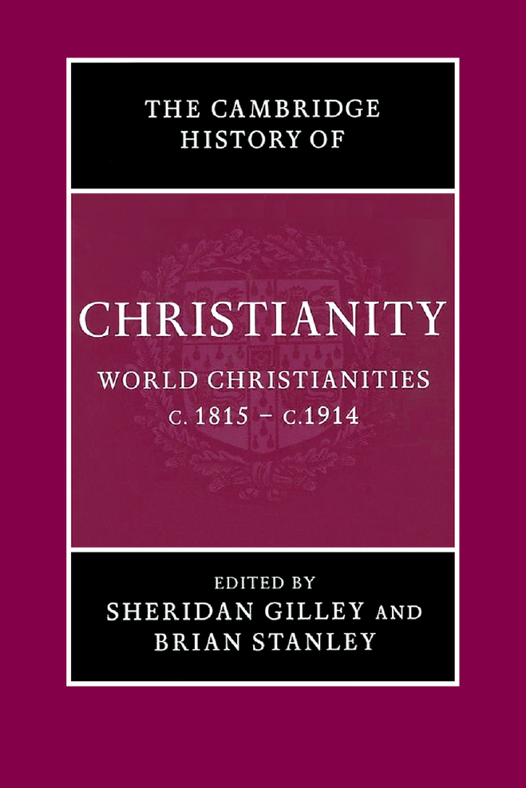

<!-- PDF page 1; original page unnumbered -->

# 卷首资料

## 原书封面

*《剑桥基督教史》第八卷：世界基督教，约1815—约1914年。*

<!-- PDF page 2; original page unnumbered -->

## 本卷介绍

本书是第一部在全球背景下讨论十九世纪基督教的学术著作。第一编分析天主教与新教，对欧洲现代性带来的思想、社会挑战的回应，关注自愿性基督教新形式的蓬勃发展，以及妇女在宗教生活中日益扩大的作用。第二编考察教会与民族主义之间多样而复杂的关系，以及由此引起的政教关系根本变化。第三编研究基督教的不同命运：它扩展在亚洲、非洲的历史基地，首次在澳大拉西亚立足，并回应欧洲殖民时代的挑战与机遇。每章均附完整书目，为进一步阅读提供指引。

谢里丹·吉利（Sheridan Gilley）为杜伦大学神学荣休准教授（Emeritus Reader），著有 *Newman and His Age*（2003年再版），以及大量近代宗教史论文。他与罗杰·斯威夫特合编 *The Irish in the Victorian City*（1985）、*The Irish in Britain 1815–1939*（1989）、*The Irish in Victorian Britain*（1999），并与W.J.希尔斯合编 *A History of Religion in Britain*（1994）。

布赖恩·斯坦利（Brian Stanley）为剑桥神学联合体亨利·马丁传教与世界基督教研究中心主任、剑桥圣埃德蒙学院研究员。他撰写、编纂多部近代基督教传教史著作，包括 *The Bible and the Flag*（1990）、*The History of the Baptist Missionary Society 1792–1992*（1992）、*Christian Missions and the Enlightenment*（2001），以及 *Missions, Nationalism, and the End of Empire*（2003）。

<!-- PDF page 3; original page unnumbered -->

## 丛书介绍

《剑桥基督教史》按年代，全面叙述基督教从起源至今各方面的发展，包括神学、思想、社会、政治、地区与全球层面。每卷独立地对相应时期研究作出重要贡献，整套丛书则构成一部大型学术参考著作。

本丛书旨在提供全球视野，远不止西欧基督教及其分支的历史。从早期起，东方与科普特基督教就得到充分考虑；较晚时期，非洲、远东、新世界、南亚及其他非欧洲地区的基督教发展，也获得适当篇幅。各卷涉及民众虔敬与基督教信仰的非正式表达，在广阔文化背景中，考察基督徒塑造、礼拜及灵修的社会学。基督教与其他主要信仰的关系，也始终在关注之列。本丛书将为学者、学生提供宝贵资源。

### 各卷书目

| 卷次 | 书名 | 编者 |
| --- | --- | --- |
| 1 | 起源至君士坦丁 | 玛格丽特·M.米切尔、弗朗西丝·M.扬 |
| 2 | 君士坦丁至约600年 | 温里希·勒尔、弗雷德·诺里斯、奥古斯丁·卡西迪 |
| 3 | 中世纪早期基督教：约600—约1100年 | 托马斯·诺布尔、朱莉娅·史密斯 |
| 4 | 西欧基督教：约1100—约1500年 | 米里·鲁宾、沃尔特·西蒙 |
| 5 | 东方基督教 | 迈克尔·安戈尔德 |
| 6 | 改革与扩张：约1500—约1660年 | 夏伯嘉 |
| 7 | 启蒙、复兴与革命：1660—1815年 | 斯图尔特·J.布朗、蒂莫西·塔克特 |
| 8 | 世界基督教：约1815—约1914年 | 布赖恩·斯坦利、谢里丹·吉利 |
| 9 | 世界基督教：约1914—约2000年 | 休·麦克劳德 |

本页各卷书名与署名，按本卷丛书介绍原载保留。

<!-- PDF page 4; original page unnumbered -->

## 扉页

《剑桥基督教史》

**第八卷　世界基督教：约1815—约1914年**

主编：谢里丹·吉利，杜伦大学；布赖恩·斯坦利，剑桥大学。

<!-- PDF page 5; original page unnumbered -->

## 出版与版权资料

剑桥大学出版社；出版地：剑桥、纽约、墨尔本、马德里、开普敦、新加坡、圣保罗。

英国地址：The Edinburgh Building, Cambridge CB2 2RU, UK。美国版由剑桥大学出版社纽约分社出版。

出版社网站：www.cambridge.org；本书资料：www.cambridge.org/9780521814560。

© 剑桥大学出版社，2006年。2006年首次出版，由英国剑桥大学印刷厂印制。

本书受版权保护。除法律规定的例外及相关集体许可协议允许的情形外，未经剑桥大学出版社书面许可，不得复制本书任何部分。

英国图书馆备有本书目录记录。

### 美国国会图书馆编目资料

*World Christianities, c.1815–c.1914* / Sheridan Gilley、Brian Stanley编。

页；厘米。——《剑桥基督教史》，第8卷。含参考书目及索引。

ISBN 0-521-81456-1，精装。

主题：1. 教会史——十九世纪。2. 教会史——二十世纪。

检索项：一、Gilley, Sheridan。二、Stanley, Brian, 1953–。三、题名。四、丛书。

分类及控制号：BR477.W87 2005；270.8—dc22；2005008392。

ISBN-13：978-0-521-81456-0，精装。ISBN-10：0-521-81456-1，精装。

对于本书所引外部或第三方网站，剑桥大学出版社不负责其网址能否持续使用、内容是否准确，也不保证网站内容目前或将来仍然准确、适当。

在线版页脚标识：Cambridge Histories Online © Cambridge University Press, 2008。

<!-- PDF page 6; original page v -->

## 原书目录

以下页码为英文原书印刷页码，并非中文重排后的页码。

撰稿人：ix。

| 章次与题名 | 作者 | 原页码 |
| --- | --- | --- |
| 1　导论 | 谢里丹·吉利 | 1 |

### 第一编　基督教与现代性

| 章次与题名 | 作者 | 原页码 |
| --- | --- | --- |
| 2　教皇制度 | 谢里丹·吉利 | 13 |
| 3　神学与反抗启蒙运动 | 道格拉斯·赫德利 | 30 |
| 4　自愿性宗教的增长 | 戴维·贝宾顿 | 53 |
| 5　礼拜与灵修中的天主教复兴 | 玛丽·海曼 | 70 |
| 6　女性讲道人与新修会 | 贾妮丝·霍姆斯、苏珊·奥布赖恩 | 84 |
| 7　教会建筑与宗教艺术 | 安德鲁·桑德斯 | 103 |
| 8　音乐潮流与西方教会：“古”与“今”的碰撞 | 杰里米·迪布尔 | 121 |

<!-- PDF page 7; original page vi -->

| 章次与题名 | 作者 | 原页码 |
| --- | --- | --- |
| 9　基督教与英语文学 | 安德鲁·桑德斯 | 136 |
| 10　基督教社会思想 | 约翰·莫洛尼、戴维·M.汤普森 | 142 |
| 11　基督教与科学 | 尼古拉斯·A.鲁普克 | 164 |
| 12　历史与《圣经》 | 约翰·罗杰森 | 181 |
| 13　城乡民众宗教与不信宗教 | 戴维·M.汤普森 | 197 |

### 第二编　教会与民族认同

| 章次与题名 | 作者 | 原页码 |
| --- | --- | --- |
| 14　法国的天主教：从王朝复辟到政教分离（1815—1905年） | 詹姆斯·F.麦克米兰 | 217 |
| 15　意大利：教会与民族复兴运动 | 弗兰克·科帕 | 233 |
| 16　天主教、爱尔兰与爱尔兰离散群体 | 谢里丹·吉利 | 250 |
| 17　大匈牙利与波兰的天主教民族主义 | 加布里埃尔·阿德里亚尼、耶日·克沃乔夫斯基 | 260 |
| 18　基督教与德意志的建立 | 安东尼·J.施泰因霍夫 | 282 |
| 19　圣公会、长老宗与联合王国的宗教认同 | 约翰·沃尔夫 | 301 |
| 20　新教的主导地位与宗派政治：瑞士和荷兰 | 乌尔斯·阿尔特马特、弗兰齐斯卡·梅茨格、迈克尔·温特尔 | 323 |

<!-- PDF page 8; original page vii -->

| 章次与题名 | 作者 | 原页码 |
| --- | --- | --- |
| 21　斯堪的纳维亚：路德宗与民族认同 | 达格·托尔基尔森 | 342 |
| 22　“基督教美国”与“基督教加拿大” | 马克·A.诺尔 | 359 |
| 23　西班牙与葡萄牙：教会面临的挑战 | 威廉·J.卡拉汉 | 381 |
| 24　拉丁美洲：教会与民族独立 | 约翰·林奇 | 395 |
| 25　东西方之间：东方天主教（“合一派”）教会 | 罗伯特·J.塔夫脱 | 412 |

### 第三编　基督教的扩展

| 章次与题名 | 作者 | 原页码 |
| --- | --- | --- |
| 26　非裔美国人的基督教 | 乔恩·森斯巴赫 | 429 |
| 27　基督教传教、反奴隶制与人道诉求（约1813—1873年） | 布赖恩·斯坦利 | 443 |
| 28　中东：西方传教事业与东方教会、伊斯兰教、犹太教 | 海伦·穆雷—范登贝尔赫 | 458 |
| 29　英属印度帝国的基督徒与宗教传统 | 罗伯特·埃里克·弗里肯伯格 | 473 |
| 30　东亚的基督教：中国、朝鲜与日本 | 丹尼尔·H.贝斯、詹姆斯·H.格雷森 | 493 |
| 31　印度支那的基督教 | 彼得·C.潘 | 513 |

<!-- PDF page 9; original page viii -->

| 章次与题名 | 作者 | 原页码 |
| --- | --- | --- |
| 32　作为教会与叙事的基督教，以及十九世纪菲律宾民族的诞生 | 何塞·马里奥·C.弗朗西斯科 | 528 |
| 33　澳大拉西亚与太平洋的基督教 | 斯图尔特·皮金、艾伦·戴维森 | 542 |
| 34　传教与帝国（约1873—1914年） | 安德鲁·波特 | 560 |
| 35　埃塞俄比亚主义与现代非洲基督教的根源 | 奥格布·U.卡卢 | 576 |
| 36　1914年基督教的前景 | 布赖恩·斯坦利 | 593 |
| 综合参考书目选目 |  | 601 |
| 分章参考书目 |  | 604 |
| 索引 |  | 656 |

<!-- PDF page 10; original page ix -->

## 撰稿人

以下机构、职称、研究计划及“目前”等表述，均依原书出版时的情况。出版物题名与定位保留原文。

**加布里埃尔·阿德里亚尼（Gabriel Adriányi）**，波恩大学天主教神学院教会史荣休教授，研究范围包括东欧教会史；也是布达佩斯罗兰大学教会史教授。他撰写、编纂多部近代教会史著作，包括 *Geschichte der katholischen Kirche in Ungarn*（Cologne: Böhlau, 2004）、*Die Ostpolitik des Vatikans 1958–1978 gegenüber Ungarn: der Fall Kardinal Mindszenty*（Herne: Schäfer, 2003）、*Kleine Kirchengeschichte Ungarns*（Herne: Schäfer, 2003）、*Prohászka és a római index*（Budapest, 2002），以及 *Geschichte der Kirche Osteuropas im 20. Jahrhundert*（Paderborn: Schöningh, 1992）。

**乌尔斯·阿尔特马特（Urs Altermatt）**，自1980年任瑞士弗里堡大学当代史教授，2003年起任校长，曾在克拉科夫、布达佩斯、萨拉热窝、索非亚等中东欧大学任客座教授。他出版大量近代欧洲、瑞士政治史、社会史与宗教史著作，包括 *Der Weg der Schweizer Katholiken ins Ghetto*（Zurich and Cologne: Benziger, 1972，第3版1995）、*Katholizismus und Moderne*（Zurich: Benziger, 1989）、与Hanspeter Kriesi等合著的 *Rechtsextremismus in der Schweiz*（Zurich: Neue Züricher-Zeitung, 1995）、*Das Fanal von Sarajevo: Ethnonationalismus in Europa*（Zurich: Neue Züricher-Zeitung, 1996）、*Katholizismus und Antisemitismus*（Frauenfeld, Stuttgart and Vienna: Huber, 1999），以及主编的 *Katholische Denk- und Lebenswelten*（Fribourg: Academic Press, 2003）。

**丹尼尔·H.贝斯（Daniel H. Bays）**，密歇根州大急流城加尔文学院历史学教授、亚洲研究项目主任，撰写或编纂多篇论文、章节和著作，研究十九、二十世纪中国基督教史。其中包括主编 *Christianity in China, from the eighteenth century to the present*（Stanford: Stanford University Press, 1996），合编 *The foreign missionary enterprise at home*（Tuscaloosa: University of Alabama Press, 2003），以及论文‘Chinese Protestant Christianity today’，载 *The China Quarterly* 174（June 2003）；‘A tradition of state dominance’，载Jason Kindopp、Carol Lee Hamrin编 *God and Caesar in China*（Washington, DC: Brookings Institution Press, 2004）。

**戴维·贝宾顿（David Bebbington）**，斯特灵大学历史学教授，著有 *Patterns in history*（Leicester: Inter-Varsity Press, 1979）、*The nonconformist conscience: chapel and politics, 1870–1914*（London: Allen and Unwin, 1982）、*Evangelicalism in modern Britain: a history from the 1730s to the 1980s*（London: Unwin Hyman, 1989），以及<!-- PDF page 11; original page x -->*William Ewart Gladstone: faith and politics in Victorian Britain*（Grand Rapids, MI: Eerdmans, 1993）、*Holiness in nineteenth-century England*（Carlisle: Paternoster, 2000）、*The mind of Gladstone: religion, Homer and politics*（Oxford: Oxford University Press, 2004）、*The dominance of evangelicalism: the age of Spurgeon and Moody*（Leicester: Inter-Varsity Press, 2005）。他主编的作品包括 *Protestant nonconformist texts: the nineteenth century*（Aldershot: Ashgate, 2005）。

**威廉·J.卡拉汉（William J. Callahan）**，多伦多大学历史学荣休教授。他的 *Church, politics and society in Spain, 1750–1874*（Cambridge, MA: Harvard University Press, 1984），获加拿大历史协会华莱士·K.弗格森奖。其他著作包括 *Honor, commerce, and industry in eighteenth-century Spain*（Boston: Baker Library, Harvard Graduate School of Business Administration, 1972）、*The Catholic Church in Spain, 1875–1998*（Washington, DC: Catholic University of America Press, 2000）。他与David Higgs合编 *Church and society in Catholic Europe of the eighteenth century*（Cambridge: Cambridge University Press, 1979）。

**弗兰克·科帕（Frank Coppa）**，纽约圣约翰大学历史学教授、近代世界史博士研究主任，撰写或编纂十余卷关于统一意大利和近代教皇制度的著作。研究既涉及民族复兴运动，也涉及反民族复兴运动，包括卡米洛·迪卡沃尔、庇护九世、贾科莫·安东内利枢机的传记。近作有 *The modern papacy since 1789*（London and New York: Addison Wesley Longman, 1998）、*The papacy confronts the modern world*（Krieger, 2003）；他还主编并参与撰写 *Controversial concordats*（Washington, DC: Catholic University Press, 1999），以及两卷本 *Great popes through history*（Westport, CT: Greenwood Press, 2002）。

**艾伦·戴维森（Allan Davidson）**，奥克兰大学神学院研究生事务主任，并讲授教会史。他广泛研究新西兰、南太平洋基督教史，撰写或编纂的作品，包括 *Semisi Nau: the story of my life: a Tongan missionary at Ontong Java*（Suva, Fiji: Institute of Pacific Studies, 1996）、*Tongan Anglicans 1902–2002*（College of the Diocese of Polynesia, 2002），以及 *Christianity in Aotearoa: a history of church and society in New Zealand*，第3版（Wellington, New Zealand: Education for Ministry, 2004）。

**杰里米·迪布尔（Jeremy Dibble）**，杜伦大学音乐学教授，专长为维多利亚、爱德华及乔治时代音乐。这体现于两部重要研究：*C. Hubert H. Parry: his life and music*（Oxford: Oxford University Press, 1992）、*Charles Villiers Stanford: man and musician*（Oxford: Oxford University Press, 2002），以及最近为Musica Britannica Trust编的帕里小提琴奏鸣曲集。他研究范围广泛，包括史学、歌剧、英国教会音乐；目前研究约翰·斯泰纳的生平、音乐，并为Musica Britannica编帕里钢琴三重奏集。未来计划，是撰写弗雷德里克·戴留斯音乐研究。

**何塞·马里奥·C.弗朗西斯科（José Mario C. Francisco）**，1996年起任东亚牧灵学院主任，2005—2006年将任波士顿学院加森讲席教授。在完成文学与神学的研究生学习后，<!-- PDF page 12; original page xi -->他开始在马尼拉的洛约拉神学院、雅典耀大学任教，也在伯克利耶稣会神学院讲学。除在亚洲各地主持会议、发表演讲，他也为期刊、论文集撰写宗教与文化论文，并出版西班牙殖民时期菲律宾本地语文本，例如 *Sermones*〔Prancisco Bloncas de San José O.P.，人名拼写依原书〕和 *Bocabulario Tagalo*〔Miguel Ruiz, O.P.〕。

**罗伯特·埃里克·弗里肯伯格（Robert Eric Frykenberg）**，威斯康星大学麦迪逊分校荣休教授，著作包括 *Guntur district, 1788–1848: a history of local influence and central authority*（Oxford: Clarendon Press, 1965）、*Land control and social structure in Indian history*（Madison: University of Wisconsin Press, 1969, 1978）、*Land tenure and peasant in South Asia*（New Delhi: Manohar, 1977, 1981）、*Delhi through the ages*（New Delhi: Oxford University Press, 1986, 1993）、*History and belief: the foundations of historical understanding*（Grand Rapids, MI: Eerdmans, 1996）。他与布赖恩·斯坦利，担任“基督教传教史研究”丛书共同总主编，其中包括 *Christians, cultural interactions, and India’s religious traditions*（Grand Rapids, MI: Eerdmans, 2002）、*Christians and missionaries in India*（Grand Rapids, MI: Eerdmans, 2003）；目前，正撰写牛津版印度基督教史。

**谢里丹·吉利（Sheridan Gilley）**，杜伦大学神学荣休准教授，著有 *Newman and his age*（再版，London: Darton, Longman, and Todd, 2003），以及大量近代宗教史论文。他与罗杰·斯威夫特，合编三卷英国爱尔兰人研究：*The Irish in the Victorian city*（London: Croom Helm, 1985）、*The Irish in Britain, 1815–1939*（London: Pinter, 1989）、*The Irish in Victorian Britain: the local dimension*（Dublin: Four Courts Press, 1999）；并与W.J.希尔斯合编 *A history of religion in Britain*（Oxford: Blackwell, 1994）。

**詹姆斯·H.格雷森（James H. Grayson）**，谢菲尔德大学东亚研究学院现代朝鲜研究教授，亦为人类学家、卫理宗牧师，曾在朝鲜半岛传教。他广泛研究，包括基督教在内的朝鲜宗教传统，著有 *Early Buddhism and Christianity in Korea*（Leiden: E.J. Brill, 1985）、*Korea: a religious history*（Oxford: Clarendon Press, 1989；修订版Routledge-Curzon, 2002）。关于朝鲜基督教社会文化层面的论文，包括‘The Shintô shrine conflict and Protestant martyrs in Korea, 1938–1945’，*Missiology* 29（2001），以及‘Cultural encounter: Korean Protestantism and other religious traditions’，*International Bulletin of Missionary Research* 25（2001）。

**道格拉斯·赫德利（Douglas Hedley）**，剑桥大学宗教哲学高级讲师、克莱尔学院研究员。2002年，任巴黎索邦高等研究实践学院客座研究主任；2004年，在杜伦大学，担任基督教护教的艾伦·理查森讲座讲师。他曾任英国宗教哲学学会秘书、欧洲宗教哲学学会主席，著有 *Coleridge, philosophy and religion: aids to reflection and the mirror of the spirit*（Cambridge: Cambridge University Press, 2000）。

<!-- PDF page 13; original page xii -->

**玛丽·海曼（Mary Heimann）**，斯特拉斯克莱德大学历史学高级讲师，兼任 *Oxford Dictionary of National Biography*（Oxford: Oxford University Press, 2004）副编辑，负责天主教条目。她著有 *Catholic devotion in Victorian England*（Oxford: Oxford University Press, 1995），并为多部近代宗教史综述撰稿。目前，正完成一部捷克斯洛伐克政治史，拟由Hambledon and London出版，也计划研究近代英国对超自然的态度。

**贾妮丝·霍姆斯（Janice Holmes）**，阿尔斯特大学科尔雷恩校区爱尔兰史讲师，专长包括宗教复兴、女性牧职、爱尔兰长老宗。她与Diane Urquhart合编 *Coming into the light: the work, politics and religion of women in Ulster, 1840–1940*（Belfast: Institute of Irish Studies, 1994），并出版 *Religious revivals in Britain and Ireland, 1859–1905*（Dublin: Irish Academic Press, 2000）。

**奥格布·U.卡卢（Ogbu U. Kalu）**，芝加哥麦考密克神学院亨利·温特斯·卢斯世界基督教与传教学讲席教授，兼芝加哥全球牧职中心副主任。他撰写、编纂多部著作，包括 *Divided people of God: church union movement in Nigeria, 1875–1966*（New York: NOK Publishers, 1978）、*The history of Christianity in West Africa*（London: Longman, 1980）、*Power, poverty and prayer: the challenges of poverty and pluralism in African Christianity, 1960–1996*（Frankfurt: Peter Lang, 2000），以及 *Embattled gods: the Christianization of Igboland, 1841–1991*（Lagos: Africa World Press, 2003）。

**耶日·克沃乔夫斯基（Jerzy Kłoczowski）**，卢布林天主教大学历史学教授、卢布林中东欧研究所所长、中东欧研究所国际联合会主席、教会比较史波兰委员会主席、教会比较史国际委员会副主席，以及联合国教科文组织波兰委员会主席。其大量著作，包括 *A history of Polish Christianity*（Cambridge: Cambridge University Press, 2000）、*Chrześcijaństwo i historia*〔基督教与历史〕（1990）、*Młodsza Europa*〔年轻的欧洲〕（Cracow: Znak, 2004），以及 *Historia Europy Środkowo-Wschodniej*〔中东欧史〕（Paris: PUF, 2004）。

**约翰·林奇（John Lynch）**，伦敦大学拉丁美洲史荣休教授，著有大量西班牙、拉丁美洲研究，包括 *Bourbon Spain 1700–1808*（Oxford: Blackwell, 1989）、*Argentine dictator: Juan Manuel de Rosas 1829–1852*（Oxford: Clarendon Press, 1981）、*The Spanish American revolutions 1808–1826*（New York: Norton, 1986）、*Caudillos in Spanish America 1800–1850*（Oxford: Clarendon Press, 1992）、*Massacre in the Pampas, 1872: Britain and Argentina in the age of migration*（Norman: University of Oklahoma Press, 1998），以及 *Latin America between colony and nation*（Basingstoke: Palgrave, 2001）。

**詹姆斯·F.麦克米兰（James F. McMillan）**，爱丁堡大学理查德·佩尔斯历史学讲席教授，撰写大量近代法国宗教史论文、章节，特别关注法国文化战争、政治天主教，以及<!-- PDF page 14; original page xiii -->宗教与性别的关系。他还出版 *France and women 1789–1914: gender, society and politics*（London: Routledge, 2000），并主编、参与撰写 *Modern France 1880–2002*（The short Oxford history of France；Oxford: Oxford University Press, 2003）。他获利弗休姆重大研究奖助，开展下一项研究：*War and belief: the Great War and the western religious imagination*。

**弗兰齐斯卡·梅茨格（Franziska Metzger）**，弗里堡大学当代史研究助理。她关于宗教史、史学史的著述，包括 *Die ‘Schildwache’: Eine integralistisch-rechtskatholische Zeitung 1912–1945*（Fribourg: Universitätsverlag, 2000）；与C. Bosshart-Pfluger、J. Jung合编 *Nation und Nationalismus in Europa: Festschrift für Urs Altermatt*（Frauenfeld: Huber, 2002）；‘Die Reformation in der Schweiz zwischen 1850 und 1950. Konkurrierende konfessionelle und nationale Geschichtskonstruktionen und Erinnerungsgemeinschaften’，载H.-G. Haupt、D. Langewiesche编 *Nation und Religion in Europa*（Frankfurt a.M.: Campus, 2004）；以及与Urs Altermatt合著‘Milieu, Teilmilieus und Netzwerke’，载Urs Altermatt编 *Katholische Denk- und Lebenswelten*（Fribourg: Academic Press, 2003）。

**约翰·莫洛尼（John Molony）**，澳大利亚国立大学历史学荣休教授、《澳大利亚传记辞典》访问研究员，兼任澳大利亚天主教大学兼职教授。他著有 *The Roman mould of the Australian Catholic Church*（Carlton, Victoria: Melbourne University Press, 1969）、*The emergence of political Catholicism in Italy, Partito Popolare, 1919–1926*（London: Croom Helm, 1980）、*The Penguin bicentennial history of Australia*（Ringwood, Victoria: Viking, 1987）、*The worker question: a new historical perspective on Rerum Novarum*（Dublin: Gill and Macmillan, 1991），以及 *Luther’s pine*（Pandanus Books, 2004）。

**海伦·穆雷—范登贝尔赫（Heleen Murre-van den Berg）**，荷兰莱顿大学世界基督教史副教授，专研中东诸基督教传统，尤其东方亚述教会，以及西方在中东的传教史。近作包括‘Migration of Middle Eastern Christians to western countries and Protestant missionary activities in the Middle East: a preliminary investigation’，*The Journal of Eastern Christian Studies* 54, 1–2（2002），39–49；‘Generous devotion: women in the colophons of the Church of the East (1550–1850)’，*Hugoye: Journal of Syriac Studies* 7/1（2004）；原书所列网址为http://syrcom.cua.edu/Hugoye。

**马克·A.诺尔（Mark A. Noll）**，伊利诺伊州惠顿学院麦克马尼斯基督教思想讲席教授。著作包括 *America’s God, from Jonathan Edwards to Abraham Lincoln*（New York: Oxford University Press, 2002）、*The rise of evangelicalism: the age of Whitefield, Edwards, and the Wesleys*（Leicester: Inter-Varsity Press, 2004）、*The old religion in a new world: the history of North American Christianity*（Grand Rapids, MI: Eerdmans, 2002），以及 *Turning points: decisive moments in the history of Christianity*，第2版（Grand Rapids, MI: Baker Book House, 2000）。

**苏珊·奥布赖恩（Susan O’Brien）**，独立学者、剑桥圣埃德蒙学院高级成员、剑桥神学联合体玛格丽特·博福特神学研究所董事会主席。2002年以前，她任斯塔福德郡<!-- PDF page 15; original page xiv -->大学副校长。她在期刊、论文集中，广泛撰写十八世纪跨大西洋复兴主义，以及近代英国、爱尔兰罗马天主教隐修女与活动修女的历史。

**彼得·C.潘（Peter C. Phan）**，目前任乔治敦大学伊格纳西奥·埃利亚库里亚天主教社会思想讲席教授。他发表250余篇论文、十余本书，包括 *Mission and catechesis: Alexandre de Rhodes and inculturation in seventeenth-century Vietnam*（1998），以及亚洲神学三部曲：*Christianity with an Asian face*、*In our own tongues*、*Being religious interreligiously*，均由纽约州Maryknoll的Orbis Books出版。

**斯图尔特·皮金（Stuart Piggin）**，澳大利亚悉尼麦考瑞大学基督教思想与经验史研究中心主任，该中心包括澳大利亚基督教研究中心。他发表百余篇福音主义、传教及灾难史论文，著有 *Making evangelical missionaries: the social background, motivation, and training of British Protestant missionaries*（出版地不详：Sutton Courtenay Press, 1984）、*The Mount Kembla disaster*（South Melbourne: Oxford University Press, 1992）、*Evangelical Christianity in Australia: Spirit, word and world*（Melbourne: Oxford University Press, 1996），以及 *Firestorm of the Lord: the history of and prospects for revival in the church and the world*（Carlisle: Paternoster, 2000）。

**安德鲁·波特（Andrew Porter）**，伦敦大学国王学院罗兹帝国史讲席教授，广泛研究十八世纪中叶至二十世纪中叶的帝国问题。著作包括 *The origins of the South African War*（Manchester: Manchester University Press, 1980）、*Victorian shipping, business and empire*（Woodbridge: Boydell Press, 1986）、*An atlas of British overseas expansion*（London: Routledge, 1991）。他主编 *The Oxford history of the British Empire* 第4卷：*The nineteenth century*（Oxford: Oxford University Press, 1999），以及 *The imperial horizons of British Protestant missions, 1880–1914*（Grand Rapids, MI: Eerdmans, 2003）。最新著作为 *Religion versus empire? British Protestant missionaries and overseas expansion, 1700–1914*（Manchester: Manchester University Press, 2004）。

**约翰·罗杰森（John Rogerson）**，谢菲尔德大学圣经研究荣休教授，主要著述聚焦《旧约》解释的历史、前提，以及今日《圣经》的使用。包括 *Myth in Old Testament interpretation*（Berlin: De Gruyter, 1974）、*Anthropology and the Old Testament*（Oxford: Blackwell, 1978）、*Old Testament criticism in the nineteenth century: England and Germany*（London: SPCK, 1984），以及 *The Bible and criticism in Victorian Britain: profiles of F.D. Maurice and William Robertson Smith*（Sheffield: Sheffield Academic Press, 1995）。

**尼古拉斯·A.鲁普克（Nicolaas A. Rupke）**，哥廷根大学科学史教授、科学史研究所所长。他的 *The great chain of history*（Oxford: Clarendon Press, 1983）、*Richard Owen*（New Haven, CT: Yale University Press, 1994），都突出讨论宗教与科学。目前，他正研究题为‘Eminent lives in twentieth-century science and religion’的项目。

<!-- PDF page 16; original page xv -->

**安德鲁·桑德斯（Andrew Sanders）**，杜伦大学英语教授，广泛研究十九世纪文学，尤其查尔斯·狄更斯。他编辑多部维多利亚时代小说，著有 *The short Oxford history of English literature*，第3版（Oxford: Oxford University Press, 2004）。他也持续研究艺术、建筑，曾多年担任维多利亚学会委员会成员。

**乔恩·森斯巴赫（Jon Sensbach）**，佛罗里达大学历史学教授，著有 *Rebecca’s revival: creating black Christianity in the Atlantic world*（Cambridge, MA: Harvard University Press, 2005）、*A separate Canaan: the making of an Afro-Moravian world in North Carolina, 1763–1840*（Chapel Hill and London: University of North Carolina Press, 1998）。

**布赖恩·斯坦利（Brian Stanley）**，剑桥神学联合体亨利·马丁传教与世界基督教研究中心主任、剑桥圣埃德蒙学院研究员。他撰写、编纂多部近代基督教传教史著作，包括 *The Bible and the flag*（Leicester: Apollos, 1990）、*The history of the Baptist Missionary Society 1792–1992*（Edinburgh: T. & T. Clark, 1992）、*Christian missions and the Enlightenment*（Grand Rapids, MI and Richmond: Eerdmans and Curzon, 2001），以及 *Missions, nationalism, and the end of empire*（Grand Rapids, MI: Eerdmans, 2003）。

**安东尼·J.施泰因霍夫（Anthony J. Steinhoff）**，田纳西大学查塔努加分校近代欧洲史助理教授，曾在 *Central European History*、*Geschichte und Gesellschaft*、*Journal of Urban History*，发表近代欧洲宗教史、文化史论文，并为 *The Blackwell companion to nineteenth-century Europe*，Helmut Walser Smith编 *Protestants, Catholics, and Jews in Germany, 1800–1914*（New York: Berg, 2001），以及Lucian Hölscher编 *Religiöse Vergemeinschaftung in der Moderne*（Göttingen: Wallstein, 2005）撰稿。目前，他正完成一部十九世纪晚期斯特拉斯堡新教与城市宗教文化专著。

**罗伯特·J.塔夫脱（Robert J. Taft）**，罗马宗座东方学院东方礼仪荣休教授、梵蒂冈东方教会部礼仪顾问，已撰写690余项出版物，主要研究东方礼仪，其中包括十五本书。

**戴维·M.汤普森（David M. Thompson）**，剑桥菲茨威廉学院研究员兼院务主席（President）、剑桥大学近代教会史准教授、宗教与神学高级研究中心主任。他广泛发表关于维多利亚非国教派、十九世纪基督教社会思想、基督徒合一运动史的著述。

**达格·托尔基尔森（Dag Thorkildsen）**，奥斯陆大学神学院教授，专研挪威、斯堪的纳维亚教会史，出版多种关于民族国家建设与宗教、宗教觉醒与社会现代化的著作：*Nationality, identity and morality*（KULTs skriftserie, 1995）；‘Church and nation in the 19th century – the case of Norway’，载Ingmar Brohed编 *Church and people in Britain and Scandinavia*（Lund: Lund University Press, 1996）；以及<!-- PDF page 17; original page xvi -->*Grundtvigianism and nationalism in Norway during the 19th century*（KULTs skriftserie, 1996）；‘Religious identity and Nordic identity’，载Øystein Sørensen、Bo Stråth编 *The cultural construction of Norden*（Oslo: Scandinavian University Press, 1997）。

**迈克尔·温特尔（Michael Wintle）**，阿姆斯特丹大学欧洲史教授，负责欧洲研究学位课程。2002年以前，他在英国赫尔大学任欧洲史讲席教授，自1980年起，便在那里任教。他广泛发表近代荷兰史研究，包括 *Pillars of piety*（Hull: Hull University Press, 1985）、*An economic and social history of the Netherlands*（Cambridge: Cambridge University Press, 2000），也关注欧洲认同，尤其欧洲的视觉呈现。

**约翰·沃尔夫（John Wolffe）**，开放大学宗教史教授，著有 *The Protestant crusade in Great Britain, 1829–1860*（Oxford: Oxford University Press, 1991）、*God and Greater Britain: religion and national life in Britain and Ireland, 1843–1945*（London: Routledge, 1994）、*Great deaths: grieving, religion and nationhood in Victorian and Edwardian Britain*（Oxford: Oxford University Press, 2000）。
