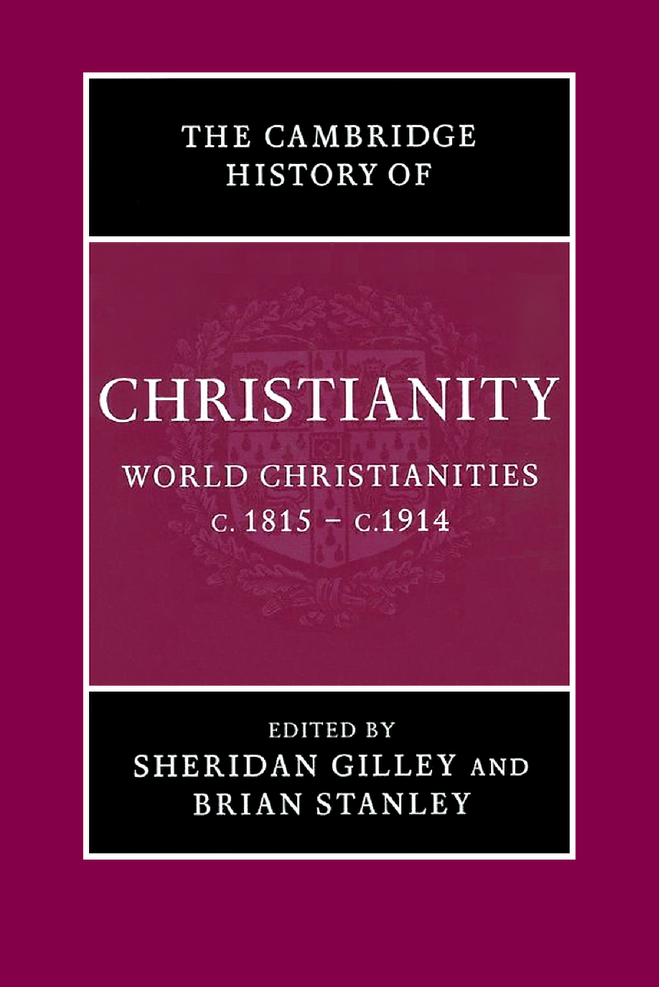
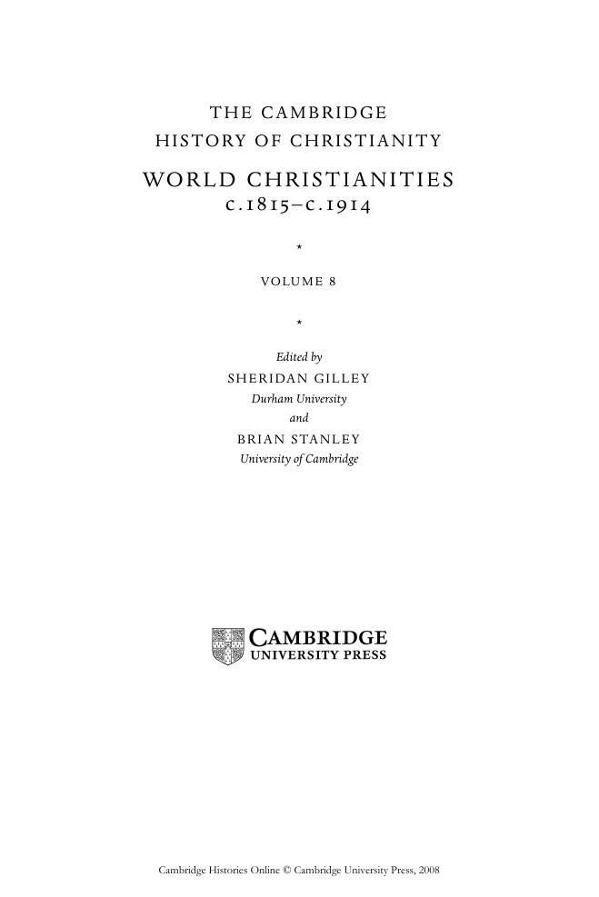

# 卷首资料：英文转换底稿

<!-- PDF page 1; original page unnumbered -->

<!-- PDF page 2; original page unnumbered -->

the cambridge history of christianity

WO R L D C H R I S T I A N I T I E S

c . 1 8 1 5 – c . 1 9 1 4

This is the first scholarly treatment of nineteenth-century Chris-

tianity to discuss the subject in a global context. Part i analyses the

responses of Catholic and Protestant Christianity to the intellectual

and social challenges presented by European modernity. It gives

attention to the explosion of new voluntary forms of Christianity

and the expanding role of women in religious life. Part ii surveys

the diverse and complex relationships between the churches and

nationalism, resulting in fundamental changes to the connections

between church and state. Part iii examines the varied fortunes

of Christianity as it expanded its historic bases in Asia and Africa,

established itself for the first time in Australasia, and responded

to the challenges and opportunities of the European colonial era.

Each chapter has a full bibliography providing guidance on further

reading.

Sheridan Gilley is an Emeritus Reader in Theology, Durham

University. He is the author of Newman and His Age (republished,

2003) and of numerous articles on modern religious history. He

is co-editor, with Roger Swift, of The Irish in the Victorian City

(1985), The Irish in Britain 1815 –1939 (1989) and The Irish in Victorian

Britain (1999), and with W. J. Sheils, of A History of Religion in Britain

(1994).

Brian Stanley is Director of the Henry Martyn Centre for

the Study of Mission and World Christianity in the Cambridge

Theological Federation and a Fellow of St Edmund’s College,

Cambridge. He has written and edited a number of books on

the modern history of Christian missions, including The Bible and

the Flag (1990), The History of the Baptist Missionary Society 1792–1992

(1992), Christian Missions and the Enlightenment (2001) and Missions,

Nationalism, and the End of Empire (2003).

<!-- PDF page 3; original page unnumbered -->

the cambridge history of

C H R I S T I A N I T Y

The Cambridge History of Christianity offers a comprehensive

chronological account of the development of Christianity in all its

aspects – theological, intellectual, social, political, regional, global –

from its beginnings to the present day. Each volume makes a sub-

stantial contribution in its own right to the scholarship of its period

and the complete History constitutes a major work of academic

reference. Far from being merely a history of Western European

Christianity and its offshoots, the History aims to provide a global

perspective. Eastern and Coptic Christianity are given full consider-

ation from the early period onwards, and later, African, Far Eastern,

New World, South Asian and other non-European developments in

Christianity receive proper coverage. The volumes cover popular

piety and non-formal expressions of Christian faith, and treat the

sociology of Christian formation, worship and devotion in a broad

cultural context. The question of relations between Christianity

and other major faiths is also kept in sight throughout. The His-

tory will provide an invaluable resource for scholars and students

alike.

List of volumes:

Origins to Constantine

edited by margaret m. mitchell and frances m. young

Constantine to c.600

edited by winrich lö hr, fred norris and augustine casiday

Early Medieval Christianity c.600–c.1100

edited by thomas noble and julia smith

Christianity in Western Europe c.1100–c.15 00

edited by miri rubin and walter simon

Eastern Christianity

edited by michael angold

Re-Formation and Expansion c.15 00–c.1660

edited by ronnie po-chia hsia

Enlightenment, Reawakening and Revolution 1660–1815

edited by stewart j. brown and timothy tackett

World Christianities c.1815 –c.1914

edited by brian stanley and sheridan gilley

World Christianities c.1914–c.2000

edited by hugh mcleod

<!-- PDF page 4; original page unnumbered -->

T H E C A M B R I D G E

H I S T O RY O F C H R I S T I A N I T Y

WO R L D C H R I S T I A N I T I E S

1 8 1 5 1 9 1 4

c . – c .

*

VO LU M E 8

*

Edited by

S H E R I DA N G I L L E Y

Durham University

and

B R I A N S TA N L E Y

University of Cambridge

<!-- PDF page 5; original page unnumbered -->

cambridge university press

Cambridge, New York, Melbourne, Madrid, Cape Town, Singapore, São Paulo

Cambridge University Press

The Edinburgh Building, Cambridge cb2 2ru, UK

Published in the United States of America by Cambridge University Press, New York

www.cambridge.org

Information on this title: www.cambridge.org/9780521814560

© Cambridge University Press 2006

This book is in copyright. Subject to statutory exception

and to the provisions of relevant collective licensing agreements,

no reproduction of any part may take place without

the written permission of Cambridge University Press.

First published 2006

Printed in the United Kingdom at the University Press, Cambridge

A catalogue record for this book is available from the British Library

Library of Congress Cataloguing in Publication data

World Christianities, c.1815–c.1914/edited by Sheridan Gilley and Brian Stanley.

p. cm. – (The Cambridge history of Christianity; vol. 8)

Includes bibliographical references and index.

isbn 0 521-81456-1 (hardback)

1. Church history – 19th century. 2. Church history – 20th century.

i. Gilley, Sheridan. ii. Stanley, Brian, 1953– iii. Title. iv. Series.

br477.w87 2005 270.8 – dc22 2005008392

isbn-13 978-0-521-81456-0 hardback

isbn-10 0-521-81456-1 hardback

Cambridge University Press has no responsibility for the persistence or accuracy of URLs for external

or third-party internet websites referred to in this book, and does not guarantee that any content on

such websites is, or will remain, accurate or appropriate.

<!-- PDF page 6; original page v -->

Contents

List of contributors ix

1 · Introduction 1

sheridan gilley

pa rt i

C H R I S T I A N I T Y A N D M O D E R N I T Y

2 · The papacy 1 3

sheridan gilley

3 · Theology and the revolt against the Enlightenment 30

douglas hedley

4 · The growth of voluntary religion 5 3

david bebbington

5 · Catholic revivalism in worship and devotion 70

mary heimann

6 · Women preachers and the new Orders 84

janice holmes and susan o’brien

7 · Church architecture and religious art 1 03

andrew sanders

8 · Musical trends and the western church: a collision of the

‘ancient’ and ‘modern’ 1 21

jeremy dibble

v

<!-- PDF page 7; original page vi -->

Contents

9 · Christianity and literature in English 1 36

andrew sanders

10 · Christian social thought 1 42

john molony and david m. thompson

11 · Christianity and the sciences 1 64

nicolaas a. rupke

12 · History and the Bible 1 81

john ro gerson

13 · Popular religion and irreligion in countryside and town 1 97

david m. thompson

pa rt i i

T H E C H U R C H E S A N D NAT I O NA L I D E N T I T I E S

14 · Catholic Christianity in France from the Restoration to the

separation of church and state, 1815–1905 21 7

james f. mcmillan

15 · Italy: the church and the Risorgimento 233

fr ank coppa

16 · Catholicism, Ireland and the Irish diaspora 25 0

sheridan gilley

17 · Catholic nationalism in Greater Hungary and Poland 260

gabriel adriányi and jerzy kłoczowski

18 · Christianity and the creation of Germany 282

anthony j. steinhoff

19 · Anglicanism, Presbyterianism and the religious identities of

the United Kingdom 301

john wolffe

20 · Protestant dominance and confessional politics: Switzerland and the

Netherlands 323

urs altermatt, fr anzisk a metzger and michael wintle

vi

<!-- PDF page 8; original page vii -->

Contents

21 · Scandinavia: Lutheranism and national identity 342

dag thorkildsen

22 · ‘Christian America’ and ‘Christian Canada’ 35 9

mark a. noll

23 · Spain and Portugal: the challenge to the church 381

william j. callahan

24 · Latin America: the church and national independence 395

john lynch

25 · Between east and west: the Eastern Catholic (‘Uniate’)

churches 41 2

robert j. taft

pa rt i i i

T H E E X PA N S I O N O F C H R I S T I A N I T Y

26 · African-American Christianity 429

jon sensbach

27 · Christian missions, antislavery and the claims of humanity,

c. 1813–1873 443

brian stanley

28 · The Middle East: western missions and the Eastern churches,

Islam and Judaism 45 8

heleen murre-van den berg

29 · Christians and religious traditions in the Indian empire 473

robert eric frykenberg

30 · Christianity in East Asia: China, Korea and Japan 493

daniel h. bays and james h. gr ayson

31 · Christianity in Indochina 5 1 3

peter c. phan

vii

<!-- PDF page 9; original page viii -->

Contents

32 · Christianity as church and story and the birth of the Filipino

nation in the nineteenth century 5 28

josé mario c. fr ancisco

33 · Christianity in Australasia and the Pacific 5 42

stuart piggin and allan davidson

34 · Missions and empire, c.1873–1914 5 60

andrew porter

35 · Ethiopianism and the roots of modern African Christianity 5 76

o gbu u. k alu

36 · The outlook for Christianity in 1914 5 93

brian stanley

Select general bibliography 601

Chapter bibliographies 604

Index 65 6

viii

<!-- PDF page 10; original page ix -->

Contributors

Gabriel Adriá nyi is Emeritus Professor of Church History (including East European

Church History) in the Catholic Theological Faculty, University of Bonn, and is Professor

of Church History at the Lorand-Eötvös-University at Budapest. He has written and edited

a number of books on modern church history, including Geschichte der katholischen Kirche

in Ungarn (Cologne: Böhlau, 2004), Die Ostpolitik des Vatikans 195 8–1978 gegenüber Ungarn:

der Fall Kardinal Mindszenty (Herne: Schäfer, 2003), Kleine Kirchengeschichte Ungarns (Herne:

Schäfer, 2003), Prohászka és a római index (Budapest, 2002) and Geschichte der Kirche Osteuropas

im 20. Jahrhundert (Paderborn: Schöningh, 1992).

Urs Altermatt has been Professor of Contemporary History at the University of

Fribourg, Switzerland, since 1980, and Rector since 2003. He has been Visiting Profes-

sor at various central and eastern European universities (Cracow, Budapest, Sarajevo and

Sofia). His numerous publications on modern European and Swiss political, social and

religious history include Der Weg der Schweizer Katholiken ins Ghetto (Zurich and Cologne:

Benziger, 1972, 3rd edn 1995), Katholizismus und Moderne (Zurich: Benziger, 1989), Recht-

sextremismus in der Schweiz, with Hanspeter Kriesi et al. (Zurich: Neue Züricher-Zeitung,

1995), Das Fanal von Sarajevo: Ethnonationalismus in Europa (Zurich: Neue Züricher-Zeitung,

1996), Katholizismus und Antisemitismus (Frauenfeld, Stuttgart and Vienna: Huber, 1999) and

Katholische Denk- und Lebenswelten, ed. (Fribourg: Academic Press, 2003).

Daniel H. Bays is Professor of History and Director of the Asian Studies Program at

Calvin College, Grand Rapids, Michigan. He has written or edited several articles, chapters

and books on the history of Christianity in China in the nineteenth and twentieth centuries,

among them Christianity in China, from the eighteenth century to the present, ed. (Stanford:

Stanford University Press, 1996), The foreign missionary enterprise at home, co-ed. (Tuscaloosa:

University of Alabama Press, 2003), ‘Chinese Protestant Christianity today’, in The China

Quarterly 174 (June 2003), and ‘A tradition of state dominance’, in Jason Kindopp and Carol

Lee Hamrin (eds.), God and Caesar in China (Washington, DC: Brookings Institution Press,

2004).

David Bebbington is Professor of History at the University of Stirling. He has written

Patterns in history (Leicester: Inter-Varsity Press, 1979), The nonconformist conscience: chapel

and politics, 1870–1914 (London: Allen and Unwin, 1982), Evangelicalism in modern Britain: a

history from the 1730s to the 1980s (London: Unwin Hyman, 1989), William Ewart Gladstone:

ix

<!-- PDF page 11; original page x -->

List of contributors

faithandpoliticsinVictorianBritain (Grand Rapids, MI: Eerdmans, 1993), Holinessinnineteenth-

century England (Carlisle: Paternoster, 2000), The mind of Gladstone: religion, Homer and politics

(Oxford: Oxford University Press, 2004) and The dominance of evangelicalism: the age of Spur-

geon and Moody (Leicester: Inter-Varsity Press, 2005). His edited works include Protestant

nonconformist texts: the nineteenth century (Aldershot: Ashgate, 2005).

William J. Callahan is Emeritus Professor of History at the University of Toronto. His

book Church, politics and society in Spain, 175 0–1874 (Cambridge, MA: Harvard University

Press, 1984) was awarded the Wallace K. Ferguson Prize of the Canadian Historical Associ-

ation. Other works by him include Honor, commerce, and industry in eighteenth-century Spain

(Boston: Baker Library, Harvard Graduate School of Business Administration, 1972) and

The Catholic Church in Spain, 1875 –1998 (Washington, DC: Catholic University of America

Press, 2000). He has edited, with David Higgs, Church and society in Catholic Europe of the

eighteenth century (Cambridge: Cambridge University Press, 1979).

Frank Coppa is Professor of History and Director of Doctoral Studies in Modern World

History at St John’s University in New York. He has written and edited more than a dozen

volumes on united Italy and the modern papacy. His work has explored the Risorgimento

as well as the counter-Risorgimento, including biographies of Camillo di Cavour as well

as Pius IX and Cardinal Giacomo Antonelli. His most recent volumes include The modern

papacy since 1789 (London and New York: Addison Wesley Longman, 1998) and The papacy

confronts the modern world (Krieger, 2003), and he has edited and contributed to Controversial

concordats (Washington, DC: Catholic University Press, 1999) and the two-volume Great

popes through history (Westport, CT: Greenwood Press, 2002).

Allan Davidson is Director of Postgraduate Studies and teaches church history in the

School of Theology at the University of Auckland. He has written extensively on the history

of Christianity in New Zealand and the South Pacific. The books he has written and edited

include Semisi Nau: the story of my life: a Tongan missionary at Ontong Java (Suva, Fiji: Institute

of Pacific Studies, 1996), Tongan Anglicans 1902–2002 (College of the Diocese of Polynesia,

2002), and Christianity in Aotearoa: a history of church and society in New Zealand, 3rd edn

(Wellington, New Zealand: Education for Ministry, 2004).

Jeremy Dibble is Professor of Music at the University of Durham. His specialist interests

in the Victorian, Edwardian and Georgian eras are reflected in the two major studies

C. Hubert H. Parry: his life and music (Oxford: Oxford University Press, 1992) and Charles

Villiers Stanford: man and musician (Oxford: Oxford University Press, 2002) and in his recent

volume of Parry’s violin sonatas for the Musica Britannica Trust. He has written on a

wide range of topics including historiography, opera and church music in Britain and is

currently working on a study of the life and music of John Stainer and a volume of Parry’s

piano trios for Musica Britannica. His future plans are to write a study of the music of

Frederick Delius.

José Mario C. Francisco has been Director of the East Asian Pastoral Institute since

1996 and will hold the Gasson Chair at Boston College for 2005–6. After graduate studies

x

<!-- PDF page 12; original page xi -->

List of contributors

in literature and theology, he began teaching at Loyola School of Theology and Ateneo de

Manila University in Manila and lecturing at the Jesuit School of Theology at Berkeley. In

addition to organising and lecturing at conferences around Asia, he has written essays on

religion and culture for journals and anthologies and has published books on Philippine

vernacular texts from the Spanish colonial period such as Sermones [Prancisco Bloncas de San

José O.P.] and Bocabulario Tagalo [Miguel Ruiz, O.P.].

Robert Eric Frykenberg is Professor Emeritus at the University of Wisconsin-

Madison. His works include: Guntur district, 1788–1848: a history of local influence and central

authority (Oxford: Clarendon Press, 1965), Land control and social structure in Indian history

(Madison: University of Wisconsin Press, 1969, 1978), Land tenure and peasant in South Asia

(New Delhi: Manohar, 1977, 1981), Delhi through the ages (New Delhi: Oxford University

Press, 1986, 1993) and History and belief: the foundations of historical understanding (Grand

Rapids, MI: Eerdmans, 1996). Co-general editor, with Brian Stanley, of the Studies in the

History of Christian Missions series, including Christians, cultural interactions, and India’s

religious traditions (Grand Rapids, MI: Eerdmans, 2002) and Christians and missionaries in

India (Grand Rapids, MI: Eerdmans, 2003), he is writing the Oxford history of Christianity in

India.

Sheridan Gilley is an Emeritus Reader in Theology of the University of Durham. He is

the author of Newman and his age (republished London: Darton, Longman, and Todd, 2003)

and of numerous articles on modern religious history. He is co-editor, with Roger Swift, of

three volumes on the Irish in Britain: The Irish in the Victorian city (London: Croom Helm,

1985), The Irish in Britain, 1815 –1939 (London: Pinter, 1989) and The Irish in Victorian Britain:

the local dimension (Dublin: Four Courts Press, 1999); and, with W. J. Sheils, of A history of

religion in Britain (Oxford: Blackwell, 1994).

James H. Grayson is Professor of Modern Korean Studies in the School of East Asian

Studies at the University of Sheffield. An anthropologist, Methodist minister and former

missionary to Korea, he has written extensively on the religious traditions of Korea, includ-

ing Christianity. His books include Early Buddhism and Christianity in Korea (Leiden: E. J. Brill,

1985) and Korea: a religious history (Oxford: Clarendon Press, 1989, revised edition Routledge-

Curzon 2002). Among his articles on the socio-cultural aspects of Korean Christianity are

‘The Shintô shrine conflict and Protestant martyrs in Korea, 1938–1945’, Missiology 29 (2001),

and ‘Cultural encounter: Korean Protestantism and other religious traditions’, International

Bulletin of Missionary Research 25 (2001).

Douglas Hedley is Senior Lecturer in the Philosophy of Religion at the University of

Cambridge and a Fellow of Clare College. In 2002 he was Directeur d’études invité at the

Ecole pratique des hautes études, Sorbonne, Paris, and he was the Alan Richardson Lec-

turer in Christian Apologetics at the University of Durham in 2004. He is a past Secretary

of the British Society for the Philosophy of Religion and a past President of the Euro-

pean Society for the Philosophy of Religion. He is the author of Coleridge, philosophy and

religion: aids to reflection and the mirror of the spirit (Cambridge: Cambridge University Press,

2000).

xi

<!-- PDF page 13; original page xii -->

List of contributors

Mary Heimann is Senior Lecturer in History at the University of Strathclyde, and asso-

ciate editor, with responsibility for Catholic entries, for the Oxford Dictionary of National

Biography (Oxford: Oxford University Press, 2004). She is the author of Catholic devotion in

Victorian England (Oxford: Oxford University Press, 1995), and has contributed to a number

of surveys of modern religious history. She is currently completing a political history of

Czechoslovakia, to be published by Hambledon and London, as well as planning a history

of modern British attitudes towards the supernatural.

Janice Holmes is Lecturer in Irish History at the University of Ulster, Coleraine. Her

specialisms include religious revivals, female ministry and Irish Presbyterianism. She has

edited, with Diane Urquhart, Coming into the light: the work, politics and religion of women in

Ulster, 1840–1940 (Belfast: Institute of Irish Studies, 1994) and published Religious revivals in

Britain and Ireland, 185 9–1905 (Dublin: Irish Academic Press, 2000).

Ogbu U. Kalu is the Henry Winters Luce Professor of World Christianity and Missions,

McCormick Theological Seminary, Chicago, and Associate Director of the Chicago Center

for Global Ministries. He has written and edited a number of books, including Divided

people of God: church union movement in Nigeria, 1875 –1966 (New York: NOK Publishers,1978),

The history of Christianity in West Africa (London: Longman, 1980), Power, poverty and prayer:

the challenges of poverty and pluralism in African Christianity, 1960–1996 (Frankfurt: Peter

Lang, 2000) and Embattled gods: the Christianization of Igboland, 1841–1991 (Lagos: Africa

World Press, 2003).

Jerzy Kłoczowski is Professor of History at the Catholic University of Lublin, Director

of the Institute of East-Central Europe in Lublin, Chair of the International Federation

of Institutes of East-Central Europe, Chair of the Polish Commission of the Comparative

History of Churches and Vice-Chair of the International Commission of the Comparative

History of Churches, and Chair of the Polish Commission for UNESCO. His numerous

publications include A history of Polish Christianity (Cambridge: Cambridge University Press,

2000), Chrzéscijaństwo i historia [Christianity and history] (1990), Młodsza Europa [The younger

Europe] (Cracow: Znak, 2004) and Historia Europy Środkowo-Wschodniej [A history of East-

Central Europe] (Paris: PUF 2004).

John Lynch is Emeritus Professor of Latin American History in the University of Lon-

don. He is the author of numerous works on Spain and Latin America, including Bourbon

Spain 1700–1808 (Oxford: Blackwell, 1989), Argentine dictator: Juan Manuel de Rosas 1829–

185 2 (Oxford: Clarendon Press, 1981), The Spanish American revolutions 1808–1826 (New

York: Norton, 1986), Caudillos in Spanish America 1800–185 0 (Oxford: Clarendon Press, 1992),

Massacre in the Pampas, 1872: Britain and Argentina in the age of migration (Norman: Uni-

versity of Oklahoma Press, 1998) and Latin America between colony and nation (Basingstoke:

Palgrave, 2001).

James F. McMillan is Richard Pares Professor of History at the University of Edin-

burgh. He is the author of many articles and chapters on the religious history of modern

France, with a focus particularly on the French culture wars, political Catholicism and

xii

<!-- PDF page 14; original page xiii -->

List of contributors

the relationship between religion and gender. Other publications include France and women

1789–1914: gender, society and politics (London: Routledge, 2000) and (as editor and contribu-

tor) Modern France 1880–2002 (The short Oxford history of France) (Oxford: Oxford University

Press, 2003). He has been awarded a Major Leverhulme Research Fellowship to work on

his next project, War and belief: the Great War and the western religious imagination.

Franzisk a Metzger is Assistant in Contemporary History, University of Fribourg. Her

publications on religious history and history of historiography include: Die ‘Schildwache’:

Eine integralistisch-rechtskatholische Zeitung 1912–1945 (Fribourg: Universitätsverlag, 2000),

Nation und Nationalismus in Europa: Festschrift für Urs Altermatt, ed. with C. Bosshart-Pfluger

and J. Jung (Frauenfeld: Huber, 2002), ‘Die Reformation in der Schweiz zwischen 1850 und

1950. Konkurrierende konfessionelle und nationale Geschichtskonstruktionen und Erin-

nerungsgemeinschaften’, in H.-G. Haupt and D. Langewiesche (eds.), Nation und Religion in

Europa (Frankfurt a.M.: Campus, 2004), and ‘Milieu, Teilmilieus und Netzwerke’, with Urs

Altermatt, in Urs Altermatt (ed.), Katholische Denk- und Lebenswelten (Fribourg: Academic

Press, 2003).

John Molony is Emeritus Professor of History and Visiting Fellow in the Australian

Dictionary of Biography at the Australian National University. He is also Adjunct Profes-

sor, Australian Catholic University. He is the author of The Roman mould of the Australian

Catholic Church (Carlton, Victoria: Melbourne University Press, 1969), The emergence of politi-

cal Catholicism in Italy, Partito Popolare, 1919–1926 (London: Croom Helm, 1980), The Penguin

bicentennial history of Australia (Ringwood, Victoria: Viking, 1987), The worker question: a new

historical perspective on Rerum Novarum (Dublin: Gill and Macmillan, 1991) and Luther’s pine

(Pandanus Books, 2004).

Heleen Murre-van den Berg is Associate Professor for the History of World Chris-

tianity at Leiden (Netherlands). She specialises in Middle Eastern Christianities, with special

attention to the history of the Assyrian Church of the East and of western missions in the

Middle East. Recent publications include ‘Migration of Middle Eastern Christians to western

countries and Protestant missionary activities in the Middle East: a preliminary investiga-

tion’, The Journal of Eastern Christian Studies 54, 1–2 (2002), 39–49, and ‘Generous devotion:

women in the colophons of the Church of the East (1550–1850)’, Hugoye: Journal of Syriac

Studies 7/1 (2004) (http://syrcom.cua.edu/Hugoye).

Mark A. Noll is McManis Professor of Christian Thought at Wheaton College, Illinois.

His books include America’s God, from Jonathan Edwards to Abraham Lincoln (New York:

Oxford University Press, 2002), The rise of evangelicalism: the age of Whitefield, Edwards, and

the Wesleys (Leicester: Inter-Varsity Press, 2004), The old religion in a new world: the history of

North American Christianity (Grand Rapids, MI: Eerdmans, 2002) and Turning points: decisive

moments in the history of Christianity (2nd edn Grand Rapids, MI: Baker Book House, 2000).

Susan O’Brien is an independent scholar, a Senior Member of St Edmund’s College,

Cambridge, and the Chair of Directors of the Margaret Beaufort Institute of Theology, Cam-

bridge Theological Federation. Until 2002 she was Deputy Vice-Chancellor of Staffordshire

xiii

<!-- PDF page 15; original page xiv -->

List of contributors

University. She has written extensively, in journal articles and essays, both on eighteenth-

century transatlantic revivalism and on the history of Roman Catholic nuns and sisters in

modern Britain and Ireland.

Peter C. Phan is currently the Ignacio Ellacuria Professor of Catholic Social Thought

at Georgetown University. He has published over 250 essays and a dozen books, including

Mission and catechesis: Alexandre de Rhodes and inculturation in seventeenth-century Vietnam

(1998) and his trilogy on Asian theology: Christianity with an Asian face, In our own tongues

and Being religious interreligiously, all published by Orbis Books (Maryknoll, NY).

Stuart Piggin is Director of the Centre for the History of Christian Thought and Expe-

rience (incorporating the Centre for the Study of Australian Christianity) at Macquarie

University in Sydney, Australia. He has written over a hundred articles on the history of

evangelicalism, missions and disasters. His books include Making evangelical missionaries:

the social background, motivation, and training of British Protestant missionaries (n.p.: Sutton

Courtenay Press, 1984), The Mount Kembla disaster (South Melbourne: Oxford University

Press, 1992), Evangelical Christianity in Australia: Spirit, word and world (Melbourne: Oxford

University Press, 1996) and Firestorm of the Lord: the history of and prospects for revival in the

church and the world (Carlisle: Paternoster, 2000).

Andrew Porter is Rhodes Professor of Imperial History at King’s College in the Univer-

sity of London. He has written extensively on imperial issues from the mid-eighteenth to

the mid-twentieth century. Books include The origins of the South African War (Manchester:

Manchester University Press, 1980), Victorian shipping, business and empire (Woodbridge: Boy-

dell Press, 1986) and An atlas of British overseas expansion (London: Routledge, 1991). Editor

of the Oxford history of the British Empire, vol. iv: The nineteenth century (Oxford: Oxford Uni-

versity Press, 1999) and The imperial horizons of British Protestant missions, 1880–1914 (Grand

Rapids, MI: Eerdmans, 2003), his most recent book is Religion versus empire? British Protestant

missionaries and overseas expansion, 1700–1914 (Manchester: Manchester University Press,

2004).

John Rogerson is Professor Emeritus of Biblical Studies at the University of Sheffield.

His main publications have centred on the history and assumptions of Old Testament inter-

pretation, and the use of the Bible today. They include Myth in Old Testament interpretation

(Berlin: De Gruyter, 1974), Anthropology and the Old Testament (Oxford: Blackwell, 1978), Old

Testament criticism in the nineteenth century: England and Germany (London: SPCK, 1984) and

The Bible and criticism in Victorian Britain: profiles of F. D. Maurice and William Robertson Smith

(Sheffield: Sheffield Academic Press, 1995).

Nicolaas A. Rupke is Professor of the History of Science and Director of the Insti-

tut für Wissenschaftsgeschichte, University of Göttingen. The topic of religion and the

sciences figures prominently in his books The great chain of history (Oxford: Clarendon

Press, 1983) and Richard Owen (New Haven, CT: Yale University Press, 1994). Currently

he is working on a project entitled ‘Eminent lives in twentieth-century science and

religion’.

xiv

<!-- PDF page 16; original page xv -->

List of contributors

Andrew Sanders is Professor of English in the University of Durham. He has written

extensively on nineteenth-century literature and especially on the work of Charles Dickens.

He has edited a number of Victorian novels and is the author of The short Oxford history

of English literature (3rd edn, Oxford: Oxford University Press, 2004). He has maintained an

active scholarly interest in art and architecture and served as a member of the committee

of the Victorian Society for many years.

Jon Sensbach is Professor of History at the University of Florida. He is the author of

Rebecca’s revival: creating black Christianity in the Atlantic world (Cambridge, MA: Harvard

University Press, 2005) and A separate Canaan: the making of an Afro-Moravian world in North

Carolina, 1763–1840 (Chapel Hill and London: University of North Carolina Press, 1998).

Brian Stanley is Director of the Henry Martyn Centre for the Study of Mission and

World Christianity in the Cambridge Theological Federation and a Fellow of St Edmund’s

College, Cambridge. He has written and edited a number of books on the modern history

of Christian missions, including The Bible and the flag (Leicester: Apollos, 1990), The history of

the Baptist Missionary Society 1792–1992 (Edinburgh: T. &. T. Clark, 1992), Christian missions

and the Enlightenment (Grand Rapids, MI and Richmond: Eerdmans and Curzon, 2001) and

Missions, nationalism, and the end of empire (Grand Rapids, MI: Eerdmans, 2003).

Anthony J. Steinhoff is an Assistant Professor of Modern European History at the

University of Tennessee at Chattanooga. He has published articles on modern European

religious and cultural history in Central European History, Geschichte und Gesellschaft and the

Journal of Urban History, and contributed to: the Blackwell companion to nineteenth-century

Europe; Protestants, Catholics, and Jews in Germany, 1800–1914, ed. Helmut Walser Smith

(New York: Berg, 2001); and Religiöse Vergemeinschaftung in der Moderne, ed. Lucian Hölscher

(Göttingen: Wallstein, 2005). He is currently completing a monograph on Protestantism

and urban religious culture in late nineteenth-century Strasbourg.

Robert J. Taft is Professor Emeritus of Oriental Liturgy at the Pontifical Oriental

Institute, Rome, and Consultor for Liturgy of the Vatican Congregation for the Oriental

Churches. He has authored over 690 publications, chiefly on Oriental liturgy, including

fifteen books.

David M. Thompson is Fellow and President of Fitzwilliam College, Reader in Modern

Church History in the University of Cambridge and Director of the Centre for Advanced

Religious and Theological Studies. He has published widely on Victorian nonconformity,

nineteenth-century Christian social thought and the history of the ecumenical movement.

Dag Thorkildsen is Professor in the Faculty of Theology at the University of Oslo. He

has specialized in the study of Norwegian and Scandinavian church history and has written

several publications dealing with nation-building and religion, and religious awakenings

and the modernisation of society: Nationality, identity and morality (KULTs skriftserie, 1995),

‘Church and nation in the 19th century – the case of Norway’, in Ingmar Brohed (ed.), Church

and people in Britain and Scandinavia (Lund: Lund University Press, 1996), Grundtvigianism and

xv

<!-- PDF page 17; original page xvi -->

List of contributors

nationalism in Norway during the 19th century (KULTs skriftserie, 1996), and ‘Religious identity

and Nordic identity’ in Øystein Sørensen and Bo Stråth (eds.), The cultural construction of

Norden (Oslo: Scandinavian University Press, 1997).

Michael Wintle is Professor of European History at the Universiteit van Amsterdam,

where he directs the degree programmes in European Studies. Prior to 2002, he held a chair

of European History at the University of Hull, UK, where he had taught since 1980. He has

published widely on the modern history of the Netherlands, including Pillars of piety (Hull:

Hull University Press, 1985) and An economic and social history of the Netherlands (Cambridge:

Cambridge University Press, 2000). He also has research interests in European identity and

especially the visual representation of Europe.

John Wolffe is Professor of Religious History at the Open University. He is the author

of The Protestant crusade in Great Britain, 1829–1860 (Oxford: Oxford University Press, 1991),

God and Greater Britain: religion and national life in Britain and Ireland, 1843–1945 (London:

Routledge, 1994) and Great deaths: grieving, religion and nationhood in Victorian and Edwardian

Britain (Oxford: Oxford University Press, 2000).

xvi
