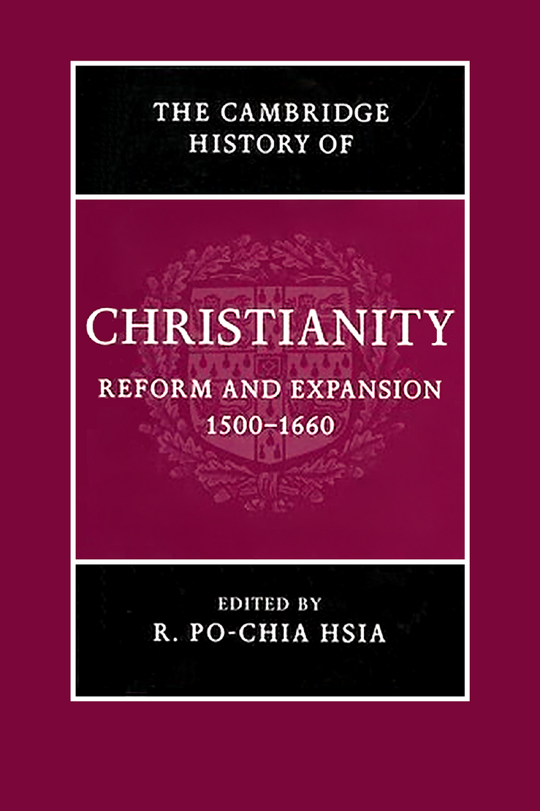
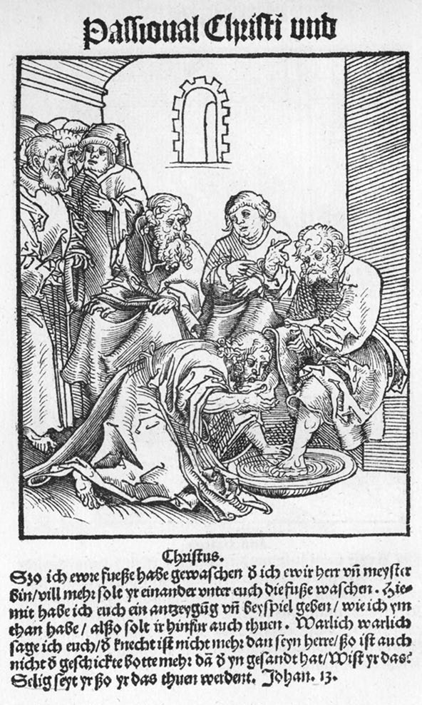
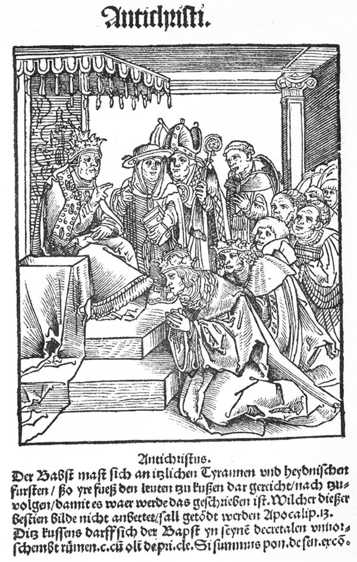
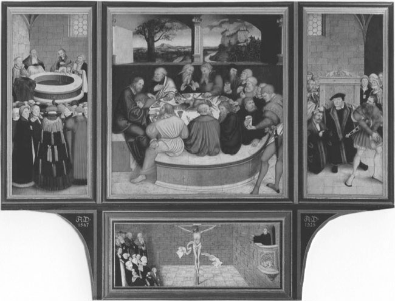
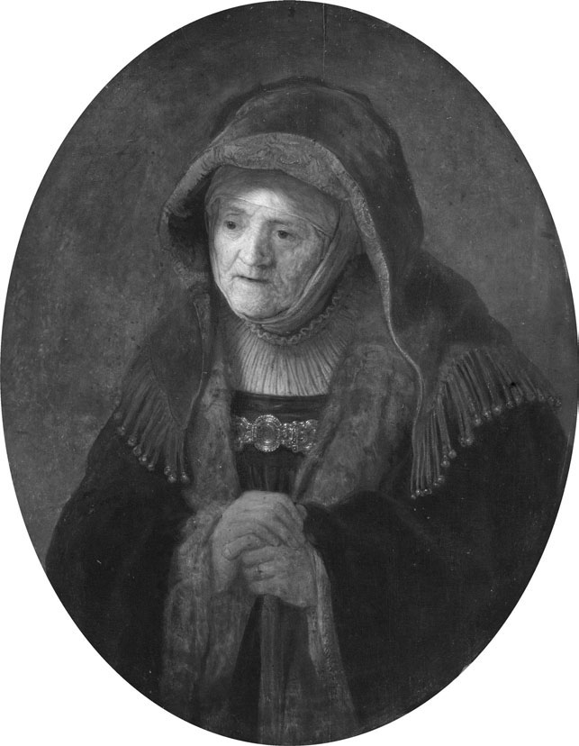
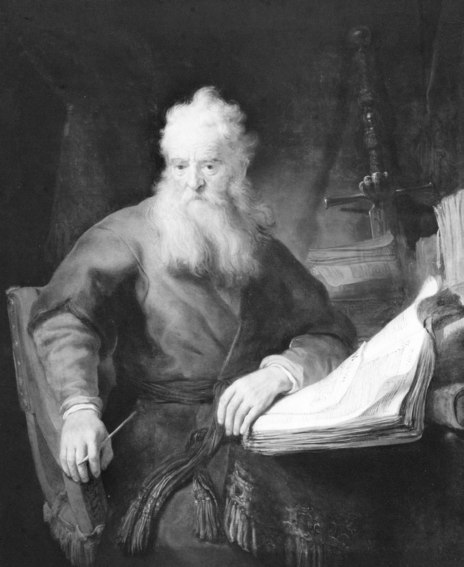
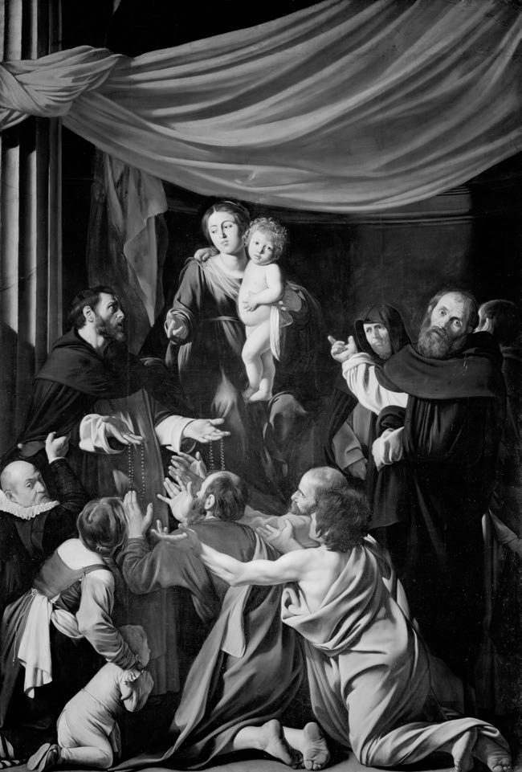
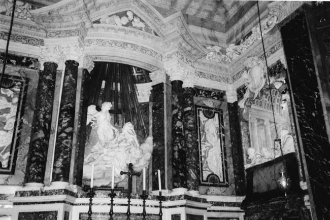
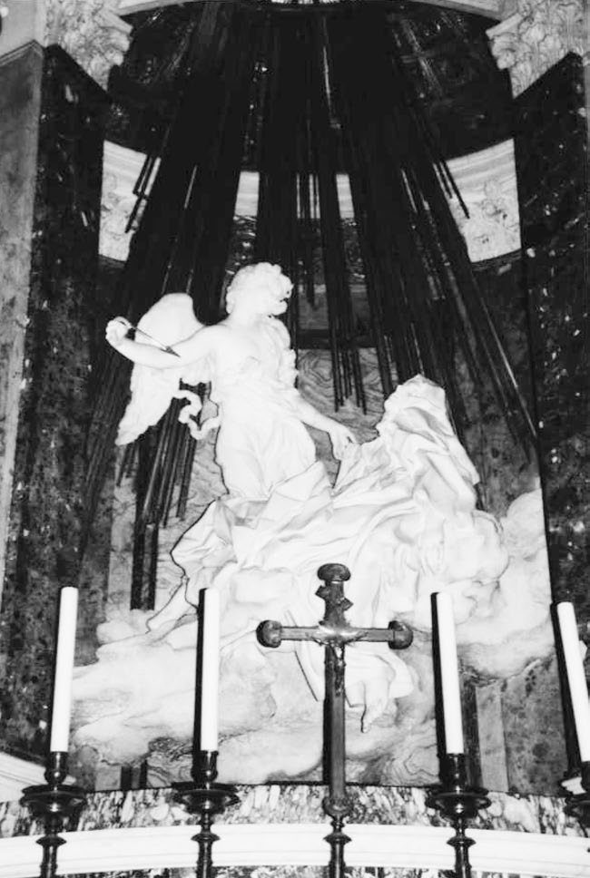
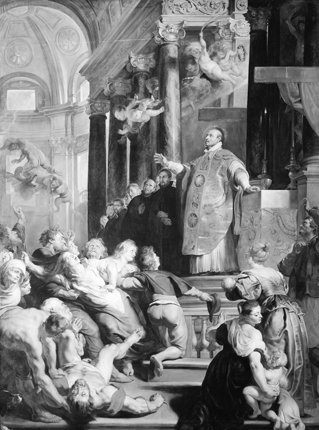

# 剑桥基督教史 第六卷：改革与扩张：1500—1660

编者：夏伯嘉（R. Po-chia Hsia）

原书2007年出版。全卷已译完，包含卷首资料、编者序、大事年表、六编、30章、脚注、参考书目与索引。已完成一致性校订与重点复核；本轮第13—26章已逐页对照原文并恢复完整表达，尚未经独立专业逐句精校。原书页码与PDF页码均保留，便于对照。

- [卷首资料](#pdf-001)
- [编者序](#pdf-016)
- [大事年表](#pdf-018)
- [第一编 路德与神圣罗马帝国](#pdf-024)
- [改革者马丁·路德](#pdf-026)
- [新教在神圣罗马帝国的兴起与巩固：至1600年](#pdf-043)
- [激进宗教改革](#pdf-060)
- [17世纪的路德宗](#pdf-079)
- [第二编 第二次宗教改革](#pdf-096)
- [共同体宗教改革：慈运理、路德与神圣罗马帝国南部](#pdf-098)
- [日内瓦的加尔文宗教改革](#pdf-113)
- [改革宗基督教的神学与礼仪](#pdf-127)
- [新教扩张的第二波](#pdf-148)
- [第三编 天主教更新](#pdf-166)
- [重新界定天主教：特伦托及其后](#pdf-168)
- [新的男性修会](#pdf-185)
- [女性圣德：1500—1660年](#pdf-203)
- [特伦托改革后的敬拜与圣徒崇敬](#pdf-224)
- [第四编 化解宗派冲突](#pdf-248)
- [没有和谐的和平：宗教宽容的理论与实践](#pdf-250)
- [推行教会与社会纪律](#pdf-267)
- [迫害与殉道](#pdf-284)
- [欧洲近代早期地中海地区的宗教裁判所](#pdf-306)
- [宗教会谈与宽容](#pdf-325)
- [西方基督教与东正教](#pdf-344)
- [第五编 宗教、社会与文化](#pdf-366)
- [宗教改革与视觉艺术](#pdf-368)
- [近代早期基督教的仪式](#pdf-394)
- [音乐与宗教变迁](#pdf-409)
- [恶魔学：1500—1660年](#pdf-429)
- [科学与宗教](#pdf-448)
- [新的教士群体](#pdf-467)
- [妇女与宗教变迁](#pdf-488)
- [第六编 基督教与其他信仰](#pdf-506)
- [基督教与犹太教](#pdf-508)
- [安第斯基督教诸形态的本土化](#pdf-527)
- [伊斯兰教与东正教之间：东南欧的新教徒与天主教徒](#pdf-559)
- [由中国人塑造的基督教](#pdf-581)
- [对印度教与佛教的接受](#pdf-600)
- [参考书目](#pdf-621)
- [索引](#pdf-736)

---

# 卷首资料

<!-- PDF page 1; original page unnumbered -->

## 剑桥基督教史

### 第六卷 改革与扩张：1500—1660年

夏伯嘉（R. Po-chia Hsia）编

<!-- PDF page 2; original page unnumbered -->

## 改革与扩张，1500—1660年

这部权威著作，叙述了从新教宗教改革前夕，到天主教改革鼎盛时期的基督教历史。除深入讨论16世纪各类改革运动的政治与神学外，本书还详尽考察永久分裂对拉丁基督教世界的影响、天主教的回应，以及这种分裂如何影响东正教诸教会的发展。这个全面而具有比较性的综览，涵盖拉丁基督教地区的社会、政治、神学、礼仪、修会和艺术史。来自不同国家的作者，合撰三十章，将研究范围扩展到欧洲与非欧洲世界中，基督教和非基督教宗教——犹太教、印度教与佛教——之间的关系。

夏伯嘉是美国宾夕法尼亚州立大学埃德温·厄尔·斯帕克斯历史学与宗教学教授。著作众多，包括 *The World of Catholic Renewal 1540–1770*，第2版（2005）。

<!-- PDF page 3; original page unnumbered -->

<!-- 原书空白页。 -->

<!-- PDF page 4; original page unnumbered -->

## 剑桥基督教史丛书

《剑桥基督教史》按时间顺序，全面叙述基督教从起源直到今日，在神学、思想、社会、政治、区域和全球等各方面的发展。每一卷本身，都对相应时代的学术研究，作出实质贡献；全套历史，则构成一部重要的学术参考著作。本丛书力图提供全球视野，远不只是一部西欧基督教及其分支的历史。东方与科普特基督教，自早期起便得到充分考虑；在较晚时期，非洲、远东、新大陆、南亚，以及其他非欧洲地区的基督教发展，也获得应有的论述。各卷涵盖民众虔敬和基督教信仰的非正式表达，并在广阔文化背景中，考察基督徒形成、敬拜和虔敬生活的社会学问题。基督教与其他主要信仰的关系，也始终受到关注。这部历史，将为学者与学生，提供极为宝贵的资源。

### 各卷目录

| 卷名 | 编者 |
|---|---|
| 起源至君士坦丁 | 玛格丽特·M. 米切尔（Margaret M. Mitchell）、弗朗西丝·M. 扬（Frances M. Young） |
| 君士坦丁至约600年 | 奥古斯丁·卡西代（Augustine Casiday）、弗雷德里克·W. 诺里斯（Frederick W. Norris） |
| 中世纪早期基督教，约600—约1100年 | 托马斯·诺布尔（Thomas Noble）、朱莉娅·史密斯（Julia Smith） |
| 西欧基督教，约1100—约1500年 | 米里·鲁宾（Miri Rubin）、沃尔特·西蒙斯（Walter Simons；本页原印Walter Simon） |
| 东方基督教 | 迈克尔·安戈尔德（Michael Angold） |
| 改革与扩张，1500—1660年 | 夏伯嘉（Ronnie Po-chia Hsia） |
| 启蒙、复兴与革命，1660—1815年 | 斯图尔特·J. 布朗（Stewart J. Brown）、蒂莫西·塔克特（Timothy Tackett） |
| 世界基督教，约1815—1914年 | 布赖恩·斯坦利（Brian Stanley）、谢里登·吉利（Sheridan Gilley） |
| 世界基督教，约1914—约2000年 | 休·麦克劳德（Hugh McLeod） |

<!-- PDF page 5; original page unnumbered -->

<!-- 原书空白页。 -->

<!-- PDF page 6; original page unnumbered -->

## 剑桥基督教史

### 第六卷

### 改革与扩张，1500—1660年

夏伯嘉编

<!-- PDF page 7; original page unnumbered -->

## 版权与出版资料

剑桥大学出版社

剑桥、纽约、墨尔本、马德里、开普敦、新加坡、圣保罗

Cambridge University Press, The Edinburgh Building, Cambridge CB2 8RU, UK

美国版由剑桥大学出版社纽约分社出版。

出版社网站：www.cambridge.org；本书信息：www.cambridge.org/9780521811620。

© 剑桥大学出版社，2007年。

本出版物受版权保护。除法定例外，以及有关集体许可协议规定的情形外，未经剑桥大学出版社书面许可，不得复制本书任何部分。

2007年初版。在英国剑桥大学印刷厂印制。

英国图书馆备有本书的编目记录。

ISBN：978-0-521-81162-0，精装本。

剑桥大学出版社不对本出版物所提及的外部或第三方网站网址的持续有效性和准确性负责，也不保证这些网站的内容现在或将来仍然准确、适当。

<!-- PDF page 8; original page vii -->

## 目录

以下页码沿用英文原书，不是中文排版页码。

- 插图目录：xi
- 作者简介：xii
- 编者序：xv
- 大事年表：xvii

### 第一编 路德与神圣罗马帝国

| 章 | 标题 | 作者 | 原书页码 |
|---|---|---|---|
| 1 | 改革者马丁·路德 | 斯科特·亨德里克斯 | 3 |
| 2 | 新教在神圣罗马帝国的兴起与巩固：至1600年 | 托马斯·A. 布雷迪 | 20 |
| 3 | 激进宗教改革 | R. 埃米特·麦克劳克林 | 37 |
| 4 | 17世纪的路德宗 | 哈特穆特·莱曼 | 56 |

### 第二编 第二次宗教改革

| 章 | 标题 | 作者 | 原书页码 |
|---|---|---|---|
| 5 | 共同体宗教改革：慈运理、路德与神圣罗马帝国南部 | 彼得·布利克勒 | 75 |

<!-- PDF page 9; original page viii -->

| 章 | 标题 | 作者 | 原书页码 |
|---|---|---|---|
| 6 | 日内瓦的加尔文宗教改革 | 罗伯特·M. 金登 | 90 |
| 7 | 改革宗基督教的神学与礼仪 | 马克·格林格拉斯 | 104 |
| 8 | 新教扩张的第二波 | 菲利普·本尼迪克特 | 125 |

### 第三编 天主教更新

| 章 | 标题 | 作者 | 原书页码 |
|---|---|---|---|
| 9 | 重新界定天主教：特伦托及其后 | 罗伯特·比雷利，耶稣会士 | 145 |
| 10 | 新的男性修会 | 约翰·帕特里克·唐纳利，耶稣会士 | 162 |
| 11 | 女性圣德：1500—1660年 | 加布里埃拉·扎里 | 180 |
| 12 | 特伦托改革后的敬拜与圣徒崇敬 | 西蒙·迪奇菲尔德 | 201 |

### 第四编 化解宗派冲突

| 章 | 标题 | 作者 | 原书页码 |
|---|---|---|---|
| 13 | 没有和谐的和平：宗教宽容的理论与实践 | 尼科莱特·毛特 | 227 |
| 14 | 推行教会与社会纪律 | 乌特·洛茨—霍伊曼 | 244 |
| 15 | 迫害与殉道 | 布拉德·格雷戈里 | 261 |
| 16 | 欧洲近代早期地中海地区的宗教裁判所 | 威廉·蒙特 | 283 |

<!-- PDF page 10; original page ix -->

| 章 | 标题 | 作者 | 原书页码 |
|---|---|---|---|
| 17 | 宗教会谈与宽容 | 奥利维耶·克里斯坦 | 302 |
| 18 | 西方基督教与东正教 | 米哈伊尔·V. 德米特里耶夫 | 321 |

### 第五编 宗教、社会与文化

| 章 | 标题 | 作者 | 原书页码 |
|---|---|---|---|
| 19 | 宗教改革与视觉艺术 | 李·帕尔默·万德尔 | 345 |
| 20 | 近代早期基督教的仪式 | 苏珊·C. 卡兰特—纳恩 | 371 |
| 21 | 音乐与宗教变迁 | 亚历山大·J. 费舍尔 | 386 |
| 22 | 恶魔学：1500—1660年 | 沃尔夫冈·贝林格 | 406 |
| 23 | 科学与宗教 | 安·布莱尔 | 425 |
| 24 | 新的教士群体 | 路易泽·朔恩—许特 | 444 |
| 25 | 妇女与宗教变迁 | 梅里·威斯纳—汉克斯 | 465 |

### 第六编 基督教与其他信仰

| 章 | 标题 | 作者 | 原书页码 |
|---|---|---|---|
| 26 | 基督教与犹太教 | 米里亚姆·博迪安 | 485 |
| 27 | 安第斯基督教诸形态的本土化 | 肯尼思·米尔斯 | 504 |

<!-- PDF page 11; original page x -->

| 章 | 标题 | 作者 | 原书页码 |
|---|---|---|---|
| 28 | 伊斯兰教与东正教之间：东南欧的新教徒与天主教徒 | 伊什特万·G. 托特 | 536 |
| 29 | 由中国人塑造的基督教 | 钟鸣旦 | 558 |
| 30 | 对印度教与佛教的接受 | 伊内斯·G. 茹帕诺夫、夏伯嘉 | 577 |

- 参考书目：598
- 索引：713

<!-- PDF page 12; original page xi -->

## 插图目录

以下为原书页码。

| 图号 | 图题 | 原书页码 |
|---|---|---|
| 1 | 老卢卡斯·克拉纳赫，《基督与敌基督受难对照》（*Passional Christi und Antichristi*，1521） | 356 |
| 2 | 老卢卡斯·克拉纳赫，《宗教改革祭坛画》，维滕贝格（1547） | 359 |
| 3 | 伦勃朗·哈尔门松·范·赖恩，《圣安娜》（1639），维也纳艺术史博物馆 | 361 |
| 4 | 伦勃朗·哈尔门松·范·赖恩，《圣保罗》（1633？），维也纳艺术史博物馆 | 362 |
| 5 | 米开朗基罗·梅里西·达·卡拉瓦乔，《玫瑰经圣母》（1606／1607），维也纳艺术史博物馆 | 364 |
| 6、7 | 吉安·洛伦佐·贝尔尼尼，《圣特蕾莎的狂喜》，罗马科尔纳罗礼拜堂 | 365、366 |
| 8 | 彼得·保罗·鲁本斯，《洛约拉的圣依纳爵的奇迹》（1615／1616），维也纳艺术史博物馆 | 369 |

<!-- PDF page 13; original page xii -->

## 作者简介

以下职衔依2007年原书出版时的记载。

- **沃尔夫冈·贝林格（Wolfgang Behringer）**：德国萨尔布吕肯大学近代史教授。
- **菲利普·本尼迪克特（Philip Benedict）**：瑞士日内瓦大学教会史教授。
- **罗伯特·比雷利（Robert Bireley, SJ）**：耶稣会士，美国芝加哥洛约拉大学历史学教授。
- **安·布莱尔（Ann Blair）**：美国哈佛大学历史学教授。
- **彼得·布利克勒（Peter Blickle）**：瑞士伯尔尼大学近代史荣休教授。
- **米里亚姆·博迪安（Miriam Bodiam）**：美国图罗学院犹太史副教授。
- **托马斯·A. 布雷迪（Thomas A. Brady）**：美国加利福尼亚大学伯克利分校萨瑟历史学荣休教授。
- **奥利维耶·克里斯坦（Oliver Christin）**：法国里昂第二大学近代史教授。
- **西蒙·迪奇菲尔德（Simon Ditchfield）**：英国约克大学历史学高级讲师。
- **米哈伊尔·德米特里耶夫（Mikhail Dmitriev）**：俄罗斯莫斯科国立大学历史学教授。
- **约翰·帕特里克·唐纳利（John Patrick Donnelly, SJ）**：耶稣会士，美国马凯特大学历史学教授。
- **亚历山大·J. 费舍尔（Alexander J. Fisher）**：加拿大不列颠哥伦比亚大学音乐学助理教授。
- **马克·格林格拉斯（Mark Greengrass）**：英国谢菲尔德大学历史学教授。
- **布拉德·格雷戈里（Brad Gregory）**：美国圣母大学历史学副教授。
- **斯科特·亨德里克斯（Scott Hendrix）**：美国普林斯顿神学院尼科尔斯宗教改革史教授。
- **夏伯嘉（R. Po-chia Hsia）**：美国宾夕法尼亚州立大学埃德温·厄尔·斯帕克斯历史学教授。
- **苏珊·卡兰特—纳恩（Susan Karant-Nunn）**：美国亚利桑那大学历史学教授，中世纪晚期与宗教改革研究部主任。
- **罗伯特·金登（Robert Kingdon）**：美国威斯康星大学麦迪逊分校历史学荣休教授。
- **哈特穆特·莱曼（Hartmut Lehmann）**：德国哥廷根马克斯·普朗克历史研究所荣休所长。
- **乌特·洛茨—霍伊曼（Ute Lotz-Heumann）**：任教于德国柏林洪堡大学历史学系。
- **R. 埃米特·麦克劳克林（R. Emmet McLaughlin）**：美国维拉诺瓦大学历史学教授。
- **肯尼思·米尔斯（Kenneth Mills）**：加拿大多伦多大学历史学教授。
- **威廉·蒙特（William Monter）**：美国西北大学历史学荣休教授。

<!-- PDF page 14; original page xiii -->

- **尼科莱特·毛特（Nicolette Mout）**：荷兰莱顿大学近代史与中欧研究教授。
- **路易泽·朔恩—许特（Luise Schorn-Schütte）**：德国法兰克福大学近代史教授。
- **钟鸣旦（Nicolas Standaert）**：比利时鲁汶天主教大学汉学教授。
- **伊什特万·G. 托特（István G. Tóth）**：已故，匈牙利中欧大学历史学副教授。
- **李·帕尔默·万德尔（Lee Palmer Wandel）**：美国威斯康星大学麦迪逊分校历史学教授。
- **梅里·威斯纳—汉克斯（Merry Wiesner-Hanks）**：美国威斯康星大学密尔沃基分校历史学教授。
- **加布里埃拉·扎里（Gabriella Zarri）**：意大利佛罗伦萨大学历史学教授。
- **伊内斯·G. 茹帕诺夫（Ines G. Županov）**：法国国家科学研究中心研究员。

<!-- PDF page 15; original page unnumbered -->

<!-- 原书空白页。 -->

## 译校说明

- 原书目录及本页作者简介，将米里亚姆的姓氏印作Bodiam；保留这一原文拼写，以便核对。
- 第17章作者在原书目录作Olivier Christin，作者简介作Oliver Christin；中文均用“奥利维耶·克里斯坦”，外文按各处原载保留。

---

# 编者序

<!-- PDF page 16; original page xv -->

在构思本卷的结构时，我力图实现三个目标。本卷所论，是新教宗教改革及天主教回应的关键时期。第一个目标，是对宗教改革史和宗派冲突史中，已成为经典论题的事件与问题，作出权威而平衡的阐释。第二个目标，是呈现超越新教与天主教分野的研究主题；这些社会史和文化史主题，为近一代历史研究注入了活力。第三个目标，是把基督教史放在更广阔的世界背景中；为此，我约请作者撰文，阐明基督教欧洲与非基督教世界之间，以及基督教传教活动与犹太教、美洲原住民宗教、伊斯兰教、印度教和佛教之间的关系。

三十篇论文分为六编，对应上述三个目标。第一、二编的十二篇论文，涵盖宗教改革研究的经典论题（*loci communes*）：主要的新教改革者、政治与福音运动的互动，以及重洗派和激进改革。〔译注：原序在此写“第一、二编的十二篇”，但原书目录中，这两编共八章；十二章是前三编的总数。译文保留原序的说法。〕第三编专论天主教的回应，既包括早于新教挑战的更新动力，也包括反宗教改革的具体发展。第四编的六篇论文，从宗派冲突的核心出发，先分析宽容、教会纪律、殉道、宗教裁判所和宗教会谈，再越过拉丁基督教世界的边界，研究宗派对抗对东方正教会的影响。第五编涵盖近几十年研究中，宗教社会史与文化史的核心主题，关注宗教变迁与艺术、礼仪、音乐、科学和恶魔学历史的关系，同时从社会学与性别角度，研究教士和妇女。最后一编，将视野扩展到非基督教世界。除了考察欧洲内部基督教各教会与犹太教之间的新关系，第六编五篇论文还<!-- PDF page 17; original page xvi -->描述了宗教接触的前沿：基督教欧洲与穆斯林欧洲之间，“灵性征服”与美洲原住民宗教之间，以及基督教传教士与印度、中国主要宗教之间的接触。

作为一种世界宗教，基督教及其历史，在国际学术界得到广泛研究。本卷三十位作者，具有美国、比利时、英国、加拿大、中国、克罗地亚、荷兰、法国、德国、匈牙利、意大利和俄罗斯背景，在十来个国家工作。他们将不同训练和研究方法，运用于各自论文，展示了这一研究领域，在史料与问题方面的高度多样性。

---

# 大事年表

以下按原书的顺序与纪年翻译；部分条目有重复年份、倒置顺序或值得复核的纪年、专名，未据外部年表重新编排。它们是原书的历史梗概，不是译者另行核定的年表。

<!-- PDF page 18; original page xvii -->

- **1492**：在斐迪南和伊莎贝拉治下，西班牙收复失地运动完成；格拉纳达向基督教军队投降。
- **1503**：教皇亚历山大六世去世。
- **1508**：马克西米连一世当选神圣罗马皇帝。
- **1510**：路德前往罗马。
- **1513**：教皇儒略二世去世。
- **1517**：马丁·路德在维滕贝格发表《九十五条论纲》。
- **1519**：皇帝马克西米连一世去世；查理五世当选神圣罗马皇帝。
- **1519**：马丁·路德与罗马教会神学家约翰内斯·埃克，在莱比锡辩论。
- **1520**：古斯塔夫·瓦萨领导瑞典贵族，反抗丹麦统治。
- **1520**：路德发表《致德意志基督教贵族书》《教会被掳于巴比伦》和《论基督徒的自由》。
- **1520—1521**：教皇通过《主啊，求你兴起》（*Exsurge Domine*）和《Decet》两道诏书，绝罚路德。
- **1521**：沃尔姆斯帝国议会召开；《沃尔姆斯敕令》宣布路德受诅咒，并谴责其教导。
- **1521**：教皇良十世去世。
- **1523**：古斯塔夫·瓦萨加冕，成为瑞典及芬兰领地的国王古斯塔夫一世。
- **1523**：腓特烈一世加冕，成为丹麦及挪威领地的国王。
- **1523**：教皇哈德良六世去世。
- **1523**：帝国城市斯特拉斯堡，在马丁·布策尔领导下，开始宗教改革。
- **1524**：德国南部爆发一系列农民起义中的第一次。
- **1524**：首批戴蒂尼会，即戴蒂常规教士会成员，获教皇认可。
- **1524**：《马尔默条约》正式解散1397年建立的卡尔马联盟，终结丹麦、挪威和瑞典的政治统一。
- **1525—1526**：德国农民遭到镇压。
- **1526**：威廉·廷代尔的《新约》英译本初印本，在伦敦被焚毁。
- **1526**：萨克森和黑森的新教诸侯之间，建立哥达同盟。
- **1527**：帝国军队洗劫罗马。
- **1527**：丹麦国王腓特烈一世，在欧登塞议会上，给予丹麦路德宗信徒宗教自由。

<!-- PDF page 19; original page xviii -->

- **1527**：韦斯特纳斯（*Västernås*，依原书拼写）议会，批准瑞典教会改革。
- **1529**：马尔堡会谈，试图统一瑞士和德国的宗教改革，未能成功。
- **1529**：福音派诸侯在施派尔帝国议会上，针对帝国反路德宗政策，发表正式“抗议”。
- **1529**：吕贝克的福音派革命，驱逐市议会，并选举于尔根·武伦韦弗为市长。
- **1529**：帝国军队在维也纳击败土耳其军队。
- **1529**：重洗派先知约翰内斯·胡布迈尔（*Johannes Hubmaier*，依原书姓名），在维也纳以异端罪被烧死。
- **1530**：奥格斯堡帝国议会，试图使路德宗诸侯、城市与皇帝查理五世和解；路德宗代表发表《奥格斯堡信纲》，界定新教信仰。
- **1531**：瑞士的新教州与天主教州之间，爆发内战。
- **1531**：施马尔卡尔登同盟成立，在路德宗帝国城市和诸侯间，建立应对皇帝进攻的防御联盟。
- **1531**：路德发表《警告德国人民》。
- **1530**：当选皇帝查理五世加冕，成为最后一位正式加冕的神圣罗马皇帝。
- **1531**：乌尔里希·慈运理在卡佩尔战役中阵亡；瑞士内战以天主教胜利结束。
- **1531**：里斯本地震造成五万人死亡。
- **1533**：教皇批准巴尔纳伯会，即圣保禄常规教士会。
- **1534**：《至尊法案》确立亨利八世为英格兰教会的正式首领。
- **1534**：重洗派的明斯特王国建立；原先的主教兼诸侯弗朗茨·冯·瓦尔德克，围攻该城。
- **1534**：教皇克莱孟七世去世。
- **1535**：明斯特被路德宗与天主教联军攻陷。
- **1535**：托马斯·莫尔被处死。
- **1536**：约翰·加尔文开始在日内瓦传道。
- **1536**：教皇批准嘉布遣会会宪。
- **1536**：《维滕贝格协定》，尝试统一德国与瑞士的改革传统。
- **1536**：鹿特丹的德西德里乌斯·伊拉斯谟去世。
- **1536**：威廉·廷代尔被处死。
- **1537**：《丹麦教会规章》，确立路德宗为丹麦教会的官方宗派。
- **1538**：天主教诸侯组成纽伦堡天主教同盟，以回应新教的施马尔卡尔登同盟。
- **1539**：查理五世接受《法兰克福临时协议》，同意与施马尔卡尔登同盟诸侯休战十五个月。
- **1540**：教皇正式承认耶稣会。
- **1540**：教皇正式承认索马斯卡会，即索马斯卡常规教士会。
- **1540**：葡萄牙首次举行伴随异端判刑的信仰宣判仪式（*auto-da-fé*）。

<!-- PDF page 20; original page xix -->

- **1540—1541**：沃尔姆斯和雷根斯堡的宗教会谈，未能调和帝国内新教与天主教神学家的宗派差异。
- **1540—1541**：雷根斯堡帝国议会，未能使帝国各等级实现宗教和解；查理五世被迫允许新教徒进入帝国最高法院。
- **1541**：日内瓦市议会接受加尔文的《教会规章》，设立教会法庭，以在城内执行道德纪律。
- **1542**：保禄三世重组宗教裁判所。
- **1544**：教皇正式承认圣乌尔苏拉会。
- **1545**：全教会大公会议在特伦托开幕。
- **1546**：路德去世。
- **1546—1547**：施马尔卡尔登战争。
- **1547**：查理五世在米尔贝格战役中，击败路德宗诸侯。
- **1547**：全教会大公会议迁往博洛尼亚。
- **1547—1548**：查理五世在奥格斯堡帝国议会上，向新教帝国等级强加《临时敕令》。
- **1548**：大公会议第一阶段结束。
- **1549**：教皇保禄三世去世。
- **1551**：斯特拉斯堡改革者马丁·布策尔去世。
- **1551**：耶稣会在罗马创办罗马学院（*Collegium Romanum*）。
- **1551—1552**：大公会议第二阶段，在特伦托重新召开。
- **1552**：方济各·沙勿略在澳门去世。〔译注：地名依原书的Macao保留。〕
- **1552**：教皇诏书，在罗马设立日耳曼学院（*Collegium Germanicum*）。
- **1555**：《奥格斯堡宗教和约》，正式承认路德宗为神圣罗马帝国的合法宗派之一。
- **1555**：教皇儒略三世去世。
- **1556**：依纳爵·罗耀拉去世。
- **1558**：皇帝查理五世去世；斐迪南一世当选神圣罗马皇帝。
- **1558**：英格兰玛丽一世去世，恢复英格兰天主教的努力结束。
- **1559**：耶稣会首次在日本传教。
- **1560**：新教《信仰告白》，确立长老宗为苏格兰的官方宗派。
- **1560**：瑞典国王古斯塔夫一世去世。
- **1560**：德国改革者、《奥格斯堡信纲》作者菲利普·梅兰希通去世。
- **1562—1563**：特伦托大公会议第三阶段，也是最后阶段。
- **1564**：特伦托会议法令，在腓力二世统治的西班牙领地颁布。
- **1564**：皇帝斐迪南一世去世；马克西米连二世成为神圣罗马皇帝。
- **1565**：总主教嘉禄·鲍荣茂，开始在米兰进行改革。
- **1565**：西班牙在菲律宾建立永久定居点。
- **1565**：教皇庇护四世去世。
- **1570**：墨西哥和秘鲁设立宗教裁判所。

<!-- PDF page 21; original page xx -->

- **1571**：设立禁书目录部，监督书籍生产。
- **1571**：新教《教会规章》，正式确立瑞典的路德宗国教会。
- **1572**：法国加尔文宗信徒，在圣巴托洛缪瞻礼日遭到屠杀。
- **1572**：教皇庇护五世去世。
- **1572**：教皇批准医院兄弟会共同体。
- **1572**：英格兰第一个长老会成立，显示长老宗在英格兰的影响日益增长。
- **1575**：教皇正式承认斐理伯·内里所创立的奥拉托利会。
- **1576**：皇帝马克西米连二世去世；鲁道夫二世即位。
- **1577**：伊丽莎白时代的英格兰，开始一波处死天主教传教士的行动。
- **1578**：嘉禄·鲍荣茂创立圣安博献身会。
- **1579**：新教的联合省成立。
- **1580**：耶稣会在中国设立传教机构。
- **1580**：路德宗关于教义的协商，以《协同书》告成，为路德宗教义提供规范化表述。
- **1581**：联合省首次颁布反天主教法令。
- **1584**：日本天主教使节出访欧洲。
- **1585**：教皇格列高利十三世去世。
- **1588**：教皇政府重组，设立分别负责世俗与属灵事务的枢机部会。
- **1588**：教皇批准方济各·卡拉乔洛创立的小常规教士会，亦称卡拉乔洛会。
- **1590**：教皇西斯笃五世去世。
- **1591**：教皇批准嘉民会，即病人之仆常规教士会。
- **1562—1598**：法国宗教战争。〔本条在原书中列于1591年之后，顺序照录。〕
- **同一原书条目之后，未另列年份**：教皇正式承认赤足加尔默罗会。
- **1595**：斐理伯·内里去世。
- **1595**：教皇批准天主之母常规教士会（*Matritani*）。
- **1595**：教皇批准法国教理会。
- **1598**：《南特敕令》确立对法国新教徒的宽容。
- **1605**：教皇克莱孟八世去世。
- **1610**：嘉禄·鲍荣茂获封圣。
- **1611**：法国奥拉托利会共同体成立。
- **1612**：皇帝鲁道夫二世去世；马蒂亚斯成为神圣罗马皇帝。
- **1614**：日本政府开始压制基督教。
- **1615**：法国教士等级，正式承认特伦托会议法令。
- **1617**：教皇正式承认虔敬学校贫穷常规教士会，即比亚里斯特会。
- **1619**：嘉布遣会，即小兄弟嘉布遣会，成为完全独立的修会。
- **1619**：皇帝马蒂亚斯去世；斐迪南二世即位。
- **1621**：教皇保禄五世去世。

<!-- PDF page 22; original page xxi -->

- **1622**：依纳爵·罗耀拉、方济各·沙勿略、阿维拉的特蕾莎，以及斐理伯·内里，获封为天主教更新时期的新圣人。
- **1624—1629**：在哈布斯堡征服的波希米亚，镇压新教徒。
- **1626**：罗马新圣伯多禄大殿祝圣。
- **1628**：英格兰查理一世颁布《王室宣言》，要求教会规章提交王室批准。
- **1632**：教皇正式承认法国遣使会，即传教会。
- **1637**：皇帝斐迪南二世去世；斐迪南三世当选。
- **1640**：查理一世召集长期议会。
- **1641**：爱尔兰反英格兰、反新教的起义，被奥利弗·克伦威尔镇压。〔译注：原书以1641年起义为本条年份，合并叙述其后的镇压，译文照录，未将整句解释为均发生于同一年。〕
- **1642**：英格兰内战开始。
- **1643**：《圣徒行传》（*Acta sanctorum*）首批卷册出版；这是耶稣会主导的一项工作，旨在规范并记录天主教圣徒生平。
- **1644**：教皇乌尔班八世去世。
- **1648**：《威斯特伐利亚和约》结束三十年战争，并更新《奥格斯堡宗教和约》中，关于帝国宗派共存的条款。
- **1649**：英格兰查理一世被处死。
- **1653**：教皇谴责科内利乌斯·扬森的《奥古斯丁》（*Augustinus*）。
- **1653**：奥利弗·克伦威尔就任英格兰护国公。
- **1655**：教皇依诺增爵十世去世。
- **1657**：皇帝斐迪南三世去世。
- **1658**：利奥波德一世成为神圣罗马皇帝。
- **1658**：奥利弗·克伦威尔去世；其子理查德继任护国公。
- **1660**：查理二世进入伦敦；英格兰护国公政体结束。
- **1664**：教皇批准法国耶稣与玛利亚会。
- **1685**：《南特敕令》被撤销。

<!-- PDF page 23; original page unnumbered -->

<!-- 原书空白页。 -->

---

# 第一编 路德与神圣罗马帝国

<!-- PDF page 24; original page 1 -->

<!-- 原书分隔页题名，已体现在本节标题中。 -->

<!-- PDF page 25; original page 2 -->

<!-- 原书空白页，原页码按连续页序推定。 -->

---

# 第1章 改革者马丁·路德

**作者：斯科特·亨德里克斯（Scott Hendrix）**

<!-- PDF page 26; original page 3 -->

## 路德与改革

新教宗教改革的催化者，是德国奥古斯丁会修士兼大学教授马丁·路德（1483—1546）。在中世纪晚期的教会中，要求更新的呼声高亢而持久；修会、教会生活，以及与约翰·威克里夫（1384—1443）和扬·胡斯（1369—1415）等人的名字相联系的民众运动，也已实行了一些改革。与那些激烈的声音相比，马丁·路德在1517年邀请学者辩论赎罪券效力的呼吁，显得颇为温和。诚然，路德此前已经在讲道中反对赎罪券的做法和教士的怠职，但若把这位年轻的圣经学教授在传布《九十五条论纲》之前，就称作教会改革者，未免言过其实。在1517年那份著名论纲中，改革整个教会，是路德最没有想到的事。

然而，正因为这些论纲引发了他与罗马教廷的冲突，路德作为第一位新教改革者而载入史册。这场争论并非路德主动寻求的；但争论一旦开始，他也没有退缩。在1521年遭到绝罚以前的三年间，路德逐渐形成了改革者的身份和自觉，并得到同僚与政治力量的支持，成为德国福音运动的领袖。不过，即使在那时，他也不是一个按照预定方案重塑教会的改革者。路德及其追随者受到绝罚之后，欧洲基督教确实开始了重组，但无论路德还是他的同僚，都无法预见这一过程的结果。路德的改革议程，原本追求的是另一个完全不同的目标。

一旦投身改革，路德便致力于神学与虔敬生活两方面的更新。神学改革是在维滕贝格大学推进的。这所大学由萨克森选侯智者腓特烈（1463—1525）创立，<!-- PDF page 27; original page 4 -->到马丁·路德1512年加入神学院时，才成立十年。不过，大学已经吸引了一批有才干的学者，既代表中世纪晚期思想的各个学派，也代表人文主义对经院神学的批评。受聘担任圣经神学教授的路德，同情那些主张以专研《圣经》和教父，取代研习亚里士多德与经院学者的同僚。[^p027-1]与此同时，他在授课和学术辩论中，展开了对经院神学的批判。在《九十五条论纲》问世前不到两个月，他为1517年9月的一场辩论准备了另一组论题，严厉批评自己受教育时所学的唯名论神学。[^p027-2]

路德把虔敬生活的改革，理解为一个基督教化的过程；他在讲道、《九十五条论纲》，以及自1519年起陆续定期出版的德文小册子中，倡导这一过程。在他看来，中世纪晚期有些做法，例如出售声称无须痛悔便可确保罪得赦免的赎罪券，不仅不当，而且不合基督教信仰。“那些教导说，打算花钱把灵魂从炼狱赎出，或购买告解特权的人，不必先行痛悔的，是在宣讲不合基督教信仰的教义。”[^p027-3]路德为在圣餐中向平信徒同时分送饼与酒的做法辩护，要求人们在走近祭坛之前，先凭信与爱成为“真正的基督徒”：“天哪，倘若这个观念真正贯彻，如今成千上万来领圣餐的人，恐怕连几百也剩不下……这样，我们终于会成为一群真正的基督徒；而眼下，我们几乎全是异教徒，只在名义上是基督徒。”[^p027-4]神学的更新，与宗教实践和虔敬生活的改革相辅而行；两者都受到路德这一认识的塑造：中世纪晚期的宗教，应当比以往更合乎基督教信仰。这一认识，植根于他成长环境中强烈的宗教气氛。

## 改革的根源

### 童年与家庭

如今的传记作者强调，就路德生活的时代而言，他的童年并无特别之处。[^p027-5]父母双方都严格管教他，<!-- PDF page 28; original page 5 -->但他也受惠于父母的愿望：希望他得到适当的教育和宗教训练。我们对路德与父母的关系所知甚少；然而，当汉斯于1530年、玛格蕾特于1531年去世时，路德深感悲痛，并表达了对两人的感激。得知父亲去世时，他坦言，自己很少像那一刻那样憎恨死亡；他承认，上帝通过父亲，赐给了他如今的一切身份与所有。[^p028-6]

埃里克·埃里克森在《青年路德》中，却描绘出一幅截然不同的图景。在埃里克森看来，异常严厉的教养，使路德与父亲疏离，并引发身份危机；这场危机又导致他反抗教皇制，并使他背负病态倾向。[^p028-7]历史学家否定了埃里克森的解释，因为其所依据的证据并不可靠。不过，路德与父亲的关系，确实对他的发展产生了积极影响。汉斯·路德反对马丁入修道院的决定，造成了父子之间的裂痕；但到1521年，这一裂痕已经弥合，而且这种弥合，赋予了路德从事改革者这一新使命的正当感。[^p028-8]路德在将《论修道誓愿》（1521）献给父亲的书信中，把自己脱离修道院和教皇制，描述为解放，而非叛逆。他承认，父亲当初反对他做修士是对的；但他宣称，基督如今已经完成父亲未能完成的事：把他从经院神学、修道院，最终从教皇制中释放出来。然而，获得释放之后，路德又觉得自己有义务领导一场运动，因为在他看来，基督已经将这场运动交在他手中。他写信对父亲说：“我盼望，[基督]从你身边夺走一个儿子，是为了借着我，开始帮助他其他许多儿女；我深信，你不仅会心甘情愿地允许此事——这也是你应当做的——而且还会为此大大欢喜！”[^p028-9]

路德早年的学校教育，也播下了日后改革使命的种子；尤其是1497—1501年间，他在母亲亲属居住的艾森纳赫求学的那几年。[^p028-10]路德住在海因茨·沙尔贝家中；沙尔贝是当地有声望的市民，也是方济各会修道院的资助者。他就读于圣乔治堂区学校，并与圣母教会基金机构的司铎约翰内斯·布劳恩结为朋友。布劳恩关怀学生，路德后来还与他通信。这些交往，使路德接触到<!-- PDF page 29; original page 6 -->弥漫于城镇中的中世纪晚期虔敬生活，其中包括民众对圣安妮的崇敬。它们也预示了路德一生在学术与宗教方面的走向。

### 修道院

路德在埃尔福特大学获得文科学士和硕士学位之后，于1505年夏季开始学习法律。然而，几周后，他突然改变主意，卖掉书籍，决定做修士。这个决定，可能起于一场猛烈的雷雨：路德从曼斯费尔德父母家返回埃尔福特途中，受到惊吓。他呼求圣安妮相助，并许愿说，倘若得到保护，便入修道院。他履行诺言，最后与朋友共度了一个夜晚；1505年7月17日，21岁的路德进入埃尔福特的奥古斯丁隐修会修道院。

路德此后做了近二十年修士，约占他一生中间的三分之一。直到1524年，他才最后一次脱下修士兜帽；此时距他结婚不到一年，距他受到绝罚、被宣布为神圣罗马帝国的不受法律保护者，则已超过三年。历史学家虽然认识到，对于一个深受中世纪晚期宗教熏陶的年轻人，这样的誓愿并不罕见，但路德修道经历的完整影响，只是逐渐才得到理解。传记作者历来着重于他在修道院中所受的良心疑惧。他后来回忆，自己已经尽其所能，做最好的修士；但住在修道院时，他仍怀疑，自己的痛悔是否足以平息上帝的愤怒、获得赦免。他的修会长上和导师约翰内斯·冯·施陶皮茨（1468—1524），使他得到一些宽慰。施陶皮茨是德国奥古斯丁会的总会代理，路德于1512年接替他在维滕贝格大学的职位。施陶皮茨后来辞去总会代理一职，并决定不支持新教运动，但他在人格与牧养方面，给路德留下了不可磨灭的印记。[^p029-11]

作为改革者，路德最终否定了修道制度，但修士生涯仍留下痕迹。奥古斯丁会所培养的强烈灵修精神，以及对改革的热忱，很可能比某种特定的奥古斯丁主义神学传统，对路德影响更深。[^p029-12]他将修道灵修的方法，改用来研读《圣经》，并推荐人们采用这些方法，而不是阅读他自己的著作。*Oratio、meditatio、tentatio*，即祈祷、默想、试炼：有规律地祈祷、默想经文，便能使人们在遭遇试炼<!-- PDF page 30; original page 7 -->与争论时，以《圣经》为安慰的源泉。[^p030-13]在肯定世俗生活的同时，路德也保留了修道理想中超脱尘世的因素，并敦促一切信徒如此行。在生命最后十年的《创世记》讲课中，他把作为旅人的亚伯拉罕，呈现为真正的修士，也是基督徒的榜样；基督徒需要牢记，自己长久的家乡并不在地上。[^p030-14]如今，历史学家把路德也纳入“新修道主义”的宗教改革解释之中；[^p030-15]这种解释着眼于宗教改革如何鼓励全体教士与平信徒，在世间自觉地过宗教生活。

### 学术传统

1521年，路德略带揶揄地声称，上帝之所以让他了解修道院的圣洁和学术界的智慧，就是为了不让诋毁者日后声称，他所谴责的是自己一无所知的东西。[^p030-16]路德固然否定了经院神学的许多内容，但他也接受过唯名论教师的良好训练，并且熟习奥古斯丁（354—430）的著作；在准备早期课程时，他曾查考这些著作。不过，除了路德明确反对的部分以外，学者们一直无法确切判明，支撑路德改革的神学，究竟如何受到唯名论、奥古斯丁、中世纪奥古斯丁派神学家，乃至中世纪神秘主义的塑造。对于路德神学根源的探寻，始终未能达成共识。

事实上，这位改革者的神学，吸取了上述所有传统的资源。他虽然拒绝唯名论的救恩论，但他对《圣经》权威的强调，可能便出自唯名论；而唯名论思想的圣约结构，也可能构成他将应许与信心相联系的基础。一个独立的中世纪奥古斯丁学派，至今尚未得到确认；奥伯曼声称在维滕贝格大学发现了“格里高利之路”（*via Gregorii*），即沿袭奥古斯丁会士里米尼的格里高利〔1300—1358〕的神学传统，但大多数学者并不信服。[^p030-17]尽管如此，恩典的优先性等反伯拉纠主义主题，赋予路德的思想以奥古斯丁主义色彩；他很乐于承认这一点，但并非毫无保留。在讲授《罗马书》（1515—1516）时，路德通过奥古斯丁的眼光解读保罗，并在1518年称赞他是这位使徒“最可靠的解释者”。[^p030-18]同一年，路德第二次出版<!-- PDF page 31; original page 8 -->德国神秘主义的经典《德意志神学》（*Theologia Deutsch*），并在序言中声称：“除了《圣经》和圣奥古斯丁以外，我所接触过的书，没有哪一本，比这一本让我更多认识上帝、基督、人以及万事万物。”[^p031-19]路德那句著名的“唯独十字架是我们的神学”，[^p031-20]说于他批评经院神学对盼望的定义、并拒绝中世纪神秘主义的否定神学之时。与此同时，路德又接纳神秘主义者的经验智慧，重视约翰·陶勒（1300—1361）的讲道，并在约1516年为其作批注。甚至被路德归咎为经院神学弊病根源的亚里士多德，也仍然能对他的思想作出积极贡献；在梅兰希通的指导下，维滕贝格也继续研习亚里士多德。[^p031-21]

恐怕没有人能为路德神学的形成，找到一把无可辩驳的唯一钥匙。这一神学产生于他的学术职责：解释《圣经》，要求路德调动自己受教育和亲身经历所提供的一切资源。他的神学也受益于同僚之间的交流和辩论。无论路德的改革还是神学，都不是在隔绝中产生的；即使1517年以前仍有这种可能，从那时起，路德便已成为一个宗教与政治改革运动的组成部分。

## 改革的政治

### 维滕贝格

从1512年直到1546年去世，路德一直住在大学小城维滕贝格，而且始终居住在奥古斯丁隐修会修道院的同一片建筑中。1525年，他与卡塔琳娜·冯·博拉（1499—1552）结婚时，萨克森选侯约翰将这座修道院赐给他们，作为住宅。维滕贝格之所以成为宗教改革的摇篮，只因为路德及其同僚在该大学任教，而且这座城是萨克森选侯的驻地。维滕贝格也是最早改革的政治与教会试验场。在路德避居瓦尔特堡期间（1521—1522），当地首次出现了支持改革的民众示威，路德的同僚安德烈亚斯·卡尔施塔特（1486—1540）、加布里埃尔·茨维林（1487—1558）和菲利普·梅兰希通（1497—1560），也开始实行第一批具体变革。路德虽然不赞成这些急速变革及其所引起的骚动，但卡尔施塔特提出的一项教会规章，尽管遭到选侯<!-- PDF page 32; original page 9 -->腓特烈的反对，最终仍获市议会通过。路德返回维滕贝格，接掌运动的领导，卡尔施塔特则被排挤出去；但宗教改革已经开始。选侯腓特烈虽然没有倡导改革，却允许它们进行，并继续保护路德及其大学的声誉。

### 萨克森选侯国与神圣罗马帝国

宗教改革研究长期以来，一直强调萨克森和帝国政治对德国宗教改革的重要性。作为选举皇帝的选侯之一，腓特烈能够对教皇和皇廷施加影响。这种影响，使他得以为路德争取到1521年沃尔姆斯帝国议会的陈述机会，并保护路德免受同年颁布的教皇绝罚和帝国禁令的制裁。此后，路德余生基本限于萨克森选侯国境内；只有偶尔安全地前往故乡曼斯费尔德伯国，或赴黑森参加1529年的马尔堡会谈等例外。黑森伯爵菲利普，热烈支持宗教改革。因此，路德主要通过著作、通信和代表参与改革，例如参加1540年代宗教会谈的梅兰希通，以及协助在德国北部和丹麦组织宗教改革的约翰·布根哈根（1485—1558）。在本地，路德定期讲道、授课，一篇接一篇出版论著，并与同僚共同向萨克森宫廷提供改革策略的建议。他的事业先后得到三位萨克森选侯的支持：腓特烈、他的弟弟约翰（1468—1532），以及约翰之子约翰·腓特烈一世（1503—1554）；路德的著作，也服务于他们保护和推进新教的策略。[^p032-22]

路德认为自己是一位德国改革者，尽管他对“德国先知”这个称号抱有矛盾态度。1530年，皇帝查理五世在奥格斯堡拒绝接受福音派领地提交的信仰告白之后，路德发表了《警告我亲爱的德国人民》（1531），告诫民众不要服从皇帝可能下达的命令，即拿起武器攻击新教徒。这位改革者此前曾认可服从皇帝，并支持对土耳其人进行防御战争；但1530年以后，他改变立场，主张当统治者威胁福音时，保全福音应优先于臣民对统治者的义务。他声称：“我在此寻求的不是自己的利益，而是你们德国人的得救。”[^p032-23]等到查理五世真的进攻德国新教徒、攻占维滕贝格时（1547），路德已经去世。

<!-- PDF page 33; original page 10 -->

### 教会

作为改革者，路德从未打算创立一个新教会；但若这句话意味着，他的议程只是改革中世纪教会，便会造成误导。在追求基督教化的目标时，路德思考的，并不是中世纪与现代、天主教与新教的教会之分，而是德国在教皇统治之前与之后的差别。他写道：“我所求的，无非是唤醒那些有能力、也有意愿帮助德意志民族的人，促使他们思考，如何在教皇那可悲、异教而又不合基督教信仰的统治之后，重新获得自由，重新成为基督徒。”[^p033-24]路德的议程，比教会改革更为激进。他认为，要使德国基督教化，就必须把教会从“罗马的教皇制”下释放出来。因此，路德扩展了“教会”的概念，使其等同于基督徒整体，或基督教世界，即由全体信徒——教士与平信徒——构成的共同体。这个基督教世界不依附于罗马，而包括全世界一切在信、望、爱中生活的人，无论他们身在何处。[^p033-25]因此，教会并非不可见，只是在各个信徒群体聚集敬拜之前，无从辨识。这些可见的聚会可以自行组织，但它们并不构成一个永久性的机构，因为真正的基督教世界，绝不能以效忠某个特定的教阶组织——例如罗马教廷——来界定。

与这一教会论相应，接受宗教改革的城市和领地，建立了福音派或新教教会；路德在它们的建设中发挥了重要作用。对于萨克森和其他地区，路德为突然转向福音派的堂区推荐牧师，并提出《圣经》依据，说明这些堂区有权判断其领袖的教导，进而召聘或罢免传道人。[^p033-26]罗马教会的主教不再履行督导职能，而1525年的革命又使堂区陷入混乱；于是，路德请求萨克森选侯约翰，“出于基督徒之爱……并按上帝的旨意，为了福音的益处，也为了领地内可怜基督徒的福祉”，组成巡察委员会，检查各堂区，并监督它们的整顿。[^p033-27]梅兰希通为巡察工作编写了教学、组织和牧养实践方面的指导原则，而<!-- PDF page 34; original page 11 -->路德则编写教理问答、敬拜规程和圣诗；这些材料在萨克森以外，也得到广泛使用，尽管他曾敦促牧师和官员自行编写适合本地的教理问答与教会规章。

路德支持诸侯反对起义农民，又呼吁选侯约翰监督堂区生活的重整，因此遭人指责：他出卖了民众的宗教改革，转而支持自上而下的改革。路德虽然认同平民的某些要求，并谴责统治者对他们的不公待遇，却反对以基督教正义之名使用暴力。他深信，福音不会导致叛乱，而会带来这样一个基督教世界：信心与爱的增长，将缓和不公。另一方面，1523年，路德维护堂区有权抵制罗马教会主教，以及其他历来有此任命权的赞助人所安排的教士，也不意味着他只支持地方性的宗教共同体。在他看来，必须在每一个层面，捍卫福音教导，抵抗不尊重它的权威。1525年以后，许多堂区已无法自行寻找、评估牧师；路德希望能有福音派主教承担这一职责。但既然没有，他便主张，像选侯约翰这样支持福音的统治者，可以代行主教职能，提供必要的堂区督导。这两项决定的结果，是形成了领地性和宗派性的教会；路德虽然未曾预见，却也没有谴责，因为它们似乎是唯一稳定的组织，能够借着福音教导与实践，更新基督教世界。

## 改革的进程，1512—1546年

### 宗教改革的发现，1515—1518年

1545年，路德回顾宗教改革的开端，描述了一个对于他成为改革者至关重要的神学领悟。这个领悟，通常称为他的“宗教改革的发现”，几十年来一直受到争论，但其确切性质和发生时间，仍无共识。[^p034-28]按照路德自己的叙述，他的难题在于，如何理解《罗马书》1章17节所宣告的：上帝的义，在福音中显明出来；而他过去所学的，却是把上帝的义理解为律法的要求。他声称，自己昼夜默想，研究上下文，终于明白：上帝的义，只有在它是一项凭信心领受的恩赐时，才可能是好消息。他回忆：“我觉得自己完全<!-- PDF page 35; original page 12 -->重生了，仿佛穿过敞开的大门，进入了乐园。”[^p035-29]这一发现成为改革的资源，因为它说明了，为什么修道生活不能使他满足：不管他多么尽心竭力，如果义被视作必须达到的要求，他便永远不能被认定为义人。但如果义是一项恩赐，它就能使信徒摆脱对自己能否得救的焦虑；如果他本人能够从令自己感到压抑的生活状态中获得解放，其他人也同样可以找到宽慰与自由。

路德最早的著作中，并没有明确无误地对应1545年这番回忆的论述。因此，有些学者主张，他直到1518年或1519年，才获得这一发现，因为这一时期才能找到更清晰的对应。在这种解释下，新的领悟，只是在他开始攻击经院神学和赎罪券以后，才为改革提供神学支持。另一些历史学家则认为，他的《罗马书》讲课（1515—1516）和其他著作中的段落，足以表明：在与罗马的冲突开始以前，1517年之前，新的改革神学基础就已形成。实际上，现有证据最能支持的，是神学与改革实践在同罗马的冲突中，不断相互作用的解释。路德很可能已经把这一发现，运用于自己内心的挣扎，却尚未认识到，它对告解圣事和赎罪券的全部含义。在《九十五条论纲》中，路德攻击的是人们对教皇赎罪券所作的过度宣称；而与托马斯·卡耶坦枢机（1469—1534）的会面，则促使他重新思考信心与悔罪的关系，以及圣事的功用。

### 与罗马的冲突，1517—1521年

《九十五条论纲》传到罗马以后，教廷开始调查路德事件；调查最终导致1521年1月对他正式施以绝罚。萨克森宫廷始终不允许路德应召前往罗马，因此审判以缺席方式进行。尽管如此，这场审判仍充满政治阴谋和戏剧性，只是与把路德塑造为新教英雄的叙述所呈现的，并不相同。路德只是逐渐才明白：有关赎罪券效力的主张和圣事神学，并不是可以公开辩论的问题；教廷已经决定，把他的论纲当作对教皇权威的攻击。教皇的宫廷神学家、精通悔罪制度和教会法的西尔维斯特·普里耶里亚斯（1456—1523），在回应论纲的《论教皇权力的对话：驳马丁·<!-- PDF page 36; original page 13 -->路德的狂妄主张》（1518年6月）中，表明了这一策略。[^p036-30]那位审阅过路德著作、并于1518年10月在奥格斯堡与他会面的教皇使节兼托马斯主义学者，也让路德认识到同一事实。卡耶坦指出，路德否认赎罪券以功德宝库为依据，违背了一项教皇敕令；他的悔罪神学，也偏离了传统观点。在《九十五条论纲释义》（1518）中，路德主张，领受告解圣事的人，应当确信赦罪的宣告。卡耶坦则认为，怀着痛悔前来领受圣事的信徒，仍不能确定自己获得了恩典，因为他们不能肯定，自己的痛悔是否充分。卡耶坦说，持路德这样的见解，就是传授新奇而错误的教义，就是“建立一个新教会”。[^p036-31]

在此之前，路德一直把自己对赎罪券的挑战，表述为维护教皇信誉的努力；但与卡耶坦的交锋，触及了一层神学与个人信念，其性质与路德1545年所回忆的体验相合。在向卡尔施塔特报告信心与圣事问题上的分歧时，路德宣称，宁可被放逐，或作为异端被烧死，也不愿收回那使自己成为基督徒的见解。[^p036-32]教皇良十世应路德请求，对赎罪券作了权威辩护；约翰·埃克（1486—1543）又在1519年莱比锡辩论中，迫使路德宣称：康斯坦茨大公会议（1414—1418）把胡斯判为异端，是错误的。这些事件，使路德开始更认真地看待自己所处的险境。1520年间，他愈发抗争，立场也愈发鲜明。他公开认同胡斯，攻击罗马教阶制度和教会的圣事体系。在《致德意志基督教贵族书》中，路德以公共改革者自居，呼吁在政治力量支持下，脱离教皇制，更新基督教世界。作为回应，教皇良十世于1520年6月以绝罚相威胁，并于次年1月付诸实行。在1521年4月的沃尔姆斯帝国议会上，路德审慎却坚决地拒绝撤回著作中的见解。在获得二十四小时考虑答复、并为论战作品中的激烈言辞致歉后，路德不仅诉诸《圣经》和自己的良心，也诉诸“信徒们的良心”；他描述这些良心，正被教皇教会的“暴政”“可悲地缠缚、折磨和剥皮”。[^p036-33]为了这些信徒，他拒绝撤回；帝国于是对他、他的著作和全体支持者，颁布禁令。选侯腓特烈及其顾问，随后公然违抗了这项禁令。

<!-- PDF page 37; original page 14 -->

我们容易把与罗马的冲突过度简化，因为结局已然熟知，而其中又交织着个人、政治、宗教和神学等许多难以拆分的线索。不过，宗教改革及其在基督教史上意义的根源，正埋藏在这场冲突的经纬之中，不能仅仅从路德的头脑，或所谓中世纪晚期教会的畸形中寻找。一种不同的基督教构想，逐渐表达出来，并以某种形式得到平民和世俗当局的接受；它与中世纪晚期的罗马教会发生了碰撞。这个教会数百年来，一直把资源和权威投入欧洲的基督教化；因此，人们几乎不能指望，它会向单独一位教授让步，无论这位教授得到同僚和有影响力的诸侯多么坚定的支持。

### 福音运动的领袖，1522—1530年

路德被秘密带到瓦尔特堡后，从远处承担起领导改革的责任。这并不表示，他想独力完成一切。早在1521年7月，他便援用《圣经》中的先例，敦促同僚将信息传到其他城市：“你在讲课，阿姆斯多夫在讲课；约纳斯也将讲课；难道你们愿意，只有你们的城里宣讲上帝的国吗？别人不也需要福音吗？你们这个安提阿，难道不能派出一位西拉，或保罗，或巴拿巴，去从事圣灵的其他工作吗？”[^p037-34]在路德看来，早期宗教改革应当是一项由他带头的传教事业。1521年，他私下向父亲描述自己承担新使命的那封信，也写于瓦尔特堡。1522年3月，路德未经许可返回维滕贝格，在四旬期首主日的一系列讲道中，又宣示自己有权改变改革方向；此前，这一方向由他忠实的同僚和支持者卡尔施塔特确立。自此以后，路德以强烈的独占意识捍卫领导地位、回应异议的方式，使潜在盟友与他疏远。1524年，路德在批评激进改革者托马斯·闵采尔（1468—1525）时，声称自己曾为福音运动冒生命危险，因此有资格判定哪种教义为真、哪种为假。相较之下，闵采尔的追随者“享受并利用我们胜利的果实，例如结婚、抛弃教皇法规，却不曾为此作战，也没有冒流血的危险”。[^p037-35]1526年，他又指责瑞士改革者，是受到魔鬼鼓动的狂热分子，因为他们“亵渎那神圣而可敬的圣事”。[^p037-36]这种<!-- PDF page 38; original page 15 -->谴责对手的模式，一直持续到他生命终结；它源于传教热忱与确信蒙上帝呼召这两者的激烈混合。

这种混合，也推动路德在1520年代大力推进改革。随着福音运动加速发展、日益多样化，他及其同僚必须使自己的改革构想，适应迅速变化的局面。按照路德的历史神学，他们也必须抓住上帝赐给德国的改革时机。1524年，他写道：“上帝的道和恩典，像一阵掠过的骤雨；到过一处之后，就不再回来。”[^p038-37]倘若德国忽视这一机会，就会陷入比以往更加可怕的黑暗。这番劝说，旨在说服市议会为年轻人建立基督教学校；路德声称，以前的大学和修道院，曾使青年败坏。不过，总的说来，他把改革的兴起，以及罗马的敌基督被揭露，视作末日和上帝审判迫近的征兆。魔鬼受到刺激，向福音发起最后攻击，既煽动教皇派顽固抵抗，也鼓动新教内部的反对力量。末世的紧迫感，使路德集中精力，也影响了他的改革决定。

这些决定，将乐观期待与务实政治结合起来。首先，维滕贝格的改革者必须决定，地方敬拜和宗教实践应作哪些改变。应当多快废除私人弥撒，向平信徒分送饼与酒两种圣餐，并在堂区采用新的公共礼仪？既然不再要求教士独身，而主教法庭也不再能够解决争端，又该如何界定、管理婚姻？如今诸侯和市议会正违抗皇帝、支持宗教改革，基督徒究竟应当在多大程度上服从世俗权威？是否应禁止修道誓愿，又如何安置不愿离院的男女修士？倘若改革以《圣经》教导为依据，而末日又如此迫近，平信徒应当如何处理商业事务？在回答经商行为的问题时，路德诉诸“登山宝训”，断言真正的基督徒不应收取利息。但在世俗行为问题上，他更为务实，以《罗马书》第13章要求服从世俗当局的教导，调节“登山宝训”的要求。1525年的革命，将路德的务实态度，推到了改革的前台；<!-- PDF page 39; original page 16 -->但他始终没有放弃这一希望：宗教改革将造就一批信徒，与他在《论基督徒的自由》（1520）中描绘的理想十分接近。

1523年，路德告诫各共同体，不要仅仅出于公民义务，而要出于基督徒之爱，将教士团和修道院的财富，转用于救济穷人、宣讲福音和教育。[^p039-38]然而，德国福音改革之所以能够延续，较少是由于路德，更主要是由于实行这些改革的市议会和诸侯。其他城市和领地，也制定了类似萨克森《巡察条款》的新教教会规章。路德通过那些确实离开维滕贝格、监督各地实施改革的同僚，间接影响了这些制度。他还借助广泛流传的教理问答、圣诗、《新约》译本和其他著作，促成福音派身份的形成。到1520年代末，路德仍是一位主要的改革者，但福音运动比以往更不专属于他。

### 路德宗的改革者，1531—1546年

1983年路德诞生五百周年之后，学术研究开始关注他生命最后十五年。这一时期有时被称为“老年路德”或“晚期路德”，包括1530年奥格斯堡帝国议会以后他的著述和政治活动，以及路德宗宗派意识的兴起。对于福音运动以自己的名字命名，路德原先有所保留。1522年，他责备过度热心的追随者，敦促他们“废除一切党派名称，按我们所信奉的那位的教导，称自己为基督徒”。不过，路德并不是在倡导普世合一；他接着说：“教皇派”才“理应有一个党派名称，因为他们不满足于基督的教导和名字，还想做教皇派”。[^p039-39]1530年以后，路德公开认同以自己名字命名的称号，并采取鲜明立场，将路德宗的教导与天主教及其他新教徒的信念区分开来。[^p039-40]

路德参与宗派建构的过程，开始于1530年以前。他在1529年马尔堡会谈中不肯让步的态度，使圣餐问题上的裂痕，逐渐成为改革宗与路德宗教会之间的永久分裂。虽然路德同意了<!-- PDF page 40; original page 17 -->斯特拉斯堡改革者马丁·布策尔（1491—1551）于1536年协商达成的《维滕贝格协定》，但当这一协定未能实现新教团结时，他又恢复了对瑞士人的攻击。不过，在反对重洗派，以及其他不同意由世俗当局认可的改革的人士这一点上，路德与瑞士改革者是团结的。1528年，他写了一篇反对信徒洗礼的文章，颇能说明问题：他为自己的追随者主张，应当继承教皇统治下“许多合乎基督教信仰而且良善的事物”。尽管如此，教皇制仍然是敌基督：“我们反对并拒绝教皇，是因为他不忠于这些从使徒传承而来的基督教宝藏。”[^p040-41]

在新教内部持异议者与罗马教会之间的光谱上，路德为路德宗划出独特位置，并通过两种方式，鲜明地界定这一位置。第一，虽然他声称自己与中世纪基督教存在连续性，却也明确指出，哪些教导和实践，不能同罗马神学家妥协。这些不可协商的立场，涉及弥撒献祭、呼求圣徒、修道院与教士团，以及教皇声称凭神授权利统治等问题。[^p040-42]第二，他重申了将路德宗与其他新教徒区分开来的主要立场：基督临在于圣餐之中，由世俗当局主持的改革以及婴儿洗礼具有正当性，在两项圣礼和赦罪宣告中，罪都能获得赦免。不过，路德在1530及1540年代拒绝在这些问题上让步，并未能防止他死后路德宗内部发生宗派纷争。

1530年以后，人们经常就政治和教会政策，征询维滕贝格教师的意见；路德的改革工作，也融入教授同僚的集体活动之中，他们共同向萨克森宫廷和境外求教者提供建议。因此，路德继续参与组织一种不同形态的基督教，却不能确信，新的福音派基督教世界或路德宗教会，能否存续。1530年代不断扩展的运动，在1540年代变得脆弱，因为黑森的菲利普因重婚问题，领导地位受到损害。路德建议将此事保密，结果适得其反；与此同时，特伦托大公会议于1545年召开，皇帝查理五世又把全部注意力转向德国，天主教一方的形势转好。因此，路德有充分理由担忧宗教改革的结局。一方面，他断言，宗教改革完全是上帝的工作，前途掌握在上帝手中；另一方面，他在反对犹太教、伊斯兰教和罗马教会的著作中，却仿佛把它们视作<!-- PDF page 41; original page 18 -->基督教世界生存的严重威胁。他反复谴责土耳其人、犹太人和教皇派，是福音的敌人，是魔鬼作最后顽抗的代理人。奥斯曼土耳其人向中欧推进，确实引起了有理由的忧虑；但路德及其他改革者，对于欧洲存在犹太人的忧虑，却是不理性的。这部分源于他们的失望：犹太人没有欣赏福音信息，没有大批改信基督教；另一部分，则源于中世纪晚期欧洲反犹太人的氛围，这种氛围此前已经导致迫害和驱逐。

在1530年代，路德开始把自己看作老一辈；他对改革事业的归属意识，以及保护它的必要性，再次显现。1536年讲授《创世记》时，路德回忆了教皇统治下的生活，以及自己和他人从中解脱的艰难。[^p041-43]约1539年，他在一篇关于《约翰福音》的讲道中警告：“你们年轻人，不知道魔鬼如何猛烈攻击这一条信仰〔即唯独基督是主〕……必须牢牢守住它。我们这些老教师，还没有清除那些教派；它们全都疯狂反对这一条，即便暂时被击败，也不会放弃，而会再起壮大。”[^p041-44]路德或许把宗教改革视作上帝的作为，但他讲话的口气，却仿佛其存续取决于下一代的警醒。

## 改革的神学与影响

马丁·路德的神学，不是大学教授会出版、或向学生讲授的那种一贯而严整的体系。然而，宗教改革，使他成为一位比仅仅讲授《圣经》时更加全面的神学家。他的神学，在很大程度上，受到改革进程及其所激起的反对塑造；路德本人也很清楚这一点。在1539年出版的德文著作集序言中，他夸言，是罗马对手的攻击，使自己成了一位颇不错的神学家。[^p041-45]由于其论争背景和争议问题，路德神学集中探讨：基督的工作如何通过上帝的道、教会和圣礼，传达给信徒。当路德开始质疑自己所继承的唯名论传统，并重新思考圣事时，他的神学便朝着<!-- PDF page 42; original page 19 -->服务于改革议程的方向发展。如果目标是教导信徒，如何摆脱对神罚的恐惧，那么，福音神学就必须首先解释：如何通过信心，白白获得赦免，同时又激励这些同样的信徒遵守诫命、服事他人。其次，它必须重新界定圣礼，使其能够坚固信心、安慰领受者。讲道、祈祷和赦罪，也必须沿同一方向重新理解；教会则成为一个共同体，信徒借助这一切方式，在其中得到坚固。以这一切关乎实践的问题为中心，路德回应了罪、自由意志、拣选、三位一体和基督论等问题；这些问题，有的由对手提出，有的出现在他所讲授的经卷中。由于他的神学以这样的方式发展，很难把某一项教义，单独确认为中心；[^p042-46]但把其余一切联系起来的枢纽，是这样一个信念：唯独基督是得救的基础，也是判断一切教义与虔敬生活的准则。在这一神学基础上，路德成为宗教实践的改革者，并最终成为教会的改革者。

马丁·路德通过神学影响了后世，但他当时的直接影响，则是通过促成新基督教形态的具体变革实现的。他塑造路德宗的信仰告白，推动福音运动多样化，并把这种多样化，转化为一系列教会。不过，在这一过程中，路德得到了许多协助：既有同僚，也有那些对基督教世界的改革，怀有各自议程的对手。

## 译校说明

- 本章“福音派”“福音运动”，指16世纪以福音为名的改革阵营，不专指现代福音派。原文带宗派论战色彩的“教皇派”“敌基督”等称谓，均保留其发言者和历史语境。
- 原书本章首段将威克里夫的生卒年列为1384—1443；译文保留原载数字，未将其默认为已经校正的年表资料。

## 注释

[^p027-1]: Martin Luther to John Lang, 18 May 1517, WABr 1:99.8–13.

[^p027-2]: Disputatio contra scholasticam theologiam (1517), WA 1:221–8.

[^p027-3]: Disputatio pro declaratione virtutis indulgentiarum (1517), StA 1:180.1–2; LW31:28.

[^p027-4]: Von beider Gestalt des Sakraments zu nehmen (1522), WA 10,2:39.1–13; LW36:264.

[^p027-5]: Brecht, Martin Luther, vol. 1, pp.6–9.

[^p028-6]: Martin Luther to Philip Melanchthon, 5 June 1530, WABr 5:351.20–7.

[^p028-7]: Erikson, Young man Luther, pp.95–7, 146–50.

[^p028-8]: Hendrix, ‘Luther’s contribution to the disunity of the Reformation’, pp. 51–8.

[^p028-9]: Martin Luther to Hans Luther, 21 November 1521, WA8:576.18–20; LW48:336.

[^p028-10]: Siggins, Luther and his mother, pp.45–70; Brecht, Martin Luther, vol. 1, pp.17–21.

[^p029-11]: Steinmetz, Luther and Staupitz, pp.30–4.

[^p029-12]: Saak, High way to heaven, pp.618–73.

[^p030-13]: Vorrede zum 1. Band der Wittenberger Ausgabe der deutschen Schriften (1539), WA 50:659.3– 660.16; LW34:283–8.

[^p030-14]: In primum librum Mose enarrationes (1535–45), WA 42:548.21–32; LW2:398.

[^p030-15]: Moeller, ‘Die frühe Reformation in Deutschland als neues Mönchtum’, p. 155.

[^p030-16]: Martin Luther to Hans Luther, 21 November 1521, WA8:574.26–8.

[^p030-17]: Steinmetz, Luther and Staupitz, pp.16–30, Saak, High way to heaven, pp.691–8.

[^p030-18]: Disputatio Heidelbergae habita (1518), StA 1:213.26–30; LW31:39.

[^p031-19]: Vorrede zu der vollständigen Ausgabe der deutschen Theologie (1518), WA 1:378.21–3; LW31:75.

[^p031-20]: Operationes in psalmos (1519–21), WA 5:176.29–33.

[^p031-21]: Dieter, Der junge Luther und Aristoteles, pp.257–377; Frank, Die theologische Philosophie Philipp Melanchthons, pp.16–23.

[^p032-22]: Edwards, Luther’s last battles, pp.38–67.

[^p032-23]: Warnung an seine lieben Deutschen (1531), WA 30,3:291.7–9, 20–9; LW47:29.

[^p033-24]: An den christlichen Adel deutscher Nation (1520), StA 2:125.18–21; LW44:161.

[^p033-25]: Von dem Papsttum zu Rom, WA6:293.1–5; LW39:65.

[^p033-26]: Dass eine christliche Versammlung oder Gemeine Recht und Macht habe, alle Lehre zu urteilen und Lehrer zu berufen, ein- und abzusetzen, Grund und Ursach aus der Schrift (1523), WA 11:408–16; LW39:301–14.

[^p033-27]: Unterricht der Visitatoren an die Pfarrherrn in Kurfürstentum Sachsen (1528), StA 3:409.3–21; LW 40:271.

[^p034-28]: Lohse (ed.), Der Durchbruch der reformatorischen Erkenntnis bei Luther; Bayer, Promissio; Härle, ‘Luther’s reformatorische Entdeckung’.

[^p035-29]: Praefatio zu Martin Luther, Opera Omnia I (1545), StA 5:637.2–3; LW34:337.

[^p036-30]: E var1:341–77.

[^p036-31]: Hendrix, Luther and the papacy, p.62 and p. 173, n.74.

[^p036-32]: Martin Luther to Andrew Karlstadt, 14 October 1518, WABr 1:217.60–3.

[^p036-33]: Verhandlungen mit D. M. Luther auf dem Reichstage zu Worms (1521), WA 7:833.10–13, 17–19.

[^p037-34]: Martin Luther to Philip Melanchthon, 13 July 1521, WABr 2:359.112–15; LW48:262.

[^p037-35]: Ein Brief an die Fürsten zu Sachsen von dem aufrührerischen Geist (1524), WA 15:216.21–8; 215.25–8; LW40:54–5.

[^p037-36]: Dass diese Worte Christi (Das ist mein Leib etc.) noch fest stehen wider die Schwarmgeister (1527), WA 23:71.29–35; LW37:18.

[^p038-37]: An die Ratherren aller Städte deutschen Landes, dass sie christliche Schulen aufrichten und halten sollen (1524), WA 15:32.1–14; LW45:352–3.

[^p039-38]: Ordnung eines gemeinen Kastens. Ratschlag wie die geistlichen Güter zu handeln sind (1523), WA 12:11–14; LW45:169–76.

[^p039-39]: Eine treue Vermahnung M. Luthers zu allen Christen, sich zu hüten, vor Aufruhr und Empörung (1522), WA 8:685.4–16; LW45:70–1.

[^p039-40]: Kittelson, ‘Luther on being “Lutheran”’, p. 103.

[^p040-41]: Von der Wiedertaufe an zwei Pfarrherrn (1528), WA 26:147.13–18, 148.5–10; LW40:231–2.

[^p040-42]: Die Schmalkaldischen Artikel (1536/1538), StA 5:354.11–388.7.

[^p041-43]: In primum librum Mose enarrationes (1535–45), WA 42:440.33–40; LW2:251.

[^p041-44]: Auslegung des 3. und 4. Kapitels Johannes in Predigten (1538–40), WA 47: 64.4–9; LW22:337.

[^p041-45]: Vorrede zum 1. Band der Wittenberger Ausgabe der deutschen Schriften (1539), WA 50:657.10–14; LW 34:287.

[^p042-46]: Junghans, ‘Die Mitte der Theologie Luthers’, pp. 190–4; Lohse, Martin Luther’s theology, pp. 35–41.

---

# 第2章 新教在神圣罗马帝国的兴起与巩固：至1600年

**作者：托马斯·A. 布雷迪（Thomas A. Brady）**

<!-- PDF page 43; original page 20 -->

德国新教的开端，在于马丁·路德先与教皇合作、继而反对教皇的教会改革呼吁，遭到皇帝查理五世、主教及其他统治者的拒绝和抵抗。由此产生的福音运动，为其他王国的同类运动提供了思想和动力；有些运动取得部分成功，例如法国、波兰和匈牙利，有些则总体成功，例如英格兰、苏格兰、丹麦和瑞典。德国新教在地方上成功，在全国层面却失败了；因为促进其存续的那个条件——长期分散的治理权——也限制了它在神圣罗马帝国全境扩张的能力。最终，它形成了两个宗教信仰与实践的共同体，或称宗派：路德宗与改革宗，后者又称“加尔文宗”。1555年的《奥格斯堡宗教和约》，为它们与旧教会合法共存制定了框架，1648年的《威斯特伐利亚和约》又加以修订。这一格局，到1600年已经基本形成。

## 德国新教的兴起，1526—1552年

福音运动向新教转变的起点，在于1520年代中期的几个事件：1524年天主教开始有组织地抵抗，1524—1526年的德国农民战争，以及1526年的施派尔帝国议会。施派尔议会所订的一项条款，包含了后来以政治方式处理宗教分裂的核心原则：各统治者应以“自己能够向上帝和皇帝负责”的方式行事。[^p043-1]对于德国新教而言，1555年实现的共存，成为它到1600年得以巩固的条件。

在巩固之前，先有斗争。1529年的施派尔帝国议会上，一小群福音派诸侯和城市，抗议多数派要求执行1521年针对路德及其追随者敕令的决定——“抗议者”（*Protestants*，即新教徒）之名，便由此而来。

<!-- PDF page 44; original page 21 -->

黑森20岁的君主菲利普伯爵（1509—1567），写信给斯特拉斯堡执政官雅各布·施图姆（1489—1553）说：“倘若我们睡着，任凭灯熄灭，新郎就不会让我们进去。”[^p044-2]1530年的奥格斯堡帝国议会上，他们这一派提交了一份信仰声明，即《奥格斯堡信纲》；它后来成为福音运动主要继承者——路德宗——的规范性告白。

1530年，查理五世在奥格斯堡未能弥合分裂之后，福音派统治者组成了保卫信仰的防御同盟。同盟以他们集会的图林根小城命名，称为“施马尔卡尔登同盟”，由萨克森选侯与黑森伯爵领导。他们宣称，其宗旨是“赞美全能上帝，向他致以应有的荣耀，扶持、传播他的圣言和福音，同时仍做神圣帝国的顺服成员”。[^p044-3]施马尔卡尔登同盟在1531—1547年间兴盛。尽管它在军事上败于皇帝之手，却保护了一个转变过程：从形态不定的福音运动，转向具有政治自觉的新教。

### 直至马丁·路德去世的德国新教

施马尔卡尔登同盟的存续期，与路德生命最后十五年相重合。在此期间，新教诸侯和城市执政官：

- 压制天主教敬拜，驱逐司铎，解散修道院，并将教会财产转用于公共或王朝目的；
- 确立福音派即路德宗教义，作为讲道和实践的唯一规范；
- 引入改革后的敬拜规程，禁止其他一切形式；
- 开始为教会建立官方治理体制；
- 用领地与城市机构，取代教会原有的婚姻法庭、济贫和学校等机构；
- 鼓励招募、训练、按立和任用已婚的福音派教士；
- 削弱帝国最高法院，使其难以运作；而这原是天主教徒能诉诸、寻求救济和恢复原状的唯一重要司法机关。

<!-- PDF page 45; original page 22 -->

这些措施的产物，是新教国家教会。由于宗教实践、人事和信仰方面的大部分变革都属违法，统治者需要神圣权威来支持这些变革，而福音派教士则欣然提供，几乎毫无保留地置身于诸侯和城市当局的权威之下。作为回报，统治者压制一切竞争者：天主教徒、重洗派和慈运理派。这项交换，产生了德国新教典型的组织形式——新教国家教会。路德虽曾赞成由信徒自愿聚集组成教会，但1522年维滕贝格激进主义的经历，使他改变了认识；在《论世俗权力》（1523）中，他权威地阐明，基督徒有服从基督徒统治者的义务。诚然，他仍然相信，正如1535年一封私人信中所说：“凡蒙召者，便已受按立，应向召他的人讲道；这就是主我们上帝的按立。”[^p045-4]然而，农民战争，以及重洗派“假弟兄”的壮大，使这个问题再无回旋余地；这些人想要像新教徒对付天主教徒那样，来对付新教徒。1533年，路德写道——他1526年也说过同样的话：“即使我别的什么也没有教、什么也没有做，只是抬高、阐明了世俗统治和权威，单凭这一点，也应当得到感谢……自使徒时代以来，没有一位博士或作者、神学家或法学家，能像我借着上帝特殊恩典所做到的那样，如此光荣而清楚地确认、教导、安慰世俗权威。”[^p045-5]尽管他对诸侯没有多少幻想，称他们“通常是世上最大的傻瓜，或最坏的恶棍”，是“上帝的狱卒和刽子手”，但他仍教导说，“唯有他们拥有权威和权力”；司铎和主教的职分，则“无非是处理上帝的道”。[^p045-6]

早期的核心问题，并不是能否绕过或反对统治者实行改革，而是与他们合作，究竟能否有所作为。1528年萨克森巡察，是新教主持的第一次巡察；在这期间，路德才开始意识到，任务有多么艰巨。一年后，他在《小教理问答》序言中惊呼：“亲爱的上帝，帮助我们吧！”他写道：“我所见的是何等可悲的景象！平民，尤其乡村中的人，对基督教教义全然无知；不幸的是，许多牧师也几乎不适任，毫无教导能力……他们的生活简直<!-- PDF page 46; original page 23 -->像牲畜，像没有理性的母猪。”[^p046-7]他的回应，是进一步提出统治者充当“紧急主教”（*Notbischof*）的概念；这一授权，后来却成为永久安排。德国没有哪位新教诸侯或城市执政官，会容许教士拥有独立的权威，甚至连将恶名昭彰的罪人逐出教会，也不允许。像约翰·加尔文（1509—1559）在日内瓦所做的那样，教士虽曾抵抗，却未获成功。异议者明白正在发生什么。1534年，来自蒂罗尔的肥皂匠洛伊波尔德·沙恩施拉格，对斯特拉斯堡当局说：“你们逼迫我们〔重洗派〕放弃自己的信仰，接受你们的。”但倘若你们认为，在这类事情上“服从皇帝”是对的，那么“你们就有义务恢复所有偶像崇拜、教皇派的修道院，以及弥撒和其他事物”。[^p046-8]他说的确实不错。雅各布·施图姆虽承认，“法律造就伪君子”，[^p046-9]却不容忍“各种异端教派、不必要的争论，以及关于信仰的纷争意见”。[^p046-10]

在1530年代，路德及其助手、盟友，在施马尔卡尔登同盟的保护下，着手推进改革。其中活动范围最广的，是不知疲倦的波美拉尼亚人约翰内斯·布根哈根（1485—1558），他是向北方地区推广路德宗教会规章的主要巡回使者；南方与之相应的，则是施瓦本的约翰内斯·布伦茨（1499—1570）和斯特拉斯堡的马丁·布策尔。大量教理问答、讲道、《圣经》注释，以及攻击罗马、慈运理派和重洗派的论战作品，从维滕贝格涌出。路德多年持续把《旧约》译成德文；1545年，“路德圣经”付印，成为德国新教恒久的磐石。

路德宗教士彼此合作，表面上没有严重摩擦，但神学争论已经在酝酿。深受路德器重的菲利普·梅兰希通（1497—1560）认为，得救必须有人的意志行动，即个人接受上帝的拯救恩典；他主张，“信心必须通过善行得到支持，否则便会死亡”。[^p046-11]这一神学暗流，以及反律法主义等其他思潮——后者认为，已经称义的人不受律法约束——一直潜伏，直到路德去世后才爆发。

1540年代末，不可替代的路德于1546年2月18日去世，新教徒又于1547年4月在军事上惨败；两事时间相近，使路德宗教士集团分裂。1547—1548年，帝国议会在奥格斯堡召开；查理五世向愤懑的新教帝国等级强加了一套临时教会规章，称为<!-- PDF page 47; original page 24 -->《临时敕令》，并迫使他们承诺，出席当时在特伦托召开的全教会大公会议。萨克森公爵、此时已升为选侯的莫里茨（在位1547—1553），受命在萨克森执行这项敕令；他虽是新教徒，却是皇帝的盟友，也是战争最大的受益者。在北方城市马格德堡，一批抵抗的路德宗教士，聚集在强悍的克罗地亚人马蒂亚斯·弗拉修斯（1520—1575）麾下；他被称为“伊利里库斯”，意为伊利里亚人。反对《临时敕令》的斗争，使他成为一个正统派的领袖，这一派企图把路德宗变成战斗的信仰。1552年，选侯莫里茨转变立场，与法国国王结盟，率一批路德宗诸侯，进攻已无力抵抗的皇帝，正统派因此得到伸张。这次叛乱，由莫里茨选侯与斐迪南国王订立协议——《帕绍条约》——而结束。斐迪南是查理的弟弟和指定继承人；双方寻求以一种政治上的共处安排，替代消除宗教分裂。这项协议，为德国第二代新教开辟了道路。由于1547年的行为，一些新教徒把莫里茨称为“迈森的犹大”；然而，他却使德国新教得以从失败边缘夺取胜利。

## 休整时期，1555—1600年

《奥格斯堡宗教和约》证明，查理五世对新教徒的政策已经失败；他自己也明白。1556年的告别演说中，查理宣称，自己原想“照管德国，我亲爱的祖国，以及其他领地”，但因为路德等德国异端及其他敌人，“出于仇恨与嫉妒，将我卷入危险的战争，我未能如一贯所愿，充分实现这些目标”。[^p047-12]与异端的交易，早已达成。1555年，帝国议会在奥格斯堡开会，通过二十四条条款，后来称为《奥格斯堡宗教和约》。这一协议经1648年略作修改后，直到1803年，仍规范着德国各地的宗派共存。

和约以1526年的原则为基础，宣布新教徒——即1530年《奥格斯堡信纲》的信奉者——为合法宗教共同体：帝国等级，也就是诸侯、贵族和城市当局，拥有“宗教改革权”（*ius reformandi*）。各统治者可以规定，在其领地内，准许实践哪种宗教；但持不同信仰的臣民，有权迁离，而不必改宗。和约还作了其他一些规定，包括若干例外；在<!-- PDF page 48; original page 25 -->三十年战争前夕，这些例外，对和约的瓦解产生了重大作用。统治者有权要求臣民在宗教上服从这一核心条款，后来被格赖夫斯瓦尔德法学教授约阿希姆·施特凡（1544—1623）于1586年概括为：“谁统治，便信谁的宗教”（*cuius regio, eius religio*）。

三十年争斗之后，是二十年相对的宗教和平；其间，各宗派之间出现了许多相互调适的举措。1584年，在天主教和路德宗共存的拉芬斯堡，一场春季风暴引燃了教堂塔楼，两派于是设立共同基金，维修共同使用的礼拜场所。然而，和平依然不安稳，因为欧洲的宗教改革仍在汹涌发展。远在世纪结束之前，第二个新教宗派——加尔文宗——便对德国路德宗构成了新的威胁；不久之后，帝国内天主教会又开始惊人地复兴。

与此同时，新教信仰在斐迪南一世（在位1556—1564），以及继位的儿子马克西米连二世（在位1564—1576）治下，继续推进。到后者统治结束时，新教已在三个选侯国、另外三十四个公国、七十六个伯国和男爵领、约五十五个自治城市、两个总主教领和十一个主教领正式确立。在另十三个公国和三个主教领，新教威胁着天主教的地位；在另外两个公国、两个总主教领和十一个主教领，其影响也在增长。[^p048-13]对于天主教会，最为灾难性的，是奥地利东部五个公国的状况：大批贵族和市民改信路德宗。因此，说“到16世纪中叶，奥地利哈布斯堡领地的精神风貌，已属新教”，并不完全是夸张。[^p048-14]曾由新教改宗天主教的托马斯·赫伦（1560—1630），1599年出任卢布尔雅那／莱巴赫的天主教主教时，选择的格言是：“任务令人畏惧；〔不如〕把目光投向报偿。”[^p048-15]帝国内的旧信仰，似乎即将终结。1574年，新教徒、帝国将军拉扎鲁斯·冯·施文迪（1522—1584）建议马克西米连皇帝说：“平民对罗马教士的旧习和仪式，已毫不尊重，除非统治者强迫他们遵守。”所以，“那些仍有虔敬与热忱的老人，正日日死去，〔而〕年轻人已经无法约束”。[^p048-16]

有人把天主教不断衰落，归咎于马克西米连皇帝；他无疑倾向新教观点。然而，<!-- PDF page 49; original page 26 -->在没有这种倾向的父亲治下，天主教同样迅速后退。新教的持续推进，更应归因于早期积蓄的势头，以及新教帝国等级的政治领袖、萨克森选侯奥古斯特（1526—1586）与皇帝之间保持的政治谅解。在奥古斯特领地及其周边，路德宗的命运逐渐决定；后路德时代的路德宗，陷入争斗与痛苦，从一个运动，转化为一个宗派。

## 路德宗的形成

人们常以为，第一波福音运动，已经使整个人口坚定地归依新信仰；这种常见看法，容易遮蔽德国新教在路德去世后三十年取得的成就。路德及其同僚，并无这种幻想。1535年，他的巡察委员会向萨克森选侯报告：“农民、市民和贵族，自然而然地憎恨牧师；〔而且〕许多贵族，以及城市里的市民，毫无节制地滥用神圣福音……许多地方如此轻视圣道的仆人，以致如果这种态度不改善，就不会有多少人愿意进入这一行列。”[^p049-17]问题并不只存在于萨克森。在喧闹的1520年代过去半个世纪后，耶稣会士雅各布·拉布斯，调查了故乡的宗教状况；当然，他的目光并不中立：

> 如今，可怜的斯特拉斯堡，平民中已有五六个教派。一个是十足的路德派，第二个是半个路德派，第三个是慈运理派，第四个是加尔文派，第五个是施文克费尔德派，第六个是重洗派，第七类则是纯粹的享乐主义者。[^p049-18]

要把这些人塑造成一个守纪律、实践信仰、真正相信的共同体，事实证明，并非一代，甚至几代人的工作，而需要许多代。

路德去世后的路德宗，似乎难以承担这一重任，因为其教士已经陷入教义争斗，而教义正是路德宗作为宗派的界定标志。1577年，《协同信条》的作者们力图缔造和平，回顾了这一可怕局面。他们写道：“众所周知，显而易见，绝非秘密：在那位深受启迪、虔诚敬神的马丁·路德博士，<!-- PDF page 50; original page 27 -->以基督徒的身份去世之后不久，我们亲爱的祖国德意志民族，便出现了何等危险的形势和扰人的骚乱。”[^p050-19]他们宣称：“人类的仇敌，企图撒播错误教义与不和的种子，在教会和学校中制造有害而恼人的分裂，借此污染上帝圣言的纯正教导，破坏基督徒之爱与合一的纽带，并以这种方式，明显地阻挠、妨碍神圣福音的进程。”[^p050-20]

他们将责任归于“人类的仇敌”，并非偶然：恰在此时，魔鬼及其群魔，在德国新教徒中受到前所未有的关注。早期通俗作品，尤其塞巴斯蒂安·布兰特的《愚人船》和伊拉斯谟的《愚人颂》，把世间弊病归于愚蠢；路德宗作者，却将其归于群魔。有啤酒魔鬼、头发魔鬼、炉灶魔鬼、裤子魔鬼和鞋子魔鬼——魔鬼多得足以为世间可能发生的所有事情负责。1569年，法兰克福出版商西格蒙德·法耶阿本德（1528—1590），与萨克森教士安德烈亚斯·穆斯库卢斯（1514—1581）合作，出版《群魔剧场》（*Theatrum diabolorum*），可谓这邪恶族类最完整的名录。

渗透早期路德宗思想的强烈末世意识，增强了群魔的支配地位。路德本人已定下基调，宣称我们一生都活在“上帝与魔鬼之间……处于末日混乱的阴影，以及永恒迫近之中”。[^p050-21]除了魔鬼自己，还有谁能撒下这么多分裂的种子？教义争论之多，实在惊人：

- 反律法主义争论（1520年代至1570年代）：基督徒究竟受自然法和摩西律法约束——即路德所谓“律法的第三功用”——还是可以自由遵循圣灵的直接感动？后者以约翰·阿格里科拉（约1492—1566）为代表。
- 中性事务争论（1548—1555）：信仰、基督教教义和教会实践，能否划分为必要与非必要的部分？非必要事务，希腊语称 *adiaphora*；以菲利普·梅兰希通命名的“菲利普派”，持这种区分。马蒂亚斯·弗拉修斯·伊利里库斯（1520—1575）则主张：“涉及认信与使人跌倒时，没有什么是中性事务。”
- 马约尔争论（1551—1562）：是否“善行为得救所必需”？格奥尔格·马约尔（1502—1574），提出这一主张。
- 神人合作论争论（1550年代）：人的意志，是否在归信中发挥作用？梅兰希通认为会发挥作用；弗拉修斯则认为，不能把受造的本性，与作为人类罪性的本性区分开来。

<!-- PDF page 51; original page 28 -->

- 隐秘加尔文主义争论：基督临在时，是否人性与神性都同样临在？原文将这一主张归于“菲利普派”。
- 奥西安德尔争论（1550年代）：基督的神性住在信徒里面，是否会带来道德更新？代表人物是安德烈亚斯·奥西安德尔（约1496—1552）。

读了这份清单，人们很容易断定，路德什么也没有解决；但真正的问题是，他的继承者虔敬地相信，他已经解决了一切。一位历史学家写道：“在世教师的权威，转化为其著作全集的书面权威。”[^p051-22]从路德当时直到今日，新教史中，没有任何人的权威，能与他匹敌，甚至无从类比。他钟爱的门徒菲利普·梅兰希通，称他为“我们敬爱的父亲、最受信爱的导师”，“以色列的战车和马兵”。[^p051-23]

事实上，合一并不会自动从路德的遗产中产生，也不会自动从他努力恢复权威的《圣经》中产生；它必须加以锻造。最重要的分裂，起于围绕《莱比锡临时敕令》和马格德堡抵抗的斗争。双方称为“纯正路德派”——即正统派——和“菲利普派”，后者以菲利普·梅兰希通命名。战场是两个萨克森：双方分别以耶拿大学和维滕贝格大学为据点，企图用浩瀚印刷品淹没对手。选侯奥古斯特支持菲利普派，因为他们支持他同皇帝合作、执行宗教和约的政策；而他的堂兄弟们，在被称为“萨克森公国”的缩小领地中，庇护正统派——1547年，选侯权已转移到奥古斯特这一支。这些人是被剥夺选侯位的约翰·腓特烈之子；其父在1547年领导新教事业遭到失败。他们对奥古斯特、皇帝，以及自身命运，怀有深深怨恨。长子约翰·腓特烈二世（1529—1595），甚至图谋推翻所有仇敌；最终，奥古斯特取得皇帝宣布其堂兄弟不受法律保护的敕令，出兵其领地，将约翰·腓特烈永久流放到遥远的奥地利，并从其领地取得赔偿，补偿自己的损失。

这段悲哀的故事，对路德宗教义争论的历史，具有重要意义，因为奥古斯特获胜之后，便能腾手处理宗教分裂。他在德国新教世界的影响力，建立在几种威望上：帝国选侯、帝国议会中新教等级的领袖，以及皇帝的合作者。从政治和地理上看，这位选侯都位于德国新教的核心；他的领地，处于一条<!-- PDF page 52; original page 29 -->新教地带的中部，这条地带从西南的符腾堡和自由城市，一直延伸到东北的勃兰登堡、梅克伦堡、波美拉尼亚和普鲁士。此外，路德的声望，使维滕贝格从一所地方学校，变成德语世界最受欢迎的大学；奥古斯特的萨克森，因此成为路德宗文化的中心，其影响远及瑞典，以及哈姆雷特王子的丹麦。

在奥古斯特宫廷，菲利普派一直占据优势，直到1574年；其中有些人同情加尔文主义，尽管“隐秘加尔文派”的称号不免夸张。1574年，这位精明而诡诈的选侯，突然转而打击他们，并以惊人的残酷进行清洗。正统派神学家和平信徒，为此欢欣鼓舞。

重新联合的道路，由此敞开。一批年轻而有才干、决意结束不和与争斗的路德宗神学家，走上了这条道路：雅各布·安德烈埃（1529—1590），是符腾堡魏布林根一位铁匠之子，任图宾根神学教授；马丁·开姆尼茨（1522—1586），是勃兰登堡一位织工之子，曾改革不伦瑞克—沃尔芬比特尔公国，也是天主教徒的猛烈打击者；尼古劳斯·塞尔内克（1532—1592），是法兰克尼亚人，曾在德累斯顿任宫廷传道人，略有菲利普派倾向，后来担任不伦瑞克—沃尔芬比特尔教会总监督。这一群体，促成了1577—1580年的路德宗和平。他们依靠符腾堡公爵和不伦瑞克—沃尔芬比特尔公爵；这两个公国作为路德宗势力的兴起，使新教的政治布局，跨越了南北差异。1574年奥古斯特抛弃菲利普派后，合一谈判接踵而至：1576年的托尔高、1578年的唐格明德和施马尔卡尔登、1579年的于特博格，以及马格德堡附近贝尔根修道院的三次会议；《协同信条》于1577年在那里签署。三年后的1580年，《协同书》问世；原文称，这距《奥格斯堡信纲》签署已有“三十年”。

通过教义表述达成合一，再没有什么，比这更契合路德宗的精神。《协同书》收录了三篇简短的普世信经——《使徒信经》《尼西亚信经》《亚他那修信经》——以及篇幅庞大的1577年《协同信条》，再加上路德本人撰写、或至少认可的数百页文本。它为《奥格斯堡信纲》提供规范性解释，旨在：

> 不借这项协同工作，制造任何新事物；在内容或表述上，也丝毫不偏离神圣真理。这真理，以先知和使徒的经书为依据，由我们有福的先辈和我们曾经一致承认、宣告；它包含于三篇

<!-- PDF page 53; original page 30 -->

> 信经、1530年向慈祥可敬的查理皇帝呈交的《奥格斯堡信纲》、随后为之作的《辩护论》，以及那位深受启迪的路德博士所著《施马尔卡尔登条款》和《大小教理问答》之中。[^p053-24]

签署者承诺，“同我们的同僚——神圣罗马帝国的选侯、诸侯和各等级——生活在真正的和平与合一中”。[^p053-25]这一把教义正统与政治调适结合起来的高明举措，赢得三位选侯、另二十位诸侯、二十八位伯爵和男爵、三十五个城市政权，以及八千名新教牧师的拥护。当这些统治者承诺，不再破坏恢复的团契时，路德宗这一宗派，便诞生了。

路德宗正是凭借曾经使它分裂的东西，恢复了合一：马丁·路德对 *vera doctrina*，即真正基督教教义的恢复。三十年争斗，并未损伤其声望的力量。伊拉斯谟·阿尔贝尔（1500—1553），是韦特劳一名司铎之子，做过路德的学生，后来任新勃兰登堡牧师；他写了一首歌，歌咏“亲爱、虔诚、温柔的路德／德国人真正的先知／他正确地教导我们上帝的道”。[^p053-26]一代人之后，路德故乡艾斯莱本的居里亚库斯·施潘根贝格（1528—1604）写道，自己：

> 勤勉阅读《圣经》，也阅读其唯一真正的解释者路德。然而，〔尽管〕上帝确实并非徒然把路德赐给我们德国人，〔他〕却让许多博学神学家沉沦，对这位宝贵人物、真正的德国先知路德博士的著作，评价低到如此地步：他们很少阅读他，根本不遵循这些著作。[^p053-27]

路德的感召力和末世异象，没有随他死去；它们继续存在，鼓舞着内外受敌的路德宗。四面八方，都出现新的证据，表明魔鬼正推动末日到来。居里亚库斯·施潘根贝格发表的一首圣诗唱道：“主啊，保守我们在你的道中／使教皇和土耳其人死去／他们憎恨你的独生子耶稣基督／企图将他推下宝座。”[^p053-28]他还说，这是一首适合孩子唱的好歌。

在罗马敌基督发出的种种可怕事物中，最坏的，也许是教皇格列高利十三世（在位1572—1585）于1582年颁布的新历，即格里高利历。符腾堡宫廷传道人卢卡斯·奥西安德尔（1534—1604），攻击它是对“基督徒自由”的暴虐侵犯，并认为教皇<!-- PDF page 54; original page 31 -->还不如去改革“教皇派教会中的错误、弊端和可怕状况”。[^p054-29]路德宗天文学家约翰内斯·开普勒（1571—1630），为格列高利的历法辩护，却徒劳无功。他写道：“曾提出许多方案，但我不知道，是否还能找到比教皇采用的这种更好的办法。”[^p054-30]

路德宗共同体的恢复，对重建工作至关重要。核心任务，是招募和训练教士；本卷另有专章讨论，故此处只需略述。路德及其助手很清楚，贵族和市民精英，鄙于让自己的儿子进入没有圣俸的福音派教士行列。梅兰希通说：“富人不愿做牧师和传道人”，所以，“有必要……给穷人提供奖学金，让他们能够学习神学。”[^p054-31]当然，“穷人”是相对而言的。第一批新教牧师，多为市民出身，从原天主教司铎和修士中招募；但不久，便开始招募、训练和任用新的教士。他们也大多来自城市。维滕贝格是最大的供应地：1537—1550年间，在这里接受按立的1117人中，84%把原职业列为教师、秘书、学生或教会职员；另有10%，是未注明职业的市民。他们的训练，属于应急措施，受到其他领地和城市不断求派牧师的压力推动。派出者中，大多数人的教育程度，可能低于15世纪的前辈，不过后来也逐渐改善。

教士的供应，对于形成德国新教最独特的产物——“牧师教会”（*Pastorenkirche*）——十分关键。为这种教会服务的，是一个能够自行延续的教士阶层；通婚和共同的学校经历，将他们联结起来。学者研究了1585—1630年间不伦瑞克—沃尔芬比特尔公国的这一过程，发现乡村教士中77.5%、城市教士中72.8%，竟然都是牧师的儿子或女婿。[^p054-32]在黑森—卡塞尔伯国，也发生了大体相似、但细节有所不同的过程。随着时间推移，一个在血缘、社会和文化上自行延续的教士阶层形成，对18世纪德国新教文化非凡的繁荣，贡献很大。

德国新教以路德宗形态巩固的背后，有三个过程。第一，教会被改造成国家教会，由<!-- PDF page 55; original page 32 -->诸侯、贵族或城市当局监督；他们招募、支付牧师薪俸，监督教会治理，以及地方教会的巡察和纪律。第二，依靠第一项条件，1577年《协同信条》和1580年《协同书》，开始克服三十年的教义争斗。第三，中间阶层内部形成了一个自行延续的新阶层，为领地和城市教会，带来社会稳定与持久的文化完整性；同时，也促成一种跨越政治边界的意识：路德宗是单一的宗教共同体，是一个宗派。因此，到1580年，德国新教似乎可以一帆风顺了。其实并非如此。虽然我们至今一直把它视作一个正在形成的宗派，但自1560年代以来，德国新教事实上已有两个宗派。第二个新教宗派——改革宗或加尔文宗——与法国、英格兰、尼德兰和苏格兰的同宗信徒一样，决意在国内建立敬神的教会，在国外对抗罗马。具有讽刺意味的是，在帝国内，加尔文宗的推进，几乎完全以路德宗受损为代价。

## 加尔文宗：争取第二次宗教改革

1561年，人称“虔诚者”的普法尔茨选侯腓特烈三世（在位1559—1576）改宗，加尔文宗由此在帝国内出现；但它绝非一种外来信仰。它虽新受日内瓦鼓舞，却也承载着慈运理的苏黎世传统。选侯的首府海德堡，成为德国改革宗的中心。自1550年代末起，加尔文宗难民，从法国、尼德兰，以及斯特拉斯堡等选择正统路德宗的德国新教邦国，不断涌向这里。亚琛、梅斯、特里尔、下莱茵地区、北海沿岸的埃姆登和不来梅，以及西里西亚，都形成了自治的改革宗共同体。1563年，为所有这些共同体编写的《海德堡教理问答》问世，作者是特里尔的卡斯帕尔·奥莱维亚努斯（1536—1587）和布雷斯劳的撒迦利亚·乌尔西努斯（1534—1584），两人是德国改革宗的奠基者。这部问答，后来取得了与《奥格斯堡信纲》在路德宗中相当的地位。不过，改革宗以积极的政治行动，尤其与国际新教的联系，而有别于路德宗。在普法尔茨摄政约翰·卡西米尔（1543—1592）治下，海德堡及其大学，成为一个深切关怀国际加尔文宗命运的信仰中心。约翰·卡西米尔本人，曾数次与法国新教徒共同出征。

在某些方面，德国改革宗，代表了慈运理对路德遗产的反击。改革宗始终主张，自己所代表的<!-- PDF page 56; original page 33 -->并非新信仰，而是共同的信仰；正如路德恢复真正的教义，他们只是改革真正的实践。赫尔博恩神学教授、拿骚—迪伦堡改革宗教会督察威廉·策佩尔（1550—1607），1596年写道，教会的两根支柱，是其“属灵结构”，以及它的“信仰教导”与“生活教导”。路德及其同僚，过去全力改革“作为主要事务的教义，抵抗教皇及其党羽的暴力阴谋、愤怒和疯狂行为”；但如今，已到时候，“着手对另一主要事务——基督徒的生活方式——实行适当改革”。[^p056-33]

可以理解，路德宗并不这样看。毕竟，改革宗改革的主要目标，是他们，而非天主教徒；在有些邦国，统治者改宗，便意味着路德宗信仰和实践的末日。据说，改革宗曾在圣餐饼中烘入硬物，用来证明它不过是普通的饼。有些领地不止一次转宗，其中以普法尔茨为最：一个出生时信天主教的臣民，此后可能两次成为路德宗信徒，又两次成为加尔文宗信徒。

两种新教宗派之间的关系，仿佛是德国新教与天主教敌对关系的内部重演。萨克森选侯夫人安娜（1532—1585），是嫁给奥古斯特一世的丹麦公主；她告诫女儿伊丽莎白，不要随丈夫普法尔茨选侯参加改革宗礼拜。伊丽莎白的婴儿死产后，安娜又写信对她说，孩子死了，也好过成为加尔文宗信徒。随着改革宗信仰渗入一个又一个路德宗领地，仇恨日益加深。奥古斯特和其他路德宗诸侯，虽犹豫着不愿把普法尔茨选侯抛给天主教徒任其摆布，却也知道，海德堡正在迫害上普法尔茨的路德宗臣民；1592年，当地有两名加尔文宗官员被私刑杀害。更糟的是，选侯宫廷的“加尔文派”中，还有数名公开的反三位一体论者：一人被处死，另一人最后以穆斯林身份，死在伊斯坦布尔。

不久，各新教宫廷，开始接纳来自新教领地的成群新教宗教难民，包括教士、法学家和贵族。萨克森贵族奥托·冯·格林拉德，曾在海德堡主持选侯的教会委员会；他于1586年宣称：“赞美上帝，我在地上的祖国，并没有珍贵到让我不愿优先住在改革宗教会里；后者才是我更真实的祖国。”[^p056-34]不久，他便能受到故乡的欢迎，因为当年奥古斯特去世，<!-- PDF page 57; original page 34 -->改革宗信仰在其子、选侯克里斯蒂安一世（1560—1591）的宫廷中兴盛起来。萨克森改革宗事业的领袖，是他旧日的教师、当时的宰相尼古劳斯·克雷尔（1550—1601）；1587—1588年，他监督了宫廷、教会和大学的改革宗改革。贵族和教士，抵制改革宗对萨克森这一片路德宗改革核心地区的侵入。克里斯蒂安去世后，克雷尔被捕，关押十年，最后被一把刻着“加尔文派，小心！”的剑斩首。

萨克森这一段改革宗经历，说明了该宗派与国际新教反罗马运动之间的紧密联系；罗马当时被认为是共同的主要敌人。1589年，克里斯蒂安放弃父亲的调适政策，转而积极与加尔文宗／改革宗阵线合作；这一阵线，此时从萨克森经普法尔茨，延伸到法国和尼德兰。1591年，他发起托尔高联盟，这是帝国内第一个泛新教同盟。普法尔茨摄政约翰·卡西米尔，与萨克森的克里斯蒂安，几乎相继去世；接着，路德宗强力收复阵地，使这一充满希望的开端归于乌有。

试图引导其他路德宗公国，尤其巴登—杜尔拉赫和石勒苏益格—荷尔斯泰因，加入改革宗的类似努力，也遭遇了类似命运；不过，拿骚诸领地和邻近的黑森—卡塞尔，确实转入了这一阵营。萨克森之后，最大的失败发生在勃兰登堡：1613年，年轻的选侯约翰·西吉斯蒙德（1572—1619），宣布改信改革宗，却无法打破路德宗教士和贵族的宗派抵抗。因此，改革宗在帝国内的推进，在1618年三十年战争爆发之前，便已停顿。

德国改革宗最突出的特点，是高度威权的性质。它既不接受共同体的自由权利，也不接受国外加尔文宗王国所偏好的教士与平信徒混合治理形式。范例来自普法尔茨：教会在选侯教会委员会之下高度集权，并为其他德国改革宗教会提供了模式。[^p057-35]这一局面，终结了海德堡的一场激烈争斗：教士大多赞成日内瓦式共同治理，平信徒委员则赞成苏黎世式的世俗当局独占权力。平信徒集权治理的理论家，是出身瑞士农民家庭的医生托马斯·埃拉斯都（1524—1583），来自阿尔高的巴登。一如既往，逐出教会的权力，是其中最敏感的<!-- PDF page 58; original page 35 -->问题。埃拉斯都写道，鼓吹“逐出教会热”的教士认为，“应当由某些长老，代表整个教会开会，判断谁配、谁不配领受主的圣餐”。既然得救所必需的是圣道，而不是圣礼，他问道：“为什么我们不打算把任何人排除在圣道之外，却要把某些人排除在圣礼、尤其主的圣餐之外，而且这还违背了上帝明白的命令，或至少没有他的明令？”[^p058-36]埃拉斯都断言：“只要执政者敬神，就不需要其他权威，以任何其他借口或名号，治理或惩罚人民——仿佛基督徒执政者，与异教徒毫无区别似的。”[^p058-37]他和所属阵营取得了胜利；德国改革宗领地中，几乎找不到以区会和长老会为基础的西方式加尔文宗教会。德国改革宗国家，代表了德国路德宗国家的强化形态；从这个角度看，它确实是一场“第二次宗教改革”。

约1600年，改革宗在欧洲和德国各地，达到最盛时期；两者密切相联。二十年后，曾任海德堡宫廷传道人的西里西亚牧师亚伯拉罕·斯库尔特图斯（1566—1625），回顾1590年代的情绪：

> 我不能不回想，1591年考察改革宗教会状况时，我与许多人所怀的乐观心情。法国有英勇的国王亨利四世，英格兰有强大的伊丽莎白女王，苏格兰有博学的詹姆斯国王，普法尔茨有无畏的英雄约翰·卡西米尔，萨克森有勇敢强大的选侯克里斯蒂安一世，黑森有精明审慎的威廉伯爵；他们都倾向改革宗宗教……我们以为，*aureum seculum*，一个黄金时代，已经降临。[^p058-38]

然而，命运随后粉碎了他们的希望：“十二个月之内，萨克森选侯、普法尔茨伯爵和黑森伯爵，都去世了；亨利国王背弃真正的信仰，我们一切黄金般的希望，都化为烟云。”[^p058-39]斯库尔特图斯沉思道：“把信任寄托在最勇敢、最富有或最能干的诸侯身上，是徒劳而愚蠢的，因为保全教会的荣耀，不属于这个世界，而属于天上；不属于人，而属于主上帝。”[^p058-40]

历史学家争论，德国改革宗究竟是从德国路德宗有机生长而来，还是外部闯入路德宗世界的力量。它是路德宗教改革的孩子，还是携带新信仰与新实践的“第二次宗教改革”先锋？值得注意的是，<!-- PDF page 59; original page 36 -->改革宗几乎总把自己呈现为一种改进的路德宗教改革。萨克森宰相克雷尔自称，既不是正统路德派，也不是加尔文派——因而是菲利普派——但他的著作和政策表明，他是“16世纪晚期的德国改革宗〔信徒〕”。[^p059-41]不过，他的著作审慎地避免援引加尔文宗文本。勃兰登堡的约翰·西吉斯蒙德，在宣布改信改革宗时，也同样谨慎。尽管如此，至少路德宗诸侯，仍能在宗派问题上采取务实态度。1566年奥格斯堡帝国议会上，符腾堡公爵克里斯托夫（1515—1568），抱怨海德堡的“异端教理问答”；普法尔茨选侯腓特烈三世，则以改革宗的理由，论证其与路德改革的连续性。克里斯托夫随后有些难为情地承认，倘若腓特烈被定罪，“法国、西班牙、尼德兰，以及其他类似地方的迫害，将立刻大大增加；由于这一判决，我们也要承担流他们血的罪”。[^p059-42]这种务实态度，促使人们相信，两个宗派乃至德国新教，本质上是一体的。但神学家并不如此认为；他们坚持，路德宗与改革宗是两种彼此不相容的信仰，一种为真，另一种是异端。萨克森宫廷传道人马蒂亚斯·赫厄·冯·赫内格（1580—1645）曾问：“是否应当、又为什么应当，与教皇派更多来往、更多信任他们，而不是加尔文派？”对于他将如何回答自己的问题，谁也不会怀疑。[^p059-43]宁要罗马，也不要日内瓦。

## 译校说明

- 本章 *confession* 指具有教义、制度与群体身份的“宗派”时，译为“宗派”；指文献或信仰声明时，按语境译为“信仰告白”“信纲”。*Estates* 指帝国宪制中的政治等级，不是一般社会阶层。
- 原书第23页将加尔文生卒年列为1509—1559；译文保留原载。第29页在1580年《协同书》问世之后，称距1530年《奥格斯堡信纲》已有“三十年”，两处原载年份相差实际为五十年。译文明确保留“三十年”为原文说法。
- 原书第34页先写宰相姓氏为Krell，后在同一段误作Kress；本章依上下文统一为“克雷尔”。第28页“隐秘加尔文主义”条目所述人性与神性临在的归属，已对照原版保留，未自行改写教义立场。
- 注7原载页码为“398—397”，保留原书的倒序数字，未擅自修正。

## 注释

[^p043-1]: Schmauss (ed.), Neue und vollständigere Sammlung, vol. 2, p.274.

[^p044-2]: Brady, Protestant politics, pp.71–2.

[^p044-3]: Fabian, Die Entstehung des Schmalkaldischen Bundes, pp.358, line 17; p.359, line 6.

[^p045-4]: Karant-Nunn, Luther’s pastors, vol. 69, part 8, p.56.

[^p045-5]: Luther, ‘Verantwortung der aufgelegten Aufruhr von Herzog Georg (1533)’, in D. Martin Luthers Werke, vol. 38, p.102, lines 30–3, and p.103, lines 4–9。‘Ob Kriegsleute’（1526）中，有一段几乎完全相同的文字，见 Luthers Werke, vol. 19, p.625, lines 15–17。

[^p045-6]: Rupp and Drewery, Martin Luther, p.111.

[^p046-7]: Cameron, European reformation, pp.398–97.

[^p046-8]: Brady, Protestant politics, p.112.

[^p046-9]: 同上, p. 111.

[^p046-10]: 同上

[^p046-11]: Lau and Bizer, A history of the Reformation in Germany, p.92.

[^p047-12]: Schilling, Aufbruch und Krise, pp.253–4.

[^p048-13]: Jedin, Latourette, and Martin (eds.), Atlas zur Kirchengeschichte, p.73.

[^p048-14]: Evans, The making of the Habsburg monarchy, p.3.

[^p048-15]: May, Die deutschen Bischöfe, pp.11–13.

[^p048-16]: Lazarus von Schwendi, Denkschrift über die politische Lage des Deutschen Reiches, pp.18–19.

[^p049-17]: Karant-Nunn, Luther’s pastors, p.54.

[^p049-18]: Brady, ‘In search of the godly city’, in Hsia (ed.), The German people and the Reformation, p. 29.

[^p050-19]: Kolb and Wengert (eds.), The Book of Concord: the confessions of the Evangelical Lutheran Church (Minneapolis: Fortress Press, 2000), p. 5.

[^p050-20]: Kolb and Wengert (eds.), Book of Concord, pp.5–6.

[^p050-21]: Oberman, Luther: man between God and the Devil, p.12.

[^p051-22]: Kolb, Martin Luther as prophet, p.33.

[^p051-23]: 同上, p. 36.

[^p053-24]: Kolb and Wengert (eds.), Book of Concord, p.15.

[^p053-25]: 同上

[^p053-26]: Kolb, Martin Luther as prophet, p.37.

[^p053-27]: 同上, p. 47.

[^p053-28]: Zeeden, Konfessionsbildung, pp.333–6.

[^p054-29]: Traitler, Konfession und Politik, pp.141–4。他是神学家安德烈亚斯·奥西安德尔（1498—1552）之子；后者参与了路德去世后的一场教义争论，并成为失败的一方。

[^p054-30]: Roeck (ed.), Gegenreformation, pp.101–3.

[^p054-31]: Karant-Nunn, Luther’s pastors, p.13.

[^p054-32]: 这些数字出自 Schorn-Schütte, Evangelische Geistlichkeit, pp.479–88。

[^p056-33]: Münch, ‘Volkskultur und Calvinismus’, pp. 296–7.

[^p056-34]: Rabe, Deutsche Geschichte 1500–1600, p.562.

[^p057-35]: Jedin, Atlas zur Kirchengeschichte, p.75.

[^p058-36]: Erastus, Theses, thesis xxxviii.

[^p058-37]: 同上, thesis lxxiv.

[^p058-38]: Cohn, ‘Territorial princes’, p. 135.

[^p058-39]: 同上

[^p058-40]: 同上

[^p059-41]: Klein, Der Kampf um die zweite Reformation, p.29.

[^p059-42]: Hollweg, Der Augsburger Reichstag, p.387.

[^p059-43]: Neveux, Vie spirituelle et vie sociale entre Rhin et Baltique, p.11.

---

# 第3章 激进宗教改革

作者：R. 埃米特·麦克劳克林（R. Emmet McLaughlin）

<!-- PDF page 60; original page 37 -->

重洗派与属灵派既非天主教，也非新教，构成了16世纪另一场更为激进的宗教改革。[^p060-1]它们在一些重要方面赞同天主教徒和新教徒，却又在根本问题上与双方分道扬镳。它们追随路德及新教徒，否认天主教圣统制是神恩的中介、教义的权威来源和主之羊圈的守门人。它们也同新教一样，赋予信仰和《圣经》前所未有的分量。然而，它们反对纯粹以归算为基础的法理性之义，[^p060-2]不肯像新教那样严格地划分称义与成圣。实际上，它们回到了天主教所谓“由爱成形的信仰”。它们对《圣经》、圣礼以及国家之宗教角色的独特教导，使新教与天主教同样视之为异端。这些群体让人窥见基督教表达的丰富多样：其根源在中世纪后期，隐伏于特伦托会议后的罗马天主教和经典新教之旁及其下。

激进派重新吸收天主教因素时，凭借的是自己原有的宗教养成；毕竟，第一代改革者原先全是天主教徒。不过，他们也利用了一些可以明确辨认的思想来源，其中最重要的是神秘主义、伊拉斯谟与修道传统。中世纪后期的神秘主义，尤其是路德于1516年、1518年出版的匿名著作《德意志神学》（Theologia Germanica），以及约翰内斯·陶勒（约1300—1361）的作品，强调内在生活、苦难，以及对外在事物的淡泊。[^p060-3]它还提倡“自我舍弃”（Gelassenheit），这种舍弃既可以指放下思想上的成见，也可以指放弃物质财产。伊拉斯谟式的<!-- PDF page 61; original page 38 -->人文主义进一步加强了内省倾向，并降低外在事物的重要性。鹿特丹的伊拉斯谟（1446—1536）以其新柏拉图主义、对自由意志的捍卫、对《圣经》权威的诉求、向平信徒推荐阅读《圣经》、强调基督是榜样和导师、崇尚简朴，以及要求原则与实践一致等思想，启发了激进派。这些因素一再出现在激进派中。[^p061-4]他对“大使命”（《马太福音》28:18—20）的解释，在很大程度上界定了重洗派的方向。最后，修道传统与禁欲思想对重洗派尤其重要。[^p061-5]中世纪时，“归入”修道生活曾被等同于第二次受洗。严格追随基督脚踪的努力、财物共有、实行纪律、严格的和平主义，以及修道院与“世界”的鲜明对立，都重新出现在重洗派中。神秘主义、伊拉斯谟式人文主义和修道传统，各自提出了一种发自内心的宗教生活图景，从而隐含地挑战了以圣统制和圣事为基础的教会。激进派不受传统、对天主教会的忠诚或感情束缚，将这些图景的某些含义推向了最危险的结论。

激进派是最早拥护改革的人群之一；在路德宗与改革宗正统尚未成形的激昂年代——1520年代，他们就形成了独特教导。路德对天主教会的神学挑战，直到1520年以后才从讲堂进入堂区。1521至1525年间，卡尔施塔特、闵采尔和格雷贝尔周围的人，是最早把改革言辞化为教会实践的群体之一。农民战争、圣餐之争以及1525年首次重新施洗，开启了延续至1530年前后的第二阶段，激进思想在此时充分发展。1530至1540年代是考验与巩固的时期，但到1550年代，英雄时代已经结束。此后，在越来越受国家教会支配的欧洲，激进派始终是与主流不合的声音。

## 卡尔施塔特与闵采尔

对新兴新教正统的最初挑战，来自安德烈亚斯·博登施泰因·冯·卡尔施塔特（1480—1541）和托马斯·闵采尔（1491年以前—1525）。卡尔施塔特是路德在维滕贝格的同事。路德藏身瓦尔特堡期间，他通过实践路德的教导，加快了改革步伐；在神学上，他也超出了路德。在<!-- PDF page 62; original page 39 -->维滕贝格运动期间（1521年12月—1522年2月），卡尔施塔特举行了首次福音派弥撒，推动市议会把维滕贝格重组为一座“基督教城市”，并让人移除了教堂中的圣像。不过，当时有三位从茨维考来的先知出现在城里，声称得到梦境和异象，卡尔施塔特对此持批评态度。[^p062-6]他同路德一样承认，接受真信仰需要圣灵，但信仰的内容必须在《圣经》中寻找。尽管卡尔施塔特具有某些属灵主义因素，用《圣经》本位主义界定他的立场更准确。

路德突然返回维滕贝格，主张改革必须“等候软弱者”，因为他们还没有被说服。卡尔施塔特的答复，任何激进派都可能写得出来：

> 有人说：“为了弟兄之爱，你应当宽容。”这话毫无意义，因为我们还没有确定，他们的弟兄之爱会不会是一件敌基督的外衣，像教皇的任何发明一样邪恶、一样具有毁灭性……但我要说，凡弟兄之爱违背基督的命令，或使人哪怕稍稍离开上帝，基督都已将它废除、斩断。因为爱成全上帝的命令；爱基督，却违背他的命令，或者不做基督吩咐的事，是不可能的。以下话语说明了这一点：你们若爱我，就必遵守我的命令（《约翰福音》14[:21]）。“不与我相合的，就是敌我的”（《马太福音》12[:30]）。人若不恨自己的父母、妻子、儿女，就不能作我的门徒，等等［《路加福音》14:26］。[^p062-7]

在路德的敦促下，卡尔施塔特被禁止发声。他于1523年迁到奥尔拉明德，通过建立民主的会众制度，具体落实“信徒皆祭司”的原则。平信徒选举牧师，有权质问传道者，也可以亲自讲道。他放弃一切学术和教士头衔，让人称自己为“安德烈弟兄”，甚至一度试图靠务农维生。在奥尔拉明德，所有圣像被移除，婴儿洗礼被暂停，圣餐中基督真实临在的教义遭到否定。卡尔施塔特反对圣像、降低圣礼地位，其依据是《圣经》的严格授权，以及信仰优先于礼仪，而不是属灵派精神与物质的二元论。他还通过设立新的济贫制度，要求严格遵守《圣经》训诫——包括许多《旧约》训诫——力图使奥尔拉明德成为真正的基督教城市。这些创新背后，是他坚持原则必须付诸实践，信仰必须带来<!-- PDF page 63; original page 40 -->个人可见的改善，新的神学必须建立新的教会，基督教必须重塑腐败社会。

1524年9月，卡尔施塔特被逐出萨克森，前往瑞士和上莱茵地区。他在那里发表的论著，点燃了路德与慈运理的圣餐之争，也有助于启发苏黎世早期的重洗派运动。农民战争使他再次逃亡；1525年7月，他屈辱地在维滕贝格寻求路德庇护。1529年，他逃往丹麦与东弗里斯兰，影响了荷兰重洗派的奠基者梅尔希奥尔·霍夫曼。慈运理于1530年在苏黎世给他一个职位，他任职至1534年，随后成为巴塞尔大学教授，1541年去世。

卡尔施塔特影响极大。论运用印刷术，他仅次于路德，写作约九十种著作，印行二百多个版本。他名闻德意志，所有早期激进派都读过他的作品。他对重洗派的影响尤其关键。他否定婴儿洗礼、把圣餐纯粹视为纪念、使教会彻底平信徒化、以《圣经》为本、坚持信仰必须富于善行、强调共同体与慈善，以及批评宣誓，都是重洗派的重要思想资源。不过，他不主张脱离既有教会。他虽反对在宗教事务中使用武力，却并不是和平主义者。在这一点上，他有别于托马斯·闵采尔。

1517至1518年冬季学期，闵采尔出现在维滕贝格，成为改革运动的热烈支持者。他在茨维考担任代牧期间（1520—1521），尖锐批评教会，并卷入当地不安分群体的活动，因此遭到解职。后来，他获召到阿尔施泰特任职（1523—1524），终于有机会实行真正的教会改革。他与路德的关系已趋恶化。路德担心闵采尔的暴力倾向会使整个改革运动陷入混乱，名誉扫地。闵采尔则指责维滕贝格改革者宣扬一种对温柔耶稣的虚假信仰，既回避产生真信仰的内在苦难，也回避在堕落世界里委身基督所引来的外在风暴。他同卡尔施塔特一样，认为路德宗既没有认真的个人改善，也没有可见的社会改良；他也同样立即实行实际改革，而不等候软弱者。第一部出版的新教弥撒或崇拜礼文（1524）出自他笔下。他还赞同卡尔施塔特，否认圣餐中的真实临在。但两人也有深刻差异：在闵采尔那里，属灵主义取代了《圣经》本位主义。他批评婴儿洗礼，却没有废除；他不像卡尔施塔特那样，关心洗礼是否严格遵照《圣经》的要求举行。

<!-- PDF page 64; original page 41 -->

相反，闵采尔的属灵主义使圣餐与洗礼都处于边缘地位。

闵采尔转向圣灵有三个原因。首先，路德追随者缺乏可见的改善，使他怀疑路德对成文及宣讲之道的坚持。外在之道的死文字不能产生信仰、改变罪人；唯有圣灵能做到。因此，他最初走向属灵主义，是把圣灵等同于深刻的内在归信和外在改善。其次，鉴于路德作为《圣经》解释者的声望，闵采尔无法在《圣经》解释领域挑战他，遂转而诉诸圣灵；圣灵不仅在经文中，也直接启示上帝的旨意。最后，圣灵兴起闵采尔，使他成为武装的先知，率领主的选民对抗不敬虔者。

闵采尔在整个生涯中都表现出暴力倾向。虽然他的神学要求信徒受苦，却不要求无所作为地受苦。在阿尔施泰特，他组织了由五百名市民组成的同盟或盟约（Bund），保护福音，抵御现实存在的天主教进攻威胁。1524年7月13日，他发表那篇声名狼藉的《对诸侯的讲道》，试图说服萨克森统治者率领对不敬虔者的战争。然而，在路德的敦促下，诸侯反而让闵采尔噤声。他在更严重的祸患降临前逃离阿尔施泰特。至此，他与路德彻底决裂，接连撰文攻击这位昔日领袖。他也不再指望统治阶层，而转向“普通人”；普通人受到沉重剥削，难以专心于上帝之事。

闵采尔最终于1524年8月15日在米尔豪森定居，建立“上帝的永恒同盟”，保护并推进福音。当农民战争（1524—1525）的浪潮抵达图林根时，他预言将对黑暗势力取得决定性胜利，建立平等、财物共有的上帝之国。然而，诸侯于1525年5月15日在弗兰肯豪森击溃图林根农民军。闵采尔被俘、受刑并遭处决，从此成为暴力、异端和狂热的代名词。尽管如此，宗教激发社会动乱的阴影，仍长久萦绕在路德与统治阶层心头。

尽管闵采尔后来在历史上恶名昭著，他的影响却小于卡尔施塔特。其他属灵派从他那里得到的启发很少，甚或全无。他的财物共有冲动，是当时普遍流通的观念，不能专门归于他。他诉诸暴力、不关心洗礼、用誓言维系各种同盟与盟约，以及追求神权统治的目标，都使他有别于大多数重洗派。激进派欣赏<!-- PDF page 65; original page 42 -->他反驳已失去信誉的路德时所表现的大胆，不过弗兰肯豪森战败后，很少有人公开承认同他有关。许多人，尤其是重洗派，确实接受了他从神秘主义学来的苦难观。值得注意的是，卡尔施塔特在维滕贝格受挫后，也转向神秘主义者。两人都从神秘主义中学到一种更深、更痛苦，却能带来转变的信仰；他们声称在路德那里找不到这样的信仰。路德虽然出版了《德意志神学》，其成熟神学却以拒绝神秘主义为特征，尤其拒绝神秘主义所谓灵魂有一处未曾堕落、使人的改善成为可能的“根基”。在卡尔施塔特和闵采尔那里，这一根基就是信仰本身：它是赐给完全堕落之人的恩典礼物，但仍然是一种赋予人能力的机能。因此，他们赞同天主教徒，认为《雅各书》2:14—17提供了对路德“片面”解释《罗马书》3:28的必要纠正。

## 属灵主义

闵采尔通常被归为属灵派，却是其中的异例。[^p065-8]不同于其他属灵派——包括这里讨论的最重要两位卡斯帕尔·施文克费尔德和塞巴斯蒂安·弗兰克——闵采尔降低《圣经》和圣礼地位的理由，并不是精神与物质的二元论。他的圣灵观更接近《圣经》：一种外来的力量，有时带有暴力，以物质性意象描写，产生强烈情感，并由此引发向外的行动。闵采尔的二元论，建立在肉体（怕人）与灵（敬畏上帝），或字句（字面的理解）与灵（受启发的解释、带来转变的信仰）的对立上。因此，他能批评婴儿洗礼，却继续保留它；能否定真实临在，却仍举行圣餐。其他属灵派则采用柏拉图式二元论，把灵理解为非物质的心灵。灵位于人类灵魂深处，以抽象语言描写，是欲求的被动对象，通过吸引力感动观照者，产生和平、和谐与静止。基于这样的灵观，施文克费尔德和弗兰克成为把属灵主义贯彻到底的人；在他们看来，否定物质性事物是真宗教的基础。

卡斯帕尔·施文克费尔德（1489—1561）出身小贵族，在故乡西里西亚的公爵宫廷任职。1519年，路德的信息使他经历了一次“神圣眷访”（Heimsuchung），即归信。到1521年，他已成为西里西亚改革运动的领袖；到1522年，他又争取到<!-- PDF page 66; original page 43 -->西里西亚最有势力的一位公爵支持。布雷斯劳的天主教主教于1524年退入自己的公国，世俗统治者因而得以接管教会。但到这时，施文克费尔德也越来越不安于路德追随者没有表现出可见的道德改善。卡尔施塔特和慈运理反对真实临在，引发了他的第二次“神圣眷访”。他确信，路德的圣餐教导阻碍了人们期待的进步。在他的经验中，许多路德宗信徒认为，既然基督以肉身临在，只要领受圣餐就能得救。然而他推论，犹大也在最后的晚餐中分享了饼与酒，显然却没有得救。一位博学的西里西亚人文主义者瓦伦丁·克劳特瓦尔德（1465—1545）在异象中，得到对路德所用证明经文（《马太福音》26:26；《路加福音》22:19）的新解释。1525年初，施文克费尔德带着自己关于犹大的论证和克劳特瓦尔德的释经，赴维滕贝格向路德等人陈述发现。路德拒绝西里西亚人的立场，把他们同卡尔施塔特及乌尔里希·慈运理（1484—1531）一起谴责。1526年，施文克费尔德、克劳特瓦尔德和利格尼茨的教士暂停了圣餐（Stillstand）。受克劳特瓦尔德的奥古斯丁思想影响，施文克费尔德越来越倾向属灵主义。1527年第三次“神圣眷访”中，他与路德彻底决裂，接受全面的属灵主义。1529年，他被迫流亡，此后终身辗转于德意志南部各城市及贵族庄园，与慈运理派、路德宗、加尔文宗和重洗派发生冲突。他于1561年在乌尔姆去世，留下德意志南部的一些追随者圈子，以及西里西亚规模更大的民众运动。

施文克费尔德的核心教导是基督“属天的肉身”：即使就人性而言，基督也不是受造物，而是上帝之子；除了养育，他并未从母亲那里承受什么。罪人通过有分于基督的肉身，成为新人，过着以爱、忍耐和宽恕为标志、明显具有基督徒特征的生活。重生是内在洗礼，有分于荣耀中的基督则是内在圣餐。既然外在礼仪只是纪念内在圣礼的记号，它们就不是必要之物，可以暂停，等候基督再临，重新建立有形教会。在此期间，基督徒以小群体彼此造就、安慰；施文克费尔德不承认这些小群体就是教会。

许多激进派在斯特拉斯堡寻求庇护；施文克费尔德在那里遇到了激进派中最具“现代”色彩的塞巴斯蒂安·弗兰克（1499—1542）。弗兰克出身于德意志南部多瑙沃尔特城，家世不详，曾亲见路德1518年的海德堡辩论。他起初受按立为天主教神父，<!-- PDF page 67; original page 44 -->1524年转任路德宗牧师，但因对路德信徒的不道德行为感到失望，于1529年辞职。他于1530至1532年定居斯特拉斯堡，却因在印刷品中贬斥帝国统治而被驱逐。随后，他于1533至1539年在乌尔姆从事印刷，甚至取得市民资格，最终又因神学观点遭到驱逐。他在巴塞尔度过最后三年。

弗兰克持彻底的怀疑态度，其来源包括晚期经院思想、神秘主义、人文主义，以及自身不幸的经历。历史上及宗教改革期间教派不断增生，在他看来足以警告人们：宗教事务中不存在任何确定的知识。《圣经》也未逃过他的批评。表面的矛盾与无数相互竞争的解释，使他确信，上帝使用经文，只是要驱使绝望的信徒转而询问自己心中的内在之道。他还把一切神学斥为僭妄。内在之道相当于施文克费尔德的内在基督，与其说是一则信息，不如说是一种属灵判断能力。他对外在之道的批判扩及整个教会及全部圣礼。他确信，使徒去世后不久教会就已堕落，因此认为重建教会完全走错了方向：

> 我要问：有什么必要，或者上帝为什么要恢复那些陈旧的圣礼，从敌基督手中把它们收回来？难道他竟要违反自己的本性——属灵而内在的本性——向软弱的物质元素屈就吗……难道他现在仿佛厌倦了属灵之事，完全忘记了自己的本性，又要投奔世上那些贫弱病态的元素，恢复两约中被玷污的……圣礼吗？……孩子被拿走的，不过是他已经玩得够久的玩偶。人必须离巢而出，继而追求更伟大、更严肃的事，即信仰、悔罪、自我否定……上帝容许，甚至把外在记号赐给幼年时期的教会，正如把玩偶给孩子……但孩子终于强壮起来，能够扔掉拐杖时，父亲不会因此生气，反而以此为喜。[^p067-9]

成熟的基督徒不需要外在事物，也不应允许这些东西转移他们对内在之道的注意。

弗兰克在同时代人中最知名的作品，是1531年的《编年史、时代之书与历史圣经》（Chronicle, Book of Time, and Historical Bible）。这是一部历史汇编，他在其中一贯认定，唯有异端才是好基督徒。他把伊拉斯谟列入其中，又嘲弄地把帝国雄鹰描绘成食腐鸟，<!-- PDF page 68; original page 45 -->因此被迫离开斯特拉斯堡。他还收集包括《圣经》在内的公认权威彼此矛盾的论断，证明外在之道不可靠。作为出版者，他翻译、重印自己认同的古代及当代著作，使更广泛的读者能够读到它们。能够运用印刷术，加之出版物众多，使弗兰克与施文克费尔德对激进派的影响延续到17世纪。

这两位属灵派虽共享许多关切与原则，却也存在预示后世发展的差异。弗兰克把内在之道视为真理的唯一裁判，这将发展为启蒙运动的怀疑理性。他把教会批判为一种最好抛在身后的发展阶段，由此也产生了强烈的个人主义。他有许多读者，却没有追随者，没有信仰同伴。另一方面，施文克费尔德的重生和内在基督观，则指向敬虔主义。他对教会的否定没那么绝对，鼓励追随者举行小型聚会、彼此团契，并期待基督再临时教会重建。因此，早在弗兰克和施文克费尔德时代，属灵派所谓的灵，就显露出分解为其构成部分——理智与心灵——的迹象。

尽管如此，两人在与闵采尔的根本差异上是一致的。路德、马丁·布策尔（1499—1551）及其他教士，曾试图把所有属灵派都抹成闵采尔的同类。但弗兰克和施文克费尔德并不威胁政治或社会秩序，因为他们的属灵主义排除了以福音改造社会的方案。事实上，两人在上层人士中都找到许多门徒。然而，他们确实威胁到教士及既有教会的存在理由，两人也都是在教士坚持下被逐出乌尔姆。在国家教会形成和宗派化发展之前，世俗统治者通常觉得他们相处融洽，至少不成问题。

闵采尔、施文克费尔德和弗兰克，都是从路德的改革运动走向属灵主义。另一些宗教改革初期的属灵派，则产生于萌芽中的重洗派，例如汉斯·登克（约1500—1527）、汉斯·宾德林（1499—1544年以后）、克里斯蒂安·恩特费尔德（卒于1546年以后）、奥贝·菲利普斯（约1500—1568）和大卫·约里斯（约1501—1556）。他们放弃重洗派，对重洗派的发展具有关键作用，因此将在下文讨论重洗派时介绍。

16世纪下半叶，路德宗牧师瓦伦丁·魏格尔（1533—1588）是德意志最著名的属灵派。他毕业于维滕贝格，在萨克森的乔保担任牧师二十余年，阅读弗兰克、施文克费尔德，也可能阅读过闵采尔，以及帕拉塞尔苏斯（1493—1541）等许多人的著作。他在世时未暴露立场，然而<!-- PDF page 69; original page 46 -->死后大量著作问世，揭示出他对萨克森国家教会的宗教强制、学院神学及活泼信仰缺失所作的尖锐批判。

尽管有魏格尔这样的例子，属灵主义真正的家园仍在尼德兰。神秘主义、人文主义、荷兰的圣餐象征说运动与重洗派，共同孕育出一种实践性的属灵主义，而它未必被自觉表述为理论。因此，宗教强制一旦撤除，多数尼德兰人便没有加入相互竞争的任何宗派。无论他们拒绝加入教会还有什么其他理由，不参加教会这一事实，都表明他们相信教会并非不可或缺。宗教自由坚定而热情的倡导者德尔克·沃尔克赫茨·科恩赫特（1522—1590），为弗兰克和施文克费尔德辩护，却不觉得自己必须离开生来所属的天主教会。大卫·约里斯派、爱之家以及后来的同道会等群体，汲取弗兰克和施文克费尔德的著作，将这一思辨传统延续到17世纪。

约翰·洛克具有划时代意义的《论宗教宽容第一书》（1689），大量借鉴属灵派传统；他流亡荷兰期间，从同道会那里认识了这一传统。[^p069-10]他的宗教怀疑态度、让《圣经》受理性指导、摒弃外在事物、把教会降为自愿结社、强烈的宗教个人主义、否认原罪，以及排斥教义而强调道德，几乎精确重现了弗兰克的属灵主义。这些特征，也预示着现代基督教的许多方面。

## 重洗派

面对缺乏可见道德改革的问题，属灵主义诉诸活的圣灵，超越《圣经》的死文字。虽然早期重洗派中存在强烈的属灵主义潮流，但到16世纪下半叶，严格的《圣经》本位主义已使这一运动与属灵派分开。康拉德·格雷贝尔反对在崇拜中唱诗时，曾对闵采尔明确说：“凡没有明白经文或实例教导我们的，都应当视为禁止，仿佛经上写着：‘不可做此事；不可唱诗。’”[^p069-11]重洗派的《圣经》本位主义，以一丝不苟的字面遵行、重实践而轻神学，以及即使面对可怕迫害也不肯在明白的圣言上妥协<!-- PDF page 70; original page 47 -->为特征。严格追随主之脚踪的基督徒门徒生活，也意味着接受他的命运。基督徒应生活在与有罪“世界”分离的会众中。这些会众实行“财物共有”，只通过成人洗礼接纳成员，并执行革除教籍的纪律。重洗派的起源及其思想含义，不仅挑战个人缺乏道德改善、错误教义及敌基督的教会制度，也挑战16世纪欧洲非基督教的社会结构。

重洗派有三个彼此不同、又相互关联的地域中心：（1）瑞士与德意志南部；（2）尼德兰与德意志北部；（3）奥地利与摩拉维亚。[^p070-12]

（1）瑞士重洗派又称瑞士弟兄会。传统上，其起源被归于苏黎世的一群激进慈运理派，由康拉德·格雷贝尔（约1498—1526）、费利克斯·曼茨（卒于1527）和格奥尔格·布劳罗克（约1492—1529）领导。他们不满慈运理谨慎的步调和对苏黎世市议会的顺从，换言之，不满他等候软弱者。例如，慈运理同激进派一样，承认天主教弥撒是一种可憎之物，而不只是滥用或错误，却拒绝立即废除。他们也开始质疑婴儿洗礼是否正当。基督明明吩咐追随者先传道，然后施洗。《圣经》没有任何婴儿洗礼的例子；相反，《福音书》和《使徒行传》中，只有成年人受洗，而且是在作出信仰告白之后。慈运理起初也有同样疑虑，但成人洗礼的政治与教会后果，使他决定保留婴儿洗礼。苏黎世与整个欧洲一样，教会成员资格与公民社会成员资格完全重合，因此信徒洗礼实际上不仅会分裂教会，也会分裂政治共同体。激进派在苏黎世碰壁，遂到乡村传布信息。乡村重洗派直接否定重要的经济制度——什一税——以及苏黎世市议会对属地农民的权力，使这一运动的社会含义更加突出。市议会采取严厉措施镇压，却成效有限。市议会与慈运理觉察重洗派的危险，遂打击城市激进派，迫使他们逃亡。有人后来返回，例如费利克斯·曼茨，并殉道而死。

然而，精灵已经出了瓶子。运动向北传播到瓦尔茨胡特；在巴尔塔萨尔·胡布迈尔（1480或1485—1528）的领导下，该城正式成为重洗派城市。当统治此城的哈布斯堡领主<!-- PDF page 71; original page 48 -->镇压这一实验时，结果只是把其“病菌”播向外地。胡布迈尔逃到摩拉维亚，那里很快成为重洗派运动的应许之地。另一名逃亡者可能是脱离本笃会的修士米夏埃尔·萨特勒（约1490—1527）。他先成为斯特拉斯堡重洗派领袖，后来在赴符腾堡传教途中丧命。《施莱特海姆信仰告白》（1527）很可能出自他手；这份告白及其殉道故事，塑造了南部重洗派的身份。萨特勒曾是黑森林圣彼得修道院的副院长，将修道生活的因素嫁接进正在形成的瑞士重洗派图景：门徒生活意味着按字面模仿基督的一生——包括殉道——而不仅是服从基督的命令；与堕落世界毫不妥协地分离；拒绝宣誓；以及和平主义。[^p071-13]

南部重洗派的第二股潮流，由汉斯·登克（约1500—1527）发起，汲取神秘主义传统。登克学习过人文主义，其宗教发展最初于1523年在巴塞尔受到约翰内斯·厄科兰帕迪乌斯（1482—1531）和伊拉斯谟塑造。1524至1525年在纽伦堡时，他接触了卡尔施塔特、闵采尔的教导，以及某种早期重洗派思想。但最重要的影响来自陶勒和《德意志神学》。他不同于卡尔施塔特和闵采尔，不仅接受自我舍弃，也接受鲜明的二元论。他与路德的教导针锋相对，提出人里面有一种神圣种子或上帝形象，使《圣经》与圣礼等外在媒介成为可以舍弃之物。人有自由让上帝在自己里面工作，产生纯洁生活。信徒洗礼见证上帝的内在工作。然而，在短暂生涯将尽时，他对重洗派内部的纷争感到失望，也把他们遭受的迫害视为上帝不悦的征兆。他又开始把所有外在事物——包括洗礼——看作仅仅是惯例。他的属灵主义使他得以返回巴塞尔，生活于改革宗共同体之内，却不必共享其信仰。抵达数月后，他便死于瘟疫。尽管生涯短暂，他的著作和门徒极有影响。他塑造了恩特费尔德、宾德林和弗兰克，并间接影响了奥贝·菲利普斯等北方倾向属灵主义的重洗派。

登克也影响了汉斯·胡特（约1490—1527），但后者也从卡尔施塔特，尤其从闵采尔那里得到许多。事实上，胡特安排出版过闵采尔的一部著作，加入过米尔豪森的永恒盟约，甚至从弗兰肯豪森战场生还。战败后，他转向重洗派，并于1526年由登克施洗。他仍怀有闵采尔那种<!-- PDF page 72; original page 49 -->对不敬虔压迫者的憎恨；但战败后的无能为力，使他满怀希望地预言，基督即将在1528年再临，惩罚世界。重新受洗，是耐心、被动等候拯救之选民的印记。那些年，重洗派大量吸纳失望的人；这些人希望抛弃更广大的不敬虔社会，在小型基督徒共同体中实践福音。但登克与其他重洗派领袖，在1527年奥格斯堡“殉道者会议”上反对胡特的末世论。这次会议因许多与会者后来殉道而得名。胡特本人于1528年12月死于奥格斯堡监狱，当时正因参与农民战争而等候处决。

1527至1531年，重洗派发展初期激昂的阶段告终。第一代领袖全数死亡——格雷贝尔（1526）、曼茨（1527）、布劳罗克（1529）、胡布迈尔（1528）、萨特勒（1527）、胡特（1528）——或离开运动，如登克、宾德林与恩特费尔德，使运动陷入混乱。皮尔格拉姆·马尔佩克（约1495—1556）来到斯特拉斯堡，带来了稳定和新的开端。他出生于蒂罗尔，是成功商人；曾在故乡拉滕贝格担任市长、市议员及执政官，后来为接受重洗派信仰，于1527年放弃职位和财产。他最终于1528年来到斯特拉斯堡，购买市民资格，加入一个成员经济脆弱、颇为不安的民众行会。他作为工程师，先后对斯特拉斯堡和奥格斯堡颇有用处，因此免于同道通常遭受的迫害。

马尔佩克利用这种相对安全，广泛旅行，并写信给散布于瑞士和德意志南部的重洗派会众。他在多条战线上努力保存重洗派运动。然而，正是他对倾向属灵主义的重洗派宾德林、恩特费尔德，以及属灵派施文克费尔德的反对，才使这一运动免于消散。两位重洗派中，约翰内斯·宾德林（约1498—1533）受过大学教育，是人文主义者，始终偏爱陶勒和伊拉斯谟。他于1527年活跃在摩拉维亚；马尔佩克抵达时，他已是斯特拉斯堡生气勃勃的重洗派群体的领袖人物。与马尔佩克的冲突，很可能完成了他向属灵主义的转变。克里斯蒂安·恩特费尔德（卒于1547）于1526年随胡布迈尔抵达摩拉维亚，担任一个重洗派会众的牧师。他在斯特拉斯堡与宾德林交往，在逐渐从重洗派转向属灵主义的过程中，受到陶勒和《德意志神学》的影响。宾德林和恩特费尔德都认识施文克费尔德，最后也都到了普鲁士；施文克费尔德派在那里政治地位颇佳。马尔佩克对<!-- PDF page 73; original page 50 -->倾向属灵主义之重洗派的挑战，在他与施文克费尔德的争论中变得明确，由此清楚划定了重洗派与属灵派的界线。[^p073-14]

马尔佩克虽把基督被钉十字架时圣灵的浇灌，看作基督教救恩论的核心，却主张圣灵通过信徒群体传递。真正说来，他赋予了教会圣礼性的地位；在他看来，教会是纯洁的教会，其聚集的成员都已通过信徒洗礼受印。他强调唯独《圣经》，所导向的并非属灵派的个人主义，而是一个解释《圣经》、并将其教导给成员的教会。[^p073-15]

社会方面，马尔佩克主张同国家和社会保持批判而不敌对的关系。他接受宣誓、缴纳税款，也为政府服务，只要这些不违背上帝之道。面对当时的社会弊病，他致力于社会改革和慈善，而不是革命或退隐。重洗派固然始终必须谨守自身纯洁，却也应成为广大社会中的基督教酵母。他在共同体内部同样温和，反对过分严厉地实行纪律和革除教籍。上述多数立场，使他与低地国家及摩拉维亚的重洗派明显不同。因此，尽管双方总体上互有善意，重洗派南北两支仍逐渐疏远。

（2）正当南部重洗派第一代领袖把火炬传给马尔佩克时，下莱茵和低地国家的重洗派开始迅猛崛起。其源头是梅尔希奥尔·霍夫曼（1495？—1543）。他出生于南部的施韦比施哈尔，受训为毛皮匠。霍夫曼与马尔佩克代表重洗派领袖教育程度和社会背景的变化。例如，胡布迈尔、登克和格雷贝尔都受过大学教育，不同程度地受到人文主义影响，其中许多人也曾是神父或修士。后来领袖则更多是平信徒；即使原为教士，也往往没有受过高等教育。霍夫曼的教育背景不详，但显然没有上过大学，也未从人文主义者求学。

霍夫曼在波罗的海东岸利沃尼亚，以路德宗信徒身份开始改革生涯，不过卡尔施塔特很可能已对他产生重大影响。[^p073-16]由于破坏圣像及普遍的激烈作风，他被逐出利沃尼亚，一度避居瑞典，随后逃往丹麦。他起初得到丹麦国王支持，<!-- PDF page 74; original page 51 -->但因否定圣餐中的真实临在，遭到路德宗强烈反对。他逃离丹麦后，在东弗里斯兰同卡尔施塔特合作；这个省后来庇护了许多激进派。不知何故，霍夫曼于1530年前往斯特拉斯堡。此时，他在卡尔施塔特影响下已否定婴儿洗礼，但还没有接受成年人重新受洗。在斯特拉斯堡，他置身于激进宗教的熔炉；重洗派各种形态在此蓬勃发展。他重新受洗后返回北方，发现那里是播撒重洗派种子的极其肥沃之地。

中世纪后期，低地国家有生气勃勃的宗教文化，尤其以神秘主义和“现代敬虔运动”著称；后者提倡简朴和内心敬虔，同时影响教士与平信徒。16世纪初，伊拉斯谟式人文主义进一步丰富了这一文化，使外在事物在宗教中的作用减弱，但尚未质疑圣事。路德的运动使尼德兰许多人得以迈出最后一步，这令路德大为懊恼；他谴责这些人为“圣餐象征说派”。历史学家发现，这个称谓颇为有用。他们否认真实临在，却只是怀疑婴儿洗礼；在霍夫曼从南方带来重洗派之前，他们尚未发展到重新施洗。新兴重洗派群体的轮廓，比形态模糊的圣餐象征说运动更为清楚，因此天主教对其迫害极其凶猛。

然而，霍夫曼的神学有两个方面，使北方重洗派独具特色。第一是“属天肉身”的基督论；他在斯特拉斯堡获得这一思想，可能来自施文克费尔德。第二是鲜明的末世启示思想。重新受洗者将组成十四万四千名选民，等候基督于1533年在新耶路撒冷——斯特拉斯堡——再临。那年霍夫曼前往斯特拉斯堡，立即被捕，在严密而悲惨的囚禁中度过余生。虽然他仍与追随者通信，尼德兰的运动实际上已失去领袖。荷兰本土的新领袖——面包师扬·马蒂斯（卒于1534）和裁缝莱顿的约翰（1509—1536）——填补空缺，宣布威斯特法伦的明斯特才是新耶路撒冷。重洗派涌入明斯特，控制这座路德宗城市，驱逐所有不肯受洗者。由明斯特主教率领的天主教—新教联盟围攻该城，却无法攻克。城内局势的压力，改变了重洗派运动。霍夫曼的末世图景原本让十四万四千名选民扮演被动角色——只须等候基督降临——明斯特重洗派却诉诸《旧约》，<!-- PDF page 75; original page 52 -->主动为基督预备道路。马蒂斯死后，莱顿的约翰自立为王，自居为大卫，而把基督比作所罗门，并宣称拥有世界统治权。《旧约》也为多妻制提供依据，以控制和供养日益增多、没有伴侣的妇女。但明斯特重洗派仍忠于其《新约》根源，实行战时财物共有，将一切动产集中，用于共同维生和防御。尽管能作战的男子不断减少，该城仍坚持到1535年6月25日；即使那时，也是因叛变才陷落。胜利者异常残忍地屠杀男子，驱逐妇女儿童。领袖遭受酷刑后被处决，遗骸装入铁笼，悬于教堂尖塔。

明斯特事件使所有重洗派都被打上威胁社会与人伦的烙印。在尼德兰，重洗派几乎毁灭。一些人仍怀有明斯特式的地上新耶路撒冷梦想，或通过劫掠与谋杀复仇，例如巴滕堡派。另一些人则彻底否认自己同运动的关系。两位极著名的非明斯特派领袖——大卫·约里斯（约1501—1556）和奥贝·菲利普斯（约1500—1568）——最终退向属灵主义。他们起初都是圣餐象征说派，继而成为最早的重洗派领袖之一，最终却像南方的登克、恩特费尔德与宾德林一样，走向属灵主义。不过，许多荷兰重洗派从灾难中受到警戒，转而聚集于继承霍夫曼非暴力图景的人周围，即门诺·西门斯（约1496—1561）和奥贝之弟德尔克·菲利普斯（1504—1568）。

圣餐象征说与重洗派运动发展时，西门斯正在弗里斯兰的平尤姆和维特马尔叙姆担任天主教堂区神父。1526年，他被圣餐象征说派说服，却仍留在教会内，只是持福音派立场。几位重洗派坚定殉道，促使他查考《圣经》，却找不到婴儿洗礼的根据。尽管如此，他既未离开教会，也未接受重新受洗。明斯特的可怕事件，使他谴责当地领袖，以及促成事件的教导。但直到明斯特陷落后，他才于1536年重新受洗，1537年由奥贝·菲利普斯按立为长老。他迅速成为最有影响的重洗派领袖。当局竭力搜捕，但他始终自由活动，直到自然死亡。

西门斯面对两种内部威胁。第一是明斯特派，他们仍未放弃通过刀剑建立地上王国的梦想。西门斯努力争取他们，却对拒绝接受和平图景者施以革除教籍。第二个问题，是重洗派内部的属灵主义潮流，它已经使运动失去一些有影响的领袖和许多信徒。西门斯像马尔佩克一样，清楚区分属灵主义，与以《圣经》为本、在共同体中见证信仰并作门徒的生活。

<!-- PDF page 76; original page 53 -->

革除教籍至关重要。但严格实行纪律，包括与被革除者断绝往来，有时连其家人也如此，却在1556年使运动分裂。反对革除教籍，或至少反对其更严厉运用的人，形成独立支派——瓦特兰派，亦称Doopgezinde（倾向浸礼者）。他们的宽容产生了丰富多样的群体；他们的开放，也使他们更易影响英国分离派清教主义。17世纪普遍浸礼派与特殊浸礼派，似乎最终都源于荷兰重洗派。

（3）摩拉维亚是重洗派最后一个中心。重洗派瓦尔茨胡特落入奥地利人之手后，巴尔塔萨尔·胡布迈尔逃亡，于1526年来到尼科尔斯堡。整个16世纪，无情迫害驱使成千上万人在那里避难。胡布迈尔本人于1528年在维也纳殉道。在莱昂哈德·冯·列支敦士登保护下——后者最终也重新受洗——胡布迈尔得以重建瓦尔茨胡特曾有过的、作为既有教会或由世俗当局主持的重洗派体制。他拒绝彻底的和平主义，承认世俗权力——此处即列支敦士登——在基督徒共同体中的作用，也承认防御战争的可能性。[^p076-17]然而，汉斯·胡特的一次短暂来访，使共同体在使用刀剑，即战争与司法中的强制力，以及同国家和广大社会的关系上分裂。后来的胡特尔派称两派为“持剑者”（Schwertler）和“持杖者”（Stäbler）。持不同意见的持杖者究竟被列支敦士登驱逐，还是自愿离开，并不清楚。无论如何，他们在奥斯特利茨找到新的庇护所，开始一场非凡的财物共有实验。他们后来以早期领袖雅各布·胡特尔（1500？—1536）之名，称为胡特尔派。

胡特尔派像修道传统一样，试图重建耶路撒冷初期教会实行的财物共有（《使徒行传》2:44—45；4:34—35），以实现真正爱邻人和心灵合一。他们由此延续了早期瑞士及德意志南部重洗派建立真正基督教社会的愿望。摩拉维亚以外，南北重洗派最终都把“财物共有”理解为反对剥削，并以非同寻常的慈善精神同有需要者分享财富，明斯特一度例外。但私有财产仍然存在。相反，在摩拉维亚，按字面实行财物共有，仍是一项可行选择。结果形成了一个复杂、集中管理的社会，全部生产资料与储存物资都属于共同体。在摩拉维亚贵族保护下，胡特尔派共同体在整个16世纪和<!-- PDF page 77; original page 54 -->17世纪初繁荣发展。在彼得·瓦尔波特（1521—1578）领导下，弟兄们可能多达三万人。摩拉维亚胡特尔派，是实现重洗派方案核心——个人、教会与社会改革——最成功的尝试。但重洗派早已认识到，世界，包括基督教世界，不会容许如此激进地按字面接受《新约》。三十年战争（1618—1648）到来，为共同体敲响丧钟。胡特尔派能够过完全共同的生活，依赖世俗领主的宽容或保护。迫害再起时，他们最初被赶到斯洛伐克，余众又逃到罗马尼亚的特兰西瓦尼亚，最终抵达乌克兰。

## 结论

从根本上说，激进派与主流改革者的分歧，在于如何看待中世纪天主教的问题，也就是究竟什么需要改革。对路德而言，根本问题是靠行为称义，以及受压迫的良心。天主教要求罪人为自己赚取救恩，超出了堕落人类的能力。由于堕落，人承受意志的捆绑，无法做出不受罪玷污的善行；越努力赚取救恩，罪反而越大。像路德这样认识到这一点的基督徒，会陷入绝望。他在使徒保罗那里发现“唯独信仰”（sola fide）称义，否认人能为自己的救恩作出贡献，从而卸去良心的重担。相反，人应投靠基督，因为他已经为一切信靠他的人赢得救恩。由此，凡以为信徒的努力能增加得救机会的想法，都遭到谴责：这会否认基督之功的独一充分性，并向绝望敞开大门。对路德而言，教义问题在于天主教神学的异端性，而紧迫的实际牧灵问题，则是受压迫的良心。

然而，没有证据表明，负担过重的良心是中世纪后期天主教的普遍问题。诚然，教会有应对“过度自责”的办法，但总的说来，这是一种边缘现象，通常见于路德这样的修士。中世纪批评教会的人，无论异端还是天主教改革者，对问题的认识都大不相同。[^p077-18]在他们看来，良心的负担不是太重，而是不够重；天主教并非要求过高，而是要求不够。神学家固然争论人的自由与上帝恩典的作用，但即使<!-- PDF page 78; original page 55 -->最忠于奥古斯丁的人——包括奥古斯丁本人——也把个人悔改与革新，而非信仰，视为关键。因此，个人和制度的改革，都意味着重新委身于追求圣洁。其他新教领袖把路德的教义改革，用来服务于普遍期盼的教会改革，也就不足为奇。因此，唯独信仰称义尽管极有力量，却是在回答一个很少有人意识到自己存在的问题。实际上，这一教义可能被视为，而且确实被视为，加重了早先改革者所针对的罪恶生活和腐败制度。

> ……人人都想靠肤浅的信仰得救，没有信仰的果实……没有爱与盼望，没有正当的基督徒实践，却想继续保持以往种种个人恶习……[^p078-19]

激进派的应对方法，是使信仰本身成为善行的本原。新教各教会则通过强调教会纪律、信仰必须结出可见果实，以及“律法的第三种功用”，削弱了唯独信仰的原则。[^p078-20]因此，唯独信仰称义，并不比激进派要求信徒成为基督徒典范更为“实际”。

历史充满反讽：那些正式教导唯独信仰、由世俗当局支持的新教教会，实际上塑造了此后数世纪的个人行为，最著名的体现便是新教伦理。它们同国家的联盟，使这一点成为可能。多数重洗派拒绝这种联盟，却又由此失去了实现其最高目标——社会可见的道德改革——所需的手段；这是另一重反讽。不过，重洗派的纪律仍对其他教会，尤其改革宗，构成责问，推动其更加严格。至于属灵派，则是在各教会内部播下了后来敬虔主义与启蒙自然神论的种子；两者都推动了现代常见的、把宗教等同于道德的看法。因此，重洗派与属灵派同许多激进派一样，尽管表面失败，仍间接而有力地影响了后来的发展。

## 译校说明

- 本章伊拉斯谟的生年原载1446，照录。汉斯·胡特的生卒年括注作约1490—1527，后文及领袖名单又以1528为卒年，保留这一原书内部差异。
- 宾德林在前文作1499—1544年以后，后文作约1498—1533；恩特费尔德前文作卒于1546年以后，后文作卒于1547。各处均依原载，不强行统一。
- “属灵主义”（Spiritualism）在此指宗教改革时期强调内在圣灵及内在之道的思想，不是近代的招魂术或通灵信仰。“圣餐象征说派”（sacramentarians）保留当时关于基督在圣餐中临在的论争语境。

## 注释

[^p060-1]: Williams, Spiritual and Anabaptist writers, pp.19–35; Williams, Radical Reformation, pp. xxviii–xxxvi。本文主要限于中欧，尤其是德语地区，因此不讨论威廉斯划分的第三类——一位论。

[^p060-2]: 即上帝宣告赦罪，纯粹具有“法律”意义，而不与罪人实际的改善或成为义人相联系。基督的义只是归算给罪人。

[^p060-3]: Ozment, Mysticism and dissent; Goertz, Innerer und äusserer Ordnung; Packull, Mysticism and the Anabaptist movement.

[^p061-4]: Friesen, Erasmus, the Anabaptists, and the Great Commission.

[^p061-5]: Snyder, Michael Sattler; Davis, Anabaptism and asceticism.

[^p062-6]: Wappler, ‘Zwickauer Propheten’; Karant-Nunn, Zwickau in transition.

[^p062-7]: ‘Whether One should Proceed Slowly and Avoid Offending the Weak in Matters that Concern God’s Will’ (1524) in Sider, Karlstadt’s battle, p.54.

[^p065-8]: McLaughlin, ‘Reformation Spiritualism’，以及 McLaughlin, ‘Spiritualismus’。

[^p067-9]: ‘Letter to John Campanus’ (1531) in Williams, Spiritual and Anabaptist writers, pp.154–5.

[^p069-10]: Fix, Prophecy and reason; Fix, ‘Radical Reformation and second Reformation’.

[^p069-11]: Grebel, ‘Letter to Thomas Müntzer’, in Williams, Spiritual and Anabaptist writers, p.75.

[^p070-12]: Depperman et al., ‘From monogenesis to polygenesis’.

[^p071-13]: Snyder, Michael Sattler.

[^p073-14]: Bergsten, ‘Pilgram Marpeck’.

[^p073-15]: Boyd, Pilgram Marpeck.

[^p073-16]: Pater, Karlstadt, pp.173–249.

[^p076-17]: Stayer, Anabaptists and the sword.

[^p077-18]: Oakley, Western Church in the later Middle Ages; Lambert, Medieval heresy.

[^p078-19]: Grebel, ‘Letter to Thomas Müntzer’, in Williams, Spiritual and Anabaptist writers, p.74.

[^p078-20]: 上帝的律法虽然不再具有定罪权力，却仍指导已经得救的基督徒。前两种功用是作为民事法律，以及使良心知罪。

---

# 第4章 17世纪的路德宗

作者：哈特穆特·莱曼（Hartmut Lehmann）

<!-- PDF page 79; original page 56 -->

## 路德遗产的争夺

1546年马丁·路德意外去世时，菲利普·梅兰希通显然是其继承者。然而，路德去世后几乎立即爆发、并延续数十年的激烈争论表明，路德的门徒从未全体接受梅兰希通的权威。事实上，似乎只有少数人认为他才是路德真正的继承人。该如何解释？首先，路德所有著作中，没有一部系统总结其神学。他回应具体问题，详细讨论别人提请注意的争议，在答复中阐明许多具体立场，借此显示其神学取向。但他从未撰写一部全面解释教义问题、可与加尔文《基督教要义》相比的大型论著。或许可以说，他翻译的《新约》，以及后来的《旧约》，连同《大教理问答》和《小教理问答》，代表了其神学洞见的总和。然而，正如路德始终坚持自己对经文的理解，1546年以后，其他人，包括他的一些学生、朋友与追随者，也容易这样做。路德的德文《圣经》和两部教理问答，是门徒们共有的坚实基础，却没有为他们提供共同的神学方法。

梅兰希通当然相信，自己比任何人都更懂路德的真正意图。1530年奥格斯堡谈判时，他曾代表路德出席。在那里拟定的《奥格斯堡信纲》，此后数世纪都被路德宗视为信仰的根本基础。自1518年起，他就与路德十分亲近；凭借精湛的希腊文知识，他在《圣经》翻译中发挥了重要作用。此外，路德去世后，第一篇概述其生平的文字也出自他手。然而，这些成就<!-- PDF page 80; original page 57 -->并未说服所有路德门徒。众所周知，事情还有另一面：梅兰希通自身的神学方法，深受一种吸收古典学术核心观念的人文主义影响。他似乎更关心教育，以及建立提供学习机会的机构，而不是教义问题。他并不亲近普通信徒，也没有足以说服所有怀疑其领导地位者的人格感召力。

对于中欧的路德宗会众，1560至1570年代充满神学冲突、无休争论，甚至分裂。没有新领袖能重新团结路德那些固执的属灵儿女；与此同时，那些在1555年《奥格斯堡和约》中决定接受路德之基督教信仰阐释的领地，其君主日益控制路德宗教会。1580年，《奥格斯堡信纲》五十周年之际，一些新教领地的教会领袖签署妥协性的《协同信条》（Formula Concordiae）；这更多是政治压力的结果，而非神学领悟或神学和谐恢复的标志。这里必须区分两件事：一是《协同信条》，二是《协同书》。自1560至1570年代起，主要路德宗神学家试图解释《奥格斯堡信纲》（Confessio Augustana），弥合在原罪、善行作用、唯独信仰称义和基督论等问题上明显存在的神学分歧。一些人提出妥协，另一些人予以拒绝。直到1580年，多数路德宗神学家才准备同意并签署《协同信条》，随后将之作为《协同书》的一部分出版。《协同书》收录路德宗全部信条文献，包括古代教会最重要的信经，以及路德和梅兰希通所确立的信仰声明。然而，《协同书》从未成为所有路德追随者共同的神学纲领，这并不令人意外。在路德宗共同体的宗教生活中，《小教理问答》，以及在一定程度上的《大教理问答》，都比《协同书》重要得多，尽管雅各布·安德烈埃等主要路德宗神学家签署了后者。

最初由加尔文领导、在他死后继续由这位日内瓦大神学家的著作所启发的改革运动，取得了显著成功，也进一步挑战了路德宗共同体与神学家。加尔文的门徒一再声称，路德的改革未实现其承诺，必须进行第二次宗教改革，<!-- PDF page 81; original page 58 -->也就是真正的宗教改革。这不仅要改革教义，也要改革宗教实践和信徒的道德行为。此外，加尔文追随者在整个欧洲取得影响，不仅在日内瓦附近某些城市，更显著地在法国、苏格兰、尼德兰、神圣罗马帝国的一些领地，甚至遥远的匈牙利。就帝国政治形势而言，普法尔茨选侯决定加入加尔文运动，最清楚地显示了其思想的力量。于是，海德堡成为帝国内最有影响的改革宗神学中心。总之，到1580年代，许多观察者觉得，加尔文的教会，以及追随其神学的会众和大学，取得成功，而路德的运动停滞不前。

但局面更加复杂，因为加尔文与路德双方的追随者，都必须目睹罗马教会在特伦托大公会议讨论后重新振兴和组织。特伦托通过的方案虽然逐步实施，决议却全面、雄心勃勃，而且极其有效。天主教中许多曾引起路德反对的特色和教义事项，例如取得圣徒地位所涉的各种步骤，以及惯常敬奉圣徒的各种方式，被予以废除。天主教礼仪重新制定，连梵蒂冈机构也加以重组。尤其是1560年以后，欧洲政治舞台出现了一个新修会——耶稣会，它有能力，也有意愿，收复天主教会在1520至1530年代丧失的大量领土。一方面，耶稣会士是服从教皇的士兵；另一方面，他们以博学和禁欲等美德见长，而这些正是文艺复兴时期罗马相当缺乏的。耶稣会士像梅兰希通一样，非常关心教育。他们开办学校、设立大学，很快成为天主教复兴生活的中心。在神圣罗马帝国，巴伐利亚公国成为耶稣会进入德意志政治和文化生活的入口，也很快成为其活动堡垒。因此，到16世纪最后十年，德意志的天主教复兴也充满活力、令人瞩目。哈布斯堡统治者未能领导这场被恰当地称为反宗教改革的运动，巴伐利亚的维特尔斯巴赫王朝与耶稣会则准备限制新教<!-- PDF page 82; original page 59 -->在中欧进一步扩展。当他们成功阻止科隆总主教区的新教改革努力，并让本王朝一名成员担任这座莱茵河关键城市的总主教时，维特尔斯巴赫家族欢欣鼓舞。

同一时期，帝国新教领地，尤其萨克森和符腾堡等邦国，在重新界定新教教会角色的同时，也显著加强其地位。君主和教会领袖都决心说服，甚至强迫，所有会众——他们认为也就是各邦全体居民——完全接受路德宗或加尔文宗形式的新教教义。历史学家把这项政策称为“宗派化”。尤其在神圣罗马帝国的路德宗领地，以及由路德宗君主统治的丹麦、瑞典等国家，宗派化政策建立在三项原则上。

1. 路德宗教会被视为国家不可分割的一部分，君主被视为教会真正的首脑。因此，教会领袖不仅有义务传播、巩固路德宗信仰，也应支持本邦君主的政治目标。
2. 主要路德宗邦国颁布详细的教会条例（Kirchenordnungen），细致说明并规范教会生活各方面，且密切关注日常生活的各个环节。似乎没有任何宗教实践留待地方决定或个人倡议。定期检查，即所谓巡察，也是条例的要求。教务机构希望借此确保条例各项规定按本意实施，并使地方牧师恰当地履行职责。
3. 要同时保证对国家的效忠和条例的执行，一支忠诚、训练有素的牧师队伍至关重要。因此，路德宗教会政策十分重视寻找愿意担任牧师的青年，培训、教育并考核他们，最后才把会众牧师的职位交托给他们。

人们投入大量精力建立能确保教会纪律的机构。信奉路德宗的帝国各领地，采取不同解决办法。有些君主<!-- PDF page 83; original page 60 -->把任务交给教务会议和总监督，由总监督监督教区长，再由教区长管理牧师。其他领地则设立教会委员会（Kirchenrat），不仅负责纪律，也管理教会财产和财政。诚然，宗教改革初期，地方会众曾是新信仰的活力中心；但到1580年，尤其到1648年，新教教会结构越来越像专制国家的政治组织。换言之，我们看到的是明确的等级体系，居于顶端的神学家和法学家控制一切教会事务，包括信仰、服从和财政。

因此，宗派化不仅要求宗派忠诚，也意味着官僚化，包括教士的职业化与规训。总之，宗派化政策十分适合支持早期专制统治。甚至可以说，没有宗派化，就无法成功剥夺新教领地等级团体的政治影响，也无法按照君主神授统治的理论（Gottesgnadentum）建立诸侯绝对权力。不过，近来研究表明，宗派化政策也有明确限度。条例各项规定虽然严格，路德宗会众的宗教生活却并不依从。许多牧师对教义和正当教会程序自有见解，许多普通成员也不遵守条例，或教务机构通过无休无止的敕令发布的要求。巡察往往发现，牧师不懂路德宗信仰的关键内容，名义上的路德宗居民也不按教会条例生活；主要不是因为拒绝，而是因为不知道该怎样做。因此，建立同质且属灵坚强的路德宗会众，同牧师职业化一样，是一场艰苦奋斗。此外，三十年战争爆发前，一些热衷宗教的人自由地在宗派间转换，有人还不止一次。在专制教会体制严格实施之前，似乎曾有一段时期，某些人可以进入某种宗教市场；其中不仅有维滕贝格和日内瓦所代表的宗派，也有属灵派、反三位一体派和重洗派的观点。因此，即使进入17世纪以后，路德宗教会官员仍极严格地消除<!-- PDF page 84; original page 61 -->激进宗教改革过程中形成的所有运动的影响，也就不足为奇。

## 接踵而至的危机

宗派化尚未取得确定成果，路德宗信徒又遇到一种极难应对的挑战。这一新挑战尤其严重，因为它来自完全意想不到的方向，威胁人们的生命，也威胁其信仰基础。问题核心在于，自1570年代起，欧洲广大地区的气候开始恶化，平均气温下降数度。因此，冬季更严酷、更漫长；春天更晚到来，播种季不得不推迟；夏季常常异常寒冷潮湿；谷物和其他作物还未成熟、来不及收获，早霜就已降临，随后很快就是冰雪。克里斯蒂安·普菲斯特等人的近来研究表明，在这段被称为“小冰期”的恶劣天气阶段，并非年年相同，某些年份仍能正常收成。但总的说来，自1570年代初起，欧洲许多国家粮食短缺，价格也随之上涨。尤其对穷人，饥饿成为长久相伴的生活经验。艰难也波及社会中层，几乎人人都为生存挣扎。

路德宗会众及其他群体中，许多人询问，上帝为何容许事态如此突然转变；那些既感到加尔文宗扩张威胁，又受到天主教反宗教改革压力的路德宗会众，尤其如此。他们疑惑：这是否是愤怒上帝的手，因为他们比祖辈更加有罪、不再严格遵守他的诫命，而在惩罚他们？路德宗牧师难以给出可信的回答。

回顾危机日益严重的过程，我们能够，也应当，区分中欧路德宗会众与教会内部的几种反应。有些彼此排斥，另一些同时发生。几乎所有情况下，试图应对新局面的，都是宗教热情强烈、受过教育的中产阶层成员。

第一，从1580年代起，虔诚而有学识的路德宗圈子，创作越来越多圣诗、祷文与劝勉信仰的著作。

<!-- PDF page 85; original page 62 -->

这些文字的关键内容，可以用一句简略却常用的德语概括：“困苦、恐惧与痛楚”（Not, Angst und Pein）。“困苦”（Not）指时代的艰难，既表达饥饿，也表达营养不足、体弱之人遭受的各种疾病；还暗指当局的严苛，他们对身陷困境的普通人关怀不足。相比之下，“恐惧”（Angst）体现了对突然死亡、来不及得到救恩应许之属灵安慰的惧怕。最生动、最常见的表达，是基督死在十字架上，询问父是否忘记了他。值得注意的是，1600年前后数十年，路德宗教会开始比此前更重视受难日。随着受难剧日益流行，受难日很快被看作新教最重要的节日。这一天应显示恐惧如何被克服，也显示真诚基督徒如何仿佛经过一种过渡仪式，从惧怕永罚走向得救。最后，“痛楚”（Pein，英语为pain）意在指向炼狱。此时此地所受的“痛楚”，意味着上帝容许魔鬼把人到最后审判日被送入地狱后将承受的痛苦，预先施加给他们。

第二，所有圣诗和祷文，尤其劝勉信仰的著作，都告诉路德宗信徒：若想确保最终得救，应当怎样生活。这些著作包含大量有关基督徒美德与价值的建议。多数劝勉相对简短，但也有十分冗长、详尽的研究。没有哪部比约翰·阿恩特（1555—1621）起初四卷、后来六卷的《真正的基督教》（Books of True Christianity）篇幅更长，或被引述、重印得更频繁。一方面，阿恩特采用了克莱尔沃的伯尔纳等中世纪神秘主义者著作中的材料；另一方面，他的许多论点受到16世纪后期属灵主义启发，例如瓦伦丁·魏格尔（1533—1588）的书，而魏格尔又受约翰内斯·陶勒等中世纪后期神秘主义者影响。在阿恩特看来，灌输教义意义不大；努力成为真基督徒者，应专心祷告，注重他所谓内在属灵生命的成长。他的作品被译成拉丁文、英文、法文、荷兰文、瑞典文、丹麦文、捷克文，甚至俄文和冰岛文。1605至1740年间，《真正的基督教》印行不少于128版。因此，对17世纪许多虔诚路德宗信徒，阿恩特成了他们教会真正的父亲；正如一代人之后，路德宗信仰似乎在保罗·格尔哈特（1607—1676）的圣诗中找到最纯粹、最美的<!-- PDF page 86; original page 63 -->表达。

对于许多路德宗信徒，面对生存危机而专注于信仰造就，产生了两个后果。首先，尤其受过良好教育者开始区分敬虔与宗派归属。他们努力变得更虔诚，以成圣为宗教追求的主要目标，却开始忽视约翰·格尔哈德（1582—1637）等神学家所解释的教义及宗派因素本身的意义。此外，那些在阿恩特著作中寻求属灵指导的人，不再真正需要牧师。他们相信，阅读恰当的劝勉著作，便足以满足宗教愿望、需要和抱负。因此，他们倾向于在一定程度上独立于名义上所属的会众。或许可以说，他们作为基督徒的生活开始个人化。

第三，许多这类著作有一种特别的劝勉：人在私人生活与职业生活中，都应履行职责。无论从事何种职业，上帝都期望人努力工作；他要求的不是静默无为，而是积极行动，即为所有良善基督徒的共同体，尤其自己的会众和家庭，不停劳作。当时葬礼讲道中常有一个主题：典范基督徒据说比别人更勤奋。自16世纪后期起，葬礼讲道成为一种影响独特而强大的文学体裁。借助这种圣徒传记式的描写，人们认定的正当新教信仰，获得一种特殊解释。总之，作为劝勉文学的一部分，并明显直接关联当时危机，伦理价值，尤其马克斯·韦伯所谓“入世禁欲”——即重新强调工作伦理和合乎伦理的生活方式——不仅进入韦伯特别强调的加尔文宗，也进入许多虔诚路德宗信徒的生活。做路德宗信徒，意味着不应闲散，而应善用上帝赐给每个儿女的时间，因为他们深知，死亡可能不期而至。为赢得永恒救恩而必须积累的“资财”，只能趁尚有机会时积累，也就是每一天。

第四，不仅一些加尔文宗信徒，许多路德宗信徒也极其担忧：自己经历的苦难，具有不可误解、不可忽略的末世意义。他们相信，自从路德向所有愿知上帝之道者揭示《圣经》真本文以来，救恩历史已向前推进；他们确信<!-- PDF page 87; original page 64 -->末日正在迅速临近。有人主张，基督很快就会再临，执行最后审判；另一些人则认为，再临的基督将与忠信儿女一道，在审判日前建立一个持续千年的荣耀统治。对两群人——相信启示末日即将到来者，以及相信千禧年者——而言，当时政治、经济、社会、文化与道德的变化，都有特殊的末世意义。这些变化是“时代的征兆”，良善基督徒有责任观察、解读，得出正确结论。某些新教圈子甚至相信，随着末日临近，上帝美好的创造已大大失去内在力量。在他们看来，“小冰期”的各种气候效应，正证明基督即将再临。另一些人同样把天主教复兴和早期专制政权的政治压迫，解释为末日将近的证据；作为热心的《圣经》读者，他们知道，上帝容许魔鬼肆虐，是为了在其子荣耀再临前，试验自己儿女的信仰。对于许多新教徒，16世纪最后数十年土耳其军队在巴尔干的军事成功，又是一个无可辩驳的迹象，表明上帝容许敌基督在其子执行最后审判之前，先惩罚不服从的儿女。还有人解释《圣经》各卷中的数字，试图精确算出基督再临之时。连菲利普·尼科莱（1556—1608）等高阶教会人士，也参与这类推算。有些路德宗信徒得出结论，审判日即将到来，早至1630年；另一些人指向1666年，还有人指向更晚，例如1692年。无疑，对所有不同程度沉迷末世推测的路德宗信徒，“恐惧”（Angst）化为了“盼望”（Hoffnung）。他们确信，再临的基督将终结眼前苦难，把他们从流泪谷（Jammertal）提升到其国度的荣耀之中，即欢乐殿堂（Freudensaal）。

长期以来，遵循路德宗正统传统的教会史家，没有看到，或许还刻意忽视：早在1618年前，末世推测就已在多大程度上改变了路德宗信仰。如今已非如此，尽管有些教会史家仍难承认气候变化的深远影响，喜欢认为，直到三十年战争爆发之前，路德宗信徒在正统时代一直安稳无忧。我们现在知道，事实绝非如此。

<!-- PDF page 88; original page 65 -->

第五，随着生存危机日益影响生活，许多路德宗信徒像许多天主教徒、加尔文宗信徒一样，接受另一种解释。这种解释显然比遵照新教禁欲要求、实行严格工作伦理轻省，也比末世数字推算简单。他们确信，巫师作为魔鬼代理人，造成了自己正在经历的一切苦难。他们相信，巫师能害死牲畜、使孕妇流产，也能用冰雹毁掉庄稼。在他们看来，办法直接而简单：只要找出所有同魔鬼订约之人，把他们抓住，逼其认罪，然后送上火刑，苦难便会立即终止。因此，不论新教徒还是天主教徒，猎巫仿佛都是所有良善、虔诚基督徒的义务，且完全符合上帝要求。14世纪瘟疫袭击欧洲社会时，迫害犹太人在短短数年间普遍发生。同样，自1570至1580年代起，欧洲基督徒，包括各阶层路德宗信徒，开始怀疑近邻施行巫术，准备告发他们，将其交付酷刑，甚至死亡。1618年以前，只有少数路德宗信徒反对这种看法。

## 三十年战争

在被称为三十年战争的一连串战事之初，中欧路德宗信徒尚未受到影响；或许应说，他们相信自己与引发这些事件的决定毫无关系。1618年，波希米亚王国的等级团体选举加尔文宗的普法尔茨选侯为新国王，严重挑衅维也纳的哈布斯堡王朝；萨克森、符腾堡等主要路德宗邦国并未直接卷入。但情况迅速改变。哈布斯堡皇帝斐迪南于1620年白山战役击败波希米亚等级团体后，开始以军事力量和空前力度，在波希米亚推行反宗教改革。于是，1555年《奥格斯堡和约》在帝国天主教与路德宗领地间建立、后来也非正式地涵盖加尔文宗的脆弱宗派平衡，受到严重威胁。当哈布斯堡王朝把波希米亚带回天主教阵营，帝国内的路德宗与加尔文宗信徒<!-- PDF page 89; original page 66 -->担心，这仅仅是天主教动用军力的开端，其宗教收复运动还将继续；而斐迪南皇帝及其军事顾问，确实在1620年后制订向波希米亚以外推进的计划。

第一个决定反对哈布斯堡权力向德意志北部扩张的路德宗强国，是丹麦王国。丹麦战败，德意志北部门户洞开，任由哈布斯堡势力进入。随后数年，德意志南部、中部和北部相当大部分地区被帝国军占领。到1620年代末，帝国非天主教领地已陷入绝境。皇帝梦想把所有非天主教徒带回天主教会羊圈，甚至计划在神圣罗马帝国建立皇帝绝对统治；一些路德宗君主，例如符腾堡公爵，流亡国外，另一些，尤其萨克森公爵，则试图适应新局面。如果瑞典国王古斯塔夫·阿道夫没有决定干预，法国也没有在1630年代中期向皇帝开战，中欧路德宗极可能在一二十年内被消灭。1632年吕岑战役，瑞典国王英勇战死，很快被德意志路德宗信徒奉为本派事业的殉道者和圣徒。同样重要的是，国王死后，瑞典军队继续留在中欧，而法国军队又切实限制了帝国军的活动范围。

经过前所未有的苦难、无数战役和对成千上万平民的无谓杀戮，1648年签订明斯特与奥斯纳布吕克和约，重新界定帝国政治力量平衡。其中也包括新的宗派平衡：除天主教与路德宗外，现在正式承认加尔文宗领地。因此，1648年，路德宗诸侯可以开始重组领地行政及教会生活。路德宗臣民欢喜祷告，感谢上帝终于赐下和平。

1618至1648年的数十年间，死亡人数惊人。中欧一些地方，尤其某些路德宗领地，人口遭受毁灭性损失。整座村庄消失，许多城市被毁；某些地区人口减少四成，甚至五成。极端暴力与残酷杀戮成为日常。没有沦为大军，或四处游荡、搜寻战利品的散兵之受害者的人，往往又死于瘟疫等疾病。

<!-- PDF page 90; original page 67 -->

三十年战争期间，中欧真正横行的是饥饿、战争与瘟疫的致命组合。对男人、女人和儿童来说，大规模死亡，以及迫在眉睫、突如其来的死亡，都已成为熟悉经验。似乎没有人逃过这场灾难性巨变。自14世纪以来，直到20世纪上半叶再度发生类似灾难之前，从未有哪个时期像三十年战争那样，由不受遏制的暴力、失控的疾病和单纯的杀戮欲，如此剧烈地改变这么多人的生活。尤其对德意志路德宗信徒，这场延续数十年、几乎卷入欧洲所有强国的冲突，是可以想象的最终极灾难。

因此，1618至1648年间，路德宗文化、教会生活，乃至世界观，都发生重大变化；路德宗正统也因战争而彻底改变，这并不奇怪。例如，为应对悲伤、痛楚与死亡，属于路德宗的诗人找到新的表达形式。“记住你终有一死”（Memento Mori）成为许多人的恰当格言；他们也把同时代人的虚荣（vanitas）斥为一切苦难的根源。安德烈亚斯·格里菲乌斯（1616—1664）、西蒙·达赫（1605—1659）及许多人，试图用艺术与象征应对时代的恐怖。他们的诗，是献给那些在苦难冲突中丧生之路德宗信徒的长久纪念；对于许多没有掌权的人，这场冲突想必也显得毫无意义。

战争中，一些路德宗教士认为，他们在1618年前用来解释苦难的答案，已不再充分。例如，路德宗的约翰·马特乌斯·迈法特（1590—1642），像耶稣会士腓特烈·冯·施佩一样，严厉批评猎巫。他解释说，猎巫是愚蠢的不义；到最后审判日，上帝将亲自辨别罪人，惩罚这种行为。他写道，人们不应猎巫，而应观察时代征兆，预备基督再临。千禧年思想在普通民众中大为流行，也就不足为奇。自封的巡回先知逐村游行，宣告末日已到时，吸引许多人注意，没有人敢反驳。战争的恐怖，似乎已经尽可能接近人所能想象的末日景象。

最后，在纽伦堡或奥格斯堡等城市的一些受过良好教育的圈子里，基督教以前的斯多亚学说，成为维持心理生存的适当指引。新斯多亚主义追随者主张，命运女神（Fortuna）的轮盘不断转动，<!-- PDF page 91; original page 68 -->正如时代已变得极坏，将来也必会改变、再度好转。一些圈子也从赫尔墨斯主义的学说中得到慰藉。例如，路德宗牧师约翰·里斯特（1607—1667），把对自然的兴趣与赫尔墨斯主义的思辨结合；两者以末世信仰为基础，使他相信，随着救恩历史前进，上帝容许，甚至主动提供，人对以往未曾揭示的创造法则获得认识。里斯特据此进行他视为科学的实验。回顾看来，这些应归为迈向现代自然科学的重要初步尝试，尽管他从未达到其他国家、尤其英国那些更著名的同时代人的洞见。然而，比起应对三十年战争灾难的其他方式，不应高估他的尝试。作为必须照顾羊群的乡村堂区牧师，他同大多数同僚一样无助。相较于有限的科学实验，他所写圣诗更有意义，或许也更典型地体现了对时代艰难的回应：他在其中劝诫真正的路德宗信徒，预备基督国度来临。

究竟有多少路德宗正统信仰熬过三十年战争的灾难，难以估量。牧师同其他人一样，受到绝望、苦难、饥饿，以及突然而过早、暴力死亡的经历所影响。巡察没有举行，教会条例不提供生存建议，博学的路德宗教义纲要也不能给人属灵帮助。著名的马格德堡城，曾是新教文化的骄傲象征，却同许多新教城市一样，在战时被帝国军摧毁。许多教会档案也遭焚毁，因此即使今天，仍难重建某些地方战前的路德宗历史。回顾看来，或许有一种神学观念特别值得注意：上帝真正忠信的儿女人数不多，而受迫害正是他们蒙拣选的证据。这一观念并不限于三十年战争，但它无疑是帮助路德宗信仰在战时及其后一段时期得以保存的一项神学信念。罗斯托克的特奥菲尔·格罗斯格鲍尔（1627—1661）等人，就得出这一结论。一代人之后，敬虔派在稍有不同的背景下，重新采用“上帝真正儿女只是一小群人”的思想。

<!-- PDF page 92; original page 69 -->

## 旧问题与新开端

长期以来，历史学家认为，1648年标志着战争结束、漫长和平时期开始。这一观点已无法维持。1660年以后，一系列新战争在帝国东北部肆虐，不久又有战争侵袭西南部。两地都有许多路德宗信徒，1648年后不久重建的事物，又在新战争中毁坏。饥饿、瘟疫与杀戮再临。这些战争仅间或短暂停顿，一直延续到18世纪初。因此，重建及恢复某种正常生活的过程极缓慢，挫折不断。难怪所有路德宗共同体始终感到不安。1648年以后，许多路德宗圈子仍浓厚关注末世问题。许多人相信，未来带来的会是更多艰难，而非和平繁荣。典型情形是，牧师大量撰写劝勉著作，共同体则大量阅读，希望从中获得属灵指导。对葬礼讲道的强烈兴趣，也延续下来。

这一时期，艰难、绝望和拯救灵魂之道的关切持续结合，毋庸置疑。然而，无论路德宗领地，还是天主教、加尔文宗君主统治的领地，1648年之后数十年也应视为新时代的开端。《威斯特伐利亚和约》既已解决帝国内由谁掌握多少权力的问题，路德宗、加尔文宗与天主教诸侯国之间也已建立新的宗派平衡，各领地君主便都有了巩固统治的坚实基础。凡有可能，君主就废除等级团体参与政府与行政事务的权利。税收开始恢复，只要稍有财力，包括路德宗领地在内的诸侯，就扩张宫廷活动，以新水平的奢华展示新权力。连路德宗君主也受诱惑，追随路易十四，模仿凡尔赛宫廷生活。在他们看来，源于意大利天主教反宗教改革的巴洛克艺术风格，恰好能表达其统治。

对路德宗教会，多数诸侯掌握绝对权力，有利也有弊。一方面，君主支持教务机构，在教会与会众中恢复“法律与秩序”。他们<!-- PDF page 93; original page 70 -->加强总监督的角色，从而加强教会治理的等级制；因此，居于顶端、声称负责教会事务的人，与牧师，尤其乡村牧师之间，社会与文化距离扩大。牧师训练受到更严密监督，教士的一般教育水平通常大有提高。巡察再度定期举行；巡察发现的不遵奉者与异议者受到斥责，若不承诺遵守路德宗规则，就被驱逐。有时，他们也十分自觉地运用《威斯特伐利亚和约》规定的迁徙权（jus emigrandi），移居到不受迫害的地方。正是在1648年以后的数十年，领地主君对教会的统治（Landesherrliche Kirchenregiment）才完全实现；也只有到那时，才能开始说帝国内存在同质的路德宗邦国。

另一方面，多数专制诸侯——例如萨克森—哥达的“虔诚者”恩斯特这样的人物除外——对虔诚基督徒的真挚献身并无兴趣。1648年后的这些路德宗诸侯，喜爱并支持现世享乐，而非入世禁欲。他们期待臣民服从、努力工作，而不是熟悉《圣经》或路德教导。他们依循重商主义，相信人们应按经济顾问倡导，生产能销售、带来收入和税赋的商品；青年男子也应愿意受训，加入诸侯正在建立的新常备军。当然，路德宗诸侯也聘用宫廷传道者，并期望他们参与宫廷生活。君主通常不喜欢听劝诫自己过真诚基督徒生活的讲道。我们知道，有些宫廷传道者确实如此讲道，也知道其中一些很快被另一类牧师取代；后者对适用于诸侯生活的伦理标准，解释得更加宽松。因此，历史学家认为，导向威权主义的绝对服从是路德宗不可分割的一部分，而加尔文宗则倾向于产生导向民主政体的精神——尽管多半仅属间接影响——并非没有道理。不过，后续研究仍须更仔细考察这些情况：路德宗牧师及宫廷传道者公开、坚决反对诸侯新的世俗生活方式；支持遭专制政府某些机构不公惩罚的人；或者路德宗<!-- PDF page 94; original page 71 -->神学家和牧师出于原则，抵制参与领地新世俗生活的诱惑。或许，这些研究将发现，路德宗与威权主义的紧密联系，更多属于19世纪路德宗意识形态，而非17世纪路德宗政治实践；应把它看成从后世投射到早期的一种观念。

因此，综合各方面，17世纪路德宗的长久遗产，或许并非盲从世俗权力，以及倾向威权政体。不同于17世纪英国异议者，德意志路德宗信徒没有发现并实践宗教自由是一项基本人权，也没有把它作为能从宗教领域移用于政治与权力领域的权利。相反，他们值得珍视的长久遗产，可以在所写的劝勉著作、圣诗、祷文和诗歌中找到。路德宗牧师希望在属灵上劝导同时代人：那些人担忧自己突然死亡而尚未得救，正努力寻找拯救灵魂之道。受此愿望驱动，他们创造了动人的文化与文学丰碑。阿恩特正是怀着这种精神撰写《真正的基督教》。格里菲乌斯及一些朋友，深为时代苦难所扰，努力探求上帝通过这些磨难要对人说什么，由此写出17世纪德意志文学中一些最好的诗篇。保罗·格尔哈特则信靠上帝的良善不曾失落，相信自己与同道仍是上帝选民，因为他们生活于路德的传统中；上帝曾把改革教会的使命交托给路德。他怀着这种信念写出最美的圣诗。17世纪，这些圣诗成为礼拜的中心，也由此成为路德宗领地许多会众属灵生活的中心。

因此，我们能够看到、最后也应强调的是：17世纪的巨大苦难，与一些路德宗信徒通过艺术、象征和文学形式处理独特经历的方式，存在紧密、甚至富有创造力的关系。这些17世纪路德宗圣诗与诗歌，在20世纪上半叶格外受到珍视，或许并不奇怪；那同样是极端艰难、许多人需要安慰的时代。对约亨·克莱珀（1903—1942）等20世纪作家，保罗·格尔哈特的圣诗<!-- PDF page 95; original page 72 -->成为创作灵感，促使他们写出自己的圣诗，努力指引面对20世纪极权主义恐怖的虔诚基督徒。直到20世纪，历史学家才理解17世纪灾难的全部规模。必须经历另一场灾难，才能把握17世纪绝望、苦难与大规模死亡经验的分量。这并不是说，我们终能理解17世纪的人，尤其路德宗信徒，必须承受什么。在他们看来，上帝想必已经遗弃自己的选民羊群。他们奋力向上帝证明，自己终究仍是他的选民，并信靠救恩的进程会引领他们穿过此世苦难，抵达永恒福乐；这需要何等勇气与决心，后人实难想象。只有少数人活着看到和平归来。就此而言，人们不会希望再度落到需要借助其文化遗产获得属灵安慰的地步，尽管在世俗化、政治权力不断遭到滥用的时代，人们可能十分需要这样的安慰。

## 译校说明

- 本章无编号注释。有关《协同信条》在1580年获多数签署的叙述，依作者原文保留；不与上一章的编纂过程叙述擅自合并。
- 原书第62页先以“炼狱”解释Pein，下一句又说末日被送入“地狱”后的痛苦；译文保留两词，不替作者调和其表述。
- 原书第65页将波希米亚等级团体选举普法尔茨选侯为王记在1618年，照录。第66页称萨克森统治者为“公爵”，也照录，不无声改为其他头衔。
- 本章对宗派化、气候变化、政治服从与文学传统的因果联系，均为作者的历史解释；保留原文的推测程度和比较范围。

---

<!-- PDF page 96; original page 73 -->

# 第二编 第二次宗教改革

<!-- PDF page 97; original page 74; blank page -->

*原书PDF第97页为空白页。*

---

# 第5章 共同体宗教改革：慈运理、路德与神圣罗马帝国南部

作者：彼得·布利克勒（Peter Blickle）

<!-- PDF page 98; original page 75 -->

在德意志史学传统中，数百年来，宗教改革一直被解释为“民族”事件。19世纪上半叶，批判历史学的共同奠基者、也是其最深刻的倡导者之一利奥波德·冯·兰克，极大影响了这一问题上的通行认识，直到1960年代仍然如此。[^p098-1]依此认识，马丁·路德的神学是基督教最纯粹的形式，经德意志民族努力而传遍世界。[^p098-2]“民族”与“人民”（das Volk）常被当作同义词，尽管人民如何被纳入改革者神学，以及人们认为人民怎样支持改革，都未得到充分考察。不过，过去三十年，情况已有变化。在德国，以及英国和美国，宗教改革成为社会史最突出的课题之一。细察之下，人们发现，城市居民与乡村农民才是最热烈的支持者，贵族和多数教士都不赞成改革。同时代文献把支持改革者称作“普通人”（der gemeine Mann）；[^p098-3]这一类别包括社会中从事体力劳动、并不以任何方式掌握“权力”的部分，尤其农民和市民，或欧洲社会理论所谓“劳作者”（laboratores）等级。无论乡村还是城市，普通人的首要社会政治环境，都是共同体。

宗教改革导致城乡动荡，最终汇成法国大革命以前最严重的民众起义。

<!-- PDF page 99; original page 76 -->

直到1525年改革运动达到高潮，帝国诸侯才介入，恢复法律与秩序，巩固自身权力。

下文分析宗教改革的这一初始阶段，主要关注神圣罗马帝国改革的进程和成就，考察其在城乡获得接受的情形。我们将看到，“共同体”作为日常生活的组织框架，对拥护宗教改革发挥了关键作用。改革过程本身经历激进化，直接导向1525年农民战争。“农民战争”（Bauernkrieg）一词，如今已不再是现代历史学的首选名称，因为人们认识到，诸侯属地城市的市民也在其中发挥重要作用。因此，这一说法在社会构成上偏重农民、在术语上限于战争，忽视了冲突旨在改变政治与社会生活核心的事实。过去三十年的研究，使今天的学者把农民战争视为在革命史上各方面都可与欧洲其他起义相提并论的事件，[^p099-4]也是宗教改革不可分割的关键部分。[^p099-5]最后，我们将用“共同体宗教改革”这一概念，说明现代史学如何在解释层面，将“农民的宗教改革”与“市民的宗教改革”结合起来。当代历史学家一致认为，1525年构成分界，因此也必须注意诸侯宗教改革或领地宗教改革的概念。[^p099-6]

## 城乡共同体中的宗教改革：一场社会事件

1520年代初，马丁·路德与乌尔里希·慈运理的神学，通过讲道、戏剧，尤其当时的新媒介小册子，迅速传播。[^p099-7]弥撒被以讲道形式出现的“纯正福音”（das reine Evangelium）取代，纯以信仰为据的称义取代圣事与“善行”（die guten Werke）。新的信息是：获得永恒救恩不需要神父，<!-- PDF page 100; original page 77 -->理解上帝之道也无须任何教义体系。[^p100-8]路德与慈运理对“上帝之义”（iustitia dei），以及由此而来的因信称义原则，在根本上没有分歧：信仰是上帝所赐的福，人唯有承认自身固有的罪性，即“败坏的本性”（natura corrupta），才有希望接近真正信仰。然而，两人在“律法”（Gesetz）与“福音”（Evangelium）、《旧约》与《新约》的关系，以及圣餐性质上，存在分歧。后文系统讨论时，还须返回这些冲突观念，因为它们对解释“共同体宗教改革”至关重要。

自1521年起，城市市民对这种新形式的基督教越来越感兴趣。[^p100-9]每座较大城市一般都有传道职位，通常由受过大学教育的年轻神父担任。他们往往同情路德与慈运理，因此敦促所属堂区作出改变。有据可查的是，在位于慕尼黑与博登湖之间、德意志南部中等规模城市考夫博伊伦，1524年以后，市民要求宣讲“纯正福音”，从而废除城内弥撒与天主教礼仪。1524年圣诞节，抗议针对本城神父；压力之大，促使市议会不顾附近奥格斯堡主教明令禁止，决定于1525年1月30日举行宗教辩论，要求天主教神父为自己辩护，回应一位支持改革、名叫卢岑贝格尔的神父的观点。市议员及专为此次辩论选出的市民委员会都获召参加。辩论结果，市议会准许宣讲福音，并承诺制定新的教会条例；因为按照共同体判断，既有礼仪已被证明并非上帝之作，而是人为之物。[^p100-10]

城市接受改革推动的程度，令人惊讶地高；在德意志南部与瑞士，甚至多数帝国城市都接受了。将考夫博伊伦的例子与大量其他实例相补充，可以构建城市宗教改革进程的理想类型。

基于众多个案研究，如今历史学界广泛认同：城市宗教改革通过“自下而上”的<!-- PDF page 101; original page 78 -->过程展开。[^p101-11]这以不同社会群体以不同方式接受观念的理论为基础。托马斯·A. 布雷迪对斯特拉斯堡的研究，是探索这一概念的创新实例：他指出，市民与议员对改革态度迥异，后者把它看成“来自下层的攻击与威胁的故事”。据他分析，攻击弥撒及其图像，危及政治经济权贵捐建的小堂和祭坛；拒交什一税与利息，同样重创城市贵族的经济；关闭修道院和宗教基金机构，则威胁其子女的供养安排。斯特拉斯堡上层最终加入改革阵营，纯粹是为了确保自身政治生存。[^p101-12]

城市改革支持者一致认为，“福音”是基督教的精髓。[^p101-13]“纯正福音”本已是“不掺杂人为增添的福音”（Evangelium ohne menschlichen Zusatz）的简称，意味着拒绝教会的教义体系与教会法；如今又进一步简称为“福音”。由此，城市宗教改革以经文为准则，促使城市共同体要求设立传道者，保证讲道，并决定正确的教导形式，众多宗教辩论即为证明。这些要求虽然得到满足，涉及教会的政治决定却又由市议会作出，教会条例也都类似执政当局的命令。

改革如何演进、如何推进的分析，进一步印证了城市宗教改革“自下而上”的通行看法。运动最初在小型、成分混杂、常受贫困下层影响的圈子中发展，很快就象征着共同体与市议会的紧张关系。发生冲突时，共同体会提名委员会；委员会同市议会辩论，总坚持推进改革。[^p101-14]依各城宪制实际，这些委员会由行会成员、堂区居民，或城区市民组成。它们也常追随1523年苏黎世的著名先例，即慈运理的辩论，[^p101-15]作为共同体代表，与市议会组成类似法庭的机构，判断何种教导正确，进而裁定城市的宗派统一<!-- PDF page 102; original page 79 -->问题。[^p102-16]

由此，也可以解释改革伦理某些内容为何得到拥护。城市改革始终希望，俗世神父和修会神父，在权利义务上都与市民平等。实际上，这要求神父缴税，分担城市警卫费用；同等权利还意味着废除神父在教会法院的特权，使其受城市法院管辖。

城市宗教改革于1521年以路德的称义教导为基础开始，却很快转向传播慈运理与上德意志改革者改变世界秩序的要求。要求变革的核心是“普通人”，他们因此成为海因里希·里夏德·施密特所谓改革的“保护人”。[^p102-17]负责城市法律与秩序的市议员，只是通过教会条例“引入”宗教改革，执行共同体多数人的决定。

至于乡村，史学长期忽视其改革过程，因为宗教改革被视为神父与人文主义者的领域，因而纯属思想事件。如今，这种态度已经彻底修正。

弗兰肯的文德尔施泰因共同体，是说明何谓“农民宗教改革”的典型。该村具有德意志南部典型的自治形式。共同体大会选出两名村长和八名陪审员，管理共同体财务，规定森林与公地的使用，并组织村庄保安。[^p102-18]

一名自1510年任职的神父履职如此怠慢，以致拥有任命权的领主迫其辞职。他的代理人为有利教士而增设收费，针对婚礼、葬礼等须佩戴圣带的礼仪。共同体不承认收费合法，直诉至艾希施泰特主教的教会法院，造成多年紧张。最终，1524年10月，卡斯帕尔·克兰茨获按立为新神父。按立之际，共同体代表<!-- PDF page 103; original page 80 -->发表讲话，说明他的权利义务：“因此，我们承认你不是主人，而只是共同体的仆人……并在此命令你，真诚、谨慎地，以纯正、清楚、真实的方式［即不加罗马教会任何解释］，宣讲福音和上帝之道。”[^p103-19]此外，圣职俸禄应作为适当收入，因此共同体不再提供任何奉献，或为灵魂得救而设的基金（Seelgerätsstiftungen）。若克兰茨仍向村民索取其他东西，就必须到地方法院，而非主教教会法院起诉。

其他村庄必定发生过类似事件。[^p103-20]自1523年起，可以说出现了“农民宗教改革”。它始于苏黎世帝国城市的属地，随后两年迅速传播，东至萨尔茨堡，西至阿尔萨斯，南至特伦蒂诺，北达图林根与萨克森。农民向教会提出的要求大致一致。他们对改革的理解，体现为要求：（1）宣讲“纯正福音”；（2）由共同体任命神父；（3）共同体决定应遵循的教导形式；（4）神父常驻；（5）教会负担适度、能够维持；（6）废除或限制教会法院，即主教区的司法权。[^p103-21]

起初，农民与城市同道使用“纯正福音”的含义相同。农民反复强调，他们认为不听福音宣讲就无法得救。但此外，他们也认识到福音对日常生活的实际作用：既然福音要求促进“公共利益”（gemeiner Nutzen）与“弟兄之爱”（brüderliche Liebe），它也必然具有趋向平等的倾向，因而旨在使社会基督教化。因此，福音成为建构政治与法律秩序的范式，越来越类似“法”（lex）。借助“神圣法权”（göttliches Recht）这一修辞来解释福音，将成为农民战争的关键因素。后来，由共同体任命神父的要求，变得同“纯正福音”一样重要，因为按照他们的论证，唯有如此，才能保证按共同体要求进行正确宣讲。神父必须常驻，才能<!-- PDF page 104; original page 81 -->通过讲道确保救恩。如果基金与什一税已充分供养神父，洗礼、婚礼、葬礼或其他属灵及礼仪服务，就无须另收费用。如果教会法纯属人为，并不以福音为基础，把教会法院的权力移交地方与村庄法院，就显得顺理成章。

一般而言，城乡社会的宗教改革，都鲜明地试图使教会共同体化。

## 农民战争：“普通人”的革命

农民战争始于1524年夏巴塞尔至博登湖一带的动荡，以及1525年1月上施瓦本的起义。数万农民组成三个大型队伍。领主为开启谈判，促其写下申诉书；农民受够了不断干涉的法院，要求依“规定各等级正当行为的神圣法权”受审。[^p104-22]这实际上意味着，以福音裁判世俗秩序，从而让神学家成为裁判者。最著名、也最具时代特征的农民申诉书，是1525年3月在梅明根由类似农民议会的机构通过的《上施瓦本农民十二条》。[^p104-23]它要求减税、共同体任命神父、自由，即废除农奴身份，放宽狩猎与捕鱼规定，以及加强共同体权利。为裁定这些要求是否符合福音精神，路德、慈运理及多数其他著名改革者被请为“裁判”。与此同时，上施瓦本人为其自称“基督徒联盟”的组织，制定《联盟条例》（Bundesordnung）。[^p104-24]十二名议员和三名队长获指定，组成代表博登湖与乌尔姆之间全部共同体的政府。距离按自由邦（Freistaat）模式宣布成立共和国，确实仅一步之遥。沃尔夫冈·哈特维希在这一系列事件，以及德意志其他时期的类似过程中，发现公民社会的萌芽，并视之为对整个欧洲旧制度政治权威体系的重大<!-- PDF page 105; original page 82 -->挑战。[^p105-25]

另一重要事实是，同时代文献已认识到农民战争的共和精神，并迅速发展出与革命者“自由”“神圣法权”和“纯正福音”理想相联系的政治理论。这里尤其不是指蒂罗尔农民领袖米夏埃尔·盖斯迈尔的著名观念，[^p105-26]或汉斯·赫尔戈特等空想家的思想，[^p105-27]而是指克里斯托夫·沙佩勒等人提出的构想。沙佩勒很可能于1525年3月或4月将其写成，同年5月在纽伦堡匿名出版，题为《致普通农民大会》（An die Versammlung gemeiner Bauernschaft）。[^p105-28]就思想的完整性和论证的一贯性而言，它无疑可与路德、慈运理的政治理论相媲美。

1524年圣诞节，沙佩勒使梅明根成为上施瓦本第一座接受宗教改革的帝国城市。他是圣马丁教堂传道者，也是慈运理的热烈支持者与私人朋友。1525年主显节，他向市议会和行会提出宗教辩论论题，为慈运理的神学辩护。他出生于圣加仑，因此是瑞士人。1525年3月，农民在梅明根集会，讨论并通过《十二条》；他与他们关系密切，毋庸置疑。

沙佩勒的政治理论图景，是一种以市民和农民直属皇帝为基础的共和国。他的论证关键，在于确信农民正遭暴政，因此有必要抵抗。他设计的新政治秩序，理想上模仿罗马共和国与瑞士邦联的结构。慈运理在苏黎世的神学进一步强化了其政治观念：福音既指示得救之路，也指示改善政治社会秩序之路。[^p105-29]沙佩勒将之激进化，坚持福音与律法、《旧约》与《新约》不可分割。他仿佛针对路德及其友人，把以基督教精神彻底更新世界的论证，推向下述话语：

<!-- PDF page 106; original page 83 -->

> 即使他们［大概指路德周围的神学家］总是讲两种诫命：关乎灵魂得救的“神圣诫命”（divina），以及服务公共利益的“政治诫命”（politica）。啊，上帝，这些诫命不应分开，因为政治诫命也是神圣诫命，也促进公共利益。具体而言，就是保持弟兄之爱；这对灵魂的福乐，是最大的胜利。[^p106-30]

因此，政治与神圣之事都服务公共利益，唯有促进它们的人，才正当地掌握权力。

此外，沙佩勒把农奴身份与自由纳入论证核心，以上帝诫命衡量。上帝要求掌握政治权力者，一丝不苟地实行他的诫命。[^p106-31]只有当权者不这样做，暴政才会产生。人们可以罢黜暴君，正如瑞士人驱逐残暴贵族。暴政总会导致农奴身份和奴役。罗马在共和时代声望日隆，但这一成功的“共同治理”衰落时，臣民便降为农奴（Eigenleut）。以色列人也一样：只要实行“共同治理”，“上帝就乐意住”在他们中间；它一衰落，他们便“在悲惨哀号中引入农奴身份及其他种种”。[^p106-32]暴君总是把人变成农奴的人；若不驱逐，他们便会使生活成为永无止境的地狱，把农奴变成“奴隶”（servi）。沙佩勒担心，奴隶最终会“像牲畜、马和牛一样被买卖”。[^p106-33]暴君必欲“拥有一切，人身与财产”。[^p106-34]

沙佩勒认为，只有福音能改善这种处境。他在文章中称神圣法权为“神圣法学”（göttliche Juristerei），[^p106-35]又把福音书作者与使徒称为“神圣法学家”，正如《旧约》《新约》所暗示。由忠于皇帝的自由农民和市民组成共和国的构想，是试图在《圣经》中寻找依据。确实，以神圣法权来论证自由的正当性，源头就在这里。沙佩勒引述《哥林多前书》第7章，表示身为农奴者，若有机会解放自己，就不应迟疑。

沙佩勒试图把农民战争解释为摆脱暴政，从而论证其正当性。他的文章明显包含农民所发表材料——《十二条》与《联盟条例》——的部分草稿，以及部分<!-- PDF page 107; original page 84 -->定稿。他接受农民对自由和更多共同体自治的要求，像16世纪初的瑞士人一样，援引罗马共和国支持它们。他也接受慈运理用福音改善世界的呼吁。“两个国度”合并成单一的基督教共同体，其中只有自由，自由人享有政治权利，使每个农民、每个鞋匠都能掌握权力。不过，文中告诫：“你们彼此应经常召开共同体大会”（haltet oft Gemeinden untereinander），因为唯有如此，才能保证持久、公正的秩序。最后，他恰按农民期望，把自由与神圣法权联系起来：福音书作者即法学家。

《十二条》出版后，又陆续印行二十七版，起义迅速传播。[^p107-36]《十二条》是组织纲领，《联盟条例》则是组织框架。1525年5月，美因茨总主教区被争取接受《十二条》，尤其令人瞩目；不久，城市动荡自美因茨、法兰克福出发，向北延伸到科隆，[^p107-37]直至萨克森，主教区与修道院接连倒下，几乎不见抵抗。班贝格居民宣称，不愿让“一座城堡或修道院继续矗立”，随后仅三天就焚毁二百座城堡。动荡从上施瓦本延伸至阿尔卑斯山，蒂罗尔、萨尔茨堡与格劳宾登成为起义重地。

高级教士与贵族被农民的成功震慑。修士逃离修道院，贵族抛弃城堡，因为他们觉得那些墙垣不再安全。最终，是巴伐利亚、洛林、黑森与萨克森的诸侯，决定性地结束了这一噩梦。5月15日，富有感召力的托马斯·闵采尔正在图林根农民营地讲道，诸侯联军发射了第一批炮弹。农民原本坚信，上帝即将为他们显明作为，此时却陷入恐慌。六千农民中五千人被杀，这场战役实为屠杀。弗兰肯豪森之战，与阿尔萨斯的萨韦尔讷之战及符腾堡的伯布林根之战同时发生，封定了农民命运。同时代文献称，农民战争死亡十万人。

<!-- PDF page 108; original page 85 -->

农民战争的原因和后果是什么？中世纪后期，农民动荡已呈日增之势。普通人群体的紧张程度无疑很高，部分源于日增的经济社会压力，也肯定源于不断提高的政治期待。

此外，领主越来越统一地运用成文法规，对臣民施加巨大政治压力。这具体而根本地干预了传统制度：原先，刑事案件与法律争议，由法院依地区和地方法律、案情重要性及审判者自身伦理裁断。审判者从来不是大学培养的法学家，而是来自村镇的平信徒、农民和市民。如今，案件却被移出地方法院，其判决遭到废弃。[^p108-38]

自由之所以成为农民战争的最终目标，不仅由于农奴制强化，也由于1525年前数十年，人们在追求更多政治权利的同时，越来越意识到人的尊严。贵族与教会领地内，村庄组成共同体，广泛享有规范农业、森林和公地使用，以及建设铁匠铺、公共浴室、酒馆等设施的权利。松散邻里转变成结构连贯、具有章程和自治组织的团体。借助新建的团体宪制，如今可以作为独立政治等级的成员参加议会，例如蒂罗尔、萨尔茨堡、巴登、库尔，以及帝国西部的哈布斯堡属地；也可以在政治共同体中构成等级代表组织（Landschaft）。这关联着征税权，以及通过批准法律，向诸侯提出申诉（gravamina）的权利。其意图是以法律，而非领主单方面敕令，发展权利。神圣法权可以视为普遍法律原则，因此必须处处、时时适用。这支持了一种期待和希望：凭借《圣经》，以神圣意志的尊严，使社会与政治权力受到更有约束力，甚至不可侵犯的规范。

既然“福音”也影响城市改革运动，团结就能够跨越政治等级。在城乡同受某一政治权力统辖、又因葡萄种植等单一经济专门化而拥有共同<!-- PDF page 109; original page 86 -->利益的地区，例如阿尔萨斯、符腾堡、弗兰肯、图林根和蒂罗尔，这种结合顺利发生。如果郊区与帝国城市贫困阶层之间有紧密农业联系，例如园丁行会、葡萄园工人行会，也会形成团结，例有海尔布隆、陶伯河畔罗滕堡和阿尔萨斯的魏森堡；最后，还包括同蒂罗尔、萨尔茨堡矿工的团结。

所有革命，即使失败，也有后果。诸侯与领主极为不满，必须寻求解决办法，而契约远胜其他方式。斐迪南国王本人就作此选择，在因斯布鲁克议会根据农民与市民申诉，为蒂罗尔颁布条例。其他地方也拟订契约，尤其德意志南部等小领地。像紧邻帝国的库尔教会领地转变为格劳宾登共和国这样的壮观事件，则极其罕见；没有农民战争，这很可能不会发生。总体上，农民农庄在继承法上取得法律权利，理论上使家庭能世代保有农庄；臣民也获得明确的人身身份，虽有地域差异，却准许婚姻自由与迁徙自由，两者在农奴制下曾受到严重限制。[^p109-39]温弗里德·舒尔策所谓“社会冲突的法律化”（Verrechtlichung sozialer Konflikte）论题，[^p109-40]处理的就是这一过程；其依据是，自16世纪后期至18世纪，农民越来越选择诉诸法院，保护、增进自身利益。

## 共同体宗教改革

把1520年代中期以前、诸侯将改革“纳入国家”（Verstaatlichung）之前的上德意志改革称为“共同体宗教改革”，其依据在于：农民和市民对教会及一般宗教提出相同要求——宣讲纯正福音，作为得救条件；由共同体选出的神父，在教义分裂时裁断何种教导正确。这合乎逻辑地导向神父与<!-- PDF page 110; original page 87 -->共同体其他成员权利义务平等，并因废除教会法院，而加强村庄与城市的法律地位。

德意志南部、瑞士和奥地利数百万人支持改革，或许最好的解释是：14至15世纪，城乡共同体的自治程度都大为提高。共同体已成为农民和市民首要的政治组织形式。最明显的表现，是共同体通过自己的机构，例如仿照市议会建立的四人委员会（Vierer），运用成文法规处理自身事务，包括森林、公地及面包房、公共浴室、酒馆等村庄公共设施的使用。[^p110-41]这种行动方式的正当依据，被认为在于“公共利益”。[^p110-42]近来，史学开始用“共同体主义”（communalism）一词，概括这种在宗教改革理论与意识形态滋养下复兴的共同体基督教。[^p110-43]“普通人的革命”与“共同体宗教改革”直接相关，因为两种运动的地域分布具有鲜明相似性。

然而，“共同体宗教改革”不仅指路德与慈运理教导的接受方式，也指两人实际发展出的神学。[^p110-44]两人都否定教会整个等级结构，把“祭司”转为信徒，从而使共同体基督教成为神学核心。在这种教会论中，主教、总主教、教皇本人都消失了；教会法及其从堂区法院到主教法院、乃至罗马圣轮法院的等级司法组织，也一并消失。路德于1523年形成这一神学立场，核心主张是：共同体有权判断正确教导，并任命自己的神父。共同体，因而教会，就存在于“纯正福音被宣讲之处”（wo das reine Evangelium gepredigt wird）。[^p110-45]慈运理更进一步，赋予圣餐以共同体<!-- PDF page 111; original page 88 -->意义。因此，圣餐意味着纪念性的共同庆典，而非化质本身。它是一项圣礼，参加者在仪式中公开彼此相交。慈运理认为，这类似于人们以“盟誓”（coniuratio）形式实现政治结合。瑞士邦联创立者的誓言，最初被认为相当于教会圣礼。苏黎世市民组成这种盟誓共同体，每年在本城大教堂重申市民誓言。[^p111-46]因此，把改革者神学也视为对中世纪后期已出现之共同体化的理论讨论，十分合理。[^p111-47]

贝恩特·哈姆所谓“规范性集中”（normative Zentrierung），接近这一含义，尽管他只明确将之用于城市。规范性集中“总体上描述宗教改革与宗派化在神学、社会和政治上的推动力：宗教与社会朝向一个根本上能够整合与组织、具有规范化、正当化和调节力量的中心”。改革思想与共同体价值，在以下范式中汇合：最重要的是，从弟兄之爱这一神学标准产生的“面向共同体之伦理的重要性”。这足以解释他们为何“同路德关于上帝律法与福音相冲突的辩证法保持距离”；或更正面地说，采取一种“把福音与律法、律法与圣灵相互联结”的态度。因此，政治秩序应当通过基督之法而改变，甚至得到改善。[^p111-48]

汉斯·于尔根·格尔茨用“反教士主义”概括宗教改革。他认为，城乡对改革运动都至关重要，但影响并不大于“反教士、人文主义、改革、激进改革、帝国骑士、乡村及城市运动”。这些“运动”都包含两大要素：一方面支持福音，承认其“对属灵和世俗生活毫不宽让的规范性”（unerbittlichen Normativität für das geistliche und weltliche Leben）；另一方面则是“反教士主义”。由于信徒皆祭司，这要求废除祭司等级，因此预设了<!-- PDF page 112; original page 89 -->反教士主义，同时也要求反教士主义最终导致神父作为特殊群体的消失。[^p112-49]

“共同体宗教改革”这一说法，也必须视为冷战期间围绕如何恰当解释宗教改革及一般欧洲史之重大争论的产物。这关联到科学理论上的讨论：如何最好地概念化历史过程的推动力。此类讨论促使结构主义超越历史主义，也使人们开始把历史视为社会的历史。宗教改革史研究必须放在这些过程之中理解。尤其是马克思主义研究，成功联结了原本孤立的宗教改革与农民战争，创造“早期资产阶级革命”一词，从而为马克思的历史唯物主义提供经验支持，并把改革者神学解释为经济社会变化的上层建筑现象，即新生资本主义引发的封建主义危机。[^p112-50]从16世纪早期资产阶级革命到20世纪后期社会主义的连续性建构，在政治上尤其受争议，因为西方视之为企图夺取自身历史。这有助于解释：尽管欧洲基督教会以空前速度衰落，宗教改革时代的历史为何仍令现代研究者着迷。历史唯物主义作为方法工具，未能充分而可信地分析并牢固联结经验材料。然而，眼前的课题仍构成一项挑战：尝试以因果关系联系一个时代的众多现象，使它们不至于沦为一部无法理解、由孤立事件组成的历史。

## 译校说明

- 本章“共同体”（Gemeinde／community）兼涉城市、村庄及教会会众，不一律译成现代行政意义的“社区”。“神圣法权”（göttliches Recht）指以福音为据的普遍正当权利与秩序，不与君权神授混同。
- 原书第84页将闵采尔拼为Münzler，依本卷人物统一译为“闵采尔”。该页把几处战事叙为同时发生，译文保留作者原叙，不另行改写日期关系。
- 原书注50末有“translated by Steven Parham”，位置附于Vogler, Gewalt之后；译文依原注保留其翻译署名，不移作本中文译稿署名。

## 注释

[^p098-1]: Walther Peter Fuchs, ‘Das Zeitalter der Reformation’, pp. 43–52, 77–81.

[^p098-2]: von Ranke, Deutsche Geschichte, vol. 1, p.165.

[^p098-3]: Blickle, Revolution, pp.122–5; Blickle, Communal Reformation，各处；Lutz, Der gemeine Mann。

[^p099-4]: Wende (ed.), Grosse Revolutionen der Weltgeschichte; Bookchin, The third revolution, pp.38– 60.

[^p099-5]: Oberman, ‘Gospel of social unrest’.

[^p099-6]: Reinhard, Reichsreform und Reformation, pp.313–20.

[^p099-7]: Scribner, Simple folk; Köhler, ‘Meinungsprofil’; Edwards, Printing; Burkhardt, Reformationsjahrhundert。

[^p100-8]: Schwarz, Luther; Locher, Zwinglische Reformation, pp.197–225.

[^p100-9]: Moeller, Reichsstadt; Ozment, Reformation in the cities; Schmidt, Reichsstädte.

[^p100-10]: Thomas Fuchs, Konfession, pp.278–91.

[^p101-11]: Schmidt, Reichsstädte; Blickle, Communal Reformation, pp.63–97.

[^p101-12]: Brady, Strasbourg, pp.234–5, 291–3.

[^p101-13]: Schmidt, Reichsstädte, pp.72–4.

[^p101-14]: Blickle, Reformation, pp.101–30; Rammstedt, ‘Stadtunruhen 1525’.

[^p101-15]: Moeller, ‘Zwinglis Disputationen’.

[^p102-16]: Fuchs, Konfession; Schmidt, Reichsstädte; Schilling, Stadt, pp.96–7.

[^p102-17]: Schmidt, Reichsstädte, p.332.

[^p102-18]: Endres, ‘Die Reformation im fränkischen Wendelstein’.

[^p103-19]: Franz (ed.), Quellen Bauernkrieg, pp.315–16.

[^p103-20]: Conrad, Reformation in der bäuerlichen Gesellschaft, pp.49–85; Bierbrauer, ‘Die Reformation in den Schaffhauser Gemeinden’; Bierbrauer, Unterdrückte Reformation。

[^p103-21]: Blickle, Communal Reformation, pp.11–40.

[^p104-22]: Franz (ed.), Quellen Bauernkrieg, pp.146–7; Scott and Scribner (eds.), Peasants’ War, p.124.

[^p104-23]: Franz (ed.), Quellen Bauernkrieg, pp.174–9; Scott and Scribner (eds.), Peasants’ War, pp. 252–7.

[^p104-24]: Seebass, Artikelbrief, pp.77–88; Scott and Scribner (eds.), Peasants’ War, pp.130–2.

[^p105-25]: Hardtwig, Genossenschaft, pp.102–58.

[^p105-26]: Politi, Statuti.

[^p105-27]: Seibt, Utopica, pp.90–104.

[^p105-28]: [Schappeler,] An die versamlung gemeyner Pawerschaft.

[^p105-29]: Hamm, Zwinglis Freiheit, pp.108–10.

[^p106-30]: [Schappeler,] An die versamlung gemeyner Pawerschaft, p.181，第12—19行。

[^p106-31]: 同上，p.162，第24—29行。

[^p106-32]: 同上，p.188，第41—44行。

[^p106-33]: 同上，p.186，第27—33行。

[^p106-34]: 同上，p.168，第11—12行。

[^p106-35]: 同上，p.177，第34行。

[^p107-36]: Franz, Bauernkrieg; Scott and Scribner (eds.), Peasants’ War, pp.1–64.

[^p107-37]: Rammstedt, ‘Stadtunruhen 1525’.

[^p108-38]: Blickle, Bauernkrieg, pp.70–86.

[^p109-39]: Blickle, Bauernkrieg, pp.108–18; Reinhard, Reichsreform und Reformation, pp.307–8.

[^p109-40]: Schulze, ‘Die veränderte Bedeutung’.

[^p110-41]: Blickle, Kommunalismus.

[^p110-42]: 参照 Simon, ‘Gemeinwohltopik in der mittelalterlichen und frühneuzeitlichen Politiktheorie’。

[^p110-43]: 关于“共同体主义”概念的接受，参见 Brady, ‘Sacral community’; Edwards, ‘Die Gemeindereformation als Bindeglied’, pp.95–103; Hardtwig, Genossenschaft, pp.149–58; Reinhard, Reichsreform und Reformation, pp.90, 168–70; Dilcher, ‘Kommune’; Ehrenpreis and Lotz-Heumann, Reformation。

[^p110-44]: Peter Blickle, in Dixon (ed.), German Reformation, pp.133–67.

[^p110-45]: Luther, Werke, vol.11, pp.401–16；引文见p.408。

[^p111-46]: Zwingli, Werke, vol. 1, pp.537–8; vol. 2, p.120; vol. 3, pp.64, 535; vol. 4, pp.427, 860; Schmidt, ‘Häretisierung’.

[^p111-47]: Seebass, ‘Reformation’, pp.400–1; Gatz, ‘Gemeinde’; Reinhard, Reichsreform und Reformation, pp.292–3。

[^p111-48]: Hamm, Bürgertum, pp.73, 133–4（引文出处）。

[^p112-49]: Goertz, Pfaffenhaß; Goertz, Antiklerikalismus.

[^p112-50]: Smirin, Münzer; Steinmetz, ‘Charakter der Reformation’; Vogler, Gewalt，由Steven Parham翻译。

---

# 第6章 日内瓦的加尔文宗教改革

作者：罗伯特·M. 金登（Robert M. Kingdon）

<!-- PDF page 113; original page 90 -->

日内瓦的宗教改革始于政治革命，随即发生宗教革命；两者都针对主教诸侯的权力。数百年来，日内瓦由一位主教诸侯统治，也是广大教区的中心，教区覆盖今天法国西南部的大部分地区。主教与萨伏依公国密切合作治理教区，许多主教出自公爵家族。萨伏依在城内作用的具体象征，是维多姆（vidomne）一职：萨伏依派来的代理人，负责规范司法行政。城市大量纯属内部的治理事务，早先主教已交给本地居民；居民组织为层层议会，并由称作执政官（syndics）的代表，在主教面前行事。

15世纪末，日内瓦经济发生重大转向：贸易从主要面向意大利，日益转向德意志及瑞士邦联的德语地区。这推动日内瓦地方政府与瑞士的弗里堡、伯尔尼政府结成政治联盟。联盟使反对主教诸侯和萨伏依的革命成为可能，不过在革命最后高潮阶段，只有军事强大的伯尔尼共和国继续支持日内瓦。变革分步实现。最早措施之一，是仿效伯尔尼设立二百人议会，扩大地方居民的政治参与。另一步是废除维多姆，设立新的司法长官（lieutenant），由本地市民选出，不再从外地派来。最后，主教本人也被逐出城，与他同去的有数百名随从，包括座堂教士团成员、各堂区教堂的神父，以及男女修会成员。原教会机构只剩少数追思弥撒神父；只要不再举行作为收入理由的弥撒，他们仍可领取圣职<!-- PDF page 114; original page 91 -->俸禄；[^p114-1]另有一名修女，接受市方提议：凡同意离开修会结婚者，均可获得嫁妆。伯尔尼派兵征服日内瓦周围大片地区，保护城市免受主教与萨伏依对这些变革的报复。日内瓦保住紧邻城外的一小批村庄，可供应部分维持城市生活所需的食物和饮料。教区其余大部仍在主教控制下，少数地区由伯尔尼接管。

主教及其代理人的离去，在日内瓦公民生活中留下巨大空白。城市失去大部分最富有、最有学识的人，也失去所有宗教服务提供者，以及几乎全部教育者和慈善管理者。这一空缺很快由宗教难民填补，主要来自法国，其次意大利，后来也有其他国家。日内瓦在进行其他变革的同时采纳新教，难民开始涌入。随后数十年流入急剧增加，约1560年达峰值。城市人口从改革前约一万降至八千左右，再升至约两万；这一规模无法维持，随后回落至一万五千左右，并保持此水平。难民中最著名的是约翰·加尔文。

日内瓦反抗主教的早期，新教已传入瑞士，为伯尔尼采纳。伯尔尼又派新教代理人进入日内瓦等邻近地区，试图继续传播新信仰。其中最重要的是传道者纪尧姆·法雷尔。他激烈攻击法国新教徒所谓“弥撒的偶像崇拜”，在日内瓦获得相当支持。这导致市方决定废除弥撒，并依1536年5月21日改革条例的话，“按照福音与上帝之道”生活。[^p114-2]数月后，加尔文恰好途经日内瓦，法雷尔说服他留下。加尔文不久前出版《基督教要义》，希望向有阅读能力的公众，尤其法国读者，阐明北欧新教政权纷纷采纳的教理问答之基本含义。法雷尔认为，他最适合向日内瓦人解释：他们投票通过的<!-- PDF page 115; original page 92 -->变革究竟意味着什么。政府同意任命他为公共讲师，承担此责。

两年后，1538年，当时控制政府的派别不满他们试图引入的许多礼仪及纪律变革，把法雷尔、加尔文等人逐出日内瓦。法雷尔前往同样与伯尔尼结盟的纳沙泰尔，监督当地改革。加尔文则赴斯特拉斯堡，担任法国难民教会牧师。这使他密切接触德语地区城市改革领袖之一马丁·布策尔，也使他有机会亲身了解新教教会可以如何组织。

三年后，1541年，日内瓦地方政治再次变化，只有加尔文获邀返回，主持改革。这开启的改革时期，影响远超日内瓦，创造了一种模式，为整个自称“改革宗”的新教分支效法；这一名称使它们区别于那些自称福音派、奉路德为思想源泉的教会。

加尔文不同于德意志大部分新教教会领袖：他从未受按立为神父，甚至不曾接受神学专业训练。他出生于法国北部、距巴黎不远的努瓦永。父亲是公证人，最重要的客户是当地主教。他最初就读于一所小型私校，主要为主教侄辈及当地其他显贵子弟开设。幼年时，他已获授本地几所教会的圣职俸禄。代理神父替他管理教会，部分收入资助其高等教育；这是当时供养大学生的常见办法。为接受进一步教育，他被送到巴黎，在数所学院学习，接受当时称为人文学、我们会称为古典学的常规入门教育。但到专业教育阶段，父亲决定不让他顺理成章地转学神学，而改学法律。他继续在奥尔良与布尔日大学研习法律，1530年代初终于取得奥尔良大学的法律学位（licence）。求学最后阶段，他返回巴黎，利用新设皇家讲席的人文高阶课程，尤其希腊文与希伯来文。这些学习很可能也是法律学习的延伸，因为当时法学课程核心的罗马法文献中，许多最重要的文本，<!-- PDF page 116; original page 93 -->最初是按驻君士坦丁堡的罗马皇帝之命，以希腊文起草的。

在这些年的某个时候——学者至今仍难确定——加尔文成为新教徒。他与巴黎及周边的新教徒交往。1534年，新教徒张贴攻击弥撒的告示，激怒国王与罗马天主教领袖，随后发生普遍镇压，他遂决定流亡国外。他辞去努瓦永的圣职俸禄，迁居巴塞尔，投入对神学和《圣经》的密集研究，或许是生平首次。他大量阅读奥古斯丁等教父，也读了不少路德，并运用已具备的希腊文知识，比以往更细致地研究经文。他没有在大学注册，这也不是正式课程。就神学而言，他实际上是自学者。[^p116-3]这一时期学习的最终成果，是《基督教要义》，以及由此而来的日内瓦教学邀请。

加尔文返回日内瓦时，城市希望他恢复教学，也开始在各教堂讲道。他加入牧师团，很快成为非正式领袖，召集每周会议，并代表牧师团出席政府议会会议。他的职位最终发展为所谓牧师团主席。不过，城市也希望运用他的法律技能。1541年返回后，他最早做的事情之一，就是起草一套《教会条例》，为本城改革宗教会提供某种宪章。[^p116-4]随后，他获邀加入本地法律专家委员会，撰写数套界定世俗政府职位的法律，也为政府建立某种宪制。这项工作大体完成于1542年通过《司法长官敕令》，以及1543年通过《职位与官员条例》。[^p116-5]1545年，他还起草《婚姻条例》，[^p116-6]但市政府没有立即采纳。然而研究表明，即使未经通过，当地法院实际上仍遵循其规定。

所有这些法律都体现了由特定人群集体治理的承诺。日内瓦人对一人统治，对容易走向暴政的君主统治，已彻底失望。

<!-- PDF page 117; original page 94 -->

尽管当时多数欧洲人认为，君主制显然是最好、最自然的政体，日内瓦却不愿采用，转而追随许多同时代城邦的类似模式。世俗政府的基础，是全体二十岁以上男性居民组成的公民大会，至少每年开会一次，选举其他政府官员。顶端则是四名执政官，任期仅一年，担任政府首席行政官。其间有一系列议会，成员只来自共同体中两个特权较多的身份群体；他们都应拥有相当财产，包括自有住房，并从事体面职业。生于本城者称本生市民（citizens），否则称入籍市民（bourgeois）。申请可取得后者资格，通常须缴一笔费用，但并非一概如此；数额依申请人财力而定，可能相当可观。如果预期某人会以重要方式服务共同体，例如担任牧师或法律顾问，就可免缴。

掌管市政的中间议会，包括二百人议会、六十人议会与小议会。小议会连同四名执政官在内，共二十五名成员，全为本生市民，每周至少开会三次，是政府真正的行政机关。另两议会兼有入籍与本生市民，按小议会召集，讨论特定问题。二百人议会可受理对小议会司法裁决的上诉，也常被要求批准某些法律。六十人议会一般处理对外关系问题。公民大会每年选举时，也批准由小议会提名、向其负责的若干委员会成员名单。委员会处理城市账目、城墙守卫和必要防务、粮食供应监督等事务。其中两个被视为具有半宗教性质：一是管理全城慈善事务的总救济院院务委员会；二是教会法庭（Consistory），应处理一切婚姻问题，并总体上确保城内人人过真正基督徒的生活。

各议会成员相对稳定，每年选举变化不大。最重要的两个议会互相选举：二百人议会选小议会，小议会又选二百人议会。有人未获连任、被替换，<!-- PDF page 118; original page 95 -->往往意味着重大政治变化。各委员会成员较不稳定，但人们也常连续任职数年。执政官每年必须更换，但数年后常可再度当选。

日内瓦既在政府中坚持集体治理，在教会中也如此。城市不愿留下任何主教统治的痕迹。加尔文虽明显成为教会中的支配人物，却从未拥有任何正式权威职位。教会由牧师团集体管理，包括获召服务城内堂区及日内瓦属地村庄的全体牧师。牧师团每周集会，安排礼拜、彼此规正，并处理其他事务。加尔文虽主持会议，代表它与市政府交涉，却从不凭个人权威行事，总是代表全体牧师团发言。不了解此安排的外人，有时称他“日内瓦主教”，他坚决拒绝这一头衔。

加尔文《教会条例》设立四种教职，各自组织成集体：牧师、教师、长老和执事。第一类牧师，蒙召从讲坛宣讲上帝之道、施行圣礼，如上所述组织为牧师团。第二类教师（doctors），蒙召通过研究，详细探明上帝之道，并教导准备担任教职的人。起初，几乎只有加尔文一位教师。然而，1559年，日内瓦成立学院，提供更完整的神学训练，教员便构成教师群体。学院由从洛桑专门召来的泰奥多尔·贝扎担任院长。贝扎同加尔文一样，也任牧师；其他多数教员只担任教师。他们通常参加牧师每周会议，因此牧师团发展为牧师与教师团。

贝扎的背景同加尔文很像，只是社会出身更高。他来自勃艮第韦兹莱的小贵族家庭，接受人文学和法律训练，也取得奥尔良大学法律学位。他精通希腊文，毕生大量精力用于改进希腊文《新约》的译本。他也是出色诗人：尚未成为新教徒的青年时期，写过有时颇为放荡的拉丁诗；归信后，则把《旧约》诗篇译成法文诗歌。他也曾在法国持有较低级教职俸禄，甚至在辞去之前就已秘密结婚。他于1548年到达<!-- PDF page 119; original page 96 -->日内瓦后，最早做的事之一，就是公开婚姻。随后，他获任附近洛桑学院教师，任职于1549至1558年；日内瓦新学院创立时，他返回主持。1564年加尔文去世后，贝扎当选牧师团主席，每年连任，直到1580年因健康原因坚持退休。但他继续生活、讲道、教学，1605年终于去世，享年八十六岁，在当时异常高寿。无论作为日内瓦教会领袖，还是国际改革宗运动领袖，他才是加尔文真正的继承者。

《教会条例》设立的另外两类教职——长老与执事——同时也是国家代理人，属于上述向小议会负责的委员会。加尔文把总救济院的院务委员称为执事。这一机构在他到来之前已成立，监督慈善管理。总救济院是综合性慈善机构，收容数十名孤儿和弃儿，由工作人员照料、教育，直到可以安排进城市家庭做学徒或仆役；也收容家属无法照顾的各种重度残障者。此外，它每周向散居城内、极需帮助的户主发放面包。院务委员会每周开会，编定应获面包配给者名单，并处理其他事务。总救济院只救助本城原有居民；日增的难民必须另建慈善机构，满足自身成员的需要。其中最大的是法国救济基金（Bourse française），主要以现金补助帮助法国难民中的贫困者。[^p119-7]这些机构的管理者来自本群体较富裕成员，也称执事。

加尔文把派往教会法庭的委员称为长老，共十二人，经选举代表城市各治理议会。其中两人来自小议会，十人来自二百人议会，后十人中通常又有四人兼属六十人议会。一名执政官主持教会法庭，另设书记和传唤员。加尔文率领的全体牧师，也应出席会议。法庭每周开会，不久每次就需数小时。其干预范围异常广，每年传唤全体成年人口的<!-- PDF page 120; original page 97 -->百分之六至七。它不看阶级身份，贵族与城市贵族同仆役、短工一样，都可能被召来。它应确保日内瓦人不仅接受真正基督教信仰，也以真正基督徒的方式行事。早期，它花大量时间清除残存的天主教实践，例如传唤在礼拜时不听讲道、反而用拉丁文祈祷的老妇，责备使用玫瑰念珠和还愿蜡烛者，询问四旬期戒肉者，处分胆敢去外地参加弥撒，或让天主教神父为婴儿施洗的人。[^p120-8]

教会法庭也试图解决婚姻问题；后来，这占用的时间比例不断增加。它处理并不少见的悔婚诉讼；在改革前，这大概曾是主教法院最重要的任务。它处理解除婚姻的申请，权限超出天主教法准许的婚姻无效宣告和永久分居，可以建议现代意义上、允许再婚的离婚。它也处理许多性行为越轨案件，最常见的是婚前性关系，也有通奸。

不过，法庭更多时间用来调解家庭、邻里及商业伙伴之间的纠纷。在这方面，它类似强制性的辅导服务。例如，离婚申请通常首先尝试安排和解；老妇控诉子女忽视她、未适当供养，也会尝试和解；兄弟因失败的商业交易争执，同样处理。这些问题常在法庭会议中解决。如果争端已过于公开，法庭会安排随教会礼拜举行公开和解仪式。[^p120-9]

教会法庭的执行权有限。典型程序是传唤当事人，告知理由，询问情况，再由一名在场牧师作“劝诫”或“规谏”。相当大比例的斥责由加尔文本人作出，却不像一位传记作者所称，全都出自他。[^p120-10]若案件特别严重，或罪人<!-- PDF page 121; original page 98 -->悔意不足，法庭可以革除教籍。这一步远比我们想象的严重。许多人仍相信，被剥夺通常视为得救所必需的圣礼，会危及灵魂永恒命运，尽管严格依加尔文神学并非如此。它也使人在邻里与商业伙伴面前蒙羞，妨碍正常社会关系。按照日内瓦法律，若一直被革除、从未获准重新领圣餐，甚至可能被永久放逐。

法庭若认为所查之罪值得进一步调查、惩罚，就移交小议会。小议会星期一的案程，常包括教会法庭上周四移送的案件。有时，小议会认为指控琐碎而驳回；若较轻微，可能立即听取双方陈述，作适当处理；若较重大，则交司法长官全面调查、正式审判。上述惩戒中，最有争议的是革除教籍。大多数新教共同体的教会当局，并不广泛使用它。天主教教会当局频繁采用此举，被认为是应予取缔的重大弊端。例如，天主教法院有时用革除教籍强迫偿债，或达到其他与宗教行为无关的目的。日内瓦一群忠于新教、起初强烈支持加尔文的人，因抗议教会法庭革除教籍而结成派别。他们自称“日内瓦之子”，加尔文称其为“放纵派”（Libertines）。领袖阿米·佩兰曾任共和国武装力量统帅。他们认为，至少应当规定，遭革除教籍者有权向负责日内瓦全部治理的议会上诉；治理议会应能修改，甚至撤销处分。加尔文和其他牧师坚决不容许这种可能。他们负责施行圣餐，断然拒绝向未获教会法庭正式赦免的罪人递送圣餐饼酒，并表示若此事不能按其意愿解决，就辞去教职、离开日内瓦。争论延续多年，最终在1555年一场骚乱中达到顶点。加尔文反对者在骚乱中彻底败北，多数被赶出城，部分遭处死，另一些被撤去公职。从此，日内瓦内部再没有对其领导权的有效挑战。

<!-- PDF page 122; original page 99 -->

加尔文在争论中获胜，很大程度上源于难民在日内瓦政府中日增的作用。1550年代讨论教会法庭革除教籍的关键时期，难民不断增加、涌入本城，其中许多人富有而有才能。相当一部分购买入籍市民资格，从而有机会积极参与政府。他们来自社会各等级。最著名者或许是人称“侯爵”的加莱亚佐·卡拉乔洛，出身显赫的那不勒斯贵族家族；他的一位叔祖，是尤其不宽容的教皇保禄四世。他召妻子前来相随，妻子拒绝，他便以遗弃为由诉请离婚。经过大量争论，他胜诉，再娶一位富有的法国寡妇。[^p122-11]圣彼得大教堂礼拜时，他获特别荣誉座位，也成为教会法庭长老。

几乎全城牧师都出身难民。我们确知，只有一名牧师来自改革前的天主教宗教群体，而且很快被派往村庄教会。此外，包括贝扎在内，这些牧师中贵族比例很高。这使日内瓦牧师群体，与其他共同体的新教牧师颇不相同。当然，多数贵族牧师并未永远留在日内瓦，许多人返回法国，在当地改革宗教会担任领袖。“日内瓦之子”的不满，似乎有一个重要原因：他们受外国牧师摆布，而这些人不体谅本地风俗传统。

此外，城内几乎所有印刷者和出版者，也都来自难民。改革前，日内瓦只偶有承接零活的印刷匠；改革后，城市发展出庞大印刷业，在法文书出版中心中，仅次巴黎与里昂。印刷者中最杰出的是罗贝尔·埃蒂安，他曾是法国国王的印刷商，拥有一套出色字模，除拉丁文、法文外，还能出版希伯来文和希腊文著作。他把这些材料连同大部分家人，成功从巴黎秘密运出；留下一支家族继续为王室工作，并与新教亲属保持联系。[^p122-12]埃蒂安与其子亨利——后者的古典学成就超过父亲——成为日内瓦最重要、最具声望<!-- PDF page 123; original page 100 -->出版物的主要印刷者，包括贝扎编注的《新约》版本。其他重要印刷者，有来自今法国北部阿图瓦、以殉道录最闻名的让·克雷斯潘；[^p123-13]还有来自附近里昂的安托万·樊尚，他组织跨国联合经营，出版供加尔文宗礼拜使用的改革宗诗篇集，印数以万计。另有洛朗·德·诺曼迪，他是出版者而非印刷者，雇用许多规模较小的印刷商，再通过流动书贩（colporteurs）网络安排售书。

难民中也有一些受过法律训练的律师和公证人，最著名的是热尔曼·科拉东。他同加尔文、贝扎在大致同时期，求学于同样的奥尔良和布尔日大学；但他走得更远，在布尔日取得民法、教会法双博士学位，1531至1542年又在那里教授法律近十二年，随后私人执业，担任律师与法律顾问。1550年抵达日内瓦，他立即重新开业，为政府处理大量法律事务，包括对外谈判。他接手了加尔文最初承担的许多法律及政治工作。日内瓦国家档案馆中，确有数百份备忘录记录其意见。司法当局遇到棘手案件，常询问他是否可以使用酷刑；判决确定后，又常请他就适当刑罚发表意见，尤其在似应判死刑时。他的意见通常严厉，常建议酷刑和死刑，但总详细说明理由，常引罗马民法总集（Corpus Iuris Civilis）的相关段落，有时引天主教教会法总集（Corpus Iuris Canonici），偶尔甚至引故乡贝里省的习惯法。1568年，他的生涯达到高峰，主持起草编纂法律的《民事敕令》，以及新的《职位敕令》，取代加尔文于1543年协助起草的旧法。[^p123-14]这些法律一直有效，直至1792年法国革命时期法国军队入侵，城市政府崩溃。

<!-- PDF page 124; original page 101 -->

随科拉东从布尔日来到日内瓦的，有才干出众的公证人让·拉戈。他很快便替城内许多显贵办理寄存契约公证；从事类似职业者不止他一人。

另一显赫难民家庭，是纪尧姆·比代的妻子和儿女。比代曾任皇家教授，以及法国国王宫廷的请愿审查官（maître de requêtes）。其子让·比代很快成为代表难民同胞管理法国救济基金的最重要执事；基金甚至积累如此多钱款，他可以拨部分用于其他目的，例如向法国秘密运送新教书籍。

这批显赫难民，不仅帮助加尔文掌握日内瓦，也帮助其宗教思想传往其他国家。日内瓦发起的最大努力，是使法国转向新教。数十名难民受训成为传教者，将改革宗信仰带回祖国。他们首先听加尔文讲解《圣经》。每年，他选择《圣经》一卷深入研究，然后逐段讲授：面对大众，以法文作讲道；面对具有学术兴趣者，以拉丁文作注释。他的神学研究，正是在这一形式中得到最充分发展和展示。学院建立后，许多准传教者注册为学生，修读全部可得课程，如今还包括贝扎增设的《圣经》神学讲座，以及其他人教授的希腊文、希伯来文。许多人随后获得一些牧职经验，常在日内瓦周边乡村，或洛桑附近、现由伯尔尼控制的沃州，或邻近而独立的纳沙泰尔。另一些则在日内瓦富裕家庭担任教师或家庭导师。

这些人准备返回法国传教时，会到牧师团面前，出示训练与能力的证明，领取证实其具备改革宗教职资格的信函。有些甚至获政府发给假证明，将身份写成旅行商人。随后，他们秘密返回法国，进入改革宗礼拜在法律上常仍被禁止的共同体；经常有寻求其服务的地下教会信使陪同。这项“赴法使命”于1560年代初达到高潮。那些年，王室政府减轻对新教徒的压力，甚至邀请贝扎率领一群显赫改革宗牧师，<!-- PDF page 125; original page 102 -->参加王室主持、于1560年在巴黎附近普瓦西村举行的宗教会谈，讨论当时几乎撕裂王国的宗教问题。随后，1561年王室敕令准许新教徒在某些城镇及其他地点、严格限制下举行礼拜。这道部分宽容敕令激怒保守天主教徒，引发一连串宗教内战中的第一场。此后直到世纪末，法国都为这些战争撕裂。[^p125-15]日内瓦再也没有如此良机，在邻国法国传播信仰。

这些年，也兴起向其他国家传播加尔文宗信仰的类似努力。1555至1560年间，日内瓦有一英国难民群体，组织上由威廉·惠廷厄姆领导，属灵方面由约翰·诺克斯牧养。它促成一连串事件：诺克斯本人领导苏格兰实行彻底的加尔文宗改革，其他人则在英格兰推动部分加尔文宗改革。英语《日内瓦圣经》正是在此群体中翻译、首次印行，提供完整经文，并附边注，通常按加尔文宗意义解释。此后整个世纪，甚至更久，它都是英语地区使用最广的《圣经》，不过17世纪逐渐被钦定《詹姆斯王圣经》取代。即使后者，也显出某些日内瓦影响。作为其依据的最重要早期《新约》手抄本之一，由贝扎赠予剑桥大学；他自己则是从法国一所修道院获得的，那是新教武装在第一次宗教战争中拿走的战利品。它如今称《贝扎抄本》，仍藏剑桥大学图书馆。[^p125-16]

随后，一些人把加尔文宗观念与实践带回祖国。例如尼德兰的马尔尼克斯·范·圣阿尔德贡德兄弟，都曾短期就读日内瓦学院，也都积极参与后来反抗西班牙王室的荷兰起义。其中让担任军事指挥官，在起义较早阶段阵亡；菲利普则加入后来成为起义领袖的奥兰治的威廉的幕僚，在此职位上，成为改革宗事业极重要的政论作者与宣传者。[^p125-17]德意志的卡斯帕尔·奥莱维亚努斯在奥尔良、布尔日研习法律时成为新教徒，曾在学院建立前到访日内瓦，<!-- PDF page 126; original page 103 -->并一直与其教会领袖通信。返回德意志后，他先试图改革故乡特里尔这一教会诸侯领地，失败后赴海德堡，成为普法尔茨政府的主要宗教顾问之一。他说服政府在思想与实践上追随加尔文宗，甚至不顾托马斯·埃拉斯都率领的当地慈运理派强烈反对，采纳以教会法庭革除教籍为特色的纪律制度。

甚至有一些东欧人来到日内瓦，吸收思想、学习榜样。例如1582年初，捷克贵族卡雷尔·德·热罗廷从波希米亚来到这里，作为游学西方大学的一部分，学习数年。然后，他返回中欧，成为摩拉维亚总督，监督当地建立多个改革宗教会。他一直积极参与改革宗政治，直到三十年战争初期，哈布斯堡天主教在波希米亚获胜，使当地改革宗运动灾难性崩溃。[^p126-18]

有些反讽的是，日内瓦最努力争取人接受加尔文式改革宗新教的地区，尤其法国，最终失败；投入较少的地区，反而成功。因此，尼德兰、苏格兰，以及普法尔茨等德意志邦国，成为加尔文宗地区，以某种形式将信仰保持至今。更令人意外，英国在新英格兰等地的殖民地，以及美国在朝鲜等地的传教活动，又使加尔文宗传播得更远。

在日内瓦本地，加尔文宗存续、繁荣，尽管16世纪末与17世纪初，萨伏依认真尝试重新征服城市，曾引发极大恐慌。这一尝试最终在1602年失败的“攀城之袭”（Escalade）中告终。加尔文继承人贝扎仍在世，亲见此事；三年后他去世时，确信加尔文宗会在自己的发源城市继续生存。

## 译校说明

- 开篇原载日内瓦教区覆盖今法国“西南部”，译文照录其方位，不自行更改。
- 本章将普瓦西宗教会谈记为1560年、部分宽容敕令记为1561年，与本卷年表的对应纪年不尽相同；此处依正文保留，不无声统一。
- General Hospital按其综合慈善、收容与救济职能译为“总救济院”；Consistory译“教会法庭”。citizens与bourgeois在本章分别指“本生市民”与“入籍市民”，区别于无特权的一般居民。
- 文末“至今”依原书2007年语境；Korea按历史传教地域译“朝鲜”，并非把作者所述活动限定于今日朝鲜民主主义人民共和国。

## 注释

[^p114-1]: 关于这些神父的更多情况，参见 Cahier-Bucelli, ‘Dans l’ombre de la Réforme’, pp.367–90。

[^p114-2]: Sources du droit, vol. 2, pp.312–13.

[^p116-3]: Ganoczy, Le jeune Calvin，第2章。

[^p116-4]: Registres de la Compagnie des Pasteurs, vol. 1, pp.1–13.

[^p116-5]: Sources du droit, vol.2, pp.394–408, 409–34。关于加尔文起草这些法律的作用，参见 Roget, Histoire du peuple, vol.2/1, pp.62–8。

[^p116-6]: Calvini Opera, vol. 10, cols. 33–44.

[^p119-7]: 关于这一机构，参见 Olson, Calvin and social welfare。

[^p120-8]: 实例见 Registres du Consistoire, vol.1。

[^p120-9]: 实例见 Registres du Consistoire, vol.1。

[^p120-10]: Nicolas Colladon in Calvini Opera, vol. 21, col. 66.

[^p122-11]: 参见 Kingdon, Adultery and divorce，第6章。

[^p122-12]: 参见 Armstrong, Robert Estienne.

[^p123-13]: 参见 Gilmont, Jean Crespin.

[^p123-14]: 这些法律文本见 Sources du droit, vol.3, pp.176–232, 233–59。关于科拉东的更多情况，参见 Kaden, Germain Colladon。

[^p125-15]: 关于这项“赴法使命”，参见 Kingdon, Coming of the wars。

[^p125-16]: 贝扎随这份赠礼寄给剑桥大学的信，见 Beza, Correspondance, vol.22, pp.245–57。

[^p125-17]: Livre du recteur, vol. 4, pp.440–1.

[^p126-18]: Livre du recteur, vol. 6, p.288.

---

# 第7章 改革宗基督教的神学与礼仪

作者：马克·格林格拉斯（Mark Greengrass）

<!-- PDF page 127; original page 104 -->

近代早期科学史家教给我们一个后现代的认识：真理也有“社会史”。17世纪后期，“新科学”的倡导者提出基于实验与观察的科学知识主张，依赖于一些预设：谁的观察算数、什么实验可信，以及什么构成科学真理。[^p127-1]宗教改革时代的新教神学家和教士，虽会拒绝这种观念——上帝的真理是启示的、永恒的、不可改变的——但事实是，改革宗新教的神学与礼仪传统形成时，改革者自己也重新界定了：何者构成宗教真理，以及如何验证它。

“唯独信仰”（sola fide）是路德的重新界定；“唯独《圣经》”（sola scriptura）是新教改革者为之提供验证、震撼人心的手段。通过后者，新教徒宣称，教会可以回到根源——基督的福音，以及他最早追随者的教会。这一学说侵蚀了教会会议、罗马宣告与经院神学家著作中层层积累的规范传统。路德对罗马教会的核心批评，是其被人为传统压得不堪重负；教皇、枢机及教会权威却声称这些传统“神圣”，将神与人混淆，僭取唯独属于上帝的宣告真理之权。唯有上帝之道构成教会真正的“传统”。《圣经》记录了他自世界之初向人类发出的言语应许；应许在《旧约》中更新，在基督里实现。教会通过福音的宣讲和圣礼，从基督承受这一应许；圣礼体现基督对它的成全。没有什么比这应许在“字面上”更真，因为上帝自己<!-- PDF page 128; original page 105 -->是信仰中值得信靠的。从这一化繁为简、惊世骇俗的真理主张，衍生出许多其他事情，尤其是新教内部一场巨大的神学意见分裂：究竟该多么“按字面”理解它？

分裂的起源，在于上莱茵地区一个卓越的《圣经》学术群体，中心位于巴塞尔、苏黎世和斯特拉斯堡。巴塞尔是重要大学城，伊拉斯谟1515年在此完成希腊文《新约》（Novum instrumentum），1516年2月由约翰·弗罗本出版。也是1515年，沃尔夫冈·卡皮托，德文名沃尔夫冈·克普费尔（1478？—1541），成为座堂传道者、教授及伊拉斯谟助手。又在同年，约翰内斯·厄科兰帕迪乌斯，德文名约翰内斯·胡斯根（1482—1531），应伊拉斯谟出版商弗罗本之邀抵达巴塞尔，协助完成《新约》注释与评注。约同时，乌尔里希·慈运理（1484—1531）访问巴塞尔，拜见“所有学者中最博学的”伊拉斯谟，购买《新约》，开始专心学习希腊文，以掌握其内容。四年后，他登上瑞士东部大州首府苏黎世大教堂的讲坛。八年后，卡皮托在斯特拉斯堡圣托马斯协同教堂担任教长，马丁·布策尔，德文名马丁·布策尔（1491—1551），另一位巴塞尔毕业生卡斯帕尔·赫迪奥，德文名卡斯帕尔·赛勒（1494或1495—1552），以及马蒂亚斯·策尔（1477—1548），也来到那里。他们共同成为上莱茵改革的关键推动者。对于萨克森的马丁·路德提出的新教改革真理主张，他们勾勒出独特的神学路径。他们的神学，正是后来所谓“改革宗传统”的源头；这一称谓出于历史叙述便利，并非绝对精确。

16世纪神学首先是阅读、写作与反思的活动。神圣事物涉及人类知识每一分支，因此神学是诸学之王。神学家运用众多文类写作，但唯独《圣经》把重心放在经文真理上：真理是什么，如何、由谁取得，又产生何种作用，是新教改革的核心问题。答案受到当时文学与思想文化影响，尤其文学人文主义、文本研究和语文学。伊拉斯谟《新约》是这种文学文化的胜利：它用希腊文呈现基督教经文，在扉页大胆宣称，这是经过与其他文本仔细校勘的原始真本文；又提供与希腊文并列的新拉丁译文，取代圣热罗尼莫的官方版本。随后，是他付出最多心力、也最引以为傲的“注释”。这些不是通行<!-- PDF page 129; original page 106 -->学术模式下的字句训释，而是对《通行本新约》的论说式评注。序言《劝勉》（Paraclesis）、《方法》（Methodus）和《辩护》（Apologia），是对重新发现之真理的宣言。伊拉斯谟说，在这个新编文本中，“真理本身”（ipsa veritas）向我们显明。基督是作者，通过他写下的文字，为我们真实临在；他的临在保证真理。《新约》呈现的是活的“神圣心灵之形象，以及讲话、医治、复活的基督本人”。[^p129-2]怀着“虔诚而开放的心”和“纯洁、单纯的信仰”阅读，基督就让我们在内里感受其临在。伊拉斯谟的比喻极具吸引力，由此产生的神学也引人入胜。[^p129-3]但这部著作同时提供了攻击其自身完整性的弹药。

路德对伊拉斯谟释经方法和神学的批评，不是这里的直接主题。但他提出了“语法”与“恩典”关系的核心问题，正如一位近来研究者的表述；此后一个半世纪，改革宗神学家反复返回这些问题：原罪、自由意志和预定。[^p129-4]路德察觉诸多危险，包括使圣经历史化、使真理相对化，以及限制上帝的主权大能。他一如既往，将自己的立场界定为捍卫真理、反对谬误者。但对上莱茵神学家，伊拉斯谟方法的潜能，以及上帝之道一旦释放、得到正确理解便能改变人生的能力，仍丝毫不减。他们共享伊拉斯谟的《圣经》诠释与释经路径。路德和维滕贝格学派按彼此关联的神学主题，即“论题”（loci communes），组织经文评注；而在巴塞尔、斯特拉斯堡和苏黎世，布策尔、卡皮托、厄科兰帕迪乌斯与慈运理，则将经文分为段落，逐段以不同方式评述。[^p129-5]有时意译重述；语文学问题按伊拉斯谟模式作注；更大的神学问题则另作旁论。这些评注博学，充分利用最新拉比学和教父学成果，也重视《圣经》的象征语言。这是一种自觉在揭示上帝真理、而且具有实际后果的经文学术。慈运理1529年以“上帝所教的基督徒”（Christianus Theodidactus）为笔名，出版《以赛亚书》评注，<!-- PDF page 130; original page 107 -->题为《〈以赛亚先知书〉平直阐释之初生》（Complanationis Isiae prophetae fœtura prima）。慈运理在献给上莱茵新近结盟的基督徒城市同盟（Christliche Burgrecht）的序信中指出，标题中的Fœtura与Complanatio是双关：“诞生／新生长”，以及“理清意义／修直”主的道路。[^p130-6]早在1522年《论上帝之道的明晰与确定性》中，他便借用伊拉斯谟关于光与真理的比喻，描述自己受上帝之灵引向光照的经历。[^p130-7]他说，我们必须成为“theodidacti，也就是受上帝，而非受人教导；真理本身就是如此说的［《约翰福音》6:45］，它不可能说谎”。[^p130-8]我们必须信靠上帝之灵，引领我们抵达真理。[^p130-9]这些思想推动了1525年6月开始在苏黎世大教堂举行的每周《圣经》讲座“先知讲经”（Prophezei）：“先知”用拉丁文、希腊文与希伯来文阐释经文，名称取自《哥林多前书》14:3。这一实践促成《苏黎世圣经》出版，后来广泛嵌入16世纪改革宗传统，包括布策尔的斯特拉斯堡、朗贝尔的黑森、加尔文的日内瓦、东弗里斯兰，又由扬·拉斯基从后者带到伦敦。[^p130-10]先知讲经体现了改革宗对学养深厚、定期履职的讲道职分之重视。[^p130-11]

16世纪神学家提出的问题，也处于公共政策与论争中心。理解《圣经》的新方法后果深远，尤其在礼拜必须完全取自经文字句时。1523年，慈运理在苏黎世两次公开辩论，这些影响开始显现，随后又在上莱茵城市出现。[^p130-12]慈运理宣称，禁食、节日、朝圣、宗教标记和图像，都背离在圣言中显明的上帝之灵，剥夺基督徒自由。[^p130-13]圣像、圣徒崇敬，乃至音乐，都有诱惑人、遮蔽上帝真理的能力，必须舍弃或替换。苏黎世、巴塞尔和伯尔尼的礼仪书被毁，或转卖给杂货商、药剂师。在苏黎世，由慈运理主持的审查委员会决定<!-- PDF page 131; original page 108 -->保留什么。[^p131-14]他的朋友、希伯来文学者利奥·犹德（1482—1542）于1523年9月讲道时指出，十诫有不同编号法。犹太传统和东方基督教把“不可为自己雕刻偶像，也不可作什么形像”，单列为第二诫；奥古斯丁则成功推行另一种排序，只将它作为第一诫的从属部分。慈运理以及后来的改革宗传统，采用前一模式；路德和路德宗则保留奥古斯丁旧排序，因而认为圣像本身并无关紧要。这最能说明，经文学术及支持它的文学文化，如何剧烈影响周围世界。1523年10月第二次辩论后，教会当局永久合上三联祭坛画，婚礼禁止使用金银及其他装饰。[^p131-15]当民众自行行动、推倒地方圣像与圣龛，市当局于1524年6月15日介入，正式“清理”苏黎世各教堂的宗教图像和彩色玻璃。慈运理惊叹，墙面“简直发光……洁白美丽”。[^p131-16]与此同时，印刷敬虔文献的木刻与版画，以普通虔诚者取代圣徒，作为神圣形象。[^p131-17]1527年，约翰内斯·科普出版新教会《历书》，废除圣徒节，改以《旧约》人物和杰出改革者纪日。这份历书在16世纪改革宗欧洲传播，例如通过约翰·福克斯1563年版《殉道者之书》传入英格兰。[^p131-18]1525年，慈运理又根据《马太福音》6:6和《以弗所书》5:19，禁止苏黎世礼仪使用器乐与合唱。[^p131-19]他认为教会合唱团炫耀卖弄、令人分心。改革宗欧洲各地实施情况不同；例如巴塞尔从未禁绝圣诗歌唱，苏黎世却一直如此，直到1598年。[^p131-20]但走过欧洲，仍可在教会建筑上看到改革宗清除宗教图像的视觉影响。《圣经》反对偶像崇拜的禁令，<!-- PDF page 132; original page 109 -->发展成针对广泛宗教再现形式的神学反对。约1529年，斯特拉斯堡改革宗圈子首次使用后来熟悉的“隐匿的上帝”（deus absconditus）来表达上帝。彼得·扬斯·萨恩雷丹描绘荷兰改革宗教堂内部的画作，呈现有序、整洁、冷清的空间，除纪念公民美德与共和骄傲的图像外，其余图像均已清除。[^p132-21]改革宗传统畏惧图像的倾向难以忽视，其对色彩和声音的排斥也一样。“字面”真理，最好用朴素的黑白表达。

1523年10月第二次辩论，还有一个相关问题：弥撒。含义很清楚——弥撒是否也应视为一种偶像图像？慈运理最初的思路，体现伊拉斯谟印记。[^p132-22]如果《新约》可以如此历史化，使基督的话虽说于特定时刻，如今仍像当初一样“真实”而临在——伊拉斯谟甚至敢说“更加真实”——教会核心圣礼为何不能同样如此？慈运理最爱用的证明经文之一，是《约翰福音》6:63：“叫人活着的乃是灵，肉体是无益的。”他的神学洞见，以一边是圣灵压倒性的大能、一边是肉体令人僵死的影响之间的区分为基础。他欣然赞同路德，承认弥撒不是祭献，化质说荒谬。因此，为何不放弃基督在圣餐饼酒中肉身临在的一切观念？他推论，如果还要把弥撒称为圣礼——这一词既不见于《圣经》，或许本属多余——就必须把它视为上帝的“保证”或“誓约”：“心灵赖以滋养的道……因此，灵魂的粮就是上帝之道，因为人活着不是单靠食物，乃靠上帝口里所出的一切话”，也是基督赦免我们罪的“确实记号与印证”。[^p132-23]两年后，慈运理发表关于圣餐的主要神学论述。也在那年，苏黎世决定以“最后晚餐的形式或方式”取代弥撒。礼规说：“指定的服事者将无酵饼传递各处，每位信徒亲手从中取一小块或一口，或由服事者递给他……其他服事者同样随后传酒。”福音派圣餐礼由此诞生；1525年4月苏黎世复活节期间，大教堂从尚未重新安置的祭坛上，分发符合《圣经》的饼，<!-- PDF page 133; original page 110 -->以及盛在朴素木杯中的普通葡萄酒。到1525年，慈运理的圣餐观已经更复杂：上帝设立圣礼的行动中，包含赦罪的“保证”（Pflicht），如今又与我们纪念那一次为我们作出的祭献，以及领受时彼此作证结合。因此，圣餐不仅关乎上帝为我们做什么，也关乎我们为上帝、为彼此做什么。到1525年，语文学训练已引领慈运理追寻拉丁词sacramentum的起源。他在瓦罗著作中发现，早期拉丁教会采用此词，指诉讼者在祭坛前缴存、胜诉后取回的保证物，而它原出于罗马军队表示士兵誓言的词。正如迪尔梅德·麦卡洛克指出，这在欧洲雇佣军腹地引起共鸣。领受圣餐，相当于一支部队在军旗前庄严敬礼。[^p133-24]由此，我们加强内在信仰，把《圣经》所告诉的实在刻入内心：基督在十字架上，为全人类一次而永远作出祭献。

圣餐既如此，另一项有经文根据的圣礼——洗礼——也必如此。起初，慈运理难以提出一套连贯、基于《圣经》、又符合其发展中神学的论证，反驳新兴重洗派支持成人重新受洗的主张。但到1525年，他已能说，婴儿洗礼是盟约的记号或保证，“人借此向教会证明，自己愿成为，或已经是基督的士兵；它告知整个教会，而非你自己，你的信仰是什么”。[^p133-25]经文早有此意，最初体现在上帝赐给亚伯拉罕及其后裔的割礼中：不是为确认亚伯拉罕的信仰，而是保证他会引导儿女归向上帝。慈运理不信服原罪罪责，因此洗礼不是洗去罪，而只是进入新的生命与共同体。实践上，洗礼应在星期日礼拜中举行。同圣餐一样，一种化繁为简的原则发挥作用：洗礼池与金银器具，被陶、锌、铜或玻璃碗及朴素水壶取代。这些礼器后来广泛见于法国、尼德兰和苏格兰改革宗传统。罗马礼中的盐、油、蜡烛与驱魔礼，则永久废除。

<!-- PDF page 134; original page 111 -->

到1525年，慈运理读到一封公开信，作者是代尔夫特的人文主义者科内利斯·胡恩。他接续15世纪弗里斯兰人韦塞尔·汉斯福特的论证，加以发展。在苏黎世出版的版本中，胡恩的主张简短而切中要点：基督说“这是我的身体”时，是在用比喻，正如他此前多次对门徒说话那样。“是”意味着“象征”。化质说——或者那些“被字词迷住的经院学者”为饼酒变成别物而选择的任何术语——与四旬期不吃香肠一样无关紧要。这便是那场最著名、完全未能达成理解的会面的背景：1529年9月末，慈运理、厄科兰帕迪乌斯、路德与梅兰希通，在黑森的菲利普注视下，聚于马尔堡上方的城堡。他们就圣餐激烈争执，按路德坚持使用德语，也许是为了嘲笑慈运理的瑞士德语方言。厄科兰帕迪乌斯的圣餐神学与慈运理略有差别，他问路德：“博士，《圣经》哪里说，我们应闭眼不看它的意义？”路德答：“即使辩论一百年，也不会有不同。把经文拿来，我就满足。我们不可给亲爱之主的话加上诠释。”[^p134-26]分歧的本质尽在其中。此后一个世纪，改革宗各宗派逐步巩固，正如路德预言，天下所有神学辩论也不能让分歧消失。

---

下一代，上莱茵神学继续展开，部分回应事件压力，部分受强势人物影响而演进。本卷其他章节讨论的事件，包括慈运理于1531年卡佩尔战役阵亡，以及继任者海因里希·布林格（1504—1575）的努力。布林格以具有政治家才干的苏黎世教会首长（antistes）身份，成功稳定并维护慈运理改革模式，又在更大舞台上争取支持，从思想与政治两面强化它。那个舞台最主要的宗教事件，是天主教对新教信息日益增强的政治与制度反击，尤其针对其“激进”形式，即重洗派，以及“圣餐象征说”形式，即慈运理派。结果，在中西欧政治与语言的缝隙中，从埃姆登、韦塞尔向南沿莱茵至上莱茵和瑞士各州，形成了“难民宗教改革”。多数城市中，“外来者”是少数，位居边缘。但在日内瓦，“外来者”改变了城市，为约翰·加尔文（1509—1564）提供独特平台。

<!-- PDF page 135; original page 112 -->

布林格与加尔文：改革宗传统的基础有两个中心，这也使“改革宗传统”一词具有历史上的必要性。直到加尔文1564年去世，这一时期最显著的发展，就是二人思想的结合；当路德宗神学的动脉也日益硬化时，它提供了坚实、可捍卫的神学遗产。

布林格最独特的神学洞见，发展了慈运理神学中强调“圣约”的一面。圣约，德文Bund、法文Alliance、拉丁文Foedum，是上帝与人类之间的纽带。路德宗菲利普派神学虽也探索圣约，其印记在改革宗传统中却持久得多。布林格对该主题最专注的探讨，见于1534年《论上帝独一而永恒的约》（De testamento seu fædere Dei unico et œterno）；但这一主题也常见于其他著作，包括1549至1551年出版、将五十篇讲道每十篇分组的《家庭讲道集》（德文Hausbook，拉丁文及英文Decades）。它广泛影响欧洲改革宗讲道，正如他后来1557年的一百篇讲道，开启了改革宗传统的启示末世写作。[^p135-27]圣约也出现在他的主要信仰声明中，尤其《第二瑞士信仰告白》。[^p135-28]难处在于，《旧约》呈现不同的圣约观。有时，是上帝与选民之间具有约束力、违约会有后果的协议，例如伊甸园的亚当（《创世记》2:15—17），或西奈山的摩西（《出埃及记》34:27）；另一些时候，则似乎是上帝“遗赠”人类的无条件遗产，例如告诉挪亚不再以洪水淹没世界（《创世记》9:8—17）。布林格试图将这些因素调和为一个决定人类历史进程、有条件却恒常不变的约。只要人遵守上帝的法，信靠他、爱邻人，上帝便守其应许。因此，责任是相互的，尽管很大部分落在传道者和执政者肩上：他们继承《旧约》先知与君王，应保守信仰，规训基督徒共同体。圣约神学在16世纪后期与17世纪找到追随者，吸引那些声称拥有上帝选民“印记”的人。它赋予平信徒重要作用；16世纪后期，改革宗传统孕育许多杰出平信徒神学家，例如菲利普·迪普莱西—莫尔奈（1549—1623）、菲利普·马尔尼克斯·范·圣阿尔德贡德（1540—1598），以及托马斯·埃拉斯都，<!-- PDF page 136; original page 113 -->德文名托马斯·吕伯（1524—1583）。当人们需要论证特定情况下反抗合法统治者的正当性时，圣约神学具有政治回响。在瑞士各州及后来的荷兰共和国等政体中，它也很合适，因为这些近似联邦国家的结构，建立在复杂的共同责任模式上。直到16世纪末，海德堡的改革宗经院神学家，尤其吉罗拉莫·赞基（1516—1590），以及英国学院神学家达德利·芬纳（1558—1587）、托马斯·卡特赖特（1535—1603）和罗伯特·罗洛克，才逐步形成“行为之约”的概念，说明圣约之下对人的行为有何要求，作为“恩典之约”的补充。[^p136-29]

尽管布林格作为经文评注者影响很大，改革宗传统却只产生一位首屈一指的神学体系建构者：约翰·加尔文。要用短篇幅公允说明其神学影响，非常困难，尤其因为其神学无法与他作为拉丁文、尤其法文作家的卓越说服力分开，也无法与日内瓦难民宗教改革对一代西欧流亡者的影响分开。他压倒一切的抱负，是创造一个统一、总括的神学框架，将上帝真理与人类智慧结合。为此，他运用非凡的人文主义语法、逻辑及修辞才能，目的不是“证明”上帝真理——中世纪经院学者曾试图这样做，却失败了——而是“教育”世界“聆听”上帝之道。对他而言，这不是死的、疏远而制度化的真理，而是个人性的、动态的、改变生命的真理。[^p136-30]其神学体系由三个相互加强的基础支撑：精校的《圣经》文本；各卷评注中环环相扣的释经框架；以及《基督教要义》（Christianae Religionis Institutio）这部神学总论。institutio既有“教导”之意，如昆体良修辞教科书所用，也有“制度”或“建立”之意。

这三个部分都见证他掌握人文主义的学习、阐释与逻辑技术。杰出的法国流亡印刷商罗贝尔·埃蒂安，在通常的章节编号外，设计逐节编号体系，如今我们早已习以为常。它首次见于他在日内瓦出版的希腊文《新约》。后来，日内瓦版《圣经》又加上边注与脚注，运用人文主义<!-- PDF page 137; original page 114 -->文学技术。加尔文则增加经文评注，其基础是他大量讲道的活动，评注又反过来滋养讲道。直到1549年，他每周平日傍晚五时讲道三次，星期日三次，另给星期五聚集的牧师团讲授；他对时间的严密安排，足以说明其为人。此后改为隔周的每个平日各一次、每个星期日两次，并先后由两名速记员记录。1549年至1564年去世，讲道应超过两千篇，但1805年日内瓦执政当局把文集卖出；近两世纪后，人们仍在陆续寻回。[^p137-31]除《启示录》外，加尔文对《圣经》各卷都作过评注和／或讲道。1551年起出版的评注，为其神学提供释经基础。其方法首先宣布于《罗马书》评注，1540年3月由斯特拉斯堡印刷商文德林·里赫尔出版。他追求“明晰的简洁”（perspicua brevitas），开篇介绍书信“主题”，运用文本内在“方法”，阐明“字词的确切意义”，并“展开作者的心意”。[^p137-32]字词背后有符合作者心意的“真实意义”；短暂的“符号”旁边，有真实、内蕴的“所指”。[^p137-33]

《基督教要义》是整个神学的拱顶石。1536年初版，写于他离开法国、流亡的第一年，在伊拉斯谟腹地巴塞尔，以拉丁文快速完成。后来不断改造、扩充，至1559年定版。他这样解释它与评注、《圣经》的互补关系：[^p137-34]

> 我作此书，是要预备并教导神圣神学的研习者阅读上帝之道，使他们容易入门，也能前进而不致绊倒。因为我相信，我已把宗教全部内容的总和包容在内，并依次安排；人若正确掌握，就不难判断在经文中尤其该寻求什么，又该把其内容归向何种目的。道路仿佛已铺好，此后若出版经文评注，我便始终可以简练，因为不必再作漫长的教义讨论，也无须离题讨论一般论题……

<!-- PDF page 138; original page 115 -->

1536年便已出现的著名开篇句，记录了加尔文的抱负：“Tota fere sapientiae nostrae summa, quae vera demum ac solida sapientia censeri debeat, duobus partibus constat, Dei cognitione et nostri。”意即：“我们的智慧，凡应称为真实、稳固智慧的，其总和几乎由两部分组成：认识上帝，以及认识自己。”1536年，他依路德《小教理问答》，把余下内容编成六部分。到1559年，材料重新归并为四卷。篇幅越增长，他越难保住前两卷关键、鲜明对照的修辞冲击：一边是在《圣经》中向我们显明的上帝——永恒、宇宙与人的创造者、智慧良善完美、全能、处处超越的灵、至高统治者，以及公义而仁慈的审判者；另一边则是悲惨可耻的人类。[^p138-35]他描写人类处境的语言充满修辞力量：我们被罪的“轭”“迷宫”“深渊”——如《诗篇》所说“深而干涸的井”——囚禁。[^p138-36]我们“像稻草里的老鼠，乱作一团”奔跑；16世纪法文paille有双关，既是“稻草”，也是“罪”。这是承袭而来的“败坏”与“堕落”，亚当的“原”罪。[^p138-37]凭自己的智慧，我们一无所能：“《圣经》教导，人因罪与上帝疏离，承受震怒，服在永死的咒诅下，被排除于一切得救盼望之外，失去上帝一切福分，作撒但奴仆，被罪轭掳住，最终注定落入可怕灭亡，而且已陷其中。”[^p138-38]罪是普遍的败坏，以具体“行为”和“果实”表现。他照例列出揭示性的清单：“通奸、淫乱、偷窃、仇恨、谋杀、荒宴［comessationes］……”[^p138-39]罪源于混杂，即“掺污”；其神学逻辑就是建立防火墙，区分圣洁与凡俗、神圣与罪恶、得救者与被定罪者。因此，以为自己能参与成就救恩，本身就是掺污。唯有上帝特别、白白施恩的行动，才能拯救我们：“自由意志若无恩典帮助，不足以使人行善……我们需要恩典的应许，向我们见证父是慈悲的；因为别无他途可以亲近他，人心也唯独能安息于恩典。”[^p138-40]加尔文接受路德重申的奥古斯丁式神学核心，努力将之纳入<!-- PDF page 139; original page 116 -->莱茵地区《圣经》本位主义者的方法与视角。在伊拉斯谟回避之处，他毫不退缩，希望由此——按其理解——呼召如今已与自己疏离的天主教法国，回归真正的基督教根源。一种“对立结构”，处处织入其神学逻辑，使他能运用一位学者所谓“信仰演算”（calculus fidei），即依经文作区分的逻辑，直至界限明确。[^p139-41]

预定论是加尔文奥古斯丁式“关于上帝的双重认识”（duplex cognitio domini）——上帝既是创造者，也是救赎者——令人不安的逻辑后果；路德已承认它，慈运理和布林格也开始探索。[^p139-42]它无法回避：“没有人敢简单否认预定：上帝借此收纳一些人，使其盼望生命，又判定其他人永远死亡。”[^p139-43]上帝的护理，是希伯来人流亡、《旧约》先知，以及加尔文理解自身避难经历背后的力量，属于其神学的中枢神经系统。它又是双向的，即“双重预定”（duplex predestinatio）：“并非所有人受造时处境相同；有些人被预定永生，另一些则永远被定罪。”[^p139-44]加尔文运用人文主义的理解与阐释技术，限制这一主张打开的神学思辨视野。对人而言，这是“难解的问题”，原因很简单：人的知识无法充分把握。若试图解开神圣护理的秘密，神学家便成了他谴责的占星家，再次跌入掺污知识的“深渊”。[^p139-45]“因此，首先，当他们探究预定时，应记得自己正在深入神圣智慧的隐秘处；自以为稳妥而满怀信心地猛冲向前者，非但不能满足好奇，反会进入无法脱身的迷宫。”[^p139-46]这里的“他们”，是1559年版留下的一道瘀痕，源于他与法国难民神学家、前加尔默罗会士热罗姆·博尔塞克的冲突。1551年，后者向牧师团发表演讲，声称双重预定把上帝变成暴君和罪的作者。牧师团随后从文本抽取十三项命题，日内瓦执政当局以侮辱言辞、亵渎和异端罪将其监禁。[^p139-47]数月内，他被宣布为不受欢迎人物、逐出日内瓦；但这并未阻止他，也未阻止其他人——私下里包括布林格——对加尔文的预定逻辑表达根本不安。从<!-- PDF page 140; original page 117 -->1539年版《基督教要义》起，加尔文借鉴布策尔在此问题上的洞见。[^p140-48]所有基督徒共同体都有一种“可变几何”：一个“酵母”核心，向外扩展成信仰共同体之圆，再到几乎尚未、或完全没有受信仰吸引者构成的“外围半影”。[^p140-49]这解释了新教改革何以在一些地方成功，在另一些地方陷于苦战；为信仰受苦的现实，从未远离成熟加尔文的神学。他正援引这一无可争辩的现实，加强《要义》第三卷的预定论讨论：“实际上，生命之约（foedus vitae）并非同等传给所有人；即便在听见宣讲者中，也并不总获相同接纳。这种差异显示神圣判断不可测度的深渊……”无论探测自然最深奥秘，还是上帝不可探究之护理的运作，“有学识的无知”（docta ignorantia）都是文艺复兴时期一种可以捍卫的认识方法。它为为何一些人——法国、尼德兰、玛丽女王治下英格兰及苏格兰那些“在十字架下”的会众——为信仰受苦，而另一些人没有受苦，提供了最终止于此的解释。

加尔文体系化本能所遇最大挑战，是圣餐。此问题界定了他1549年同布林格达成的协议，也巩固了新教欧洲逐渐出现的宗派断层。他谨慎接近这一主题：最早充分展开的陈述，是1541年以法文而非拉丁文写成、面向平信徒而非神学家的论著。[^p140-50]观点只是渐渐渗入其更广泛的作品。起初，他怀疑慈运理式观念，意识到它早已招致的核心批评：把圣餐变成“赤裸”或“空洞”的记号。1541年，他顺带评论慈运理与厄科兰帕迪乌斯说，他们“更努力于摧毁恶，而非建立善”（sont plus efforcez de ruiner le mal, que d’edifier le bien）。[^p140-51]同时，他无法接受路德宗圣餐神学，因为它混淆了世俗与神圣、肉体与属灵；沿此方向便是偶像崇拜。他欣然采用奥古斯丁对圣礼的定义——“神圣事物的可见记号”——再运用人文主义技巧，细化“能指”与“所指”的区别。[^p140-52]问题又一次成为思想与语言的关系，<!-- PDF page 141; original page 118 -->即意义与字句（sensus与littera）、事物与言辞（res与verba）的关系。后现代语言理论奠基者费尔迪南·德·索绪尔出身日内瓦，也就不令人意外。记号不是实在，却与实在有对应关系：可见、物质的记号，与圣礼不可见、属灵的实在之间，是一种“类比”；二者如此接近，足可称“转喻”。类比关系是必要的，才能防止神圣与世俗掺杂，防止记号与所指混淆。但所指的实在如此强大，能够使我们“活过来”。因此，圣礼要求把圣礼之物吃下，而非仅仅观看。借助圣餐的“奥秘”，上帝真正“接枝”于我们之内；加尔文保留了“圣礼”的这一奥秘意义。

经过数年神学通信、一次亲自访问，以及双方相当圆融的交涉，加尔文与布林格才于1549年在关于圣餐和洗礼的联合声明上署名。后来称为《苏黎世共识》（Consensus Tigurinus）的二十六条，界定了“改革宗传统”的圣餐神学。双方都有让步，某些内容也容许双重理解。但随着路德宗对其基本表述的反对日趋坚定，这份协议成为下一代各教会信仰告白中相关论述的基础：波兰（1557）、法国（1559）、苏格兰（1560），以及莱茵普法尔茨（1563）。改革宗共识得以实现。

不过，在礼仪一个重要方面，加尔文对形成中改革宗传统的贡献具有压倒性，那就是本国语文的格律诗篇集。把《诗篇》改写成本国语文诗歌，供私人敬虔使用，原是承袭而来的基督教传统；新教改革使之成为公共礼拜的组成部分。例如，最早的路德宗众赞歌集（1524）便在敬虔圣诗中收录若干诗篇改写。但莱茵地区《圣经》本位改革者坚持，唯有《圣经》中上帝的话适合公共礼拜，遂尝试将歌词限于诗篇改写，以及少量其他经文。他们采用流行歌曲的诗体，帮助记忆，也希望说服人们放弃熟悉的感官性、愚蠢歌曲，改唱诗篇。加尔文不同于慈运理及其苏黎世继任者，全力支持斯特拉斯堡正在形成的传统。1539年，他在那里出版首部汇编，收录法国诗人克莱芒·马罗十三篇精彩的押韵译作，以及自己改写的另外六篇诗篇和三首圣歌，若干<!-- PDF page 142; original page 119 -->曲调借自较早的斯特拉斯堡歌集。[^p142-53]返回日内瓦后，他出版第二部诗篇集《教会祷告与歌唱的形式》（La forme des prières et chantz ecclesiastiques，1542），收录更多马罗与自己的作品、自己论圣礼和诗篇歌唱的重要序言，以及礼拜时诵读的主要礼仪祷文。[^p142-54]完整的日内瓦格律诗篇集，终于1562年在日内瓦出版，152篇歌词——150首诗篇、两首圣歌——配125种不同曲调。[^p142-55]负责出版的安托万·樊尚统筹大规模印行和发行，涉及日内瓦、巴黎、里昂、卡昂、圣洛等地；仅巴黎便有二十四家印刷商出版，单1562至1564三年，可考版本就超过四十四种。[^p142-56]它也迅速译成其他语言。安布罗修斯·洛布瓦塞尔的德译本，1565年完成、1573年在莱比锡出版，既受加尔文宗，也受路德宗会众欢迎。彼得鲁斯·达特努斯的荷兰文译本1566年问世，1568年获韦塞尔教会会议接受，此后二百余年一直是荷兰加尔文宗教会的官方歌集。日内瓦诗篇集，也影响苏格兰和英格兰改革宗重要的格律诗篇传统。这是新教改革史上，将礼仪与印刷相联结的最大单项成功。

---

从1564年加尔文去世，到1618年三十年战争爆发，改革宗神学受到宗派基础显著扩展的影响。到1600年，苏格兰、英格兰、贝阿恩和一批德意志小邦，已有确立的改革宗教会；法国、波兰—立陶宛、匈牙利、波希米亚和莱茵地区，也有法律容许的改革宗会众。本卷另一章会说明，这些教会彼此关系及事务管理方式，差异很大。主要信仰声明迅速出现：法国（1559）、比利时／荷兰（1561）、《三十九条信纲》（1563）、《海德堡教理问答》（1563），反映共同神学取向，但也有地方差异。不过，维持神学统一的，不仅是信仰告白，还有外敌存在、应对扩张问题，以及多数改革宗教会内部纪律框架的影响。约瑟夫·霍尔于1645年称它们为“宗教改革的姊妹”；要使其信仰告白“和谐一致”，更多是善意的<!-- PDF page 143; original page 120 -->幻觉，而非可实现的目标。[^p143-57]改革宗礼仪与礼拜方式，确实差异很大，甚至圣餐也是如此。遵奉伊丽莎白时期主教制所定礼仪的英格兰人，跪在祭坛栏杆前，由身穿白罩衣的牧师分送“圣餐”，同时提醒他们应如何看待此圣礼。但也有许多人不愿遵奉。这些人，包括伊丽莎白时期清教徒、后来的“分离派”，以及查理一世时期长老派，坐在桌子“周围”领餐。苏格兰人则坐在桌子“旁”，由长老传递饼酒；英格兰查理一世时期长老派也追随这一做法，1640年代威斯敏斯特会议曾详细讨论。荷兰教会作出信仰告白的成员，在“神圣晚餐”（heilig avondmaal）中同样如此，十二人一组，围坐圣坛区的桌子；这似乎可追溯慈运理在苏黎世建立的模式。法国会众中有资格领“晚餐”（cène）者，则排队向教会管理员或长老交纳领餐凭牌（méreaux），然后安静地从牧师手中领饼酒。牧师身穿朴素长袍，或许还没有后来胡格诺牧师成为标准装束的领片。德意志地区，改革宗与路德宗围绕“擘饼”、使用薄饼及洗礼礼仪争论，甚至延烧街头。[^p143-58]

扩展不可避免的后果之一，是必须提供训练良好的教职人员。在法语地区，这主要不得不在传统大学之外进行，新学院仿效洛桑（1537）与日内瓦（1559）的模式。到1620年，蒙托邦、尼姆、迪、索米尔与色当学院，获法国教会会议承认和支持。尼德兰则创立新学院，纪念荷兰起义的重大事件：莱顿1575年、根特1580年，后者后来迁至弗拉讷克。17世纪，乌得勒支（1636）、哈德韦克（1647）和格罗宁根（1647）学院，为尼德兰及更广泛北欧地区培训改革宗牧师，作用重大。德意志加尔文宗学术机构在三十年战争前，也有繁荣时期：模范学院赫尔博恩最终升为大学，与加尔文宗的海德堡、马尔堡、奥得河畔法兰克福，以及短期内的柯尼斯堡并列。此外，还应加上<!-- PDF page 144; original page 121 -->苏格兰和英格兰各大学、新建都柏林三一学院，以及北美的哈佛学院。

学院中的神学，不同于书斋中的神学。它受到学生课程要求影响：教科书、系统学习、考试。加尔文出版比布林格多，16世纪后半叶也被更多地翻译、重印。[^p144-59]他的经文评注成为争论对象。《罗马书》评注受贝扎赞扬，1593年又被路德宗的埃吉迪乌斯·胡尼乌斯指有“犹太化”影响；大卫·帕雷乌斯为之辩护，1594年流亡鲁汶的英国天主教徒托马斯·斯特普尔顿又重新攻击其不准确，甚至更糟。[^p144-60]《基督教要义》被节略、制成表格，供觉得原书含混难懂的读者使用。[^p144-61]加尔文著作本身成为专设教席与讲座课程的对象。卡斯帕尔·奥莱维亚努斯（1537—1586）获任赫尔博恩这种教席时，向泰奥多尔·贝扎（1519—1605）解释，自己每学期讲授一卷。1586年出版的内容，可能类似其讲课：保留加尔文原话，删去反天主教论战。三年后，同校约翰内斯·皮斯卡托尔（1546—1625）出版从加尔文作品摘取的《箴言》（Aphorisms），以便于学生撰写论辩文章的形式，总结讲课。[^p144-62]选择“箴言”而非“论题”，是自觉之举，因为后者意味着亚里士多德式学习法：一个必须被“证明”的命题，而不是可以“讨论”的主题。16世纪后期，许多，甚至可能多数改革宗学院，倾向拉米主义学习方法。皮埃尔·德·拉·拉梅，拉丁名拉米（1515—1572），提出激进的本科课程改革，简化逻辑教学、扩大修辞学习。因此，那些年受过学校教育、在17世纪初开始主导改革宗神学的人，其教学带有拉米主义影响。但教学风尚有来有去。面对运用体系神学、并以经院逻辑工具加强论证的路德宗和天主教对手，改革宗神学家发现不得不回应，尤其在德意志。[^p144-63]修辞学教席让位于哲学教席，教授通过正式阐释改革宗教义建立名望。

<!-- PDF page 145; original page 122 -->

学术探究也往往逐渐暴露信仰体系的内在弱点。

雅各布·赫尔曼斯宗，拉丁名雅各布斯·阿明尼乌斯（1559—1609），就是莱顿这样一位神学博士。他的资历无可挑剔：1575年莱顿围城时经历家人死亡的童年，在当地新加尔文宗大学求学，按惯例赴日内瓦学术游历（peregrinatio academica），又在阿姆斯特丹城市教会担任过牧师。他并非情愿地接过预定论问题，却使之成为改革宗神学中分裂而非统一的力量。在日内瓦，他听贝扎深入探究加尔文认为最好不碰的神学敏感部位。亚当和夏娃尚未犯罪，上帝已定神圣计划，即“堕落前预定论”（supralapsarianism或antelapsarianism）；基督为众人死，实际上只为选民而死。这些观点已令不那么强调预定的改革宗人士不安。哈勒姆的自学公证人、带有平民倾向的德尔克·沃尔克赫茨·科恩赫特（1522—1590），于1578年莱顿教会会议上否认此教义有经文依据。1586年，新教小飞地蒙贝利亚尔的教会会议，使贝扎在这一及其他问题上直接面对批评者。英格兰的塞缪尔·哈斯内特，1585年在伦敦圣保罗十字架讲坛讲道，质疑双重预定，随即被要求闭嘴。讨论渐渐扩大、深化，尤其通过手稿论著与私人谈论。阿明尼乌斯最初介入，是作为牧师受代尔夫特教会法庭邀请，反驳其两名牧师针对贝扎堕落前预定论的著作。他最充分、直接的探讨，是回应威廉·珀金斯1598年《论预定的次序与方式》的文章，1600年已完成，直到他死后1612年才出版。他对救恩论的区分极其精细：上帝指定基督为救赎主；继而应许接纳信他者；又提供产生信仰的必要手段；最后，选择拯救那些他知道会接受并坚持这信仰的人。这是神圣“预知”，而非“预定”。这些区分容许亚当、夏娃先创生罪，随后上帝才将救恩赐予愿意接受者，同时仍坚持，唯有他的恩典是一切救恩之源。

阿明尼乌斯的观点未免过于细微，尤其在他1609年去世后，成为神学、政治与教会论冲突的对象，最终在著名的荷兰改革宗全国教会会议达到高潮。会议于1618年11月13日在多德雷赫特开幕，亦称Dordt，英文Dort。荷兰教会五十八名牧师与<!-- PDF page 146; original page 123 -->长老、代表世俗利益的联省议会十八名世俗代表、荷兰大学五位神学家，以及外国二十六位改革宗神学家出席。这是改革宗神学传统最接近一次总会集结的时刻。西蒙·埃皮斯科皮乌斯，荷兰文名西蒙·埃赫贝茨宗（1583—1634），率十三名阿明尼乌斯派抗辩者，于12月6日抵达。他们受召而来，并非作为代表，而是见证自身观点受到谴责；尽管六个月举行154次正式会议，这一结果早已注定。会议争论尖锐，不时出现的宽容与教会合一呼吁，必须放在代表之间复杂分裂的背景中理解，也体现人们意识到，“教士的争吵”无助于造就教会。然而，代表发现改革宗传统远非统一。连新荷兰文《圣经》译本是否收入次经，也引发激辩。外国访客觉得荷兰教会礼仪有些古怪。例如爱德华·戴文南特注意到，人们在新近死者门旁石头下留一小撮稻草的习俗：“不为他们鸣钟，也不讲道，只有两三个人邀请死者邻里亲友，在指定时刻前来陪他安葬；任何女人都不许参加。”[^p146-64]反过来，荷兰代表称英格兰与苏格兰的严格守安息日观为“英国人的虚构”（figmentum Anglicanum）。一位瑞士代表发现，自己寄宿家中，母亲和女儿是加尔文宗，祖母是门诺派，叔父却是耶稣会士，不禁困惑。[^p146-65]

最终，九人委员会起草著名的五项“教规”，亦称“五章”，各附条文；自17世纪起，人们以极具荷兰特色的首字母缩写“TULIP”，即“郁金香”，记忆它们。这些决议常被视为加尔文宗预定论的最高峰，实际教义表述却相当温和。[^p146-66]它们没有为保障“永恒定旨”，将创造与拣选锁在狭窄的堕落前预定框架中，而是努力用能被理解、赞同的公式表达“既受教义”。事情也不是温和抗辩派神学家面对不宽容的经院加尔文派；若一定要说，反倒是阿明尼乌斯派把经院区分带到会议。[^p146-67]但多特并非“普世教会会议”，只是荷兰教会一次有重要外国参与的全国集会，其决议对其他改革宗<!-- PDF page 147; original page 124 -->神学家并无约束权威。它没有终结改革宗神学争论，尤其普遍恩典问题：尼德兰继续争论，英格兰对会议决议发生阿明尼乌斯派之争，法国则有莫伊兹·阿米罗及其追随者提出“假设普救论”。17世纪，改革宗神学家的书架上，仍摆着加尔文与布林格的著作。但仅举一例，思想独立的英国清教徒理查德·巴克斯特（1615—1691）如何使用它们，便与积极投入宗派事务的同时代人、梅斯牧师亚伯拉罕·德·拉·克洛什（卒于1656）大不相同。[^p147-68]到17世纪后期，持怀疑态度的经文学术与理性主义神学兴起的一代，这些分歧只会更大。

## 译校说明

- 本章布策尔生年原载1491，与前章1499不同，各依原载。格罗宁根学院纪年1647、埃皮斯科皮乌斯卒年1634，以及TULIP缩写“自17世纪起”的说法，均为原文表述，未以译者判断改写。
- 原书第116页英文写“double wisdom of God”，同时给出duplex cognitio domini；正文依其紧接的“创造者与救赎者”解释，译作“关于上帝的双重认识”，在此保留英文措辞以供对照。
- 原书第119页注54、55分别仅列Pidoux (1959)、Pidoux (1962)，注11仅列Snavely等不完整引法，均依原载保存；未臆补题名或页码。
- 本章“能指／所指”用于作者对圣礼与语言关系的分析；圣餐中的可见之物亦随文译为“记号”，不把神学上的实体、象征和类比关系混同。

## 注释

[^p127-1]: Shapin, Social history of truth.

[^p129-2]: Erasmus, Les préfaces, p.88；译文见 Olin, Christian humanism, p.106。

[^p129-3]: Boyle, Erasmus on language; Bentley, Humanism and holy writ; Rabil, Erasmus and the New Testament.

[^p129-4]: McSorley；Cummings, Literary culture，尤其第4章。

[^p129-5]: Bedouelle and Roussel (eds.), Les temps des Réformes，尤其表格，pp.228–32。

[^p130-6]: Fœtura，见 Zwingli, Sämtliche Werke, vol.14, p.5及以下。参照 Hobbs, ‘Zwingli’。

[^p130-7]: Christ, ‘Das Schriftverständnis’, pp. 111–25.

[^p130-8]: Zwingli, Sämtliche Werke, vol.1, p.377；译文见 Potter, Zwingli, p.30。

[^p130-9]: Stephens, Theology of Huldrych Zwingli，第2章。

[^p130-10]: Denis, ‘La prophétie’, pp. 289–316; Locher, ‘In spirit and in truth’, pp. 27–30.

[^p130-11]: Snavely.

[^p130-12]: Moeller, ‘Zwingli’s Disputationen’.

[^p130-13]: Gäbler, Huldrych Zwingli，第6章；Potter, Zwingli，第9章；Sunderland, ‘Zwingli’s Reformation’。

[^p131-14]: Germann, ‘Zwischen Konfiskation’, pp.63–77。

[^p131-15]: Egli, Actensammlung, p.186.

[^p131-16]: Eire, War against the idols, pp.79–81; Garside, Zwingli and the arts, p.156.

[^p131-17]: Wandel, ‘Reform of the images’, pp. 105–24.

[^p131-18]: Sunderland, ‘Zwingli’s Reformation’; Foxe, Acts and Monuments.

[^p131-19]: Jenny, Luther, Zwingli, Calvin, p.175 ff.; Garside, Zwingli and the arts, pp.43–6; Aeschbacher, ‘Zwingli und die Musik’.

[^p131-20]: Marcus, ‘Hymnody and hymnals’.

[^p132-21]: Janson, ‘Public places, private lives’.

[^p132-22]: 这一核心问题的文献极多，概述参见 Pipkin, ‘Positive religious values’，以及 Stephens, Theology of Huldrych Zwingli, pp.218–59。

[^p132-23]: Zwingli, Sämtliche Werke, vol.2, pp.583–4；译文见 Potter, Zwingli, p.33。

[^p133-24]: MacCulloch, Reformation, pp.147–8.

[^p133-25]: Stevens, Theology of Huldrych Zwingli, p.198.

[^p134-26]: Köhler, Das Marburcher Religionsgespräch, no.13, p.65.

[^p135-27]: McCoy and Baker; Hollweg, Bullingers Hausbuch; Büsser, ‘H. Bullingers 100 predigten’.

[^p135-28]: Koch, Der Theologie.

[^p136-29]: McGiffert, ‘Grace and works’及‘From Moses to Adam’。参照 Letham, ‘The Fœdus operum’，以及 Weir, The origins of the federal theology。

[^p136-30]: Millet, Calvin et le dynamisme.

[^p137-31]: Gilmont, ‘Les sermons de Calvin’.

[^p137-32]: Calvin, New Testament Commentaries, vol. 8, p.1.

[^p137-33]: Girardin, Rhétorique et théologique.

[^p137-34]: Calvin, Institutes, pp.3–5.

[^p138-35]: Dowey, Knowledge of God，尤其第3章。

[^p138-36]: Institutes, II.xvi.9.

[^p138-37]: Institutes, II.i.8.

[^p138-38]: Institutes, II.xvi.2.

[^p138-39]: Institutes, II.i.8.

[^p138-40]: Institutes, II.ii.6–7.

[^p139-41]: Battles, ‘Calculus Fidei’, in Neuser (ed.), Calvinus Ecclesiae Doctor, pp.85–110.

[^p139-42]: Dowey, Knowledge of God，第2章。

[^p139-43]: Institutes, III.xxi.5.

[^p139-44]: 同上

[^p139-45]: Calvin, Advertissement contre l’astrologie judiciare (1549).

[^p139-46]: Institutes, III.xxi.1.

[^p139-47]: CR, vol.36, cols.147–9；部分译文见 Potter and Greengrass, John Calvin, p.98。

[^p140-48]: Spijker, ‘Prädestination bei Bucer und Calvin’，见 Neuser (ed.), Calvinus Theologus, pp.85–111；Kroon, Martin Bucer und Johannes Calvin，第1章。

[^p140-49]: Spijker, ‘Bucer’s influence on Calvin’，见 Wright (ed.), Martin Bucer, pp.32–45；参照 Hammann, Entre le secte et la cité；Höpfl, Christian polity。

[^p140-50]: Elwood, The body broken，第3章。

[^p140-51]: Higman, Three French treatises, p.129.

[^p140-52]: Fitzer, ‘The Augustinian origins’, pp. 69–86.

[^p142-53]: Douen, Clément Marot; Bovet, Histoire du Psautier; Terry, Calvin’s first psalter。

[^p142-54]: Pidoux (1959).

[^p142-55]: Pidoux (1962).

[^p142-56]: Droz, ‘Antoine Vincent’.

[^p143-57]: Milton, Catholic and Reformed，第8章，尤其p.377。

[^p143-58]: Nischan, Prince, people and confession, pp.137–45；另参见‘Exorcism controversy’及‘“Fractio panis”’。

[^p144-59]: 参见 Benedict, Christ’s churches, pp.60、92的表格。

[^p144-60]: Girardin, Rhétorique et théologique, pp.52–7.

[^p144-61]: Fatio, ‘Présence de Calvin’, in Neuser, Calvinus ecclesiae doctor, pp.171–207.

[^p144-62]: Piscator, Aphorismi.

[^p144-63]: 关于使用“经院主义”一词的困难，参见 Muller, ‘Calvin and the Calvinists’。

[^p146-64]: 引自 A. Milton (ed.), The British Delegation and the Synod of Dort (1618–1619), p.106。

[^p146-65]: 引自 Pollmann, ‘Public enemies’, p.184。

[^p146-66]: Patterson, King James VI, pp.276–9.

[^p146-67]: Sinnema, ‘Reformed scholasticism’.

[^p147-68]: Kadane, ‘Les bibliothèques’.

---

# 第8章 新教扩张的第二波

作者：菲利普·贝内迪克特（Philip Benedict）

<!-- PDF page 148; original page 125 -->

宗教改革从一开始就是泛欧洲事件，但最初的震中在日耳曼文化世界：神圣罗马帝国，以及通过语言、贸易和大学求学模式与之紧密相联的波罗的海和北欧地区。在这里，早期改革壮阔的无政府状态逐渐让位于宗派化。路德著作与人格在早期福音宣传中的中心地位，以及新教领地教会建立、保卫自身的政治过程，确保绝大多数新教会成为路德宗。

欧洲其他地方，改革传播和制度化耗时更长。匈牙利似乎在1530至1540年代，才开始由堂区和领主倡议推动的变革过程；到世纪末，多数人口已进入新教阵营。1534年，亨利八世使英格兰教会脱离对罗马的服从，但直到其子及继承者爱德华六世统治的世纪中叶（1547—1553），教义和礼仪才具有明确的新教色彩。1550至1566年间，波兰、苏格兰、法国与尼德兰，不顾政府镇压，纷纷形成并扩展新教教会网络。后三地很快发生宗教战争。改革一方在苏格兰迅速胜利；直到1590年代，才在获得对西班牙独立的尼德兰北部各省，取得较不完全的胜利。在法国，尽管经历三十六年内战，新教事业始终未超出获宽容少数群体的地位；波兰则没有内战，很快也取得相同地位。

值得注意，第二波新教扩张与制度化，主要带来改革宗教会的增加，也就是敌人称为“加尔文宗”的教会。当然，也有例外。

<!-- PDF page 149; original page 126 -->

在波兰及特兰西瓦尼亚德语地区的新教徒中，路德宗占主导。波兰—立陶宛联邦的波兰语人口、匈牙利的马扎尔语与斯洛伐克语地区，以及尼德兰，也出现少量路德宗会众；尼德兰还有重洗派。反三位一体派在波兰和特兰西瓦尼亚扎根。但苏格兰新的国家教会、联省享有法律特权并获国家支持的教会、法国所有新教教会，以及波兰与匈牙利多数新教教会，最终都采纳改革宗信仰告白。即使在帝国内，也有一些德意志统治者改变本地已建立的路德宗国家教会，使之更接近改革宗传统。第二波扩张结束时，除瑞士新教各州外，英格兰、苏格兰、荷兰共和国、贝阿恩，以及十多个德意志领地，也依法确立改革宗礼拜。法国、波兰和匈牙利有数百个获宽容的改革宗会众。从波城到波兹南，或许有一千万人在这些教会中敬拜。

新改革宗教会以不同方式传播、确立。有些国家，“革命性的宗教改革”把它们推上权力位置；另一些，运动大体通过自发扩散传播，从未采取武装方式保护、扩大自身；还有一些，诸侯以命令把其特色教义与实践强加臣民。既然建立方式如此不同，要解释改革宗传统何以主导第二波扩张，也必须相应复杂。有些情况下，成功的关键似乎是它能激励大量归信者，建立独立教会，组织起来推进、保卫教会；另一些情况下，关键显然在于其代言人说服诸侯及首席神学顾问：自己提供最有说服力的经文解释，教义加强而非削弱既有政治权威。问题更难之处在于，同时代人很少说明，为何选择某套而非另一套教义。历史学家只能细察信仰传播过程，比较不同结果，尽量辨别决定因素。

<!-- PDF page 150; original page 127 -->

## 东欧：堂区与领主倡议下的教会转变

拉丁基督教世界东部边缘的两个大王国——匈牙利和波兰—立陶宛——成为德意志、斯堪的纳维亚与瑞士以外，新教礼拜最早持久确立的地区，并不奇怪。两国都有重要的德语聚居区，其城镇与矿业聚落为新教思想提供入口；两国许多学生就读德意志大学。贵族强大、王权相对薄弱，也使归信的贵族或特权共同体，有格外大的余地建立新会众、试验新礼拜形式。这里的宗教变革，确实主要是自发的庄园宅邸与堂区改革，缓慢才获得明确宗派界定和标准礼仪。最终形成时，多数非德语新教会众采纳改革宗实践，虽然也形成重要的反三位一体派、路德宗群体，以及波兰的捷克弟兄会。在这里，尤其难以确定改革宗实践何以特别有吸引力，因为几乎找不到资料，照亮人们在竞争选项中作选择的关键时刻。但可以明确，宗派选择在很大程度上对应语言差异；改革宗尤其获得贵族重要支持。

新教在匈牙利扎根格外快、力量格外强，关键背景是奥斯曼于1526年莫哈奇战役取得惊人胜利。匈牙利十六位主教中的七位，与国王拉约什二世一同战死，给教会圣统制造成缺口。随后继承争议引起二十年間歇战争，最终把王国分为三部分：奥斯曼直接统治的匈牙利中部平原；沿国家北、西边界、由哈布斯堡控制的一带领土；以及奥斯曼保护下独立的特兰西瓦尼亚。数十年冲突不利于有效镇压异端。后来相对和平的数十年，新统治者也无意如此做。奥斯曼对基督徒之间的宗教争论没有利害关系；特兰西瓦尼亚扎波尧伊家族诸侯，在继承斗争中已遭革除教籍，敌视罗马；最早统治部分匈牙利的哈布斯堡君主，<!-- PDF page 151; original page 128 -->是宗教温和派，依赖帝国税收，不能疏远帝国内的新教诸侯。

在宗教权威真空中，新教传播的确切速度与性质难以追溯，但运动似乎先于1520年代在德语城镇、1530年代在部分大贵族中找到信徒，1540年代以后更广泛扩展。一位主要传道者米哈伊·斯塔赖，于1551年告诉通信者，过去七年他能在奥斯曼匈牙利畅行无阻，建立了一百二十个会众。[^p151-1]哈布斯堡匈牙利的传道者偶遭监禁，但凭贵族资助保护，仍广泛活动。奥斯曼入侵后，本地印刷业恢复缓慢；但沙尔瓦尔一间短命印刷所在1539至1541年间印出首部匈牙利文《新约》，1550年后，数城更持久的印刷所，又在随后二十年出版一百四十多种匈牙利文新教论战、教义及教理问答著作。[^p151-2]

路德和梅兰希通虽主要影响早期匈牙利新教，慈运理、厄科兰帕迪乌斯和布林格著作也在流传。1540年代中期，特兰西瓦尼亚享特权的萨克森城镇，首次尝试在区域范围组织新教教会体制，得到路德直接赞许。梅兰希通在当地有如此多联系与昔日学生，以致《临时敕令》危机时谈过前去避难。但米尔贝格战役后，哈布斯堡匈牙利颁布新反异端法，禁止圣餐象征说观点，却不禁止路德宗。路德宗教士遂告发圣餐象征说对手，引发北部与东部教务区争论，终于1560年代，有三个区的多数投票，决定接受日内瓦信仰告白或《海德堡教理问答》。这些决定刚赋予东北教务区明确改革宗色彩，反三位一体派医生乔治奥·比安德拉塔抵达特兰西瓦尼亚宫廷，便使当地教会因三位一体教义分裂。分裂成为永久。1557至1571年间，改革宗、路德宗和反三位一体派，都在此获得正式礼拜权。改革宗在奥斯曼匈牙利，以及王国哈布斯堡控制部分的大多数地方取得主导，但路德宗在这些地区也有坚定支持者，尤其<!-- PDF page 152; original page 129 -->德语城镇与斯洛伐克地区。王国西北部的新教教会，宗派取向直到1590年代仍不明确；围绕路德宗《协同信条》的争执，终于促成当地改革宗与路德宗网络明确分开。

对16世纪末宗教构成的估计，显示新教思想渗透惊人，以及改革宗在归信者中占优势。改革宗新教徒约占总人口四成至四成五；路德宗另占四分之一；余下约三分之一，分属反三位一体派、东正教及罗马天主教。除克罗地亚外，天主教在各区都是小群体。新思想在高等贵族中扎根尤其深：匈牙利议会上院约三十六位大贵族，除三人外全是新教徒。[^p152-3]

新教从未如此深入波兰，但那里也有相当一部分精英，至少一代人间归信，甚至一度看来国王也可能接受。与匈牙利相同，福音思想先在德语人口中传播。1520年代初，波兰普鲁士与波罗的海周围其他德语地区一样，为最初的改革鼓动所席卷。到世纪中叶，或许半数地方共同体已依路德宗改变礼拜。运动花十年跨越语言界限，又过十年，到1544年，柯尼斯堡一家印刷所才开始出版最早的波兰文福音派宣传。波兰信徒同苏黎世最早可知的联系，始于1546年；同日内瓦的联系始于1549年。

多种影响塑造波兰语地区早期新教。梅兰希通同样广为阅读、受人尊重。最早组织区域教会体制的尝试之一，仿效他与布策尔共同为赫尔曼·冯·维德未遂科隆改革起草的教会条例。但改革宗影响最终再次占优；如匈牙利，一些最有影响的本地人物，随时间从路德宗转向改革宗，甚至反三位一体立场，虽无法确知促成变化的考量。1555年，克拉科夫附近、波兰腹地的一次教会集会，写信给日内瓦和洛桑，请加尔文与贝扎前来主持教会建设，新方向由此清楚显现。

<!-- PDF page 153; original page 130 -->

二人拒绝前往，却推荐本国贵族扬·拉斯基，亦称约翰·阿·拉斯科（1499—1560）。他在鲁汶求学时与罗马决裂，后来把埃姆登和伦敦“外侨教会”塑成改革宗模范。他返回波兰，把余生用于推进改革。

1550年代，是决定波兰新教命运的关键十年。权贵开始在广大领地庇护传道者，福音派在宫廷占显著地位，敦促国王主持教会改革，并向他呈递新教信仰告白。1552至1565年，波兰议会（Sejm）每届会议都选新教徒主持众议院。议会暂停教会对平信徒的司法权，宣布王权对教会事务具有主权，并敦促国王召开全国会议，考虑礼仪变革。但一些贵族和市民虽借暂停教会司法权之机建立新教教会，齐格蒙特二世最终仍基于良心，拒绝改革教会的呼吁。随后，三位一体之争使改革宗分裂，强有力的反宗教改革展开，新教短暂的高望与迅速扩张很快结束。1558年，比安德拉塔从瑞士到来，加上当地早期改革宗最著名代言人之一弗朗西斯·斯坦卡罗接受反三位一体思想，点燃争论。到1565年，分离的“小教会”形成，吸引多数本国波兰牧师；坚持尼西亚信经的“大教会”，则吸引多数归信贵族。双方争执损害整体事业之信誉；与此同时，斯坦尼斯拉夫·霍齐乌斯枢机从特伦托最后几届会议返回，带来一些耶稣会士，开始重振天主教徒对本教的忠诚。这一运动如此成功，以致1560年代后半叶，波兰新教已被迫防守。

左侧出现反三位一体派威胁，使当地改革宗大教会得以同路德宗，以及约1550年迁来波兰的小群捷克弟兄会——胡斯运动的分支之一——促成和解。1570年《桑多梅日共识》确立三方互通圣餐，规定牧师不得彼此论战。这是新教内部教会合一的罕例，后世倡导者广泛引述。1573年《华沙邦联协定》，也确认波兰贵族有权在领地庇护新教教会。波兰普鲁士及立陶宛的新教教会，则早在1557至1562年间，已从长期缺钱的王室手中，付费购得<!-- PDF page 154; original page 131 -->礼拜权的确认。

新教短暂扩张于联邦各地时，除波兰普鲁士外，始终很少深入贵族与城市精英以下阶层。最强盛时，波兰议会上院六十九名成员，有三十六名不同派别新教徒：二十八名改革宗、七名路德宗，一名捷克弟兄会。波兰与立陶宛整个第二等级中，或许六分之一接受改革。但贵族在领地建立的教会，很少有农民定期参加礼拜，通常不超过十分之一。克拉科夫约一成五人口支持，主要来自首都较富裕家庭。总体而言，16世纪至少建立七百间波兰语新教教会，其中改革宗五百、反三位一体派一百、路德宗四十、捷克弟兄会四十。波兰普鲁士和大波兰，也形成数量很大但不确定的德语路德宗教会。[^p154-4]社会基础不深，使这些教会容易受到反宗教改革重新争取贵族归向天主教的影响，随后一个世纪缩减至最初数量的一小部分。

## 苏格兰、尼德兰与法国：革命性的宗教改革

类似的自发扩散，促成苏格兰、法国与尼德兰的改革宗教会；但西欧更强的国家结构，使这些教会一经建立，就面对更大迫害乃至被根除的威胁。因此，它们采取更强硬的自卫措施，也更积极争取成为新的国家教会。这些努力在苏格兰很快成功，在尼德兰耗时一代才见成果，且只限于半个地区；法国始终未超出获宽容少数群体的礼拜权。每一例都伴随暴力与流血。

德意志最初围绕路德事件的激荡，回声迟迟才到苏格兰；但从改革传教首次加强起，就伴随贵族积极支持及诉诸武力。

<!-- PDF page 155; original page 132 -->

苏格兰王室直到1525年才颁首道反路德异端敕令，相较欧洲他地异常晚，可能表明早期福音思想最初传播有限。1530年代若干毁像事件与异端处决，证明异议开始萌动。但直到1542年幼年玛丽继位后的摄政政府时期，新教宣传与讲道才广泛传播。首任摄政阿伦伯爵准许阅读本国语文《圣经》，选择福音派宫廷牧师，允许公开讲道，起初奉行与亨利八世的英格兰结盟政策。然而，亨利为确保玛丽嫁给其子爱德华，粗暴派兵越境，引起苏格兰舆论反感，迫使阿伦与天主教圣统制和解，加强了亲法结盟派。随后战争中，一些苏格兰贵族不仅站在英格兰一方，还允许新教牧师随之讲道。一群人于1546年攻入圣安德鲁斯城堡，杀死总主教，控制城镇一年多，其间将礼拜改为新教形式。法国军队到来，结束了第一次积极新教传教时期，确保玛丽嫁给未来的法国国王弗朗索瓦二世，也加强女王母亲洛林的玛丽在摄政政府中的地位。苏格兰新教新兴领袖，此后近十年大部分时间，不是在桨帆船上服苦役，就是流亡国外。

1550年代后半叶，政局再转折，使他们得以返回。洛林的玛丽为争取政治共同体支持女儿与弗朗索瓦二世分享权力的安排，开展更广泛活动，也放松镇压异端。如今敢于回国的牧师加以鼓励，“信奉基督耶稣的领主与男爵”于1557年12月联合，保护牧师，并“维护、推进、确立最蒙福的上帝之道及其会众”。[^p155-5]一些地方建立教会。1558年7月，约翰·诺克斯发表公开信，敦促摄政女王接受改革，又告知普通人：他们也有惩罚偶像崇拜的责任；若上级不做，他们可以扶持、保卫上帝之道的传道者，不必向假教师缴什一税。1559年1月1日，《乞丐传票》被钉在<!-- PDF page 156; original page 133 -->修道院门上，谴责修道生活虚伪，要求修会到圣灵降临节交出财产，否则将遭强行没收。洛林的玛丽相信，只要解决配偶王权问题，就能应付聚集的风暴。然而，此事于1558年末解决后不足一月，玛丽·都铎去世，英格兰恢复新教政权，很快表示愿援助“会众领主”。随后对峙中，暴风雨与法国内乱，使法国王室无法派出摄政女王希望的那么多军队。1560年6月，她去世。她的吉斯家族亲属，是少年弗朗索瓦二世与玛丽·斯图亚特的首席顾问，正疲于处理法国自身的新教问题，只能接受协议，将苏格兰政府交给由议会主导的摄政委员会。宗教问题留待即将召开的议会讨论，会众领主确保控制集会。1560年，议会投票废除弥撒，接受新的信仰告白。一连串无法预料的事件，竟使最初仅获部分重要贵族、少数城镇及市民支持的事业，出人意料地迅速胜利。

苏格兰改革主要传道者及新信仰告白的关键起草人，都曾流亡英格兰、埃姆登和日内瓦。诺克斯称最后一地为“自使徒时代以来最完美的基督学校”。新教会因此追随这些模式，其信仰告白的圣餐神学接近加尔文，礼仪类似日内瓦。近一代的试验与冲突，才厘清那套始终不稳定的教会治理制度的范围；但从一开始，它就包括类似日内瓦、埃姆登、由长老参与的教会法庭纪律。第一套教会体制，也有类似埃姆登、监督堂区礼拜重组及运作的总监督。主教同英格兰一样，熬过教会革命，最终获世俗当局支持、取代总监督；与此同时，也加入后来在法国与尼德兰改革宗成为规范的长老会—教会会议结构之因素。服务这些机构的人，兼具力度与灵活，使新秩序先争取几乎全民参与，最终得到几乎全民认同，尽管最初胜利仅由积极少数促成。

<!-- PDF page 157; original page 134 -->

尼德兰改革早期历史，与苏格兰大不相同。它同德意志贸易紧密，又位于帝国内，因此充分经历第一波福音热潮。路德宗、圣餐象征说、属灵主义和重洗派等极丰富的异议思想，迅速传遍高度城市化的地区。只有空前严酷的镇压，使这些思想在查理五世生前未能形成确立的新教教会；镇压始于1523年欧洲首批新教殉道者被处决，到1566年已夺去一千三百余人性命。不过，异议思想广泛流传、人们日益厌恶镇压，也削弱对罗马教会的依恋；改革宗教会后来秘密组织时，已有潜在信众。约1555年起，在日内瓦，以及埃姆登、莱茵地区和英格兰重要难民教会、流亡群体帮助下，秘密组织展开。

政府持续镇压，使1555年后最初十年教会稀少、规模小；但1566年，贵族抗议宗教政策，导致反异端法暂时停止，局势的不稳定立即显露。露天讲道迅速开始，吸引庞大人群；毁像浪潮席卷各地。突然增多的新教教会提出，愿购买永久礼拜权；遭拒后，改革宗教会会议支持武装保卫已经实现的变革。这一“奇迹之年”的惊人扩张，最终证明短暂：摄政帕尔马的玛格丽特恢复信心、集结军队后，重新执行反异端法，击败最不顺从城市的抵抗，结束公开新教礼拜，把多数传道者再度逐入流亡。阿尔瓦公爵率大军到来，加强搜捕异端；但他肆意无视地方政治特权，也疏远舆论。因此，1572年，一小群从事海上活动、劫掠西班牙船只的改革宗流亡者，在荷兰海岸登陆，便在当地居民协助或默许下，控制荷兰、泽兰大部。荷兰此前并非改革宗重镇，宗教秩序却迅速改变：教会收入被征用于叛乱事业，弥撒遭禁，改革宗礼拜建立。1576年，欠饷的西班牙军队哗变，劫掠安特卫普，起义扩及整个地区，迫使十七省自行召集<!-- PDF page 158; original page 135 -->联省议会，为本地区颁行新措施。新的宗教安排，又给改革宗教会公开活动的机会；它们在佛兰德斯和布拉班特尤其活跃、强势，却在1580年代西班牙军队收复当地后再次瓦解。北方七省则成功捍卫各叛乱地区1581年宣布的独立。改革宗教会成为新独立联省全境享法律特权的教会。

界定这教会权利义务的宗教安排，在欧洲独一无二。它虽是唯一获法律承认、领取什一税和教产收入的教会，但良心自由是荷兰起义的重要号召之一；最终独立各省，改革宗在1572年前相对薄弱。与此同时，在流亡与地下斗争的艰难岁月，改革宗已建立清晰结构和信仰告白，将教会法庭纪律视为教会基本属性之一。北方叛乱胜利后，很少居民愿置身这一纪律之下，统治当局也不愿强迫人入教；改革宗又不肯放弃纪律。逐渐协商形成、各地略有差别的妥协，是星期日礼拜与洗礼向所有人开放，但只有接受教会纪律者，才能领主餐、成为完全成员。一些地区另设民事婚姻，作为教会婚姻的替代。结果形成极不寻常的宗教实践模式。地方研究反复显示，独立后最初数十年，完全成员很少超过成年人口四分之一；另一相当部分人口，星期日到公共教会听改革宗讲道，却不领圣餐。西班牙重新征服的威胁减退后，当局对天主教礼拜睁一眼闭一眼，只要场所不太显眼。在教皇代牧监督的传教神父照料下，形成庞大天主教少数群体。门诺派、路德宗及后来的抗辩派，也形成较小教会。有些人完全生活在任何教会正式结构之外。

在1550年代不顾政府禁止而形成改革宗教会的各国，没有哪个像法国，能如此迅速建立如此多会众。

<!-- PDF page 159; original page 136 -->

但在这里，难以预料的政治事态较不利于改革。法国早期改革，介于苏格兰与尼德兰两个极端之间：福音宣传多于苏格兰，为接受异议思想而付出生命的比例，也高于苏格兰；但福音活动的声势和王室镇压的强度，都不及低地国家。法国是加尔文故乡，也是他特别关心的地区。他许多书信与牧灵劝勉论著，面向法国读者；鼓励看见福音之光的人建立自己的教会；监督从日内瓦派出二百多名牧师，组织教会；甚至为自己认为正当的、推进改革的政治行动，协助募集人力和金钱。[^p159-6]日内瓦派出的牧师，证明只占法国新教会所需的一部分。1559年亨利二世突然去世，接着一连串幼王即位，各方争夺辅政权；混乱局势为教会提供理想生长环境。同年，最初地下教会的代表秘密在巴黎集会，制定共同信仰告白，以层层相联的地区与全国教会会议联合起来。随后三年，它们同日内瓦主要牧师协作，促成多达一千个新会众诞生。这些教会在城市和贵族间尤其成功，总体上或许争取到一成人口。其增长看似不可阻挡，使王太后卡特琳娜·德·美第奇周围不稳的政府，觉得别无选择，于1562年1月授予合法礼拜权。

但《一月敕令》的宗教安排未能维持。改革宗不稳地徘徊于完全胜利的希望，与天主教密谋消灭他们的恐惧之间；坚定的天主教传道者，则能利用强大的民族神话，把维护“最基督教王国”与清除异端相联系，动员相当部分人口保卫教会。早在1560年，各地胡格诺与教皇派之间，暴力事件便日渐增加。《一月敕令》后，新教徒又遭屠杀，胡格诺遂控制约三分之一王国大城市，声称此举<!-- PDF page 160; original page 137 -->是保护生命与礼拜权的防御措施，却造成这些城市废除弥撒，拒绝国王代理人进入。这是一轮血腥内战和不稳和平安排的开端，延续三十六年，直到1598年，精疲力竭的各方，以及亨利四世罕见兼具的军事天才与个人魅力，才终结循环。战争及其伴随屠杀，削弱王国多数地区的改革宗教会，却加强其在南部及中西部某些地方的地位。结束冲突的《南特敕令》，赋予教会特殊军事特权，保障成员公民权；同时，把改革宗礼拜限于指定地点，实际上终止其传教扩张能力。17世纪初，约七百间教会、不到一百万成员，在敕令条件下活动。[^p160-7]

匈牙利和波兰多数新教教会何以具有改革宗色彩，原因大多难以查明；但细察苏格兰、尼德兰和法国事态，改革宗何以在其革命性改革中居于领导地位，有些原因十分清楚。影响的地理分布是重要因素。欧洲最早确立新教的法语领土，是从纳沙泰尔到日内瓦的瑞士法语边地；改革由伯尔尼支持，因此属于改革宗。后来，这些地区成为法文福音宣传的重要生产中心。帝国内改革宗影响的小前哨埃姆登，同样成为荷兰文福音印刷最大中心。尼德兰地下教会，也从海峡对岸英格兰同属改革宗的难民教会获得指导、庇护。苏格兰改革神学家，则在日内瓦、埃姆登和英格兰受到塑造。

迫害情况下，改革宗教义比路德宗更能鼓励信徒自行建立教会。第二代主要改革宗神学家——布林格、加尔文和拉斯基——比路德宗同辈更坚决地敦促已见福音之光者放弃罗马礼拜。加尔文四重教职教导认为，《圣经》规定基督教会的恰当机构，也为信徒提供建立自己教会的模式。1554或1555年起，他的信件<!-- PDF page 161; original page 138 -->经常鼓励与其联系的信徒群体这样做。教会一经建立，就吸引所有不满既有教会秩序的人。此外，这些教会设立的教会法庭和教会会议，证明能有效组织进一步传播与防卫；在法国、尼德兰，两者都筹钱募兵、彼此通信，协调政治行动。最后，三个案例中，只有尼德兰同时形成有组织的路德宗和改革宗教会；1566年面对政府镇压，路德宗采取不抵抗立场，改革宗却愿诉诸武力保卫教会。因此，更倾向承认抵抗正当，也是改革宗在这些案例中领导改革的最后一个原因。

## 英格兰与帝国的第二次宗教改革：君主敕命下的改革宗教会

苏格兰、法国与尼德兰的改革以革命方式展开，使加尔文宗的路德宗及天主教对手，将其斥为煽动叛乱。1568年，路德宗的约翰内斯·布伦茨告知符腾堡公爵克里斯托夫，它可预料地伴随“毁像暴行、改变通常而有用的礼仪，以及罢黜依法设立的执政者”。[^p161-8]但主要改革宗神学家，实际上走在一条微妙界线上。他们劝信徒，即使法律禁止，也应建立自己教会，因为他们相信，《圣经》清楚规定何种礼拜使上帝喜悦、何种不使他喜悦，基督徒必须遵行。同时，他们又坚持，归信者在不违背神圣法的所有事情上，都应服从合法成立的权威。加尔文与布林格——诺克斯不在其列——严厉警告追随者，不得擅自行动、未经当局许可便清除教会偶像。此外，他们许多论著与书信，也用于鼓励统治者接受自身观点。

有些情况下，这些呼吁成功。改革宗新教在欧洲大陆大部及苏格兰，通过自发过程传播，依靠将对既有教会的不满，转成连贯有效替代方案的能力；与此同时，它也凭说服统治者及首席神学顾问，<!-- PDF page 162; original page 139 -->使其相信自身经文解释优于任何对手，并非如对手所称鼓动叛乱，而在英格兰和一些德意志诸侯国确立。后者全是自上而下的改革。按德意志史学用语，它们也都是“第二次宗教改革”：已与罗马决裂、已实行初步变革的领地，对教会体制再作改造。

英格兰16世纪改革始终自上而下推动，依独特模式演进。亨利八世为与阿拉贡的卡塔琳娜离婚，1534年自立为教会最高首脑，但直到十多年后爱德华六世短暂统治时，才把明确新教形式施于教会。爱德华早逝，使教会重组半途而止，形成奇特的不完整改革。正式教义彻底改变，礼仪形式却远不那么彻底；教会治理制度除抛弃罗马至上权外，几乎未变。伊丽莎白一世治下，纯粹派屡次努力推动进一步改革，但童贞女王坚定保持这一安排：起初怕再变引发反对，后来以传统与权宜为名，最后有些神学家则正面论证，其礼拜形式最适合上帝的威严。

亨利八世拒绝教皇领导，虽未引发教义改革，但他需要合作教士，确实为福音讲道、出版创造新空间，甚至一度减少圣徒节，命每所教会放置英文《圣经》。这也使他死后教会极可能转向新教，因为三个子女只有玛丽是第一任妻子所生。另两人爱德华与伊丽莎白，无法接受父亲离婚非法的天主教立场，否则自身会成为私生子女，王位权利也将摧毁。但爱德华时代的变化，在神学上接近改革宗，并非早已注定；路德对早期英国福音宣传的影响，至少不亚于任何改革宗或罗拉德派人物。两个相互关联的发展，主要决定了爱德华时期变革的宗派色彩。第一，1546至1548年，托马斯·克兰麦的圣餐神学，从接近路德转向更接近加尔文。

<!-- PDF page 163; original page 140 -->

他是坎特伯雷总主教，也是施行于教会的新祈祷书及信条的关键起草者，因此对这一核心问题的观点，进入这些文献。第二，爱德华统治恰逢德意志《临时敕令》危机，促使若干声望在英格兰无人能及的大陆神学家前来避难。英格兰向多种神学倾向的新教领袖提供庇护，包括梅兰希通和布伦茨；但只有改革宗倾向者接受，因为他们更坚信，不能与教皇派礼拜形式妥协。布策尔、拉斯基和彼得·马蒂尔·韦尔米利，都越海承担关键教学或领导职位。他们的观点影响克兰麦改变圣餐立场，其教学也塑造下一代教会领袖。因此，爱德华改革的关键文献具有改革宗印记，尽管保留特殊祭服，节日也多于大陆改革宗教会。例如，《公祷书》新礼仪，在洗礼中删去德意志路德宗国家教会仍保留的驱魔公式；举行主餐时，在教会主体空间的桌上擘普通面包，而不像路德宗在祭坛分发特制圣餐薄饼。教会《四十二条信纲》教导，基督在圣餐物中属灵而非肉身临在。玛丽治下短暂天主教插曲，又使英格兰新教进一步面向改革宗，因为大陆改革宗共同体，对玛丽时期流亡者远比路德宗热情。这些流亡者回来掌管伊丽莎白教会，怀着对苏黎世、日内瓦等地居留岁月的感恩记忆。

改革宗思想自改革初期就在德意志传播，甚至在不来梅、东弗里斯兰等少数角落，顶住顺从新兴路德宗正统的压力而生存。但1555年《奥格斯堡和约》之后，第一个把最初路德宗教会体制转向改革宗的德意志大诸侯国，是普法尔茨。它横跨莱茵贸易通道，许多行政官员来自德意志西南自由城市；改革初期数十年，这些地方改革宗思想最强。在著名的海德堡大学，也有一些倾向改革宗的神学家。第二次圣餐象征说之争引发辩论，使他们与正统路德宗同僚争执；虔诚、思想独立的选侯腓特烈三世，觉得必须亲自解决。他仔细<!-- PDF page 164; original page 141 -->研读《圣经》和各种圣餐论著，最终站在改革宗一边，认为路德宗过度纠缠神学细节、热衷辱骂。1563至1571年，他实行新教会体制，简化圣餐与洗礼；资助起草《海德堡教理问答》，主张基督在圣餐中属灵临在，并严格解释第二诫，禁止教堂一切图像；经过本地激烈争论，又接受以堂区为基础的纪律制度，让长老有权暂停人的领餐资格。

随后三十年，拿骚—迪伦堡、安哈尔特、黑森—卡塞尔，以及海德堡至荷兰边界间一些小领地，也发生第二次改革。有的仅改变礼仪、引入《海德堡教理问答》；有的还引入教会法庭纪律和长老会—教会会议治理。变革自上强加，随每个十年过去，遇到的抵抗越来越强：路德宗宗派化进展已使居民准备拒绝。因此，17世纪第一个十年，勃兰登堡选侯本人接受改革宗思想时，认为明智之举，是不冒险向全领地强加新体制，只在宫廷附近支持改革宗讲道礼拜。第二次改革的主要时期在1580至1600年间：在帝国新教地区强行推行《协同信条》的运动，疏远梅兰希通传统培养的统治者，促其考虑替代；西班牙与教皇日益干预帝国事务、保卫天主教利益，也使新教君主更愿接受改革宗特别坚持的泛新教团结呼吁。这些改革最终都取决于个别君主的良心决定，但尤其可能发生于以下领地：梅兰希通或瑞士、南德意志思想，在君主身边及高级行政层影响较强；或当地君主曾与法国、尼德兰改革宗并肩作战。因此，同革命性改革一样，影响的地理分布，对解释何以有的君主以敕命，把改革宗而非路德宗教义实践纳入领地国家教会，非常重要。这一代正统路德宗神学家，咄咄逼人地坚持自己对争议性教义细节的解释正确，也有利于改革宗事业；对于不那么关心神学细节的人，他们像心胸狭隘的<!-- PDF page 165; original page 142 -->狂热者，拒绝改革宗为了共同对抗罗马而伸出的和解之手。

第二波扩张中，遍布欧洲的改革宗教会都被贴上“加尔文宗”标签，但其建立史表明，加尔文并非指导、启发过程的唯一神学家，日内瓦也非扩张的唯一摇篮。早在1530年代初，奥格斯堡、乌尔姆等德意志南部城市，来自苏黎世的改革宗思想，与来自维滕贝格的路德宗思想较平等竞争，前者否定真实临在、更不妥协地反对教堂图像，赢得更多支持。这表明，在加尔文成为改革者之前，改革宗这些基本思想已有说服平信徒的能力。下一代，布林格几乎同加尔文一样多产，通信网络甚至更广。其著作同加尔文一样，鼓励已见福音之光者避开罗马礼拜；同时又捍卫苏黎世改革把教会与公民共同体独特合一的做法，反对加尔文倡导、日内瓦实践的自主教会纪律制度。这些著作在匈牙利、英格兰和尼德兰影响尤其强。更北方，埃姆登与伦敦的难民中心，对低地国家及苏格兰发挥替代日内瓦的作用。拉斯基是另一位重要改革宗捍卫者，其著作鼓励信徒离开罗马教会，其教会组织工作，对波兰、英格兰和尼德兰均很重要。尽管这些及其他人物都应获适当重视，仍须承认，加尔文为改革宗事业提供了一套清晰、有力、实用程度无与伦比的神学著作，在曾使路德宗与早期瑞士改革宗分裂的圣餐争论中，界定并捍卫原创的中间立场。他成功将定居城市变成模范基督教共同体，使之成为改革宗继续向外扩展最重要的单一基地。他鼓励、支持海外“在十字架下的教会”建立，热忱非凡。改革宗教会之所以被称为加尔文宗，确有充分理由。

## 译校说明

- 文中年代、“过去三十年”及对后续发展的回顾，均依原书出版语境。原书第131页分别列“至少700间”及分项500、100、40、40，后者合计680；保留原来的概数，不擅自调整。
- “革命性的宗教改革”指作者比较的建立路径；并非把各地政治结果、教会制度或信徒人数视为相同。“第二次宗教改革”在本章后半专指已经脱离罗马的领地再次改革。

## 注释

[^p151-1]: 引自 Fata, Ungarn, p.121。

[^p151-2]: Gedeon Borsa, ‘Le livre et les débuts de la Réforme en Hongrie’, in Gilmont, Réforme et le livre, pp.389–90.

[^p152-3]: Benedict, Christ’s churches purely reformed, pp.279–80 and 602, n.38.

[^p154-4]: Merczyng, Zbory I senatorowie protestanccy; Tazbir, ‘Géographie du protestantisme polonais’; Jobert, De Luther à Mohila, pp.142–4; Schramm, Polnische Adel und die Reformation, pp.107–8; Schramm, ‘Reformation und Gegenreformation in Krakau’, p.30。

[^p155-5]: Knox, History of the Reformation in Scotland, vol. 1, pp.136–7.

[^p159-6]: Kingdon, Geneva and the coming；尤其 Dufour, ‘Affaire de Maligny’。

[^p160-7]: Benedict, Huguenot population, p.76; Garrisson-Estèbe, Protestants du Midi, p.83。

[^p161-8]: 引自 Hollweg, Augsburger Reichstag von 1566, p.122。

---

<!-- PDF page 166; original page 143 -->

# 第三编 天主教更新

<!-- PDF page 167; original page 144; blank page -->

*原书PDF第167页为空白页。*

---

# 第9章 重新界定天主教：特伦托及其后

作者：罗伯特·比雷利，耶稣会士（Robert Bireley, SJ）

<!-- PDF page 168; original page 145 -->

1563年12月4日下午约四时，特伦托大公会议二百三十五名有表决权的成员，从图恩宫列队走向座堂，卡塔尼亚主教在那里主持圣神弥撒。随后，会议以压倒多数通过前数周拟定的五项改革法令。接着，宣读过去十八年会议所通过教义法令的全文，再读改革法令的开头各段。主教向与会教长提出两个问题：是否同意宣布会议结束，并请罗马教皇庇护四世确认全部法令？第一问，他们重申前一天的肯定答复。第二问也得到同样回应，只有一票反对；这意味着明确承认教皇权威，标志教皇制的一次重大胜利。会议主席乔瓦尼·莫罗内枢机，遂在全场不胜欢欣之中，宣布会议结束。[^p168-1]天主教会内部的改革更新运动，由此达到重要里程碑。

多年来，历史学家使用不同名称描述16至17世纪天主教。“反宗教改革”把其发展基本视为对新教改革的回应，令人想到宗教裁判所、《禁书目录》，以及宗教战争的政治、军事措施。许多天主教徒长期以同样带有党派性的立场，反驳这一片面看法。他们偏爱“天主教改革”，认为教会早在1517年前，就已开始必要改革；因此，基督教整体分裂，应由新教改革负责。第二次世界大战后，重视教会合一的数十年间，一种折衷得到广泛接受：

<!-- PDF page 169; original page 146 -->

1517年前教会内部的改革运动如同溪流，直到路德攻击带来震动，才汇成河流，最终抵达教皇制，促成1545年召开特伦托大公会议。因此，“天主教改革”与“反宗教改革”共同描述直至17世纪末的天主教会。[^p169-2]但仍没有单一名称能概括这一时期。两词虽标示近代早期教会的重要面向，却主要按其与宗教改革的关系界定，忽略16世纪天主教许多与新教无甚关系的发展，例如新修会兴起和海外传教。此外，“改革”暗示宗教改革前夕，教会一直衰败，而近来许多研究已挑战这种看法。因此，虽显平淡、涵盖面却更广的“近代早期天主教”，似乎日益获得接受。[^p169-3]或许最有成果的路径，是把天主教与新教运动都视为竞争性的努力：面对16世纪初变化的世界，使基督教会更新。这些变化包括现代国家显著成长、人口经济扩张、首批欧洲殖民帝国出现、包括印刷术发明和科学革命在内的文艺复兴；对天主教，还当然包括新教挑战。如过去屡次发生，16世纪基督教再次面对适应变化中之文化社会的需要。因此，在当时天主教中发现近代早期态度与价值，并不令人惊讶。[^p169-4]

早在特伦托之前，不大关注北方事态的新修会与团体，已在富有感召力者领导下自下兴起，开创新的宗教生活及服务形式；最重要者是嘉布遣会、耶稣会和乌尔苏拉会。意大利方济各会严守派的马泰奥·达·巴肖聚集小群体，旨在复兴原初方济各精神，1524年获最初教皇认可，1536年会宪获批。他们因佩戴尖头兜帽（capuche），很快称嘉布遣会；17世纪“黄金时代”，人数近三万。新成立的耶稣会，最初源自西班牙贵族依纳爵·罗耀拉的属灵经历。1537年末，他与十名同伴到达罗马，随后严寒冬季中，讲道并<!-- PDF page 170; original page 147 -->服务穷人；1540年，教皇保禄三世正式批准为新修会。1556年依纳爵去世时，会士约一千名，遍布欧洲大部，远至亚洲和美洲；此时创办三十三所学院，显示其转向教育，这是当时一种创新的服务形式。1516年，约四十岁的虔诚未婚平信徒安杰拉·梅里奇，从威尼托故乡迁至布雷西亚，很快与当地神爱祈祷会合作，帮助新设不治病院的妇女部。活动逐步扩展到照顾孤儿、教导少女基督教教义；她的目标很快成为建立贞女与寡妇团体，如初期教会前辈般在世间服务。约三十五人的群体，1535年首次正式组织；1544年，即安杰拉死后五年，最初会规获教皇批准。随后，她们扩及其他意大利城市，再主要进入法国，越来越转向教育，并在压力下具有隐修修会的特征。

查理五世皇帝、法国国王弗朗索瓦一世与保禄三世长期谈判后，教皇最初于1536年召集的大公会议，终于1545年12月15日“喜乐主日”（Laetare Sunday）在特伦托开幕。这座城市位于阿尔卑斯山意大利一侧，却仍属帝国。会议分三期举行：1545年12月至1547年3月，1551年5月至1552年4月，停顿十年后，再于1562年1月至1563年12月举行。开幕时，仅四名总主教、二十一名主教和五名修会总会长，以有表决权成员身份，在三位教皇使节指导下出席。会议起初面对：先澄清界定教义，还是先制定改革法？查理希望先处理纪律，以期一旦显出明确改革意志，新教徒便来与会，开启教义理解之路。但教皇坚持先明确天主教教义，消除信众普遍疑虑；他也担心，为和解而作可疑神学妥协。最终，各方同意交替处理教义与改革。后来，特伦托被批评阻碍同新教和解，但这忽略当时新教教会已制度化，也忽略1540年沃尔姆斯、1541年雷根斯堡宗教会谈均告失败。

<!-- PDF page 171; original page 148 -->

正如会议的伟大史家胡贝特·耶丁所说，特伦托的历史意义在于两项成就。[^p171-5]第一，澄清多数遭新教质疑的天主教教义；第二，提出系列改革，不仅消除弊端，也建立更新的牧灵方案，把主教和堂区神父置于教会使命中心。面对“唯独《圣经》”，会议主张神圣启示以两种形式传递：《圣经》与可追溯使徒的未成文传统，并坚持教会有权威解释经文。法令初稿说，启示部分包含于成文经书，部分包含于未成文传统，暗示两者是独立渠道。但少数教长反对，认为《圣经》以某种方式包含全部启示，因此更接近路德。措辞遂修改，使两渠道关系较含混。[^p171-6]实际而言，多数主教大概确把传统理解为经文的补充，后来多数天主教神学也明确如此。哈恩主教、西班牙枢机佩德罗·帕切科领头的许多主教，希望禁止被视为异端之母的本国语文《圣经》译本，正如西班牙、法国和英格兰教会或世俗当局已下令。但特伦托主教诸侯克里斯托福罗·马德鲁佐率领反对，阻止措施通过。后文将见，宗教裁判所后来又回到此问题。

最重要的教义法令关乎称义，回应路德“唯独信仰”立场，并深刻影响天主教灵修。教长和神学顾问自1546年6月末着手，直到1547年1月13日正式一致通过。法令精心撰写，之前至少有四稿，大量依靠经文，常被视为神学杰作。它不仅有谴责不同立场的三十三项教规或绝罚条款，还有十六章正面阐明教义，解释教规，旨在为讲道提供基础。最终法令有三大特征：首先，在强调罪人绝不能凭自己称义、称义完全是上帝白白恩赐，并将全部主动归于上帝的同时，<!-- PDF page 172; original page 149 -->肯定个人必须合作，因此自由意志在过程中具有积极作用。第二，宣布称义不仅包括赦罪，还包括与基督结合、圣神灌注之后的内在转变更新，而非仅把基督功绩施加于人，或给予神圣恩宠的好处。最后，会议主张，已称义者必须继续行善；正因与基督结合，善行能获更多恩宠及永恒赏报，而这种功德本身也是恩赐。[^p172-7]

两个问题引发大量争论。会议最终拒绝，却未谴责，所谓“双重称义”的新观念。这是意在与路德宗妥协的公式，曾由加斯帕罗·孔塔里尼枢机提出，1541年雷根斯堡会谈上获梅兰希通接受，却遭罗马和路德拒绝；奥古斯丁会总会长吉罗拉莫·塞里潘多又向会议提出。第二，教长谴责路德认为称义之信包括对个人得救之完全确信的立场；经过努力，他们找到这样的表述：“没有人能凭那种排除一切错误的信仰确据，知道自己已获得上帝恩宠”，或知道自己属于预定永生者，除非特别启示。[^p172-8]

会议也重申天主教关于基督在圣体中真实临在、弥撒具有祭献性质的立场。其他法令阐明圣事性质，列举七件圣事，包括有私下耳语告解的悔罪圣事、圣秩与婚配。面对教长认为过度的社会压力，会议宣布，双方自由同意是婚姻有效的必要条件。所谓秘密婚姻，长期引发严重牧灵问题：仅凭双方同意——这确实构成婚配圣事本质——缔结婚姻，却无正式公开承认。一位在特伦托的葡萄牙神学家说，里斯本教区一百名听告解神父，九十四名曾处理秘密婚姻后果。经过长期辩论，不顾相当少数反对，会议才颁布《虽然》（Tametsi）法令，要求婚姻有效须有堂区神父或其代表，以及另两三名见证人在场。许多反对者认为，此举超出教会权力。

<!-- PDF page 173; original page 150 -->

主教和堂区神父，不仅应是教会官员，也应是与羊群同住、有效牧养讲道的人。一个教省的主教，应每三年在总主教主持下举行教省会议。大公会议加强主教在本教区的地位，回应他们常用的不驻牧借口：自己在家中不能作主。如今，主教控制教区中谁能受圣秩，并在讲道、听告解等牧灵事务上获得更大监督权。教区会议应每年举行，主教应定期巡察教区；堂区神父也应常住、定期讲道。《圣秩法令》规定，每教区建立培养神父的修院。会议最后数日通过的其他法令，旨在结束圣像、圣徒及圣髑敬礼、炼狱和大赦方面的滥用，同时重申它们对天主教敬虔的作用。

但会议也避免在重要问题上表态。许多教长原期待一项改革诸侯的法令，天主教统治者却无热情；教长深知教会改革需要诸侯支持，遂作罢。因此，会议没有声明教会与世俗政府关系，也不挑战许多诸侯在教会任命方面的特权。教长同样未能立法全面改革罗马教廷，实现中世纪后期改革者所谓“首脑与肢体的改革”。新修会与团体，以及亚洲、美洲不断扩大的传教活动，也未获认真关注。

尤其是，会议没有处理教皇的角色及其与主教整体的关系。鉴于新教攻击教皇制，人们当然可能期待它处理此事。教皇派为防大公会议至上论复兴，努力把问题排除议程，大体成功。但在讨论主教驻牧时，问题两次浮现。尤其西班牙主教主张，只有宣布神圣法本身要求主教住在教区，才能真正阻止教皇给予豁免，并足以有力诉诸主教良心。枢机及其他教廷官员反对，因为许多人就是不驻牧的主教，也认为这限制教皇权力。后来一项法令草案，没有说明主教职分本身是<!-- PDF page 174; original page 151 -->按神圣法存在，留下教皇制是主教权力来源的解释空间。此问题引发紧张，压力似乎促成两位教皇使节于1563年3月去世。庇护四世遂派莫罗内枢机到特伦托，任新会议主席，成功安排妥协。《圣秩法令》宣布，教会圣统制按“神圣设立”存在；配套法令则说，主教按“神圣命令”必须住在教区，却不再说明义务性质。这明确适用于教廷官员，但也容许，特定情况下，基督徒爱德及教会更大利益，可准许主教离任。[^p174-9]

会议确实大幅增加教皇权威。教长请求教皇确认法令；庇护四世以《天主当受赞颂》（Benedictus Deus）诏书批准，日期倒署1564年1月26日，直到6月30日才公布，之前罗马官员确保教皇获得解释会议法令之权，并设立新的解释大公会议圣部。会议后积极有为的庇护五世（1565—1572）、格列高利十三世（1572—1585）、西克斯图斯五世（1585—1590），加强教皇地位；国际修会，尤其新成立嘉布遣会和耶稣会，则成为盟友。会议结束时，委托教皇一些提升其威望的任务。依会议请求，庇护四世于1564年3月出版《禁书目录》；同年稍后，《特伦托信仰宣认》问世，总结会议教义法令，包括服从教皇的承诺。此后，所有主教、修会上司、堂区牧者、教授和学位申请者，在就职或授学位之前都必须签署。1568年，庇护五世任内，出版多数教士每日诵读的《日课经》新版本；两年后又出版新的《罗马弥撒经书》。

特伦托之后，全教会主教素质最终逐渐提高。许多教省和教区会议，把决议转为区域与地方方案，但欧洲各地数量差异很大，除法国外，1600年前后明显减少。主教巡察更为持久，留下有关近代早期教会生活的丰富文献。但主教相对于世俗权力和教皇的权威，都有所下降。教皇常在诸侯与主教冲突时支持前者，<!-- PDF page 175; original page 152 -->因为对抗新教、推动改革，都需要诸侯支持。1565至1584年的米兰总主教、圣洁而严肃的嘉禄·鲍荣茂，长期被视为特伦托模范主教的化身；但近来研究发现，他倡导一种以主教权为重心的特伦托解释，却未获胜。他虽忠于罗马，却不满罗马监督，尤其格列高利十三世时期。与西班牙世俗当局冲突时，教皇不愿热情支持，使他烦恼。1583年，格列高利与巴伐利亚公爵威廉五世缔结协定，也令当地主教不快。教皇让公爵有权向教士征税、作许多教会任命，并监督广大教产。尽管特伦托禁止兼领圣职，格列高利却准其在德意志实行，尤其哈布斯堡与维特尔斯巴赫这些教会坚定盟友，因为它们提供能在政治上加强德意志脆弱天主教的主教候选人。西克斯图斯五世颁新规，要求世界各地主教定期赴罗马述职（ad limina），但直到1600年后才逐渐实施。他也重组已超出中世纪行政能力的罗马教廷，设六个圣部或部门治理教皇国，另九个管理普世教会，各由一名枢机主持。他把枢机人数大增至七十，成员几乎全为意大利人，逐渐由定期会见教皇的顾问，变成教会官僚。这一重组削弱枢机团作为国际代表机构近似宪制性的角色。枢机会议由每周两三次，减至1600年后每月两次，决策权更集中教皇本人。

教廷仍有裙带与庇护关系，但不妨碍情况改善。敬虔成为风尚，教皇官员兼领圣职减少，不过驻任规定常放宽，例如对教廷大使，因为根本没有其他供养办法。自15世纪中叶发展的君主式教皇制趋势，带来17世纪宫廷的排场。教皇实际上也治理一个诸侯国。直接赠与、年金及非教会职位，把资金输往教皇家族及其依附者。保禄五世·博尔盖塞（1605—1621）的家族，由罗马城市贵族升为意大利大地主家族之一；一个依赖教皇恩宠的新罗马贵族阶层兴起。其他人则在教廷寻求较有限的社会<!-- PDF page 176; original page 153 -->和政治晋升。反宗教改革时期的教皇，同文艺复兴前任一样，致力确立罗马作为基督教世界中心的应有地位，主持无可匹敌的城市更新与艺术资助计划，鼓励富戏剧性、宏伟纪念性的巴洛克风格。新圣彼得大殿，是其最佳成果的典范：1506年儒略二世任内开工，1626年由乌尔班八世祝圣，广场柱廊1666年亚历山大七世任内完成。米开朗琪罗与贝尔尼尼都留下印记。

西克斯图斯五世重组的教廷圣部中，居首的是宗教裁判所。1542年，保禄三世改组中世纪宗教裁判制度，以对抗新教威胁；1571年又设禁书圣部，监督出版和书籍审查。宗教裁判所最初被设想为遍及基督教世界、审理异端的法院网络。但西班牙、葡萄牙已有运作的裁判所，法国及多数天主教国家，也不肯容它在境内活动。实践中，其执行决定的能力仅限意大利部分地区；不过，罗马希望它与禁书圣部的决定，成为全教会规范，正如其继承者信理部的决定直至今日仍然如此。

宗教裁判法院在意大利最活跃于约1580至1620年。到1580年，异端威胁已退，法院更多转向“非法巫术”，以及其他偏重道德而非神学的越轨。近来研究反驳长期神话，指出罗马宗教裁判所一般遵循审慎法律程序，比同时代其他法院更尊重嫌疑人权利。学者发现，判词常不应照字面理解，例如“终身监禁”可能意味着囚禁三年。最可靠的数字显示，1542至1761年间，宗教裁判所处死约一百人；最著名的是焦尔达诺·布鲁诺，1600年在鲜花广场被焚。[^p176-10]或许其最有害影响，在于恐惧和对思想生活的威吓，但这些难以可靠衡量。1596年，克莱孟八世的《禁书目录》长期犹豫后，因本国语文经文常与异端相联，禁止《圣经》译成意大利文，从而<!-- PDF page 177; original page 154 -->追随西班牙、葡萄牙宗教裁判所。但禁令不适用于阿尔卑斯山以北。[^p177-11]

天主教改革同新教改革一样，旨在向普通人传播福音。宗教信仰无法衡量，但大概总体关联宗教知识与实践。有些地区到1600年已有增长，另一些直到18世纪之交以后。新教改革先在城市扎根，天主教改革也一样：慕尼黑、里昂、巴塞罗那等城市，常因耶稣会学院创立而受到促进。运动逐渐进入腹地，再深入乡村。从地域看，意大利北部、西属尼德兰、莱茵地区、阿尔萨斯、洛林及周边、巴伐利亚和伊比利亚半岛部分地区，最先受影响。法国大部在17世纪上半叶，哈布斯堡奥地利与波希米亚大部则直到下半叶。

天主教徒和新教徒都认识到必须争取青年，也都把学校视为主要传教手段。历史运动很少像两者这样重视教育，它们共享文艺复兴对教育的热情。新修会与团体成员常担任男女教师，耶稣会与乌尔苏拉会都如此，这是修会生活史上的新发展。耶稣会1548年在西西里墨西拿设首所学院，到1600年已有236所；据估1630年法国学生达四万。学生社会组成各异。意大利贵族比例似高，其他地方却不然。1620年代，法国羊毛贸易中心马恩河畔沙隆，官员、商人和手工业者家庭都大量送儿子入学。学院成功有数因：通常由诸侯、教士或市政府捐资，免费教学，并提供社会上升途径。资助者喜爱它们，因为既培养政府官员，也培养教区与修会神父。许多家庭和学生，认同其结合基督教、人文主义，以及高阶经院因素的课程，以学识和敬虔培养青年。其他团体也追随创办学院：巴尔纳伯会1533年最初在米兰成立，旨在牧灵与教理教育；西班牙人若瑟·加拉桑于1602年在罗马设立的虔诚学校修会，<!-- PDF page 178; original page 155 -->原为贫困男童提供免费初等教育；还有祈祷会法国支会，它附属于圣斐理伯·内里1575年在罗马建立的团体，在教皇压力下，到1631年已管理三十一所学院。

妇女方面，安杰拉·梅里奇的乌尔苏拉会，于1567年应鲍荣茂召赴米兰，协助宗教教育计划，转向教育。1598年，教皇领地阿维尼翁成为其进入法国的跳板，再扩至西属尼德兰。1612年巴黎团体的两项举措，具有决定意义。其一，接受修道院围禁制度，部分由于法国圣统制和社会施压：人们不赞成单身妇女在家庭或隐修院之外生活；部分也出于自身愿望，效法当时正在法国建立的阿维拉德肋撒之赤足加尔默罗会。其二，巴黎乌尔苏拉会获得教皇批准，另发专门从事教育的誓愿。由此形成兼顾默观与课堂教学的新女性修会生活形式。乌尔苏拉学校成为使天主教欧洲人口基督教化的重要力量。到1700年，仅法国就有三百余所会院；因此，17世纪法国教会女性化进程中，该会充当先锋。[^p178-12]许多其他团体继起，包括路易丝·德·马里亚克与文生·德·保禄的仁爱修女会，源头可追溯1629年，致力于照顾穷人，而非教育。

1551至1650年，新建或恢复的大学，天主教四十五所，新教二十六所。[^p178-13]最重要者之一，是依纳爵1551年亲自为耶稣会修生设立的罗马学院；1580年代格列高利十三世重建其稳固财务基础，因此今日称格里高利大学。1552年成立的日耳曼学院，很快与其联系，并成为希腊学院（1577）、英格兰学院（1578）及其他民族学院的模式，旨在为大部分非天主教地区培养教士。罗马由此成为教士教育中心。

特伦托教长认识到，教区神父的培育教育，是改革关键，因此要求每教区设修院。法令最终影响深远，实施却耗数十年，甚至数世纪。到17世纪初，一些地区的教区神父素质<!-- PDF page 179; original page 156 -->有所提高，部分或许归功于耶稣会学院等因素；但到18世纪初堂区神父显著改善，修院功不可没。特伦托式修院在法国最为成功，虽然最初进步也缓慢：1620年已有十六所，多数只供少至十名学生住宿，学生去本地耶稣会学院上课；但1642至1660年，新设四十所。法国修院教育，深受一种新现象帮助，即共同生活团体：神父共同居住，实践福音的贫穷、贞洁和服从，却不正式发愿。包括皮埃尔·德·贝吕勒1611年创立的法国祈祷会，文生·德·保禄1625年创立的遣使会，1642年开始的圣叙尔皮斯会，以及1643年开始的欧德会。它们后来管理法国许多修院。其灵修聚焦司铎职。贝吕勒说：“人有两类：领受耶稣的神、光和恩宠者，以及传递这些者。前者是全体信徒，后者是司铎。”[^p179-14]法国教区神父日益明显的共同精神，部分源于这一崇高司铎观。但这种角色观，加上教育、如今常穿的长袍，以及更加矜持的举止，也使他们更疏离堂区信众。

近代早期教会，运用新旧多种方法向信众传福音。托钵修会早已派传道者深入民间；如今，先由嘉布遣会、耶稣会，后尤其在法国由遣使会、欧德会和祈祷会展开的民众传教，其新处在于明确策略方法。国内传教者先在城镇，后在乡村讲道；意大利和西班牙耶稣会士，因乡村居民宗教无知、举止粗野，称那里为自己的“印度”。更关键的是城乡堂区的定期讲道。特伦托坚持，主教与堂区牧者的主要任务都在讲道。会后数十年，许多讲道著作出版，建议不同修辞风格；也有讲道集帮助牧者履行星期日和节日讲道义务，例如乌赫尔主教安德鲁·卡佩利亚，1593年出版六百页加泰罗尼亚文讲道集。[^p179-15]但仍需很久，尤其<!-- PDF page 180; original page 157 -->乡村牧者，才会充分准备，并愿定期讲道。责任仍落在修会，尤其城镇广受欢迎的将临期与四旬期系列讲道。

与学校、讲道的基督教化作用重叠，是定期宗教教育，即教理讲授。16世纪可以称为教理问答时代。1536年，意大利神父卡斯泰利诺·达·卡斯泰洛在米兰发起青年民众教理教育，形成基督教教义善会。1584年鲍荣茂枢机去世时，米兰总教区约四万男女童，在740所学校——几乎每堂区一所——由近三千教师指导。[^p180-16]特伦托要求牧者定期、至少星期日和节日，教导儿童教理。许多教理问答上市，帮助牧者及其他宗教教育者；或许最重要的是德意志耶稣会士伯多禄·加尼削的作品，1555至1566年分别为大学生、青少年和儿童出版，直到1597年去世前，合计印行二百余版。但教理教育常遇牧者和父母反对，他们不愿让儿童星期日下午待在室内。有些牧者在弥撒讲道后教理。当时开始在首次告解、首次领圣体前，系统准备教学，似乎更加成功。到世纪中叶，许多法国牧者已定期教理。

弥撒，尤其堂区星期日与节日弥撒，仍是天主教礼拜中心，乡村更如此。城镇中，修会教堂成功与堂区教堂竞争，在礼仪风格和灵修上提供选择，有时与堂区教士产生争端。到17世纪初，对虔诚者而言，每月，或至少每年四次告解、领圣体，成为标准。有些历史学家认为，告解前仔细省察良心，是走向系统、有条理思维的一步。耶稣会士胡安·波兰科按依纳爵指示编写、1564年应罗马当局敦促出版的流行听告解手册，把安慰悔罪者视为圣事主要果实之一。[^p180-17]更频繁告解，使信众经常接触教士，扩大<!-- PDF page 181; original page 158 -->其作用。新兴或复兴的敬礼凸显，许多与善会相联，常涉及区分天主教与新教的实践教义，从而促进宗派认同，例如朝拜临在圣体的基督、敬礼童贞玛利亚、为炼狱灵魂祈祷。当局努力清除游行、朝圣及其他仪式中凡俗或迷信因素，成效不一。天主教徒一般比新教徒更易容忍地方习俗和民间方式，宗教当局与地方领袖往往达成默契。

16世纪，善会在天主教生活中作用更重要，教会当局也努力加强控制。克里斯托弗·布莱克估计，到1600年，意大利大城市每三四名男子，就有一人在生涯某时加入善会，妇女与青少年人数较少。[^p181-18]善会种类极多。其数量和成员扩张，以及新近强调慈善工作，在一定程度上回应不断增加的贫困、不幸者，尤其城市人口。许多善会与修会相联，尤其在城镇，提供堂区之外的选择。主教常推动每堂区，即使偏远者，至少设一善会，以争取支持牧者。堂区牧者与平信徒善会领袖间，无疑有摩擦，但不清楚多常发生。

天主教改革与新教改革，都肯定世俗、或平信徒召命的正当性。这一肯定，以及示范如何在世间过基督徒生活，构成基督教适应近代早期的进一步努力。它重申文艺复兴人文主义，以及从巴黎传播至西班牙、罗马的复兴托马斯主义立场；后者产生多明我会的多明戈·德·索托、耶稣会的弗朗西斯科·苏亚雷斯等杰出神学家。两者都对人性提出乐观看法，认为自然与其在恩宠中的完成之间，广泛和谐。持续存在、强调人类罪性的奥古斯丁式悲观潮流，与之相反，尤其在法国冉森主义中突出，却未占上风。依纳爵1528至1534年在巴黎求学，后来耶稣会会宪推荐阿奎那《神学纲要》作神学教材，并不奇怪。他的《神操》培育了<!-- PDF page 182; original page 159 -->肯定世界的灵修。即使有原罪，后来人类又滥用上帝恩赐，创造在根本上仍然良善。这也意味着，基督徒能在任何职业或生活身份中追随基督。

这方面，比依纳爵更重要的，是温和而坚定的日内瓦主教方济各·沙雷氏。他通过大量通信作属灵指导，尤其指导女性；她们对更深基督徒生活的渴望，令他印象深刻。其中有萨伏依公爵驻伯尔尼共和国大使二十岁的妻子路易丝·德·沙泰尔。方济各在她身上，认出上帝召唤她过“虔敬”生活。1607年，他为她写一套灵性指引，1609年以《虔敬生活入门》出版，对象是虚构的“斐洛德亚”（Philothea），即爱上帝或与上帝相爱的灵魂，无论男女，“生活在城里、家庭中或宫廷，其生活身份要求他们在外表上过普通生活”。[^p182-19]他描写性、心理性的方法，令人想起他熟悉的蒙田《随笔》。1622年去世前，本书至少出四十版；新教徒和天主教徒都读，常用删节本，至今仍是基督教经典。

许多人沿同一路径写作，虽未必同样文笔清晰，也示范人如何能够，而且应当，在世间作基督徒。1612至1615年，西班牙耶稣会士路易斯·德·拉·普恩特写出四卷《基督徒各生活身份中的成全》。法国耶稣会士尼古拉·科桑，1624年末在巴黎出版《神圣宫廷》，直到世纪末，欧洲各主要语言持续出现版本译本。他主张，连朝臣和宫女也能作好基督徒，举大量例证。这一文类也包括反马基雅维利传统，旨在反驳《君主论》之说：始终遵守基督教道德原则的统治者或政治人物，无法按取得、维持权力的标准获得成功。两位作者开创传统，都于1589年出版：佛兰德斯人文主义者尤斯图斯·利普修斯《政治六书，或论国家》，以及意大利神父乔瓦尼·博泰罗《国家理性》。他们尝试在马基雅维利自己的政治实践领域与其交锋，说明其方案只会毁灭国家，而明智地依基督教道德原则行事，却能够，而且必将，建立稳定强大国家。这两本书是<!-- PDF page 183; original page 160 -->17世纪上半叶阅读最广的政治著作，其流行显示，同时代人意识到国家成长时，多么关注宗教、道德和政治关系。

法国耶稣会与冉森派长期、痛苦的争论，围绕基督徒与世界关系，更具体说，是救恩过程人类活动相对于神圣行动的价值，以及教会是否须调整道德教导、适应变化世界。鲁汶神学家科尔内利乌斯·冉森的《奥古斯丁》，于1640年、他死后两年出版，充满对原罪后果的深刻神学悲观，似乎否认自由意志在人得救中的作用。耶稣会神学家认为，这仿佛返回新教改革者立场。此外，冉森同道、神父圣西朗院长让·迪韦尔日耶·德·奥朗，以及显赫高等法院官员家庭之子安托万·阿尔诺，质疑当代，尤其耶稣会的道德神学。特伦托要求听告解者受更好教育，促成道德神学论著编写，准备神父面对可能遇见的良心案例，即教导决疑术。这些巨著为求周全，有时铺陈异常复杂、似乎荒唐的例子。但决疑家发挥关键作用：把传统原则应用于变化社会，例如贷款收息，或少女自由选择婚姻伴侣。数学家、科学家布莱兹·帕斯卡，在1656至1657年匿名连载、精彩却片面的《外省人信札》中，嘲讽耶稣会恩宠立场，以及他归于该会的宽松道德神学。耶稣会作者回应，却敌不过其论战技巧。冉森主义争论长期存在，但1650年代后，更多成为政治而非神学问题。帕斯卡似乎担心，自己的信札不仅伤害耶稣会，也伤害基督教事业，遂着手为信仰写辩护，即《思想录》，1662年去世仍未完成。

诸侯对推进天主教事业作用显著，其好战也助燃宗教战争。教会需要国家支持，国家则日益控制教会。反宗教改革的显赫统治者，有西班牙国王腓力二世（1556—1598）、先为巴伐利亚公爵后为选侯的马克西米连（1598—1651），以及皇帝斐迪南二世（1619—1637）。三人都真诚追求天主教胜利，也倾向将之等同<!-- PDF page 184; original page 161 -->自身政治利益。1596年末，斐迪南以大公身份开始统治内奥地利后不久，尽管顾问警告此举政治上不智，仍开展严格、常常严酷的再天主教化。受耶稣会鼓励，他觉得蒙上帝召唤，要恢复领地天主教；内奥地利出乎预料的成功，又强化使命感。1618年波希米亚叛乱尘埃初定、1619年当选皇帝后不久，他在奥地利与波希米亚领地发动反宗教改革，最终会有效恢复天主教，但要到世纪末才实现。天主教与王朝、贵族一道，成为多民族哈布斯堡君主国三大支柱。

他日益卷入后来成为三十年战争的德意志冲突。1627年末，他与盟友马克西米连的军队，控制德意志北、中部大部。耶稣会听告解神父威廉·拉莫尔迈尼敦促，天主教选侯支持，他于1629年颁布影响深远的《归还敕令》，要求把1555年《奥格斯堡和约》后，新教徒夺取、天主教视为非法占有的广大教产，归还天主教会。这项极端措施，显示战争对斐迪南和马克西米连的宗教性质，疏远此前效忠的新教邦国，尤其萨克森与勃兰登堡，并助促1630年瑞典入侵。1631年9月，古斯塔夫·阿道夫在布赖滕费尔德决定性击败天主教军，逆转整个战局。1634年讷德林根战役重建军事平衡后，斐迪南放弃好战方案，就《归还敕令》妥协，1635年与萨克森缔结《布拉格和约》，多数德意志邦国后来加入。它为1648年《威斯特伐利亚和约》铺路，最终结束欧洲大陆的宗教战争。漫长战争扰乱欧洲许多地区后，改革与宗派化进程，还将至少持续到18世纪初。

## 译校说明

- 原书第147页把1545年12月15日称为Laetare Sunday；译文照录“喜乐主日”及日期，不自行调换礼仪名称。同页安杰拉1544年会规获批“死后五年”的间隔，也照原载。
- 注6把第4会期记为1547年4月8日，依注原文保留，与会议第一期截至1547年3月的正文叙述并列；庇护五世任期起年1565及马克西米连统治起年1598，也不无声改写。
- Congregation在此依语境译教廷“圣部”，Consistory在教皇治理中译“枢机会议”，区别于前编改革宗纪律机关。宗教裁判所继承机构“直至今日”的说法，依原书2007年语境，不表示更新后的机构名称。

## 注释

[^p168-1]: Jedin, Geschichte des Konzils von Trient, vol. 4:2, pp.187–9.

[^p169-2]: Jedin, Katholische Reform oder Gegenreformation? pp. 26–38.

[^p169-3]: O’Malley, Trent and all that，尤其pp.140–3。

[^p169-4]: Bireley, Refashioning of Catholicism.

[^p171-5]: History of the Church, vol. 5, p.496.

[^p171-6]: 第4会期，1547年4月8日，Decrees of the Ecumenical Councils，Giuseppe Alberigo及Norman P. Tanner编（Washington, 1990），vol.2, pp.663–5。“会议清楚认识到，这真理及准则［即福音］包含于成文经书和未成文传统；这些传统由使徒亲自从基督口中领受，或在圣神启发下，仿佛由使徒亲手传递，流传至今。”

[^p172-7]: 第6会期，1547年1月13日，同上，vol.2, pp.671–81。

[^p172-8]: 同上, p. 674.

[^p174-9]: 第23会期，1563年7月15日，同上，pp.744–5。

[^p176-10]: Tedeschi, The prosecution of heresy, pp.104、125（此章由E. William Monter合著）、147。

[^p177-11]: Fragnito, La Bibbia al rogo, pp.217–24.

[^p178-12]: Rapley, The dévotes，尤其pp.5, 20–2, 60, 165, 193。

[^p178-13]: Willem Frijhoff, ‘Patterns’, in Ridder-Symoens, A history of the university, p.71.

[^p179-14]: 贝吕勒，引自 Taveneaux, Catholicisme, vol.1, p.60。

[^p179-15]: Kamen, Phoenix and the flame, p.360。

[^p180-16]: Paul F. Grendler, ‘Borromeo and the schools of Christian doctrine’, in Headley and Tomaro (eds.), San Carlo Borromeo, p.165.

[^p180-17]: Breve directorium ad confessarii ac confitentis munus recte obeundum, pp.3, 4, 16。

[^p181-18]: Black, Italian confraternities, p.270.

[^p182-19]: De Sales, Introduction to the devout life, p.33.

---

# 第10章 新的男性修会

作者：约翰·帕特里克·唐纳利，耶稣会士（John Patrick Donnelly, SJ）

<!-- PDF page 185; original page 162 -->

## 引言

历史学家重视新事物，因此天主教改革的新修会，比传统修士与托钵修会内部改革，更受注意。但旧修会规模远大于多数新修会，其改革努力，对天主教更新的贡献很可能更大。不过，有些旧修会几乎消失。波罗的海地区、西班牙与葡萄牙的十字军修会，大体失去存在理由，多数资产由世俗统治者接管。许多主教、枢机认为，修会应逐步全部废除，或归并为四类左右。许多主教厌恶修会豁免主教控制，以及教皇所授特权。尽管如此，当时仍创立了新的男女修会与团体，重塑随后五百年的天主教。

新修会出现，通常标志天主教活力。13世纪有五个重要新托钵修会；法国革命与拿破仑之后，有数十个新修会，尤其女性修会。15世纪几乎空白，本章则追溯天主教改革期间十八个男性修会兴起。没有一个由教皇创立，少数才由主教创立。创办人有时是神父，有时是平信徒，看见社会和宗教需要，聚集追随者回应。除可能的西班牙赤足加尔默罗会外，新修会都更强调积极服务，而非祈祷，但无人把工作与祈祷看成非此即彼。许多在传统贫穷、贞洁和服从三愿外，加第四愿，例如教学，或照顾孤儿、病人。有些发隆重愿，有些发较易豁免的简愿；有些团体不发愿，却共同生活，因此生活方式<!-- PDF page 186; original page 163 -->类似修会。有些穿独特会服，如较早修会；另一些采用堂区神父长袍。新修会常要求比中世纪修会更长期、严格的训练，多数兼有神父与平信徒修士。有些，尤其耶稣会，高度集中；另一些，各团体自治颇多。七个会以教育为主要或唯一服务。多数倾向服务贫困、困乏者，鼓励会士与虔诚平信徒经常告解、每周领圣体。最初数十年，多数限于一国，但几乎全都逐步扩至其他国家；许多到亚洲、非洲、美洲，却都很晚才从欧洲以外招收会士。所有团体资金短缺，但也有好处：很少担心非本会、却控制财政的领俸代管长上（in commendam）干预。

多数新男性修会成员分两类：做低技能工作、主要在团体内服务的平信徒修士，例如厨师、门房、书记；以及神父和准备晋铎者。这大体反映广大社会的阶级分野。平信徒修士通常来自农民或城市劳动阶层，很少懂得司铎训练所必需的拉丁文。有些是较晚入会的鳏夫，例如受尊重的建筑师乔瓦尼·特里斯塔诺，四十岁才加入耶稣会。多数候选人十五至二十二岁入会。戴蒂尼会可能最具贵族色彩，许多入会者已是神父，罗马祈祷会也如此。教学修会、耶稣会与法国祈祷会，大多从学生中吸纳候选人，多为商人、行政官、律师和医生之子。贵族幼子也常入会。耶稣会举止文雅，最早五位总会长三位是贵族，使之成为贵族可接受的生涯，尤其方济各·博尔贾公爵入会之后。但许多贵族和富家担心失去儿子，威胁从学校撤回，故罗耀拉禁止未经父母许可接收本校学生。在西班牙，只有耶稣会接受犹太血统者，许多人因此入会；1593年，腓力二世施压，耶稣会也关上大门。嘉布遣会常在农民和城市穷人中工作，虔诚学校修会教导其子弟，两者吸引许多才华出众的下层青年。

<!-- PDF page 187; original page 164 -->

## 意大利新修会

亚西西圣方济各（约1181—1226）的会规，对贫穷要求极高，实行时导致后来的方济各会多次分裂。1517年，良十世尝试将不同派别合为两个法律上独立的修会：住院派和较严格的严守派。但要求更加严格的呼声持续，16世纪又有四次分裂。最重要者逐步形成嘉布遣会（OFM Cap），1619年取得完全独立修会地位。

与这里多数修会不同，嘉布遣会没有一位获封圣的创办人，而始终回望圣方济各本人寻求灵感。早期总会代表并不完美。1525年，马泰奥·达·巴肖（卒于1552）离开严守派，追求更严苦生活，蓄须、穿尖帽会服；尖帽cappuchino一词成为会名来源。他认为这些做法来自圣方济各，后来嘉布遣会也采纳。马泰奥不愿创立新会，后来返回严守派。前士兵卢多维科·达·福松布罗内（约1498—约1560）接替，1529年拟会宪，并从克莱孟七世取得诏书，准许新生活方式、授予相当特权。但他疏远太多修士，被迫辞职，后来遭逐。与此同时，许多热诚严守派加入嘉布遣会，后者从意大利中东部马尔凯基地扩展。严守派惊恐，取得新诏书，命原严守派返回；但新教皇保禄三世未执行，部分因为两位有影响贵族妇女维托里娅·科隆纳、卡泰里娜·奇博支持嘉布遣会。新总会代表阿斯蒂的贝尔纳迪诺（1484—1554）虽不具感召力，却善治理，修订会宪，1536年获教皇隆重认可。第五位总会代表、意大利最富感召力的传道者贝尔纳迪诺·奥基诺（1487—1564）任内，麻烦再起。他的讲道染上新教色彩，1542年奉命赴罗马向宗教裁判所报到，却逃往加尔文的日内瓦。全会遭怀疑，出现解散呼声。调查后虽获清白，仍被限制于意大利，直到1574年。

多数早期会士住小镇边缘，乞讨食物，街头讲道，鼓励常告解、领圣体，却很少亲自听告解，以免仿佛干涉堂区神父工作。他们帮助瘟疫病人的献身，英勇甚至不顾安危，赢得普遍好感。所有新修会中，<!-- PDF page 188; original page 165 -->嘉布遣会增长最快，尤其1574年后。1600年有8,803人，1700年达27,336人。他们不从事教育，也未产生许多学者，却有大众宗教作家，并培育亲近普通人的作风，因此在乡村堂区传教，讲道极有效。最伟大传道者是布林迪西的圣洛伦佐（1559—1619），1602至1605年任总会代表，弥合会内分裂。他也是博学神学家，通七种语言，兼任外交官与随军神父；晚年多数时间在中东欧，工作使其从波兰走到葡萄牙，并死于后者。

16世纪，意大利人民遭瘟疫、战争摧残，其属灵及物质需要，激励一些领袖创立小型、积极服务的修会或团体，多数领袖后来封圣。应对新教挑战，很少是首要关切。多数称“律修司铎”（Clerks Regular），因为教士遵守修会规则（regula）。规模小，使多数尝试同其他修会联合，几乎都失败。以下依年代追溯。

戴蒂尼会，亦称律修司铎会（CRT、OT或OTheat）的首个团体，始于罗马：1524年9月14日，四人在圣彼得大殿发贫穷、贞洁和服从三愿。领袖是加埃塔诺·蒂耶内（1480—1547）和詹彼得罗·卡拉法（1479—1559，后为保禄四世）。卡拉法出自富裕那不勒斯贵族家庭，精通人文学，是基耶蒂主教；该城拉丁名Theate，成为会名来源。他辞去主教职，任首位长上。后来保禄三世任其为枢机，主管新罗马宗教裁判所，他全力支持镇压措施。成为保禄四世（1555—1559）后，他努力根除全意大利异端及教士弊端，甚至怀疑数位主要枢机。加埃塔诺，即圣嘉耶当，性情温和得多。发愿前，他在意大利北部旅行，建立帮助穷人、梅毒患者的善会，鼓励常告解、领圣体，其追随者继承这一事业。

首批戴蒂尼会士1524年获教皇授权。后来会士经过一年初学，发传统三愿；有人已是神父，有人仍在受训，也有平信徒修士。两点区别于旧会：一是共同诵念传统司铎日课，却不歌唱；二是贫穷愿禁止持有圣职俸禄，也禁止乞讨。他们反而尝试<!-- PDF page 189; original page 166 -->靠人自愿施舍度日，因此长期缺钱。主要司铎工作面向穷人和病者。卡拉法写成一封规定书，大体指导全会；逐步修改后，1604年拟定并出版正式会宪。

1527年西班牙士兵洗劫罗马，会士逃往威尼斯，六年后在那不勒斯设第二团体。1557年返回罗马，至1570年，又在米兰、克雷莫纳、皮亚琴察设会院。17世纪，意大利城市有五十团体，亦扩至西班牙、葡萄牙、法国、德意志和波兰；该世纪最后七十年，还在俄罗斯、印度传教。1700年有一千四百人，此后缓慢减少。许多改革主教出自会中。

圣保禄律修司铎会（CRSP）在米兰的母堂，奉圣巴尔纳伯为主保，因此很快称巴尔纳伯会。1530年，圣安东尼奥·扎卡里亚（1502—1539）与八名门徒开始共同生活。他受过法律、医学训练，却在故乡克雷莫纳从事慈善；1528年晋铎后，转到米兰。起初不发愿，1533年成功请求教皇准许发三愿、组成修会团体。会规1542年首拟，1579年定型。属灵导师是多明我会士卡里奥内·德·克雷马，但他后来被疑异端，扎卡里亚及门徒公开自鞭，也疏远许多人。1551年，他们被逐出威尼斯领土。保禄三世虽在1535年调查后为其昭雪，怀疑与敌意仍阻碍增长。

直到1557年，才得以在帕维亚设新团体。1567年，有八十一人，散居波河谷六个小团体及罗马一个团体。但米兰枢机总主教圣嘉禄·鲍荣茂大力支持，委其管理一所小修院。此后人数上升，1608年有322人，1700年有726人。法国1610年、奥地利1626年也设团体。在意大利，他们专注讲道、强调道德改革，鼓励常告解、领圣体和圣体敬礼，早晚共同默祷，每日自鞭。法国也有一些学校由他们负责。人数少，使他们寻求同耶稣会、索马斯卡会、<!-- PDF page 190; original page 167 -->祈祷会和法国基督教教义神父会合并，但均无结果。1623年，倒是吸收了更小的圣母升天神父会。

索马斯卡律修司铎会（CRS），亦称索马斯卡会或圣热罗尼莫·艾米利亚尼会，源自1528年威尼斯一群开始共同生活的教士和平信徒。领袖圣热罗尼莫·艾米利亚尼（1481—1537）始终是平信徒，死于贝加莫附近索马斯卡镇，会名由此而来。他曾是士兵，归信后，毕生帮助战争、瘟疫造成的众多孤儿，召集少数教士和平信徒照顾他们。孤儿虽一直是新会主要关切，会士逐渐也服务堂区、训练修生、教理，并很快形成女支会。保禄三世1540年批准；1568年，庇护五世进一步批准其修院、学院、堂区和孤儿工作，会士开始发隆重愿。卡拉法敦促索马斯卡会同戴蒂尼会联合，但仅维持1547至1555年；与嘉布遣会或耶稣会合并的讨论，无果而终。威尼斯修院，以及科莫、罗马学院，是较重要团体。1600年有438人，17世纪几乎未增。1616年与法国基督教教义团体（Doctrinaires）联合，1647年分开。

天主教改革圣人中，没有谁像祈祷会创办者斐理伯·内里（1515—1595）那样富吸引力。该会亦称斐理伯会或祈祷会团体（CO）。他在佛罗伦萨出生、长大，1533年在那不勒斯试经商数月，十分厌恶，遂赴罗马，过十八年城市隐修者生活，漫步街头，时而微笑欢悦，时而深沉祈祷。1551年晋铎，聚集青年，鼓励常告解、领圣体，并与他们讨论福音。听众增加，他在佛罗伦萨人圣若望教堂取得一间称为“祈祷所”的房间，供讨论祈祷。1567年，他与一群神父、平信徒共同生活，却不发愿，也无正式长上。成员从收入或家产分担开销。共同生活比三愿更是修会生活核心，也大体包含三愿。他把追随者视为教区神父的模范。他们听告解、讲道，<!-- PDF page 191; original page 168 -->并推动参与宗教音乐，由此产生清唱剧（oratorio）这一音乐体裁。格列高利十三世于1575年承认他们为司铎团体。内里自己未写会规，后来按其做法，多次整理规则。保禄五世1612年批准的会宪，很大程度归功于弗朗切斯科·马里亚·塔鲁吉。

1575年后，祈祷会开始在意大利各城设团体，尤其1586年的那不勒斯。那里与罗马条件迥异：罗马会士入会时，多是受过良好教育的成熟神父；那不勒斯则是年轻平信徒，常来自下层，需要初学期属灵培育，也需要神学训练。在内里看来，长上应作榜样，是平等者中的首位，而不是发号施令者；那不勒斯长上却下命令。当地会士虽不发修会誓愿，实践更近修会；1591至1700年意大利新设六十一个团体，多数采用那不勒斯模式。17世纪末，全世界约一百五十个团体，意大利、西班牙和葡萄牙最强，也分布拉丁美洲、波兰、比利时，甚至印度。各团体自治。法国祈祷会更接近传统修会，后文再论。

1573年，圣若望·莱奥纳尔迪（1541—1609）在卢卡创立天主之母律修司铎会，亦称Matritani或Leonardini（CRMD）。1603年首届总会，选他为终身总会长，批准他过去三十年收集整理的规则。教皇1595年批准团体，1621年升为修会。会士服务堂区，却共同生活；所有教堂奉玛利亚为主保，盛大庆祝其众多节日。莱奥纳尔迪去世时，仅卢卡、罗马两城有团体，罗马团体1601年成立；随后两世纪，工作仍限意大利。卢卡新教势力强于意大利任何城市，因此会士讲解特伦托决议、教授教理，以对抗新教。1614至1617年，与虔诚学校修会短暂联合，因前者重堂区、后者专教学而瓦解。

1578年，圣嘉禄·鲍荣茂在米兰创立小型地方修会，以早期米兰主教命名为圣安博献主会。九年前，他曾试图说服圣斐理伯·内里，派祈祷会到总教区工作；内里只派四人，<!-- PDF page 192; original page 169 -->专断的鲍荣茂坚持控制他们时，又突然撤回。鲍荣茂向内里询问会内做法后，在为献主会拟定的规则中，作几项关键区别：共同诵每日时祷，直接服从主教。格列高利十三世批准会规。19世纪，献主会扩至法国与英格兰。

唯一创于意大利南部的新修会，是圣弗朗切斯科·卡拉乔洛与乔瓦尼·阿戈斯蒂诺·阿多尔诺，在那不勒斯成立的小律修司铎会（Chierici regolari minori，Caracciolini，CRM）。西克斯图斯五世1588年批准。团体兼有神父与修士，由选举产生、任期三年的长上领导，强调谦卑、服务囚犯，尤其死囚，并轮流永久朝拜圣体。1595年在罗马设第二团体，17世纪初扩至马德里、巴利亚多利德、阿尔卡拉和萨拉曼卡。在传统三愿外，加第四愿：不谋求教会尊位。

圣加弥禄·德·莱利斯（1550—1614）也是前士兵。1575年赌光财产后，他为嘉布遣会工作，短暂作为平信徒修士入会，却因战伤不愈遭遣。随后在罗马医院服务，圣斐理伯·内里任其听告解神父，鼓励其毕生奉献病人。他在耶稣会罗马学院学习准备晋铎，1584年聚集追随者，成立不发愿的神父、修士小团体。1591年，教皇升之为修会，会士发三愿，另发服务病人、包括瘟疫患者的誓愿。正式名称为服侍病人律修司铎会，通称灵医会（Camillians，OSCam）。1594年起，团体直接住进工作的医院。主要团体1588年设于那不勒斯，增长颇快。创办人去世时，意大利十五城有330名已发愿成员。后来，他们逐渐也到家中服务病人。他们并不处于医学前沿，却坚持清洁，在当时医院绝非小事。会服上有独特红十字，后来为现代红十字会采用。

虔诚学校修会，亦称Scolopi，正式名虔诚学校贫穷律修司铎会，由西班牙人圣若瑟·加拉桑（1557—1648，意大利称Calasanzio），1597年在罗马创立。他学过法律和神学，在西班牙晋铎，来罗马寻教廷职位，<!-- PDF page 193; original page 170 -->在帮助穷人、讲授教理的善会工作。遍布意大利的耶稣会学院不收学费，却要求入学者能读写。工人父母很少付得起初等教育，因此孩子通常不能入学。这是明显需要，加拉桑与同伴在罗马开校，教贫童“四项基本功”：宗教、阅读、写作、算术，另教足够拉丁文，使其能进耶稣会学院。学校靠乞讨及富有教士捐助。1610年，七百学生，比多数意大利耶稣会学院还多。二十名教师包括共同生活的神父与虔诚平信徒。1617年，保禄五世准成立独立修会，成员发第四愿从事教学。随后十七年，意大利城市设十三校。1631年在摩拉维亚开校，十五年后，有三十七团体、五百会士。

通常每日上课五小时，中间午餐休息，除盛夏最热时段，全年教学。但教师需求增加，促使加拉桑降低入会标准、减少训练。多数会士是平信徒修士，以意大利文教初级课程；神父以拉丁文教高年级，造成团体分野和紧张。同样教学的耶稣会、巴尔纳伯会和索马斯卡会，常不满它们。贵族资助者是主要财源，但有些贵族认为，教育劳动阶层会导致动乱。批评者质疑其正统性，枢机委员会1642年调查，解除年老、专断的加拉桑职务。更坏事情接踵：禁止接收初学者，准已发愿者转入别会。二百人离去，三百人留下。但支持者最终占上风；教皇1656年承认为修会团体，1669年承认为发隆重愿的修会，可以再收初学者，1676年达950人。反对耶稣会的天主教徒，1630年代邀请他们进入哈布斯堡的德意志领地；18世纪扩至西班牙、波兰—立陶宛联邦。

## 耶稣会

耶稣会（Society of Jesus，SJ）是16世纪创立最重要的修会，很快人数超过嘉布遣会以外的所有新<!-- PDF page 194; original page 171 -->修会。依纳爵·罗耀拉（1491—1556）去世时，约一千人，1600年约八千五百，1700年两万。其影响大于主要服务农民的嘉布遣会，因为他们倾向在城市及中上层工作，服务范围也比其他修会多样。

罗耀拉是巴斯克宫廷人士，并非士兵，但确曾以贵族志愿者身份服役数周。1521年，他在潘普洛纳为查理五世对抗法国人时负伤，家族城堡养伤期间宗教归信。朝圣耶路撒冷、在巴塞罗那学习拉丁文后，短暂就读阿尔卡拉与萨拉曼卡，随后转入巴黎大学（1528—1538），在那里聚集六同伴。1534年，七人发愿赴耶路撒冷服务灵魂。1537年，他们与三名巴黎新成员在威尼斯会合，但威尼斯人与土耳其人交战，无法航行。最早十同伴中，五名西班牙人、两名法国人、两名萨伏依人、一名葡萄牙人。西班牙人除方济各·沙勿略外，余生大多留意大利。前述修会早期数十年都限意大利，耶稣会却一开始国际化，很快遍及天主教欧洲及海外。既不能赴耶路撒冷，就为保禄三世服务；教皇准他们晋铎，派往意大利北部城市讲道。同伴决定不再各作独立神父，而成立修会，1540年获批。他们选罗耀拉为总会长，委其拟会宪。

1558年首届总会批准的会宪，多有创新。总会长终身任职，任命其他重要长上，因此权威比其他修会更集中、更少民主。如何生活贫穷愿，始终造成修会紧张，屡使方济各会分裂；罗耀拉强调集中权威与服从，多于贫穷，有助维持团结，却也常敦促灵活适用规则。会士分四类：主要做团体体力工作的平信徒修士，准备晋铎的修生，辅佐司铎，以及正式发隆重愿的神父。只有最后一类、以热诚学识著称者，准发隆重愿。其他修会全体成员都发隆重愿。仅发简愿的耶稣会士，若想离去，或<!-- PDF page 195; original page 172 -->未达到高标准，较易被遣。表决权限于隆重愿神父；罗耀拉去世时，仅占全体百分之三。随后数十年，更多人完成学业，比例大增。他们发第四愿：教皇派遣时即赴传教。这不是无限制服从教皇的愿，却确实鼓励忠于教皇。

会士保留家族姓氏，不穿独特会服，私下诵日课，以节省服务时间，不像其他修会共同歌唱、诵念；没有强制身体补赎，也没有平行女修会。初学期及后续训练，远长于多数修会。会宪也比旧修士、托钵修士规则长得多、更详细。这些创新，加上自称“耶稣会”看似傲慢，常引其他修会不满。

数个新会把服务限于病人、孤儿或教育，耶稣会却承担前所未有的广泛工作。教堂通常附属学院，很少是正式堂区，但会士讲道，鼓励常告解、领圣体，教理，指导《神操》。

自圣方济各·沙勿略起，会士重视传教；罗耀拉去世前，已在巴西、埃塞俄比亚、印度、印度尼西亚、马来西亚和日本工作。后来扩至西属美洲，1568年利马、1573年墨西哥城开拓学院。为向美洲原住民传教，保护他们免受西班牙、葡萄牙掠夺者侵害，会士建立传教聚居区（reductions），即半独立殖民聚落；原住民在这里上学，学习教理、阅读和新农业技术，并发展融合本土与西方传统的音乐。语言天才利玛窦（1552—1610）1583年入中国，1601年在北京设耶稣会住所，获皇帝恩宠。会士此后近两世纪继续享皇恩，为中国他处传教者提供庇护。宫廷耶稣会士成为中西彼此学习的关键中介。利玛窦及继承人采用官员服饰，主张中国文化多数内容，例如祭祖，只须稍改，便能与基督教信仰实践相容。其他传教者反对，1710年一项教皇声明赞同这些反对。

<!-- PDF page 196; original page 173 -->

耶稣会鼓励所有传教者向罗马报告；报告常出版，以争取资助、吸引青年入会，也向西方传播他文化知识，至今仍为重要史料。

会士也服务“另一个印度”，即欧洲乡村，农民对基督教信仰只有粗浅认识。1590年，总会长克劳迪奥·阿夸维瓦命每会省派六至十二人向乡村传教，两人一组，到村庄讲道、教理、听告解。这方面，仅次嘉布遣会。他们也服务城市医院、监狱。随军神父工作同样仅次嘉布遣会，却危险：1600年奥斯坦德围城，十名耶稣会随军神父丧命。他们常在巴黎、维也纳、里斯本、慕尼黑，担任王室听告解神父或宫廷传道者，马德里除外；听告解神父对道德宗教问题影响相当大。会士尽量避免担任宗教裁判官，不是反对裁判所，而是不愿与提供多数裁判官的多明我会加剧紧张。

罗耀拉最初设想的团体，称隆重愿会院（Professed Houses），供隆重愿神父居住，附教堂，讲道、指导神操、施行圣事。但主要因不得有固定收入、依赖施舍，这种会院不太成功。

罗耀拉和最初同伴原未打算从事教育，学校却逐渐成为主要服务。学院可有固定收入，最初供受训会士住宿，去附近大学上课，如科英布拉、帕多瓦。真正面向平信徒学生，而非年轻会士的开拓学院，1548年设于墨西拿；西班牙总督鼓励，市政府出资，罗耀拉派有才干团队，使之开局良好。很快西西里他镇请求学院，继而意大利、西班牙城市请求纷至。凡不能供养至少十四名会士的请求，他通常拒绝。1581至1615年，耶稣会影响达到高峰，阿夸维瓦任总会长，声称仅1581至1590年，已拒绝一百五十项请求。1615年有372所学院，最初主要在意大利、葡萄牙、西班牙，后逐渐至法国、德意志和波兰。学院成为新会士主要招募场所，但最初一世纪，许多人<!-- PDF page 197; original page 174 -->因无足够经费训练、供养而被拒。耶稣会学院一直是世界最大、最连贯的教育体系，直至1773年波旁君主迫教皇取缔该会。免费学院威胁各地平信徒教师的工作，也令大学不安，因为课程逐渐上移，与大学重叠。巴黎、鲁汶、帕多瓦、利马等地，大学反对迫使学院缩减或关闭。

比起阿尔卡拉、萨拉曼卡较零散低效的训练，巴黎大学有组织、循序渐进的课程，令罗耀拉深受触动；会宪根据巴黎经验，规定教育规则。新学院多数收约十至十八岁学生，大体依新的人文课程。入学通常须略懂拉丁文，课程强调拉丁作者，以及拉丁文写作、口语，希腊文学较次。教理通常每周一次，但天主教学生应每日弥撒、每月告解；后两要求不适用于新教学生。东欧、德意志的新教学生并不少见，罗耀拉去世前，会士已在科隆、慕尼黑和维也纳设学院。学生频繁课堂辩论，学校邀请父母及城市精英，听师生公开演讲，以争取支持。后来，精心制作、强调宗教主题的戏剧闻名。学院越多，越需统一课程。最初杰出学者拟模范课程，总会长鼓励效法；1586、1591、1599年，委员会制定《教学计划》（Ratio Studiorum）。1599年版本一直有效，直到1773年被取缔；1814年恢复后修订。1599年，它是上层教育前沿，随后数十年却日渐过时。它容许一定灵活，对不同国家有特别规则。18世纪，学院增加数学、科学和历史。

14至15世纪，以司各脱、奥卡姆著作为基础的“现代之路”（via moderna），主导哲学与<!-- PDF page 198; original page 175 -->神学学习。16世纪，数种因素使“古老之路”（via antiqua），尤其托马斯主义复兴。许多德意志大学原为唯名论重镇，路德宗将之排挤。若干杰出多明我会士领导托马斯主义复兴，尤其意大利的卡耶坦枢机，即托马索·德·维奥（1469—1536），以及西班牙的弗朗西斯科·德·维多利亚（约1483—1546）。阿奎那《神学大全》很快取代彼得·伦巴德《四部语录》，成为标准教材。嘉布遣会选择圣文德为本会神学权威，赤足加尔默罗会和耶稣会选择阿奎那。考虑耶稣会学校扩散，罗耀拉的选择至关重要。学院虽只有小型高阶班教授哲学神学，天主教欧洲许多主要哲学家、神学家，却来自这些学校。

最有影响的早期耶稣会神学家，是圣伯多禄·加尼削（1521—1597）与圣罗伯特·贝拉明（1542—1621）；两人都写反新教论战、重印数百版的教理问答，以及大众敬虔书籍。弗朗西斯科·苏亚雷斯（1544—1606）是重要神学家，其哲学、法学论著更重要。

灵修书籍始终比神学作品更受欢迎。带有反讽意味的是，罗耀拉《神操》——1548年罗马拉丁文版——是耶稣会士写过最有影响、最流行的书，几乎各种现代语言合计约五千版。说反讽，是因他写作精确，却并非天才作家；书本来不是供阅读，他还命令，不得给尚未做过神操的人。未经神操者，会觉得是一座规则与默想的迷宫，仿佛读食谱：须先烤蛋糕、吃过，再评配方。《神操》是帮助指导者引导人度过三十日默想祈祷、以改革生活的手册。它成效惊人，虽然愿花三十日者，早已走在改革路上。几乎从一开始，会士便为时间少者，用三日至一周的简版。初学者通常入会不久就做完整神操；后来会士每年依此作八日退省，使它成为属灵生活基础。其他众多灵修作者，有阿方索·罗德里格斯（1538—1616）和路易斯·德·拉·普恩特（1554—1624），两人的多卷作品译成多种语言，印行三百余版。

<!-- PDF page 199; original page 176 -->

多数修会与平信徒善会有联系。例如罗耀拉在罗马设三个善会，让富人帮助脱离卖淫的妇女、有沦入卖淫风险的少女，以及贫困贵族。塞维利亚耶稣会设善会，教黑人奴隶教理。最重要的耶稣会善会是圣母会，通常附属于学院；学生选平信徒会长，耶稣会长上任命指导神父。全球圣母会都联系罗马学院的团体，理论上总会长对成员资格有最后决定权。不同群体——贵族、律师、各行业工匠——各有团体，以加强团结。因此，1595年那不勒斯学院有七个圣母会，一个达六百成员。半数学生参加学院圣母会，并不罕见，校友也继续隶属。它们是传播耶稣会灵修的重要力量。

## 西班牙的新修会

西班牙在反宗教改革中居军事主导，却只提供两个新男性修会：医院修士会与赤足加尔默罗会。两者都不符合“上帝士兵”的反宗教改革形象。

医院修士会创办人何塞·奎达德（1495—1550），即天主的圣若望，是葡萄牙前士兵，在格拉纳达经营宗教书店，收容穷人。1537年与友人成团体，成员服务医院，不领圣秩，但发贫穷、贞洁、服从三愿，另发第四愿帮助病人。他死后拟会宪，1572年获教皇批准，很快传播至美洲西班牙殖民地，1600年626人，1700年2,046人。

多数新修会由男性为男性建立，后来加女支会；男性赤足加尔默罗会恰相反。德肋撒·桑切斯·德·阿乌马达—塞佩达（1515—1582），即阿维拉的圣德肋撒，是16世纪最伟大神秘主义者，也可谓最伟大女性作家。1536年入阿维拉加尔默罗女修院，随后二十年不断深化的宗教经验，使她确信男女两支都急需改革。到1567年，她成功设立两所改革的<!-- PDF page 200; original page 177 -->女修院。她认为修女需要共享理想的加尔默罗听告解神父，遂与当时在西班牙巡视、尝试改革男修士的总会长乔瓦尼—巴蒂斯塔·罗西，讨论平行改革。他支持方案，1568年，阿维拉设极小的男性赤足修院，仅三人，包括伟大诗人、首要神秘神学家十字若望（1542—1591）。会名来自穿凉鞋，而非未改革“穿鞋派”的鞋。凉鞋成象征，但新支派也坚持依诺增爵四世1247年批准之原会规的其他许多严苦特色。其遭穿鞋派反对，正如嘉布遣会遭严守派反对：部分因吸引优秀修士，部分因严苦仿佛在责问旧派。赫罗尼莫·格拉西安获任巡视员、改革西班牙修会，又增设赤足修院，紧张加剧。穿鞋派反击，甚至绑架十字若望，关在托莱多八月，直到逃脱。腓力二世1581年准其独立会省，1588年举行首届总会，五年后克莱孟八世承认为独立修会。逐渐扩散，却出现分歧，很快近乎两个独立会：意大利及后来的法国、德意志、比利时、波兰一支，重牧灵服务；西班牙、葡萄牙及殖民地一支，重祈祷，以及圣德肋撒、十字若望作品中的神秘传统。赤足修士1600年一千，1700年五千；但近代早期欧洲，穿鞋派仍远较众多。

## 法国

1562至1598年，天主教与胡格诺的八次宗教战争蹂躏法国，拖慢改革。随后五十年显著复兴，出现数个新修会，多受斐理伯·内里和祈祷会启发。灵修作家、后来任枢机的皮埃尔·德·贝吕勒（1575—1629），1611年在巴黎设首个法国祈祷会团体；1651年有431人。法国团体较意大利更少独立、更同质，有终身选任总会长，每三年总会；但同意大利一样，<!-- PDF page 201; original page 178 -->严格说属共同生活团体，而非修会，因为不发传统三愿。与意大利不同，主要工作是教育，而非牧灵。1700年有二十二所学院，并在法国主教缓慢建立、特伦托要求的十九所修院培养神父。它们逐渐成为耶稣会对手，部分因许多人倾向高卢主义或冉森主义，部分因竞争学院的课程更现代、优秀学者众多。

1592年，塞萨尔·德·比斯（1544—1607）与让·巴蒂斯特·罗米永（1543—1622），在阿维尼翁建立基督教教义神父会（Doctrinaires，Pères de la doctrine chrétienne），教育穷人，五年后获教皇批准。但德·比斯主张发服从愿，罗米永反对，团体分裂。罗米永及支持的十一个团体，1619年加入法国祈祷会；德·比斯支持者加入索马斯卡会，1647年脱离，1659年开始发贫穷、贞洁、服从简愿，主要教学。

最成功的新法国团体，是文生会，亦称遣使会或拉匝禄会（Congregation of the Mission，VSC）。1626年，创办人圣文生·德·保禄（约1581—1660）在巴黎圣拉匝禄隐修院设首团体，1632年获教皇批准，1660年有五百人、二十三团体。1636年后，缓慢扩至意大利、爱尔兰、波兰。1668年总会规定发简愿，仍穿传统法国神父长袍，总会长终身选任。会名所示，主要工作是在乡村作复兴传教，也管理十五所修院、指导退省，延续创办人服务法国地中海舰队桨帆船苦役者的工作。

圣让·欧德（1601—1680）原属祈祷会，在诺曼底、布列塔尼工作；因长上反对其在卡昂建修院的计划，1643年在当地另创耶稣与玛利亚会（CJM），亦称欧德会。成员不发公开誓愿。1670年，负责两地区六所修院教学，并在全法国堂区传教。类似的圣叙尔皮斯会，由灵修作家让·雅克·奥利耶（1608—1657）1642年在巴黎创立。成员是共同生活的教区神父，1657年在法国管理五所修院，会宪1664年获批。

<!-- PDF page 202; original page 179 -->

尽管许多国家转向新教，天主教会1650年的状况，比1500年更好。首次可以自称世界性教会；多数教士教育更好、更热诚；平信徒比中世纪更了解、实践信仰。旧修会改革和新修会工作，在其中发挥关键作用。

## 译校说明

- 本章无编号注释。Clerks Regular译“律修司铎”，与一般教区神父、托钵修会及不发修会誓愿的共同生活团体区分；各修会原文简称照录。
- 本章把罗耀拉巴黎求学列为1528—1538，与前章1528—1534不同；苏亚雷斯卒年原载1606，也照录。关于中国礼仪的教皇声明记为1710年，奥斯坦德围城记为1600年，均保留本章纪年。
- 加拉桑创会在本章记1597年、前章记1602年；遣使会本章首团体记1626年、前章创会记1625年；法国祈祷会学院本章1700年二十二所、前章1631年三十一所。不同统计时点或创建环节可能并不一致，译文不擅自合并。
- 嘉耶当／加埃塔诺·蒂耶内是戴蒂尼会创办人；卡耶坦／托马索·德·维奥是多明我会枢机，两人不可混同。何塞·奎达德的外文原印José Cuidad，依原载保留于此。

---

# 第11章 女性圣德：1500—1660年

作者：加布里埃拉·扎里（Gabriella Zarri）

<!-- PDF page 203; original page 180 -->

## 引言

文艺复兴与近代早期，女性宗教生活呈现极强活力。学者一致认为，文艺复兴期间，妇女的社会经济与法律处境恶化；也同意，另一方面，宗教为女性提供不同的自我肯定形式，抵消、平衡当时存在、且受教会推动的厌女文化潮流。[^p203-1]在社会上，圣德受到重视，人们既通过正当手段，即与宗教信仰本性相称的手段，也通过不正当手段追求。

1500至1660年，女性依传统模式表达宗教性；政治、社会与文化形势，向她们提出或强加新的生活条件，使这些模式受到不同评价。同时，宗教冲突与信仰多元，创造新圣德模式，有时又再现旧模式。鉴于这些问题的普遍性，本文拟以所论时期最具代表性的宗教生活经验为起点，按年代追溯女性圣德的演变。不仅考察获认可的模式，也注意遭禁止的模式，并参照反面模式。

勾勒这一演变时，我会利用基督教传统表象，同时展示女性如何积极解释这些表象，或创造新表象。模式可见于几个主要时期：16世纪最初数十年、新教改革与特伦托大公会议时期，以及反宗教改革与天主教更新时期。

<!-- PDF page 204; original page 181 -->

## 16世纪初的女性圣德模式：神秘与先知圣德

15至16世纪之交，特定历史因素有利于延续中世纪后期确立的女性神秘圣德模式，尤其推崇瑞典的彼尔吉达、锡耶纳的加大利纳所代表的政治预言。[^p204-2]1453年君士坦丁堡陷落，1494年意大利战争开始，继而演成法国与帝国更广泛的冲突，激起民众恐惧，使意大利各领主政权陷于危险、彼此冲突。佛罗伦萨美第奇垮台，费拉拉多明我会士吉罗拉莫·萨沃纳罗拉支持的自由政府宣布成立，也促成并论证政治预言复兴的正当性；他自称上帝派来改革城市的先知。[^p204-3]在此背景下，那些受上帝光照、获神秘恩赐的真福者，其异象特别受尊崇，甚至诸侯试图争相搜罗表现预言天赋，或身体带有圣痕等神恩标记的人物。中世纪偷盗圣髑之事，后来发生在活圣人身上。最著名案例，是费拉拉公爵埃尔科莱一世·德·埃斯特劫走带圣痕的第三会女修士、纳尔尼的露琪娅·布罗卡代利。[^p204-4]她住在维泰博一所第三会女修院，被当地统治者视为珍宝；即使亚历山大六世多次颁简诏，命交给公爵，维泰博人仍不放弃。公爵遂施计，显出熟练战士的机敏：不攻城，而派弓箭手到城墙下，用篮子秘密运出女圣痕者。露琪娅随阿方索一世·德·埃斯特未来新娘卢克雷齐娅·博尔贾的行列抵达费拉拉后，多年充当公爵重视的顾问；伤口流血，也不断提供新的圣髑。

同代的多明我第三会成员科隆巴·瓜达尼奥利，早以严厉苦修闻名，决定从故乡列蒂前往佩鲁贾，受到<!-- PDF page 205; original page 182 -->民众与巴廖尼家族奉为圣人。这个地方领主家族恳请她留下，作城市保护者与主保。曼图亚也有例子：每星期五经历基督受难痛苦的多明我第三会成员奥桑娜·安德烈亚西，生活于贡扎加家族之中；附近公国一所女修院中，真福斯特法娜·昆扎尼过宗教生活。这些神秘、悔罪女性都有启示和异象，都与中意大利及波河谷诸侯直接联系，努力改革风俗和教会。这一运动鲜明体现预言的政治用途，通常与意大利女性活圣人联系，却也是可用于其他国家、历史时期的典型模式。16世纪初至约1530年，意大利小领主国家尤为明显，[^p205-5]但全欧洲都有衍生形态。新卡斯蒂利亚的彼德拉伊塔真福者，名圣多明各的玛利亚，受阿尔瓦公爵保护，熟悉并模仿纳尔尼的露琪娅；[^p205-6]帝国境内，假圣人安娜·拉米尼特，在马克西米连一世宫廷成为顾问，获帝国银行家韦尔瑟家族庇护；[^p205-7]法国圣女贞德的榜样，当然未随火刑而消失，尽管16世纪初法国宫廷的活圣人是男性，即受敬奉的最小兄弟会创办人、保拉的圣方济各。[^p205-8]

活圣人虽是非凡苦修者、神秘主义者，主要力量却来自预言和行奇迹的能力。按其传记的圣徒传建构，她们结合萨沃纳罗拉式抗争立场与占断星术，作为女先知，比在诸侯宫廷极有影响的占星家更能确知未来。行奇迹能力，对诸侯也是无价之宝：宫廷有圣人，就能使他们取得法国与英格兰国王直接拥有的神圣性。[^p205-9]

如前所说，活圣人崇敬也有民众因素，基于先前女性圣德的厌食型模式，[^p205-10]关联<!-- PDF page 206; original page 183 -->1461年新近封圣、获祭坛敬礼的锡耶纳加大利纳榜样；讲道与圣徒传写作又助长之。上述神恩人物去世后，听告解神父立即撰写其生平、奇迹传说。并非所有都付印，有些却写成、印出不同版本，包含相互矛盾的观点与情感。例如多明我会弗朗切斯科·西尔韦斯特里，很快出版奥桑娜·安德烈亚西的拉丁文传（1505）与本国语文传（1507）。同时，奥利韦托山团体的吉罗拉莫·斯科拉里神父，也于1507年出版本国语文传，萨沃纳罗拉色彩，远浓于那位费拉拉多明我会同会弟兄的版本。这些圣徒传和出版努力，旨在立即推动对贡扎加家神圣顾问的崇敬。1515年教皇简诏准其列真福，目标达到。[^p206-11]

列蒂科隆巴的生平，故事不同，却同样重要。其听告解神父吉罗拉莫·邦滕皮修士，写拉丁文、本国语文两版，交织对加大利纳模式的参照，也有为萨沃纳罗拉辩护的因素。两版都未印行。但1521年，博学的博洛尼亚宗教裁判官、多明我会伦巴第严守团体重要代言人莱安德罗·阿尔贝蒂，出版缩写本，谨慎删去对佛罗伦萨先知这一累赘人物的任何提及，却由此认可女性活圣人的崇敬。[^p206-12]

意大利这一时期的先知圣德模式，首先由第三会女性体现。她们仿效列蒂科隆巴，开始共同生活，因此较易受教会机构控制。西班牙新卡斯蒂利亚也开始类似的修院组织过程，[^p206-13]但多数第三会女性，称beatas，仍居家。或许因此，她们行为受到仔细观察，异象启示交宗教裁判所审查。例如塔拉戈纳的特克拉，约1469年被迫嫁给吉列姆·塞尔文特；丈夫不欣赏妻子非凡的宗教经验，<!-- PDF page 207; original page 184 -->反而斥责、殴打。她可能1492年逃家，前往瓦伦西亚，获得女先知声誉，应甘迪亚公爵宫廷之邀，祈求继承人诞生。1495至1496年她受审，宗教裁判卷宗保存预言内容。作为城内获认可的先知，她敢讲道，谴责平信徒与教士的罪，并写信详述一场异象，想送给教皇本人。形象与内容，类似《黄金传说》等流行圣徒传、《人类救恩之镜》等插图文本，以及启示末世讲道，也与同时代意大利一些女神秘主义者异象相近。或许因为她是离开丈夫的单身女性，西班牙宗教裁判法庭认定，特克拉·塞尔文特的异象“全是虚构、装假和虚伪”（tot ficcio’ y simulacio’ y falsi’），判其弃绝，并规定不得再向任何人透露上帝传给她的事。[^p207-14]数年后，西班牙又调查许多beatas，但罪名已变：不再疑假圣德，而指控光照派思想（alumbradismo）。这一神秘潮流由虔敬的伊莎贝尔·德·拉·克鲁斯于16世纪初开创，教会认为其妄求通过直接接触上帝达到个人成全，遂予谴责。[^p207-15]

## 灵魂之母

意大利活圣人与西班牙beatas作为诸侯顾问，在16世纪初的灵魂照管（Cura animarum）中作用重要。据我们所知，她们从未真正行使司铎职，却凭非凡恩赐，在中世纪及近代教会中取得司铎特权。通过先知宣告，获准公开讲道；通过劝告（consilium），获承认可以行使通常由听告解神父承担的属灵指导。[^p207-16]

<!-- PDF page 208; original page 185 -->

15至16世纪，修院内外都有一种特殊女性教导形式，我们可以称为属灵母职，并作为获认可的圣德因素活跃存在；修院内制度性较强，外部神恩性较突出。众所周知，布雷西亚圣十字女修院一位修女，被戴蒂尼律修司铎会创办人之一加埃塔诺·蒂耶内视为母亲。巴尔纳伯会首批圣保禄律修司铎之女支会“天使女修会”的首位教师，保拉·安东尼娅·内格里也一样；由于人们无条件信赖她作属灵向导的神恩，她一直被称为“神圣母师”（Divina Madre Maestra），直到被关入女修院。[^p208-17]连耶稣会也未免受这些被视为榜样的神恩女性影响，直到罗马教会当局怀疑这种角色倒置，使最有影响的母亲沉默。

这些灵魂之母中，有博洛尼亚充满争议的埃莱娜·杜廖利。1506年起，她以已婚童贞女闻名，后来又因委托拉斐尔绘《圣则济利亚的神魂超拔》而被记忆。这位虔敬女性，据说拥有“童贞女哺乳”（lactatio Virginis）的恩赐，实际哺育门徒，有些人极其赞叹，另一些坚决怀疑。[^p208-18]

16世纪初，其他意大利女性，如拉文纳的玛格丽塔、鲁西的真蒂莱，作用较分散，却同样重要，充分承接人们广泛感受的自下而上教会改革要求。米兰、罗马形成律修司铎团体，后来诞生修会；拉文纳同样由鲁西真蒂莱之子建立律修司铎团体。这位虔敬女性，正是自然母亲与灵魂之母的典范。[^p208-19]

但不能只把灵魂之母视为非凡神恩或获认可的先知神恩之表达。中世纪后期，属灵母职已被承认为一种不分性别的特殊圣德因素。卡罗琳·拜纳姆观察，不仅童贞玛利亚，连基督也哺育门徒伯尔纳。[^p208-20]哺乳行为逐步具有<!-- PDF page 209; original page 186 -->象征意义，强调诞生于新生命，以及在已踏上道路上受到滋养，无论道路是发愿进入修会，还是单纯归信。卡里·伯勒森称中世纪一些女神学家为“教会之母”，她们对上帝母性的观念有显著理论贡献；[^p209-21]这一传统未止于15世纪神秘主义者，而悄然流入严守女修院的围墙之内。院长和博学修女，惯于阅读《圣经》与神秘灵修文本，把教导传给姐妹，并通过信件传给庞大门徒群体。至少应提到贫穷嘉勒会的卡米拉·巴蒂斯塔·达·瓦拉诺，她为听告解神父写属灵生活指导论著；[^p209-22]也应提多明我会卡泰里娜·德·里奇，其通信显示修女、平信徒与重要高级教士间的关系网络。[^p209-23]

对于杜廖利哺乳等连同时代人也觉奇异的现象，并不乏理解尝试。林达尔·罗珀以一种乌托邦信念的解释假说，分析新教改革内部产生的激进“梦者派”。[^p209-24]詹娜·波马塔将其假说用于埃莱娜哺育属灵儿子的经验，放进一种宗教背景：这一背景指向身体蒙救赎及注定复活的基督教根源，并努力重建破碎的统一，代价却是身体价值受损。[^p209-25]

## 东西方之间的神爱

神秘圣德模式，并非总与默观生活专一相联。16世纪初意大利文化中，热那亚贵族寡妇卡泰里娜·菲耶斯基·阿多尔诺的宗教经验，结合积极生活与默观。她建立第一所不治病医院，援助新世纪瘟疫——梅毒——的患者。她在神爱善会中工作，成员包括男女、平信徒与神父，旨在通过一种<!-- PDF page 210; original page 187 -->保密的方法，帮助病人、孤儿与“羞于求助的穷人”（poveri vergognosi）。善会从热那亚传播罗马、布雷西亚等城，各处开办医院，管理大量救济资金。秘密性质，以及商人与政府参与，使一些史家更强调管理而非属灵方面；但许多成员确实作激进宗教选择，罗马善会成员的群体传记分析揭示这一点，名单经一位会友非正式记录流传。[^p210-26]事实上，一些成员成为戴蒂尼律修司铎会创办人和最早实践者，另一些参加后来被控异端的属灵群体。罗马文献也显示，各种机构增生，似乎希望帮助那些受疾病、饥荒与战争撕裂年代中，一切面临死亡风险的人。这些灾难使真、假乞丐不成比例地增多，也使某些公民与社会团结破裂。

帝国各国为穷人建医院，同时越来越禁止乞讨。维韦斯、莫尔等人文主义者，路德、加尔文等改革者，共享此意；但意大利仍把慈善视为神爱表达。因此，卡泰里娜·菲耶斯基·阿多尔诺可视为极端例子。她的慈善方式，介于神秘圣德与积极生活之间：前者在新教传播、基督教统一破裂后，会被疑光照派；后者则按教会传统教导，以施舍和帮助邻人求成全。从热那亚不治病医院成立，到1551年她的生平、神秘著作出版，欧洲基督教的最终分裂已经形成，个人信徒的选择余地，此时也已终结。新教各国，唯独信仰教义以及拒绝誓愿、施舍，标志慈善或神爱观的逆转。施舍继续成为天主教与地中海欧洲特有的爱德实践，北方各国却缓慢走向福利属于国家责任的观念。

积极生活、爱邻人的圣德模式，也体现于东正教；它比天主教更吝于正式认可圣德。应当注意，<!-- PDF page 211; original page 188 -->在20世纪戏剧性事件丰富圣徒谱系以前，古罗斯各教会认可的十四位圣人，两位生活于16世纪。两人都名尤利安娜，都属义人类别，即既非殉道者、也非修女的平信徒，但人生迥异，受敬原因不同。年轻公主尤利安娜·奥尔尚斯卡娅约1540年去世，年十六，享有伴随早逝者的圣德声誉。但真正崇敬直到17世纪初才发展：一次挖掘开启坟墓，发现遗体不腐。一个偷走尸身珠宝的贼不久死去，被解释为神罚，加强其圣德信念。不久，她被收入俄罗斯教会殉道录。

尤利安娜·拉扎列夫斯卡娅，是伊凡雷帝官员之女，故事大异。六岁成孤儿，由外祖母收养长大，婚后生十三子女。其传由一名子女撰写，虽沿传统圣徒传套语，却呈现新信息。她虔诚，童年及婚姻中均禁欲、悔罪；丈夫为沙皇服务时，管理家政，慷慨施舍，却不侵蚀家产。一次饥荒使穷人激增，惯常禁食的她，假装放弃习惯，以便多分一点食物给需要者。丈夫死后，她在家过半修道生活。鲍里斯·戈都诺夫统治的1601至1602年饥荒，她用尽全部储备，退居乡产，释放所有仆人，患病，数年后于1604年去世。[^p211-28]

她的宗教经验，虽不同于阿多尔诺的人生及神爱观，却同样确信：爱邻人使上帝喜悦，也是得救之路。在欧洲大陆改革者的新观念之前，欧洲最古老的基督教会，再次确认对传统的依恋。

<!-- PDF page 212; original page 189 -->

## 初期教会：福音模式

受基督教人文主义启发、援引伊拉斯谟和托马斯·莫尔的人，以及更寄望萨沃纳罗拉所表达之教会更新的人中，许多希望建立以初期教会为参照、把女性视为使徒使命积极参与者的属灵团体。其中一群特别重要：布雷西亚一位毕生祈祷、教导贫困年轻女工的女性周围，形成团体。这些女工希望献身宗教生活，却不能或不愿进修院。安杰拉·梅里奇1535年建立的机构，称圣乌尔苏拉团体，受到使徒教会启发，以圣热罗尼莫周围的妇女群体为榜样。教父给她们的信显示，这些寡妇、贞女，在物质上帮助他传道，也同时参与使命。因此，圣乌尔苏拉团体代表新的女性圣德模式：献身上帝，却生活于世间，不受修会制度纽带约束。这一模式深受其诞生时代明显乌托邦式文化气氛影响。事实上，它只有接受一定制度化，服从教区主教指导，并在服饰加识别标记，才获得罗马教会批准。尽管如此，运动提出16世纪女性宗教世界最创新的要求：承认平信徒身份同样可以具有圣德、达到个人成全，并积极参与传播信仰的使命。[^p212-29]

同年，瓜斯塔拉女伯爵卢多维卡·托雷利建立天使女修会，前提很类似。她们与巴尔纳伯律修司铎共同改革修院，设机构保护、教育女性。此例与乌尔苏拉会不同，虽无文献证明它援引热罗尼莫及初期教会，<!-- PDF page 213; original page 190 -->但只须注意，运动两位公认领袖——托雷利与“神圣母亲”保拉·安东尼娅·内格里——都是平信徒女性，已足说明。

上述两种运动都留在罗马教会制度圈内，尤其第一种，注定在天主教更新中十分重要。但仍须承认，它们起源、发展于“回归初期教会”这一根；这根也引导其他群体或个人脱离罗马正统。

同年或随后十年，在意大利、英格兰、法国接受新教改革的许多女性，出于类似思想和道德动机。我说的不是维托里娅·科隆纳、卡泰里娜·奇博等女性：她们住女修院，却拒绝修会誓愿，希望在选民教会中取得个人救恩，但并未拒绝罗马基督教。我指费拉拉人文主义者奥林皮娅·莫拉塔等为宗教而离开故乡者，[^p213-30]或英国的玛丽·阿斯凯尔等手持《圣经》面对殉道者，[^p213-31]以及里昂妇女等，为获准与丈夫共读《圣经》而接受加尔文宗者。[^p213-32]这些女性，都不同程度受使徒生活模式吸引：它剥夺修士独占个人成全的特权，也在制度上承认女性积极参与教会使命。

## 抗争与复归之间：殉道者模式

为确立、传播新教改革而进行的斗争，及其引发的战争、宗教不宽容、宗教裁判审讯和草率判决，很快使一种高度委身基督教的模式再居前台，即殉道者。回归真宗教与初期教会的抱负，到16世纪中叶，以为信仰殉道者提出新圣德而具体化。连路德宗等拒绝圣徒崇敬的宗教，也开始使死者记忆存续。

<!-- PDF page 214; original page 191 -->

传播最广的改革宗教，其殉道录几乎同时于16世纪中叶编成。略看这些汇编可知，最初主要受害者，是离开罗马教会的神父和修士。从性别看，第一代改革者的殉道者几乎全为男性，第二代女性却很多，有时超过男子。

英国女性殉道者中，至少须提安妮·阿斯丘（1521—1546），林肯郡乡绅之女、天主教徒之妻，很可能受兄弟影响转向新教。她迁伦敦亲近同道，1545年因异端被捕，经过两次审讯判火刑，1546年亨利八世治下处决。狱中，她写下审讯记述，1547年由新教编辑约翰·贝尔出版；他用作宣传，把安妮描绘成踩碎教皇怪兽之头的圣人。扉页木刻中，年轻女子带光环，右手《圣经》，左手殉道棕榈，脚下是无力的龙，头戴教皇三重冠。左侧《诗篇》第116篇经句提醒读者，主的真理永存；右侧题辞说，安妮坚守上帝真理直到最后。[^p214-33]

天主教当然也有殉道者。尤其英格兰，先建立英国国教，后又对玛丽·都铎的判刑作反应，引起严厉镇压，主要打击天主教教士。雷金纳德枢机之母玛格丽特·波尔，囚禁多年后1541年被处决；除她外，仅三名英国女性为信仰殉道，最著名是遭石刑处死的玛格丽特·克利瑟罗。[^p214-34]

数量上，女性遭酷刑、殉道少于男子。但殉道模式不仅见于礼仪庆祝，也见于圣徒传文学。意大利16世纪传播最广的本国语文圣徒传，是小册《至圣贞女传奇》（Il leggendario delle santissime Vergini），<!-- PDF page 215; original page 192 -->收录取自《黄金传说》的故事，屡次印行，一直延续到18世纪后期。

## 天主教更新：创办修会的女圣人

特伦托不仅为与新教对立、重新界定天主教身份奠基，也决定性改变传统制度，尤其涉及妇女处境的婚姻改革与女修院围禁。

修院围禁是严厉且出乎意料的规定，但教长认为，它是恢复纪律的唯一办法。意大利主要由主教与政治、城市权力合作监督，严厉程度不一。在修会总管理机构所在国家，没有重大变化；反倒是直接受宗教战争冲击的国家，修会显出新活力与创造。[^p215-35]有时修女主动改革，加尔默罗会便如此。西班牙的阿维拉德肋撒·德·塞佩达，其工作具有典范意义。

耶稣的德肋撒有犹太血统，受过教育，神秘倾向鲜明，同时富实际精神，主张严格改革加尔默罗组织。她不限于已发愿修女，而把改革扩展到会内其他部分。十字若望修士、多明我会的格拉纳达的路易斯等具有非凡学养和灵修的听告解神父、知己，给予协助批准，腓力二世本人也支持。她与一些姐妹开始巡访修院，尤其在贫穷方面改革。赤足加尔默罗会很快诞生，在反宗教改革有利气氛中获支持保护，促成新会院。腓力二世赞成女修院扩至法国、低地国家、意大利，视为更深文化渗透的政治前哨。德肋撒深刻神秘主义的人格，处处发挥作用，但著作在付印前一段时间，仍交宗教裁判所审查。[^p215-36]

<!-- PDF page 216; original page 193 -->

法国新会院，回应更多是社会而非政治需要。日内瓦主教方济各·沙雷氏，已是博学传道者和灵修作者。他向贵族寡妇让娜·弗朗索瓦兹·弗雷米奥·德·尚塔尔建议，在萨伏依阿讷西创修院时，已有明确计划：回应属灵精英的宗教需要；她们主要是寡妇和未完全摆脱家庭牵挂的贵妇。规则应较传统宽松，接纳体弱或健康不稳者；也不应围禁，以短期接待希望神操的贵妇，并让修女可以照顾家庭必要事务。尚塔尔同意，与方济各共同撰会宪。但围禁问题不能妥协：要么放弃修会发愿，设平信徒妇女学舍，要么实行围禁。创办者服从罗马规定，却获部分妥协：非修会女性可短期入住，禁食及共同生活规则较宽。沙雷氏女修会由此诞生，17世纪上半叶迅速遍及萨伏依、皮埃蒙特和法国南部，甚至进入意大利诸邦。[^p216-37]

法国路易丝·德·马里亚克（1591—1660）与圣文生·德·保禄建立的仁爱修女会，目的不同，更多是把慈善转为高效社会制度。她也是法国高贵族寡妇，交替承担母亲职责、实践敬虔，也留意极贫者需要。参访文生在香槟及法国村庄发起的一些工作后，她同意正式建立仁爱修女会：同梅里奇的乌尔苏拉姐妹一样，是发简愿的女性团体，穿灰衣，帮助乡村穷人，尤其照顾、养育弃儿。[^p216-38]

只有在反宗教改革热烈气氛中，才可理解好斗的英国女性玛丽·沃德的生命；这个时代希望属灵复归，致力重申宗教身份。天主教<!-- PDF page 217; original page 194 -->的沃德，即使不算受迫害，也被边缘化；面对17世纪初官方英国国教及步步紧逼的清教主义，她自视传教者。她想依耶稣会模式，建女性团体，在英格兰、低地国家和德意志领地，开学院教育年轻贵族女子，简言之，在一切罗马基督教须基于天主教更新、重新确立自身的国家。她确实做了许多，在约克、慕尼黑及低地国家开学院，直到教廷准其建立类似男性修会的集中团体。但经验短暂：作为总会长，她须巡访学院，会士须参加总会，都违反围禁法。团体1631年解散，女性耶稣会未能实现。[^p217-39]

## 被禁止的圣德模式与反面模式

1558年，礼仪圣部成立，负责准备封圣程序改革。但在圣德领域，圣职部也直接介入，以镇压行动，促使官方圣德概念本身转向。

女性尤其受到罗马圣职部关注，信众中仍活跃的神秘主义受到审查。许多女神秘主义者因“假装圣德”受查；这是一种极微妙、针对良心信仰的指控，因此可由宗教裁判所追诉，区别于此前可归为诈骗的“虚假圣德”。[^p217-40]指控假装圣德，是削弱神秘主义、降低其在圣德声誉（fama sanctitatis）目标中崇高地位的手段之一，也是调查教士行为，以及女神秘主义者与听告解神父关系的借口。[^p217-41]打击假装圣德，使神秘主义成为被禁止模式，同时确立新的<!-- PDF page 218; original page 195 -->规定性模式，以判断圣德声誉：在行为中，以英雄程度拥有基督徒美德。

最初，指控针对在贵族及修会中享圣德声誉的女性神秘主义者。例如奥尔索拉·贝宁卡萨，后来获澄清。但另一些没有逃过，包括意大利、西班牙沿锡耶纳加大利纳之路、在16世纪上半叶仍被视为活圣人的女先知和异象者。连腓力二世也听从过后来被控装假的女神秘主义者。[^p218-42]获认可与假装的神秘主义，其界线越来越模糊，难按教义界定。16世纪末至17世纪初有记录的审判显示，指控主要针对非围禁女性机构的第三会成员或beatas，以及受属灵神父指导、追求成全的平信徒女性。托莱多1575至1576年审判使徒的弗朗西斯卡，就属此类：她想建虔敬妇女团体居所（beaterio），以及女性归信者收容所，声称任务来自异象中与她说话的上帝。[^p218-43]数年后威尼斯同样如此：寒微出身、为贫困少女建收容教育机构的则济利亚·费拉齐，被传到裁判所回应假装圣德指控。[^p218-44]对受控女性的社会学分析，使我们认为，审判也为规训未获围禁保护的半修会女性行为风习。但也不可低估，装假有时确有其事。巴塞罗那的安娜·多门戈似乎证明这一点，她是多明我女先知，声称想作多明我会的圣德肋撒。[^p218-45]16世纪末圣德声誉仍具社会意义，诈骗并不罕见，连最高层都未识破。例如借木制装置升空的神秘主义者，甚至骗过多明我会总会长。

如前所述，裁判所打击神秘模式，旨在推动信众发展、接受<!-- PDF page 219; original page 196 -->以行为为基础，而非直接与上帝相联、身体标记或奇迹为基础的圣德。15世纪人文主义已有把具英雄美德的男女视为杰出者的倾向；罗马教会领袖，尤其礼仪圣部，既顺此倾向，也为回应新教批评，决定封圣更突出个人生平、美德，以及履行职业、家庭义务。因此，圣德观较中世纪深刻改变，意在确认信徒受属灵神父指导、迈向成全的个人历程，以及遵从教会规定的情况。

宗教裁判法院不仅协助禁止神秘圣德，也寻求减少，甚至消灭其反面模式：与女性神秘主义传播密切相联、在西方基督教中诞生确立的异端女巫形象。神秘主义与巫术紧密关联，代表两种竞争力量的相反模式：上帝之力与魔鬼之力，前者作奇迹，后者行恶。不仅力量层面，模式层面也如此：圣女与女巫分别体现两种确切女性表象，一种追随上帝之路，一种拒绝。[^p219-46]16世纪末，罗马教会着手改造圣德模式时，对女巫的信仰，同其他基督教欧洲一样，仍活跃有效。但文艺复兴时期认为须用火根除女巫教派的观念，已更受争议。天主教会越来越相信，应先用驱魔。例如吉罗拉莫·门吉的论著，约1580年至17世纪上半叶，在全欧洲多次印行。[^p219-47]此外，部分因医学及人体科学知识发展，17世纪初日益流行一种看法：女性异象与魔附，都可能是女性疾病，即子宫疾病的结果。1621年，<!-- PDF page 220; original page 197 -->圣职部权威成员斯卡利亚枢机发指示，劝裁判官对女神秘主义者的想象、[^p220-48]装假者、附魔妇女与女巫案件，谨慎裁断。她们的宣称，开始被视为疾病。

癔症很快会成为以科学方式歧视妇女的工具，但短期内，罗马裁判所的新态度挽救性命。许多女性活圣人、装圣者、附魔者与女巫，也可能是厌食或癔症患者，这一观念17世纪开始讨论。无疑，对创造女巫神话的人，以及当时生活于其中或如此理解的人，这些女性首先是魔鬼之妻，危险、须消灭，因为能再生其他女巫。

附魔妇女又如何？魔附是精神分析家归为集体癔症的典型案例；德·塞尔托确曾有力运用弗洛伊德理论，解释卢丹附魔事件，其他研究则揭示政治因素。[^p220-49]但如何把卡尔皮附魔妇女称为癔症患者？它略晚于卢丹，肯定是圣嘉勒女修院院长、埃斯特公主巧妙发动，为不服从把修院置于本地母堂总铎司法权之下的规定。[^p220-50]

或许可以谨慎提出假说：修院中既可能借假装圣德掩盖同性关系，[^p220-51]也可能假装附魔来吸引注意，迫使长上让利或撤令，取得别无他法达成的结果。后一情形，癔症不是修女的特征，而属于驱魔者及相信事件的人。

## 特伦托后的封圣：修道模式

如前所述，圣职部与礼仪圣部都积极界定获规定的圣德模式。克里斯蒂安·勒努调查表明，[^p220-52]17世纪举行三十二次封圣，<!-- PDF page 221; original page 198 -->为单一世纪最高数。但还有一项新处：地域扩大。1606年去世的利马罗莎，于1679年封圣，使新世界圣德呈现天主教世界。性别方面，男子明显占多，尽管17世纪女性封圣绝对数也是最高，共六人。两位曾为王后：葡萄牙伊撒伯尔，1625年封圣；以及11世纪苏格兰玛格丽特，以等效封圣确认长期地方崇敬。其他为修女：15世纪的罗马方济加，1604年封圣；阿维拉德肋撒，1582年去世、1622年封圣；玛利亚·玛达肋纳·德·帕齐，1607年去世，列真福后1669年封圣；最后是前述利马罗莎。除封圣，还可计算列真福与“例外案件”（casus excepti），即认可那些可敬女性的崇敬：她们在乌尔班八世法令颁布前已死百余年，并始终受地方敬礼。列真福中，女性比例很低，十中一人；例外案件却很高，每四男一女。理解差异须记得，列真福是礼仪圣部17世纪引入的程序，因此适用于死后不久已开始调查者。女性列真福少，最可信解释如勒努所言：教会认可女性圣德更谨慎，或者说，变得更谨慎。许多例外案件回溯1540年前中世纪与文艺复兴圣德，证实此假设；如前所见，那时女性神秘圣德仍获教会充分认可。[^p221-53]

但若具体分析获祭坛敬礼的女圣人，我不倾向接受勒努分类。他把这些封圣归为神秘圣德，我更赞成修道模式。上述女性确实都是神秘主义者，强度和文化程度虽不同；但也确实主要因为是修女而成圣，论证圣德时，修女或创办人身份压过神秘身份。朱莉娅·巴罗内比较<!-- PDF page 222; original page 199 -->弗朗切斯卡·德·蓬齐亚尼15世纪封圣程序，与17世纪教皇封圣诏书，颇有启发：创立托尔·德·斯佩基献主女修会前，她是妻子、母亲；15世纪证词记得这些，17世纪论证却完全沉默，只考虑修道身份。[^p222-54]

其他圣人如何？德肋撒最重要形象，是贝尔尼尼表现其神魂超拔的雕像；但她1622年封圣，同列的还有依纳爵·罗耀拉、方济各·沙勿略、农人依西多禄和斐理伯·内里，也就是两位西班牙同胞、两位修会创办人。没人能否认依纳爵也是神秘主义者。他临终数月口授秘书的自传，证明直到死仍忠于自身，但神秘主义并非其圣德根本。罗马教会以同时封圣，一面指出西班牙对反宗教改革的贡献，一面鼓励效法改革修会、更新教会者。或许玛达肋纳·德·帕齐封圣中，神秘模式更重要；但也不能忘记，她是特伦托后生活于围禁中的修女，异象内容偏神学而非先知，很少公开。[^p222-55]

利马罗莎的问题显然更复杂，因为首批传记作者呈现的圣德，与旧、新世界迥异地区的圣德感知之间，关系难解。她作为克里奥尔人，仿效锡耶纳加大利纳，住花园内建的隐修小屋，禁食悔罪，拒绝婚姻，也拒绝修院，是17世纪出乎意料、令人欢迎的例外。她虽受调查，却获释，未受惩罚，也未被命改变生活，与周围女性同伴命运迥异；后者受查，并被迫在围禁修院发愿。[^p222-56]

最后，我希望再次注意：自11世纪以来无疑最普遍的女性神秘圣德模式，从中世纪到近代早期，<!-- PDF page 223; original page 200 -->经历何种演变。锡耶纳加大利纳的先知圣德模式，近代虽未完全消失，却被缩减，成为围禁修女的特权，[^p223-57]不再属于平信徒第三会女性。后者的神秘主义受抑制，常被控假装圣德而遭谴责。另有一种非政治神秘主义，关联默想或静祷，17世纪随属灵指导和个人祈祷传播而发展，最后流入1678年对寂静主义的谴责。谴责似更多为截断一种行为实践，而非教义偏差。针对寂静派的审判记录证明，圣部枢机认为危险的，是女性与实行寂静祈祷的听告解神父之间建立的关系。17世纪修院围墙内的神秘主义，问题较少：依解释不同，可见偏差或精神疾病，但大多受到控制，不牵连、损害教会尊严。

## 译校说明

- 原书PDF210页页脚注27，在该页及相邻正文未见对应上标。为完整保留并便于阅读，在此补设编辑性定位：[^p210-27]这不表示原书在此引用，也不把它并入注26。
- 原书第190页写Mary Askell，次页详述Anne Askew，且前者注31指向后者审讯集。译文分别译“玛丽·阿斯凯尔”“安妮·阿斯丘”，在此记录，不无声合并。玛格丽特·克利瑟罗的死法原词stoned to death，译“石刑处死”。
- 原书礼仪圣部成立年作1558；利马罗莎卒年1606、封圣年1679，罗马方济加封圣年1604，寂静主义谴责年1678，均依原载保存。正文与注54题名所载1608之差异，不擅自消除。
- Order of the Salesians在本章指尚塔尔与方济各·沙雷氏的女性团体，译“沙雷氏女修会”。beatas依语境指在世虔敬妇女或第三会成员，不一律当作正式列真福称号。
- 本章对“厌食”“癔症”等词的使用，属于作者讨论历史解释及当时观念的语境，并非给历史人物作现代临床诊断。

## 注释

[^p203-1]: Kelly, Did women have a Renaissance? pp. 19–50; Herlihy, ‘Did women have a Renaissance?’ pp. 15–16; Ottavia, Introduzione.

[^p204-2]: Vauchez, La sainteté en Occident；同作者，Sainthood in the later Middle Ages。

[^p204-3]: Weinstein, Savonarola and Florence; Polizzotto, The elect nation.

[^p204-4]: Geary, Furta sacra; Zarri, Lucia da Narni, pp.99–116; Matter, Prophetic patronage, pp.105–19.

[^p205-5]: Zarri, Pietà e profezia, pp.201–37，现收 Zarri, Le sante vive, Cultura e religiosità, pp.51–85；Zarri, Le sante vive: Per una tipologia, pp.372–445，现收同上，pp.87–163；英译见 Zarri, Living saints, pp.219–303。

[^p205-6]: Bilinkoff, ‘Charisma and controversy’, pp. 55–66; Sastre, ‘Proceso de la beata’, pp. 350–401; Sastre, ‘Proceso de la beata (II)’, pp. 337–86.

[^p205-7]: Dinzelbacher, Heilige oder Hexen?

[^p205-8]: Pietro, San Francesco.

[^p205-9]: Bloch, Les rois thaumaturges；同作者，The royal touch。

[^p205-10]: Bell, Holy anorexia; Walzer, Holy feast and holy fast.

[^p206-11]: Zarri, Le sante vive, pp.65–71.

[^p206-12]: 同上, pp.92–5.

[^p206-13]: Muňoz, Beatas santas neocastellanas, p.93.

[^p207-14]: Surtz, Writing and sodomy, pp.197–213.

[^p207-15]: Hamilton, Heresy and mysticism.

[^p207-16]: Ranft, A woman’s way.

[^p208-17]: Baernstein, A convent tale; Bonora, I conflitti della Controriforma。

[^p208-18]: Zarri, L’altra Cecilia, pp.83–118，现收 Zarri, Le sante vive, pp.165–96。

[^p208-19]: Zarri, Le sante vive, pp.98–9.

[^p208-20]: Bynum Walker, Jesus as mother.

[^p209-21]: Børresen and Vogt (eds.), Women’s studies.

[^p209-22]: Bucuré, ‘Camilla Battista Varano da Camerino’, pp. 263–338.

[^p209-23]: Scattigno, ‘Carissimo figliolo in Cristo’。

[^p209-24]: Roper, Oedipus and the devil.

[^p209-25]: Pomata, A Christian utopia of the Renaissance, pp.323–53.

[^p210-26]: Solfaroli Camillocci, I devoti della carità.

[^p210-27]: Fedotov, I santi dell’antica Russia.

[^p211-28]: Rudi, La santità, pp.211–28.

[^p212-29]: Zarri, Ursula and Catherina; Prodi, Zarri, Mezzadri, and Castenetto, Angela Merici.

[^p213-30]: Bainton, Women of the Reformation.

[^p213-31]: Beilin (ed.), The examinations of Anne Askew.

[^p213-32]: Zemon Davies, Society and culture in early modern France.

[^p214-33]: Beilin (ed.), The examinations of Anne Askew, p.1.

[^p214-34]: Gregory, Salvation at stake, p.280.

[^p215-35]: Hsia, Catholic renewal.

[^p215-36]: Weber, Teresa of Avila; Slade, St Teresa of Avila; Ahlgren, Francisca de los Apostoles, pp. 119–33.

[^p216-37]: Devos, Vie religieuse feminine et société; Mellinghoff-Bourgerie, Franc¸ois de Sales.

[^p216-38]: Rapley, The dévotes; Ryan and Rybolt (eds.), Vincent de Paul.

[^p217-39]: Grisar, Maria Wards Institut; Konrad, Zwischen Kloster und Welt.

[^p217-40]: Zarri (ed.), Finzione e santità; Prosperi, Tribunali della coscienza; Schutte, Aspiring saints.

[^p217-41]: Romeo, Esorcisti, confessori e sessualità femminile; Prosperi, Tribunali della coscienza.

[^p218-42]: Kagan, Lucrecia’s dreams.

[^p218-43]: Ahlgren, Francisca de los Apostoles, pp.119–33.

[^p218-44]: Schutte（编译），Autobiography of an aspiring saint。

[^p218-45]: Rhodes, ‘Y yo dije’, pp. 134–54.

[^p219-46]: Craveri, Sante e streghe; Zarri, Le sante vive; Dinzelbacher, Heilige oder Hexen?

[^p219-47]: Maggi, Satan’s rhetoric.

[^p220-48]: Tedeschi, The prosecution of heresy.

[^p220-49]: Certeau, Le possession de Loudun.

[^p220-50]: Lavenia, I diavoli di Carpi e il Sant’Uffizio, pp.77–139; Ori, La principessa。

[^p220-51]: Brown, Immodest acts.

[^p220-52]: Renoux, Canonizzazione e santità femminile, pp.731–51.

[^p221-53]: 同上, p.739.

[^p222-54]: Barone, La canonizzazione di Francesca Romana (1608), pp.264–79.

[^p222-55]: Pozzi (ed.), Maria Maddalena de’ Pazzi；Maggi（前言及翻译），Maria Maddalena de’ Pazzi。

[^p222-56]: Cantù, Rosa da Lima.

[^p223-57]: Matter, ‘Prophetic patronage as repression’, pp. 105–19.

---

# 第12章 特伦托改革后的敬拜与圣徒崇敬

作者：西蒙·迪奇菲尔德（Simon Ditchfield）

<!-- PDF page 224; original page 201 -->

## 1. 引言：特伦托之后的礼仪改革

特伦托重申神圣罗马教会出于神圣设立，其核心是肯定教皇训导权。与世俗当局围绕一般教职荐举权、尤其主教任命的冲突，长期受学者注意；但特伦托后不久，教皇明显率先行动的另一领域，却较少受到关注：礼仪改革。大公会议最后的第25会期，已将此完全交教皇裁量。从1568年修订《罗马日课经》出版，到1614年修订《罗马礼典》发行，不到五十年，罗马教会前所未有地提供意在具有普遍效力与权威的文本。下文聚焦《日课经》改革，不仅因其问题最直接关联圣徒崇敬，也因相关过程，能说明特伦托改革整体如何被接受、解释。

改革委员会成员不求创新，而是“使日课回归古代［的简朴］”（ridur l’officio all’antico）。按庇护五世所言，目标是恢复“教父原初准则”（pristina patrum norma），让平日，即非庆日的日课，更常诵念。[^p224-1]平日日课以《诗篇》为中心，原定每周诵完一百五十篇，并配其他重要经文，其中许多附简短讲道，常出自教父。庆日则删去这些经文及评注，<!-- PDF page 225; original page 202 -->腾出篇幅读所纪念圣人之生平。数世纪间，圣人历不断增补，1100至1500年约增二百，结果到16世纪，平日日课实际上被纪念圣人的庆日日课边缘化。[^p225-2]使用者重读圣徒传，却忽略许多诗篇、《圣经》重要部分及相应讲道。这种失衡对修会成员和虔诚信众学习天主教教义与敬虔，影响显然，却仍须重申；因为历史学家过度关注特伦托要求每教区设修院培训俗世神父的效果，遮蔽了礼仪、祈祷及圣徒崇敬的教育作用。

重新规定庆日重要程度与应读圣徒传篇数的关系，为平日日课清出许多空间。普通单式庆日（simplex），圣徒传限一篇，总共三篇，另有经文、讲道各一；双式或半双式庆日（duplex、semi-duplex），上限三篇，总共九篇，另有讲道三、经文三。重要的是，单式庆日不再准以专门编写的日课，取代平日日课。常有多位圣人同日庆祝，因此必须分等级、定优先。尤其庆日碰上将临期主日或圣周，或与基督生平有关的重要节日之八日庆期——主显、割损、圣神降临、耶稣升天、圣体，或教堂、教区主保日——重叠时，较小庆日移至下一可用日期。总体结果，每年约一百五十七日可诵平日日课，尤其集中四旬期。

必须强调，删减圣人历并非新关切。例如1414至1418年康斯坦茨大公会议已讨论，也构成基尼奥内斯枢机激进得多的《圣十字日课经》（Breviarium sanctae crucis，1535／1536）背后动机。后者旨在私人敬虔，而非修会团体在教堂咏经席共同诵念，<!-- PDF page 226; original page 203 -->被列1557、1559年《禁书目录》前，已印百余版。但读1568年新特伦托《日课经》前的教皇诏书Quod a nobis，立刻可见另一层雄心：明确禁止继续使用无法证明至少连续二百年的一切地方变体，意在提供普世适用的历书。不过，一些特定修会日课确符二百年规定，得以合法继续。例如1568至1660年，本笃会日课至少印八十五版，多明我会二十六版。[^p226-3]米兰安博礼等无可争议的古老礼仪，也获保存。[^p226-4]教区日课方面，法国尤其大规模坚持地方传统，欧洲他处无法相比；同期间约三十九教区印自己日课，共九十八版。[^p226-5]此外，修订《罗马日课经》六十余年中，又有1602、1632两次版本，均须纳入新增、恢复的圣人敬礼，因此本卷所涉时期结束时，那些优先于平日日课的圣人庆日，从1568年104个，增至1686年145个。

合看这些因素，以粗略的自上而下模式解释礼仪改革，并不适宜。而且，事情并非中心追求统一、被边缘实践障碍挫败这么简单。特伦托之后最早数年，证据就显示，主教不仅请求罗马准许继续诵念地方主保日课，罗马圣统制地位最高、思想影响最重要的人，也亲自参与必要文本修订，富创造而灵活地调和特定教区敬礼与普遍规定。例如，<!-- PDF page 227; original page 204 -->致古列尔莫·西尔莱托枢机的信，显示仅意大利就有约二十二教区，于1570至1584年间求助。他也是负责1568年日课修订委员会的重要成员。[^p227-6]1588年，专门处理此问题及相关封圣程序的礼仪与典礼圣部建立后，可见罗伯特·贝拉明、切萨雷·巴罗尼奥等显赫人物，认真、细致地处理这些琐节。[^p227-7]

但要理解地方教区与罗马之间对话何以如此广泛，须了解作为最终参照的《罗马日课经》之复合结构。正如名字所示，它实际上多书合一，整体结构反映这一点。读者先见圣人历，附计算复活节等移动节日的表；接着《诗篇》；再是节期专用日课（Proprium de tempore），包含诵每日平日日课所用祷文、答唱、经文及讲道读经。随后，特为某些圣人写成、在其庆日诵念的专用日课，包括圣徒传，称圣人专用日课（Proprium sanctorum）；再后，是为精修者、殉道者等不同类别准备的通用日课，供没有专用日课的圣人使用，称圣人通用日课（Commune sanctorum）。最后主要部分，是追思亡者日课、圣母小日课等附加礼仪。

卷首《总礼规》（Rubricae generales）引导读者在各部分往返，拼合每日正确的读经、祷文与诗篇。但主要部分外，还常有第二套圣人专用日课，这次限于某地区、教区特别或专门敬礼的圣人。地方专用日课（propria）的存在，以及罗马承认其持续意义引发的问题，在修订《日课经》的《总礼规》第一栏，<!-- PDF page 228; original page 205 -->已强烈暗示。那里说，只要罗马批准，“即使［上述］庆日未列罗马历”，也可庆祝。[^p228-8]地方日课有时装订主书末，有时单独印刷，位置从属、容易散失，因此较晚才受书目学家注意。最全面，却肯定不完整的目录，列出1568至1660年西欧一百个教区及地区的约197种地方专用日课。[^p228-9]

## 2. 反宗教改革与圣徒崇敬

乍看两者联系如此自明，似无须多言。路德宗与加尔文宗改革使天主教徒最初惊慌失措，到1555年，中欧逾半已在新教手中；但他们借特伦托（1545—1563）教义法令所得的明确方向与重点反攻，到世纪末，不仅阻止异端推进，也收复失地。[^p228-10]信心恢复的象征对应，是教皇封圣在停顿六十五年后，于1588年恢复。[^p228-11]随后七十七年，直到1665年，至少十四次封圣；[^p228-12]另有二十七次列真福，<!-- PDF page 229; original page 206 -->若计入耶稣会三木保禄与方济各会伯多禄·巴蒂斯塔·布拉斯克斯的二十四名同伴，合计五十一次；他们全在日本长崎被处死。[^p229-13]最后，还有两次普遍敬礼确认、八次非普遍敬礼确认，以及两次“等效列真福”宣告。[^p229-14]造就圣人的复兴，伴随空前规范敬礼的尝试。如前所见，最初由西尔莱托枢机在特伦托后立即承担，后来归新礼仪圣部管辖；但其权威受到1542年成立、更熟知为宗教裁判所的圣职部挑战。

正如传统自上而下的特伦托礼仪改革观，须考虑“不平等中的互惠”——借威廉·泰勒简洁措辞——把圣徒崇敬仅视为“伴随神圣事物，或界定神圣权利之中央控制增加的复兴”，<!-- PDF page 230; original page 207 -->也须细化。[^p230-15]首先，须超越把圣徒崇敬史等同封圣史，认识到这个时期，来自全部基督教历史的圣人，以空前数量纳入罗马天主教礼拜与敬虔。此外，1588至1665年获教皇承认者，包含非普遍敬礼获罗马认可的人，也指向特伦托置于中心的问题：如何调和特殊地方实践，与普遍罗马规定？

## 3. 造就圣人：政治与程序

不仅须记得封圣程序改革晚于特伦托，也须理解：程序复杂，加之礼仪圣部与圣职部共享且争夺司法权，难把变化归于单一创新或年份。传统上，封圣史新时代定于1588年：出现1523年以来首次教皇封圣，西班牙方济各会传教士阿尔卡拉的迪耶戈，稍后又成立礼仪圣部。但次序显示，封圣复兴早于监督程序变革的机关。此外，圣部处理的最早四例——雅采克，即雅钦多·奥德罗翁日，雷蒙多·佩尼亚福特，弗朗切斯卡·蓬齐亚尼，以及嘉禄·鲍荣茂——仍按长期确立、自中世纪以来基本未变的程序。[^p230-16]也须记得，封圣停顿，并不意味着非普遍敬礼获教皇认可也不活跃；1524至1588年，至少十四位圣男圣女获此荣誉。[^p230-17]

<!-- PDF page 231; original page 208 -->

早在约1170年致瑞典国王克努特的Audivimus信函，已明确宣告封圣专属教皇；1234年载入教会法，即格列高利九世《教令集》III,45,1。两级收集证词的审判模式，也有数世纪历史。首先是教区普通调查（processus ordinarius），有时称审查与取证程序（processus inquisitionis et informationis），由候选人生前居住或去世地的主教发起，确立圣德声誉（fama sanctitatis）。积极结果，加上支持个人、机构向教皇递呈请愿书的有效游说，决定能否进入宗座调查（processus apostolicus）。后者也称processus remissorialis et compulsorialis，源自调查前罗马必须发出的特别训令书之名，常由罗马教廷最高法院圣轮法院的资深审判官（auditori）拟定。虽尽量用普通调查的同批证人，却提出更严格的问题（interrogatorii），核实可信度，以及对两阶段所查候选人的了解。关于生平、美德、奇迹的问题，依一系列可达数百项命题（articuli）的既定格式。每位证人接受其中若干项，证实自己能评论的命题。两套问题都由礼仪圣部法律人员产生。质询书一贯由圣部最资深教会法学家拟写，1631年起是信仰维护官（promotore della fede），更以“魔鬼代言人”之称闻名；命题或论证文书（articuli／positiones），则由支持案件的修会或机构所任申请负责人（postulator）或代理人（procurator）撰写。调查可在多个地点同时举行，取决候选人生死所在地。最终文献由枢机团两三名成员审查，再向教皇提交报告。到16世纪，圣轮法院审判官<!-- PDF page 232; original page 209 -->也关键性参与把材料汇成报告（relatio）。但1634年后案件庞大，加之礼仪圣部相关法律官员、尤其信仰维护官日趋专业化，审判官角色渐被边缘化。例如1632年8月24日圣部会议，圣轮法院审判官与信仰维护官争执，后者主张有权拟定报告中供枢机成员审议案件的各项标题（positiones）。[^p232-18]报告结构大体决定随后圣部会议议程，因此争论重要。总体上，报告通常三分：先简述生平及敬礼史，再列美德，先向主三德——信、望、爱——再四枢德——正义、明智、勇毅、节制——最后详陈奇迹证据，死后奇迹最受重视。

特伦托后的新处，是教皇决意前所未有地明确区分普通调查的地方性质与宗座调查的普世权威，并以更严规范，保证前者不构成任何程度的正式圣德认可，也不预断第二阶段。教皇对此关注，可较精确追溯1602年克莱孟八世设特别“真福者委员会”（Congregazione de Beati）。[^p232-19]最初包括九神学家、十七枢机，有意思的是，礼仪圣部仅一人，圣职部却至少八人，另两人来自禁书圣部。临时委员会，专为应对从修会到王室各种利益集团压力：它们要求把新近去世、享圣德声誉，以至未经教皇特许便已有公开敬礼者封圣。克莱孟称“新真福者”（beati moderni），有意区别于能证明具有久远地方、区域敬礼（ab immemorabili tempore）的候选人。似促成教皇行动、使他不安地认识到压力集团能支持尴尬争议人选的，<!-- PDF page 233; original page 210 -->是费拉拉多明我会传道者萨沃纳罗拉（1452—1498）。他的候选资格与正统性，不仅获本会，也获内里领导的祈祷会力辩，虽终未成功。[^p233-20]

但控制这些敬礼的问题更广，可以说直到1620年代中期，教皇才掌握局面。[^p233-21]此前情形流动，政策远非一致。例如1600年，正式准出版两幅版画，方济各·沙勿略与依纳爵都带光环，周围画奇迹；两人尚未正式获称号，却已明确标为“真福”（beatus）。[^p233-22]教皇没有撤销许可，而命已印者继续公开销售，不得再印。另两位以圣德声誉去世的年轻会士，1568年的斯坦尼斯劳斯·科斯特卡、1591年的类思·贡扎加，保禄五世1605年都授真福称号；但后者才于1603至1604年开始调查，前者直到1621年才开始。祈祷会圣徒传家、真福者委员会顾问安东尼奥·加洛尼奥，1596年写的手稿论著《应如何呈现尚未封圣者》，正应放在这种流动气氛中理解。[^p233-23]

其论著务实，尤其温和：他认为私人敬礼正当，甚至可用图像、蜡烛，但公开墓所只能饰灯。死后即可称“圣人”、出版庆扬事迹，其他公开认可则只应限于逝世纪念日弥撒。他也肯定教皇封圣方面的完整权力，包括如其所愿，能在圣男圣女去世后<!-- PDF page 234; original page 211 -->立即将名列圣人名录。[^p234-24]他继而追溯至少六十八次不间断的教皇封圣，从8世纪中叶斯德望三世认可隐修者特鲁德佩特敬礼，到1594年克莱孟八世封雅采克·奥德罗翁日为圣。[^p234-25]不过，他也承认一定重叠：主教认可敬礼持续到1159年亚历山大三世即位，随后才宣告教皇独占此领域。[^p234-26]

委员会讨论的一端，是强硬派弗朗西斯科·佩尼亚，圣轮法院审判官，参与当时所有最终封圣的调查。他另任禁书顾问，又编14世纪尼古拉·艾梅里希的宗教裁判手册，提醒我们，圣德调查与异端调查、封圣与审查，相互共生。他认为，圣职部地方委员应判断，死时有“圣德声誉”者的非官方敬礼，是否因带“异端气味”（sapore di eresia）而应取缔。[^p234-27]意见光谱另一端，则认为决定属地方主教权力，基本是特伦托未动的传统立场。这也大体是贝拉明枢机的观点；他赞同顾问加洛尼奥1602年12月5日备忘录的论证。[^p234-28]两人认为，未正式封圣者可受敬礼，只要私下进行。同时，为更紧控制中间性的非普遍敬礼，佩尼亚等要求将教皇专属权，从封圣扩至列真福。16世纪早期教皇虽有认可非普遍敬礼的例子，例如克莱孟七世准雅采克仅在波兰国王领地受敬，但beatus与sanctus两词，仍未一致使用、区分。1601年6月19日，克莱孟八世<!-- PDF page 235; original page 212 -->授特许（indultum），准萨阿贡的若望在严格地方范围受敬，最初限萨拉曼卡教区；是否可视为真正“列真福”，仍有争议。[^p235-29]同年，安杰洛·罗卡出版特伦托后首部封圣论著《论圣人封圣》，讨论此例时，用“半封圣”（semicanonizatio），反映其中间地位，更支持此疑。首部明确论“列真福”的，是费利切·孔特洛里1634年《圣人封圣论及实践》；但此时该词至少自1608年保禄五世宣告多明我传教士路易斯·贝尔特兰“可以称为真福”起，已公开使用。[^p235-30]众所周知，圣彼得大殿首次列真福礼，是1662年的方济各·沙雷氏；较少人知，早在1609年，教皇已准罗马特定教堂，为数位修会创办人举行列真福庆典。那年耶稣会在耶稣堂庆祝依纳爵列真福，但为尽可能表明荣誉的中间性质，保禄五世禁止在场枢机参加弥撒：“免得礼仪看来像［正式枢机］御前弥撒，这［荣誉］只属于已封圣者。”[^p235-31]

德肋撒调查有两项影响深远的创新。首先，宗座调查明确分两阶段：一般调查（in genere，1604—1606），重点证明圣德声誉；具体调查（in specie，1609—1610），重点美德与奇迹。后来，像沙雷氏这样声誉无疑者，可免一般调查。其次，1602年2月2日，萨拉曼卡大学致克莱孟八世支持德肋撒的请愿信，似首次用“英雄”形容候选人行美德的程度。[^p235-32]到1614至1616年，词语进入<!-- PDF page 236; original page 213 -->圣轮法院审判官报告，1624年首次以方济各·博尔贾为对象，使用公式：“圣德与英雄美德应获证实”（constare de sanctitate et heroicis virtutibus）。[^p236-33]其本质，是反复、看似毫不费力地实行有德行为。[^p236-34]这项创新备受强调，甚至被视为圣德现代化的证据：从施行奇迹力量的魔法观，转成更纯粹伦理观。当时人因此较易将其与“假装或矫饰的圣德”（finta ò affettata santità）区分；17世纪地方圣职部法庭，对后者空前关注。[^p236-35]但无论创新何等重要，对本章时期及其他时期绝大多数圣德“消费者”，圣人功效首在能否奇迹治病。而且，特伦托后一世纪左右，宗派对圣徒崇敬的论战高峰时，奇迹是证明罗马天主教为唯一“真教会”（vera ecclesia）的重要标记。[^p236-36]最后，候选人列真福后，也只有再行奇迹，才有封圣资格。

封圣程序史真正分水岭，是让真福者委员会工作成为多余的立法。[^p236-37]最重要者，是1625年3月13日由圣职部，而非礼仪圣部颁发的法令。它不仅禁止在未经教皇正式承认圣德者的绘画、雕塑前放灯或还愿物，也禁止印刷、持有这些非官方候选人声称经历之奇迹异象的记述。[^p236-38]

法令正式确立一种实际上针对所有未来候选人的预备调查，须证明他们没有公开敬礼。由于同时又必须<!-- PDF page 237; original page 214 -->证明圣德声誉，这道“关于未受敬礼”（super non cultu）的法令，使推动者须掌握极困难、微妙的平衡。效果是除最初普通调查外，将封圣全程移出主教控制。前后，礼仪圣部另颁两限制，进一步控制新真福者。1624年9月28日Per decem annos，要求普通调查结束与宗座调查开始间，停十年；1627年11月20日法令，则禁止候选人去世不足半世纪时，讨论美德或殉道，即“五十年规则”。但尊重地方主教死后立即收集目击证词的权利。唯一例外，是能证明至少一百年敬礼连续者，称ab immemorabili。不过，1628年11月20日法令认定，笼统证明“自古以来”崇敬不够，必须以礼仪体现：持续诵其日课、为其举行弥撒。而且，批准这种“等效封圣”（canonizzazione equipollente）虽属许可性质，仍须礼仪圣部明确颁令。唯有如此，教皇专属权才能同时覆盖非普遍、普遍敬礼。

随后数年，圣部运作再修改。最重要者，是1631年1月27日规定，每年只在一、五、九月三次，由教皇出席，讨论列真福与封圣；较次要的候选事务，可无教皇讨论。同一时期，如今必须为每候选人担任提案者的枢机（cardinale ponente），每次会议也只准提出一项奇迹。1631年又正式设信仰维护官，其针对支持证据提出疑难（dubia）、写成对论证的正式驳议（animadversiones），格式更一致。法令数量和重要性如此高，乌尔班八世于1634年7月5日汇编，<!-- PDF page 238; original page 215 -->以简诏Coelestis Ierusalem cives重发；1642年3月12日，再加少数相关法令，以《圣人封圣与列真福应守法令》出版。它们构成两程序总体框架，直到1983年《神圣成全的导师》（Divinus perfectionis magister）公布。

立法显然奏效：1630年代，礼仪圣部虽大量处理至少八十八案，同期间却没有一次教皇封圣、列真福，甚至未确认既有久远敬礼。失败例包括格列高利十世，1272至1276年任教皇，1622年重开案件，1645年停止。理由是，墓上列奇迹的中世纪羊皮文书，其历史可信性可疑，显示1634年后法律—历史标准压倒性重要。[^p238-39]相应地，1713年其区域敬礼最终获承认，依据是证明1534年前已有久远敬礼，即1634年简诏前一世纪，故可豁免乌尔班规则。这表明教皇高度重视，只要可能，即使地方、区域敬礼不符普世历法律标准，也要找官方位置，甚至以正式认可的绕行立法实现。若承认普遍敬礼，行为名就叫“等效封圣”，正反映此意。如前所见，1588至1666年，只有两人符合：1594年拉文纳的罗穆亚尔多，以及1664年赎虏会创办人伯多禄·诺拉斯科。

分析当时封圣数字，不仅须考虑敬礼获确认者，也须考虑更多只到教区普通调查就止步的人。全罗马天主教世界，数百男女仅享地方圣德声誉；那不勒斯王国1540至1660年独有五十七案，故数百并非不合理推测。应把他们同1588至1665年仅十四名教皇封圣者并列。[^p238-40]障碍重重，因此十四人中，只有农人依西多禄是<!-- PDF page 239; original page 216 -->平信徒，并不奇怪；葡萄牙伊撒伯尔属方济各第三会。十二名修会人士，至少五名创办人，这是最重要封圣道路。其次，是善牧模式，包括鲍荣茂、安德烈亚·科尔西尼、沙雷氏与维拉诺瓦的托马斯。性别失衡明显，只有三女——罗马方济加、阿维拉德肋撒、葡萄牙伊撒伯尔——对十一男。最后，十四人十二来自意大利、伊比利亚，显示罗马天主教地中海腹地，对阿尔卑斯山以北欧洲重新强势确立；当时霸权强国西班牙领头，至少七人成功。例如阿尔卡拉迪耶戈封圣，可合理视为西克斯图斯五世奖励腓力二世派无敌舰队攻击异端伊丽莎白女王的自觉姿态。[^p239-41]罗恩·菲纽肯重建雅采克封圣的重要研究，也显示西克斯图斯五世、克莱孟八世希望建立联合反土耳其阵线，认为强大天主教波兰有重要地缘战略角色，这一点起决定作用。他无疑有理：宗派分裂的近代早期，教皇封圣越来越是政治行为，王朝权力、地理比偏爱圣德模式，甚至更严司法程序，更有分量。但转向非普遍敬礼控制，自上而下解释，也须结合地方区域如何生产、消费敬礼的理解。

## 4. 清点圣人：神圣事物的普查

只享地方、区域敬礼者，在特伦托教会有何合法位置？鲜明对比是，1568年《罗马日课经》一月圣人历，列二十五位有名圣人，另有耶稣割损、无辜婴孩与主显节；而有史以来最全面的神圣普查，即耶稣会让·博兰主持、1643年开始的附详细批判评注圣人生平汇编《圣徒行实》（Acta Sanctorum），同月头两卷，提供至少一千一百七十位圣人生平。而且，1578年重新发现、<!-- PDF page 240; original page 217 -->随后探索罗马地下墓窟，提供当时人看来取之不尽的初期基督教殉道者圣髑，许多人从未列官方殉道录，事迹甚至未进《圣徒行实》。这又在特伦托结束后一百五十年，激励主教充当业余考古者，不仅在天主教地中海历史腹地，常怀激烈竞争精神，证明本教会也有来自教会史最英雄时代的无价遗迹（vestigia）。

地方敬礼与普世圣人历如何调和，基本解决于建立机制，仔细区别普遍与地方、区域敬礼，即圣人（sanctus／sancta）与真福（beatus／beata）。中世纪宣告教皇独占普遍敬礼，并未伴随罗马系统规范、监督地方特殊敬礼的尝试；特伦托后，则不仅明确区分两者，也确保地方敬礼遵守普遍准则。成果是更新既有“真福”用语，指明确界定的中间地位；不仅是通往封圣的中途站，更关键地，也独立存在，表示某些敬礼在地方区域享完整圣人荣誉，同时负遵守普遍教会法规的全部义务。因此，可以说两过程同时发展：一面普遍规范特殊化，即地方圣人日课须按普遍标准礼规；另一面特殊实践普遍化。后者鲜明体现于礼仪圣部1630年3月23日《今后选择主保的法令》，要求善会、村庄、城镇或国家主保，只能从教皇已封圣，或姓名已列《罗马殉道录》、有正式普遍敬礼证明者中选。

这种细致分层的圣德等级，位居特伦托圣徒崇敬改革核心，使地方实践符合普遍规范。但礼仪之外，全球天主教的教区、修会，仍能充分表达地方爱国情怀：

<!-- PDF page 241; original page 218 -->

方法是在记述各城、地区、国家、修会有圣德声誉男女生平的书前，附“作者声明”（意大利文protesto dell’autore），明确说，后文“真福”“圣人”，不应按官方教会法意义理解。等效封圣准许确认许多未达乌尔班八世严厉法律标准者的敬礼；同样，作者声明巧妙绕过1625年圣职部法令，后者取消了所有以公开敬礼预断宗座决定者继续被考虑封圣的资格。

罗马由此保留空间，让普遍美德具体体现于同胞较易认同的地方圣人。那不勒斯主要圣徒传家保罗·雷焦，在1572年《那不勒斯七位主保圣人生平》序言说：“这些［我们自己的］圣人，在天上的世界保护者身旁，尤其为同胞代祷。”近一世纪后，情况未变。翁布里亚古物学者卢多维科·雅科比利，是为后世保存地方敬虔特色的众多人之一，1647至1661年写出三卷庞大圣男圣女总览，称为“圣德矿藏”，各生活身份都有同胞可仿效榜样。而且，因为“他们与我们由同样材料（medesima massa）构成”，更容易仿效。[^p241-42]

## 5. 享用圣人：世界宗教中敬礼的生产与消费

近代早期，几乎不间断地抬送圣髑、圣像与圣者遗体的游行，更加频繁。彼得·布朗研究使我们看见，自圣安博认识到通过这些行为，“更多力量可沿更强、绝缘更好的线路，流向作为共同体领袖的主教”以来，游行便是圣徒崇敬特色。[^p241-43]宗派分裂世界中，圣徒敬礼是高度可见的天主教身份标志，与日益精巧镀金、造型复杂、<!-- PDF page 242; original page 219 -->在游行中盛放圣体的圣体光座一道。因此，标记改革后圣徒崇敬复兴，或许1580年比1588年更恰当。那年，巴伐利亚维特尔斯巴赫统治者策动一场，可能是1204年威尼斯人洗劫拜占庭以来，象征最浓的圣髑“神圣营救”（furta sacra）：把迈森的本诺遗体，从新教萨克森移到首都慕尼黑。尤其有意义，他是1523年最后两位获封圣者之一。

布朗笔下神圣电路大师、4世纪米兰主教，在近代早期的对应者，恰是同城枢机总主教鲍荣茂。他把圣徒崇敬直接联系教会治理与敬虔的“最佳实践”。1582年5月，他将早期神圣前任辛普利恰诺、贝尼尼奥，以及同时代殉道者西西尼奥、马尔蒂里奥、亚历山德罗，抬出游行。不仅提醒出席第六届教省会议的高级教士，其都主教职分古老、历史连续，且对他们有权威——总主教宫装饰历任主教肖像，也强调此意——还让全体民众，从贵族到小民，为极公开的敬礼作属灵准备。游行连接城市与腹地，谨慎加强社会等级及教会位序，唱的诗篇、祷文也专为此作、印行。引述材料唯一缺少，是我们知道后来圣嘉禄本人在圣辛普利恰诺圣殿所作讲道。[^p242-44]

米兰例也提醒我们，圣徒敬礼多么是一种多媒介经验、一件“总体艺术作品”（Gesamtkunstwerk）：绘画、建筑、雕塑、言词、音乐、印刷，经眼耳感动心灵。圣嘉禄的圣髑游行，不仅是典型，也成为重要效法模式；传播不只通过巴斯卡佩的拉丁文传、朱萨尼的意大利文传，也通过影响极大的主教立法汇编《米兰教会行实》（Acta Ecclesiae Mediolanensis，1582），直到18世纪，旧、新世界仍阅读参考。全球天主教各教区礼仪年，确常有类似但往往没那么华美的游行；但也须认识，<!-- PDF page 243; original page 220 -->它们庆祝城市和睦、独特教区传统，并非发生真空，而与竞争、常相冲突的解释相关。

1648年1月15日，圣徒传家、教会史家彼得罗·马里亚·坎皮（1569—1649），中断屡延的毕生著作《皮亚琴察教会史》印刷，补入详细记述：1643至1647年，约二十具初期殉道者遗体及另八十八位圣髑，抵达这座意大利北城。[^p243-45]它们来自撒丁卡利亚里城墙外，圣萨图尔尼诺、圣卢奇费罗、圣毛罗与莱洛教堂下及周围地下墓窟。1614年，总主教弗朗西斯科·德·埃斯基韦尔亲自发起挖掘，直接回应同年稍早萨萨里总主教加维诺·曼卡·德·切德雷列斯的发现：萨萨里附近托雷斯港圣加维诺圣殿下，找到戴克里先时期殉道的加维诺、普罗托与贾努阿里奥遗体。争点是长期争论：卡利亚里还是萨萨里，历史上有全岛首席地位？最英雄时代的圣髑发现，成为各自论证的实物证据。埃斯基韦尔及1624年继任的安布罗焦·马金，自信而从容地策动运动：1614年11月6日圣萨图尔尼诺庆日，公证人和许多显要在场，发现“SINNU”或“SINUM”铭文，被视为“无数圣人”（SANCTI INNUMERABILES）缩写，继而挖出至少338具遗体；又严密监督大量圣髑，分往皮亚琴察及西地中海其他城市、地方，包括利古里亚阿拉西奥，1624年首批收到八十六殉道者；以及加泰罗尼亚、那不勒斯。[^p243-46]持续宣传配合，依次出版埃斯基韦尔1617年亲述发现喜事、嘉布遣会斯特法诺·埃斯基罗1624年更详“考古”论述、迪奥尼焦·邦凡特1635年全面“历史”记述，全用西班牙本国语文。两位总主教希望争取当时统治岛屿的西班牙国王支持。

<!-- PDF page 244; original page 221 -->

1637至1640年，罗马教廷最高圣轮法院一系列决定，明确驳回萨萨里的首席头衔要求，运动成功告终。

下一例则考察，巴黎主保圣女热纳维耶芙一人的敬礼，如何同时承载多重意义。莫谢·斯卢霍夫斯基研究中世纪后期至法国革命间的崇敬，显示它如何灵活回应迅速扩张城市的压力。[^p244-47]传统上，她保护免洪水；1552年后，越来越被求为城市生计主保、粮食提供者。其养育形象，对负责家庭粮食供应、养育的女性产生新的性别吸引，恰逢女性角色被重新界定、日受限制。但要看清动乱冲突时，敬礼同时在多少层面运作，须看1652年6月11日圣髑游行。当时投石党之乱政治冲突激烈，当年严重干旱更恶化局势。商人、高等法院官员与善会联合要求游行，巴黎总主教强烈反对。他要对附近圣热纳维耶芙修院，以及叛逆的本座堂教士确立权威，理由之一是，不应在圣体节八日庆期游行，必分散圣体敬礼。仪式开始后，又被投石党领袖“大孔代”挪作政治。他为取悦小民，挤进人群，多次亲吻圣髑匣，再赶到巴黎圣母院西门，检阅前来队伍；既尊重巴黎保护者，也获参与者尊为事实统治者。不同群体各自使用圣女，说明再强的单一权威，也常无法完全控制、占有敬礼；此处，实际上无人全权掌控。

圣徒敬礼不仅帮助城市、区域身份面对内外挑战，也能成为那些被拒绝传统权力表达者，武库中重要的<!-- PDF page 245; original page 222 -->“弱者武器”。1662年，慕尼黑方济各女修团体，经嘉布遣修士协助，从罗马地下墓窟这一丰饶圣德矿藏，取得某位圣多罗泰娅完整遗体。乌尔里克·施特拉瑟有力分析，修女想用这项时新的神圣珍藏，在城市争取公开存在；1621年强制围禁后约四十年，这一直被剥夺。[^p245-48]负责修院属灵照管的改革派方济各会会省长莫德斯图斯·赖哈特，虽竭力要求，修女仍成功阻止其私下验尸。否则须拆开骨匣认证封印，反而令主教无法正式确认真实性。有意思的是，她们援引围禁身份，阻止他进入。因此，姐妹得以按自己条件，在必要见证人面前开匣，再悉心准备公开展示。最终虽由男修士抬圣女穿过慕尼黑街道，修女却可独享华丽装饰之功，并从其留在本教堂受益；教堂作为为炼狱灵魂服务的“祈祷工厂”，功效由此加强、重申。

这里强调运动，不仅物理移动，也有意义流动。圣人是符号，更确切说是能指，确切意义由背景赋予，因此如热纳维耶芙一例，同一圣人，即使同一时地，对不同人也有不同意义。这本来显然，但对理解“地方”宗教的重要含义，却常未深入。圣人能同时承载多种意义、体现多重身份，提醒我们，圣徒及神圣空间的敬礼，绝不可能完全只是“地方”的。

新世界方面，有人指出，最迟17世纪中叶，今日墨西哥的纳瓦人，其宗教实践已围绕圣人：“没有其他基督教信仰与礼仪方面，对［纳瓦人］广泛活动的影响，能略为相比，尤其若考虑耶稣基督、常还有十字架，也被看作另外的<!-- PDF page 246; original page 223 -->圣人。”[^p246-49]

纳瓦人一旦理解圣徒崇敬意义，几乎所有无人监督、供自己阅读使用的文字，包括遗嘱、市政敕令、财产买卖、租约、编年史，都反映相信圣人积极行动，或求其代祷援助。圣人被视为人民父母、共同体土地真正所有者。天上保护者与受保护聚落如此紧密，以至殖民地本土治理基本单位阿尔特佩特尔（altepetl）中，名为卡尔波利（calpolli）的分部，统称桑托潘（santopan），直意“圣人所在之处”。

日本是新近归信的非西方人如何取用圣徒崇敬、使之发挥作用的极生动例。当地基督徒遭受当时世界最猛烈的宗教迫害，由德川幕府实行，1614至1645年最强，约两千人殉道，包括七十一欧洲人。信仰要存续，代价是完全消除公开敬礼，改由外表被迫作佛教徒的“隐匿基督徒”（Kakure Kirishitan）在家敬奉“纳户神”（nandogami，字面“壁橱之神”），其中有称“御前样”（gozensama）的圣徒、殉道者图像，最常见是绘画挂轴（kakemono），可卷起隐藏、安全保存，画周以纹绸、织锦等织物装裱。[^p246-50]《雪中圣母》是极精美早期例，最终原型出于圣母大殿的博尔盖塞圣母像。高文·贝利有力主张，画者是受训于耶稣会尼科洛学院的日本本土艺术家；虽明显遵欧洲模式，却把“图像每一元素，转成相应日本风格技巧”，最鲜明见圣母高弓眉、细眼。[^p246-51]如此精巧取用西方宗教艺术，有力证明圣徒崇敬不只充当传教宣传载体，也能扎根非西方基督徒心灵。

<!-- PDF page 247; original page 224 -->

新世界消费者取用圣徒敬礼的例子，不表示旧世界没有。尤其大卫·真蒂尔科雷，生动描述近代早期奥特朗托地区，圣人在世、死后，都完全融入“神圣体系”，供人汲取治愈能力。他指出，所谓“精英”与“民众”文化，共信能够接触超自然力；在他笔下，两者由主教与女巫体现，彼此处于连续谱，并非占据分离信仰区域。[^p247-52]让—米歇尔·萨尔曼强调那不勒斯王国消费者的圣德感知，也把圣人作为萨满式治疗者、行奇迹者的角色，牢置中心。[^p247-53]

## 6. 结论：作为动词的宗教

本章核心主张，是更完整理解礼仪改革，尤其对圣徒崇敬的影响，有助看见，特伦托勾勒的改革，不能用中心／边缘，或精英／民众理解；应回到前引泰勒措辞，留意不平等中互惠的动力。采用这一视角，更可能摆脱仍萦绕的执念：追问当时天主教“是什么”，即应贴什么名词标签；转问它“做了什么”，即承担什么文化工作，用哪些主动词描述其中互动。[^p247-54]如此，或许更易理解：在地球第一种世界宗教形成中，各地方罗马天主教呈现何等变化多端的形态。

## 译校说明

- 本章礼仪圣部成立年为1588，与前章1558不同；罗马方济加、葡萄牙伊撒伯尔等人的纪年，也保留各章、正文与注释原载。原书第203页以“本卷所涉时期结束”引出1686年统计，亦照录。
- 原注14称罗穆亚尔多、诺拉斯科的“等效列真福”，正文第215页则称“等效封圣”，保留两种表述，不擅自统一。第216页“三女十一男”等分类，均为作者的本组统计。
- 日课中的confessors译“精修者”，不是听告解神父；ferial office译“平日日课”。sanctus／beatus在讨论教会法身份时译“圣人／真福”，历史材料的泛称依作者说明理解。
- “神圣体系”“消费者”“生产”“电路”“祈祷工厂”等，保留作者的分析用语与比喻。末句“第一种世界宗教”为原文措辞，不将之悄改为其他历史判断。

## 注释

[^p224-1]: 最详尽的已出版叙述，仍是 Bäumer, Histoire du Bréviaire, vol.2, pp.160–291；另参见 Batiffol, History of the Roman Breviary, pp.177–235。参照 Ditchfield, ‘Giving Tridentine worship back its history’，各处。

[^p225-2]: 本项及相关数字，参见 Klauser, A short history of the Western liturgy, pp.125–6。参照 Focke & Heinrichs, ‘Das Kalendarium des Missale Pianum vom Jahre 1570 und seine Tendenzen’。

[^p226-3]: 不过，两者都出版修订本，多明我会于1596年，本笃会的Breviarium monasticum于1612年，有意在各自会内实行统一。本笃会文本出于保禄五世所设1608—1611年教皇委员会，参见 Bäumer, vol.2, pp.277–8。1568—1660年，日课印行十版以上的其他修会，仅普雷蒙特利会十二版、方济各会十版。版本数字据 Bohatta, Bibliographie der Breviere, pp.84–5, 92–8, 139, 149–50，及 Amiet, Missels et Bréviaires imprimés, pp.145, 150–4, 198, 206的增补。

[^p226-4]: 1568—1660年，Breviarium Ambrosianum印十二版。参见 Bohatta, pp.160–2及 Amiet, p.217。

[^p226-5]: Bohatta, pp. 156–274 and Amiet, pp. 213–306.

[^p227-6]: Ditchfield, Liturgy, sanctity and history, pp.60–6。参照 Schmid, ‘Weitere Beiträge zur Geschichte des römischen Breviers und Missale’, pp.624–7。

[^p227-7]: 例如贝拉明关于修订Officia propria sanctorum ecclesiae placentinae应收日课文本的报告，见 ACCS, Positiones decretorum et rescriptorum 1798。参照 Ditchfield, Liturgy, sanctity and history, pp.111–12。

[^p228-8]: “即使上述庆日未列于本历”（etiamsi praedicta festa in hoc calendario non sint descripta）。此句不见1568年安特卫普普朗坦版《罗马日课经》，却已见1585年普朗坦版，此后重印。

[^p228-9]: 数字包括三个国家的地方专用日课：西班牙十五版、波兰三版、葡萄牙一版。Amiet, pp.310–437。此礼仪体裁难以全部追踪，例如意大利北部皮亚琴察教区，Amiet既未列1619版，也未列1624版（p.399）；另有1598、1608、1610版的证据。参见 Ditchfield, Liturgy, sanctity and history, p.136。

[^p228-10]: 杰弗里·帕克把科隆战争（1583—1588）视为德意志新教与天主教斗争的转折，见 The Thirty Years War, p.20。参照 D. MacCulloch, Reformation, pp.449–57。

[^p228-11]: Burke, ‘How to be a Counter-Reformation saint’, p. 49.

[^p228-12]: 安德烈亚·科尔西尼的实际封圣诏书，直到1724年才宣告。七位西班牙人：方济各会阿尔卡拉的迪耶戈（约1400—1463），1588年；多明我会雷蒙多·佩尼亚福特（约1175—1275），1601年；耶稣会创办圣人方济各·沙勿略（1506—1552）与依纳爵·罗耀拉（1491—1556）、平信徒农人依西多禄（约1080—约1130）、西班牙赤足加尔默罗会阿维拉德肋撒（1515—1582），均1622年；西班牙奥古斯丁会维拉诺瓦的托马斯（1486—1555），1658年。四位意大利人：弗朗切斯卡·蓬齐亚尼（1384—1436），1608年；嘉禄·鲍荣茂（1538—1584），1610年；祈祷会创办人斐理伯·内里（1515—1595），1622年；加尔默罗会安德烈亚·科尔西尼（1302—1373），1629年。另各一位：波兰雅采克·奥德罗翁日（卒于1257），1594年；葡萄牙方济各第三会王后伊撒伯尔（1271—1336），1626年；法国方济各·沙雷氏（1567—1622），1665年。除阿尔卡拉迪耶戈外，均见 Index ac status causarum, pp.547–9。上述九人封圣前先列真福；依纳爵1609年最先如此，鲍荣茂是最后未先列真福而封圣者。

[^p229-13]: 直到1662年，教皇在圣彼得大殿主持首场正式列真福礼以前，身份只以诏书授予。依年代为：西班牙奥古斯丁会萨阿贡的若望·冈萨雷斯（约1430—1479），1601年；法国贫穷嘉勒女修院改革者科莱特·布瓦莱（1381—1447），1604年；耶稣会斯坦尼斯劳斯·科斯特卡（1550—1568）及类思·贡扎加（1568—1591），1605年；西班牙方济各会奥尔塔的萨尔瓦多·格里奥内索斯（1520—1567），1606年；西班牙多明我会路易斯·贝尔特兰（1526—1581），1608年；依纳爵及意大利多明我第三会卡斯泰洛城玛格丽特（1287—1320），1609年；意大利嘉布遣会蒙特格拉纳罗的塞拉菲诺（1540—1604），1610年；阿维拉德肋撒，1614年；斐理伯·内里，1615年；西班牙维拉诺瓦的托马斯（1486—1555）及帕斯卡尔·拜隆（1540—1592），1618年；农人依西多禄及方济各·沙勿略，1619年；西班牙方济各会阿尔坎塔拉的伯多禄·萨纳布里亚（1499—1562），1622年；意大利方济各会马尔凯的贾科莫（约1394—1476）、意大利戴蒂尼会安德烈亚·阿韦利诺（1521—1608）、西班牙耶稣会方济各·博尔贾（1510—1572）、意大利嘉布遣会坎塔利切的费利切·波里（1515—1587），均1625年；意大利加尔默罗会玛利亚·玛达肋纳·德·帕齐（1556—1607），1626年；方济各会伯多禄·巴蒂斯塔·布拉斯克斯及二十二同伴，加上耶稣会三木保禄及两同伴，全于1597年殉道，1627年列真福；意大利戴蒂尼会创办人蒂耶内的加埃塔诺，即嘉耶当（1480—1547），1629年；西班牙医院修士会创办人天主的若望（1495—1550），1630年；萨伏依的日内瓦主教方济各·沙雷氏（1567—1622），1662年；西班牙奥古斯丁咏礼司铎阿尔布埃斯的伯多禄（1440—1485），1664年。名单据 Levillain, Dictionnaire historique, p.192，并与 Index ac status causarum及Bibliotheca sanctorum交叉核对。

[^p229-14]: 等效列真福者，为拉文纳隐修者罗穆亚尔多（约950—1027？）及赎虏会创办人伯多禄·诺拉斯科（卒于1249）。前者见 ACCS, Decreta servorum dei, vol.1, pp.146–7，日期1594年2月8日。诺拉斯科此前于1628年获正式地方敬礼认可，相关Decretum casus excepti日期1628年9月30日，见 Index ac status causarum, p.457。

[^p230-15]: Burke, ‘How to be a Counter-Reformation saint’, p.50。参照 Taylor, Magistrates of the sacred, p.6；作者承认，这里的思想受历史学家E. P. 汤普森及人类学家詹姆斯·斯科特影响。

[^p230-16]: Papa, ‘La sacra congregazione dei Riti’, pp.29–33。参照 Finucane, ‘Saint making at the end of the sixteenth century’，各处。

[^p230-17]: 此处依 Christian Renoux, Sainteté et mystique féminines à l’âge baroque，附录2，pp.771–2，并以Bibliotheca sanctorum交叉核对日期。名单：威尼斯贵族洛伦佐·朱斯蒂尼亚尼（1381—1456），1524年；贾科莫·萨洛莫尼（1231—1314），1526年；雅采克·奥德罗翁日、卢森堡的伯多禄（1369—1387）、路易·阿勒芒（卒于1450），均1527年；贵族贫穷嘉勒会博洛尼亚的加大利纳（1413—1463），1530年；贵族多明我会蒙特普尔恰诺的阿涅塞（1274—1317），1532年；诺托贵族隐修者古列尔莫·库菲泰利（1309—1404），1538年；雷蒙多·佩尼亚福特，1542年；葡萄牙贵族隐修者阿马兰特的贡萨尔沃（约1187—约1259），1560年；萨伏依公主玛格丽特（1382？—1464）及多明我第三会列蒂的科隆巴（1467—1501），均1566年；普雷蒙特利会贵族创办人马格德堡／克桑滕的诺伯特（1085？—1134），1582年；特伦托儿童“殉道者”西蒙，即“小西蒙”（卒于1475），1588年。

[^p232-18]: Gotor, Chiesa e santità, p.81.

[^p232-19]: Gotor, ‘La fabbrica dei santi’, pp.696–708及Gotor, I beati del papa, pp.127–253。参照 Papa, Le cause di canonizzazione, pp.57, 61–3。

[^p233-20]: 现参见 S. Dall’Aglio, Savonarola e il savonarolismo, pp.185–8。

[^p233-21]: 始于圣职部1625年3月13日法令，详见下文。

[^p233-22]: Bury, The print in Italy, pp.130–1（图11，依纳爵）；Leuschner, Antonio Tempesta, p.229（图7.15，沙勿略）。

[^p233-23]: De his quae prestari possunt non canonizatis, BVR, ms H.14, ff.272r–307r。另一抄本见 BVR, ms.G.91。

[^p234-24]: “［教皇］可在他们去世后，立即将其列入圣人名录”（possunt [papae] statim ab eorum obitu sanctorum cathalogo ascribi）。BVR, ms.H.14, f.289r。

[^p234-25]: Gallonio, De his quae prestari. ff.297r–307r.

[^p234-26]: Gallonio, De his quae prestari. f.294r.

[^p234-27]: Gotor, ‘La fabbrica dei santi’, 699.

[^p234-28]: BVR, ms.H.14, ff.378r–85r；答复见ff.386r–87r，加洛尼奥本人对异议的回应见ff.388r–89r。参照 R. Bellarmino, De controversiis, pt.IV, lib.1, cap.VIII。

[^p235-29]: Papa, Le cause di canonizzazione nel primo periodo della congregazione dei riti (1588–1634), p.190。参照 Bibliotheca sanctorum VI, col.899，其信息又见 Gotor, Chiesa e santità, p.47。

[^p235-30]: “可以称为真福”（beatus noncupari possit）。Veraja, La beatificazione, pp.101, 103。参照 F. Contelori, Tractatus, pp.14–21。

[^p235-31]: “……但教皇星期四晚上让所有人知道，他们可以去祈祷，却不应参加弥撒，免得看似御前弥撒，那只适用于圣人。”原文：ma Nostro Signore giovedì sera fece intendere a tutti, che andassero a far oratione ma non assistessero alla messa, acciò non paresse una Cappella, che conviene solo alli santi。1609年8月1日消息报，见 BAV, Urbin.Lat.1077, ff.244v–245r。参照 Papa, Le cause di canonizzazione, p.195, n.285。

[^p235-32]: “因为没有任何教导或规章，比树立英雄美德的效法榜样，更容易、更确实地激励人正直生活。”原文：Nullis enim praeceptis aut institutis facilius et certius homines ad vitae rectitudinem excitantur quam heroicarum virtutum ad imitandum propositis exemplis。Acta SS, Octobris VII, section LVI, p.350。参照 Papa, Le cause di canonizzazione, p.168；R. De Maio, ‘L’ideale eroico nei processi di canonizzazione della Controriforma’，收R. De Maio, Riforme e miti nella chiesa del ’500, pp.253–72。

[^p236-33]: ACCS, Decreta servorum Dei, vol.I, p.234，日期1624年8月24日。参照 Papa, Le cause di canonizzazione, p.169。

[^p236-34]: Benedict XIV, De servorum dei，第III卷，第XXII章，第8项。

[^p236-35]: Prosperi, I tribunali della coscienza, pp.461–2。参照 Schutte, Aspiring saints，各处。

[^p236-36]: Ditchfield, Liturgy, sanctity and history, pp.117–34。

[^p236-37]: Papa, Le cause di canonizzazione, p.319及以下。

[^p236-38]: BAV, Urbin.Lat.1095, fol.219r。参照 Castellino, Elucidarium theologicum, pp.120–3。

[^p238-39]: Ditchfield, Liturgy, sanctity and history, p.255。

[^p238-40]: Sallmann, Naples et ses saints, p.132.

[^p239-41]: Villalon, ‘San Diego de Alcalá’, 713–15.

[^p241-42]: Jacobilli, Vite de’santi e beati dell’Umbria, vol. 3, p.540.

[^p241-43]: Brown, The cult of the saints, p.37.

[^p242-44]: Bascapè, Vita e opere di Carlo Arcivescovo di Milano, pp.559, 561.

[^p243-45]: Campi, Dell’historia, vol. 1, pp.181–3; vol. 3, pp.208–14.

[^p243-46]: Mureddu et al., ‘Sancti innumerabiles’，各处。参照 Ditchfield, ‘Martyrs on the move’。

[^p244-47]: 下文参见 Sluhovsky, Patroness of Paris, pp.126–36。

[^p245-48]: Strasser, ‘Bones of contention’.

[^p246-49]: Lockhart, The Nahuas after conquest, p.235.

[^p246-50]: Turnbull, ‘The veneration of the martyrs of Ikitsuki’.

[^p246-51]: Bailey, Art on the Jesuit missions, pp.75–6及图35。

[^p247-52]: Gentilcore, From bishop to witch，各处。

[^p247-53]: Sallmann, Naples et ses saints.

[^p247-54]: Ditchfield, ‘Of dancing cardinals and mestizo madonnas’。

---

<!-- PDF page 248; original page 225 -->

# 第四编 化解宗派冲突

<!-- PDF page 249; original page 226; blank page -->

*原书PDF第249页为空白页。*

---

# 第13章 没有和谐的和平：宗教宽容的理论与实践

作者：尼科莱特·毛特（Nicolette Mout）

<!-- PDF page 250; original page 227 -->

十七世纪，勒内·笛卡尔（1596—1650年），捍卫哲学家区分信仰、理性领域的权利，为理性主张几乎无限的思想自由。信仰受神圣启示照亮，不欠理性什么；理性，同样不欠信仰什么；因此，哲学应与启示神学，彻底分离。这种信念，直接影响宗教宽容实践，因为重点，从赞成或反对宗教自由，转向赞成或反对思想自由。笛卡尔主张有权不受约束地思考基本宗教概念，并以同样自由表达。[^p250-1]

荷兰神学家吉斯贝尔特·武修斯（1598—1676年），激烈反对这一观念；与他冲突时，笛卡尔把自由哲学讨论，理解为道德、法律，而非理想问题。这种自由，与其说是发现隐藏真理，必要的哲学条件，不如说首先是一项由政府保障的政治权利。任何败坏个人声誉者，都会侵犯这种自由；武修斯攻击自己，就是如此，至少笛卡尔如此论证。

联省共和国政治体制，至少理论上，保障每位居民平等自由；在此体系，神学家武修斯，没有足以压迫哲学家笛卡尔的权力。因为依后者，没有神学家享有特权，可以凌驾官员；官员有义务保护笛卡尔这类哲学家，免受攻击、诽谤，由此维护法律、秩序。[^p250-2]

如此强调理性重要，再结合支持某种宽容、最终产生思想自由的论据，<!-- PDF page 251; original page 228 -->自然并非人人欢迎。英格兰神学家威廉·奇林沃思（1602—1644年），认为人人都可能犯错，因此真诚意见分歧，应可接受，由此主张宗教宽容，却被控“因理性而发疯”。[^p251-3]不过，早期启蒙宽容讨论中，理性将成为十分有力的概念。[^p251-4]

斯宾诺莎（Benedictus de Spinoza，1632—1677年），倡导以“合理”方式处理宗教，热切捍卫思想、言论自由；但若公共和平受威胁，也愿接受对宗教宽容，施加某些政治限制。因此，个人可能必须尊重合法统治者，约束行动；但思想、表达自由，无论口头还是书面，仍是不容置疑的权利。[^p251-5]

然而，在此前一个世纪，理性在宽容争论中，作用十分不同。米歇尔·德·蒙田（1533—1592年），批评法国宗教战争中，越过理性界限，作出有时“不义、暴力、鲁莽”决定的人。[^p251-6]但他远未主张以传播宽容，解决宗教多样性问题。他认为捍卫古老罗马天主教信仰、现有政府形式者，才在蹂躏法国的内战中，选了最好、最明智一方。[^p251-7]

蒙田时代，许多人共享这一看法。传统上，异端，被视为同时威胁世俗、属灵或教会秩序。虽然偶有统治者容忍异议者，这种例外政策，却通常造成重大问题。罗马天主教会镇压异端，是常规；选用的工具，宗教裁判所，从十三世纪中叶起，组织越来越完善。[^p251-8]还须面对另一问题：非基督徒存在。宗教改革前，欧洲某些地区，不同宗教曾相对安稳共处。例如，<!-- PDF page 252; original page 229 -->西班牙，犹太人、穆斯林、基督徒，多少和平生活，直到十四世纪后期，迫害、冲突浪潮开始。其他地方，在占主导的基督教社会中，犹太共同体，至多获准存在，很少受欢迎。[^p252-9]奥斯曼土耳其，把征服、军事胜利扩展到中东欧、地中海后，穆斯林广受恐惧，甚至憎恶。[^p252-10]

但宗教改革出现，宽容讨论，倾向集中于令人遗憾分裂的基督教世界，以及内部宗教多样性。从此，基督徒与犹太人、穆斯林共存，通常另作问题。相比之下，基督徒缺乏和睦，与古老宗教和平、统一理想，鲜明相反，似乎更令人不安。[^p252-11]

从宗教改革起，如何保存、重新实现这一理想，困扰所有基督教派别。是否应惩罚异端、分裂者，遵循以奥古斯丁教导为坚固基础，并收入《格拉提安教令集》的教会传统？还是回到同样古老、可敬的宽厚意见，依若干经文，善待宗教异议者，其中最流行，仍是麦子中稗子的比喻，见《马太福音》13:24—30、36—43？[^p252-12]

宗教改革初期，大规模异议群体出现，使理论、实践，同样困惑。问题也不限宗教；新兴近代国家，为寻政治稳定，试图镇压、解决紧张，因为普遍确信，一国只能容一信仰。而国家帮助教会权力，惩罚异议者，也必须在政治层面，重新思考迫害、宽容的理由。

背后，还有更根本问题：正统、异端，究竟界线何在？个人良心，作用是什么？异端定义，应否留给神学家？1519年，德西德里乌斯·伊拉斯谟原书所记生卒年为1469？—1536年，在讨论马丁·路德（1483—1546年）的信中，对最后一问，给出切中要害的回答：

<!-- PDF page 253; original page 230 -->

> 从前，异端，是背离《福音书》、信条，或具有同等权威事物的人。如今，只要不同意托马斯，就被称异端；甚至，只要不认同学校里，某个诡辩家昨天才想出的新奇推论，也是异端。他们〔神学家〕不喜欢、不理解的一切，都是异端。懂希腊文，是异端；像有教养者说话，是异端；凡他们自己不做的，也是异端。我承认，违背信仰，是严重之事；但不应把所有事，都硬变成信仰问题。[^p253-13]

依伊拉斯谟最好办法，是把少数根本教义，与许多非得救所必需的人造教导，区分开来；唯此，才能保存信徒和睦。1523年，路德反抗政教权威，成为热门话题时，伊拉斯谟在著名信中写道：“我们宗教的全部本质，是和平、和睦。除非尽可能少界定事项，在许多问题，让个人判断自由，否则很难如此。”[^p253-14]

这是基督教人文主义声音。自雅克·勒费弗尔·德塔普勒（约1460—1536年）、伊拉斯谟提倡结合古典、圣经、教父学术，作为雄心勃勃道德、宗教改革计划的基础，其影响不断增长。目标，是更新教会，使之回到早期，作为标志的灵性力量、神学纯洁。改革前夕，伊拉斯谟、门徒，对未来明显乐观：和平、正义、宗教改革，即将征服世界，人文主义学术，将居领导地位。可憎宗教争辩、迫害异端，不属于这一金色梦想。

讲道人，应耐心、温柔对待抱错误信念者，因为人软弱，需要引导，走向更完善。[^p253-15]因此，伊拉斯谟解释稗子比喻：“想在时候未到，便拔出稗子的仆人，就是那些认为假使徒、异端，应被刀剑消灭、处死的人。但主人不愿消灭，宁愿容忍，使他们或许悔改，从稗子变成麦子。”[^p253-16]例外，<!-- PDF page 254; original page 231 -->是无可挽救、煽动叛乱，威胁公共法律、秩序的异端，因为为保护和平，惩罚亵渎者、叛乱者，是必要的。[^p254-17]

在充满冲突的世界，如何把哪怕有限宽容，付诸实践，路德态度变化，显示真实困难。早期著述，他捍卫宗教，即“基督徒”自由，强烈反对世俗当局，介入信仰。1523年《论世俗权威》（Von Weltlicher Obrigkeit）写道：“武力永不能防止异端。那需要另一种本领，不是刀剑能打的仗。这里，应由上帝圣言争战；若圣言不能获胜，世俗权力，也绝不可能成功，即使让世界充满鲜血。”[^p254-18]

但德意志农民战争，以及托马斯·闵采尔等激进改革者出现，不只要求宗教、道德，也要求社会、政治改革，迫使路德重新表述；闵采尔1525年去世。原来严格分离的属灵、世俗两国，实际显然有某种渗透。路德如今认为世俗权威，有义务惩罚公开亵渎、叛乱，因为威胁社会；诸侯，应保护真实信仰，以及享有基督徒自由的新福音教会，也有义务镇压假教义。但他同时警告，不可“试图改变、做上帝圣言的主人”。[^p254-19]1536年，他承认，可给异议者良心自由，只要不公开宣认，因为那会构成亵渎罪。[^p254-20]

约翰·加尔文（1509—1564年），则完全拒绝宽容异议。他支持惩罚异端、假先知；1553年，西班牙反三位一体者米格尔·塞尔维特，在日内瓦遭处决，便是广受争论的例子。他厌恶个人自行决定信仰的观念，认为基督教敬拜，与共同体生活相连，直接影响社会、政治秩序。保卫纯洁教义、教会敬虔，从而防止异端，是世俗政府的目的之一。[^p254-21]他在《基督教要义》中写道：“我赞成一种政治秩序，把保护<!-- PDF page 255; original page 232 -->上帝律法所含真正宗教，使其不被公开、显然的亵渎，任意玷污、侵犯，视为职责。”[^p255-22]因此，乍看把加尔文、宽容并列，并不自然。但有一个关键方面，他与伊拉斯谟、路德相同：三人都认为异端严重扰乱社会，无人接受宗教多样性，是正常状态。

伊拉斯谟、路德提倡某些有限宽容，加尔文完全拒绝，具有相同概念背景：宗教和睦丧失，使基督教世界严重受威胁。三人都为重建和睦奋斗，只是神学、社会、政治理想不同。

路德早期警告世俗权力，不应介入臣民宗教生活，可能希望阻止迫害福音派信徒。早期重洗派汉斯·登克（约1500—1527年），或独树一帜的神学家塞巴斯蒂安·弗兰克（1499—1542年），把灵魂内住力量，视为唯一真正宗教权威，自然共享这一看法。他们相信信仰通过属灵，而非世俗手段显现，迫害毫无意义，某种程度上，劝说也一样。

依弗兰克，无人能判断别人，是否异端，因为没人确信，自己认识全部神圣真理。他把宗教宽容，也扩展至非基督徒，认为他们有权持自身观点，应以兄弟情谊，而非谴责相待。读他们的书，甚至可能有用，因为“没有哪本书，邪恶到一个不会被腐化的基督徒，不能从中学到什么”。[^p255-23]

塞巴斯蒂安·卡斯特利奥（Sebastianus Castellio，亦作Sébastien Castellion，1515—1563年），采用其中一些思想，也受伊拉斯谟以信徒和睦为基础、尽量简化教义的神学吸引。他最初宽容思考，回应塞尔维特被烧死：出版一卷历史文本，跨从早期基督教到当时，谴责因宗教杀人。该书引发与加尔文、泰奥多尔·贝扎，漫长、激烈论战。

他主张宽容异端，相信温柔劝说、诉诸理性，终会使其回到羊群；世俗权力，无权给人贴异端标签。[^p255-24]他也谴责处决：“杀死一个人，<!-- PDF page 256; original page 233 -->不是捍卫教义，而是杀死一个人。日内瓦人杀塞尔维特时，没有捍卫教义，而是杀了人。”[^p256-25]他把处死异端，理解为违背上帝意愿，因为只有上帝，有资格审判人心。在他看来，许多人会在末日受罚，因为杀过无辜者；却无人会因为没有杀人，而受罚。[^p256-26]

后来，许多同时代人，尤其意大利福音派流亡者，呼应这些观点。其中，米诺·切尔西（1514—1575年），著述中，也相似地谴责对异议者死刑。但不同于卡斯特利奥，他允许世俗权力，介入宗教事务，只要公义，以仁慈调和。[^p256-27]

切尔西，在故乡锡耶纳，曾是行政官、政治人物，后来宗教流亡，海外生活清苦。十六世纪六十年代起，政治家，在宽容争论中突出。此时，宗教多样性，已成基督教世界永久特征。各派政治家，面对似不可逆转的情势，常选择一种出路：放弃教义和睦理想，优先恢复政治秩序，即达成宗教安排。

最著名，是1555年《奥格斯堡和约》，给予帝国天主教、路德宗诸侯宗教自由，却非个别信徒。但它确实运作，正如更早，瑞士邦联天主教、新教之间，1531年第二次《卡佩尔和约》。[^p256-28]地方层面，也可达成安排，例如宗教战争时，法国尤其南部。它们无疑既显示政治上希望动乱时期审慎共处，也体现真正基督教愿望：无论宗教倾向如何，同为基督徒的共同体内部，应享和平。

1568年，阿维尼翁附近一小城市议会，在公证人前确认，决心“在全体民众之间，建立良善、神圣联盟，相互宣誓和平、友谊，以完全兄弟情谊互助；本议会共同体，没有比作为兄弟，在和睦、友谊中，共同生活，更切盼的事”。[^p256-29]

<!-- PDF page 257; original page 234 -->

政治人物，对宗教争斗的厌恶，托马斯·莫尔（1477或1478—1535年），1516年《乌托邦》，表达得很好：

> 乌托普斯国王，占领岛屿之前，已听说居民，不断为宗教争吵……因此，一获胜，便规定，每人可以奉行选择的宗教，也可劝人归信，只要安静、谦逊、合乎理性，不对他人怀怨。若劝说失败，不得诉诸辱骂、暴力，否则放逐、为奴。他订这些规则，不仅为和平，因见和平被不断争吵、难解仇恨摧毁，也为宗教本身。[^p257-30]

《乌托邦》中，基督教尚未被启示，这种惊人宽容，现实中很少实现。后来，莫尔本人，任英格兰大法官，严格执行反异端法律，声称作为法官，对“盗贼、杀人者、异端，毫不留情”。[^p257-31]

政治家开始寻求政治办法，并非依据乌托普斯国王理想，而是普遍勉强接受宽容，认为比宗教导致长期政治、社会混乱，危害较轻。法国宗教战争前夕、期间，清楚可见。宽容，不受积极评价，也不被视为，通向教会重新统一的可靠道路。[^p257-32]但对立双方，通过神学会谈，正式讨论争点，没有实际成果；最重要，1561年普瓦西会谈，双方都不愿和解，失败。[^p257-33]

致力保卫罗马天主教的法国君主，镇压新教，也无效。于是，王室政策，呈现惊人新形式，可概括“一王、一法、两信仰”。1562年，凯瑟琳·德·美第奇，颁《圣日耳曼敕令》，在宗教统一尚未恢复时，给予新教礼拜自由，以“让臣民处于和平、和睦”。但多数政治共同体，拒绝敕令，内战很快爆发，延续数十年。不仅法国天主教徒，极不愿接受不同宗教和平共存，许多新教徒，也<!-- PDF page 258; original page 235 -->敌视这一观念，认为世俗当局，有责任镇压异端、支持真信仰。[^p258-34]十六世纪六十年代初，米歇尔·德·洛皮塔尔（1505—1573年）等，为王室宽容政策，提供理论支持。他们认为王国、法律统一，比宗教统一、同质，更重要。关键是君主本人，被颂为公正统治者，所有臣民，无论宗教，均应效忠；作为交换，君主保护全体，促进和解。[^p258-35]

法国关于容纳两信仰、实际后果的讨论，延续一个多世纪。捍卫容忍新教礼拜者，很少承认宗教自由基本权利；主导意见交流的，是如何结束宗教战争的实际论据。后来，也有人提出更广理由，支持人人宗教自由。法学家让·博丹（1529或1530—1596年），1576年《国家六论》（Six livres de la République），主张维持国家宗教一致，即使那不是真宗教，同时为个人，保留私人实践信仰的可能。但政治、神学、法律思想家，总体仍反对以这些自由为基础，普遍捍卫宽容。[^p258-36]

实际中，宗教战争起伏、地方力量平衡，决定有无宽容，直到亨利四世（1589—1610年在位），设法引入相对平衡政策，让王国内两信仰共处。1598年《南特敕令》，是王室强加交战双方的安排，并非追求系统宽容。亨利目标，是宗教和睦；尚未实现，就愿在天主教国家，保护新教徒权利，达到公共和平。继承者，在敕令框架内，反复限制权利。1661年，路易十四亲政，意味着压力不断、毫不松懈，削减权利，鼓励甚至强迫改信天主教。法国两信仰，务实<!-- PDF page 259; original page 236 -->宽容，终于1685年撤销《南特敕令》。君主权力终于足够强，新教徒足够弱，可以除掉虽必要、却仍令人遗憾的宽容之恶。[^p259-37]

荷兰宽容思想讨论、实践结果，无疑主要由约1566年起，反抗领主、西班牙腓力二世的起义经验塑造。查理五世，任尼德兰领主时，拒绝把1555年《奥格斯堡和约》，扩展至此；儿子、继承者腓力二世，相信不必与臣民达成宗教安排，也能根除异端。但下级官员，通常较宽厚，只要不叛乱，不愿过严惩罚。辩护者指出宽容，也能刺激经济。

起义前夕，反中央政府反对派领袖，奥兰治亲王威廉（1533—1584年），设计宗教和平计划，容纳严格限定的宗教多样性，却失败。政府、反对派，尚未来得及实践，或达成折衷，起义便爆发。[^p259-38]

1572年，荷兰起义者，控制尼德兰北部相当地区，必须处理宗教多样性。最初，领袖提出人人良心自由，以及天主教礼拜自由、教士保护；坚定加尔文宗人士，却想完全禁止天主教礼拜，不能接受。而天主教徒，又被怀疑，可能是敌人、西班牙国王的盟友。

七年后，1579年《乌得勒支同盟》，作为起义各省军事联盟，仍保障良心自由，规定“任何人，不得因宗教原因受迫害、审问”。只要尊重，各省等级会议，自由安排公共宗教生活。但礼拜自由，并未给予；有些地方，不只天主教，所有异议者都被镇压。国家控制宗教生活，争论激烈。平信徒神学家迪尔克·沃尔克茨宗·科恩赫特（1522—1590年），主张宗教、讨论、出版自由；尤斯图斯·利普修斯（1547—1606年），则捍卫<!-- PDF page 260; original page 237 -->宗教统一的美德，体现典型人文主义方式，认为宽容，是国家不完善的明确标志。[^p260-39]

荷兰共和国，发展为宗教多元社会，有限宗教自由，似乎完全可与井然有序国家相容。受世俗权力保护，门诺派、路德宗、犹太人等，取得获容忍共同体地位。天主教仍正式禁止，实际却准私人礼拜、自有教牧照顾，有时甚至学校、济贫。只要接受地方官限制，付可观保护费，便少有可惧。

但许多严格加尔文宗人士，仍不轻易放弃理想：强大教会，深刻影响公私生活。十七世纪，他们不时重启公共争论，讨论荷兰宗教多样性、伴随宽容；不过，常只是神学家、法学家、史家的学术交锋。宽容、非加尔文宗社会地位，已务实处理，虽然缺乏详细、全面、法律规定的宗教安排。宗教多元、宽容，常与经济繁荣、社会政治稳定相连。

日常生活，既显宽度，也显限度：门诺派、犹太人，甚至天主教，能够兴盛，自立先知、狂热派，以及反三位一体等离经信仰追随者，有时却遭严厉镇压。[^p260-40]

帝国1555年《奥格斯堡和约》，并未解决宗教问题。代表于帝国等级会议的领地统治者，获领地宗教改革权ius reformandi，即决定臣民宗教。无人有义务，容忍不同于自己宗教的信徒，但实际可自由与臣民协商，务实宽容，有时确如此。加尔文宗，未获确立为合法宗教，重洗派、慈运理派等，也被排除。天主教、路德宗平权，却意味着，关于异端的教会法，不能再适用于路德宗。

两宗派并存的帝国自由市，保障双方礼拜自由。其他城镇<!-- PDF page 261; original page 238 -->和骑士，可依意愿保持路德宗；但帝国个别臣民，没有礼拜自由，若与统治者宗教不同，有权迁徙。正如一项研究所言：“迁徙特权，今天看来虽小，这种以居住地自由形式出现的宗教自由，却是帝国以成文宪制形式，保障给每个德意志人的第一项普遍人权。”[^p261-41]

总之，从宽容看，和约有缺陷、不完整，却直到十六世纪七十年代末，仍运作较好；此后，迅速宗派极化。路德宗、天主教，都希望牺牲对方，扩大领地、权利；加尔文宗诸侯，有时依外国力量，巩固不稳地位。世纪末几十年，三宗派权力集团形成，各争优势。三十年战争（1618—1648年），部分是宗教战争，表明需要比奥格斯堡更好、全面的安排。[^p261-42]

1648年《威斯特伐利亚和约》，结束战争，与奥格斯堡一样，根本上属于宗教安排，为有限宽容，提供十分持久的法律、宪制基础。三种合法教会，天主教、路德宗、加尔文宗，享平等宪制权利。领地统治者，保留宗教改革权，却不得干预，1624年前已在境内建立的非主导教会成员。主导教会，可作为公共教会，享各类附随权利；非主导教会，则获严格限定的“私人礼拜”权。其他信仰者，可在家礼拜，即“家庭灵修”，不应被迫改宗，应获准迁徙，不失财产。

在这些规定下，宗教迫害显著减少，但公开、私人、家庭，三类礼拜自由，常难清楚划分。在帝国议会、其他最高机构，宗教决策，只能由协议，不能多数表决。在奥格斯堡、奥斯纳布吕克等，天主教、<!-- PDF page 262; original page 239 -->路德宗力量大致平衡的地方，两者平权并存。但这种对等，不自动带来彼此更宽容，更不意味着，宽容其他信仰。[^p262-43]

通过这些规定，非天主教少数权利，得到充分保护；但宽容本身，既未给予，也非目标。如奥格斯堡一样，威斯特伐利亚，只为禁止帝国宗教冲突，不是以宽容精神，重新统一不同教会。但各宗派阵营，对条款解释不同，宽容仍成为问题。天主教等级认为家庭礼拜自由，不像新教等级理解，并非人人可按意愿组织家庭灵修。此外，一些新教诸侯，出于实际、法律理由，倾向把改革权解释为，也能给予主导公共教会以外群体，某些特权。例如勃兰登堡—普鲁士公国部分地区，就是如此。[^p262-44]

帝国一个特殊地区，波希米亚王国，对宗教多元、宽容是否可能的讨论，早于十六世纪宗教改革。此前世纪，胡斯运动，带来捷克宗教改革。胡斯战争尘埃落定后，自1436年《伊赫拉瓦协定》，德语称伊格劳，天主教少数，与胡斯派两形派多数，以各有组织、地位平等、获法律承认的教会共存。安排出于政治，而非神学，是天主教波希米亚国王、皇帝卢森堡的西吉斯蒙德，与温和胡斯派政治人物的成果。

但和平未持久：天主教，想夺回失地，两形派，顽强维护来之不易地位。1485年，波希米亚贵族，在议会缔结《库特纳霍拉和约》，德语称库滕贝格。原则，是人人良心自由、拒绝宗教迫害、各共同体不论领主宗教，可坚守自身信仰。这向国家内充分承认宗教宽容，迈出显著一步，却有一个缺点：除天主教、两形派外，其他群体，尤其新激进胡斯派教会“弟兄合一会”，被排除。对弟兄会而言，良心自由，<!-- PDF page 263; original page 240 -->成为空口号，因为十六世纪最初几十年，尤其遭严重迫害。[^p263-45]

宗教改革来到波希米亚，又增加路德宗、重洗派、反三位一体派、加尔文宗。1575年，若干新教教会，达成神学折衷《波希米亚信纲》，可视为新教内部宽容，却排除天主教、其他教派。真正宗教宽容，只在1609年达到：面对多数非天主教波希米亚等级的强大政治压力，鲁道夫二世皇帝，1576至1612年在位，颁《陛下诏书》。宗教二元，变成多元，却不长久。1618至1620年波希米亚起义，三十年战争第一阶段，很快被费迪南二世，1619至1637年在位，镇压。胜利也意味着，宽容骤止，王国开始暴力、最终成功的重新天主教化。[^p263-46]

波兰—立陶宛国家、匈牙利，包括特兰西瓦尼亚，也有早期宗教多元、相伴神学思考、宽容安排。更向东，东正教俄国，未出现本土宗教宽容理论；但十七世纪初起，出于经济理由，外国商人、外交官，通常获准在自有范围礼拜。[^p263-47]

波兰—立陶宛，天主教君主，在扩展国家中，统治宗教极多样人口。为加强贵族对王室依附，给予宗教自由。1573年《华沙联盟》，贵族宣誓，“在我们之间维持和平，不因信仰、教会种类不同流血，也不相互惩罚……”[^p263-48]争点，是领主、臣民关系：领主有无宗教改革权？其他群体，尤其以新教为主的但泽等王室城市，也获某些宗教自由。

给予新教徒、犹太人的地方、区域特权，产生务实宽容；另一些群体，如王国东部东正教农民、穆斯林鞑靼人，虽无合法宽容基础，也未受干涉。为抵御仍以天主教为主王国内，日益高涨的反新教潮，加尔文宗、路德宗、波希米亚弟兄会，1570年缔结《桑多梅日共识》（Consensus Sendomiriensis）。这一协议，<!-- PDF page 264; original page 241 -->不仅出于政治务实，也出于真诚促进基督徒统一的愿望，虽然针对天主教，也排除众多波兰反三位一体派。但西吉斯蒙德三世，1587至1632年在位，非天主教徒的合法宽容，缓慢、持续被侵蚀；国王甚至否认登基时，所宣宽容誓言。到1660年，波兰—立陶宛，已紧密系于越来越不妥协的天主教会。[^p264-49]

匈牙利、特兰西瓦尼亚统治者的宽容程度，首先由政治考虑决定。永久奥斯曼威胁，是主要因素，迫使统治者，依赖臣民有效防卫。不过，也有中世纪宽容希腊东正教徒的传统。宗教改革之后，教会赞助权，并不自动意味着，赞助人，地方领主或城市官员，向信徒强加特定宗教。掌权者常积极回应，新教礼拜自由请愿，以维护公共和平，相信宽容，比行使宗教改革权、对抗政策，更有效。不同宗派教会，获准共存，村庄教堂，有时由不同信仰者共用。[^p264-50]

合法宽容，在特兰西瓦尼亚走得最远。除一例外，它一直由天主教亲王统治，直到1604年，加尔文宗伊什特万·博奇凯继位。1564年议会，承认路德宗、加尔文宗；1568年图尔达议会，给予天主教、路德宗、加尔文宗、反三位一体派，四教会完全礼拜自由。希腊东正教，被排除，却未受妨碍其事实礼拜自由。牧师可自由宣讲福音，会众可决定，想听谁讲道。信仰，被描述为上帝赐个别信徒的礼物，禁止强迫改宗。宗教争端，仍不时出现，但此后统治至1690年的加尔文宗亲王，也维持合法宽容原则。[^p264-51]

英格兰，在宽容史上，颇独特：既有新教国家宗教，又容纳许多不同信仰异议者。坎特伯雷大主教托马斯·克兰麦（1489—1556年），认为应通过对话、劝说，甚至强制，促进和睦，但<!-- PDF page 265; original page 242 -->最好不用迫害。[^p265-52]1559年伊丽莎白宗教安排，界定圣公会之后，宽容讨论，转以考虑圣公会教义弹性，藉调适，达成信徒和睦。[^p265-53]不过，伊丽莎白时，宗教惩罚、迫害，确实发生。异议者被视为麻烦，主要不因假教义，而因在法律要求宗教遵从的国家，可能危及公共秩序。

天主教徒，面对政府政策支持者，始终要求礼拜宽容，或许还希望最终使英格兰返回罗马。他们不被视为异端，却仍能以叛逆名义受迫害，正如威廉·艾伦，1584年《为英格兰天主教徒所作真实、诚挚、谦和的辩护》指出。[^p265-54]另一方面，外国新教流亡者，可有自己的教会；但王室动力，是经济利益，而非宗教宽容。[^p265-55]

十六世纪前半，英格兰也有著述，反对迫害，提倡以属灵武器传播福音。[^p265-56]后来，意大利新教流亡者雅各布斯·阿孔提乌斯（约1520—1567年），1565年献给伊丽莎白的有影响著作《撒但的诡计》（Satanae stratagemata），支持个人宗教选择自由，把根本教义，缩到绝对最少。他认为全面宽容，最初可能混乱，最终却助真理结晶，继而普遍接受。[^p265-57]同时，天主教、清教徒，要求自身礼拜自由，一般不给他人，虽然承认信仰不能强迫。[^p265-58]

十七世纪英国革命，政府通过审查镇压的机制瓦解，教派繁荣，宽容成为重要公共议题。护国政体宗教政策，面对良心自由，以及社会、政治后果的论证，因为即使最坚定清教徒，也承认不能强迫良心。克伦威尔目标，是重建基督徒和睦，而非<!-- PDF page 266; original page 243 -->宽容。[^p266-59]不过，全面宽容倡导者，也存在。伦敦商人亨利·罗宾逊（1605—1664年），1643年《良心自由》，以宗教真理无法确证为前提，捍卫自由判断，称宽容将带来英格兰迫切需要的公共和平、经济繁荣。

神学家、罗德岛创办者罗杰·威廉斯（约1603—1683年），1644年《迫害的血腥教义》，以及1653年续篇《血腥教义更加血腥》，倡导严格政教分离，国家绝不能暴虐控制教会；良心，绝不得强迫，礼拜自由，应作为自然权利，给予“所有民族、国家的一切人”。[^p266-60]

1660年复辟时，查理二世，表达希望达成包括宽容异议者的宗教安排，期待成为统一国家的君主。但复辟时代异议者，生活于被称为“迫害社会”的环境，直到1672年王室《宽赦宣言》，给予天主教、新教不从者宽容，预示1689年《宽容法》；后者，仍排除反三位一体派。[^p266-61]

宗教宽容理论、实践史，通常依据政府正式政策、学者理论，以及热忱小册作者印行作品来写。日常生活的宽容、不宽容程度，却难描绘。假定“信徒与不信者共居”，[^p266-62]导致偶尔、甚至永久紧张，也难评估总体轮廓、后果，若确有后果。宗教差异，是否在地方上，导致厌恶、憎恨，以及由此敌对行动？还是人首先希望安静、和平生活，因此大体忽略差别，对别宗教信徒，持颇务实的宽容态度？资料中，可从多种情势、地点、时期，找到各种反应。[^p266-63]但从宗教改革开始，到1650年，适用于欧洲史的日常宽容，或缺乏宽容的总体图景，仍待绘出。

## 注释

[^p250-1]: Verbeek, De vrijheid van de filosofie。

[^p250-2]: Verbeek, ‘Descartes et les exigences de la liberté’; Verbeek, ‘Le contexte néerlandais’.

[^p251-3]: 引自 Ayers, ‘Theories of knowledge and belief’；Orr, Reason and authority。

[^p251-4]: Grell and Porter (eds.), Toleration in Enlightenment Europe.

[^p251-5]: Laursen, ‘Spinoza on toleration’; Israel, ‘Spinoza, Locke’; Israel, Locke, Spinoza.

[^p251-6]: “其中许多人，被激情推越理性界限，有时作出不公、暴烈且轻率的决定。”原文：il s’en voit plusieurs que la passion pousse hors les bornes de la raison, et leur faict par fois prendre des conseils injustes, violents et encore téméraires。Montaigne, Essais。

[^p251-7]: “法国如今因内战而动荡的这场争论中，最好、最明智的一方，无疑是维护本国古老宗教与政制者。”原文：En ce debat par lequel la France est à présent agitée de guerres civiles, le meilleur et le plus sain party est sans doubte celuy qui maintient et la religion et la police ancienne du pays。Montaigne, Essais。

[^p251-8]: Lambert, Medieval heresy; Hamilton, Medieval inquisition.

[^p252-9]: Kriegel, Les Juifs; Hsia and Lehmann (eds.), In and out of the ghetto; Katz, Exclusiveness and tolerance.

[^p252-10]: Coles, The Ottoman impact.

[^p252-11]: Sutherland, ‘Persecution and toleration’.

[^p252-12]: Lecler, Histoire de la tolérance, pp.82–8; Bainton, ‘The parable of the tares’.

[^p253-13]: Collected works of Erasmus, vol.7, p.115，第257—265行；伊拉斯谟致勃兰登堡的阿尔布雷希特，1519年10月19日。

[^p253-14]: Collected works of Erasmus, vol.9, p.252，第232—234行；伊拉斯谟致让·卡隆德莱的献辞信，1523年1月5日。

[^p253-15]: Augustijn, Erasmus en de Reformatie, pp.13–21; Bateman, ‘From soul to soul’.

[^p253-16]: Ferguson, ‘The attitude of Erasmus toward toleration’, p. 179.

[^p254-17]: Hoffmann, ‘Erasmus and religious toleration’; Margolin, ‘La tolérance et ses limites’.

[^p254-18]: Höpfl, Luther and Calvin, p.30。

[^p254-19]: Rupp, ‘Luther and government’, p. 146.

[^p254-20]: Cargill Thompson, Political thought of Luther, pp.155–62; Lienhard, ‘De la tolérance’; Estes, ‘Luther’s first appeal’。

[^p254-21]: Bouwsma, John Calvin, pp.101, 216–17; Bainton, Travail of liberty, pp.54–72.

[^p255-22]: Höpfl, Luther and Calvin, pp.50–1。

[^p255-23]: Furcha, ‘Turks and heathen are our kin’, p. 90; Barbers, Toleranz bei Sebastian Franck.

[^p255-24]: Guggisberg, Sebastian Castellio, pp.80–150; Castellion, De haereticis.

[^p256-25]: Castellio, Contra libellum Calvini, fol. E1.

[^p256-26]: Guggisberg, Sebastian Castellio, pp.130–1.

[^p256-27]: Celsi, In haereticis coërcendis; Fimpel, Mino Celsis Traktat.

[^p256-28]: Brady, ‘Settlements: the Holy Roman Empire’, pp. 349, 352–5; Berner, Gäbler, and Guggisberg, ‘Schweiz’, pp. 297–302.

[^p256-29]: Bossy, Peace in the Post-Reformation, p.35.

[^p257-30]: More, Utopia.

[^p257-31]: Kenny, Thomas More, p.61.

[^p257-32]: Huseman, ‘The expression of the idea’.

[^p257-33]: Nugent, Ecumenism; Wanegffelen, Ni Rome, ni Genève, pp.99–208.

[^p258-34]: Benedict, ‘Un roi, une loi, deux fois’, pp.68–71；Stegmann, Edits, pp.8–14，引文见p.10。

[^p258-35]: Christin, ‘From repression to pacification’; Wanegffelen, Ni Rome, ni Genève, pp.214–20。

[^p258-36]: Benedict, ‘Un roi, une loi, deux fois’, pp. 70–4; Roellenbleck, ‘Jean Bodin et la liberté de conscience’.

[^p259-37]: Garrisson, L’Edit de Nantes et sa révocation; Garrisson, L’Edit de Nantes; Benedict, ‘Un roi, une loi, deux fois’, pp. 82–3; Wanegffelen, L’Edit de Nantes, pp.19–58.

[^p259-38]: Mout, ‘Limits and debates’, pp. 37–9; Guggisberg, ‘Wandel der Argumente’, pp. 469–70.

[^p260-39]: Mout, ‘Limits and debates’, pp. 40–1; Pettegree, ‘The politics of toleration’, pp. 184–7; Güldner, Das Toleranz-Problem.

[^p260-40]: Po-Chia Hsia and Van Nierop (eds.), Calvinism and religious toleration.

[^p261-41]: Heckel, Deutschland im konfessionellen Zeitalter, p.48；另参照 Simon, Der Augsburger Religionsfriede。

[^p261-42]: Schilling, ‘Confessionalization in the empire’, pp.210–32; Schormann, Der dreissigjährige Krieg; Schmidt, Der dreissigjährige Krieg; Dickmann, ‘Das Problem der Gleichberechtigung’。

[^p262-43]: Schmidt, ‘Der Westfälische Friede als Grundgesetz’, p. 452; Schindling, ‘Andersgläubige Nachbarn’; Whaley, ‘A tolerant society?’ pp. 180–2.

[^p262-44]: Jahns, ‘Die Reichsjustiz als Spiegel’; Schindling, ‘Andersgläubige Nachbarn’, pp. 468–9.

[^p263-45]: Šmahel, Husitské Čechy; Pánek, ‘The question of tolerance’, pp. 231–6.

[^p263-46]: Pánek, ‘The question of tolerance’, pp. 238–48; Válka, ‘Tolerance, či koexistence?’

[^p263-47]: Nolte, Religiöse Toleranz in Russland.

[^p263-48]: Davies, God’s playground, p.160.

[^p264-49]: Müller, ‘Protestant confessionalisation’, pp.263–70; Tazbir, A state without stakes; Jordt-Jørgensen, Ökumenische Bestrebungen; Wyrwa, ‘La liberté de conscience en Pologne’。

[^p264-50]: Péter, ‘Tolerance and intolerance’, pp. 250–5.

[^p264-51]: Binder, Grundlagen und Formen der Toleranz.

[^p265-52]: MacCulloch, ‘Archbishop Cranmer’.

[^p265-53]: Jordan, The development of religious toleration, pp.82–238.

[^p265-54]: Elton, ‘Persecution and toleration’, pp. 180–2.

[^p265-55]: Pettegree, Foreign Protestant communities.

[^p265-56]: Jordan, The development of religious toleration, pp.57–81.

[^p265-57]: Briggs, ‘An apostle’; Jordan, The development of religious toleration, pp.303–65.

[^p265-58]: Jordan, The development of religious toleration, pp.239–99, 372–420.

[^p266-59]: Worden, ‘Toleration and the Cromwellian Protectorate’.

[^p266-60]: Williams, The bloudy tenent, p.341；另参照 Carlin, ‘Toleration for Catholics’。

[^p266-61]: Tyacke, ‘The “rise of Puritanism”’; Fletcher, ‘The enforcement’；引文见 Goldie, ‘The theory of religious intolerance’, p.331。

[^p266-62]: Collinson, ‘The cohabitation’, p. 51.

[^p266-63]: Collinson, The birthpangs, pp.148–55.

---

# 第14章 推行教会与社会纪律

作者：乌特·洛茨—霍伊曼（Ute Lotz-Heumann）

<!-- PDF page 267; original page 244 -->

社会规训、教会规训，是史学概念，用来描述近代早期，所有国家、宗派教会的一般趋势：建立对臣民、信众的控制机制。格哈德·厄斯特赖希，最初提出社会规训概念，替代以国家为中心的“绝对主义”术语。他把“社会规训”（Sozialdisziplinierung），描述为一种过程：近代早期国家，以新斯多亚哲学为基础，努力控制臣民生活各领域的行为，使他们成为“服从、虔诚、勤勉的臣民”。[^p267-1]研究欧洲近代早期宗教史的学者，也采用社会规训概念；因此，宗派教会用来约束信众、十分多样的“教会规训”，被视为更大社会规训过程的一部分。[^p267-2]

教会、社会规训，现象十分复杂，至少需要考虑四个方面，原文随后实际仅列三项。第一，从中世纪晚期，到宗教改革、反宗教改革时期，规训的发展。第二，教会规训的宗派差异：新教改革者的神学立场，以及天主教改革、特伦托会议决定，对人们如何看待、期待教会规训，有决定性影响。第三，欧洲各地宗教、政治结构不同，<!-- PDF page 268; original page 245 -->因而形成多种教会规训机构、程序。

## 教会规训的圣经起源与中世纪历史

教会规训观念，源于《新约》，尤其《马太福音》18:15—18：

> 倘若你的弟兄得罪你，就去，趁着只有你、他在一处，指出他的错；他若听你，你便得了弟兄。他若不听，就另外带一两人同去，凭两三个见证人的口，句句都可定准。若不听他们就告诉教会；若不听教会，就看他像外邦人、税吏一样。我实在告诉你们凡你们在地上所捆绑的，在天上也要捆绑；凡在地上所释放的，在天上也要释放。[^p268-3]

到中世纪晚期，教会规训，已比这个简单圣经范型，复杂得多。执行机构，是一套分层教会法院：最低总执事法庭，继而主教法庭、总主教法庭，最高为教廷。主要措施，是小绝罚、大绝罚，即excommunicatio minor、excommunicatio maior。小绝罚，排除领受教会圣事；大绝罚，则排除作为基督徒共同体成员的利益，却并非完全逐出教会。

教会法院，负责审理平信徒、非修会教士：“裁判婚姻有效性，惩罚私通、通奸者，处理教堂建筑状况、圣事妥善施行、教牧行为，以及平信徒参加礼拜等问题。”[^p268-4]中世纪后期，法院体系，因被指存在弊端，受到多方批评；但近年研究，也表明它为共同体，完成许多必要、有价值的任务，例如解决冲突。[^p268-5]

<!-- PDF page 269; original page 246 -->

## 宗教改革后的教会、社会规训：概观

社会、教会规训，虽然并非近代早期发明，宗教改革、反宗教改革，却强化了教会、国家的措施。德意志路德宗改革，以及新教观念遍及欧洲，使中世纪普世教会瓦解，形成神学、教义清楚界定的近代宗派，主要为路德宗、加尔文宗、天主教。圣公会也可加入，虽然是否属严格意义的宗派教会，仍可质疑。史学称此过程为“宗派建构”或“宗派化”。新宗派教会，程度不同地与国家结盟，成为国家教会。无论如何，不同宗派教会，加上许多教派，造成新的竞争局面。各教会不只必须，明确表达教义，也要确保规范，在信众中传播、执行，常借助国家。

此时，较广义社会规训，旨在保障宗派教会统一，理想上同质，同时与竞争教会划界。宗派誓言、签署认信等措施，使教会排除异议者，确保重要岗位人员，尤其神学家、神父、教师、世俗官员，宗教上正统。宣传、审查，同样必要：用印刷服务自身，阻止对手接近印刷。学者从事论战神学，教理讲授、讲道，则用于影响民众。

教育，是宗派时代社会规训主要措施之一。各教会创办堂区学校、文法学校、大学，希望阻止信众进入对手机构，向未来世代“灌输教义”。仪式，对于教会凝聚十分重要，因此通过登记，密切监督参与，尤其洗礼、婚姻。驱逐宗教少数群体，也服务于统一宗派教会。最后，<!-- PDF page 270; original page 247 -->定期堂区巡察，以及其他教会规训措施，用于控制个人道德、行为，因为这些被认为影响整个宗派群体。[^p270-6]

因此，十六世纪起，宗派竞争加强，各教会同时试图有效控制信众，不仅使社会、教会规训，遍及各宗派，也提高对教会规训必要性的认识。宗教改革后，教会规训因此强化。尽管后文将详述，不同教会灌输、控制平信徒信仰、行为，采用的机构、措施十分不同，所有都混合旧的中世纪工具，与新工具。

## 历史与史学问题

近代早期，一切宗教共同体，包括与国家分离，甚至受国家迫害者，都努力在信众中维持纪律。但在国家、领地、城邦教会中，政府，无论君主、诸侯、市议会，始终紧密参与教会行政，因而参与规训。这不仅见于新教国家教会，也见天主教领地，因为普世天主教会，同样需要国家，协助实现特伦托改革计划。这带来两个问题，既涉及规训制度化、执行的历史，也引发史学讨论。

第一，许多历史、史学讨论，在理论上清楚区分“国家制裁，与教会规训”。[^p270-7]据此，国家负责起诉世俗“犯罪”，教会负责规训“罪”。同样理论上，国家世俗机构，与教会机构，包括执行规训者，被视为严格<!-- PDF page 271; original page 248 -->分离。但实际并非如此，教会规训，远不那么整齐。

一方面，政教关系，在教会规训领域，有若干基本前提。少数、秘密教会，更容易不受国家影响地施行规训；领地教会，却常受强大国家影响，规训尤其如此。因此，后文将见，加尔文宗规训，在欧洲各地，形式、规模十分不同，基本互不相容。另一方面，特定教会与特定国家的关系，随时间演变，规训也随之改变。改革早期，改革者思想，必须转化为可行程序、机构，尤其如此；政治情势改变，需要重新寻找政教共处之道时，也同样如此。[^p271-8]

第二，指导许多教会规训研究的社会规训概念，意味着国家、教会权威“自上”采取措施，强加于“下”的民众，是一个自上而下过程，民众接受政教要求、行动。近年，这种模型，遭严重挑战。历史学家因而认识，普通人，并非被动“受害者”，或顺从接受者，往往找到利用、协商、规避措施的办法。如今已清楚，近代早期规训，远非全面成功。相反，有些学者认为只有民众本身需要自我调节，利用教会规训机构，满足这种需求时，措施才会成功。

因此，调查社会、教会规训运作、效果，必须考虑近代早期小型社会单位，尤其会众、邻里。[^p271-9]

<!-- PDF page 272; original page 249 -->

## 近代早期欧洲教会规训的理论与实践

要理解教会规训的不同理论，以及由此产生的多种形式，最好先考察新教、天主教改革者的态度，再讨论实际建立的不同宗派机构、措施。[^p272-10]下文先看天主教规训，然后集中新教欧洲，因为天主教最重要的规训机构，宗教裁判所，本卷另有专章。[^p272-11]讨论新教时，本章专注主要负责教会规训，即控制教士、平信徒宗教正统性和道德的措施、机构；不纳入济贫等其他同样服务于政教社会规训目的的措施。[^p272-12]

### 天主教的教会规训

特伦托之后，天主教规训，与后文新教观念、实现形式，十分不同。它在十六世纪天主教改革中发展，形态多样，研究仍不足；但不应假定，其活跃、有效程度，不及任何新教体系。最显著的，是与其说创造新机构、程序，不如说<!-- PDF page 273; original page 250 -->强化中世纪既有制度。大体可分两种途径，一种关注个人内在，另一种在外在领域forum externum运作。

一方面，是个别信徒告解，关注内在规训disciplina interna。1215年第四次拉特朗会议，已规定所有天主教徒，至少每年复活节告解一次。但十六世纪改革，强调告解必要，尤其犯了罪时，力图更重视个人作为告解者，以及他与告解神父的私人关系。因此，为建立新实践，告解神父手册，十分重要，指导应该问哪些问题，如何引导悔改。最有影响的，是著名米兰大主教嘉禄·鲍荣茂，1583年出版的《告解神父指南》。

与这些规范性材料相比，我们对近代早期欧洲实际告解实践，了解甚少；因为不同于加尔文宗教会法庭会议记录，告解是两人之间的秘密事务，不留记录。[^p273-13]

另一方面，天主教有多种外在规训，从西班牙、意大利宗教裁判所，见第16章，到不同巡察、分层教会法庭，以及改革的新“发明”，耶稣会“圣母善会”。中世纪晚期，巡察逐渐停用，或无效，特伦托会议，使之复兴。一方面，加强主教权威，允许把原享豁免的人员、机构，也纳入巡察；另一方面，要求主教，定期巡察教区。鲍荣茂，又以米兰教区细致巡察，为欧洲其他地方立榜样。

在帝国天主教领地，如巴伐利亚、哈布斯堡领地，巡察随后成为主要规训工具之一，同时针对教士、平信徒。至于教会法庭，中世纪教区制度，实际保留，但<!-- PDF page 274; original page 251 -->特伦托会议，取消总执事法庭，把这一规训领域，牢牢交给主教。教皇仍是天主教最终上诉权威。此外，修会，尤其新成立耶稣会，也参与规训。耶稣会内部组织、虔敬实践，极其严格，近乎军事纪律；会士积极任教、听告解，又成立新型宗教兄弟会“圣母善会”，灌输改革后的天主教原则。[^p274-14]

### 路德宗的教会规训

路德起初，深深怀疑教会规训。中世纪天主教司法滥用，是新教改革主要控诉之一，因此，他相信福音，足以改革民众。然而，不久就认识，这并不现实；他本人，反复因道德、合宜行为，与维滕贝格会众冲突。虽未作根本决定，路德认为只应实行停领圣餐，即所谓小绝罚；大绝罚，则属世俗惩罚。

依路德堂区牧师，通过教理讲授、讲道，负责规训信众，也应有权，施行小绝罚。但与他区分属灵、世俗领域的一般思想，即两国论Zwei-Reiche-Lehre，在实践中往往难维持一样，路德宗规训，也越来越受国家影响。它归于所谓宗务机构，即consistories、德语Konsistorien控制；这些教会治理机构，由诸侯条例设立。

很难概括，帝国路德宗领地，发展出的不同规训形式，仍需更多研究；但在选侯萨克森、<!-- PDF page 275; original page 252 -->符腾堡等主要领地，可识别一种基本模式。尤斯图斯·约纳斯1538年《论宗务机构》（Bedencken der Consistorien halber），对其形成，具有决定作用。不同于路德他主张把规训，交给宗务机构，绝罚者也应受世俗惩罚。牧师只应有权，向该机构启动程序，在堂区宣布裁决，不得自行宣布信徒绝罚。

因此，萨克森设立诸侯直接监督的中央宗务机构，符腾堡则有地区宗务法庭。中央机构扩大职责，在规训之外，增加巡察、审查，以及教会日常控制、管理。有时，牧师不满权力丧失，越权行事，与中央机构冲突。[^p275-15]

有些路德宗领地，发展不同制度。例如，德意志西南小领地霍恩洛厄，以及马格德堡城，堂区教士，有权施行小绝罚。其他十六世纪领地，尤其后来改信加尔文宗者，制度更接近加尔文宗，重心在会众。例如黑森、普法尔茨—茨魏布吕肯、拿骚—迪伦堡，有堂区平信徒委员会，成员称长老presbyters或elders，负责规训；下文将解释加尔文宗长老制度。即使保持路德宗的符腾堡，十七世纪中叶，也设立地方教会会议，即堂区一级教会法庭。[^p275-16]

但路德宗，虽有宗务机构，有时甚至长老，远非主要教会、社会规训工具。相反，除讲道、教理、个别告解之外，[^p275-17]巡察，对控制教士、平信徒，十分重要。下文因此<!-- PDF page 276; original page 253 -->介绍帝国路德宗领地教会的巡察实践。

一般实践，源于1528至1529年，首次重大萨克森巡察。梅兰希通，为之编《巡察者致萨克森选侯国牧师训令》；路德序言强调采用巡察，是回归古代使徒“探访”习俗。巡察，只有国家协助，才能成功，因此路德再次搁置，对国家介入教会的疑虑、保留。此后，巡察“作为有效工具，服务国家，扩张、巩固、延续其统治”。[^p276-18]范围可大可小，从地方，到全领地一般巡察。目标两重：提供教会建筑、人员、财政总体信息；控制、促进教士、平信徒宗教正统性和道德。

巡察，是全面官僚过程，产生大量文字，成为改革史家的重要资料。首先，正式公告巡察令，列出教士、平信徒混合组成的巡察者姓名；巡察者，接到如何执行的指令，以及询问每个人的问题表，称interrogatoria或Fragstück。抵达城镇、村庄时，居民聚于堂区教堂，先听开场讲话，再受询问。除牧师、教堂司事、教师、市长、市议员、村庄长老，也询问普通人的代表样本：不同年龄、地位男女，以及儿童、青年。

问题涉及教会、世俗任职者及民众，多达七八十项，印在问卷上。牧师，被问会众、其他牧师；会众，被问自己的牧师、其他会众；人人，都应报告别人。巡察者，搜集教士履行教牧责任，以及私人生活情况，检查信徒宗教知识、道德行为，记录堂区<!-- PDF page 277; original page 254 -->冲突，检查学校、教师。记录十分周密：书记随行，把回答写入小册Kladden，再誊为巡察笔录，开头列出许多、或所有堂区普遍存在的问题。笔录仍庞大，常再概括为“报告”（Relationen），让政教当局，快速、方便了解结果。[^p277-19]

### 加尔文宗的教会规训：日内瓦、法国、苏格兰、德意志领地

对加尔文教会规训意义，与路德十分不同。从其神学看，真正改革的教会，不能缺少规训，因为只有如此，才能保障主餐会众纯洁。这有力推动，在会众层级建立机构。1541年日内瓦《教会条例》中，加尔文因此创设两个相连制度，成为所有加尔文宗规训基础：所谓长老presbyters或elders，是会众中受尊敬的成员，由会众选举，组成所谓教会法庭consistory，负责规训。加尔文宗教会法庭，切勿与路德宗宗务机构混淆；英语同一个consistory，指两种完全不同事物。

影响加尔文规训观念的第二要素，是活动环境，独立城邦日内瓦。他建立的改革宗教会，并非自愿加入的教会，而是城邦教会，因此接受，教会需要世俗权力支持，才能执行规训。所以，日内瓦教会法庭，由本城牧师、部分周边村庄牧师，以及十二名市议会平信徒成员组成；后者，须再由会众确认为长老。[^p277-20]

<!-- PDF page 278; original page 255 -->

日内瓦作为国际加尔文宗母教会，其制度传往欧洲各地改革宗群体、国家，包括尼德兰、法国、苏格兰、部分德意志，以及新大陆，经过调整，有时改变得面目全非。相比路德宗、天主教，加尔文宗长老制规训，是近代早期欧洲，最连贯的体系。教会法庭，留下连续会议记录，细致记下所认定的信众“罪”，以及对被传唤者施加的措施。正因资料丰富，过去数十年，成为史学兴趣中心。[^p278-21]

法庭关注两大领域。第一，狭义教会纪律，即宗教遵从、虔敬，力图消除天主教信仰、实践遗留，以及魔法、巫术。一方面，告诫成员避免“偶像崇拜”，不求助诅咒、施咒等魔法；另一方面，确保信众学习、遵从加尔文宗教义、灵修。定期参加教理讲授，是主要关切，法庭也坚决打击违反安息日。在不同宗派密居地区，如尼德兰，还警告信众，避免与其他教会成员过度接触。

第二，涉及社会共同体的一切过错，集中三方面：性行为、婚姻、邻里。性纪律，是其中主要活动，最关注通奸、所谓“淫行”，后者指使未婚妇女怀孕的非婚关系。法庭也谴责“提前圆房”（anticipation），即订婚者，<!-- PDF page 279; original page 256 -->婚前性关系，常导致婚后过早生产。卖淫、同性性行为、乱伦、强奸等严重问题，也见于记录，但少得多。

婚姻秩序，是另一主要领域。理论上，通奸、精神失常、性无能、永久遗弃等严重理由，可使加尔文宗婚姻离异，但法庭通常竭力、反复，调和夫妻。这来自井然有序、等级分明的家庭观：父亲，是一家之主，负责自己范围内的秩序、和平。因此，这类案件，传唤男性多于女性，法庭又往往支持妇女，特别责备男子酗酒，意味着浪费，以及家庭暴力。

第三，邻里关系，与婚姻关切，主旨相似：友好、基督徒之爱。调和当事双方，是主要目标，因为如前所述，社会团结，被视为圣餐必要前提。因此，一切争吵、暴力、诅咒魔法、诽谤等，都受审查。法庭像婚姻案一样，常在双方之间调停，发挥重要社会功能；但许多案件反复出现，显示妥协常脆弱。史家仍争论实际影响、长期行为改变，但不能否认，法庭深度参与教会成员生活，也很难想象，其规范冲动，对周围社会毫无影响。[^p279-22]

如上所述，加尔文宗制度，从日内瓦遍传欧洲。法国胡格诺派，在迫害，或国家勉强容忍下组织教会，采用日内瓦长老制；但不同于城邦教会，他们还需其他机构，建立遍及<!-- PDF page 280; original page 257 -->法国的教会。因此，1559年胡格诺教会条例，在教会法庭之上，设立省级、全国教会会议，作为上诉法院。基层法庭，由会众牧师、选举产生的平信徒长老组成；上级会议，也有教士、平信徒。[^p280-23]这套教会会议制度，后来被其他加尔文宗教会，尤其尼德兰、[^p280-24]苏格兰采用。

苏格兰改革，最初在乡绅、城市精英家庭，以“私人教会”（privy kirks）建立；长老制治理，又持续受王室支持的主教制压力。但支持长老制者，仍成功建立、维持，以“堂会”（kirk session）为核心的规训。堂会，由牧师、长老组成，相当于其他加尔文宗教会的consistory，负责基层会众纪律。其上，有“区会”（presbyteries），地区牧师集会，也作纪律法庭，处理堂会转来的严重、困难案件。更上，有教会大会synods，同样处理上诉；苏格兰全国教会会议，称总会general assembly。

理论上，苏格兰长老制教会纪律，完全独立于世俗当局。例如绝罚，由堂会宣布，不经国家参与。但实际，尤其城市，政教权威重叠，因为城市精英，同时担任市议会、教会法庭成员。

苏格兰堂会规训，有时甚至严于日内瓦。例如，日内瓦私通者，只受小绝罚；苏格兰堂会，对私通、通奸投入大量精力，性罪处罚，严厉得多。违规者，须连续数个主日，披麻衣，坐教堂“悔罪凳”，承受公开补赎。除婚外性行为外，堂会也<!-- PDF page 281; original page 258 -->关注婚姻、家庭问题，如家庭争执，违反安息日，邻里纠纷、暴力，以及魔法、巫术。定期任务之一，与主餐会众纯洁密切相关：领圣餐前，堂会探访堂区所有家庭，询问每名希望参与者，确定是否无罪，之后才发领餐凭证。[^p281-25]

尽管加尔文宗、路德宗模式差异鲜明，有人认为在帝国领地，实际区别有限，因为加尔文宗诸侯教会治理，与路德宗同样以国家为中心，规训不可能真正由基层共同体掌握。考察主要加尔文宗领地普法尔茨，1570年纪律条例，实际确立妥协：堂区设教会法庭，但长老并非会众选举，而由当局挑选；法庭只能施小绝罚，大绝罚掌握在诸侯手中。当地规训，因此强受国家控制。

另一方面，如前所见，一些路德宗领地，也有长老制形式。事实上，只有德意志某些地区，加尔文宗未成为领地官方信仰，而独立于国家发展，长老才由会众选举：下莱茵于利希—克莱沃—贝格，东弗里斯兰埃姆登，以及十六世纪法兰克福、斯特拉斯堡、科隆等城的加尔文宗难民群体。[^p281-26]

<!-- PDF page 282; original page 259 -->

### 其他教会规训形式：慈运理派、重洗派、圣公会

不同于加尔文模式广泛传播，慈运理思想，首先在苏黎世实现，后来主要成为瑞士德语区，如伯尔尼的范型。他与加尔文目标相同，保障圣餐会众纯洁；但把执行，留给世俗当局。苏黎世婚姻法庭，由市议员、牧师组成，很快扩大到一般平信徒道德、行为，却只能提出建议，执行权仍在市议会。[^p282-27]

在规训问题上，重洗派与加尔文宗，非常相似，都视之为保障主餐会众纯洁的必要工具。教会由自愿成员组成，必须保持无罪，对重洗派尤其重要。由于与国家保持距离，其规训，完全集中于个别会众，不受世俗影响、干预。实际制度化程度，却十分不同。例如德意志中部、上部会众，根本没有专门规训机构；胡特尔派，以及下德意志、尼德兰、瑞士重洗派，则正式建立制度。[^p282-28]

圣公会，即英格兰、爱尔兰新教国家教会，可说具有双面性质：当时神学、教义属加尔文宗，却保留许多中世纪天主教机构，如分层教会结构，以及礼服等外在传统。教会法庭，也是保留的中世纪制度。因此，两地国教规训，由主教、总主教控制的教会法院执行。

堂区中，平信徒选出的堂区监护员（churchwardens），作用重要，因为除教士外，他们也能向法院提起案件。十六、十七世纪英格兰，<!-- PDF page 283; original page 260 -->教会法院，受到所谓清教徒严厉批评；这些国教成员，希望国家教会，更明确地成为加尔文宗。清教徒追求，在堂区设教会法庭的加尔文宗规训制度，有些也要求教会会议体系。这些愿望，从未在英格兰全国教会实现，虽然来自英格兰的清教徒，确在新大陆建立了这种规训。

近代早期，法院被清教徒恶评，使史家数世纪相信它们运作不当。但近几十年，细查实际运作，显示如中世纪前辈一样，它们确为共同体发挥有益功能，例如解决争端。[^p283-29]

## 结论

综上，新教、天主教改革运动，对教会规训的观念，不仅十分不同，实际产生的机构、实践，更加多样。此领域，仍在不断发展，也引发许多争论，因此很难对上述机构、措施效果，作最终判断。较早史学认为教会规训，促成成功的社会规训过程；如今看来，已不大可能。但教会规训，到底多大程度，依赖普通人合作，也尚未明确。这个问题，无疑将继续引发研究、辩论。

## 注释

[^p267-1]: Hsia, Social discipline, p.2.

[^p267-2]: 关于社会规训，参见 Schulze, ‘Gerhard Oestreichs Begriff “Sozialdisziplinierung in der frühen Neuzeit”’；关于社会与教会纪律关系，参见 Gorski, The disciplinary revolution, pp.1–38；Hsia, Social discipline；Schilling (ed.), Kirchenzucht und Sozialdisziplinierung，尤其Schilling序文‘Die Kirchenzucht im frühneuzeitlichen Europa’；Schilling (ed.), Institutionen, Instrumente und Akteure sozialer Kontrolle und Disziplinierung，尤其Schilling序文‘Profil und Perspektiven’。

[^p268-3]: 参见 Leith, ‘1. Begriff, 2. Theologischer Überblick’，收‘Kirchenzucht’, p.175；Wandel, ‘Church discipline’, p.328；Friedeburg, ‘Kirchenzucht’, col.1368。

[^p268-4]: Greaves, ‘Church courts’, p. 435.

[^p268-5]: 参见 Greaves, ‘Church courts’, p.435；Wandel, ‘Church discipline’, p.328；Link, ‘V. Reformation und Neuzeit’，收‘Bann’, pp.182–4。

[^p270-6]: 关于社会规训与宗派化的联系，参见 Reinhard, ‘Zwang zur Konfessionalisierung?’；Reinhard, ‘Reformation, Counter-Reformation, and the early modern state’；Reinhard, ‘Was ist katholische Konfessionalisierung?’；Schilling, ‘Confessionalization in the Empire’；Schilling, ‘Confessional Europe’；Schilling, ‘Die Konfessionalisierung von Kirche, Staat und Gesellschaft’。关于宗派化及其史学，参见 Lotz-Heumann, ‘The concept of “confessionalization”’。

[^p270-7]: Hsia, Social discipline, p.123.

[^p271-8]: 关于世俗刑事司法与教会纪律关系的史学争论，参见 Schilling, ‘“History of crime” or “history of sin”?’；Ingram, ‘History of sin or history of crime?’；Schnabel-Schüle, ‘Kirchenzucht als Verbrechensprävention’；Benedict, Christ’s churches purely reformed, pp.482–4。

[^p271-9]: 参见 Schmidt, Dorf und Religion，附英文摘要pp.377–400；Schmidt, ‘Sozialdisziplinierung?’；Schmidt, ‘Pazifizierung des Dorfes’；Roodenburg, Oonder censuur；Roodenburg, ‘Reformierte Kirchenzucht und Ehrenhandel’；Münch, ‘Kirchenzucht und Nachbarschaft’。

[^p272-10]: 截至1994年欧洲教会纪律研究书目，见 Schilling and Scherneck, ‘Auswahlbibliographie’。近代早期欧洲或德意志简述，参见 Hsia, Social discipline，尤其pp.122–42；Schilling, ‘Confessional Europe’，尤其pp.651–2；Schilling, ‘Die Kirchenzucht im frühneuzeitlichen Europa’；Schmidt, ‘Gemeinde und Sittenzucht’，尤其pp.187–95；Venard, Geschichte des Christentums, pp.1003–11；Gorski, The disciplinary revolution, pp.114–55。以下百科条目也有启发：Goertz, ‘3. Reformationszeit’，收‘Kirchenzucht’；Friedeburg, ‘Kirchenzucht’；Wandel, ‘Church discipline’；Greaves, ‘Church courts’；Link, ‘V. Reformation und Neuzeit’，收‘Bann’；Schmidt, ‘Visitation’。

[^p272-11]: 见下文第16章。

[^p272-12]: 丰富研究反映，政教参与济贫的力度、合作程度各异。例如 Grell and Cunningham (eds.), Health care and poor relief；Prak, ‘The carrot and the stick’；Davis, ‘Poor relief’；Fehler, Poor relief and Protestantism；Grell, ‘The religious duty of care’；Jütte, ‘Disziplinierungsmechanismen’；Lindberg, Beyond charity；Parker, The reformation of community；Pullan, ‘Catholics and the poor’。

[^p273-13]: 参见 Delumeau, L’aveau et le pardon; Delumeau, Sin and fear; Bossy, ‘The social history of confession’; Bossy, Christianity in the West; Tentler, ‘The summa for confessors’.

[^p274-14]: 参见 Becker, Konfessionalisierung in Kurköln；Freitag, Pfarrer, Kirche und ländliche Gesellschaft；Heiß, ‘Konfessionsbildung’；Holzem, Religion und Lebensformen；Holzem, ‘Katholische Konfession und Kirchenzucht’；Lang, ‘Reform im Wandel’；Châtellier, The Europe of the devout；Black, Italian confraternities；Donnelly and Maher (eds.), Confraternities and Catholic reform；Zeeden and Molitor (eds.), Die Visitation im Dienste der kirchlichen Reform；Zeeden and Lang (eds.), Kirche und Visitation；Headley and Tomato (eds.), San Carlo Borromeo；Bossy, Christianity in the West。

[^p275-15]: 参见 Brecht, Kirchenordnung und Kirchenzucht；Brecht, ‘Lutherische Kirchenzucht’；Brecht, ‘Protestantische Kirchenzucht’；Schnabel-Schüle, ‘Der große Unterschied’；Götze, Wie Luther Kirchenzucht übte；Franz, Die Kirchenleitung in Hohenlohe；Gorski, The disciplinary revolution, p.119。从性别角度分析城市路德宗改革的例子，参见 Roper, The holy household。

[^p275-16]: 参见 Tolley, Pastors and parishioners in Württemberg; Schnabel-Schüle, ‘Calvinistische Kirchenzucht in Württemberg?’; Gorski, The disciplinary revolution, p.120; Schmidt, ‘Gemeinde und Sittenzucht’, pp. 190–2.

[^p275-17]: 参见 Schilling, ‘Die Kirchenzucht im frühneuzeitlichen Europa’, p. 34.

[^p276-18]: Strauss, Luther’s house of learning, p.258.

[^p277-19]: 参见 Strauss, Luther’s house of learning, pp.249–67；Strauss, ‘Success and failure’；Strauss, ‘Visitations’；Kittelson, ‘Successes and failures’；Kittelson, ‘Visitations and popular religious culture’；Dixon, The Reformation and rural society，尤其pp.60–5；Müller, ‘Die Konfessionalisierung in der Grafschaft Oldenburg’。由路德宗转加尔文宗的领地案例，参见 Konersmann, ‘Kirchenvisitation als landesherrliches Kontrollmittel’。

[^p277-20]: 参见 Kingdon, ‘The control of morals in Calvin’s Geneva’; Kingdon, ‘Calvinist discipline’; Kingdon, ‘The Genevan consistory’; Kingdon, Adultery and divorce; Monter, ‘The consistory of Geneva’; Naphy, Calvin; Cameron, ‘Godly nurture’, pp. 264–8; Neuser, ‘Dogma und Bekenntnis in der Reformation’, pp. 265–8.

[^p278-21]: 参见 Schilling, ‘Reformierte Kirchenzucht’；Schilling, ‘Sündenzucht’；Schilling, ‘Calvinism’；Schilling, ‘Die frühneuzeitliche Formierung’；Schilling, ‘Reform and supervision of family life’；Schmidt, Dorf und Religion；Konersmann, ‘Presbyteriale Bußzucht’；Pfister, ‘Reformierte Sittenzucht’；Münch, Zucht und Ordnung。加尔文宗外侨教会纪律也受关注，例如 Houston, ‘The consistory of the Scots church, Rotterdam’；Littleton, ‘Ecclesiastical discipline’；Pettegree, Foreign Protestant communities, pp.182–215。

[^p279-22]: 关于加尔文教会法庭活动领域，更详见 Benedict, Christ’s churches purely reformed, pp.460–82, 484–9；Kingdon, Adultery and divorce；Schilling, ‘Calvinism’；Schilling, ‘Reform and supervision of family life’；Schilling, ‘Sündenzucht’；Schmidt, Dorf und Religion。

[^p280-23]: 参见 Neuser, ‘Dogma und Bekenntnis in der Reformation’, pp.266–7。胡格诺纪律，参见 Mentzer, ‘Disciplina nervus ecclesiae’；Mentzer, ‘Ecclesiastical discipline’；Mentzer, ‘Marking the taboo’；Chareyre, ‘“The great difficulties one must bear to follow Jesus Christ”’；Vogler and Estèbe, ‘La genèse d’une société protestante’；Benedict, Christ’s churches purely reformed, pp.470–2。

[^p280-24]: 例如 Parker, ‘Two generations of discipline’；Kooi, ‘Pharisees and hypocrites’；另见上文注21。

[^p281-25]: 参见 Cameron, ‘Godly nurture’, pp.271–6；Greaves, ‘Church courts’, pp.437–8；Graham, ‘Social discipline in Scotland’；Graham, The uses of reform；Parker, ‘The “kirk by law established”’；Kirk, ‘“The polities of the best reformed kirks”’, pp.29–31；Lenman, ‘The limits of godly discipline’；Benedict, Christ’s churches purely reformed, pp.469–70。苏格兰纪律日常运作详述，参见 Todd, Culture of Protestantism，尤其pp.84–126, 127–82, 265–314。

[^p281-26]: 参见 Konersmann, Kirchenregiment und Kirchenzucht；Schaab, ‘Obrigkeitlicher Calvinismus’；Münch, Zucht und Ordnung；Schnabel-Schüle, ‘Der große Unterschied’；Goertz, ‘3. Reformationszeit’，收‘Kirchenzucht’, pp.181–2；Greaves, ‘Church courts’, p.437；另见上文注21。

[^p282-27]: 参见 Gordon, Clerical discipline；Gordon, ‘Die Entwicklung der Kirchenzucht’；Köhler, Zürcher Ehegericht。关于布策尔，参见 Burnett, ‘Church discipline’。

[^p282-28]: 参见 Davis, ‘No discipline, no church’; Goertz, ‘Kleruskritik, Kirchenzucht’; Goertz, ‘3. Reformationszeit’, in ‘Kirchenzucht’, pp. 179–80.

[^p283-29]: 参见 Houlbrooke, Church courts；Ingram, Church courts, sex and marriage；Marchant, The Puritans and the church courts；Marchant, The church under the law；Sharpe, Defamation；Friedeburg, ‘Reformation of manners’；Friedeburg, ‘Anglikanische Sittenzucht’；O’Day, ‘Geschichte der bischöflichen Kirchenvisitation’；Lotz-Heumann, ‘Social control’。英格兰、北美比较，参见 Friedeburg, Sündenzucht。

---

# 第15章 迫害与殉道

作者：布拉德·S. 格雷戈里（Brad S. Gregory）

<!-- PDF page 284; original page 261 -->

十六世纪，基督教殉道发生戏剧性的复兴，虔诚男女，愿为各自不同的上帝真理观而死。依国家、地方情势，重洗派、主流新教徒、罗马天主教徒，都可能因违反规定正确信仰、实践的法律，遭司法审判。拒绝撤回者，往往被处决。从十六世纪二十年代，进入十七世纪，死刑司法程序，与坚定宗教信仰的这种基本对抗，使欧洲约五千人因宗教而死，多数在尼德兰、法国、英格兰。[^p284-1]殉道史家及其信仰共同体，对这些死亡广泛纪念，在塑造近代早期欧洲，乃至更广地区，相互分离的不同基督教传统方面，发挥重要作用。

总体看，这一时代因宗教处决的重点，从十六世纪二、三十年代重洗派，转向四、五十年代改革宗新教徒，再转向1580年后，英格兰、亚洲、美洲的罗马天主教徒。1525年首次死亡之后十年内，中欧，包括瑞士、波希米亚，已有近五百次已知或“很可能”的重洗派处决。[^p284-2]1535年，明斯特重洗派王国覆灭后不久，尼德兰戴维·约里斯、门诺·西蒙斯追随者，也有相似遭遇。

十六世纪四、五十年代，加尔文宗扩展，新教殉道者增加。例如法国巴黎高等法院，1536至1543年，仅作二十三次异端死刑判决，1544至1549年，却达一百一十二次。[^p284-3]

<!-- PDF page 285; original page 262 -->

1555至1558年，玛丽·都铎统治英格兰，执行约三百次处决。查理五世，1546年重组尼德兰宗教裁判制度，1550年颁所谓“血腥敕令”后，彼得·蒂特尔曼斯等裁判官开展工作；随着加尔文宗，在法语、荷兰语尼德兰传播，异端审判、处决，都增加。

若采用全球视角，不只看欧洲，纳入海外天主教传教士、改宗者，十六、十七世纪，天主教殉道者，多于重洗派或新教徒。仅日本，十七世纪初，便处决二千一百多名天主教徒，多数在1614至1639年。[^p285-4]但在欧洲，死于其他基督徒之手的天主教徒，少于重洗派、新教徒。只有不列颠，从1535年起，主要在亨利八世、伊丽莎白一世统治时，以宗教性叛逆罪，司法审判、处决罗马天主教徒。另一些天主教徒，也被颂扬为殉道者，主要是尼德兰起义、法国宗教战争暴力中，死亡的教士；最著名的，可能是1572年被杀的戈尔库姆十九殉道者。

## 迫害，还是起诉？

“迫害与殉道”，似乎是对这一现象直接、平实的描述。然而，这种说法，并非分析上中立，而反映现代西方，关于如何司法对待宗教、政治不从者，已占主导的道德判断。基于对宗教宽容、多元主义的广泛接受，“迫害”，意味着因某人信念而压迫，不论内容；“殉道”，则指为这些信念承受死亡，同样不论内容。

但十六世纪，并非如此，信仰内容很重要。遭他人伤害的基督徒，如法国胡格诺派、尼德兰荷兰语门诺派，或伊丽莎白时代英格兰天主教徒，当然视自己受迫害，视死亡为殉道。但这些词的使用，本身就如近代早期基督徒激烈争辩的教义一样，争议鲜明。若同一主题的章节，也考虑十六世纪教会、世俗当局视角，<!-- PDF page 286; original page 263 -->而非只采用自认为迫害受害者的一般视角，标题或许会是“宗教罪犯的起诉与处决”。这提醒我们负责维护正统，无论如何定义，以及维持秩序，无论具体形式的教会、政治当局，既不视自己为迫害者，也不把自己促成的死亡，视为殉道。相反，他们相信自己履行神授义务，保护臣民，免受散播致命观念者危害。宗教异端，是罪，也被当作罪处理。

这不仅适用于天主教当局，继承数世纪保护教会、抵御内外敌人的传统；也适用于对重洗派、其他基督教异议者，采取法律行动的路德宗、慈运理派、加尔文宗当局。

若同时从当局、殉道者视角，跨宗派考察宗教改革时代，基督教殉道戏剧性复兴，把重洗派、新教、天主教纳入整体，就能认识“迫害”“起诉”“处决”“殉道”等道德、法律范畴的情境性。如此研究，也有力纠正两种取向：传统宗派史，专注单一传统、排除其他传统；许多宗教改革社会史，则边缘化教义、神学、虔敬，强调被认为解释人类行为的主要动力，即社会、政治动机。

比较、跨宗派研究，揭示天主教、新教、重洗派殉道者的共同点、差异；如果分开研究，这些便会隐去。而殉道者跨宗派的人口多样性，也打破任何明显的社会科学式行为解释：有些是受良好教育的教士，有些是普通工匠；有男、有女；有已婚、有单身；有十几岁少年、中年，也有七十多岁老人。他们在社会背景上，像十六世纪虔诚基督徒一样多样，只是其中很小部分。从数量看，为信仰而死，固然特殊；但其深信的信仰内容，却使他们与数量远多、同样投入的同宗信徒相似。

宗教改革前夕，教会或世俗当局，都不会想到，质疑自己通过纠正偏离教会教导、实践者，保护信仰的义务。

<!-- PDF page 287; original page 264 -->

那无异于考虑，把谋杀、盗窃、强奸非罪化，尽管这些罪，只触及他人、财产，而非上帝、信仰。至少理论上，中世纪后期欧洲，这是一项合作事业。获正式委任的教士，通常是主教任命的裁判官，或教皇任命的道明会士，调查某个被疑异端，即故意在基督教义上犯错的人，是否有罪。

怀疑几乎总来自显眼、具体、反映异端信仰的行为，例如不敬宗教图像、拒绝弥撒，或出言反对神父、高级教士；纯属私人、未表达的观念，无论多异端，都无法侦知。单纯无知、迷信、混乱，并非异端，会加以区别。若嫌疑者受审、认定有罪，就接受教导，被命令弃绝，通常施以某种补赎、惩罚，再接回教会。只有拒绝撤回，或和解后再犯，世俗当局才介入。因教会法禁止教士流血，顽固异端，被“移交”世俗权力，处以死刑，通常焚烧，有时斩首、绞刑。

把这种司法严厉，与盗窃、纵火、伪造货币、谋杀、叛逆等其他重罪的死刑相比，在中世纪后期、近代早期欧洲，“既不独特，也不极端”。[^p287-5]若不想任意把宗教罪惩罚，抽离历史背景，就必须记住这些严酷司法现实。它们对神学家、统治者、官员如何理解异端起诉，至关重要：为了法律一致，异端似乎要求死刑。例如，叛徒因背叛人间主人被处死，那么异端，背叛基督身体、上帝教会，犯下对上帝的叛逆，岂不更应处决？

因宗教罪，处决新教徒、重洗派、天主教徒的最重要机构，是法国、尼德兰、英格兰的宗教裁判机构，受个别统治者监督，由法律、地方政治当局支持。三国明显趋势，都是教会影响下降，国家影响上升，越来越控制异端，或可称宗教性叛逆的起诉；例如亨利八世、伊丽莎白时代英格兰天主教徒。宗教裁判机构，无论具体形式，<!-- PDF page 288; original page 265 -->都远非全能，正如近代早期“专制”政权，也远非实际绝对统治。异端、宗教叛逆者，可能且有时确受可怕死刑，但技术、通信、旅行限制，严重约束教会、世俗官员的司法措施。法国亨利二世、西班牙腓力二世，即使希望根除领地所有异端，也没有现实手段。十六世纪二十至六十年代，法国、尼德兰，反异端立法繁多，正从侧面有力证明，起诉措施无效：领土太大、通信太慢、逃避机会太多，地方当局又太常不合作。

现代研究，试图纠正宗教异端司法调查的错误刻板印象，公众仍广泛以为，那纯粹残酷、嗜血。甚至只是遭怀疑，更不用说定罪的人数，也很少，推翻了即使最活跃裁判官，也在“迫害社会”中敌视广大人口的观念。[^p288-6]查理五世、腓力二世治下尼德兰，因宗教处决，多于欧洲任何地方；但对十六、十七世纪当地宗教裁判，最广泛的研究显示因异端嫌疑受调查者，远不到总人口百分之一。[^p288-7]

受审嫌疑者中，仅少数被处决，也打破裁判官是只想屠杀“他者”、无情灭绝者的观念。最热忱的十六世纪裁判官之一，彼得·蒂特尔曼斯，二十年间奔走佛兰德，审理一千一百多、可能多达一千六百件异端案，却仅一百二十七案，以处决结束，占百分之八至十一。[^p288-8]事实上，他与佛兰德委员会成员，十六世纪五十年代，为拯救悔罪重洗派，违反当时帝国法律；他本人，也向世俗当局斡旋，阻止另一些人的处决。[^p288-9]绝大多数情况下，教会、世俗当局，寻求的不是杀死，而是纠正自认为宗教上误入歧途者，因此<!-- PDF page 289; original page 266 -->使其回归正统，仿佛把人从自身错误中拯救出来。例如，卡尔德内特梳毛工巴托洛梅·桑切斯，宗教观念古怪，明显异端；1553至1558年，在西班牙古恩卡，却与异常耐心的宗教裁判法官，见面数十次。法官十分注意其精神是否稳定，不断说理、恳求，劝他改变观点，与教会和解。[^p289-10]

尽管反异端、宗教叛逆立法，反复颁布，若不付诸实践，都只是空文。宗教异端起诉的实际过程，高度取决具体情境，最重要者，可能是负责执行的地方官态度。有些严格执法，有些宽松，还有些完全不执。在这一点，宗教异端法律，与其他立法并无不同。整个宗教改革时代，没有任何欧洲国家，持续、系统起诉异端嫌疑者。起诉通常局部、间歇爆发，例如镇压明斯特重洗派王国后，尼德兰某些城市破坏圣像风潮后，巴黎“标语事件”后，或玛丽·都铎短暂统治时的埃塞克斯、伦敦。

并非每个地区，都有蒂特尔曼斯这样的专职裁判官。许多情形，社会地位、与地方官的私人关系，会影响是否起诉，以及采用何种惩罚。司法上普遍倾向，不视妇女对自身行为负完全责任，部分解释了，妇女处决远少于男性。英格兰，尤其针对全为男性的天主教教士，实行反叛逆立法，使这种模式达到极端：1535至1680年，因宗教处决、由天主教会正式承认为圣人、真福或可敬者的三百一十四名天主教徒中，仅四名妇女。[^p289-11]

另一些妇女，希望加入，却未获准。例如1591年，神父罗杰·迪肯森、平信徒拉尔夫·米尔纳，被判死刑，“八九位年轻姑娘”，虽认定有罪，却未获刑；于是她们“高声呼喊、不断恳求法官：既然她们同犯一罪，即望弥撒、救济神父、告解罪过，并按天主教会礼仪侍奉救主，也应同饮<!-- PDF page 290; original page 267 -->一杯。她们如此热切、激烈，使整个会场震惊”。[^p290-12]若法官，仅这一次决定处死这些妇女，就会把近代早期英格兰，因宗教叛逆处决的天主教妇女人数，一举增至三倍。但她们希望加入男子之列的愿望，未获回应，说明即使公开承认有罪、随后定罪，也并不总按法律惩罚。

## 基督教殉道复兴的中世纪晚期根源

十六世纪基督教殉道复兴，不仅依靠愿执行宗教罪法律的官员，也依靠在司法压力下，宁愿死、不愿放弃信仰的男女。即使考虑所有起诉的不确定性，一个事实仍在：拒绝弃绝信念，就是招致死亡。毫无疑问，身处其中者，认为自己遭不义迫害，而非合理起诉；预期死亡为殉道，而非犯罪处决。

在这种自我理解、殉道期待中，宗教改革时代形成、延续的三大殉道传统，重洗派、新教、天主教，都继承了中世纪晚期，饱含殉道感受的基督教。因此，宗教改革时代的殉道故事，始于中世纪晚期。尽管当时欧洲，同代天主教殉道者很少，这是数世纪成功制度化的结果，十五、十六世纪初的基督徒，却对许多与殉道有关的观念、态度、实践，感受敏锐。共有宗教遗产，有助理解三大传统；新教徒、重洗派，转向《圣经》作为权威基础时，远未全部拒绝这些遗产。

与犹太教、伊斯兰、佛教不同，基督教核心，是一位殉道的救主耶稣基督，其身体苦难、痛苦死亡，不可分割地属于救恩叙事、逻辑。人能够得救，因为基督，既是人，又是圣子，<!-- PDF page 291; original page 268 -->以令人震撼的顺服父上帝之举，接受暴力、羞辱之死，纠正亚当最初的不服从。中世纪晚期，描绘、尊荣基督受难，以及在十字架上死亡，并以之辅助虔敬，长期不断加强；十六世纪初，达到顶峰。宗教的核心图像，每座教堂、礼拜堂的主要焦点，是十字苦像，描绘死于十字架的基督；新式串珠祈祷链，即玫瑰念珠末端，也悬一枚小型十字苦像。[^p291-13]

无论来自经文，还是虔敬习俗，以钉十字架告终的基督受难各阶段，在城市受难剧、巡游中，尤其圣周，重新演行；又正式固定为教堂中殿十四处苦路，成为祈祷默想的视觉辅助，不再依赖演员、共同体巡游。中世纪晚期受难虔敬，具体、重身体，突显道成肉身奥迹。例如，一份十五世纪末佛兰德灵修小册，1518年出版，包含每周祈祷、赎罪安排，目的在于“使冰冷的心，在基督温热鲜血中，重新燃起，因为他如此甘愿，为我们承受惨痛受难”。[^p291-14]

“受难”（passion）、“忍耐”（patience），具有相同拉丁词根，二者在“效法基督”中结合。这是中世纪晚期虔诚基督徒，最主要宗教实践之一；它同时也是印刷早期最畅销著作之一的书名，并非偶然。除现存八百多手稿，1470至1520年半世纪内，《效法基督》已有一百二十多个版本。[^p291-15]肯皮斯的托马斯，在书中写道：“没有什么，比为了爱他耐心、欢喜受苦，更有益于你自己，更蒙上帝悦纳……因为逆境，使你与基督、他的一切圣徒相似。”[^p291-16]

苦难不仅是救恩手段，也通过基督死亡，成为神圣，成为经验性的训练场，让基督徒跟随主的脚踪，操练忍耐美德。“你所过的圣洁生活，是我们跟随的道路；藉圣洁忍耐，我们走向你，因为你是我们的冠冕。若你未先行，向我们显示忍耐、美德之路，谁会跟随你？”[^p291-17]

<!-- PDF page 292; original page 269 -->

古代敌视基督教的罗马皇帝治下，殉道当然有助信仰传播；但随着中世纪基督教世界建立，在欧洲衰退，最终成为欧洲之外传教地区的现象。早在古代晚期，居普良、奥古斯丁、哲罗姆、格里高利大帝等教父，已区分“属灵”或“白色”殉道，与实际殉道，从而为基督教禁欲，奠定神学基础：在没有现实迫害时，把禁欲视为升华的殉道。[^p292-18]

这种升华殉道，以禁欲愿望、实践的形式，融入中世纪修道生活，继而超越修道院围墙，越来越被虔诚平信徒、修会人士采用，见于“现代虔敬运动”（devotio moderna）等。最著名成员，正是肯皮斯的托马斯。创始人格尔特·格罗特，深受效法基督愿望浸润，希望持续默想其受难，获得忍耐：“我们主耶稣基督的受难，应永远置于心前；尽可能经常思考，这样，没有什么逆境来袭，会使平静灵魂无法承受。”他也警告：“若不伴随压倒一切、效法基督的愿望，记念受难，益处甚少。”[^p292-19]

早期基督教殉道者，是最亲近的基督效法者、忍耐典范。中世纪晚期信徒，如此勤勉地向他们求助，事务从寻找失物，到防护瘟疫。殉道圣徒作为代祷者，无处不在；因此，基督教化，虽然已使当代殉道大体沉寂，各阶层基督徒，仍向远古效法基督、惨烈死亡的神圣朋友呼求。十三世纪《黄金传说》，是这一时代最重要圣徒传集，其中三分之二圣徒，都是殉道者。[^p292-20]芭芭拉、布拉西乌斯、斯德望、塞巴斯蒂安、彼得、保罗、玛格丽特等，位居中世纪晚期最流行圣徒之列。十五世纪、十六世纪初，木刻、绘画、雕塑中，大量殉道圣徒形象，也有力暗示，其效法基督的死亡，仍鲜活地存在于当时基督徒的宗教意识中。[^p292-21]

<!-- PDF page 293; original page 270 -->

虽然教会内部，几乎没有类似死亡机会，但到十六世纪二十年代，欧洲中世纪晚期基督徒，已通过《善终术》（Ars moriendi），为死亡准备一个世纪。这是改革前宗教实践的另一重要脉络。《善终术》，是十五世纪最流行作品之一，也是最流行木版书，希望使基督徒沉着面对死亡，警惕撒但陷阱、抵抗诱惑，忠于上帝，专注来世。考虑死亡不可避免，很难想象，还有更实际、适用如此普遍的文类。根本而言，“善终之术”，把忍耐美德，应用于临终床边，或基督徒面对死亡的任何处境，异端审判、石砌牢房，也不例外。

约1520年，基督徒生活于一种宗教文化：基督受难、死亡的提醒，效法式忍耐、德性受苦的劝勉，殉道圣徒形象、对其祈祷，以及“善终”强调无处不在，相互交织。这些信仰、实践，汇聚为广泛殉道复兴。催化剂，是十六世纪二十年代，把中世纪反异端法，应用、扩展于福音派、重洗派；随后，三十年代中期，亨利八世，又惊人地把对教皇的宗教忠诚，定义为叛逆。

诚然，中世纪晚期瓦勒度派、罗拉德派、胡斯派，十四、十五世纪，已视各自少数被处决同信者为殉道者；但十六世纪的范围，将广阔得多，长期后果，也重大得多。自古代以来，首次出现：反罗马形式的西方基督教，其传播不再能由罗马教会，联合政治统治者遏止、控制。

早期福音派、重洗派，依据各自经文理解，拒绝罗马教会权威，却远未与深刻塑造中世纪晚期文化的殉道感受，彻底决裂。他们坚持信仰、实践，只依《圣经》；若这些感受，本身没有如此充分经文化，决裂或许更容易。基督受难、死亡，是四部福音叙事的中心，是复活必要前提、罪人救赎手段；对新教徒、重洗派，其重要性，并不逊于以往、以及继续持守的天主教徒。殉道者因忠于基督，遭迫害、死亡的榜样，<!-- PDF page 294; original page 271 -->也根植于《圣经》，例如基督教首位殉道者司提反，天主教习译斯德望，见《使徒行传》第7章，或使徒殉道者雅各，见12:2。声称唯有经文，为基督教信仰、生活提供权威依据的人，不可能忽略这种先例。《圣经》也充满段落，论为义受迫害者的福分，以及不计代价跟随基督者的奖赏。无论特定神学、灵修意义如何，“效法基督”，是普遍的圣经观念。耶稣在山上宝训说：“为义受逼迫的人有福了，因为天国是他们的。”见《马太福音》5:10。

事实上，十六世纪重洗派、新教徒，转向经文时，发现主明确告诉他们应预期因他受迫害：“你们要记得我向你们说的话：仆人不能大于主人。他们若逼迫我，也要逼迫你们。”见《约翰福音》15:20。因此，瑞士弟兄会早期成员，在苏黎世面对慈运理派当局，或亨利八世时期，英格兰早期新教徒，因异端受审，把困境理解为基督本人预言的实现，并不奇怪。宗教改革，以圣言为工具，批判中世纪晚期教会权威，没有否定相关殉道感受，反而加强那些早已普遍的感受。

新教、重洗派各群体，采用这些态度的同时，也拒绝中世纪晚期教会许多事物，包括传统与经文并列的任何权威地位。但尽管许多领袖声称，《圣经》自足、自我解释，从宗教改革伊始，经验就显示事实并非如此。十六世纪二十年代初起，拒绝罗马权威的基督徒，彼此对于基督教究竟是什么，发生实质分歧，因为他们不认同《圣经》意义。

在实践中，经文并非清楚、不言自明、可用来重建单一纯洁基督教的基础，而是一团棘手的诠释纠葛，成为新教徒、重洗派之间，无尽争论的来源，正如他们与天主教徒之间一样。淡化这些差异，会严重误读历史，因为基督教当局，愿为此杀人，殉道者愿为此死。教义分歧，进入殉道，死亡与使基督徒彼此分离的具体教导结合，尽管他们共享受苦态度、永恒奖赏希望。殉道，以戏剧性方式，把宗教争论具体化，<!-- PDF page 295; original page 272 -->赋予教义争辩，无法还原为其他因素的人性面貌，也同时创造、维系不同传统。因为同信者，不愿淡化各自殉道者，为之献身的信念；相反，他们以多种文类，颂扬殉道者，不仅文字，也包括视觉、音乐。

## 重洗派

欧洲重洗派殉道者，多于新教、天主教，很大程度，因为政治上最脆弱。除摩拉维亚贵族，给予胡特尔派脆弱保护，以及世纪最后四分之一，尼德兰北部门诺派，事实获得容忍外，无论瑞士、尼德兰，还是帝国内德语领地，重洗派都死于天主教、慈运理派、路德宗当局之手。

早期少数试探性的城市重洗派实验之后，原则上拒绝教会、国家联盟的立场，仿佛注定惊动政治当局，尤其德意志农民战争（1524—1525年）、明斯特重洗派王国（1534—1535年）之后。重洗派以不合经文为由，拒绝婴儿洗礼，也似乎意味着，拒绝基督教社会本身；事实上，依他们看法，关键正在于，现实社会根本不是基督教社会。洗礼，应先有自我意识、明白信仰，正如耶稣最初追随者；婴儿不可能具备这种知识。

农民战争之后，当局暴力拒绝，任何由福音启发的实质社会、政治变革；对不愿与国家权力妥协的基督徒，分离似乎成为唯一可行选择。早期领袖，如康拉德·格雷贝尔、约尔格·布劳罗克、米夏埃尔·萨特勒、巴尔塔萨·胡布迈尔、汉斯·胡特、汉斯·施拉弗、莱昂哈德·席默、雅各布·胡特尔，著述中遍见劝勉，在迫害中坚持。从某种意义，重洗派消解了中世纪，受洗大众与圣徒划分中，隐含的普通、非凡基督徒区别。

除胡布迈尔等少数例外，早期德语重洗派，正式教育较少，也较难接近印刷技术，不及广泛用印刷纪念殉道者的新教、天主教同代人。因此，1525至1535年，大量重洗派遭处决，<!-- PDF page 296; original page 273 -->相关印刷死亡记述，却很少，反差鲜明。事实上，似乎只有两位早期殉道者，1527年同被杀的米夏埃尔·萨特勒、约尔根·瓦格纳，通过德意志早期改革典型宣传、交流工具，小册子，得到印刷宣传。[^p296-22]

缺乏印刷，瑞士、德意志南部、奥地利早期重洗派，依靠口传、书信、手抄记述、歌曲，传消息、保存记忆。例如威廉·罗伊布林，1527年夏，写信记述数名瑞士重洗派处决，把副本寄往措利孔、巴塞尔、格吕宁根、阿彭策尔群体。[^p296-23]前神父尤利乌斯·洛伯，1531年春，赴摩拉维亚途中，在安斯巴赫公国被捕，身携一份名单，列出五十二个不同领地、城镇，四百多名被处死重洗派。[^p296-24]这些名单、记述，加上幸存家属、同信者口述，后来必定帮助形成手稿《胡特尔派编年史》，其中二、三十年代殉道故事，极其普遍。

菲利普派重洗派，即菲利普·普莱纳追随者，1535年在帕绍入狱后几年，至少写五十三首，关于迫害、为基督受苦的歌曲；直到1564年，才在已知首部瑞士弟兄会印刷赞美诗集中出版。[^p296-25]看来近三十年，歌曲依靠记忆传唱，或手抄歌词，配以注明既有旋律的换词配曲方式，或二者结合，得以存续。

重洗派殉道赞美诗，在十六世纪基督教殉道复兴中，地位独特。天主教、新教，也有殉道歌曲，但重要性，都远不及瑞士弟兄会、胡特尔派、门诺派。数以百计的重洗派殉道歌曲，主要两类：一类叙事，讲殉道者受审、回答、定罪、坚持；另一类提醒，基督对忠实追随者的应许，劝同信者，虽受压迫，仍坚定。前者保存死者故事，后者鼓励受迫害者站稳。早在十六世纪二十年代末，个别歌曲，已作为印刷<!-- PDF page 297; original page 274 -->单张流传。瑞士弟兄会，把1564年歌集五十三首中的五十一首，重印为《精选歌集》（Ausbund）后半；后者似约1570年首刊，现存最早版本，却为1583年。前半含八十首，其中连续四十二首，写殉道者、出自殉道者，或归于殉道者。[^p297-26]此时，瑞士弟兄会，也借用、翻译荷兰门诺派殉道歌曲；到1563年，后者不仅有殉道赞美诗，也有自己出版的殉道录。

《献给主的祭物》（Het offer des heeren），是十六世纪最成功的重洗派殉道录，1562至1563年至1599年，共十一版。几乎专写荷兰重洗派，分两部：前半，主要是殉道者狱中书信；后半，是写他们的歌曲。[^p297-27]该书首版之前，荷兰重洗派殉道者印刷记述，仅寥寥几篇；但到1559年，门诺派已采用《各类小歌》（Veelderhande liedekens），已有二百多首，还不断扩充。[^p297-28]

联省共和国，宣布脱离西班牙腓力二世独立后，门诺派迫害减少，尼德兰北部，出版大量殉道小册。它们与《献给主的祭物》一起，构成若干十七世纪殉道录核心，最终汇入蒂勒曼·扬斯·范·布拉赫特《殉道者之镜》。后者因后来译为现代德语、英语，远为最著名的重洗派殉道资料。

《殉道者之镜》，无论体量、历史范围、赞美诗，还是重洗派殉道者名单，都已很不像《献给主的祭物》。1660年首版，是庞大对开本，远超十六世纪可置掌心的小书，价格也昂贵得多。这种物质变化，对应黄金时代荷兰城市社会中，门诺派地位剧变。1685年两卷第二版，收入扬·范·勒伊肯一百多幅精细版画。

《献给主的祭物》，从《使徒行传》司提反被石击，直接跳到1527年萨特勒殉道；《殉道者之镜》，却提供从新约时代直到当时，重洗派版本的基督教史。按世纪交替展开，将信徒洗礼教义，与据称因持守而受迫害者相连。赞美诗消失，反映十七世纪，<!-- PDF page 298; original page 275 -->处境已安全的荷兰门诺派，更愿唱诗篇，而非殉道赞美诗。

最重要，《殉道者之镜》，比《献给主的祭物》，收录更广、更包容。范·布拉赫特，追随瓦特兰派汉斯·德·里斯，1615、1631至1632年殉道集主要编者，把后者浓厚荷兰重点，国际化，纳入十六世纪所有主要非暴力重洗派传统的殉道者。结果，十六世纪晚期、十七世纪荷兰门诺派分裂，以及一般使重洗群体彼此对立的教义、其他差异，在传给现代门诺派、最重要的殉道来源中，几乎不可见。[^p298-29]

## 新教徒

早期福音派被处死者，远少于重洗派，但印刷材料，却多得多。1523至1529年，至少十二名被处决男子，以小册子Flugschriften纪念，有时不止一种出版物，每种又多版。[^p298-30]帝国、瑞士各城镇领地，若地方当局采纳某种宗教改革，早期新教领袖，就得到重洗派几乎完全缺乏的保护、印刷渠道。

宗教改革第一本殉道小册，记述1523年7月1日，布鲁塞尔焚烧前奥斯定会修士亨德里克·沃斯、约翰·范登·埃申，至少由七城、八位不同印刷商，出版十六版。[^p298-31]路德本人，为他们写小册，又分别出版1524年被杀的亨德里克·范·聚特芬，以及1527年被处决的格奥尔格·温克勒、莱昂哈德·凯泽记述。[^p298-32]他与其他早期殉道作者，急于向世界宣布：恢复福音，根本上理解为接受唯独因信称义，<!-- PDF page 299; original page 276 -->能够产生不惜代价、为其真理作证的人。与重洗派一样，早期福音派殉道消息，也经口传、书信、歌曲传播。许多早期领袖，曾是拥有国际联系、学识丰富的修会成员，因此，消息比重洗派更易跨越国家、语言边界；后者在英格兰、法国，从未建立接近荷兰或德语地区规模的追随群体。

与重洗派相同，早期福音派殉道材料，把死亡与其所殉教义联系。例如，约翰内斯·霍伊格林，在康斯坦茨教区受审，1527年5月处决，主张善工，不能给正确信仰增加什么；不应为死者举行弥撒；神父可以结婚，他本人已经如此。[^p299-33]其他重要主题，从二十年代起，就已存在，不仅显示依经文，也与中世纪晚期殉道感受连续。

当下迫害，被比作初期基督徒、使徒、基督本人所受迫害；福音重新发现引起的仇恨，并不逊于最初宣讲。直接引用经文，强化坚持劝勉，如许多重洗派歌曲，也类似中世纪晚期，普遍劝人操练忍耐。威廉·丁道尔，解释《马太福音》5:8时，劝受压迫同信者，把善终之术，与效法基督结合：

> 当以承受天国产业、蒙福的盼望，安慰自己；若你在此与基督同受苦，将在那里与他同得荣耀。若我们在此，效法他的受难，在灵魂、身体上，承载他的形象，奋勇争战，不让撒但抹去，并藉为义作证，与基督同受苦，就必在荣耀中与他相似。[^p299-34]

福音重新发现遭抵抗，以及某些最英勇倡导者被处决，被视为末日将近的先兆。

十六世纪四、五十年代，处决增加，这些态度继续。同一时期，许多改革宗作者，最著名约翰·加尔文、皮埃尔·维雷，还有理查德·特雷西、乔治·乔伊、沃尔夫冈·穆斯库卢斯、约翰·胡珀、海因里希·布林格、彼得·马特尔·韦尔米利等，出版反尼哥底母主义论著，谴责向天主教当局妥协，鼓励受迫害者坚持。[^p299-35]异端处决增多的背景，<!-- PDF page 300; original page 277 -->来自天主教更积极反对，尤其加尔文宗传播，也来自德意志路德宗，在施马尔卡尔登战争败北；这成为十六世纪中叶，主要新教殉道录出版的背景，首版全在1552至1559年。

宗教改革时代，最著名殉道来源，可能是约翰·福克斯《行实与纪念》（Acts and Monuments），更以俗称《殉道者之书》闻名。1563年首次问世，之前有两部较短拉丁文殉道著作，1554、1559年；牛津受训的福克斯，在自愿流亡大陆期间，写作、监督出版。1587年去世前，英语殉道录又出三版；随后到1684年，十七世纪最后一版，再出五版。

法国对应者，是让·克雷斯潘，律师出身，逃离故乡阿拉斯，迁至日内瓦，到1550年转业为印刷商。自己《殉道者史》（Histoire des martyrs），是其印刷所最著名出版物。1554年首版，随后以不同书名、分次增补，直到十六世纪六十年代初；1564年，终于出版与福克斯相似的巨大对开本。1565至1619年，另有六个法语对开本；1556至1560年，三个拉丁文版本；《奥格斯堡和约》之后，加尔文宗在中欧扩展，1590至1682年，两种不同德语译本，共十三版。[^p300-36]

尼德兰，世纪中叶主要新教殉道史家，是安特卫普加尔文宗牧师阿德里安·科内利斯·范·哈姆斯特德。荷兰语殉道录，1559年初在埃姆登出版前不久，他被迫逃离。[^p300-37]其《虔诚殉道者的历史与死亡》（Geschiedenis ende den doodt der vromer martelaren），出版速度，超过福克斯、克雷斯潘，到1616年十五版，1671年二十三版。[^p300-38]路德宗牧师路德维希·拉布斯《圣徒、蒙拣选的上帝见证人、信仰宣认者与殉道者史》，影响较不持久，却属于同一批主要新教殉道录，1552至1558年分八部出版，1571至1572年，又出一个对开本。[^p300-39]

尽管体量庞大、历史范围广、影响可观，这些主要殉道录的核心主题，与二十年代出版物，根本无异。它们综合大量材料，<!-- PDF page 301; original page 278 -->形成有力的奥古斯丁式历史观，中心是福音宣讲、受迫害，在十六世纪教皇、爪牙末世性的狂怒中，达到高峰。在基督与敌基督、善与恶的宇宙冲突中，殉道者，构成受迫害教会历时故事，富戏剧性的人性核心。

但尽管共享历史框架，各大殉道录，在十六世纪晚期、十七世纪的国家、宗派环境不同，遗产差异很大。福克斯，成为自信获胜的伊丽莎白时代体制，重要意识形态支柱；克雷斯潘，在法国宗教战争期间，成为处境艰难的胡格诺少数群体身份支柱；范·哈姆斯特德，则被荷兰加尔文宗采用，维护自身殉道者见证，对抗门诺派、天主教徒。

正如十七世纪荷兰门诺派中的汉斯·德·里斯、范·布拉赫特，新教殉道史家，也建构一群“福音”见证者，淡化、忽略，或编辑删除，自二十年代起困扰主流新教的教义差异。当对立新教宗派，被视为比天主教更大威胁，例如十六世纪末帝国某些领地，路德宗就指责，被处决加尔文宗信徒，是“魔鬼的殉道者”。[^p301-40]

## 罗马天主教徒

颇具讽刺意味，宗教改革时代，天主教徒在教义、虔敬上，变化少于重洗派、新教同代人；事实上，亨利八世治下约翰·费舍尔、托马斯·莫尔等殉道者，就是为中世纪晚期教会统一而死的中世纪晚期基督徒。然而，天主教殉道在欧洲，沉寂太久，重新出现，似起初令想纪念者，震惊到近乎瘫痪。

卡斯帕·陶伯等默默无闻的福音派，被多种小册颂扬；费舍尔、莫尔，虽国际知名，死后最初几年，尤其英格兰，却少获承认。早期新教徒、重洗派，把各自殉道者，视为大胆、毫不妥协接受基督教真理的末世确认；相比之下，天主教殉道，在欧洲重新出现，最初意义不清，因为动手的国王，<!-- PDF page 302; original page 279 -->如今把忠于教皇，定义为叛逆，尽管此前还曾撰书，为教皇权威，反驳福音派攻击者。

玛丽复兴天主教期间，尼古拉斯·哈普斯菲尔德、雷金纳德·波尔等教士，热情赞颂莫尔、其他亨利时代殉道者的英勇见证。[^p302-41]加尔都西会士莫里斯·昌西，也在《本世纪若干殉道者史》（Historia aliquot nostri saeculi martyrum）中如此；1550年美因茨出版，是首部亨利时代殉道者印刷记述。

但玛丽去世、伊丽莎白登基，带来新迫害，尤其统治后半，1569年北方叛乱失败，以及庇护五世《在至高处统治》（Regnans in excelsis）诏书之后。诏书绝罚伊丽莎白，也威胁绝罚一切服从她的英格兰天主教徒。特伦托之后，欧洲天主教世界，已不同三十年代；这不仅见于对亨利时代殉道者，更明确的解释，也见于杜埃—兰斯、罗马培养、准备赴英传教的神学院神父的决心。格里高利十三世，在罗马创办英格兰学院，年份据本章为1576年。

摆脱亨利时代不确定，十六世纪八、九十年代英格兰，代表近代早期欧洲，天主教殉道意识高峰。数十篇殉道论著、故事，在大陆公开、英格兰秘密印刷，不仅拉丁文、英文，也有法、意、西、德、荷兰文。[^p302-42]其中，如威廉·艾伦《十二位可敬神父光荣殉道简史》（1582年），后来与许多其他资料，被耶稣会士约翰·吉本斯，收入《英格兰天主教会的斗争》（Concertatio ecclesiae catholicae in Anglia，1583、1588年）。

其他论著，劝英格兰天主教徒，坚定，甚至渴望殉道，例如托马斯·海德《致受苦天主教徒的安慰书》（1579、1580年）、罗伯特·索思韦尔《安慰书简》（1587／1588年）。方济各会、耶稣会等修会成员，也参与出版，拉丁文便于国际交流。天主教，没有直接对应福克斯、克雷斯潘的作品，即宏观教会史，把殉道置于基督教真理，遭围攻却终获胜的故事中心。不过，理查德·韦尔斯特根，流行的《当代异端残酷剧场》（Theatrum crudelitatum haereticorum nostri temporis，1587年），结合生动殉道版画，与英格兰、法国、尼德兰，十六世纪天主教殉道文字。

<!-- PDF page 303; original page 280 -->

天主教长期强调视觉再现，有助虔敬、教理教育；古代、近代殉道者形象，成为生动表达渠道。十六世纪八十年代，罗马委托制作数套殉道绘画，其中两套，又被复制为版画集。[^p303-43]英格兰学院，坎特伯雷圣托马斯小堂的作品，明确旨在激励神学生，愿为信仰而死。佛兰德，也流行生动殉道绘画，尤其1585年，亚历山大·法尔内塞，为西班牙、天主教，重新征服尼德兰南部之后。[^p303-44]

不过，特伦托之后的殉道颂扬，不限绘画、版画。耶稣会，创作数十部殉道戏剧；人们写歌、唱歌致敬；平信徒、教士，都敬礼、热切寻求圣髑。[^p303-45]1578年，罗马地下墓窟重新发现朝圣者，能够亲眼看见早期殉道者物质遗存、纪念铭文，进一步激发圣髑需求。

大量证据显示天主教徒，并未等罗马正式封圣，才承认被杀同信者为圣人；他们向其祈祷，请其代祷，并把治愈奇迹归于他们。例如1582年5月28日，伦敦泰伯恩，神父托马斯·福德，在约翰·舍特面前，遭绞刑、剖腹、肢解；紧接着，舍特跪下祈祷：“啊，汤姆，幸福的汤姆，蒙福灵魂，你何等幸福；愿你蒙福的灵魂，为我祈祷。”杜埃—兰斯神学院负责人威廉·艾伦指出：“他的殉道、无辜，证明他是圣人。”[^p303-46]

与显著美德实践，可能使人成为圣人候选者，却更加艰难、含混的道路不同，英勇殉道，在这种信徒认同中，立即赋予圣人身份。当然，前提是，为正确理由而死。

## 真殉道者与假殉道者

“使人成为殉道者的，不是刑罚，而是原因。”奥古斯丁，继承居普良，在五世纪处理多纳图派时，表达这一原则；它将支配宗教改革时代，<!-- PDF page 304; original page 281 -->关于真假殉道者的争论。当争论本身，就是基督教真理的内容，为信仰死亡，无论多么令人印象深刻，通常是获认为殉道者的必要条件，却从非充分条件。否则，犹太人、穆斯林，甚至异教徒，面对死亡时，令人赞叹的坚定，也会使其成为真殉道者；依经常把这些人与异端殉道者并列的基督教论战者，这显然荒谬。

在基督徒之间，若因真正信仰被处决，就是殉道者、英勇见证者、紧密效法基督者；若为虚假信仰被杀，就是受公正处决的异端、宗教叛逆者，被那“装作光明天使”的撒但误导，见《哥林多后书》11:14。男女因宗教信念被处决，同信者与负责死亡的当局一样，把死亡与其献身教义相连。但重洗派、新教、天主教，相信相互不相容的教导，是上帝自身启示，因此各自殉道共同体，必然相互排斥。只要殉道录，围绕被认为重要的教义不相容，它在纳入的同时，也必然排除。

于是，又回到迫害、起诉之别：是殉道者坚定赴死，还是宗教罪犯公正伏法？近代早期基督教，随之发展出旺盛的真假殉道论著，最终催生几乎如所反驳殉道录一样庞大的反殉道作品。例如，罗伯特·帕森斯反福克斯的《英格兰三次归信论》（1603—1604年），或雅克·塞韦尔，攻击克雷斯潘的《反殉道录》（L’Anti-Martyrologe，1622年）。但争论，取决最初就使各群体分裂的教义，因此只会给时代庞大教义论战，再添一条殉道脉络；这条脉络，染着数千名死者鲜血，他们的死亡，帮助铸成不同传统。

在殉道中，宗教改革的宗教、政治、社会史，以戏剧性方式汇聚，后果深远。基督教世界观中，对现实性质的共同确信，包括神圣启示、神圣审判、《圣经》作为圣言，以及天意作为上帝引导人类历史之手，激励虔诚男女，宁死不弃信仰。但对于上帝究竟启示什么，以及如何在天意框架中解释具体事件，信念又彼此相异、激烈坚持，确保他们将为不同的基督徒身份版本而死。

<!-- PDF page 305; original page 282 -->

结果，极具讽刺：取代中世纪拉丁基督教世界的，是近代早期基督教多元，几乎与十六世纪每个坚定基督徒的愿望，完全相反。“道路、真理、生命”，并未重新置于净化的基督教社会核心，反而在被迫害、宗教战争染血的破碎欧洲中，模糊难辨。西方基督徒，违背自身意愿，彼此拖入教义多样性。

## 注释

[^p284-1]: 约五千次宗教处决的估数，综合以下资料：Monter, ‘Heresy executions’, pp.48–65；Nuttall, ‘English martyrs’, pp.191–7；Moreau, L’Eglise de Belgique, vol.5, pp.172–206。

[^p284-2]: Clasen, ‘Executions of Anabaptists’, pp. 118–19.

[^p284-3]: Monter, Judging the French reformation, pp.253–62.

[^p285-4]: Hsia, World of Catholic renewal, pp.184–5.

[^p287-5]: Mentzer, Heresy proceedings, pp.122 (quotation), 127.

[^p288-6]: 引语出自 Moore, Persecuting society 的书名；此书在中世纪史研究争论中有重要地位。

[^p288-7]: Goosens, Inquisitions dans Les Pays-Bas, vol. 2, pp.190–1.

[^p288-8]: van de Wiele, ‘Inquisitierechtbank’, pp. 59–61.

[^p288-9]: Decavele, Dageraad van de reformatie, vol. 1, pp.26, 26 n. 77, 439, 440–2, 449.

[^p289-10]: Nalle, Mad for God.

[^p289-11]: Nuttall, ‘English martyrs’, p. 191.

[^p290-12]: John Cecil 致 Robert Persons，1591年11月1日，收 Pollen (ed.), Unpublished documents, p.200。

[^p291-13]: 参见 Winston-Allen, Stories of the rose。

[^p291-14]: Devote meditacie, p.326.

[^p291-15]: Lovatt, ‘Imitation of Christ’, p. 118; De Backer, ‘De imitatione Christi’, pp.1–9, 34–5, 107–11, 127–9, 149, 155–6, 174; Pollard (ed.), Short-title catalogue, vol. 2, p.303.

[^p291-16]: [Thomas à Kempis], Imytacyon, sig. [F6r–v].

[^p291-17]: [Thomas à Kempis], Imytacyon, sig. [J5].

[^p292-18]: Gougaud, Dévotions, pp.200–19；Rush, ‘Spiritual martyrdom’, pp.569–89。

[^p292-19]: 收 Van Engen (ed.), Devotio moderna, pp.87–8。

[^p292-20]: Reames, Legenda aurea, pp.98, 256 n. 44.

[^p292-21]: 殉道圣人木刻例子，参见 Field, Fifteenth-century woodcuts；Geisberg, German single-leaf woodcut。

[^p296-22]: 参见 Eyn new warhafftig geschicht；[Graveneck], Ayn newes wunderbarlichs geschicht；[Sattler], Brüderlich vereynigung。

[^p296-23]: Muralt and Schmid (eds.), Quellen, p.250.

[^p296-24]: Schornbaum (ed.), Quellen, pp.278–9.

[^p296-25]: Etliche schöne christliche Geseng; Packull, Hutterite beginnings, pp.89–98.

[^p297-26]: Aussbund, pp.9–246.

[^p297-27]: Cramer (ed.), Het offer des heeren.

[^p297-28]: Hofman, ‘Gereformeerden en doopsgezinden’, pp. 63–5.

[^p298-29]: 本点及荷兰门诺派殉道传统在17世纪的转变，详见 Gregory, Salvation at stake, pp.240–8；Gregory (ed.), Forgotten writings, pp.xxxiv–xl。

[^p298-30]: Gregory (ed.), Forgotten writings, pp.143–4.

[^p298-31]: Der actus und handlung, pp.15–19；各版参见 Hebenstreit-Wilfert, ‘Märtyrerflugschriften’, pp.432–6。

[^p298-32]: Martin Luther, Ein Brief（论沃斯与范登埃申）；Von Bruder Henrico（论范聚特芬）；Tröstung an die Christen（论温克勒）；Von Er Lenhard Keiser。

[^p299-33]: Warhaffte hystorien, sigs. [A4v], B1.

[^p299-34]: [Tyndale], Exposicion uppon Mathew, fol. 22v.

[^p299-35]: 这些论著及新教反尼哥底母主义对殉道的重要性，参见 Gregory, Salvation at stake, pp.154–62。

[^p300-36]: Gilmont, Jean Crespin, pp.166–82; Bibliotheca belgica, vol. 1, pp.966–82.

[^p300-37]: Jelsma, Adriaan van Haemstede, pp.28–81; Pettegree, Emden, pp.63–4, 93–4, 275.

[^p300-38]: Bibliotheca belgica, vol. 1, pp.374–94; Vander Haeghen et al. (eds.), Bibliographie, vol. 2, pp. 271–364.

[^p300-39]: Kolb, For all the saints, pp.46–7, 50.

[^p301-40]: Rab，收 [Crespin and Goulart], Märtyrbuch, sig. [):(7]。

[^p302-41]: Harpsfield, Life and death；Pole, ‘Cardinal Pole’s speech’, pp.490–7。

[^p302-42]: 参见 Allison and Rogers (eds.), Contemporary printed literature。

[^p303-43]: 绘画参见 Herz, ‘Imitators of Christ’, pp.53–70；版画参见 Circignani, Ecclesiae militantis triumphi 和 Ecclesiae Anglicanae trophaea。

[^p303-44]: Freedburg, ‘Representation’, pp. 128–38.

[^p303-45]: 戏剧参见 McCabe, Introduction to Jesuit theater, pp.37–46, 171；Valentin, Théatre des jésuites, vol.1, pp.373–9, 421–7；同上，vol.2, pp.558–9, 602–11。

[^p303-46]: [Allen], Briefe historie, sig. [A6].

---

# 第16章 欧洲近代早期地中海地区的宗教裁判所

作者：威廉·蒙特（William Monter）

<!-- PDF page 306; original page 283 -->

有充分理由，把自十三世纪起，奉教皇委任、在欧洲若干地区活动的异端宗教裁判官，与近代继承者区分开来。当然，必须承认，中世纪宗教裁判官与近代圣职机构之间，存在若干根本连续性。其目的一致：所有宗教裁判官，始终首先寻求揭露、惩罚异端。双方都采用来自教会法的法律程序，运作方式因而基本相同；无须另编通用手册，取代十四世纪贝尔纳·居伊、尼古拉·艾梅里克的范本，几个世纪后，这些著作，只需较小修改，便可重印给继承者使用。

但1500年之后，圣职机构的组织，根本改变，活动也向新方向扩展，开始调查持有异端书籍、同性性行为，甚至短时间内、在西班牙少数地区，调查马匹走私等罪行。

十六世纪初，也是宗教裁判史的分水岭，因为宗教裁判所的主要事务，始终是异端管辖；而在路德宗教改革前后，阿尔卑斯山、比利牛斯山以北，几乎所有地方，都已把这种管辖，交给世俗法院。对任何被控异端者，这是不祥发展。一个极端、却重要的例子，是法国南部两位先后任职的宗教裁判官，本人都被图卢兹高等法院，以新教异端起诉，第二人1538年，实际遭焚刑。[^p306-1]总体而言，十六世纪西欧，三千多名新教徒，主要为重洗派，因异端被烧死；其中，不到百分之十，死于地中海欧洲宗教裁判法庭之手。

不同于中世纪前辈，近代宗教裁判所，是拥有专业官僚机构的常设政府机关。最早、最<!-- PDF page 307; original page 284 -->著名的，是西班牙宗教裁判所。1478年，费迪南、伊莎贝拉在位时，取得设立特许；两年后，已在塞维利亚配员、运作。半个多世纪后，规模较小的葡萄牙宗教裁判所，1536年获创立特许，四年后，在里斯本举行首次公开“信仰宣判仪式”（auto da fé）。三者最年轻的，是1542年创建的罗马宗教裁判所，仅在教皇国，属于政府机构。其早期活动，仍大体不明，因为1559年，罗马暴民焚毁中央档案。

三者延续时间，都极长，一直进入十九世纪。葡萄牙1821年，最终废除圣职机构；西班牙宗教裁判所，在原书所记1808至1837年间，三次遭废除；罗马宗教裁判所，则至原书写作时，仍以教廷部会的残余形式延续，原文称Dicastero。漫长存续期间，三者管辖，都超越最初目标，扩展到许多其他事务。伊比利亚两所，最初针对受洗基督徒的“犹太化”行为；罗马体系，成立于新教改革开始数十年后，最初针对“路德宗”。

## 宗教裁判所与巫术

要说明宗教裁判官，如何成功扩大工作范围，以及中世纪、近代形态的区别，最好考察其与巫术的复杂关系。史家很少同时研究中世纪、近代早期；在这个例子中，两者隔阂，造成有趣悖论：中世纪史家，强调裁判官在界定巫术罪，以及烧死女巫、惩罚犯罪中的重要性；近代早期史家，则指出1530年后，宗教裁判所，很少处理巫术案件，即使处理，与世俗法庭相比，也异常宽大。两者都正确。

十四世纪宗教裁判官，并不调查我们如今所称的巫术。最清楚证据，是两位裁判官手册作者，居伊、艾梅里克，谈非法魔法实践时，都只提到招魂术。[^p307-2]十五世纪三十年代，西阿尔卑斯形成女巫夜会学说时，裁判官发挥重要、却非主导作用；五篇核心文本中，仅一篇出自现职裁判官，作者姓名不详。我们知道，设于洛桑的裁判官于尔里克·德·托朗泰，十五世纪二十年代，逮捕瓦勒度派异端，十年后，又在同一地区逮捕女巫。虽然<!-- PDF page 308; original page 285 -->只有少数十五世纪现职裁判官，理论讨论巫术，其中却有最知名作者：德意志道明会士克雷默，编写声名狼藉的《女巫之锤》（1486年）。本章原文署名Jacob Kramer，即“雅各布·克雷默”，与第22章所用Heinrich Kramer不一致。他的部分信息，来自南阿尔卑斯一位意大利同事。最后撰写巫术论著的现职裁判官，是北意大利道明会士，如贝尔纳尔多·拉特尼奥，《论女巫》（De Strigiis，1510年）；或教皇反路德的官方发言人，西尔韦斯特罗·马佐利尼，又称普里耶里亚斯，《De Strigimagarum》，约1525年。

克雷默出版《女巫之锤》时，新创西班牙宗教裁判所，开始在被认为女巫出没的比利牛斯地区运作。1494年，阿拉贡圣职机构指引，已提到巫术；现存巫术审判记录，始于1498年。在拉特尼奥、马佐利尼活跃于北意大利时，这类案件，缓慢扩展至西班牙北部。十六世纪二十年代中叶，西班牙纳瓦拉严重危机，促使最高委员会，任命高层专家组，提出裁判所介入猎巫的指引；委员会没有采用《女巫之锤》。自亨利·查尔斯·利以来，史家赞扬西班牙宗教裁判所，追查女巫时的谨慎、克制。它一贯力图重新教育，而非惩罚。

尽管偶有失误，如1549年加泰罗尼亚，或1609至1610年纳瓦拉短暂严厉，西班牙宗教裁判所，对被控女巫，总体保持相对宽大。十七世纪初，裁判官萨拉萨尔·弗里亚斯，首次在欧洲尝试，以经验研究，反驳巫术真实存在的说法。[^p308-3]

1530年后，裁判所参与猎巫的历史，在阿尔卑斯南北分道而行。地中海欧洲，三大国家宗教裁判所，都把巫术视为异端、向魔鬼背教的一种形式，主张管辖。法学家同意《女巫之锤》，认为巫术是“混合”罪，宗教裁判官、世俗法官，均可审理。但宗教裁判官，基本不关心害人魔法maleficia，葡萄牙、罗马，因而也宽待被告女巫。

即使1580年后，罗马打击各种非法魔法，也没有明确证据，表明裁判所曾命令，因巫术处决任何人。[^p308-4]1540至1774年，葡萄牙裁判所，审判近三百名施行恶意巫术者；死刑虽少，却并非没有：仅四人因巫术处决，另二十七人，多数为妇女，死于监狱。[^p308-5]

<!-- PDF page 309; original page 286 -->

与此同时，阿尔卑斯、比利牛斯以北，教皇宗教裁判官，在路德改革后，几乎处处边缘化。即使存续，也忙于应对比女巫更危险的异端。一位善于刑讯阿尔卑斯女巫的资深裁判官，1530年移至法国南部，开始改为刑讯异端。[^p309-6]

## 西班牙、葡萄牙、意大利的新宗教裁判所

一位葡萄牙学者的比较研究，[^p309-7]综合上一代研究的重要进展，为近代早期欧洲三大圣职机构，描绘制度面貌。我们将以此讨论共同点、差异，考察若干根本、密切关联的问题：它们实际如何运作？严厉到什么程度？在自行承担的任务，即消灭自认为最危险的宗教异议形式方面，成功多少？

＊

三个常设体系，都雇用相对少量的全职官员，由大量义务人员补充。西班牙、葡萄牙法庭，通常有两三名裁判官；罗马体系，往往只需一名。无论组织，还是主要目的，西班牙、葡萄牙彼此的相似，显然远大于它们各自与罗马的相似。伊比利亚两机构，基本是国家管理、依教皇特许运作的官僚机关，事实上属于王室委员会，通常完全不受罗马影响。

几乎所有西班牙、葡萄牙裁判官，都接受教会法训练，但托尔克马达之后，几乎从非修士；有些正式神学训练很少。我们应把他们看作职业公务员，希望晋升本国圣职机构理事会，或以其他身份服务王室。意大利裁判官，则总是道明会、方济各会修士，绝不可能指望晋入，完全由枢机组成的最高部会。不过，三大体系裁判官，都有一种常见职业道路：

<!-- PDF page 310; original page 287 -->

在重要地点成功履职者，约有五分之一机会，最终成为主教。[^p310-8]

义务人员中，最知名群体，是俗人助手familiars，又一中世纪遗产。他们必须经过详细考察，才获选任，以服务换取免税、携武器等法律特权。人数，随时间、地点差异很大。西班牙，似在腓力二世时达到高峰，与圣职机构总体业务增加同步；1640年后，随裁判活动普遍衰退，急剧减少。葡萄牙，整个十八世纪却大幅增多，虽然圣职业务停滞，甚至世纪中叶后急剧减少。意大利助手资料很少，但博洛尼亚、摩德纳的少量样本，显示其贵族比例，远高于伊比利亚。

与较早的伊比利亚两者相比，罗马宗教裁判所，分支更多，共四十三处，包括马耳他、阿维尼翁；西班牙及殖民地，仅二十处，葡萄牙仅四处。但同时，罗马似乎制度发展不足。例如，它不像伊比利亚先行者，从未发展独立的徽记体系。[^p310-9]意大利裁判官，也不巡察辖区，尽管辖区通常小得多；相比伊比利亚，任职仪式朴素、预算更少、人员更小。偶尔公开惩罚，也远不如西班牙、葡萄牙信仰宣判仪式戏剧化。值得注意，意大利最接近伊比利亚式仪式的一次，发生于罗马宗教裁判所成立之前很久：1498年，一位西班牙出生的教皇，在罗马惩罚来自西班牙的改宗者（conversos）。[^p310-10]

## 研究趋势

过去一代，三大宗教裁判所研究，朝不同方向发展。西班牙领域许多最优秀成果，研究个别法庭，如加西亚·卡尔塞尔1976、1980年，孔特雷拉斯1982年，德迪厄1989年，哈利策1990年，不只考察镇压活动，也研究组织、行政，以及与最高理事会Suprema的关系。葡萄牙学者则<!-- PDF page 311; original page 288 -->跨整个国家体系，研究单类罪名，如犹太化、巫术，或当时所称悖性性行为sodomy。意大利专家，没有可用中央档案，则偏好深入个案研究。有时，这种方法，被运用得极其精彩，尤其那部篇幅短、内容密的研究，探究一位弗留利磨坊主的精神世界；他1599年，被罗马宗教裁判所判死刑。[^p311-11]这是以“受害者为中心”的宗教裁判史最佳范例，同时成为微观史风尚的原型。曾默默无闻的梅诺基奥，到原书写作时，已在家乡、海外成为文化英雄；他的两次宗教裁判审判记录，也有校勘版。[^p311-12]同时，人们发现并讨论一位“西班牙的梅诺基奥”，最终被判为精神失常，而非焚死。[^p311-13]这些以及其他探索中，关注话语、对话细微差别的近代早期研究者，发现很少有材料，能像宗教裁判记录，尤其文艺复兴后期意大利记录，如此有价值、可靠。

几乎任何人，包括西班牙大贵族，都可能被宗教裁判所逮捕。因此，另一类截然不同的个案研究，考察国际知名被告，其丰富文字材料，足以耗费学者大半生。两个好例子，是后来获平反、成为特伦托会议关键人物的莫罗内枢机，以及不幸的托莱多大主教巴托洛梅·卡兰萨。他先后在西班牙、罗马，监禁十七年，却从未被判定任何严重罪行；两人的审判记录，合计十三卷印本。[^p311-14]

当然，伽利略审判，重要到拿破仑倒台后，档案被归还罗马，仍是仿佛取之不尽、具有欧洲意义的“个案”。修正主义研究，[^p311-15]采用新圣职档案，重申旧论：伽利略是自致受害者，之所以受如此严厉对待，是因为确实犯下极严重神学错误。

## 自我呈现与外部描述

中世纪，欧洲一般民众，从未原则性反对设立宗教裁判所；近代早期，<!-- PDF page 312; original page 289 -->也很少如此。这有助解释，为何即使1800年后，仍难废除。伊比利亚庞大圣职机构，把日常运作绝对保密，与广泛宣传、戏剧化安排的公开仪式结合，保持令人羡慕的声望、民众支持。从费迪南、伊莎贝拉时代起，在位君主偶尔出席；例如腓力二世，1559至1591年，见证五次；葡萄牙若昂五世，1716至1748年，在里斯本看过七次。罗马也热衷保密，却尽量减少公开惩罚中的羞辱仪式，教皇认为出席，有失尊严。

西班牙仪式之前，举行精心巡游，带着圣职机构著名绿十字；葡萄牙则以讲道开场，讲章常随后出版。伊比利亚信仰宣判仪式的主要内容，是长时间公开宣读被告罪行。多数，但非所有大型公开仪式，都含死刑判决。不过，人们很少意识到，约一半被判焚死者，身体并不在场，而以带个人肖像、穿惯常悔罪衣sanbenitos的替身像代表。悔罪衣保存、悬于教堂，替身像则与活着受害者，投入同一火堆，呈现一种“相当复杂的图像及其实际效力观念”。[^p312-16]

还应认识，许多小型仪式，在教堂内，而非户外广场举行。现有西班牙信仰宣判仪式印刷、绘画再现，多来自很晚的例子；应记得，仪式越不频繁，安排反而越精巧。

有关宗教裁判所的出版论述，多出自敌人。犹太人、穆斯林，通常难接近印刷所，但新教受害者，早在十六世纪六十年代，就开始攻击，把其手段作为西班牙残酷“黑色传说”的主要证据。一位消息灵通的西班牙流亡者，写成非凡著作，1567年后，以多种语言出版，对裁判程序，作尖锐、极具批判性的分析。但同时，新教徒对多数个别受害者，了解太少，无法把苦难收入各自殉道录。

讽刺的是，首位出版自己遭遇、写成畅销书的伊比利亚裁判所前囚犯，竟是法国天主教徒。夏尔·德隆，1674年在印度，被葡萄牙人逮捕；1676年，在果阿仪式上获判；返法后，1687年出版记述。到1750年，已用四种语言，出过<!-- PDF page 313; original page 290 -->三十个版本，但到原书写作时，仍无完整葡萄牙语版本。[^p313-17]

## 它们有多严厉？

三大近代裁判所，按创立先后，为西班牙、葡萄牙、罗马，也对应我们对其共同主要活动，即侦查、惩罚异端的了解程度。伊比利亚两所中央档案，保存极佳，殖民地分支也有相当资料。但罗马早期档案，1559年一位不受欢迎教皇死后，被暴民焚毁；许多关键文件，尤其原始审判卷宗，后来又被拿破仑夺走，未归还。[^p313-18]四十三处分支，只有少数，如弗留利、锡耶纳、威尼斯、那不勒斯、马耳他已知保存大量审判。

罗马研究专家，与西班牙、葡萄牙同行不同，仍不愿贸然全面概述其运作，这可以理解；尽管曾有一次孤立、富争议的先驱尝试，[^p313-19]比较罗马与伊比利亚较早机构的审判、惩罚模式。

西班牙宗教裁判所，并未在公开仪式，大量烧死囚犯，这早已不是新闻，至少1540年后如此；从那时起，总体活动的可靠证据，十分丰富。我们稍后结合塞法迪犹太教，讨论最初年代。1972年，一位丹麦人类学家，开始开创性的“案件报告”（relaciones de causas）计划，首批成果，在原书出版二十五年多以前，已发表。[^p313-20]为领取可观补助或薪金奖金ayuda de costa，西班牙体系各法庭，每年呈报结案报告，概述1540至1700年，四万多次审判，缺漏相对少。

这些结果，在原书写作时，尚无电子版本，显示特伦托会议后，西班牙裁判活动急剧上升；十七世纪初驱逐摩里斯科人后，又同样急剧下降。就现有知识，1540至1750年，约一千人，在西班牙信仰宣判仪式烧死，另有相同数量的替身像，代表已死亡、逃走的定罪异端。

<!-- PDF page 314; original page 291 -->

应认识，一千名受害者，分布近两个世纪，整个体系，平均每年仅五次公开处决。对一个人口超过六百万、还不包括意大利、美洲领地的国家，数量相对少。这一时期，王室法庭，因各种死罪处决数千西班牙人，远超宗教裁判所受害者。最大城市塞维利亚，平均每年十五次公开处决，马德里紧随其后。

而且，宗教裁判所死刑，分布不均。近一半，发生在卡斯蒂利亚王国之外，尽管卡斯蒂利亚，拥有当时西班牙近六分之五人口。死刑集中于东北、地中海地区，属阿拉贡王权的分支。1570至1625年活动高峰，该地区五个主要法庭，巴塞罗那、萨拉戈萨、瓦伦西亚、纳瓦拉、西西里，共举行一百五十次仪式，近四百人死亡，几乎是卡斯蒂利亚九大法庭的两倍。[^p314-21]同样值得注意，阿拉贡圣职法庭焚死者，近百分之四十，并非通常意义的“异端”，而因人兽性行为、巫术，或武装抵抗裁判所，例如杀害告密者等罪获判。

葡萄牙，虽然远小于西班牙，圣职机构仅四个法庭，包括印度一处，但1540至1760年，审判总量，与较早的西班牙相当，公开仪式烧死者，甚至更多。葡萄牙审判记录，似近乎完整，1680年后，还能以异常丰富、描述仪式的印刷小册补充。它们证实，每个葡萄牙法庭，每年处理的指控、逮捕、定罪，都远多于任何西班牙对应机构。

葡萄牙唯一海外法庭，在果阿，与墨西哥、秘鲁最早的西属美洲法庭，同时建立。它审理一万三千多案，是西属美洲三个法庭总和的五倍；欧洲受训裁判官，下令在印度处决者，至少为美洲两倍。差异关键之一，是葡萄牙把亚洲所有受洗基督徒，都纳入圣职机构管辖；西班牙腓力二世，却排除当时分类中，所谓“纯血统”的美洲原住民改宗者，仍管辖欧洲人与原住民混血的mestizos。记录也证实，与西班牙不同，葡萄牙1640年后，裁判活动并未下降，而让公开仪式、<!-- PDF page 315; original page 292 -->处决，一直维持同样高水平，直到十八世纪六十年代。伏尔泰《老实人》，讽刺更多针对葡萄牙，而非西班牙宗教裁判所，以及英语偏好葡萄牙语auto-da-fé，而非西班牙语形式，都有充分原因。

罗马情形，再次不同，因为审判记录匮乏，更难确定多少囚犯被判死刑。威尼斯这一重要案例，所有处决，绝对秘密进行，尽管教皇使节偶尔反对。[^p315-22]但似可通过平行资料，克服困难，尤其陪伴囚犯赴刑场的专门善会记录；在异端死亡最多的罗马本城，尤其如此。总体可以估计，1620年前，罗马体系执行略逾一百次异端死刑，主要针对新教徒。[^p315-23]

## 它们实现主要目标了吗？

答案差异很大，不仅因为最初主要目的不同，也因为随时间显著改变，尤其特伦托之后，新教威胁在地中海欧洲退潮。必须记得，这些机构，只管辖受洗基督徒，因为非基督徒无法犯异端罪；也应认识，各大裁判所轨迹不同。西班牙、葡萄牙，创立圣职机构，为对付犹太血统受洗基督徒的“犹太化”；罗马则为应对意大利半岛的新教威胁。当然，到十六世纪中叶，西班牙、葡萄牙也把新教，视为重大问题。

此外，不可忘记，费尔南·布罗代尔所谓近代早期“地中海世界”，有庞大穆斯林人口。虽然只有西班牙，在1526年强迫剩余穆斯林受洗，为自己制造巨大宗教问题，但三大裁判所，都把伊斯兰视为异端主要来源。因此，最好先问，各圣职机构如何处理原初问题，再考察此后，对相关事务做了什么。

<!-- PDF page 316; original page 293 -->

### 犹太教

对犹太史家，西班牙宗教裁判所，确实是一片雷区。费迪南、伊莎贝拉的新机构，开始迫害西班牙数量庞大、有影响力的改宗者时，是否应把这些人视为真正犹太人？史家评价，大多取决于预先立场。一方面，这些西班牙改宗者，往往已是第三代基督徒，有些在教会担任要职；西班牙以外的塞法迪拉比，压倒性地视其为背教者，要求实践犹太教者避开。[^p316-24]另一方面，所谓“天主教双王”，确信许多改宗者，广泛实践犹太教，因而游说不情愿的教皇，创立圣职机构，惩罚那些享受基督徒特权、却按犹太人方式生活者。

即使说真相居中，仍有无法解决的历史问题，最重要，是宗教裁判所本身，几乎提供我们了解西班牙改宗者的唯一资料。对于1480、1492年，西班牙有多少改宗者，甚至多少实践犹太教者，都无可靠估计。但我们知道，托尔克马达的圣职机构，残酷惩罚成千上万改宗者，主要发生在费迪南、伊莎贝拉征服格拉纳达，摧毁西欧最后一个非基督教国家期间。

1492年格拉纳达陷落后，实践犹太教者遭逐出西班牙，裁判所却继续发现、惩罚犹太化改宗者。约1500年，若干弥赛亚运动，以及瓦伦西亚一座秘密犹太会堂的发现使圣职机构，似乎继续具有正当性；这会堂，由西班牙最著名文艺复兴人文主义者胡安·路易斯·比韦斯的一位叔父主持。因此，早期恐怖统治，延长至约1530年。

即使最保守估计，也认为西班牙宗教裁判所，最初半世纪，烧死一千五百名成年人，另焚毁约同数替身像；托尔克马达最早规定，坚持“活人审判，绝不得优先于死者审判”。另有数千改宗者，遭较轻惩罚。我们知道，许多人逃离西班牙，躲避迫害，却永远无法知道，多少千人留下，像圣德肋撒，或耶稣会总会长迭戈·莱内斯的祖先一样，悄然融入西班牙基督教主流社会。十六世纪五十年代末，穆尔西亚发生一场由地方政治派系推动的迫害后，[^p316-25]<!-- PDF page 317; original page 294 -->西班牙宗教裁判所惩罚的大多数“犹太化者”，来自葡萄牙；新教徒、穆斯林等其他异端，取代他们成为主要目标。或许，经过两代恐怖手段，西班牙圣职机构，已基本实现原初目的：不消灭改宗者人口，却根除其犹太教外在遗留。

葡萄牙“新基督徒”，往往是1492年逃离西班牙的犹太人后裔；这些人很快又在1497年，所谓“大改宗”中，被迫受洗。因此，葡萄牙裁判所面对的秘密犹太教少数群体，远不如西班牙改宗者，愿意融入基督教社会。1540至1760年，葡萄牙圣职机构记录，远较西班牙血腥，却未消除葡萄牙“马拉诺”中的秘密犹太教实践，也就不足为奇。

有人提出，葡萄牙圣职机构，为证明自身继续存在的合理性，故意在公开宣判仪式，不断重述“犹太教”实践，挑起这类行为：一方面，煽动一般民众反犹情绪；另一方面，也向自1497年起，无法公开实践犹太教的主要被管辖者，传授宗教遗产。[^p317-26]直到庞巴尔侯爵“开明”执政，这一问题，才通过1768年销毁全部“新基督徒”家族姓名登记，并在五年后，取消与“老基督徒”的一切法律区别，得到解决。

罗马宗教裁判所，焚毁《塔木德》，鼓励设置犹太隔离区，以威吓实践犹太教者，却没有严重的本土改宗者问题，因此“犹太化者”，从未成为主要关切。少数住在西班牙控制的意大利地区、来自伊比利亚的秘密犹太教移民，在罗马处决，例如1572年五人。与此同时，国际性城市威尼斯的裁判所，调查若干在意大利公开实践犹太教的伊比利亚改宗者，却从未处决任何人。[^p317-27]

### 新教

罗马最早把“路德宗”作为主要目标；但到十六世纪五十年代末，三大圣职机构，都深度介入镇压新教。在这一点，似可稳妥地说，尽管手段不同，三者都在一般民众<!-- PDF page 318; original page 295 -->支持下，完全成功。到1580年，它们消除了地中海欧洲的新教运动，可以因此领功，或受责。本土新教薄弱，任务并非极难，也不需要大量流血。作为比较，尼德兰佛兰德法庭，在一位特别积极的裁判官主持下，十六世纪五十年代，处决本土新教徒，几乎等于三大地中海裁判所，随后十年的总和；但圣职机构停止运作后不久，新教却在佛兰德城市获胜，至少暂时如此。

应先讨论意大利，因为问题在那里最严重。专家一致认为意大利新教，是被窒息，而非烧尽。到1560年，多数知名意大利新教徒，已逃往国外，在塑造东欧新教激进主义方面，发挥重要作用。意大利裁判官，面对最顽固障碍，是尼哥底母主义，即隐瞒私人异端意见。一项有影响力的近年解释，[^p318-28]认为罗马最有效手段，是把告解神父纳入控制：命令他们不得赦免悔罪异端，除非对方到圣职机构，再次告白。

西班牙与“路德宗”的遭遇，清楚说明圣职机构，如何有效用武力，摧毁异议宗教运动。十六世纪五十年代末，偶然在经济首都塞维利亚、政治首都巴利亚多利德，发现新教同情者之前，裁判所一直认为西班牙人对这种“疾病”免疫。一旦获知，立即行动。著名反西班牙教皇保禄四世，发出特别许可，让他们在认为合宜时，甚至可处决悔罪初犯。借此，西班牙裁判所，在1559、1560年，通过少数壮观仪式，焚除两个群体。约七十名西班牙人死亡，一半妇女。

H.C.利，在原书写作约一个世纪前，已指出[^p318-29]若依正常宗教裁判程序，其中最多五六人会被处决；恰因多数被告出自显赫家族，才采用示范性的严厉。这一次，残酷、短暂镇压，成功消灭西班牙新教；虽然后来直到十七世纪初，又有约一百外国人，在各地仪式烧死。西西里，属于西班牙，而非罗马宗教裁判所，1628、1640年，仍处决法国加尔文宗信徒。

<!-- PDF page 319; original page 296 -->

葡萄牙，虽然没有重要本土新教运动，但到1570年，圣职机构已起诉一百多名“路德宗信徒”，其中四分之三是外国人；五人烧死：一位英国商人、法国教士、佛兰德工人、威尼斯人，以及法国大使的糕点师。[^p319-30]海外，印度果阿法庭，十七世纪初，继续偶尔处决荷兰、英国新教徒。

### 伊斯兰

然而，成功消灭新教之后，三大裁判所，在与伊斯兰接触时，都惨遭失败。不同于新教，这一宗教，使大量地中海基督徒改宗，其成员却很难被塑造成特伦托式天主教徒。1582、1603年样本显示在梵蒂冈弃绝背教的新教徒，其可能性，几乎是穆斯林的两倍。裁判官发现穆斯林改信天主教的人数，与基督徒改信伊斯兰相比，极少。

从威尼斯到里斯本，所有设有宗教裁判法庭的海港，都遇到许多“背教者”：受洗基督徒，多少出于自愿，改信伊斯兰，后来通常在海上被俘，才受圣职机构审问。1560至1620年，巴勒莫询问近五百人，那不勒斯另二百人。1550至1700年，各圣职机构处理的一千五百五十名前基督徒背教者样本，包含近二百法国人、五十英国人；由于不到百分之二十来自东欧，研究者认为该数不足其总人口百分之一。[^p319-31]

显然，西班牙与伊斯兰的冲突最尖锐。1500至1526年，强迫受洗，创造数十万穆斯林血统“新基督徒”，却未能在文化上同化。迟至1570年，裁判官仍在瓦伦西亚，发现记不住自己基督教姓名的摩里斯科人；十六世纪八十年代，职业割礼师仍在那里工作。[^p319-32]最认真要求其像合格基督徒生活的尝试，发生于特伦托会议后不久，却引发格拉纳达大起义，耗时两年才镇压，幸存者被强迫分散到卡斯蒂利亚小群体。总体，西班牙裁判所，<!-- PDF page 320; original page 297 -->1540至1615年，审判约八千摩里斯科人，数百男子被送去划桨，约二百名“穆罕默德信徒”，在公开仪式焚死。但严厉手段，除加深摩里斯科人对这一机构的恐惧、憎恶，几乎无效；他们有时称之为la cosa，即“那个东西”。

摩里斯科人的抵抗，既直接，又被动。一方面，他们是西班牙唯一胆敢杀害数名告密者，甚至少数裁判所俗人助手的群体。另一方面，1570年后对所有囚犯施行的标准化宗教测试，显示他们顽强抗拒，成为宗派化天主教徒。在古恩卡，各类犯事者样本中，被控教义错误的“老基督徒”，百分之七十一，能正确背诵全部必要祈祷；被控犹太化者，更达百分之七十八；摩里斯科人，却仅百分之五十四。[^p320-33]最后，裁判所热烈推动1609年驱逐摩里斯科人。他们的后裔，直到原书写作前几十年，才重返欧洲。

## 宗教裁判所的审查

控制印刷信息的流通、内容，是每个圣职机构的重要关切。在这一点，我们对罗马体系的审查运作，远比伊比利亚了解。梵蒂冈禁书目录部，1572年创建，1917年废除，1998年正式对学者开放档案。其近乎完整记录，存于罗马圣职机构旧宫，与宗教裁判部档案并列；二者虽有时相处不安，一个被设想为指导审查政策，另一个负责执行。罗马审查者，在每届法兰克福书展，都有密探，因而比伊比利亚同行，掌握更新、更准确的消息。

教皇审查，是特伦托天主教基石，影响远超意大利。梵蒂冈认可的早期禁书清单，由1559年罗马宗教裁判所、1564年特伦托主教，以及最后1597年禁书目录部制定，传遍天主教世界。审查研究，应成为宗教裁判史的“增长领域”；对贝拉尔米诺枢机三十年复杂审查活动的研究，显示这一进程已开始。[^p320-34]

<!-- PDF page 321; original page 298 -->

罗马审查有多有效？最早重要的执行研究，考察意大利出版业中心威尼斯，那里生产全国三分之一以上书籍；研究对审查弱点，作了乐观评价。[^p321-35]但威尼斯早期搜查，造成二十八名书商长期受审，一人逾千册被没收；持有禁书的起诉，也比其他地方频繁。后来考察意大利审查伊拉斯谟[^p321-36]或没收、销毁本地语言《圣经》等主要方面的研究，[^p321-37]认为审查相对彻底、有效。

露骨淫秽作品，原为意大利特长，被迫转入地下。“暂时”禁书的删改，却很少落实；1607年最终颁布的正式目录，在数百种待处理书中，仅涵盖五十三种。[^p321-38]意大利文化少数领域，如预测人事的占星术（judicial astrology）、决斗，特伦托之后的审查，始终无法执行。但在伽利略遭遇之前很久，《禁书目录》已完成主要任务，消除意大利宗教改革文献的一切痕迹，也严重损害其他文化领域。

葡萄牙、西班牙，审查及执行，完全掌握在圣职机构手中。[^p321-39]二者控制印刷品的方法，几乎相同，葡萄牙通常略早：各自编制、经常更新禁书清单；1557年塞维利亚，偶然发现大量新教书籍后，都尝试全面检查书商、入港外国船只。葡萄牙船检如此规律，经济史家甚至用来衡量港口流量。[^p321-40]

有人声称，西班牙“无论《禁书目录》，还是审查体系，都没有产生有效控制机器”，[^p321-41]但大量证据，显示其对科学、文化的直接、间接影响，例如截至1634年，库存没收书籍三千零二十一册，许多甚至不在目录上。[^p321-42]葡萄牙没收书籍，少得多；不过1606年里斯本样本，显示目标常为意大利、西班牙作品：卡斯蒂廖内、阿里奥斯托、塞万提斯、洛佩·德·维加，以及魔法书，甚至伊拉斯谟。[^p321-43]

<!-- PDF page 322; original page 299 -->

## 其他管辖领域

宗教裁判所，始终把打击正式异端，视为主要职业，甚至存在理由；但其事务，远不止应对摩西、路德、穆罕默德追随者的主要威胁。各体系，还调查许多仅间接涉及宗教偏离的问题，很难整理为明确分类。二十世纪七十年代初，学者尽量依圣职机构本身用语，勾画1540至1700年西班牙总体活动，分为六大类：“异端命题与亵渎”“重婚”“告解中的性引诱”“反对圣职机构”“迷信与巫术”“杂项”。罗马、葡萄牙材料，也有这些罪名，通常数量少于西班牙。西班牙“杂项”中，最大群体是当时所谓“悖性性行为者”（sodomites），葡萄牙审判也有，罗马没有。

要与意大利证据对照，这些伊比利亚类别，需重新安排。虽然重叠很多，意大利例如有更多持禁书指控，也调查伊比利亚少见的问题，如“唯物主义”“无神论”，通常指相信灵魂随身体死亡，或伪称的“活圣人”。[^p322-44]即使“异端性亵渎”审判的言语内容，意大利似也比伊比利亚强烈。

最好把重大异端之外的裁判事务，分为几个主要部分。首先，考察如何通过起诉较轻错误主张推行特伦托神学规范，使地中海天主教徒“宗派化”。这类主张包括西班牙普遍认为成年人自愿的婚外性行为无罪，或意大利认为同性性行为，只是小罪，而非大罪。其次，考察日益重视根除各种民间魔法实践的倾向，三体系皆有，意大利最早、最强。最后，考察伊比利亚打击同性性行为的运动；意大利“悖性性行为”（sodomy），专由世俗法院审理。

在卡斯蒂利亚，西班牙宗教裁判所，通过惩罚违反特伦托教义的言语罪，补充堂区教士教理训练，在细化宗派纪律方面，发挥重要作用。普通人，因此受罚相对轻；此类罪名，<!-- PDF page 323; original page 300 -->占1560至1614年，卡斯蒂利亚裁判业务近百分之四十。不过，可以稳妥地说，腓力二世的西班牙，已成功宗派化。古恩卡，数百名普通裁判所囚犯，通常被控教义不规范，常不识字，却显出令人印象深刻的基本祈祷掌握程度，通常使用西班牙语。[^p323-45]

特伦托之后，意大利中北部，似乎相似。锡耶纳圣职机构，是少数档案完整的罗马法庭，最活跃的1580至1640年，调查一千七百二十五件此类案；如西班牙，大部分涉及“异端命题”、斋日吃肉、不敬教士，或亵渎，占百分之四十四；最大单类，则为非法魔法，占百分之三十四。[^p323-46]

锡耶纳数据说明，新教威胁消失后，非法魔法，成为罗马主要目标，规训这类犯事者，成为天主教改革重要方面。但相对少数调查，进入正式审判，严厉惩罚也少。以如今已知的弗留利“善行者”（benandanti）为例，这一魔法疗愈者群体，被裁判官“恶魔化”；[^p323-47]八十五人受调查，只有十五次审判，进入判刑。1615至1700年，西班牙裁判法庭，审理二千五百多件“迷信”案，绝大多数与害人巫术无关，约占当时业务六分之一，比例约为意大利一半。

1774年前，葡萄牙圣职机构，审判九百多名施行各种非法魔法者，仅占现存案件约百分之四。处罚似比意大利、西班牙相对严厉；但值得注意，被告近百分之三十，受控害人巫术，而且超过百分之三十的案件，没有证据显示通常为放逐的判决，实际执行。[^p323-48]

凡“悖性性行为”属圣职机构管辖，处罚都严厉。西班牙、葡萄牙都审理sodomy，但葡萄牙定义较窄。西班牙只有阿拉贡王权下三个法庭，交宗教裁判法院审理，但1570至1625年，这类罪造成一百七十人死亡，几乎占其死刑一半，另约三百人判桨役。被告常是移民、奴隶、摩里斯科人，命运很少唤起公众同情。[^p323-49]

<!-- PDF page 324; original page 301 -->

葡萄牙宗教裁判所，记录约四千五百次，针对男性同性“悖性性行为”的告发。四百五十多名男子，因此受审，三十人死刑，使之成为葡萄牙宗教裁判第二大死刑罪名，虽然远落后于犹太教。

＊

近代早期主要宗教裁判所，仍无法简单概括。相比一代以前，我们对三体系若干方面，看得更清楚，悖论却无处不在。对西班牙、葡萄牙塞法迪“新基督徒”的关键处理问题，学者仍面对似无法解决的文化同化难题，争论无果。有时，如巫术、新教，旧评价对于其行为、可能效果，似乎比以往更准确。西班牙圣职机构，对摩里斯科少数群体，完全失败；对其他西班牙人，协助特伦托之后“宗派化”，却是重要、成功的工作。

虽然官员往往应被理解为职业官僚，圣职机构有时，又像早熟的公共关系专家。另一方面，公民权利专家，痛惜其对审查有组织的热忱；女性主义者，对其缺乏耐心；同性恋权利活动者，把它们列为欧洲最坚决、最嗜血的迫害者之一。它们绝不是乏味、无关紧要的研究对象。

## 注释

[^p306-1]: Monter, Judging the French Reformation, pp.78–9.

[^p307-2]: Bailey, Battling demons, p.36.

[^p308-3]: Henningsen, The witches’ advocate.

[^p308-4]: Romeo, Inquisitori.

[^p308-5]: Paiva, Bruxaria e superstição, p.219。

[^p309-6]: Monter, Judging the French Reformation, pp.76–7.

[^p309-7]: Bethencourt, L’Inquisition à l’époque moderne.

[^p310-8]: 同上，pp.119, 130–1, 139–41。

[^p310-9]: 同上，p.94。

[^p310-10]: 同上，p.308。

[^p311-11]: Ginzburg, The cheese and the worms.

[^p311-12]: Del Col, Domenico Scandella.

[^p311-13]: Nalle, Mad for God.

[^p311-14]: 前者参见 Firpo and Marcatto (eds.), Il processo inquisitoriale；后者参见 Tellechea Idigoras (ed.), Fray Bartolomé Carranza。

[^p311-15]: Redondi, Galileo heretic.

[^p312-16]: Bethencourt, L’Inquisition à l’époque moderne, p.281.

[^p313-17]: Amiel (ed.), Relation de l’Inquisition de Goa par Charles Dellon.

[^p313-18]: Tedeschi, The prosecution of heresy.

[^p313-19]: Monter-Tedeschi, 1986.

[^p313-20]: Henningsen, ‘El “banco de datos” del Santo Oficio’, pp.547–70。

[^p314-21]: Monter, Frontiers of heresy, pp.48, 326–7.

[^p315-22]: Martin, Venice’s hidden enemies.

[^p315-23]: Monter, ‘The Roman Inquisition’.

[^p316-24]: Netanyahu, Origins of the Spanish Inquisition.

[^p316-25]: Contreras, Sotos contra Riquelmes.

[^p317-26]: Saraiva, Inquisição e cristãos novos。

[^p317-27]: Pullan, The Jews of Europe；Ioly Zorattini, Processi del S. Uffizio。

[^p318-28]: Prosperi, Tribunali della coscienza.

[^p318-29]: Lea, A history of the Spanish Inquisition, vol. 3, pp.337–47.

[^p319-30]: Bethencourt, ‘Les hérétiques et l’Inquisition portugaise’, pp. 103–17, 115–16.

[^p319-31]: Bennassar, Les Chrétiens d’Allah, p.147.

[^p319-32]: Vincent, Minorias y marginados.

[^p320-33]: Nalle, God in La Mancha, p.129.

[^p320-34]: Godman, The saint as censor.

[^p321-35]: Grendler, The Roman Inquisition.

[^p321-36]: Seidel Menchi, Erasmo in Italia.

[^p321-37]: Fragnito, La Bibbia al rogo.

[^p321-38]: Fragnito (ed.), Church, censorship and culture, p.6.

[^p321-39]: Bethencourt, L’Inquisition à l’époque moderne, pp.215–28.

[^p321-40]: 同上，p.221。

[^p321-41]: Kamen, The Spanish Inquisition, p.131.

[^p321-42]: Pardo Tomás, Ciencia y censura.

[^p321-43]: Bethencourt, L’Inquisition à l’époque moderne, p.218.

[^p322-44]: Schutte (ed. and trans.), Autobiography of an aspiring saint。

[^p323-45]: Nalle, God in La Mancha, pp.118–33.

[^p323-46]: Di Simplicio, Inquisizione Stregoneria Medicina.

[^p323-47]: Ginzburg, The night battles; Nardon, Benandanti e inquisitori.

[^p323-48]: Paiva, Bruxaria e superstição, pp.208–9。

[^p323-49]: Carrasco, Inquisición y represión; Monter, Frontiers of heresy.

---

# 第17章 宗教会谈与宽容

作者：奥利维耶·克里斯坦（Olivier Christin）

<!-- PDF page 325; original page 302 -->

宗教改革时期，宗派之间宽容、共存的历史，颇具悖论地，必须从双重缺失写起。不仅支持、推动者寥寥无几，以至传统史学似乎总在重复相同姓名：伊拉斯谟、施文克费尔德、弗兰克、切尔西、卡斯特利奥、科恩赫特、胡恩；他们的文本，也同样稀少、鲜为人知。[^p325-1]而且，他们讨论问题时使用的词汇，也与我们相距甚远。这些问题，在我们看来，直接涉及良心、礼拜自由，保护教士、宗教建筑、安葬，以及不同信仰者之间，能够互相信任的对话。

例如，法语、德语中的“宽容”一词，很少出现；出现时，除路德、绝大多数法国作者在1542年赋予的负面含义外，几乎没有其他意义。[^p325-2]所谓宽容，就是忍受、承受，不情愿地接受，眼下无法纠正、消除的事物。值得注意，具体组织帝国、法国伟大和平共存实验的文件中，找不到“宽容”或“容忍”用语。《奥格斯堡和约》（1555年）、绝大多数领地条例（Landesordnungen），以及《南特敕令》（1598年），都没有这些词。

十六世纪二十年代初起，相互竞争、争夺欧洲控制权的宗派，是否可能建立某种共存形式？同时代人谈到这一点，更愿意说concordia，即和睦；mansuetudo，即温和；caritas，即爱德；或者在不同语境、常怀不同意图下，说pax、amicitia，即和平、友谊。[^p325-3]

<!-- PDF page 326; original page 303 -->

不过，这双重缺失，并不妨碍我们描述，十六世纪某些基督徒提出的理论理由、具体措施。他们试图控制一种前所未有的局势：欧洲大部分地区，发生长期宗派分裂，使对抗、冲突的机会增加；在这一过程中，他们创造了新工具。但这种缺失，提醒我们谨慎，至少应放弃一种目的论历史：把宽容、良心自由，理解为十六世纪逐步进步的过程，并用启蒙时代赋予的现代意义解释。

相反，我们应把文本中的观念，放在写作的精确情境、明确目的中考察；追问哪些行动者，无论个人、集体、机构，提出教会会晤、法律承认、双方神学家和平辩论等计划；并追踪人员、作品的流动。例如，著名“调和者”（moyenneur）弗朗索瓦·博杜安，参加1557年沃尔姆斯、1561年普瓦西会谈；当时，对立宗派似乎濒临达成协议。

## 如何与异端沟通？

因此必须记得，支持、反对共存，或支持、反对教会和平重新统一的人，究竟围绕什么场合、论据、实例争斗，是随着宗教、政治局势演变，在争论中逐渐形成的，至少一直如此，直到1545年特伦托大公会议开幕。早在十六世纪二十年代，最初论争展开时，首批论据、《圣经》难题，就已出现。

路德被迫两面作战，既要抵御卡尔施塔特、“狂热派”（Schwärmer）的攻击，又要反对罗马教会及支持它的诸侯所组织的迫害，因而开始系统批评，在信仰事务上使用武力。1520年《致德意志贵族书》中，他拒绝以武力对待宗教异议者，因为“如果用火制服异端是一门学问，刽子手就会比博士更有学问”。1522年，维滕贝格大斋期首主日系列的第二篇讲道中，他以相似措辞，谴责这一次由卡尔施塔特追随者，为迅速推翻天主教弥撒而使用的暴力。他说：“人必须讲道、写作，<!-- PDF page 327; original page 304 -->宣告如此举行的弥撒是罪，但不能强迫任何人离开它。”[^p327-4]路德数次返回这些问题，例如区分应给予软弱者的宽厚，与对顽固者必要的严格，[^p327-5]又补充世俗权威作用的重要说明：“后者应保持克制，只管自己的事务，让各人自由相信这个或那个。”此话见于1523年。[^p327-6]

然而，1525年之后，作为对农民战争的回应，也随着最初路德宗教会制度化，改革者改变了早先赞扬基督徒自由、救恩白白赐予时所写的主张。那关键一年伊始，《论私弥撒的可憎》（Vom Greuel der Stilmesse），再度抨击弥撒，结论说：“当局有义务，防止并惩罚这种公开亵渎。”1526年，路德请求萨克森选帝侯，在其领地禁止弥撒，以免宗教多元必然引起混乱。

尽管发生转向，路德最初的介入，仍使后来争论核心的一些论据、经文浮现：信仰的性质；是否可能侵犯良心，冒着使信众出于恐惧，接受不理解、仅表面认同教义的危险；世俗当局的作用；与个人良心自由、私人礼拜有别的公共恶例问题；以及如何正确解释麦子、糠秕的比喻。最后一项，成为宽容争论的主要战场之一。

尤其伊拉斯谟赋予它核心地位，拒绝把它解释为迫害理由。他认为假先知、异端这些糠秕，应被宽容，也就是忍受，期待他们最终归正：“若他们不改正，让其审判者，某日负责惩罚。”1524年，B.胡布迈尔，从《马太福音》比喻，得出更激进结论：宗教裁判官，想以鲜血建立教会，因此“宗教裁判官，才是最大的异端”。

渐渐地，不同的议题立场，逐步成形，却不能等同思想学派、政党。只是某些特定情境，如1539至1541年的帝国、1560至1562年的法国，神学家、法学家、王国显贵、廷臣，因利益与计划暂时交汇，围绕新立场聚集。近来的史学，提出区分解决宗教分裂的不同思路。[^p327-7]一方面，是宗教和睦计划，谋求教会统一、和平重新合并，<!-- PDF page 328; original page 305 -->为此纠正弊端，并在纪律、教会论、圣礼、教义方面，作大小不等的让步；另一方面，是宽容本身，即接受宗教多元、礼拜多样性的原则，以及公民和睦，只建立宗派共存的法律框架，不对教义作判断。

这种区分，不过是在极其流动、复杂的环境中，分类具体局势、争论、意见的工具，却能帮助识别同时代人为理解、克服宗派裂痕，提出的不同解决方案。伊拉斯谟著作中，可见对“心灵联合”的呼吁，以及对虽有错误、却未造成恶例、未宣认不可接受信仰者的宽厚。为恢复基督徒和睦，他要求回到《福音书》文本，尽量搁置神学推论，区分所有基督徒应共同持守的必要内容，与无关救恩之事，即adiaphora；后者不足以划分异端、正统。

但对塞巴斯蒂安·弗兰克、米诺·切尔西、施文克费尔德，拒绝武力、不信任对立教会，却使他们质疑“异端”概念本身。因为人无权确定谁错、谁对，因此应普遍接受异议，而不必寻求教义妥协。更鲜明的，是许多领地达成的宗教和平：它们明确，哪怕只是暂时、勉强，放弃教义争端，以及关于信仰性质的思辨，转而创造具体政治、司法解决。[^p328-8]帝国最高法院Reichskammergericht，原本负责领地和平，1555年后也负责宗教和平，其一项判决写道：“宗教和平，并非属灵事务，而是政治、世俗事务。”

同时代人自己，也认为这些思路不同，部分不可相容。只要追踪约翰·格罗珀先后参加的斗争，便会相信这一点：他是1540至1541年宗教会谈、和睦前景的核心推动者，却尖锐批评1555年和平。也可直接返回帝国、法国、尼德兰的宗教和平文件。《奥格斯堡和约》第25条，规定皇帝、帝国各等级，共同建立“和平状态……以保护这古老民族，免遭迫近的彻底覆灭，更快达成友善、<!-- PDF page 329; original page 306 -->最终的基督教宗教统一”。只要可能，和平状态（Friedstand），只是走向和解（Vergleichung）的一步。类似地，1598年《南特敕令》著名前言，规定和平没有其他目标，只为确保法国国王“全体臣民”，都能够“崇拜、祈求上帝”，尽管上帝尚未愿意“让这仍以同一种宗教形式实现”。

不过，虚构和睦派、和平派、宽容派，或者划出过严年代次序，认为先有慷慨的人文主义和睦希望再有失望、谨慎的政治和平，都很危险。同一些人，确实提出今天看来相互矛盾的计划，平行推进多套策略，期待至少一种成功；米歇尔·德·洛皮塔尔，出任大臣之后的法国宫廷，就能看到这一点。

受伊拉斯谟人文主义影响，[^p329-9]洛皮塔尔发起，或至少支持十六世纪中叶，某些最重要的和睦计划；1561年普瓦西、圣日耳曼昂莱会谈，他支持克洛德·德斯庞斯、弗朗索瓦·博杜安、让·德·蒙吕克等“调和者”。[^p329-10]与此同时，他也推动司法改革、恢复王权，使国王成为不附教义议程、恢复和平的世俗力量。1560年3月、5月，以及1561年1月、7月，王室敕令清楚区分叛乱、异端，保障只要不造成恶例的新教徒，获得赦免，从而打开暂时司法解决之路。1562年1月、1563年3月，又达成两项很不相同的安排，把王国引向长期、制度化的宗派共存。[^p329-11]正如洛皮塔尔著名演说所说：“与意见不同者和平共处，是可能的。”[^p329-12]

要揭示这些努力的历史利害，理解人们如何希望克服宗教分裂的破坏后果，仅描述那些在宽容确立前，意外创造宽容的人逐渐提出的论据，并不足够。我们不仅必须<!-- PDF page 330; original page 307 -->理解新的辩论、谈判形式，如何形成，在何种情境，由谁、为何推动；也应确定，谁组织这些交锋，谁创造和平争论的习惯、实践，例如通过论辩或法律。双方原本互相禁止、警告，试图把任何让对手表达意见的相互争辩，扼杀在萌芽；[^p330-13]但新的讨论形式，仍逆势形成，注定在宗教和解努力史中，发挥决定作用。依同时代人的说法，它们是宗教会谈、公开会议或辩论。

甚至在与罗马决裂前，路德就已在一连串公开交锋中，遭对手直接攻击：1518年春，在奥斯定会会议厅；同年秋，对阵卡耶坦枢机；1519年夏，在莱比锡，对阵英戈尔施塔特大学副校长约翰内斯·埃克；最后，是1521年沃尔姆斯帝国会议。不同宗派博士之间的公开辩论、对抗和相互质询，从一开始，就是新思想传播，以及罗马追随者试图阻止传播的固定组成部分。[^p330-14]

这些正式会面，并无汇合不同观点、寻找共同基础的意图。相反，许多部分借鉴大学辩论传统，目标是揭露对手、戳穿谎言。法国第一次宗教战争期间，[^p330-15]以及《南特敕令》之后的辩论，尤其如此：组织方式争执激烈，以学术论争为范型，对手言辞尖刻，使其成为宗派斗争、争取改宗的竞技场，而非和平工具。1598年《南特敕令》之后，遍布王国的数百场辩论，以自己的方式，延续十六世纪后半的战争，以及宗派教会巩固自身的努力。[^p330-16]瑞士许多不同宗派神学家之间的公开交锋，也同时满足论战、强化宗派身份的需要。有些最著名交锋，甚至标志着所在领地宗教改革的正式<!-- PDF page 331; original page 308 -->开始。召集它们的世俗当局，依辩论结果选边，并确保确有胜者，如1523年苏黎世、1536年洛桑。[^p331-17]辩论，是宗教改革获胜的官方工具。

但其他公开会晤，显然遵循不同原则，更接近伊拉斯谟对信仰交流的希望。他拒绝修辞、辩证法危险的诱惑；用他自己的话说，宁愿与哲罗姆一起，做虔诚神学家，也不愿与邓斯·司各脱一起，做不可战胜的神学家。他把宗教讨论，理解为礼貌、友好、从容、真诚的意见交流。[^p331-18]1526年致萨克森选帝侯的信中，他又强调自己给自由意志著作，起了“非常谨慎的标题，称之为讨论或对照……或善意的处理”。

因此，不难理解，某些人文主义诸侯，以及受伊拉斯谟启发的神学家，会认为真正的宗教会谈，是和平、真诚解决冲突的理想途径。他们相信精心筹划的会议，能使和睦理想，以及宽厚、同情的具体要求显现。十六世纪四十年代初，神圣罗马帝国政治、宗教背景，突然有利于举行这种会谈：教皇再次推迟大公会议开幕；而1545年首会，尚未终结通过讨论、谈判重新统一教会的一切希望。

1540至1541年，几个月内，哈格瑙、沃尔姆斯、雷根斯堡，相继举行三次重要会面。按原文列举，新教方面有梅兰希通、布策尔、皮斯托里乌斯、普弗卢格、克罗伊齐格，天主教方面有格罗珀、孔塔里尼枢机、坎佩焦枢机。当时双方似乎接近协议，尤其围绕布策尔、格罗珀，应格朗韦勒之请起草的折衷文本《雷根斯堡书》。其中，例如关于因信称义的表述，可能说服双方。但合一失败，原因既有圣礼、教会论等教义分歧，也有政治利害。路德、梅兰希通一方，法布里、埃克另一方，最终都拒绝此书，称之“虚假”，甚至魔鬼作品。

<!-- PDF page 332; original page 309 -->

## 和平共处

不过，宗派共存的具体形式，以及多元主义的现代词汇，并非源于人文主义者、唯灵论神学家的辩论，也非宗教会谈，而是来自一种既普通又前所未有、既独特又多样的经验：宗教和平，尤其见于法国、帝国、瑞士邦联、尼德兰、波兰、特兰西瓦尼亚。同时代人自己，称之为Peace of Religion、Religionsfried、Paces Religionis等；早在《卡佩尔和约》，它就已成为解决宗教分裂难题，一种虽不令人满意，却有效的办法。

1531年的这一初步协议，[^p332-19]确立各州宗教事务主权，格拉鲁斯、阿彭策尔等宗派混合的特殊地区除外；禁止诉诸暴力，甚至在最受宗教共存具体影响的共管辖区，禁止辱骂、言语暴力。随后，其他协议，大体取法于它。1555年通向《奥格斯堡和约》的谈判，便明确引用瑞士先例。

事实上，奥格斯堡帝国议决，把宗教问题放在领地和平框架中，搁置教义本身，其原则与卡佩尔十分相似：帝国各等级（Stände）享有宗教自主权（Freistellung），获准改革其领地，从而把诸侯信仰，施于臣民，即领地宗教改革权ius reformandi；禁止暴力，包括言语暴力，以及对其他领地宗教事务的一切干预；臣民若拒绝追随诸侯宗教，可迁往其他领地，即迁徙权ius emigrandi；改变帝国最高法院的组成、运作，使审理帝国各等级间宗教案件时，能够两派对等；最后，依第27条，设立混合宗派区域，理论上，议决所包含的两宗派，可自由举行礼拜，不包括重洗派、加尔文宗。

因此，如瑞士一样，帝国采用一种首先以领土为基础的宗教冲突解决方式。这部分来自帝国制度结构，以及任何一方，都不能完全强加<!-- PDF page 333; original page 310 -->条件的权力平衡。毕竟，1548年临时敕令所体现的遏制新教、天主教重新征服尝试，已告失败。十六世纪七十年代，路德宗法学家，用一个带贬意、却流传后世的公式，概括《奥格斯堡和约》特有的内部安排：“领地属谁，宗教从谁”（cujus regio, ejus religio）。

但后来情况，更为复杂。一方面，帝国某些等级、地方官，是否享有领地宗教改革权，始终模糊，1555年后引发激烈谈判、司法争斗。直属帝国的骑士，作为宗教自主权接受者，也享有改革权吗？城市官员，能否同样主张并在市议会政权更替时，对居民实行宗教革命？天主教高级教士改信路德宗，能否带着领地一同改宗，尤其特里尔、美因茨、科隆选帝侯，可能因此改变帝国选帝侯团平衡？

最后一种可能，事实上被和约的“教会保留条款”（Geistliche Vorbehalt）排除，但新教徒不接受，希望废除，或设法绕过。对于城市，和约更难解释，不稳定情形越来越多，例如米尔豪森、哈格瑙、科尔马，较晚才希望援引第27条，甚至主张对居民享有真正的改革权。最后，与某些史学叙述相反，和约并未终结和解、教义折衷计划。1557年，雷根斯堡帝国会议背景下，又组织新会谈，正反映和平状态未能消除的不满。

法国王国，虽然面临相似宗教和平问题：新教迅速发展、普瓦西与圣日耳曼会谈失败、1560至1561年已有动乱和内战威胁，但凯瑟琳·德·美第奇、洛皮塔尔，以及其他顾问，从1562年尝试的办法，因形势不同，必然有别于领土模式。法国面临的，是如何协调天主教国王、理论上的教会保卫者，其权威恢复，与臣民宗教多样性。

1562年，法国放弃“一王、一法、一信仰”，走上几乎遍及整个王国的共存新路。正如菲利普·本尼迪克特所示，这开启宗教和平史的新阶段，又成为后来和解的范型，例如尼德兰<!-- PDF page 334; original page 311 -->1576、1578年的安排。1562年《一月敕令》，默许国王新教臣民的良心自由，并准许整个王国，“在白天、城市之外”，举行加尔文宗礼拜。这超越瑞士、帝国此前虽然重大，却有地理、社会身份限制的让步。洛皮塔尔1562年1月演说，简洁宣布：依据法律所确立的国家与宗教新关系，“即使受绝罚者，也不失为公民”。国家目标，已不再完全等同教会目标；这正是后来被称为“政治派”（Politiques）者的论证基础，他们在亨利四世时期的和解、《南特敕令》中，发挥核心作用。

宗教战争，确实使1562年安排受到挑战。随后1563、1568、1570、1573、1576、1577、1580年，以及最后1598年的和解敕令，更加严格，反映十六世纪六十年代法国天主教觉醒，[^p334-20]也反映不利于改革宗的政治、军事角力。良心自由，继续宣示；辱骂、威胁，遭谴责；新教徒最终还取得1562年《一月敕令》，甚至1563年《昂布瓦斯和约》未规定的军事安全城、混合法庭等保障。但礼拜自由，被限制于若干特定情况。

早在1563年，敕令就区分三种可能：领主庄园礼拜，使领主同时成为和平的受益者、保证人，显然意在解散新教军队；既有占有权礼拜，即和平宣布时，已经存在的礼拜，例如《昂布瓦斯和约》，以1563年3月7日为界；最后，由国王、王室会议，准许在各司法辖区一处或数处地点举行的礼拜，但受巴黎、主教座城市等限制。

尽管这些限制，使1562年《一月敕令》，成为法国改革宗所得最自由的敕令，王国和解敕令处理宗教冲突的方式，显然与帝国、瑞士邦联不同：在宗派领土化，以及包含制衡、障碍，例如教会保留条款，再加分享、仲裁的复杂体系之外，<!-- PDF page 335; original page 312 -->法国还主张一种超越宗派的共同公民身份，受君主、国家保护，置于宗派差异之外、之上。共同利益，被等同于和平、国家延续，以及保卫祖国，免受外国诸侯阴谋；宗教事务，则被归入值得赞许、却属私人领域的层次。许多同时代人，从一开始，就理解这些解决宗教战争、宗派暴力的思路，有何区别。尽管都追求“以法律实现和平”，[^p335-21]它们似乎建立在两种不同司法实践、观念上。

帝国顾问拉扎鲁斯·冯·施文迪，十分熟悉法国局势、洛皮塔尔著作，因此在十六世纪七十年代，向皇帝提出取法法国、修改《奥格斯堡和约》的建议，给予帝国所有臣民，普遍宗教自主权。这项激进措施，会终结帝国宗派领土化，又使皇帝成为仲裁者，从而加强其权力。施文迪的乌托邦计划，本不至有太大分量，但它同时反映：1555年后，帝国仍在寻找不同和平共存办法；人们也希望把和解政策作为加强中央权力的工具，正如亨利四世的成功。

这些观念，也见于世纪末天主教反击之前，哈布斯堡对世袭领地的政策；或见于夹在哈布斯堡、奥斯曼之间的特兰西瓦尼亚亲王国，自1543年起，逐渐承认四大宗派：路德宗、天主教、加尔文宗、反三位一体派。亲王国独立脆弱，由天主教亲王统治，唯先后接受不同新教宗派的约翰·西吉斯蒙德例外。亲王们清楚，除非充当赞助人、保护者，否则无法获得新教臣民服从。[^p335-22]

没有有组织的迫害，加上某些亲王的具体决定，清楚显示领地内已传播的主要宗派，逐步获得承认。例如1557年，支持路德宗教会自由的议会上，摄政伊莎贝尔·雅盖隆强调：“依据我们的地位、王室职务，我们有责任保护所有教会。”[^p335-23]斯特凡·巴托里本人，也数次充当不同宗派的保护者：1571年，<!-- PDF page 336; original page 313 -->他接受选出首位反三位一体派督牧；1579年，坚持议会不应反对耶稣会到来。[^p336-24]

在若干案例中，显然是宗教分裂，被强加给亲王；但他可以设法成为公正仲裁者，同时取得新的正当性。在领土化、各等级自治加强、主权各州、大贵族，以及如博丹所想、和平容纳不同教会的国家理想之间，欧洲大部分地区，在十六世纪后半，都经历了或长或短、成效不一、以法律为基础的宗教和平。除瑞士、帝国、法国、特兰西瓦尼亚，还有下奥地利，1568年议会口头宣布支持《奥格斯堡信纲》，1571年正式颁令；波兰，1570年桑多梅日协定、1573年华沙联盟；尼德兰，1576年《根特和解》、1578年宗教和平。

如特兰西瓦尼亚，宗派归属部分追随复杂族群拼图，波兰也显示具体共存形式的多样。它既不同于法国中央政府公正仲裁模式，也不同于帝国、瑞士的领土方案。华沙联盟，在准备选举瓦卢瓦的亨利为王时缔结，其宗教条款，可以预先禁止任何天主教镇压尝试。波兰贵族，有一半改信新教，其中包括许多最显赫者；他们获得的宗教自由，成为最持久、最重要的特权。[^p336-25]

但这种波兰贵族共和国特有的个人自由，其轮廓仍模糊。联盟文本，没有说明哪些宗派在协议之内；对领主是否享有支配臣民宗教的改革权，含糊其词；它本可适用于王室城市，国王、教士却拒绝给予其利益。[^p336-26]尽管如此，反宗教改革开始以损害新教的方式，打破力量平衡时，十六世纪七十年代初达成的协议，仍暂时保护波兰复杂宗派多元：天主教徒，与大城市、普鲁士公国的路德宗，小波兰、立陶宛受米科瓦伊·拉齐维乌等大贵族保护的加尔文宗，<!-- PDF page 337; original page 314 -->主要分布大波兰的波希米亚弟兄会，康斯坦蒂·奥斯特罗格斯基亲王保护的希腊东正教，以及犹太人，共处一地。

无论法律规定如何、采用何种宗教信仰定义，这些和平，共同而持久地改变欧洲宗派地图。远非教科书、地图集中的简单图式，实际情形，充满共存、地方对抗的多种组合。十六世纪八十年代，蒙田途经奥格斯堡，惊讶于城市、家庭内部宗派关系如此平常：“天主教徒与路德宗通婚，很常见……有成千上万这样的婚姻；我们的房东是天主教徒，妻子是路德宗。”

卡洛·卡拉法，也以论战意图、公开夸张的方式，注意到奥斯特利茨小城宗教复杂：“充满各式异端、如此多宗派，据说同一房屋内，父亲信一种，儿子信另一种；妻子在信仰问题有自己的意见，丈夫又不同。”五十年后，多菲内、德龙河地区一些共同体的宗派共存，仍令编年史作者、教牧巡察者、王室官员，惊讶、震怒。例如贝斯，一位巡察者，愤慨神父“与他们〔新教徒〕打滚球，经常同席吃饭，〔与〕牧师十分友好”。[^p337-27]

## 共存、共居与合作

由于文献不确定、少数群体地位突变、官方禁止与非官方容忍并存，以及司法掩饰、法律拟制，无法用地图，完整表现十六世纪欧洲宗教局势的新复杂性。不过，许多地方共存案例，普遍提出相同问题：遵守或取消天主教节庆、假日；争夺墓地、礼拜建筑；巡游、葬礼，或街角、广场、城门图像，占据城市空间；民兵、市议会成员资格。这些，都可能引发宗派摩擦，甚至暴力。

例如，新教徒能否容忍，天主教巡游带着歌声、旗帜、圣像、圣髑匣，穿行城市？即使不赞成这种实践，他们是否应接受，必须装饰沿途自家门面，<!-- PDF page 338; original page 315 -->或让天主教徒代为装饰？罗马教会节日，他们是否应关闭店铺、作坊，因而被动参与对手虔敬？拒绝这样做，是否造成公共恶例、破坏和平，并在天主教工匠、商人付出代价时，形成不合法竞争？拒绝是否又会引起争执？反过来，天主教徒能否把自己的年历，强加新教徒，主张宗教使用理论上共有的城市空间？天主教当局，要求全体居民不分宗派，节日关店；但1562至1563年，里昂几个月内，第一次宗教战争初期掌权的新教市政官，就把规定改为强制开门。

宗派共存的具体利害，与宗教会谈、宽容论著所争辩的宏大神学、教会论问题，只在边缘相交。为提出看似简单的实际答案，和平推动者，必须寻找新安排、折衷，为此调用与和睦派、宽容派表达相距甚远的理论资源。宗教和平文件，以及地方配套措施，反映另一种范畴、正当化原则的使用。法国和解敕令前言，例如援引“和平与联合”“公共安宁”“保存王国”，尤其国王臣民之间的“友谊”。[^p338-28]同样词汇，见于1555年议决第14条：“我们规定，彼此怀有真正友谊、基督徒之爱”；或鲁道夫二世1609年给予波希米亚等级会议的《陛下诏书》：“每个人，都必须维持良好友谊。”

但最明显的证据，是许多不同宗派成员之间的地方协议，旨在解决冲突、预防暴力。它们表明对同时代人，十六世纪欧洲具体共存形式，更围绕友谊（amicitia），而非宽容、和睦组织；主要依靠城市精英、地方法学家、商人、工匠，熟悉的实际资源、具体程序。这些真正的友谊契约，可以从共同体议事、司法档案中追踪，颂扬友谊、<!-- PDF page 339; original page 316 -->睦邻、兄弟情谊等公民理想，作为宗教战争、武力使用的解药。例如格劳宾登齐策斯村，天主教徒、新教徒，1612年承诺，“作为邻人、同胞，光荣生活”；[^p339-29]罗讷河谷蒙特利马尔居民，1567年承诺，“处于和平、友谊、永久兄弟情谊之中，如同一城市真正公民所应为，彼此守护、保卫”。[^p339-30]十六世纪六、七十年代，法国许多地方，出乎意料频繁地出现这种协议，完整统计仍待完成。[^p339-31]

十六世纪六十年代起，已不再可能把集体，想成由同一信仰、仪式统一的救恩共同体；于是，公民价值、城市理想复兴，成为组织共同生活的新基础。证据见于科隆市政厅等不同图像计划，E.S.大师在纽伦堡颂扬国家、公正和平的版画，也见于友好仲裁程序复兴。后者根植中世纪末“调停者”“和解者”传统，即善意显贵，调解家族、派系。例如1561年里昂，面对加尔文宗传教，市政官数次组织显贵会议，寻找城市共处之道，要求双方温和，谴责言语暴力。

这些友谊契约的重要性，以及它们显示和平推动者，调用极其多样资源的事实，提出史学此前忽视的问题。例如“没有发生的圣巴托罗缪大屠杀”：1572年，许多宗派混合城市，却未屠杀新教徒，或发生异常暴力。更普遍地说，我们应研究和平实践，不只围绕和平的观念。

但这些实践，不易描述，因为十分依赖地方力量平衡、制度、公民传统、城乡社会构成，以及相对于中央政府的自治程度。尽管如此，我们仍可注意若干反复出现的路径，它们几乎以相同措辞，见于<!-- PDF page 340; original page 317 -->宗派混合、接触地区。具体分配礼拜、安葬场所，往往是相关宗教群体的首要关切，也最容易引起摩擦、冲突。因为一旦某地区不同宗派居民，不只是本身也带来问题的旅人、动员士兵，长期共存，就必须解决礼拜、死者安葬问题。否则，少数群体可能被迫转入地下，有时还公开违反禁止强制、干预宗派事务的正式和平条约，又为暴力提供新借口。

这项和平工作，涉及地方当局、对立教会的教士和信徒，有时也有中央政府代表，如王室官员、帝国专员、主权各州使者，却始终脆弱。它不断受到激进群体、战争爆发，或宗教环境变化，尤其反宗教改革的挑战，结果极其多样。一端，是官方禁止少数群体礼拜、安葬，只可能准许愿意者，到城外望弥撒或领圣餐；例如十七世纪初，巴黎新教徒必须赴沙朗通。也有理论上秘密，实际常人尽皆知的礼拜场所，如莱顿、阿姆斯特丹天主教徒的隐蔽教堂（Schuilkerk）。[^p340-32]

另一端，是直接分配既有、新建建筑。1563年《昂布瓦斯敕令》，准许里昂新教徒，在城内兴建两座教堂，其中一座，是著名“天堂教堂”，现存两幅精确图像。同样，在瓦尔泰利纳，格劳宾登各盟1557年规定，“凡有两座教堂，一座交牧师，一座交神父”。[^p340-33]1555年后，奥格斯堡城市景观，也以天主教、路德宗礼拜场所近在咫尺，令人误判的相邻为特色。[^p340-34]

两端之间，是一整套部分解决、不平等妥协：例如“同堂共用制”（simultaneum），在同一建筑安排两种礼拜，有时需重大建筑改动；还有<!-- PDF page 341; original page 318 -->领主礼拜堂、城郊教堂的发展。有些建筑，理论上仍属天主教，实际被新教徒占用；也有弥撒，在路德宗城市中，完全孤立的修道院围墙内继续举行，如斯特拉斯堡。

不过，关于礼拜场所的冲突、谈判、妥协，只构成宗派围绕空间象征性使用，发生冲突的一部分。因此，还应记得安葬、送葬队伍、宗教巡游的紧张。这些公共信仰表达，意味着占据领土，通过祈祷使空间神圣化，明确划出信徒共同体；对立宗派，都试图独占。[^p341-35]许多新教控制区，禁止巡游，尤其圣体节巡游，因为它把共同体的宗教界定，与圣体奇迹结合。[^p341-36]例如1555至1606年的奥格斯堡，或《南特敕令》之后的拉罗谢尔。1599年，拉罗谢尔市政官，同意在弥撒问题让步，重新准许举行，却坚决拒绝让城内天主教徒恢复巡游。

同样，许多天主教领地、城市，对新教葬礼的干扰增多。例如1563年，马孔新教徒，依据《昂布瓦斯敕令》，请求总督加斯帕尔·德·索尔克斯—塔瓦讷，给一处“能够安全、和平、简朴地运送、安葬死者”的地方。塔瓦讷同意，给予城外圣艾蒂安地区，条件是每次聚集，不超过八人，不歌唱、不讲道，只能“黎明时”安葬。

法国和解史，经常与法律、地方实践中的妥协创造相交织，处理这些既普通又有争议、既简单又难解的问题：允许天主教巡游，不迫使新教徒参加，哪怕只是被动参与；让新教徒安葬死者，不破坏天主教习俗，以及希望葬于祝圣土地、最好近圣徒安葬，即在教堂内靠近圣髑的愿望。但恰因它们是妥协、临时协议，随时受力量平衡突变影响，十六世纪宗派共存，面对日益加深的宗派分歧，<!-- PDF page 342; original page 319 -->以及反宗教改革来临，尤其脆弱。不仅反对和平者的批评，日益有力，尤其质疑基督徒臣民、诸侯，是否真正受与异端缔结协议约束，[^p342-37]直接危及许多和解的契约基础；保障和平顺利运作的制度机制，也日渐失灵。例如，世纪末帝国最高法院，已经无法对自身内部相互争斗、不断强化的宗派集团，施加外部裁决。[^p342-38]

天主教改革兴起的耶稣会、嘉布遣会、戴蒂尼会等修会，精力无穷；论战大量涌出；诸侯、君主仍认为境内宗教统一，才是权力标志，因而诉诸武力。这些都大大侵蚀宗教和平。例如宗派混合的阿彭策尔州，1586年嘉布遣会到来，加上天主教官员，谋求与西班牙结盟，加速了内罗登天主教、外罗登新教的分裂，原文记于1588年。[^p342-39]施蒂里亚，大公推行天主教改革，也粗暴挑战既有平衡：1573年耶稣会定居格拉茨，随后十年建设学院、大学，新教牧师被逐出城市。领地宗教改革权，从和平工具，成为进攻武器。

因此不难理解，思想史或概念史（Begriffsgeschichte），总易受到事后结论诱惑，必须与真正的和平工作社会史、人类学结合，研究基督徒、地方官日常对抗、谈判，不只研究神学家、虔诚人文主义者。这样，不仅能够理解，哪些制度手段，以及道德、心理、政治倾向，防止宗派分裂变成全面战争，切断邻里接触、国家运作或商业，也能真正衡量十六世纪宗派交流的程度。

例如法国，1563年起，数十城镇体验宗派对等，设立由天主教、加尔文宗分享的混合市政执政机构：卡昂、加普、蒙特利马尔，甚至里昂。新机构也被明确创造，让宗教对手在其中合作，例如<!-- PDF page 343; original page 320 -->让—安托万·德·巴伊夫1570年创办的诗歌、音乐学院，希望参与一种“以节庆创造和平”的事业。[^p343-40]

十六世纪著述中，没有“宽容”一词，或许值得庆幸。与把到胡恩、培尔、洛克，尤其启蒙时代才出现的概念、表象，追溯性地改写进十六、十七世纪历史相反，这一缺失，邀请我们思考共存实践的重要、独特之处，揭示真正走出宗教战争的机制：法律承认异议，以及日复一日共同生活的努力。

**译校说明**：原文把相关圣经比喻，写作wheat and chaff，本章按其用语译为“麦子与糠秕”。原书第319页，将阿彭策尔分裂记于1588年，译文保留并标明原书年份。巴托里，在本章原文作Etienne Bathory，中文采用与相邻章节一致的“斯特凡·巴托里”。

## 注释

[^p325-1]: 因此须指出：让·博丹著名《七贤对话》（Colloquium Heptaplomeres），虽常被当作宽容思想典范，当时仍仅为手稿。

[^p325-2]: 引自 Schulze, ‘Concordia, Discordia, Tolerantia’, pp.43–79。法国参见 Huseman, ‘The expression of the idea of toleration’, pp.294–310。

[^p325-3]: Guggisberg, ‘Wandel der Argumente für religiöse Toleranz’; Schreiner, ‘Tolerantz’; and Wanegffelen, L’Edit de Nantes.

[^p327-4]: WA 10,3, pp.15–18.

[^p327-5]: Hartweg, ‘Luther et l’autorité temporelle’, p. 541.

[^p327-6]: Luther, On temporal authority (1523).

[^p327-7]: 尤其 Turchetti, Concordia o tolleranza。

[^p328-8]: 特兰西瓦尼亚是例外。

[^p329-9]: Crouzet, La sagesse et le malheur.

[^p329-10]: 此词出自加尔文，用以谴责在宗教改革与天主教间寻中路者；在他看来，他们最终只承认“半个耶稣基督”。参见 Wanegffelen, Ni Rome ni Genève, p.131。

[^p329-11]: Benedict, ‘Un roi, une loi, deux fois’; Christin, La paix de religion, p.327.

[^p329-12]: Descimon (ed.), Michel de l’Hopital.

[^p330-13]: 匿名法国作品 Discours de l’Erinophile（1594）, pp.238–9，可见禁止与异端讨论何等顽强：“我有充分理由抱怨某些轻率天主教徒；他们为巩固某种我不知为何的人间共同自由，竟说与他们混处、听他们说、询问或听取意见，并无危险。”

[^p330-14]: Fuchs, Konfession und Gespräch.

[^p330-15]: Foa, ‘Le métier de la dispute’; Dufour, ‘Das Religionsgespräch von Poissy’.

[^p330-16]: Christin, ‘La formation étatique de l’espace savant’.

[^p331-17]: Augustijn, ‘Die Religionsgespräche’.

[^p331-18]: 引自 Margolin, ‘L’apogée de la rhétorique humaniste’, p.215。

[^p332-19]: Walder (ed.), Religionsvergleiche des 16. Jahrhunderts.

[^p334-20]: Harding, ‘The mobilization of confraternities’.

[^p335-21]: Scheurmann (ed.), Frieden durch Recht.

[^p335-22]: Binder, Grundlagen und Formen der Toleranz.

[^p335-23]: 引自 Peter, ‘Tolerance and intolerance’, p.256。

[^p336-24]: Barta et al. (eds.), Kurze Geschichte Siebenbürgens, p.292.

[^p336-25]: Tazbir, Geschichte der polnische Toleranz, pp.52–67.

[^p336-26]: Müller, ‘Protestant confessionalisation’.

[^p337-27]: Dompnier, Le venin de l’hérésie, p.140.

[^p338-28]: Carbonnier-Burkardt, ‘Les préambules des édits de pacification’。

[^p339-29]: Head, ‘Religious coexistence and confessional conflict’。

[^p339-30]: Christin, ‘Peace must come from us’.

[^p339-31]: 尼永、蒙特利马尔、阿诺奈、奥朗日、维埃纳、圣洛朗德扎尔布尔、圣阿弗里克、卡昂、勒维冈、蒂莱特、吕松等，有充分文献记载这类协约；尚不计里昂等较含混情形。

[^p340-32]: Kaplan, ‘Fictions of privacy’.

[^p340-33]: Head, ‘Religious coexistence and confessional conflict’；同作者待刊文‘Fragmented dominion, fragmented churches: the institutionalization of the Landfrieden in the Thurgau, 1531–1660’，另举图尔高共用教堂例子。

[^p340-34]: Warmbrunn, Zwei Konfessionen in einer Stadt.

[^p341-35]: Koslofsky, The reformation of the dead；Luria, ‘Separated by death?’。

[^p341-36]: Duffy, The stripping of the altars，尤其pp.43–4。

[^p342-37]: “对异端无须守信”（Nullam haereticis esse fidem servandam）格言的讨论，参见 Lecler。

[^p342-38]: Heckel, ‘Die Reformationsprozesse im Spannungfeld des Reichskirchensystems’.

[^p342-39]: Appenzeller Geschichte, vol.1, Das ungeteilte Land, pp.479及以下；Fischer (ed.), Appenzeller Land, pp.24及以下。

[^p343-40]: Jouanna (ed.), Histoire et dictionnaire, pp.140 and 188–9.

---

# 第18章 西方基督教与东正教

作者：米哈伊尔·V. 德米特里耶夫（Mikhail V. Dmitriev）

<!-- PDF page 344; original page 321 -->

整个中世纪，西方与东方基督教的关系，始终存在两种趋势。一方面，双方逐渐疏远；另一方面，罗马与东方各教会，以及欧洲各国天主教徒、东正教徒之间的联系，从未中断，有时甚至加强。这两种趋势，都反映在佛罗伦萨合一（1438—1439年）的历史中；这是中世纪最后一次克服双方隔阂的尝试。然而，东正教社会拒绝佛罗伦萨合一，也表明东西方宗派自我意识的发展，扩大了两教会及其文化之间的距离。

1500至1660年间，这些日益加深的疏远趋势，是否被其他趋势取代？有关研究很多，十六世纪及十七世纪初，东西方基督教主要接触点，已得到大致清楚的描述，但仍有许多未经研究，或存在争议的问题。本章将简要考察：这一时期，罗马与东正教东方的关系如何发展；东欧、巴尔干的天主教与东正教对话如何延续；新教与东正教有何联系；以及在“宗派时代”，东西方基督教怎样互动。

## 教皇、波兰天主教与欧洲东部的东正教

佛罗伦萨合一，并没有使天主教、东正教更加接近。1438至1439年之后的一个世纪，东正教各教会与罗马的联系，显著削弱；到十六世纪中叶，才开始恢复，此前法国于1535年，取得在奥斯曼帝国天主教徒之上，设立<!-- PDF page 345; original page 322 -->保护权的资格。后来，1583年耶稣会士抵达君士坦丁堡，其他修会、团体相继而来。

意大利各邦统治下的希腊人“聚居地”，在天主教与东正教互动中，发挥重要作用。十五世纪，塞浦路斯、希俄斯、爱奥尼亚群岛、克里特的希腊人，成为威尼斯国家的臣民；希腊学术中心，移至帕多瓦大学。1463年，帕多瓦为德米特里奥斯·哈尔科孔迪利斯，设立第一个希腊“语文学”教席。1572至1600年间，有二十位希腊教授在那里任教。[^p345-1]1499年之后，威尼斯出版许多希腊著作，显著影响西方科学思想的发展。

威尼斯法律，保障希腊人的宗教自由，[^p345-2]罗马无法干预其活动。虽然有人改宗天主教，威尼斯统治下各希腊岛屿的东正教徒、天主教徒，关系总体平静。意大利希腊人之中，也有教会合一的支持者。不过，在反路德宗运动期间，宗教裁判所曾以分裂者身份，审判若干希腊人。[^p345-3]1564年，一份教皇诏书，禁止学者未先宣认天主教信仰，便取得学位。因此，著名合一倡导者M.马尔古尼奥斯，[^p345-4]选择放弃博士学位。[^p345-5]另一方面，希腊共同体某些领袖，主张避免任何形式的天主教批评，宁愿准备针对奥斯曼帝国的新“十字军”。[^p345-6]

十六世纪中叶，教廷与君士坦丁堡牧首迪奥尼修斯二世，继而与牧首梅特罗法尼斯建立联系。若干牧首、高级教士，似乎赞成接近罗马。同时，与中东基督徒的关系，也重新建立。1553年，教皇尤利乌斯三世，承认迦勒底宗主教约翰·苏拉卡；但他必须接受以佛罗伦萨会议法令为基础的天主教信经。此前为迁就希腊人，在“及子句”、炼狱及教皇在东方的最高权方面，所作的让步，却没有收入信经。教廷在与雅各布派牧首依纳爵的接触中，也采取同样方针。[^p345-7]与格鲁吉亚教会、埃塞俄比亚基督徒，也有少量零星接触。

<!-- PDF page 346; original page 323 -->

罗马对这些“分裂者”的政策，受到特伦托法令，以及整个天主教改革预先规定的若干要求制约。[^p346-8]教皇庇护四世，取消了罗马管辖下希腊人，保留非拉丁礼仪的权利。这一政策的重要方面，是向东正教东方扩展传教。1573年，罗马成立“希腊事务部”；[^p346-9]四年后，又设立“希腊学院”，培养传教士。《罗马教理》译为希腊文，1576年向黎凡特寄送一万二千册。[^p346-10]1577年，一部被错误归于根纳迪奥斯·斯科拉里奥斯的佛罗伦萨合一论著，以希腊文出版，同时刊出佛罗伦萨法令，以及一封专致东正教徒的书信。[^p346-11]

起初，所有教会合一努力，都以君士坦丁堡牧首耶利米为对象。人们知道牧首与新教徒有接触后，教廷几乎同时，试图加强对君士坦丁堡的影响。1575年，一组道明会、方济各会、耶稣会士，被派往君士坦丁堡，与耶利米建立联系。牧首赞成在罗马设立希腊学院，并派两位侄子前往。

十六世纪七十年代末、八十年代初，人们一度认为有可能与俄罗斯东正教会合一。利沃尼亚战争末期，耶稣会士安东尼奥·波塞维诺，在赴波兰、俄罗斯的使团活动中，探察这一可能。[^p346-12]他最后认为“普遍合一”不可能，建议以其他方式，与东正教世界建立联系，并尝试与基辅都主教座合一。莫斯科王朝危机、波兰干涉的1604至1613年，与莫斯科牧首区合一的计划，再度出现，却证明不切实际。十七世纪前半，俄罗斯教士对罗马、天主教的态度，总体公开敌对。[^p346-13]但在地中海、中东和巴尔干，天主教徒与希腊人及其他<!-- PDF page 347; original page 324 -->东正教群体的关系，却有不同发展。

教皇格里高利十三世在位时（1572—1585年），与罗马合一的希腊人，获得一份特别信经，其中包含及子句、炼狱、化质说，却未说明合一教会内部，牧首享有自治。西克斯图斯五世，进一步使东正教徒服从罗马最高权威。他在致科普特牧首加布里埃尔的信中写道：“你必须明白，罗马教会审判所有人，却不受任何人审判；她拥有双剑之权，并把自己的审判权，授予他人。”接受合一，会提升牧首尊位，“因为服从罗马教会，不会使其减损，相反，会使其增加”。[^p347-14]

1622年，罗马成立传信部（Congregatio Propagandae Fidei），不仅传播天主教教义，也与承认罗马最高权的东方教会，建立、发展联系。天主教、东正教互动，在巴尔干、多瑙河地区最为密切。达尔马提亚的宗派关系，尤其紧张，因为当地大部分地区，受威尼斯统治，同时存在有影响力的希腊东正教共同体。十六世纪后半，那里建立东正教总主教区。1577年，加布里埃尔·塞韦鲁斯，在君士坦丁堡祝圣为非拉铁非总主教，派往吕底亚。他保留头衔，却移居威尼斯，成为当地希腊共同体领袖。

使问题更复杂的，是达尔马提亚大陆地区，部分东正教人口，受塞尔维亚或波斯尼亚主教管辖。这导致天主教、东正教持续紧张；方济各会开始传教，使部分当地东正教人口改宗后，紧张进一步加剧。[^p347-15]另一方面，奥斯曼领土内，也有一些天主教徒改信东正教。[^p347-16]

1611年，克罗地亚塞尔维亚人聚居区的一位主教，宣布服从罗马宗座；他前往罗马，签署天主教信经，再次接受主教祝圣。然而，这一倡议，没有得到教区教士、平信徒支持。[^p347-17]在外喀尔巴阡，<!-- PDF page 348; original page 325 -->当时属于匈牙利王国一个行省的一部分，穆卡切沃教区，出现教会合一运动。这可以被看作，抵制强迫东正教徒改宗的一种方式。推动强迫改宗的，是十七世纪初由加尔文宗改信天主教的乔治·德鲁格特伯爵、普热梅希尔合一派主教阿塔纳修斯·克鲁佩茨基，以及穆卡切沃耶稣会传教士。他们的尝试，造成激烈紧张，未能实现合一。

十七世纪三、四十年代，穆卡切沃主教瓦西里·塔拉索维奇，赞成合一，因而与当地世俗赞助人、特兰西瓦尼亚加尔文宗亲王G.拉科齐发生冲突。塔拉索维奇，依靠维也纳支持，宣布接受合一，结果无法返回穆卡切沃。继任者帕尔费尼·彼得罗维奇，领导支持合一的运动，秘密承认罗马管辖。1651年，他成为穆卡切沃主教，在教区宣讲合一，但最初只有斯洛伐克地区接受。

巴尔干的天主教与东正教关系，[^p348-18]不限于合一尝试。方济各会、耶稣会传教士，在所有巴尔干地区活动，影响本地语言发展。1601年，索非亚成立天主教主教区，1642年升为总主教区。十七世纪前半，奥赫里德四位总主教，帕尔菲里·帕列奥洛格、阿塔纳修斯、阿夫拉阿米和梅列季，被要求秘密支持与罗马合一。[^p348-19]

奇普罗夫齐，设有一所天主教传教学校，教授哲学、逻辑、神学及“伊利里亚语”。十七世纪六十至八十年代，学校有一百到一百二十名学生，部分继续赴意大利求学。[^p348-20]波斯尼亚自十二世纪，便有天主教教区；到十五世纪中叶，最多约百分之二十的人口，属于天主教。十六、十七世纪，方济各会传教士，成功使相当数量的波斯尼亚人改信天主教。[^p348-21]

1500至1650年间，塞尔维亚东正教，显出复兴迹象，随后不仅加强与俄罗斯的联系，也加强与天主教徒的接触，尤其在牧首约万·坎图尔任内（1592—1614年）。

<!-- PDF page 349; original page 326 -->

与西方的联系，在牧首帕伊西奥斯（1614—1647年）、加布里埃尔·拉伊奇（1648—1655年）、马克西姆（1655—1674年）时期继续；他们支持与天主教传教士接触。[^p349-22]

十六世纪末、十七世纪初，罗马与东正教东方关系中，最重要的事件，是基辅都主教区与教廷的合一。双方1595年在罗马签署，1596年由布列斯特东正教、天主教教士会议宣布。合一，一方面来自波兰国家、教廷在东欧的宗教政策，另一方面来自乌克兰、白俄罗斯东正教会内部冲突。十六世纪，波兰统治者，并未强迫基辅信徒承认佛罗伦萨合一。1500至1570年，国家对东正教的政策，具有空前宽容。[^p349-23]1573年，波兰议会（sejm）承认宗教信仰自由。

不过，必须指出波兰国家对东正教的政策，并不总与天主教会一致。十五世纪末、十六世纪初，东正教试图与罗马建立紧密联系，却遭波兰天主教圣统制反对，因为后者认为两教会合并，只有一条路：改宗。克拉科夫神学家扬·萨克兰，[^p349-24]一部以敌视东正教闻名的论著，显示波兰天主教徒对东正教徒的敌意。这种态度，也出现在后来波兰天主教著述、文件中：东正教教堂，被称为“犹太会堂”，东正教徒，不被承认为基督徒。直到1560年，波兰天主教圣统，仍坚持给改宗的东正教徒重新施洗。[^p349-25]

耶稣会士彼得·斯卡尔加，1577年著名论著《论一位牧者之下上帝教会的统一》，[^p349-26]反映天主教教士的普遍态度。他把合一，理解为东正教会无条件服从罗马。在东正教领土传教的天主教士，并不把合一理解为双方“协议”，目标是<!-- PDF page 350; original page 327 -->使新地区归入罗马管辖，使“分裂者”改宗。最终目标，不只是乌克兰、白俄罗斯，而是俄罗斯，乃至更远。

1569年，耶稣会在维尔纽斯创办学院；1574年，又在雅罗斯瓦夫设立一所。斯特凡·巴托里，支持在俄罗斯传播天主教、使东正教徒改信“真正信仰”的计划。[^p350-27]他虽然出于必要，对波兰东正教会保持宽容，却并非对东正教“分裂”漠不关心。在位时，传教士积极进入东正教共同体；波塞维诺向俄罗斯战俘宣讲天主教的计划，也获宫廷支持。[^p350-28]同样趋势，延续到西吉斯蒙德三世统治初期；他的在位年份，为1587至1632年。

这一时期，针对东正教徒的传教，相当成功。天主教学校建立，教育东正教青年；[^p350-29]天主教教义，通过印刷宣传，也可能通过讲道传播。[^p350-30]最有权势的贵族、上层家族成员，成为争取改宗的对象。[^p350-31]最后，人们还尝试在东正教人口中，推行格里高利历。[^p350-32]这引发利沃夫、卢茨克、维尔诺，以及其他混合人口地区的抵抗、骚乱，波兰政府最后让步，允许东正教徒继续使用旧历。[^p350-33]

十六世纪八十年代，乌克兰、白俄罗斯东正教会内部，发生尖锐冲突。争端，涉及东正教主教、君士坦丁堡牧首，以及组织为兄弟会的东正教平信徒。[^p350-34]这一<!-- PDF page 351; original page 328 -->冲突，促使若干主教，1590年6月向罗马提交声明，表示愿接受罗马管辖。1595年，东正教主教代表团赴罗马，12月在当地宣布合一；随后，1596年10月，布列斯特鲁塞尼亚教士会议，确认决定。

布列斯特合一的悖论，在于它出自天主教、东正教双方的真诚愿望：克服分裂，合力改革基督教文化，深化基督教化。然而，合一宣布后，乌克兰、白俄罗斯，却爆发宗教战争。1623年，波洛茨克合一派总主教约萨法特·昆采维奇，在维捷布斯克，被东正教暴民杀害。作为惩罚，东正教共同体领袖遭处决，城市丧失自治自由。[^p351-35]对抗，在波兰与哥萨克的二十年战争（1648—1667年）中，达到顶峰；哥萨克得到乌克兰、白俄罗斯广大人口支持。[^p351-36]许多合一派教士、信徒，遭哥萨克屠杀，随后又发生天主教徒、合一派的报复。

这种暴力，与十六世纪天主教、东正教总体和平的关系相反。解释东欧宗教战争时，有些史家归咎东正教教士；有些在宗教冲突背后，寻找民族动机；还有些强调波兰政府、罗马宗座的错误与误判。在此背景下，几个问题很重要：罗马与东正教教士，如何理解1595至1596年缔结的合一？双方对教会重新统一的理解差异，究竟有多大意义？

根据1590至1595年，出自天主教、东正教圈子的合一前文件，可以重建其观点。首先，合一被理解为，基辅都主教区最高权威，从君士坦丁堡移交罗马，东正教教义、制度、礼仪实践，不作其他改变。

<!-- PDF page 352; original page 329 -->

基本而言，就是用教皇取代牧首；基辅与罗马的关系，应与原来基辅、君士坦丁堡的关系相同。其次，对合一发起者、支持者，保存全部教义传统、习俗、仪式和制度，具有首要重要性。第三，合一并不被理解为，基辅教会无条件服从教皇。条件必须由东正教会协商、批准，最好通过专门教会会议（sobor）。作为服从罗马的交换，东正教教士要求波兰国家协助，加强东正教会在乌克兰、白俄罗斯的地位，并保障鲁塞尼亚教士权利、特权。

这些愿望、要求在1595年全体主教签署、寄送罗马的三十二条款中，获得最连贯、完整的表达。[^p352-37]第一，鲁塞尼亚主教希望保留，礼仪、教义、组织方面，一切古老东正教传统。第二，以若干措施，强化东正教教士地位；合一之后，鲁塞尼亚教士，应享有与天主教教士同等的权利、特权。第三，通过王室法令，加强鲁塞尼亚教士，在东正教会内部的权威。主教希望确立自己相对于地方平信徒赞助人、兄弟会，以及一般平信徒的权威。因此，合一，被视为实行东正教内部改革的手段。

第四，若干规定旨在阻止东正教社会拉丁化，尤其禁止合一派，改入拉丁礼天主教会，原文作“改信天主教”，见第15条；东正教会所施绝罚，在天主教地区，同样有效，见第30条。最后，都主教，应从教会会议提名的四位候选人中选出，见第10条，再由教皇确认；教皇祝福，又需两位东正教主教确认，见第11条。不过，如果新都主教当选之前，已经祝圣为主教，便无须教皇批准。

罗马任命委员会，研究这些条款，对三十二条反应冷淡。委员之一，道明会士萨拉戈萨说：被接纳进入圣教会，是得救不可缺少的行动；因此，加入教会，必须不附利益、无条件。[^p352-38]鲁塞尼亚主教，在罗马受到欢迎，但无论教皇<!-- PDF page 353; original page 330 -->克莱门特八世，还是梵蒂冈官员，都没有与波季、捷尔列茨基讨论合一条件。1595年12月23日，鲁塞尼亚人签署服从罗马的文书，不仅承认教皇最高权，也接受特伦托的一切规定。1596年，都主教获准祝圣主教，但须随后取得教皇批准。教皇文件显示天主教一方，把合一理解为，分裂者悔改、改宗、无条件承认教皇权威的行动。克莱门特八世，寄往波兰的十六封信中，使用“改宗”“异端”等词，尤其能说明这一点。

鲁塞尼亚代表团启程赴罗马后，波兰国王宣布支持合一。同时，东正教反合一运动出现。1596年10月，布列斯特宣布合一时，东正教、支持合一者，分别召开两个会议，彼此对抗，相互绝罚。

1595至1596年的事件，标志乌克兰、白俄罗斯宗教冲突开始。合一支持者、反对者，在全国议会、地方议会、法庭、城镇、堂区、修道院中，彼此对峙。希腊圣统，包括君士坦丁堡牧首，在东正教、合一派冲突中，作用越来越大。1620年，耶路撒冷牧首狄奥凡，抵达乌克兰，秘密祝圣新的东正教主教、都主教。1634至1635年，瓦迪斯瓦夫四世与议会，不得不承认这套新圣统，罗马却拒绝接受。因此，每个乌克兰、白俄罗斯教区，都有两位主教：一位东正教，一位希腊礼天主教，即合一派。

随着宗教、社会紧张加剧，许多地方贵族支持东正教会、“希腊信仰”。十七世纪二十年代，反合一运动，又得到哥萨克支持。1648年，博赫丹·赫梅利尼茨基领导哥萨克起义，危机达到高潮。到访乌克兰的外国人认为“哥萨克为自己的信仰，与波兰人战斗”。起义者明确把敌人，认作异族、非东正教徒，即天主教徒或犹太人；把自己，认作东正教徒。合一派教士，采取亲波兰立场，于是被视为“波兰人”，亦即天主教徒，遭起义哥萨克及盟友迫害。

起义者要求废除合一，恢复东正教会全部权利、财产。合一之所以保存，主要依靠梵蒂冈外交官不妥协的立场。值得指出十七世纪前半，也有一些东正教教士，主张接近罗马，<!-- PDF page 354; original page 331 -->接近波兰天主教徒，尽管合一造成激烈分裂。[^p354-39]但这些教士，并不接受梵蒂冈1596年规定的合一条件。已知最早的东正教、合一派联合会议计划，提交于1623年议会。[^p354-40]议会委员会，邀请东正教运动两位领袖，约夫·博列茨基、梅列季·斯莫特里茨基参加会议，两人却断然拒绝和解建议。国王于是派修士扬·杜博维奇赴基辅。东正教徒，愿意服从教皇，却希望仍由君士坦丁堡牧首直接管辖。关于教皇首位权，据说东正教主教愿意按教会法（jure ecclesiastico），而非神法（jure divino）接受。天主教一方，拒绝这一计划，但寻求妥协的努力继续。

1626年，西吉斯蒙德三世批准，在科布林召开合一派教会会议，邀请东正教教士，虽然未得到罗马支持。教皇及罗马部会认为联合会议只会更有害于合一，因为合一派、东正教徒之间，不可能有共同之处，正如光明、黑暗不能相通。东正教一方，也拒绝联合会议的构想。

尽管如此，双方在1629年华沙议会，仍采取新的接近步骤；教廷却继续拒绝东正教、合一派的倡议。教皇使节必须禁止合一派参与，也禁止与东正教讨论任何教义问题。[^p354-41]都主教鲁茨基，宣布服从使节，会议却仍被召集。不过，东正教徒没有前往利沃夫，而在基辅开会，于是又一次和解失败。

1634至1635年，波兰国家承认东正教圣统后，后者主动建议，设立受罗马管辖的基辅牧首区。[^p354-42]1636年2月，教廷由三位枢机，组成秘密委员会，处理建议。4月11日，<!-- PDF page 355; original page 332 -->教皇驻波兰使节接到指令，了解合一派立场，并评估新合一计划，究竟有多大现实可能。基辅都主教彼得·莫吉拉、鲁茨基，回应说愿召集东正教、合一派联合会议，并获得瓦迪斯瓦夫四世支持。国王承诺，给予合一派都主教、主教，元老院席位。[^p355-43]但新倡议，再次无果。教廷最终拒绝新牧首区，禁止合一派参会。[^p355-44]

很可能受1637至1638年哥萨克起义影响，国王再次请求教皇，允许召开联合会议。1638年6、7月，传信部委员会，四次开会讨论，最终拒绝。教皇使节菲洛纳尔迪，遵循部会决定，禁止合一派参加东正教会议。此后，东正教徒似乎再未返回共同会议的构想。[^p355-45]但在1644年，或1645年初，瓦迪斯瓦夫四世特使瓦莱里安·马尼，携两份新合一计划赴罗马，分别出自彼得·莫吉拉，以及东正教大贵族亚当·基谢尔。[^p355-46]

东正教徒，愿在许多问题妥协，教皇首位权却仍是障碍。这一次，无人提议设立新牧首区，但仍希望由东正教、合一派共同会议，宣布新合一。提议的条件，应保障东正教会，享有比布列斯特合一更大的自治。[^p355-47]传信部，1645年3月16日开会讨论，最终决定因若干原因推迟。与以前一样，合一仍被理解为，东正教会直接服从罗马；所附条件，须符合特伦托之后天主教的教会论原则。

彼得·莫吉拉去世，剧烈改变局势。1647年4月，维尔纽斯召开的东正教会议，建议按他在备忘录中提出的原则，<!-- PDF page 356; original page 333 -->开始合一谈判。1647年5月赴议会的东正教使者，同意由国王本人，处理东正教问题。1647年下半，国王积极推动新合一谈判，计划1648年7月，在华沙召开双方共同会议，使节也知道谈判。然而，主要矛盾仍未解决：尽管东正教为迁就天主教，作出许多让步，传信部与东正教，仍以不同方式理解合一。

必须认识到，乌克兰、白俄罗斯的东正教与合一派冲突，并未阻止东正教教士，采用天主教会的教牧经验、教义。十七世纪中叶到十八世纪初，天主教对当地宗教思想的影响，尤其强烈；彼得·莫吉拉都主教，以及他创办的基辅学院，特别能说明这一点。[^p356-48]后来，乌克兰、白俄罗斯教士，又把这些新思想，带入俄罗斯。[^p356-49]

## 宗教改革与东欧、东南欧的东正教群体

人所共知，路德在反对“教皇主义”时，援引东正教会、胡斯派的经验。梅兰希通及其他新教领袖，也对东正教表现兴趣。最有特色、最值得注意的事件，是君士坦丁堡牧首耶利米，与德意志新教徒的联系。[^p356-50]少数东正教希腊人赴德意志，甚至改信新教；新教徒方面，也试图向东正教人口传播思想。十六世纪六十年代，让·巴西利科斯·<!-- PDF page 357; original page 334 -->赫拉克利德，依靠德意志新教帮助，在摩尔达维亚积极推广路德宗。[^p357-51]汉斯·冯·翁纳德，在德意志乌拉赫设立印刷所，为巴尔干东正教人口出版书籍。其他德意志新教徒，也试图使东南欧东正教徒改宗。[^p357-52]这些努力，全部失败。在特兰西瓦尼亚传播信仰的匈牙利加尔文宗，较为成功。[^p357-53]后来，反三位一体派、犹太化派，在东欧东正教地区，也获得有限成功。[^p357-54]

新教最著名的成功，是牧首基里尔·卢卡里斯，秘密改信加尔文宗。卢卡里斯最初在立陶宛、乌克兰西部，开始教会生涯，后来转往亚历山大里亚。他与荷兰加尔文宗建立联系，约1613年，成为隐蔽的加尔文宗信徒。1620年，他成为君士坦丁堡牧首，尝试改革东正教会。十七世纪二十年代末、三十年代初，他在瑞士出版加尔文宗式《信仰告白》。当时及后来，他始终处于宗教、政治冲突中心，数次遭废黜，1638年奉苏丹命令处决。他的宗教观点，反复被东正教会议驳斥。

关于宗教改革的信息，十六世纪五十年代，首次出现于俄国文本。[^p357-55]1552年，丹麦国王克里斯蒂安，回应俄国政府协助莫斯科印刷的请求，派出新教传教士汉斯·米辛海姆。后来，若干新教徒，为伊凡雷帝服务。十六世纪五、六十年代，莫斯科形成新教聚居区，随后其他俄国城市，也有类似区域。俄国新教共同体，经历困难，总体却没有遭到迫害；[^p357-56]到十七世纪七十年代，约有三万人。莫斯科新教徒，主要住在“德意志人区”，在十七世纪第三个二十五年，沙皇阿列克谢·<!-- PDF page 358; original page 335 -->米哈伊洛维奇宫廷，发挥重要作用。[^p358-57]

十六世纪中叶，俄国异议群体，很可能受到新教影响，马特维·巴什金异端，就是一个例子。[^p358-58]巴什金出身小贵族，在伊凡四世宫廷，地位显著。1553年，一群异议者，围绕他形成，其“异端”观点，也为教会圈子所知。他请告解神父，解释阅读《福音书》时产生的问题，说明如何在日常生活中，履行诫命。他认为教士应成为平信徒榜样，鼓励所有信徒学习诫命。

在巴什金看来，基督一切诫命，都归于爱邻舍；这与俄国农奴制度，不相容，因为基督称所有人为“兄弟”。他依新约规范，释放自己的农奴。他告诉告解神父西缅，神父应更常探访堂区信徒，劝他们善待属民，尽可能免除其痛苦。

巴什金被捕、悔罪，供出支持者姓名，说自己“从立陶宛”，接受了“邪恶教义”。说明定罪理由的文书，[^p358-59]指控他及追随者，侮辱基督，否认基督与父上帝同等；据称，他们把圣餐视为普通饼酒，否认神圣使徒教会权威，认为真正教会，就是信徒的聚集。他们视基督、诞神女、圣徒的圣像为偶像，否认补赎的重要性，主张一旦停止犯罪，一切罪就获赦免，因此无须向教士告解。他们把教会传统、圣徒传记，称为寓言，指斥七次大公会议傲慢。

同一时期，出现“费奥多西·科索伊异端”，[^p358-60]也可能受新教影响。费奥多西本人，很可能出身<!-- PDF page 359; original page 336 -->平民。十六世纪四十年代末，他与一群追随者，从莫斯科逃往俄国北部，发修道誓愿，开始传播“新教导”。约1554至1555年，他被捕，押回莫斯科，拘禁于一座修道院。他与若干异议者，设法逃往白俄罗斯，沿途宣讲；按俄国论战者说法，这种宣传，在白俄罗斯人口中相当成功。

1557年，俄国异议者越过俄国、立陶宛边界，开始在维捷布斯克讲道。据同时代新教编年史，他们把圣像，从住宅、教堂中扔出，要求只通过基督中保，敬拜上帝。1557年春，七名俄国异议者，在维尔纽斯，会见加尔文宗改革者约翰内斯·阿·拉斯科，即扬·瓦斯基。双方在主要宗教问题，尤其圣餐上，意见一致。俄国人告诉拉斯科，俄国已有七十名“贵族”，因信仰入狱；他们认识五百多位支持真正宗教的“弟兄”。这些异议者，得到立陶宛大公国大臣米科瓦伊·拉齐维乌·恰尔内保护。

约翰·伯彻1558年2月16日，致H.布林格的信，也提到流亡者领袖，称他为“第二个路德或更确切说，慈运理”。他发表的信经，与新教“各方面”一致。伯彻强调此人不懂欧洲传播宗教改革教义所用的任何语言，也未受任何新教教义影响，却独自制定了宗教纲领。

俄国异议者此后的命运，与鲁塞尼亚地区宗教改革，紧密联系。他们成为新教群体讲道人，在东正教人口中传播改革思想。十六世纪五十年代后半，俄国异议者活跃于维捷布斯克、维尔纽斯。科索伊最亲近的同伴福马，即托马斯，在波洛茨克讲道；1563年，俄军攻占城市后，他奉伊凡四世命令，被淹死于冰窟。[^p359-61]1567年，克拉科夫新教共同体文件记载，来自莫斯科的伊萨亚，曾在一位波兰贵族地产担任讲道人，后来来到卢布林；他是“福音之光开始闪耀时，为逃避其他教士，以及莫斯科君主本人的残酷，从莫斯科……逃到波兰的七位神父之一”。[^p360-62]

<!-- PDF page 360; original page 337 -->

十六世纪七十年代初，费奥多西和同伴伊格纳季，定居沃里尼亚的卡迪安·恰普利奇地产。1625年，波洛茨克合一派总主教安东尼·谢拉瓦写道，“那些莫斯科修士”，应为立陶宛的“异端败坏”，负主要责任：“他们在俄罗斯毒害许多人；认识他们、与他们吃喝、听他们讲道的许多人，至今还活着。”[^p360-63]

这一切之所以可能，是因为新教，已成为波兰—立陶宛联邦东正教地区宗教生活的重要因素。宗教改革，使东正教徒，注意到此前被视为无关紧要或边缘的问题。新教印刷品在东正教人口中的传播，发挥重大作用。其中重要事件，是西蒙·布德尼，[^p360-64]尝试以当地鲁塞尼亚语，出版新教书籍；原文此处称Russian，并标作rus’ka mowa。A.L.彼得罗夫出版的《尼亚戈沃讲道集》，[^p360-65]以及原书写作前新发现、出自亚沃尔基资料的讲道集，[^p360-66]都反映新教对鲁塞尼亚东正教的影响。J.亚努夫，确认米科瓦伊·雷伊《讲道集》（Postylla），强烈影响乌克兰、白俄罗斯手抄讲道集。[^p360-67]在这方面，O.列维茨基开始研究的地方法庭档案（ksiegi grodzkie i ziemskie），尤其有前景；这些材料，已为十七世纪前半乌克兰反三位一体群体，提供大量新信息。[^p360-68]

<!-- PDF page 361; original page 338 -->

几乎可以肯定，继续考察1580至1640年，波兰—立陶宛联邦东正教兄弟会（bratstva）的活动、思想，还会发现新教影响的痕迹。[^p361-69]十六世纪八十年代后半，安提阿牧首约阿希姆，继而君士坦丁堡牧首耶利米，批准改革，促使乌克兰、白俄罗斯出现新型兄弟会。利沃夫兄弟会创立文书，显示这一改革的性质。[^p361-70]

文书第一部分，规定入会规则、主要活动目标；第二部分，约阿希姆授予“这个兄弟会，谴责一切违反基督律法之事，并绝罚一切违犯者的权利”。兄弟会因此获得空前惩罚权。通过自己的“专属神父”，被兄弟会绝罚者，主教、神父也必须拒绝给予牧灵祝福。凡生活“不依律法”，无论“平信徒或教士”，无论神父、执事、副执事，兄弟会都有权“在讲道或书面中谴责”；抗拒者，应送交主教。

神父，受到严格监督：进入酒馆、放高利贷、淫乱，文书特别提到通奸神父，以及重婚、求助巫师，都应送交主教；指控需两名“基督徒证人”证实。其他一切兄弟会，都应服从利沃夫兄弟会。主教对兄弟会中违规成员，却没有管辖权。此外，兄弟会有权抵制不称职主教：“若主教拒绝律法、真理，不按圣使徒、教父规则建立教会，引诱信徒犯罪，帮助违法者，所有人都应抵制这样的主教，视之为真理之敌。”另一方面，主教没有权利抵制兄弟会；任何基督徒，若反对兄弟会，都会失去兄弟会，以及全体牧首的祝福。

1588年，维尔诺兄弟会，向都主教奥尼西福尔·杰沃奇卡，提交类似章程；耶利米牧首同年访问维尔诺时，予以确认。许多城镇相继出现兄弟会：克拉斯内斯塔夫、罗哈廷，1589年；布列斯特、格罗多克、戈洛戈雷，1591年；科马尔纳、别尔斯克、卢布林，1594年；加利奇，约1594年。1596年后，新兄弟会仍继续出现，如1600年的斯塔拉亚索尔，以及莫吉廖夫等地。

<!-- PDF page 362; original page 339 -->

十七世纪初，德罗戈贝奇、桑博尔、萨诺克、卡梅涅茨、斯特鲁米洛瓦、扎莫希奇，都有兄弟会，章程沿用维尔诺、利沃夫模式。这实际上意味着，教士、平信徒关系根本改变，后者夺取教会权力。但东正教会，并不认为这种夺权背离传统。兄弟会成员不是、也不认为自己是“东正教会内部的新教徒”；他们的要求明确依据继承自拜占庭的东方基督教教会论。波兰缺乏“东正教王国”，因而使世俗、属灵权力的和谐协作，即symphonia，被如此激进地重新解释。

兄弟会若干文件，显示与欧洲新教徒相似的动机，首先表现为平信徒要求治理教会，甚至治理教士。无疑，从外在看，这种要求质疑传统教会秩序基础，与著名新教“信徒皆祭司”教义，惊人相似。卢茨克兄弟会一份文件，[^p362-71]把平信徒对教会的责任，表达为教士、平信徒平等参与救恩的一般原则：

> 作为基督教会两种团体的成员，平信徒、教士，任何一方单独都不足以实现人的得救；为了得救，他们彼此相爱，共同努力，因为不分犹太人、希腊人，奴隶、自由人，教士、平信徒，贵族、平民，有智慧者、不识字者，所有人都在耶稣基督内合一。

卢布林东正教兄弟会讲道人K.萨科维奇说，东正教会，以“违反自然”（contra naturam）的方式治理，因为“不是教士指导民众，相反，是民众指导教士”。[^p362-72]另一方面，十六世纪九十年代后，波兰东正教共同体，与波兰新教徒建立持久联系，在反对合一的斗争中，成为天然盟友。

十六、十七世纪，俄国、鲁塞尼亚作者，如何看待新教？十六世纪俄国编年史，只把路德宗，归结为破坏圣像、亵渎教堂。[^p362-73]编年史收入的约阿萨夫牧首书信，把“路德异端”的特征，列为：否认圣餐、<!-- PDF page 363; original page 340 -->祝圣两项圣事；拒绝斋戒、圣像；拒绝敬礼圣徒、圣髑。[^p363-74]

研究东正教如何看待新教，最有代表性的材料，是针对新教教义的大量论战。自十六世纪中叶与新教相遇，论战便开始，延续数十年。十七世纪，与新教徒的书面、口头辩论，都很常见。最著名事件之一，是1570年伊凡雷帝，与捷克弟兄会代表扬·罗基塔的争辩。[^p363-75]

阿尔捷米长老的书信，典型展示东正教如何理解新教。[^p363-76]他是有学识的俄国修士、伊凡四世顾问，以及著名圣三一修道院院长。十六世纪五十年代中叶，他被控偏离东正教，逃往乌克兰、白俄罗斯地区，参与反新教论战，撰写多封论战书信。其中，致波兰—立陶宛加尔文宗领袖之一西蒙·布德尼的信，尤其能说明问题；布德尼，1562年以鲁塞尼亚语出版《教理问答》。[^p363-77]

布德尼问，加尔文宗教会哪些特点，吸引东正教徒；阿尔捷米则以尖锐批评回答。他代表东正教信徒写道：“我们不敢称你们的群体为教会，因为我们相信神圣使徒教会。在你们背教、无神的群体中，除了吃肉、拒绝斋戒，没有任何共识。你们的全部教导，只是诋毁基督教会、真正基督徒。”阿尔捷米，否认“路德宗信徒”，有权被称为基督徒。[^p363-78]在另一封致布德尼的信中，他宣布，新教义显出敌基督之手。[^p363-79]“心智败坏者，受他们教导诱惑。他们破坏基督教信仰，背弃使徒传下的传统，以自己的虚假观念，取代神圣规条。”[^p363-80]在<!-- PDF page 364; original page 341 -->其他书信中，他称“路德宗信徒”为“敌圣灵派”（pneumomachs），说他们把神圣礼拜，贬作“巫术与舞蹈”，把基督肉身，贬作普通面包；以引人误入歧途的理性，取代真正信仰；思想受肉身支配，不懂基督福音，宣讲《十诫》，而非《福音书》。[^p364-81]

《致路德宗教师书》，显示阿尔捷米如何感知新教。一个典型特征，是新教教义被描述得如此失真。他没有考虑新教的核心：因信称义、唯独圣经、否认教皇权威、平信徒在教会中的作用、拒绝多数圣事，以及特定圣餐观。相反，他把当地东斯拉夫环境中，与内部异议者论战所形成、特别属于东正教的问题，放在最前。

阿尔捷米，这样描述对手教导：他们声称宣讲福音教义，把追随者称为福音之子；然而，其教导中心却是《十诫》。他们要求放弃圣像敬礼，因为圣像只是人造的异教偶像；圣十字架也不应敬礼，因为它是刑架。人不应划十字，应废除礼仪、歌唱、斋戒；只需内心悔罪，无须补赎处罚。一切古老祈祷，均应以无用为由弃置；修道生活毫无意义，《新约》对此只字未提。[^p364-82]

显然，这些在新教中，只有边缘意义；但对东斯拉夫东正教，却是俄国、乌克兰、白俄罗斯异议者，与教会权威冲突的核心。几乎所有东正教作者，都片面理解新教：注意对东正教重要之事，忽略新教、天主教对抗的核心争点。阿尔捷米之后的东正教论战者，首先在新教中，看见破坏圣像、否认圣事与仪式，以及攻击修道生活。破坏圣像，之所以被置于首位，因为在东正教传统中，圣像问题被理解为基督论问题。因信称义主题，则未引起注意，因为它并不切合东正教传统的既有议题。[^p364-83]

必须强调误解是相互的；新教徒，也不了解拜占庭—东正教传统的许多根本<!-- PDF page 365; original page 342 -->特点。十六世纪七十年代，君士坦丁堡耶利米牧首，与图宾根神学家的通信，就是这种相互误解的例子。

总体而言，东欧论战著述，证实约翰·迈耶恩多夫的结论：东正教与新教，集中于不同问题，所使用的语言，也存在深刻差异。[^p365-84]

## 注释

[^p345-1]: Sherrard, The Greek East and the Latin West, p. 175.

[^p345-2]: Fedalto, Ricerche storiche sulla posizione giuridica.

[^p345-3]: 同上，pp.86–93。

[^p345-4]: Fedalto, Massimo Margunio.

[^p345-5]: Fedalto, Ricerche storiche sulla posizione giuridica, p.89.

[^p345-6]: Runciman, The great church in captivity, p.229.

[^p345-7]: Vries, Rom und die Patriarchate des Ostens, pp.306–7.

[^p346-8]: Heyberger, Les chrétiens; Heyberger, ‘Réforme catholique’, pp. 292–8; Peri, ‘Chiesa latina’, pp. 271–469; Peri, ‘La lettura del Concilio di Firenze’, pp. 593–611; Peri, ‘Berestëıska uniia u rimśkomu bachenni’. In B. Gudziaka (ed.), Istorichn̈ıi kontekst, ukladennia berestëıskoi unii i pershe poun̈ıine pokolinnia (Lviv, n.d.), pp. 7–25.

[^p346-9]: Peri, ‘La congregazione dei Greci’, pp. 129–256.

[^p346-10]: Chodynicki, Kościół prawosławny a Rzeczpospolita Polska, p.204.

[^p346-11]: Peri, Ricerche sull’editio princeps, pp.78–101 (‘La stampa degli atti greci di Firenze ed il programma pontificio; l’editio princeps del 1577 come strumento per l’unione’).

[^p346-12]: 波塞维诺参见 Pierling, Antonio Possevino；Pierling, La Russie et le Saint-Siège, vol.2, pp.48–237；Polcin, Une tentative d’Union au XVIe siècle。

[^p346-13]: T. A. Oparina, Ivan Nasedka i polemicheskoe bogoslovie Kievsköı mitropolii (Novosibirsk: Nauka, 1988).

[^p347-14]: 引自 Przekop, Rzym-Konstantynopol, p.83。

[^p347-15]: Milash, Pravoslavna Dalmatsiia, pp.244–8.

[^p347-16]: Draganovic, ‘Massenübertritte von Katholiken zur “Orthodoxie”’, pp. 181–232.

[^p347-17]: Vries, Rom und der Patriarchate des Ostens, pp.108–9.

[^p348-18]: Bogovic, Katolicka crkva; Radonih, Shtamparije i shkole; Radonih, Rimska kuriya; Sim- rak, De relationibus; Simrak, Crkevna uniija; Milev, Katolishkata propaganda; Stanimirov, Politicheskata dëınost.

[^p348-19]: Snegarov, Istoriia na Okhridskata, pp.95–105.

[^p348-20]: N. Genchev, Blgarskata kultura XV–XIX v. (Sofia, 1988), pp.131–3。

[^p348-21]: Milash, Pravoslavna Dalmatsiia, p.233.

[^p349-22]: Slijepchevih, Istorija srpske, pp.320–95.

[^p349-23]: V. Bednov, Pravoslavnaia cerkov́ v Polshe i Litve po Volumina Legum (Ekaterinoslav, 1908); Chodynicki, Kościół prawosławny a Rzeczpospolita Polska; Lapinski, Zygmunt Stary; Vodoff, ‘La tolérance religieuse’.

[^p349-24]: 刊 Lasicki, De Russorum, Moscovitarum et Tartarorum religione, pp.184–98。另见 Krajcar, ‘A report on the Ruthenians’。

[^p349-25]: Sawicki, ‘Die “Rebaptizatio Ruthenorum”’, pp. 142–6; Przekop, ‘Die “Rebaptizatio Ruthenorum”’.

[^p349-26]: P. Skarga, O iednosci kościoła Bozego pod iednym pasterzem. Russkaia istoricheskaia biblioteka, 7 (St Petersburg, 1882) (= Pamiatniki polemichesköı literatury v Zapadnöı Rusi, 2), cols. 223–526.

[^p350-27]: Chodynicki, Kościół prawosławny a Rzeczpospolita Polska, pp.223–5.

[^p350-28]: 同上，pp.225–6。

[^p350-29]: 耶稣会及其他天主教学校，参见 K. Kharlampovich, Zapadnorusskie pravoslavnye shkoly XVI i nachala XVII v., otnoshenie ikh k inoslavnym, religioznoe obuchenie v nikh i zaslugi ikh v dele zashchity pravoslavnöı very i tserkvi (Kazan, 1898), pp.1–140；A. A. Savich, Narisi z istorii kuĺturnikh rukhiv na Ukraini ta Bilorusi u XVI–XVII v. (Kiev, 1929)。

[^p350-30]: B. Herbest 编一部格外激烈的小册：Wiary kościoła Rzymskiego wywody y greckiego niewolstwa historya dla iednosci，刊 Russkaia istoricheskaia biblioteka, 7 (St Petersburg, 1882) (= Pamiatniki polemichesköı literatury v Zapadnöı Rusi, 2), cols.581–600。

[^p350-31]: 争取东正教贵族转天主教的努力，参见 Krajcar, ‘Konstantin Basil Ostrozski’；Krajcar, ‘The last princes of Sluck’。

[^p350-32]: N. F. Sumtsov, ‘Istorichesk̈ıi ocherk popytok katolikov vvesti v iuzhnuiu i zapadnuiu Rossiiu grigoriansk̈ıi kalendaŕ’, Kievskaia starina 5 (1888): 235–72; Plokhy, Papstvo, pp. 33–40; Chodynicki, Kościół, pp.188–92, 245–8.

[^p350-33]: Plokhy, Papstvo, p.34; Chodynicki, Kościół, pp.189–91.

[^p350-34]: 主教与兄弟会冲突，参见 A. S. Krylovsk̈ıi, Lvovskoe stavropigialnoe bratstvo (opyt tserkovno-istoricheskogo issledovaniia) (Kiev, 1904), pp.136–57；I. D. Isaievich, Bratstva ta ikh roĺ v rozvitku ukrainsköı kulturi XVI–XVIII st. (Kiev, 1966)；Isaievich, ‘Between Eastern tradition and influences from the West’；Gudziak, Crisis and reform, pp.148–67, 196–207；Dmitriev, Mezhdu Rimom i Tsargradom, pp.92–132；Dmitriev, ‘Les confréries de Ruthénie’, pp.208–20；S. S. Lukashova, Miriane i cerkov́: religioznye bratstva Kievsköı mitropolii v kontse XVI veka (Moscow: Institut slavianovedeniia, 2006)。

[^p351-35]: Zhukovich, Sëımovaia boŕba ... (s 1609 g.), part 4, pp.69–104; E. A. Vernikovskaia, ‘Viteb- skoe vosstanie 12 noiabria 1623 g.’. In Slaviansk̈ıi almanakh 2001 (Moscow: Indrik, 2002), pp. 108–32.

[^p351-36]: 近期概述参见 Plokhy, The Cossacks and religion。另见 Praszko, De Ecclesia Ruthena；T. Iakovleva, Getmanshchina v drug̈ıi polovini 50-kh rokiv XVII stolittia. Prichiny i pochatok Ruiny (Kiev: Osnovi, 1998)；Platania, ‘Politica e religione’。

[^p352-37]: Artykuly na które.

[^p352-38]: “首先，他们必须完全符合拉丁教会决定，不论实质还是措辞形式；这一点涉及的不是可容某些变更的礼仪、典礼，而是信仰本质。”原文意大利语，Documenta Unionis Berestensis, no.37, p.194。

[^p354-39]: Zhukovich, Sëımovaia boŕba ... (do 1609 g.); Zhukovich, Sëımovaia boŕba ... (s 1609 g.); M. S. Grushevsk̈ı¨ı, Istoriia Ukraini-Rusi, vol. 7: Kozacki chasi – do roku 1625 (Kiev-Lviv, 1909; 新版 Kiev, 1995), vol. 8: Roki 1626–165 0 (Kiev, 1995); Chodynicki, Kościół, pp.449–512; Dziegielewski, O tolerancje dla zdominowanych; Plokhy, The Cossacks and religion.

[^p354-40]: Zhukovich, Sëımovaia boŕba ... (s 1609 g.), part 4, pp.54–5。另见 J. Pietrzak, W przygaszonym blasku viktorii chocimskiej. Sejm z r. 1623 (Wrocław, 1987)。

[^p354-41]: Shmurlo, Rimskaia kuriia, pp.63–8。另见 I. Khoma, ‘Ideia spilnogo sinodu 1629 r.’，收 I. Khoma, K̈ıivska mitropoliia v berestëıskim periodi (Rome, 1979), pp.77–108。

[^p354-42]: Shmurlo, Rimskaia kuriia, pp.96–106; Plokhy, Papstvo, pp.139–48.

[^p355-43]: Dziegielewski, O tolerancje dla zdominowanych, p.178.

[^p355-44]: Shmurlo, Rimskaia kuriia, pp.104–6; Plokhy, Papstvo, pp.143–7.

[^p355-45]: Shmurlo, Rimskaia kuriia, pp.254–5, note 228; Dziegielewski, O tolerancje dla zdominowanych, pp.186–7.

[^p355-46]: Shmurlo, Rimskaia kuriia, pp.108–24; Welykyi, ‘Un progetto anonimo’; Zhukovsk̈ıi, Petro Mogila, pp.143–68; Jobert, De Luther à Mohila, pp.395–400.

[^p355-47]: Shmurlo, Rimskaia kuriia, pp.98, 101–4; Golubev, Kievsk̈ıi mitropolit, vol. 2, pp.138–49; Zhukovsk̈ıi, Petro Mogila, pp.125–43.

[^p356-48]: 莫吉拉及其学院，参见 Golubev, Kievsk̈ıi mitropolit；A. Jablonowski, Akademia Kijowska-Mohilanska. Zarys historyczny na tle rozwoju ogólnego cywilizacji zachodniej na Rusi (Kraków, 1899–1900)；M. Korzo, ‘Prawosławne wyznanie wiary Piotra Mohyly. Kilka uwag w sprawie wplywów zachodnich na teologie kijowska XVII w.’, Odrodzenie i Reformacja w Polsce 46 (2002): 141–9；P. Lewin, ‘A select bibliography of publications on the Kiev Mohyla Academy by Polish scholars, 1966–1983’, Harvard Ukrainian Studies 8 (June 1984), no.1/2: 223–8；Moghila, La confession orthodoxe。

[^p356-49]: Kharlampovich, K., Maloross̈ıiskoe vliiane na velikorusskuiu cerkovnuiu zhizń (Kazan, 1914), vol. 1; Okenfuss, The rise and fall of Latin humanism in early-modern Russia. Pagan authors, Ukrainians, and the resiliency of Muscovy (Leiden: Brill, 1995).

[^p356-50]: Wendebourg, Reformation und Orthodoxie; G. Florovsky, ‘An early ecumenical correspondence (Patriarch Jeremiah II and the Lutheran divines)’. In World Lutheranism of today. A tribute to Anders Nygren (Oxford, 1950), pp. 98–111; Runciman, The great church in captivity, pp. 248–56.

[^p357-51]: Benz, Wittenberg und Byzanz, pp.34–58.

[^p357-52]: 同上，pp.141–246。

[^p357-53]: Suttner, Beiträge.

[^p357-54]: J. Juczczyk, ‘O badaniach nad judaizantyzmem’, Kwartalnik historyczny 1 (1969): 141–51; M. Mieses, ‘Judaizanci we wschodniej Europie’, Miesie¸cznik z˙ydowski 4 (1934): issues 1–5; Z. Pietrzyk, ‘Judaizers in Poland in the second half of the sixteenth century’. In A. Polonsky (ed.), The Jews in medieval Poland, 1000–1795 (Oxford, 1993), pp. 24–35; L. Szczuczki, ‘Polish and Transylvanian Unitarianism in the second half of the sixteenth century’. In Antitrinitarianism in the second half of the sixteenth century (Budapest/Leiden, 1982), pp. 231–41.

[^p357-55]: N. A. Kazakova, Zapadnaia Evropa v russköı piśmennosti XV–XVI vv. (Leningrad: Nauka, 1980), pp. 213, 238–9.

[^p357-56]: H.-H. Nolte, Religiöse Toleranz in Russland, 1600–1725 (Göttingen, 1969).

[^p358-57]: 俄罗斯新教徒与新教，参见 D. V. Tsvetaev, Protestantvo i protestanty v Rossii do epokhi preobrazovan̈ıi (Moscow, 1890)；E. Amburger, Geschichte des Protestantismus in Russland (Stuttgart, 1961)。

[^p358-58]: M. V. Dmitriev, Dissidents russes. II. Matvej Baskin. Le starec Artemij (Baden-Baden: V. Koerner-Verlag, 1999) (= A. Séguenny (ed.), Bibliotheca dissidentium. Répertoire des non-conformistes religieux des seizième et dix-septième siècles, 20), pp. 15–60.

[^p358-59]: Akty, sobrannye i izdannye arkeografichesköı ekspediciëı, 1 (239) (St Petersburg, 1836), pp. 249–56.

[^p358-60]: 科索伊参见 A. I. Klibanov, Reformacionnye dvizheniia v Rossii v 14–pervöı polovine 16 vv. (Moscow, 1960); A. A. Zimin, I. S. Peresvetov i ego sovremenniki. Ocherki po istorii russköı obshchestvenno-politichesköı mysli serediny XVI veka (Moscow, 1958); R. M. Mainka, Zinovij von Oteń. Ein russischer Polemiker und Theologe der Mitte des 16. Jahrhunderts (Rome, 1961) (= Orientalia Christiana Analecta, 160); M. V. Dmitriev, Pravoslavie i reformaciia. Reformacionnye dvizheniia v vostochnoslavianskikh zemliakh Rechi Pospolitöı vo vtoröı polovine XVI v. (Moscow, 1990); Dmitriev, Dissidents russes. I. Feodosij Kosoj (Baden-Baden: V. Koerner-Verlag, 1998) (= A. Séguenny (ed.), Bibliotheca dissidentium. Répertoire des non-conformistes religieux des seizième et dix-septième siècles, 19); L. Ronchi de Michelis, Eresia e riforma nel Cinquecento. La dissidenza religiosa in Russia (Turin: Claudiana, 2000).

[^p359-61]: 详见 Dmitriev, Pravoslavie i reformacii, pp.91–2。

[^p360-62]: M. Sypałło (ed.), Akta synodów różnowierczych (Warsaw, 1972), p. 216.

[^p360-63]: A. Sielawa, Antelenchus, to jest odpis na skrypt uszczypliwy zakonnikow Cerkvie odstepney S. Ducha, Elenchus nazwany, napisany przez Oyca Anastazego Sielawe, przelozonego monastyra Wilenskiego S. Troyce zakonu S. Basilego (Wilno, 1622). Arkhiv Iugo-Zapadnöı Rossii, Part I, vol. 8, pt1. Pamiatniki literaturnöı polemiki pravoslavnykh iuzhnorussov s protestantami i latino-uniatami v Yugo-Zapadnöı Rusi za XVI i XVII stol (Kiev, 1914), p. 717.

[^p360-64]: Z. Pietrzyk, Budny S. In A. Séguenny (ed.), Bibliotheca dissidentium. Répertoire des non-conformistes religieux des seizième et dix-septième siècles, 13 (Baden-Baden, 1991), pp. 95–136; S. Kot, Szymon Budny. Der grösste Häretiker litauens im XVI Jh. Wiener Archiv für Geschichte des Slaventums und Osteuropas, vol. 2 (Graz, 1956).

[^p360-65]: A. L. Petrov, ‘Pouchenie na Evangelie po Niagovskomu spisku’. In A. L. Petrov (ed.), Pamiatniki tserkovno-religioznöı zhizni ugrorussov XVI–XVII vv. (Petrograd, 1921) (= Sbornik Otdelenia russkogo iazyka i slovesnosti Akademii nauk., vol. 97(2)), pp. 1–226.

[^p360-66]: M. V. Dmitriev, ‘K istorii reformatsionnöı propovedi v vostochnoslavianskikh zemliakh Rechi Pospolitöı vo vtoröı polovine XVI v.’, Sovetskoe Slavianovedenie 2 (1989): 15–26.

[^p360-67]: J. Janów, ‘Problem klasyfikacji ewangeliarzy “uczytelnych” (kaznodziejskich)’, Sprawozdania Polskiej Akademji Umiejetnosci 8 (1947): 296–306; Janów, ‘Ze studiów nad ewangeliarzamy “uczytelnymi” XVI–XVII w.’, Slavia 19 (1950) nos. 3–4: 317–35; Dmitriev, Mezhdu Rimom i Tsargradom, pp.57–72.

[^p360-68]: O. Levitsk̈ıi, Sotsinianstvo v Polshe i Iugo-Zapadnöı Rusi v XVI i XVII vv. (Kiev,1882) ( = Kievskaia starina 4–6 (1882)).

[^p361-69]: 参见 Dmitriev, Les confréries de Ruthénie。

[^p361-70]: W. Milkowicz (ed.), Monumenta confraternitatis stauropigianae Leopoliensis, 1 (Ĺvov, 1895), pp. 113–19; Pamiatniki, izdannye vremennöı Komissiëı dlia razbora drevnikh aktov, 3(1) (Kiev, 1852), pp. 3–11.

[^p362-71]: ‘Postanovlenie ob obsheezhiteĺstve v bratstve Lutskom’. In Pamiatniki, opublikovannye Kievsköı arkeografichesköı kommisiëı, vol. 1 (Kiev, 1945), pp. 55–82.

[^p362-72]: Golubev, Kievsk̈ıi mitropolit, vol. 1, p.122.

[^p362-73]: Kazakova, Zapadnaia Evropa（注55）, pp.213–14。

[^p363-74]: Polnoe sobranie russkikh letopisej, 13: Vtoraja polovina (St Petersburg, 1904), pp. 334–9.

[^p363-75]: V. A. Tumins, Tsar Ivan IV’s reply to Jan Rokyta. Slavic Printings and Reprintings, 84 (Paris/The Hague: Mouton, 1971).

[^p363-76]: P. A. Giltebrant (Hildebrand(t)?) (ed.), [Artemii], Poslaniia starca Artemiia. Russkaia istoricheskaia biblioteka, 4 (St Petersburg, 1878) (= Pamiatniki polemichesköı literatury v Zapadnöı Rusi, 1), cols. 1201–1448. 阿尔捷米参见 Dmitriev, Dissidents russes. II （注58）; G. Schulz, Die theologiegeschichtliche Stellung des Starzen Artemij innerhalb der Bewegung der Besitzlosen in Russland der ersten Hälfte des 16. Jahrhunderts. Oikonomia: Quellen und Studien zur Orthodoxen Theologie, 15 (Erlangen, 1980).

[^p363-77]: S. Bydnÿı, Katikhizis, to est nauka starodavnaya khristianskaya ot svetogo pisma dla prostykh liudëı jazyka ruskogo v pytaniakh i otkazekh sobrana (Nesvizh, 1562).

[^p363-78]: [Artemii], Poslaniia（注76）, cols.1426–7。

[^p363-79]: 同上，col.1289。

[^p363-80]: 同上，cols.1290–1。

[^p364-81]: 同上，cols.1276–8。

[^p364-82]: 同上，cols.1211, 1250–1。

[^p364-83]: 参见 J. Meyendorff, ‘La signification de la Réforme dans l’histoire du christianisme’，收 J. Meyendorff, Orthodoxie et catholicité (Paris: Seuil, 1965), pp.109–29。

[^p365-84]: 同上，p.120。

---

<!-- PDF page 366; original page 343 -->

# 第五编 宗教、社会与文化

<!-- PDF page 367; original page 344 -->

原书PDF第367页为空白页。

---

# 第19章 宗教改革与视觉艺术

作者：李·帕尔默·万德尔（Lee Palmer Wandel）

<!-- PDF page 368; original page 345 -->

## 道成肉身神学与视觉艺术

讨论宗教改革时期的视觉艺术，必须从道成肉身开始。[^p368-1]纵观历史，基督徒始终努力理解，《约翰福音》所说“道成了肉身”（1:14，英王钦定本），究竟意味着什么。道成肉身，推翻了从前苏格拉底哲学家到斯多亚派等许多古典思想流派所设定的对立：肉身与精神、物质与心灵。对任何基督徒来说，“肉身”或物质，都不可能与“道”或上帝完全分离；二者在基督内结合，否认这一点，就是异端。

道成肉身，也突破了犹太教对图像的禁令。正如罗马与君士坦丁堡，在八、九世纪圣像争论中共同宣告的，如果上帝能够取了肉身，那么，基督的物质性再现，就在某种根本意义上，属于一个连续体：物质能够让神圣者，呈现于信徒眼前。随着中世纪盛期圣徒崇拜兴起，这个连续体扩展到圣徒图像，显示基督降世之后，上帝仍在基督徒生活中行动。托马斯·阿奎那，解释这些宣告的后果，明确把视觉再现，放在一条连续不断的线上：始于耶稣，继而玛利亚、圣徒，最终到人为制作的视觉形象，依次再现基督、玛利亚和圣徒。

教堂中图像日益增多的同时，[^p368-2]一些中世纪记忆、认知理论，也赋予图像越来越重要的作用。对若干理论家，图像是<!-- PDF page 369; original page 346 -->组织、保存所获知识的核心。[^p369-3]他们认为人通过脑海图像，记住所学，并理解其意义；而这些心象，本身可以来自视觉经验。这种立场，有力支持了图像在默观、虔敬中的用途，范围从供平信徒使用的彩饰祈祷书，到教堂雕刻祭坛背屏。

对基督徒，无论新教或天主教、改革宗或路德宗、罗马教会或东正教，“再现”从来不只是透视、比例问题。人们总是在如何理解基督和上帝，临在物质世界的框架中，看待视觉艺术。十六世纪基督徒的分歧，不在上帝是否通过物质启示自身，而在人手究竟能否、又如何参与这种启示。他们痛苦地追问一个令人痛苦的问题：人为制作的“再现”，能否揭示上帝或基督的任何本性、真理？教理和讲道中的回答，使他们彼此分裂。

成为“天主教徒”，意味着认同可追溯到八、九世纪圣像争论的传统，一再肯定再现在基督教文化中的核心地位；成为“路德宗信徒”，意味着视图像为无关敬拜本质之事；成为“改革宗信徒”，首先意味着重新划分《十诫》，使禁止人为图像，成为独立的一条诫命。

十六世纪，天主教正式立场，呼应圣像争论中发展、由阿奎那最充分表达的图像及其与神圣者关系的观念。[^p369-4]特伦托大公会议颁布的立场，有两个核心部分。首先，确认图像在虔敬中，一个严格界定的位置：

> 他们也必须教导，基督、童贞天主之母及其他圣徒的图像，应当设置、保存，尤其在教堂中；人应给予适当尊荣与敬意。这并非因为相信图像本身含有某种神性、力量，作为敬礼理由，也非期待从它们得到什么，或像古代异教徒一样，把信心放在图像上，而是因为向图像表示的尊荣，归于它所代表的原型。因此，通过我们亲吻、在其前脱帽、跪下的图像，我们向基督致崇拜，向图像所

<!-- PDF page 370; original page 347 -->

> 再现的圣徒致敬礼。这已获各次大公会议的法令认可，尤其第二次尼西亚会议反对破坏圣像者的法令。

其次，确认图像在基督教教育整体中的认知功能：

> 主教应仔细教导，藉绘画或其他形象，表现我们救赎奥迹的故事，使信徒纪念、经常回想信仰条款，从而得到教导、坚固。一切神圣图像，都带来重大益处，不仅提醒人们，基督给予我们的恩赐、祝福，也把上帝通过圣徒所行的奇迹，以及圣徒有益救恩的榜样，置于信徒眼前，使他们为此感谢上帝，效法圣徒，塑造自身生活、行为，并受激励，去崇拜、爱上帝，实践虔敬。若有人教导或坚持与这些法令相反的立场，当受绝罚。[^p370-5]

对罗马教会，图像在敬拜秩序中，具有古老、谨慎界定的位置。它们不仅服务于不识字者，即近代早期绝大多数基督徒，也服务于所有基督徒，因为它们能够把举止、仪态、信仰行为、虔敬表达，“置于信徒眼前”，能够“提醒”，让人再次想起道成肉身的“恩赐”。

马丁·路德本人，视所有图像为无关救恩之事，即adiaphora，并不重要。[^p370-6]他激进地强调信仰，因此不像天主教、甚至改革宗立场那样，赋予图像作为物质的同等力量。对路德图像恰因其物质性，既不能诱惑，也不能照亮灵魂。但一些大体赞同其神学主要原则的人，强烈反对他的图像立场。例如，路德藏身瓦尔特堡期间，安德烈亚斯·博登施泰因·冯·卡尔施塔特，在维滕贝格鼓吹破坏圣像，发表《论移除图像》，列出《圣经》禁止任何上帝形象的全部规定。

卡尔施塔特的立场，呼应最激进的福音派，即绝对执行反图像诫命的人。多数这类群体，秘密聚会，因此没有可供安置图像的场所。不过，他们的成员中，也有一些最直言不讳的<!-- PDF page 371; original page 348 -->圣像破坏者，表明许多与路德、慈运理决裂的人，视图像为敬拜所不容。[^p371-7]

约翰·加尔文并不敌视视觉艺术本身：

> 然而，我并未陷入那种迷信，以为绝对不准有任何图像。既然雕塑、绘画，是上帝的恩赐，我就寻求二者纯洁、正当的用途，以免主为自身荣耀、我们的益处赐下的事物，不仅被错误使用所污染，甚至转而毁灭我们。[^p371-8]

对加尔文问题不在图像本身，而在图像代表什么、由谁创造。[^p371-9]一切图像，既然出自人手，便反映人对上帝、基督的观念；人向图像表达虔敬，也就在敬拜自己关于上帝、基督的观念。危险并非图像本身，而是人僭妄地以为，图像透明无碍地揭示上帝。对加尔文上帝在光、在自然秩序中“再现”自身，虽然借助物质，却非人工制品。

## 破坏圣像

或许最引人注目的，是神学家大多在回应针对图像的暴力时，才形成自身立场。[^p371-10]除卡尔施塔特，以及可能包括斯特拉斯堡马丁·布策尔外，没有哪位神学家赞许这种暴力。与路德、加尔文、慈运理不同，普通男女平信徒，认为图像问题迫在眉睫，因为灵魂安危系于其上；与此同时，他们对图像及其敬拜地位，又表达极其不同的理解。

一个又一个共同体，两极分化：有些人把针对教堂图像的言语、身体暴力，称为“亵渎”，视为攻击上帝；另一些人则把同一图像称为“偶像”，要求“为上帝荣耀”毁坏它们。争论并非围绕比例、技艺、美学，甚至完全不用审美语言，而是围绕敬拜：怎样最恰当地尊荣上帝？在任何其他时代，都没有这么多基督徒，把图像置于确定真正敬拜的如此核心位置。

<!-- PDF page 372; original page 349 -->

从东部波兰，到西南法国，从瑞士到苏格兰、瑞典，欧洲各地堂区，都有基督徒个人“拆下偶像”。[^p372-11]许多人这样做，冒着生命危险，因为在许多共同体，亵渎是死罪。对他们破坏圣像，无论言语还是身体暴力，都是信仰行动，也使自己可能成为殉道者。

“破坏圣像”涵盖多种行为。最早的行动者，可能半夜攻击一座祭坛背屏；有些人，只把物件搬出教堂，归还最初捐赠者的家族，或者更常见地，让它们“消失”。更多时候，他们在原地砸碎图像，把再现形象，打回制作它们的石头、木材。在使破坏圣像合法化的共同体中，木材经常分给穷人取暖，石头重新铺路，布料分给穷人做衣物。某些壮观案例，如1529年巴塞尔，以及1566年“奇迹之年”尼德兰各省，出现同时代人称为数百人的群体，闯入教堂，砸毁所有与敬拜有关之物：具象艺术、礼仪器具、彩色玻璃窗、祭坛和弥撒经书。

对许多基督徒，破坏圣像与“宗教改革”密不可分；清除虚假偶像，是建立真正敬拜的必要条件。不同圣像破坏者，指出这些“偶像”以多种方式冒犯上帝。十字苦像、祭坛，关联着把弥撒理解为献祭的特定观念；但路德、慈运理、加尔文以及数十位其他福音派人士，都宣讲这种献祭，已在十字架上一次完成，永远有效。圣徒图像及圣髑，参与圣徒崇拜，使虔诚者无法专心、深入地以基督一生，作为唯一圣洁典范、神圣仁慈的启示。圣母图像，也使信徒偏离耶稣生平救恩意义的核心，削弱基督的神性、威严。

所有这些物件，从具象艺术，到金圣爵、镶宝石弥撒经书、油灯，都体现财富；而财富本应用于“爱邻舍”，照顾穷人。对拆除、毁坏者，图像当然“有力量”：能够把信徒引离上帝，导向人对敬拜、基督生平意义、上帝本身的观念。

<!-- PDF page 373; original page 350 -->

在法国，从《南特敕令》颁布到撤销的1598至1685年；在联省共和国，事实上从1572年后、法律上从1648年后，凡特定改革宗教会或会众，拥有合法权限与地方权力，便会从教堂清除“偶像”。不同会众，对哪些具体图像构成“偶像”，意见不一；但普遍接受的定义，是任何导致错误敬拜的东西，不只具象艺术，也包括礼仪物品、祭坛、礼服。换言之，只要使信徒，不能密切专注于所宣讲、所实践的上帝圣言，就属于偶像。

神圣罗马帝国的政治局势，更加动荡。许多教堂先后经历“清理”与“重新天主教化”；后一个过程中，人们以雕塑、板画、祭坛背屏，以及直接雕进建筑结构的小天使、先知、使徒，有意识、明确地重新占据天主教内部空间。

## 图像的制作

基督徒对于宗教图像的内容、安置地点，意见分歧；但天主教、路德宗和改革宗信徒，都继续委托制作宗教艺术。新教、天主教艺术，同样在由师傅、帮工、学徒构成的工坊生产。艺术家为双方委托，使用相同材料：墨、白垩、油彩、大理石、石材、木材、铜和铁。这一时期，虽然出现油彩等新媒介，以及蚀刻等新技术，这些媒介、技术，似乎并不专属某个教会。例如，伦勃朗·范·莱因，采用从卡拉瓦乔作品中看到的明暗对照法，描绘福音题材场景。而且，多数艺术家，都使用不止一种媒介。

生产方式，在宗教改革视觉艺术史中发挥作用；它反映的，与其说宗派分界，不如说整个时期“宗教改革”性质的改变。我们可以追踪一种转移：早期，印刷品服务于即时论战；教会逐渐确立之后，赞助人则委托更持久、稳定的艺术形式。

最早的宗教改革图像，是印刷图像。十六世纪二、三十年代，新教徒首先采用木刻。木刻可能是制作成本最低的图像，一部分因为材料，一部分因为技术劳动成本较低，因此更多人买得起。它的制作也无疑最快，也更<!-- PDF page 374; original page 351 -->容易用于早年的论战；当时，基督徒正在彼此对立中，界定神学立场、礼仪与伦理。

印刷图像的制作方式，使其本身及发挥作用的方式，都有别于绘画、雕塑。[^p374-12]它们印在不太耐久的纸张上；十六世纪初印刷图像的主题，也更为短暂，因为论战紧贴当下。证据显示印刷图像也被悬挂在酒馆、住宅、教堂中，但它们似乎以多数雕塑、绘画无法做到的方式发挥作用。私人灵修双联画、三联画，固然可能随富有赞助人旅行，印刷图像却能装在口袋、背囊里，沿道路传播，手手相传，进入作坊，也进入工匠、农民家庭，把视觉形象带到可能找不到其他图像的地方。

十六世纪二十年代，阿尔卑斯山以北许多共同体，停止制作绘画、雕塑。后来重新生产时，虽然大体沿用传统方法、材料，其委托方式、安置地点、内容，以及人们理解它们在虔敬中的作用，都反映了基督教世界已经分裂。

## 赞助与图像的安置地点

艺术赞助，在很大程度上是宗派身份的表达。对天主教徒，图像是传教、促成皈依的重要手段，他们向图像投入文化与财务资本。罗马、安特卫普，都是艺术生产重镇。无论显赫还是普通的天主教家族，都出资为“重新天主教化”的教堂，补置图像、祭坛画、唱诗班隔屏和彩色玻璃窗。

法尔内塞、博尔盖塞等教皇家族，也是伟大艺术赞助者：为教堂较公开空间，捐建纪念性雕塑群；为自己的“私人”礼拜堂，委托名家祭坛画，虽然所有信徒都能向内观看；也赞助更亲密的灵修艺术。美第奇、哈布斯堡等政治上强大的天主教家族，同样通过捐赠礼拜堂祭坛画、较公开的雕塑或绘画，以及修建礼拜堂、翻修或恢复教堂，展示信仰。平信徒、教士，都委托制作装饰丰富的灵修书籍，以及私人灵修图像。这些委托，本身就是虔敬行为，也是传播信仰的努力：最初面向<!-- PDF page 375; original page 352 -->佛兰德人、巴伐利亚人、波兰人，很快扩展到印加人、阿兹特克人、中国人，以及美洲、亚洲其他原住民。

与天主教徒一样，路德宗信徒继续为教堂委托图像，但用途更集中于教导。我们对个别赞助者，了解较少；图像并不被视为其虔敬的证明，所以委托记录不那么公开，相关研究也不如显赫天主教家族充分。随着路德宗教会确立，信徒委托教堂内部绘画；《奥格斯堡和约》之后，又委托墓葬雕塑、建筑雕刻，以及描绘圣经故事的横饰带。[^p375-13]路德生前，老卢卡斯·克拉纳赫，已为萨克森路德宗教堂制作多幅祭坛画，每幅似乎都由当地路德宗家族支付。克拉纳赫、霍尔拜因等人，也受托为路德《圣经》译本，制作木刻、铜版插图。[^p375-14]

改革宗传统的赞助方式，并不统一。法国胡格诺派市民阶层，似乎回避一切公共宗教艺术；荷兰改革宗商人，却构成伦勃朗圣经人物、故事绘画与版画的市场，尽管这些图像，既未受委托用于公共敬拜，也不安置其中。这些商人，确实为部分教堂，委托墓葬雕塑，以及绘有《十诫》的木板。

三个主要传统的基督徒，都赞助艺术。宗派差异，集中于艺术是否属于公共敬拜空间。天主教徒委托公共、家庭空间中的宗教艺术，也涉及严格说来属于“市民”的领域，以及教会领域，规模从纪念性巨构，到亲密小品。路德宗同样为教堂、插图《圣经》委托艺术。两者都把图像安置在平信徒、教士共同礼拜之处，任何愿意观看者，都可以接近、凝视、跪在其前祈祷。然而，只有天主教徒，把图像视为欧洲、美洲、亚洲传教事业的核心。两者委托图像的目的，并不相同。

在主要传统中，改革宗最努力限制宗教图像的观看地点、方式。胡格诺派禁止在礼拜建筑内，设置绘画、雕像和彩色玻璃。[^p375-15]

<!-- PDF page 376; original page 353 -->

荷兰改革宗会众，在政治环境允许时，“清理”教堂中的中世纪绘画、圣髑、祭坛，重新以讲坛组织空间；有些在墙上挂绘有《十诫》的木板。[^p376-16]改革宗教堂，主要以慈运理认为如此“美丽”的白墙为特色；这种视觉性的讨论，超出本文范围。多数改革宗艺术，为私人住宅委托，面向不同观众，也具有不同功能。

## 宗派与图像的内容、功能

安尼巴莱·卡拉奇、彼得·保罗·鲁本斯、贝尔尼尼，是“天主教”艺术家；克拉纳赫是“路德宗”，伦勃朗是“改革宗”。他们都试图通过物质，通过体量、质感、线条和色彩，表达宗教想象。他们使用的材料、生产过程，并无区别。主要传统的分歧，在于什么可以再现，以及与这种内容规定不可分割的另一问题：图像如何在虔敬中发挥作用。

### 印刷图像与“宗教改革”

即使在清除教堂“偶像”的同时，新教徒仍通过印刷图像，传播“宗教改革”。[^p376-17]印刷图像，在几个重要方面，不同于教堂图像。它们是二维的，因此从不“栩栩如生”；以线条为主，外观更接近印刷书页，而非诉诸感官的形象；通常印在迅速劣化的纸上，这种短暂性，也削弱图像变成偶像的可能。最后，新教印刷图像的主题，大体是论战，而非灵修。例如，基督图像，被放在圣经故事中，与经文本身并列，或明确对照教士、教皇的行为。

新教徒在两个场合，使用印刷图像，二者共同服务于传播福音信息的大计划：印刷《圣经》，以及视觉论战。新教《圣经》被列入罗马《禁书目录》，却希望接触识字程度不一的人口；因此许多版本，包含数百幅图像，有些还经精美手工着色。十六世纪两位最成功艺术家，霍尔拜因、克拉纳赫，分别为慈运理和路德《圣经》译本设计图像。这些《圣经》中的木刻，<!-- PDF page 377; original page 354 -->被采用、复制，转用于其他场合，以设计者或许从未设想的方式，传播福音信息。

新教徒以前所未有的数量，印制图像，不仅以视觉方式，把《圣经》带给世界，也挑战罗马的首位权主张质疑中世纪教会的一系列实践，描绘教士弊端，并以细微视觉细节，表达“真正教会”与罗马教会的对比。对一个最初在人口、政治上都居少数的群体，印刷图像，可能是最有效的工具。但无论德意志、罗马、佛兰德还是法国天主教徒，都未以同样强度、惊人数量，把印刷图像用于论战。

印刷图像虽然较简单，缺乏色彩、立体塑造，却与绘画、雕塑、表演，共享复杂的视觉语言：象征、符号、服装、物件、姿势、面容，以及经过安排的身体关系。[^p377-18]图像运用大量传统象征，也采用十六世纪新象征，从无处不在、既具有复杂神学意义又直接表示基督教的十字架，或鸽子，到法国百合花、帝国双头鹰，再到对有些人象征信仰、真正基督教的路德玫瑰。

成千上万种熟悉物件，都可作符号：连枷、长矛表示不同劳动；权杖表示世俗权力关系；祭坛、圣爵、圣体，则依观看者立场，可表示弥撒奥迹，也可表示亵渎、偶像崇拜。与符号相近的，是可称为视觉隐喻的形象：修士大腹，表示生活过于优裕；修女斜视，暗示与会服所代表誓愿矛盾的放纵；仰起的面容，表示明亮信仰；还有合掌祈祷的双手。

服装可以表示身份等级，如皮毛、王室白鼬皮；表示职务，如市政官钥匙、枢机帽；表示劳动，如工匠短衣、农民木鞋；或表示性格，如愚人帽。某些服饰，可以代表本人或职务，教皇三重冠便常兼具两义。最有效、最著名的天主教论战图像之一，是约翰内斯·科赫莱乌斯1529年小册子扉页《七头路德》。它使用土耳其头巾、东正教宗主教兜帽、苍蝇或“狂热派”（Schwärmerei）意象，以及巴拉巴头颅，把路德联系到基督教世界最惧怕的敌人。两幅最流行的论战单张，《修士牛犊》《教皇驴》，则把两例著名畸形出生，分别借助修士兜帽，联系到<!-- PDF page 378; original page 355 -->修道人，借助台伯河的地理背景，联系到教皇。

宗教改革版画，最常通过对立展开论战，以姿势、表情和人物关系的视觉语言，表达对比。例如，《敬虔磨坊》木刻，通过位置安排，呈现对照：“福音派”的伊拉斯谟、路德接近《福音书》；身着各自服饰的枢机、修士、教廷，则远离。老克拉纳赫1521年在维滕贝格出版《基督与敌基督受难图》，共十三组配对木刻，对照基督、教皇的姿势、仪态，以及与追随者的关系，见图1。它唤起基督徒从教堂早已熟悉的数千幅基督谦卑、贫穷图像，再以线条、位置，明确展示教皇的动作、行为、仪态、服饰、宫廷，如何与之相反，因此更加有效。

一些荷兰铜版画，把教皇派两种主要偶像崇拜，即弥撒和敬拜时使用图像，与同时移除祭坛、图像的改革宗破坏圣像相对照。许多论战版画，夸张姿势，或添加大腹等暗示内在性格的身体特征，强化对比。

姿势、表情、人物关系，也是虔敬的身体语言。新教印刷图像，在对照福音派的举止仪态，与参加弥撒的迷信者时，也描绘信徒应有的姿态，例如虔诚聆听福音派讲道的人。在有些单张中，听众站着；有些让妇女坐在地板上；但所有人，都朝向讲坛，仰脸看着讲道者的脸和嘴。坐着的人，双手合在膝上，既不握念珠，也不编织。在版画的福音派一侧，无人诵念玫瑰经、与邻人说话、编织、雕刻，或进行任何其他手工生产。

图像的“言说”，充满对其他图像的暗指。头部、手部的特定位置，以线条或阴影表现，会指向其他媒介的形象；牧人、羔羊的轮廓，能“再现”观看者在别处见过、具有色彩和体量的人物。绘画、雕塑，可能援引印刷圣经插图、讽刺画、单张中，人物的布局、背景，或表现基督行动的特定方式；木制祭坛背屏，也复制圣经插图的姿势、人物安排和面部表情。此外，所有图像，无论印刷、绘画还是雕塑，在捕捉姿势、头部角度，

<!-- PDF page 379; original page 356 -->

*图1：老卢卡斯·克拉纳赫，《基督与敌基督受难图》（1521年）。*

<!-- PDF page 380; original page 357 -->

*图1（续）。*

<!-- PDF page 381; original page 358 -->

手部特定表情时，都越出自身，指向现实中的行动者。有些描绘规定精细的礼仪动作，指向实际演行；有些描绘修士攫取的手，指向活着的修道人。视觉暗指，并不止于图像。版画赋予人物的性格比喻，如修士大腹、修女斜视、教皇傲慢，也能够附着于现实中的人。这正是图像的效力、力量。

### 路德宗艺术

路德宗信徒，为教堂委托绘画、雕塑，却不再把这些再现，理解为启示连续体的一部分。即使中世纪圣徒图像，仍留在教堂，它们提供的也是行为榜样，而非圣徒崇拜中心。无论敬拜功能，还是内容，路德宗图像都不同于天主教。[^p381-19]用路德本人的话说，这些图像“是为普通人之故”，属于更大教导事业。它们与教理一起，教授路德宗基本教义：《十诫》、作为仁慈之父的上帝、基督的核心救恩作用、《主祷文》，以及圣礼的性质、正确举行方式。十六、十七世纪，尤其《十诫》，也包括《主祷文》，被绘在木板上，悬于教堂中殿。

最早、最多产的早期路德宗画家，老克拉纳赫，也用油彩，把基本教义视觉化。[^p381-20]在版画、油画中，他都以寓言方式，表现路德关于律法与恩典的对立观念。在一系列重要祭坛画中，他表现路德宗对洗礼、圣餐的理解。1547年为维滕贝格圣玛利亚教堂完成的《宗教改革祭坛画》，从左至右，以三块画板呈现三项圣礼：洗礼、圣餐、告解，见图2。洗礼画面，让人看见受洗者是婴儿，使用简单洗礼池，共同体也在场。告解画面，则显示其公开、开放性质，由路德自己的

<!-- PDF page 382; original page 359 -->

*图2：老卢卡斯·克拉纳赫，《宗教改革祭坛画》，维滕贝格，1547年。*

“告解神父”约翰内斯·布根哈根，手持来自天上的赦罪钥匙。中央一幅，是三块中最大的一块，表现路德宗圣餐。两侧场景，可能设于教堂，背景石墙暗示这一点；主餐却置于开放房间。路德转身，把圣爵递给一位骑士；与此同时，基督把蘸过苦酒的饼，送入犹大口中，犹大手中紧抓的钱袋，标明身份。桌子正中，是逾越节羔羊，面包分布四周。

克拉纳赫，把路德放在最后晚餐本身的圆桌旁，置于基督使徒之中，利用油彩，把路德、基督、门徒，表现得具有真实肉身、就在眼前：所有人，在同一时刻，同时临在，具有同样的血肉感。他因此能够以绘画，表现路德难以理解的基督体血与饼酒共同存在的神学，原文称consubstantiation；这种神学，连最亲近的追随者、艺术家，也不容易掌握。相较之下，许多天主教艺术家知道，化质说，可以用多种方式视觉呈现：受难基督的图像、传统圣格里高利弥撒图像，或者通过道成肉身图像，作间接暗示。

<!-- PDF page 383; original page 360 -->

### 改革宗艺术

究竟什么构成“改革宗”宗教图像，争论很大，因为改革宗并不为教堂委托图像，而这本来是界定图像宗教身份最容易的方法。[^p383-21]伦勃朗可以作为代表：他的父母中，一位属于改革宗，妻子也是成员；他家中似乎始终有《圣经》，也去教堂，却本人并非阿姆斯特丹荷兰改革宗会众成员。[^p383-22]在极其多产的生涯中，他以版画、绘画，表现数十个圣经场景、人物，见图3、4。[^p383-23]

这些作品，无论绘画还是版画，都是历史性的。不同于中世纪前辈，服饰、背景，采用十七世纪人所理解的圣经时代样貌；全都明确置于时间之中，具有历史性，正因其时间性、具体情境性，抵抗了被用作崇拜圣像的可能。不过，伦勃朗的《圣经》取向，在某些方面并不“典型”：他的圣经场景，既反映对故事深刻的个人解释，也体现他对更广泛圣经学者群体中，亲犹思想的参与。[^p383-24]

### 天主教艺术

特伦托大公会议第二十五次会议，规定每个观看者，与图像之间应有的确切关系。这一立场，有意识地回应新教批评，以及新教对于人心、对于人心容易受人为创造和各种物质影响的特定理解。但它未能涵盖，图像融入天主教虔敬生活的全部方式；未能涵盖委托艺术本身的意义；也未能涵盖，经神学正统性审查、认可的天主教艺术，以油彩、大理石、色彩、体量，所“再现”的特定关系，即上帝的行动、启示与物质世界之间的关系。

特伦托重申宗教图像教导用途的古老论证之际，服务教会的艺术家，也运用新的明暗技术、新的纪念性规模，表现天主教圣徒、殉道。艺术家以白垩、油彩、大理石、木、石，探索精神与肉身的复杂互动。[^p383-25]他们用油彩

<!-- PDF page 384; original page 361 -->

*图3：伦勃朗·哈尔门松·范·莱因，《圣安娜》（1639年），维也纳艺术史博物馆。*

或大理石这些沉重材料，表现道成肉身奥迹的不同面向：重力的意义，物质性对于发光、“升天”及飞翔的后果；其中“升天”，是宗教改革时代天主教艺术的特定主题。

学者长期争论，天主教改革与巴洛克风格的关系。路德宗，确实在十七、十八世纪，为自己的教堂采用巴洛克

<!-- PDF page 385; original page 362 -->

*图4：伦勃朗·哈尔门松·范·莱因，《圣保罗》（1633年？），维也纳艺术史博物馆。*

风格。不过，反宗教改革的伟大艺术家，也不可分割地参与了巴洛克风格的形成：卡拉奇、贝尔尼尼、鲁本斯、丁托列托、卡拉瓦乔。巴洛克艺术，如同其戏剧对应物，比中世纪<!-- PDF page 386; original page 363 -->和文艺复兴前辈，更能表达细致多变的情感、灵性状态。[^p386-26]无论绘画还是雕塑，天主教巴洛克艺术家，都通过姿势、体态，明确表现圣灵临在，如何在人体中变得可见。圣灵临在，以身体方式显现，不只在脸上，也通过手臂、双手、躯干、双腿，甚至双脚，见图5。圣洁，恰恰通过人体坚实的物质性，被人认识；同样的“肉身”，也能用油彩、大理石表现。

贝尔尼尼在罗马胜利圣母堂科尔纳罗小堂的作品，体现了巴洛克中，身体呈现、艺术再现与展示之间的独特互动，见图6。[^p386-27]小堂的中心，是雕塑《圣德肋撒的神魂超拔》，但它首先整合于祭坛上方自己的舞台，再纳入一个复杂的虔敬剧场。这场“神魂超拔”，发生在其他人眼前。雕塑本身，以大理石，表达德肋撒虔敬的许多特质，把她经常出现的一次神视，转化为可见材料：金、大理石、尺度、重量。

> 主愿意让我这样看见天使。他个子不高，反而矮小，却极美；面容如火燃烧，仿佛那些最高等级、全身是火的天使之一。他们应当就是称为革鲁宾的天使……我看见他手中，有一支长金矛，铁尖末端，似乎有一点火。他仿佛用它，数次刺穿我的心，一直进入内脏；拔出时，我觉得内脏也随之被带出，使我完全被对上帝的强烈爱火点燃。疼痛如此锐利，使我数次呻吟；然而，这剧痛带来的甘甜，又如此强烈，使人永不愿失去，灵魂也再不能满足于任何小于上帝的事物。[^p386-28]

天使、圣徒两个人物，悬于金色光芒前；这些光芒，同时传导隐藏光源的光，把某种神圣流溢观念，赋予可见形式。圣徒衣袍、天使衣袍的大理石，表现运动，恰与大理石本身的重量、坚实相反；而衣褶之下，圣徒身体，是超拔发生的场所。若她独自在修室静坐，这种超拔，绝不会为其他人看见。贝尔尼尼以特定方式表现她的身体，

<!-- PDF page 387; original page 364 -->

*图5：米开朗基罗·梅里西·达·卡拉瓦乔，《玫瑰圣母》（1606／1607年），维也纳艺术史博物馆。*

<!-- PDF page 388; original page 365 -->

*图6：吉安·洛伦佐·贝尔尼尼，《圣德肋撒的神魂超拔》，罗马科尔纳罗小堂。*

暗示了神秘主义者在神魂超拔与死亡之间，建立的联系。[^p388-29]把她心灵受刺的神视，置于祭坛上方，也通过大理石、金，把圣事礼仪，与圣徒及其敬礼联系起来。

不过，使这件雕塑独特的，是它所处环境：它并非独立摆放的两人组合，而是更大背景中再现的一场事件。雕塑左右，都有看起来很像剧院包厢的跪祷席，见图7；每个里面，有四个身着教廷服装的男性人物。并非所有人，都看着圣徒，事实上，还有一人在阅读。换言之，她的“可见性”，不只是物理问题，而涉及更复杂的观看。圣灵临在的这些身体显现，其意义并非一目了然；身体呈现，也不能直接读懂。

天主教艺术，也再现炼狱、[^p388-30]化质说，以及童贞圣母应得的独特尊荣等核心教义。[^p388-31]这些图像，以色彩、线条、体量、质感的视觉语言，表达

<!-- PDF page 389; original page 366 -->

*图7：吉安·洛伦佐·贝尔尼尼，《圣德肋撒的神魂超拔》，罗马科尔纳罗小堂。*

<!-- PDF page 390; original page 367 -->

处于天主教身份核心的正统教义，所具有的具体含义。它们因此赋予复杂神学教义以视觉定义，本身也就受到严格的正统性审查。[^p390-32]事实上，特伦托之后，当时的人文主义者、神学家，检查许多绘画的神学正统性。[^p390-33]他们明白，教义不仅能通过油彩、大理石表现，这些材料也如印刷文字一样，可以表达虚假、错误教义。

这些再现，与贝尔尼尼的科尔纳罗小堂一样，并非透明无碍、按字面呈现，而是充分探索道成肉身的艺术含义。许多艺术家、赞助者，选择受难中的一个时刻，肯定天主教实体转变教义。这类绘画，通常悬于主祭坛上方，参与弥撒演行；画中所表现的运动，与弥撒庆典及举扬圣体的实际动作相呼应。

例如，鲁本斯为安特卫普圣瓦尔布加堂，绘制《竖起十字架》。[^p390-34][^p390-35]教堂已不复存在，但安东·赫林赫的一幅画，描绘了这件三联祭坛画，位于主祭坛上方，祭坛本身又在抬高的后殿内，构成一连串升高：神圣后殿、祭坛、祭坛画，最后到基督身体。如鲁本斯所有作品一样，肉身色彩居主导；基督肌肤更明亮、更有光泽，在画面中，也从左下到右上，构成一条对角线。六名劳工的背部，以及两名士兵的四肢，通过肌肉，表现竖起十字架的身体力量。这里并非简单的化学转变，而是通过人体、人的行动，实现的一场事件，具有核心神圣意义。

### 耶稣会艺术

在十六世纪所有修会中，耶稣会最充分接受图像的“力量”。[^p390-36]耶稣会灵修木刻、铜版画，谨慎、细致地以线条，表现虔敬、超拔、光照等特定面部表情。[^p390-37]又以同样精细的线条，再现基督的具体姿势，以及他和其他圣经人物，与周围人的独特关系，向信徒生动展示，信仰如何通过身体体现：它是什么样貌，怎样行动，怎样与<!-- PDF page 391; original page 368 -->他人相处。这些简单线描，构成耶稣会“操练”不可分割的一部分。它们用线条向信徒显示：当信仰如此演行，使举止、仪态、方式、行为，都与之相符时，就在更深意义上成为身体实践；所谓耶稣会式“操练”，正是有意识地在生活中实践信仰。

耶稣会明确把图像，纳入使亚洲、美洲民族皈依，以及使欧洲人重新皈依的计划。[^p391-38]他们利用图像，把基督教核心神学观念，转译到非欧洲文化。[^p391-39]在亚洲、美洲兴建新教堂时，他们将欧洲视觉传统，与本土传统连接，同时保存、改变双方。[^p391-40]在巴伐利亚重新天主教化中，他们为遭“清理”的教堂，委托新图像，也建造视觉上丰富的新教堂，见图8。[^p391-41]

在每种环境，耶稣会既携带图像，也向当地工匠委托图像，希望向欧洲人，以及语言尚未被他们掌握的文化，传达天主教核心神学概念。例如，1610年皮埃尔·比亚尔，随首批耶稣会士抵达加拿大阿卡迪亚时，说：“我趁机给他们图像，在他们小屋前，放置一个十字架，同时唱《又圣母经》（Salve Regina）。”[^p391-42]十七世纪中叶，阿尔冈昆“新入教者”，在痛苦时把眼睛转向圣母图像。[^p391-43]同样，在传教修会中，耶稣会最先利用黄金独特的物理性质，以物质语言传达上帝特质；没有哪种材料，能如此生动地表现“上帝荣耀”。

耶稣会在若干灵修著作中，说明他们如何理解图像，在皈依和加深虔敬中发挥作用。热罗尼莫·纳达尔，委托制作一组非凡图像，目的不是给文字插图，而是集中读者心神，经眼睛触及灵魂；不是单纯“辅助默想”，而是让整个身体，参与默想，从眼睛到内心。[^p391-44]耶稣会艺术，建立在一个信念上：图像可以通过操练，塑造人对世界本身的感知；

<!-- PDF page 392; original page 369 -->

*图8：彼得·保罗·鲁本斯，《圣依纳爵·罗耀拉的奇迹》（1615／1616年），维也纳艺术史博物馆。*

<!-- PDF page 393; original page 370 -->

训练人的认知，让视觉刺激立即引发虔敬联想，经过一段时间，甚至无须有意识地决定，从而培养一种在生活中实现的默观、视觉虔敬状态。而且，图像能把这种操练，传给不识字者和非欧洲人。

## 结论

天主教与改革宗教会，都在道成肉身、上帝在世界中再现的背景下，理解图像问题。改革宗依据自身关于人性、罪的理解，限制图像在敬拜中的使用，因为图像出自人手，反映人的价值、感知。天主教依据对恩典运作的理解，把图像作为大规模传教、皈依事业的重要工具：图像能够触动精神，以物质呈现道成肉身对于人类的多重意义。路德激进地强调信仰，赋予图像的分量最轻；在奉他为创立者的传统中，图像依然存在，却与道成肉身的宏大戏剧相分离。

## 注释

[^p368-1]: 《尼西亚信经》阐明道成肉身教义。文本参见 Tanner, Decrees of the ecumenical councils, vol.1, p.5。

[^p368-2]: 道成肉身神学与中世纪艺术互动的细致研究，西方参见 Kessler and Wolf, The holy face；东方参见 Pelikan, Imago Dei。更一般讨论，参见 Hans Belting, Bild und Kult。

[^p369-3]: Carruthers, The book of memory.

[^p369-4]: 旧文献概述及问题的有影响表述，参见 Prodi, ‘Ricerche sulla teorica delle arti figurative’。

[^p370-5]: Tanner, Decrees of the ecumenical councils, vol.2, p.776；拉丁文本p.775。

[^p370-6]: “图像、钟、弥撒祭衣、教堂装饰、祭坛灯等，我视为自由之事；愿意者可保留。我虽认为取自《圣经》、好故事的图像很有用，却仍属自由、自愿，因为我不赞同毁像者。”Martin Luther, Vom Abendmahl Christi, p.514。

[^p371-7]: 例如苏黎世克劳斯·霍廷格，参见 Wandel, Voracious idols and violent hands, pp.72–80。

[^p371-8]: Calvin, Institutes, p.112.

[^p371-9]: 加尔文图像观一般讨论，参见 Wencelius, L’esthétique de Calvin。

[^p371-10]: Wandel, Voracious idols and violent hands.

[^p372-11]: 各国毁像文献，参见 Wandel, Voracious idols and violent hands, p.13, note 31。最新研究参见 Macht und Ohnmacht der Bilder。

[^p374-12]: Griffiths, Prints and printmaking。

[^p375-13]: Smith, German sculpture of the later Renaissance.

[^p375-14]: Schmidt, Die Illustration der Lutherbibel, pp.93–161.

[^p375-15]: Mentzer, ‘The Reformed churches of France’ Seeing Beyond the Word, p.228.

[^p376-16]: 荷兰部分，Finney, Seeing beyond the word, pp.343–425。

[^p376-17]: Scribner, For the sake of simple folk.

[^p377-18]: Andersson, ‘Popular imagery’.

[^p381-19]: Martin Scharfe 区分不同新教图像：圣经史、神性、圣人及理想基督徒行为、神圣行动与历史、理想基督徒生死；各与观者有特定关系，意图激发不同回应。Scharfe, Evangelische Andachtsbilder。另见 Christensen, Art and the Reformation。

[^p381-20]: Thulin, Cranach Altäre der Reformation; Hoffmann, Luther und die Folgen für die Kunst.

[^p383-21]: 例如 Egbert Haverkamp-Begemann 评论，收 Finney, Seeing beyond the word, pp.423–5。

[^p383-22]: Arius Theodorus van Deursen，引自 Zell, Reframing Rembrandt, p.6。

[^p383-23]: Visser t’ Hooft, Rembrandt and the gospel; Halewood, Six subjects of Reformation art.

[^p383-24]: 参见 Zell, Reframing Rembrandt 的有说服力解释。

[^p383-25]: Smith, Sensuous worship.

[^p386-26]: Norman, The theatrical Baroque.

[^p386-27]: Lavin, Bernini and the unity of the visual arts, Part II.

[^p386-28]: The life of Teresa of Jesus, pp.274–5.

[^p388-29]: “换言之，德肋撒是一位殉道者，非肉体意义上为信仰死，而是精神意义上因信仰死。”Lavin, Bernini and the unity of the visual arts, p.114。

[^p388-30]: Göttler, Die Kunst des Fegefeuers nach der Reformation.

[^p388-31]: 反宗教改革图像学综述，参见 Mâle, L’art religieux；Knipping, The iconography of the Counter-Reformation。

[^p390-32]: Dempsey, ‘Mythic inventions’.

[^p390-33]: 同上；Hall, Renovation and Counter-Reformation。

[^p390-34]: 竖起十字架主题，参见 Lawrence, ‘Before The raising of the cross’。

[^p390-35]: Belkin, Rubens, pp.103–13.

[^p390-36]: Wittkower, Baroque art: the Jesuit contribution.

[^p390-37]: Melion, ‘The art of vision’.

[^p391-38]: Gagnon, La conversion par l’image.

[^p391-39]: Spence, The memory palace。本土文化与欧洲传教基督教复杂互动，参见 Bailey 出色研究 Art on the Jesuit missions in Asia and Latin America, 1542–1773。

[^p391-40]: 欧洲基督教与原住民文化复杂互动实例，参见 Bailey, Art on the Jesuit missions；Vargas Ugarte, Los Jesuitas del Peru y el arte。

[^p391-41]: Baumstark, Rom in Bayern; Smith, Sensuous worship.

[^p391-42]: Gagnon, La conversion par l’image, p.15.

[^p391-43]: 同上，p.55。

[^p391-44]: Melion, ‘Artifice, memory, and Reformatio’及‘The art of vision’。

---

# 第20章 近代早期基督教的仪式

作者：苏珊·C. 卡兰特—纳恩（Susan C. Karant-Nunn）

<!-- PDF page 394; original page 371 -->

> 圣殿中的一切礼仪，都必须由人学习，因为可见的仪式或实践，宣示着不可见之物。[^p394-1]

纵观基督教历史，信仰领袖始终把教会仪式，视为向不识字、未受神学训练的民众灌输正确教义的必要手段。在西罗马帝国，小群体中彼此熟识的宗教生活，逐渐让位于整个地域的皈依；主教因而越来越希望把牧养对象纳入一套共同礼仪框架，强化教牧教导。事实上，在漫长的岁月里，教士往往没有充分接受履行职务所需的教育，掌握教会仪式，便构成圣职专业准备的核心。近两千年来，基督教权威一直极其重视正确理解、执行洗礼和圣餐等核心仪式。

不过，强调仪式古老性的做法，虽然富有吸引力、十分有用，许多学科的研究者都注意到，神学争论和历史环境变化，会使仪式发生显著改变。信经是信仰的概要；诵念信经的实践，出现在主教确定立场、正式将自己与挑战者区分开来之后。[^p394-2]彼得·克雷默，追溯了西方洗礼近一千年的演变。[^p394-3]中世纪史家也知道，1215年第四次拉特朗大公会议，把婚姻提高到圣事地位，要求新郎、新娘双方同意。[^p394-4]同一次会议，也在强制全体<!-- PDF page 395; original page 372 -->天主教徒每年至少向神父告解、领圣体一次方面，发挥重大作用。[^p395-5]对后来宗教改革时代影响最深的，是它把圣体的化质说，确立于天主教神学之中。因此，教会领袖在竭力保存自认为真正的初期教会实践的同时，也不断解释、扩充过去；这些努力汇集起来，改变了仪式的基本观念。归根结底，礼仪始终处于缓慢变化之中，尤其回应、反映管理礼仪者的关切。

许多关切，涉及平信徒的信念与生活方式。无论宗教庆典是在圣所举行，还是在祈求丰收的祈祷日期间，于已耕种田地中进行，目的都是让普通人铭记：生活的一切方面，都置于造物主无所不包的安排之中。[^p395-6]这些努力，在相当程度上获得成功。中世纪末，无论行为是否虔诚，欧洲各地多数人，都依教会年历中的圣徒节日划分生活，在圣周按例告解、领受圣体。他们的世界，混合了民间与基督教原则；而教士本人，经常有意促成这种结合。天主教信仰在传播中，并不回避为皈依服务的创造性融合。

宗教改革前夕，富有感召力的讲道人，已经开始向听众强调《福音书》中效法基督等基本原则，比购买赎罪券、朝圣等形形色色可供选择的补赎行为，更为重要。十四、十五世纪的伟大讲道人，从扬·米利奇、扬·胡斯，到卡皮斯特拉诺的约翰、吉罗拉莫·萨沃纳罗拉，以及约翰·盖勒·冯·凯泽斯贝格，都相信自己的信息，建立在《圣经》真理之上，并积极教导听众。他们是宗教改革前的福音宣讲者。

他们和伊拉斯谟等主要投身学术、较少讲道的知识分子一样，希望回到以《圣经》为基础的信仰。他们虽然批评盛行实践，却没有亲自动手，或敦促民众清除那些缺乏经文依据的礼仪增饰；这些积累在他们看来，也许已经像奥革阿斯的马厩一样污秽难清。作为“先驱”，他们集中精力，把《圣经》，尤其基督生平，传给听众，激励信徒使内心与生活，更紧密地与之相符。

<!-- PDF page 396; original page 373 -->

## 圣礼的改革

早期改革者，并不如此温和。马丁·路德、约翰内斯·布根哈根、乌尔里希·慈运理、约翰内斯·布伦茨、贝希托尔德·哈勒、约阿希姆·瓦迪安、约翰内斯·厄科兰帕迪乌斯、纪尧姆·法雷尔和约翰·加尔文推动的变革，与任何重洗派领袖同样激进。[^p396-7]他们之所以发动革命，又在此后长期分裂，根源恰在于这些虔诚人士，都坚持宗教改革的根本原则“唯独圣经”（sola scriptura）。从1518年起，这场运动自立的领袖，希望回到所谓初期教会实践，却对《圣经》究竟说了什么，得出不同结论。新教内部各式各样的仪式，正反映这些分歧。唯有天主教一再强调传统与《圣经》的文字具有同等地位，即使在自身改革最盛时，也不必参加这种完全依经文调整仪式的努力。

在早期改革的合唱中，路德与慈运理分别成为当地最主要的声音；两人都喜欢歌唱，这个比喻很贴切。路德的改革道路，要复杂得多，因为恩斯廷系萨克森地域分散、幅员广阔；慈运理则在只管辖近郊腹地的瑞士城市中，更容易实行计划。[^p396-8]在维滕贝格，路德同事安德烈亚斯·博登施泰因·冯·卡尔施塔特，首先迈出改革圣餐的决定性一步：1521年圣诞节，他向聚集领餐的信徒，同时分发饼与酒，违背天主教只向平信徒分发圣体的惯例。同时，他主张移走教堂圣像；许多维滕贝格人，在市议会认可下，加入行动。

路德深感不安，1522年3月，从艾森纳赫附近瓦尔特堡的藏身处返回，坚持撤销这些仓促创新。他认为应让人逐渐习惯也领受圣爵中的酒，再缓步变革。他坚决反对破坏圣像，只主张移走，而非毁坏那些没有《圣经》根据的图像。十字苦像、马槽场景、使徒像，可以保留；圣乌尔苏拉、圣乔治、圣克里斯托弗，以及许多其他圣徒像，最终必须撤去。

<!-- PDF page 397; original page 374 -->

在诸侯给予必要同意后，路德的意愿占了上风。这些诸侯，是选帝侯“智者”腓特烈，1525年卒，以及其弟、继承者“坚定者”约翰，1532年卒。十六世纪二十年代，细心参加教会礼拜的维滕贝格人，也许会注意到圣礼施行方式悄然改变；漠不关心的参与者，则未必。[^p397-9]到1526年，改革者已把弥撒译成德语，沿用托马斯·闵采尔等人先前提供的范型；他也以本地语言编写自己的《洗礼小书》（Taufbüchlein），其中若干做法，偏离天主教先例。

全体平信徒都能理解仪式用语，意义重大，虽然中世纪后期礼仪，已经开始让未受教育者更容易听懂。不过，即使有了这一进步，普通人很少能够理解，天主教化质说，与路德关于基督体血、饼酒共同存在的教义之间的区别；原文称后者为consubstantiation。即使神父不再念所谓“变戏法的咒语”hoc est corpus meum，即“这是我的身体”，把饼酒转化为基督真正的体血，路德仍教导，领餐者来到祭坛时，依然吃下救主真正的血肉。祭坛不久也会移到台座前缘，让主礼教士面向会众。

这种经验的超自然威严和感人力量，很可能与以前一样：具有不可言说力量的神圣者，亲身进入尘世。举扬圣餐饼酒的做法，一直持续到1542年；主礼教士虽然不再穿华丽祭服，仍披着在我们看来朴素的合唱礼服。每座祭坛继续陈列背屏与蜡烛，尽管圣体光座、圣体匣、圣髑匣和香炉，已经消失。此外，个别口头告解，仍是领圣餐的先决条件。

十六世纪，路德宗礼拜堂中的管风琴音乐与歌唱，获得更大发展。第一部赞美诗集于1524年问世；此后各版，路德本人提供拉丁弥撒关键部分的德语译唱，供会众演唱，包括《先知以赛亚所见》（Jesaja dem Propheten das geschah）、《基督，上帝的羔羊》，以及《主上帝，天上的父，怜悯我们》（Herr Gott Vater im Himmel, erbarm dich über uns）。[^p397-10]从1528年起，牧师必须每周根据新的路德宗教理讲道，这显然是一项创新。

<!-- PDF page 398; original page 375 -->

采用路德的洗礼仪式，对父母、教父母造成的不适，相对较小。与以往一样，父亲挑选的代表，尽可能在婴儿出生后不久，把孩子带到教堂，在那里与牧师会合。[^p398-11]这一小群人，如今可以不经最初迎接时的净化仪式，直接进入教堂，却仍聚集在旧洗礼池旁，无论它位于西门内，还是靠近祭坛的小礼拜堂。教父母继续代表婴儿请求洗礼，弃绝撒但及其一切爪牙，并报上孩子的名字。路德保留驱魔，但减少施行次数，仍把未受洗婴儿视为“可怒之子”。他在仪式中，把个人一生的洗礼，与挪亚时代全人类的大洪水对应起来。

路德倾向于给婴儿脱去衣物，浸入洗礼池，或者由主礼者用手洒水。维滕贝格城市教堂的祭坛画，描绘梅兰希通施行后一种方式。[^p398-12]他保留白色洗礼衣或帽，在仪式结束时给婴儿穿戴。整个圣礼，以及继续允许助产士在产房施行“紧急洗礼”，都清楚表明尽管主张因信称义，路德仍认为洗礼是得救所必需。除自己在维滕贝格城市教堂主礼时采用的做法外——他并非那里的堂区牧师——路德也给其他主礼者留下自行选择的余地。他认为除核心行为外，礼仪应当灵活。

相比之下，苏黎世改革者慈运理所作的改变，让他照管的人，即使不识字，也不会怀疑：天主教仪式已经结束。个别口头告解遭废除，市政领袖1525年同意停止弥撒。取代原有圣餐方式的，是极其简单的主餐。慈运理确信，耶稣向门徒说“这是我的身体”，意思是“这象征我的身体”；因此，主餐纯粹是纪念事件。这一理解，体现于掰开、分发普通餐桌面包的做法。[^p398-13]跪拜和划十字，都不再允许，歌唱也遭禁止，不过并非每个瑞士改革宗城市，都愿意把苏黎世的做法推到如此极端。[^p398-14]

<!-- PDF page 399; original page 376 -->

激烈的破坏圣像行动，最终导致所有宗教图像，以及任何被认为承载神圣力量的器物，全部移除。在这里，上帝真正是属灵、超越的，无法通过五种感官接近。慈运理倾向让牧师穿日常服装主礼，而非教士礼服。加尔文也认同这位前辈，关于礼仪、装饰合宜性的看法，但希望每周举行圣餐。市政官员并未允许，而保留慈运理一年四次、每季一次的主餐规定。不过，加尔文确实采用了斯特拉斯堡的格律诗篇歌唱。

慈运理，以及后来的加尔文其礼仪规程有一项基本原则，即表现敬虔共同体。两人的神学，与重洗派不同，认为在地上无法清楚区分有形、无形教会；尽管如此，圣礼仍把会众成员，在时间、空间中联结起来，也使他们获得长存的身份，成为上帝永恒教会的一部分。洗礼尤其清楚体现这一点。在相当长的近代早期，路德宗洗礼仍可以脱离聚集的堂区会众，单独进行；慈运理，继而加尔文却取消紧急洗礼，坚持只在正常礼拜中施行。慈运理特别指出孩子通过洗礼，被接入基督的身体。[^p399-15]全体信徒的祈祷，应围绕婴儿，整个会众也应承诺，协助把他培养成信实、正直的成人。

此外，婴儿的生父，很早就被要求参与仪式，母亲则很可能仍在家中“坐月子”。天主教一切“迷信”遗留，如驱魔，以及使用吹气、唾液、盐、油、蜡烛、特别祝圣的水和划十字，都被清除。洗礼池往往撤去，改用简单水盆。在仪式与社会实践的交界处，加尔文禁止某些圣徒名字作为洗礼名，在日内瓦引起紧张，甚至骚乱。[^p399-16]保留下来的，除关键经文诵读外，是一项基督教核心仪式：主礼者施水，同时说：“某某，我奉父、子、圣灵的名，给你施洗。”[^p399-17]并不是每个新生儿，都必然同时获得恩典之水的内在洗涤；<!-- PDF page 400; original page 377 -->但所有人都希望孩子能够领受，这一点反映于祈祷和劝勉之中。[^p400-18]

休斯·奥利芬特·奥尔德，研究十六世纪其余时间内，改革宗洗礼仪式的发展，发现它们绝非僵化不变。部分调整，是对重洗派自愿信仰原则，以及上帝最终只拯救少数人的信念的回应。尤其面对重洗派主张成年信徒洗礼，无论婴儿尽早加入教会，是否严格为得救所必需，都必须保留。重洗派的挑战，也推动坚信礼复兴：年轻人先证明掌握相应的新教理，公开宣认接受其内容，再举行仪式。这标志个人接受教父母在自己受洗时，代为作出的誓言。

重洗派的洗礼仪式，与既有实践差别最大。由于没有统一规程，每次施行，想必略有不同。汉斯·胡特，逐一询问候洗者，是否愿意停止犯罪；得到肯定回答后，把一根手指浸入水碗，在对方额头划三个十字。他会以某种方式呼求三位一体，但可能不使用熟悉的“我奉……的名给你施洗”这一句。[^p400-19]一幅出自重洗派明斯特、同时代的墨水画，描绘一男子从普通木桶中，取相当数量的水，浇在一女子头上，旁边其他人跪着，基督行走其间。[^p400-20]对于重洗派各类仪式，研究都还很少。多数领袖认为婚姻完全属于世俗事务，不应在宗教环境中正式缔结。事实上，除公开相互同意外，可能几乎没有其他仪式。

## 讲道

教士传播内心最深信念的一种方式，是讲道。宗教改革时代，讲道并非新事物；但在福音运动兴起前，主要只有大城市，才定期举行。无论发生在哪里，讲道都是一种仪式性产物。只要<!-- PDF page 401; original page 378 -->神父最显著的作用，仍是充当基督体血进入尘世的渠道，讲道便无法与这种实体转变相比。宗教改革，以阐释圣言取代这一超自然行为，改变了正式崇拜。无论占用时间，还是要求的注意力，讲道都成为主日及许多平日礼拜的中心部分。[^p401-21]基督徒不再只需服从牧师安排的活动，而必须理解重要教义，每次到教堂，都有意识地重申自身认同。从斯堪的纳维亚到瑞士，从马萨诸塞到东欧，新教世界各处，体量庞大、置于显著位置的讲坛日益普及，象征讲道的核心地位。

从十六世纪中叶起，路德宗发展出两种很快几乎成为必需的讲道体裁：葬礼讲道与婚礼讲道。教理讲道也是新形式，但印行数量少得多。存世的印刷葬礼、婚礼讲道，多达数十万篇，因为有文化的虔诚男女，被期望购买这些文本，让自己与家人在两次礼拜之间，继续得到教化。借此，以及日益增多的祈祷书，经文和牧师的言语，从正式崇拜延伸到许多家庭。加尔文宗共同体，同样重视宣讲的圣言，但领袖认为婚礼、葬礼讲道有危险，没有采用。值得注意的是，改革宗讲道，付印次数也远少于路德宗；可能在法国，人们担心这类书籍，会成为不遵国教的定罪证据。

从来没有“纯粹”路德宗，或“纯粹”改革宗的崇拜礼仪。尽管伟大改革者的规程影响深远，城市和领地仍会考虑自身偏好，常在所采纳条例中，结合不止一种范型。哪些礼仪做法，属于“无关救恩之事”（adiaphora），可以依主礼教士或共同体意愿施行、取消，人们存在很多分歧。获胜的天主教皇帝查理五世，强加《奥格斯堡临时敕令》，原文在此记为1547年；对神圣罗马帝国新教教会来说，这是一剂苦药。敕令恢复若干他们绝不认为可以任选、而是断然拒绝的实践，包括重建弥撒、承认并施行全部七件圣事，以及服从教皇、主教。菲利普·梅兰希通<!-- PDF page 402; original page 379 -->愿意妥协，因而招致马蒂亚斯·弗拉齐乌斯·伊利里库斯等路德宗同道反对。[^p402-22]围绕何为无关救恩之事的紧张，持续存在。

## 天主教会

原书写作时，历史学家正讨论“反宗教改革”这一标签，是否仍有解释效力。[^p402-23]不过，对于十六世纪中叶起天主教讲道的兴盛，我仍愿意看到某种迫切认识：若要阻止“异端”继续扩散，就必须采用、调整新教的教育工具。耶稣会和嘉布遣会，磨炼讲道技巧，为即将赴欧洲普通民众中传教的人，发展正式训练方法。传统弥撒，虽然继续居于核心，天主教会对讲道的新重视，也使精巧、昂贵的讲坛，成为天主教象征。

特伦托之后的天主教会，与其说努力修改仪式，不如说更致力于统一。所谓《特伦托弥撒经书》，是确保礼仪纯洁性的首次努力。1588年，西克斯图斯五世设立圣礼部，监督获认可实践的引入、维持。最后，1614年的《罗马礼典》，规定了一套包含古老核心的弥撒范式，基本完整地保留至梵蒂冈第二次大公会议。改进后的规程，清除了许多世纪以来渐渐进入礼仪、最为奇特的地方和区域增饰，以及几乎所有还愿弥撒。[^p402-24]

教会也不赞成内容暗示不正统思想的祭坛背屏、雕像。米兰大主教嘉禄·鲍荣茂（1538—1584年），死后被视为模范主教，1610年封圣；他制定的规定，从主教自己家务管理，到教堂内部装饰，无所不及。[^p402-25]他影响很大，但政治障碍，以及民众对习俗的维护，也使许多事情维持原样。无论德意志南部、法国，<!-- PDF page 403; original page 380 -->还是新大陆，传教修会最重要的目标，都是有秩序地向民众灌输基本信经教导，使他们牢固地把自己认作天主教基督徒。这些修会，以及堂区教士，经常利用熟悉仪式，服务于更大目标。圣周礼仪及其漫长、精心安排的系列讲道，圣体节巡游，以及受监督的朝圣，都定期举行。[^p403-26]

巴洛克风格，为改革中的天主教徒，提供了现成的审美方式，以吸引大众。新装饰的教堂，刻意追求精巧、激动人心，通过感官吸引民众，让他们重新领会圣职与神圣者之间的联系。[^p403-27]

## 天主教与新教的共同因素

整个欧洲，无论天主教还是新教领地，教会与国家领袖都在相互警惕的联盟中，共同界定可接受的信仰与实践。最初，他们必须确保牧职人员牢牢掌握获认可教义，以便再向平信徒施教。改善教士的过程，几乎贯穿整个十六世纪。主教、督牧、教会法庭、教会会议和宗教裁判所，都发挥作用。他们支持：让未来神父或牧师接受更高教育；编写教理、教牧手册，向教士和平信徒界定信仰及礼仪象征；圣职授任前考试；定期堂区巡察；以及恢复中世纪逐渐荒废、领圣餐前举行的坚信或坚振礼。

惩罚违规的机制，多种多样。在加尔文宗日内瓦和苏格兰，禁止领圣餐十分经常，本身便具有仪式意味。平信徒必须出示类似硬币的凭证，证明获得牧师认可，才准领餐。路德宗教会，也施行禁领。获准重新参加前，被控者必须在礼拜中，当众站立，真心表达对过犯的懊悔。

各新兴宗派礼仪修订中，普遍改革冲动的一个方面，是试图削减、控制并<!-- PDF page 404; original page 381 -->甚至消除教会仪式普遍延伸到社会生活的现象。当局普遍同意，神圣事务必须专属于神圣领域，尽管天主教徒始终比新教徒，更能容忍节庆。路德宗、加尔文宗神学家，以及赞同他们的市政官和诸侯，努力节制婚礼、洗礼和产后复出礼后的庆祝。路德宗教会保留适度活动；加尔文则通过日内瓦教会法庭，严密监督、执行规定，更彻底地清理外在表达。[^p404-28]路德宗信徒仍在婚宴跳舞，日内瓦人却不再如此，至少不能不受惩罚；其他改革宗群体，则保留“适度舞蹈”。路德宗妻子仍举行、参加产后入堂礼后的酒会，但加尔文连同邻里主妇聚会一起，取消了产后妇女洁净礼。

高级教士和诸侯，希望推行自己选定的信经，以及体现信经的礼仪；沃尔夫冈·赖因哈德、海因茨·席林，把这些计划视为宗派化的一部分。这些努力，在城邦及幅员狭小、结构紧密的领地，最为有效，因为监督目光能够敏锐，法律执行也能持续。[^p404-29]在两种环境中，人们最容易在新兴信仰体系与仪式实践之间自由移动：地理边界地带，以及最终没有确立单一宗派的地区。

名义上属新教、住所又靠近天主教领地的农民，会越境寻求别的仪式。有些孕妇寻找天主教助产士，因为她们能够呼求分娩主保圣亚纳、圣玛格丽特，并给产妇使用圣母腰带等民间辅助物。另一些父母，希望神父在施洗时，为孩子驱魔。天主教徒则反向越境，去听讲道，或拜访偶然落在新教地产上的圣徒圣所。看来，新教当局各处都命令，洗礼用水必须立即倒掉，以免被收集，作“迷信”用途。

宗教改革之后，各宗派逐渐显出借用彼此仪式实践的现象，值得进一步研究。例如，路德宗教会广泛采纳<!-- PDF page 405; original page 382 -->改革宗的坚持：未受洗婴儿，也应与亲属及“其他基督徒”一同安葬，理由是父母的信仰，对孩子同样有效。一些加尔文宗会众，放宽器乐禁令，从十六世纪末起重新引入管风琴。总体差异当然仍在，但教会仪式继续可见地演变。

## 宗教选择

在尼德兰，没有单一宗教群体，能够与统治阶层结盟，成为唯一获准存在的信仰。因此，在一个并不倡导宗教自由的时代，市民却获得默许的自由，可以在包括重洗派在内的多个教会之间选择。尼德兰北部大城市，尤其阿姆斯特丹，清楚显示不同礼仪的对比。天主教会众，继续在民众财力许可的华丽环境中，举行多种弥撒。圣母玛利亚及其他圣徒，仍在图像中居于显著位置；除圣母外，其他女性也在神圣空间中，得到充分呈现。

加尔文宗人士接管的教堂，则彻底改造：祭坛原址用木板封住，墙面刷白，讲坛高置于圣所一侧，下方放一张朴素圣餐桌。胡格诺派在某些情况下，得以兴建新教堂，建筑上有所创新，体现改革宗神学。[^p405-30]十六世纪中叶起，各宗派教堂座椅日益增多；在加尔文宗教堂中，它们围绕讲坛，面向讲道者。在这种宗教混合、人口稠密的环境中，基督徒或许逐渐对多种礼仪风格，以及它们试图表达的教导，获得日常性的熟悉。

即使某些会众希望禁止非成员进入神圣场所，也并不总能成功。后来，教父母和交往中的情侣，跨越宗派界限，教会不得不允许。教会纪律，只有得到所针对成员的同意，才能施行。[^p405-31]

影响关系，可以从苏黎世追到日内瓦，再从日内瓦追到法国胡格诺教会、尼德兰改革宗会众、苏格兰长老宗堂区，以及英格兰清教徒牧师<!-- PDF page 406; original page 383 -->及其追随者。然而，在神学家和诸侯带领追随者，热切确信只有一个完整、统一真理的时代，教会仪式仍可能成为激烈争端，甚至杀戮的缘由。即使实践务实，提出的理想仍可能毫不妥协。

## 英格兰教会

没有哪个地方，对仪式的争论，比英格兰更激烈。亨利八世神学上的摇摆，只带来少数永久变化。其中必须包括：为夺取财富，毁坏全国礼仪器物、修道院和圣所；以及扩大礼拜中英语的使用。国王虽然最初反对翻译《圣经》，最终仍批准后来所谓《大圣经》（1539年）。此后，礼拜应从这一译本，而非《武加大译本》，诵读经文。亨利生前，紧张主要存在于罗马天主教徒，与向国王妥协的人之间。

但在年轻爱德华在位时，先后两位加尔文宗护国公，试图把日内瓦的激进变革，强加给这两类既有保守群体。萨默塞特公爵，立即在诸多规定中宣布：

> 他们必须撤走、彻底废除并毁坏一切圣龛、圣龛覆盖物，所有供桌、烛台，盘状或卷状器物，图像、绘画，以及一切纪念虚假奇迹、朝圣、偶像崇拜和迷信的物件，务使教堂或房屋内的墙壁、玻璃、窗户及其他地方，都不再留下它们的记忆。[^p406-32]

托马斯·克兰麦，原想让自己的第二部祈祷书（1552年），成为温和教导。在序言中，大主教宣称：

> 人的心意如此不同：有些人认为即使舍弃自己最微小仪式的一部分，也事关重大良心问题……另一些人，则如此好新求异，想把一切革新，轻蔑旧物，唯新是好。因此，与其考虑怎样取悦、满足任何一方，不如思考如何取悦上帝，同时有益于双方。[^p406-33]

<!-- PDF page 407; original page 384 -->

在这一规程中，克兰麦删除了第一部祈祷书中，较传统的分发圣餐用语：“我们主耶稣基督，为你舍出的身体……我们主耶稣基督，为你流出的血……”[^p407-34]如今，他只建议说：“拿着吃，记念基督为你而死，并藉信心，在心中以感恩领受他……喝这杯，记念基督的血为你而流，并当感恩。”[^p407-35]与支持他的统治者一样，他重视灵性滋养。圣公会神学的主要影响，虽然来自加尔文宗，伊丽莎白一世却偏爱更接近天主教的仪式。她支持修改爱德华时代的《公祷书》，把圣餐设立语句结合起来，使人既可理解为基督身体真实临在，也可理解为纪念。

十六世纪后半，清教徒在英格兰教会内部兴起。所谓玛丽时代流亡者返国后，他们的发言人，在1563年教省会议等场合，表达对《公祷书》的严重不满，但以微弱差距落败。理查德·胡克后来概括清教徒立场，称他们认为祈祷书：

> 与罗马教会形式太相近；与别处改革教会所准许、遵行的形式，相差太远；我们的服饰，使它失色；诵读没有秩序，举止也不相宜；它要求做的，没有一件不是儿童也能合法完成的；其中许多零碎短句，与其说祈祷，不如说愿望；它把祈祷、诵读混杂在一起，若有人如此向世俗君主陈情，全世界都会认为他们疯了；它太长，因而缩短讲道；它指定民众跟随牧师复诵；花时间歌唱，并从一侧到另一侧轮流诵读诗篇；过于频繁地使用《主祷文》……正是这些及类似缺陷，使我们的《公祷书》形式，被认为偏离上帝圣言。[^p407-36]

胡克本人支持《公祷书》，认为仪式有助于引人趋向圣洁。[^p407-37]一些堂区教士，希望改革程度超过《公祷书》及圣公会体制所鼓励的范围，尽管埃德蒙·格林达尔大主教等人，是显著例外。他们自行按自己对《圣经》的理解，调整会众实践。与其他没有忽视讲道的地方相比，他们的讲道占时更长，地位更加<!-- PDF page 408; original page 385 -->居中。这些教士不穿礼服，严格使用圣餐桌，只赞成格律诗篇歌唱，不赞成婚戒，劝堂区信徒不沉溺圣诞庆祝。在可能之处，清教徒重新布置教堂内部，使之符合教导。[^p408-38]

伊丽莎白一世，既厌恶天主教端，也厌恶清教徒端；实际宗教生活，构成的是一个连续光谱。她担心两者破坏稳定，这种恐惧，在继承者统治时实现：捍卫圣公会礼拜风格的人，与清教徒各式礼拜的支持者之间的差异，包括十七世纪长老宗和独立派，成为英国内战的一项因素。前者除经文外，也能欣赏历史积累；后者则努力按《圣经》字面理解举行礼拜。在整个英格兰，各地仪式偏好此消彼长。从亨利八世去世起，就已能看到后来所谓圣公会“高教会派”“低教会派”的礼仪风格。人口缺乏流动，加上堂区制度，无疑使许多信徒无法选择自己偏好的礼拜形式。

## 结论

每位改革者，都试图纠正自己归于中世纪后期天主教会的神学错误。我们知道，从很早起就很明显，“唯独圣经”的原则，注定带来广泛信仰差异；更不必说，有些人确信圣灵直接沟通，甚至高于《圣经》文字。这种多样性，又伴随着象征表达的无数变化。不同宗教仪式和器物，遍布欧洲，其多样程度，最终远远超过中世纪后期天主教所能提供的范围。这些发展，由神学家、世俗统治者构思并领导，往往没有反映普通平信徒的偏好。不过，正如凯瑟琳·贝尔提醒的，宗教改革组织者的意图，未必与普通仪式参与者的理解一致。[^p408-39]平信徒如何感知礼仪、如何为自身目的而使用礼仪，仍值得更多关注。

**译校说明**：原书第383页引文中的trundles or rolls of ware，已核对PDF原页，原文确如此。此处按器物形态译为“盘状或卷状器物”，具体含义存疑。原文将《奥格斯堡临时敕令》记于1547年，译文保留并明确归于原书记载。

## 注释

[^p394-1]: ‘Eine katechismusartige Schrift unter dem Namen von Johann Landsperger’，重印于 Seebaß, Müntzers Erbe, p.508。

[^p394-2]: 背景简述参见 Gonzalez, The story of Christianity, vol.1, pp.165–6；《使徒信经》起源pp.63–4, 265。另见 Pelikan, The Christian tradition, vol.1: The emergence of the Catholic tradition, pp.201–2。

[^p394-3]: Cramer, Baptism and change.

[^p394-4]: Pelikan, Christian tradition, vol. 3: The growth of medieval theology, pp.211–12.

[^p395-5]: Philip Hughes, Church in crisis, p.243.

[^p395-6]: Altenburg, Jarnut, and Steinhoff (eds.), Feste und Feiern im Mittelalter，收四十三篇各类中世纪宗教、社会仪式论文。

[^p396-7]: 此处我反对把重洗派称“激进改革者”的旧标签；Williams, The Radical Reformation (Philadelphia: Westminster Press, 1962) 当然采用。第三版为 Sixteenth Century Essays & Studies 15 (Kirksville, MO: Sixteenth Century Journal Publishers, 1992)。

[^p396-8]: 一位重要神学史家观点，参见 Junghans, ‘Luthers Gottesdienstreform – Konzept oder Verlegenheit?’。

[^p397-9]: 路德弥撒礼仪连续、断裂因素，参见 Wendebourg, ‘Luthers Reform der Messe – Bruch oder Kontinuität?’, pp.289–306。

[^p397-10]: Oettinger, Music as propaganda, pp.44–7; Veit, Das Kirchenlied in der Reformation.

[^p398-11]: Karant-Nunn, The reformation of ritual, pp.43–71; Karant-Nunn, ‘Suffer the little children to come unto me’.

[^p398-12]: 此画多处可见，如 Junghans, Wittenberg als Lutherstadt, p.132, plate 68。

[^p398-13]: 苏黎世图像、姿态如何与平信徒沟通的细致讨论，参见 Wandel, ‘Envisioning God’。

[^p398-14]: Garside, Zwingli and the arts; Ehrstein, Theater, culture, and community, pp.247–88.

[^p399-15]: Hundreich Zwinglis sämtliche Werke（下简称ZW）, ed. Emil Egli, vol.4, pp.243–4。

[^p399-16]: Naphy, ‘Baptism, church riots and social unrest’。日内瓦天主教因素延续，参见 Spierling, ‘Daring insolence toward God?’。

[^p399-17]: ZW, vol.4, pp.680–2；现代德译收 Mira Baumgartner (comp.), Die Täufer und Zwingli, pp.133–6。

[^p400-18]: Old, The shaping of the Reformed baptismal rite，考察瑞士、德意志西南，细节丰富。至少参见第10章‘The washing and the word’, pp.249–82。

[^p400-19]: Seebaß, Müntzers Erbe, pp.243–4.

[^p400-20]: 转印于 von Greyerz, Religion und Kultur, p.255。

[^p401-21]: Taylor (ed.), Preachers and people，收特定宗派、地区有价值研究。

[^p402-22]: Manschreck, Melanchthon, pp.287–92; Scheible, Melanchthon: Eine Biographie, pp.196–201, 218–26.

[^p402-23]: O’Malley, Trent and all that.

[^p402-24]: 弥撒史不可缺少的著作是 Jungmann, The mass of the Roman rite。

[^p402-25]: Deroo, Saint Charles Borromée.

[^p403-26]: Soergel, Wondrous in his saints；Christian, Jr, Local religion in sixteenth-century Spain；Châtellier, The Europe of the devout。

[^p403-27]: Smith, Sensuous worship。注意图56、184告解亭，分别p.85、185。

[^p404-28]: Lambert and Watt (eds.), Registers of the Consistory of Geneva, vol. 1.

[^p404-29]: Reinhard, ‘Gegenreformation als Modernisierung?’；Reinhard, ‘Konfession und Konfessionalisierung in Deutschland’；Schilling, ‘Confessional Europe’；Schilling, Konfessionskonflikt und Staatsbildung；Schilling, ‘The Reformation and the rise of the early modern state’。另见 Lotz-Heumann, ‘The concept of “confessionalization”’。

[^p405-30]: Raymond A. Mentzer, Jr, ‘The Reformed churches of France and the visual arts’，提供格外出色概述。

[^p405-31]: 例如 Houston, ‘The Consistory of the Scots Church, Rotterdam’；Catterall, ‘The rituals of Reformed discipline’, Archive for Reformation History 94 (2003): 194–222。

[^p406-32]: 出自‘The Edwardian injunctions, 1547’，收 Bray (ed.), Documents of the English Reformation, p.255。

[^p406-33]: The first and second Prayer Books of Edward VI, p.324。

[^p407-34]: 同上，p.225。

[^p407-35]: 同上，p.389。

[^p407-36]: Hooker, Of the laws of ecclesiastical polity, Book 5, Chap. 27, Sec. 1.

[^p407-37]: 引自 Lockyer, Tudor and Stuart Britain, p.202。

[^p408-38]: 参见 Stell, ‘Puritan and nonconformist meetinghouses in England’。

[^p408-39]: Bell, Ritual theory, ritual practice，尤其‘The power of ritualization’, pp.197–223。

---

# 第21章 音乐与宗教变迁

作者：亚历山大·J. 费舍尔（Alexander J. Fisher）

<!-- PDF page 409; original page 386 -->

## 引言

从路德宗教改革开始到三十年战争结束，近代早期欧洲的圣乐经历了数轮转变，部分是对这一时期宗教剧变的回应，部分源于审美趣味和作曲技法的变化。其中最根本的变化，是音乐与文字之间建立了新的关系，无论这些文字出自《圣经》还是其他文本。这一变化同时影响了宗教环境和音乐结构。中世纪后期的作曲家为弥撒礼仪和各种宗教活动创作经文歌，把主要精力用于探索复杂音乐结构的可能性；这些结构对听者往往晦涩难懂，是建立在曲调之上的抽象声音模式，至于曲调来自世俗还是宗教领域，或者本身具有什么意义，都相对次要。同样，对中世纪平信徒来说，教会唱诗班所唱的拉丁文代表着经文和礼仪的神圣权威；然而，文字没有以本地语言呈现，也限制了它们启发、教化信众的能力。

在整个近代早期，清晰呈现文字并以音乐诠释其意义，逐渐成为罗马教会和改革教会音乐的共同特征。路德宗教改革提高了文字在圣乐中的地位，但事实上，关心文字的意义、希望听者能够理解它，并不限于一个宗派，而是跨越了人文主义者和教会领袖之间的宗派界限。例如，鹿特丹的伊拉斯谟、菲利普·梅兰希通和彼得罗·本博，都试图通过研究古代文本，复兴古典文明的某些方面。在音乐领域，对昆体良、西塞罗著作所启发的演说修辞理论的兴趣，影响了整个体裁体系，从圣乐、意大利世俗牧歌，直到后来的歌剧。不过，对十六世纪的教会改革者来说，让普通民众接触并理解神圣文字，具有更大的<!-- PDF page 410; original page 387 -->重要性。路德宗和加尔文宗的改革，使平信徒能够以本地语言阅读《圣经》及其他宗教文本。例如，路德宗众赞歌的歌词，变得与谱曲同样重要，甚至获得了近乎经文的地位。天主教会虽然保留拉丁文，教会领袖和作曲家也关注文本与音乐范型是否合宜。特伦托大公会议规定，教会音乐应避免一切“淫荡或不洁”的联想；许多人也坚持清楚地宣唱文字，要求仔细处理文字重音，确保音乐对位的复杂性，不会妨碍听清歌词。

在路德宗、加尔文宗和天主教这三个主要宗派教会中，圣乐既反映了它们之间正在形成的教义、文化差异，也帮助界定了这些差异。从早期起，路德宗和加尔文宗音乐就把本地语言的文字，与相对简单、容易记忆的曲调结合起来，成为迅速传播新宗教思想的媒介。这些曲目有助于信仰教化，也提供了集体表达虔敬的方式。在中欧改革信仰与天主教交界的争夺地区，这类音乐无疑具有宣传性质。天主教会最终也采用本地语言的宗教歌曲，以抗衡路德宗众赞歌和加尔文宗诗篇歌。但总体而言，天主教音乐强化了拉丁文、罗马权威，以及中世纪教会古老灵修与礼仪传统之间的联系。

宗教改革的教会音乐，试图让平信徒作为“信徒皆祭司”的群体，在礼拜中发挥更有意义、参与程度更高的作用；天主教音乐则更充分地采用展示性的方式，以唱诗班和乐器辉煌的音响，使听者感受到圣事的戏剧力量，以及普世教会的荣耀与权威。通过这些方式，无论通俗还是精致的圣乐，都反映并推动了欧洲的宗派化进程。

## 音乐与宗教改革

### 近代早期路德宗的音乐

近代早期路德宗教会独特的音乐传统，无论通俗还是学术性较强的形式，都体现了创立者的信念：音乐的重要性，仅次于神学。[^p410-1]音乐使平信徒能够有意义地参与<!-- PDF page 411; original page 388 -->礼拜，同时成为最有效的宣传工具之一。众赞歌遗产又反过来影响了更加精致的路德宗复调音乐传统；这一传统一直兴盛到十八世纪，由海因里希·许茨、迪特里希·布克斯特胡德、约翰·塞巴斯蒂安·巴赫等作曲家加以发扬。

路德及其同事推广本地语言众赞歌，是此后教会音乐史上具有根本意义的一步。这类歌曲在早期有Kirchenlied、geistliches Lied、geistlicher Gesang等不同名称。路德等人希望打破当时教会中人为设置的教士与平信徒界限；拉丁文礼仪难以理解，以及主礼者与会众在空间上彼此隔开，都象征着这种界限。1523至1524年冬，他们创作、汇编了约二十四首歌曲，供会众集体歌唱。一般认为歌词出自路德之手；但旋律究竟也由他创作，还是出自同事约翰·瓦尔特（1496—1570年），至今仍有争论。[^p411-2]关于路德音乐兴趣和能力的充分记载，表明他有能力作曲；通常归于他的众赞歌中，最著名的是《上帝是我们坚固的堡垒》（Ein feste Burg ist unser Gott）。

路德的旋律很少完全原创。他采用了拉丁圣咏的德文译唱、中世纪德语灵歌（Leisen），以及主要节日使用的通俗拉丁宗教歌曲（cantiones）等音乐资源，确保当时会众能够迅速认出、学会新音乐。娴熟地改编传统旋律，使之适应德语要求也是路德作品的特色。歌词涵盖基督徒生活的各个方面，既有按教会年历节期编写的曲目，也有信仰、教义、悔罪、安慰、苦难、死亡和永生等主题。[^p411-3]为这套曲目寻找范型时，路德可能受到波希米亚弟兄会本地语言歌集的启发；到1519年，这类歌集已出了三个版本。路德与弟兄会成员米夏埃尔·魏瑟友好，魏瑟后来为1545年的“巴普斯特”赞美诗集提供十二首歌曲；这是最早大规模出版的路德宗众赞歌集。

路德鼓励会众以本地语言共同歌唱，让平信徒参与礼拜，是一项激进举措；但不能因此忽略，较精致的复调音乐仍在路德宗教会中发挥作用。这也符合他不愿完全抛弃传承而来的拉丁文礼仪的态度。名歌手汉斯·萨克斯称路德为“维滕贝格的夜莺”；路德<!-- PDF page 412; original page 389 -->具有优美的男高音嗓音，会弹鲁特琴、吹长笛，也颇懂音乐理论；他喜爱的作曲家包括雅各布·奥布雷赫特、海因里希·伊萨克和若斯坎·德普雷。路德1523年的《弥撒程式》（Formula missae），拟定以拉丁文为主的礼仪，为城市会众提供范本，传统单声圣咏和复调音乐都在其中保有位置。在主要礼拜Hauptgottesdienst中，路德保留天主教弥撒的主要部分，只删除奉献礼和弥撒圣祭祷文；前者象征着他不能接受的弥撒“献祭”观念。唱诗班按惯常位置唱传统拉丁文曲目，会众则在指定环节唱德语赞美诗，其中“升阶赞美诗”（Graduallied），成为路德宗礼拜的主要众赞歌。

1526年的《德语弥撒》（Deutsche Messe），又为乡村会众提供简化版本，为弥撒常用经的标准部分，确立获认可的德语替代歌曲：以《惟愿荣耀归于至高上帝》（Allein Gott in der Höh’ sei Ehr）替代《荣耀颂》，以《我们都信独一上帝》（Wir glauben all an einem Gott）替代《信经》，以《基督，上帝的羔羊》（Christe, du Lamm Gottes）替代《羔羊经》。

众赞歌遗产，对十六世纪及此后的路德宗复调传统，产生重大影响，催生了多种以众赞歌旋律为作曲展开基础的本地语言圣乐体裁。典型例子，是瓦尔特为四或五声部创作的复调赞美诗，原有曲调以长音，出现在一个或多个声部。不过，主要礼拜和晚祷礼拜Vespergottesdienst，也就是路德宗传统的另一主要礼拜，仍给拉丁文复调留下很大空间。例如，整个近代早期，路德宗作曲家不断为《尊主颂》（Magnificat）谱曲。

总体而言，十六世纪大量出版的路德宗赞美诗集，体现了双重目的：不仅给平信徒会众提供音乐，也供经过训练、主要由学童组成的唱诗班使用，由他们带领会众歌唱。因此，完全采用单声旋律的《若干基督教歌曲》（Etlich Cristlich Lieder；纽伦堡，1523／1524年），又称《八首歌集》（Achtliederbuch），收录八首众赞歌歌词和四条简单旋律，供平信徒使用；与之相辅的，则是瓦尔特的《宗教歌曲小集》（Geystliches Gesangk Buchleyn），即所谓《合唱歌集》（Chorgesangbuch；维滕贝格，1524年），把众赞歌旋律编为四至五声部。

城市拉丁文学校的学生学习这些作品，一方面是为了自身信仰教化——路德希望音乐能使他们“摆脱爱情歌谣和肉欲歌曲”——另一方面，是为了带领教会会众歌唱。维滕贝格印刷商约瑟夫·克卢格，专注出版大众使用的众赞歌集，其1529年《宗教歌曲集》全面、编排有序，<!-- PDF page 413; original page 390 -->后来又出了八个版本。格奥尔格·劳，则着重出版复调曲目，包括瓦尔特《合唱歌集》的数个新版、1544年一部大型本地语言宗教复调选集《新德语宗教歌曲》（Newe deudsche geistliche Gesenge），以及为弥撒常用经、专用经和晚祷谱写的拉丁文音乐。在后面这些出版物中，无论原有曲调来自路德宗众赞歌，还是单声圣咏，通常都由一个或多个声部清楚唱出，突显音乐的功能基础。尤其在采用本地语言众赞歌的作品中，会众简单的单声歌唱，与唱诗班较复杂的复调之间，联系紧密，往往由两组歌者交替演唱众赞歌的连续各节。

管风琴不仅直接伴奏，也在众赞歌开始前，先奏众赞歌前奏曲，向平信徒明确提示接下来唱哪一首，以及音高和速度。众赞歌前奏曲后来发展为路德宗教会音乐中最精致的体裁之一，在十八世纪莱比锡教会乐长巴赫约一百七十首前奏曲中，达到高峰。

1545年，莱比锡出版所谓“巴普斯特”赞美诗集，全面汇集约一百二十首众赞歌，确立了此后两个世纪路德宗的核心曲目。这标志着路德宗音乐进入整合、系统化的新阶段，部分动力来自面对天主教反宗教改革及加尔文宗新挑战时的宗派化。大型赞美诗集，例如尼古劳斯·塞尔内克1587年在莱比锡出版的《基督教诗篇、歌曲与教会圣歌》，不再沿用按作者排列歌曲的早期惯例，而采用更严格的教会年历顺序，并收入明确区分路德宗与其他宗派教义的赞美诗。

与此同时，经济衰退和最终出现的宗派冲突，逐渐改变了歌曲的语调。强调“我们”（wir）的集体信仰、赞美宣告，逐渐让位于强调“我”（ich）的个人回应，主题包括罪、悔改、死亡、基督再临、永生，以及逆境中的安慰。重要赞美诗作家保罗·格哈特（1607—1676年）的受难众赞歌《啊，神圣头颅，鲜血与伤痕》（O Haupt voll Blut und Wunden），体现了这些新作品鲜明的意象和个人感情；它们的用途，至少同样重视私人灵修和公共礼拜。约翰·克吕格（1598—1662年），是十七世纪中叶最重要的赞美诗作曲家；1640年《新完备赞美诗集》（Newes vollkömliches Gesangbuch）中的“造就之歌”（Erbauungslieder）和“安慰之歌”（Trostlieder），表明<!-- PDF page 414; original page 391 -->三十年战争的破坏，如何使路德宗圣乐进入新的、更为亲密的使用环境。

路德宗众赞歌不仅在教堂演唱，也出现在学校、街道、酒馆和私人住宅。路德及同事菲利普·梅兰希通、约翰·瓦尔特，在路德宗学校推广众赞歌曲目，不只是为了训练合格的教会唱诗班，也是为了信仰教化。学校和教会定期进行教理讲授时，经常演唱一组专门的众赞歌，例如《这就是神圣的十诫》（Dies sind die heiligen zehn Gebot）和路德宗《信经歌》《我们都信独一上帝》。十六世纪，德意志城市的路德宗学生合唱队，越来越多地通过在街头和私人住宅门前歌唱，赚取额外收入，这种活动称为Kurrendengesang；所唱音乐很可能包含众赞歌，或建立在众赞歌基础上。

廉价印刷品进一步推动了这些歌曲在民众中的传播。有些印有乐谱的歌集，面向识谱者；但更常见的歌集，只依次列出各节歌词，在开头注明配唱曲调的名称。这种把新词填入已有旋律的做法，称为“换词配曲”（contrafacture）；它利用广为人知的现成音乐，确保宗教思想迅速传播。曲调流行而且相对简单，有助于记忆新歌词，也让普通人能够通过口传学会歌曲。

众赞歌的广泛吸引力，使它在路德宗宗派化中居于核心位置；在三十年战争前几十年，中欧宗派斗争日益激烈，它也成为有力武器。[^p414-4]天主教领地统治者，例如巴伐利亚公爵，以及拥有天主教人口的城市贵族议会，都试图严格控制较有煽动性的众赞歌的创作、传播和演唱；最显著的城市例子，是两宗派并存的奥格斯堡。他们意识到，《主啊，求你以圣言保守我们》（Erhalt uns Herr bei deinem Wort）、《虔诚基督徒啊，赞美上帝》（Lobt Gott, ihr frommen Christen）等明确反天主教或反皇帝的歌曲，可能破坏政治稳定。[^p414-5]要把流行的路德宗众赞歌，从天主教环境中根除，有多么困难，<!-- PDF page 415; original page 392 -->巴伐利亚阿尔布雷希特五世1569年的学校条例，便提供了说明。条例禁止违禁歌曲，理由是“在我们的时代，许多诱人误入歧途的新歌曲，以及不准用于基督教天主教弥撒的篡改诗篇〔译文〕，已经流入普通民众之中”。[^p415-6]五十年后，巴伐利亚马克西米利安一世的告解神父、耶稣会士亚当·孔岑，仍感叹：“路德的赞美诗，毁灭的灵魂，比他的著作或演说更多。”[^p415-7]事实上，到那时，耶稣会士已发展出相应的天主教曲目，下文将述及。十六世纪中叶的天主教歌集，例如约翰·莱森特里特1567年的《天主教宗教歌曲与诗篇》，竟收入路德宗众赞歌，说明改革者去世仅二十年后，这一体裁已经如此流行、如此顽强地存续。

会众众赞歌虽然最充分体现路德“信徒皆祭司”的思想，他对音乐的兴趣，也确保礼拜中保留由受训歌者演唱的复杂音乐。瓦尔特1524年的复调《宗教歌曲小集》，就是最早的路德宗音乐出版物之一，这一点颇能说明问题。到十七世纪末，至少在主要城市教会中，简单会众歌曲与复杂唱诗班复调之间的平衡，逐渐向后者倾斜，拉丁文艺术音乐和精致的德语众赞歌编曲，在礼仪中发挥越来越大的作用。[^p415-8]

十七世纪初，米夏埃尔·普雷托里乌斯（1571—1621年）、约翰·赫尔曼·沙因（1586—1630年）等作曲家，继续为礼仪创作以众赞歌为基础的作品。例如，前者百科全书式的九卷《锡安的缪斯》（Musae Sioniae，1605—1610年），就包含约一千二百首此类作品。然而，如上所述，众赞歌文献逐渐由集体关注转向个人体验；与此同时，教会作曲家也以个人声音出现，既为礼仪提供音乐，也为灵性教化而作。一个重要现象是，十七世纪最杰出的路德宗作曲家、德累斯顿宫廷乐长海因里希·许茨（1585—1672年），几乎不以众赞歌作为作品基础，而更愿意为《圣经》段落谱写富于情感的音乐。两卷《小型宗教协奏曲》（Kleine geistliche Konzerte，1636、1639年），采用少数独唱者与器乐伴奏，尤其娴熟地展现了当时德意志作曲家，如何利用流行的意大利世俗音乐语汇，为凝练的经文提供<!-- PDF page 416; original page 393 -->动人的描绘。不过，在德意志，从十六世纪规模可观的唱诗班，转向较小的独唱组合，也反映了经济危机及最终爆发的战争的压力；整个地区的教会乐师和诸侯宫廷乐团，都受到严重影响。

### 改革宗群体的音乐

在路德宗正统看来，圣乐属于“无关救恩之事”（adiaphora）：它并非得救所必需，但作为信仰表达，仍然受到欢迎。其他改革教会，却对音乐作严格限制。乌尔里希·慈运理，虽然具有同时代人记载的音乐才能与兴趣——他会歌唱，也会演奏鲁特琴、竖琴、维奥尔琴及各种管乐器——却努力把音乐完全排除在神圣空间之外。慈运理和瑞士北部各州的追随者认为教会音乐的诱惑，妨碍民众理解宗教。1523年，他首次发表礼仪修订论著《论弥撒圣祭祷文》（De canone missae epicheiresis）；此后几年，受他影响的教会，取消音乐，让管风琴保持沉默。

另一方面，慈运理赞成学校和神学院教授音乐，自己也创作若干歌曲，包括瘟疫歌曲《主上帝啊，在这危难中帮助我们》（Hilff, Herr Gott, hilff in diser Not）。因此，通常认为他完全反对宗教音乐的看法，需要修正。

约翰·加尔文推动了一种对西方圣乐影响更大的实践，即会众集体唱诗篇，而且经常采用严格格律，以确保歌词清楚唱出、为人听懂。1538年，加尔文被日内瓦放逐；当时日内瓦接受了慈运理式礼仪。他在斯特拉斯堡接触到以本地语言唱诗篇的法国难民，也熟悉了克莱芒·马罗（1497—1544年）的法语诗篇译文。1541年，也就是加尔文返回日内瓦之年，第一部《日内瓦诗篇歌集》出版。

诗篇译文的旋律，来自现有拉丁赞美诗、继叙咏，以及德语赞美诗和世俗歌曲；它们以长短音符相继排列，仔细对应法语文字的重音。加尔文本人虽然翻译了《西面颂》——“主啊，如今可以让你的仆人安然去世”——以及《信经》和若干诗篇，绝大多数诗篇译文，却出自马罗和泰奥多尔·德·贝扎（1519—1605年）。1562年，学者、音乐理论家卢瓦·布尔热瓦，约1510或1515年生、约1560年卒，出版全部一百五十篇诗篇译文，配上一百二十五条不同旋律，其中部分很可能是他自作。

<!-- PDF page 417; original page 394 -->

自十六世纪中叶起，欧洲各地民众对本地语言诗篇歌唱的热情，无论怎样估计，都不为过。会众在教会礼拜中，以严格的单声形式唱诗篇，例如采用布尔热瓦的旋律；私人场合的业余音乐爱好者，则喜欢克洛德·古迪梅尔等作曲家的复调诗篇编曲。古迪梅尔，约1514或1520年生，1572年卒，与梅斯改革派人士来往，最终死于圣巴托罗缪大屠杀。与路德宗众赞歌一样，加尔文宗诗篇歌，不仅具有教化作用，在宗派混合地区，也充当宗教宣传工具。例如1551年，里昂印刷业帮工组织手持武器的工匠及家属，在街上列队唱本地语言诗篇，公然挑战当地天主教当局。[^p417-9]十六世纪六十年代后期，官方对胡格诺派的迫害加剧，法国严格禁止这种民间诗篇歌唱。

1541年第一部《日内瓦诗篇歌集》出版后不久，普鲁士柯尼斯堡大学法学教授安布罗修斯·洛布瓦瑟（1515—1585年），开始编译德语版本，分别于1573、1574年，在莱比锡、海德堡出版。他本人虽属路德宗，翻译诗篇也出于文学目的，其诗篇歌集，却成为德意志及瑞士德语区改革宗教会的标准曲目。相比之下，《日内瓦诗篇歌集》支配了法国、瑞士法语区，甚至远达波希米亚、摩拉维亚、匈牙利的改革宗会众歌唱。

与欧洲大陆其他地方的同道一样，尼德兰加尔文宗会众，齐声唱诗篇，不用乐器伴奏。荷兰教堂没有拆除管风琴，但直到十七世纪初，才在礼拜中使用。安特卫普的西蒙·科克，1540年出版荷兰语诗篇译集，可能出自贵族威廉·范·祖伊伦·范·奈韦尔特，后来流传了约三十个版本。这些诗篇配唱的简单旋律，被称为souterliedekens，即“诗篇小歌”。科克同时收入对应的《武加大译本》诗篇，表明编者起初并未打算，让歌集专供改革宗教会使用；但到十六世纪后期，“诗篇小歌”越来越被认作新教标识，在西属尼德兰遭到严格禁止。

安特卫普另一印刷商蒂尔曼·苏萨托，约1500年生，1561或1564年卒，从1551年开始，出版一系列《音乐小册》（Musyck boexken），其中包括克莱门斯·农·帕帕<!-- PDF page 418; original page 395 -->对“诗篇小歌”富有影响的三声部编曲。克莱门斯，约1510或1515年生，1555或1556年卒，与古迪梅尔一样，把复调编曲，面向家庭环境中的业余音乐爱好者。

近代早期英格兰圣乐传统，反映了王国独特、复杂的宗教历史：本土中世纪后期传统，与带有加尔文宗及天主教色彩的新发展，彼此交织。[^p418-10]亨利八世在位时（1509—1547年）的宗教剧变，可能是这一时期圣乐存世材料匮乏的原因；但罗伯特·费尔法克斯、威廉·科尼什、约翰·塔弗纳等人留下的作品，表明它延续了中世纪后期复杂的对位传统。年轻的爱德华六世在位期间（1547—1553年），坎特伯雷大主教托马斯·克兰麦（1489—1556年）实行的改革，对英格兰圣乐产生深远影响。1549年《礼拜统一法》的颁行和《公祷书》的采用，巩固了此后数十年塑造宗教音乐的礼仪变化：圣餐礼，亦即原来的弥撒，以及晨祷、晚祷，被确立为圣公会传统中主要的礼拜形式和圣乐场合。

爱德华六世时期，王室礼拜堂音乐相对简朴，体现了宗教改革的氛围。但在玛丽一世短暂、命途多舛的天主教复兴之后，伊丽莎白一世登基，圣乐似乎分为两条并行路径：一条是王室礼拜堂精致复杂的教会复调，在某些观察者看来，带有“教皇派”色彩；另一条是乡村民众对格律诗篇歌的热衷。玛丽的在位年份，为1553至1558年。伊丽莎白对王室礼拜堂拥有完全控制权，确保它成为英格兰最重要的精致复调音乐场所。

与礼拜堂有关的作曲家，最著名的包括威廉·芒迪、奥兰多·吉本斯，以及天主教徒威廉·伯德。他们创作复调“礼拜曲”（services），为圣餐礼、晨祷、晚祷的全部或部分文本谱曲，也写作在晨祷或晚祷结束时，作为附属礼仪音乐演唱的“圣歌”（anthems）；后者源自宗教改革前的对经antiphon。两类音乐，都有供无伴奏合唱的版本，例如短礼拜曲、大礼拜曲和全合唱圣歌（short service、great service、full anthem）；也有让独唱者、合唱队与乐器交替的分节礼拜曲、分节圣歌（verse service、verse anthem）。后一发展，利用了十七世纪音乐特有的不同演奏力量对比的理念。圣保罗教堂、威斯敏斯特修道院，以及温莎圣乔治礼拜堂，<!-- PDF page 419; original page 396 -->由于与王室关系密切，在不同程度上追随王室礼拜堂的音乐引领。

不过，在王室礼拜堂及其附属教会以外，改革者的热忱，往往限制复杂的教会音乐：音乐经费遭削减，管风琴被闲置，有些甚至被完全拆除。到十六世纪六十年代，伦敦堂区教会的会众，已经在唱格律诗篇，与大陆加尔文宗教会的发展相似。约翰·朱厄尔主教1560年写道，在圣保罗十字讲坛的礼拜之后，有“六千名男女老幼，一同歌唱、赞美上帝”。[^p419-11]1562年，约翰·戴出版全部一百五十篇诗篇的英语译文，是一个关键时刻。他所用旋律，来自布尔热瓦的《日内瓦诗篇歌集》、路德宗曲调，以及英格兰本土音乐。直到1650年的苏格兰《大卫格律诗篇集》出现，戴的歌集才被取代；1647至1652年，王国内强制推行长老宗制度，大大有利于这部新歌集的传播。

托马斯·伊斯特1592年出版四声部《诗篇全书》，与戴的歌集形成复调音乐上的对应，可能主要在家庭环境中演唱。北美英属清教徒殖民地，则以会众齐唱的格律诗篇，作为最早重要的圣乐传统。1640年的《海湾诗篇集》，是殖民地出版的第一本书，不限于某一类别。早期版本虽然没有印旋律，却标明了配唱曲调，这些曲调此前已经收入托马斯·雷文斯克罗夫特1621年在伦敦出版的《诗篇全书》。苏格兰《大卫格律诗篇集》，也在十七世纪新英格兰广泛采用。

路德宗和加尔文宗制度化的音乐传统，不应遮蔽通俗赞美诗，在近代早期西方宗教、文化生活中的重要作用。重洗派成熟的赞美诗传统，是一个富于启发性的例子。十六世纪遭受最严重迫害时，他们依靠简单赞美诗，获得精神慰藉、表达共同体感情。许多早期重洗派赞美诗，出自囚徒或殉道者；当时最重要的印行歌集，是1564年的所谓《精选歌集》（Ausbund），完整标题为《若干优美基督教歌曲：瑞士弟兄在帕绍城堡监狱中，藉上帝恩典创作并演唱》。其中赞美诗，据称由一群瑞士重洗派信徒创作、演唱；他们从这一运动另一据点<!-- PDF page 420; original page 397 -->摩拉维亚返乡途中，被捕入狱。某些相同赞美诗，出现在相距遥远的群体的印本和手抄歌集中，说明尼德兰、瑞士、德意志南部和摩拉维亚重洗派之间，存在重要联系，也显示在动荡时期，赞美诗有助于沟通与交流。

## 音乐与近代早期天主教

关于宗教改革之后的天主教，一方认为其基本性质是对新教的回应，称为“反宗教改革”；另一方则认为天主教的改革及独特宗教表达，同时回应内部、外部刺激，采用耶丁的“天主教改革”、奥马利的“近代早期天主教”、夏伯嘉的“天主教复兴”等说法。这场争论，对音乐史家具有重要意义，因为他们传统上把特伦托大公会议的禁令，视为此后天主教音乐发展的推动力。[^p420-12]然而，近代早期天主教音乐曲目和实践如此多样，若要得到全面认识，不但应注意会议限制，以及它们对复调作曲家的影响，也应考察天主教复兴，如何为精致及通俗圣乐注入新活力。此外，研究天主教、路德宗及加尔文宗音乐，如何反映并推动欧洲逐渐宗派化的过程，也大有裨益。

特伦托会议音乐讨论的重要性，虽然经常被夸大，它仍是讨论天主教圣乐的适当起点。与当时人文主义者一样，与会代表普遍关切复调作品中文字的可理解性，因为传统对位中，各声部复杂交织，很容易遮蔽歌词。人文主义者关于音乐与文字相对重要性的新看法，后来也成为巴洛克歌剧发展的关键动力。此外，许多高级教士反对用世俗曲调，作为教会复调的范型；这一做法，从十五世纪中叶起，已很常见。然而，尽管预备讨论十分详细，会议最终只规定，应从教会音乐中，清除一切“淫荡或不洁”的事物，改革责任则交给地方教区。与会议有关的某些改革者，尤其嘉禄·鲍荣茂、维泰利乌斯·维泰洛佐，作为1564至1565年负责落实法令的枢机委员会成员，<!-- PDF page 421; original page 398 -->确实向作曲家提出更详细要求；但特伦托指令总体模糊，使此后几十年的音乐实践，仍有充分空间，呈现惊人的多样性。[^p421-13]

传说乔瓦尼·皮耶路易吉·达·帕莱斯特里纳，在会议前演出《教皇马尔切洛弥撒》，从而“拯救了教会音乐”；学界早已否定这一传说。[^p421-14]事实上，也没有多少需要拯救之处：会议绝无意禁止教会中的复调音乐。帕莱斯特里纳，或许确实避免世俗范型，让作品中的文字宣唱更加清晰；但许多其他天主教作曲家，却忽视这些要求或者按自身目的调整它们。

在罗马及周边工作的帕莱斯特里纳、服务于意大利和西班牙赞助人的西班牙人托马斯·路易斯·德·维多利亚、慕尼黑的奥兰多·迪·拉索，以及英格兰的威廉·伯德，是四位杰出人物。他们的生涯和作品，体现了十六世纪欧洲天主教不同的政治、文化面貌。四人中，帕莱斯特里纳，1525或1526年生、1594年卒，与特伦托天主教的目标联系最紧密，不仅因为上述传说，也因为音乐本身。他的作品很少受到世俗影响，和声与旋律之间，经过谨慎平衡、控制，具有与改革氛围相符的庄重。

作为天主教世界中心最著名的作曲家，他曾在罗马最具声望的机构工作，包括朱利亚礼拜堂、圣母大殿和拉特朗圣若望大殿，生前便发挥巨大影响。身后，他更成为一种“获认可”的罗马音乐风格的典型，此后三个世纪，某些圈子，尤其西斯廷礼拜堂，一直仿效这种风格。他在十六世纪后期罗马作曲家中的领先地位，使教皇委托他与安尼巴莱·佐伊洛，按人文主义文字重音原则，改革格里高利圣咏。不过，修订过于激进，最终导致计划失败；1614至1615年出版的修订《升阶经歌集》，从未获教皇认可。

帕莱斯特里纳似乎为自己一度创作世俗牧歌而不安，在1584年经文歌集中，向教皇格里高利十三世表达歉意。托马斯·路易斯·德·维多利亚（1548—1611年），却没有这种困扰，因为他出版的全是圣乐。他从阿维拉唱诗班童声歌手起步，继而<!-- PDF page 422; original page 399 -->在罗马的蒙塞拉托圣母堂（1569—1574年）、耶稣会德意志学院（1571—1576年），以及仁爱圣热罗尼莫堂（1578—1585年），建立音乐声誉，随后返回西班牙，为皇太后玛丽亚服务。

礼仪关切决定了维多利亚作品的性质。他特别重视晚祷赞美诗与《尊主颂》、弥撒，以及按礼仪功能编排的经文歌。1585年的圣周音乐集《圣周日课》（Officium Hebdomadae Sanctae），典型体现了他的创作：织体丰富，和声富于表现力，完全没有世俗影响，契合天主教改革氛围。一些评论者认为作品具有阴郁的神秘主义，并把它与同时代委拉斯开兹、埃尔·格列柯绘画中的强烈灵性相联系；实际上，他的大部分作品，倾向欢悦。葡萄牙若昂四世1649年写道：“他的性情天生开朗，因此从不会长久消沉。”[^p422-15]

尼德兰人奥兰多·迪·拉索（1532—1594年），1556年由阿尔布雷希特五世公爵引入巴伐利亚宫廷，与帕莱斯特里纳、维多利亚形成对照：他从未忽略当时流行的世俗曲目。德语饮酒歌、法语歌曲和意大利牧歌，与大量圣乐创作并存。不过，十六世纪后期，耶稣会和宫廷共同推动巴伐利亚天主教宗派化，步伐日益加快，也影响了作曲家。他创作大量复调《尊主颂》、圣母连祷，以及最后杰作《圣彼得之泪》（Lagrime di San Pietro，1594年）。这是一组意大利语宗教牧歌，通过鲜明而令人痛切的和声、独具特色的乐句，表达圣彼得因不认基督而生的懊悔。[^p422-16]

尤其与帕莱斯特里纳相比，这部作品呈现根本差异：它不仅清楚呈现文字，还通过旋律、和声和织体，诠释文字意义。巴伐利亚宫廷日益高涨的圣母热忱，以官方推动阿尔特廷朝圣，最终以马克西米利安一世指定圣母为巴伐利亚主保，作为象征。这种热忱，在拉索的慕尼黑音乐继承者中，获得更强烈回应；他们对天主教文字意象的运用，已明确到无以复加。

在主要天主教作曲家中，威廉·伯德（1543—1623年），独自在宗派敌对环境中从事创作。从约1572年起，他担任王室礼拜堂乐师，需要为圣公会<!-- PDF page 423; original page 400 -->礼拜写作音乐。这个时期一些最优秀的礼拜曲和圣歌，包括供合唱队、独唱者与器乐伴奏的分节圣歌，都出自他手。十六世纪八十年代，对天主教徒的迫害加剧；原文尤其提及1588年埃德蒙·坎皮恩及另两名耶稣会士遭处决，可能进一步坚定他的天主教信仰。此后几十年，他和家人，数次因拒绝参加国教礼拜而受控告。不过，在王室礼拜堂任职期间，女王的个人恩宠，使他免于严重后果。1593年以后，他退居埃塞克斯的斯通登马西，能够在天主教领袖约翰·佩特爵士家中，参加秘密礼拜。

他为天主教礼拜所作的许多音乐，包括三部弥撒常用经作品、1605年《升阶经歌集》（Gradualia）中的弥撒专用经作品，以及拉丁文经文歌，很可能在这些场合演出。许多经文歌表达罪、悔改和解救，或许影射世纪将尽时，天主教徒日益困难的处境。[^p423-17]伯德第一首出版作品，是1575年经文歌《让我们改过向善》（Emendemus in melius）。歌词祈求赦罪，并摆脱尘世忧患；作曲家以极强烈的音乐回应，清楚宣唱文字，运用和声张力，加强全曲热切情感。[^p423-18]

某些圈子虽然倾向把帕莱斯特里纳的无伴奏礼仪复调，奉为教会音乐典范，十七世纪之交，却出现根本变化，反映国家权力巩固、反宗教改革灵性增强，以及世俗风格影响。圣乐越来越融入视听盛景，展示世俗统治者、教会等级的荣耀与权威。在威尼斯，礼仪不仅尊崇上帝，也尊崇共和国的世俗权威。乔瓦尼·加布里埃利，约1555年生、1612年卒，等作曲家，借助分布在圣马可教堂各楼廊的多组人声、乐器合唱队，营造庞大音响。[^p423-19]这种多合唱队风格，与当时天主教艺术的宽阔空间、强烈情感相呼应，主要在意大利和德意志一些中心采用；无论当地宗派归属如何，只要财力足以支持大批歌者与乐师，就可能使用。十七世纪后期，罗马教会作曲家进一步扩展这一语汇，让越来越多合唱队相互应答，形成压倒性的音乐展示，有时称为<!-- PDF page 424; original page 401 -->“巨型巴洛克”。除弥撒之外，晚祷在音乐上的重要性日益增加，也需要这类作品。十七世纪初，为晚祷谱写的大型诗篇和《尊主颂》不断增多；克劳迪奥·蒙特威尔第1610年的《圣母晚祷》（Vespro della beata Vergine），包含多种传统与现代晚祷音乐，是其中的关键作品。

慈善善会和宗教团体的成长，也推动了为其灵修礼拜、活动创作音乐。[^p424-20]从十六世纪五十年代起，菲利波·内里的罗马祈祷会，便举行平信徒灵修聚会，演唱单声或复调的laude，即可追溯到十三世纪的简单本地语言灵修歌曲。不过，人文主义者对戏剧叙事可能性的兴趣日益增长，内里这样的团体也越来越需要灵性教化，因而发展出更复杂的音乐形式：让《圣经》人物进行戏剧性对话，结合独唱、合唱与乐器。

埃米利奥·德·卡瓦列里，1600年为新堂祈祷所创作《灵魂与肉体的表现》（Rappresentatione di Anima e di Corpo），通篇谱曲，使用戏剧性宣叙，并配合布景、服装、表演，与最早的世俗歌剧十分相似。不过，后来归类为“清唱剧”的多数作品，规模较小，通常不用这些视觉辅助手段。“清唱剧”一词，约1640年才开始用来指不作舞台演出的宗教戏剧作品。

乔瓦尼·弗朗切斯科·阿内里奥1619年的《宗教和声剧场》（Teatro armonico spirituale），收入一些戏剧对话，风格接近十六世纪末、十七世纪初的世俗牧歌；但直到世纪中叶，贾科莫·卡里西米（1605—1674年）创作《耶弗他》（Jepthe，约1649年）等作品，才形成完整的清唱剧，具有器乐段落、宣叙调与咏叹调的交替，以及合唱评论。这时，体裁已分为鲜明的本地语言、拉丁文两种形式：前者oratorio volgare，在罗马主要见于新堂和仁爱圣热罗尼莫堂；后者oratorio latino，则主要见于贵族性的圣十字架祈祷所。

在弥撒、晚祷礼仪音乐与非礼仪的清唱剧之间，还有大量规模较小的音乐，既可替代弥撒中的礼仪曲目，也可在私人场合作为“灵性消遣”。十六世纪后期，教会<!-- PDF page 425; original page 402 -->作曲家，尤其罗马作曲家，开始给作品配置管风琴伴奏，以便在所需歌者无法全部到齐时，补足音乐织体。到十七世纪初，这些器乐伴奏，发展为织体中独立、不可或缺的部分，通常支持少数人声；相比前一世纪的经文歌，人声更具独唱性和炫技性。

少数人声与器乐低音构成的宗教协奏曲，尤其在十七世纪初的意大利、德意志兴盛，名称有motetto、concerto、geistliches Konzert。“协奏”（concerto），在这里可以理解为不同人声与器乐音响的结合。它的演出要求相对不高，文本又很灵活，适用于教会、善会灵修聚会及家庭环境。宗教协奏曲与早期世俗歌剧，虽然起源不同，却采用共同音乐语汇：独立的器乐低音，即通奏低音basso continuo；逐渐区分的戏剧性宣叙和旋律性咏叹；声部之间的戏剧对话；以及借助旋律、和声等手段，生动表现文字意象。单一作品内部的风格，越来越分化，最终形成多乐章宗教康塔塔。

必须强调这类音乐多数为相对狭窄的圈子创作、演出，平信徒虽然有时能在礼拜中听到，也主要是被动聆听。不过，到十六世纪末，尤其北欧天主教精英，开始意识到需要一套通俗的教化、教义歌曲，发挥自十六世纪二十年代起，路德宗众赞歌已经具有的灵性作用。十六世纪天主教歌集，例如米夏埃尔·韦厄1537年在莱比锡出版的《宗教歌曲新小集》，以及约翰内斯·莱森特里特1567年在包岑出版的《宗教歌曲与诗篇》，仍具有相对跨宗派的面貌，收入相当比例的新教歌曲。

但随着教育、传教活动扩展，耶稣会士及其支持者，开始出版、推广具有明确宗派特色的音乐，讲述典范圣徒的生平、圣母显现及圣体治愈等奇迹，颂扬天主教殉道者。这些新曲目，收入尼古劳斯·博伊特纳《天主教歌集》（格拉茨，1602年）、达维德·格雷戈尔·科尔纳《大天主教歌集》（班贝格，1625年），以及格奥尔格·福格勒《精选例证教理》（维尔茨堡，1625年）等书。它们区别于早期天主教歌曲的，是明确的宗派语调；用途也不仅限于礼拜，尤其重视学校教理讲授和家庭灵修。在后两种环境中，最能看出社会规训的推动：指定歌曲，贯穿<!-- PDF page 426; original page 403 -->起床、用餐、劳动和就寝前等一天中的各个时刻，形成一种音乐与灵性上的日常规范。耶稣会歌曲，常刻意让歌词、音乐简单直接，反映修会的传教目标；其他修会，尤其方济各会，却在十七世纪开始出版构思更精巧的本地语言歌曲集，更着重发展内在灵性价值。[^p426-21]

虽然从欧洲宗派化角度看十分重要，天主教本地语言歌曲，却相对被排除在礼仪之外，无法像以众赞歌为基础的路德宗音乐那样，建立完整的教会音乐传统。然而，在耶稣会带领亚洲、美洲非西方民族基督教化的过程中，天主教歌曲发挥了重大作用。[^p426-22]传教士把基督教教义译为地方语言，配上本土或欧洲旋律，帮助记忆。值得注意的，是贝尔纳迪诺·德·萨阿贡1583年的《基督教诗篇歌集》（Psalmodia christiana），采用当地纳瓦特尔语歌词，以及源自本土的旋律；原文在此把地域标为“南美洲”。北美天主教传教士，也采取类似方法。

一些耶稣会传教地点，很快发展出高度精致的音乐传统，有时由原住民、欧洲殖民者共同参与，颇为引人注目。到十六世纪末，果阿已经能听到多组合唱队、人声与管乐器合作的多合唱队音乐；马尼拉则出现耶稣会组织的大规模灵修活动和巡游，由原住民、西班牙乐师与歌者组成的团体演出音乐。菲律宾唱诗班，也熟悉欧洲作曲家的复调作品，尤其弗朗西斯科·格雷罗。[^p426-23]

巴拉圭也发展出乐队。耶稣会指定某些瓜拉尼人聚落，即“归化村”，制造乐器、训练乐师，不过对于其曲目，人们仍知之甚少。[^p426-24]在墨西哥，西班牙文艺复兴复调传统，在整个近代早期都发挥影响。这一发展始于埃尔南多·弗朗科（1532—1585年）；他1554年抵达危地马拉，最终成为墨西哥城教堂乐长。与南美某些地方一样，自十六世纪末，墨西哥教会<!-- PDF page 427; original page 404 -->乐队迅速扩展。[^p427-25]学者刚刚开始揭示新大陆近代早期圣乐的丰富性；除音乐意义外，这些传统也提出了文化冲突、适应与同化等重要问题。

## 结论：近代早期西方的音乐与宗派

毫无疑问，形态多样的圣乐，密切反映了近代早期不断变化的宗教文化与政治。没有路德对实际音乐实践的决定性兴趣，路德宗本地语言众赞歌数量的爆发式增长，将不可想象；特伦托之后灵性的更新，也清楚体现于天主教复调的多样性、宗派取向和强烈情感；美洲多语言灵修歌唱、教会乐队的兴起，同样不能脱离耶稣会传教背景。然而，音乐在近代早期人们宗教经验中的不可分割地位，也要求继续研究：圣乐和音乐实践，究竟通过哪些不同途径，反过来促进宗派意识，以及整个宗派化进程。

音乐与宗派的关系十分复杂，不能用一个适用于所有曲目、听众的单一叙事解释。研究的关键，是把曲目放在具体社会、政治、宗教环境中，同时细致考察通常被学界忽视的通俗、业余圣乐。例如，口传文化与印刷文化的交汇，仍会为本地语言传统研究带来成果，范围从路德宗众赞歌，到欧洲及海外天主教灵修歌曲。天主教巡游、朝圣等仪式中，本地语言歌曲、连祷及简单复调的作用，也将是重要研究领域，可以同时借助历史学、人类学方法。这些活动中的音乐实践，有助于判断它们究竟是自发的民间宗教表达、强制性的宗派规训，还是二者结合。

对于这一时期，圣乐复调作曲家所面对的要求如何变化，也仍有大量工作可做。

<!-- PDF page 428; original page 405 -->

特伦托会议的音乐讨论，以及实际后果，虽然已有充分记录，我们却较少了解，会议后的天主教灵性，如何塑造宗教曲目，如何推动深具虔敬意味的文字，与来自世俗领域的新音乐、戏剧形式相结合。或许最重要的，是理解近代早期宗派国家中，世俗权威与宗教权威的融合，如何催生了鲜明的天主教、路德宗和加尔文宗音乐表达，又如何得到这些表达的支持。正是在这一背景下，音乐史才能最紧密地融入近代早期宗派化的更广泛进程。

## 注释

[^p410-1]: Luther, Tischreden, nos.968, 7034, 3815。路德宗音乐全面综述，参见 Blume (ed.), Protestant church music。

[^p411-2]: 瓦尔特贡献参见 Blankenburg, Johann Walter: Leben und Werk。

[^p411-3]: 早期众赞歌主题意象系统考察，参见 Veit, Das Kirchenlied in der Reformation Martin Luthers。

[^p414-4]: 路德宗歌唱政治方面，参见 Oettinger, Music as propaganda in the German Reformation。音乐在更广教育计划中作用重要，参见 Strauss, Luther’s house of learning。

[^p414-5]: 奥格斯堡参见 Stetten, Geschichte der Heil. Röm. Reichs Freyen Stadt Augspurg, vol.2, p.599；另见 Fisher, Music and religious identity in Counter-Reformation Augsburg。

[^p415-6]: 引自 Ursprung, Münchens musikalische Vergangenheit, pp.55–6；另见 Hsia, Social discipline in the Reformation, p.115。

[^p415-7]: 出自 Contzen, Politicorum libri decem (Mainz, c.1620)；参见 Moser, Verkündigung durch Volksgesang, pp.15–16。

[^p415-8]: 此现象尤其参见 Blume, Protestant church music, pp.121–3。

[^p417-9]: Davis, ‘Strikes and salvation at Lyon’, pp. 4–5.

[^p418-10]: 英格兰改革时期圣乐，参见 Le Huray, Music and the Reformation in England, 1549–1660。

[^p419-11]: Robinson (ed.), The Zurich letters, vol. 1, p.71.

[^p420-12]: 参见 Jedin, ‘Catholic Reformation or Counter-Reformation?’；O’Malley, ‘Was Ignatius Loyola a church reformer?’；Hsia, The world of Catholic renewal。

[^p421-13]: 会议音乐决议笼统、开放性质，参见 Monson, ‘The Council of Trent revisited’。

[^p421-14]: Baini, Memorie storico-critiche della vita e delle opere di Giovanni Pierluigi da Palestrina（1828），广泛传播这一传说。

[^p422-15]: 参见 Stevenson, ‘Victoria, Tomás Luis de’, p.535。西班牙反宗教改革主要音乐家，详论于 Stevenson, Spanish cathedral music in the golden age。

[^p422-16]: 拉索《尊主颂》，参见 Crook, Orlando di Lasso’s imitation Magnificats。

[^p423-17]: 伯德经文歌政治含义，参见 Monson, ‘Byrd, the Catholics, and the motet’。

[^p423-18]: Kerman, ‘On William Byrd’s Emendemus in melius’.

[^p423-19]: Arnold, Giovanni Gabrieli.

[^p424-20]: 罗马兄弟会音乐近期研究，参见 O’Regan, Institutional patronage in post-Tridentine Rome。

[^p426-21]: 耶稣会、方济各会及其他修会歌曲主题概述，参见 Moser, Verkündigung durch Volksgesang。

[^p426-22]: 近代早期欧洲外天主教圣乐概述，参见 Dyer, ‘Roman Catholic church music’, VI。

[^p426-23]: 参见 Summers, ‘The Jesuits in Manila’。

[^p426-24]: 不过参见 Nawrot, Música de vísperas。耶稣会聚居区艺术更广概述，参见 McNaspy, Lost cities of Paraguay。

[^p427-25]: 墨西哥殖民时期音乐活动概述，参见 Stevenson, Music in Mexico。

---

# 第22章 恶魔学：1500—1660年

作者：沃尔夫冈·贝林格（Wolfgang Behringer）

<!-- PDF page 429; original page 406 -->

从字面说，恶魔学是研究恶魔及其行为的学问。“daimon”一词源于希腊文，原本只表示超自然存在，或较低等级的神。在古典希腊，人们把“daimones”理解为守护精灵，或试图影响人类心灵的善灵、恶灵。但在基督教神学中，恶魔总被视为邪恶存在，天使则被看作上帝的使者或代理人。既然恶灵被认为精于欺骗，就有必要采用一种复杂的评估程序，即“分辨诸灵”（discretio spirituum）。由此，产生了与恶魔学相区分的天使学。

神学上，恶魔学以《圣经》中的众多记述为基础，既包括古老犹太传统，也包括《新约》。对灵体的信仰相当普遍，对相关现象的信仰也一样，例如灵感、附体，以及通过驱魔对抗附体。萨满教等古老宗教体系，就建立在与灵体或辅助精灵沟通的基础上。灵感曾是，而且仍然是基督教的重要方面，五旬节庆典即可说明。当局感到不安的是，本土先知不断从欧洲各地涌现，各种形式的属灵主义与预言，也始终属于欧洲日常生活。

1500至1660年，中世纪恶魔学观念，大体保持不变。它受到圣奥古斯丁（354—430年）思想塑造，认为恶魔与人的交往，以明示或默示的契约为基础。这一假定，受到罗马法启发，因为罗马法把契约，视为相互约束的协议。默示契约观，建立在某种符号理论之上：迷信行为被解释为符号，即使不用语言召唤，也可能唤来恶魔，求得其支持。奥古斯丁恶魔学的核心，是一种形而上的三角关系。其中，超自然的邪恶行动者，即恶魔，在全能上帝准许、甚至授意下，试图诱惑人类，<!-- PDF page 430; original page 407 -->使之作恶。这一思路的后果，激进而深远。对奥古斯丁，以及追随他的大多数神学家，[^p430-1]包括道明会哲学家圣托马斯·阿奎那（1225—1274年），仅仅使用护符，就意味着使用者，与魔鬼默示结盟；默示契约，同样构成属灵犯罪。[^p430-2]不过，大约1400年起，像女巫能够飞行这样难以置信的迷信，越来越被认为可能发生，只要上帝允许魔鬼干预。道明会宗教裁判官、神学博士海因里希·克雷默，又名因斯蒂托里斯，在十五世纪，把这些巫术审判报告及恶魔学论著，汇集为《女巫之锤》（Malleus Maleficarum；施派尔，1486年）。他把恶魔盟友，看作反对基督教社会的邪恶阴谋成员。巫术，此时已成为恶魔学的主要关注，因为按照经院神学，它需要恶魔帮助，被认为是恶魔干预最常见的表现。1500至1660年的多数恶魔学著作，都讨论巫术。

马丁·路德、约翰·加尔文等改革者，虽然支持预定论，否认自由意志观念；按逻辑，这意味着人不可能自愿与恶魔达成协议，但他们仍觉得，有必要声明：与魔鬼订约，是致命的罪，也是死罪。主流改革者，与瓦尔度派、胡斯派，以及大多数重洗派、属灵派不同，在恶魔学上，仍保持传统立场，甚至加尔文取消洗礼驱魔仪式时，也是如此。宗教改革以后，恶魔学，似乎成为普遍接受的神学分支。

恶魔学，需要收集、讨论古代、中世纪及当代的异常事件故事，因此也变成一门研究奇异、非常事物的学问，解释社会与自然中，那些难以用亚里士多德物理学、盖伦医学、托马斯神学或常识理解的现象。自然魔法（magia naturalis），作为某种自然科学的前身，用于探索、理解自然现象；恶魔学，则处理其余“非自然”现象，只能用神或恶魔干预解释。恶魔学家不断抱怨，许多同时代人，并不认同他们的基本假定；我们有理由认为确实如此。不过，这些假定，仍支配公共领域，直到十七世纪中叶，貌似存在的共识，受到<!-- PDF page 431; original page 408 -->勒内·笛卡尔与托马斯·霍布斯，强大的新哲学挑战。笛卡尔物理学与霍布斯唯物主义，都不给恶魔留下空间。

约1500年起，越来越多教会以外的人，参与恶魔学争论，希望减轻宗教裁判式恶魔学，对社会可能造成的危险。《女巫之锤》，是一个明显例子：它一方面汇集奥古斯丁、托马斯·阿奎那、佛罗伦萨的安东尼努斯等人的中世纪教义神学，另一方面，又吸收尼古拉·埃梅里克所代表的教会法及宗教裁判实践。与约翰·尼德（约1380—1438年）的《蚁巢》（Formicarius，约1436年）等早期恶魔学作品相比，《女巫之锤》更注重实务。尼德描述各种恶习与犯罪，最终论及恶魔唆使的行为。他本人，是在多所大学任教、担任过巴塞尔道明会修院院长的经院神学家。相反，《女巫之锤》作者海因里希·克雷默（1430—1505年），是积极办案的教皇宗教裁判官。他敦促教皇依诺增爵八世（1484—1492年在位），于1484年发布《Summis desiderantes affectibus》诏书，以便在宗教裁判行动中，为自己的恶魔学幻想，争取广泛公众。

克雷默，主要把恶魔学理论，视为使迫害所谓魔鬼盟友，取得正当性的工具。《女巫之锤》分为三部分。前两部分，集中讨论恶魔学的神学问题。其一，论恶魔存在，以及相对于上帝、人类的力量，尤其把“上帝的允许”（permissio Dei）与恶魔行动，视为有害魔法的必要条件。其二，列举有害魔法，以及抵御恶魔攻击的方法。第三部分，则按克雷默所说，讨论“杀死女巫”，尤其巫术审判实践，目的是使法官能够有效审判女巫，不必每次重新推敲正确的法律用语或程序。

克雷默，关于恶魔力量、人类感官可靠性的论述，既富启发，又充满矛盾。他得出结论，现实对人而言，无法理解；恶魔欺骗的成功，证明人的感官不可信，因此人类，无力判断任何现象的真伪。但他又接受法庭目击证言的有效性，依据是一种末世情绪，正如他在《女巫之锤》序言“辩护”中所说。

恶魔学，必须置于背景中，才有意义；《女巫之锤》，鲜明地说明这一点。它写于因斯布鲁克的一场猎巫运动以后。当地当局，包括主教、公爵、蒂罗尔等级会议及城市执政官，都试图缓和<!-- PDF page 432; original page 409 -->局势。主教宣布所有指控无效，以克雷默精神失常为由，把他赶出教区。正是这一惨败，以及对恶魔学问题的根本分歧，促使克雷默编写这部庞大著作，大开本共256页。《女巫之锤》，作为第一部印行的恶魔学手册，受到好奇读者欢迎。十五世纪九十年代初，中欧巫术审判激增，有人解释为此书出版的直接结果。某些事件，确实表明它产生过影响。一位编年史家记载，摩泽尔河畔埃伯哈兹克劳森修道院附近，遭受女巫困扰已有一段时间；但无人知道，如何界定女巫行为，因此也无法采取行动。

直到当局读了《女巫之锤》，才明白该如何处置，并实行了这一方法。这里，确有某种观念转变的经验，但只是罕见例子。《女巫之锤》，总体如何被接受，并不清楚。考虑到克雷默在书中不断抱怨的众多怀疑者，他们会被这篇绝望的文字说服，似乎极不可能。值得注意的是，十五世纪九十年代，反对作品频频出现。康斯坦茨主教的法学家、因斯布鲁克西吉斯蒙德大公宫廷官员乌尔里希·莫利托（1442—1507年），挑战《女巫之锤》的核心假定。他在《论女巫与女占卜者》（De laniis et phytonicis mulieribus；康斯坦茨，1489年）中，安排一场对话：狂热相信巫术者，与充当反对者的自己辩论，西吉斯蒙德大公，则担任明智仲裁人。对话人物，总能得出理性结论，断然否认女巫可以飞行、变形、影响天气，也否认女巫夜会存在。

这些讨论，将成为此后所有恶魔学著作的标准主题。不过，莫利托并没有背离奥古斯丁恶魔学共识；因为此前，恰恰是天主教会这一传统态度，阻止了巫术迫害。教会法认为巫术中更离奇的部分，基于迷信，并非实际行为。至于其他人文主义者，究竟怎样看待女巫，则并不清楚。

即使修会内部，也有方济各会士，例如塞缪尔·德·卡西尼斯，质疑克雷默宗教裁判式恶魔学的根本假定；其作品为《论所谓女巫》（De lamiis, quas strigas vocant；米兰，1505年）。

不过，也有若干道明会士，为克雷默及本会宗教裁判官，反对卡西尼斯而辩护，例如文森特·多多，<!-- PDF page 433; original page 410 -->在《Apologia Dodi contra li defensori de le strie》（帕维亚，1506年）中如此。科莫教区首席宗教裁判官贝尔纳多·拉特尼奥（约1450—1510年），作为意大利迫害的负责人之一，也在《论女巫》（De Strigibus，1508年）中发言，为争论增添许多新案例。教会与威尼斯共和国等尽可能遏制猎巫的国家之间，出现了政治裂痕。冲突也反映在思想领域：例如，帕多瓦大学的詹弗朗切斯科·蓬齐尼比奥，在《论女巫》（De Lamiis，1520年）等短论中，严厉批评意大利阿尔卑斯山谷的大规模迫害；原文称，他以否认灵魂不朽闻名。

这篇论著，使意大利争论再次激化，更多道明会士出来辩护。包括巴尔托洛梅奥·德·斯皮纳（1479—1547年）的《女巫问题》（Quaestio de strigibus；威尼斯，1523年），保卢斯·格里兰杜斯的《论异端与巫术》（Tractatus de hereticis et sortilegiis，原文所列1525—1673年；里昂，1536—1673年）。有意思的是，还包括著名教皇神学家、最早强烈反对路德者之一，普里耶里的西尔维斯特·马佐利尼（1460—1523年），其著作为《De strigimagarum demonumque mirandis libri tres》（罗马，1521年）；以及乔万尼·弗朗切斯科·皮科·德拉·米兰多拉亲王（1469—1533年），在《女巫》（Strix；博洛尼亚，1523年）中，援引本领地的巫术审判。

意大利猎巫，也遭到著名人文主义法学家安德烈亚·阿尔恰蒂（1492—1550年），以及当代自然研究者的激烈批评。阿尔恰蒂，把这些大多违法的程序，称为“新的大屠杀”，见《De lamiis seu strigibus》，原文所列1515—1642年、1530年重印。亨利库斯·科尔内利乌斯·阿格里帕·冯·内特斯海姆（1486—1535年），则提出并推广一种观念：巫术，是宗教裁判官的发明。他们的论据，基于法律与同情，似乎并不涉及对恶魔学本身的怀疑。阿格里帕，的确称“宗教裁判术”为虚妄之术，但他对所有技艺、科学，都这样说；而他所说“杀人的宗教裁判官”，针对的是《女巫之锤》的审判理论，而非恶魔学整体。[^p433-3]

在宗教改革时期，恶魔学并非热门话题，想必因为恶魔学共识，大体未受损害。1520至1560年间，没有重要恶魔学著作出版，《女巫之锤》也没有重印。直到十六世纪六十年代初，社会困苦增加，猎巫再度普遍，解释的需要，才重新出现。阿格里帕的学生、于利希—克莱沃公爵宫廷医生约翰·魏尔（1515—1588年），针对克雷默关于女巫供词的观点，提出了一种全新反驳。

<!-- PDF page 434; original page 411 -->

与老师阿格里帕一样，魏尔称克雷默为“嗜血的修士”。他的著作，后来成为近代早期反对巫术迫害，最有影响的作品。他把所谓女巫，视为忧郁症妇女，认为她们需要宽容、关爱与医疗照顾，以治疗精神疾病。这些“女巫”，并非强大、危险，而是软弱、受骗，被恶魔诱使相信自己确实能够害人或飞行。但这些可怜妇女，不是邪恶，而是患病；需要的，不是惩罚，而是爱。在任何情况下，杀死她们都不可能正当，因为那是“屠杀无辜者”。[^p434-4]魏尔，从根本上改变了巫术论述。

不过，他的大开本恶魔学巨著《论魔鬼的欺骗》，近六百页，结构仍然传统。第一卷，讨论恶魔的起源、性质及意图；第二卷，讨论自愿召唤恶魔的巫师；第三卷，也是最长的一卷，讨论女巫。他主张即使这些妇女，承认施行有害魔法，也不应认为她们邪恶，而应视为精神失常，因此在身体、精神上，都无力为所谓行为，承担法律责任。魏尔，援引法学、神学、医学及古代哲学论据，并以经验、实验支持，解释为何不能把巫术归为犯罪。不过，其余各卷，提供的大量恶魔干预世事的案例，反而削弱了较宽容的论点。第四卷，讨论魔鬼活动；第五卷，讨论附体；第六卷，则讨论严厉处置巫师、女巫及投毒者。

魏尔，最终认为被指控施巫的妇女，并未犯罪，所以不能烧死；焚烧女巫，本身才是严重罪行。他的出版，标志着反对巫术迫害者的范式转移。他未明说的目标，是保护妇女，使之免受《女巫之锤》影响下的法官伤害，并通过普遍引入医学论据，尤其精神失常抗辩，改变法律制度。为推广观点，魏尔，亲自把著作译成德文。[^p434-5]另有两种未经授权的德译本，以及拉丁原版不断重印，证明需求强烈。

魏尔的第二部恶魔学作品《论女巫》（De lamiis liber；巴塞尔，1577年），引起同样强烈的反响。欧洲对巫术的否定，<!-- PDF page 435; original page 412 -->深深植根于这种早于笛卡尔的、反对残酷行为的立场；欧洲属灵主义、理性主义及启蒙思想的代表，很快采用了它。

十六世纪六十年代以后，巫术恐慌突然增加，各宗教阵营，都出现新的恶魔学著作。部分是直接回应魏尔的攻击，也反映出为新教需要，重新塑造《女巫之锤》旧教导的要求。这一工作，首先开始于改革宗。瑞士处死女巫，颇为常见，但并非人人确信，流血是正当的。慈运理的继任者海因里希·布灵格（1504—1575年），认为是时候，在第一部讨论此题的改革宗出版物中，确认基于福音的恶魔学共识，同时避免公开引用经院神学或《女巫之锤》；著作为《论女巫》（Von Hexen；苏黎世，1571年）。次年，原文所称加尔文在日内瓦的继任者，朗贝尔·达诺（1530—1596年），仿效了他。按照其对话体著作《巫师》（Les Sorciers；里昂，1572年），女巫是叛教者、叛徒、投毒者，应受最严厉追诉。这位被作者称作“日内瓦教皇”的人物的论著，立即译成拉丁文、英文，英文名《女巫对话》，1575年在伦敦出版，稍后又有德译。

同年，托马斯·埃拉斯都（1524—1583年），在加尔文宗普法尔茨，发表巫术观，显然为了警醒当地政府；该政府，否认女巫存在，禁止任何相关审判。他的著作为《论女巫与巫术》（Disputatio de lamiis et strigibus；巴塞尔，1572年）。第一部路德宗恶魔学作品，则在丹麦编成，回应十六世纪七十年代爆发的巫术恐慌。尼尔斯·赫明森（1513—1600年）的《劝戒避开巫术迷信》（Admonitio de superstitionibus magicis vitandis），于1575年在哥本哈根出版。苏格兰詹姆斯六世国王（1566—1625年；1567—1625年统治苏格兰，1603—1625年统治英格兰），赴哥本哈根迎娶时，见过赫明森。1590年，苏格兰与丹麦猎巫，同时增加，部分是为了解释王室旅途中发生的众多不幸。受赫明森启发，詹姆斯撰写《恶魔学》，分三卷，讨论魔法、巫术及作祟精灵，即恶魔的显现。结构虽不寻常，内容完全传统，只增加一个观念：女巫与魔鬼之约，映照加尔文宗与上帝之约。国王在序言中，明确表示针对魏尔、斯科特的恶魔学观点。[^p435-6]这些著作，无论内容多么充实，与魏尔的庞大巨著相比，都只是小册子。

<!-- PDF page 436; original page 413 -->

宗教改革以后，第一部重要天主教恶魔学著作，由法学家、法国思想家让·博丹（1529—1596年）撰写。博丹通常以理性著述闻名：历史方法方面，有《易于认识历史的方法》（1566年）；经济方面，有《答马莱斯特鲁瓦先生的悖论》（1566年）；政治理论方面，有《共和国六书》（1576年）；他也是宗教宽容的倡导者，著有《七贤对话》（Heptaplomeres，1593年）。他的著作，涉及颇为杂乱的多种题目，但最令人震惊的，却是《论女巫的魔狂》（De la Démonomanie des Sorciers；巴黎，1580年）。正如序言所说，他觉得必须反驳魏尔，以及与之相关的怀疑论者、皮浪主义者。

博丹，能够看出魏尔与库萨的尼古拉（1401—1464年）的相似。尼古拉在十五世纪，怀疑巫术的真实性；对于一位能够以数学方式，把上帝理解为“对立统一”（coincidentia oppositorum）的哲学家，这并不意外。序言中，博丹表明击败魏尔及其追随者的决心；随后，他以教义神学家的身份，从一篇关于分辨诸灵的长章，开始讨论。《论女巫的魔狂》分五卷，分别讨论恶魔性质、巫术罪、巫术解方、巫术惩罚，以及最后反驳魏尔。总体上，博丹赞同传统天主教宗教裁判式恶魔学，但对明显违法的追诉形式，态度更激进，颇为惊人。他甚至赞成1576年里布蒙的审判，而诺曼底高等法院，已宣布其违法。博丹在巫术问题上的极端立场，使其政治生涯停滞。1580至1604年间，法文版至少在巴黎、安特卫普、鲁昂，重印四次；1581年的拉丁译本，至少在巴塞尔、法兰克福，重印两次；1586年的德译本，也在斯特拉斯堡、奥格斯堡，两次重印，另有1587年意大利译本。到十七世纪最初十年，它被新的恶魔学著作取代。

直到十六世纪八十年代中叶，欧洲巫术审判仍然少见，但巫术恐慌发生得越来越频繁。1586年，法兰克福出版商尼古拉乌斯·巴塞（生年不详，1599年卒），委托亚伯拉罕·绍尔（1545—1593年），为书展编一部全面的巫术、恶魔学读本。《女巫剧场》（Theatrum de Veneficis；法兰克福，1586年），选录此前十七部恶魔学作品及相关小册子，最终规模，几乎与魏尔著作相当。书名，戏仿《魔鬼剧场》（Theatrum Diabolorum；法兰克福，1569年），后者是一部新教<!-- PDF page 437; original page 414 -->魔鬼文献汇编。不过，早先那部作品，主要呈现道德讽刺，后者则集中讨论恶魔学。《女巫剧场》，收入约翰内斯·特里特米乌斯（1462—1516年），就巫术问题答马克西米连一世皇帝的著名文章，这是传统恶魔学作品，写于1508年；也收入莫利托1489年的对话。不过，重点是达诺、拉瓦特、布灵格等新教意见领袖，把他们的传统观点，与魏尔及其某些追随者对照。

这些追随者，包括不来梅的约翰·埃维希（1525—1588年），著有《论女巫的性质与力量》（De Sagarum Natura et Potestate，1584年）；以及海德堡大学数学教授赫尔曼·威尔肯，又称维特金德（1522—1603年）。他的《基督徒对巫术的思考》（Christlich Bedencken von Zauberey；海德堡，1585年），最初以“奥古斯丁·勒希海默”为笔名，作为小册子出版，成功重印了五六次。这些作者，都否认宗教裁判意义上的巫术、女巫存在；他们一部分依据传统神学，一部分引入人的理性、自然法则等新论据。不过，绍尔的文集，让读者自行得出结论，又加入尽可能汇集相关经文的恶魔学作品，支持读者判断。例如，阿德里安·赖恩曼的对话《论恶天使与不洁精灵》，[^p437-7]路德维希·拉瓦特（1527—1586年）的《论鬼魂》（De Spectris；苏黎世，1570年），[^p437-8]以及莱昂哈德·图恩艾瑟（1531—1596年）关于驱魔的著作。[^p437-9]

十六世纪末，出现了两位最激进的反对者，同时反对宗教裁判式及传统恶魔学，为魏尔方法，增添独特转折。加尔文宗牧师安东·普雷托里乌斯（约1560—1614年），1598年勇敢干预加尔文宗伊森堡—比尔施泰因伯国的审判，冒着失去宫廷讲道者职位的危险，最终来到普法尔茨选侯国。他以《详论巫术与巫师》（Gründlicher Bericht von Zauberey und Zauberern；利希，1598年），对女巫信仰与巫术审判，提出根本批评，使公众惊讶。他比魏尔更激进，因为主张普遍废除酷刑。

英格兰乡绅雷金纳德·斯科特（1538—1599年），表面像清教徒，如今被认为属于秘密的属灵主义网络“爱之家”。他把博丹看作最强大对手，或许因为这位法国学者，对魏尔发动了最强攻击。不过，斯科特承认，《女巫之锤》的权威，始终在背后发挥作用。达诺、埃拉斯都、赫明森等新教恶魔学家，写作或许不如博丹强悍，却同样危险。这些观点，见于<!-- PDF page 438; original page 415 -->《巫术的发现》（The Discoverie of Witchcraft；伦敦，1584年）。原文接着把两位比较者，写作普雷托里乌斯与魏尔，称他们都运用自然法则、理性，支持论证；都否认恶魔的物质力量，嘲笑基督教恶魔学的这一基本假定，认为如果软弱老妇，真能造成被归于她们的那么多伤害，军队就没有必要。巫术，被还原为属灵错误，与世俗司法无关。普雷托里乌斯的小册子，采用较小的四开本，面向更大众的读者，直到1629年，至少出版四版；斯科特的博学恶魔学作品，则有数百页，面向有教养的英格兰读者。《巫术的发现》，1609年译成荷兰文，1637年重印。英文版，直到共和国时期，才于1651、1653年重印；1665年最后一版，旨在推动当时关于巫术的公共争论。

天主教国家，巫术追诉在十六世纪八十年代末，达到前所未有的高度。从德意志南部天主教地区，到洛林、卢森堡公国，再到西属尼德兰，都发生大规模焚烧。新的天主教恶魔学，正从这一区域出现。首先是特里尔辅理主教彼得·宾斯费尔德（1545—1598年），作为迫害的主要思想推动者，出版《论男女巫师的供词》（Tractatus de confessionibus maleficorum et sagarum；特里尔，1589年）。其恶魔学分两部分：第一部分，证明恶魔与女巫存在，并能产生实际作用；第二部分，论证女巫供词，应被法庭当作间接证据，而魏尔与维特金德，都否认这一点。

作为天主教徒，宾斯费尔德，可以援引《女巫之锤》、斯皮纳、格里兰迪；但他的目标，是以被定罪的魔鬼爪牙的供词，比较理论与实践，重新塑造恶魔学。在这项雄心勃勃的计划中，他摆脱了道明会前辈某些更怪诞的观念，例如关于恶魔、妇女性关系的淫邪幻想。他还谴责《女巫之锤》容忍、甚至推荐的一些迷信实践，例如水试验与针刺检验；也拒绝依赖占卜者、巫医、刽子手，以眼睛或特殊身体标记识别女巫，因为这些标记，基于迷信。不过，他以自己的荒谬主张取代了这些越轨做法：否认嫌疑人的辩护权，并与博丹一样，允许反复、因而不受限度的刑讯，也允许儿童出庭作证。宾斯费尔德，从审判记录的供词，提取例子，也就是依据经验工作。结果，这部论著，在<!-- PDF page 439; original page 416 -->几年内，篇幅就增加了一倍。[^p439-10]与克雷默、博丹一样，未明说的目标，是使猎巫更容易。作为天主教狂热者，宾斯费尔德，也不避讳引用加尔文宗的达诺，因为后者的恶魔学方法，似乎与他契合。

洛林公爵查理三世统治期间（1543—1608年；1552—1608年在位），发生了法语欧洲，规模远超其他地方的猎巫。他的总检察官尼古拉·雷米（约1528—1612年），夸耀任职十五年，烧死九百名女巫。[^p439-11]雷米，此后又继续焚烧女巫十年，由儿子克洛德·雷米接任。克洛德在1606至1631年任职，继续处刑，还为父亲的恶魔学著作，写了赞诗。

博丹与宾斯费尔德，试图给人一种只是在古典案例上立论的印象；雷米却把自己审判的数百个案例，填入书中，以提供“事件、人物、地点及时间的准确、清晰标示”为荣。[^p439-12]他知道学术文献，但来自《圣经》、古典作者，或博丹等近期恶魔学家的巫术、恶魔行动案例，远少于亲身观察。恶魔学，开始与民族志重叠。雷米，熟悉方法论，明白把“经验”放在第一卷、第一章的第一个词，意义何在。他清楚对恶魔学的反对，却不归于特定作者，而是提到无神论者，声称其故事“违背自然法则”。为此，雷米援引“恶魔的强大力量”，认为其行为，在上帝允许下，“完全不受自然的一般限制”。[^p439-13]他知道轻信的危险，却确信理性、经验，都在自己一边。

雷米，还增加了令人震惊、形象具体的性关系细节，例如魔鬼阴茎的大小、形状、温度，以及妇女交媾时的陈述。难怪这部恶魔学，立即译为拉丁文、德文，十六世纪九十年代，在里昂、法兰克福、科隆，重印了约五六次，远至1693、1698年，又在汉堡重印两次。

西属尼德兰的巫术迫害，激发了另一部恶魔学，建立在克雷默、宾斯费尔德、雷米的专业知识上，却写得更精致。作者，是当时著述最丰富的学者之一，耶稣会士马丁·安托万·德尔里奥（1551—1608年）。他生于安特卫普，是西班牙—尼德兰高级官员之子，在巴黎、杜埃及萨拉曼卡<!-- PDF page 440; original page 417 -->学习法律，1574年获博士学位。1577年，他获任布拉班特总检察官，取得行政、政治经验。不久，又在1578至1580年，担任副大臣，以及西班牙腓力国王在布拉班特省的首席财政官。此时，他不知为何，放弃政治生涯，加入耶稣会，在巴利亚多利德、鲁汶、美因茨学习神学。当时最聪慧的人物之一，新斯多亚哲学家尤斯图斯·利普修斯（1547—1606年），很快认可他的博学，称他是“我们时代的奇迹”。1591年起，德尔里奥在列日、鲁汶教学；1600年起，在格拉茨、萨拉曼卡任教。

他的《魔法研究六卷》（Disquisitionum magicarum libri sex；鲁汶，1599／1600年），1600至1755年间，出版二十五个拉丁文版本，几乎立即在重要性上，取代《女巫之锤》。六卷，分别讨论一般魔法、涉及恶灵的魔法、有害魔法、占卜、法官义务，以及告解神父义务。与《女巫之锤》一样，它结合恶魔学与实务指引，旨在成为法官手册，提供大量当代司法案例，主要搜集于西属尼德兰；后来各版，直至作者去世，又依据遍及欧洲的通信网络，更新资料。书中，首次连贯、全面地描述了女巫夜会。

德尔里奥的巨著，超过一千页，规模超越此前所有作品，成为恶魔学中的恶魔学，新教徒也赞许引用。即使罗伯特·菲尔默（1588—1653年）等反猎巫者，也承认其权威。菲尔默在《告英格兰陪审员》（伦敦，1653年）中，援引这部著作，证明威廉·珀金斯（1558—1602年）等清教徒神学家的恶魔学假定，与这位比利时耶稣会士，完全一致。珀金斯的相关著作，是《论受诅咒的巫术技艺》（剑桥，1608年）。

德尔里奥的庞大汇编以后，出版物，没有再增添任何新观念或概念，恶魔学主题，似乎已经穷尽。但从此前受到忽视的地区，人们又加入大量新案例，引起欧洲公众注意。亨利·博盖（1550—1619年），1587年起，担任圣克洛德修道院领地的总法官，也是勃艮第首席法官。他在《论巫师》（Discours des Sorciers；里昂，1602年）中，记述弗朗什—孔泰的迫害。与卢森堡，以及原书所说今日比利时地区一样，弗朗什—孔泰，处于西班牙统治下，但人口、法律制度与法学家，都是法国的，<!-- PDF page 441; original page 418 -->以多勒高等法院，为最高司法机构。博盖，以《女巫之锤》、博丹、宾斯费尔德、雷米，为主要来源，也把自身审判的大量案例，加入作为经验证据。与雷米不同，他似乎更受末世情感驱动，在附录中声称，所述是“法官办理巫术案件的程序方法”。但到此时，法国高等法院，已经开始怀疑巫术是否构成犯罪。尽管如此，博盖的恶魔学，仍是法国畅销书，里昂在1602、1603、1610年，有三个不同版本，又有六次重印，分别在1603年的巴黎、鲁昂，以及1605、1607、1608、1611年的里昂。

蒙特推测，博盖担心出版物，妨碍自己在多勒高等法院谋职，因而阻止继续重印。[^p441-14]不过，一个外省法官，远没有能力阻止法国、瑞士、神圣罗马帝国的印刷商，重印其小册子。更可能的，是新出现、更加引人入胜的作品，使继续重印不再有吸引力，正如博丹的情况。雷米与德尔里奥，为后来的恶魔学家，树立了新标准。

例如，米兰安博会修士弗朗切斯科·马里亚·瓜佐（生年不详，约1640年卒），出版《巫术纲要》（Compendium Maleficarum；米兰，1608年），配有引人注目的木刻插图，直至原书写作时，仍不断被印用。[^p441-15]著作分三卷：第一卷，论恶魔学；第二卷，论各种巫术；第三卷，论解救被施巫者的神圣疗法。与宾斯费尔德、雷米、博盖不同，据我们所知，瓜佐没有直接参与任何迫害。不过，和德尔里奥一样，他对这一主题，有个人兴趣，因为他是国际知名驱魔者。

瓜佐，被请到杜塞尔多夫，为精神失常的于利希、克莱沃、贝格公爵约翰·威廉（1562—1609年）驱魔。或许并不意外，他起初诊断，这位可怜公爵的精神疾病，源于恶魔附体。但到1604年中，经过五个月无效治疗，他把诊断，改为遭人施巫。这一事件，格外引人注目之处，是瓜佐，由洛林公爵查理三世，代表女儿安托瓦内特（1569—1610年）派遣；她是约翰·威廉公爵的妻子。瓜佐，此前已为洛林家族数人驱魔，包括遭施巫的洛林枢机查理（1567—1607年），以及凡尔登主教埃里克·德·洛林。

瓜佐在书中，采用洛林首席法学家、恶魔学家雷米的案例。值得注意的是，这些洛林案例，<!-- PDF page 442; original page 419 -->以完全相同的姓名、日期，重新出现在一部意大利恶魔学中，多数出自十六世纪八十年代末、九十年代初。瓜佐，也收入宾斯费尔德与德尔里奥的案例，却只有少数来自意大利，而且大多出自十六世纪初。

整个时期，驱魔经常触发巫术审判。一些最耸人听闻的案件，实际上由附体事件引发。例如，马赛的路易·戈弗里迪（1572—1611年），曾在艾克斯一所乌尔苏拉女修道院，担任告解神父，后来受审。天主教会，对驱魔仍持怀疑；教皇保禄五世，卡米洛·博尔盖塞（1552—1621年；1605—1621年在位），1614年出版《罗马礼典》（Rituale Romanum），试图限制使用。不过，驱魔依然继续。一个著名案例，发生于卢丹乌尔苏拉女修道院，最终导致神父于尔班·格朗迪耶（生年不详，1634年卒）被处决，影响一直上达卷入此案的黎塞留枢机。

另一位法国法学家、波尔多高等法院成员皮埃尔·德·朗克尔（1553—1631年），以一部论述自己在法国巴斯克地区调查的巨著，引起轰动。《恶天使与恶魔无常图景》（Tableau de l’Inconstance des mauvais Anges et Démons；巴黎，1612年），是一次初步尝试，重新组织这一主题；十年后，又出版了更全面的《L’incrudelité et mescréance du sortilège》（巴黎，1622年）。1609年，法国国王亨利四世，委任他调查一场巫术恐慌，他自己却深陷猎巫。这格外令人惊讶，因为西班牙宗教裁判所，也调查了西班牙巴斯克地区类似的恐慌。负责的宗教裁判官唐·阿隆索·德·萨拉萨尔·弗里亚斯（1564—1635年），分析得如此透彻，读来宛如社会学研究；结果认定，所有指控，都是编造，所有被监禁嫌疑人，都应立即释放。

萨拉萨尔，建议在整个西班牙帝国，禁止巫术审判，西班牙宗教裁判官，采纳了建议。德·朗克尔，作为热忱、博学的人文主义者与神学家，却隐瞒西班牙调查的结论，沿用德尔里奥等恶魔学家的观点，主张最近从日本及“印度”，也就是美洲，被逐出的恶魔，已回到拉布尔，使当地女巫，比欧洲任何地方都多。他不只像宾斯费尔德对特里尔、博盖对勃艮第一样，把拉布尔标为女巫横行地区，而试图讨论女巫存在的原因、具体条件。他援引的两个人，也采用类似方式：尤卡坦主教迭戈·德·兰达（1524—1579年），著有《尤卡坦事物史》（1566年；梅里达，1990年），以及<!-- PDF page 443; original page 420 -->利马耶稣会学院院长何塞·德·阿科斯塔（1540—1600年），著有《印度自然与道德史》（塞维利亚，1590年）。两人，都为各自的美洲地区，进行民族志研究。德·朗克尔的案例，主要来自自身审判，以及博丹、雷米、博盖三位法国法学家、恶魔学家的审判；他也补充德尔里奥的少数故事，却完全不理其他神学家的记述。正如他自己承认，他援引的法学家，都与法国高等法院不同，把巫术视为“例外罪”（crimen exceptum）。

第一轮大规模猎巫，造成了不幸的宗派两极化。在天主教神学家看来，反对巫术迫害的主要批评者，似乎都是新教徒，例如魏尔、埃维希、维特金德。结果，新教徒被斥为异端，反对宗教裁判式恶魔学，也被禁止。1592年，天主教神学家科尔内利乌斯·洛斯（1546—1595年），在特里尔被拘留，因为他试图出版一部激进批评正在发生的猎巫的作品。这里，有一种讽刺：原本，是宾斯费尔德委托洛斯，反驳魏尔；但洛斯，得出魏尔正确的结论。他写成《论真假魔法》（De vera et falsa magia，1591年），指出恶魔学家描述的巫术，实际上并不存在，因此虚假；但没收被定罪女巫的财产，把鲜血变成黄金，才是真魔法。

天主教徒，没有领会这一讽刺。洛斯，被辅理主教宾斯费尔德，强迫撤回异端观点。他的撤回文书，后来收入德尔里奥1600年的权威恶魔学。讨论恶魔学，尤其巫术，一直有困难；但到十六世纪九十年代，天主教徒，说任何批评的话，都必须极其谨慎。质疑巫术存在，被视为异端，甚至可以充当法庭间接证据。主要批评渠道受阻，天主教徒，只能寻找新的论证方式。他们转而批评巫术审判的司法程序，因为它们通常残酷，而且经常违法。

有意思的是，这意味着从不同学科，提取、混合论据。法学家博丹，作神学论证；医生魏尔，依神学理由立论；现在，天主教神学家，开始像法学家一样论证。他们援引罗斯托克大学法学家约翰·格奥尔格·格德尔曼（1559—1611年）。格德尔曼，提出有效论据，使人极难证明，巫术案件中的刑讯或死刑，具有正当性。虽然他大概支持维特金德，却在《论巫师、投毒者与女巫》中，完全避开恶魔学问题，集中讨论<!-- PDF page 444; original page 421 -->法律问题。他拒绝把告发，当作法庭间接证据，要求物证或目击证言；而这些，当然几乎永远无法提供。著作为《Tractatus de magis, veneficis et lamiis》（纽伦堡，1584年）。

耶稣会神学家亚当·坦纳（1572—1632年），采用这一方法，在一部经院神学标准著作中，发表精心构造的反巫术审判论证。在教义神学的天使学一章，他保持完全传统，虽然质疑所谓恶魔导致飞行的次数。但在道德神学的“正义与法律”一章，他强调法治，沿格德尔曼的思路，拒绝法庭采用任何不合规程序，并明确表达对猎巫受害者的同情，见第五问题“论对例外罪，尤其巫术罪的诉讼程序”。

坦纳认为迫害显然远比巫术本身危险。他如此强调其违法性，以至拿它与尼禄迫害基督徒相比。[^p444-16]他的著作，鼓励若干耶稣会士，加入激烈反对巫术迫害的阵营。其中最著名的，是弗里德里希·施佩（1591—1635年）。他在《刑事警戒》（Cautio Criminalis；林特尔恩，1631年）中，大量引用坦纳，视他为唯一具有足够权威，能够反驳宾斯费尔德、德尔里奥危险建议的天主教作者。

施佩的《刑事警戒》，是一场西塞罗式修辞练习。他在第一段“一劳永逸地”声明，基督教恶魔学教导，不可怀疑，因此女巫的确存在，无须继续讨论。但在其余部分，他系统地削弱巫术存在的假定，从不明确质疑，也不再返回开篇的恶魔学声明。在两处，排除了所讨论巫术案例，能在正常法律审判中，被证明为真实的可能之后，他说，在这种危险时代，还有一个真相，过于冒险，不能明说。这鲜明提醒我们对这个时期的出版物，绝不能只按表面字义理解。[^p444-17]既然施佩，已清楚表明所有被定罪者无辜，他所谓危险真相，只能是巫术根本不存在。这又意味着，当局实际上在进行大规模谋杀。正统天主教徒被禁止引用的魏尔，此前主张的，正是这一点。

<!-- PDF page 445; original page 422 -->

猎巫的结束，并非通过一个公开明确的行动实现，因为政治人物，不愿激起反动神学家与愤怒民众之间，奇特的联盟。道德鼓动者，煽起民愤有多容易，从英国内战就可看出。自封“猎巫总长”的马修·霍普金斯（生年不详，1648年卒），几乎凭一己之力，在东盎格利亚，发动可怕猎巫，见《女巫的发现》（伦敦，1647年）。他与助手约翰·斯特恩的书面辩护表明其恶魔学假定，与欧洲大陆主流，完全一致。对他们女巫与魔鬼的“同盟及契约”，提供了识别犯罪行为的细节，例如与魔鬼性交的证据，或可见的“魔鬼印记”（stigmata diaboli）。以动物形态出现的亲随精灵或小魔鬼，也是欧洲巫术信仰中的独特现象，被视为与魔鬼结盟的标志。

在“供词”中，女巫不仅承认普通害人魔法，也详述契约，以及“在我们自己的王国内”，如同“所有国家”一样，举行崇拜魔鬼的邪恶聚会。斯特恩，试图只引用《圣经》及自身审判记录，掩饰思想的天主教来源，见《巫术的确认与发现》（伦敦，1648年）。

正当巫术迫害，在十七世纪第二个二十五年，达到顶峰时，恶魔学开始失宠。重要思想家，例如黎塞留枢机的图书管理员加布里埃尔·诺代，原文所列生卒年为1560—1653年，谨慎为涉嫌魔法者辩护，著有《为一切曾被怀疑施行魔法的伟大人物辩护》（巴黎，1625年）。十七世纪中叶以后，宗教战争、饥荒危机与叛乱的狂乱过去，普遍情绪彻底改变。日益增强的世俗化，首先影响恶魔学这样的学科。思想家，不再满足于替被控施巫者辩护，而开始公开攻击、讥讽、嘲弄猎巫及恶魔学的支持者。例如，西哈诺·德·贝热拉克（1619—1655年）的《反巫师书简》（1654年）。

英格兰猎巫者，发表报告仅三年后，托马斯·霍布斯（1588—1679年），就在《利维坦》第四部分，讨论恶魔学，以前所未有的方式，嘲讽“关于恶魔的荒诞教义”，把天主教会，描绘为“黑暗王国”。[^p445-18]圣公会与长老宗人士，虽然赞同这一评价，却震惊地发现霍布斯并不十分区分各教会，其批评也适用于自己，正如<!-- PDF page 446; original page 423 -->剑桥柏拉图主义者亨利·莫尔（1614—1687年），在《无神论解毒剂》（伦敦，1653年）中承认的那样。

三年后，英格兰医生托马斯·阿迪，进一步推进了莫尔的观点，同时否认魔鬼与女巫的物质力量。他认为乡村医疗照顾不足，以及社会紧张，助长了怀疑、恐惧，见《暗中之烛，或论女巫的性质》（伦敦，1656年）。霍布斯、莫尔等人的公开交锋，成为后来争论的起点。突然，人们讨论的，不再只是恶魔学，而是更广泛的宗教问题。约瑟夫·格兰维尔（1636—1680年），与约翰·瓦格斯塔夫的争论，也呈现这一变化。前者，出版《关于女巫与巫术存在的若干哲学思考》（伦敦，1665年）、《打击现代撒都该主义》（伦敦，1668年）；后者，出版《巫术问题辩论》（伦敦，1669年）。因为“如果精灵的概念，真如某些人所说，是荒谬的，那么上帝，以及区别于物质、永不朽灭的灵魂，也同样成为荒谬观念”，见格兰维尔《哲学思考》（伦敦，1676年）。

1500至1660年的近代早期恶魔学，可以在某种意义上，被看作科学：它产生了一套连贯文本，以超自然干预为假定，反复讨论相同或相似、难以解释的现象与观察。斯图尔特·克拉克，将恶魔学界定为“一门综合性学问，讨论自然运作、历史过程、宗教纯洁性的维持，以及政治权威与秩序的性质”。不过，他把恶魔学视为“一个正处于最有说服力时期、实际运作的信仰体系”，依据是恶魔学家基本使用相同语言、参与相同论述，见《与恶魔共同思考》序言；这一假定，似乎过于夸大。

如果恶魔学，与当代科学、历史、宗教、政治讨论，如此密切相连，就不宜把其内容，当作统一思想体系分析。看来，同时代人并不都同意这一主题。语言代码，虽然似乎基于共同假定，并不一定意味着，作者对某些词，赋予相同意义。相反，即使同一代作者，依据各自目标，也可能对基本范畴，作不同理解。例如，盖伦医学的医生，依据体液解释附体；法学家，则权衡法律知识，以及道明会宗教裁判官，关于恶魔标记的观念，两者理解未必相同。作者可以讨论恶魔，而不相信其存在；可以谈论女巫，而不相信巫术；也可以<!-- PDF page 447; original page 424 -->把确认自己相信巫术，当作修辞手段，进而反对迫害，甚至反对女巫存在的说法。

恶魔学，是一个危险主题；身体伤害，可能不只来自恶魔，也来自教会、世俗当局。德尔里奥，声称女巫庇护者，比女巫本身更坏，应该首先追诉。海因里希·舒尔特海斯，正确怀疑施佩，参与的是完全不同的论述，并公开以酷刑、处决相威胁，见《详论如何在骇人巫术恶行的宗教裁判案件中进行诉讼》（科隆，1634年）。总之，要有意义地讨论恶魔学文本，就必须考察它们服务的利益，以及所关联的具体情境。

## 注释

[^p430-1]: Augustine, Civitas Dei（《上帝之城》）, 10, 21及以下。

[^p430-2]: Aquinas, Summa Theologiae, III, q. 71, a.3.

[^p433-3]: Agrippa, De incertitudine et vanitate scientarum, cap. CXVI.

[^p434-4]: Weyer, De praestigiis daemonum，前言。

[^p434-5]: Weyer, De praestigiis daemonum. Von Zauberey, woher sie ihren Ursprung hab […]，Johann Weyer 自拉丁文译出。

[^p435-6]: James VI, Daemonologie, in forme of a dialoge，前言。

[^p437-7]: 收 Sawr, Theatrum de Veneficis, pp.97–114。

[^p437-8]: 同上，pp.115–92。

[^p437-9]: 同上，pp.193–202。

[^p439-10]: 拉丁版：Trier, 1589；Trier, 1591；Trier, 1596；Trier, 1605；Cologne, 1623。两种独立俗语译本：Trier, 1590与Munich, 1591，均再版。

[^p439-11]: Rémy, Daemonolatriae，前言。

[^p439-12]: 同上。

[^p439-13]: 同上。

[^p441-14]: Monter, Witchcraft, pp.69–74.

[^p441-15]: Guazzo, Compendium Maleficarum, lib.II, chap.13；Summers (ed.), p.130。

[^p444-16]: Tanner, Theologia scholastica, vol. 3, cols. 981–1022.

[^p444-17]: Zagorin, Ways of lying.

[^p445-18]: Hobbes, Leviathan, chapters 44–7.

---

# 第23章 科学与宗教

作者：安·布莱尔（Ann Blair）

<!-- PDF page 448; original page 425 -->

**原书未编号谢辞：**作者感谢安东尼·格拉夫顿、莫德凯·费因戈尔德，以及本卷编者提出的有益意见。

本卷讨论的宗教转型时期，在时间上大体对应于一系列重要的科学发展，传统上称为“科学革命”。人们通常认为这一时期始于哥白尼在《天体运行论》（1543年）中发表日心说，止于牛顿在《自然哲学的数学原理》（1687年）中提出物理定律。[^p448-1]在这150年间，约1200年传入拉丁西方后一直占主导的亚里士多德自然哲学，受到多方攻击，逐渐失去对课程体系的支配。人们提出各种替代权威，以及对自然的新解释。但到1650年，占据主导的新哲学，是机械论哲学，其前提是：一切现象，都可以解释为物质粒子的运动，遵循能够通过经验观察、实验加以研究的数学定律。

关于科学革命的历史研究，数量庞大。[^p448-2]除对核心人物与文本的详细研究外，还有丰富的研究成果，强调这些发展的社会、文化及思想背景。在这些背景因素中，宗教长期以来，一直被承认为格外重要的因素，至今仍然如此。

跨时代的科学与宗教关系史研究，早于科学史成为专业学科；从一开始，它就特别关注近代早期，把这一时期的某些发展，视为<!-- PDF page 449; original page 426 -->冲突的典范，例如伽利略事件，也把另一些视为合作的典范，例如“新教与科学”。尽管较近的科学、宗教互动研究，已不再采用如此鲜明对立的论点，近代早期，仍是格外丰富的研究领域。[^p449-3]十六、十七世纪，宗教与科学的新发展，共同动摇了经院哲学把亚里士多德主义与中世纪基督教结合起来的综合体系，并引发广泛的新互动。

## 中世纪的遗产

十三世纪，欧洲新建立的大学，接受了亚里士多德哲学，才使亚里士多德主义与基督教的经院综合成为可能。这一接受过程，并非没有问题。亚里士多德学说，初次在拉丁西方传授，就引发一连串谴责，至1277年达到顶点。巴黎主教艾蒂安·唐皮耶，把217条命题斥为不敬虔，因为他担心，人们正从亚里士多德学说中，推导出这些命题。[^p449-4]1277年的谴责，凸显了亚里士多德哲学与基督教信仰之间的若干紧张。亚里士多德，可以被解读为既支持世界永恒，也支持灵魂会朽灭。不过，托马斯·阿奎那，巧妙避开冲突，主张亚里士多德的结论是：单凭理性，无法裁定这些问题。阿奎那既不否定理性，也不否定亚里士多德的权威，而是论证，人的这些知识来源，必须由启示权威补充；启示则教导创造及灵魂不朽。

自然规律的必然性，是另一个重大紧张点。即使近代早期，亚里士多德主义让位于新哲学，这个问题也仍以不同形式出现。经院哲学，区分上帝的绝对权能与命定权能，既承认上帝有能力暂停自然规律，也承认实际上，上帝选择遵守这些规律。这一区分，使人们能够从自然原因出发，研究上帝在既定秩序中行使的权能，而不显得否认神的全能。[^p449-5]

托马斯·阿奎那等人，提出了这些化解冲突的办法。因此，到1325年，亚里士多德已在巴黎大学文学院，<!-- PDF page 450; original page 427 -->以及大多数其他大学的课程中，牢牢扎根。神学系与地位较低的文学院，在制度上分开，使哲学家能够在不同情境中，取得程度不一的、不受神学束缚的独立性。在巴黎，索邦神学院势力强大，哲学家遵守1277年的禁令；在帕多瓦大学，没有神学系，只有地位较高的医学院，哲学家享有很大独立，以激进的亚里士多德主义闻名。帕多瓦传统，一直延续到十六世纪，并日益引起教会反弹。帕多瓦教授彼得罗·蓬波纳齐（1462—1525年），在《论灵魂不朽》（1516年）中，得出结论：单凭理性，可以证明灵魂会朽灭，而非不朽。1518年遭教皇谴责后，他出版《辩护书》，纳入证明灵魂不朽的正统论证，并不再发表其他以极强自然主义方式，论述占星与奇迹的著作。[^p450-6]本世纪更晚些时候，切萨雷·克雷莫尼尼（1550—1631年），解释亚里士多德的世界永恒观时，并未使之基督教化，还否认上帝干预月下世界。他因此受到宗教裁判所调查，却仍保住帕多瓦大学的高薪职位。[^p450-7]

十六世纪，某些经院环境，曾给哲学家提供的制度及思想独立机会，正在减少。整个十六、十七世纪，自然哲学，都以宗教动机证明自身正当性，也受到宗教信念塑造。早在第五届拉特朗大公会议（1512—1517年），教会就要求哲学家，积极支持宗教教义，例如规定必须以哲学论证灵魂不朽。[^p450-8]宗教改革者，设计了新的课程，使自然哲学服务于宗教教义的需要。特伦托以后，天主教会，一方面通过教育，另一方面通过宗教裁判所及《禁书目录》，加强控制哲学著作的宗教正统性。

重新强调哲学必须虔敬，其动力并不只来自宗教。人文主义运动，同样敌视经院哲学，以及它所认为的亚里士多德主义的不敬虔。彼特拉克（1304—1374年），嘲讽亚里士多德主义贫乏无果，并重申1277年提出的、基督教对亚里士多德的经典反对理由。彼特拉克，没有提出取代亚里士多德的哲学，但他反对过度依赖亚里士多德及其方法，<!-- PDF page 451; original page 428 -->为其他人提出替代方案，开辟了道路。[^p451-9]

## 文艺复兴对虔敬哲学的寻求

人文主义者，以重新发现失传已久的古代文献闻名。其中，既有亚里士多德的古代注释，为“哲学家”提供新的、往往带批判性的视角，也有截然不同哲学传统的文本，尤其斯多亚、伊壁鸠鲁及柏拉图主义著作。此外，还有第欧根尼·拉尔修等人的学说汇编，介绍其他思想家的观点；后者著作，往往已不存世，例如前苏格拉底哲学家与毕达哥拉斯派。这么多替代传统，可以研究、仿效，亚里士多德不再是唯一选择。长期存在的宗教反对理由，可以用来证明转向其他权威的正当性，而这些权威，似乎更容易与基督教教义协调。

马西里奥·费奇诺（1433—1499年），推崇柏拉图，发展出一套足以与亚里士多德抗衡的完整哲学体系。除大量翻译、注释柏拉图外，他在约1474年写成、1482年出版的《柏拉图神学》中，提出了自己对基督教与柏拉图主义的综合。他把这种“虔敬哲学”，与他认为不敬虔的经院亚里士多德主义，对立起来。[^p451-10]费奇诺重申圣奥古斯丁的论证，认为柏拉图关于个体灵魂不朽，以及神圣造物主创造世界的教导，使其哲学，更容易与基督教协调。但二者并非完全契合，因为柏拉图相信灵魂轮回，而且《蒂迈欧篇》描述的创造，并非从无创造，而是以既有物质塑成。

柏拉图哲学，始终是一种吸引少数思想家的选择，例如法国的桑福里安·尚皮耶（约1470—1539年）、德意志的雅各布·波墨（1575—1624年），直至“剑桥柏拉图主义者”亨利·莫尔（1614—1687年）、拉尔夫·卡德沃思（1617—1688年）。后两人，把柏拉图主义，视为对抗机械论哲学之唯物主义解释的武器。[^p451-11]不过，反宗教改革教会，重新强调传统正统，导致弗朗切斯科·帕特里齐的著作，<!-- PDF page 452; original page 429 -->遭到谴责。费拉拉在1578年、罗马在1592年，曾为他设立柏拉图哲学教授席位，后来罗伯特·贝拉明，撤销了这些席位，因为他认为柏拉图主义，比亚里士多德主义，更危害基督教。[^p452-12]

人文主义运动，重新推向前台的另一位科学权威，是卢克莱修。他的《物性论》，提出伊壁鸠鲁学说，认为自然世界，由原子的随机运动及聚合形成。虽然许多人，仍把伊壁鸠鲁主义，与不道德、不敬虔联系起来，法国奥拉托利会士皮埃尔·伽桑狄（1592—1655年），却成为使卢克莱修基督教化的支持者。与卢克莱修不同，伽桑狄主张原子由神创造，上帝赋予其运动；他又引入天使及理性灵魂，补充世界的物质性结构。他认为自己的体系，比亚里士多德体系更加虔敬，优点之一，是能更好解释圣餐中发生的变化。[^p452-13]伽桑狄这一特殊原子论，虽然追随者不多，其论证，却为人们接受笛卡尔的机械论哲学，铺平道路。后者在许多具体问题上，虽然与之不同，也同样假定，世界可以解释为运动中的物质粒子。

尤斯图斯·利普修斯，受到斯多亚派吸引，不仅将其运用于政治哲学，也用于自然哲学，同样宣称，所得结果，比亚里士多德主义更为虔敬。[^p452-14]以自然主义闻名的前苏格拉底哲学家，也成为某些“新哲学”的基础，这些哲学，也宣称自己更加虔敬。例如，贝尔纳迪诺·特莱西奥（1509—1588年），以热、冷两项原则的相互作用，解释自然世界，并引入遍布世界、源于神的普遍精神，使体系基督教化。其弟子托马索·康帕内拉（1568—1639年），把世界精神思想，推向泛感知论的极端，将整个宇宙，想象为一只有生命的动物；上帝在其中，无处不在，并内在于世界。因此，自然充满对应关系及神的信息，自然哲学家可以解释它们尤其借助占星术。但特伦托以后的教会，并不相信这两种虔敬主张。特莱西奥的著作，在他死后的1593年，遭到谴责；康帕内拉，则在意大利监狱度过约三十年，1634年获释后，逃往法国。[^p452-15]

<!-- PDF page 453; original page 430 -->

文艺复兴释放了大量哲学实验。在其中，另一种策略并不转向古代哲学权威，而是诉诸宗教启示与《圣经》，为真正虔敬的自然哲学奠基。特奥弗拉斯图斯·邦巴斯图斯·冯·霍恩海姆，自称“帕拉塞尔苏斯”，表示自己超越了古代医学百科全书作者塞尔苏斯。他拒绝把亚里士多德与盖伦结合起来的传统医学体系，支持化学疗法，并宣称神圣启示与经验观察都支持自己的选择。整个近代早期，许多人都鄙视帕拉塞尔苏斯，把他与放荡习惯、阿里乌主义异端及巫术活动联系起来，有时并不公允。[^p453-16]不过，他的追随者在其身后搜集手稿、出版著作，在不顺从正统的新教思想家中引起热烈反响。这些人因宗教迫害而被边缘化、趋于激进，尤其集中于中欧。激进的帕拉塞尔苏斯主义者，赞扬他的著作同时汲取恩典之光与自然之光，把神学与哲学真理结合起来。[^p453-17]在这种宗教、哲学改革的乌托邦愿景中，千禧年主义经常存在，正如在较主流的新教思想中一样。[^p453-18]

一些天主教、新教思想家，也试图以《圣经》权威，为“最合乎基督教”的自然哲学奠基，但没有那么激进。他们拒绝亚里士多德的解释，采用经文解释。例如，地下泉水的来源，并非亚里士多德所说水汽凝结，而是《传道书》1:7提到的，海水返回其源头。[^p453-19]“最合乎基督教”的策略，还包括强调上帝作为创造者何其伟大，创造了如此丰富、多样的万物；相比之下，理性却无力理解许多自然现象。承认人的无知，以便更好地赞美上帝荣耀，直到十七世纪，都仍是具有宗教倾向的自然神学的特征。[^p453-20]

文艺复兴时期，新哲学大量涌现，而且往往明确反对亚里士多德，却没有影响亚里士多德在学校、大学等传统教育环境中，作为首选权威的地位。[^p453-21]

<!-- PDF page 454; original page 431 -->

特伦托大公会议，把托马斯主义对亚里士多德主义与基督教的综合，提升为正统教义。因此，在大多数天主教机构，偏离亚里士多德，就可能招致不敬虔的指控。尤其耶稣会士，明确宣誓效忠亚里士多德。[^p454-22]新教大学，虽然起初尝试寻找替代者，也很快确立亚里士多德为课程骨干。[^p454-23]不过，在十六世纪教育大扩张中，天主教徒与新教徒，为学生编排亚里士多德学说时，都把其自然哲学置于基督徒虔敬的背景之中。一位方济各会士编写的早期教科书，把哲学论述与赞美上帝的诗篇交织在一起。这种形式，没有成为常态，却表明作者对于“原样端出”亚里士多德，感到不安，尤其当入门教科书，面对的是广大、缺乏经验的读者时。[^p454-24]新教教科书，则仿效梅兰希通，通常赞美自然哲学，认为它揭示上帝仁慈的眷顾，能够激发虔敬。[^p454-25]

无论拥护还是反对亚里士多德，文艺复兴自然哲学家，都宣扬研究自然的虔敬性质。自然哲学，可以论证上帝存在、伟大，以及人应当敬拜他也能成为抵御不敬虔与无神论的堡垒；许多同时代人，都担心后两者日益增长。[^p454-26]某些表述，或许只是在修辞上重复长期通行的论据；但在大多数情况下，宗教动机，对于激发文艺复兴反亚里士多德哲学的创新，确实居于中心。[^p454-27]无论如何，虔敬动机与自然神学论证，远比亚里士多德主义，以及基于其他古代权威的文艺复兴“新哲学”，存在得更久。十七世纪机械论哲学战胜这些对手时，也同样以基督徒虔敬，以及赞美上帝的伟大与眷顾，来表述自身。[^p454-28]整个近代早期，各宗派基督徒，都使用自然神学论据，证明研究自然的正当性。声称基督教某个特定派别，例如路德宗<!-- PDF page 455; original page 432 -->或加尔文宗，比其他派别更乐于研究自然，似乎值得怀疑。天主教自然神学，虽然较少为人了解，也同样值得进一步研究。[^p455-29]

## 新教与科学

科学与宗教关系的历史研究，起源于达尔文学说传播的最初几十年。当时，宗教界激烈反对进化论。这场争论，最著名的是冲突论：约翰·威廉·德雷珀，在《科学与宗教冲突史》（1874年）中直白阐述，安德鲁·迪克森·怀特，在《基督教世界科学与神学交战史》（1896年）中稍作缓和。但同一时期，也出现了一些同样经典的、关于科学与宗教合作的历史论断。其中包括皮埃尔·迪昂认为1277年的谴责，为近代拒绝亚里士多德开辟道路；还有日内瓦博物学家阿尔方斯·德·康多尔，率先提出，新教特别有利于科学。[^p455-30]

新教与科学具有特殊关系的观念，流传甚久。马克斯·韦伯把新教与资本主义联系起来，进一步助长了它；罗伯特·默顿，则在《十七世纪英格兰的科学、技术与社会》（1937—1938年）中，作出最详尽阐述。此后几十年，数量惊人的学者，多数专研十七世纪英格兰，争论了默顿论题的不同表述。[^p455-31]这些争论，帮助人们更精确地把握一些历史范畴，例如十七世纪英格兰新教的多样性：一端，是往往敌视研究自然的严格清教徒；另一端，是广教会派或纬度派。他们希望避免宗教争论，这也是皇家学会核心自然哲学家群体的特征。不过，关于新教哪些本质特征，<!-- PDF page 456; original page 433 -->可能有利于科学的长期讨论，如今似乎不再站得住脚。不同论者，把更强的理性主义、重视体力劳动、乐观精神，以及拒绝既有权威、魔鬼及超自然事物等，都归于新教。[^p456-32]一方面，历史学家，如今倾向于原则性拒绝对宗教运动作本质主义概括；而且，欧洲及其他地区的历史研究，地理范围大为扩展，更凸显了从十七世纪英格兰这样的个案，作普遍推论的危险。另一方面，二十世纪八十年代以来，神创论运动，以及它基于宗教、反对达尔文进化论的论证，越来越受到公众注意，尤其在英语世界。这清楚证明，新教与科学，存在发生冲突的可能。最后，正如下节将详述，一些较近的研究，着重于近代早期欧洲天主教环境中的科学，动摇了康多尔及默顿论断最初所据的数量假设，即新教在科学上占优势。[^p456-33]

即使搁置早期“新教与科学”的许多论点，以及它们经常带有的宗派动机，仍可在这一标题下，讨论关于新教环境中，宗教、科学具体互动案例的大量研究。新教在不同背景中，采取不同形式；缺乏统一性与中央宗教权威，是其界定性特征之一。新教，并不包含某种特别有利于科学创新的先天倾向。路德与加尔文通常被认为总体缺乏研究自然的兴趣。[^p456-34]但两派的教育需求，都使自然哲学教学制度化。十六世纪五十年代，在斯特拉斯堡的希罗尼穆斯·赞基，以及七十年代，在日内瓦的朗贝尔·达诺，分别教授自然哲学，出版教科书。他们公开把《圣经》权威置于哲学家之上，却仍强调寻找《圣经》与亚里士多德的一致。[^p456-35]梅兰希通，为路德宗机构建立示范课程时，给予自然哲学重要地位，因为它能揭示上帝在自然<!-- PDF page 457; original page 434 -->世界中的眷顾。[^p457-36]梅兰希通，尤其关心天文学，特别把它看作占星术的辅助。他在维滕贝格任教，无疑有助于当地对哥白尼产生兴趣。[^p457-37]第一批掌握哥白尼体系，并用它编制新天文表的天文学家，便聚集在维滕贝格；他们编成了1551年的《普鲁士星表》。围绕伊拉斯谟·赖因霍尔德形成的哥白尼“维滕贝格解释”，是一种假设性解释：用哥白尼理论进行计算，却否认日心说描述的，是真实物理现象。[^p457-38]

最早坚定支持哥白尼者之一，约翰内斯·开普勒，也属于路德宗。他在梅兰希通建立课程体系的图宾根，接受教育。[^p457-39]开普勒，寻求行星分布、大小与距离背后的数学和谐，其深刻宗教动机，广为人知。他最初在《宇宙的奥秘》（Mysterium cosmographicum，1596年）中，用一系列完美柏拉图多面体，解释行星的排列。不过，他本人严格的经验标准，使他质疑自己使用行星资料的方式；在该书后来的版本中，详细脚注，尤其反映了这一点。最终，他放弃这一方案，转而在《宇宙的和谐》（Harmonices mundi，1619年）中，提出基于音乐和谐的另一方案。书中，也顺带包含了后来称为“开普勒行星运动定律”的数学关系。[^p457-40]开普勒，投入巨大精力，研究第谷·布拉赫积累的观测资料，因为他确信，上帝必定按照优美的数学计划，创造了天体及其运动。作为虔敬、正统的路德宗信徒，开普勒甚至试图，在天界某些三重结构中，发现三位一体的逻辑，却不在意那些似乎与日心说相抵触的具体经文。[^p457-41]

不过，其他路德宗信徒，拒绝哥白尼学说时，经文反对理由，确实发挥作用；第谷·布拉赫本人，就是例子。他以提出一种地心与日心相结合的宇宙体系为荣，认为它保留了哥白尼学说的优点，却避免了其明显缺点，也就是与<!-- PDF page 458; original page 435 -->一切已知物理学原理，以及若干经文的直接解释，相冲突。[^p458-42]新教对哥白尼学说的反对，一直持续到十七世纪末；保守的荷兰加尔文宗人士，援引经文，拒绝哥白尼学说，以及与之联系起来的笛卡尔主义。这些思想立场，往往受到政教内部权力斗争的推动，并导致莱顿大学神学系，在1659年谴责笛卡尔主义。[^p458-43]

对于《约书亚记》10:12等难解段落，新教释经原则，允许广泛的不同解释；与天主教原则不同，它不要求仅因某种解释属于传统，就必须遵守。有些新教徒支持字面解释。保守加尔文宗神学家吉斯贝尔特·武修斯，例如认为暗示圣灵不能、或不愿在《圣经》中说真话，是不恰当的。但许多人则解释，经文适应了希伯来听众的理解能力。除加尔文本人采用适应原则之外，伽利略关于哥白尼学说的论证，也通过1636年出版的《致克里斯蒂娜大公夫人书》拉丁译本，为人所知。加尔文宗人士，还提出其他解释：格劳秀斯沿用犹太释经，认为这一段是诗意夸张；也有人认为太阳停止，是视觉错觉。

鉴于某些天主教徒，在1633年伽利略受谴责以前，以及此后，尽管有禁令，仍支持日心说，宇宙论立场，就不能简单对应于特定宗派归属。近代早期思想家，通常具有深刻宗教信仰，却在每个宗派内部，导向了对哥白尼学说的不同立场。这部分取决于他们更愿因数学秩序、理性简洁的美，赞叹上帝，还是更愿因一种更神秘、复杂，又得到字面及传统读经方式支持的自然秩序，赞叹上帝。

十七世纪英格兰，曾被用作新教与科学具有特殊关系的主要证据，今天仍是丰富的研究领域。广泛的科学活动，从“数学实务者”的实用研究，到皇家学会为阐明机械论哲学各方面而进行的实验，都可以归于一种科学有益于人类的愿景；弗朗西斯·培根（1561—1626年），最著名地阐述了这一愿景。在未完成的《伟大的复兴》（Instauratio magna）中，他设想了一项道德、哲学改革计划，<!-- PDF page 459; original page 436 -->以恢复亚当失去的、对自然的支配。培根区分了伦理上的支配，与自然及技术上的支配：前者在人类堕落后，不再赋予人类；后者却从未被禁止，实际上，是一项尚未完成的神圣命令。他勾画了一种集体科学研究的方法，通过比较大量个别事实或“事例”，得出可靠的自然概括；这些事例，来自观察及有目的的实验。[^p459-44]培根本人，既没有完成任何此类研究，也未能获得原本期待的王室经费，但其方法论宣言，成为此后数代人的强大灵感来源，尤其在英格兰，但并不限于此。培根谨慎地警告，不要混合科学与神学，尽管其乌托邦作品《新大西岛》，以教会等级为模型，描绘科学工作者的组织。他的不同追随者，都赞同道德与哲学改革，紧密相连，却以不同方式理解这种联系。[^p459-45]

一个受培根愿景启发的团体，围绕波兰出生的加尔文宗人士塞缪尔·哈特利布形成，称为“事务联络处”（Office of Address）。它抱有激进的社会、宗教改革愿景，往往具有千禧年色彩；自然哲学方面，则专注于帕拉塞尔苏斯主义、占星术，以及夸美纽斯的泛智学。这个群体，在空位期兴盛，王政复辟后，却被边缘化、趋于离散。1662年，另外两个非正式群体的成员，即牛津的“1645年小组”，以及围绕罗伯特·波义耳的“无形学院”，请求国王批准，成立皇家学会。

皇家学会会员，人数众多，分散各地，却由约二十位活跃伦敦会员组成的核心群体运作。他们着重使自然哲学，免受政治、宗教争论，以及失去王室青睐的风险影响。[^p459-46]他们专门报告“事实事项”，即观察与实验的记述，希望人们对此，不会有分歧。[^p459-47]皇家学会成员，接受了经过调整的笛卡尔机械论哲学，把一切自然现象，解释为惰性物质粒子的运动。忠于培根愿景，他们把实验性的机械论哲学，呈现为良好基督徒虔敬的堡垒。他们揭示神的眷顾，贯穿整个自然，以此对抗被视为日益增长威胁的<!-- PDF page 460; original page 437 -->无神论。他们冷静研究事实，也用来抵御宗教狂热，因为后者，草率“想象”超自然干预等事情，并带来危险社会动荡的风险。[^p460-48]

英格兰实验研究者，详论有机世界精巧的美，例如胡克1665年《显微图谱》中，以显微镜观察所见；也详论行星的数学规律，例如牛顿1687年《原理》所作的杰出论证。“物理神学”（Physico-theology），开始用来描述许多物理学或自然哲学著作；这些作品，把自身表述为论证自然界中，神的眷顾、权能与仁慈。[^p460-49]某些自然神学表述，如此强调以理性理解神的行为，以至启示似乎只用于确认自然宗教已经得出的真理。[^p460-50]另一些人，例如罗伯特·波义耳，则通过坚持人的理性有限，强调上帝伟大。[^p460-51]波义耳1691年临终时，捐资设立系列讲座，以延续自己的计划：针对不信者、无神论者，证明基督教，而不卷入内部教义争论。此后几十年，自然神学，一直是波义耳讲座喜爱的主题。

较近的研究，考察艾萨克·牛顿的全部作品，从著名数学著作，到大量神学、炼金术手稿，强调其深刻宗教动机。[^p460-52]牛顿确立物理定律，是努力揭示上帝在整个自然与历史中的作为。这既包括规则的定律，也包括偶尔的直接干预，例如维持行星运动持续所需的干预，以及历史中的奇迹时刻。但牛顿，把自己的宗教观点，保留为私人意见，有充分理由：这些观点，反对三位一体，是当时官方不能容忍的非正统思想。[^p460-53]

十七世纪英格兰，为实验机械论哲学与自然神学的发展，提供了沃土。王政复辟后的英格兰，可以容纳从高教会派<!-- PDF page 461; original page 438 -->圣公会到清教主义的一系列新教信念，却不包括天主教徒、非国教派及阿里乌派。清教徒塞缪尔·哈特利布、保守圣公会信徒罗伯特·波义耳、隐藏自身阿里乌派观点的艾萨克·牛顿，以及倾向自然宗教的约翰·洛克，都能把宗教信念带入哲学工作，感到自己参与了一个广义的培根式计划：通过研究自然，改革社会。自然神学，之所以成为如此成功的框架，恰恰因为它也容纳了从理性主义到更纯粹宗教性的广泛动机。

十七世纪英格兰，是科学与宗教和谐合作的好例子，却也建立了一些思想结构，后来将给二者关系带来问题。自然神学，为宗教信仰，提出科学基础，假定创造行为，证明了神的权能、智慧与眷顾。当达尔文的自然选择进化观，挑战这一假定时，十九世纪晚期，以及此后的许多人，突然觉得科学与宗教，是不可调和的敌人。两百多年间，英格兰自然神学，广泛而成功的吸引力，掩盖了复杂变化产生的紧张。这些变化，涉及神学与日益独立、专业化的自然科学的地位，也涉及新教内部不同派别之间的关系。在达尔文冲击下，紧张公开爆发，科学与宗教战争的隐喻，遂占据主导。

## 天主教科学

德雷珀与怀特，都是新教徒，乐于把天主教指出为科学、宗教冲突的首要来源；但伽利略事件以前，并没有迹象显示这种冲突。在许多方面，天主教会，以及其中世纪前身，为自然哲学发展，提供了有利环境，却不是像迪昂所论证的，通过1277年谴责来实现。那些早期谴责，原意是阻止亚里士多德进入大学课程；倘若托马斯·阿奎那，未能成功、巧妙地使其基督教化，谴责可能真会达到目的。相反，教会通过采用亚里士多德方法论的许多特点，并在神学教学本身提出自然问题，推动科学发展。由此激发的争论与讨论，包括<!-- PDF page 462; original page 439 -->形式或性质的增强、减弱，以及运动的性质等问题。[^p462-54]此外，教会为教区教士与修会教士，提供教育机会及终生职业，往往使他们有自由，追求科学兴趣。最后，神学系，与文学院、医学院在制度上分开，也常使哲学与医学，免受明确的神学规制。正如前文所述，教会在拉特朗大公会议，确实想让哲学服务于神学，例如论证灵魂不朽。但除了谴责蓬波纳齐，以及1488年谴责、逮捕皮科·德拉·米兰多拉，反宗教改革以前，教会很少干预哲学；这两次事件，也都通过发表辩护著作而解决。

为应对新教威胁，教会在1559年，颁布首部《禁书目录》。早期目录，列入异端作者的全部著作，包括科学作品；后来的版本，则有所缓和。例如，格斯纳、富克斯等新教徒的自然史著作，经过修订，就可以阅读。[^p462-55]科学作品，经常跨越新教—天主教分界，双向出版、传播、阅读。

损害更大的，是特伦托大公会议关于释经的规定，旨在确保天主教会，团结对抗新教：天主教平信徒，不得解释《圣经》；天主教的解释，必须尊重教父与教会圣师的传统解释。这些原则，源于与新教的神学冲突，既不是针对自然哲学问题，也非出于这类动机，却通过谴责伽利略，对天文学与自然哲学，产生了巨大影响。

关于伽利略事件的历史研究，极为庞大。各种解释，从完全归咎于反宗教改革教会，到认为应由伽利略本人及其尖刻性格负责，不一而足。研究考察了教会派系，即耶稣会与道明会之间，以及哲学派系之间，复杂的政治关系。后者包括伽利略与沙伊纳、格拉西，以及围绕卢多维科·德莱·科隆贝的亚里士多德主义“鸽子派”的争论。研究还讨论个人性格的作用：乌尔班八世，觉得自己对伽利略的信任，遭到背叛；罗伯特·贝拉明，对自然哲学有特别兴趣；伽利略，则希望在<!-- PDF page 463; original page 440 -->美第奇宫廷发展事业。[^p463-56]伽利略事件，涉及复杂交织的多种原因，其中许多带有偶然性。但它也源于深刻的思想冲突：谁控制经文解释，以及反宗教改革教会，要求何种科学证据，才肯放弃传统读经方式。在地球运动问题上，这些紧张迟早会爆发；伽利略《两种世界体系的对话》（1632年）的出版时机，促使结果走向冲突。当时，哥白尼学说，尚未得到大批天文学家支持，也缺乏像牛顿物理学那样，能解释它的物理体系；伽利略的《对话》，有助于推动两者形成。但反宗教改革教会，倾向于严格执行特伦托规定的解释原则。[^p463-57]

甚至在特伦托以前，尼古拉·哥白尼，就担心天主教会如何接受日心说；他自己，在波兰弗龙堡担任主教座堂教士。他把著作推迟到去世当年才出版，将它献给教皇保禄二世，原文如此，称其有助于教会的历法改革计划，并收入舍恩贝格主教的支持信。哥白尼并不知情的是，路德宗人士安德烈亚斯·奥西安德，可能应印刷商要求试图通过附加序言，使著作更易被接受。他违背哥白尼本人的实在论主张解释日心假说，并非描述实际世界，只是一种优美的计算工具。结果，或许也得益于这些预防措施，《天体运行论》出版，并未引起天主教、新教双方的教会反应。这是一部艰深的专业著作，能读、愿读的人都很少。两项早期天主教回应，显示反应范围之广：道明会士托洛萨尼，在特伦托以前的一份手稿中，提出批评；而1584年，西班牙奥古斯丁会士迭戈·德·苏尼加，却赞同日心说，并解释了若干难解经文。不过，苏尼加的解释，在1616年遭到谴责。[^p463-58]

伽利略，为容许、甚至支持地球运动，而提出的经文解释论证，始终谨慎地未予出版。但贝拉明，<!-- PDF page 464; original page 441 -->知道1615年以手稿流传的《致克里斯蒂娜大公夫人书》中的论证。伽利略援引奥古斯丁的权威，认为那些似乎表示地球静止的段落，是为了适应希伯来人的理解能力，应根据地球运动的证据，重新解释。[^p464-59]贝拉明则坚持：虽然教父未直接讨论地球运动，传统解释仍有约束力，除非、直到人们对地球运动，提出确证；而他确信，这样的证明不可能。1616年，日心说，被谴责为“在哲学上愚蠢、荒谬，正式构成异端，因为它在许多地方，明显违背圣经的意义”，但并未提及伽利略。[^p464-60]促成这次谴责的，是加尔默罗会神父保罗·安东尼奥·福斯卡里尼，不谨慎地出版了支持哥白尼学说的新释经。

约十五年后，伽利略与乌尔班八世友好交谈，又持有一份证明他不受任何不当行为嫌疑的书面证书，自信已掌握哥白尼学说的确证，并获准把它作为假说，发表讨论。在《对话》中，他的确在最后一页，承认自己对宇宙论问题无知；但在此前数百页，他一直嘲讽亚里士多德主义对地球运动的反对，并试图从潮汐运动，证明日心说。1633年，伽利略被控既违背1616年法令，也违背一项特别命令他停止教授哥白尼学说的、未经签署的禁令；后者在宗教裁判所档案中发现伽利略本人并不知情。他被判“强烈涉嫌异端”，受到软禁。1642年去世前，他在最后几年，写成一部关于运动物理学的论著。

谴责伽利略，对天主教徒能够教授、捍卫何种宇宙论，产生持久影响。按照原文记载，直到1833年，哥白尼终于从《禁书目录》中除名以前，天主教徒不得公开支持日心说。[^p464-61]近代早期天主教徒，对宇宙论问题，首选第谷的地心—日心体系；它在观测上，与哥白尼体系等价：除地球之外，所有行星围绕太阳，太阳则<!-- PDF page 465; original page 442 -->围绕静止地球。更常见的是，1687年牛顿使日心说得到确立之后，天主教徒选择转向其他科学工作。十七世纪耶稣会，以培养优秀天文学家闻名；他们致力于观测，完全避开宇宙论。[^p465-62]克里斯托弗·克拉维乌斯，努力提升混合数学学科的地位以后，耶稣会长期特别活跃于数学科学，并继续处在许多数学学科教学、研究的前列。[^p465-63]许多天主教教堂建筑，被用作天文测量仪器。[^p465-64]伽利略本人，虽然公开受辱，仍在意大利培养了一派追随者；他们研究运动物理学，而非宇宙论。[^p465-65]弗朗切斯科·雷迪（1626—1698年）、马尔切洛·马尔皮基（1628—1694年），也继续开展解剖、医学研究。这一传统，对威廉·哈维关于血液循环的研究，起了重要作用；其著作为《心血运动论》（De motu cordis，1628年）。[^p465-66]

在意大利以外，教会，也扶持创新自然哲学家的事业，例如至小兄弟会士马兰·梅森，以及奥拉托利会士伽桑狄。布莱兹·帕斯卡，先从事物理研究，例如大气压力研究，后来才转向更严格的宗教立场及詹森主义，后者则始终受到教会敌视。勒内·笛卡尔因为机械论哲学，可能带来不敬虔后果，而同时遭新教与天主教机构谴责，但他自视为虔诚天主教徒。实际上，人们把他发展新哲学的动机，归于一次与反宗教改革枢机贝吕勒的谈话。[^p465-67]笛卡尔把著作寄给自己求学过的拉弗莱什耶稣会学校，显然希望他们把其思想，纳入课程。他谨慎地维持良好天主教徒身份；解释自己为何不出版宇宙体系著作《世界》时，明确提及伽利略受到的谴责。不过，笛卡尔主义传播，对普及哥白尼学说，起了重大作用。经过最初抵抗、谴责，甚至巴黎大学，也在十七世纪九十年代，把笛卡尔主义纳入课程。近代早期天主教徒，<!-- PDF page 466; original page 443 -->从事的多样科学研究、取得的多样成果，并不具有某种可辨认的天主教性质；他们甚至未能一致同意，按教会法令，拒绝哥白尼学说。

## 尾声

遵循科学与宗教关系史研究的主要方向，这篇简短概述，主要讨论宗教对科学的影响，尤其采用科学史家的研究。要从塑造近代早期宗教变化的众多力量中，分辨科学的作用，需要另一种专业知识。不过，对科学解释的新信心，无疑是推动十七世纪晚期，宗教理性化及自然宗教发展的重要因素。

## 译校说明

本章“科学”，采用作者注1所说明的广义历史用法。原文将哥白尼献书对象，写作Pope Paul II，即保禄二世；把解除《禁书目录》限制的年份，写作1833年；注43的页码，为239—231。上述信息均依原文保留。作者对于各宗派与科学关系的概括，以及与本卷其他章节分析的差异，也予保留。

## 注释

[^p448-1]: 为方便，本文如科学史家通常所为，用“科学”指近代早期欧洲各种自然研究，其实践、预设常与现代科学很不同。既有时代错置，也用更合当事人类别的自然哲学、自然史、天文学、数学、医学等词。

[^p448-2]: 参见 Daston and Park (eds.), Cambridge history of science, vol.3: Early modern science，其中有Rivka Feldhay的‘Religion’。

[^p449-3]: 最新研究参见 Helm and Winkelmann (eds.), Religious confessions and the sciences；Fatio (ed.), Les églises face aux sciences及Sciences et religions de Copernic à Galilée。更一般讨论，尤其 Brooke, Science and religion；Lindberg and Numbers (eds.), God and Nature；Ferngren, Science and religion。

[^p449-4]: 参见 Grant (ed.), A source book in medieval science, pp.45–50。论题争论参见 Thijssen, ‘What really happened on 7 March 1277?’。

[^p449-5]: 此主题参见 Courtenay, Capacity and volition。

[^p450-6]: 参见 Pine, Pietro Pomponazzi。

[^p450-7]: Kraye, ‘The philosophy of the Italian Renaissance’, p. 42.

[^p450-8]: Mercer, ‘The vitality and importance of early modern Aristotelianism’, p. 47.

[^p451-9]: 参见 Menn, ‘The intellectual setting’, p.41。

[^p451-10]: Hankins, ‘Marsilio Ficino as a critic of scholasticism’.

[^p451-11]: 这些及其他人物详细文献，参见我所作‘Natural philosophy’，收 Daston and Parks (eds.), Cambridge history of science, vol.3: Early modern science。

[^p452-12]: Firpo, ‘The flowering and withering of speculative philosophy’, p.278。

[^p452-13]: Osler, ‘Baptizing Epicurean atomism’.

[^p452-14]: Barker, ‘Stoic contributions to early modern science’.

[^p452-15]: 这些及其他反亚里士多德哲学家，参见 Kristeller, Eight philosophers of the Italian Renaissance。

[^p453-16]: Gunnoe, ‘Paracelsus’s biography among his detractors’。帕拉塞尔苏斯从未离开天主教，也未受迫害；但遗稿表达唯灵、反教士的宗教观。

[^p453-17]: 参见 Gilly, ‘“Theophrastia Sancta”’, p.166。

[^p453-18]: 参见 Hotson, Paradise postponed。

[^p453-19]: Blair, ‘Mosaic physics’.

[^p453-20]: 承认无知，参见 Blair, The theater of nature, pp.92–3, 144–6。

[^p453-21]: 学校亚里士多德主义，常纳传统以外因素、获新折衷特点；详见 Schmitt, Aristotle and the Renaissance。

[^p454-22]: 参见 Ariew, ‘Descartes and scholasticism’, pp.64–5。

[^p454-23]: 梅兰希通短暂试以普林尼取代亚里士多德教学，参见 Kusukawa, The transformation of natural philosophy, p.175。

[^p454-24]: Frans Titelmans, Compendium naturalis philosophiae（1542）。参见 Schmitt, ‘The rise of the philosophical textbook’。

[^p454-25]: Philip Melanchthon, Doctrinae physicae elementa (1552).

[^p454-26]: 当时是否存在无神论者的棘手问题，导论参见 Hunter and Wootton (eds.), Atheism from the Reformation to the Enlightenment。

[^p454-27]: 参见 Cunningham, ‘How the Principia got its name’。

[^p454-28]: 参见 Feldhay and Heyd, ‘The discourse of pious science’。

[^p455-29]: 例如 Barker, ‘The role of religion in the Lutheran response to Copernicus’, p.61，将特殊动力归于路德宗真实临在；Knoeff, Herman Boerhaave (1668–1738), p.10，归于加尔文宗研究造物义务。但天主教自然神学也兴盛，如Antoine Pluche神父多卷Spectacle de la nature，是18世纪中巴黎私人藏书最常见书之一，参见 Mornet, ‘Les enseignements des bibliothèques privées (1750–1780)’, p.460。

[^p455-30]: 迪昂参见 Wallace, ‘The philosophical setting of medieval science’, pp.105–6。康多尔首次发表此论于 Histoire des sciences et des savants depuis deux siècles（1873）。

[^p455-31]: 争论选读参见 Cohen (ed.), Puritanism and the rise of modern science；近期重估见 Science in Context（1989）。

[^p456-32]: 经典论据参见 Hooykaas, ‘Science and Reformation’及Religion and the rise of modern science。

[^p456-33]: Russo, ‘Le rôle respectif du catholicisme et du protestantisme’，已提出本点。

[^p456-34]: Kusukawa, The transformation of natural philosophy, pp.188–9, 205。更详讨论参见 Gamble, Calvin and science。

[^p456-35]: 赞基参见 Harrison, The Bible, Protestantism and the rise of natural science, p.138；Donnelly, ‘Calvinist Thomism’。

[^p457-36]: Kusukawa, The transformation of natural philosophy, p.187。梅兰希通手稿‘Physicae seu naturalis philosophiae compendium’（1543）研究，参见 Bellucci, Science de la nature et Réformation。

[^p457-37]: Barker, ‘The role of religion’, pp. 65–8.

[^p457-38]: Westman, ‘The Melanchthon circle’。进一步研究参见 Gingerich and Westman, The Wittich connection；Gingerich, An annotated census of Copernicus’ De revolutionibus。

[^p457-39]: Methuen, Kepler’s Tübingen.

[^p457-40]: 参见 Johannes Kepler, Secret of the universe；Field, Kepler’s geometrical cosmology；Stephenson, The music of the heavens。

[^p457-41]: Westfall, ‘The rise of science and the decline of orthodox Christianity’，收 Lindberg and Numbers (eds.), God and Nature, pp.222–4。

[^p458-42]: Blair, ‘Tycho Brahe’s critique of Copernicus’.

[^p458-43]: Vermij, The Calvinist Copernicans, pp.239–231, 309–13；下述武修斯、格劳秀斯解释，见pp.249–51及243–6。页码239–231按原文。

[^p459-44]: 培根导论参见 Peltonen (ed.), Cambridge companion to Bacon。

[^p459-45]: 遗产详述参见 Webster, The great instauration；另见 Gieryn, ‘Distancing science from religion’；Kroll et al. (eds.), Philosophy, Science and religon。

[^p459-46]: Hunter, The Royal Society and its fellows.

[^p459-47]: Shapin, A social history of truth, pp.308–9.

[^p460-48]: 参见 Joseph Glanvill, Philosophia pia or a discourse of the religious temper and tendencies of the experimental philosophy of the Royal Society（1671），讨论见 Westfall, Science and religion in seventeenth-century England, p.130。

[^p460-49]: 主要例子为 John Ray, The wisdom of God manifested in the works of Creation（1691）；William Derham, Physico-theology（1713）。

[^p460-50]: 例如洛克在 The reasonableness of Christianity（1695）趋近理性宗教。运动简述参见 Lagrée, La religion naturelle。

[^p460-51]: 参见 Wojcik, Robert Boyle and the limits of reason；Sargent, The diffident naturalist。

[^p460-52]: 例如 Dobbs, ‘Newton as final cause and first mover’。

[^p460-53]: 参见 Westfall, ‘The rise of science’, pp.228–34。更一般见 Cohen and Westfall (eds.), Newton。

[^p462-54]: 参见 Grant, ‘Science and theology in the Middle Ages’，收 Lindberg and Numbers (eds.), God and Nature, pp.49–75。

[^p462-55]: 参见 Fragnito (ed.), Church, censorship and culture in early modern Italy。

[^p463-56]: 简述参见 William Shea, ‘Galileo and the Church’，收 Lindberg and Numbers (eds.), God and nature, pp.114–35。

[^p463-57]: 没有证据支持 Redondi, Galileo heretic 所谓因原子论、非日心被判。有多项反驳，如 Ferrone and Firpo, ‘From Inquisitors to microhistorians’。但Redondi仍生动描绘案涉许多人物场所。

[^p463-58]: 此处材料更详处理、相关原始文本，参见 Blackwell, Galileo, Bellarmine and the Bible。

[^p464-59]: “迁就”指《圣经》信息迁就听众，不指哲学与宗教和解，虽此原则常助后者。

[^p464-60]: 参见 Finocchiaro (ed.), The Galileo affair, p.146。

[^p464-61]: 1757年试移哥白尼禁书，参见 Mayaud, La condamnation des livres coperniciens。

[^p465-62]: 参见 Feingold (ed.), The new science and Jesuit science。

[^p465-63]: 克拉维乌斯参见 Lattis, Between Copernicus and Galileo；博学耶稣会士基歇尔近期研究，参见 Findlen (ed.), Athanasius Kircher。

[^p465-64]: Heilbron, The sun in the Church.

[^p465-65]: Segre, In the wake of Galileo.

[^p465-66]: 参见 Bertoloni Meli, ‘Francesco Redi e Marcello Malpighi’。

[^p465-67]: 笛卡尔被谴，参见 Jolley, ‘The reception of Descartes’ philosophy’。Baillet, Vie de Monsieur Descartes, vol.I, ch.14, pp.160–5。

---

# 第24章 新的教士群体

作者：路易丝·朔恩—许特（Luise Schorn-Schütte）

<!-- PDF page 467; original page 444 -->

正如本卷标题所示，长期以来把欧洲宗教改革史划分为“宗教改革”与“反宗教改革”的做法，已经被较新的研究所超越。取代旧模式的，是把它理解为一场统一改革运动的模式：这场运动一方面形成了各宗派教会，另一方面促成了较晚展开的天主教改革。因此，谈论“天主教改革”或“更新”，更为恰当。这些发展有时并行，有时相互依存；各宗派教职人员的历史，无论是新教教牧人员，还是天主教的“改革教士”，都生动展示了这一点。有充分的论据表明从十七世纪中叶起，新教牧师与天主教牧灵教士之间，在教育或社会经济背景方面，已经很少存在重大差别。这实际上反驳了马克斯·韦伯关于新教徒在教育上优于天主教徒的论点。[^p467-1]

## 中世纪传统

欧洲若干地区从十六世纪中叶留下的教会巡察报告，使我们得以了解宗教改革前夕教士的教育水平，也记录了迫切需要改善的状况。不论是低级教士，还是那些虽然领受了较高圣秩，却只占有圣俸、不履行属灵职责的神学家，其神学训练都存在许多不足。牧灵能力与讲道技巧也有类似缺陷。此外，无论在会众眼中，还是在世俗与<!-- PDF page 468; original page 445 -->教会当局看来，各类教士的个人行为，始终是争议不断的问题。其中大多数缺陷，甚至与中世纪的司铎理想也相冲突。不过，神学素养与讲道技巧，原本并不是牧灵教士“职务说明”的组成部分：“他们的主要职能，是施行圣事与维持纪律，而非传授教义。”[^p468-2]因此，宗教改革以前，大多数教士并不需要深厚的神学训练。他们的任务，是帮助人完成通向灵魂得救的善功；这首先需要实际操作方面的技能。只有高级教士，才被期待承担神学职责。学校、神学院及大学神学系，本应传授实践技能与神学知识；但实际上，在十五世纪末、十六世纪初，这种教学即使有所开展，也很不充分。毕竟，担任教职与取得圣俸密切相连，而选任只有在极少数情况下，才取决于属灵、牧灵方面的能力。中世纪晚期，谋取个人收入与获得庇护，才是这些决定的关键因素。宗教改革以前，所有矫正这些缺陷的努力，都旨在充分实现教士理想。因此，它们并非反对教士，而是格外尊重司铎职分的神圣性。

然而，路德的称义教义，恰恰质疑了这种职分的神圣性。既然通过善功寻求救恩，不再需要具备操作技能的助手，那么教士的这一必要性也就消失了；路德关于信徒皆祭司的教导，由此而来。维滕贝格这位改革者，实际上是在承继中世纪的传统，包括罗拉德派与威克里夫追随者等人的传统。总的来说，宗教改革事业，可以看成使世俗神圣化、使神圣世俗化；它意在取消一个独立的教士等级。社会史研究者发现最初两代新教教牧人员，大多出身于原来的教士等级，是前修士或神父；而许多牧师的妻子，以前就是他们未经许可的伴侣，或像著名的卡塔琳娜·冯·博拉那样，曾经是修女。[^p468-3]如果在所有宗教改革已经扎根的领地，彻底更换全部教士，就会无法向民众提供属灵照顾，所以根本不可能这样做。

<!-- PDF page 469; original page 446 -->

## “新教士”社会传记的基本轮廓

跨宗派、跨地区比较欧洲教士的历史研究，并不多见。这在很大程度上，反映了史料的不均衡：并非所有记录，都能提供具有同等意义的大量资料。但它也反映出解释上的问题，因为人们通常仍然假定，新教牧师与天主教教士之间，无论在如何理解、履行职分，还是在社会背景方面，都存在无法跨越的鸿沟。然而，较新的区域社会史研究，包括针对宗派混合地区的研究，都清楚表明新教教牧人员与大多数天主教牧灵教士，同属欧洲的市民阶层。因此，下面对宗教改革以后欧洲新教士群体的比较，将从更详细介绍这些群体开始。

无疑，还有其他社会出身，例如农民出身，也需要作为这一常态的例外加以考虑；在欧洲边缘地区，尤其南欧与中东欧，这一点特别重要。天主教会的高级教士，则仍然出身于欧洲贵族。

### 社会、地域出身及其融入

关于十六世纪末以来神圣罗马帝国牧灵教士的大量研究，已使天主教神父出身农民的普遍印象，让位于一幅更有层次的图景。[^p469-4]“牧灵教士”指堂区层面的低级教区教士与修会教士。特伦托大公会议（1545—1563年）发起教士教育改革以后，[^p469-5]他们日益需要承担超出牧灵照顾（Seelsorge）的操作性、实践性任务的属灵责任。尽管史料不足，对于十六世纪及十七世纪初，仍然可以得出如下结论：正如第二、三代新教牧师一样，大多数天主教牧灵教士，似乎来自城市或领地中的市民阶层。这种社会模式的形成，很可能与十六世纪末、十七世纪初引入圣秩授予所需的资财资格密切相关；也就是说，受圣秩者必须证明，自己拥有金钱或地产方面的生活保障。

<!-- PDF page 470; original page 447 -->

因此，绝大多数贫穷的独立农民，被挡在教职之外；而较富裕的城市市民、富农，以及服务于宫廷、行政机关和大学的领地官员，仍然可以进入。[^p470-6]耶稣会倾向于从较富裕或受过高等教育的市民中招收成员，也印证了这些发现。[^p470-7]耶稣会在1540年成立，其他改革修会及机构，例如1525／1528年的嘉布遣会，以及1552年的罗马德意志学院，也相继出现。[^p470-8]它们是天主教方面对新教重新界定教职，以及新教对世俗领域产生强大教育影响的回应。十六世纪末，关于德意志学院寄宿学生应接受何种专门教育的争论，更鲜明地证实了上述社会出身的结论。第一代学生，仍有一部分来自市民阶层；但十七世纪七十年代以后，一种新做法占据了主导：德意志学院只为贵族提供教育，以改革领地教会的高层。[^p470-9]

关于新牧灵教士社会出身的这些观察，也适用于法国与意大利。约瑟夫·伯金指出：“法国反宗教改革时期堂区教士最显著的特征之一，是其中来自城乡市民阶层的比例如此之高。”[^p470-10]十七世纪中叶，在担任堂区牧者的全部教区教士与修会教士中，市民出身者的比例，最高可达百分之八十五。与神圣罗马帝国一样，地位低于城市及领地市民的社会群体，难以进入教职。[^p470-11]堂区教士中的贵族比例，则与贵族在总人口中的比例相差不多。十六世纪末以来，法国出现的这种“市民”主导地位，至少可以部分地用物质诱因解释。堂区教士免交税赋与其他负担，因而在一个经济重压之下的社会中，享有特权地位。[^p470-12]此外，法国天主教会持续努力提高现有教育标准，本身也推动了社会变化。

意大利的发展与法国非常相似。若干较新的研究表明城市精英成员出于经济原因，转而寻求<!-- PDF page 471; original page 448 -->教职。这既适用于牧灵教士，也适用于教会精英；十七世纪的许多主教，都出身于意大利大城市的显贵家族。[^p471-13]十七世纪中叶以后，这种趋势进一步加强：原本专门为培养未来教士而建立的主教神学院，开始向富裕城市市民，以及有意入学的贵族平信徒开放。[^p471-14]这些社会群体中的大多数学生，虽然最终仍是平信徒，但也确有不少人进入了教职。

与宗教改革以前一样，在整个欧洲的旧教会中，主教与枢机等高级教士，仍然从贵族中产生。与新教不同，天主教教士保持着独立的社会、政治等级身份，在欧洲天主教地区的等级会议中，仍有政治职能。此外，直到十八世纪末，高级教士仍经常担任政治领袖或宫廷顾问，属于君主周围的核心圈子，黎塞留与马扎然就是例子。[^p471-15]新教会中已不再存在这些结构，因此天主教教士远为多样；也就是说，他们来自宽广得多的社会层级。上述德意志学院培养的贵族寄宿学生，至十七世纪中叶，已占学生总数的百分之六十以上；到十八世纪中叶，则达到百分之七十。[^p471-16]其中既有世袭贵族，也有因担任官职而取得贵族身份的人；后者在十七、十八世纪，将取得旧教会中许多领导职位。[^p471-17]

考察神圣罗马帝国天主教牧灵教士的地域背景，也印证了上述关于社会出身的结论。十六世纪末以后，农村牧灵教士，很少来自乡村地区或本堂区。对维尔茨堡教区的研究表明乡村本堂教士，主要来自邻近城市；这些城市往往是宫廷、领地行政机关或<!-- PDF page 472; original page 449 -->军事机关所在地。[^p472-18]即便在明斯特采邑主教区、希尔德斯海姆与库尔等教会领地，特伦托改革要求牧者常驻堂区的规定，难以落实，这种地域出身的模式也同样存在。[^p472-19]特伦托措施更新了天主教，而要使这种天主教稳定下来，就需要宗派立场可靠的候选人；他们往往是新改革修会的成员，[^p472-20]来自遥远地区，而且大多出身城市。十七世纪中叶以后，所谓“本地”教士，也仍然主要来自城市。因此，对德意志天主教地区也可以说，由于“具有城市心态的神父与信众所处的乡村环境之间”的文化差异，“本堂教士与教民之间的鸿沟”，在十七世纪变得越来越宽。[^p472-21]村落共同体与本堂教士的亲属，实际上很少存在家族联系。在由修会成员担任本堂教职的地方，他们短期驻留的做法，进一步促成了这种局面。[^p472-22]不过，这并不必然使本堂教士成为局外人。[^p472-23]

早在十七世纪，法国天主教堂区教士的地域流动，似乎就比神圣罗马帝国的牧灵教士更为明显。[^p472-24]各教省在教士供应上，有显著差异，可以分别称为供应过剩或不足。南方实际上依赖北方，补充年轻教士。这种“教士招募的地理格局”，在十七世纪与十九世纪，同样清晰可见。[^p472-25]它有经济上的基础：教区边界很容易跨越，教士总能迁往可以获得最高圣俸的地方。这是一种为了谋求供养而发生的流动（Versorgungsmobilität）。它既表明教士不受地域束缚，也表明担任教职，缺乏跨地区通用的资格标准；后一状况一直延续至十八世纪末。十七世纪初以后，农村堂区教士主要来自城市的结论，也适用于法国。因此，与欧洲其他地区一样，这里平信徒与牧灵教士之间的鸿沟，<!-- PDF page 473; original page 450 -->也在扩大。不过，这是否导致了不信任与排斥，却完全不能确定。[^p473-26]

尽管特伦托大公会议颁布了改革法令，意大利各地区的教职，仍比其他地方更被视为私人领域，可以按照私法安排人选。教会荐举人的种类繁多，拥有不同地方特权，便利并进一步推动了这一习惯。享有圣俸者的家族，认为教会圣俸是供养自己亲属的正当方式。[^p473-27]因此，牧灵教士的地域流动，始终相当有限。

关于新教教牧人员如何融入社会，至少自十六世纪末以来，史料记录要充分得多。[^p473-28]对神圣罗马帝国、瑞士邦联及波兰贵族共和国的比较研究表明关于教职在教士家族内部自我补充的通说，在讨论十六世纪末与十七世纪时，必须彻底修正。研究反而发现城市与领地行政机构，无论在牧师及其妻子的出身方面，还是作为其儿子、女婿的就业领域，都有相当重要的地位。在一些地区，“手工业者”与“商人”，也仍发挥重要作用。[^p473-29]这说明，新教教牧人员融入了一个群体：这些人并非贵族，往往受过法律训练，为领地或城市当局任职；十六世纪末以后，他们的影响越来越大。不断扩展的个人与家族关系网络，把这些不同群体联系起来。[^p473-30]在这一市民官员群体内部，经历两三代，就可能实现地位上升；教职因而成为一种“跳板职业”。牧师妻子方面，这一趋势更加明显。相关数字表明了近代早期婚姻的性质：婚姻是新教教牧人员融入社会的重要环节。它不仅给夫妻双方带来经济利益，也帮助他们在社会上立足，并取得更高地位。[^p473-31]

瑞士邦联新教各州的发展，与神圣罗马帝国相差不大。人们经常提到的教士职业代际延续，<!-- PDF page 474; original page 451 -->在这里也找不到。在一些已经研究过的地区，教士甚至比手工业者更不愿长期留在本职业中。值得注意的是，瑞士城市教士中，来自手工业家庭者的比例，一直很高。十八世纪中叶起，瑞士各州出现大量新教士涌入的局面，结果使较低社会阶层的候选人，难以进入教职。神圣罗马帝国的类似发展，晚了整整一代，直到十九世纪最初几十年，才出现可比的结果。[^p474-32]

考察英格兰，也会印证关于欧洲大陆新教教牧人员融入社会的观察。十六世纪末、十七世纪初，在经历了一段不安与不稳定之后，新的圣公会与清教徒教牧人员，成功确立了社会地位。由于他们获得这一新地位，乡绅也开始寻求进入教职。因此，十六世纪中叶以来，自耕农儿子通过教职提升地位的机会，开始减少。[^p474-33]不过，这并不意味着，英格兰新教建立了一座新的贵族教会。相反，乡绅与城市市民之间的密切联系，使英格兰也形成了一个新的中间社会群体；与欧洲大陆一样，受过大学教育的官员，便从这一群体中产生。新教教牧人员，是其中的一部分。在英格兰与欧洲大陆，教会精英也属于这个“中间阶层”。例如，圣公会主教，“是商人、布商、裁缝、自耕农及小乡绅的儿子。他们成功取得了与下层乡绅及城市中间阶层平等的地位，却始终无法与贵族平起平坐，甚至无法通过婚姻进入贵族”。[^p474-34]

在这一点上，新教与罗马天主教会之间，仍然存在重大差别。

考察神圣罗马帝国教士的地域及求学流动，也印证了上述关于社会流动的结论。不过，十六世纪末至十八世纪初，确实发生了可辨识的变化。最初两代新教教牧人员，不断从领地以外招收；宗派边界巩固以后，越来越多教职人员，来自领地内部。这一方面源于新近建立的奖学金制度：神学生必须在本领地的大学<!-- PDF page 475; original page 452 -->学习。另一方面，也源于新教领地中始终未受挑战的荐举制度。候选人能否受聘为教士，取决于他与贵族、城市或堂区荐举人之间，是否存在某种门客式的个人关系。不过，在较大的领地，外来的神学家，即使在农村，也仍占教士的很大一部分。整个近代早期，地域流动在教会领导层中，一直最为显著，例如教务监督、主任牧师、座堂主任及神学教授。[^p475-35]

英格兰可以观察到类似的发展，[^p475-36]而瑞士从十六世纪末起，则主要表现为受一定地域范围限制的局面（begrenzte Kleinräumigkeit）。[^p475-37]未来牧师中，至少三分之二，曾在巴塞尔大学，或苏黎世的高等文理学校（Scola Tigurina）学习。教育领域即使存在跨地区的联系，也始终处于界定明确的宗派界限之内。

至少对于新教乡村教牧人员，这种地域联系，无疑有助于他们与堂区形成良好关系。毕竟，亲身经历过地方虔敬传统的人，更容易理解这些传统。

### 教士的训练与教育水平、进入教职的途径及经济供养

宗教改革开始后，既有的教会批评，转化为对训练有素牧者的要求。因此，即使同时代人，也把宗教改革理解为一场教育运动。在近代早期，虽然达到目标所需的时间各不相同，但三个基督教宗派，都以类似方式，逐渐实现教职理想。[^p475-38]考察十六世纪末神圣罗马帝国新教与天主教教士的教育水平，以及对他们行为的批评，就会发现两大“阵营”惊人的相似。这表明在十六世纪最后三分之一时期，特伦托改革推动形成的天主教规范，与新教的牧师理想，大体一致。当时，无论欧洲天主教地区，还是新教地区，受过大学教育的牧者，在堂区教士中都只占极小比例。[^p475-39]双方都呈现出多种神学<!-- PDF page 476; original page 453 -->立场混合的景象。这些立场分别扎根于天主教与新教，建立在牧灵照顾与堂区虔敬相结合的基础上。教育体系的改革，或更确切地说，是其制度化，最初开始于新教地区，十七世纪也开始在天主教领地扎根；其目标，是增进各宗派的神学知识，并“维护教士尊严”。双方都把教育目标，与规定某种生活方式的教职伦理联系起来。不过，这些规定的生活方式，在宗派之间各不相同。各教育体系在形式上，存在重大差异，却不一定意味着天主教徒的教育水平较低。

世俗当局大多没有落实特伦托大公会议的改革法令，因此改革修会，例如方济各会、嘉布遣会，[^p476-40]尤其耶稣会，其活动的重要性，几乎怎样强调也不为过。领地统治者的措施未能奏效之处，耶稣会往往能够建立讲道者训练所（Predigerseminare），帮助弥补未来牧灵教士在教职及圣事教育上的不足。不过，这一目标只得到部分实现。[^p476-41]因此，在神圣罗马帝国，直至约1650年的时期，都应看成天主教教士的过渡阶段；他们在教育水平、职分理解，以及公务与私人行为上，仍有长期存在的缺陷。特伦托改革运动，以“善牧”（pastor bonus）形象，提出一种新的理解。这一形象对应于教父关于主教的理想，把本堂教士看作“堂区的领袖、上帝圣言的宣讲者及圣事的施行者”。[^p476-42]这些标准，成为耶稣会教育理念的基础；正确履行职务，以及保持道德操守，成为其“教育”的中心。[^p476-43]这与教育的制度化相伴，人们把这一过程恰当地称作“教会化”。[^p476-44]按照修会《教学规程》（Ratio Studiorum），所有耶稣会文理学校，都在五个年级中教授“初级课程”（studia inferioria），同时传授天主教教义，以及因宗派而异的特定虔敬形式。文理学校，多数附属于为未来司铎提供进一步教育的哲学、神学学院。在那里，学生<!-- PDF page 477; original page 454 -->学习“高级课程”（studia superioria），即神学、《旧约》《新约》及教父著作的基础知识。[^p477-45]毕业生可以选择，进入附近的大学文学院或神学院。神学院的学生，经常必须练习讲道，以掌握如何实际运用所学知识。四年以后，候选人领受较高圣秩。领受圣秩之后，他们往往还会旁听耶稣会在城市堂区组织的教理讲授练习。

考察神圣罗马帝国北部及瑞士若干采邑主教区的实际牧灵训练，可以发现从十七世纪前三分之一时期起，未来牧灵教士的资格，开始缓慢而稳步地提高。[^p477-46]因此，十七世纪初，德意志北部一个总铎区的教士，已有半数以上，曾就读于当地依特伦托改革设立的文理学校；还有证据表明绝大多数也在当地耶稣会学院学习过。不过，未来教士中，只有少数取得大学学位；通常，他们在耶稣会学院学习四年。这样，他们接受了统一的专门训练，但与当时的新教不同，大学学位仍然是例外。[^p477-47]

然而，接受专业训练、领受圣秩，并不保证能够取得教职。毕竟，只有荐举人，才能授予圣俸，也就是把候选人安排到能够提供足够生活收入的堂区。但在神圣罗马帝国，这些荐举权，仍广泛分散于世俗及教会统治者手中。最终，由于帝国各地建立特伦托神学院体系的程度不同，并未出现共同的教士训练标准。因此，不能把牧灵职分称作十九、二十世纪意义上的“专业”。最后，能够确认的是：神圣罗马帝国不同地区，对职业资格的处理方式，极不相同。[^p477-48]近代早期这种把正式资格，与门客式或家族联系相结合的做法，在神圣罗马帝国存续的整个时期，都始终是获得任职的基础。

直到十六世纪，天主教本堂教士，为“自己的”儿子谋求收入，仍不罕见。这种利用家族关系的做法，随着<!-- PDF page 478; original page 455 -->特伦托教士改革逐步实施，渐渐消退。本堂教士，不再设法为直系亲属安排职位——这种习惯被称为“本堂家族意识”（Pfarrfamiliensinn）——而是转为照顾侄辈与侄孙辈。[^p478-49]由此形成的精英更替，在十七世纪上半叶开始展开；但这些改变了形态的家族网络，直到十八世纪才巩固下来。

在法国、意大利和西班牙，实施特伦托大公会议发起的教士改革，也同样困难重重。与神圣罗马帝国一样，困难一方面来自荐举制度等传统机构的延续，另一方面来自拟设的主教讲道者神学院缺乏经费。“主教与教会当局，既不得不在传统机构与圣俸制度内部推动变革，也证明自己完全能够这样做。”[^p478-50]法国西南部，以及意大利、西班牙的一些地区，任命教士的，不是主教或教廷，而是地方荐举权持有人与圣俸管理者。因此，有意改革的主教，极难确保牧灵教士的任命，符合形式与实质上的标准。[^p478-51]按照特伦托大公会议法令，最主要的要求是从讲道者神学院毕业。然而，无论神圣罗马帝国，还是欧洲其他地区，教区通常都缺乏足够财力，建立合格的主教神学院。例如，法国在十六世纪末建立的神学院，不得不在宗教战争期间关闭；甚至到了十八世纪，这些机构仍未能形成超越高等文理学校的教育标准。[^p478-52]而且，这些神学院与改革修会的教育机构，形成了强烈竞争；双方没有进行有益合作，反而妨碍彼此的工作。起初，法国的结果，与神圣罗马帝国非常相似。改革修会，即耶稣会、方济各会与嘉布遣会，主办的学校和神学院，支配着未来牧灵教士的教育，因此其课程，大体不受主教影响。直到十七世纪末，教会与王室当局的利益发生冲突，法国主教才有机会，对圣俸分配行使更多权力；这又使教会能够更多地影响<!-- PDF page 479; original page 456 -->未来教士的任职资格要求。[^p479-53]十七世纪期间，任命教士，终于以满足某些最低要求为前提，例如首次受圣秩的最低年龄，以及曾就读高等文理学校的证明。区域研究表明在大多数荐举权掌握于教会手中的教区，实行了更广泛的资格要求即所谓“考试”（concours），要求证明具备基础神学知识。提高教士教育水平的，并非解散近代早期特有的门客关系与圣俸体系，而是把这一体系，与主教的新控制形式结合起来；主教相当依赖候选人具备最低程度的经济自立能力。与神圣罗马帝国一样，受圣秩所需的“资财资格”，被证明是一种长期有助于提高教职质量的工具。

与法国不同，在意大利与西班牙，各修会的训练神学院，牢固地纳入教区。因此，主教对课程中的教职训练及属灵内容，有大得多的影响。意大利教职候选人的数量大增，使主教神学院体系，从十七世纪中叶起扩展；不过，这些神学院的财政，仍然极不稳定。十六世纪末，米兰总主教嘉禄·鲍荣茂（1538—1584年）的典范事业，主要致力于在本教区落实特伦托的教士改革。[^p479-54]除建立一个新的司铎团体外，他还负责设立新学校，召开教区及教省会议，推动改革实施。他去世后，其中许多活动，失去了原有的重要性；直到十七世纪初，特伦托改革才重新活跃。米兰模式，也被西班牙采用。这里的主教，一开始就实施特伦托改革；在西班牙国王支持下，他们甚至能够不顾荐举人的不情愿，使改革成功。葡萄牙也出现了类似发展。[^p479-55]

新教极为重视宣讲圣言，因此，在欧洲新教地区，提高未来牧师的神学知识，成为所有教育计划的核心。在德意志帝国城市，以及已经转为新教的领地，人们希望通过建立一个<!-- PDF page 480; original page 457 -->由拉丁学校、修道院或教士团学校，以及大学组成的整合体系，改善教士资格；符腾堡与黑森，就是例子。拉丁学校教授初级拉丁文、教会圣诗及路德的教理问答。在一些领地，教会出资建立奖学金制度，支持有才华、却家境贫寒的学生，希望他们补充新增的低级教士需求。德意志北部，提供了这一过程各阶段的典型轮廓：早在十六世纪末，教育经历可从记录中查明的牧师，就有百分之八十，曾在当地某所大学学习。[^p480-56]不过，这并不意味着，所有未来牧师，都比第一代新教教牧人员，接受了更深厚的神学教育。毕竟，尽管1569年的教会规章有所规定，取得大学学位，哪怕只是文学院学位的证明，也不是获任堂区职位的必要条件。对第二、三代新教神学家教育水平的研究，表明教会领导者与一般教牧人员之间，有明显差距。[^p480-57]修业时间与大学学位，是有用的指标。按照这些指标，直到十七世纪中叶，绝大多数普通新教牧师，确实上过大学，却未必被要求在神学系听课，甚至不一定需要提交文学院修业的任何证明。[^p480-58]

尽管大学资格方面，存在这种宽松，到十七世纪中叶，获任堂区职位，已经有明确要求；十六世纪末的教会规章，在这方面产生了规范效果。一个典型教士，假如此前已经接受约七年学校教育，会在二十岁时进入大学文学院，三四年后毕业。十七世纪上半叶，毕业生通常先从事非教会职位，例如私人教师，再担任助理牧师或学校校长等入门教职。因此，可以推定，十六世纪末、十七世纪初，新任牧师的平均年龄，为33.4岁。[^p480-59]对十七世纪末、十八世纪初的详细研究表明新教教牧人员的供应，必定经历过剩与不足交替出现的时期，因而不断改变了这些年龄状况。[^p480-60]

<!-- PDF page 481; original page 458 -->

堂区职位的申请者，只有在荐举人提名以后，才接受教务会议的考核。结果，这种考核，基本上沦为形式；在一些地方，直到十七世纪末敬虔主义推动改革，情况才发生变化。候选人经过提名、考核以后，就将在一次礼拜中，正式就任。

因此，在新教内部，传统因素与推动变革的因素相结合，这一典型的近代早期特征，也仍是教职的关键所在。获得教职，通常依旧取决于门客关系或家族联系。因此，与天主教一样，这些职位，继续被视为收入来源，也就是圣俸。神圣罗马帝国许多领地的荐举权，掌握在贵族家族、市议会或堂区本身手中；所以，直到十八世纪末以前，都没有形成集中的聘任政策。[^p481-61]因此，能否取得堂区职位，既受申请者个人生涯策略影响，也受地方政治决定影响；领地统治者的偏好，对这些地方决定，大体作用有限。由此，直到十八世纪末以前，都不能按照现代化理论的意义，谈论教职的“专业化”。不过与此同时，教职本身的性质，确实已取得相当程度的稳定。[^p481-62]

这些机制，以教牧人员通过婚姻、教育，融入特定群体为基础。毕竟，尽管完全依靠教士家族内部补充人员的论点，已经被证明站不住脚，但候选人通过家族或母校建立的社会网络，对授予教职及圣俸，仍有决定作用。平均而言，新任教士会在任职后三个月内结婚。[^p481-63]未来牧师显然很清楚，妻子对于管理牧师住宅的实际事务，何其不可或缺；他们也知道，选择配偶，对新任职者获得社会认可，何其重要。不过，寻找职位，并不总与有利的婚姻联系相连。候选人在学校、大学，或游学期间建立的联系，也常常便利他们进入教职。[^p481-64]

在英格兰，圣公会与清教徒教牧人员的教育标准，从十六世纪末起，也显著提高；例如，<!-- PDF page 482; original page 459 -->许多牧师持有大学学位，就反映了这一趋势。[^p482-65]“因此，在内战前夕，培养教士的政策，几乎在整个英格兰都结出了果实。”[^p482-66]不过，教育水平提高，并没有带来牧师报酬增加：十六世纪末，百分之四十的牧灵职位，无法充分供养牧师全家。这种状况，再加上高资历大学毕业生增加，使人们更激烈地竞争收入丰厚的圣俸；从十七世纪最初几十年起，这种竞争越来越强。因此，荐举关系与个人联系，继续支配教职分配。在这里，教职作为召命的意义，也仍与传统上主要作为收入来源的功能并存；同样，不能说已出现专业化。[^p482-67]宗教改革以后，英格兰荐举权制度的巩固，证实了这一状况。乡绅从解散修道院中，获得了可观利益；通过“自上而下的宗教改革”集中权力的情况，并未发生。这也是另一个理由，说明提高教士资格的长期过程，不能主要看作当局“规训冲动”的表现。荐举人主要是贵族，他们始终严格关注本地区，通常只安排本地居民，或者愿意服从其神学、政治期望的教士，担任牧灵职位。清教徒与圣公会的冲突，延伸了乡绅与王权之间更广泛的冲突；荐举权成为教会政治的工具。欧洲大陆，也可以观察到同样的发展。

比较欧洲三个基督教宗派教士的物质境况，可以发现即使在宗教改革之后，教职仍然嵌入近代早期的农业结构。特伦托大公会议，明确要求牧者住在自己的堂区；而且明文禁止兼领数项圣俸，这就意味着，他必须实际能够靠堂区收入维持生活。尽管存在种种困难，十七世纪大多数牧者，似乎仍能谋生。那些负责耕种自有土地的城市牧者，以及更大比例的乡村牧者，无论是否雇用仆役，都与教民分享着日常农业收成所决定的生活境况。

<!-- PDF page 483; original page 460 -->

但即使把地产租给别人，牧者也仍牢牢受制于农业经济的周期。近代早期的牧灵体系中，无论新教还是天主教，牧者的收入，都仍以中世纪结构为基础。这一体系固有的问题，只得到部分解决。堂区收入结构复杂，一方面使牧者难以获得稳定收入，另一方面，也引起教民与牧者之间的冲突。毕竟，牧者的不同角色，不断相互抵触：他既必须履行作为属灵榜样的职责，又必须应付农业自给的挑战。[^p483-68]在新教与天主教中，这始终是持续的冲突来源。

天主教与新教教士的地方收入，来自传统上一直属于牧师住宅的土地收成、什一税，以及为教士服务所缴的税费。此外，牧师住宅本身，连同花园及周围草地、田地，也提供经济基础；这些设施合在一起，可以称作牧师的农庄。[^p483-69]这些基本构成，因地区而差异甚大。即使同一宗派内部，也存在差别，到处都能找到“贫穷”与“富裕”的堂区。在大城市，例如神圣罗马帝国的帝国城市，现金收入还有额外作用。不过，整体而言，教士收入的货币化，到十八世纪才开始发展；许多地方，直到十九世纪才完成。因此，天主教与新教牧者的收入，都高度依赖农业经济的周期、教民缴纳份额的能力与意愿，以及人口变动；因为教士服务收费，会随人口增减而起伏。收入波动是常态。十八世纪末以前，几乎不存在按教育与资历制定的标准报酬制度。[^p483-70]

“真正贫困的牧者……倒是例外。”这一说法，概括了十七世纪初以后，各基督教宗派教士的物质状况。

<!-- PDF page 484; original page 461 -->

在这一时期，即使需要供养合法家庭的新教牧师，其处境也逐渐稳定下来。天主教会内部，收入差别，最明显地存在于高级与低级教士之间。不过，即使牧灵教士之间，收入也有差异，例如随院神父或助理神父，与本堂神父之间。[^p484-71]在新教地区，这种差别，在城市与乡村教牧人员之间，尤其明显。[^p484-72]相较于教民的经济状况，乡村教士通常得到了良好的供养。例如，神圣罗马帝国城市教士的收入，往往相当于市议员，或受雇于城市当局的法学家。[^p484-73]担任领导职位的新教教士，始终能够与各自的荐举人协商加薪。他们也越来越多地得到现金报酬，并受益于开始设立的遗孀抚恤制度。不过，既有收入差别，通常并不反映教士在教会等级中的地位，而是来自各个堂区所拥有的不同捐产。这一传统，在大多数情况下，即使宗教改革以后，也继续存在。

### 牧者与教民

平信徒期待教士过一种堪为典范的生活，称之为“教士品行”，这并非新事。众所周知，这种要求、希望与期待，延续了古老的教士批评传统，远早于十六世纪改革运动。衡量这种模范行为的标准，自中世纪以来，基本未变，以《旧约》《新约》的规范为基础：牧灵照顾、代祷及传播圣言，其中也包括教士劝诫与警告的职能。不过，新教否认独立教士等级的必要性与正当性，转而强调人类一切活动，都可以具有敬拜的价值；教士因而逐渐融入信徒的日常世界，教士等级也由此失去了神圣性质。[^p484-74]相反，特伦托大公会议，实际上加强了司铎职的教义基础：一方面，领受圣秩，赋予职分神圣性质；另一方面，只有领受圣秩的司铎，才能主持<!-- PDF page 485; original page 462 -->具有献祭性质的弥撒。[^p485-75]这一差异，产生了一个显著结果：两个宗派，对于模范教士行为，有完全相反的观念。新教徒期待理想牧师，成为其他父亲、母亲的活榜样；天主教徒所设想的理想生活方式，则使牧者处于堂区日常生活之上。独身，应当使司铎区别于日常生活，使他因为远离世俗事务，而成为榜样。新教牧师则不同：他既应是“会众之父”，也应是最好的“一家之父”。他没有脱离教民的日常世界，而是以独特方式成为其中的一部分，因为他被期待时时刻刻都完美无缺。

因此，天主教教士对自我及职分的理解，“集中在他们施行圣事的权能上”；[^p485-76]而十六世纪中叶起，新教教牧人员，则形成了独特的自我意识（Sonderbewusstsein），在日常行为中，汲取早期基督教关于“主教”应具备非凡学识、表现模范品行的传统。[^p485-77]所以，值得注意的是，天主教也借“善牧”形象，重新采用了一种牧灵理想；这一理想，以人文主义所推动的回归教父，以及教父的主教理想为特征。[^p485-78]正如前文所述，这一理想，开始在十七世纪初的天主教改革中实现。

这些神学分歧，对牧者与教民关系的影响，并没有人们可能预期的那么深。牧者维持并体现着宗派差异：新教牧师可以拥有合法家庭，天主教神父则至少在理论上，必须独身。十六、十七世纪的教民，对此始终一目了然，但牧者与会众的关系，并没有因此改变。原因在于，经济依赖与属灵职责，仍然相互交织，塑造了新教及天主教堂区的日常生活；它可能，却未必，把牧者变成向会众恳求的人，而会众往往更愿拒绝义务，而非履行义务。“教士与会众之间，一切属灵接触，都仍受制于一种<!-- PDF page 486; original page 463 -->施予与接受的解释网络。”[^p486-79]这既适用于新教，也适用于天主教。牧者的职分，使他与人保持距离，并要求人们尊重他因为他被看作教会及世俗当局的代表。同时，他又是堂区的一部分，和其他所有人一样，受制于近代早期的传统生计经济。十六世纪末以来，对更好履行教职的要求也没有改变这一点。冲突通常发生于：教士履行“彼岸”职责，需要会众以世俗服务，多半是经济上的服务，给予补偿之时。牧者认为这是其牧灵、劝诫工作的必要条件；教民却可能把它看作沉重负担，尤其当他们自己已经面临物质短缺时。在这种情况下，会众可能把教士要求经济支持，理解为贪婪，以及对穷人漠不关心的表现。

十六世纪末，在转为新教的堂区，这类要求增加了，因为大多数牧师如今已婚，物质需要因而更大。这些冲突，既源于相互抵触的法律权利主张也源于对牧者与堂区关系的不同理解。堂区不断援引既有传统，新教牧师则强调自身权利来自领地教会规章。此外，教士服务与物质供养，究竟应如何等值交换的古老争议，似乎依旧无法解决。一个体现这些结构问题的好例子，是教民认为模范行为，应当包括不计较物质地位。牧师自己却认为满足其经济需要，是堂区的基督徒义务；在他们看来，这种支持，体现了《圣经》所命令的、对教职应有的尊重。[^p486-80]

牧者与堂区之间的社会距离，尤其在农村，还可能进一步加剧冲突。因此，十七世纪最初几十年，牧者要求足额缴纳什一税，屡屡引起堂区不满，有时甚至遭到断然拒绝；这是一种遍及欧洲的现实。教民为自身行为辩护，认为牧者自居高人一等；在他们看来，他提出的要求表明他不了解农作物收成，以及生产过程的困难。天主教堂区，也记录了类似冲突。十七世纪，这些冲突<!-- PDF page 487; original page 464 -->经常成为印行讲章的主题，人们借此提出可能的解决办法。[^p487-81]

教职的可信度，以及由此推进当局政治利益的能力，在很大程度上，取决于任职者是否可信。因此，教士的属灵与道德教育，成为世俗、教会当局的核心关切。不过，牧者与堂区之间，并非所有结构性问题，都能通过充分训练解决。最终，天主教与新教教育目标之间的差别，或许数量不多，却仍然重要。天主教并不企图“建立一种普遍服从状态，以消除教士与平信徒之间的差别”。[^p487-82]相反，它要强调教职人员的“突出地位”，以凸显宗教界限及等级边界，并援引《圣经》来源，证明这些边界存在的正当性。这种态度，有时也针对世俗当局本身，表明在社会规训过程中，牧者并不是完全可靠的中介。

新教会，也存在同样情况，只是这里的教牧人员，不援引职分的神圣性。牧师的模范行为，并不包括做一个格外顺从的臣民。相反，教牧人员形成了对自我及职分的特殊理解，可以称为独特的自我意识；结果，新教牧师更能抵御当局与堂区双方的要求。[^p487-83]这种独特自我意识，从《新约》传统，以及三等级教义持续有效这一点，取得正当性。事实表明这种教士自我理解，既可能成为牧者与堂区冲突的来源，也可能发挥整合作用。后一情况，发生在牧者与会众共同反对他们认为不恰当的当局要求时。因此，把新教牧师看作“国家代理人”的形象，无法反映实际情形。

## 注释

[^p467-1]: Schorn-Schütte, ‘Priest’.

[^p468-2]: Swanson, ‘Protestant clergy’, p. 40.

[^p468-3]: 社会史研究虽多，资料不均，使各领地研究深度差大。旧帝国参见 Schorn-Schütte, Geistlichkeit；Wahl, Lebensplanung；英国 O’Day, English clergy；法国 Bergin, Episcopate；中欧 Bahlcke, ‘Geistlichkeit’；南欧 Paiva, ‘Portuguese’；瑞士 Fischer, Reformatio。

[^p469-4]: 更多文献参见 Schorn-Schütte, Geistlichkeit。

[^p469-5]: 教士教育，是1545—1547年首阶段会议主要议题。会议改革司铎理想，参见 Jedin, ‘Leitbild’。

[^p470-6]: 参见 Becker, Kurköln; Hahn, Pfarrerideal; Freitag, Kirche; and Holzem, Religion.

[^p470-7]: 参见 Hsia, Discipline, pp.48–50.

[^p470-8]: 德意志学院史，参见 Schmidt, Germanicum。

[^p470-9]: 同上，pp.44–6, 78–80，以及p.79图3。

[^p470-10]: Bergin, ‘Estate’, pp. 76–7.

[^p470-11]: 但Bergin指出，一些法国教区，富农之子确可入。Bergin, ‘Estate’, p.77。

[^p470-12]: Bergin, ‘Estate’, pp. 77–8.

[^p471-13]: 参见 Papenheim, Karrieren, pp.221–3.

[^p471-14]: 参见 Julia, ‘Prete’; and Fantappie, ‘Istituzioni’.

[^p471-15]: Asch, ‘Lumine solis’; Millet and Moraw, ‘Clerics’; Schorn-Schütte, ‘Revolution’; and Reinhard, Staatsgewalt, p.187.

[^p471-16]: Schmidt, Germanicum, pp.80–9.

[^p471-17]: 库尔教区例参见 Fischer, Reformatio；旧帝国一般见 Aretin, Römisches Reich, pp.76–82。法国相似结果见 Bergin, Episcopate, p.196及多处。

[^p472-18]: Knetsch, ‘Geistlichen’, p. 159.

[^p472-19]: 详见 Freitag, Kirche, pp.185–7及table 8；Dürr, Kirchenräume, pp.196–202；Fischer, Reformatio, pp.544–52。

[^p472-20]: Dürr, Kirchenräume, p.200；格劳宾登证据见 Wendland, ‘Konfessionalisierung’。

[^p472-21]: Becker, Kurköln, p.82.

[^p472-22]: Dürr, Kirchenräume, pp.198, and 201–2.

[^p472-23]: 同上。这修正既有研究主流意见。

[^p472-24]: Bergin, ‘Estate’, pp. 72–4.

[^p472-25]: 同上，p.72。

[^p473-26]: 详见 Hsia, Gegenreformation, pp.163–4。

[^p473-27]: 参见 Julia, ‘Prete’.

[^p473-28]: 德语地区《牧师名录》（Pfarrerbücher），是很好的相关文献来源。

[^p473-29]: 参见 Schorn-Schütte, Geistlichkeit 附表；Schorn-Schütte and Dixon, Introduction, pp.7–10附表。另见 Strom, Orthodoxy, pp.32–7及table A.2；Riegg, Konfliktbereitschaft, pp.75–110。

[^p473-30]: 参见 Wahl, Lebensplanung; and Riegg, Konfliktbereitschaft.

[^p473-31]: 例如 Schorn-Schütte, ‘Matrimony’；Riegg, Konfliktbereitschaft, pp.84–91；Strom, Orthodoxy, pp.32–4。

[^p474-32]: Schorn-Schütte, ‘Amt’, pp.7–9；Gugerli, Pfrund。供给余缺问题参见 Titze, ‘Überfüllung’。

[^p474-33]: Barrie-Curien, ‘Clergy’, pp. 453–4.

[^p474-34]: 同上，p.454。

[^p475-35]: Schorn-Schütte, ‘Priest’; Strom, Orthodoxy; and Kaufmann, Universität.

[^p475-36]: Barrie-Curien, ‘Clergy’, pp. 545–5.

[^p475-37]: Gugerli, Pfrund.

[^p475-38]: 参见 O’Day, Clergy 的启发性研究，以及Vogler重要著作Le Clergé。

[^p475-39]: 新教发展参见 Schorn-Schütte, Geistlichkeit；天主教 Holzem, Religion, pp.46–7。

[^p476-40]: 嘉布遣会瑞士活动，参见 Wendland, ‘Konfessionalisierung’。

[^p476-41]: 参见 Holzem, Religion; Hahn, Pfarrerideal; and Fischer, Reformatio.

[^p476-42]: Holzem, Religion, pp.238–9; Freitag, Kirche; and Dürr, ‘Images’.

[^p476-43]: Holzem, Religion, pp.239–40; and Jedin, ‘Leitbild’.

[^p476-44]: Schindling, ‘Schulen’; and Freitag, Kirche, p.163.

[^p477-45]: 耶稣会课程参见 Hengst, Jesuitenuniversitäten, pp.70–1；天主教学校 Dickerhof, ‘Gelehrtenschulen’。

[^p477-46]: 下文据 Freitag, Kirche；Holzem, Religion；Fischer, Reformatio。

[^p477-47]: Freitag, Kirche, p.189.

[^p477-48]: 参见各个案研究：Holzem, Religion；Freitag, Kirche；Fischer, Reformatio。

[^p478-49]: Freitag, Kirche, p.198，table 11“教士家庭”。

[^p478-50]: Bergin, ‘Estate’, p. 78.

[^p478-51]: Julia, ‘Prete’, pp. 410–12.

[^p478-52]: Bergin, ‘Estate’, pp.82–3。法、意、波兰详见 Hsia, Gegenreformation, pp.144–64。

[^p479-53]: Hsia, Gegenreformation, p.78.

[^p479-54]: 同上，pp.144–51。

[^p479-55]: 参见 Paiva, ‘Portuguese’.

[^p480-56]: 详见 Schorn-Schütte, Geistlichkeit。

[^p480-57]: 参见 Strom, Orthodoxy, pp.77–9; and Kaufmann, Universität, pp.145–51.

[^p480-58]: 学时变化参见 Schorn-Schütte, Geistlichkeit。

[^p480-59]: Schorn-Schütte, Geistlichkeit, pp.199–210; and Wahl, Lebensplanung, pp.88–90.

[^p480-60]: Titze, ‘Überfüllung’.

[^p481-61]: Wahl认为符腾堡例外，见Lebensplanung, pp.97–132。

[^p481-62]: 参见 Riegg, Konfliktbereitschaft, pp.119–21.

[^p481-63]: Wahl, Lebensplanung, pp.97–132; and Schorn-Schütte, Geistlichkeit, pp.295–304.

[^p481-64]: Schorn-Schütte, Geistlichkeit, pp.162–4; and Riegg, Konfliktbereitschaft, pp.75–110.

[^p482-65]: Barrie-Curien, ‘Clergy’, p. 452.

[^p482-66]: 同上，p.452。

[^p482-67]: Collinson, Religion, pp.98–9, 114–15及多处。

[^p483-68]: 同时代文献反复以“教士农民化”“教士等级衰落”等题讨论。参见 Holzem, Religion, pp.249–50；Schorn-Schütte, ‘Amt’。

[^p483-69]: 细节已有区域研究，但尚无全欧综合。参见 Hahn, Pfarrerideal, pp.134–253；Freitag, Kirche, pp.202–11；Holzem, Religion, pp.249–59；Schorn-Schütte, Geistlichkeit, pp.49–83；Wahl, Lebensplanung, pp.39–43；Strom, Orthodoxy, pp.45–63；Riegg, Konfliktbereitschaft, pp.155–7。

[^p483-70]: 并非所有研究者赞同。另一解释见 Freitag, Kirche, p.206。

[^p484-71]: Hahn, Pfarrerideal, p.134; Freitag, Kirche, pp.215–20; and Holzem, Religion, pp.259–63.

[^p484-72]: Schorn-Schütte, Geistlichkeit, pp.227–86.

[^p484-73]: 论16、17世纪购买力，Hahn指出，一场弥撒收入相当劳工一天。Hahn, Pfarrerideal, pp.200–1。

[^p484-74]: 详见 Fagerberg, ‘Reformationszeit’。

[^p485-75]: Jedin, ‘Leitbild’, pp. 110 and 115; and Holzem, Religion, pp.238–40.

[^p485-76]: Holzem, Religion, p.239; and Dürr, ‘Images’.

[^p485-77]: 新教职务观发展，参见 Baur, ‘Amt’；特殊自我意识一词，参见 Schorn-Schütte, Geistlichkeit。

[^p485-78]: Jedin, ‘Leitbild’, pp. 110 and 115.

[^p486-79]: Holzem, Religion, p.266.

[^p486-80]: 例如 Schorn-Schütte, Geistlichkeit, pp.272–3。

[^p487-81]: Moser-Rath, Kirchenvolk, pp.187–8.

[^p487-82]: Holzem, Religion, p.277.

[^p487-83]: 英国平行发展，参见 Collinson, Religion。

---

# 第25章 妇女与宗教变迁

作者：梅里·威斯纳—汉克斯（Merry Wiesner-Hanks）

<!-- PDF page 488; original page 465 -->

每一种宗教传统，都有关于何为适当性别关系，以及男女信徒的虔敬与敬拜各有何种价值的观念；每一种传统，也都规定或暗示，男人与女人应当如何行动。在许多宗教中，这些信息相互矛盾，含混不清：既有支持性别等级的思想，也有支持互补与平等的思想。基督教自《新约》时代起，就是如此；近代早期，当然也不例外。一方面，人们把上帝设想为男性，把创造叙事理解为赋予或规定妇女的次等地位，要求妇女顺从、卑顺，把最高层，甚至全部教职，留给男性。男人借宗教传统，巩固自己在生活各领域，而不只在宗教中的权威。另一方面，妇女运用宗教经典的语言，以及先前虔敬妇女的榜样，削弱、甚至直接挑战男性的指令。对于各阶层、各宗派的基督徒妇女，宗教都为独立行动，提供了强有力的正当理由。非基督徒妇女，也从自身宗教传统——犹太教、伊斯兰教，以及殖民地区的本土宗教——中取得支持，采取反对、或削弱基督教当局的行动。

## 新教宗教改革

关于新教的影响，学者分歧尖锐。有些人认为新教赞美婚姻，提高了大多数妇女的地位；另一些人认为新教剥夺了妇女在修道院中受教育、获得独立的机会，又强调妻子服从丈夫，因而限制了妇女；还有人认为影响其实很小，因为新教强调婚姻，是对已经发生的经济、社会变化的回应，而非造成这些变化的原因。

<!-- PDF page 489; original page 466 -->

不过，无论历史学家如何看待新教宗教改革的整体影响，他们都同意：妇女最活跃的时期，是某个地区决定与天主教会决裂之后，紧接着的约十年，或是在作出这一决定的过程中。在此期间，许多群体及个人，都试图塑造新的宗教机构。有时，这种民众压力，表现为宗教骚乱：男女一起毁坏象征旧宗教的绘画、雕像、彩色玻璃窗及其他物件，或保护这些物件，不让政府官员破坏。例如，1536年，在埃克塞特，一群妇女手持铁铲与长矛，袭击政府雇来拆毁修道院的工人。有时，民众压力体现为写作：没有接受过正式神学训练的男女，把“信徒皆祭司”的观念，当作可以切实实行的原则，开始讲道，或出版宗教论战著作，解释自己的思想。

妇女讲道或出版宗教材料，直接违背了归于圣保罗名下的教导；《提摩太前书》2:11—15，命令妇女不得教导或讲道。因此，所有出版作品的妇女，都感到必须为自己的行动辩护。其中最大胆者，例如德意志贵族妇女阿尔古拉·冯·格伦巴赫，认为局势如此严重，可以径直不理保罗的话。她在1523、1524年间，出版了八部作品，其中包括为一名被指控具有路德宗倾向的教师辩护。她说：“我并非不知道，保罗说妇女在教会中应当静默；但当我看见，没有男人愿意、或能够开口时，我就受到上帝之道的驱使。因为他说，谁在地上承认我，我也要承认他；谁否认我，我也要否认他。”[^p489-1]德意志市民妇女乌尔苏拉·魏达，在1524年一本小册子中，攻击佩高修道院院长，也赞同这一点：“如果一切妇女都被禁止说话，女儿们又如何像约珥预言的那样说预言？虽然圣保罗禁止妇女在教会讲道，吩咐她们服从丈夫，但如果教会里尽是说谎者，又该怎么办？”[^p489-2]前女修道院院长玛丽·当蒂埃，离开修道院，投身日内瓦的宗教改革。1539年，她发表致纳瓦拉玛格丽特王后的信，为某些被逐出日内瓦的改革者辩护，并响亮地支持上述看法：

<!-- PDF page 490; original page 467 -->

> 我要问，耶稣难道不也为贫苦的不识字者与愚人而死，正如他为那些剃须、剃发、权势显赫的大人而死一样吗？他难道只是说：“去，向聪明的大人、伟大的博士，宣讲我的福音”？他不是说：“向所有人”吗？我们难道有两套福音，一套给男人，另一套给女人？……因为我们和男人一样，不应把上帝已经……向我们妇女启示的东西，藏起、埋在地下。[^p490-3]

斯特拉斯堡一位改革者的妻子、为宗教改革不倦工作的卡塔琳娜·策尔，在这一点上支持当蒂埃。她要求人们评判她的作品，“不要按衡量一个女人的标准，而要按衡量一个被上帝充满圣灵之人的标准”。[^p490-4]

策尔的愿望，始终没有得到满足。人们判断妇女著作时，性别总是首要依据。阿尔古拉·冯·格伦巴赫的丈夫，被命令强迫她停止写作；玛丽·当蒂埃的小册子，反被她所捍卫的宗教当局没收。新教会制度化以后，妇女以及未经训练的男性，基本停止了论战写作。妇女仍然创作圣诗与虔敬文学，但这些作品，往往在她们去世后才出版，或原本只供私人使用。

宗教改革最初几年，妇女的行动与著作，都使政治、宗教当局不安。许多城市，甚至禁止妇女聚在一起讨论宗教事务。1543年，英格兰议会通过法案，除乡绅及贵族妇女外，一律禁止妇女阅读《圣经》；即使上层妇女，也不得向别人朗读。阶级与性别等级，都必须不惜代价地维护。不过，从妇女日记可以清楚看出，这一限制，很少得到遵守。

无论在理论还是现实中，妇女能否按宗教信念行动，都在很大程度上取决于阶层。改革者在公开劝告或著作中，虽然不区分贵族与平民妇女，私下却承认贵族妇女权力很大，并格外努力争取她们。路德定期与若干显贵妇女通信；加尔文争取贵族妇女的努力，更为勤勉。这些努力，取得了成效：在若干情况下，女性统治者，使自己的领地转为新教，或影响男性亲属这样做。在德意志，不伦瑞克—卡伦贝格的伊丽莎白，引进新教讲道者，建立了新的<!-- PDF page 491; original page 468 -->教会结构。在法国，纳瓦拉的玛格丽特，以及她的女儿让娜·达尔布雷，通过赞助与政治影响，支持加尔文宗。在挪威，富有而强大的贵族妇女、奥斯特罗特的英格尔夫人，领导了对仍效忠天主教的挪威总主教的反对。女性个人宗教信念，能够在多大程度上影响事件，最戏剧性的例子，当然发生在英格兰：玛丽·都铎试图把全国重新拉回天主教，伊丽莎白则建立了一个温和的新教会。在所有这些案例中，政治与王朝利益，都与宗教信念交织，正如男性统治者与贵族的情况一样。

宗教改革确立以后，多数妇女，在家庭而非公共场合，表达宗教信念。她们与孩子、仆人一起祈祷，背诵教理问答，参加讲道；识字者阅读《圣经》或其他虔敬文学；她们不再按照天主教的斋戒规定，安排饭食，并向孩子传授宗教。不过，妇女的家庭宗教，往往也使她们走出家庭：她们向贫困者捐助，常常协助照顾病人及穷人。与宗教改革以前一样，多数妇女的慈善，以个别援助为基础；但新教地区，也有妇女建立或资助养济院、学校、孤儿院、贫困寡妇基金，以及贫困女孩嫁妆基金的例子。在阿姆斯特丹等少数地方，帮助寡妇及其他贫困妇女的女性，被授予女执事（deaconessen）的称号；但她们并不与男执事一样，参加教会治理机构。

只要夫妻宗教意见一致，新教改革者，就广泛赞扬这类家庭及慈善活动。但如果意见不同，欧洲大陆的新教徒，通常敦促妻子服从丈夫，而非自己所理解的上帝旨意。她可以为丈夫改宗祈祷，却不应离开丈夫，或积极反对他的意愿。英格兰清教徒的限制，较少一些；他们敦促女性信徒，充当“家庭传教士”，设法使孩子、仆人及丈夫改宗。宗教改革以后的最初几十年，配偶信仰不同的婚姻，比本世纪后期、宗派界限趋于坚固时，普遍得多。鉴于宗教分歧通常如此暴烈，人们或许会以为，混合婚姻必然引发许多评论；实际却少于预期。因为对于贵族与乡绅，王朝利益，继续优先于宗教利益；即使城市中间阶层的夫妻，也似乎不认为一定有必要使对方改宗。

<!-- PDF page 492; original page 469 -->

第一代新教宗教改革时期，家庭宗教活动受到最密切审视的妇女，是改革者的妻子。宗教改革最初几年，在公众心目中，她们仍被比作神父的姘妇，必须为自己建立一个受人尊重的角色；许多人曾经是修女，更增加了这一任务的困难。她们主要通过成为妻子顺从与基督徒慈善的榜样，活生生地体现丈夫的信念，来做到这一点。她们的家庭，正是丈夫在讲道中，敦促会众建立的那种秩序井然的“小共同体”。大约一代之内，她们便相当成功。神父的姘妇，通常出身较低社会阶层；但到了第二代，新教牧师，很容易就能在本阶层找到妻子。这一趋势，进一步帮助人们接受教士婚姻。对于新教牧师，维持有序家庭，与教导、宣讲正确教义，同样重要。巡察人员及其他官员，调查不当性行为、道德松弛的指控，与调查错误教义一样彻底。

地位最不稳定的妇女，是英格兰主教的妻子。玛丽统治时期，许多人被迫流亡，甚至更糟，被丈夫休弃；伊丽莎白也未正式认可这些婚姻，因此她们的孩子，随时可能被宣布为私生。人们期待主教，像富裕贵族一样生活，并在所有礼仪场合，给予他们很高的等级地位；但主教的妻子，却没有任何等级身份。欧洲大陆牧师的妻子，早已成功获得受尊重地位之后，英格兰主教的妻子，尽管竭力维持虔敬家庭，仍然连法律认可都没有取得。

无论新教讲道与家庭行为指南，怎样赞扬母亲、妻子的天职，对某些妇女来说，这仍然不够。宗教信念，促使她们离开丈夫，继续公开表达信仰，甚至不惜付出生命。其中最著名者之一，是英格兰妇女安妮·阿斯丘。她因宗教信仰，在1546年遭受酷刑，随后被处死。与阿尔古拉·冯·格伦巴赫、玛丽·当蒂埃一样，她也为自己的行动辩护，在整个审判中，有效地以《圣经》对抗审讯者。她对提问的惯常回应，肯定每个基督徒，都有权自行阅读、解释《圣经》。阿斯丘是少数出身乡绅或中间阶层的女性殉道者之一。玛丽统治期间，所有因信仰被处死的人中，五分之一是妇女；其中多数相当贫穷，因为反对玛丽的富人，已经逃往欧洲大陆。

<!-- PDF page 493; original page 470 -->

近代早期欧洲，因宗教原因被处死的妇女，多数是重洗派。这些宗教激进者，同时受到天主教徒与新教徒的憎恶、追捕。重洗派团体，大多数规模很小，思想差异又极大，因此很难作出适用于所有群体的概括。有些团体强调神圣启示与属灵经验，十分重视女先知的异象。另一些团体，允许信徒离开不信的配偶；不过，这样做的妇女，被期待迅速再婚，重新置于一名男性信徒控制之下。1534年，重洗派接管德意志北部城市明斯特，试图实现他们关于完美共同体的愿景。其中一部分，是一夫多妻，以及强迫所有妇女结婚。因为男性重洗派领袖，按字面理解《启示录》中的说法，认为当世上有十四万四千名“圣徒”，即真正信徒时，最后审判就会到来。这些最激进的重洗派，以《旧约》而非福音书，作为性别关系的典范。

关于不识字者的宗教思想，重洗派审讯记录，是少数可用的史料之一。从这些记录，可以清楚看出，许多妇女，能够辩论复杂的神学概念，并熟记《圣经》的大段内容。1559年，在吕伐登被溺死的克拉斯肯·盖勒多赫特说：“虽然在人面前，我是个简单的人，但在认识主这件事上，我并不愚昧。”[^p493-5]重洗派妇女，主动选择殉道之路，往往不顾家人施压。她们的审判记录，常在处决后不久，就印行出版，展现出强烈决心。她们死后，专门的圣诗，赞扬她们的行动，后来由同道传唱；其中充满殉道细节，并为那些“在信仰中坚强，如同男子”的妇女作见证。[^p493-6]

新教宗教改革，在为妇女提供宗教论战作者、牧师妻子、家庭传教士、殉道者等新角色的同时，也拒绝了许多曾赋予妇女生活宗教意义的活动。男女共同参加的宗教游行，例如基督圣体节游行，被禁止；禁奢法，限制洗礼、婚礼与葬礼的庆祝，而妇女原本在这些仪式中，发挥重要作用。女性平信徒善会，曾向成员提供情感与经济援助，也救济贫困者；这些团体，同样<!-- PDF page 494; original page 471 -->遭到禁止，也没有其他纯女性团体取代它们。改革者，试图取消对圣母玛利亚与圣徒的崇敬。不过，此后几个世纪，妇女仍继续向圣母，以及分娩的主保圣人圣安娜、圣玛加利大祈祷。新教殉道者，在一定程度上，取代圣徒，成为值得效法的榜样；但人们不得向他们祈祷，也不以他们的名字，为一年中的任何日子命名。教历因而失去了纪念妇女的庆典。

新教拒绝独身，对女性修道者影响最大，包括封闭修道院中的修女，以及生活于较不正式宗教共同体中的妇女。一个地区拒绝天主教时，最先采取的措施之一，就是关闭男女修道院：或立即没收建筑与土地，或禁止招收新初学生，让现有住院者，靠修道院原有收入的一部分，度过余生。在英格兰与爱尔兰，所有男女修道院，都被王室接收。大多数修女，只得到极少的养老金，并被期待返回家中，但并非所有人都这样做。许多爱尔兰、英格兰修女，逃往欧洲大陆的宗教共同体；另一些，则在隐蔽中继续履行修道誓愿，等待迁居机会。在荷兰共和国的许多城市，女修道院被关闭，资产清算，妇女领回嫁妆，并得到养老金。有些返回家中；另一些被称为kloppen，或geestelijke maagden，即“神圣少女”，继续以小型、非正式的家庭式群体共同生活。

显贵家族即使改信新教，有时也因长久传统，继续支持女修道院。例如，瑞典的瓦德斯泰纳修道院，长期收容瑞典王室女性成员。十六世纪二十年代，瑞典统治者改信新教时，认为不宜直接关闭它，转而试图说服修女，自愿接受新教。但修女坚持抵抗，在被迫参加路德宗礼拜时，把羊毛与蜡，塞进耳朵。修道院一直存续到十六世纪九十年代，王室终于失去耐心，强行逐出修女，没收院中珍宝与藏书。

女修道院与显贵家族的这种联系，在神圣罗马帝国最为明显。许多女修道院，由领地统治家族，或皇帝的妻女建立。其中许多，已在十五世纪经历改革。长期形成的权力、独立与声望，加上重新振作的属灵生活，使这些经过改革的修道院，成为最直言、最坚定地反对新教宗教改革的力量。修女的决心，除了宗教根源，也有社会与<!-- PDF page 495; original page 472 -->政治根源。她们认识到，作为妇女，不可能在任何新教会中，担任教职；对于身份高贵的妇女，成为牧师妻子，意味着无法想象的地位下降。

在德意志中部一些领地，修女的坚定，加上其他宗教、政治因素，使许多女修道院，作为新教领地内的天主教机构，存续了数百年。转为新教的马格德堡与哈尔伯施塔特主教区，一半女修道院得以存续，男修道院却只有五分之一。部分原因，无疑是妇女的热忱；但也因为宗教、政治当局，认为女性机构的威胁，没有男性机构那么大。上层妇女的婚姻市场，也有作用。近代早期德意志，嫁妆费用不断上涨，即使富裕家庭，也往往无力让所有女儿，都嫁给门当户对的人。

有些女修道院，则通过接受路德神学，而仅拒绝它对修道生活的否定，继续作为宗教机构存在。例如，安娜·冯·施托尔贝格，是奎德林堡帝国直属修道院的女院长，因而统治着一块相当大的领地，包括九座教堂与两座男修道院。她在十六世纪四十年代改信新教时，要求所有神父，宣誓遵守路德的《奥格斯堡信纲》，并把自己的方济各会修道院，改为男女兼收的小学。通常，是男性当局把女修道院改为学校，或用修道院财产，资助大学中的学者——当然是男性学者；这里却出现了有趣的性别倒转。她仍继续获得皇帝与教皇的特许，因为天主教当局，不愿断绝对一个毕竟仍是修道院的机构的支持。路德宗领袖，也并非一概批评她他们强调她毕竟属于路德宗。奎德林堡，并不是唯一处于这种状况的修道院。在面积相对较小的不伦瑞克—吕讷堡领地，至少有十四座路德宗女修道院，存续至十九世纪，其中多数，在原书写作时，仍是未婚妇女的宗教机构。

究竟有多少修道院，作为天主教或新教机构，在整个帝国内幸存，很难确定。因为对试图推行宗教统一政策的世俗、宗教当局来说，它们的存在，在某种程度上，颇令人尴尬。德意志南部许多城市女修道院，例如斯特拉斯堡与纽伦堡的修道院，尽可能长久地抵抗解散；尽管被迫每天听道，被剥夺告解神父与天主教仪式，甚至有住院者，被家人强行拖走。少数真正反对宗教改革的男修道院，只要命令关闭，并把院中<!-- PDF page 496; original page 473 -->成员逐出领地即可；但对女修道院，无法采用同样手段，因为住院者通常是本地家族的女儿，在领地以外，无处可去。最终，城市当局，往往放弃直接攻击，只禁止招收新初学生，让修道院缓慢消亡。也有少数，仿效德意志中部模式，转为新教。例如，乌尔姆一座女修道院，作为新教机构，存续到十九世纪。

新教与天主教的区别，对理解十六世纪欧洲宗教、思想史，如此重要；但对于生活在修道院，或其他共同居住群体中的妇女，最终或许还不及另一种区别重要：她们的生活方式，与大多数女性平信徒的生活方式之间的差别。不伦瑞克与奥格斯堡修道院的证据表明新教与天主教妇女，可以和平共居数十年，修道院的高墙，把她们与周围宗教冲突隔开。尼德兰与英格兰妇女，虽然无法继续留在修道院，却仍共同生活，让正式宗派归属，成为同时代人及后世历史学家猜测的问题。有些修女，热烈接受新教对婚姻、家庭生活的推崇，视之为从修道院获得解放的信息；另一些，则认为这是对自己一直过着的生活的价值的否定，因而竭尽全力，继续自己选择的道路。

## 天主教改革

天主教会，对新教宗教改革的回应，常被描述为两场相互关联的运动。其一，是“反宗教改革”，试图争取领地与人民，重新效忠罗马，并防止新教思想进一步传播；其二，是改革天主教内部的弊端与问题，其中许多，远在新教宗教改革以前，就已被人认识到。因此，天主教改革，既延续中世纪改革运动，也是一场新的十字军。妇女积极参与这两场运动；不过，她们的行动，作为改革活动的一部分时，通常更容易得到认可。反对新教的斗争，比中世纪十字军，更被视为男性事务。

反宗教改革的男性性质，与教会改革的一项关键措施，紧密相连：强制女性修道者，实行封闭生活。十一世纪额我略改革以后，<!-- PDF page 497; original page 474 -->历次教会改革，都强调控制女性性活动的重要性，认为女性修道者，不宜与世俗社会接触。封闭生活，是十四世纪对贝居安妇女的限制，以及十五世纪女修道院改革的重要部分。新教宗教改革以后，问题更加尖锐。因为欧洲许多妇女，感到上帝呼召她们通过传教，直接反对新教徒，或在学校、医院中，积极服务世人；方济各会、道明会，以及耶稣会等新修会，正使这类工作，在男性中日益普及。例如，安吉拉·梅里奇，在意大利布雷西亚，建立圣乌尔苏拉团体。它由未婚及守寡的女性平信徒组成，致力于服务穷人、病人、孤儿与战争受害者，通过教书或织布，自谋生计。1535年，梅里奇得到教皇批准。教皇把这个团体，看作意大利改革教会运动中，大量新兴男性平信徒善会及社团的对应机构。

意大利、西班牙、法国的其他城市，也开始出现类似的女性平信徒慈善团体。1541年，伊莎贝尔·罗塞尔决定再进一步，请求教皇批准，建立一个承担类似使命的女性修会。罗塞尔，在巴塞罗那，曾与耶稣会创始人依纳爵·罗耀拉交往。她设想一个女性耶稣会，与耶稣会一样，不与世隔绝，而是致力于教育、照顾病人、帮助穷人，并由此争取人们重返天主教。然而，这超出了能够容忍的界限。罗耀拉，对女性修道者不断接触平信徒的想法，大为震惊；教皇保禄三世，也拒绝批准。尽管如此，她的团体，仍继续在罗马、尼德兰发展，运用耶稣会教理问答，传播罗耀拉的教导。

特伦托大公会议，重申所有女性修道者，都必须封闭生活，并要求终止开放的修道院，以及其他未实行封闭的共同体。不过，这项法令，落实得很慢，原因有几方面。首先，妇女共同体本身，就抵抗或忽视它。例如，伊莎贝尔·罗塞尔的追随者，仍活跃至十七世纪；1630年，教皇乌尔班八世，发布诏书取缔她们并报告，她们还在建立修道院，选举女院长与负责人。罗塞尔的一些共同体，以及其他抵抗严格封闭的修道院，住院者往往来自富裕城市家庭，可以向教会官员施压。其次，教会官员自己，也认识到这些共同体所提供的服务，尤其女孩教育与病人照顾的价值。在特伦托大公会议结束很久以后，改革派的<!-- PDF page 498; original page 475 -->米兰总主教嘉禄·鲍荣茂，仍邀请圣乌尔苏拉团体成员前来，并把这个女性平信徒团体，转变为共同生活的修女团体，尽管她们仍未实行封闭。乌尔苏拉会，从米兰，扩展至意大利其他地区及法国，开始完全专注于女孩教育。她们如此受欢迎，以至贵族家庭，开始把女儿送到乌尔苏拉会院受教育；富裕家庭的女孩，也成为会中成员。

然而，恰恰是乌尔苏拉会的成功，促使人们强制实行封闭，以及特伦托规定女性修道者的其他法令。富裕家族感到不安，因为乌尔苏拉会成员，不发庄严誓愿；加入共同体的女儿，理论上随时可以离开，并要求分得家族遗产。庄严誓愿，则使人永久归属于一个宗教机构，在世俗世界中，被视为法律上已经死亡。渐渐地，法国、意大利的乌尔苏拉会院，被命令接受封闭、发庄严誓愿，并置于本地主教权威之下；这就阻止了各院之间的人员流动与合作。她们仍获准教导女孩，但只能在修道院围墙之内。有些会院，尽可能长久地抵抗；另一些，则自愿接受封闭，因为她们已充分内化教会的教导，认为封闭修女的生活，在上帝眼中最有价值。

特殊情况，偶尔使教会领袖放宽限制，但也有其限度。新教统治者治下的英格兰天主教徒，被视为特殊案例；少数妇女获准独自前往当地传教。其中一位，是西班牙贵族妇女路易莎·德·卡瓦哈尔·伊·门多萨。她违背家族意愿，既不结婚，也不进修道院。她在使非天主教徒改宗，以及巩固同道信仰方面，相当有效。后来她说，身为女人，反而有帮助，因为英格兰人，从未怀疑女人也能做传教士。1605至1621年在位的教皇保禄五世，对妇女主动采取行动，相对开放。1616年，他暂时批准了玛丽·沃德的“荣福圣母学院”。沃德此前，曾在西属尼德兰，开办一所收容流亡英格兰天主教女孩的学校。她希望学院中的妇女，返回英格兰传教，因为“看来，女性也应当、也能够，以自己的方式……在这一伟大的共同属灵事业中，承担超乎寻常的工作”。[^p498-7]

<!-- PDF page 499; original page 476 -->

她公开以耶稣会为学院的榜样，开始在伦敦服务穷人与病人，探访天主教囚犯，并在私人住宅中教学。

关于沃德成功的报告，超出了教会领袖所能容忍的程度。她被命令停止一切传教工作，因为“在教会中，从未听说妇女应当履行使徒职分”。[^p499-8]沃德并未气馁，而是转移工作重点。学院开始在欧洲许多城市，设立会院；不发正式誓愿的妇女，在其中经营免费学校，招收男孩与女孩，教授读写及谋生技能。学院不断需要捐助，为此，沃德与同伴广泛旅行，与世俗、教会当局通信。她认识到，要让学校兴旺，公开募款不可或缺，因此请求学院永不受主教管辖，而直接向教皇负责。不过，她的声望与独立，仍超出了教会圣统所能容忍的范围。取缔罗塞尔团体的诏书发布后的次年，沃德的学校及大多数会院，被命令关闭；她本人，也被慕尼黑宗教裁判所监禁。

因此，女性修道者，唯一仍可从事的积极使徒工作，就是教导女孩，而且只能在修道院之内。没有修女被派往海外传教地区，承担任何公共职责；不过，新大陆与亚洲的殖民地一经建立，封闭女修道院，就迅速随之出现。妇女被排除于天主教改革中，被认为最令人振奋、最重要的工作之外，即反对新教、争取新信徒。这反映在十六世纪妇女，获封圣者相对较少。路易莎·德·卡瓦哈尔，获授“可敬者”地位，是通向圣德阶梯的第一阶；但十六世纪人物中，最终登上阶梯顶端者，只有百分之十八点一是女性，十五世纪则有百分之二十七点七。大多数最终被封圣的妇女，走的是截然不同的道路：神秘主义，或改革既有修会。在某种程度上，十六世纪最著名的女性修道者、阿维拉的德肋撒，为这条道路树立了典范。

德肋撒，是加尔默罗会修女，二十岁发愿，此后二十五年，在阿维拉修道院中，过着相对不为人知的生活。外在没有行动的这段时期，她经历了强烈的属灵动荡，类似罗耀拉与路德的经验。不过，她感受到上帝临在，并不是通过建立新宗派或新修会，而是通过<!-- PDF page 500; original page 477 -->与神的神秘结合。她经历狂喜与忧郁的极端变化，并承受疾病、出神、瘫痪等身体后果。她的神秘道路，不是极端苦待肉体，而是祈祷、净化心灵，以及帮助本院妇女。在其他时代或地方，她或许会终生默默无闻；但这里，是十六世纪西班牙，王室正运用自己的宗教裁判所，铲除任何人文主义、路德宗或其他偏离正统思想的迹象。其他感到宗教召命的修女及女性平信徒，已被控异端、受到审问。因此，德肋撒的告解神父，命令她不仅把神秘经验写下来，也要反思这些经验，解释自己为何认为它们发生在自己身上。德肋撒虽然抱怨必须这样做，但显然也逐渐对写作，产生强烈热情。她不断编辑、修订作品，把它变成一部完整的属灵自传。她巧妙运用关于女性的刻板印象，如此频繁地承认妇女软弱、无力、低人一等，以至看起来带有反讽；她又使用非正式语言，既吸引更广泛的读者，也避开自己在教授神学的指控。

与安吉拉·梅里奇、玛丽·沃德一样，德肋撒，也渴望某种积极的事奉，明确不满因性别而受到的限制：“我灵魂的主，你行走世上时，并不憎恨妇女；反而总是以极大的怜悯眷顾她们在她们身上，找到与男人同样多的爱、更多的信。主啊，世界已经如此恐吓我们……使我们不能公开为你做任何有价值的事，这还不够吗？”[^p500-9]她的一部分解决方式，是把自己及其他修女的祈祷，解释为公共行动：“即使我们深居封闭之中，也仍在为他［上帝］战斗。”[^p500-10]五十二岁时，她还开始改革加尔默罗会，试图使之恢复最初的属灵与贫穷标准。为此，她周游西班牙，建立新修道院，撰写默想、修道院管理者指南，以及数百封书信，引起某些教会当局的愤怒或烦恼。一名教廷使节，称她是“一个坐立不安、四处游荡的人，一个不顺从而固执的女人，发明邪恶教义，却称之为虔敬……违背禁止妇女教导的圣保罗命令，去教导别人”。[^p500-11]

<!-- PDF page 501; original page 478 -->

不过，德肋撒改革加尔默罗会的成功，使她在教会内部，赢得的支持者，多于批评者。因为与安吉拉·梅里奇、玛丽·沃德不同，她并不倡导让妇女，在修道院以外，承担制度化角色。她不满男性改变了基督对妇女的看法，却没有因此与男性教会圣统决裂；教会审查者，也从她的作品中，删除了上述表达这种不满的话。她去世后不久，就开始了封圣程序。在这一程序中呈现的德肋撒，被塑造成可以接受的女性神秘主义者、改革者典范：只有在告解神父或上级命令下，才承担公共角色。直到较近时期，人们才逐渐明白，德肋撒把自己看作反宗教改革的斗士，认为自己建立的新修院，是对欧洲其他地区，新教夺取天主教教堂的回应。

人们很容易把德肋撒，视为完全特殊的个案；但在许多方面，她符合一种在西班牙、西班牙殖民地，以及意大利，十分普遍的女性宗教经验模式，即本卷加布里埃拉·扎里一章所讨论的“虔敬妇女”（beata）。不过，人们对德肋撒及其他“虔敬妇女”的尊重，并没有减少对女性修道者封闭生活的要求。与世隔绝，削弱了女性共同体募集资金的能力；特伦托以后，教会强调圣事，也意味着大多数捐助者，更愿把钱交给能够举行弥撒的男性修院。因此，许多女修道院，越来越贫困，或越来越关心申请入院者的嫁妆数额，而非宗教召命的深浅。到十七世纪，欧洲许多地区的女修道院，既在缩小，也越来越贵族化。例如，在威尼斯，上层妇女中，将近百分之六十加入修道院。封闭生活的长期效果，并不是属灵活力增加，而是减退。

因此，天主教改革，对女性修道者的影响，在很大程度上，是限制性的。那么，天主教欧洲的女性平信徒，又如何？这里的得失，更为复杂；主要原因，是教会领袖对婚姻的态度，含混不一。天主教作者，确实开始出版供夫妻阅读的指南，回应新教徒的著作，并继续强调婚姻的圣事性质。另一方面，童贞仍比婚姻更受珍视；在婚内共同发守贞愿的配偶，以及离开婚姻、进入封闭修道院的人，都受到赞扬。天主教作者，批评对圣安娜的崇敬，认为年长妇女的代祷，已不再是通向上帝的适当<!-- PDF page 502; original page 479 -->途径。全由女性组成的“三位一体”图像，从宗教小册子中消失，取而代之的，是圣母与双亲共同出现的插图。

在意大利城市，天主教改革者，开始为悔改的妓女，开办收容机构，称为convertite；也为被认为可能沦为妓女，或失去名誉的妇女，设立收容所，例如孤女、贫困未婚妇女、寡妇，以及婚姻失败者，后者称作malmaritate。机构中的妇女，学习赖以谋生的基本技能，通常是织布，并接受大量宗教、道德教导。推动所有女性共同体封闭生活的运动，也影响到她们。不过，有些机构，仍能保持不封闭，甚至允许住院者，保留劳动所得；因为防止这些妇女重新流落街头，被看作极其重要。天主教理论认为婚姻不可解除；但实际上，婚姻不幸妇女收容所，为遭丈夫遗弃或虐待的妇女，提供了一个体面的住处，而新教地区，没有这样的选择。

没有天主教作者，走到建议天主教妻子离开新教丈夫的地步。但在实际中，天主教当局，对这样做的妇女，设置的障碍较少。相比欧洲大陆新教作者，天主教作者，也更公开支持妇女，努力使新教丈夫，或漠视宗教的丈夫改宗，甚至支持女儿使父母改宗、启发父母：“年轻女孩，将改革她们的家庭；家庭，将改革各省；各省，将改革世界。”[^p502-12]这一时期，告解室更广泛地投入使用，因为反宗教改革教会，把私人告解，视为对抗异端的途径。嫁给新教男子的天主教妇女，可以从听告解的神父那里，获得一种权威来源，用以否决、或不服从丈夫。丈夫认识到了这一点；威尼斯法庭记录表明被控异端的男人，往往在天主教妻子告解回家之后，殴打她们。

天主教妇女家庭宗教活动的重要性，在英格兰、爱尔兰，有最鲜明的体现。1559年，伊丽莎白女王命令，每个人，都必须参加英国国教会的礼拜，否则处以罚款或监禁。许多英格兰、爱尔兰天主教徒，表面顺从；另一些则拒不遵从，成为所谓“拒绝国教礼拜者”（recusants）。其中，妇女占很大比例，给王室官员带来特殊难题。被判拒绝参加国教礼拜的未婚妇女或寡妇，可以罚款；<!-- PDF page 503; original page 480 -->但按照普通法，已婚妇女，不支配任何财产。把她关进监狱，会扰乱家庭生活，损害丈夫利益，而丈夫，甚至未必认同她的宗教信念。王室尝试各种办法，解决这一问题；但只有最坚定的新教男子，才愿支持那种使妻子，以独立个人身份，为宗教选择承担法律责任，并危及丈夫财产的措施。天主教丈夫，往往表面顺从，参加国教礼拜，把安排家中私人弥撒，甚至庇护非法天主教传教士的事情，留给妻子。因此，特伦托大公会议以后，欧洲大陆天主教，越来越以堂区为中心；英格兰、爱尔兰的天主教，却越来越转入家庭。

## 欧洲及欧洲殖民地的非基督徒妇女

在基督徒政治当局镇压犹太人的过程中，妇女与男人一样，受到审问、酷刑、体罚，有时被处死。妇女在当局眼中，往往尤其可疑，因为她们负责家庭中的宗教仪式，例如点燃安息日蜡烛、遵守饮食禁忌；或者负责涉及自身身体的仪式，例如月经之后的礼仪沐浴。这两类活动，都比男性负责的公共仪式，更难控制。1492年，西班牙的斐迪南与伊莎贝拉，下令所有犹太人，离开西班牙，或改宗。在此后几个世纪，改宗者及其后裔，被称为“新基督徒”，经常成为宗教裁判所的目标。这促使欧洲其他地方的犹太人，格外努力，帮助有犹太血统的妇女，离开西班牙、葡萄牙。例如，阿姆斯特丹的葡萄牙犹太人，1615年建立专门的嫁妆基金，帮助伊比利亚半岛上，愿意迁居阿姆斯特丹、重新接受犹太教，并嫁给犹太男子的贫困妇女与女孩。不过，妇女往往必须等十年，才有足够资金可供领取。

近代早期，犹太人生活于欧洲许多地区；穆斯林，则主要居住在伊比利亚半岛，以及奥斯曼土耳其不断扩张的东南欧。几乎与命令犹太人离开或改宗同时，西班牙、葡萄牙当局，也禁止实践伊斯兰教，并赋予宗教裁判所，对涉嫌犹太教或穆斯林活动者的管辖权。在阿拉贡等伊斯兰教受到严重迫害的地方，妇女对其存续，极为重要。与英格兰拒绝国教礼拜者及犹太人一样，西班牙穆斯林妇女，称为<!-- PDF page 504; original page 481 -->“摩里斯卡妇女”（Moriscas），在家中举行宗教仪式，并教给孩子。按照宗教裁判所记录，她们守伊斯兰教斋月，每天祈祷，穿穆斯林服饰，而摩里斯科男子，却已采用基督徒式衣着；她们把用阿拉伯文写成的宗教书籍、护符，藏在衣服与家具中，向嫁给穆斯林男子的基督徒妇女，传授穆斯林思想与实践，并组织葬礼、婚礼及其他仪式。穆斯林助产妇，为男婴行割礼，也不按规定，向基督教神父报告出生。摩里斯卡妇女，虽然通常避开争论，仍有少数，公开与基督徒邻居，辩论神学问题。她们通过这些或其他行动，引起宗教裁判所注意。与穆斯林男子一样，她们遭到鞭打、监禁，往往关在女修道院中，承受公开羞辱仪式，有时在称为autos de fé的宣判仪式上被处死。在萨拉戈萨，宗教裁判官抱怨：“本王国的摩里斯卡妇女，比男人更坏；许多男人，因为怕妻子，不敢喝葡萄酒、吃腌猪肉［两者均为穆斯林所禁］，或做其他基督徒的事情。”[^p504-13]

宗教裁判所，特别关注基督徒与摩里斯科人之间的婚姻。只要穆斯林一方改宗，这种婚姻，通常获准，有时甚至受到鼓励。例如，1548年，西班牙王室敕令，命令改宗的穆斯林，与“旧基督徒”结婚。所谓旧基督徒，是指祖先不曾被人认为是犹太人或穆斯林者。不过，同时又有法律，优待“纯粹”的旧基督徒家族；这类法律，通常称作“血统纯洁”法。它们妨碍族群通婚，也使丈夫具有穆斯林背景的夫妻，改用妻子的基督徒姓氏，以掩盖他的穆斯林血统。

第一波欧洲殖民扩张，与新教、天主教改革同时发生；使原住民改宗，是征服新领土的主要正当理由之一。基督教官员，试图强加欧洲性别模式：一夫一妻、男性为家长，以及限制、或完全禁止离婚。但在这些模式，与既有习惯冲突之处，它们往往有所调整，最终形成原有与外来习惯的混合。在南美安第斯及菲律宾等一些地区，妇女曾是本土宗教的重要领袖，她们比男人更反对改宗；男性传教士，在最初传教中，主要关注<!-- PDF page 505; original page 482 -->男孩与年轻男子，又进一步加强了这一模式。在其他地区，妇女却成为热忱的基督徒，极为频繁地告解，为罪行补赎，以至损害健康；她们也利用神父与教会法庭，反对丈夫，或其他男性家人。

多数殖民及帝国主义研究者认为基督教当局与传教士的活动，使性别等级更加鲜明，因为宗教领袖很少关注妇女活动，往往误解或反对妇女的权力。他们也参与建立、维持种族等级，管理婚姻及其他性活动，以保持不同人口群体之间的界限。

近代早期，妇女被认可的宗教活动，其家庭性质，得到加强。适合妇女表达宗教思想的领域，是家庭：可以是天主教或新教丈夫所主持的世俗家庭，也可以是封闭天主教女修道院所构成的属灵家庭。危机与不稳定的时代，为妇女提供了承担公共宗教角色的机会；但男性宗教思想家，以及当时许多公开写作、发言的妇女，都明确把它们看作特殊情况。新教与天主教男子，即使在其他方面打破传统，或质疑既有权力结构，也一致认为性别等级，是上帝所规定的。当宗教信念受到威胁时，妇女偶尔会忽略自己服从于男性的地位；但只有极少数人，直接以宗教之名，挑战这一地位，留下这种挑战记录的，更少。在宗教改革与殖民主义时代，保罗在《以弗所书》5:22的话：“妻子，要顺服丈夫”；以及《提摩太前书》2:11中，归于保罗的话：“女人应当安静学道，一味顺服”，比保罗在《加拉太书》3:28中的话：“在基督里……并不分男、女”，被更频繁地重复，也更清晰地传入男女耳中。

## 注释

[^p489-1]: Peter Matheson (ed. and trans.), Argula von Grumbach: a woman’s voice in the Reformation (Edinburgh: T. & T. Clark, 1995), p. 23.

[^p489-2]: 译引 Paul A. Russell, Lay theology in the Reformation: popular pamphleteers in southwest Germany 1521–1525 (Cambridge: Cambridge University Press, 1986), p.203。

[^p490-3]: 译引 Thomas Head, ‘Marie Dentière: a propagandist for the reform’，收 Katharina M. Wilson (ed.), Women writers of the Renaissance and Reformation (Athens, GA: University of Georgia Press, 1987), p.260。

[^p490-4]: Elsie Anne McKee, Katharina Schütz Zell, 2 vols. (Leiden: Brill, 1999), vol. 2, p.79.

[^p493-5]: 译引 Hermoine Joldersma and Louis Grijp (eds. and trans.), ‘Elisabeth’s manly courage’: testimonials and songs by and about martyred Anabaptist women (Milwaukee: Marquette University Press, 2001), p.42。

[^p493-6]: 同上译引，p.63。

[^p498-7]: 引自 Elizabeth Rapley, The Dévotes: women and church in seventeenth-century France (Montreal and Kingston: McGill-Queen’s University Press, 1990), p.29。

[^p499-8]: 同上，p.31。

[^p500-9]: Teresa of Avila, The way of perfection，引自 Alison Weber, Teresa of Avila and the rhetoric of femininity (Princeton: Princeton University Press, 1990), p.41。

[^p500-10]: Teresa of Avila, The way of perfection，引自 Jodi Bilinkoff, The Avila of St. Teresa: religious reform in a sixteenth-century city (Ithaca: Cornell University Press, 1989), p.136。

[^p500-11]: 引自 Weber, Teresa of Avila, pp.3–4。

[^p502-12]: 引自 Rapley, Dévotes, p.157。

[^p504-13]: 译引 William Monter, Frontiers of heresy: the Spanish Inquisition from the Basque lands to Sicily (Cambridge: Cambridge University Press, 1990), p.227。

---

<!-- PDF page 506; original page 483 -->

# 第六编 基督教与其他信仰

<!-- PDF page 507; original page 484 -->

原书PDF第507页为空白页。

---

# 第26章 基督教与犹太教

作者：米里亚姆·博迪安（Miriam Bodiam；原书署名如此）

<!-- PDF page 508; original page 485 -->

一幅1500年基督徒统治地区的犹太人口分布图，会揭示一个惊人的事实：基督教世界大片地区，根本没有犹太人。获准公开奉行犹太教者，只能住在欧洲三个地区：意大利诸邦、神圣罗马帝国，以及波兰—立陶宛。即使在这些地区，许多城市与公国，也不准他们居住。在此之外，犹太宗教生活只能秘密进行，主要存在于西班牙、葡萄牙；那里有些被迫改信天主教者，暗中继续实践犹太教。

即使在允许犹太人定居之处，不安全感也是日常生活的现实。犹太共同体被组织为自治的团体实体，确实享有基本保护，但成员必须承受众多限制与特殊税赋。周围社会文化环境，充斥着对犹太人与犹太教表达敌意的图像及仪式，也激起犹太人的敌对回应。这种平衡不时会被民众突发的反犹狂怒打破；导火索是教士煽动，或关于宗教仪式犯罪的虚假指控。地方驱逐相当常见。总体而言，只有基督徒依赖犹太人提供的经济服务，才保证了他们能够继续定居。

1500至1660年，基督徒与犹太人的交往模式，受到两大转变的深刻影响：一方面，是人文主义与宗教改革；另一方面，是大西洋国家体系的兴起。本章将着重讨论宗教领域中双方交往模式的变化，同时兼顾政治、经济背景。

## 波兰—立陶宛

在整个时期，欧洲最大的犹太人口群体，都在波兰—立陶宛。到1660年，其人数可能达到三十万。中世纪晚期，这里已成为逃避中欧迫害的<!-- PDF page 509; original page 486 -->犹太人的避难所。直到十七世纪中叶灾难性的动荡以前，波兰—立陶宛联邦一直是相对欢迎犹太人的地方。部分原因在于其宗教、族群的多样性，分散了人们对宗教差异的焦虑。远在宗教改革以前，当地基督徒已分为天主教徒、东正教徒与亚美尼亚基督徒；非基督徒则包括拉比派犹太人、卡拉派犹太人与穆斯林。到十六世纪下半叶，又有路德宗、加尔文宗，以及波兰弟兄会，即所谓阿里乌派，和来自国外的宗派难民。此外，1596年，许多东正教徒加入新建立的东方礼天主教会，使正教内部进一步分裂。天主教统治者，对压制拉丁基督教内部异端，采取过一些并不积极的措施；但到1544年，连这些措施也停止了。1573年，华沙联盟发布普遍保障，承诺不在宗教事务中使用强制，这是欧洲第一项此类保证。

作为占主导地位的教会组织，天主教会当然不欢迎犹太人的存在。不过，面对如此广泛的非天主教群体，以及抗拒规训、珍惜自由的波兰统治阶层，它宁愿选择妥协与劝说，而非强制，也没有一味紧盯犹太人。在这里的教会著作中，“血祭诬告”与亵渎圣体指控，不如欧洲其他地方那么突出。[^p509-1]教会会议确实试图限制犹太人与基督徒接触，这也是犹太领袖共同追求的目标。但一个典型例子是，海乌姆教区1624年通过的章程，虽然包括反犹限制，也规定讲道者，不得煽动基督徒对犹太人施暴。[^p509-2]甚至到了开始背离宽容的十七世纪上半叶，波兰宗教风气的温和，仍然可见。

当然，敌对小册子确实存在，主要出于市民圈子，把犹太人与魔鬼活动联系起来。针对犹太人的民众暴力，也确实发生，往往由仪式杀人或亵渎圣体指控激起。[^p509-3]犹太人经常遭受攻击，承受着相当大的心理不安。[^p509-4]但在当时，他们相对安全、并未被贬为卑贱者，仍然值得注意。在经济繁荣、扩张的时期，尽管城市市民反对，犹太人仍获准从事多种社会认可的职业。他们从未被要求佩戴区别性的标记<!-- PDF page 510; original page 487 -->或徽章。即使一些城市，获得“不容犹太人居住”（de non tolerandis Judaeis）的特权，犹太人也往往能在这些城市界限以内，或附近定居。伟大的拉比学者摩西·伊瑟莱斯，曾以一句名言，肯定波兰相对具有吸引力。一位学生，为返回波兰，拒绝德国收入丰厚的职位时，他写道：安全地啃干面包皮，或许比在外邦人的仇恨中舒适生活更好。

不过，波兰的宽容，并不意味着亲密无间。波兰各社会等级之间，始终保持严格界限。受本阶层封闭风气塑造的、有教养的波兰贵族，不会想到要关心犹太人的属灵及仪式生活。实际上，其他地方近代早期欧洲文化，开始密切考察犹太人与犹太教，而当地基督徒普遍缺乏这种兴趣。这一点很突出，因为在近代早期波兰—立陶宛，犹太文化正经历前所未有的繁荣，本地外邦人，却几乎毫无察觉。[^p510-5]犹太人方面，则按照阿什肯纳兹传统，倾向文化内向。因此，冷漠大体是相互的。

在这种情况下，犹太人改信基督教很少，并不令人意外。对波兰—立陶宛教士，犹太文化基本上难以理解。最成功的传教者，往往是犹太改宗者自己，但他们同样收效甚微。波兰弟兄会领袖马尔钦·切霍维茨，在十六世纪写道，使一个犹太人改宗，“比把狼从死羊旁引开，把猫从捕鼠器旁引开，还要困难”。[^p510-6]

1648年，乌克兰发生所谓赫梅利尼茨基起义，犹太人首次在波兰—立陶宛，遭遇大规模民众暴力。东正教起义者主要是哥萨克与鲁塞尼亚农民。他们的愤怒，实际上并非针对犹太人，而是针对更广泛、具有剥削性的社会宗教结构；犹太人，只是其中一部分。支配这一结构的，是波兰天主教地主，它也包括天主教教士与东方礼天主教徒。尽管数以万计的犹太人丧命，哥萨克关于起义的编年记述，却很少关注犹太人。[^p510-7]不过，1648年仍是一个转折点。此后，波兰整体生活条件不断恶化，不可避免地损害犹太人。赫梅利尼茨基起义虽被镇压，接踵而来的，却是瑞典、俄国的破坏性入侵，以及瘟疫、饥荒、经济崩溃。此外，从十六世纪末起，<!-- PDF page 511; original page 488 -->耶稣会士的涌入，已经开始在波兰社会留下印记，重塑其宗教文化，使之越来越符合特伦托以后天主教的理想。令人不安的是，波兰议会，1638年已严格限制拉库夫的阿里乌派；1658年又驱逐所有反三位一体派，使波兰失去了最直言支持宗教宽容的人。

正是这些阿里乌派，连同其他激进宗派人士，在十六世纪七十至九十年代的几十年间，与东欧犹太人进行了一些最有意思的交流；地点不仅在波兰，也在波希米亚。[^p511-8]现存论战著作表明宗派人士与犹太人的实际接触，主要发生于特罗基、拉库夫与卢布林。参与其中的犹太人，感兴趣的是，竟出现了拒绝三位一体、拒绝耶稣神性，甚至有时拒绝《新约》的基督徒。在布拉格，犹太编年史家大卫·甘斯，从远处听闻“伟大学者”米格尔·塞尔维特的信念，表示惊奇。塞尔维特在日内瓦被烧死，因为他“否认他们的弥赛亚具有神性，希望复兴［早期基督教］阿里乌派的信仰”。[^p511-9]卡拉派犹太人、特罗基的以撒，成年以后一直与天主教徒、路德宗、加尔文宗及阿里乌派辩论；用他的话说，是“与任何愿意同我辩论的人”。[^p511-10]他熟悉立陶宛希伯来学者西蒙·布德尼，以及意大利人尼古拉斯·帕鲁塔的反三位一体著作。反三位一体派方面，尤其译出波兰文《圣经》的西蒙·布德尼，也运用犹太经文诠释，支持自身教义。不过，现存文献清楚表明双方都强烈感到，必须与对方保持距离。宗派人士，要抵御自己是“犹太化者”的指控；犹太人，则要防止族人改信一种“纯化”的基督教。

东欧犹太人与反三位一体派的接触，无论多么热烈，始终边缘而短暂。基督教世界东部，虽然可能拥有最多犹太人口，却不是最富活力、最具历史意义的基督徒—犹太人交往的舞台。只有向西，来到那些在中世纪已驱逐全部、或大多数犹太人的地方，才能看到一组最终促使基督徒，以及作出回应的犹太人，从根本上重新思考彼此关系的动力。现在，就让我们转向中西欧，考察那里正在展开的重要发展。

<!-- PDF page 512; original page 489 -->

## 中欧与西欧

### 去神秘化

这些地区基督徒看待犹太人的一个根本变化，与近代早期更广泛的“祛魅”现象有关，也就是超自然事物在大众意识中的地位普遍减弱。中世纪晚期基督徒，制造了一整套可怕的犹太人形象。犹太人不仅被视为不信者，也被描绘成危险的阴谋家、魔鬼或敌基督的同谋，意在剥削、摧毁基督教社会。在一定程度上，对犹太人的恐惧，是中世纪晚期关于基督受难的强烈情感的一种负面对应。但经济怨恨，以及对本已基督教化的环境可能遭到“污染”的担忧，也助长了这种恐惧。人们围绕犹太人侵害基督徒这一基本主题，编造离奇故事：以宗教仪式杀害基督徒男童、亵渎圣体、给水井下毒，或施行恶意巫术。这些指控，在德意志地区最为普遍，但凡有犹太人居住之处，都可能出现；即使犹太人早已被驱逐的地方，它们也存在于民间传说中。

宗教改革神学，并没有立即减弱反犹修辞。实际上，随着小册子论战中的谩骂升级，被视为最彻底“不信者”的犹太人，遭到更加猛烈的攻击。此外，自古代晚期以来，就把犹太人大规模改信基督教，纳入其中的末世期待，使犹太人更深地卷入了一场与犹太教本身关系不大的冲突。十六世纪二十年代，马丁·路德相信犹太人正准备作出这样的改宗。但他很快失望，把犹太人归入由教皇、主教、土耳其人与魔鬼组成的末世敌对世界。

然而，从长远看，宗教改革时期欧洲的宗教趋势，在新教与天主教地区，都减弱了把犹太人视为魔鬼势力的观念。这并不必然意味着，对犹太人与犹太教的敌意减少；但它确实减少了把瘟疫、地方灾祸，以及基督徒男童之死，归咎于犹太人的倾向。

有意思的是，在西班牙地区，宗教裁判所，也成为推动“祛魅”的力量之一。它教导西班牙人，认为对奇迹、超自然事物的过度相信超出了正确信仰的界限。它以“犹太化”为由，审讯“新基督徒”或“改宗者”（conversos），即受洗犹太人及其后裔，造成极大不公。不过，值得注意的是，宗教裁判所编列的秘密犹太教活动清单，包括的是<!-- PDF page 513; original page 490 -->如实列出的实际仪式，例如守安息日、不吃猪肉，以及诵念“犹太教”祷文。宗教裁判所的审讯，无疑加强了西班牙社会的反犹情绪及种族主义，却并没有延续那些怪诞幻想。

在新教神学扎根的地方，压制巫术思维的努力，更为广泛。新教印刷所源源不断印出的反天主教宣传，嘲讽一整套信仰方式，对说服广大民众，起了关键作用：教会认可朝圣、崇敬圣徒、赎罪券、为死者举行弥撒等，都是庞大的骗局。开始鄙视神父所谓超自然行为的公众，不太可能相信关于犹太人秘密仪式的离奇传说。尤其是，新教使圣餐去神秘化，拒绝圣饼在实体上真正变成基督身体的教义，这就使所谓犹太人惯于在仪式中刺戳圣饼、使其流血的观念，显得荒谬。[^p513-11]

某种去神秘化，也来自基督教希伯来学。宗教改革，以及十六世纪的希伯来文印刷，极大推动了这一学问。基督徒对《塔木德》及其他拉比著作的兴趣，绝不是出于对犹太人的弟兄之情。相反，《塔木德》的段落，成为反犹论战及劝人改宗的材料。但基督徒研究犹太经典，产生了未曾预料的效果：在缺乏具体知识时盛行的幻想，受到削弱。老约翰·布克斯托夫的《犹太会堂》（Synagoga Judaica，1603年），就是一个好例子。它最初以德文出版，后来译成其他语言。这位博学的希伯来学者，对犹太教作了详细描述，既引用古典拉比文献，也纳入当时阿什肯纳兹犹太人习俗的材料。布克斯托夫的整体语气，当然充满敌意与讥讽。他的目的，是证明《圣经》以后形成的犹太教，本质上是人的发明，歪曲了摩西律法。他说：“让犹太人解释圣经是否合适，正如让野猪翻掘葡萄园是否合适一样。”[^p513-12]此外，他并不区分《塔木德》规定的戒律，与单纯的犹太民间习俗。不过，无论评价多么负面，他没有把魔鬼般的超自然力量，归于犹太人。相反，他把他们描绘成迷信巫术的人，而非施行巫术的危险人物。

在一些地方，新教文化的发展，产生的间接效果，不只是去神秘化，而且使人们对犹太人的看法，真正趋于人性化。

<!-- PDF page 514; original page 491 -->

尼德兰、英格兰与新英格兰，尤其如此。新教的读经风气，似乎是一个重要推动因素。基督教希伯来学，已经把有教养的基督徒读者，带入犹太经文诠释的世界，重视经文具体叙事的意义。但新教“唯独圣经”的教义，加上共同努力提供本地语言《圣经》，使人们以前所未有的程度，熟悉《旧约》叙事。十六世纪读者，当然知道经文中复杂的神学问题。不过，对他们最容易接近的《圣经》，是一系列故事；族长生活中引人入胜的人间戏剧，既有伟大时刻，也有争执、过失与老年困苦，渐渐融入大众意识。犹太要素，被纳入基督徒生活，无论以本地语言《圣经》、希伯来文语法书，还是采用《旧约》人物名字、陈列《旧约》场景绘画的形式，都预示着下文将进一步讨论的发展。

### 教会与国家

犹太人对统治者的用处，一直是他们获准在基督徒统治地区定居的基础。直到十八世纪末，犹太人才在某些基督教社会中，取得不取决于自身用处的地位。不过，无论犹太人多么有用，统治者都必须考虑教士及城市市民的要求：限制他们甚至驱逐他们。当然，对犹太人的政策，还因另一事实而复杂化：统治者也是信徒，不想冒犯上帝或教皇；主教又经常是统治者，不愿牺牲自身物质利益。

宗教改革，猛烈打乱了既有政教关系。最初，这使德意志犹太人颇感惊恐。1543年，马丁·路德呼吁采取比罗马曾提出的任何措施，更加敌对的反犹行动。他在《论犹太人及其谎言》中，主张焚毁犹太会堂与住宅，没收祷告书及《塔木德》著作，禁止拉比教导，取缔放贷取息，并没收财产。他认为最终应当把他们逐出“我们的土地”。[^p514-13]这套从未实行的方案，显著违背传统罗马教会政策与习惯法。犹太人在帝国宫廷的代言人、罗森海姆的约塞尔（Josel of Rosheim），绝望地致信当局：“从未有学者主张应以这种暴虐方式，对我们贫苦犹太人施暴；竟可以不<!-- PDF page 515; original page 492 -->必履行对我们的义务，也不必维护领地和平，仅仅因为我们不愿相信马丁·路德所相信的东西。”[^p515-14]

宗教改革，确实带来了德意志新一波地方驱逐。但从长远看，路德激起的动荡，产生了意外后果：教会权力与影响受到削弱。教会权力的分裂，被证明是一个不可逆转、持续发生的过程。在政府正变成庞大财政军事机器的国家，教士权威进一步减弱。这些国家的巩固，也伴随着人们对治国术与政治价值的理解变化。从重商主义角度，教士与行会追求的局部利益，确实妨碍国家目标。当教士或地方商人，抗议犹太人住在本城时，官僚越来越不予理会；他们重视这些新来者具有竞争力的经营方式，并不十分在乎其信奉何种宗教。

统治者与官僚，在新的政治框架中，重新评价犹太人，对犹太人定居模式，产生重大影响。到十六世纪七十年代，斯拉夫地区的犹太人，开始零星返回神圣罗马帝国的城镇与村庄；他们的祖先，多数原本来自德意志。犹太人的放贷、商业活动，在中欧扩展，三十年战争又进一步推动了它们一种新的犹太人类型，由此出现：“宫廷犹太人”。他们为领地诸侯提供金融与商业服务，换取前所未有的特权。这一时期的主要人物，包括布拉格的马库斯·迈斯尔、雅各布·巴塞维，柏林的鲁本·埃利亚斯·贡佩尔茨，以及维也纳的塞缪尔·奥本海默。他们能够迅速筹集大量现金与军需物资，因而变得不可或缺。围绕他们形成了受其庇护、支配的犹太共同体。

其中最辉煌的，是哈布斯堡皇帝鲁道夫二世治下的布拉格犹太共同体；原文所列年份，为1579—1612年。犹太人能在鲁道夫宫廷发挥作用，颇为显著，因为到十五世纪末，波希米亚犹太人的生活，已遭彻底破坏。十六世纪，他们仍屡遭挫折，包括一度被驱逐出王室城市。不过，在哈布斯堡统治下，波希米亚犹太人，几乎垄断了剩余农产品的销售，得以从权力集中及商业扩张中获益。因此，本世纪初，布拉格只有极少犹太人；到1600年，<!-- PDF page 516; original page 493 -->已经有数千人。正是迅速增长人口的繁荣，在布拉格，以及中欧其他地方，为宫廷犹太人的兴起，奠定了经济基础。

这一地区的犹太人，很少改信基督教。即使发生，也多见于物质或社会利益上，没有什么可失去的人。许多改宗者，是处于犹太社会边缘的男女，例如流浪者、小偷；他们接受洗礼，是为了获得立即可领的金钱奖赏，即洗礼赠金（Taufgeschenk）。他们常常去其他地方，重复这一过程。另一些人，例如约翰内斯·普费弗科恩、安东尼乌斯·玛加里塔，则在教会圈子中，成为著名的对犹太人传教者，以及激烈反对犹太教的人物。

转向南方的意大利诸邦，就会发现基督徒与犹太人的交往，经历了略有不同的发展。教皇制度，虽然因宗教改革，在国外受到削弱，但早在新教动荡以前，就已开始重新确立在意大利的权力。它积极扩大自身领土，与其他意大利诸邦的君主统治，紧密交织。面对哈布斯堡与法国的威胁，教皇和意大利诸侯之间，不断谈判，并保持相对高度的合作。

关于宗教改革时期意大利犹太人的传统叙述，把文艺复兴时代的基督徒—犹太人文化交流“黄金时代”，与反宗教改革的“隔离区时代”，截然区分。较近的研究，已对这一图景作了相当大的修正。[^p516-15]当然，十六世纪五十年代，教皇政策转变，对所有意大利犹太共同体，产生了有害影响；到十六世纪中叶，这些共同体，集中于意大利中北部。不过，使它们到十七世纪末急剧衰落的，并不只是教皇政策，而是多种因素。实际上，1555年《Cum nimis absurdum》诏书发布之后的约一个世纪中，意大利犹太生活，表现出显著活力。

与意大利其他地方一样，教皇领地的犹太生活，长期以放贷银行业务为支柱。到十五世纪末，攻击犹太人的“高利贷”，成为方济各会士反犹谴责的重要部分。这些会士呼吁建立慈善借贷机构（monti di pietà），通过免息贷款，消除犹太人的“高利贷”，并排除犹太人。但这些机构，只能向有限的一部分人提供信贷，<!-- PDF page 517; original page 494 -->犹太银行业，虽遭沉重打击，却仍是意大利大多数穷人，唯一的信贷来源。

十六世纪，意大利犹太人中，出现了一个新群体：塞法迪犹太人，也就是源自伊比利亚的犹太人。到十六世纪三十年代，塞法迪商人，已在意大利与黎凡特的贸易中举足轻重，很快便居于主导。他们利用各方对自身服务的需求，从相互竞争、希望在这一贸易中占据优势的意大利统治者那里，取得定居特权。[^p517-16]

最初，教皇与其他意大利统治者一样，只从实际利益考虑这些商人。1532年，教皇国直接控制安科纳，获得一项重要商业资产。为帮助安科纳，与其他亚得里亚海港口，尤其费拉拉与威尼斯竞争，教皇保禄三世，允许塞法迪犹太人，包括曾属新基督徒者，在安科纳定居、经商，甚至保证他们不受宗教裁判所侵扰。其继任者儒略三世，也确认了这种保护。

但同样是儒略三世，在1553年批准罗马宗教裁判所，没收《塔木德》各版本的要求开启了特伦托改革阵营对犹太人的攻势。在罗马，没收的书籍，被公开烧毁于鲜花广场。这一事件，影响短暂。更重要的是，保禄四世在1555年登上教皇宝座后不久，发布《Cum nimis absurdum》诏书，与当时通行的教皇政策，猛烈决裂。教皇国的犹太人，必须在“显眼之处”佩戴区别标记；职业活动受到新的限制；必须住在指定的隔离街区；不得雇用基督徒仆人；还必须把所有不动产，卖给基督徒。最令人吃惊的，或许在于，这些并非全属新创的措施，竟真正得到执行。

结果，罗马、博洛尼亚与安科纳，建立了犹太隔离区，明确显示教皇愿为宗教上的顾虑，牺牲利润。不过，安科纳隔离区建立不久，教皇就对定居当地、已经受洗的新基督徒出身者，提起诉讼，仍让许多人震惊。部分人设法逃走，五十二人被捕，以异端罪受审。1556年春，二十四人被烧死，使各地塞法迪流亡者，惊恐不已。

保禄四世去世以后，在各种压力下，他的政策有所缓和。庇护四世，减轻了罗马隔离区部分限制的严厉程度。犹太人向特伦托大公会议申诉，希望解除对<!-- PDF page 518; original page 495 -->《塔木德》的禁令。这促成了1564年修订的《禁书目录》，允许删去《塔木德》书名的净化版本流通。虽然后来又恢复了禁令，许多意大利犹太人仍继续持有这部书。其他拉比著作，只要由专门从事希伯来文审查的犹太改宗者删节净化，也能自由流通。十六世纪最后一次严酷的反犹措施，是1569年把犹太人逐出除罗马、安科纳之外的所有教皇领地。留在这两个共同体的犹太人，从1577年起，还必须聆听劝其改宗的讲道。

一位学者认为特伦托时代教皇关于犹太人的一切政策，根本目的都是使其改宗。[^p518-17]无论这一判断如何，1543年罗马建立“慕道者之家”（domus catechumenorum），安置新近改宗的犹太人，肯定反映了这一目标。1554年起，罗马犹太人还被要求出资维持它。不过，在意大利，改宗者通常不受尊重，人数似乎也不多。除锡耶纳的西克斯图斯、朱利奥·莫罗西尼之外，很少有人崭露头角；这两人都积极向以前的同道传教。

特伦托时代教皇政策，影响最持久的结果，或许是到十七世纪中叶，意大利几乎到处建立了犹太隔离区。但必须注意，它之所以发生，只是因为教皇实行隔离的动机，与近代早期统治者的利益相吻合；统治者欢迎一种能更严密监督犹太人迁入、经济活动的安排。如果利益并不这样一致，尤其教皇限制主义与君主的重商利益冲突时，意大利统治者便可能抗拒教皇压力。例如，1570年，萨伏依公爵欢迎那些因教皇倡议的严厉措施，而被逐出托斯卡纳公国的犹太人。公爵因而为自己的港口尼斯，获得一项商业资源；这种利益，显然足以补偿激怒教皇的代价。

在威尼斯，商业利益最终克服了教皇抗议，以及当地长期敌视犹太人定居的传统。实际上，威尼斯当局在1516年，才首次不情愿地建立“ghetto”，准许犹太人在一个以此为名、有围墙的城区放贷及居住。此前，犹太人的放贷活动只限于威尼斯陆地领地。但1537至1540年的威尼斯—奥斯曼战争，使黎凡特贸易改道。战争以后，元老院认识到必须抵御不断增强的商业竞争，不可避免地卷入了争取<!-- PDF page 519; original page 496 -->及留住塞法迪商人的竞争。最初，在1541年，元老院只同意接纳“黎凡特”，即奥斯曼的犹太商人，而且只准暂居。但到1589年，它不仅给黎凡特犹太人，也给“西方犹太人”（Ponentines，即来自西班牙、原属新基督徒者），完整居留权，并保证后者，不受宗教裁判所干涉。教皇立即反对。不过，保罗·萨尔皮修士，运用一种越来越有说服力的逻辑辩称：让原属新基督徒的商人，以犹太人身份定居威尼斯，符合基督教世界利益；否则，他们就会带着资本，前往君士坦丁堡，使不信基督教的土耳其人获益。[^p519-18]

到十六世纪下半叶，意大利已不再是吸引犹太移民的目的地。但尤其在威尼斯，犹太生活仍表现出相当活力，与基督徒社会，也有较高程度的社会、文化交往。在犹太人不得拥有的希伯来文印刷机构中，犹太人、改信基督教的犹太人，以及其他基督徒，经常合作出版、审查犹太著作。基督徒雇用犹太人，教授希伯来文、音乐与舞蹈；意大利复调音乐，甚至被试验性地引入犹太会堂。来自欧洲各地的犹太人，在帕多瓦大学学医，置身于国际化、思想先进的社会环境。[^p519-19]基督徒方面，尤其会在犹太节日，到隔离区观光。十七世纪才华卓越的威尼斯拉比莱昂·莫德纳，对“许多受尊敬的修士、神父及贵族”，在安息日来到隔离区，听他讲道，颇感自豪。[^p519-20]当然，隔离区围墙，清楚标明了基督徒与犹太人空间的界限，夜间大门也会锁上。但这并未阻止人员与思想，不断进出隔离区。

到十六世纪下半叶，其他地方，也出现了交往机会。1550至1600年间，一场人口转移，对基督徒—犹太人关系，将具有极其重大的意义。伊比利亚“新基督徒”，发挥了关键作用。前文已讨论他们在意大利的存在；这一人口群体的形成，是中世纪晚期西班牙宗教镇压的意外后果之一。他们是具有犹太血统、已经彻底西班牙化的家庭，其中一些成员，继续拒绝他们认为被强加于身的天主教，坚持相信“摩西律法”，也保有归属于犹太民族的意识。西班牙与葡萄牙宗教裁判所的活动，加上<!-- PDF page 520; original page 497 -->1497年最后一轮改宗之后，仍延续数代的对“新基督徒”的普遍污名，使秘密奉行犹太教的人口，持续存在，也促使其成员不断外迁。

十六世纪期间，伊比利亚的改宗商人精英，开始涉足大西洋殖民贸易，以里斯本、波尔图、塞维利亚、安特卫普为经营基地。1550年，法国亨利二世，希望吸引其中一些商人进入本国，向“被称为新基督徒的商人及其他葡萄牙人”，颁发特许状。此时，“犹太化”已在西班牙改宗者中消退，所以他们外迁的动力，不如葡萄牙人强烈。在法国，新基督徒移民，定居于波尔多、巴约讷；王室当局，对他们几乎不加掩饰的“犹太化”视而不见，给予协助。十六世纪末，少数“葡萄牙人”，也以基督徒身份，定居北欧其他地方。

正是在阿姆斯特丹，“葡萄牙人”实现了戏剧性的宗教文化自我转变。定居当地的新基督徒，经过短暂试探，发现自己可以公开以犹太人身份生活；当局并不追究此前受洗之事，经济限制也很少。1609年，尼德兰与西班牙达成停战以后，新基督徒开始大批涌入这个荷兰转口贸易中心，“回归”犹太教。一个几乎完全由犹太教初入门者组成的犹太共同体，由此建立；它将成为以前所未有的方式，检验基督徒与犹太人界限的地方。

十七世纪初，荷兰共和国是一个新社会，其公共意识，由近期反西班牙斗争塑造。犹太人最终在这座大商业中心，获得怎样的地位，并不取决于任何既有犹太政策，因为原本并无此类政策，而是取决于摄政统治阶层成员根深蒂固的态度；这些人担任城市执政官与市长。他们主要关心的，是维持不同宗派基督徒之间的市民和平。葡萄牙犹太人与这个问题，几乎没有关系；更重要的是，他们并不被认为与此有关。因此，这些人的出现，并未在统治阶层引起特别焦虑。

另一方面，改革宗教士，作为官方认可的“公共教会”的领袖，对否认基督者的存在，深感不安。他们向城市当局施压，先要求禁止在阿姆斯特丹实践犹太教，又要求阻止建立犹太会堂。后来，这种情形将变成常态：执政官与市长，对改革宗教士的抱怨，含糊回应，允许犹太人继续活动。

<!-- PDF page 521; original page 498 -->

直到1616年，阿姆斯特丹市长们，才觉得必须发布一组规章，正式承认这个共同体。他们规定，犹太人“不得说出或写下任何……可能以任何方式，有损我们基督教的内容”；不得使本族群之外的人，改信犹太教；不得与基督徒妇女发生性关系，尽管后一规定，很少执行。这套1616年的规章，支配阿姆斯特丹犹太人近两个世纪，却允许他们自由选择住处，自由从商，而且不课特殊税赋。不过，和欧洲其他地方一样，阿姆斯特丹的大多数行会，仍把他们排除在外。

葡萄牙犹太人在阿姆斯特丹，享有异乎寻常的条件，东欧阿什肯纳兹犹太人也很快随之而来；这种局面，来自多种因素汇合。犹太人从未在尼德兰北部大量居住，因此当地缺乏其他地方常见的恶毒反犹传统。大多数尼德兰人，刚经历与西班牙漫长、血腥的斗争，不愿再卷入内部宗教纷争。实际上，到1581年，荷兰政治思想家与小册子作者，已写出大量反对在良心事务中使用强制的文献。[^p521-21]犹太人虽然不是争论的对象，但这种论述的用语与逻辑，创造了有利于他们的气氛。尼德兰人与葡萄牙犹太人，对西班牙“暴政”及宗教裁判所，都怀有强烈反感，这也使后者获益。

十七世纪下半叶，北方的葡萄牙犹太离散群体，扩展至英格兰、加勒比及英属美洲。法国西南部的定居点，虽然官方身份仍是天主教，实际上也成为一个广大犹太共同体网络的一部分；其成员，深度参与着欧洲社会的转型。

### 缩小分野

十六、十七世纪，整个西欧，以及一定程度上的中欧，基督徒与犹太人之间的屏障，都在削弱。随着传统思想与实践框架失去约束力，新的交流方式，成为可能。

这里无须详论，近代早期欧洲人在思想延续性上，经历的深刻断裂；西方教会分裂、人文主义的经文研究、印刷革命等，都引发了这些断裂。就基督徒—犹太人关系而言，最深刻的创新，<!-- PDF page 522; original page 499 -->发生于三个有时相互重叠的群体：基督教希伯来学者、激进基督教宗派人士，以及伊比利亚改宗者的后裔。下面，着重讨论他们。

十四世纪晚期，基督教学者，研究希伯来文，几乎已成为常事；教师是犹太人或犹太改宗者。基督教希伯来学者，动机各不相同。在新教地区，希伯来学，与重新发掘《圣经》，紧密相连。人文主义者，已经发展出恢复古代作品文本的技术；其课程，为新教徒提供了工具，使之能译出更好的《圣经》，并以更坚实的语文学基础，解释经文。这类工作，自然要求学术性的希伯来文知识。

不过，基督徒也因属灵与怀古的理由，研习希伯来文。它被视为神圣的原初语言，是伊甸园里使用过的语言。十六世纪一位意大利修道院院长，甚至把《荣福圣母日课》，译成希伯来文，相信以这种语言诵念祷文，会更加有效。[^p522-22]

相信希伯来文具有超自然性质，与基督教希伯来学的另一分支有关：基督教卡巴拉。这一研究领域，由皮科·德拉·米兰多拉开创。皮科，认为犹太卡巴拉文献，是寻找“原初神学”（prisca theologica）的关键，从而为此后数代基督教卡巴拉学者，设定方向。人们相信在所有古代神学与哲学中，都隐藏着一个普遍的、属于基督教的真理核心。倾向赫尔墨斯思想的哈布斯堡皇帝鲁道夫二世，是否真的与布拉格伟大拉比学者犹大·勒夫·本·贝扎莱尔，会晤讨论“秘传事务”，并不确定；[^p522-23]但这样的传闻，有其道理。皇帝的告解神父皮斯托里乌斯，自己就出版过一部拉丁文卡巴拉文献汇编。人们期待揭示卡巴拉文本中，隐藏着的完整启示真理体系的秘密结构；这一前景，滋养了宗教改革时期思想家，一个最强烈的梦想：让人类统一于真正“大公”的神圣传统，终结宗教纷争。

不过，研究希伯来文，最常援引的理由，或许还是更有效地向犹太人传教。尤其当葡萄牙犹太拉比学者，以广泛的基督教与拉丁文献知识，出现在交流场合时，基督教学者，发现自己处于劣势。十七世纪荷兰学者格哈德·约翰·福修斯（Gerhard Johann Vossius）说：“我们常常是在以玩具武器，而非真正的<!-- PDF page 523; original page 500 -->武器，捍卫极其崇高的事业。”[^p523-24]只有广泛了解希伯来文《圣经》及拉比学问的基督徒辩论者，才真正具备所需条件。

这样简短的概述，不足以呈现基督教希伯来学，变化无穷的面貌。不过，研习希伯来文的基督徒，无论敌视还是友好对待犹太人，无论是边缘的怪人，还是罗马枢机，无论是神秘主义者，还是语法学家，都以一种新的方式，深入熟悉犹太经典及拉比方法。如果没有这些人，近代早期欧洲，基督徒—犹太人对话的热烈程度，便无从想象。吉约姆·波斯特尔、让·博丹等思想巨人的出现，同样无法想象；他们的思想虽然极不相同，却共同表现出对基督教传统犹太教观，令人惊叹的超脱。

在更大众的层面，新教的圣经主义，也同样重要。本地语言《圣经》，变得更容易获得，加上新教强调《圣经》的最高权威，激发了社会各阶层的创新思考。随着人们熟悉《旧约》文本，其叙事、历史及末世启示内容，也为人熟悉。它成为人们思考多种问题的基础，不仅包括正确教义，还包括世俗政府应有的结构、日常道德、人类历史，以及即将到来的末世的性质。在一些激进宗派圈子，甚至天主教地区的异议人士中，[^p523-25]激烈反天主教，与按字面读经相结合，形成某种“趋犹太性”：信奉基督教的人，采用在同时代人看来，颇似“犹太教”的教义与习俗。这甚至发生于没有犹太人可供仿效的地方。例如，英格兰某些非国教浸礼宗人士，热切希望按《旧约》的字面意义行事，遂认为罗马教会废除犹太人的第七日安息日，并无正当理由。在公开奉行犹太教者获准返回英格兰以前多年，这些“星期六守安息日派”，已经重新评价《旧约》律法的有效性。[^p523-26]

无论犹太人是否住在附近，他们都在新教及激进宗派圈子萌生的各种千禧年图景中，扮演角色。尤其在尼德兰、英格兰与新英格兰，人们强烈倾向于，把本地语言《圣经》中的末世图景，与当代正在发生的事件相混合；这些事件，包括逃离“巴比伦”，建立“新耶路撒冷”。在这片土壤上生长的强烈末世期待，始终涉及<!-- PDF page 524; original page 501 -->犹太人；他们即将改宗，是整个剧情不可分割的一部分。因此，犹太人，成为千禧年主义者带着占有欲、又出于善意的关注对象。

另一方面，定居大西洋商业、文化中心的葡萄牙犹太人，从伊比利亚带来了对天主教基督信仰，前所未有的了解。他们多数虽把自己视为“摩西律法”的信奉者，起初却大体不了解近代早期所实践的拉比律法。他们一方面接触拉比犹太教，另一方面接触新教，由此产生了关于犹太传统，以及它与基督教世界关系的棘手问题。某些出身新基督徒的思想家，成为坚定、博学的拉比传统捍卫者，也成为共同体领袖。普通成员中，许多人摇摆不定，不清楚自己究竟效忠何方；但多数人，仍比较顺利地融入。然而，少数大胆人物，不满各种现存正统，对传统犹太教，发展出激进的批判观点。他们汲取欧洲社会的怀疑主义思潮，也运用此前在伊比利亚，秘密奉行犹太教时，形成的对天主教的批评。他们发现同样的批评，用于拉比传统，也具有同样强的破坏力。[^p524-27]

近代早期欧洲，思想上勇于探索的基督徒与犹太人的相遇，气氛强烈，也充满至今仍困扰学者的含混性。双方参与者，既有正统、异端思想家，也有激进派与怀疑论者。他们的兴趣，多方面交汇；争论触及当时欧洲思想中的一些核心问题。

相当多的交流，是论战与反论战。几个世纪以来，这一直是基督徒与犹太人相遇的典型方式；不过，如今双方对彼此的了解，都比以往充分。而且，葡萄牙犹太人，特别强烈地感到，必须驳斥基督教教导，把摇摆的新基督徒同胞“争取回来”，使之接受犹太教。这促使他们产生了数量空前的论战文献，多数以手稿流传。基督教论战者的核心目标，则始终如一：使犹太人改宗。[^p524-28]

实际上，论战往往加强双方界限。不过，犹太人与基督徒，在以论战划定边界的同时，通常也参与了一个渐进过程：对彼此去神秘化，消除将对方视为“污染”的观念，<!-- PDF page 525; original page 502 -->因而降低相互敌意。布拉格的阿什肯纳兹编年史家大卫·甘斯，因天文学兴趣，结识第谷·布拉赫与约翰内斯·开普勒。他鼓励犹太同胞，熟悉外邦人的学问；为减轻他们的恐惧，也淡化基督徒暴力，在犹太历史中的地位。[^p525-29]当然，实际上，犹太人仍面对相当强的基督徒敌意。因此，只要可能，犹太辩护者，也迅速认同基督教社会新的世俗价值。例如，基督徒对《旧约》政府的兴趣，使一些葡萄牙犹太人，把以色列人的“政体”，以及当代犹太共同体的治理，与共和思想联系起来。[^p525-30]威尼斯的西莫内·卢扎托、梅纳塞·本·以色列，以及其他犹太人捍卫者，有意识地调整辩护著作，以呼应重商主义观念，强调一个由国际商人组成的犹太人口，对国家的价值。[^p525-31]

更微妙的问题，是宗教上的接近。虽然警惕基督徒劝人改宗的活动，一些杰出犹太人，仍愿意，甚至热切地与基督徒合作，降低双方障碍。在阿姆斯特丹，梅纳塞·本·以色列，与许多不循常规的基督徒有联系，是通过翻译，让基督徒读者接触拉比著作的努力的中心人物。他与其他同时代犹太人一样，相信阅读这些作品，会使基督徒认识犹太学问的真正价值与性质。[^p525-32]威尼斯拉比莱昂·德·莫德纳，本就熟悉博学的基督徒世界。他出版了一部意大利文著作，向基督徒读者，系统介绍犹太仪式实践，旨在反驳布克斯托夫等人的贬斥著作，提供权威性的替代说明。同时，他也试图缓和犹太人对基督徒的敌意。在一部面向犹太读者的希伯来文著作中，他不仅对历史上的耶稣，甚至对三位一体教义，以及基督徒相信耶稣是弥赛亚的信念，也采取了和解态度。[^p525-33]

不过，参与千禧年“政治”，又是另一回事。千禧年主义神学家，急于与犹太人，就共同期待展开对话，因为犹太人，将在实现千禧年中，发挥关键作用；犹太人却不那么愿意回应，因为这一角色，意味着他们必须改宗。不过，令人敬畏的梅纳塞·<!-- PDF page 526; original page 503 -->本·以色列，仍与欧洲各地千禧年主义者，展开广泛讨论及外交活动。他读过伊萨克·拉·佩雷尔非凡的《召回犹太人》（Rappel des Juifs，1655年）后，或许得出结论：犹太弥赛亚主义，与基督教千禧年主义，可以用某种复杂方式协调起来。[^p526-34]

颇耐人寻味的是，近代早期思想界的一位巨人，本笃·斯宾诺莎生来就是葡萄牙犹太人。这怎样影响了他的哲学，长期存在争论。犹太教与犹太历史，的确在斯宾诺莎著作中居于中心；但在让·博丹、托马斯·霍布斯、詹姆斯·哈林顿等人的作品中，它们同样居于中心。更具体地说，斯宾诺莎确因持有某些怀疑思想，而被阿姆斯特丹葡萄牙犹太共同体逐出；共同体中，其他少数“异端”也有类似思想，而这些思想，可能在葡萄牙犹太人经验中，有特殊根源。但拒绝教士权威与启示宗教的思想，是整个欧洲社会中的一股潜流。

事实是，到了十七世纪，犹太教，已经不可分割地卷入欧洲哲学、宗教论述。从未有如此多的犹太人与基督徒，如此深入地进入彼此的宗教文化领域。这是一个非凡时刻，却即将消逝。实际上，可以说，斯宾诺莎的著作，标志着创新思想，开始退出神学领域；也标志着双方对主要承继中世纪的传统，所怀好奇心，随之减退。

## 注释

[^p509-1]: Kalik, ‘Attitudes towards the Jews’, p. 183.

[^p509-2]: Goldberg, ‘Poles and Jews’, p. 254.

[^p509-3]: Guldon and Wijaczka, ‘Accusation of ritual murder’, pp. 101–21; Tazbir, ‘Anti-Jewish trials’.

[^p509-4]: Rosman, ‘Jewish perceptions’, pp. 19–27.

[^p510-5]: Tazbir, ‘Images of the Jew’, p.20，仅举一个含混认识犹太文化的例子。

[^p510-6]: Goldberg, ‘Die getauften Juden’, p. 58.

[^p510-7]: Kohut, ‘Khmelnytsky Uprising’, p. 144.

[^p511-8]: 参见 Dán, ‘Isaac Troky’；Rosenthal, ‘Marcin Czechowic and Jacob of Belzyce’；Ben-Sasson, ‘Jews and Christian sectarians’。

[^p511-9]: Gans, Zemah David, p.398.

[^p511-10]: Troki, Hizzuk Emunah, p.10.

[^p513-11]: 参见 Hsia, Myth of ritual murder, pp.146–51。

[^p513-12]: Buxtorf, Synagoga Judaica, p.40.

[^p514-13]: WA 53:523–9.

[^p515-14]: Joseph of Rosheim, Historical writings, p.378.

[^p516-15]: 例如 Bonfil, ‘Change in cultural patterns’。

[^p517-16]: Ravid, ‘Tale of three cities’.

[^p518-17]: Stow, Catholic thought, pp.3–59.

[^p519-18]: Ravid, ‘Venetian government’, pp. 18–19.

[^p519-19]: Ruderman, Jewish thought, pp.100–17.

[^p519-20]: Modena, Autobiography, p.96.

[^p521-21]: 参见 Van Gelderen, Political thought, pp.217–28。

[^p522-22]: Stow, ‘Conversion, Christian Hebraism, and Hebrew prayer’, pp. 222–3.

[^p522-23]: Gans, Zemah David, p.145.

[^p523-24]: Katchen, Christian Hebraists, p.163.

[^p523-25]: 参见 Bodian, ‘In the cross-currents’, pp.85–90, 95–100。

[^p523-26]: Katz, Philo-semitism, pp.9–42.

[^p524-27]: Bodian, Hebrews, pp.118–23；同作者，‘In the cross-currents’, pp.102–4。

[^p524-28]: 论战参见 Yerushalmi, From Spanish court, pp.352–5, 408–12；Kaplan, From Christianity, pp.235–62。

[^p525-29]: 参见 Breuer, ‘Modernism and traditionalism’, pp.70–4。

[^p525-30]: 参见 Bodian, ‘Biblical Hebrews’。

[^p525-31]: Ravid, ‘How profitable the nation of the Jewes are’。

[^p525-32]: 参见 Katchen, Christian Hebraists, pp.101–290；另见 Fishman, ‘Early modern Jewish discourse’, pp.184–5。

[^p525-33]: 参见 Cohen, ‘Leone da Modena’s Riti’；Fishman, ‘Early modern Jewish discourse’。

[^p526-34]: 梅纳塞与千禧年派，参见 Popkin, ‘Some aspects’；Kaplan et al. (eds.), Menasseh ben Israel and his world 各文。

---

# 第27章 安第斯基督教诸形态的本土化

作者：肯尼思·米尔斯（Kenneth Mills）

<!-- PDF page 527; original page 504 -->

*作者原页未编号致谢：特别感谢William B. Taylor、Simon Ditchfield、夏伯嘉、Catherine J. Julien、Izumi Shimada、Cynthia Milton、Daviken Studnicki-Gizbert、Ines Županov提出问题、建议，并激发思考。*

本章考察基督、圣母及其他圣人图像，对16、17世纪地方安第斯基督教诸形态的出现与“成熟”，究竟意味着什么。[^p527-1]

从一个层面说，圣人是教士与殖民官员喜爱的对象，因此似乎会在西班牙基督教强加的力量、“监视与规训”面前，促使安第斯本土形式“枯萎”“抹除”。[^p527-2]他们是获准的平信徒团体与堂区邻里的主保，立即赋予小堂、教堂乃至整座城镇权威。圣人敬礼有严密规则，圣像副本及其他圣物如何流通有相应制度，也有固定时刻推广、庆祝其崇敬。官方巡察员及代表，反对圣人在缺乏监督时不断增殖、脱离约束。

然而，不论圣人原拟多么配合教会的普世抱负与殖民制度要求，他们更牢固地同新的人群、地方结合。小威廉·A.克里斯蒂安对中世纪后期、近代早期西班牙诸王国，以及这些地区民族志研究所作的开创性发现，在海外同样有说服力。[^p527-3]许多圣人无法保持距离，反而吸引社会挪用与个人联系；人们通过日益地方化的显现、<!-- PDF page 528; original page 505 -->奇迹故事，以及图像上的综合来记忆他们。圣人逐渐获得为个人、特定事务代求的声誉。他们身体的片段、与其圣地有关的物质，都可以像记忆一样，被信徒带走，在别处发挥作用。圣人可以相当实用，为个人生活中异常的压力、危机、欲望与绝望提供解救。然而，归功于圣人向上帝代求的医治及其他奇迹，也受到隐喻式解释；这样做的，不只是反复强调悔罪价值、永恒救恩希望的神学家与讲道者。

代表圣人的图像有人的面孔、身体，可通过自发祈祷亲近。他们同样可能关切、冷漠或报复；彼此嫉妒竞争，要求优先、取代对方，要求尊荣、呼求、探访、供养与祈祷，并许诺从有时显得较遥远的上帝那里，取得恩惠与救恩。

在安第斯秘鲁的大部分地区，原住民被基督教圣人崇敬吸引，部分源于熟悉感。他们早已习惯向祖源存在请教；这些存在在相互重叠的神圣地景中显现权能。前西班牙时代有变化不定的神圣人格等级；神圣力量如同基督教圣人，在权力与人群之中流动。当时的“信徒”区分原有神灵与其“后裔”、力量强大与较有限的存在，以及普遍性的神圣人格与更专门的神。

安第斯人也熟悉神圣的可见表现，知道如何通过表演神圣叙事、献供、造访特殊地点，认识、回想、唤动神灵。因为圣人有时如此似曾相识，走向小堂、新建圣所中的敬礼，走向朝圣及以堂区教堂为中心的宗教生活，并非不可能。圣人崇敬允许一些重要祖传方式、模式延续，即使这种延续很快变得较少自觉，并逐渐不易察觉。圣人开始参与原非基督教的地域理解，甚至参与较古老的神圣人格本身。

不过，这是一种流动的熟悉感。安第斯基督教的出现与成熟，也涉及新奇、创新的能力，以及新事物的吸引力与效用。一些原本陌生的神圣力量表现——基督、圣母与其他圣人在视觉、叙事中的人格就是如此——部分因被认为能够召唤宝贵的“外部”力量而具有<!-- PDF page 529; original page 506 -->吸引力。[^p529-4]在更广的天主教转变史中，这种兼具精神与实用性的力量，对许多原住民的吸引，尚未得到充分研究。

以下我提出两点。第一，许多西班牙基督教评论者，在非基督教安第斯过去的重要层面，与基督教安第斯的现在、未来之间，发现并试图拉开鸿沟；但对许多原住民而言，这条鸿沟以不同方式展开，或者被他们为新兴的地方选择而有效弥合。我关注原住民超出任何单一文化、宗教传统，走向新综合的能力，也因此转向其他行动者、观念的作用。第二，我将说明，新的“宗教常识”如何在殖民地安第斯各种基督教“微观世界”中，经多种人群的互动与转化，不断生产、再生产。[^p529-5]

这个多族群集合，包含在不同层面、以不同方式活动的思考者、推广者、动员者，许多作用并非有意为之。一些教士把自己和同伴协助产生、也参与其中的融合作为“错误”，予以恐惧与迫害；但他们都参与了围绕基督与圣像的活跃宗教观念、形式、实践流通，共同带来一种新兴的安第斯交融文化。

## 能够繁衍的过去

有一种安第斯意义体系，似乎比任何其他体系都更促进原住民接受、理解基督教圣像：围绕克丘亚语称作瓦卡（huacas）的安第斯神灵之信仰，以及这些神灵之间的关系。更重要的是，殖民时代的人如何开始理解这些信仰与关系。

理解瓦卡时，我们多半受限于征服后对这些更古老、多样现象的回顾，[^p529-6]尽管下文将提及的约翰·托皮克等历史考古学家的工作，似乎支持、扩展了现存文字记录。据我们所知，前西班牙瓦卡是非凡的物质之物与地点，常充满祖源人格、周围人群的文化创始者之<!-- PDF page 530; original page 507 -->力量。重要的是，它们属于更广泛的特殊、神圣自然现象，本章无法尽述。[^p530-7]多数瓦卡理解离开前西班牙状态，成为“混杂”的理解：既真正属于安第斯本土，又不同程度地渗入西班牙天主教的观念与词汇。这正是本章殖民过程、现实的组成部分。两个原本不同的体系，不再只是各自延续或重复，而是找到共同领域，结合产生新的理解、宗教形式。[^p530-8]

这种交融文化逐渐发展，连例外也提示常规：到殖民时期中期，坚定反对基督教图像日益进入普通印第安人内心的本土人士，在拒绝、反教导中，竟采用西班牙传教士曾用来攻击其瓦卡的同类描述。[^p530-9]

不妨从我们能辨识的前西班牙瓦卡等级顶端开始。这些顶点吸引征服后的评论与探究。1533年1月，埃尔南多·皮萨罗及其先遣袭掠队，在后来成为西班牙首都利马以南的卢林谷，遇见具有泛安第斯影响的“神谕”力量帕查卡马克，提供了一个早期、意味深长的例子。

第一批西班牙人越过神灵金字塔圣所顶端的最后门槛，看到木杆顶上的男像，觉得既悲惨又丑陋；他们的犹太—基督教传统与经验，早已使他们准备好将之认作“偶像”。要像米格尔·德埃斯特特那样看待帕查卡马克，无需费力，更不需要多少神学：这是一件可鄙的人造卑贱物质形式，窃取人类本应只留给基督教上帝的敬拜。据说堆在像周、装饰圣所的珍贵供物，不过证明安第斯人被活跃的魔鬼骗得何等彻底。魔鬼“向那些祭司显现，同他们说话”，合谋从整个海岸抽取“贡物”，索取一种在印卡时代只有的的喀喀湖太阳神庙才可匹敌的尊崇。[^p530-10]尤其重要的是，要确定帕查卡马克著名的声音、神谕，<!-- PDF page 531; original page 508 -->究竟是魔鬼借他发声的作为，还是假神侍者的骗局——埃尔南多·皮萨罗残酷审问一名印第安侍者，试图证明后者。这便构成一则早期、冷酷而典型的叙事：在精神上征服一种安第斯高层宗教形式。

然而不久，帕查卡马克便使持不同心思的人停下来思考。1540、1550年代，佩德罗·德谢萨·德莱昂把亲身观察、询问，同多明我会多明戈·德圣托马斯等提供的沿海信息结合，呈现一种不安、却意味深长的过渡。他仍把沿海神谕神灵称作“魔鬼帕查卡马克”，但进一步追问。他是秘鲁最早实践美洲一种长久写作传统的西班牙人之一：揭示的远多于自己能够解决的。[^p531-11]

谢萨努力理解瓦卡的多面本质，并寻找最佳方式，表达安第斯神圣形式之间明显的等级关系。虽然沿海、安第斯各地一贯把帕查卡马克描述为“赋予大地存在”的主要创造力量，[^p531-12]他显然又与其他神灵共存。其他瓦卡也是扎根深厚的创始者。神圣口述历史讲其起源、对地方和区域文明的贡献，许多还述其化为地方地景中的石头；重要的是，也解释它们与其他神灵的关系。自然环境的解释、人群冲突与互动的整部历史，都可能包含在瓦卡口述叙事那种持久而流动的形式中，并由仪式讲述者、歌者、舞者记忆、演行。[^p531-13]

例如，在帕查卡马克所在的沿海地带，1540、1550年代钦查修院的多明我会士得知钦查伊卡马。云加人在某块岩石处敬礼这位祖源存在，据称神灵从那里出现。钦查伊卡马是对云加人的祈求“作出回应”的若干神灵之一；会士恰恰如此表述。根据他们所获知、并设法表达的这些<!-- PDF page 532; original page 509 -->人神关系，云加人会按自身不断变化的需求作出选择、排定优先次序。多明我会士解释，人们实际上在那些“作出回应”的瓦卡之间转换，“而且并非总是如此，只在需要时”。我们应如何看待这种似乎有选择、横向展开的宗教关系？西班牙评论者不以为然；至少一位现代历史学家也类似地认为，它“对宗教事务有些随便”。[^p532-14]

事实上，从钦查伊卡马的位置，以及云加人对诸神的态度所见，安第斯宗教理解绝不随便。神性不仅联系着人们的自我感与意义，也更直接地联系政治、经济、环境压力，变化中的需要，乃至生存本身。多明我会士在抵达当地十年之内，已经尽力理解，这一点值得思考。他们把钦查伊卡马及其他瓦卡视为关键中介：能奖赏、惩罚，人们可通过固定仪式呼求、献供，从中寻求答复、善意与保护。这种认识，出现在解释、反驳云加人宗教倾向的过程中。

即使不预先假定，也应怀疑：早期西班牙基督徒的描述倾向，扭曲了接触前安第斯神圣多样性的传统。但扭曲与至少三种可能同时存在。最基本的是，尽管跨文化参照词语笨拙，前西班牙瓦卡的信息仍透露出来。其次，更深一层，与圣人崇敬相联的基督教化术语、想象框架，显然使16世纪中期及其后多年，西班牙人能够理解、描述、谴责实际安第斯形式。第三，这些瓦卡理解，越来越受到原住民本身的信息影响；这些人曾参与创造这些理解。

在帕查卡马克等神之下，存在横向层次的瓦卡，向印第安人“作出回应”，满足地方、具体需要——这一观念，很快成为西班牙神父、传教士能够讲授的概念。这种从讲坛传播的新兴殖民早期瓦卡理解，不能被浪漫化。它残酷地联系着对本土信众善变、反复无常的持久诽谤，也联系着对瓦卡<!-- PDF page 533; original page 510 -->无力、其侍者行骗的集中指控。[^p533-15]然而，这些谴责，如同当地及其他同时代传教环境中更广的“恐惧牧灵”，[^p533-16]激起听众 出了名地难以控制的情绪、创造性回应。讲道者、告解神父无法限制讯息的共鸣：他们描述瓦卡的概念、比喻，至少部分来自民间基督教中同时共存的魔鬼形态、相互竞争的圣人崇敬。若再在太平洋沿岸停留片刻，还能看到瓦卡、魔鬼、圣人观念日益活跃、未经批准地汇合的先例。

印卡人强行进入今秘鲁中部沿海，带来其他地区的整合性移民，为主要神灵太阳建圣所，向新臣民强调其属性的重要，以及自己作为其子女的神圣身份。但我们关于印卡扩张所知的几乎一切，都表明他们试图吸纳，而非抹去重要地方崇敬，以此缓和不可避免的冲突，把自身嵌入更长久的区域神话历史。谢萨与多明我会士发现，前述钦查伊卡马崇敬在钦查原住民中仍然继续，与其他神灵——包括新来印卡人所喜爱的神灵——并行。[^p533-17]

这些评论者发现如此复杂的宗教情形，并无多少好处；尤其多明我会士，也许宁愿有一个更集中的“敌人”可供好奇。因此，瓦卡体系至少如他们理解的那样相互关联、层层叠加。无论西班牙描述、比喻是否充分公允地表达前西班牙安第斯理解——显然并没有——神灵之间、瓦卡与其人群之间灵活而实用的关系，似乎是一项支配原则。

法学家埃尔南多·德桑蒂良在1563年回应一项调查印卡税制的王令时，写下一段多方面都富有信息的殖民知识。他在服务自身目标的行文中，转述托帕·印卡·尤潘基在印卡扩张到上述云加沿海谷地前夕的口头传统。[^p534-18]

<!-- PDF page 534; original page 511 -->

据说，玛玛·奥克略怀着后来成为托帕·印卡的孩子时，腹中传来他的声音，告诉她，一位伟大的“大地创造者”住在海岸“伊尔马谷”，即今利马以南的卢林谷。托帕长大后，母亲讲述这段经历，他便出发寻找创造者。旅程把他带到海岸与帕查卡马克圣地。故事强调，在大瓦卡面前，印卡表现为恭敬的祈求者，“多日祈祷、禁食”。

四十天后，帕查卡马克据说打破沉默，从石中发声，确认自己就是印卡所寻的“大地创造者”；但他也解释，自己并非唯一这样的力量。他创造了——字面说“赋予存在”——“这里下面”、即海岸的一切；他的“兄弟”太阳，则在“那里上面”、即高地，完成同样的创造功能。

印卡一行对达成如此理解十分高兴，献上骆马与精美衣物，尊崇帕查卡马克。依桑蒂良转述，他们继续表达感激，“感谢他赐予的恩惠”。印卡甚至问神，还有什么特别想要的。沿海大神回答，既然自己有“妻子和孩子”，印卡应为他建一座房子。托帕立即命人为瓦卡修建“广大而华美”的房屋。但为子嗣谋利益的赠予才刚开始：帕查卡马克又说起“四个孩子”，他们也需要房屋、圣所。一个在稍南的马拉谷，一个在钦查，第三个在高地库斯科附近的安达瓦伊拉斯；第四个很方便，可以携带，将交给托帕保管，使他能“就所询问的事情获得答复”。[^p534-19]

桑蒂良的故事值得谨慎、密切关注，不只因为其中包含基督教对“创造”的理解。显然，叙事优先采用印卡视角，解释一个已有五百多年历史的崇敬中心里，较新印卡建筑的起源。由于作者目的与消息来源偏向，我们得到的是一则为印卡霸权服务、解释政治宗教吸纳的叙事。然而，近来不同学科学者提供了有价值的新视角，说明此类行动确实<!-- PDF page 535; original page 512 -->具有印卡扩张做法的代表性：他们至少尝试按照有效区域影响、战争神谕咨询、日益复杂帝国治理的需要，借用某些瓦卡的服务。[^p535-20]同时，其中也低调显示印卡赞助给帕查卡马克这类神灵带来的相应利益：联盟与支持，是确保自身存续、扩展各地最可靠的办法。

后来西班牙观察者，一贯把大瓦卡新的自身表现称作“孩子”；这符合更广泛的亲密、家族用语。17、18世纪利马总教区乡村堂区中，翻译与书记在“错误”巡察员面前记录克丘亚语证词，也用这些词描述相互联系的区域瓦卡及其他神灵。[^p535-21]帕查卡马克的一种表现，无需固定地点，由旅行中的印卡随身携带，唤起神圣中心，在统治者需要答复时供其咨询。

这段故事促使我们继续思考瓦卡彼此的关系。帕查卡马克超越原有区域地景、朝圣地点而繁衍的证据，令桑蒂良震动、明显忧虑，促使他为西班牙宫廷读者作较长分析。其评论对本章足够重要，值得完整引用。他解释：“借这些瓦卡说话的魔鬼，使他们相信瓦卡有孩子。”他接着说：

> 于是，他们〔安第斯原住民〕为它们建造新屋，想出新的敬拜方式，奉献给他们相信自己由之而生的瓦卡，把它们全都理解为神。有些按男性敬拜，有些按女性敬拜；他们按照某种需要，给每个神分配敬礼：有的求它降雨，有的求它使作物生长、成熟，还有的求它确保妇女怀孕；其他一切事情，也都是如此。如此大量繁殖的结果，是很快几乎每件事物都有自己的瓦卡。魔鬼通过瓦卡，把他们〔印第安人〕骗得如此彻底，因此在那片土地，要把信仰牢牢植于本土人群，这就是主要障碍……须使他们懂得，这一切〔敬礼这些瓦卡〕的欺骗与虚妄。[^p535-22]

<!-- PDF page 536; original page 513 -->

征服后最初几十年，桑蒂良把坚定意见、好奇与明显忧虑混在一起的情形，可见于许多对安第斯神圣现象的解释。事实上，对最留心的天主教传播者而言，多明我会士早先发现云加人在瓦卡之间转换忠诚，只是问题的开始。个别瓦卡能够拥有多重自我，传播到原有领土之外，接管新专门职能，以不同方式使自身不可缺少，赢得地方忠诚。

征服与传教似乎没有消灭，反而可能加快这种繁殖能力。桑蒂良本人提到同代法学家波洛·德翁德加尔多的发现：后者1561年声称，知道库斯科周边一又二分之一里格内，有四百多处神庙、祭所（adoratorios），仍积极向瓦卡献供。[^p536-23]比这两名好奇、消息灵通的法学家，更贴近早期殖民地方宗教地面的，是1550年代驻安第斯北部瓦马丘科的首批奥古斯丁会士。他们在一个前西班牙时代显然热闹繁忙的宗教地景中，面对、试图摧毁多种省区瓦卡，尤其深陷一位名叫卡特基尔的强大神灵领域。

卡特基尔像中部海岸的帕查卡马克一样，因同印卡王朝密切关联而神谕声名大振；其具体关系对象是瓦伊纳·卡帕克。尽管后者之子阿塔瓦尔帕因不利消息而敌视、试图摧毁他，卡特基尔存在于大山与高耸岩崖中的本质，证明无法消灭。而且，“孩子”或新的表现已开始扩散，使瓦卡有许多延续途径。有时，他随重新安置的人群流动，成为印卡政治迁徙政策的一部分。[^p536-24]

更重要的是，在阿塔瓦尔帕袭击其物质居所之后，越来越多卡特基尔的孩子——原体碎片、神灵的有形“部分”——由其他信徒带动传播，这种崇敬扩散似乎反而扩大。修士胡安·德圣佩德罗代表神灵最新的敌人奥古斯丁会写作，困惑地声称，在当地各镇、小村发现约三百个卡特基尔“儿子”。多数是特别美丽的石头，似乎很容易没收、磨成粉末；但还必须考虑<!-- PDF page 537; original page 514 -->瓦卡似乎不在意自身遭物质摧毁的故事。卡特基尔仿佛同时无处不在；圣佩德罗相信，这种“偶像”增殖“在西班牙人来到这片土地之后”仍在继续。[^p537-25]

这些皮萨罗征服后的评论者，以不同方式承认：瓦卡崇敬多样、相互重叠，即使某一种崇敬的突出地位得到推广、保障，也不太可能把其他全部取消。而且，某一神灵可能仍扎根于精确的物质地景，联系着特定群体、责任，往往是创始祖先；另一些则发展多重角色、人格，超出地方起源与关系。

帕查卡马克、卡特基尔两大例子，还涉及高层精神、政治谋划。原已可观的跨地方意义与力量，可能通过同印卡王族关联而增强；即使关系恶化，如卡特基尔，转化与繁衍模式仍保障形式存续。帕查卡马克不仅声誉传远，其孩子也在远方兴盛。

在这些及许多其他问题上，前西班牙延续性与征服后现实重新结合。最明显的是，西班牙基督徒表达对瓦卡的关切、惊恐时，常归因于魔鬼，如桑蒂良所述。下文将进一步说明，这些归因标示更广泛的宗教转化。现在先看一个实际例子。

桑蒂良写下发现十多年后，耶稣会士何塞·德阿科斯塔声称，收到安第斯中南部丘基萨卡——今玻利维亚苏克雷——一名神父关于唐加唐加瓦卡的报告。据称，当地印第安人相信，这个瓦卡像基督教三位一体，三种神圣身份合一，一中又有三。“神父向我表示惊讶时，”阿科斯塔写道：

> 我想我告诉他，魔鬼总是尽可能窃取真理，为谎言与欺骗添燃料；他如此行，是怀着那种地狱般、顽固的骄傲，总渴望像上帝一样。[^p537-26]

这或许是对瓦卡多重性难题最整齐、直接而持久的回答：魔鬼是不可见的作者，<!-- PDF page 538; original page 515 -->制造种种错误与骗局，潜入安第斯神灵之中，借这个假神误导原住民皈依者，使其相信天主教与安第斯本土宗教传统之间存在某些契合。

事情却没有到此结束。由于阿科斯塔的著作广泛流传，唐加唐加的故事不断出现在后来关于殖民地秘鲁宗教的论述中。17世纪初，混血人文主义者印卡·加尔西拉索·德拉维加费了很大工夫，指出阿科斯塔所依据的证据十分脆弱。不过更值得注意的是，他认为阿科斯塔转述的这种安第斯神灵观，实际上是丘基萨卡印第安人在殖民时代发明的，是他们“得知我主上帝的三位一体与独一性之后构造出来的”。[^p538-27]加尔西拉索既怀疑不懂本土语言的阿科斯塔究竟能获知什么，也不赞成丘基萨卡人明显可能采取的一种做法：利用多重自我的唐加唐加瓦卡与三位一体的所谓相似之处，打动西班牙人，从中获利。

我们无法确知唐加唐加是否存在，或者是否以描述中的方式存在；但其他证据更可靠的瓦卡，确实存在。例如17世纪中期，在卡哈坦博地区的阿卡斯村，人们通过仪式，把当地瓦卡维乔·林里与自己的圣彼得像及其节庆联系起来。[^p538-28]从这个意义说，加尔西拉索似乎比他自己揭示的安第斯宗教变迁落后了几步：他提出殖民时期的“发明”与融合在印第安人中十分普遍，却未充分理解其含义。如果我们质疑他的解释赖以成立的假定——印第安人是在有意识地耍弄心机——会怎么样？

## 在殖民地当下看见魔鬼

考察殖民时期瓦卡信仰与实践的新意义，需要超越“固定观念残存下来”以及“物质形式幸存下来”的思路。涉及殖民地安第斯宗教想象的证据，尤其要求我们思考：那些显现出来、继续倾听人们并与之交流的神圣人格，究竟是什么。一些西班牙<!-- PDF page 539; original page 516 -->教士在17世纪至18世纪初，奉命巡查利马总教区原住民的“偶像崇拜”。他们声称发现的东西，恰是早先桑蒂良或阿科斯塔会预料到的：魔鬼在一群因轻信而脆弱的新信众中，施展最新、变化多端的骗术。当然，殖民时期中期的巡察员，近乎自动地把瓦卡与魔鬼联系起来，不过是放大一个长期居于官方基督教核心的讯息：要使印第安人相信，他们的行为邪恶，他们的欺骗者狡诈。几代以来，关于前西班牙时代及殖民时代初起的瓦卡信仰与实践的魔鬼解释，已通过地方贵族子弟学校、告解，以及小土坯教堂的讲坛，以克丘亚语反复传播。基督教化把妖魔化包含在自身之中。

殖民时期中期，利马地区传教士坚持宣称瓦卡与魔鬼相连，目的就是使人恐惧。弗朗西斯科·德阿维拉与埃尔南多·德阿文达尼奥在17世纪中期的克丘亚语、西班牙语系列讲道，都用语言绘出令人难忘的人类仇敌：能变化成任何形貌的魔鬼欺骗者。传教士希望通过生动图景与恐惧，把“偶像崇拜”扼杀在萌芽中，既包括残存的安第斯传统，也包括偏离规范的基督教解释。然而，这种恐惧及其激活的关联，很难维持，更难控制。讲道产生了出人意料的后果：一方面，人们明确把魔鬼与本土瓦卡连接起来；另一方面，传教士以戏剧性的强制行动，证明魔鬼—瓦卡连自身也保护不了，更不能回应求助者。对其作用与效能的挑战提高了利害程度，殖民时期中期的瓦卡—魔鬼开始回应，甚至真切地向自己的信众“显现”。

有些记述令人不寒而栗：面对西班牙及西班牙化作者所谓的“皈依”，原住民经历噩梦般的异象，似乎遭受内心折磨。其中某些显现故事恰好符合天主教的劝善文类，最终落在临终场景上，瓦罗奇里著名的克里斯托瓦尔·乔克·卡萨就是一例。[^p539-29]然而，17世纪安第斯中部“错误”巡察员面前的许多印第安证词，并没有如此迎合读者。

<!-- PDF page 540; original page 517 -->

1650年，自称基督徒的安第斯妇女胡安娜·伊查，住在山地坎塔省的波马科查。她详细讲述安第斯“恶魔”阿波·帕拉托频繁显现的情形：他“像一阵旋风，发出巨响”，披着印第安人的斗篷，索要惯常供食，口吐异端的基督教教导，并召她随他去高山，“越过卡哈帕尔卡〔附近一村〕，到那座山顶有科查约克湖的大山”。[^p540-30]像胡安娜这样的证词，描述的是文化归属含混的存在；安德鲁·雷登恰当地称其为“中间地带的魔鬼”。[^p540-31]这些显现及其讯息，直接介入人们当下的信念、希望与恐惧，一些西班牙调查者则迅速把它们认作印第安人与魔鬼的“契约”。

安第斯地区如此频繁报告的宗教现象，充分说明了我们所考察的非预期转化过程。这些“魔鬼”反映许多安第斯原住民的文化交融现实。其存在本身、名字、特征、据称说出的话与采取的行动，都拾起一套受到攻击、往往已经破碎，却仍有适应能力的瓦卡词汇与语言。与其纠缠它们被贴上的“魔鬼”标签，不如让其多样显现和更广意义，打开一个分析空间：在这里，一种宗教或文化形式的起源，已不及它如何在原住民的地方生活、乃至个人生活中出现并成熟来得重要。

莫妮卡·巴恩斯在1992年一篇开创性论文中，考察了我们可以称作重要传教文本“后续生命”的现象。这些文本依据第三次利马省教会会议的决议，自1584—1585年起获准传播。她认为它们像“变形镜”，把“扭曲的安第斯生活图像反射给人们自己”。[^p540-32]就本章而言，巴恩斯对传教与回应的多头过程中何者被“扭曲”的理解，可以扩展至天主教的观念与诸多方面。事实上，在殖民地安第斯新兴地方宗教现实中，魔鬼及其征兆的很大一部分意义，可以放在更广的“自我基督教化”框架中考察。也就是说，“魔鬼”瓦卡形式与特征的存在、流动和不受约束的遍在，同其他天主教观念及实践的轨迹密切相关；它们全都是<!-- PDF page 541; original page 518 -->传教、回应与成熟过程不断发展的副产品。魔鬼原本是西班牙基督教的观念，经由反复而有时暴力的教导、持续建立关联，以及逐渐发生的选择性挪用与再发明，被印第安人内化、改造，嵌入不断变化的瓦卡体系。这些重新构造的魔鬼，似乎尤其吸引受到威胁、处境脆弱或被边缘化的男女，并不奇怪。[^p541-33]

## 推广圣像，克服难题

安第斯原住民吸收并改造“魔鬼”的方式，与他们接受圣人的方式相映照。殖民时期早、中期的教士，对于如何最好地使原住民基督教化，存在广泛分歧；但有些教士认为，审慎推广圣徒崇敬，是解决如何激发并维持印第安基督教这一难题的最佳办法。圣人图像及围绕它们形成的固定礼仪辅助敬虔节奏，既是变迁的动力，也是对付错误的解药；在更早的基督教传教史中，它们已有行之有效的记录。因此，一代代传教者通过图像、教义讲授与讲道，向印第安人展示一批色彩鲜明、不断变化的圣人。在推广者看来，这些圣人既是容易亲近的基督徒行为典范，也是在基督教上帝的天廷中随时准备为人代求的辩护者。前文已见，新旧术语因地方情形而不均衡、不完全地融合，这当然不只发生在安第斯。[^p541-34]

各种评论者向自己及读者保证：印第安人对圣像兴盛的敬礼，完全是以削弱对地方、区域瓦卡和魔鬼的忠诚为代价赢得的。例如17世纪最初几十年，塞维利亚出生的诗人迭戈·达瓦洛斯—菲格罗亚，与更著名的奥古斯丁会作者阿隆索·拉莫斯·加维兰和安东尼奥·德拉卡兰查一道，高声宣告：在的的喀喀湖、帕查卡马克等意义深厚的地方，已经完成从古代神圣性向新信仰的转变。[^p542-35]

<!-- PDF page 542; original page 519 -->

在他们看来，这一转变的关键，都是新近扎根、能显奇迹的圣母像。卡兰查向读者保证，这是一种神圣安排；同时，他把自己的奥古斯丁会与当地三尊最有力量的圣母像的奇迹起源及属灵辖区联系起来：北部沿海帕卡斯马约谷的瓜达卢佩圣母，丘奎托的科帕卡瓦纳圣母，以及拉巴斯方向的普卡拉尼圣母。她们被如此分布，是“为了赐福〔beatificar〕各个敬奉她们的地区，也为了使寻访她们的旅人、朝圣者不致过分疲累”。[^p542-36]这些叙事中的各个圣母称号，都特别照顾安第斯原住民信徒，最频繁、最有力地向他们显现，以来自上帝的奇迹厚待印第安人。

这些作者确实看到了正在发生的变化；不过，他们理论化的前西班牙地景之奇迹净化，以及整齐的圣人替代图景，巧妙地避开了更深入的问题：在安第斯地方获得上帝恩惠的原住民，究竟有什么体验，又赋予它们什么意义？卡兰查、拉莫斯·加维兰，甚至在较小程度上的达瓦洛斯—菲格罗亚，必然知道原住民曾依循较早的神圣标志与分区，穿行于这些广袤地域。他们却淡化此事，以精巧的释经和一位位圣母的裙裾将其遮盖。并非所有人都像奥古斯丁会士及其同情者那样，擅长包装、出版自己的发现。

不妨看耶稣会省会长罗德里戈·德卡夫雷多神父在1600年致总会长的信。他描述库斯科学院神父在瓦曼加地区——即今阿亚库乔——城镇村落的工作。1599年，耶稣会士在其中一处，极可能是圣弗朗西斯科·德阿通鲁卡纳，开始兴建新教堂，替代遭雷击焚毁的旧堂。在包括本土地方领主的大批民众面前，他们安置城镇主保圣方济各与圣婴耶稣的图像，并讲道感谢当地人脱离盲目与魔鬼的掌握。卡夫雷多身在利马，总结这项工作时坚持说，“这次传教的主要成果之一”，

<!-- PDF page 543; original page 520 -->

> 是教导印第安人如何敬礼〔adoración〕图像：第一，不要像他们敬拜瓦卡那样敬拜〔adorar〕图像；第二，基督徒不认为力量与神性住在图像本身之内，而是注视图像所代表的对象……

这段话再忠于特伦托会议不过：1563年会议确认、捍卫信徒敬礼圣像与圣髑，反对一切批评。然而，当天所涉及的，比在宗教改革时代兴建教堂、澄清天主教正统教义更具体。卡夫雷多指出，教导印第安人正确敬礼圣人像，“极其重要”，因为“一个不大敬畏上帝的坏基督徒，已经在这个村镇播下极有害、令人跌倒的教义，说了许多反对图像应得尊荣与敬意的话”。此刻，他利用省会长与实际传教场景之间的距离，把重点放在自己或许能够控制的事情上：耶稣会神父必须开始教导，“医治魔鬼通过其仆役播下的毒害”。[^p543-37]

耶稣会对1599年瓦曼加事件的回顾不难辨认：一个腐化他人的人被指认为罪魁，很快遭到驱逐；教堂重建，圣像重新安置，关于正确祈求、敬礼圣像的讲道加强。偏失受到阻止，各种秩序都恢复了。然而，其沉默之处格外刺耳。即使那个游荡的“坏基督徒”确实存在，读者也会从通信者卡夫雷多圆滑的构造，转向仍然暴露、粗糙的边缘：那名所谓恶人的所谓教导，面对的是数量多得多的印第安听众；耶稣会显然真正担忧的，就是这些安第斯原住民。问题的核心，难道不正是他们的内心思想成了有关圣像及其敬礼之异端观念的沃土？

那些不断发展、容纳地方化与偏离的新生基督教形态，常被“错误”“偶像崇拜”等笼统术语掩没；随之一并消失的，可能正是殖民地安第斯宗教文化最有生命力、创造力的核心。异端仿佛只是发生在印第安人身上的事情，<!-- PDF page 544; original page 521 -->如同一位外来总督的到任、一场天灾或一次瘟疫。“文化涵化”与“结构瓦解”，成为解释历史的两种有力框架。[^p544-38]人们早已清楚，1570年代初秘鲁总督弗朗西斯科·德托莱多开启的时代，强化原住民劳役征调，把安第斯亲属群体重新安置到集中的城镇村落，造成残酷而破坏性的变化。较少受到注意的，是印第安人与非印第安人在这一时期、尤其随后几十年开始建造的种种新事物。当然，其中一些创造来自彻底绝望、生存与将就度日的严酷需要；但这也是充满意外的历史时刻。

随在矿山劳动的丈夫迁到波托西富山山坡堂区的安第斯妇女，进入并控制了新大陆最大城市的一整个多族群小商业与信贷网络。[^p544-39]无论在中心城镇还是遥远附属村落，由原住民精英以及西班牙、克里奥尔教士赞助的地方教堂建设，开始兴盛。圣像及其显现也开始成为地方安第斯记忆与自我理解的决定性要素——历史人类学家托马斯·阿伯克龙比在今玻利维亚的圣巴巴拉·德库尔塔发现这一点时，起初十分惊讶。[^p544-40]即使大量重新安置的共同体因人口下降、16世纪末疫病、过重贡赋造成的逃离、原住民领主的剥削，以及西班牙和混血外来者的侵入而失败，围绕天主教形式本土化的关键转变，仍已开始，并持续发生。

在地方教堂内外，平信徒宗教团体，即善会（cofradías），成为主要集结点：既吸引那些在以广泛亲属关系为基础的阿尤（ayllu）网络转变后，仍保有群体认同的人，也吸引因劳动制度、需要与机会而在新地方聚集的人。有时，新宗教归属直接从旧归属中引导出来；例如，印第安平信徒团体接管原先奉献给亲属群体祖先及区域神灵——瓦卡与马尔基（mallquis）——的牲畜和土地。原住民受洗时，如同他们的新城镇，采用喜爱或主保圣人的名字，其方式与从前把自身联系于前西班牙神灵相似。

<!-- PDF page 545; original page 522 -->

然而，即使以圣像与善会为中心的基督教兴起，得益于它与阿尤等安第斯身份归属及社会组织形式的契合，[^p545-41]同样重要的是，批判地考察一种静态解释：它只把、或主要把殖民时期善会视作本土信仰秘密存续的机会，用拉斐尔·瓦龙的话说，就是“乔装的前西班牙信仰之场所”。[^p545-42]在殖民世界一些地方，旧亲属纽带已破裂或受到威胁；另一些地方，重新安置与劳动制度使个人、家庭世代远离故土。善会及其圣像尤其为这些流离的个人、亲属群体，提供新的归属方式。以堂区为基础的城镇，以及镇内的善会，往往已不只是强加的制度和结构；它们成为新的本土空间，成员可以在实际行动与想象中相聚，谋求彼此及自身的福祉。在此过程中，印第安人自己不断强化圣人崇敬，使其成为真正的安第斯形式。

须记住，西班牙基督教官员并不一致支持这些本土基督教空间。到16世纪末，围绕圣像组织的印第安善会数量激增，许多教士公开担忧其缺乏监督，以及内部培育的敬虔类型。从第三次利马省教会会议（1582—1583）起，教长们反映了日增的忧虑，积极阻止印第安人建立新善会。[^p545-43]但也须强调，16世纪末官方对这类平信徒团体的抑制，并不为许多教士赞同或遵守，更不用说原住民会员。圣像与善会的支持者从地方立场辩称：就在圣像周围、在善会之中，便是印第安基督教——正是他们奉命培育、使其成长的、广受民众欢迎的繁盛成果。

1600年，热罗尼莫会募捐者、圣母敬礼组织者迭戈·德奥卡尼亚在波托西表现出的挫折感，为许多同时代人共有。他首先抨击，<!-- PDF page 546; original page 523 -->来自埃斯特雷马杜拉的瓜达卢佩圣母廉价版画供给不足；他原希望把这些印刷图像（estampas）分给信徒，以换取施舍。原住民潜在信众很快耗尽了获准供应的数量；奥卡尼亚带着有意的尖刻指出，他们的捐献轻易超过波托西更富裕的西班牙市民。其次，他抱怨自己试图在波托西以这位可敬圣母的名字建立印第安善会，却遭官方反对。[^p546-44]

他的办法，是把瓜达卢佩原有雕像画成肖像，特别吸引波托西占多数的安第斯原住民。他把画像安置在最能保障其未来的小堂，组织地方敬礼，以及同样前景良好的募捐计划。最后，他记录波托西民众敬礼的高涨，并以奇迹为之加冕：上帝藉奇迹表达特殊眷顾，不仅眷顾这位热罗尼莫会推广者的民众路线，更特别眷顾印第安矿工及其家人。[^p546-45]

圣人进入原住民想象和地方生活的旅程，涉及奥卡尼亚这样众多非印第安的发起者、推动者。他们强调感官和参与的天主教形式，挑战了教会关于美洲原住民最适宜采取何种做法的忧虑。从官方角度看，本来不该如此之时，16世纪末、17世纪初耶稣会士也报告：遍布安第斯的会堂中，在基督与圣像周围，印第安善会充满活力。阅读这些报告，须穿过似乎不可缺少的自我庆贺、自我辩护，但其中并不只有精心计算的夸耀。

省会长卡夫雷多声称，1602年，耶稣会在波托西支持的主要印第安善会，有“一千多名印第安男女”；其他同时代观察者予以证实。其中一位正是奥卡尼亚，他并不倾向赞赏耶稣会在波托西或任何地方的做法与成就。无疑想着自己在这座人口众多的矿业中心的目标，他也承认该团体令人印象深刻，指出富裕印第安妇女的宗教领导，以及这些虔诚妇女对耶稣会堂内圣婴像的模范照料。[^p546-46]

<!-- PDF page 547; original page 524 -->

## 究竟是什么在显现？

这一时期，在官方基督教的思想、行动与解释中，原住民与圣像引发的“问题”不断增加。利马总主教巴托洛梅·洛沃·格雷罗正式发动本辖区系统性铲除偶像崇拜运动；1613年，他与秘鲁其他教长在教区会议上指出的挑战之一，就是追查并移走印第安堂区中未经批准的圣像。[^p547-47]其同时代盟友、耶稣会士巴勃罗·何塞·德阿里亚加同样清楚地认为：在某些堂区，圣像构成的问题，不亚于、甚至超过任何残存瓦卡。所谓“偶像崇拜”铲除者，正在约束圣像、监视安第斯教民在平信徒宗教团体中的所作所为。

安第斯原住民的内心与思想中，究竟发生了什么？对构成本章主要史料来源与过滤渠道的教士而言，答案取决于如何解释原住民基督徒的显现、异象及相关属灵体验。乐观地看，它们是否是上帝为美洲展开计划的蹒跚起步，虽不成熟却仍属奇迹？还是魔鬼黑暗、扭曲工作的更多表现？

前述17世纪初在安第斯南部活动的奥古斯丁会编年史家拉莫斯·加维兰、卡兰查，尤其勤勉记录原住民中的异事：显现、奇迹及行奇迹的能力。[^p547-48]同时代耶稣会士也通过定期通信，把大量这类报告送回罗马，有些实际上还传到世界各地耶稣会学院的同伴手中。学者对奥古斯丁会处理这批丰富却困难、充满争议材料的方式，已有较多研究；读者也较易接触其出版的编年史。[^p547-49]因此，以下主要采用耶稣会档案。

17世纪之交，佩德罗·比森特·皮苏托神父，曾多年在的的喀喀湖畔胡利的卢帕卡人中工作。他在17世纪初调到波托西时，为当地热烈的敬虔所震动。他接管耶稣会堂内著名而迅速成长的<!-- PDF page 548; original page 525 -->圣救主印第安善会，立即写信给利马省会长卡夫雷多，报告自己的见闻。卡夫雷多加以选择、综合，于1603年送往罗马的信息中，有皮苏托讲述的一名原住民妇女的经历：她在圣婴基督显现后，抛弃罪恶生活。在危险时刻的异象里，婴孩耶稣面容严肃、手持长枪，出现在她面前——与波托西耶稣会堂中印第安会员祈祷所面对的圣像，完全一样。据说，圣像与个人异象铭刻在她心中，她的生命如此奇迹般获救，于是改过自新。[^p548-50]

1640年代，库斯科地区另一名印第安妇女告诉耶稣会士：一天，她同一名伙伴及他们的骆马从田里回家，突然被狂风从山坡卷起，送上山顶。按耶稣会通信者的说法，魔鬼在那里假冒圣母，以她美丽的形貌（figura），坐在光辉灿烂的宝座上，出现在惊惶的人畜面前。他甚至装出甜美声音，解释说，这位妇女已被选为自己村镇的救赎者。从此，她将拥有巨大力量，施行伟大奇事；一切都来自她对一尊圣母像的敬礼。

妇女说，显现者当时给她“一尊小偶像，或小图像”；耶稣会士称，她至今仍不断同它交谈。那位被耶稣会士坚称为假扮圣母的魔鬼，随后把妇女、伙伴及牲畜送回原路。他强调，这次事件、所赠圣像及妇女迅速证实的能力，很快传开，“镇上人人都在讲述发生的事”。[^p548-51]

这两则原住民显现与奇迹故事，流露出常见的耶稣会矛盾心态。在透过这些必有所求的叙事寻找更深层内容前，须先理解这种心态。一方面，正如波托西善会妇女中的皮苏托神父——或记述自己修会所护圣母奇迹力量的拉莫斯·加维兰——<!-- PDF page 549; original page 526 -->传教士只要可能，就会努力推广、劝善。他们常在自己的传教环境中唤起上帝眷顾的真实征兆，以及配得恩惠的印第安信众，因为这是他们必须做到的。另一方面，他们又公开担忧各种印第安人的误解，以及容易受魔鬼欺骗的弱点。其实，波托西圣婴显现的“正面”故事，与库斯科附近山顶魔鬼圣母的“负面”故事之间，区别仅在于：后者透露更多细节，并在解释上转向了另一个方向。

皮苏托来自波托西的故事克制、直接、具有劝善意义，并被小心维持为这种样子；究竟是报告的神父、编辑的卡夫雷多，还是两人共同如此处理，我们不知道。第二则故事却缺少这种控制。卡夫雷多把来自库斯科的内部报告筛选、誊入致罗马年信时，一切似乎已经具备，足以再度庆贺圣母通过奇妙异象向虔诚印第安妇女显示的特殊恩宠。

但细节闯了进来。故事膨胀起来，既朝民间基督教、也朝深层安第斯传统发展，令人不安。在这些耶稣会士的学术与民间传统中，人们早已认为，显现更可能来自魔鬼、引人误入歧途，甚至只是人为伪造的恶事，而非来自天国。[^p549-52]显现者说的话，或许使耶稣会最后决定拒绝它：这位圣母向印第安妇女许诺太多，包括医治、行奇迹的力量——正是魔鬼可能通过瓦卡保证给予的力量！甚至圣母在图像和声音上最可靠的天国美丽、荣耀标志，也被解释为魔鬼陷阱。

作为21世纪读者，我们也能感到那个临界点：一边是可能获批准、被推广的异象，一边则是不被允许的异象。我们理解，为什么第二个故事中的显现形象必须是魔鬼。然而，这名印第安妇女的安第斯基督教圣母，仍像前述胡安娜·伊查的阿波·帕拉托一样，自由地停留在那里，供我们思考。这位圣母似乎利用了接受者17世纪宗教想象所给予的活动余地。她所属的那种尚不稳定、却正在出现的安第斯交融文化，只被耶稣会士对眼前证据的怀疑解释，薄薄地遮住。

<!-- PDF page 550; original page 527 -->

## 安第斯基督教交融文化

殖民地安第斯跨文化的思考者、推广者与动员者，形形色色：一位博学的混血人文主义者，成年后大半生在安达卢西亚，伴随书籍与西班牙教子女度过；一位克里奥尔偶像崇拜铲除者；一位方济各会讲道者；一位来自卡斯蒂利亚、制作圣像的热罗尼莫会士；一位满怀希望、注视城市基督教未来的耶稣会士；一位来自安第斯孔丘科斯省的本土医治者与仪式专家，以及许多人。只有把这些人物放在一起考察，我们才能开始理解圣人崇敬对地方安第斯基督教发展的意义。

前文关于所谓三位一体瓦卡唐加唐加的例子表明，加尔西拉索考虑丘基萨卡殖民地印第安人的解释需要时，或许不耐烦了；但这没有妨碍他对瓦卡概念提出极具洞察力的定义，值得在此停下来思考。这个定义通向殖民地文化交融理解的道路，远超他可能的原意。

其讨论的核心，是毫不掩饰的印卡辩护。他坚持，尽管不幸的更早时代十分混乱，安第斯人把许多“卑贱物件”当作神灵敬拜，印卡时代的人却不曾把瓦卡理解成能与独一创造者观念竞争的神。他向读者保证，笼统宣称“印卡人偶像崇拜”的其他观点是错的，只因西班牙人误解，并越来越偏见地看待其治下逐渐被同质化的人群。加尔西拉索最关心的是，在印卡安第斯语境中，清除同独一“上帝”观念竞争的小神，并更新人们对原住民精神能力的认识。就本章而言，更有意思的是他附带的瓦卡论述：它表明，圣像与奇迹故事中的圣人，对安第斯原住民的吸引，本应自然而然地接续原有理解。

加尔西拉索写到一件古老、十字形的大理石物件，称其不知何以度过征服，以及随后一波波对魔鬼模仿基督教符号、仪式的忧虑。1560年，他年轻离开秘鲁时，这件前西班牙大理石十字架挂在库斯科主教座堂的祭衣间，是一件神秘而有意义的美洲遗物。其他作者遇到这类形式，会深入搜集当代证据与理论，论证流浪的圣多马或圣巴尔多禄茂在西班牙到来前已完成传教壮举；这并未使我们的混血人文主义者分心。他从中看见印卡<!-- PDF page 551; original page 528 -->敬虔的克制，以及更多通往基督教的道路。他强调，尽管印卡统治者把这个“十字架”保存在王室房屋中一间奉献的房间里，“他们并不敬拜它，而是尊敬它”。他解释，这个安置在特殊地点的十字架，“通过他们自己的事物，吸引印第安人走向我们的神圣宗教”；这些事物，“他们可以拿来同我们的相比较”。[^p551-53]

加尔西拉索并非唯一思考秘鲁圣人崇敬在接触前可能已有何种基础的人。17世纪中期的堂区神父、也曾铲除偶像崇拜的埃斯塔尼斯劳·德维加·巴桑，依据原住民证词与亲身经验，得出惊人相似、却令自己更不舒服的结论。他调查存续的祖源神瓦里，对孔丘科斯、瓜马利斯省民众意味着什么，发现：“此前一直认为，印第安人敬拜山丘”，但“现在发现，他们不敬拜山丘，因为供物献给的是上述瓦里，而不是山丘。他们把偶像作为瓦里的表象……”[^p551-54]

维加·巴桑相信错误出自魔鬼，当然不打算以瓦里的多种“表象”为据，证明原住民有关瓦卡或马尔基的信仰正当。但他学到的东西，已超出当时谴责语言所能容纳的范围。最终，他质疑了天主教敬礼圣像与安第斯本土“偶像崇拜”之间的区别，而这一区别长期是反驳安第斯本土宗教体系的核心支柱。他如此发问之时，官方对圣人雕像、画像、十字架及圣物在印第安敬虔中意义与作用的担忧，恰在不断加深。[^p551-55]

作为殖民信仰、实践证词的收集者，并且密切参与审视、衡量宗教变迁，维加·巴桑同其他人一样，习惯从错误与疑难出发观察；同时，他又试图理解这些乡村堂区在殖民时期中期究竟正在发生什么。他开始参与共同观念，以及印第安偶像崇拜与基督教图像、符号之间正在发展的、未经批准的关系。[^p551-56]

<!-- PDF page 552; original page 529 -->

维加·巴桑举出具体例子，解释安第斯原住民在殖民时期中期，如何把瓦卡想成物质之物，代表能向上帝代求的神圣中介；因而，它们也意味着同更大力量、持续神圣历史的联系：安置在特殊地方、圣所里的物，可以造访、看见、请教，在普遍或具体需要时求助。不妨回想，约一个世纪前，桑蒂良曾以惊人相似的措辞，抨击原住民对瓦卡崇敬的理解。因此，维加·巴桑所观察到的，未必只能是殖民时代的综合，或前西班牙时代的遗存，而可能兼具两者。

当然，维加·巴桑也有自己的解释需要。他主要想区分：西班牙人长期一概视作“偶像”的物质形式，与原住民长期尊敬的祖源存在之物质显现。作为知识分子的加尔西拉索，也关心这种区分，正如麦科马克精炼地说，是区别“不同种类、不同程度的神圣与敬礼”。[^p552-57]这些判断自信讨论前西班牙时代什么“神圣”、什么不神圣，强调安第斯差异；但其证据也为思考殖民时代各种“神圣性”如何汇合，提供新基础。

在孔丘科斯和瓜马利斯，我们远离加尔西拉索在科尔多瓦的书斋，却在思考相似主题。从地景中的瓦卡物质形态，到赋予其意义的神圣叙事，并非遥远一跃。名字、叙事、与人们需要及地方认同相连的神圣历史，都是瓦卡与圣人共有的。圣人如同秘鲁古老的非凡祖源存在，也有由特殊人物收集、传播、重述、表演的故事。我建议，不仅称这些人为思考者与行动者，也称其为安第斯交融文化的动员者、推广者，以便更充分容纳他们是谁、是什么人，以及他们做了什么。

路易斯·赫罗尼莫·德奥雷，是克里奥尔人——生于美洲的西班牙后裔——也是经验丰富的方济各会传教士，直接处理这些问题。他1598年的传教手册《印第安天主教信纲》（Symbolo Catholico Indiano），以圣母版画开篇、收尾，配有克丘亚语文字，引导原住民默想，并歌颂这位圣人之首。圣母也是书中核心关切之一：奥雷通过一系列阐明教义与奥迹的祈祷、赞歌，为克丘亚语基督徒翻译她及罗马<!-- PDF page 553; original page 530 -->天主教信仰的其他选定内容。奥雷是善用安第斯深厚神圣歌舞传统的传教士之一。这些歌舞用以尊崇、敬礼区域神圣存在；他的实践表明，在传教过程中，它们曾遭不假思索的诋毁，却未被善加利用。[^p553-58]他一生众多工作之一，是1600—1601年在波托西用克丘亚语讲道，推广来自埃斯特雷马杜拉的瓜达卢佩圣母。来自伊比利亚半岛的热罗尼莫会募捐者、敬礼组织者奥卡尼亚，请他承担这项任务。奥雷协助推广后者新绘的西班牙瓜达卢佩圣母肖像副本，并为其崇敬安排一个充满奇迹的开端。[^p553-59]

16世纪末或17世纪初的所谓“匿名耶稣会士”，提供了另一个意味深长的例子。[^p553-60]在这里，我们再次遇到这样的坚持：克丘亚语与印卡安第斯宗教体系，为天主教奠定了极好的基础。这位匿名作者关于“最好可能世界”的构想，直接指向印第安人的基督徒生活环境，如利马市中心边缘著名的封闭移民安置区圣地亚哥·德尔塞尔卡多。塞尔卡多有残酷的开端；到作者生活的时代，它仍由耶稣会监管，并存在争议。但在他看来，这里英勇、堪为典范，像其他可以期待的地方一样，是积极甚至奇迹般的空间，使印第安基督徒能在虐待横行的殖民世界中获得安全保障。

他认为，16世纪末对安第斯原住民真正有效的进入基督教之路，依靠的是：个人程度不一的信仰教育，由其亲自接近新近可用的神圣力量——圣人——来维持，并在可能时定期领受重要圣事。真正奏效的，或可说正是我们依循彼得·布朗的表述所称的“自我基督教化”。当然，在这位耶稣会士看来，原住民受益于精通克丘亚语的神父，以动人的表达讲授教义，<!-- PDF page 554; original page 531 -->并照管他们的灵魂。此外，正如同时代更著名的阿科斯塔所坚持的，印第安人仍需良好榜样，激发信仰。然而匿名耶稣会士有力地补充：“当他们缺少教导者时，他们会设法学到所需的东西，再教给孩子。”他进一步指出，印第安妇女及其家庭，是安第斯基督教在本土平信徒中传播、成长的关键，这一点意义重大。

像奥雷一样，他的目光超越了受圣职的西班牙、克里奥尔神父自上而下、直接发挥作用的模式；这些神父固然能用克丘亚语或其他相关本土语言有效灌输教义，但不论原住民在理解的深度与广度上多么仍依赖非印第安人，传教开端之后的事情，在此很大程度上被视为原住民自己要解决的问题。一种有选择、必然横向展开、较少监督的基督教化理解，构成中长期转化的核心。

在匿名作者看来，即使许多印第安基督徒仍容易犯错，也不妨碍他们成为真实的新羊群成员，不减损其学习并最终作为上帝子民获得成功的能力。对此，他必然清楚一些号称奇迹的事件，却也许最好不谈：利马总主教托里维奥·阿方索·德莫格罗韦霍，正同耶稣会就塞尔卡多的属灵管辖权长期争执，却已发起教会调查，判定当地小堂中一场神恩显现是否真实。

据称，1591年12月28日，一尊科帕卡瓦纳圣母雕像副本的脸变红了，她与怀中圣婴流泪、出汗；上帝又通过该像施行更多奇迹。[^p554-61]匿名耶稣会士可能赞同会内地方掌权者的看法，认为最初的所谓奇迹可疑；也可能出于政治原因无法讨论。但对他与其他人而言，有一点清楚：在塞尔卡多这样的地方，由上帝及印第安人自己的敬虔、努力与掌控，决定宗教变迁速度、性质的时刻，已经到来；尽管仍需工作，才能维持势头。

他认为，进一步传教的核心应包括“历史叙述，以及……讲述圣人生活、讨论德行的个人交谈”。他强调<!-- PDF page 555; original page 532 -->关于圣人的“个人交谈”（conversaciones particulares），抓住了两点：约三代以来，圣像及其崇敬以亲密、最终横向传播的方式，进入许多安第斯原住民内心；自我基督教化也将使这一过程延续。

为避免把这种眼光局限于一位耶稣会士的愿望，或少数珍贵城市区域，我们不妨离开利马塞尔卡多的街道广场，再聚焦孔丘科斯、瓜马利斯乡村省份的发展。维加·巴桑对所发现的安第斯基督教证据，作出悲观解释，与早先耶稣会士充满希望的领域大不相同；但如今我们已习惯穿过各种解释的修饰来阅读。事实上，这两名既参与又叙述的人，得出惊人相似的结论。

维加·巴桑在17世纪中期《真实证言》（Testimonio auténtico）的末尾，介绍两名安第斯本土宗教违法者：他们是男性仪式专家、医治者，有时也是持续存在的瓦里瓦卡之侍奉者。渐渐可以看出，这两人一直是铲除者的主要消息来源，是许多发现的源泉。其中一人费利佩·拉莫斯，经常受到“魔鬼”拜访，学习医治及其他技艺。作者对这种为受教而被带走的经历的描绘，与同时代其他关于印第安“教义传播者”、专门宗教侍者如何被选定、任命、训练的描述，非常相似。此类过程常通过异象、梦境展开，牵涉不断增加的安第斯与基督教属灵存在；如前所见，魔鬼只是其中一种新兴力量。[^p555-62]

维加·巴桑叙述，拉莫斯习惯在夜间为圣人与圣母图像搭起祭坛；他在这些临时建筑前请教，从圣人那里获知治病所需。按照作者的记录，拉莫斯会说：“现在圣人要来了，告诉我们该做什么。”[^p555-63]他在圣像前的祈求，使人想到他也披露过的、向瓦里瓦卡的仪式呼求：后者有时被认作魔鬼，在一处古老石座附近也有“祭坛”。从本章的考察角度，并联系维加·巴桑自己对原住民如何重新理解瓦卡的认识，拉莫斯为圣母与其他圣像搭设临时祭坛，<!-- PDF page 556; original page 533 -->便呈现出不同意义。可以说，这是一个地方印第安圣者的表达：不仅越来越信任基督教神圣人格，也认为自己需要向它们表达感恩、乞求恩惠。

圣像与临时圣所，远非拉莫斯——以及推想起来，他在孔丘科斯的求助者——丰富神圣资源中的唯一内容。这个事实令维加·巴桑深感不安，正如库斯科附近回应、赠像的圣母，使同时代耶稣会省会长困扰一样。但这些殖民时期中期片刻所表达的宗教状态，捕捉到许多同时代原住民正在形成的一种复杂宗教、文化现实。他们的基督教化，已有一部分、有时大部分，交给自己、家庭和邻里完成。

回到总督首都，匿名耶稣会士当然也在服务于自己的目的。他注视耶稣会与印第安人，在自己最熟悉的利马、波托西、库斯科等城市能够共同实现什么。他仍是具有自身特点的动员者，必然以特定方式滤去不便。对他而言，顽固的老一代印第安人及其口头传统，始终是实现以圣人为中心、自我基督教化的安第斯未来的一项突出障碍。对此，他也有双管齐下、极具耶稣会特色的办法：招募印第安儿童，运用基督教歌唱。他建议，让孩子“在他们〔抵抗的老人〕面前开始唱，这样他们就会忘记古老的歌”。[^p556-64]

这里的“古老的歌”，可以代表瓦卡整体，某种意义上也代表整个前西班牙宗教体系。这位耶稣会士对16世纪末当下的理解，以及对未来的瞥见，设想一套意义逐渐替代另一套，新者缓慢而不可阻挡地取代旧者。然而，他沿途承认的事情，同样明确指向其他方向：首先，他看到宗教理解的深层模式之间存在创造性张力；其次，他看到仪式记忆通过叙事表达而流动。这些承认，似乎比他充满希望的预测更引人注目。

这些各不相同的同时代评论者、动员者、推广者，在16世纪末、17世纪发现的现象，同我们自1533年皮萨罗袭击帕查卡马克以来筛选的证据汇合。我们考察的，正是托马斯·卡明斯——着眼于其他但相关的视觉问题——所称的<!-- PDF page 557; original page 534 -->“天主教意图与安第斯接受之间的文化区域”。[^p557-65]

安第斯本土选择性的横向关系传统，曾在动态瓦卡等级中运作，证明具有弹性、能够长久延续。瓦卡对人们已经实现和未曾实现的事情，都提供道路，使天主教最灵活、最能地方化的一些层面，在殖民地安第斯繁荣。原住民重视人与人、人与神之间实用、互惠、横向的关系；早期西班牙评论者很容易贬低这一点，桑蒂良及其多明我会消息来源的例子已清楚表明。

但他们把印第安人随需要与意愿，在回应程度不同的瓦卡之间转换，描绘为世俗实用、反复无常，严重低估了这种行为。需要把它同新宗教体系所提供的广泛内容——以圣人崇敬为代表，既有获准也有高度不获准的形式——对照，审慎思考。圣人如同人们感到相连、予以尊敬的瓦卡一样，成为广泛希望与恐惧的寄托：从离家旅行时祈求平安的日常请求，到超越自然的共同生活之形而上沉思。

威廉·B.泰勒近来论述殖民地墨西哥敬虔地景的“运动性”及其发展。他对圣人如何吸引、服务同时代人的描述，有助于理解安第斯选择性的横向关系。他写道：“人们往往对不止一处圣所或一位圣人感兴趣，在某一特定时刻，对其中某位更为虔诚；多数教堂中可见的圣像阵列，正说明这一点。信徒也可能从未亲自到过其喜爱图像或圣髑所在的圣所。”[^p557-66]人们因具体原因，选择、回应、推广某种神圣表现。这样，许多围绕瓦卡、马尔基而被官方判为不合格的理解与实践，在殖民时期实际上重新获得价值，促进了圣人崇敬的独特成熟。

前西班牙时代有雄心的瓦卡，通过侍奉者、往往出于需要，把命运与印卡统治者相连，或通过让“孩子”在日益广阔地区扎根，探索新的机会。与之类似，基督、圣母及其他圣人的形式，早已具有被吸纳、复制、在新<!-- PDF page 558; original page 535 -->环境中重新激活的可能。来自异域及安第斯地方的圣人，在安第斯环境中获得自身意志、焕然一新，正如它们在近代早期世界其他地区一样。[^p558-67]为一种狭窄的宗教真理观念服务的妖魔化、贬抑或抹除，无论程度多大，都无法阻止安第斯交融文化的发展：天主教圣人及其多种“副本”，已经成为真正属于安第斯的恩惠与力量之地方、个人寄托。

## 注释

[^p527-1]: 关于近代早期视觉形式的“成熟”，参见 Elisabetta Corsi, ‘Masons of faith’。本作者对安第斯殖民地想象之基础性理解，参见卷末书目所列著作。

[^p527-2]: Abercrombie, Pathways, pp.188–9；亦论及“安第斯社会记忆的重新铭写”。

[^p527-3]: 尤其参见 Christian, Apparitions；Local religion；‘De los santos a María’；Person and God。另见 Ditchfield, ‘La santità’；Liturgy。

[^p529-4]: Helms, Craft.

[^p529-5]: Peter Brown, The rise，尤其第16章，亦参见全书。

[^p529-6]: Julien, Reading; Graubart, ‘Indecent living’.

[^p530-7]: Mills, Idolatry，第2、3、4章；Salomon, ‘Introductory essay’，收入 Salomon and Urioste (eds.), Huarochirí manuscript。关于相关的马尔基体系，参见 Gose, ‘Converting’。

[^p530-8]: Sahlins, Islands.

[^p530-9]: Mills, An evil, pp.106–7, and passim; Cummins, Toasts, pp.159–60; Estenssoro Fuchs, ‘Les Pouvoirs’.

[^p530-10]: Pizarro, ‘Relación’; Estete, ‘Noticia’.

[^p531-11]: Cieza, Crónica，第lxxii章，pp.214–15。

[^p531-12]: Castro and Ortega Morejón, ‘Relación y declaración’, p. 246; Santillán, ‘Relación’, 111b; MacCormack, Religion, pp.351–2, 154–9.

[^p531-13]: Salomon and Urioste (eds.), The Huarochiŕı manuscript; Dedenbach-Salazar Sáenz, ‘La comunicación’.

[^p532-14]: Castro and Ortega Morejón; Anonymous, ‘Aviso de el modo’; MacCormack, Religion, p. 155.

[^p533-15]: Mills, Idolatry, pp.189–210.

[^p533-16]: Delumeau, La peur en Occident；Deslandres, Croire；Ines G. Županov, Disputed mission，第3章；Menegon, ‘Deliver us’。关于同时代秘鲁，参见 Andrew Redden 的研究；另见 Estenssoro Fuchs, Del paganismo，尤其pp.286–91。

[^p533-17]: Cieza de León, Crónica, p.220.

[^p534-18]: Julien，收入 Die Inka，尤其pp.64–5。

[^p534-19]: Santillán, ‘Relación’, p. 111; Rostworowski, Pachacamac; Patterson, ‘Pachacamac’.

[^p535-20]: Patterson, ‘Pachacamac’; Gose, ‘Oracles’; Topic et al., ‘Catequil’.

[^p535-21]: Mills, Idolatry，尤其第2、3章。

[^p535-22]: Santillán, ‘Relación’, pp. 111–12.

[^p536-23]: 同上, p.112 and n. 1.

[^p536-24]: Topic et al., ‘Catequil’, p. 326.

[^p537-25]: San Pedro, La persecución, pp.179–80.

[^p537-26]: Historia, bk. 5, ch. 28, p.268.

[^p538-27]: Garcilaso de la Vega, Comentarios，第2卷第5章，pp.54–5。

[^p538-28]: Mills, An evil；另见‘Limits’。

[^p539-29]: 参见 The Huarochirí manuscript，第20、21章；Salomon, ‘Nightmare’。更多讨论见 Redden, ‘Satan’s fortress’及‘The Sun God’；Mills, Idolatry，尤其第7章，以及‘A very subtle’。

[^p540-30]: Mills, Idolatry，第7章，尤其pp.228–42。

[^p540-31]: Redden, ‘The Sun God’.

[^p540-32]: ‘Catechisms’, p. 67.

[^p541-33]: Redden, ‘The Sun God’；另见 Cervantes, The devil，尤其第1、2章。

[^p541-34]: 尤其参见 Dedenbach-Salazar Sáenz, ‘La terminología’，超出了 Borges, Métodos（尤其pp.521–5）及 Marzal, La transformación（尤其pp.57–63）的论述。亦注意 Durston, ‘El Aptaycachana’。关于阿维拉以圣人为性节制榜样的讲道，参见 Tratado, fols.45–53；译文见 Mills et al. (eds.), Colonial Latin America，选篇35。另一观点见 Cussen, ‘The Search’。关于新西班牙，参见 Burkhart, The slippery，尤其pp.187–90及全书；同作者 Holy Wednesday、Before Guadalupe；另见 Duverger, La conversion，pp.150–2及全书。

[^p542-35]: Dávalos y Figueroa, Miscelánea austral，尤其fols.139v–142r；Ramos Gavilán, Historia；Calancha, Corónica moralizada。

[^p542-36]: Corónica moralizada，第4册第3卷第14章，p.1362。

[^p543-37]: ‘Carta anua de la provincia del Perú del año de 1599’，doc.6，73–6。特伦托会议第25次会议（1563年12月3—4日）《论圣人的祈求、敬礼与圣髑，以及圣像》，收入 Tanner (ed.), Decrees，vol.2，pp.774–6。

[^p544-38]: Wachtel, La vision des vaincus.

[^p544-39]: Mangan, Trading roles.

[^p544-40]: Pathways，参见全书。

[^p545-41]: Celestino and Meyers, Las cofrad́ıas; Garland Ponce, ‘Las cofrad́ıas’; Varón, ‘Cofrad́ıas de indios’.

[^p545-42]: ‘Cofradías de indios’, p.133。Varón研究涉及17世纪的瓦伊拉斯集中安置村（reducción）。本土宗教在天主教崇敬外在形式掩护下延续的观念，由 Mariátegui 在1920年代作出影响深远的理论表述：Siete ensayos, p.173。

[^p545-43]: Vargas Ugarte, Concilios Limenses, vol.1, p.360，Tercera acción, cap.44, De las cofradías；另见 Saignes, ‘The colonial condition’。

[^p546-44]: Ocaña, fol. 159r–159v; Mills, ‘Diego de Ocaña’s hagiography’.

[^p546-45]: 参见 Mills, ‘Diego de Ocaña’s hagiography’。

[^p546-46]: Archivum Romanum Societatis Iesu, Peru 12, tomo 1，利马，1603年4月28日，‘Carta anua de la provincia del Perú del año de 1602’。已刊誊录见 Fernández (ed.), Monumenta Peruana VIII (1603–4)（Rome, 1986），Doc.82:231–3；Ocaña, fol.181r。

[^p547-47]: Lobo Guerrero, Constituciones synodales, fol. 77r.

[^p547-48]: Calancha, Crónica moralizada [1638]，尤其vol.1, pp.24–38，以及vol.5, pp.2005, 2010–2011, 2015–2107。关于拉莫斯·加维兰在Historia中收集的132则奇迹叙事，参见 Salles-Reese, From Viracocha to the Virgin，尤其pp.159–63；MacCormack, ‘From the sun of the Incas’。

[^p547-49]: Salles-Reese, From Viracocha; MacCormack, ‘Antonio de la Calancha’ and ‘From the sun of the Incas’.

[^p548-50]: Archivum Romanum Societatis Iesu, Peru 12, tomo 1，‘Carta anua de la provincia del Perú del año de 1602’，利马，1603年4月28日，fol.274r–274v。

[^p548-51]: Archivum Romanum Societatis Iesu, Peru 15, tomo 4，‘Carta anua de la provincia del Perú de los años de 1641, 1642 y 1643’，fol.182r–182v。亦注意 Serge Gruzinski 对殖民地新西班牙奇迹行者 Gregorio Juan、Juan Coatl、Antonio Pérez 的研究：Man-Gods in the Mexican highlands。

[^p549-52]: Mills, Idolatry，尤其pp.212–18；MacCormack, Religion，尤其pp.225–40；Elliott, ‘The discovery’，尤其pp.59–60。关于更广的同时代思想基础，参见 Clark, Thinking with demons。

[^p551-53]: Comentarios reales，第2卷，尤其第3章，pp.49–50；论述贯穿第1—5章，pp.45–55。

[^p551-54]: Vega Bazán, Testimonio autentico, fols.3v–4r。本作者对此文本的详细讨论，见 Mills, ‘“A very subtle idolatry.”’。

[^p551-55]: ‘Constituciones sinodales, Lima, 1614’，收入 Duviols (ed.), Cultura andina y represión，附录1，517。现亦参见 Duviols et al., Procesos。

[^p551-56]: 关于通过图像发展的交流，参见 Cummins, ‘El lenguaje del arte’；Estenssoro Fuchs, Del paganismo。墨西哥尤其参见 Taylor, ‘Santiago’s horse’；Gruzinski, La Guerre。

[^p552-57]: Religion, p.337.

[^p553-58]: Oré, Symbolo。关于瓦罗奇里神圣叙事所记录的前西班牙仪式舞蹈及更广的节庆传统，涉及尊崇活跃的区域瓦卡 Pariacaca、Chuquisuso、Chaupiñamca，尤其参见 Dedenbach-Salazar Sáenz, ‘La comunicación con los dioses’。另见 Abercrombie, Pathways of memory and power，对殖民时期本土歌舞所受诋毁、低估的考察。

[^p553-59]: Mills, ‘Diego de Ocaña’s hagiography’ and ‘La “memoria viva”’.

[^p553-60]: Jesuita Anónimo, Biblioteca Nacional de España, Madrid, MS 3177；Urbano, ‘Introducción’；Hyland, The Jesuit and the Incas。

[^p554-61]: ‘Información, calificación y aprobación’。

[^p555-62]: Mills, Idolatry，尤其pp.61–2, 221–4, 240, 226, 234；Redden, ‘Satan’s fortress’；Salomon, ‘Nightmare victory’；Mannheim, ‘A semiotic of Andean dreams’。

[^p555-63]: Testimonio autentico, fol. 4v.

[^p556-64]: Jesuita Anónimo, BNM MS 3177，分别见fols.74, 80–1。

[^p557-65]: Toasts with the Inca, p.159；亦在‘From lies to truth’中展开。

[^p557-66]: Taylor, ‘Process in place’，未刊稿。

[^p558-67]: Dean, ‘The renewal’, p.174；另见其‘Familiarizando’；Taylor, Magistrates，第11章，pp.265–300；Gruzinski, La Guerre。

---

# 第28章 伊斯兰教与东正教之间：东南欧的新教徒与天主教徒

作者：伊什特万·哲尔吉·托特（István György Tóth）

<!-- PDF page 559; original page 536 -->

奥斯曼帝国在14、15世纪相继征服巴尔干诸国，把帝国疆界推进至维也纳附近。1526年摩哈赤战役中，土耳其人击败匈牙利军队，随后几十年以匈牙利旧王都布达为中心，建立奥斯曼匈牙利省。奥斯曼帝国——因而也是伊斯兰教——的边界，抵达欧洲腹地。同时，中世纪匈牙利王国东半部出现新国家：特兰西瓦尼亚公国，1556至1690年作为苏丹的附庸存在。不过，尽管奥斯曼征服及随后东南欧的伊斯兰化，土耳其诸省中仍生活着大量天主教徒、东正教徒。在宗教改革的世界史中，路德宗、加尔文宗及反三位一体派教会，在伊斯兰土地、奥斯曼帝国取得成功，是个有趣案例。

16世纪，穆斯林在奥斯曼所有欧洲省份中仍占少数。从布达到伊斯坦布尔、从萨拉热窝到索非亚，许多天主教徒生活其间，波斯尼亚尤其众多。不过，巴尔干地区大多数基督徒属于东正教；宗教改革发源于以罗马为中心的拉丁基督教，因此这里的新教徒很少。苏丹的两个附庸公国摩尔达维亚、瓦拉几亚，多数居民是东正教徒；但摩尔达维亚的天主教徒，以及16世纪的新教徒，也相当多。

奥斯曼匈牙利的政治、宗教情形，与奥斯曼欧洲其他省份都不同。塞尔维亚、波斯尼亚、保加利亚的独立王国，随土耳其征服而消失；但在匈牙利，土耳其人只占领、兼并中部三分之一。

<!-- PDF page 560; original page 537 -->

即使在这里，作为哈布斯堡帝国一部分的匈牙利王国，仍有可观影响：哈布斯堡匈牙利各郡，在深入土耳其领土数百公里的地区征税、裁决案件。与土耳其治下巴尔干不同，奥斯曼匈牙利仍保留天主教主教等级组织。因此，在帝国各省中独一无二的是，居于哈布斯堡匈牙利、“流亡”中的天主教主教，仍向边界另一侧土耳其统治下的教民征收什一税。

这种边疆地区的穆斯林比例，远低于帝国腹地或巴尔干诸省：五万至七万穆斯林，仅占奥斯曼匈牙利人口的6%—8%。塞尔维亚人先逃避土耳其，后又伴随其推进而定居，增加了东正教人口；克罗地亚人以相似波次到来，则壮大天主教阵营。某些地区，尤其土耳其治下仍继续运作的珍珠市、塞格德方济各修院周边，甚至16世纪后半叶仍有大量匈牙利天主教徒；外多瑙河南部也是如此。然而，土耳其治下绝大多数匈牙利人追随宗教改革的加尔文宗支派，也有许多反三位一体派村落。

## 宗教改革的胜利

哈布斯堡匈牙利、奥斯曼附庸特兰西瓦尼亚、土耳其匈牙利的人口宗教构成，与奥斯曼巴尔干诸省很不一样。16世纪末，中世纪匈牙利领土上，新教徒占绝大多数，东正教徒、天主教徒、穆斯林为少数。当时宣传常称土耳其人为“基督教世界的天然敌人”；然而，土耳其征服削弱了天主教会及其主要庇护者王权，反而帮助宗教改革传播。

匈牙利天主教主教有一半死于摩哈赤战役，随后土耳其人占据多数主教驻地及许多修院。同时统治匈牙利的两位国王，哈布斯堡的斐迪南（1526—1564在位）及其匈牙利对手绍波尧伊·亚诺什（1526—1540在位），虽都是热诚天主教徒，却忙于抗击奥斯曼及彼此内战，无法有效抵制宗教改革。

<!-- PDF page 561; original page 538 -->

这些事件便利了奥斯曼匈牙利的宗教改革；不过，早期改革者希望土耳其人帮助“传播福音”，很快证明是幻想。起初，新教徒常视奥斯曼人为上帝派来惩罚教皇派的工具，对其抱有种种幻想，期待新教可在其统治下自由传播。1557年，加尔文宗牧师胡萨尔·加尔兴奋地写信给海因里希·布林格，说匈牙利土耳其人“如此倾向福音的仆人〔即新教徒〕，从不打扰他们。事实上，有时连土耳其士兵都参加礼拜，一直留下来听向基督徒所作的讲道，直到圣餐开始才离开”。1549年，土耳其占领下奥佐拉镇的路德宗牧师，写及同“教皇派”的斗争，宣称“在艰难斗争中，上帝借真正支持我们的土耳其领主、总督保护我们；那些称作卡迪的土耳其法官，也同样支持我们的宗教”。然而，牧师同当局接触越多，幻想便逐渐消散。

1520、1530年代，路德教导在匈牙利迅速传播，先在城市德语市民中，随后进入从大地主到最贫农民的各阶层。许多早期改革者来自托钵修会，主要是严守派方济各会。若干会士成为新教牧师：第一代改革者中影响最大的代沃伊·比罗·马加什（约1500—约1545），写匈牙利语戏剧的神父、诗人斯塔劳伊·米哈伊，以及第一部匈牙利语世界史作者本采迪·塞凯伊·伊什特万，都曾属于方济各会。

其他早期改革者就学维滕贝格大学，成为路德追随者。例如奥佐劳伊·伊姆雷、法尔卡什·伊姆雷，起初以天主教神父身份入学，不久转而追随路德。在他们影响下，许多匈牙利堂区神父也接受“新信仰”，如前述胡萨尔·加尔，从天主教神父变成新教牧师，后来为传播路德教导开设印刷所。

16世纪中叶起，加尔文宗在哈布斯堡及奥斯曼治下匈牙利，同样迅速传播。许多匈牙利语基督徒认为路德宗改革“过于德国化”。匈牙利加尔文宗以东部、居民为匈牙利人的德布勒森为中心。这座富裕大镇，位于哈布斯堡匈牙利、特兰西瓦尼亚、土耳其匈牙利三国边界，因而<!-- PDF page 562; original page 539 -->国家权力的控制，比各国内部薄弱。受后来成为德布勒森加尔文宗主教的梅利乌什·尤哈斯·彼得（卒1572）影响，当地同情加尔文教导的牧师，与附近埃格尔镇的士兵、贵族联合，在1562年埃格尔—德布勒森共同教会会议上，概述教导、宣认信仰。随后，1567年德布勒森会议接受《第二瑞士信仰告白》。经历许多犹豫、教义不确定后，年轻的匈牙利改革宗教会，由此加入欧洲加尔文宗主流；新教会在哈布斯堡匈牙利、土耳其匈牙利及特兰西瓦尼亚都获得信众。

奥斯曼当局并未阻碍其省内宗教改革传播，因此首批改革者已在土耳其占领村落取得很大成功。前方济各会士、后来的新教牧师斯塔劳伊·米哈伊，声称自己在土耳其匈牙利至少120个村庄建立路德宗会众。不过，牧师很快意识到，土耳其对路德宗、加尔文宗的宽容是相对的，当局经常迫害、骚扰他们，起初的热情遂告消失。1561年起，奥斯曼人把加尔文宗重要牧师、教会组织者塞格迪·基什·伊什特万（1505—1572），关押了两年。

占领最初几十年，土耳其官员对新教、基督教信仰争论尚有兴趣，甚至贝伊也参加宗教辩论，常亲自裁定路德宗或加尔文宗牧师谁对。1574年，瑙吉哈尔沙尼一场加尔文宗与反三位一体派辩论后，土耳其人毫不犹豫地绞死败方的反三位一体派牧师，借口是他蔑视《古兰经》。

奥斯曼对境内基督教会并无一致政策，因此不同维齐尔、帕夏的行动，常显得矛盾、混乱。有些帕夏允许的事，另一些严格禁止，令同时代人困惑。新教徒、天主教徒争执时向新统治者求裁，土耳其人显然满意。不同宗派神职人员的冲突，常由并不熟悉宗教事项的帕夏解决。同时，土耳其也有意挑起天主教、新教、东正教之间的分歧；非穆斯林之间的深刻怨恨，可以减少基督徒联合<!-- PDF page 563; original page 540 -->反抗土耳其统治的可能。基督徒不顾宗派差别而联合，是土耳其人持续的恐惧；16、17世纪末大战中的事件证明，这种恐惧并非毫无根据。

按伊斯兰教的理解，基督教教导停在通向真理道路的半途。因此，基督徒无论新教、天主教，都被视为生活在伊斯兰的保护、领导下，但须为此缴纳高额人头税。他们可以保留奥斯曼占领前已经存在的教堂，必要时也可修缮，却不得新建教堂，或把旧堂扩建得更大。公开炫示基督教信仰的活动，如游行、鸣钟、露天讲道，同样禁止。

多数基督教堂被改为清真寺，因此帕夏常决定，把城中仅剩的教堂用墙隔开，供天主教与新教，或加尔文宗与反三位一体派共同使用；旧都布达、附近佩斯，以及原天主教主教驻地佩奇，都曾如此。

由于当局不迫害激进新教运动，它们在奥斯曼治下比基督徒治下更能生存。哈布斯堡匈牙利不承认反三位一体派为教会；但他们在奥斯曼匈牙利兴盛，尤其南部佩奇周边的鲍劳尼奥，有若干共同体，这座重要城镇本身也有大量居民属于该派。17世纪末，哈布斯堡从土耳其手中收复当地，其安稳生活随之结束。

## 奥斯曼诸省的新教徒与天主教徒

土耳其治下巴尔干半岛北部的基督徒，在各省处境差异很大。

在伊斯坦布尔，基督徒危险地接近土耳其世俗、宗教当局，却也享有驻首都的基督教国家大使保护。苏丹首都，尤其基督徒商人区加拉塔（佩拉），有相当规模的天主教、新教共同体。天主教徒倚靠法国、哈布斯堡大使，新教徒受荷兰、英国使节保护。甚至数百公里外的匈牙利传教团，也曾请求法国大使协助、调停当地事务，<!-- PDF page 564; original page 541 -->但没有成功。数个修会的传教团、修院照管伊斯坦布尔及周边天主教徒。城中所有天主教神父都属于修会，包括住院派、严守派方济各会，加布遣会、耶稣会、多明我会；多数是意大利人，也有法国人。

地中海希腊诸岛，有些受土耳其、因而穆斯林统治，有些属于天主教威尼斯。天主教传教士在两类岛屿都活动。自十字军、威尼斯征服以来，岛上居住着大量讲希腊语的“拉丁人”，即天主教徒，也有许多天主教水手、商人、奴隶，都需要神父。传教士也在威尼斯的扎金索斯、克里特——1669年前属威尼斯，此后属土耳其——以及科孚、凯法利尼亚工作，多数来自住院派方济各会、多明我会或奥古斯丁会。

塞尔维亚多数人是东正教徒。与更早、后来的时代一样，土耳其治下，塞尔维亚认同与东正教紧密相连。像君士坦丁堡希腊东正教会一样，塞尔维亚教会同土耳其当局的关系，比天主教密切得多。1557年，在改宗伊斯兰、具有波斯尼亚塞尔维亚血统的大维齐尔索科卢·穆罕默德有效协助下，1459年土耳其征服后被废的科索沃佩奇（伊佩克）牧首区恢复，成为塞尔维亚东正教中心。类似地，土耳其1669年征服克里特后，恢复了被威尼斯“拉丁”统治者废除的东正教都主教职位，令当地东正教民众十分满意。

塞尔维亚天主教传教失败，因为东正教在土耳其统治下保存塞尔维亚人的认同。人们忠于东正教，正如传教士常向罗马抱怨，很少接受天主教宣传。不过，塞尔维亚南部科索沃住着许多天主教徒，不少是阿尔巴尼亚移民。

保加利亚天主教徒不多，但因地理集中、相对富裕，在省内生活中作用重要。14世纪末落入土耳其之手的保加利亚，多数居民属于东正教；不过，来自波斯尼亚的方济各会传教，在西部建立了以奇普罗夫齐为中心的若干重要天主教聚居区。

<!-- PDF page 565; original page 542 -->

当地传教士也可倚靠萨克森德裔、拉古萨天主教工匠与商人支持。许多保罗派异端改宗，也增加了天主教人口。这个近东教派，或以使徒保罗、或以同名异端领袖命名；拜占庭皇帝在12世纪将其成员安置到保加利亚。

天主教传教在保加利亚比塞尔维亚成功。保加利亚没有一个独立自主的东正教会，可与佩奇牧首区恢复后的塞尔维亚教会相比；隶属君士坦丁堡牧首的保加利亚神父，也不如塞尔维亚东正教主教有影响。16世纪末，传教从波斯尼亚方济各会士到来开始，不久便主要由保加利亚会士承担。许多人曾在意大利求学，用本国语言向民众传达新思想、知识，因此比塞尔维亚的天主教传教士受欢迎得多。17世纪中叶起，他们成为其他土耳其省份的重要传教士。

阿尔巴尼亚位于拉丁、希腊基督教交界，南部东正教徒众多，北部则有相当规模的天主教共同体。同时，阿尔巴尼亚改宗伊斯兰的人数，超过其他任何巴尔干民族。奥斯曼许多领袖是伊斯兰化的阿尔巴尼亚人，包括25位大维齐尔及众多帕夏。

阿尔巴尼亚天主教教区主教，隶属都拉佐与安蒂瓦里（巴尔）总主教，却住在威尼斯或拉古萨，未居奥斯曼境内。安蒂瓦里总主教也不住在自1571年起受土耳其统治的驻地，而住威尼斯控制的亚得里亚港口布德瓦。主教缺席，使传教士作用至关重要。北方波斯尼亚、亚得里亚海另一岸罗马两个严守派方济各会省，都在阿尔巴尼亚维持传教；拉古萨附近传教士也很活跃。数名方济各会士在那里殉道：与威尼斯战争期间，土耳其把他们当间谍处以穿刺刑。土耳其治下，越来越多阿尔巴尼亚天主教徒迁往科索沃等邻省，增加了当地天主教人口。

像特兰西瓦尼亚、拉古萨共和国一样，摩尔达维亚与瓦拉几亚是苏丹的基督教附庸，君主和大多数<!-- PDF page 566; original page 543 -->居民都属东正教。瓦拉几亚的天主教、新教徒只有几百人；摩尔达维亚却有一系列天主教城镇、村落，居民是萨克森德裔及从特兰西瓦尼亚迁来的匈牙利人。16世纪，来自特兰西瓦尼亚的神职人员，在其中许多地方传播路德宗、加尔文宗观念；17世纪，壮大的天主教会把宗教改革支持者逐出堂区。摩尔达维亚诸侯担心新教带来特兰西瓦尼亚政治影响，因而支持天主教会。因此，剩余的拉丁神父都是天主教徒，尽管许多人有妻子、教育程度很低。

自14世纪起，摩尔达维亚也有许多亚美尼亚人，常受东正教迫害。天主教及力量大得多的东正教会，都试图强迫这些“额我略派”、或所谓基督一性论亚美尼亚人实现教会合一。

保加利亚天主教会通过使保罗派异端天主教化而壮大；另一以东正教为主的省份波斯尼亚，则通过波哥米勒派异端大批转入天主教，得到类似巩固。在土耳其所有欧洲领土中，波斯尼亚天主教会、传教团影响最大。征服后当地迅速伊斯兰化，严守派方济各会省的传教士，成为西方文化最重要的代表。

13世纪末，方济各会士来到波斯尼亚，任务是对抗波哥米勒异端教会。教皇宣布整个波斯尼亚王国为传教区，任命会士作地方宗教裁判官。会士来自多国：英格兰、德意志、意大利、加泰罗尼亚人都来劝化异端；著名裁判官、马尔凯的圣雅各伯也曾在此工作。15世纪中叶，会士在波斯尼亚的黄金时代，约六十所修院遍布全国。波哥米勒异端盛行，天主教教区神父人数很少，因此按教皇特权，方济各会士也担任堂区神父。

1463年前完成的奥斯曼占领，终结波斯尼亚王国及当地方济各会的黄金时代。纳入苏丹帝国后，当地会士选择留下。奥斯曼<!-- PDF page 567; original page 544 -->行政当局容忍、甚至帮助波斯尼亚方济各会，因为需要他们维持和平、控制缴税的天主教人口，并阻止其迁走。

## 特兰西瓦尼亚：拥有三个新教国家教会的土耳其附庸

苏丹的基督教附庸特兰西瓦尼亚，其宗教情形发展得格外特殊。16世纪，宗教改革多个支派同时成功；在这个多族群国家，语言差异促进宗教分裂。德裔萨克森人追随路德，匈牙利人倾向加尔文，更激进的支派也有成就。罗马尼亚人属于东正教，许多匈牙利人仍为天主教徒，尤其讲匈牙利语、守卫边境的塞凯伊人；他们在东部形成集中的天主教区域，有时被称为“特兰西瓦尼亚的罗马”。

德语萨克森人很快转向路德教导。最重要的萨克森城市布拉绍夫，又称布拉绍、克朗施塔特，由曾在维滕贝格求学的教师约翰·洪特鲁斯（1498—1549）争取过来。继任者瓦伦蒂努斯·瓦格纳（1510—1557），也曾在维滕贝格大学师从梅兰希通。路德教导不仅在萨克森人中受欢迎，也流行于许多非萨克森地区，尤其以德语人口为主的科洛日堡（克卢日）周围。

在这座富镇，改革者卡斯帕尔·赫尔特（约1500—1574）按路德精神讲道。他本是萨克森人，后来把名字匈牙利化为海尔陶伊·加什帕尔，以新名字成为重要的匈牙利语作家、编年史家、印刷商。一度，匈牙利与萨克森路德宗各有主教；约1550年，加尔文宗改革由东匈牙利传入，匈牙利路德宗信徒转向加尔文。

1548—1571年间通过的特兰西瓦尼亚法律，承认数种宗教。起初不包括天主教，后来在耶稣会大力庇护者、天主教徒斯特凡·巴托里统治下改变；他是波兰国王，也曾任特兰西瓦尼亚亲王（1571—1576）。此后，法典承认四个宗派——天主教、路德宗、加尔文宗、反三位一体派，后者<!-- PDF page 568; original page 545 -->也称“一位论派”——为地位平等的“获承认宗教”。罗马尼亚人的东正教会不在其中，却同样享有广泛权利。多民族的特兰西瓦尼亚，没有任何一派强大到足以自称唯一真教会，迫使多数人追随。

天主教虽是四种获承认宗教之一，但当地信众的处境，在许多方面比仅获容忍的东正教还差。从1556年至18世纪初，除四年例外，当地一直没有天主教主教；堂区神父稀少，也不培养天主教神职人员。中世纪繁荣的修会已经消失，只剩塞凯伊地区奇克绍姆约一所方济各修院。

1660、1670年代，大批亚美尼亚人从波兰、摩尔达维亚到来，使宗教、族群构成更加复杂。他们后来同罗马合一，得到曾在罗马传信部学院求学的亚美尼亚主教奥克森迪乌斯·韦尔泽雷斯库尔支持。17世纪诸亲王除两位短暂例外，都热诚信奉加尔文宗，因此加尔文宗实际成为国教，亲王宫廷牧师也兼任加尔文宗主教。

## 奥斯曼帝国的天主教改革

特伦托会议使天主教复兴后，教会采取措施，满足奥斯曼境内天主教徒的精神需要，教会改革也适用于他们。罗马起初派遣宗座、即教皇巡察员，继而派传教士，最后任命传教主教。

1580年，教皇额我略十三世派两位宗座巡察员前往土耳其巴尔干诸省。诺纳主教彼得罗·切杜利尼巡察伊斯坦布尔、保加利亚天主教徒。在法国驻伊斯坦布尔大使帮助下，他详细报告苏丹首都的天主教情形。他派一名希腊方济各会同伴赴瓦拉几亚，另一名意大利多明我会同伴赴克里米亚半岛，自己遍访保加利亚，在东正教多数人口之外，发现保罗派异端和天主教村落。

另一巡察员拉古萨的博尼法斯，曾任耶路撒冷方济各会院长。1581年，他先巡察波斯尼亚及其修院，<!-- PDF page 569; original page 546 -->再赴奥斯曼匈牙利，发现不仅新教徒“无数”，也有许多虽无知却忠诚的天主教徒。他决定继续赴摩尔达维亚、瓦拉几亚，却于1582年在奥斯曼匈牙利的泰梅什堡（蒂米什瓦拉，Timișoara）去世。

1584年，额我略十三世又任命斯普利特教士团成员亚历山德罗·库穆莱奥（科穆洛维奇）为宗座巡察员，派往奥斯曼巴尔干。1584—1587年，他遍访巴尔干南部、塞尔维亚、保加利亚、瓦拉几亚、摩尔达维亚、伊斯坦布尔。1607年，奉教皇保禄五世委派，拉古萨附近姆列特岛修院的两位本笃会传教士安东尼奥·韦利斯拉维、依纳爵·阿莱格雷蒂，对土耳其治下匈牙利南部作宗座巡察，发现许多仍忠于罗马教皇、却因缺乏神父而十分无知的天主教徒；不少人甚至不会念《天主经》，未经洗礼便死去。

1622年，额我略十五世成立负责全球传教的传信部，使世界及奥斯曼传教的指导发生根本转变。此前，传教根据权力格局，或由教皇国务卿、或有影响力的枢机，后来又由圣职部、即宗教裁判所管理。此后，一个财政稳固、人员合格、自治的枢机会议，成为教廷最有影响力的部门之一，负责尽可能有效地组织传教。

下一位赴奥斯曼匈牙利的巡察员，是来自科索沃的阿尔巴尼亚神父彼得罗·马萨雷基（马扎雷克），曾任索非亚主教驻塞尔维亚代表。1631年至1634年去世，他以黑山安蒂瓦里（巴尔）总主教、奥斯曼匈牙利宗座署理身份，领导当地天主教徒。

他详细描述训令列出的四国：保加利亚、塞尔维亚、波斯尼亚、匈牙利。不过，详述前三国后，他在奥斯曼匈牙利只巡察南缘及贝尔格莱德地区堂区，对匈牙利了解肤浅。随后几年，传信部却依据此次宗座巡察及其结论、建议，制定奥斯曼欧洲诸省政策。

特兰西瓦尼亚的宗座巡察，晚于奥斯曼巴尔干。直到1635年，才首次由<!-- PDF page 570; original page 547 -->在哈布斯堡匈牙利工作的西西里住院派方济各会传教士、莫迪卡的弗朗切斯科·莱奥内巡察。1638年，正在当地传教的波斯尼亚方济各会士斯特凡诺·阿萨利纳（图兹拉克），详细报告当地天主教徒。他严厉批评神父：只有15%的堂区神父独身；但只有一位被新教教导“感染”。尽管与妇女同居，当地天主教神父仍遵守特伦托会议其他规定。另一个过失是知识浅薄，但当地没有天主教神学院，这并不奇怪。

派往各土耳其省份的宗座巡察报告，使教廷得知：即使在东正教占主导的欧洲诸省，也有大量、有时相当繁荣的天主教人口；也意识到有必要援助这些越来越需要传教士的信众。

罗马从三个方向派人赴欧洲土耳其诸省。一些由北方哈布斯堡帝国来；它是与奥斯曼相邻的天主教强国，但频繁战争不利传教。另一些从奥斯曼首都伊斯坦布尔、即君士坦丁堡来，那里有繁荣天主教共同体、重要修院及传教中心。第三条、也是最成功的路线来自亚得里亚海：传教士由威尼斯、斯帕拉托（斯普利特）、拉古萨进入巴尔干山区。

拉古萨（杜布罗夫尼克）是自治、却须向苏丹纳贡的城邦，16世纪达黄金时代，因为商人可在基督教世界、奥斯曼境内自由来往。城邦获土耳其广泛特权；随奥斯曼征服，从伊斯坦布尔到布达的整个巴尔干，向其商人开放。因此，其公民特别适合在奥斯曼欧洲诸省担任传教士、宗座巡察员。他们热诚信奉天主教，熟悉奥斯曼巴尔干，知道如何同当局交涉。从贝尔格莱德到索非亚，拉古萨商人聚居区的神父，成为可靠支点。所以，特伦托会议后，罗马起初多派拉古萨神父，赴巴尔干<!-- PDF page 571; original page 548 -->及奥斯曼匈牙利传教。商人聚居区形成遍布巴尔干的网络，最大、最重要者在1521年起属土耳其的贝尔格莱德。富裕天主教商人及其神父，成为更新的支持者，转送款项、信件；传教士则加入天主教商队，走过危险道路，抵达岗位。

## 土耳其领土上的天主教传教士

奥斯曼传教士人数极少，却是有影响力的精英。巴尔干只有波斯尼亚天主教神父较多：17世纪中期，会省约有三百名会士；当地没有教区堂区神父，全部堂区需要由方济各会满足。其他省份传教士则以惊人措辞描述神父短缺。到17世纪后半情况大为改善，但16世纪末、17世纪上半叶的奥斯曼匈牙利，有些天主教村庄只能半年、甚至一年等神父来一次。1622年，埃斯泰尔戈姆总主教帕兹马尼·彼得（1616—1637在任）报告罗马：只有二十名神父，照管数百堂区。

在这种教会真空中，少数受过良好训练、博学、热诚无畏的传教士，对信众几乎能创造奇迹。他们在几十个村庄代行神父工作，证明罗马没有抛弃土耳其领土；活动广泛，包括洗礼、弥撒、讲道、巡察，与新教、东正教辩论，传教，培养年轻修士接班，建立学校。这一小群人，为当地带来巨大改变。

凭借1622年成立的传信部有效组织，到17世纪中期，传教网络已遍布奥斯曼欧洲诸省。正如各省天主教处境大异，传教士工作条件也多种多样，有时成功，有时失败。

<!-- PDF page 572; original page 549 -->

伊斯坦布尔传教团很重要，因为许多天主教徒住在或经过这里。传教士不仅照管商人、天主教方面使馆人员、进港水手，也努力服务被强行带来的大量基督徒奴隶。此外，这里成为赴巴尔干——瓦拉几亚、摩尔达维亚、保加利亚、匈牙利——以及东方克里米亚、小亚细亚、圣地，甚至波斯的出发点。

希腊诸岛传教成功的证明，是许多希腊人随后自己赴土耳其诸省传教。克里特方济各会士在瓦拉几亚、摩尔达维亚、特兰西瓦尼亚工作，希腊会士也服务奥斯曼匈牙利。希俄斯岛、意大利语称Scio的传教士，对偏远传教贡献尤其重要。岛原属热那亚，1566年落入土耳其；即使如此，修院仍培养大量当地人为神父，一些成为传教主教，不只服务本岛：17世纪，希腊诸岛有33位主教、君士坦丁堡有两位宗座代牧来自希俄斯。

当地希腊神父也到更远处。住院派方济各会士吉罗拉莫·阿尔森戈（卒1610），先在波兰、君士坦丁堡、瓦拉几亚传教，后任摩尔达维亚巴克乌传教主教。多明我会士贾钦托·马克里波达里（卒1672），曾听取帝国驻伊斯坦布尔大使告解，后任奥斯曼匈牙利乔纳德主教；作为土耳其臣民，即使任主教仍可入境。另一位希俄斯人、主教约瑟夫·德卡梅利斯，毕业罗马希腊学院后在意大利传教；1689年任东匈牙利、今乌克兰穆卡切沃宗座代牧，促成当地东正教乌克兰人与罗马合一。

保加利亚传教士全部是严守派方济各会士，1623年有25人。他们在西部尤其成功，以住有十至十五名会士的奇普罗夫齐修院为中心。当地传教脱离波斯尼亚会省，1624年形成自治监护区（custodia），1676年成为独立保加利亚会省。出身该传教团的方济各会总主教、保加利亚人彼得罗<!-- PDF page 573; original page 550 -->·迪奥达托（博格丹—巴克契奇）、彼得罗·帕尔切维奇，对巴尔干天主教传教贡献重要；其文学工作也为土耳其治下保存保加利亚文化出力。他们还赴奥斯曼匈牙利、特兰西瓦尼亚等地传教。

1688年奇普罗夫齐起义，终结保加利亚天主教与方济各会传教的繁荣。当时哈布斯堡帝国军队进军巴尔干，天主教徒希望驱逐土耳其，遂起义。土耳其残酷镇压：整村被毁，教堂、修院焚烧，许多传教士、平信徒被杀或卖为奴隶。严守派会士、索非亚总主教斯特凡诺·孔蒂及许多信众，逃往瓦拉几亚，再赴特兰西瓦尼亚。此后，向特兰西瓦尼亚保加利亚人传教，成为传信部重要任务。

在土耳其巴尔干诸地，波斯尼亚传教最成功。方济各会在征服后保持影响，某些方面甚至得益于王国不再有基督徒君主。土耳其推进，为波斯尼亚商人创造从布达到伊斯坦布尔、无国界阻隔的统一商业领域；类似地，作为巴尔干唯一受土耳其承认的天主教机构，波斯尼亚方济各会也能扩大影响。

在贝尔格莱德至伊斯坦布尔之间的奥斯曼巴尔干腹地，它是唯一获容忍的天主教机构。会省虽因丧失许多修院、大量信众改宗伊斯兰而困难重重，却于16世纪后半扩大传教，远离波斯尼亚。到17世纪中期，会士已在特兰西瓦尼亚、摩尔达维亚、保加利亚、匈牙利布达与佩斯工作，在同样向土耳其纳税、却远离中世纪波斯尼亚王国边境的地方，维系天主教。

土耳其牢牢控制会省领导。每三年举行的会省会议，须向波斯尼亚帕夏领许可，而且从不免费。他们<!-- PDF page 574; original page 551 -->也干涉省会长选举。例如1637年，后来成为杜夫诺主教的马里亚诺·马拉维奇（卒1660），只有在一名土耳其贝伊施压后，才当选省会长；贝伊实际上是他的亲属。

天主教传教士在奥斯曼基督教附庸特兰西瓦尼亚，作用重要。1579年，亲王兼波兰国王斯特凡·巴托里从波兰派来耶稣会士，在科洛日堡（克卢日）设传教站、学院。但君主死后，1588年法律禁绝耶稣会；他们虽后来重返，克卢日学院却于1603年内战中被反三位一体派摧毁。尽管如此，自1616年起，会士再次传教。

亲王拜特伦·加博尔（1613—1629）虽是加尔文宗，却多次向天主教示好，包括邀请耶稣会传教。他们为维持表面而穿俗服，在首都久洛白堡（阿尔巴尤利亚）及另三地成功工作。1630年起，两名波斯尼亚会士在当地天主教贵族支持下建立传教团；匈牙利会士则进入仅存的奇克绍姆约修院。双方使教会复兴，很快公国有五所修院。

但波斯尼亚、匈牙利传教士不断争斗，只有罗马当局与当地贵族武装介入，才能结束。1666年，天主教领主、意大利传教士动用士兵，占据米克哈佐波斯尼亚方济各修院。1683年哈布斯堡—土耳其战争爆发，使意大利住院派会士无法在摩尔达维亚传教；他们转到特兰西瓦尼亚，在塞凯伊人中经营传教站和成功学校。

传教士由北方哈布斯堡帝国、南方奥斯曼帝国两面进入土耳其匈牙利。1580年代起，波斯尼亚会省也派人来，拉古萨本笃会士亦在此活动。1612年，教皇委派由拉古萨神父组成的耶稣会团，在奥斯曼匈牙利、贝尔格莱德，继而泰梅什堡（蒂米什瓦拉）工作；佩奇、巴拉顿湖地区也有耶稣会传教。会士几乎走遍奥斯曼匈牙利，却越来越与波斯尼亚方济各会冲突，<!-- PDF page 575; original page 552 -->到17世纪中期放弃若干传教站。耶稣会士来自两路：南方是属罗马会省的达尔马提亚神父，北方是属奥地利会省的匈牙利、克罗地亚神父。

波斯尼亚方济各会省向奥斯曼匈牙利，尤其克罗地亚人居住区，派出越来越多传教士。世界各地传教团通常由中心资助，但贫困波斯尼亚修院，却期待较富裕的土耳其匈牙利传教士贡献款项。1650年代，38名波斯尼亚会士在当地克罗地亚村庄任堂区神父。泰梅什堡附近的卡拉舍沃（Karașevo），1626年设立波斯尼亚传教站，驻站修士访周边乃至特兰西瓦尼亚。除波斯尼亚会士，也有希腊、保加利亚修士；1659—1667年，传教站由保加利亚方济各会管理。

波斯尼亚会士也照管布达、佩斯，17世纪是这两座相邻城镇唯一的天主教神父。16世纪后半，拉古萨神父曾在布达；但长期战争（1593—1606）中，土耳其视其为敌，禁止住在这个最重要堡垒。1633年，波斯尼亚方济各会在多瑙河对岸佩斯设传教站，两名会士接管当地加尔文宗小堂——布达、佩斯唯一基督教堂——并劝化加尔文宗家庭。此后直到1686年两城被收复，通常都有两名会士在佩斯工作。

波斯尼亚修士在奥斯曼匈牙利南部克罗地亚裔天主教徒中，成效显著。同时，北部来自匈牙利的严守派会士，在塞格德、珍珠市、凯奇凯梅特及周围，同样成功维系天主教。

所谓“获准者”（licenciati），既协助、也竞争传教士，是土耳其治下匈牙利教会特有制度的一部分。这些被称为“半神父”的人，其实是已婚平信徒。村中无神父时，他们经主教许可——称“获准者”即因此——在主日会众前诵读敬虔文字，主持洗礼、<!-- PDF page 576; original page 553 -->婚礼、葬礼，有时甚至不顾传教士反对，举行弥撒。特兰西瓦尼亚、摩尔达维亚天主教村庄，也有类似半神父。奥斯曼匈牙利获准者人数，远超受圣职神父。1675年，瓦茨主教蓬格拉茨·哲尔吉登记教区人员时，有十五名神父、三十名获准者服务信众；而17世纪后半，教会状况已经比16世纪或17世纪初巩固得多。

## 宗座代牧与秘密主教

组织传教团后，罗马面临发展传教主教区的重要任务。教廷竭力确保主教也照管穆斯林治下天主教徒，因为只有受祝圣主教能祝圣教堂、祭坛，更重要的是，只有他们能授圣职；没有“真正”主教，就没有接替的神父。但土耳其领土上的主教活动受严格限制；而且，许多土耳其省份、部分附庸地区，出现双重主教等级。

自视摩尔达维亚宗主的波兰国王，为巴克乌教区任命天主教主教，但他们只在贫困危险的驻地待几个月。据信众抱怨，其行为“与其说像牧人，不如说像狼”，更关心榨取主教区财物，而非照料信徒。哈布斯堡皇帝作为匈牙利国王，也为奥斯曼匈牙利、特兰西瓦尼亚，以及中世纪匈牙利旧附庸波斯尼亚任命主教。

传信部要求土耳其领土主教辞职，或赴任；前者本人不愿，后者当局不准。他们不愿巡访奥斯曼信众，教皇便拒绝确认任命，因此未获祝圣、就职。教廷转而派传教主教照顾信徒。故南匈牙利、波斯尼亚等地区，同时有缺席主教与传教主教。

<!-- PDF page 577; original page 554 -->

奥斯曼匈牙利传教主教驻贝尔格莱德。地理、商业、行政中心是布达，按理应驻此；但正因布达重要，反而不可能：土耳其不容这个关键军事中心、帕夏驻地有过多基督徒。贝尔格莱德位于奥斯曼匈牙利最外缘，初看不适合作主教驻地——南方没有会众，巡察却须向北数百公里。不过，城内无帕夏，又是北巴尔干最重要商业中心之一，有庞大富裕的天主教商人聚居区。

为避免同有主教任命权的哈布斯堡皇帝冲突，教廷采取多种办法。达尔马提亚人彼得罗·卡蒂奇，1618—1622年任贝尔格莱德传教主教，却领科索沃普里兹伦主教衔；继任拉古萨方济各会士阿尔贝托·伦吉奇（1625—1630），领塞尔维亚斯梅代雷沃主教衔；意大利方济各会士贾科莫·邦卡尔皮（1640—1647），领美索不达米亚希梅里亚主教衔。

1647年起，教皇、皇帝协商同意贝尔格莱德主教任命，此后主教都采用实际驻地主教衔。双方这时都承认，要有效照顾奥斯曼匈牙利信众，须放弃从外部引进传教主教的政策，改在土耳其领土选择，即任命熟悉土地、语言、堂区、土耳其人的波斯尼亚方济各会士。中世纪贝尔格莱德主教区遂重新建立。

随后主教马里诺·伊布里希莫维奇（1647—1650）、马泰奥·本利奇（1651—1674）、马蒂亚·贝尔尼亚科维奇（1675—1707），都是波斯尼亚方济各会士，反映他们在当地传教中日益重要。他们频繁巡察，祝圣许多神父，照料土耳其治下信众。当局也更容忍这些奥斯曼出身的主教。1653年，贝尔格莱德主教本利奇在泰梅什堡，因被控替教皇“间谍活动”，险遭穿刺刑；住在城中的萨拉热窝波斯尼亚商人向<!-- PDF page 578; original page 555 -->帕夏证明，他是苏丹臣民，而非境外来的“可疑人物”，才使他获免。

哈布斯堡匈牙利天主教会壮大，到17世纪中期，当地主教也能对土耳其匈牙利施加更大影响。他们为土耳其地区任命代表，一般是方济各会、耶稣会传教士，代主教指导堂区神父、教堂。瓦茨主教陶尔诺齐·安德拉什（卒1655）计划乔装走访土耳其治下教区村庄，最后却只到边界。1675年，继任主教蓬格拉茨召集土耳其领土神父举行教区会议，地点是越界后第一个堡垒，紧邻奥斯曼匈牙利。

皇帝也任命波斯尼亚主教，通常是在维也纳的神父；因此，教皇任命的传教主教，获得邻近斯卡尔多纳、杜夫诺等其他教区头衔。贝尔格莱德传教主教，以教皇直接任命的宗座代牧身份，代替流亡哈布斯堡匈牙利的缺席主教，管理奥斯曼匈牙利教区；波斯尼亚传教主教在当地同样如此。

哈布斯堡任命的主教不能进土耳其领土，也不能进苏丹的加尔文宗附庸特兰西瓦尼亚。1618年，亲王拜特伦·加博尔任命一位教士团成员为副主教，领导天主教徒，代主教治理失去牧者的教区；但他不是主教，不能授圣职。按教会法，世俗统治者、而且是加尔文宗统治者任命天主教主教代表，极不寻常，却证明明智、持久。

不过，信众仍需受祝圣主教。因此1668年，教皇祝圣方济各会传教士道莫科什·卡兹梅尔（1606—1678），领希腊科罗尼主教衔，同时任命他为特兰西瓦尼亚宗座代牧。但作为当地唯一传教主教，他必须向亲王隐瞒主教身份。

传信部有权为土耳其治下希腊地区，任命“异教徒地区”（in partibus infidelium）的拉丁领衔主教；上述特兰西瓦尼亚传教主教<!-- PDF page 579; original page 556 -->正由此获得科罗尼主教衔。同样，曾在伊斯坦布尔、匈牙利传教的意大利方济各会士、圣费利切的弗朗切斯科·安东尼奥·弗拉舍拉（卒1653），被派往印度、日本作宗座代牧，领米拉总主教衔。

摩尔达维亚宗座代牧，由保加利亚东部马尔基亚诺波利斯方济各会传教总主教担任；西部索非亚总主教则以代牧身份照顾瓦拉几亚。索非亚城几无天主教徒，旧堂又被改清真寺，因此总主教驻奇普罗夫齐修院。阿尔巴尼亚天主教徒不断迁入，使南塞尔维亚信众持续增长，教廷遂建立两个新传教总教区：1647年，阿尔巴尼亚边境、马其顿的奥赫里德；1656年，斯科普里——原书所称当今马其顿首都。这里的传教总主教也通常来自方济各会。

苏丹首都伊斯坦布尔也有传教主教。自13世纪十字军以来，除东正教牧首外，还有天主教君士坦丁堡牧首；但1261年拜占庭收复城市后，不准其居住，该职此后由罗马教廷官员担任。其代表一般是在伊斯坦布尔的传教士：君士坦丁堡住院派方济各修院院长，兼当地省会长。但他不是主教，不能祝圣教堂、授圣职，只能监督城内教士。其中包括早先赴匈牙利的意大利传教士，如松尼诺的安杰洛·佩特里卡、安德烈亚·里多尔菲。

1652年起，随着教廷从葡萄牙殖民地到特兰西瓦尼亚各传教区派宗座代牧，这些旧代表，被宗座牧首代牧取代。名称相近，却掩盖巨大差异：新宗座代牧是受祝圣主教，可授圣职，拥有主教权力，与派往巴尔干、匈牙利的其他宗座代牧相同。

## 结论

伊斯兰教是奥斯曼帝国的统治意识形态；苏丹反复在信中强调，通过征服基督教王国、同异教徒<!-- PDF page 580; original page 557 -->作战，他们传播穆罕默德的真正信仰。但天主教会不仅在奥斯曼治下生存，而且通过传教士工作，连天主教改革也抵达土耳其土地。

土耳其对基督徒臣民的宽容，更确切说漠不关心，却有沉重代价：须缴繁重人头税。为逃避此税，越来越多阿尔巴尼亚、波斯尼亚农民，在基督教收复希望落空后改宗伊斯兰。这种巴尔干伊斯兰化，留下持久后果。然而，在北方的奥斯曼匈牙利、特兰西瓦尼亚、瓦拉几亚、摩尔达维亚，改宗仍是例外；这些地方保留了基督教认同。

---

# 第29章 由中国人塑造的基督教

作者：钟鸣旦（Nicolas Standaert）

<!-- PDF page 581; original page 558 -->

## 引言

基督教扩张及其向非基督教世界传教的历史，有不同写法。常见方式从欧洲传教士角度出发，主要把基督教化视为传教士行动的结果；另一种以接受共同体为讨论起点，强调共同体在皈依过程中积极参与的作用。本章采用后一种。[^p581-1]通过关注中国人，包括基督徒与非基督徒，说明这些行动者如何同各位传教士互动，塑造17世纪中国基督教的形式。

本章叙述从1583年开始，那年中国地方当局首次允许传教士在大陆永久居留。此前三十年，即自方济各·沙勿略（1506—1552）1552年死于中国沿海岛屿以来，约五十名传教士试图在中国定居，均未成功。[^p581-2]终点是1666年：中国当局把除四人外的所有传教士，放逐、拘居广州。约五年间，各省教堂关闭，基督教遭禁。因此，1666年虽是很适合本卷时间框架的结束点，这段时期发生的事件，却未必应视为中国传教过程中最重要者。从中国世俗史看，1644年更重要：那年<!-- PDF page 582; original page 559 -->满洲人攻占北京，结束统治近三百年的明朝（1368—1644），代以新清朝（1644—1911）。

总体而言，17世纪中国基督教相当边缘，至少从人数看如此。[^p582-3]与日本相比，中国皈依者增长缓慢。1610年，中国约有2500名基督徒；日本在1579年，同样是基督教存在约三十年后，受洗者约十三万。1627年，中国仍只有一万三千名基督徒；1630年代增长加快，到1665年可能约七万至八万人。

传教士人数有限。最初五十年，只有受葡萄牙保教权体系管辖的耶稣会士。常被视为传教主要开创者的利玛窦（1552—1610），1610年在北京去世时，中国只有十六名耶稣会士：八名中国修士、八名欧洲神父。[^p582-4]直到1620年代，人数才超过二十。1630年代，受西班牙保教权体系管辖的方济各、多明我会士到来，加上耶稣会略增，外国传教士超过三十。此后三十年，总数一直维持三十至四十人。当时在华活动的中国神父，只有多明我会罗文藻（1616—1691），西文资料称Gregory López；他于1654年在菲律宾领受圣职。

## 晚明清初的背景

16世纪末，明朝似处于鼎盛；直到1620年代才衰落，1644年灭亡。[^p582-5]文化、艺术成就卓越，城市、商业生活达到新繁荣水平，大量生产质量极佳的瓷器、丝绸。1600年，中国人口约一亿五千万，远超欧洲六千万；不像欧洲分裂成多国，中国是统一国家，拥有高效官僚体系，由庞大的成文法律、规章<!-- PDF page 583; original page 560 -->维系。其中一部分官员居北京，在复杂等级中服务皇帝，由户、吏、礼、刑、兵、工六部分掌国家事务；另一部分任职十五个主要省份，省下分府、县。官员经考试选拔，从县级考试开始，最终到三年一度的会试，约选三百人进入最高层职位的选拔。

科举要求塑造知识精英“士”的生活、思维，英文常译literati。[^p583-6]他们有足够读写能力，能作合格应试文章，却未必考中；许多人实际担任地方书吏、私塾教师。尽管如此，科举最重要的作用，是帮助一种稳定而非静止的思想体系制度化，即“道学”，西方文献常称“新儒学”。

教育以选定经典及朱熹（1130—1200）的注释为中心。朱熹系统解释公元前200年以前的主要儒家文本，确定真正的道德价值，作为一切适当人际关系、因而建立社会秩序的基础。在他看来，这些价值可通过学习适当把握。考试要求记忆、复述经典及解释，因此所有文官、士人，在广义上也都是“儒”。但尽管受这种训练，许多士人仍对具有明确教义、显然属于“其他”教导的佛教，甚至基督教，表现出强烈个人投入。

明亡后，新的满洲统治者承诺维护中国传统信仰、社会结构。他们保留自身传统，同时迅速恢复全国科举、推广儒学。

这一总体文化、思想背景，对理解中国传教有多方面意义。当时及现代资料中的中国传教形象，<!-- PDF page 584; original page 561 -->主要是一种精英传教。几项因素促成这种形象：耶稣会“自上而下”的总体政策，认为若精英，最好是皇帝与宫廷改宗，全国即可归向基督教；晚明确有高官皈依，中西书籍反复以之证明政策成功；传教士、皈依者出版大量著作，包括科学文本，表明知识精英中的活跃活动；最后，我们对晚明清初基督教的一般认识，主要依据出版资料，难免把注意引向文人群体。

鉴于这些因素，本章大部分也关注精英。一方面说明，中国文化环境如何塑造基督教，使其与精英、科学、书本学问相连；另一方面说明，精英基督徒如何创造性地塑造基督教思想。但最后一节将指出，基督教最牢固、最持久的扎根，实际上不在精英中，而在社会民众层面，以“有效仪式共同体”的形式发生。

## 与士人精英的联系

第一个特征，是晚明社会文化背景使基督教能够同士人精英相连。[^p584-7]事实上，早期耶稣会政策，从适应佛教转为适应儒家，继而排斥佛教。[^p584-8]最初可能受日本政策启发，会士穿佛僧服装。适应佛教生活方式并非毫无好处：使他们较容易接触多数中国人口，并把谈话集中在宗教事务。但也有缺点。从儒家立场看，佛教、基督教共有许多宗教要素，如来世、天堂地狱、独身，都被视为很不合儒家规范；而且佛僧社会地位很低。正是这种相似，迫使耶稣会士区别自身与<!-- PDF page 585; original page 562 -->佛教，并放大差异，于是转向儒家。其实，正是瞿太素、即瞿汝夔（1549—？）等儒家士人，鼓励利玛窦作此改变。此后，会士穿中国士人服装，研究经典，参加书院的思想辩论。

与儒家精英相连，不仅影响基督信仰的汉语表达，也深刻影响实际传播方式。[^p585-9]同佛教略作比较即可明白：由于寺院处于中心，佛教像树根、树枝伸展，逐渐向外，不断发出新芽，进入新地域、填补空白；基督教的地方核心却很弱，地域扩张很快。耶稣会确实以中心优先于边缘、城市优先于乡村为指导策略；但共同体的建立，还取决于并非传教士主动决定的因素：同中国士人、皈依者的“关系”。

由于社会职能，精英具有很大流动潜能：官员任所每三年更换，且须离开籍贯省份任职。因此，基督教传播沿着中国信徒调任的路径展开；他们先去新区，再邀外国传教士。结果，短时间内，基督教进入多个区域中心，先是南方大都会南京、北方大都会北京，继而福建、山西。进入主要经济大区后，地方定居更重要，同流动精英的关系减弱。在地方层面，如福建多明我会的例子清楚显示，传教士也是应当地信徒邀请，前往新地方。

士人对基督教态度不一：极少数改宗；一些同情传教士及其教导，开放、积极或好奇；一些主动反对；大多数则处于两极之间，或保持中立、漠然。

<!-- PDF page 586; original page 563 -->

17世纪皈依、且已辨识姓名的科举功名持有者，总计约六十人。[^p586-10]其中较早的1600年至1620年代，是记录到最高功名者皈依最多的时期。四位著名皈依者是：徐光启（1562—1633，1603年受洗，圣名保禄）、李之藻（1565—1630，1610年受洗，圣名良）、杨廷筠（1562—1627，可能1611年受洗，圣名弥额尔）、王徵（1571—1644，约1616年受洗，圣名斐理伯）。[^p586-11]

他们不仅同处一个时代、都在四十多岁受洗，也彼此建立关系。除徐光启晚年升至文官最高职位之一的大学士，他们的仕途大体平常。他们与传教士合作，或独立写作，在后来所谓“天学”领域创作大量著作，涵盖神学、哲学、伦理、科学等广泛主题，塑造了基督教。因此，其皈依故事与思想，都留下相当完整记录。

他们的皈依并非突然事件，而是长期积极寻求人生问题答案的过程。其社会文化背景在很大程度上处于危机，也让学者能够寻找替代方案。总体上，他们与许多同时代士人共有以下特点：关注扎实、实用的“实学”；重新重视经学；反对当时直觉主义倾向，追求客观道德；批判朱熹理学，回归汉代（公元前206—公元221）的学问；寻求满足人生伦理、宗教需要，并在皈依后排斥佛教。这构成他们尽可能充实人生意义、目的的背景。

若区分情感、知识、伦理、宗教、社会政治等皈依类型，[^p586-12]徐光启、李之藻的皈依，主要可以视为知识性的。在寻找意义时，他们<!-- PDF page 587; original page 564 -->不满正统传统，考察汉代注疏等替代方案。“天学”的各个方面——论天、个人与道德修养、实用科学——以合乎逻辑、严密的方式说服他们。

王徵主要是伦理性皈依，深受耶稣会庞迪我（1571—1618）的《七克》（1614，即克服七宗罪）影响；约1634年在西安建立的“仁会”，也清楚显示其承诺的道德维度。这三人都把皈依经验为宗教事件，但宗教性在杨廷筠生平最明显。他对终极实在的回应，在深入讨论基督教教义的著述中获得知识表达。四人虽以科学、道德、神学著述闻名，仍须强调，基督信仰对他们不只是知识经验：他们充分参与基督教仪式、敬虔生活。

塑造基督教发展的，并不只有皈依士人。扩张很大程度取决于非基督徒士人的行动、回应。[^p587-13]17世纪，士人支持及传教士对待支持的态度，也逐渐变化。初期，对传统价值的怀疑、对其他传统的开放，便利中国学者接触异文化人士。1616年南京教难前，是士人同情的顶峰；他们为传教士科学、道德、哲学著作作的大量序言，表明这一点。

1620年代、1630年代初，士人支持减少，基督教转向福建、山西等不同地区。1630年代，随着地方扎根日深，依靠同情士人推广的需要也降低。实际上，传教士与精英关系发生双重转移：在首都，先前尝试失败后终于进入宫廷，活动从士人、官员转向皇室；首都以外，则从士人、官员转向较低官员与普通民众。清初几十年，士人圈与传教士的关系显著改变：后者从士人的知识同伴，<!-- PDF page 588; original page 565 -->变成服务皇帝的专家顾问，士人支持几乎完全消失。

并非所有士人都同情基督教，有些反对，甚至向皈依者、传教士采取法律行动。[^p588-14]首个重大反教事件，是南京礼部大臣沈㴶（1565—1624）发动的1616—1617年教难：传教士及若干信徒被捕，四名传教士遭驱逐，其他人在杭州地区暂退公开活动。其意图是像对待佛、道一样，把基督教纳入政府与国家正统控制，并把开始以观念影响官员的传教士赶出两京。

唯一一场反教运动或宣传运动，由黄贞（活跃于1630年代）1634年在福建、浙江发动，最终出版反教《破邪集》（1640），却未引起政府行动；可能因为它主要是僧人、士人，反击传教士与信徒强烈排佛立场的运动。

最后，最著名的是杨光先（1597—1669）1664年发动的历狱。他同时攻击基督教教义、西方天文与地理。1665年4月，耶稣会汤若望（1592—1666）及钦天监七名官员——其中五名基督徒——被判死刑。汤获赦免，五名基督徒官员却遭处决。历狱结合多种因素，其中一些早在杨攻击前已酝酿：耶稣会内部个人竞争、宫廷亲教与反教派系紧张、汤若望排斥伊斯兰天文学，以及杨思想的儒家根源。

事件波及北京以外，教堂关闭，基督教遭禁。除汤若望、南怀仁（1623—1688）、利类思（1606—1682）、安文思（1610—1677），其余二十一名耶稣会、三名多明我会、一名方济各会士，均被判拘居广州；另四名多明我会士留福建。多数共同体因而须自行应付，有些消失，有些反而巩固。实际上，这些反教事件以自身方式促进扩张，因为迫使传教士<!-- PDF page 589; original page 566 -->转移地方，也迫使信徒进一步把基督教扎根于地方共同体。

## 科学

晚明基督教的第二个特征，同精英作用密切相连，是它与西方科学的引入结合。[^p589-15]明代背景在这里同样深刻塑造基督教。

中国学者对耶稣会科学感兴趣，是因为在他们到来前，士人已对实用学问产生兴趣。[^p589-16]追求“实学”，也是四位著名皈依者的特点，是对16世纪末源于王阳明学派的某些直觉主义运动的回应。理学家王阳明（1472—1528，年代依原文）认为，道德行动的原则完全在“心”，不在外部世界。17世纪初，东林思想家的知识、政治运动，重新确立“世间事物”的重要；官员、学者寻找挽救国家衰落的具体办法。正是此前的追求，促进他们与耶稣会在科学领域互动。

须指出，多数早期传教士并未受现代意义上特别高深的科学训练，最初也不是为传播科学而派遣。所有耶稣会士都修过自然哲学，即physica，包含天文学、弹道学等，通常在哲学第二年讲授，是为神学作准备的完整课程组成部分。利玛窦恰好上过克拉维乌斯（1538—1612）的课；后者参与额我略历改革，以及把数学纳入耶稣会《教学纲要》。[^p589-17]但正因徐光启等皈依者坚持，利玛窦才翻译克拉维乌斯的欧几里得数学注释，尤其1607年的《几何原本》。李之藻、<!-- PDF page 590; original page 567 -->杨廷筠等信徒，熊三拔（1575—1620）、阳玛诺（1574—1659）等耶稣会士，加入翻译天文、水利、地理著作。到1626年，李之藻把这些作品与神学、道德著述，编为约二十种的《天学初函》。

这些自发行动之后，因龙华民（1565—1655）、金尼阁（1577—1628）倡议，西书翻译成为真正的计划。1620年，金尼阁赴欧招募归来，新书及受过高深科学训练的新传教士抵华，更能满足士人知识需求。他们参与耗时、长久的工作，如同样由徐光启发起的历法改革，最终出版庞大天文汇编《崇祯历书》（1635）。

中国人，包括皈依与未皈依者，对实学持续的需求，是耶稣会未从事《圣经》等其他翻译计划的原因之一，尽管罗马1615年已准许译经。除数学、天文学，双方还合作出版地图、铸炮、技术、医学等广泛科学著作，[^p590-18]也译印人文、亚里士多德哲学书籍。知识传播并非单向：耶稣会中国著述，向欧洲介绍中国政治、宗教制度、地图发现及医疗实践。1644年汤若望在钦天监任官，科学联系出现新转向；受专门训练的传教士被派来，成为服务皇帝的技术顾问，以保证宫廷保护基督教。

科学与宗教的联系，是17世纪中国基督教的一项特征；现代学者对此争论广泛，主要因为自身倾向明确分开二者。17世纪耶稣会士如欧洲文艺复兴同代人，虽区分数学、自然哲学、神学，却不把它们割裂；他们认为三者构成等级结构，自然哲学是神学必要准备。在他们眼中，必须充分掌握<!-- PDF page 591; original page 568 -->数学，才能掌握天文，理解整个宇宙，最终认识上帝。因此，引进科学并不仅仅是达成宗教目的的手段。不过，1616年南京教难等事件，逐渐迫使他们多少把科学引入与宗教讯息分开，传教士之间也发生分工：一些主要以技术人员身份任宫廷官员，另一些主要从事牧灵。徐光启等皈依者可能也建议分开，认为由此可保证科学引进。另有士人明确拒绝基督教宗教教导，却仍对西方科学感兴趣。

## 通过书本学问表达的文化要求

晚明社会的其他特点，也使中国基督教不同于欧洲人在同时代其他国家的遭遇。在知识复制、传播手段方面，中国文化与欧洲相当相似，[^p591-19]甚至某种程度发展得更远。欧洲传教士在其他地区常最先引入印刷、正规教育；中国却已有普遍可用的印刷体系，书籍文化是晚明思想生活的组成部分。出版、印刷业繁荣，不仅对当时思想变化重要，[^p591-20]也促进基督教传播。出版者、作者使异议广泛可得，帮助创造一种知识环境，利于接受正统道学以外的思潮。

因此，“以书传教”成为向精英传播的重要方式。[^p591-21]而且，除大量向广泛读者介绍教义、西方科学的著作，随着信徒增加，面向教内读者的书籍也增长。传教士、中国信徒创作的中文文本数量，令人印象深刻。17<!-- PDF page 592; original page 569 -->世纪，除约120种讨论西方及其科学的文本，还可辨识约470种主要涉及宗教、道德的文本，多数保存至今。主题极广：初信者教理、面向基督徒及非基督徒士人的神学著作、中国信徒护教书、用作范例以鼓励说服信徒的圣人贤者传记、附图或不附图的《圣经》叙事、圣事礼仪解释、祈祷书、灵修著作。

这批庞大文本，也最清楚表明中国“文化要求”如何迫使外国人适应本土。传教过程中，汉语占主导尤其值得注意。外国传教士必须学汉语，才能宣讲福音。日本扩张时，日本人学习葡萄牙语、拉丁语；中国则不同，除少数受训准备圣职者，参与互动的中国人无人学习外语。因此，在引发回应以前，基督教观念先经过汉语及中国思维模式过滤。

文化要求不只让传教士学汉语、穿士服，更根本地要求其与中国皈依者互动，适应思想基础。外来的边缘宗教，如不符合帝制后期愈发明确的思想模式，就不可能期待扎根，至少在这一社会层面如此。儒家代表宗教、礼仪、社会、政治意义上的“正”；边缘宗教若不想被归为“邪”、被当作颠覆性教派，就必须证明自己站在“正”的一边。[^p592-22]儒家的权威、体量、吸引力如此巨大，任何外来宗教体系都被其场域捕获，必然趋向中心。

换言之，利玛窦开始适应方法时，可能并未意识到文化要求的全部重量。凭借罕见的智慧、直觉及日增的中国知识，他才逐渐明白，适应儒家要求是唯一可行之路。反对其政策的人，否认的是基督教要扎根、必须立基中国传统这一原则。

<!-- PDF page 593; original page 570 -->

结果，中国基督教失去某些欧洲独占特征，通过嫁接主导的儒家传统，发展为规模虽小、却不可忽视的宗教运动。17世纪中文基督教文本，显示佛教、犹太教、伊斯兰教等边缘宗教回应文化要求的典型特点：强调少数宗教与儒家一致、完全相容；主张互补，由外来信仰丰富、完成儒家教导；倾向用历史先例确立外来教义的存在，有时追溯至中华文明开端；采用中国风俗、礼仪。[^p593-23]利玛窦著名《天主实义》（1603）等传教士著作，可见其中若干特点。[^p593-24]

但在杨廷筠、王徵、朱宗元（约1616—1660），以及福建团体的李九功、李九标兄弟，山西团体的韩云、韩霖（约1600—1649）兄弟等基督徒学者中，儒家—基督教综合表达得最清楚：一种以天主、独一全能创造者及严厉审判者为中心的“儒家一神论”。[^p593-25]

把基督教一神论纳入儒家传统，依靠对经典关键段落中“天”“上帝”等古老祭祀术语的大胆重释。用这些词指基督教上帝，甚至耶稣会内部也有争议，但中国信徒完全接受。这种综合最基本的要素，是把抽象、非人格的最高宇宙力量或原则“天”，转成具有位格的“天主”。中国基督徒把敬拜天主看作信仰核心，每一种教义阐述都以之为首要、根本主题；传教士虽充分解释道成肉身—受难—复活，这组主题只居次要位置。

另一关注点是伦理讯息：基督教道德的卓越，以及与儒家社会行为规范的一致。罪、报应在中国基督教论述中突出；信徒可认为洗礼消除原罪负担，但日常生活中罪责不断<!-- PDF page 594; original page 571 -->累积，就需要严格自省、忏悔，并行善积“功”，恢复道德平衡。他们坚信，基督教道德因其具体适用性、其“实”，能在社会发挥积极作用。一些著名皈依士人，确曾沿基督教方向推动慈善、社会和谐。总之，在形而上与伦理两方面，许多中国信徒都相信，基督教是对原始儒家教导的“补充”。[^p594-26]

文化要求，以及传教士、中国信徒的适应态度，也导致紧张。[^p594-27]上帝名称，以及天使、灵魂等重要概念，成为后来所谓“译名问题”的核心：取自中国经典的术语，能否表达基督教上帝观念？另一组后来形成“礼仪之争”的问题，涉及士人在孔庙、孔堂举行的尊孔仪式，以及嵌于各层社会结构的祖先崇敬；后者表现为在遗体、坟墓、神主牌前叩拜、焚香、供食等敬虔形式。

是否应禁止信徒参与？还是应视为没有宗教意义、至少不违背基督信仰，因此容忍？传教士也可能采取第三种立场：谴责某些内容，允许信徒修改后举行，并期待最终放弃。

到1660年代为止，争论范围相当有限，只在中国少数传教士之间，以及罗马教会官员核心圈内引起反应。直到17世纪末，才发展为派往中国、欧洲的传教士、使节往返激烈交涉，教皇颁令，欧洲知识界公开讨论。耶稣会入华最初五十年，对礼仪意见很不一致。[^p594-28]关键时刻之一是1628年嘉定会议，中国信徒与会士妥协，对用词及<!-- PDF page 595; original page 572 -->参加礼仪采取温和、开放态度。

争论超出在华耶稣会圈子的开端，通常联系到多明我会胡安·包蒂斯塔·德莫拉莱斯（1597—1664）的行动；他是1633年首批入华多明我会士之一。1643年离华返罗马后，他提出“十七问”，基本攻击耶稣会做法。1645年9月12日，教皇批准的首道法令，禁止他所描述的实践。耶稣会因而1651年派卫匡国（1614—1661）赴罗马，说明莫拉莱斯描述失实。1656年3月23日，出现有利法令，批准卫匡国陈述中的实践。

约1668年1月，耶稣会、多明我会、方济各会被拘广州的代表举行“广州会议”，寻求统一传教方法。会后，多明我会胡安·德波朗科（生年不详，卒1671）询问，1656年决定是否已撤销1645年决定。圣职部1669年11月20日答，两者仍有效，应“按其中提出的问题、情形及一切规定”遵行。[^p595-29]

## 有效仪式共同体

如果考察信徒人口统计，主要把基督教视作精英传教的形象，就会呈现不同面貌。[^p595-30]一份罕见而具体的1636年统计指出，三万八千三百名天主教徒中，有十四名高官、十名进士、十一名举人、291名生员或秀才，另有一百四十多名皇族、四十多名宦官及一些宫廷妇女。连宫廷人员算在内，精英仅占信徒总数1.33%。即使假定，识字却未考中者的比例，与全国相似，士人可能也不超过10%。换言之，绝大多数信徒是不识字的普通民众。

传教士常抱怨，多数基督徒是pauperes，即财产很少的人；但也视之为证据：富人因过度依恋世界、财富、妾室，更难进入天国。不过，与精英资料相比，关于这些<!-- PDF page 596; original page 573 -->普通人的一手史料少得多。

在这一层面，基督教同样受到中国宗教文化塑造，最清楚的是组织方式。除寺院，中国宗教组织以“会”为中心，是平信徒参与僧道积功生活最重要的方式之一。有些结构较正式、定期聚会，有些松散；活动包括敬虔实践、慈善、支持地方寺庙。类似地，17世纪中国信徒不是按围绕教堂的地理单位“堂区”组织，而是组成“会”，常依年龄、性别、社会背景划分，由平信徒“会长”领导。[^p596-31]

晚明，信徒依儒家、佛教模式建立团体，一些明确以慈善为目的。清初，这些团体混合中国社会组织与受欧洲启发的善会，由耶稣会潘国光（1623—1671，年代依原文）积极推广。多数向不同阶层开放，也有专为妇女、儿童、士人、传道员而设者。这类团体似乎很普遍：约1650年，上海有79个圣母会、27个吾主会；约1665年，上海有约140个，全中国四百多个。

这些基督徒共同体（christianitas），不只位于知识、行政中心，而是分布全国城乡。在地方层面，基督教以可称为“有效仪式共同体”的形式扎根：信徒围绕弥撒、节庆、告解等仪式安排生活。[^p596-32]仪式联系信仰、教义，由礼仪年历组织。“有效”既指它们建立群体，也指成员认为它们带来意义与救恩。[^p596-33]

<!-- PDF page 597; original page 574 -->

这些仪式依基督教礼仪年历安排，不仅包含圣诞、复活、圣神降临等大节，也像佛、道历法一样，庆祝圣人。“主日”与基督教节庆的引入，使生活节奏大异于佛、道的有效仪式共同体。最显著的是圣事，尤其圣体庆典、告解；共同祈祷，特别念玫瑰经、连祷，以及特定日子守斋，也是重要仪式时刻。

偶尔，仪式伴随奇迹干预，显出即时效能。多数情况下，欣然发现仪式“管用”，似乎是皈依的主要动机。[^p597-34]神迹医治、灾难获救、吉祥物出现、短暂死亡后复苏等超自然力量，经常介入共同体，维持人们对信仰效能的认识。

因此，基督教不只是知识建构，而是活的少数宗教：信念、仪式、祈祷、法术、圣像、个人敬虔、共同庆典组成的复合体，精英与普通人都参与。在整个宗教实践领域，它绝非半儒家的混合物；事实上，许多方面比起儒家，更接近敬虔佛教。[^p597-35]流动传教士也正是在仪式层面，同佛僧、道士、地方巫者竞争最激烈，并常放大彼此差异。

这些特点虽是欧洲宗教生活的重要部分，但在许多方面，正是中国宗教环境及地方容忍风气，使基督教仪式能成为信徒日常宗教、社会经验的一部分。[^p597-36]这些共同体也显示中国宗教性的若干基本特点：极重平信徒，由其领导；妇女在家庭传递仪式、传统中作用重要；服务导向的神职观，流动神父只在重要节庆出现；以简单方式表达教义，包括反复诵祷、明确道德原则、对抗各种恐惧并以告解提供安慰的牧灵；相信仪式有转化力量，按礼仪<!-- PDF page 598; original page 575 -->年历安排节日、年度聚会，也容纳奇迹干预。正如中国民间敬虔与仪式塑造普通人的生活，基督教实践似乎也提供令人敬畏的典礼，在日常谋生的挣扎中，中介人们对救恩的追求。

共同体逐渐自行运作。流动神父每年到访一两次；有些情况下，共同体成员进城，参加一天礼仪。平常，领袖每周召集成员，主持多数人已熟记的祈祷，也读圣书、组织教导。妇女常另行聚会；还有流动传道员，教儿童、慕道者、初信者。神父不在时，领袖施洗。

神父每年到访数日，同领袖、成员交谈，收集消息，询问病人、慕道者等；听告解、举行圣体礼、讲道、施洗、共同祈祷。他离去后，共同体继续念玫瑰经、连祷。因此，普通信徒一年只见传教士一两次；真正中心不是传教士，而是共同体自身，领袖、传道员构成主要纽带。一旦某地建立共同体，即使长期缺少直接牧灵，如1666—1671年传教士拘居广州时，通常也能作为地方宗教景观中被容忍的一部分，长久生存。

如果“广泛衡量基督教宗教文化的真正尺度，必须是时间、空间、仪式遵守，在多大程度上基本依基督教礼仪年获得界定、理解”，[^p598-37]那么，这些有效仪式共同体的存在，就确认了“基督教”在中国的扎根。

## 结论

17世纪由中国人塑造的基督教，常被神学家、传教学者，以及一般关注文化接触的研究者，用作案例。利玛窦的适应方法、中国基督徒使基督教<!-- PDF page 599; original page 576 -->思想进入本土文化，或科学如何在中国传播，不断吸引学者。然而，这些历史交流虽仍可供学者反思，对当今中国许多人而言，17世纪基督教的形式还有另一意义：它是身份认同的起源。今日基督徒通过直接传承，把自身源头追至17世纪；他们今天举行的仪式、吟诵的祈祷，仍是祖先的那些。

## 译校说明

本章历史统计、职官概括及人物生卒年代均依原文；正文对王阳明、潘国光年代已特别标明。篇末的“当今”“今日”沿用原书2007年出版时的叙述时间。

## 注释

[^p581-1]: 本章只列有限书目。包括中西文一手、二手资料的详细书目，参见 Handbook of Christianity in China。

[^p581-2]: Sebes, ‘The precursors of Ricci’, p. 30.

[^p582-3]: Standaert, ‘Number of missionaries’，收入 Handbook of Christianity in China，pp.300–5；同作者‘Number of Christians’，同书pp.380–6。

[^p582-4]: Lamalle, ‘La propagande du P. N. Trigault’, p.53 n.11，依据龙华民的同时代报告。

[^p582-5]: 简述参见 Spence, The search for modern China，第1—3章；以及 The memory palace。明代详述参见 The Cambridge history of China，第7、8卷。同时代描述见 d’Elia, Fonti Ricciane；Trigault and Ricci, De Christiana expeditione，第1卷。

[^p583-6]: Peterson, ‘Confucian learning in late Ming thought’，收入 The Cambridge history of China，vol.8, pp.708–88，尤其pp.708–11, 771。

[^p584-7]: Standaert, ‘Jesuit corporate culture’, pp. 355–6.

[^p584-8]: Bettray, Die Akkomodationsmethode des P. Matteo Ricci S.J.

[^p585-9]: Zürcher, ‘Bouddhisme et christianisme’；Standaert, ‘The creation of Christian communities’，收入 Handbook of Christianity in China，pp.567–72。

[^p586-10]: Dudink, ‘Table of Christian degree-holders’，收入 Handbook of Christianity in China，pp.399–403。

[^p586-11]: Standaert, ‘Chinese Christians: well-known individuals’，收入 Handbook of Christianity in China，pp.404–20；Peterson, ‘Why did they become Christians?’。徐光启：Jami, Statecraft and intellectual renewal；Übelhör, ‘Hsü Kuang-ch’i und seine Einstellung zum Christentum’。李之藻：Leung, ‘Towards a hyphenated identity’。杨廷筠：Standaert, Yang Tingyun。王徵：Zürcher, ‘Christian social action’。

[^p586-12]: Rambo, Understanding religious conversion, pp.146–7；另见pp.14–15。

[^p587-13]: Dudink, ‘Sympathising literati and officials’，收入 Handbook of Christianity in China，pp.475–91。

[^p588-14]: Dudink, ‘Opponents’，收入 Handbook of Christianity in China，pp.503–33；Gernet, Chine et christianisme。

[^p589-15]: Jami, ‘Science and technology: general reception’，收入 Handbook of Christianity in China，pp.689–710。

[^p589-16]: Übelhör, ‘Geistesströmungen der späten Ming-Zeit’。

[^p589-17]: Engelfriet, Euclid in China.

[^p590-18]: Handbook of Christianity in China, pp.711–808。

[^p591-19]: Brook, ‘The circulation of knowledge’，收入 The Cambridge history of China，vol.8, pp.635–70。

[^p591-20]: Chow, ‘Writing for success’, pp. 145–6.

[^p591-21]: Dudink and Standaert, ‘Apostolate through books’，收入 Handbook of Christianity in China，pp.600–31。

[^p592-22]: Zürcher, ‘Jesuit accommodation’, pp. 40–1.

[^p593-23]: 同上, p. 36.

[^p593-24]: Ricci, The true meaning of the Lord of Heaven.

[^p593-25]: Zürcher, ‘Key theological issues’，收入 Handbook of Christianity in China，pp.641–2, 644–5, 648。

[^p594-26]: 同上, p. 637.

[^p594-27]: Standaert, ‘Rites Controversy’，收入 Handbook of Christianity in China，pp.680–8。

[^p594-28]: Rule, K’ung-tzu or Confucius?，第1—2章。

[^p595-29]: 罗马文件的译文参见 100 Roman Documents，文件1—4。

[^p595-30]: Standaert, ‘Social stratification’，收入 Handbook of Christianity in China，pp.386–91。

[^p596-31]: Standaert, ‘Social organisation of the church: associations for lay-people’，收入 Handbook of Christianity in China，pp.456–61。

[^p596-32]: Standaert, ‘Christianity as a religion in China’, pp.8–15。

[^p596-33]: 福建共同体运作的描述，参见 Zürcher, ‘The Jesuit mission in Fujian’；Menegon, ‘Ancestors, virgins, and friars’。江南参见 Golvers, François de Rougemont；Brockey, ‘The harvest of the vine’。山西参见 Margiotti, Il Cattolicismo nello Shansi。

[^p597-34]: 关于这种效能，参见 Zürcher, ‘The Lord of Heaven and the Demons’, p.371。

[^p597-35]: Zürcher, ‘Confucian and Christian religiosity’, p. 650.

[^p597-36]: Menegon, ‘Ancestors, virgins, and friars’.

[^p598-37]: Van Engen, ‘The Christian Middle Ages’, p. 543.

---

# 第30章 对印度教与佛教的接受

作者：伊内斯·G.茹帕诺夫（Ines G. Županov）、夏伯嘉（R. Po-chia Hsia）

<!-- PDF page 600; original page 577 -->

1585年，葡属印度殖民枢纽果阿举行的第三次教会会议，正式宣布：一些新近皈依的本土基督徒，不断离开葡萄牙领土，进入“异教徒”腹地，举行“异教徒的魔鬼仪式”，以“重归种姓”（tomar casta）。做法是到某些庙宇朝圣，在婆罗门祭司帮助下举行赎罪仪式，最后饮下“污秽饮料”（immundicias）。这些背教者再回果阿、住在基督徒之间，造成丑闻，因为此类仪式被认为是“憎恶信仰”的行为。[^p600-1]

以今日对皈依、背教的理解看，令人困惑的是：16、17世纪葡萄牙殖民、教会当局，似乎把印度非基督徒的种姓与宗教信仰混同、互换。而且，当时尚不存在作为全体印度教徒宗教的“印度教”名称、概念。甚至“Hindu”或“indo”，在葡文文本中也罕见，值得另写历史。[^p600-2]

虽未用今日熟悉术语，可以确信，葡萄牙人确实意识到，这些被简单称为“异教徒”（gentios）的人，实践着某种不同宗教；但它究竟是什么、如何揭开秘密，远未清楚。相反，他们立即辨认出穆斯林、犹太人、圣多马基督徒等其他宗教群体。[^p600-3]

<!-- PDF page 601; original page 578 -->

若跨越年代，看看19世纪英国东方学家、行政官的观念，作为概念、文化实践、完整宗教的印度教，已经被建构出来。因此，不先写其如何在印度与外国殖民行动者之间协商、作为关于“他者”的建构而形成，就无法书写印度教史。[^p601-4]史密斯等学者还指出，甚至我们今天使用的“宗教”概念，当时在欧洲知识传统中也未被实体化，意思不同于统一宗教。[^p601-5]它通常指修会；“律法”“教派”“信仰告白”“学问”等词，才表达对宗教观念、实践的遵从。

“异教”（gentilidade）是给未知对象的名称；用来指尚未命名之“迷信”实践者的泛称gentio或ethicus，有时又与称穆斯林的infiel混淆。

在本章时期的葡萄牙基督徒看来，印度异教实践构成多元宗教世界：各种形貌的魔鬼之神、祭司无数仪式，旨在使人的自由意志保持黑暗、无知，阻止其取得基督教提供的救恩。这种负面评价贯穿17世纪；但随着对具体教义、宇宙观、仪式动作日益熟悉，文化互动、混合、模仿及宗教相对性意识的道路打开了。交流产生的文本、文件，虽未必以直接方式，仍促进印度教的现代建构。

自中世纪、甚至更早，欧洲东方旅行者带回印度作为奇妙、“遭诋毁的怪物”之地的形象。[^p601-6]15世纪末葡萄牙人赴印时，因此满载奇幻想象与视觉模板。一方面，他们抱着愿望，在葡王曼努埃尔宫廷盛行的千禧年思想滋养下，期待发现东方基督徒，据说由祭司王约翰统治。

<!-- PDF page 602; original page 579 -->

16世纪上半，果阿葡萄牙官员、定居商人（casados），及其他外国旅行者、冒险家，不断提供关于异教的民族志片段。[^p602-7]杜阿尔特·巴尔博萨在《书》（Livro）中，详细描述马拉巴尔海岸社会的种姓结构及与宗教仪式的联系；[^p602-8]多明戈·帕埃斯、费尔南·努内斯，对德干高原腹地毗奢耶那伽罗王国宫廷的国家宗教文化，留下精彩记述。[^p602-9]

表达不全靠文字。早期最引人注目的印度偶像崇拜图像记述，是《卡萨纳滕塞图册》（Códice Casanatense）：76幅彩画，描绘从非洲到中国的民族志场景。格奥尔格·舒尔哈默尔把它定在约1540年代。除纯世俗题材，至少八幅可认作宗教行为。一幅表现康坎海岸车驾游行，令人惊骇：三层高车满载人群，半裸男子用巨绳拉动；轮下散着两具流血、肢解的身体。这种牺牲，成为学术、通俗描述印度教狂热的著名内容。奥里萨邦普里的札格纳特神庙，尤其因此声名狼藉，见图XLIII；[^p602-10]英语“Juggernaut”一词即由此而来。[^p602-11]

印度异教的所有描绘中，另一个无法回避的母题是娑提（sati）：妇女在亡夫火葬柴堆上焚身。图册一幅画却表现略不同的习俗，一名仍活着的妇女，与死去丈夫一同埋葬。[^p602-12]

图册作者仍有争议；近来学者同意，画者是古吉拉特或德干艺术家，图说由果阿两位不同葡萄牙文人撰写。[^p602-13]赞助者、观众是谁，难以回答。有人提出耶稣会委托作画，但细察叙事内容，完全没有传教、皈依的提及。

无论如何，耶稣会加快、强化了“揭示”印度“异教”的过程。他们善察细节，拥有更强的神学、宇宙观<!-- PDF page 603; original page 580 -->触角，直探偶像崇拜底层。从方济各·沙勿略到范礼安，许多重要或不太重要的会士，把零碎描述与神学直觉、推想结合。早期书信记录一团混杂的迷信，常比附欧洲所见。尽管刻板化，某些文化基本特征，在早期报告中已清楚突出，并不断延续到被观察共同体的当代心理构成。其中之一是附魔，尤其在南印度，与医治密切相连。[^p603-14]1547年，曼努埃尔·德莫赖斯从印度半岛最南端坎尼亚库马里写道：

> 婆罗门和一些异教徒举行仪式，一个人把自己装成魔鬼，说能医病、帮助分娩；鼓声、宴饮喧闹，到处是彩绘布匹；那个扮成魔鬼的人……仿佛真正的恶魔。[^p603-15]

描述把不同事物压在一起，婆罗门已被认定为印度偶像崇拜祭司。在莫赖斯看来，所有非基督教宗教活动都只是巫术，即操纵物件以求世俗回报；没有精神性、超越性，因而危险、有害。这种视角随约1570年代的“语言转向”而变：耶稣会士首次共同努力学习印度地方语言。[^p603-16]

掌握本地语言后，传教士对宗教实践本质获得新理解。1575年起，范礼安等博学、贵族、非葡萄牙籍会士到来，也很重要；他们把神学—人类学、即托马斯主义框架，运用于非基督教宗教感受。[^p603-17]因此，在地方仪式中看到的不再只是盲目偶像崇拜，也有自然理性。最后，果阿及别处一些改宗婆罗门，愿同欧洲神父、葡萄牙官员合作。葡萄牙人视梵语为婆罗门“学问”的语言，渴求其书籍，通过强取、购买或<!-- PDF page 604; original page 581 -->偷窃取得。婆罗门虽只占人口一小部分，其对情形的界定，却日益受到重视。葡萄牙人、传教士对印度宗教的认识，开始“婆罗门化”。

对婆罗门人生周期仪式、“学问”、圣书的兴趣增长，至16世纪末、17世纪初达顶点。少数耶稣会作者能接触地方语或梵文文本；多数传教士仍居果阿，以及葡萄牙世俗、教会当局控制之地。最早把印度宗教描述为全印度体系的文字，出现在试验性、适应式传教区：那里必须靠说服，而非强力、胁迫。[^p604-18]

一份引人注意的非耶稣会记述，由修士阿戈斯蒂纽·德阿泽维多1603年写成，后被迪奥戈·多科托在《第五个十年史》（1612）忠实抄袭。[^p604-19]它是给腓力三世王室委员会的报告一部分，把印度异教呈现为体系，而非各式仪式、宇宙生成论、零散文本的混乱堆积。作者说，异教徒对上帝、受造物的创造与败坏，承认“同一个、唯一的观点”，在婆罗门学校讲授。教规全载于以“他们的拉丁语”Geredão、即梵语写成的书。他辨认《吠陀》、论典（Śāstra）、《往世书》、阿笈摩（Āgama），视为最神圣文本，分类、列举所有仪式。

这些印度书籍的主要主题，在描述中却是典型基督教经院、神学关切：“第一因、第一质料、天使、灵魂、善恶”等。体系刚建立，立刻被颠倒：作者说，这些全是“谎言”。异教由此被构造为基督教的对立面。

阿泽维多大概不懂南印度语言，完全倚靠消息来源。雅科梅·费尼西奥却精通马拉雅拉姆语、泰米尔语；其1609年手稿《东印度人、尤其马拉巴尔人的教派第一书》（Livro primeiro da Seita dos Indios Orientais, e principalmente dos Malauares），也被菲利普斯·巴尔达乌斯、曼努埃尔·德法里亚—索萨等抄袭。[^p604-20]费尼西奥认为，“印度婆罗门”像哲学家、地质学家，<!-- PDF page 605; original page 582 -->“把哲学和自然地质学教导的真教义，向他人掩埋起来，另为他人发明极不合理的教派”。他写印度男女神、魔鬼、超自然存在的善恶行迹，处处充满性欲隐喻、寓言；相互重叠的故事，把神灵纵欲、淫乱的片段串在一起。[^p605-21]

同时代喀拉拉耶稣会士迪奥戈·贡萨尔维斯，也把印度教宇宙观、神学读成不属灵、世俗、污秽。《马拉巴尔史》（1615）讨论“政治”风俗，以及“马拉巴尔人在崇敬、敬拜上帝方面的错误”。[^p605-22]这是一部战斗性极强的葡萄牙“民族主义”文本，对宇宙生成论、一妻多夫、种姓污染规则等特殊社会实践毫无同情。有趣的是，他把风俗分政治、宗教两类；在罗伯托·德诺比利与贡萨洛·费尔南德斯·特兰科索著名争论后，这种区分成为理解异教的重要、虽有争议的认识工具。

17世纪初，两人在泰米尔腹地马杜赖传教，都无意撰写所见异教的系统记述，却通过个人、政治、“意识形态”冲突，锻造两种视角。诺比利在同城另设高种姓、“贵族”传教，试图摆脱基督教是低种姓宗教的形象：其信徒被视作“不洁”、吃肉饮酒的葡萄牙人，以及采珠的帕拉瓦基督徒。

他面向婆罗门及最高种姓，把自己呈现为新精神宗教的教师，像婆罗门弃世者（sannyasi）般生活、行动，从一名后来成为首位皈依者的婆罗门教师学习梵语，雇用素食婆罗门厨师。方法受日本范礼安、中国利玛窦启发，也获科钦上司、马拉巴尔省会长阿尔贝托·拉埃尔齐奥完全批准。

约1606年，诺比利在马杜赖开始时，另一意大利耶稣会士安东尼奥·鲁比诺，也在韦洛尔毗奢耶那伽罗国王宫廷启动适应式传教。但科罗曼德尔海岸政治动荡、西葡国王1611年下令结束，以及拉埃尔齐奥改变对同时维持两个试验之经济<!-- PDF page 606; original page 583 -->可行性的看法，终结了后一个试验。[^p606-23]

诺比利与特兰科索1606年开始的争论，比最初当事人活得更久。整个17世纪，教廷及1622年新成立的传信部，在谴责、赞扬印度、中国适应式传教之间摇摆。到18世纪，这段复杂历史被称为马拉巴尔、中国礼仪之争。

1610年，特兰科索谴责诺比利把自己变成“异教徒”、婆罗门，开启马拉巴尔礼仪之争：

> 他的做法，是使人相信我们在宗教上有所、甚至大有不同……他们〔诺比利的信徒〕只称自己为Aiyer的门徒……因为知道自己的古鲁是谁，就知道属于何派、敬何神。神父穿的是某些教派异教弃世者的衣服，也戴圣线……我、我的仆人、葡萄牙人、〔帕拉瓦〕基督徒，都不去他的教堂或住所。[^p606-24]

数年后，特兰科索在1616年《论述》（Tratado）中，把异教记为一架反自然理性的“婆罗门机器”。[^p606-25]葡萄牙人认为传教皈依应消灭一切异教痕迹——这在葡萄牙行政控制之外实际不可能；诺比利则认为，是把基督教嫁接既有文化、社会模式。利玛窦在中国选择儒家作为引入基督教的最佳类比载体，诺比利也选择婆罗门文化模式，传播“真正的基督信仰”。

在争论重压下，他对印度“异教”发展出一种“无关宏旨”评价：大部分是中性的外在风俗，不妨碍基督教化。这为全球基督教化计划中的多样性、尊重地方文化打开道路，是最早使欧洲基督教成为众多地方形式之一、进而彰显宗教普世性的尝试之一。但其他殖民传教行动者意识到，这也会引入文化、宗教相对主义。“基督教化不等于葡萄牙化”，不仅使葡萄牙国家<!-- PDF page 607; original page 584 -->官员，也使葡籍耶稣会士紧张。

诺比利在三部长文《答复》（Responsio，1610）、《报告》（Informatio，1613）、《叙述》（Narratio，1619）中，主张不存在印度教宗教，印度异教只是“文明礼俗”。运用欧洲天主教、新教思想家的神学理论，他“证明”：“这些人有一种共同的文明礼俗〔或公民礼俗〕，而实际上有多种宗教。”[^p607-26]此处religio是修会、教派的意思，不是现代意义上的单一宗教。

特兰科索1616年回应之作，却给“异教”一个接近印度教——印度人的统一宗教——的名称。他在“婆罗门主义”（bramanismo）下，描述一系列规定性的迷信人生周期仪式，首次给“印度”词附上“-主义”，试图使其成为概念。[^p607-27]这是孤立、没有即时追随者的尝试，却标示印度异教徒所行宗教的独特性。

耶稣会讨论风俗、宗教实践的本质起源时，到17世纪末，荷兰、德意志传教士进入，常使用、抄袭耶稣会文本。例如巴尔达乌斯《东印度异教徒的偶像崇拜》（Amsterdam，1672），被认为大量借用费尼西奥。荷兰加尔文宗传教士亚伯拉罕·罗赫尔《通向隐秘异教的敞开之门》（Leiden，1651），成为畅销书、译成多种欧洲语言；其研究在荷兰科罗曼德尔据点普利卡特进行，获婆罗门译员“帕德马纳巴”等帮助。[^p607-28]

摩拉维亚传教士巴托洛梅乌斯·齐根巴尔格（1682—1719，原文如此），18世纪初在特兰奎巴尔活动，欣赏、使用罗赫尔的书，撰写《马拉巴尔诸神谱系》（1713年写成，1791年初刊）、《马拉巴尔异教详述》（1926年出版）。[^p607-29]

<!-- PDF page 608; original page 585 -->

除传教士，欧洲旅行者及葡、法、荷、英行政官，也留下印度宗教实践的“世俗”描述。通常集中于异教某些耸动、视觉效果，彼此抄故事。17世纪，娑提及其他血祭，强化了新近珍视的、凌驾“本土人”的道德优越感。事实上，自16世纪末、17世纪初，彼得罗·德拉瓦莱、扬·许根·范林斯霍滕、弗朗切斯科·卡尔莱蒂、皮拉尔·德拉瓦尔等外国旅行者，高声宣称果阿等地葡萄牙定居者正在“本土化”、变成异教徒。[^p608-30]原因被归于葡萄牙定居男子与亚洲妇女的通婚；偶像崇拜、异教因而被赋予性别特征，延续数百年。

葡萄牙人及其传教士思考异教与种姓、娑提、钩悬、寺庙仪式等社会含义时，17世纪中叶著名旅行者让—巴蒂斯特·塔韦尼耶、让·贝尔尼埃、卡雷神父等，把目光投向更内陆的大莫卧儿王国。[^p608-31]异教徒及其婆罗门、寺庙、典礼，与莫卧儿伊斯兰之间的比较增多，为贪读其书信、著作的欧洲人提供思考。

到18世纪之交，印度异教逐渐成为“婆罗门体系”，这也是菲利普·伊万·韦斯丁、别名圣巴尔多禄茂的保利努斯（赤足加尔默罗会）给主要著作的题名。[^p608-32]通过这类及其他欧洲、印度学者、改革者的努力，印度宗教实践与神话全体被界定为统一整体。昔称偶像崇拜、异教的东西，更接近现代归宿，获得世界宗教之一的名称、位置：印度教。

## 耶稣会对中国佛教的认识

众所周知，首批在华居留的两位意大利耶稣会士罗明坚、利玛窦，穿佛僧服装，来到两广总督驻地肇庆。因此，也因他们声称来自西方、果阿，即印度，人人都把<!-- PDF page 609; original page 586 -->他们当外国和尚。最初几年，会士过着双重生活：多数人视其为印度新佛教教导的传播者，[^p609-33]他们却竭力在同好奇访客的无数谈话中，消除误认，澄清基督教独特的教导、仪式。

这种相遇的首个成果，在耶稣会第一部中文作品《天主圣教实录》中留下痕迹。这部教理书，罗明坚可能在澳门起草，1584年初秋在肇庆完成，以儒士、传教士对话为形式，序中罗自署来自印度的僧人，即“天竺僧”（原文转写Tianxu Zheng）。书中专问佛陀所作四千多卷佛经。传教士答，这些全错、荒谬，特别批评轮回、素食，也批评《法华经》广受欢迎，据说信徒诵读即可往生净土。[^p609-34]

罗明坚返欧、利玛窦领导初兴传教时，区别基督教与佛教，成为首要任务。即使1589年迁粤北韶州、今韶关，“和尚”标签仍缠绕他们。官员先令他们住城南南华寺；寺因7世纪僧人慧能著名，后者尊为中国佛教六祖、禅宗南宗创始者。利玛窦等抗拒，不愿幽居山寺，他们要在城中传教。南华僧人同样盼其离开，担心寺院被接管。最终，会士获准进城，先住光孝寺，最后取得自有住所。

韶州的学徒岁月，使想法成形：推广基督信仰，必须改变身份。1593—1594年冬，利玛窦获澳门巡察使范礼安许可，留须、<!-- PDF page 610; original page 587 -->蓄短发，脱僧服换士袍，以士人四方帽代剃发，另备丝服、礼帽，用于正式拜访官员。[^p610-35]他在此深受早期著名皈依者、士人瞿汝夔（太素）建议；[^p610-36]其兄弟瞿汝稷、瞿汝说，是热心佛教居士。[^p610-37]利玛窦也很可能从瞿汝夔学得一些佛教教义。后来论战中，他会否认反驳佛教之前，必须充分了解佛经文本。

接下来进入约1595年至利玛窦1610年去世的关键阶段。两教最密集、持续的接触发生于此，塑造随后耶稣会、中国基督徒对佛教的态度。关键因素是新的儒家联盟：利玛窦日渐掌握经典，以西儒新身份、日扩的学术官僚精英友谊网络，以及渐增声望活动。恰是这一儒家网络，促成与佛教更深入接触。

佛儒综合的枢纽在江南，在南都南京及杭州等城。1597年后，利玛窦进入精英圈，也更接近佛教知识分子；许多儒家仰慕者是佛教居士。杨廷筠后来皈依，与徐光启、李之藻一道，被早期耶稣会资料赞为中国基督教“三柱石”。钟鸣旦的研究，充分记录他对佛教的深度参与、兴趣。[^p610-38]徐光启也像同等知识、社会地位的同辈，曾对佛教感兴趣；两人后来都写排佛论著。

在儒士流行阅读佛、道文本的世界，利玛窦发现自己不断与潜在儒家新信徒，讨论两教差异。丁志麟在杨廷筠死后编的中文皈依记述《杨淇园先生超性事迹》，提供了<!-- PDF page 611; original page 588 -->一例。[^p611-39]杨在杭州已受洗的李之藻家中见利玛窦，被其本人、教义吸引，提出：天主当然应敬拜，但释迦牟尼也被称西方圣人，同时敬拜有何害？利玛窦把中国容忍、宗教综合精神视为弱点而非美德，[^p611-40]反驳说，佛违抗上帝，不过“乱臣贼子”。[^p611-41]

1599年初，利玛窦同雪浪洪恩相见、辩论，使他在士人圈声名大噪。他一般轻视佛教，认为是虚假教导，借希腊哲学、抄基督教天堂地狱观念，[^p611-42]“教义纷乱如巴别，繁复得无人能理解、讲清”，[^p611-43]却承认这位高僧的素质：“他与其他和尚相当不同，因为他是大诗人、博学，了解所有教派，也实践自己的教派。”[^p611-44]

利玛窦地位上升期间，对佛教态度趋硬。最著名《天主实义》，在入北京前写作四五年，1603年刊行。[^p611-45]它不只是教理书，而是以儒家术语、视角哲学性地解释基督教，遍引经典，同时猛烈攻击佛教教义、实践。八篇中第五篇全为辟佛，题为“辩排轮回六道、戒杀生之谬说，而揭斋素正志”。

利玛窦把轮回起源归于毕达哥拉斯，称其为抑制时恶而创；死后，观念传印度，释迦牟尼创教时取来，加入六道教导。反驳主要依柏拉图关于灵魂区别的观念，不引任何佛经；佛教信仰只被<!-- PDF page 612; original page 589 -->简略陈述，异议近乎漫画化。然而，有两点值得注意：希腊哲学，尤其柏拉图，是其知识基础；儒家社会伦理则是反佛斗争的新盟友。

如前所见，新的儒家联盟获得思想内容；利玛窦与最亲密中国信徒，发展一种基督教化儒家，作为皈依的思想模板。援引本来就批评佛教的宋代理学大师朱熹权威，使耶稣会声称的新合法性加倍。“清除佛教污染、恢复纯儒”“调和基督教与儒家”的策略，效果不同：对杨、徐、李及同代众多同情士人，成为皈依的思想理由；对王徵等怀疑者，纯属破坏传统、引入外邪的伪装；对佛教徒，则如宣战。

耶稣会、基督教的排佛论战，激起有力回应：高僧袾宏（1535—1615）的《天说》（约1615）、蕅益智旭（1599—1665，原文如此）的《辟邪集》（1643）、密云圆悟（1566—1642）的《辟天三说》，以及居士徐昌治影响深远的《破邪集》（1640）。[^p612-46]

这些都在利玛窦死后出现。他的攻击促发的两教论战，于1610—1640年达顶点。此期主要佛教反基督教论著出版、汇编，也出现最广泛的基督教辟佛文本：杨廷筠《天释明辨》（1621）、徐光启《辟释氏诸妄》。[^p612-47]满洲征服带来新时代，冷却论战热情。1648年后，佛教似未再写反教论著；专门辟佛者也只出版少数，全出中国信徒之手。[^p612-48]

<!-- PDF page 613; original page 590 -->

对欧洲传教士而言，佛教知识似稳定在够用层次。到17世纪中期，耶稣会所知已足以编教理、传教，同时避免正面论战，精力全转向吸纳、翻译儒家经典。[^p613-49]而且，像其声称效法的儒家精英，会士也以社会优越、居高临下态度，看待旧日主要对手。葡籍耶稣会孟儒望1642年《天学略义》，清楚表述反佛儒耶阵线：“今之儒者亦以佛教为可笑。若有知名儒士信佛、道，不仅获罪天主，也背孔孟之训。”此处依原书英译转译。

整个17世纪，耶稣会在面向欧洲的中国概论中，继续简述佛教。其中最敏锐者，是葡萄牙曾德昭《大中国志》（1637）的简洁、公允记述，少了利玛窦回忆录的胜利主义、防御姿态。书中简明提供多方面信息：释迦出生、悟道传说，佛教初入华年代，僧团受礼部监督的现状，外貌、斋戒、仪式，进一步区分住院、托钵、苦修生活，略述轮回、再生及十界。

他虽说有些托钵僧不过盗贼罪犯，这类批评也见于当时主要改革僧袾宏、智旭。总体上，他对僧团评价令人惊讶地正面：“多数僧人不惹丑闻，非常忍耐、温顺、恭敬，或因生活卑微，或因不受尊重而自觉低下。”[^p613-50]僧院生活目标，是今生苦修，盼来世改善。解释再生逻辑后，他写道：

<!-- PDF page 614; original page 591 -->

> 最有修养、或最倾向无神论的人，放弃这种被称为外在的道路，转向内在、秘密之路……专心认识第一原理〔即佛陀真正教义〕，相信一切相同，一切与它相同，没有本质区别；它总通过所受制的外在属性运作，像蜡塑成各种形象，熔化成液体，几乎不再保持蜡本身的样子。[^p614-51]

除共同的基督教理解方式，在华耶稣会士即使背景相似，也未必共有佛教评价，何大化就是一例。他继同胞曾德昭之后，经果阿、澳门进入中国准会省。曾德昭1613年来华，仍参与早期成功的兴奋岁月；何大化1636年抵杭州，经历满洲征服、叛乱的动荡，传教基础几被摧毁，时代十分不同。曾德昭见证佛教复兴蓬勃；何大化1630年代认识中国时，复兴四大高僧已有三人去世。[^p614-52]

在1644年写成、未完整刊行的《远东亚洲》（Asia Extrema）手稿中，[^p614-53]他也述佛教传入、历史兴衰，却不重其哲学、教义。哲学借自希腊，包括毕达哥拉斯轮回说——如前所见，利玛窦、曾德昭等共有这一看法；教义则只是真理影子，充满谎言、虚假。“他们混淆赏罚之地，不把灵魂置于天上或地上。”[^p614-54]

轮回虽联系善生获赏、恶生受罚，主要却使僧团致富。何大化像新教改革者一样，谴责僧人为骗信徒钱财，安排各种仪式、慈善，许诺解脱亡亲灵魂。虽有大量<!-- PDF page 615; original page 592 -->书籍，他们却传播混乱、蒙昧教义；这呼应利玛窦对佛教文本泛滥的批评。[^p615-55]

总体印象是，何大化不大懂佛教观念、礼仪。他注意中国丧礼中僧人诵经的重要救度功能，却在解释寺内不断诵念“南无阿弥陀佛”时，暴露对其基础观念的无知：他说，这不过意为“神庙不来自南方、即中国，而来自西方、即印度，所以我们要到那里去”。[^p615-56]实际上，这句祈念字面是“我恳求您，阿弥陀佛”，表达往生西方净土、阿弥陀佛国的愿望。极普及的念佛实践，从静默冥想、观想到出声诵念不等，在居士佛教中广受欢迎。[^p615-57]

如果教义尚是真理影子，在何大化看来，僧团则毫无可取之处。同曾德昭鲜明相反，他写道：

> 他们全都卑劣，出自平民，比一般人更邪恶，因此不受重视、尊敬。他们幼时因某种原因，被卖或送到寺庙，由和尚养大。每人有自己的弟子，师死继衣钵，须购买弟子以传衍、增加人数。每天大批没有亲属、没有改善生活愿望的人出家；只有一些士人为求安静或工作，剪发如僧生活，却不住其中。不少和尚后悔，也重新蓄发、返回旧生活。他们通常全无修养，粗俗、不识字，懒散近恶，堕落得极损其所信佛派的尊严、名誉。[^p615-58]

他也注意僧团与国家的矛盾位置：官员视其低下，不犹豫施体罚；但虽受国家监管，僧团却因宫中宦官、皇室成员赞助，在明末几十年兴盛。[^p615-59]

<!-- PDF page 616; original page 593 -->

整个17世纪，儒家—基督教综合、或耶稣会在中国的行事方式，始终是指导思想、皈依策略。他们在清朝成为天文、工程、数学、绘画、音乐方面的宫廷人员，或超出第一代神父期待。耶稣会从紫禁城中的高位看僧团，葡籍安文思就是一例。

安文思明末来华，经历1640年代残暴叛乱领袖张献忠的拘禁，也躲过1664—1665年官员杨光先发动、针对宫廷耶稣会天文学家的“历狱”。[^p616-60]他利用宫廷联系，为1668年完成、1688年才以法译出版的中国著作收集信息。[^p616-61]谈僧团时，他请礼部友好同僚查档，得到480所重要寺院、三十五万注册僧人的数字；仅北京就有一万零六百六十八名。每名持度牒者之外，尚有六七名无照者，他遂估全国僧人远超百万。[^p616-62]

实际上，这就是整部中国文明、政府长论中唯一关于佛教的内容；现代版二百三十多页，只占一页。对他而言，中国文明等同儒家文化、儒家国家，耶稣会也牢固认同后者。

17世纪末、康熙1692年颁所谓《容教诏》、天主教传教达顶峰之前，李明清楚概括耶稣会对佛教及中国宗教、文明的一般立场。他1687—1691年在华，后任中国传教区驻法国代理，以《中国近事报道》（Paris，1697）著名；[^p616-63]其中<!-- PDF page 617; original page 594 -->关于中国宗教的说法，被巴黎神学院谴责。他描述古今宗教，推测诺亚子孙很可能建立帝国、传递真神知识；古代中国宗教纯洁，反映在孔子教导中，后来才被道教腐蚀。[^p617-64]但佛教是对此已腐宗教更有害的危险：

> 毒素从宫廷开始，却蔓延感染各省，腐化每一城镇；这庞大人群本已为法术、不敬所败坏，又立刻染偶像崇拜，成为各式错误的怪异景象。寓言、迷信、轮回、偶像崇拜、无神论，把他们分割，控制得如此牢固，直到今日，对基督教进展的最大阻碍，仍莫过于这荒谬、不敬的教义。[^p617-65]

实际上，释迦之罪是把信众从偶像崇拜引向无神论，因为第一原理是“虚无”；魔鬼由此成功“抹去一些人心中刻得如此深的上帝卓越观念，又在另一些人心中，印上以无数不同受造物形貌敬拜假神的思想”。[^p617-66]

耶稣会有时对中国、欧洲呈不同面貌，但中西文著述对佛教的轻蔑一致。比利时柏应理在《四末真论》嘲笑轮回：“佛教所说超越三界，或天上仍不能逃六道再生，地狱者又可生天，是何等荒谬、虚假论说！全是魔鬼捏造。”[^p617-67]此处及下文引语依原书英译转译。

又如卢贝利（Andrea-Giovanni Lubelli）的中文著作，声称佛只是人，[^p617-68]不应敬拜，因为相对皇帝般的上帝，他如叛臣。[^p617-69]用儒家治国语言，把释迦比作叛臣，就是置佛教于基督教之下。读者或记得，《杨淇园先生超性事迹》所录杨、利对话，已把此语归利玛窦。无论原话出自利或杨，都表明儒耶皈依策略的中心地位。

<!-- PDF page 618; original page 595 -->

至此，可对耶稣会佛教知识作几点结论：

1. 对佛教文本的知识极少、肤浅。所考察著述中，只有《法华经》被点名；即便罗明坚对话提到它，也未引用经文。实际上，没有任何耶稣会著述摘录佛教作品。原因可能很多：经、论数量庞大，三藏中没有普遍承认的经文等级，教义常矛盾竞争，术语、形而上概念困难，都加重无知。但同几代会士勤勉、创造性吸纳儒家文本相比，只能得出一点：不懂佛典，反映他们不感兴趣。按利玛窦话说，佛教是“教义纷乱如巴别，繁复得无人能理解、讲清”。不过，若同情阅读，也可见曾德昭这样的人，在简论中抓住非有、万物同一的核心；但未注明知识来自读经，还是与实践者交谈。

2. 虽提念佛、禅思等不同实践、信念，评论者对宗派似仅浅知。明代存续的禅宗、净土宗，两者都未在耶稣会著作中具名。佛教史也只提最初传入。

3. 教义反驳专注轮回（saṃsāra）。涅槃、空（śūnyatā）、佛性、法身，都未出现。除宣示希腊—基督教形而上学真理外，几乎不尝试理解、反驳佛教形而上学。基督教以全能第一因、作为终极实在的自我为基础，与无我、避免论断第一因的佛教，隔着鸿沟。

<!-- PDF page 619; original page 596 -->

4. 对实践的批评，正确辨识丧葬诵经、念佛等主要救度仪式；这些使明代佛教成为广受欢迎、平信徒化的宗教。值得注意，除利玛窦一处说，信徒受命毁观音像、激怒佛教徒，[^p619-70]耶稣会一般不提观音，尽管其崇敬是中国最广泛的民间佛教敬虔形式。显然的问题是：圣母、观音崇敬的明显相似，是否使他们不愿评论？利玛窦回忆录证明，传教初期确有混淆：[^p619-71]一些中国人看到圣母图像，问他们是否敬女神；另一些把中文称号“天主圣母娘娘”——原文转写Tianzhu shengmu leng leng——同中国民间、民间佛教女神的类似称谓混淆。[^p619-72]

5. 按时间看，两教最密集接触发生于最初两代耶稣会士中。利玛窦是唯一同主要佛教居士、高僧知识分子，亲自交谈、辩论、展开书面论战的会士。

所以，接触经历了相似、区分、论战、妖魔化、轻蔑，直到漠不关心的阶段。耶稣会评价也影响托钵修会，后者大量借用早期耶稣会、中国信徒辟佛论战的常用论点。重点在驳教义，尤其轮回、素食，如多明我会胡安·加西亚《天主圣教入门问答》（1642），[^p619-73]本身就编自早期耶稣会教理；[^p619-74]又如方济各会石铎琭《初会问答》（1680）。[^p619-75]方济各会奥古斯丁·德圣帕斯夸尔在《Renhun yicheng》（1680，保留原书拼音书名）中，则只驳轮回。

托钵修会警惕耶稣会行事方式，保持不同教士身份：他们是<!-- PDF page 620; original page 597 -->西方神职人员，不是西儒；作为传教士服务教会，不作为官员服务皇帝。许多会士虽批评宫廷耶稣会官员，自己却逃不出最初会士面对的困境。正如一位中国对话者问奥古斯丁会米格尔·鲁维奥：“你们的宗教教人守斋，也用念珠；这与和尚有什么不同？”[^p620-76]

## 译校说明

本章保留原著的历史判断与引文立场；“异教”“魔鬼”“无神论”等词在相关段落中反映当时论战者的称呼。费尼西奥引文中的“地质学”对应原书Geology；齐根巴尔格被称为“摩拉维亚传教士”、智旭卒年记为1665、韦斯丁著述被置于“18世纪之交”，均依原文。本章所称怀疑基督教的“王徵”（Wang Zheng），与第29章所述同名皈依者存在叙述冲突，未擅改人名。何大化书稿写作年代及注释所载1589年辟佛著作年代，也保留原文。安文思经历中的历狱发动者，原文拼作Yang Guangxin，此处依上下文译为杨光先。未能从原书确认汉字的个别中文书名，保留拼音供检索。

## 注释

[^p600-1]: Rivara, Archivo Portuguez Oriental, fasc. 6, p.125.

[^p600-2]: Delgado, Glossário Luso-Asiático, vol. 1, pp.456–7.

[^p600-3]: 也称叙利亚基督徒、叙利亚—马拉巴尔基督徒或纳撒勒派（Nazareni）。

[^p601-4]: King, Orientalism and religion.

[^p601-5]: Smith, The meaning and end of religion. Sweetman, ‘Unity and plurality’, pp. 209–24.

[^p601-6]: Mitter, Much maligned monsters.

[^p602-7]: Loureiro, ‘O Descobrimento da Civilização Indiana nas Cartas dos Jesuítas’, pp.107–25。

[^p602-8]: Barbosa, O Livro do Duarte Barbosa.

[^p602-9]: Rubies, Travel and ethnology in the Renaissance.

[^p602-10]: Matos (ed.), Imagens do Oriente no século XVI.

[^p602-11]: Yule and Burnell (eds.), Hobson-Jobson: a glossary of colloquial Anglo-Indian words, pp. 466–8.

[^p602-12]: Matos, Imagens, p.83.

[^p602-13]: Mota, ‘Códice Casanatense’, pp. 34–46.

[^p603-14]: Nabokov, Religion against the self.

[^p603-15]: 莫赖斯致葡萄牙会士，科摩林角，1547年12月15日。Archivum Romanum Societatis Iesu, Rome, N.N.66 I, fol.226v。

[^p603-16]: Wicki (ed.), Documenta Indica, vol. 10, pp.827–31.

[^p603-17]: Pagden, The fall of natural man.

[^p604-18]: Županov, Disputed mission。

[^p604-19]: Rubies, ‘The Jesuit discovery of Hinduism’, p. 228. Couto, Da Asia, pp.1–48.

[^p604-20]: Charpentier, The Livro da Seita dos Indios Orientais of Father Jacobo Fenicio; Baldaeus, A true and exact description; Sousa, Asia Portuguesa.

[^p605-21]: Charpentier, Livro da Seita, p.8.

[^p605-22]: Wicki (ed.), P. Diogo Gonçalves S. I. Historia do Malavar, p.108。

[^p606-23]: Rubies, ‘The Jesuit discovery of Hinduism’.

[^p606-24]: Archivum Romanum Societatis Iesu, Rome, Goa 51, fols. 29r–31v.

[^p606-25]: Wicki (ed.), Tratado do Pe, p.3.

[^p607-26]: Rajamanickam (ed.), Roberto de Nobili on adaptation, p.112.

[^p607-27]: -ism是把普通动词、名词转成名称、“概念”或学说的后缀，起初用于希腊语借词。

[^p607-28]: Halbfass, India and Europe, p.46.

[^p607-29]: 同上, p. 47; Valle, The travels of Pietro della Valle in India; Castro and Bouchon (eds.), Voyage de Pyrard de Laval aux Indes orientales; Castro and Couto (eds.), Voyage à Mozambique & Goa; Carletti, Ragionamenti del mio viaggio intorno al mondo.

[^p608-30]: Burnell, The voyage of J. H. van Linschoten to the East Indies.

[^p608-31]: Tavernier; Les Six voyages de Jean-Baptiste Tavernier; Carré, The travels of the Abbé Carré; Bernier, Travels in the Mogul Empire.

[^p608-32]: Paulinus a Sancto Bartholomaeo, Systema Brahmanicum.

[^p609-33]: 肇庆知府王泮，给耶稣会住处题“仙花寺”匾额（原书拼qien hua si，英释The Moved Wondrous Flower Monastery）；小堂另有“西来净土”匾。参见 Storia dell’introduzione del Cristianesimo in Cina, ed. Pasquale M. D’Elia, 3 vols.（Rome, 1942–9），vol.1，图表12及注254。

[^p609-34]: Tianzhu shengjiao shilu 7a–b.

[^p610-35]: Storia dell’introduzione del Cristianesimo, n.429.

[^p610-36]: 瞿汝夔与天主教，参见沈定平，‘Qu Taisu de jiahi’，Zhongguoshi yanjiu, 1 (1997), pp.135–46。原书篇名拼音保留。

[^p610-37]: HCC, p.602；Yü, Kuan-yin, pp.138, 140；释圣严，Mingmo Fojiao yanjiu（Taipei, 1987），pp.262, 269, 283；黄一龙，‘Qu Rukui (Taisu) jiashi yu shengping kao’，Dalu zazhi, 895 (1994), pp.8–10。

[^p610-38]: Standaert, Yang Tingyun.

[^p611-39]: 关于此史料，参见同上〔Standaert, Yang Tingyun〕，p.51。

[^p611-40]: Storia, n.199.

[^p611-41]: Yang Qiyuan xiansheng chaoxing shiji, 1b。

[^p611-42]: Storia, n.183.

[^p611-43]: 同上, n. 186.

[^p611-44]: 同上, n. 557.

[^p611-45]: 方便使用的中英双语版为 The true meaning of the Lord of Heaven (T’ien-chu Shih-I), trans. Douglas Lancashire and Peter Hu（St Louis and Taipei, 1985）。

[^p612-46]: 关于这些文献，参见 HCC, vol.1:635–1800, pp.511ff. 的导论说明；Kern, Buddhistische Kritik am Christentum im China；释圣严，Mingmo Zhongguo Fojiao zi yanjiu, pp.49–56；查时杰，‘Ming mo fo jiao dui Tianzhu jiao de pi xie yun dong chu tan’。

[^p612-47]: 杨氏著作版本参见 Standaert, Yang Tingyun, p.69。HCC认为《辟释氏诸妄》为托名作，并非徐光启所撰，可能成于1670年以后；本章作者认为该断言未给出支持论据。参见 HCC, p.617。

[^p612-48]: 涉及的著作为：1. 罗光品 Shen mi pian（《醒迷篇》，1667）；2. 张星曜、洪济合编 Pi lüeshuo tiaobo（原文英释为“对若干争议观点的简略反驳”，原文年代1589）。详细讨论见 D. E. Mungello, The forgotten Christians of Hangzhou, pp.122–41。3. 刘凝 Juesi lu（《觉斯录》，1690年后）；4. 余象华 Xing shi mi bian（原书英释为“唤醒迷惑世人的论述”，1714）。书名依原书拼音保留或附可辨汉字。

[^p613-49]: Rule, K’ung-tzu or Confucius.

[^p613-50]: Semedo, Relac¸ão de Grande Monarquia da China, p.170.

[^p614-51]: 同上, p.171.

[^p614-52]: 袾宏卒于1615年，真可卒于1603年，憨山德清卒于1623年，只有智旭仍在世。四僧传记参见 Chün-fang Yü, The renewal of Buddhism in China；Hsu, Sung-peng, A Buddhist leader in Ming China；Shi Shengyen, Mingmo Zhungguo Fojiao di yenjiu；Shi Guoxiang, Zi bo da shi yanjiu；Fan Jialing, Zi bo da shi shengping ji qi sixiang yanjiu。简传参见 He Qimin, Zhongguo mingdai zhongjiao shi, pp.24–31。

[^p614-53]: Horácio P. Araújo正在准备现代版本；迄原书撰写时，只有第一部分第一卷，由里斯本Fundação Oriente于1995年出版。

[^p614-54]: Gouvea, p. 293.

[^p615-55]: 同上, p.294.

[^p615-56]: 同上, p.293.

[^p615-57]: Yü, Renewal of Buddhism, pp.11, 45–6.

[^p615-58]: Gouvea, p. 294.

[^p615-59]: 同上, pp. 294–5.

[^p616-60]: 参见 HCC, pp.513–15。

[^p616-61]: 葡文原稿已佚。书以 Nouvelle relation de la Chine（Paris, 1688）出版。本章作者使用现代葡文版：Gabriel de Magalhães SJ, Nova Relação da China, trans. Luís Gonzaga Gomes（Macau: Fundação Macau, 1997）。

[^p616-62]: Magalhães, Nova, p.96.

[^p616-63]: 此处引1697年英文版：Memoirs and observations topographical, etc. made in a late journey through the Empire of China（London: Benjamin Tooke, 1697）。

[^p617-64]: Le Comte, p. 321.

[^p617-65]: 同上, p.323.

[^p617-66]: 同上, p.325.

[^p617-67]: Simo zhenlun，序。

[^p617-68]: Tianzhu shengjiao xu yan (1676), 4b–5b.

[^p617-69]: Tianzhu shengjiao lueshuo (1674), 18a–b.

[^p619-70]: Storia, n. 673.

[^p619-71]: 同上, n.246, 247.

[^p619-72]: 关于中国观音、无生老母崇敬，以及中国人看来与之相似的圣母敬礼，参见 Yü, Kuan-yin, pp.449–86。

[^p619-73]: 反驳见pp.8b–12a。

[^p619-74]: HCC, p. 611.

[^p619-75]: 反驳见pp.18a–19a。Piñuela教理书有葡译，亦由Girard在 Os Religiosos Ocidentais na China, pp.317–441 分析。

[^p620-76]: Shi ke wen（1694），2卷；此处第2卷，第48问。关于作者归属，参见 HCC, p.145。

---

# 参考书目

文献作者名、题名、刊名及出版定位保留原文，便于检索；分章标题、资料分类及解释文字译为中文。原书出版时尚在持续出版的丛书，以开放年代保留。

<!-- PDF page 621; original page 598 -->

## 丛书与文献集

### 原文文献

Acta S. Congregationis de Propaganda Fide Ecclesiam Catholicam Ucrainae et Bielorusijae spectantia. Ed. A. Welykyi. 4 vols. (Rome, P. P. Basiliani, 1953– ).

Bibliotheca reformatoria Neerlandica. Ed. Samuel Cramer and Fredrik Pijper. 10 vols. (’s-Gravenhage: M. Nijhoff, 1903–14).

Bibliotheca sanctorum, 12 vols. (Rome: Città nuova editrice, 1961–9), Index (1970), 2 appendix vols. (1987, 2000).

Calvin, John, Ioannis Calvini Opera quae supersunt omnia. Ed. G. Baum, E. Cunitz et al. 59 vols. (Braunschweig: C. A. Scwetschke, 1863–80).

Documenta Anabaptistica Neerlandica. Ed. Albert Fredrik Mellink. 5 vols. (Leiden, E. J. Brill, 1975– ).

Documenta Indica. Ed. Joseph Wicki. 18 vols. (Rome: Monumenta Historica Soc. Iesu, 1948– ).

Documenta Pontificum Romanorum historiam Ucrainae illustrantia (1075 –1953). Ed. A. Welykyi. 2 vols. (Rome: P. P. Basiliani, 1953).

Hierarchia ecclesiastica Orientalis: series episcoporum Ecclesiarum christianarum Orientalium. Ed. Giorgio Fedalto. 2 vols. (Padua: Ed. Messagero, 1988).

Litterae nuntiorum apostolicorum historiam Ucrainae illustrantes (1550–1580). Ed. A. Welykyi. 13 vols. (Rome: P. P. Basiliani, 1959– ).

Litterae S. Congregationis de Propaganda Fide Ecclesiam Catholicam Ucrainae et Bielorusjae spectantes (Rome: P. P. Basiliani, 1954– ).

Luther, Martin, D. Martin Luthers Werke. Kritische Gesamtausgabe. 101 vols. (Weimar: Böhlau, 1883–1970). Martin Luther. Studienausgabe. Ed. Hans-Ulrich Delius. 6 vols. (Berlin: Evangelische Verlagsanstalt, 1979–99).

Monumenta Ucrainae historica. Ed. Andrii Sheptyts’kyi and O. Baran. 14 vols. (1075–1632). (Rome: 1964– ).

Quellen und Forschungen zur Reformationsgeschichte (Gütersloh: Gerd Mohn, 1911– ).

Quellen und Abhandlungen zur Schweizerischen Reformationsgeschichte. Series I, ed. Emil Elgi. 3 vols. (Basel: Basler Buch- und Antiquariatshandlung, 1901–5). Series II, 1 vol. (Leipzig: M. Heinsius, 1912).

<!-- PDF page 622; original page 599 -->

QuellenzurGeschichtedeskirchlichenUnterrichtsinderevangelischenKircheDeutschlandszwischen 1530 und 1600. Ed. Johann Michael Reu. 4 vols., in 9 (Gütersloh: C. Bertelsmann, 1904– 35).

Schmauss, Johann Jakob (ed.), Neue und vollständigere Sammlung der Reichs-Abschiede. 4 vols. (Frankfurt a. M.: Koch, 1747; rpt. Osnabrück: Zeller, 1967).

Schriften des Vereins für Reformationsgeschichte (Gütersloh: Bertelsman, 1883– ).

Schultz, Selina G. et al. (eds.), Corpus Schwenckfeldianorum. 19 vols. (Leipzig: Breitkopf und Hartel, 1907–61).

Sehling, Emil (ed.), Die Evangelischen Kirchenordnungen des XVI. Jahrhunderts. 13 vols. (Leipzig: O. R. Reisland, 1902–13; Tübingen: Mohr, 1955–80).

Travaux d’humanisme et Renaissance. 338 vols. (Geneva: E. Droz, 1950– )

Urkundliche Quellen zur Hessischen Reformationsgeschichte (Marburg: Elwert, 1915– ).

Zwingli, Huldreich, Huldreich Zwinglis sämtliche Werke. Ed. Emil Egli, Georg Finsler et al. 12 vols. (Berlin: Schwetschke und Sohn, 1905– ).

Zwingli, Ulrich, Ulrich Zwingli Opera. Completa editio prima. Ed. Johann Melchior Schuler and Johannes Schultheiss. 10 vols. (Turicil: apud Fridericum Schulthessiana, 1829–42).

### 译本文献

Aquinas, Thomas, The basic writings of Saint Thomas Aquinas. Ed. A. C. Pegis. 2 vols. (New York: Random House, 1945).

Cambridge studies in early modern history (Cambridge: Cambridge University Press, 1970– ).

Classics of the radical Reformation. Ed. John H. Yoder et al. 10 vols. (Scottdale, PA: Herald Press, 1973– ).

Erasmus, Desiderius, Collected works of Erasmus. Ed. Richard Schoeck and Beatrice Corrigan. 84 vols. (Toronto: University of Toronto Press, 1974– ).

Library of Christian Classics (Philadelphia: Westminster Press, 1953– ).

Luther, Martin, Luther’s works. American edition. Ed. Jaroslav Pelikan and Helmut Lehman. 55 vols. (St Louis; Philadelphia: Concordia Fortress Press, 1955–76).

New approaches to European history. Ed. William Beik and T. C. W. Blanning (Cambridge: Cambridge University Press, 1993– ).

Studies in church history (London: Ecclesiastical History Society [various imprints], 1964– ).

Studies in medieval and Reformation traditions: history, culture, religion, ideas （原名Studies in medieval and Reformation thought）. 98 vols. (Leiden: E. J. Brill, 1966– ).

## 词汇、辞典、百科全书与参考工具书

Bibliographie hellénique ou description raisonnée des ouvrages publiés par des Grecs au XVIIe siècle. Ed. E. Legrand. vols. 1–4 (Paris: 1894–1903; Bruxelles: Reed, 1963).

The Blackwell dictionary of Eastern Christianity. Ed. K. Parry, D. J. Melling et al. (Oxford: Blackwell Publishers, 1999).

The Cambridge history of China. Ed. Denis Twitchett and John K. Fairbank. 15 vols. (Cambridge: Cambridge University Press, 1978– ).

<!-- PDF page 623; original page 600 -->

Diccionario histórico de la Compañ´ıa de Jesús. Ed. Joaqúın Doḿınguez and Charles O’Neill. 4 vols. (Rome: Institutum Historicum S. I.; Madrid: Universidad pontificia Comillas, 2001).

Encyclopedia of witchcraft. Ed. Richard Golden. 4 vols. (St Barbara, CA: ABC-Clio, 2005).

Handbook of Christianity in China. Ed. Nicolas Standaert (Leiden: Brill, 2001).

Handbook of early modern history, 1400–1600. Late Middle Ages, Renaissance, and Reformation. Ed. Thomas A. Brady, Jr, Heiko A. Oberman, and James D. Tracy (Leiden: Brill, 1994).

Hierarchia ecclesiastica Orientalis: series episcoporum Ecclesiarum christianarum Orientalium. A cura di Giorgio Fedalto. 2 vols. (Padua: Ed. Messagero, 1988).

The Oxford encyclopedia of the Reformation. Ed. Hans J. Hillerbrand. 4 vols. (New York: Oxford University Press, 1996).

Hobson-Jobson, A glossary of colloquial Anglo-Indian words [. . .]. Ed. H. Yule and A. C. Burnell (rpt. New Delhi: Munshiram Manoharlal, 1979).

Kleines Wörterbuch des Christlichen Orients. Ed. J. Assfalg and Paul Krüger (Wiesbaden: Otto Harrassowitz, 1975).

## 常引著作

Benedict, Philip, Christ’s churches purely reformed: a social history of Calvinism (New Haven: Yale University Press, 2001).

Châtellier, Louis, The Europe of the devout: the Catholic Reformation and the formation of a new society (Cambridge: Cambridge University Press, 1989; French orig., 1987).

Grell, Ole Peter, and Porter, Roy (eds.), Toleration in Enlightenment Europe (Cambridge: Cambridge University Press, 2000).

Grell, Ole Peter, and Scribner, Robert (eds.), Tolerance and intolerance in the European Reformation (Cambridge: Cambridge University Press, 1996).

Hsia, R. Po-chia, Social discipline in the reformation: central Europe, 1550–1750 (London and New York: Routledge, 1989). The world of Catholic renewal, 1540–1770. New Approaches to European History, 12 (Cambridge and New York: Cambridge University Press, 1998).

Monter, E. William, Judging the French Reformation. Heresy trials by sixteenth-century parlements (Cambridge, MA: Harvard University Press, 1999).

Pettegree, Andrew, ForeignProtestantcommunitiesinsixteenth-centuryLondon (Oxford: Clarendon Press, 1986).

Schilling, Heinz (ed.), Kirchenzucht und Sozialdisziplinierung im frühneuzeitlichen Europa (Berlin: Duncker & Humblot, 1994).

Schutte, Anne Jacobson, Aspiring saints: pretense of holiness, Inquisition, and gender in the Republic of Venice, 1618–1750 (Baltimore: Johns Hopkins University Press, 2001).

Scribner, Robert W., For the sake of the simple folk. Popular propaganda for the German Reformation (Cambridge: Cambridge University Press, 1981).

Seebaß, Gottfried, Müntzers Erbe: Werk, Leben, und Theologie des Hans Hut (Göttingen: Gütersloher Verlagshaus, 2002).

Strauss, Gerald, Luther’s house of learning: indoctrination of the young in the German Reformation (Baltimore: Johns Hopkins University Press, 1978).

<!-- PDF page 624; original page 601 -->

Tedeschi, John, The prosecution of heresy: collected studies on the Inquisition in early modern Italy (Binghamton: Medieval and Renaissance Texts and Studies, 1991).

## 第1章 改革者马丁·路德

### 版本

E var= Martin Luthers sämtliche Werke, 6. Abteilung: Opera Latina varii argumenti. 7 vols. (Frankfurt and Erlangen, 1865–73).

LW = Luther’s works. American Edition, 55 vols. Ed. J. Pelikan and H. Lehmann (St Louis and Philadelphia, 1955–86).

StA = Martin Luther. Studienausgabe. 6 vols. (Berlin, 1979–99).

WA = D. Martin Luthers Werke. Kritische Gesamtausgabe, Schriften. 69 vols. (Weimar, 1883– 2001).

WABr = D. Martin Luthers Werke. Kritische Gesamtausgabe, Briefwechsel. 18 vols. (Weimar, 1930–85).

### 一手资料

Rogge, Joachim (ed.), 1521–1971: Luther in Worms. Ein Quellenbuch (Wittenberg: Luther- Verlag, 1971).

Trüdinger, Karl, Luthers Briefe und Gutachten zur Durchführung der Reformation (Münster: Aschendorff, 1975).

### 研究文献

Arnold, Matthieu, La correspondance de Luther: Etude historique, littéraire et théologique. (Mainz: Verlag Philipp von Zabern, 1996).

Bayer, Oswald, Promissio: Geschichte der reformatorischen Wende in Luthers Theologie (Göttingen: Vandenhoeck & Ruprecht, 1971).

Bornkamm, Heinrich, Martin Luther in der Mitte seines Lebens: Das Jahrzehnt zwischen dem Wormser und dem Augsburger Reichstag (Göttingen: Vandenhoeck & Ruprecht, 1979).

Borth, Wilhelm, Die Luthersache (causa Lutheri) 1517–1524: Die Anfänge der Reformation als Frage von Politik und Recht (Lübeck: Mathiesen Verlag, 1970).

Brecht, Martin, Martin Luther. 3 vols. (Stuttgart: Calwer, 1981–7).

Cranz, F. Edward, An essay on the development of Luther’s thought on justice, law, and society. 2nd edn. Ed. Gerald Christianson and Thomas M. Izbicki (Mifflintown, PA: Sigler Press, 1998).

Dieter, Theodor, Der junge Luther und Aristoteles: Eine historisch-systematische Untersuchung zum Verhältnis von Theologie und Philosophie (Berlin and New York: de Gruyter, 2001).

Ebeling, Gerhard, Lutherstudien (Tübingen: Mohr Siebeck, 1989).

Edwards, Mark U., Jr, Luther and the false brethren (Stanford: Stanford University Press, 1975). Luther’s last battles: politics and polemics, 1531–1546 (Ithaca: Cornell University Press, 1983).

Erikson, Erik H., Young man Luther: a study in psychoanalysis and history (New York: W. W. Norton, 1958).

<!-- PDF page 625; original page 602 -->

Frank, Günter, Die theologische Philosophie Philipp Melanchthons (1497–1560) (Hildesheim: Benno, 1995).

Grane, Leif, Martinus Noster: Luther in the German Reform movement 1518–1521 (Mainz: Verlag Philipp von Zabern, 1994).

Gritsch, Eric W., Martin – God’s court jester: Luther in retrospect (Philadelphia: Fortress, 1983).

Hagen, Kenneth, Luther’s approach to Scripture as seen in his ‘Commentaries’ on Galatians 1519–1538 (Tübingen: Mohr Siebeck, 1993).

Haile, H. G., Luther: an experiment in biography (Garden City, NY: Doubleday, 1980).

Härle, Wilfried, ‘Luther’s reformatorische Entdeckung – damals und heute’. Zeitschrift für Theologie und Kirche 99 (2002): 278–95.

Headley, John M., Luther’s view of church history (New Haven: Yale University Press, 1963).

Hendrix, Scott, ‘American Luther research in the twentieth century’. Lutheran Quarterly 15 (2001): 1–23. Luther and the papacy: stages in a Reformation conflict (Philadelphia: Fortress Press, 1981). ‘Luther’s contribution to the disunity of the Reformation’. In Scott Hendrix, Tradition and authority in the Reformation (Aldershot and Brookfield: Ashgate,1996), vol. 8, pp.48–63.

Holl, Karl, Luther: Gesammelte Aufsätze zur Kirchengeschichte, vol. 1. 7th edn (Tübingen: Mohr Siebeck, 1948).

Junghans, Helmar, Leben und Werk Martin Luthers von 1526 bis 1546: Festgabe zu seinem 5 00. Geburtstag, 2 vols. (Göttingen: Vandenhoeck & Ruprecht, 1983). Martin Luther: exploring his life and times, 1483–1546. Multimedia CD-ROM (Minneapolis: Fortress, 1998). Martin Luther und Wittenberg (Munich: Koehler & Amelang, 1996). ‘Die Mitte der Theologie Luthers’. Zeichen der Zeit 37 (1983): 190–4.

Kittelson, James, Luther the reformer: the story of the man and his career (Minneapolis: Augsburg, 1986). ‘Luther on being “Lutheran”’. Lutheran Quarterly 17 (2003): 99–110.

Kohler, Erika, Martin Luther und der Festbrauch (Cologne and Graz: Böhlau Verlag, 1959).

Kolb, Robert, Martin Luther as prophet, teacher, hero: images of the reformer, 1520–1620 (Grand Rapids: Baker, 1999).

Lienhard, Marc, Luther, témoin de Jésus-Christ: les étapes et les thèmes de la christologie du réformateur (Paris: Editions du Cerf, 1973).

Lindberg, Carter, ‘Tainted greatness: Luther’s attitudes toward Judaism and their historical reception’. In Nancy A. Harrowitz (ed.), Tainted greatness: antisemitism and cultural heroes (Philadelphia: Temple University Press, 1994), pp. 15–35.

Lohse, Bernhard, Der Durchbruch der reformatorischen Erkenntnis bei Luther (Darmstadt: Wissenschaftliche Buchgesellschaft, 1968). Martin Luther: Einführung in sein leben und sein Werk. 3rd edn (Munich: C. H. Beck, 1997). Martin Luther’s theology: its historical and systematic development (Minneapolis: Fortress Press, 1999).

Marius, Richard, Martin Luther: the Christian between God and death (Cambridge, MA, and London: Harvard University Press, 1999).

McKim, Donald K. (ed.), The Cambridge companion to Martin Luther (Cambridge and New York: Cambridge University Press, 2003).

<!-- PDF page 626; original page 603 -->

Moeller, Bernd, ‘Die frühe Reformation in Deutschland als neues Mönchtum’. In Bernd Moeller, Luther-Rezeption: Kirchenhistorische Aufsätze zur Reformationsgeschichte, ed. Johannes Schilling (Göttingen: Vandenhoeck & Ruprecht, 2001), pp. 145–55.

Oberman, Heiko A., Luther: man between God and the devil (New Haven and London: Yale University Press, 1989).

Saak, Eric, High way to heaven: the Augustinian platform between reform and Reformation, 1292– 1524 (Leiden: Brill, 2002).

Schwarz, Reinhard, Luther (Göttingen: Vandenhoeck & Ruprecht, 1986).

Siggins, Ian, Luther and his mother (Philadelphia: Fortress Press, 1981).

Spitz, Lewis, Luther and German humanism (Aldershot and Brookfield: Ashgate, 1996).

Steinmetz, David, Luther and Staupitz: an essay in the intellectual origins of the Protestant Reformation (Durham, NC: Duke University Press, 1980). Luther in context. 2nd edn (Grand Rapids: Baker, 2002).

Tracy, James D. (ed.), Luther and the modern state in Germany (Kirksville, MO: Sixteenth Century Journal Publishers, 1986).

Treu, Martin, Katharina von Bora (Wittenberg: Drei Kastanien Verlag, 1995).

Wendelborn, Gert, Martin Luther: Leben und reformatorisches Werk (Vienna: Böhlaus Nachfolger, 1983).

Wengert, Timothy J., ‘Melanchthon and Luther / Luther and Melanchthon’. Lutherjahrbuch 66 (1999): 55–88.

Wicks, Jared, Luther’s reform: studies on conversion and the Church (Mainz: Verlag Philipp von Zabern, 1992).

zur Mühlen, Karl-Heinz, Nos extra nos: Luthers Theologie zwischen Mystik und Scholastik (Tübingen: Mohr Siebeck, 1972).

## 第2章 新教在神圣罗马帝国的兴起与巩固：至1600年

1600

### 一手资料

Bekenntnisschriften der evangelisch-lutherischen Kirche, herausgegeben im Gedenkjahr der Augsburgischen Konfession 1930. 10th edn (Göttingen: Vandenhoeck & Ruprecht, 1986).

Niesel, Wilhelm (ed.), Bekenntnisschriften und Kirchenordnungen der nach Gottes Wort reformierten Kirche, im Auftrag des Reformierten Bundes und des Reformierten Konventes der Bekenntnissynode der Deutschen Evangelischen Kirche (Zurich: Evangelischer Verlag A. G. Zollikon, 1938).

Chemnitz, Martin, Examination of the Council of Trent. Trans. Fred Kramer. 4 vols. (St Louis: Concordia, 1971–86). Loci Theologici. Translated by J. A. O. Preus. 2 vols. (St Louis: Concordia, 1989).

Cochrane, Arthur C., ed. Reformed confessions of the sixteenth century (Philadelphia: Westminster, 1966).

<!-- PDF page 627; original page 604 -->

Erastus, Thomas, The theses of Erastus touching excommunication. Trans. Robert Lee (Edinburgh: Myles Macphail, 1844).

Fabian, Ekkehart, Die Entstehung des Schmalkaldischen Bundes, und seiner Verfassung 1524/29– 1531/35 : Brück, Philipp von Hessen und Jakob Sturm. 2nd edn (Tübingen: Osiander, 1962).

The Heidelberg catechism with commentary. Trans. Allen O. Miller and M. Eugene Osterhaven, comm. André Péry (Philadelphia: United Church Press, 1963).

Kolb, Robert, and Nestingen, James A. (eds.), Sources and contexts of the Book of Concord (Minneapolis: Fortress, 2001).

Kolb, Robert, and Wengert, Timothy J. (eds.), The Book of Concord: the confessions of the Evangelical Lutheran Church (Minneapolis: Fortress Press, 2000).

Luther, Martin. D. Martin Luthers Werke. Weimarer Ausgabe. 101 vols. (Weimar: Böhlau, 1883–1970). Luther’s works. Ed. Jaroslav Pelikan. 55 vols. (St Louis: Concordia Pub. House, 1955– 86).

Melanchthon, Philip, Loci communes, 1543. Trans. J. A. O. Preus (St Louis: Concordia Publishing House, 1992).

Reu, Johann Michael (ed.), Quellen zur Geschichte des kirchlichen Unterrichts in der evangelischen Kirche Deutschlands zwischen 1530 und 1600. 4 vols. in 9 (Gütersloh: C. Bertelsmann, 1904–35).

Roeck, Bernd (ed.), Gegenreformation und Dreissigjähriger Krieg 1555–1648 . Deutsche Geschichte in Quellen und Darstellung, vol 4 (Stuttgart: Reclam, 1996).

Rupp, E. Gordon, and Drewery, Benjamin (eds.), Martin Luther (London: Edward Arnold, 1970).

Schmauss, Johann Jakob (ed.), Neue und vollständigere Sammlung der Reichs-Abschiede. 4 vols. (Frankfurt a. M.: Koch, 1747; rpt. Osnabrück: Zeller, 1967).

Schwendi, Lazarus von, Denkschrift über die politische Lage des Deutschen Reiches von 1574. Ed. Eugen Frauenholz. Münchener historische Abhandlungen, series 2, vol. 10 (Munich: C. H. Beck, 1939).

Sehling, Emil (ed.), DieEvangelischenKirchenordnungendesXVI.[i.e.Sechszehnten]Jahrhunderts. 13 vols. (Leipzig: O. R. Reisland, 1902–13; Tübingen: Mohr, 1955–80).

### 研究文献

Abray, Lorna Jane, The people’s Reformation: magistrates, clergy, and commons in Strasbourg, 1500–1598 (Ithaca: Cornell University Press, 1985).

Andresen, Carl (ed.), HandbuchderDogmen-undTheologiegeschichte.Vol. 2:DieLehrentwicklung im Rahmen der Konfessionalität (Göttingen: Vandenhoeck & Ruprecht, 1988).

Bierma, Lyle D., German Calvinism in the confessional age: the covenant theology of Caspar Olevianus (Grand Rapids: Baker Books, 1996).

Brady, Thomas A., Jr, ‘In search of the godly city: the domestication of religion in the German urban reformation’. In R. Po-Chia Hsia (ed.), The German people and the Reformation (Ithaca: Cornell University Press, 1988), pp. 14–31. Protestantpolitics:JacobSturm(1489–1553)ofStrasbourgandtheGermanReformation (Atlantic Highlands: Humanities Press, 1995).

<!-- PDF page 628; original page 605 -->

Turning Swiss: cities and empire, 1450–1550 (Cambridge and New York: Cambridge University Press, 1985).

Brandi, Karl, Kaiser Karl V. Werden und Schicksal einer Persönlichkeit und eines Weltreiches. 6th edn (Munich: F. Bruckmann, 1961).

Cameron, Euan, European Reformation (Oxford: Clarendon Press, 1991).

Cohn, Henry J., ‘The territorial princes in Germany’s second Reformation’. In Menna Prestwich (ed.), International Calvinism, 1541–1715 (Oxford: Clarendon Press, 1985), pp. 139–65.

Dingel, Irene, Concordia controversa: Die öffentliche Diskussionen um das lutherische Konkordienwerk am Ende des 16. Jahrhunderts (Gütersloh: Gütersloher Verlagshaus, 1996).

Estes, James Martin, Christian magistrate and state church: the reforming career of Johannes Brenz (Toronto: University of Toronto Press, 1982).

Evans, R. J. W., The making of the Habsburg monarchy, 1550–1700: an interpretation (Oxford: Clarendon Press, 1979).

Forell, George Wolfgang, Faith active in love: an investigation of principles underlying Luther’s social ethics (Minneapolis: Augsburg, 1959).

Hollweg, Walter, Der Augsburger Reichstag von 1566 und seine Bedeutung für die Entstehung der Reformierten Kirche und ihres Bekenntnisses. Beiträge zur Geschichte und Lehre der Reformierten Kirche, vol. 17 (Neukirchen-Vluyn: Neukirchener Verlag, 1964).

Hsia, R. Po-chia, Social discipline in the Reformation: central Europe, 1550–1750 (London and New York: Routledge, 1989).

Jedin, Hubert, Latourette, Kenneth Scott, and Martin, Jochen (eds.), Atlas zur Kirchengeschichte: Die christlichen Kirchen in Geschichte und Gegenwart. Rev. edn (Freiburg im Breisgau: Herder, 1987).

Karant-Nunn, Susan C., Luther’s pastors: the Reformation in the Ernestine countryside. Transactions of the American Philosophical Society, vol. 69, part 8 (Philadelphia: The American Philosophical Society, 1979).

Kittelson, James M., Toward an established church: Strasbourg from 1500 to the dawn of the seventeenthcentury. Veröffentlichungen des Instituts für Europäische Geschichte Mainz, vol. 182 (Mainz: Philipp von Zabern, 2000).

Klein, Thomas, Der Kampf um die zweite Reformation in Kursachsen, 1586–1591. Mitteldeutsche Forschungen, vol. 25 (Cologne: Böhlau, 1962).

Koch, Ernst, Das konfessionelle Zeitalter – Katholizismus, Luthertum, Calvinismus (1563–1675 ) (Leipzig: Evangelische Verlagsanstalt, 2000).

Kolb, Robert, Martin Luther as prophet, teacher, hero: images of the reformer, 1520–1620 (Grand Rapids: Baker Books, 1999).

Lau, Franz, and Bizer, Ernst, A history of the Reformation in Germany to 1555. Trans. Brian A. Hardy (London: Adam & Charles Black, 1969).

May, Georg, Die deutschen Bischöfe angesichts der Glaubensspaltung des 16. Jahrhunderts (Vienna: Mediatrix-Verlag, 1983).

Münch, Paul, ‘Volkskultur und Calvinismus: Zu Theorie und Praxis der “reformatio vitae” während der “Zweiten Reformation”’. In Heinz Schilling (ed.), Die reformierte Konfessionalisierung in Deutschland – Das Problem der ‘Zweiten Reformation. Wissenschaftliches Symposion des Vereins für Reformationsgeschichte 1985 , Schriften des

<!-- PDF page 629; original page 606 -->

Vereins für Reformationsgeschichte, no. 195 (Gütersloh: Gütersloher Verlagshaus, 1986), pp. 296–7.

Neveux, Jean Baptiste, Vie spirituelle et vie sociale entre Rhin et Baltique au XVIIe siècle: de J. Arndt à P. J. Spencer (Paris: C. Klincksieck, 1967).

Nischan, Bodo, Prince, people, and confession: the Second Reformation in Brandenburg (Philadelphia: University of Pennsylvania Press, 1994).

Oberman, Heiko A., Luther: man between God and the devil. Trans. Eileen Walliser- Schwarzbart (New Haven: Yale University Press, 1989).

Rabe, Horst, Deutsche Geschichte 1500–1600 (Munich: C. H. Beck, 1991).

Rublack, Hans-Christoph (ed.), Die lutherische Konfessionalisierung in Deutschland. Schriften des Vereins für Reformationsgeschichte, no. 197 (Gütersloh: Mohn, 1992).

Rupp, E. Gordon, and Drewery, Benjamin (eds.), Martin Luther (London: Edward Arnold, 1970).

Schilling, Heinz (ed.), Die reformierte Konfessionalisierung in Deutschland – Das Problem der ‘Zweiten Reformation’. Schriften des Vereins für Reformationsgeschichte, no. 195 (Gütersloh: Gütersloher Verlagshaus, 1986). Aufbruch und Krise: Deutschland 1517–1648 (Berlin: Siedler, 1988). Civic Calvinism in northwestern Germany and the Netherlands: sixteenth to nineteenth centuries. Sixteenth Century Essays & Studies, vol. 17 (Kirksville, MO: Sixteenth Century Journal Publishers, 1991). Religion, political culture, and the emergence of early modern society: essays in German and Dutch history. Studies in Medieval and Reformation Thought, vol. 50 (Leiden: E. J. Brill, 1992).

Schmidt, Heinrich Richard, Konfessionalisierung im 16. Jahrhundert. Enzyklopädie deutsche Geschichte, vol. 12 (Munich: R. Oldenbourg Verlag, 1992).

Schorn-Schütte, Luise, Evangelische Geistlichkeit in der Frühneuzeit, deren Anteil an der Entfaltung frühmoderner Staatlichkeit und Gesellschaft. Dargestellt am Beispiel des Fürstentums Braunschweig-Wolfenbüttel, der Landgrafschaft Hessen-Kassel und der Stadt Braunschweig. Quellen und Forschungen zur Reformationsgeschichte, vol. 62 (Gütersloh: Gütersloher Verlagshaus, 1996).

Strauss, Gerald, Luther’s house of learning: indoctrination of the young in the German Reformation (Baltimore: Johns Hopkins University Press, 1978).

Traitler, Hildegard, Konfession und Politik. Interkonfessionalle Flugschriftenpolemik aus Süddeutschland und Ö sterreich (1564–1612). European University Studies, series 3, vol. 400 (Frankfurt am Main, Bern, and New York: Peter Lang, 1989).

Vogler, Bernard, Le clergé protestant rhénan au siècle de la Réforme, 1555–1619 (Paris: Ophrys, 1976).

Wengert, Timothy J., Law and gospel: Philip Melanchthon’s debate with John Agricola of Eisleben over poenitentia (Grand Rapids: Baker, 1997). Human freedom, Christian righteousness: Philip Melanchthon’s exegetical dispute with Erasmus of Rotterdam (Oxford: Oxford University Press, 1998).

Wenz, Gunther, Theologie der Bekenntnisschriften der evangelisch-lutherischen Kirche. 2 vols. (Berlin: de Gruyter, 1996–1998).

Zeeden, Ernst Walter. Konfessionsbildung: Studien zur Reformation, Gegenreformation, und katholischen Reform (Stuttgart: Klett-Cotta, 1985).

<!-- PDF page 630; original page 607 -->

## 第3章 激进宗教改革

### 一手资料

Baring, Georg and Fellmann, Walter (eds.), Denck, Hans. Schriften. 2 vols. (Gütersloh: Bertelsmann, 1955–6).

Bergmann, Cornelius (ed.), Die Täuferbewegung im Canton Zurich bis 1600. Quellen und Abhandlungen zur Schweizerischen Reformationsgeschichte, 2 (Leipzig: M. Heinsius Nachf., 1916).

Bergsten, Torsten and Westin, Gunnar (eds.), Hubmaier, Balthasar. Schriften. Quellen zur Geschichte der Täufer, 9 (Gütersloh: Mohn, 1962).

Bräuer, Siegfried and Ullmann, Ullmann (eds.), Müntzer, Thomas. Theologische Schriften aus dem Jahr 1523. 2nd edn (Berlin: Evangelische Verlagsanstalt, 1982).

Chronicle of the Hutterian Brethren 1525 –1665 (Rifton, NY: Plough Publishing House, 1989).

Cornelius, Carl Adolf (ed.), Berichte der Augenzeugen über das münsterische Wiedertäuferreich. Die Geschichtsquellen des Bistums Münster, 2. Veröffentlichung der Historischen Kommission für Westfalen, 3 (Münster: Druck und Verlag der Theissing’schen Buchhandlung, 1853).

Estep, William R. (ed. and trans.), Anabaptist beginnings 1523–1533: a source book (Nieuwkoop: DeGraaf, 1976).

Franck, Sebastian, 280 paradoxes or wondrous sayings. Trans. E. J. Furcha (Lewiston, NY: Edwin Mellen Press, 1986).

Franz, Günther et al., Wiedertäuferakten 1527–1626. Urkundliche Quellen zur Hessischen Reformationsgeschichte, 4 (Marburg: Elwert, 1951).

Franz, Günther, and Kirn, Paul (eds.), Thomas Müntzer:Schriften und Briefe. Kritische Gesamtausgabe. Quellen und Forschungen zur Reformationsgeschichte, vol. 33 (Gütersloh: Mohn, 1968).

Furcha, E. J. (ed. and trans.), Selected writings of Hans Denck (Lewiston, NY: Edwin Mellen Press, 1989).

Haas, Martin (ed.), Quellen zur Geschichte der Täufer in der Schweiz. Vol. 4: Täufergeschichte (Winterthur: Hirzel, 1974).

Harder, Leland (ed.), The sources of Swiss Anabaptism: the Grebel letters and related documents. Classics of the Radical Reformation, 4 (Scottdale, PA: Herald Press, 1985).

Hegler, Alfred (ed.), Sebastian Francks lateinische Paraphrase der Deutschen Theologie und seine holländische erhalten Traktate (Tübingen: G. Schnürlen, 1901).

Hertzsch, Erich (ed.), Karlstadts Schriften aus den Jahren 1523–1525 (Halle: Niemeyer, 1956).

Hinrichs, Carl (ed.), Thomas Müntzer, Politische Schriften mit Kommentar. Hallesche Monographen, 17 (Halle: Niemeyer, 1950).

Klassen, Walter (ed. and trans.), The writings of Pilgram Marpeck. Classics of the Radical Reformation, 2 (Scottdale, PA: Herald Press, 1978).

Liechty, Daniel (ed. and trans.), Early Anabaptist spirituality: selected writings. Classics of Western Spirituality (New York: Paulist Press, 1994).

Locke, John, A letter on toleration (London: Printed for A. Churchill, 1689). The reasonableness of Christianity, as delivered in the scriptures (London: Printed for Awnsham and John Churchil, at the Black Swan in Pater-Noster Row, 1695).

<!-- PDF page 631; original page 608 -->

Löffler, Klemens (ed.), Die Wiedertäufer zu Münster, 1534–35 : Berichte, Aussagen, und Aktenstücke von Augenzeugen und Zeitgenossen (Jena: E. Diederichs, 1923).

Matheson, Peter (ed. and trans.), The collected works of Thomas Müntzer (Edinburgh: T. & T. Clark, 1988).

Mellink, Albert F. (ed.), Documenta Anabaptistica Neerlandica. 5 vols. (Leiden: Brill 1975– ).

Muralt, Leonhard von, Schmid, Walter, Fast, Heinold, and Haas, Martin (eds.), Quellen zur Geschichte der Täufer in der Schweiz (Zurich: S. Hertzel, 1952– ).

Peukert, Will Erich and Zeller, Winfried (eds.), Valentin Weigel. Sämtliche Schriften (Stuttgart, F. Frommann, 1962– ).

Philips, Dirk, Enchiridion or handbook for the Christian soldier. Trans. Abraham B. Kolb (Elkart, Ind.: Mennonite Publishing Co., 1910).

Pipkin, H. Wayne, and Yoder, John H. (ed. and trans.), Balthasar Hubmaier: theologian of Anabaptism. Classics of the Radical Reformation, 5 (Scottdale, PA: Herald Press, 1989).

Quellen zur Geschichte der Täufer. Quellen und Forschungen zur Reformationsgeschichte (Gütersloh: Bertelsmann 1955– ).

Riedemann, Peter, Account of our religion, doctrine, and faith given by Peter Riedemann of the brothers whom men call Hutterians. Trans. Kathleen Hasenberg. 2nd English edn. (Rifton, NY: Plough Publishing House, 1970).

Schultz, Selina G. et al. (eds.), Corpus Schwenckfeldianorum. 19 vols. (Leipzig: Breitkopf & Härtel, 1907–61).

Stupperich, Robert (ed.), Die Schriften Bernhard Rothmanns (Münster: Aschendorffer Verlagsbuchhandlung, 1970).

Waite, Gary K. (ed. and trans.), The Anabaptist writings of David Joris, 1535 –1543 (Waterloo, Ontario/Scottdale, PA: Herald Press, 1994).

Wenger, John C. (ed.), Simons, Menno: the complete writings. Trans. Leonard Verduin (Scottdale, PA: Herald Press, 1956).

Wollgast, Siegfried (ed.), Franck, Sebastian, Paradoxa (Berlin: Akademie Verlag, 1966).

Yoder, John H. (ed. and trans.), The legacy of Michael Sattler. Classics of the Radical Reformation, 1 (Scottdale, PA: Herald Press, 1973).

Zeller, Winfried (ed.), Valentin Weigel. Handschriftliche Predigtensammlung, 1573–1574 (Stuttgart: Frommann, 1977–8).

### 研究文献

Allen, Wayne, ‘Hans Denck: a first generation radical reformer’ (Ph.D. dissertation, Rutgers University, 1985).

Armour, Rollin S., Anabaptist baptism: a representative study (Scottdale, PA: Herald Press, 1966).

Augustijn, Cornelis, ‘Anabaptism in the Netherlands: another look’. Mennonite Quarterly Review 72 (1988): 197–210.

Bailey, Richard G., ‘Melchior Hoffman: proto-Anabaptist and printer in Kiel, 1527–1629’. Church History 59 (1990): 175–90.

Bainton, Roland H., David Joris, Widertäufer und Kämpfer für Toleranz im 16. Jahrhundert. Supplement to Archiv für Reformationsgeschichte, 6 (Leipzig: Heinsius Nachf., 1935).

<!-- PDF page 632; original page 609 -->

Barge, Hermann, Andreas Bodenstein von Carlstadt. 2 vols. (Leipzig: Friedrich Brandstetter, 1905).

Bauman, Clarence, Gewaltlosigkeit im Taufertum: Eine Untersuchung zur theologischen Ethik des oberdeutschen Taufertums der Reformationszeit. Studies in the history of Christian thought, vol. 3 (Leiden: Brill, 1968).

Beachy, Alvin J., The concept of grace in the radical reformation (Nieuwkoop: De Graaf, 1977).

Bender, Harold S., Conrad Grebel, c. 1498–1526, founder of the Swiss brethren, sometimes called Anabaptists (Goshen, IN: Mennonite Historical Society, 1950).

Bensing, Manfred, Thomas Müntzer und der Thüringer Aufstand 1525 (Berlin: VEB Deutscher Verlag der Wissenschaften, 1966).

Bergsten, Torsten, ‘Pilgram Marpeck und seine Auseinandersetzung mit Caspar Schwenckfeld’. Kyrkohistorisk A˚sskrift 42 (1957): 39–100; 43 (1958): 53–87. BalthasarHubmaier,seineStellungzuReformationundTäufertum,1551–1528 (Kassel: Oncken, 1961).

Blough, Neal, Christologie Anabaptiste: Pilgram Marpeck et l’humanité du Christ (Geneva: Labor et Fides, 1984).

Bornkamm, Heinrich, Mystik, Spiritualismus und die Anfänge des Pietismus im Luthertum (Giessen: A. Töpelmann, 1926).

Boyd, Stephan, Pilgram Marpeck: his life and social theology (Durham, NC: Duke University Press, 1991).

Bräuer, Siegfried, and Helmar Junghans (eds.), Der Theologe Thomas Müntzer: Untersuchungen zu seiner Entwicklung und Lehre (Berlin: Evangelische Verlagsanstalt, 1989).

Brendler, Gerhard. Thomas Müntzer: Geist und Faust (Berlin: VEB Deutscher Verlag der Wissenschaften, 1989).

Bubenheimer, Ulrich, Consonantia Theologiae et Iurisprudentiae: Andreas Bodenstein von Karlstadt, Theologe und Jurist zwischen Scholastik und Reformation (Tübingen: Mohr, 1977). Thomas Müntzer: Herkunft und Bildung. Studies in Medieval and Reformation Thought, 46 (Leiden: Brill, 1989).

Burrage, Champlin, The early English dissenters in light of recent research. 2 vols. (Cambridge: Cambridge University Press, 1912).

Clasen, Claus-Peter, Anabaptism: a social history 1525 –1618 (Ithaca: Cornell University Press, 1972).

Davis, Kenneth Ronald, Anabaptism and asceticism: a study in intellectual origins (Scottdale, PA: Herald Press, 1974).

Dejung, Christoph, Wahrheit und Häresie: Untersuchungen zur Geschichtsphilosophie bei Sebastian Franck (Zurich: Dejung, 1979).

Depperman, Klaus, Packull, Werner, and Stayer, James, ‘From monogenesis to polygenesis: the historical discussion of Anabaptist origins’. Mennonite Quarterly Review 49 (1975): 83–102. Melchior Hoffman: social unrest and apocalyptic visions in the age of reformation. Trans. Malcolm Wren (London: T. and T. Clark, 1986).

Dipple, Geoffrey, “Just as in the Time of the Apostles,” Uses of History in the Radical Reformation (Kitchener, Ont.: Pandora Press, 2005).

<!-- PDF page 633; original page 610 -->

Doornkaat Koolman, J. Ten, Dirk Philips, vriend en medewerker van Menno Simons, 1504–1568 (Haarlem: Willink, 1964).

Dülmen, Richard van, DasTäuferreichzuMünster,1534–1535 .BerichteundDokumente (Munich: Deutscher Taschenbuch Verlag, 1974).

Egli, Emil. Die Züricher Wiedertäufer zur Reformationszeit (Zurich: Friedrich Schulthess, 1878).

Eire, Carlos M. Nieto, War against the idols: the Reformation of worship from Erasmus to Calvin (New York: Cambridge University Press, 1986).

Elliger, Walter, Thomas Müntzer: Leben und Werk. 3rd edn (Göttingen: Vandenhoeck & Ruprecht, 1975).

Erb, Peter (ed.), Schwenckfeld and early Schwenkfeldianism: papers presented at the colloquium on Schwenckfeld and the Schwenkfelders (Pennsburg, PA: Schwenkfelder Library, 1986.)

Etienne, Jacques, Spiritualisme érasmien (Louvain: Publication Universitaires de Louvain, 1956).

Fast, Heinold, Der linke Flügel der Reformation: Glaubenszeugnisse der Täufer, Spiritualisten, Schwärmer und Antitrinitarier (Bremen: Schemann, 1962).

Fischer, Hans, Jakob Huter: Leben, Frömmigkeit, Briefe. Mennonite Historical Series, 4 (Newton, KS: Mennonite Publication Office, 1956).

Fix, Andrew, ‘Radical Reformation and second Reformation in Holland: the intellectual consequences of the sixteenth-century religious upheaval and the coming of a rational world view’. Sixteenth Century Journal 18 (1987): 63–80. Prophecy and reason: The Dutch Collegiants in the early Enlightenment (Princeton: Princeton University Press, 1991).

Friedman, Jerome, Michael Servetus: a case study of total heresy (Geneva: Droz, 1978).

Friedmann, Robert, Hutterite studies: essays by Robert Friedmann. Ed. Harold S. Bender (Goshen, IN: Mennonite Historical Society, 1961). The theology of Anabaptism: an interpretation. Studies in Anabaptist and Mennonite History 15 (Scottdale, PA: Herald Press, 1973).

Friesen, Abraham, Thomas Müntzer, a destroyer of the godless: the making of a sixteenth-century revolutionary (Berkeley: University of California Press, 1990). Erasmus, the Anabaptists and the Great Commission (Grand Rapids: W. B. Eerdmans Pub., 1998).

Furcha, E. J., Schwenckfeld’s concept of the new man: a study in the anthropology of Caspar von Schwenckfeld as set forth in his major theological writings (Pennsburg, PA: Board of Publication of the Schwenkfelder Church, 1970).

Gerbert, Camill, Geschichte der Strassburger Sectenbewegung zur Zeit der Reformation 1524–1534 (Strasbourg: J. H. Ed. Heitz, 1889).

Geyer, Iris, Thomas Müntzer im Bauernkrieg (Besigheim: Verlag K. H. V., 1982).

Ginzburg, Carlo, Il Nicodemismo: Simulazione e dissimulazione religiosa nell’Europa de ’5 00 (Turin: Einaudi, 1970).

Goerters, J. F. G., ‘Die Vorgeschichte des Täufertums in Zürich’. In L. Abramowski and J. F. G. Goerters (eds.), Studien zur Geschichte und Theologie der Reformation (Neukirch: Neukirchener Verlag, 1969).

Goertz, Hans-Jürgen, Innere und aüssere Ordnung in der Theologie Thomas Müntzers (Leiden: Brill, 1967).

<!-- PDF page 634; original page 611 -->

Goertz, Hans-Jürgen (ed.), Umstrittenes Täufertum (Göttingen: Vandenhoeck & Ruprecht, 1975). Die Täufer: Geschichte und Deutung (Munich: C. H. Beck, 1980). Thomas Müntzer: Mystiker, Apokalyptiker, Revolutionär (Munich: Beck, 1989). [Thomas Müntzer: apocalyptic, mystic, and revolutionary. Trans. Jocelyn Jaquiery, ed. Peter Matheson (Edinburgh: T. & T. Clark, 1993).]

Gritsch, Eric, The authority of the inner word: a theological study of the major German spiritual reformers in the sixteenth century (New Haven: Yale University Press. 1959). Thomas Müntzer, a tragedy of errors (Minneapolis: Fortress Press, 1989).

Gross, Leonard, The golden years of the Hutterites: the witness and thought of the communal Moravian Anabaptists during the Walpot era, 1565 –1578 (Scottdale, PA: Herald Press, 1980).

Grützmacher, Richard, Wort und Geist: eine historische und dogmatische Untersuchung zum Gnadenmittel des Wortes (Leipzig: A. Deichert, 1902).

Hall, Thor, ‘Possibilities of Erasmian influence on Denck and Hubmaier’. Mennonite Quarterly Review 35 (1961): 149–70.

Hamilton, Alistair, The family of love (Cambridge: James Clark & Co., 1981).

Hasel, Gerhard F., ‘Sabbatarian Anabaptists of the sixteenth century’. Andrews University Seminar Studies 5 (1967): 101–21; 6 (1968): 19–29.

Hegler, Alfred, Geist und Schrift bei Sebastian Franck. Eine Studie zur Geschichte des Spiritualismus in der Reformationszeit (Freiburg i. B.: J. C. B. Mohr, 1892).

Hillerbrand, Hans, Bibliographie des Täufertums, 1520–1630. Quellen zur Geschichte der Täufer 10 (Gütersloh: G. Mohn, 1962). [Bibliography of Anabaptism, 1520–1630. (Elkart, IN: Institute of Mennonite Studies, 1962).] Anabaptist bibliography 1520–1630 (St Louis: Center for Reformation Research, 1991).

Hinrichs, Carl, Luther und Müntzer: Ihre Auseinandersetzung über Obrigkeit und Widerstandsrecht. Arbeiten zur Kirchengeschichte, 29 (Berlin: W. De Gruyter, 1952).

Horst, Irvin Buckwalter, Erasmus, the Anabaptists, and the problem of religious unity (Haarlem: Ijeenk Willink, 1967). The radical brethren: Anabaptism and the English Reformation to 1558 (Nieuwkoop: DeGraaf, 1972).

Horst, Irvin Buckwalter (ed.) Dutch dissenters: a critical companion to their history and ideas, with a bibliographical survey of recent research pertaining to the early Reformation in the Netherlands. Kerkhistorische bijdragen, 13 (Leiden: Brill, 1986).

Hsia, Ronnie Po-chia, Society and religion in Münster, 1535 –1618 (New Haven: Yale University Press, 1984).

Jones, Rufus M., Spiritual reformers in the sixteenth and seventeenth centuries (London: Macmillan, 1914).

Kaczerowsky, Klaus, Sebastian Franck: Bibliographie (Wiesbaden: Pressler, 1976).

Kähler, Ernest, Karlstadt und Augustin: Der Kommentar von Karlstadt zu Augustins Schrift, De Spiritu et Litera (Halle: Niemeyer, 1952).

Karant-Nunn, Susan C., Zwickau in transition, 1500–1547: the Reformation as an agent of change (Columbus, OH: Ohio State University Press, 1987).

Kawerau, Peter, Melchior Hofmann als religiöser Denker (Haarlem: Bohm, 1954).

<!-- PDF page 635; original page 612 -->

Keeney, William E., ‘The writings of Dirk Philips’. Mennonite Quarterly Review 32 (1958): 298–306. The development of Dutch Anabaptist thought and practice, 1539–1564 (Nieuwkoop: DeGraaf, 1968).

Kiwiet, Jan J., Pilgram Marpeck, ein Führer in der Täuferbewegung der Reformationszeit (Kassel: Oncken, 1957).

Klassen, Peter J., The economics of Anabaptism, 1525 –1560 (The Hague: Nijhoff, 1964).

Klassen, Walter, Covenant and community: the life, writings and hermeneutics of Pilgram Marpeck (Grand Rapids: Eerdmans, 1968).

Knörrlich, Wolfgang, Kaspar Schwenckfeld und die Reformation in Schlesien (Bonn: 1957).

Köhler, Walther, Zwingli und Luther, ihr Streit über das Abendmahl nach seinen politischen und religiösen Beziehungen. Quellen und Forschungen zur Reformationsgeschichte. Bd. 6–7, 2 vols. (Leipzig: Verein für Reformationsgeschichte, Vermittlungsverlag von M. Heinsius Nachfolger, 1924–53).

Koyré, Alexandre, Mystiques, spirituals, alchimistes du xvie siècle allemande (Paris: Gallimard, 1971).

Krahn, Cornelius, Der Gemeindebegriff des Menno Simons im Rahmen seines Lebens und seiner Theologie (Heidelberg: C. Krahn, 1936). Menno Simons, 1496–1561: Ein Beitrag zur Geschichte und Theologie der Taufgesinnten (Karlsruhe: H. Schnieder, 1936). Dutch Anabaptism: origin, spread, life, and thought 1450–1600 (The Hague: Nijhoff, 1968).

Krajewski, Ekkehard, Leben und Sterben des Zürcher Täuferführer Felix Mantz (Kassel: Oncken, 1957).

Kraus, C. Norman, ‘Anabaptist influence on English Separatism as seen in Robert Browne’. Mennonite Quarterly Review 34 (1960): 5–19.

Krodel, Gottfried. ‘Die Abendmahlslehre des Erasmus von Rotterdam und seine Stellung am Anfang des Abendmahlsstreits der Reformatoren’ (Ph.D. dissertation: University of Erlangen, 1955).

de Lagarde, Georges, La Naissance de l’esprit läıque au déclin du moyen âge. 3rd edn. 5 vols. (Louvain: Nauwelaerts, 1956–63).

Lambert, Malcolm, Medieval heresy: popular movements from Bogomil to Hus (New York: Holmes and Meier Publishers, 1977).

Laube, Adolf, ‘Thomas Müntzer und die frühburgerliche Revolution’. Zeitschrift für Geschichtswissenschaft 38 (1990): 128–41.

Lecler, Joseph, Histoire de la tolérance au siècle de la Réforme. 2 vols. (Paris: 1955).

Leff, Gordon, Heresy in the later Middle Ages: the relation of heterodoxy to dissent ca. 1250–1450. 2 vols. (New York: Barnes and Noble, 1967).

Liechty, Daniel, Andreas Fischer and the Sabbatarian Anabaptists: an early Reformation episode in east central Europe. Studies in Anabaptist and Mennonite History, 29 (Scottdale, PA: Herald Press, 1988).

Lienhard, Marc (ed.), The origins and characteristics of Anabaptism. International Archives of the History of Ideas, 87 (The Hague: Martinus Nijhoff, 1977). Les Dissidents du XVIe siècle entre l’humanisme et le catholicisme: actes du colloque de Strasbourg (5 –6 fevrier 1982). Bibliotheca Dissidentium. Scripta et studia, 1 (Baden-Baden: V. Koerner, 1983).

<!-- PDF page 636; original page 613 -->

Lindeboom, Johannes, Stiefkindern van het christendom (The Hague: Nijhof, 1929). De confessioneele ontwikkeling der Reformatie in de Nederlanden (Gravenhage: M. Nijhoff, 1946).

Littell, Franklin H., The Anabaptist vision of the church, 2nd edn (Boston: Starr King Press, 1958).

Lohmann, Annemarie, Zur geistigen Entwicklung Thomas Müntzers (Leipzig and Berlin: B. G. Teubner, 1931).

Loserth, Johann, Doctor Balthasar Hubmaier und die Anfänge der Wiedertäufer inMähren (Brünn: Verlag der Hist.-Statist Section, 1893). Pilgram Marpecks Antwort auf Caspar Schwenckfelds Beurteilung des Buches des Beundesbezeugung von 1542 (Vienna: Carl Fromme, 1929).

Maier, Hans, Der Mystische Spiritualismus Valentin Weigels (Gütersloh: C. Bertelsmann, 1926).

Maier, Paul, Caspar Schwenckfeld on the person and work of Christ: a study of Schwenckfeldian theology at its core (Assen: Van Gorcum, 1959).

Maron, Gottfried, Individualismus und Gemeinschaft bei Caspar Schwenckfeld (Stuttgart: Evangelisches Verlagswerk, 1961).

Martin, Joseph, Religious radicals in Tudor England (London: Hambledon, 1989).

McLaughlin, Robert Emmet, Caspar Schwenckfeld, reluctant radical: his life to 1540 (New Haven: Yale University Press, 1986). The freedom of the spirit, social privilege, and religious dissent: Caspar Schwenckfeld and the Schwenckfelders. Bibliotheca Dissidentium, Scripta et Studia, 6 (Baden-Baden: Editions Valentin Koerner, 1996). ‘Luther, Spiritualism and the Spirit’. In Piety and Family in Early modern Europe. Essays in Honour of Steven Ozment. Ed. Marc Forster et al. (Aldershot: Ashgate, 2005), pp. 28–49. ‘Müntzer and Apocalypticism’, Archiv für Reformationsgeschichte 95 (2004), pp. 98–131. ‘Spiritualismus’, Theologische Realenzyklopedie (Berlin and New York: Walter de Gruyter 2000), vol. 31, pp.701–8. ‘Reformation spiritualism: typology, sources and significance’. In Radikalität und Dissent im16.Jahrhundert. Ed. Hans-Jürgen Goertz and James M. Stayer, Zeitschriftfürhistorische Forschung, Beiheft 27 (Berlin: Duncker & Humblot, 2002), pp. 127–40.

Mehl, Oskar, Thomas Müntzers Deutsche Messen und Kirchenämter, mit Singnoten, und liturgischen Abhandlungen (Grimmen in Pommern: A. Waberg, 1937).

Mennonite encyclopedia, ed. Harold S. J. Bender and C. Henry Smith. 4 vols. (Hillsboro, KS: Mennonite Brethren Publishing House, 1955–9).

Mennonitischen lexikon, ed. Christian Hege and Christian Neff. 4 vols. (Frankfurt and Weierhof (Pfalz), 1913–67).

Moss, Jean Dietz, GoddedwithGod:HenrikNiclaesandhisfamilyoflove (Philadelphia: American Philosophical Society, 1981).

Müller, Jan-Dirk (ed.), Sebastian Franck (1499–1542). Wolfenbüttler Forschungen, 56 (Wiesbaden: Harrassowitz, 1993).

Nicoladoni, Alexander, Johannes Bünderlin von Linz und die oberösterreichischen Täufergemeinden in den Jahren 1525 –1531 (Berlin: R. Gaertner, 1893).

Oakley, Francis, The western Church in the later Middle Ages (Ithaca: Cornell University Press, 1979).

<!-- PDF page 637; original page 614 -->

Opel, Julius Ott, Valentin Weigel. ein Beitrag zur Literatur- und Culturgeschichte Deutschlands im 17. Jahrhundert (Leipzig: T. O. Weigel, 1864).

Ozment, Steven E., Homo Spiritualis: a comparative study of the anthropology of Johannes Tauler, Jean Gerson, and Martin Luther (1509–16) in the context of their theological thought (Leiden: Brill, 1969). Mysticism and dissent: religious ideology and social protest in the sixteenth century (New Haven: Yale University Press, 1973).

Packull, Werner O., Mysticism and the early south German-Austrian Anabaptist movement, 1525 – 1531. Studies in Anabaptist and Mennonite History 19 (Scottdale, PA and Kitchener, Ontario: Herald Press, 1977).

Packull, Werner O., and Stayer, James (eds.), The Anabaptists and Thomas Müntzer (Dubuque and Toronto: Kendall Hunt Publishing Co., 1980). Hutterite beginnings: communitarian experiments during the Reformation (Baltimore and London: Johns Hopkins University Press, 1995).

Pater, Calvin A., Andreas Bodenstein von Karlstadt as the father of the Baptist movements: the emergence of lay Protestantism (Toronto: University of Toronto Press, 1983).

Payne, John B., Erasmus: his theology of the sacraments (Richmond, VA: John Knox Press, 1970).

Peachy, Paul P., Die Soziale Herkunft der Schweizer Täufer in der Reformationszeit (Karlsruhe: Schneider, 1954).

Plümper, Hans-Dieter, Die Gütergemeinschaft bei den Täufern des 16. Jahrhunderts (Göttingen: Alfred Kümmerle, 1972).

Porter, Jack Wallace, ‘Bernhard Rothmann, 1495–1535, royal orator of the Münster Anabaptist Kingdom’. (Ph.D. dissertation, University of Wisconsin-Madison, 1964).

Preus, James S., Carlstadt’s ‘Ordinaciones’and Luther’s ‘Liberty’, Harvard Theological Studies, 21 (Cambridge, MA: Harvard University Press, 1974).

Probleme des Müntzerbildes (Berlin: Akademie Verlag, 1988).

Roehrich, Gustave Guillaume, Essay on the life, the writings, and the doctrine of the Anabaptist, Hans Denk. Trans. Claude R. Foster, William F. Bogart, and Mildred M. Van Sice (Lanham, MD: University Press of America, 1983).

Sachsse, Carl D. Balthasar Hubmaier als Theologe. Neue Studien zur Geschichte der Theologie und der Kirche, 20 (Berlin: Trowitzsch 1914).

Schultz, Selina Gerhard, Caspar Schwenckfeld von Ossig (1489–1561). 2nd edn, intro, biblio. Peter C. Erb (Norristown, PA: Board of Publication of the Schwenkfelder Church, 1977).

Schwarz, Reinhard, Die apokalyptische Theologie Thomas Müntzers und der Taboriten. Beiträge zur historischen Theologie, 55 (Tübingen: Mohr 1977).

Scott, Tom, Thomas Müntzer: Theologie and revolution in the German Reformation (New York: St Martin’s Press, 1989).

Seebass, Gottfried, Müntzer Erbe: Werk, Leben und Theologie des Hans Hut (Göttingen: Gütersloher Verlagshaus, 2002).

Séguenny, André, Homme charnel, homme spirituelle: sur la christologie de Caspar Schwenckfeld (Wiesbaden: Steiner, 1975).

Séguenny, André, Rott, Jean, and Backus, Irena Dorota (eds.), Bibliotheca dissidentium: répertoire des non-conformistes religieux des seizième et dix-septième siècles (Baden-Baden: V. Koerner 1980– ).

<!-- PDF page 638; original page 615 -->

Shantz, Douglas H., Crautwald and Erasmus: a study in humanism and radical reform in sixteenth century Silesia (Baden-Baden: Editions Valentin Koerner, 1992).

Sider, Ronald J., Andreas Bodenstein von Karlstadt: the development of his thought, 1517–1525 (Leiden: Brill, 1974).

Sider, Ronald J. (ed.), Karlstadt’s battle with Luther: documents in a liberal-radical debate (Philadelphia: Fortress Press, 1978).

Snyder, C. Arnold, The life and thought of Michael Sattler. Studies in Anabaptist and Mennonite History, 26 (Scottdale PA: Herald Press, 1984).

Stayer, James M., Anabaptists and the sword (Lawrence, KS: Coronado, 1972). The German Peasants’ War and Anabaptist community of goods (Montreal and Kingston: McGill-Queen’s University Press, 1991).

Steinmetz, Max, Das Müntzerbild von Martin Luther bis Friedrich Engels (Berlin: Deutscher Verlag der Wissenschaften, 1971).

Strübing, Andrea, Eifriger als Zwingli. Die frühe Taüferbewegung in der Schweiz (Berlin: Duncker & Humblot, 2003).

Vogler, Günter, Thomas Müntzer (Berlin: Dietz Verlag, 1989).

Voogt, Gerrit, Constraint on trial. Dirck Volckhertsz and religious freedom. Sixteenth Century Essays & Studies, 52 (Kirksville, MO: Truman State University Press, 2000).

Vos, K., ‘Obbe Philipsz’. Doopsgezinde Beijtragen, 54 (1917): 124–38.

Waite, Gary K., David Joris and Dutch Anabaptism, 1524–1543 (Waterloo, Ontario: Wilfrid Laurier University Press, 1990).

Wappler, Paul, ‘Thomas Müntzer in Zwickau and the Zwickauer Propheten’, Schriften des Vereins für Reformationsgeschichte, 182 (Gütersloh: Mohn, 1966).

Weeks, Andrew, Valentin Weigel (1533–1588): German religious dissenter, speculative theorist, and advocate of tolerance (Albany, NY: State University Press of New York, 2000).

Weigelt, Horst, ‘Sebastian Franck und Caspar Schwenckfeld in ihren Beziehungen zueinander’. Zeitschrift für bayerischen Kirchengeschichte 39 (1970): 3–19. Sebastian Franck und die lutherische Reformation (Gütersloh: Mohn, 1972). Schwenckfelders in Silesia. Trans. Peter C. Erb (Pennsburg, PA: Schwenckfeld Library, 1985).

Weiss, Frederick Lewis, The life, teachings, and works of Johannes Denck (Strasbourg: 1924).

Williams, George, The radical Reformation (Philadelphia: Westminster Press, 1957). Spiritual and Anabaptist writers: documents illustrative of the radical Reformation (Philadelphia: Westminster Press, 1962).

Windhorst, Christof, Täuferisches Taufverständnis: Balthasar Hubmaiers Lehre zwischen traditioneller und reformatorischer Theologie. Studies in Medieval and Reformation Thought, 16 (Leiden: Brill, 1976).

Wollgast, Siegfried, Der deutsche Pantheismus im 16. Jahrhundert: Sebastian Franck und seine Wirkungen auf die Entwicklung der pantheistischen Philosophie in Deutschland (Berlin: Deutscher Verlag der Wissenschaften, 1972).

## 第4章 17世纪的路德宗

Arndt, Johannes, Das Heilige Römische Reich und die Niederlande 1566 bis 1648. Politische und konfessionelle Verflechtung und Publizistik im Achtzigjährigen Krieg (Cologne: Böhlau, 1998).

<!-- PDF page 639; original page 616 -->

Asche, Matthias, and Schindling, Anton (eds.), Dänemark, Norwegen und Schweden im Zeitalter der Reformation und Konfessionalisierung. Nordische Königreiche und Konfession 1500 bis 1650 (Münster: Aschendorff, 2003).

Axmacher, Elke, Arndt, Johann, and Gerhardt, Paul. Studien zur Theologie, Frömmigkeit und geistlichen Dichtung des 17. Jahrhunderts (Tübingen: Francke, 2001).

Bahlke, Joachim, and Strohmeyer, Arno (eds.), Konfessionalisierung in Ostmitteleuropa. Wirkungen des religiösen Wandels im 16. und 17. Jahrhundert in Staat, Gesellschaft und Kultur (Stuttgart: Steiner, 1999).

Balázs, Mihály, and Keserü, Gizella (eds.), György Enyedi and central European Unitarianism in the 16–17th centuries (Budapest: Balassi, 2000).

Behringer, Wolfgang, Lehmann, Hartmut, and Pfister, Christian (eds.), Kulturelle Konsequenzen der Kleinen Eiszeit (Göttingen: Vandenhoeck & Ruprecht, 2005).

Braekman, Emile Michel, Le Protestantisme belge au 16e siècle. Belgique, Nord de la France, Refuge (Carrières-sous-Poissy: La Cause, 1999).

Bußmann, Klaus (ed.), 1648. Krieg und Frieden in Europa (Münster: Veranstaltungsgesellschaft 350 Jahre Westfälischer Friede, 1998).

Canning, Joseph, Lehmann, Hartmut, and Winter, Jay (eds.), Power, violence and mass-death in pre-modern and modern times (Aldershot: Ashgate, 2004).

Conrad, Anne (ed.), ‘In Christo ist weder man noch weyb’. Frauen in der Zeit der Reformation und der katholischen Reform (Münster: Aschendorff, 1999).

Dantine, Johannes (ed.), Protestantische Mentalitäten (Vienna: Passagen-Verlag, 1999).

Dietz, Burkhard, and Ehrenpreis, Stefan (eds.), Drei Konfessionen in einer Region. Beiträge zur Konfessionalisierung im Herzogtum Berg (Cologne: Rheinland-Verlag, 1999).

Driedger, Michael D., Obedient heretics. Mennonite identities in Lutheran Hamburg and Altona during the confessional age (Aldershot: Ashgate, 2002).

Frieß, Peer, and Ay, Karl-Ludwig (eds.), Konfessionalisierung und Region (Constance: UVK, Universität Verlag Konstanz, 1999).

Garber, Klaus (ed.), Kulturgeschichte Ostpreußens in der frühen Neuzeit (Tübingen: Niemeyer, 2001).

Greyerz, Kaspar von, Jakubowski-Tiessen, Manfred, Kaufmann, Thomas, and Lehmann, Hartmut (eds.), Interkonfessionalität – Transkonfessionalität – binnenkonfessionelle Pluralität. Neue Forschungen zur Konfessionalisierungsthese (Gütersloh: Gütersloher Verlags- Haus, 2003). Religion und Kultur in Europa 1500–1800 (Göttingen: Vandenhoeck & Ruprecht, 2000).

Hey, Bernd (ed.), Der Westfälische Frieden und der deutsche Protestantismus (Bielefeld: Verlag für Regionalgeschichte, 1998).

Hsia, Ronnie Po-chia, Calvinism and religious toleration in the Dutch golden age (Cambridge: Cambridge University Press, 2004). The world of Catholic renewal, 1540–1770 (Cambridge: Cambridge University Press, 1998). Social discipline in the Reformation. Central Europe, 1550–1750 (London: Routledge, 1989).

Jakubowski-Tiessen, Manfred, and Lehmann, Hartmut (eds.), Um Himmels Willen. Religion in Katastrophenzeiten (Göttingen: Vandenhoeck & Ruprecht, 2003). Die Krisen des 17. Jahrhunderts. Interdisziplinäre Perspektiven (Göttingen: Vandenhoeck & Ruprecht, 1999).

<!-- PDF page 640; original page 617 -->

Jelsma, Auke, Frontiers of the Reformation. Dissidence and orthodoxy in sixteenth-century Europe (Aldershot: Ashgate, 1998).

Kaufmann, Thomas, Dreißigjähriger Krieg und Westfälischer Frieden. Kirchengeschichtliche Studien zur lutherischen Konfessionskultur (Tübingen: Mohr Siebeck, 1998).

Koch, Ernst, Das konfessionelle Zeitalter. Katholizismus, Luthertum, Calvinismus (1563–1675 ) (Leipzig: Evangelische Verlags-Anstalt, 2000).

Krusenstjern, Benigna von, and Medick, Hans (eds.), Zwischen Alltag und Katastrophe. Der Dreißigjährige Krieg aus der Nähe (Göttingen: Vandenhoeck & Ruprecht, 1999).

Lehmann, Hartmut, and Trepp, Anne-Charlott (eds.), Im Zeichen der Krise. Religiosität im Europa des 17. Jahrhunderts (Göttingen: Vandenhoeck & Ruprecht, 1999). Das Zeitalter des Absolutismus. Gottesgnadentum und Kriegsnot (Stuttgart: Kohlhammer, 1980).

Nischan, Bodo, Lutherans and Calvinists in the age of confessionalism (Aldershot: Ashgate, 1999).

Rau, Susanne, Geschichte und Konfession. Städtische Geschichtsschreibung und Erinnerungskultur im Zeitalter von Reformation und Konfessionalisierung in Bremen, Breslau, Hamburg and Köln (Munich: Dölling and Galitz, 2002).

Reinhard, Wolfgang (ed.), Bruno Gebhardt. Handbuch der deutschen Geschichte, 10 (Stuttgart: Klett-Cotta, 2001).

Schilling, Heinz, Die neue Zeit. Vom Christenheitseuropa zum Europa der Staaten, 1250–1750 (Berlin: Siedler, 1999).

Szabó, András (ed.), Iter Germanicum. Deutschland und die Reformierte Kirche in Ungarn im 16.–17. Jahrhundert (Budapest: Kálvin K., 1999).

Weigl, Andreas (ed.), Wien im Dreißigjährigen Krieg. Bevölkerung, Gesellschaft, Kultur, Konfession (Vienna: Böhlau, 2001).

## 第5章 共同体宗教改革：慈运理、路德与神圣罗马帝国南部

### 一手资料

Egli, Emil, Aktensammlung zur Geschichte der Zürcher Reformation in den Jahren 1519–1533 (Zurich, 1879; rpt. Aalen: Scientia, 1973).

Franz, Günther, Quellen zur Geschichte des Bauernkrieges (Munich: Oldenbourg, 1963).

Luther, Martin, Werke. Weimarer Ausgabe, 66 vols (Weimar: Böhlau, 1900–80).

Müntzer, Thomas, Schriften und Briefe. Kritische Gesamtausgabe. Ed. Günther Franz, Quellen und Forschungen zur Reformationsgeschichte, 33 (Gütersloh: Gerd Mohn, 1968).

[Schappeler, Christoph], An die versamlung gemeyner Pawerschaft, so in Hochteütscher Nation/ vnd vil anderer ort/mit empo(e)rung vnd auffru(o)r entstanden (Nuremberg 1525). Reprinted in Horst Buszello, Der deutsche Bauernkrieg von 1525 als politische Bewegung (Berlin: Colloquium, 1969), pp. 152–92.

Scott, Tom, and Scribner, Bob, The German Peasants’ War: a history in documents (New Jersey: Humanities Press, 1991).

Seebass, Gottfried, Artikelbrief, Bundesordnung und Verfassungsentwurf. Studien zu drei zentralen Dokumenten des südwestdeutschen Bauernkrieges (Heidelberg: Carl Winter, 1988).

<!-- PDF page 641; original page 618 -->

Wopfner, Hermann, Quellen zur Geschichte des Bauernkrieges in Deutschtirol 1525 , 1. Teil: Quellen zur Vorgeschichte des Bauernkrieges; Beschwerdeartikel aus den Jahren 1519–1525 . Acta Tirolensia, 3 (Innsbruck, 1908: rpt. Aalen: Scientia, 1973).

Zwingli, Huldrich, Sämtliche Werke. 14 vols. (Zurich: Berichthaus, 1905–68).

### 研究文献

Albert, Thomas D., Der gemeine Mann vor dem geistlichen Richter. Kirchliche Rechtsprechung in den Diözesen Basel, Chur und Konstanz vor der Reformation. Quellen und Forschungen zur Agrargeschichte, 45 (Stuttgart: Lucius & Lucius, 1998).

Bierbrauer, Peter, ‘Das Göttliche Recht und die naturrechtliche Tradition’. In Peter Blickle (ed.), Bauer, Reich und Reformation (Stuttgart: Eugen Ulmer, 1982), pp. 210–34. ‘Die Reformation in den Schaffhauser Gemeinden Hallau und Thayngen’. In Peter Blickle (ed.), Zugänge zur bäuerlichen Reformation. Bauern und Reformation, 1 (Zurich: Chronos, 1987), pp. 21–53. Die unterdrückte Reformation. Der Kampf der Tiroler um eine neue Kirche (1521–1527 ) Bauern und Reformation, 2 (Zurich: Chronos, 1993).

Blickle, Peter, The Revolution of 1525 . The German Peasants’ War from a new perspective. Trans. Thomas A. Brady, Jr and H. C. Erik Midelfort (Baltimore and London: Johns Hopkins University Press, 1981).

Blickle, Peter (ed.), Zugänge zur bäuerlichen Reformation. Bauern und Reformation, 1 (Zurich: Chronos, 1987). Communal Reformation. The quest for salvation in sixteenth-century Germany. Trans. Thomas Dunlap (New Jersey: Humanities Press, 1992). Kommunalismus. Skizzen einer gesellschaftlichen Organisationsform. 2 vols. (Munich: Oldenbourg, 2000). Die Reformation im Reich. 3rd edn (Stuttgart: Eugen Ulmer Verlag, 2000). Der Bauernkrieg. Die Revolution des Gemeinen Mannes. 3rd edn (Munich: C. H. Beck, 2006).

Bookchin, Murray, The Third Revolution, vol. 1: Popular movements in the revolutionary era (London: Cassell, 1996).

Brady, Thomas A., Jr, Ruling class, regime and Reformation at Strasbourg 1520–1550 (Leiden: E. J. Brill, 1978). ‘From the sacral community to the common man: reflections on German Reformation studies’. Central European History 20 (1987): 229–45. Protestant politics: Jacob Sturm (1489–1553) and the German Reformation (New Jersey: Humanities Press, 1995).

Brady, Thomas A., Jr, Oberman, Heiko A., and Tracy, James D. (eds.), Handbook of European history 1400–1600. Late Middle Ages, Renaissance and Reformation, vol. 2: Visions, programs and outcomes (Leiden: E. J. Brill, 1995).

Burgard, Paul, Tagebuch einer Revolte. Ein städtischer Aufstand während des Bauernkrieges 1525 . Historische Studien, 29 (Frankfurt: Campus, 1998).

Burkhardt, Johannes, Das Reformationsjahrhundert. Deutsche Geschichte zwischen Medienrevolution und Institutionenbildung 1517–1617 (Stuttgart: Kohlhammer, 2002).

Buszello, Horst, Der deutsche Bauernkrieg als politische Bewegung mit besonderer Berücksichtigung der anonymen Flugschrift An die Versamlung gemayner Pawerschafft. Studien zur 8 1969

<!-- PDF page 642; original page 619 -->

Cameron, Euan, The European Reformation (Oxford: Clarendon Press, 1991).

Conrad, Franziska, Reformation in der bäuerlichen Gesellschaft. Zur Rezeption reformatorischer Theologie im Elsaß. Veröffentlichungen des Instituts für Europäische Geschichte Mainz, 116 (Stuttgart: Franz Steiner, 1989).

Dilcher, Gerhard, ‘Die Kommune als europäische Verfassungsform’. Historische Zeitschrift 272 (2001): 667–74.

Dixon, C. Scott (ed.), The German Reformation (Oxford: Blackwell Publishers, 1999).

Dykema, Peter A., and Oberman, Heiko A. (eds.), Anticlericalism in late medieval and early modern Europe. Studies in Medieval and Reformation Thought, 51 (Leiden: E. J. Brill, 1993).

Edwards, Mark U., Jr, ‘Die Gemeindereformation als Bindeglied zwischen der mittelalterlichen und der neuzeitlichen Welt’. Historische Zeitschrift 249 (1989): 95–103. Printing, propaganda and Martin Luther (Berkeley: University of California Press, 1994).

Ehrenpreis, Stefan, and Lotz-Heumann, Ute, Reformation und konfessionelles Zeitalter (Darmstadt: Wissenschaftliche Buchgesellschaft, 2002).

Endres, Rudolf, ‘Die Reformation im fränkischen Wendelstein’. In Peter Blickle (ed.), Zugänge zur bäuerlichen Reformation. Bauern und Reformation, 1 (Zurich: Chronos, 1987), 127–46.

Franz, Günther, Der deutsche Bauernkrieg (Munich: Oldenbourg, 1933).

Fuchs, Thomas, Konfession und Gespräch. Typologie und Funktion der Religionsgespräche in der Reformationszeit. Norm und Struktur, 4 (Cologne: Böhlau, 1995).

Fuchs, Walther Peter, ‘Das Zeitalter der Reformation’. In Gebhardt. Handbuch der deutschen Geschichte. 9th edn, vol. 2 (Stuttgart: Union, 1970), pp. 2–117.

Fuhrmann, Rosi, Kirche und Dorf. Religiöse Bedürfnisse und kirchliche Stiftung auf dem Lande vor der Reformation. Quellen und Forschungen zur Agrargeschichte, 40 (Stuttgart: Gustav Fischer, 1995).

Gäbler, Ulrich, Huldrych Zwingli. Eine Einführung in sein Leben und sein Werk (Munich: C. H. Beck, 1983).

Gatz, Erwin, ‘Gemeinde’. In Lexikon für Theologie und Kirche. 3rd edn, vol. 4 (Freiburg: Herder, 1995), p. 420.

Goertz, Hans-Jürgen, Pfaffenhaß und groß Geschrei. Die reformatorischen Bewegungen in Deutschland 1517–1529 (Munich: C. H. Beck, 1987). Antiklerikalismus und Reformation. Sozialgeschichtliche Untersuchungen (Göttingen: Vandenhoeck & Ruprecht, 1995).

Hamm, Berndt, Zwinglis Reformation der Freiheit (Neukirchen and Vluyn: Neukirchener Verlag, 1988).

Hamm, Berndt, Moeller, Bernd, and Wendebourg, Dorothea, Reformationstheorien. Ein kirchengeschichtlicher Disput über Einheit und Vielfalt der Reformation (Göttingen: Vandenhoeck & Ruprecht, 1995). Bürgertum und Glaube. Konturen der städtischen Reformation (Göttingen: Vandenhoeck & Ruprecht, 1996).

Hardtwig, Wolfgang, Genossenschaft, Sekte, Verein in Deutschland. Vom Spätmittelalter bis zur Französischen Revolution (Munich: C. H. Beck, 1997).

Hillerbrand, Hans J. (ed.), The Oxford encyclopedia of the Reformation 4 vols. (New York: Oxford University Press, 1996).

<!-- PDF page 643; original page 620 -->

Hollaender, Albert, ‘“Articles of Almayne”: An English version of German Peasants’ Gravamina, 1525’. In J. Conway Davies (ed.), Studies presented to Sir Hilary Jenkinson (London: Oxford University Press, 1957), pp. 164–77.

Hsia, Ronnie Po-chia (ed.), The German people and the Reformation (Ithaca: Cornell University Press, 1988).

Jussen, Bernhard, and Koslofsky, Craig (eds.), Kulturelle Reformation. Sinnformationen im Umbruch 1400–1600. Veröffentlichungen des Max-Planck-Instituts für Geschichte, 145 (Göttingen: Vandenhoeck & Ruprecht, 1999).

Köhler, Hans-Joachim, ‘Erste Schritte zu einem Meinungsprofil der frühen Reformationszeit’. In Volker Press and Dieter Stievermann (eds.), Martin Luther. Probleme seiner Zeit. Spätmittelalter und Frühe Neuzeit, 16 (Stuttgart: Klett-Cotta, 1986), pp. 244–81.

Locher, Gottfried W., DieZwinglischeReformationimRahmendereuropäischenKirchengeschichte (Göttingen: Vandenhoeck & Ruprecht, 1979).

Lutz, Robert H., Wer war der gemeine Mann? Der dritte Stand in der Krise des Spätmittelalters (Munich and Vienna: Oldenbourg, 1979).

Moeller, Bernd, ‘Zwinglis Disputationen. Studien zu den Anfängen der Kirchenbildung und des Synodalwesens im Protestantismus’. Zeitschrift der Savigny-Stiftung für Rechtsgeschichte. Kanonistische Abteilung 56 (1970): 275–324, and 60 (1974): 213–364. ReichsstadtundReformation. Bearbeitete Neuausgabe (Berlin: Evangelische Verlagsanstalt, 1987).

Neveux, Hugues, Les révoltes paysannes en Europe XIVe–XVIIe siècle (Paris: Albin Michel, 1997).

Oberman, Heiko A., ‘The gospel of social unrest’. In Robert Scribner and Gerhard Benecke (eds.), The German Peasant War of 1525 . New viewpoints (London: George Allen & Unwin, 1979), pp. 39–51.

Ozment, Steven E., The Reformation in the cities. The appeal of Protestantism to sixteenth-century Germany and Switzerland (New Haven: Yale University Press, 1975).

Politi, Giorgio, Gli statuti impossibili. La rivoluzione tirolese del 1525 e il ‘programma’ di Michael Gaismair (Turin: Enaudi, 1995).

Rabe, Horst, Deutsche Geschichte 1500–1600. Das Jahrhundert der Glaubensspaltung (Munich: C. H. Beck, 1991).

Rammstedt, Otthein, ‘Stadtunruhen 1525’. In Hans-Ulrich Wehler (ed.), Der Deutsche Bauernkrieg 1524–1526. Geschichte und Gesellschaft, Sonderheft, 1 (Göttingen: Vandenhoeck & Ruprecht, 1975), pp. 239–76.

Ranke, Leopold von, Deutsche Geschichte im Zeitalter der Reformation. 4th edn (Leipzig: Duncker and Humblot, 1867), vol. 1.

Reinhard, Wolfgang, Probleme deutscher Geschichte 1495 –1806. Reichsreform und Reformation 1495 –1555. Gebhardt, Handbuch der deutschen Geschichte, 10th edn, vol. 9 (Stuttgart: Klett-Cotta, 2001).

Rublack, Hans Christoph, ‘Is there a “new history” of the urban Reformation?’ In E. I. Kouri and Tom Scott (eds.), Politics and society in Reformation Europe. Essays for Sir Geoffrey Elton on his sixty-fifth birthday (Houndmills: Macmillan, 1987), pp. 121–41.

Sabean, David W., Landbesitz und Gesellschaft am Vorabend des Bauernkriegs. Eine Studie der sozialen Verhältnisse im südlichen Oberschwaben in den Jahren vor 1525 . Quellen und Forschungen zur Agrargeschichte, 26 (Stuttgart: Gustav Fischer, 1972).

<!-- PDF page 644; original page 621 -->

Saulle Hippenmeyer, Immacolata, Nachbarschaft, Pfarrei und Gemeinde in Graubünden 1400– 1600. Quellen und Forschungen zur Bündner Geschichte, 7 (Chur: Staatsarchiv Graubünden, 1997).

Schilling, Heinz, Die Stadt in der Frühen Neuzeit. Enzyklopädie deutscher Geschichte, 24 (Munich: Oldenbourg, 1993).

Schindling, Anton, and Ziegler, Walter (eds.), Die Territorien des Reichs im Zeitalter der Reformation und Konfessionalisierung. Land und Konfession 1500–1650. Katholisches Leben und Kirchenreform im Zeitalter der Glaubensspaltung, 49–53, 4 vols. (Münster: Aschendorff, 1989–93).

Schmidt, Heinrich Richard, Reichsstädte, Reich und Reformation. Korporative Reichspolitik 1521–1529 /30. Veröffentlichungen des Instituts für Europäische Geschichte Mainz, 122 (Stuttgart: Franz Steiner, 1986). ‘Die Häretisierung des Zwinglianismus im Reich seit 1525’. In Peter Blickle (ed.), Zugänge zur bäuerlichen Reformation. Bauern und Reformation, 1 (Zurich: Chronos, 1987), pp. 219–36.

Schulze, Winfried, ‘Die veränderte Bedeutung sozialer Konflikte im 16. und 17. Jahrhundert’. In Hans-Ulrich Wehler (ed.), Der Deutsche Bauernkrieg 1524–1526. Geschichte und Gesellschaft, Sonderheft, 1 (Göttingen: Vandenhoeck & Ruprecht, 1975), pp. 277–302.

Schwarz, Reinhard, Luther. Die Kirche in ihrer Geschichte, III/1 (Göttingen: Vandenhoeck & Ruprecht, 1986).

Scott, Tom, ‘The Peasants’ War: a historiographical review’. Historical Journal 22 (1979): 693–720, 953–74.

Scribner, Robert W., For the sake of the simple folk. Popular propaganda for the German Reformation (Cambridge: Cambridge University Press, 1981). The German Reformation (Houndmills: Macmillan, 1986).

Seebass, Gottfried, ‘Reformation’. In Theologische Realenzyklopädie. 4th edn, vol. 28 (Berlin: de Gruyter, 1997).

Seibt, Ferdinand, Utopica (Düsseldorf: L. Schwann 1972).

Simon, Thomas, ‘Gemeinwohltopik in der mittelalterlichen und frühneuzeitlichen Politiktheorie’. In Herfried Münkler and Harald Bluhm (eds.), Gemeinwohl und Gemeinsinn (Berlin: Akademie Verlag, 2001), pp. 129–46.

Smirin, Moisej M., Die Volksreformation des Thomas Münzer und der große Bauernkrieg. 2nd edn (Berlin: Dietz, 1956).

Stayer, James M., The German Peasants’ War and Anabaptist community of goods (Montreal: McGill-Queen’s University Press, 1991).

Steinmetz, Max. ‘Ü ber den Charakter der Reformation und des Bauernkrieges in Deutschland’, Wissenschaftliche Zeitschrift der Karl-Marx-Universität Leipzig 14 (1965): 389–98.

Vasella, Oskar, ‘Bauernkrieg und Reformation in Graubünden 1525–1526’, Zeitschrift für Schweizerische Geschichte 20 (1940): 1–65.

Vogler, Günter, ‘Marx, Engels und die Konzeption einer frühbürgerlichen Revolution in Deutschland’, Zeitschrift für Geschichtswissenschaft 17 (1969): 704–17. Die Gewalt soll gegeben werden dem gemeinen Volk. Der deutsche Bauernkrieg 1525 . 2nd edn (Berlin: Dietz 1983).

Wandel, Lee Palmer, Voracious idols and violent hands. Iconoclasm in Reformation Zurich, Strasbourg, and Basel (Cambridge: Cambridge University Press, 1995).

<!-- PDF page 645; original page 622 -->

Wehler, Hans-Ulrich (ed.), Der Deutsche Bauernkrieg 1524–1526. Geschichte und Gesellschaft, Sonderheft, 1 (Göttingen: Vandenhoeck & Ruprecht, 1975).

Wende, Peter (ed.), Grosse Revolutionen der Weltgeschichte (Munich: C. H. Beck, 2000).

Wohlfeil, Rainer, ‘Der Speyrer Reichstag von 1526’. Blätter für pfälzische Kirchengeschichte und religiöse Volkskunde 43 (1976): 5–20.

## 第6章 日内瓦的加尔文宗教改革

### 一手资料

Bèze, Théodore de, Correspondance. Ed. Henri Meylan, Alain Dufour et al. Travaux d’Humanisme et Renaissance (Geneva: Droz, 1960– ).

Calvin, John, Ioannis Calvini Opera quae supersunt omnia. Ed. G. Baum, E. Cunitz, and E. Reuss. 59 vols. (Brunswick: Schwetschke, 1863–1900).

Registres de la Compagnie des Pasteurs de Genève au temps de Calvin. Ed. Jean-François Bergier, Robert M. Kingdon et al. Travaux d’Humanisme et Renaissance (Geneva: Droz, 1962– ).

Registres du Consistoire de Genève au temps de Calvin. Ed. Thomas A. Lambert, Isabella M. Watt et al. Travaux d’Humanisme et Renaissance (Geneva: Droz, 1967– ).

Les sources du droit du canton de Genève. Ed. Emile Rivoire and Victor van Berchem. Sammlung Schweizerischer Rechtsquellen, 12. Abteilung. 4 vols. (Aarau: Sauerländer, 1927–35).

### 研究文献

Armstrong, Elizabeth [Tyler], Robert Estienne, royal printer: an historical study of the elder Stephanus. Courtenay Studies in Reformation Theology, 6, rev. edn (Abingdon, Berks: The Sutton Courtenay Press, 1986). [First edition: Cambridge: Cambridge University Press, 1954.]

Cahier-Bucelli, Gabriella, ‘Dans l’ombre de la Réforme: les membres de l’ancien clergé demeurés à Genève (1536–1538)’, Bulletin de la Société d’histoire et d’archéologie de Genève 18/4 (1987): 367–90.

Chaix, Paul, Recherches sur l’imprimerie à Genève de 1550 à 1564. Travaux d’Humanisme et Renaissance, 16 (Geneva: Droz, 1964).

Doumergue, Emile, Jean Calvin: les hommes et les choses de son temps. 7 vols. (Lausanne: Bridel, and Neuilly-sur-Seine: ‘La Cause’, 1899–1927).

Dufour, Alain, ‘Théodore de Bèze’, Histoire littéraire de la France, vol. 42 (Paris: Boccard, 2002), pp. 315–470 + xiii.

Ganoczy, Alexandre, Le jeune Calvin: genèse et évolution de sa vocation réformatrice. Veröffentlichungen des Instituts für Europäische Geschichte, Mainz, 40. Abteilung Abendländische Religionsgeschichte, ed. Joseph Lortz (Wiesbaden: Steiner, 1966).

Gilmont, Jean-François, Jean Crespin: un éditeur réformée du XVIe siècle. Travaux d’Humanisme et Renaissance, 186 (Geneva: Droz, 1981).

Haag, Eugène and Emile, La France protestante, ou vies des protestants français. 1st edn, 10 vols. (Paris: Cherbuliez, 1846–59); 2nd edn, rev. Henri Bordier, 6 vols. (incomplete) (Paris: Sandoz et Fischbacher, 1877–88).

<!-- PDF page 646; original page 623 -->

Kaden, Erich-Hans, Le jurisconsulte Germain Colladon: ami de Jean Calvin et Théodore de Bèze. Mémoires publiés par la Faculté de Droit, Genève, 41 (Geneva: Georg, 1974).

Kingdon, Robert M., Adultery and divorce in Calvin’s Geneva (Cambridge, MA: Harvard University Press, 1995). Geneva and the coming of the wars of religion in France, 1555–1563 . Travaux d’Humanisme et Renaissance, 22 (Geneva: Droz, 1956).

Le livre du recteur de l’Académie de Genève, 1559–1578. Ed. Sven and Suzanne Stelling-Michaud. 6 vols. Travaux d’Humanisme et Renaissance (Geneva: Droz, 1959–81).

Martin, Charles, Les Protestants Anglais réfugiés à Genève au temps de Calvin, 1550–1560 (Geneva: Jullien, 1915).

Monter, E. William, Calvin’s Geneva (New York: John Wiley, 1967).

Muller, Richard A., The unaccommodated Calvin: studies in the foundation of a theological tradition. Oxford Studies in Historical Theology (New York: Oxford University Press, 2000).

Naphy, William G., Calvin and the consolidation of the Genevan Reformation (Manchester: Manchester University Press, 1994).

Olson, Jeannine E., Calvin and social welfare: deacons and the bourse française (Sellingsgrove, PA: Susquehanna University Press, 1989).

Roget, Amédée, Histoire du peuple de Genève depuis la réforme jusqu’à l’Escalade. 7 vols. (Geneva: Jullien, 1870–83).

Wendel, François, Calvin: sources et évolution de sa pensée religieuse. Etudes d’histoire et de philosophie religieuse publiés par la Faculté de Théologie Protestante de l’Université de Strasbourg, 41 (Paris: Presses Universitaires de France, 1950).

## 第7章 改革宗基督教的神学与礼仪

### 一手资料

[Bullinger, Heinrich], McCoy, Charles S. and Baker, J. Wayne, Fountainhead of federalism: Heinrich Bullinger and the covenantal tradition (Louisville, 1991). 〔含布林格De Testamentum seu fædere的译文。〕

Calvin, Jean, The Institutes of the Christian religion. Ed. John T. McNeill. 2 vols. (Philadelphia, Library of Christian Classics, 1961). 另参见Wevers, Richard (ed.), Calvin’s Institutes. Latin–English search and browser programs. CD-ROM (Calvin College, 1999) ，其中有可检索的1559年拉丁文本及对应英译。 《基督教要义》1536年版英译，参见Ford Lewis Battles所编版本 (Grand Rapids, 1986). New Testament commentaries. Ed. David W. and Thomas F. Torrance. 12 vols. (Grand Rapids: Eerdmans, 1959–72). Three French treatises. Ed. Francis M. Higman (London: The Athlone Press, 1970). Opera Calvini. Ed. G. Baum, E. Cunitz, and E. Reuss. Corpus Reformatorum, vols. 1–59 (Braunschweig, 1863–80).

Dordrecht, Synod of, The Iudgement of the Synode Holden at Dort, Concerning the Five Articles, As Also Their Sentence Touching Conradus Vorstius (London: John Bill, 1619).

<!-- PDF page 647; original page 624 -->

Egli, Emil, Actensammlung zur Geschichte der Züricher Reformation (Zurich: Mayer & Zeller, 1879).

Egli, Emil, Finsler, Georg, Köler, Walter, Farner, Oskar, Blane, Fritz, von Muralt, Leonhart et al., with the participation of the Zwingli Society, Zurich, (eds.), Huldreich Zwinglis sämtliche Werke. Corpus Reformatorum, vols. 88–101 (Berlin, Leipzig, and Zurich, Schwetschke und Sohn, 1905– ).

Erasmus, Desiderius, Les préfaces au Novum Testamentum. Ed. Y. Delègue and J-P. Gillet (Geneva: Labor et Fides, 1990). Christian humanism and the Reformation. Selected writings. Ed. and trans. John C. Olin (New York: Harper and Row, 1965).

Foxe, John, Actes and Monuments of John Foxe (London: Richard Day, 1563).

Millet, Olivier (ed.), Jean Calvin: Advertissement contre l’astrologie judiciaire (Geneva: Droz, 1985).

Milton, A. (ed.), The British Delegation and the Synod of Dort (1618–1619) (Church of England Record Society 13) (Woodbridge: Boydell Press, 2005).

Pidoux, Pierre (ed.), La forme des prières et chantz ecclésiastiques, 1542 facsimile edn (Kassel: n.p., 1959). Le psaultier huguenot du XVIe siècle, mélodies et documents. 2 vols. (Basel: Bärenreiter, 1962).

Piscator, Johannes, Aphorismi doctrinae christianae (Herborn: Corvinus, 1589). 英译以以下题名出版： Aphorismes of Christian religion (London: Richard Field and Robert Dexter, 1596).

Schuler, Johann Melchior, and Schulthess, Johannes (eds.), Ulrich Zwingli, Opera completa, editio prima. 10 vols. (Turicil, 1829–42).

### 研究文献

Aeschbacher, Gerhard, ‘Zwingli und die Musik im Gottesdienst’, Zwingliana 19: 1–11.

Armstrong, Brian G., Calvinism and the Amyraut heresy (Madison, Milwaukee, and London: University of Wisconsin Press, 1969).

Baker, J. Wayne, Heinrich Bullinger and the covenant: the other Reformed tradition (Athens, OH: Ohio, 1980).

Bangs, C., Arminius (Nashville: Tennessee University Press, 1971).

Bedouelle, Guy, and Roussel, Bernard (eds.), Le temps des Réformes et la Bible (Paris: Beauchesne, 1989).

Benedict, Philip, Christ’s churches purely reformed. A social history of Calvinism (New Haven and London: Yale University Press, 2002).

Bentley, Jerry, Humanism and holy writ (Princeton: Princeton University Press, 1983).

Bovet, Félix, Histoire du Psautier des églises réformées (Neuchâtel: J. Sandoz, 1872).

Boyle, Margery, Erasmus on language and method in theology (Toronto: Toronto University Press, 1977).

Bray, John S., Theodore Beza’s doctrine of predestination (Nieuwkoop: De Graaf, 1975).

Büsser, Fritz, ‘H. Bullingers 100 predigten über die Apokalypse’, Zwingliana 27 (2000): 117–31.

Christ, Christine, ‘Das Schriftverständnis von Zwingli und Erasmus im Jahre 1522’, Zwingliana 16 (1983): 111–25.

<!-- PDF page 648; original page 625 -->

Collinson, Patrick, Godly people: essays in English Protestantism and Puritanism (London: Hambledon Press, 1983).

Cummings, Brian, The literary culture of the Reformation: grammar and grace (Oxford: Oxford University Press, 2002).

Denis, Philippe, ‘La prophétie dans les églises de la réforme au XVIe siècle’, Revue d’histoire ecclésiastique 72 (1977): 289–316.

Douen, Emmanuel-Orentin, Clément Marot et le Psautier Huguenot. 2 vols. (Paris: Imprimerie Nationale, 1878–9).

Dowey, Edward A., The knowledge of God in Calvin’s theology (New York: Columbia University Press, 1952).

Droz, Emile, ‘Antoine Vincent. La propagande protestante par le Psautier’. In G. Berthoud (ed.), Aspects de la propagande religieuse (Geneva: Droz, 1957), pp. 276–93.

Eire, Carlos M. N., War against the idols: the Reformation of worship from Erasmus to Calvin (Cambridge: Cambridge University Press, 1986).

Elwood, Christopher, The body broken. The Calvinist doctrine of the eucharist and the symbolization of power in sixteenth-century France (Oxford: Oxford University Press, 1999).

Fitzer, Joseph, ‘The Augustinian roots of Calvin’s eucharistic thought’, Augustinian Studies 7 (1986): 69–86.

Gäbler, Ulrich, Huldrych Zwingli. His life and work (Edinburgh: T. & T. Clark Ltd, 1986).

Garside Jr, Charles, Zwingli and the arts (New Haven and London: Yale University Press, 1966).

Gerrish, Brian A., Grace and gratitude: the eucharistic theology of John Calvin (Edinburgh: T. & T. Clark, 1993).

Gilmont, Jean-François, ‘Les sermons de Calvin: de l’oral à l’imprimé’, Bulletin de la société de l’histoire du protestantisme français 141 (1995): 139–62.

Girardin, Benôıt, Rhétorique et théologique (Paris: Editions Beauchesne, 1979).

Hammann, Gottfried, Entre la secte et la cité. Le projet d’Eglise du Réformateur Martin Bucer (Geneva: Labor et Fides, 1984).

Hobbs, R. Gerald, ‘Zwingli and the study of the Old Testament’. In E. J. Furcha (ed.), HuldrychZwingli,1484–1531:alegacyofradicalreform. ARC Supplement No. 2 (Montreal: McGill University, 1985), pp. 144–78.

Hollweg, Walter, Heinrich Bullingers Hausbuch: Eine Untersuchung über die Anfänge der reformierten Predigtliteratur (Neukirchen-Vluyn: Neukirchener Verlag, 1956).

Höpfl, Harro, The Christian polity of John Calvin (Cambridge: Cambridge University Press, 1982).

Janson, Carol, ‘Public places, private lives: the impact of the Dutch revolt on the Reformed churches in Holland’. In Arthur K. Wheelock Jr and Adele Seeff (eds.), The public and private in Dutch culture of the Golden Age (Newark: University of Delaware Press, 2000), pp. 191–205.

Jenny, Markus, Luther, Zwingli, Calvin in ihren Liedern (Zurich: Theologischer Verlag, 1983).

Kadane, Matthew, ‘Les bibliothèques de deux théologiens réformés du XVIIe siècle’, Bulletin de la société de l’histoire du protestantisme français 147 (2001): 67–100.

Koch, Ernst, Der Theologie der Confessio Helvetica Posterior (Neukirchen-Vluyn: Neukirchener Verlag, 1968).

<!-- PDF page 649; original page 626 -->

Kroon, Marijn de, Martin Bucer und Johannes Calvin, trans. Hartmut Rudolph (Göttingen: Vandenhoeck & Ruprecht, 1991).

Laplanche, François, Orthodoxie et prédication: l’œuvre d’Amyraut et la querelle de la grâce universelle (Paris: P. U. F., 1965). L’Ecriture, le sacré et l’histoire. Erudits et politiques protestants devant la Bible en France au XVIIe siècle (Amsterdam and Villeneuve d’Ascq: APA and Presses Universitaires de Lille, 1986).

Letham, Robert, ‘The Fœdus operum: some factors accounting for its development’, Sixteenth Century Journal 14 (1983): 457–67.

Locher, Gottfried, ‘In spirit and in truth. How worship in Zurich changed at the Reformation’. In Gottfried Locher (ed.), Zwingli’s thought. New Perspectives (Leiden: Brill, 1981), pp. 1–30.

MacCulloch, Diarmaid, Reformation. Europe’s house divided, 1490–1700 (London: Allen Lane, 2003).

McGiffert, Michael, ‘Grace and works: the rise and division of covenant divinity in Elizabethan puritanism’, Harvard Theological Review 75, 4 (1982): 463–502. ‘From Moses to Adam: the making of the covenant of works’, Sixteenth Century Journal 19 (1988): 131–55.

Marcus, Kenneth H., ‘Hymnody and hymnals in Basel, 1526–1606’, Sixteenth Century Journal, 32 (2001): 723–41.

Millet, Olivier, Calvin et le dynamisme de la Parole (Paris: Champion, 1992).

Milton, Anthony, CatholicandReformed.TheRomanandProtestantchurchesinEnglishProtestant thought, 1600–1640 (Cambridge: Cambridge University Press, 1995).

Moeller, Bernd, ‘Zwingli’s Disputationen: Studien zu den Anfängen der Kirchenbildung und des Synodalwesens im Protestantismus’, Zeitschrift der Savigny-Stiftung für Rechtsgeschichte 56 (1970): 275–323.

Muller, Richard A., Christ and the decree: Christology and predestination in Reformed theology from Calvin to Perkins (Durham, NC: North Carolina University Press, 1986). Post-Reformation Reformed dogmatics, vol. A: Prolegomena to theology (Grand Rapids: Eerdmans, 1987). God, creation and providence in the thought of Jacob Arminius: Sources and directions of scholastic Protestantism in the era of early orthodoxy (Grand Rapids: Eerdmans, 1991). ‘Calvin and the Calvinists’, Calvin Theological Journal 30 (1995). 345–75, and 31 (1996): 125–60. The unaccommodated Calvin: Studies in the foundation of a theological tradition (Oxford: Oxford University Press, 2000).

Neuser, Wilhelm Heinrich (ed.), Calvinus Theologus. 1st European Congress on Calvin research (Neukirchen-Vluyn: Neukirchener Verlag, 1976). Calvinus ecclesiae doctor, 2nd International Congress on Calvin Research (Kampen: J. H. Kok, 1978). Calvinus ecclesiae Genevensis custos, 3rd International Congress on Calvin Research. (Frankfurt-am-Main: Peter Lang, 1984).

Nischan, Bodo, ‘The “Fractio Panis”: a Reformed communion practice in late Reformation Germany’, Church History 53 (1984): 17–29. ‘The exorcism controversy and baptism in the late Reformation’, Sixteenth Century Journal 18 (1987): 31–52.

<!-- PDF page 650; original page 627 -->

Prince, people and confession. The second Reformation in Brandenburg (Philadelphia: Philadelphia University Press, 1994).

Parker, Thomas H. L., The doctrine of the knowledge of God: a study in the theology of Calvin (Edinburgh: Oliver & Boyd, 1952).

Patterson, W. B., King James VI and I and the reunion of Christendom (Cambridge: Cambridge University Press, 1997).

Pipkin, H. Wayne, ‘The positive religious values of Zwingli’s eucharistic writings’. In E. J. Furcha (ed.), Huldrych Zwingli, 1484–1531: a legacy of radical reform, ARC Supplement No. 2 (Montreal: McGill University, 1985), pp. 107–43.

Pollmann, Judith, ‘Public enemies, private friends: Arnoldus Buchelius’s experience of religious diversity in the early Dutch Republic’. In Arthur K. Wheelock Jr and Adele Seeff (eds.), The public and private in Dutch culture of the golden age (Newark: University of Delaware Press, 2000), pp. 181–90.

Potter, G. R., Zwingli (Cambridge: Cambridge University Press, 1976). Huldrych Zwingli (London: Edward Arnold, 1978).

Prestwich, Menna (ed.), International Calvinism, 1541–1715 (Oxford: Clarendon Press, 1985).

Rabil, Albert, Erasmus and the New Testament: the mind of a Christian humanist (San Antonio, TX: Trinity University Press, 1972).

Raitt, Jill, The eucharistic theology of Theodore Beza (Atlanta, GA: Scholars Press, 1972).

Rorem, Paul, Calvin and Bullinger on the Lord’s Supper (Bramcote, Notts.: Grove Books, 1989).

Shapin, Steven, A social history of truth: Civility and science in seventeenth-century England (Chicago: Chicago University Press, 1994).

Sinnema, Donald, ‘Reformed scholasticism and the Synod of Dort (1618–19)’. In B. J. Van der Walt (ed.), John Calvin’s Institutes: His opus magnum (Potschefstroom: Potschefstroom University for Christian Higher Education, 1986), pp. 467–506.

Stephens, W. P., The theology of Huldrych Zwingli (Oxford: Clarendon Press, 1986).

Sunderland, Rosmarie, ‘Huldrych Zwingli’s Reformation. Changes in religious and social customs in sixteenth- and seventeenth-century Zürich and its environs’ (Ph.D. dissertation: Fordham University, 2000).

Terry, Richard Runciman, Calvin’s first psalter (London: E. Benn, 1932).

Tyacke, Nicholas, Anti-Calvinists: The rise of English Arminianism, c.1590–1640 (Oxford: Clarendon Press, 1987).

Wallace, Dewey A., Puritans and predestination: Grace in English protestant theology, 1525 –1695 (Chapel Hill: North Carolina University Press, 1982).

Wandel, Lee Palmer, ‘The reform of the images: New visualizations of the Christian community at Zürich’, Archiv für Reformationsgeschichte 80 (1989): 105–24.

Weir, David A., The origins of the federal theology in sixteenth-century Reformed thought (Oxford: Oxford University Press, 1990).

White, Peter, Predestination, policy and polemic: conflict and consensus in the English Reformation from the Reformation to the English Civil War (Cambridge: Cambridge University Press, 1992).

Wright, D. F. (ed.), Martin Bucer: Reforming church and community (Cambridge: Cambridge University Press, 1994).

<!-- PDF page 651; original page 628 -->

## 第8章 新教扩张的第二波

### 一手资料

Kirk, James (ed.), The second book of discipline (Edinburgh: St Andrew Press, 1980).

Knox, John, History of the Reformation in Scotland. Ed. William Croft Dickinson, 2 vols. (London: Thomas Nelson and Sons, 1949).

### 研究文献

Benedict, Philip, Rouen during the wars of religion (Cambridge: Cambridge University Press, 1981). The Huguenot population of France, 1600–1685 : The demographic fate and customs of a religious minority. Transactions of the American Philosophical Society, vol. 18, part 5 (Philadelphia, American Philosophical Society, 1991). Christ’s churches purely reformed: A social history of Calvinism (New Haven: Yale University Press, 2001).

Benedict, Philip, Marnef, Guido, van Nierop, Henk, and Venard, Marc (eds.), Reformation, revolt and civil war in France and the Netherlands 1555–1585 . Koninklijke Nederlandse Akademie van Wetenschappen, Afd. Letterkunde, new series, 176 (Amsterdam, 1999).

Bucsay, Mihaly, Die Protestantismus in Ungarn 1521–1978 : Ungarns Reformationskirchen in Geschichte und Gegenwart, 2 vols. (Vienna: Böhlau, 1977).

Cameron, James (ed.), The first book of discipline (Edinburgh: St Andrew Press, 1972).

Chadwick, Owen, ‘The making of a reforming prince: Frederick III, Elector Palatine’. In R. B. Knox (ed.), Reformation, conformity and dissent: Essays in honour of Geoffrey Nuttall (London: Epworth Press, 1977), pp. 44–69.

Cowan, Ian, The Scottish Reformation: Church and society in sixteenth century Scotland (New York: St Martin’s, 1982).

Crouzet, Denis, Les Guerriers de Dieu. La violence au temps des troubles de religion (vers 1525 –vers 1610). 2 vols. (Seyssel: Champ Vallon, 1990). La Genèse de la Réforme française 1520–1562 (Paris: SEDES, 1996).

Dickens, A. G., ‘The early expansion of Protestantism in England 1520–1558’, Archiv für Reformationsgeschichte 78 (1987): 187–222.

Diefendorf, Barbara, Beneath the cross: Catholics and Huguenots in sixteenth-century Paris (Oxford: Oxford University Press, 1991).

Donaldson, Gordon, The Scottish Reformation (Cambridge: Cambridge University Press, 1960).

Dufour, Alain, ‘L’affaire de Maligny (Lyon, 4–5 septembre 1560) vue à travers la correspondance de Calvin et de Bèze’, Cahiers d’Histoire, 8 (1963): 269–80.

Duke, Alastair, Reformation and revolt in the Low Countries (London: Hambledon Press, 1990).

Duke, Alastair, Lewis, Gillian, and Pettegree, Andrew (eds.), Calvinism in Europe 1540–1620 (Cambridge: Cambridge University Press, 1994).

Fata, Márta, Ungarn, das Reich der Stephanskrone, im Zeitalter der Reformation und Konfessionalisierung. Multiethnizität, Land und Konfession 1500 bis 1700 (Munster: Aschendorff Verlag, 2000).

<!-- PDF page 652; original page 629 -->

Garrisson-Estèbe, Janine, Protestants du Midi 1559–1598 (Toulouse: Privat, 1980).

Gelder, H. A. Enno van, Revolutionnaire Reformatie. De vestiging van de Gereformeerde Kerk in de Nederlandse gewesten, gedurende de eerste jaren van de Opstand tegen Filips II, 1575 –1585 (Amsterdam: P. N. van Kampen, 1943).

Gilmont, Jean-François (ed.), La Réforme et le livre. L’Europe de l’imprimé (1517–v.1570) (Paris: Editions du Cerf, 1990).

Glawischnig, Rolf, Niederlande, Kalvinismus und Reichsgrafenstand 1559–1584: Nassau- Dillenberg unter Graf Johann VI (Marburg: Elwert, 1973).

Haigh, Christopher, English reformations: religion, politics and society under the Tudors (Oxford: Oxford University Press, 1993).

Hollweg, Walter, Der Augsburger Reichstag von 1566 und seine Bedeutung für die Entstehung der Reformierten Kirche und ihres Bekenntnisses (Neukirchen: Neukirchener Verlag des Erziehungsvereins, 1964).

Jobert, Ambroise, De Luther à Mohila. La Pologne dans la crise de la Chrétienté 1517–1648 (Paris: Institut d’Etudes Slaves, 1974).

Kaplan, Benjamin J., Calvinists and libertines: Confession and community in Utrecht, 1578–1620 (Oxford: Clarendon Press, 1995).

Kingdon, Robert M., Geneva and the coming of the wars of religion in France, 1555–1563 (Geneva: Librairie Droz, 1956).

Kirk, James, Patterns of reform: continuity and change in the Reformation kirk (Edinburgh: T. & T. Clark, 1989).

Lubieniecki, Stanislas, History of the Polish Reformation and nine related documents, trans. George Huntston Williams (Minneapolis: Fortress Press, 1995).

Maag, Karin (ed.), The Reformation in eastern and central Europe (Aldershot: Ashgate, 1997).

MacCulloch, Diarmaid, Thomas Cranmer: A life (New Haven: Yale University Press, 1996). Tudor church militant: Edward VI and the Protestant Reformation (London: Allen Lane, 1999).

Marnef, Guido, Antwerp in the age of Reformation: underground protestantism in a commercial metropolis, 1550–1577 (Baltimore: Johns Hopkins University Press, 1996).

Merczyng, Henryk, Zbory I sentorowie protestanccy w Dawnej Rzeczpospolitej (Warsaw: A. Gins, 1904).

Nischan, Bodo, Prince, people and confession: The second Reformation in Brandenburg (Philadelphia: University of Pennsylvania Press, 1994).

Pettegree, Andrew, Emden and the Dutch revolt: exile and the development of Reformed Protestantism (Oxford: Clarendon Press, 1992).

Pettegree, Andrew (ed.), The early Reformation in Europe (Cambridge: Cambridge University Press, 1992).

Press, Volker, Calvinismus und Territorialstaat: Regierung und Zentralbehörden der Kurpfalz 1559–1619 (Stuttgart: E. Klett, 1971).

Prestwich, Menna (ed.), International Calvinism 1541–1715 (Oxford: Clarendon Press, 1985).

Ridley, Jasper, John Knox (Oxford: Oxford University Press, 1968).

Schaab, Meinrad (ed.), Territorialstaat und Calvinismus (Stuttgart: Kohlhammer, 1993).

Schilling, Heinz, Konfessionskonflikt und Staatsbildung: Eine Fallstudie über das Verhältnis von religiösem und sozialem Wandel in der Frühneuzeit am Beispiel der Grafschaft Lippe (Guterslöh: Mohn, 1981).

<!-- PDF page 653; original page 630 -->

Schilling, Heinz (ed.), Die reformierte Konfessionalisierung in Deutschland – Das Problem der ‘Zweiten Reformation’ (Guterslöh: Mohn, 1986).

Schramm, Gottfried, Die polnische Adel und die Reformation 1548–1607 (Wiesbaden: F. Steiner, 1965). ‘Reformation und Gegenreformation in Krakau: Die Zuspitzung des konfessionellen Kampfes in der polnischen Hauptstadt’, Zeitschrift für Ostforschung 19 (1970): 1–41.

Tazbir, Janusz, ‘La géographie du protestantisme polonais aux XVIe–XVIIe siècles’, in Miscellanea historiae ecclesiasticae V. Bibliothèque de la Revue d’Histoire Ecclesiastique, 61 (Louvain, 1974), pp. 143–58.

## 第9章 重新界定天主教：特伦托及其后

### 一手资料

Botero, Giovanni, Della ragion di stato con tre libri delle cause della grandezza della città, due Aggiunte e un Discorso sulla popolazione di Roma. Ed. Luigi Firpo (Turin: Unione tipografico-editrice torinese, 1948).

Canisius, Peter, Catechismi Latini et Germanici. Ed. Friedrich Streicher. 2 vols. (Rome: Pontificia Universitas Gregoriana, 1933–6).

Caussin, Nicholas, La cour sainte. 2nd edn (Paris: Sébastian Chappelet, 1625).

Decrees of the Ecumenical Councils. Vol. 2. Ed. Norman Tanner and Giuseppe Alberigo (Washington: Georgetown University Press, 1990).

de Sales, Francis, Introduction to the devout life. Ed. and trans. John K. Ryan (New York: Doubleday, 1989).

Jansenius, Cornelius, Augustinus. 3 vols. in 1 (Louvain: Jacobi Zegeri, 1640; rpt. Frankfurt: Minerva, 1964).

Lipsius, Justus, Politicorum sive civilis doctrinae libri sex (Frankfurt: Joannes Wechel, 1590).

Loyola, Ignatius, Saint Ignatius of Loyola. Personal writings. Ed. Joseph A. Munitiz and Philip Endean (Harmondsworth: Penguin Books, 1996).

Pascal, Blaise, Pensées and other writings (New York: Oxford University Press, 1999). The provincial letters (New York: Viking Penguin, 1982).

Polanco, Juan Alfonso, Breve directorium ad confessarii ac confitentis munus recte obeundum (Antwerp: Joannes Bellerum, 1564).

Puente, Luis de la, Perfección del cristiano en todos los estados. 4 vols. (Valladolid and Pamplona: Juan Godinez de Millis, 1612–16).

### 研究文献

Bergin, Joseph, The making of the French episcopate, 1589–1661 (New Haven: Yale University Press, 1996).

Bireley, Robert, The refashioning of Catholicism, 1450–1700: A reassessment of the Counter Reformation (Basingstoke and Washington: Palgrave and Catholic University of America Press, 1999). Religion and politics in the age of the Counterreformation: Emperor Ferdinand II, William Lamormaini, S. J., and the formation of imperial policy (Chapel Hill: University of North 1981

<!-- PDF page 654; original page 631 -->

Black, Christopher, Italian Confraternities in the sixteenth century (Cambridge: Cambridge University Press, 1989).

Bossy, John, Christianity in the west, 1400–1700 (New York: Oxford University Press, 1985).

Châtellier, Louis, The Europe of the devout: The Catholic Reformation and the formation of a new society (Cambridge: Cambridge University Press, 1989). (French orig., 1987.)

Comerford, Kathleen M., and Pabel, Hilmar M. (eds.), Early modern Catholicism: Essays in honor of John W. O’Malley, S. J. (Toronto: University of Toronto Press, 2001).

Delumeau, Jean, Catholicism between Luther and Voltaire: a new view of the Counter-Reformation (London: Burns and Oates and Philadelphia: Westminster Press, 1977). (French orig., 1971.)

Evans, R. J. W., The making of the Habsburg monarchy, 1550–1700: an interpretation (Oxford: Clarendon Press, 1979).

Evennett, H. Outram, The spirit of the Counter-Reformation. Ed. John Bossy (Cambridge: Cambridge University Press, 1968).

Forster, Marc, Catholic revival in the age of the Baroque: religious identity in southwest Germany, 1550–1750 (Cambridge: Cambridge University Press, 2001).

Fragnito, Gigliola, La Bibbia al rogo: La censura ecclesiastica e i volgarizzamenti della Scrittura (1471–1605 ) (Bologna: Il Mulino, 1997).

Headley, John M., and Tomaro, John B. (eds.), San Carlo Borromeo: Catholic reform and ecclesiastical politics in the second half of the sixteenth century (Washington: The Folger Shakespeare Library, and London, Associated University Presses, 1988).

Hsia, R. Po-Chia. Social discipline in the Reformation: Central Europe, 1550–1750 (London: Routledge, 1989).

Jedin, Hubert, Geschichte des Konzils von Trient. 4 vols. (Freiburg im Breisgau: Herder, 1958– 75). (Eng. trans., A history of the Council of Trent. 2 vols. London, 1957–61.)

Jedin, Hubert, and Dolan, John (eds.), History of the Church, Vol. 5: Reformation and Counter Reformation (New York: Seabury Press, 1980). (German orig., 1967.) Katholische Reform oder Gegenreformation? (Lucerne: Josef Stocker, 1946).

Kamen, Henry, The phoenix and the flame: Catalonia and the Counter-Reformation (New Haven: Yale University Press, 1993).

O’Malley, John W., Trent and all that: renaming Catholicism in the early modern era (Cambridge, MA: Harvard University Press, 2000).

Prodi, Paolo, and Reinhard, Wolfgang (eds.), Das Konzil von Trent und die Moderne (Berlin: Duncker and Humblot, 2001). (Italian edn, Il concilio di Trento e il moderno. Bologna, 1996.)

Rapley, Elizabeth, The dévotes: women and church in seventeenth-century France (Montreal: McGill-Queen’s University Press, 1990).

Reinhard, Wolfgang. ‘Papal power and family strategy in the sixteenth and seventeenth centuries’. In Ronald G. Asch and Adolf M. Burke (eds.), Princes, patronage, and the nobility: the court at the beginning of the modern age, c1450–1650 (Oxford: Oxford University Press, 1991), pp. 329–56.

Reinhard, Wolfgang, ‘Gegenreformation als Modernisierung? Prologemena zu einer Theorie des Konfessionellen Zeitalters,’ Archiv für Reformationsgeschichte 68 (Gütersloh, 1977) pp.226–52.

Reinhard, Wolfgang, and Schilling, Heinz (eds.), Die katholische Konfessionalisierung. Reformationsgeschichtliche Studien und Texte, 135 (Münster: Aschendorff, 1995).

<!-- PDF page 655; original page 632 -->

Ridder-Symoens, Hilde de (ed.), A history of the university in Europe, Vol. 2: Universities in early modern Europe (Cambridge: Cambridge University Press, 1996).

Tallon, Alain, Le concile de Trente (Paris: Cerf, 2000). La France et le Concile de Trente, 1518–1563 (Paris/Rome: É cole française de Rome, 1997).

Taveneaux, René, Catholicisme dans la France classique, 1610–1715 (Paris: Société d’édition d’enseignement supérieur, 1980).

Tedeschi, John, The prosecution of heresy: collected studies on the Inquisition in early modern Italy (Binghamton: Medieval and Renaissance Texts and Studies, 1991).

## 第10章 新的男性修会

### 一手资料

Caragnoni, Constanzo (ed.), I frati cappuccini. Documenti e testimonianze del primo secolo. 3 vols. in 4. (Perugia: Edizione Frate Indovino, 1988–91).

Ganss, George et al. (eds. and trans.), Ignatius of Loyola: the Spiritual Exercises and selected works (Mahwah, NJ: Paulist Press, 1991).

Hudon, William (ed. and trans.), Theatine spirituality: selected writings (Mahwah, NJ: Paulist Press, 1996).

Sántha, Georgius, and Vilá Palá, Claudius (eds.), Epistolarium coaetanorum S. Josephi Calasanctii 1600–1648. 6 vols. (Rome: Editiones Calasanctianae, 1977–81).

### 研究文献

Alden, Dauril, The making of an enterprise: the Society of Jesus in Portugal, her empire, and beyond, 1540–1750 (Stanford: Stanford University Press, 1993).

Andrés Mart́ın, Meliquiades, La teoloǵıa española en el siglo XVI. 2 vols. (Madrid: La Editorial católica, 1976–7).

Bangert, William, SJ, A history of the Society of Jesus, rev. edn (St Louis: Institute of Jesuit Sources, 1986).

Berthelot de Chesnay, Charles, Les missions de saint Jean Eudes (Paris: Procure des Eudistes, 1967).

Bertier de Sauvigny, Guillaume de, Au service de l’église de France: les Eudistes, 1680–1791 (Paris: S. P. M., 1999).

Bireley, Robert, The Jesuits and the Thirty Years War: kings, courts, and confessors (Cambridge: Cambridge University Press, 2003).

Boureau, René, L’Oratoire en France (Paris: Le Cerf, 1991).

Brémond, Henri, Histoire littéraire de sentiment religieux en France depuis la fin des guerres de religion jusqu’ à nos jours. 12 vols. (Paris: Bloud et Gay, 1916–33).

Châtellier, Louis, The Europe of the devout: the Catholic reformation and the formation of a new society. Trans. Jean Birrell (Cambridge: Cambridge University Press, 1989). The religion of the poor. Rural missions in Europe and the foundation of modern Catholicism, c. 1500–c. 1800. Trans. Brian Pearce (Cambridge: Cambridge University Press, 1997).

Cistellini, Antonio, San Filippo Neri: L’oratorio e la congregazione oratoriana: storia e spiritualità. 3 vols. (Brescia: Morcelliana, 1989).

<!-- PDF page 656; original page 633 -->

Contrisciani, Romano, Perfil historico de los Barnabitas (Palencia: Editorial Barnabita, 1968).

Conwell, Joseph F., Impelling spirit: revisiting a founding experience, 1539. Ignatius of Loyola and his companions (Chicago: Loyola University Press, 1997).

Coste, Pierre, The life and work of St. Vincent de Paul. Trans. J. Leonard. 3 vols. (London: Oates & Washbourne, 1934–5).

Criscuolo, Vincenzo, I cappuccini e la congregazione dei Vescovi e regolari. Vol. 1: 1573–1595 . Vol. 2: 1596–1605 . Vol. 3: 1606–1612 (Rome: Istituto storico dei Cappuccini, 1989–91).

Crisógono de Jésus Sacramentado, The life of St. John of the Cross. Trans. Kathleen Pond (New York: Harper, 1958).

Cushner, Nicholas, SoldiersofGod:theJesuitsincolonialAmerica,1565 –1761 (Buffalo: Language Communications, 2002).

Cuthbert of Brighton. The Capuchins: a contribution to the history of the Counter-Reformation. 2 vols. (London: Longmans and Green, 1929).

DeMolen, Richard L. (ed.), Essays on the religious orders of the Catholic Reformation (New York: Fordham University Press, 1993).

Dizionario degli istituti di perfezione. Ed. Guerrino Pelliccia and Giancarlo Rocca. 9 vols. (Rome: Edizione Paoline, 1974–97).

Doḿınguez, Joaqúın, and O’Neill, Charles (eds.), Diccionario histórico de la Compañ´ıa de Jesús. 4 vols. (Rome: Institutum Historicum S. I., and Madrid: Universidad pontificia Comillas, 2001).

Duchet-Suchaux, Gaston and Monique, Les ordres religieux: guide historique (Paris: Flammarion, 1993).

Feingold, Mordechai (ed.), Jesuit science and the Republic of Letters (Cambridge, MA: MIT Press, 2003).

Gagliano, Joseph, and Ronan, Charles, Jesuit encounters in the new world: Jesuit chroniclers, geographers, educators, and missionaries in the Americas, 1549–1767 (Rome: Institutum Historicum S. I., 1997).

Garrido, Pablo. SantaTeresa,SanJuandelaCruzylosCarmelitasespañoles (Madrid: Universidad pontificia de Salamanca, 1982).

Gentili, Antonio M., The Barnabites: a historical profile. Trans. S. Zanchetta and A. Bianco (Youngstown, NY: The North American Voice of Fatima, 1980).

Giordano, Francesco, Il Calasanzio e l’origine della scuola popolare (Genoa: A. G. I. S., 1960).

Guibert, Joseph de, The Jesuits: their spiritual doctrine and practice. Trans. William J. Young (Chicago: Loyola University Press, 1964).

Hostie, Raymond, Vie et mort des ordres religieux: approches psychosociologiques (Paris: Desclée de Brouwer, 1972).

Knowles, Dom David, From Pachomius to Ignatius. A study in the constitutional history of the religious orders (Oxford: Oxford University Press, 1966).

Lach, Donald, Asia in the making of Europe. 9 vols. in 3 (Chicago: University of Chicago Press, 1965–93).

Lemoine, Robert, Le monde de religieux: l’époque moderne 1563–1789. Histoire du droit et des institutions de l’église en occident, 15 (in 2 parts) (Paris: Editions Cujas, 1976).

Llompart, G., Gaetano da Thiene. Estudios sobre un reformador religioso (Wiesbaden: Steiner, 1969).

<!-- PDF page 657; original page 634 -->

Lucas, Thomas, Landmarking:city,churchandJesuiturbanstrategy (Chicago: Loyola University Press, 1997).

McCoog, Thomas, The Society of Jesus in Ireland, Scotland and England, 1541–1588 . ‘Our way of proceeding?’ (Leiden: E. J. Brill, 1996).

McCoog, Thomas (ed.), The Mercurian project: forming Jesuit culture, 1573–1580 (St Louis: Institute of Jesuit Sources, 2004).

McCormick, Ignatius (ed. and trans.), The Capuchin reform: essays in commemoration of its 45 0th anniversary 1528–1978. In Analecta ordinis minorum Capuccinorum 94 (1978) (Pittsburgh: North American Capuchin Project, 1983).

McMahon, Norbert, St. John of God (New York: McMullen Books, 1953).

Melchior de Pobladura, Historia generalis ordinis fratrum minorum Capuccinorum. 4 vols. (Rome: Institutum historicum ordinis fratrum minorum capuccinorum, 1947–51).

Michelini, Vittorio, Barnabiti: Chierici regolari di S. Paolo alle radice della congregatione, 1533– 1983 (Milan: Nuove edizione Duomo, 1983).

Nimmo, Duncan, Reform and division in the medieval Franciscan order from Saint Francis to the foundation of the Capuchins (Rome: Capuchin Historical Institute, 1987).

O’Malley, John (ed.), Catholicism in early modern history: a guide to research. Reformation guides to research, 2 (St Louis: Center for Reformation Research, 1988). The first Jesuits (Cambridge, MA: Harvard University Press, 1993).

O’Malley, John et al. (eds.), The Jesuits: cultures, sciences and the arts, 1540–1773 (Toronto: Toronto University Press, 1999). The Jesuits II: Cultures, sciences and the arts, 1540–1773 (Toronto: Toronto University Press, forthcoming).

Paschini, Pio, S. Gaetano Thiene, Gian Pietro Carafa, e le origini dei chierici regolari teatini (Rome: Scuola tipografica Pio X, 1926).

Polgar, László, Bibliographie sur l’histoire de la Compagnie de Jésus, 1901–1980 . 6 vols. (Rome: Institutum Historicum S. I., 1981–90).

Ponnelle, Louis, and Bordet, Louis, St. Philip Neri and the Roman society of his times, 1515 –1595 . Trans. Ralph Francis Kerr (London: Sheed and Ward, 1932; rpt. 1979).

Rigault, G., Histoire générale de l’institut des frères des écoles chrétiennes. 9 vols. (Paris: Plon, 1937–53).

Sántha, György, Ahuilera, César, and Centelles, Julián, San José de Calasanz. Su obra, escritos (Madrid: Biblioteca de Autores christianos, 1956).

Scaduto, Mario, Storia della Compagnia di Gesù in Italia. L’epoca di Giacomo Lainez, 1556–1565 . Vol. 3: Il governo. Vol. 4: L’azione. Vol. 5: L’opera di Francesco Borgia, 1562–1572 (Rome: Institutum Historicum S. I., 1964–92).

Smet, Joachim, The Carmelites: a history of the brothers of our Lady of Mount Carmel. 4 vols. (Barrington, IL: Carmelite Provincial House, 1975–82).

Trevor, Meriol, Apostle of Rome: a life of Philip Neri, 1515 –1591 (London: Macmillan, 1966).

Urbanelli, Callisto, Storia dei Cappuccini delle Marche. 3 vols. in 4 (Ancona: Curia provinciale Frati cappuccini, 1978–84).

Velasco Bayón, Balbino, Historia del Carmelo Español. 3 vols. (Rome: Institutum carmelitanum, 1990–4).

Williams, Charles E., The French Oratorians and absolutism, 1611–1641 (New York: Peter Lang, 1989).

<!-- PDF page 658; original page 635 -->

Wittkower, Rudolf, and Jaffe, Irma (eds.), Baroque art: the Jesuit contribution (New York: Fordham University Press, 1972). Journals devoted to the history of early modern religious orders

Archivum Historicum Societatis Iesu

Archivum Scholarum Piarum

Carmelus

Collectanea Franciscana [Capuchins]

Oratorium: Archivum Historicum Oratorii Sancti Philippi Neri

Regnum Dei: Collectanea Theatina

## 第11章 女性圣德：1500—1660年

### 一手资料

Beilin, Elaine V. (ed.), The examinations of Anne Askew: women writers in English 1350–1850 (New York and Oxford: Oxford University Press, 1996).

Pozzi, Giovanni (ed.), Maria Maddalena de’ Pazzi. Le parole dell’estasi (Milan: Adelphi, 1984).

Sastre, Làzaro, ‘Proceso de la beata de Piedrahita’. Archivio dominicano. Anuario 11 (1990): 350–401. ‘Proceso de la beata de Piedrahita (II)’. Archivio dominicano. Anuario 12 (1991): 337–86.

### 研究文献

Addante, Pietro, San Francesco di Paola (Cinisello Balsamo: Edizioni Paoline, 1988).

Ahlgren, Gillian T. W., Francisca de los Apostoles. A visionary voice for reform in sixteenthcentury Toledo. In Mary E. Giles (ed.), Women in the Inquisition. Spain and the New World (Baltimore and London: Johns Hopkins University Press, 1999), pp. 119–33.

Baernstein, Renée, A convent tale. A century of sisterhood in Spanish Milan (New York and London: Routledge, 2002).

Bainton, Roland, Women of the Reformation in Germany and Italy (Minneapolis: Augsburg Publication House, 1971).

Barone, Giulia, La canonizzazione di Francesca Romana (1608): la riproposta di un modello agiografico medievale, inFinzione e societ à, pp.264–79.

Bell, Rudolph, Holy anorexia. Epilogue William N. Davis (Chicago: Chicago University Press, 1985).

Biblioteca Sanctorum Orientalium, Enciclopedia dei santi: le chiese orientali, vol. 2 (Rome: Città Nuova, 1998–9).

Bilinkoff, Iody, ‘Charisma and controversy. The case of Maria’, Archivio dominicano. Anuario 10 (1989): 55–66.

Bloch, Marc, Les rois thaumaturges. Etude sur le caractère surnaturel attribué à la puissance royale particulièrement en France et en Angleterre. Preface J. Le Goff (Paris: Gallimard, 1983; orig. edn 1923).

<!-- PDF page 659; original page 636 -->

The royal touch: sacred monarchy and scrofula in England and France. Trans. J. E. Anderson (London: Routledge and Kegan Paul, 1973).

Bonora, Elena, I conflitti della Controriforma. Santità e obbedienza nell’esperienza religiosa dei primi barnabiti (Florence: Le Lettere, 1998).

Børresen, Kari E., and Vogt, Kari (ed.), Women’s studies of the Christian and Islamic traditions: ancient, medieval and Renaissance foremothers (Dordrecht and Boston: Kluwer Academic, 1993).

Brown, Judith, Immodest acts. The life of a lesbian nun in Renaissance Italy (New York and Oxford: Oxford University Press, 1986).

Bucuré, Miriam, ‘Camilla Battista Varano da Camerino: Istruzioni al discepolo. Dos dominicos testigos de un texto de espiritualitad francescana a principio de la etad moderna’, Memorie domenicane 32 (2001): 263–338.

Bynum Walker, Caroline, Holy feast and holy fast. The religious significance of food to medieval women (Berkeley and London: University of California Press, 1987). Jesus as mother. Studies in the spirituality of the high Middle Ages (Berkeley and London: University of California Press, 1982).

Cantù, Francesca, Rosa da Lima e il ‘Mistico giardino’ del Nuovo Mondo: identità e trasfigurazione di una santa nell’immaginario sociale peruviano, inOrdini religiosi, santit à e culti: prospettive di ricerca tra Europa e America Latina. Atti del Seminario di Roma 21–22 giugno 2001, a cura di Gabriella Zarri (Galatina: Congedo Editori, 2003). (Pubblicazioni del Dipartimento di studi storici dal Medioevo all’Età contemporanea dell’Università di Lecce. Saggi e Ricerche 52.)

Certeau, Michel de, La fable mystique: XVIe–XVIIe siècle (Paris, Gallimard, 1982). The mystic fable. Trans. Michael B. Smith (Chicago: Chicago University Press, 1992). Le possession de Loudun (Paris: Gallimard/Julliard, 1990). The possession at Loudun. Trans. Michael B. Smith; foreword Stephen Greenblatt (Chicago: University of Chicago Press, 2000).

Craveri, Marcello, Sante e streghe: biografie e documenti dal 14 al 17 secolo (Milan: Feltrinelli, 1980).

Devos, Roger, Vie religieuse féminine et société: L’origine sociale des Visitandines d’Annecy aux XVIIe et XVIIIe siècles (Annecy: Académie Salésienne, 1973).

Dinzelbacher, Peter, Heilige oder Hexen? Schicksale auffällinger Frauen in Mittelalter und Frühneuzeit (Zurich: Artemis & Winkler Verlag, 1995).

Dunn-Lardeau, Brenda (ed.), Legendaaurea:septsièclesdediffusion. Actes du Colloque international sur la Legenda aurea, Université du Québec, Montreal, 11–12 May 1983 (Montreal: Bellarmin, 1986).

Erasmo da Rotterdam, Vita di san Girolamo. Ed. and trans. Anna Morisi Guerra (L’Aquila and Rome: Japadre Editore, 1988).

Fedotov, Georgij, I santi dell’antica Russia. Preface by Gabriele De Rosa, Postface Sisto Dalla Palma. Ed. Maria Pia Pagani (Milan: Aquilegia Editori, 2000; orig. edn Paris: YMCA Press, 1931).

Fiorani, Luigi, and Prosperi, Adriano (eds.), Roma la città del papa: vita civile e religiosa dal giubileo di Bonifacio 8 al giubileo di papa Wojtyla. Storia d’Italia. Annali, (Turin: Einaudi, 2000).

<!-- PDF page 660; original page 637 -->

Geary, Patrick J., Furta sacra: thefts of relics in the central Middle Ages (Princeton: Princeton University Press, 1990).

Giles, Mary E. (ed.), Women in the Inquisition. Spain and the New World (Baltimore and London: Johns Hopkins University Press, 1999).

Gregory, Brad S., Salvation at stake. Christian martyrdom in early modern Europe. Harvard Historical Studies, 132 (Cambridge, MA, and London: Harvard University Press, 1999).

Grisar, Joseph, Maria Wards Institut vor Römischen Kongregationen (1616–1630) (Rome: Pontificia Università Gregoriana, 1966).

Hamilton, Alastair, Heresy and mysticism in sixteenth-century Spain: The Alumbrados (Toronto and Buffalo: University of Toronto Press, 1992).

Herlihy, David, ‘Did women have a Renaissance?’ Medievalia et Humanistica 13 (1985): 15–16.

Hsia, R. Po-chia, TheworldofCatholicrenewal(1450–1770) (Cambridge: Cambridge University Press, 1998).

Kagan, Richard, Lucrecia’s dreams. Politics and prophecy in sixteenth-century Spain (Berkeley: University of California Press, 1990).

Kelly, Joan, ‘Did women have a Renaissance?’ In Joan Kelly, Women, history and theory (Chicago: University of Chicago Press, 1984), pp. 19–50.

Konrad, Anne, Zwischen Kloster und Welt. Ursulinen und Jesuitinnen in der Katolischen Reformbewegung des 16./17. Jahrhunderts (Mainz: Zabern, 1991).

Lavenia, Vincenzo, ‘I diavoli di Carpi e il Sant’Uffizio (1636–1639)’. In Mario Rosa (ed.), Eretici esuli e indemoniati nell’età moderna. Biblioteca della Rivista di Storia e Letteratura religiosa. Studi, 9 (Florence: Olschki, 1999), pp. 77–139.

Maggi, Armando, Maria Maddalena de’ Pazzi. Intro. and trans. Armando Maggi. Preface E. Ann Matter (New York: Mahwah, 2000). Satan’s rhetoric, a study of Renaissance demonology (Chicago: University of Chicago Press, 2002).

Malena, Adelisa, L’eresia dei perfetti. Inquisizione romana ed esperienze mistiche nel Seicento italiano (Rome: Edizioni di Storia e Letteratura, 2003).

Matter, E. Ann, ‘Prophetic patronage as repression: Lucia Brocadelli da Narni and Ercole d’Este’. In Scott L. Waugh and Peter D. Diehl (eds.), Christendom and its discontents. Exclusion,persecution,andrebellion,1000–1500 (Cambridge: Cambridge University Press, 1996), pp. 105–19.

Matter, E. Ann, and Galluzzi, Maria Domitilla, ‘Creative women’. In E. A. Matter and J. Coakley (eds.), Medieval and early modern Italy. A religious and artistic Renaissance (Philadelphia: University of Pennsylvania Press, 1994).

Mellinghoff-Bourgerie, Viviane, François de Sales, 1567–1622: un homme de lettres spirituelles: culture, tradition, épistolarité. Travaux d’humanisme et Renaissance, 330 (Geneva: Droz, 1999).

Morisi, Guerra Anna, ‘La leggenda di San Girolamo. Temi e problemi tra umanesimo e controriforma’, Clio 23 (1987): 5–33.

Muňoz, Fernandez Angela, Beatas santas neocastellanas: ambivalencia de la religion correctoras del poder (ss XIV–XVII) (Madrid: Comunedad de Madrid, 1994).

Niccoli, Ottavia, ‘Introduzione’. In Ottavia Niccoli (ed.), Rinascimento al femminile (Rome and Bari: Laterza, 1991). Spanish edn, La mujer del Renacimiento. Edicion de Ottavia Niccoli (Madrid: Alianza Editorial, 1993).

<!-- PDF page 661; original page 638 -->

Ori, Anna Maria, ‘La principessa in Convento’. In Anna Maria Ori (ed.), Le Clarisse in Carpi. Cinque secoli di storia XVI–XX, vol. 1. Saggi. Ed. Gabriella Zarri. Fondazione Cassa di Risparmio di Carpi (Reggio Emilia: Diabasis, 2003), pp. 178–283.

Polizzotto, Lorenzo, The elect nation. The Savonarolan movement in Florence, 1494–1545 (Oxford and New York: Oxford University Press, 1994).

Pomata, Gianna, ‘A Christian utopia of the Renaissance. Elena Duglioli’s spiritual and physical motherhood (ca. 1510–1520)’. In Kaspar von Greyerz, Hans Medick, and Patrice Veit, Von der dargestellten Person zum erinnerten Ich. Europaische Selbstzeugnisse als historische Quellen (1500–1850) (Cologne, Weimar, and Vienna: Böhlau, 2001), pp. 323–53.

Prodi, Paolo, Zarri, Gabriella, Mezzadri, Luigi, and Castenetto, D., Angela Merici. Vita della chiesaespiritualità nellaprimametà delCinquecento.Convegnodistudistorici(Mascalucia21– 22 iuglio 1997). Ed. Cataldo Naro (Caltanissetta and Rome: Salvatore Sciascia Editore, 1998).

Prosperi, Adriano, Tribunali della coscienza. Inquisitori, confessori missionari (Turin: Einaudi, 1997).

Ranft, Patricia, A woman’s way. The forgotten history of women spiritual directors (New York: Palgrave, 2000).

Rapley, Elisabeth, The dévotes: women and church in seventeenth-century France (Montreal and Ithaca, 1990).

Renoux, Christian, ‘Canonizzazione e santità femminile in età moderna’. In Luigi Foriani and Adriano Properi (eds.), Roma, la città del papa: vita civile e religiosa dal giubileo di Bonifacio VIII al iubileo di papa Wojtyla (Turin: Einaudi, 2000), pp. 731–51.

Rhodes, Elisabeth, ‘Y yo dije, “S̀ı senor”. Ana Domenge and the Barcelona Inquisition’. In Mary E. Giles (ed.), Women in the Inquisition (Baltimore: Johns Hopkins University Press, 1999), pp. 134–54.

Romeo, Giovanni, Esorcisti, confessori e sessualità femminile nell’Italia della Controriforma. A proposito di due casi modenesi del primo Seicento (Florence: Le Lettere, 1998).

Roper, Lyndal, Oedipus and the devil: witchcraft, sexuality and religion in early modern Europe (London and New York: Routledge, 1994).

Rudi, R. Tat’iana, ‘La santità femminile nell’antica Rus’. In Adalberto Mainardi (ed.), Forme della santità russa. Atti del Convegno ecumenico internazionale di spiritualità ortodossa sezione russa (Bose: Edizioni QiQajon, 2002), pp. 211–28.

Ryan, Frances, and Rybolt, E. John (eds.), Vincent de Paul and Louise de Marillac: rules, conferences, and writings. Intro. Hugh F. O’Donnell. Preface Amin A. de Tarrazi (New York: Paulist Press, 1995).

Sastre, Làzaro, ‘Proceso de la beata de Piedrahita’, Archivio dominicano. Anuario 11 (1990): 350–401. ‘Proceso de la beata de Piedrahita (II)’, Archivio dominicano. Anuario 12 (1991): 337–86.

Scaraffia, Lucetta, and Zarri, Gabriella (eds.), Donne e fede, santità e vita religiosa in Italia (Rome and Bari: Laterza, 1994). English trans. Women and faith: Catholic religious life in Italy from late antiquity to the present (Cambridge, MA: Harvard University Press, 1999).

Scattigno, Anna, ‘Carissimo figliolo in Cristo’. In Lucia Ferrante, Maura Palazzi, and Gianna Pomata (eds.), Ragnatele di rapporti: patronato e reti di relazione nella storia delle donne (Turin: Rosenberg & Sellier, 1988).

<!-- PDF page 662; original page 639 -->

Schutte, Anne Jacobson, Aspiring saints: pretense of holiness, inquisition and gender in the Republic of Venice, 1618–1750 (Baltimore: Johns Hopkins University Press, 2001).

Schutte, Anne Jacobson (ed.), Autobiography of an aspiring saint: Cecilia Ferrazzi. The other voice in early modern Europe (Chicago: Chicago University Press, 1996).

Slade, Carole, St. Teresa of Avila: author of a heroic life (Berkeley: University of California Press, 1995).

Solfaroli Camillocci, Daniela, I devoti della carità: le confraternite del Divino Amore nell’Italia del primo Cinquecento (Naples: La città del sole, 2002).

Surtz, Ronald, ‘Writing and sodomy in the Inquisitorial trial (1495–1496) of Tecla Servent’. In Eukene Lacarra Lanz (ed.), Marriage and sexuality in medieval and early modern Iberia (New York and London: Routledge, 2002), pp. 197–213.

Tedeschi, John, The prosecution of heresy. Collected studies on the Inquisition in early modern history. Medieval and Renaissance texts and studies (Binghamton, NY: 1991).

Vauchez, André, La sainteté en Occident aux derniers siècles du Moyen Age d’apres les proces de canonisation et les documents hagiographiques (Ecole Française de Rome, Palais Farnese, 1981). Sainthood in the later Middle Ages. Trans. Jean Birrell (New York: Cambridge University Press, 1997). Les läıcs au Moyen Age: pratiques et experiences religieuses (Paris : Cerf, 1987). The laity in the Middle Ages: religious beliefs and devotional practices. Ed., intro. Daniel. E. Bornstein. Trans. Margery J. Schneider (Notre Dame: University of Notre Dame Press, 1993). Saints, prophètes et visionnaires: le pouvoir surnaturel au Moyen Age (Paris: Albin Michel, 1999).

Waugh, Scott, L., and Diehl, Peter D. (eds.), Christendom and its discontents. Exclusion, persecution, and rebellion, 1000–1500 (Cambridge: Cambridge University Press, 1996).

Weber, Alison, Teresa of Avila and the rhetoric of femininity (Princeton: Princeton University Press, 1990).

Weinstein, Donald, Savonarola and Florence: prophecy and patriotism in the Renaissance (Princeton: Princeton University Press, 1970). Girolamo Savonarola: piety, prophecy and politics in Renaissance Florence. Bridwell Library religious studies (Dallas: Bridwell Library, 1994).

Zarri, Gabriella, ‘L’altra Cecilia: Elena Duglioli dall’Olio (1472–1520)’. In Carla Bernardini (ed.), Indagini per un dipinto. La Santa Cecilia di Raffaello. A cura di A. Emiliani (Bologna: ALFA, 1983), pp. 83–118. Now in Zarri, Le sante vive, pp.165–96. Le sante vive. Cultura e religiosità femminile nella prima età moderna (Turin: Rosenberg & Sellier, 1990). ‘Le sante vive. Per una tipologia della santità femminile nel primo Cinquecento’, Annali dell’Istituto Storico Italo-Germanico in Trento, 6 (1980), pp. 372–445. ‘Living saints. A typology of female sanctity in the early sixteenth century’. In Daniel Bornstein and Roberto Rusconi (eds.), Women and religion in medieval and Renaissance Italy (Chicago and London: University of Chicago Press, 1996), pp. 219–303. ‘Lucia da Narni e il movimento femminile savonaroliano’. In Gigliola Fragnito and Mario Miegge (eds.), Girolamo Savonarola da Ferrara all’Europa (Florence: SISMEL, 2001), pp. 99–116.

<!-- PDF page 663; original page 640 -->

‘Pietà e profezia alle corti padane: le pie consigliere dei principi’. In Il Rinascimento alle corti padane. Società e cultura (Bari: De Donato, 1977), pp. 201–37. 亦收入Zarri, Le sante vive, pp.51–85. ‘The thirth status’. In Anne Jacobson Schutte, Thomas Kuehn, and Silvana Seidel Menchi (eds.), Time, space, women’s lives in early modern Europe. Sixteenth Century Essays and Studies, 57 (Kirksville, Truman State University Press, 2001), pp. 181–99. ‘Ursula and Catherina: the marriage of virgins in the sixteenth century’. In E. A. Matter and E. J. Coakley (eds.), Creative women in medieval and early modern Italy. A religious and artistic renaissance (Philadelphia: University of Pennsylvania press, 1994).

Zarri, Gabriella (ed.), Finzione e santità tra medioevo ed età moderna (Turin: Rosenberg & Sellier, 1991).

Zemon Davis, Natalie, Society and culture in early modern France: eight essays (Stanford: Stanford University Press, 1975).

## 第12章 特伦托改革后的敬拜与圣徒崇敬

### 手稿资料

### 罗马（梵蒂冈）

ACCS, Archivio della congregazione per le cause dei santi (ex Riti) Decreta servorum dei, vol. 1 Index processum beatificationis et canonizationis qui in Archivio Secreto Vaticano et in Archivio Sacrae Congregationis pro Causis Sanctorum asservantur, (1588–1982), ed. I. Beaudoin Positiones decretorum et rescriptorum 1798

BAV, Biblioteca Apostolica Vaticana Urbin. lat. 1095

### 罗马

BVR, Biblioteca Vallicelliana, Rome Ms H. 14. Ms. G. 91

Renoux, C. Sainteté et mystique féminines à l’âge baroque. (未刊博士论文, Université de Paris I, 1995.)

### 印本文献

Acta SS, Acta sanctorum, Octobris VII (Brussels: Bollandists, 1845).

Bascapè, C., Vita et rebus gestis Caroli S. R. E. Cardinalis tituli S. Praxedis Archiepiscopi Mediolani libri septem (Ingolstadt: D. Sartori, 1592; rpt. Milan: Veneranda Fabbrica del Duomo, 1965. 附对页意大利文译本), 559, 561.

Benedict XIV, De Servorum Dei beatificatione et beatorum canonizatione. 4 vols. (Bologna: Longhi, 1734–8), vol. 3 (1737).

Bondoni, G., Del Tribunale della Sagra Rota Romana. Memorie storiche colle rispettive bolle de’Pontefici (Rome: Pallotta, 1854).

Campi, P. M., Dell’historia ecclesiastica di Piacenza. 3 vols. (Piacenza: Giovanni Bazachi, 1651– 62).

Castellino, L., Elucidarium theologicum de certitudine gloriae sanctorum canonizatorum.

<!-- PDF page 664; original page 641 -->

Doctorum, monumentis locupletatum. In quo ad gloriam, beatificationem, canonizationem, venerationem, atque miracula sanctorum spectantia, clara methodo explicantur (Rome: G. Facciotti, 1628).

Contelori, F., Tractatus et praxis de canonizatione sanctorum (Lyon: L. Durand, 1634).

Jacobilli, L., Vite de’santi e beati dell’Umbria e di quelli corpi de’quali riposano in essa provincial. 3 vols. (Foligno: A. Alteri, 1647–61).

### 研究文献

Amiet, R, Missels et Bréviaires imprimés (supplément aux catalogues de Weale et Bohatta); Propres des Saints (editio princeps). (Paris: CNRS, 1990).

Bailey, G. A. Art on the Jesuit missions in Asia and Latin America 1542–1773 (Toronto, Buffalo, London: University of Toronto Press, 1999).

Batiffol, P. History of the Roman Breviary (London: Longmans, Green and Co, 1912) trans. with added chapter of the 3rd French edition of 1911.

Bäumer, S, Histoire du Bréviaire, 2 vols., an update of the German edn. of 1895 by R. Biron (Paris: Letouzey et Ané, 1905).

Bibliotheca sanctorum, 12 vols (Rome: Città Nuova Editrice, 1961–69), Index (1970), 2 appendix vols (1987, 2000).

Bohatta, H. Bibliographie der Breviere 1501–1850 , repr. of2nd edn. 1937 (Stuttgart and Nieuwkoop: Hiersemann/De Graaf, 1963).

Brown, P. The cult of saints: its rise and function in Latin Christianity (London and Chicago: SCM Press/University of Chicago press, 1981).

Burke, P. ‘How to be a Counter-Reformation saint’. In P. Burke, The historical anthropology of early modern Italy: essays on perception and communication (Cambridge: Cambridge University Press, 1987), pp. 48–62.

Bury, M. The print in Italy 1550–1620 (London: The British Museum, 2001).

Dall’Aglio, S. Savonarola e il savonarolismo (Bari: Cacucci, 2005).

Dandelet, T. Spanish Rome 1500–1700 (New Haven and London, 2001), pp. 170–87.

De Maio, R. ‘L’ideale eroico nei processi di canonizzazione della Controriforma’. In R. De Maio, Riforme e miti nella chiesa del Cinquecento (Naples: Guida, 1973), pp. 253–72.

Ditchfield, S. ‘Martyrs on the move: relics as vindicators of local diversity in the Tridentine Church. In D. Wood (ed.), Martyrs and martyrologies. Studies in Church History, 30 (Oxford: Blackwell, 1993), pp. 283–94. Liturgy, sanctity and history in Tridentine Italy: Pietro Maria Campi and the preservation of the particular (Cambridge: Cambridge University Press, 1995). ‘Giving Tridentine worship back its history’. In R. N. Swanson (ed.), Continuity and change in Christian worship. Studies in Church History, 35 (Woodbridge: Boydell Press, 1999), 199–226. ‘Of dancing cardinals and mestizo madonnas: reconfiguring the history of Roman Catholicism in the early modern period’, Journal of Early Modern History, 8, 3–4 (2004), 386–408.

Finucane, R. ‘Saint-making at the end of the sixteenth century: how and why Jacek of Poland (d. 1257) became St Hyacinth in 1594’, Hagiographica 9 (2002), 207–58.

Focke, F. and Heinrichs, H. ‘Das Kalendarium des Missale Pianum vom Jahre 1570 und seine 120 1939 383 400 461 9

<!-- PDF page 665; original page 642 -->

Gentilcore, D. From bishop to witch: the system of the sacred in early modern Terra d’Otranto, (Manchester: Manchester University Press).

Gotor, M. ‘La fabbrica dei santi: la riforma urbaniana e il modello tridentino’. In L. Fiorani and A. Prosperi (eds.) Roma, la città del papa. Vita civile e religiosa dal giubileo di Bonifacio VIII al giubileo di papa Wojtyla. Storia d’Italia, Annali 16 (Turin: Einaudi, 2000), pp. 679–727 I beati del papa: santità, inquisizione e obbedienza in età moderna (Florence; Olschki, 2002). Chiesa e santità nell’Italia moderna (Rome and Bari: Laterza, 2004).

Index ac status causarum (Vatican City: Congregatio de causis sanctorum, 1999).

Klauser, T. A short history of the Western liturgy: an account and some reflections, 2nd edn. of 5th German edn. 1965 (Oxford: Oxford University Press, 1979).

Leuschner, E. Antonio Tempesta. Ein Bahnbrecher des römischen Barock und seine europäische Wirkung (Petersberg: Michael Imhof, 2005).

Lockhart, J. The Nahuas after the conquest. A social and cultural history of the Indians of Central Mexico, sixteenth through eighteenth centuries (Stanford; Stanford University Press, 1992).

MacCulloch, D. Reformation: Europe’s house divided 1490–1700 (London: Allen Lane, 2003).

Mureddu, D., Salvi, D. and Stefani, G. (eds.) ‘Sancti innumerabiles’. Scavi nella Cagliari del Seicento: testimonianze e verifiche (Oristano: Editrice S’Alvure, 1988).

Papa, G. ‘La sacra congregazione dei Riti nel primo periodo di attività (1588–1634)’. In Miscellanea in occasione del IV centenario della Congregazione per le Cause dei Santi (1588– 1988) (Vatican City: Congregazione per le cause dei Santi, 1988), pp. 13–52. Le cause di canonizzazione nel primo periodo della Congregazione dei Riti (1588–1634) (Vatican City: Urbaniana University Press, 2001).

Parker, G. The Thirty Years’ War, (London/New York: Routledge, 1984).z

Prosperi, A. Tribunali della coscienza. Inquisitori, confessori e missionari (Turin: Einaudi, 1996).

Renoux, C., ‘Sainteté et mystique féminines à l’âge baroque’ (未刊博士论文: Université de Paris I, 1995).

Sallmann, J.-M. Naples et ses saints à l’âge baroque (1540–1750), (Paris: Presses Universitaires de France, 1994).

Schmid, J. ‘Weitere Beiträge zur Geschichte des römischen Breviers und Missale’, Theologisches Quartalschrift 67 (1885): 468–87, 624–37.

Schutte, A. J. Aspiring saints: pretense of holiness, inquisition and gender in the republic of Venice, 1618–1750 (Baltimore: Johns Hopkins University Press, 2001).

Sluhovsky, M. Patroness of Paris. Rituals of devotion in early modern France (Leiden: Brill, 1998).

Strasser, U. ‘Bones of contention: cloistered nuns, decorated relics and the contest over women’s place in the public sphere of Counter-Reformation Munich’, Archiv für Reformationsgeschichte 90 (1999): 255–88.

Taylor, W. Magistrates of the sacred: priests and parishioners in eighteenth-century Mexico (Stanford: Stanford University Press, 1996).

Turnbull, S. ‘The veneration of the martyrs of Ikitsuki (1609–1645) by the Japanese ‘‘Hidden Christians’’’. In D. Wood (ed.) Martyrs and martyrologies. Studies in Church History, 30 (Oxford: Blackwell, 1993), pp. 295–310.

Veraja, F. La beatificazione. Storia, problemi, prospettive (Rome: S. Congregazione per le cause dei Santi, 1983).

<!-- PDF page 666; original page 643 -->

Villalon, L. J. A., ‘San Diego of Alcalá and the politics of saint-making in Counter- Reformation Europe’, Catholic Historical Review 83 (1997): 691–715. Suggested further reading

Benvenuti, A., Boesch Gajano, S., Ditchfield, S., Rusconi, R., Scorza Barcellona, F. and Zarri, G. Storia della santità nel cristianesimo occidentale (Rome: Viella, 2005).

Beyer, J., Burkardt, A., Van Lieburg F. and Wingens, M. (eds.) Confessional sanctity (c.1500– 1800) (Mainz am Rhein: Verlag Philipp von Zabern, 2003).

Boesch Gajano, S. and Michetti, R. (eds.) Raccolte agiografiche e identità politiche in Europa fra medioevo ed età moderna (Rome: Carocci, 2002).

Boesch Gajano, S. and Sebastiani, L. (eds.) Culto dei santi, istituzioni e classi sociali in età preindustriale (L’Aquila/Rome: Japadré editore, 1984).

Delooz, P. ‘Towards a sociological study of canonized sainthood in the Catholic church’. In S. Wilson (ed. & intr.) Saints and the cults: studies in religious sociology, folklore and history (Cambridge: Cambridge University Press, 1983), pp. 189–216.

Frazier, A. K. Possible lives: authors and saints in Renaissance Italy (New York: Columbia University Press, 2005).

Greer, A., Mohawk saint: Catherine Tekakwitha and the Jesuits (New York/Oxford: Oxford University Press, 2004).

Greer, A. and Bilinkoff, J. (eds.), Colonial saints: discovering the holy in the Americas (New York/London: Routledge, 2003).

Heming, C. P. Protestants and the cult of saints in German-speaking Europe, 1517–1531 (Kirksville, MI: Truman State University Press, 2003).

Johnson, T. ‘Holy fabrications: the catacomb saints and the Counter-Reformation in Bavaria’ Journal of Ecclesiastical History 47 (1996): 274–97.

Sodano, G. Modelli e selezione del santo moderno: periferia napoletana e centro Romano (Naples: Liguori editore, 2002).

Soergel, P. M. Wondrous in His saints: Counter-Reformation propaganda in Bavaria (Berkeley, Los Angeles and London: University of California Press, 1993).

Suire, E. La sainteté française de la Réforme catholique (XVIe–XVIIIe siècles): d’après les textes hagiographiques et les procès de canonisation (Pessac: Presses universitaires de Bordeaux, 2001).

## 第13章 没有和谐的和平：宗教宽容的理论与实践

### 一手资料

Castellio, Sebastianus, Contra libellum Calvini in quo ostendere conatur haereticos jure gladii coercendos esse (s.l. = Gouda?, 1612).

Castellion, Sébastien, De haereticis an sint persequendi, et omnino quomodo sit cum eis agendum, Luteri et Brentii aliorumque multorum tum veterum tum recentiorum sententiae. Ed. Sake van der Woude (Geneva: E. Droz, 1954).

Celsi, Mino, In haereticis coërcendis quatenus progredi liceat. Poems – Correspondence. Ed. Peter G. Bietenholz. Corpus Reformatorum Italicorum (Naples: Prismi editrice; Chicago: The Newberry Library, 1982), pp. 9–400.

<!-- PDF page 667; original page 644 -->

Erasmus, Desiderius, Collected works of Erasmus, vol. 9: The correspondence of Erasmus. Trans. R. A. B. Mynors, annotated Peter G. Bietenholz (Toronto: Toronto University Press, 1989). Collected works of Erasmus, vol. 7: The correspondence of Erasmus. Trans. R. A. B. Mynors, annotated Peter G. Bietenholz (Toronto: Toronto University Press, 1987).

More, Thomas, Utopia. Ed. George M. Logan and Robert M. Adams (Cambridge: Cambridge University Press, 1989).

Williams, Roger, The bloudy tenent of persecution for cause of conscience discussed: and Mr. Cotton’s letter examined and answered. Ed. Edward Bean Underhill. Hanserd Knollys Society (London: printed for the Society by J. Haddon, 1848).

### 研究文献

Augustijn, C., Erasmus en de Reformatie. Een onderzoek naar de houding die Erasmus ten opzichte van de Reformatie heeft aangenomen (Amsterdam: H. J. Paris, 1962).

Ayers, Michael, ‘Theories of knowledge and belief’. In Daniel Garber and Michael Ayers (eds.), The Cambridge history of seventeenth century philosophy, 2 (Cambridge: Cambridge University Press, 1998).

Bainton, Robert, ‘The parable of the tares as the proof text for religious liberty to the end of the sixteenth century’. Church History 1 (1932): 67–88.

Bainton, Roland H., The travail of liberty. Nine biographical studies (Philadelphia: The Westminster Press, 1951).

Barbers, Meinulf, Toleranz bei Sebastian Franck. Untersuchungen zur allgemeinen Religionsgeschichte. Neue Folge, Heft 4 (Bonn: Röhrscheid, 1964).

Bateman, John J., ‘From soul to soul: persuasion in Erasmus’ Paraphrases on the New Testament’, Erasmus in English 15 (1987–8), pp. 7–16.

Benedict, Philip, ‘Un roi, une loi, deux fois: parameters for the history of Catholic-Reformed co-existence in France, 1555–1685’. In Ole Peter Grell and Bob Scribner (eds.), Tolerance and intolerance in the European Reformation (Cambridge: Cambridge University Press, 1996), pp. 65–93.

Berner, Hans, Gäbler, Ulrich, and Guggisberg, Hans Rudolf, ‘Schweiz’. In Anton Schindling and Walter Ziegler (eds.), Die Territorien des Reichs im Zeitalter der Reformation und Konfessionalisierung. Land und Konfession 1500–1650, vol. 5: Der Südwesten (Münster: Aschendorff Verlag, 1993), pp. 278–323.

Binder, Ludwig, Grundlagen und Formen der Toleranz in Siebenbürgen bis zur Mitte des 17. Jahrhunderts. Siebenbürgisches Archiv Dritte Folge, 11 (Cologne and Vienna: Böhlau, 1976).

Bossy, John, Peace in the Post-Reformation. The Birkbeck Lectures 1995 (Cambridge: Cambridge University Press, 1998).

Bouwsma, William J., John Calvin. A sixteenth-century portrait (New York and Oxford: Oxford University Press, 1988).

Brady, Jr., Thomas A., ‘Settlements: the Holy Roman Empire’. In Thomas A. Brady, Jr, Heiko A. Oberman, and James D. Tracy (eds.), Handbook of European history 1400–1600. Late Middle Ages, Renaissance and Reformation, vol. 2: Visions, programs and outcomes (Leiden: E. J. Brill, 1995), pp. 349–83.

Briggs, E. R., ‘An apostle of the incomplete reformation: Jacopo Aconcio (1500–1567)’, 22 1976 481 95

<!-- PDF page 668; original page 645 -->

Cargill Thompson, W. D. J., The political thought of Martin Luther (Brighton: Harvester Press, 1984).

Carlin, Norah, ‘Toleration for Catholics in the Puritan revolution’. In Ole Peter Grell and Bob Scribner (eds.), Tolerance and intolerance in the European Reformation (Cambridge: Cambridge University Press, 1996), pp. 216–30.

Christin, Olivier, ‘From repression to pacification: French royal policy in the face of Protestantism’. In Philip Benedict, Guido Marnef, Henk van Nierop, and Marc Venard (eds.), Reformation, revolt and civil war in France and the Netherlands 1555–1585 (Amsterdam: Koninklijke Nederlandse Akademie van Wetenschappen, 1999), pp. 201–14.

Coles, Paul, The Ottoman impact on Europe (London: Thames and Hudson, 1968).

Collinson, Patrick, The birthpangs of Protestant England. Religious and cultural change in the sixteenth and seventeenth centuries. The Third Anstey Memorial Lectures in the University of Kent at Canterbury 12–15 May 1986 (Houndmills and London: Macmillan, 1988). ‘The cohabitation of the faithful with the unfaithful’. In Ole Peter Grell and Roy Porter (eds.), Toleration in Enlightenment Europe (Cambridge: Cambridge University Press, 2000), pp. 51–76.

Davies, Norman, God’s playground. A history of Poland, vol. 1: The origins to 1795 (Oxford: Clarendon Press, 1981).

Dickmann, Fritz, ‘Das Problem der Gleichberechtigung der Konfessionen im Reich im 16. und 17. Jahrhundert’. In Heinrich Lutz (ed.), Zur Geschichte der Toleranz und Religionsfreiheit (Darmstadt: Wissenschaftliche Buchgesellschaft, 1977), pp. 203–51.

Elton, G. R., ‘Persecution and toleration in the English Reformation’. In W. J. Sheils (ed.), Persecution and toleration. Studies in Church History, 21 (Oxford: Basil Blackwell, 1984), pp. 163–87.

Estes, James M., ‘Luther’s first appeal to secular authorities for help with church reform, 1520’. In Robert J. Bast and Andrew C. Gow (eds.), Continuity and change. The harvest of late-medieval and Reformation history. Essays presented to Heiko A. Oberman on his 70th birthday (Leiden: E. J. Brill, 2000), pp. 48–76.

Ferguson, Wallace K., ‘The attitude of Erasmus toward toleration’. In Persecution and liberty: EssaysinhonorofGeorgeLincolnBurr (New York: The Century Company, 1931), pp. 171–81.

Fimpel, Ludwig, Mino Celsis Traktat gegen die Ketzertötung: ein Beitrag zum Toleranzproblem des 16. Jahrhunderts. Basler Beiträge zur Geschichtswissenschaft, 56 (Basel: Helbing & Lichtenhahn, 1967).

Fletcher, Anthony, ‘The enforcement of the Conventicle Act 1664–1679’. In W. J. Sheils (ed.), Persecution and toleration. Studies in Church History, 21 (Oxford: Basil Blackwell, 1984), pp. 235–46.

Furcha, E. J., ‘“Turks and heathen are our kin”: the notion of tolerance in the works of Hans Denck and Sebastian Franck’. In Cary J. Nederman and John Christian Laursen (eds.), Difference and dissent. Theories of toleration in medieval and early modern Europe (Lanham: Rowman & Littlefield Publishers, Inc., 1996), pp. 83–97.

Garrisson, Janine, L’Edit de Nantes: chronique d’une paix attendue (Paris: Fayard, 1998). L’Edit de Nantes et sa révocation: histoire d’une intolérance (Paris: Editions du Seuil, 1985).

Grell, Ole Peter, and Porter, Roy (eds.), Toleration in Enlightenment Europe (Cambridge: Cambridge University Press, 2000).

Guggisberg, Hans R., Sebastian Castellio 1515 –1563. Humanist und Verteidiger der religiösen Toleranz im konfessionellen Zeitalter (Göttingen: Vandenhoeck & Ruprecht, 1997).

<!-- PDF page 669; original page 646 -->

‘Wandel der Argumente für religiöse Toleranz und Glaubensfreiheit im 16. und 17. Jahrhundert’. In Heinrich Lutz (ed.), Zur Geschichte der Toleranz und Religionsfreiheit (Darmstadt: Wissenschaftliche Buchgesellschaft, 1977), pp. 455–81.

Güldner, Gerhard, Das Toleranz-Problem in den Niederlanden im Ausgang des 16. Jahrhunderts (Lübeck and Hamburg: Matthiesen Verlag, 1968).

Hamilton, Bernard, The medieval inquisition. Foundations of medieval history (London: Edward Arnold, 1981).

Heckel, Martin, Deutschland im konfessionellen Zeitalter. Deutsche Geschichte, 5 (Göttingen: Vandenhoeck & Ruprecht, 1983).

Hofmann, Manfred, ‘Erasmus and religious toleration’, Erasmus of Rotterdam Society Yearbook 2 (1982), pp. 80–106.

Höpfl, Harro (ed. and trans.), Luther and Calvin on secular authority. Cambridge Texts in the History of Political Thought (Cambridge: Cambridge University Press, 1991).

Hsia, R. Po-chia, and Lehmann, Hartmut (eds.), In and out of the ghetto: Gentile–Jewish relations in late medieval and early modern Germany (Washington, DC: German Historical Institute; and Cambridge: Cambridge University Press, 1995).

Huseman, William H., ‘The expression of the idea of toleration in French during the sixteenth century’, Sixteenth Century Journal 15 (1984): 293–310.

Israel, Jonathan I., Locke, Spinoza and the philosophical debate concerning toleration in the Early Enlightenment (c. 1670–c.1750). Koninklijke Nederlandse Akademie van Wetenschappen, Mededelingen van de Afdeling Letterkunde, Nieuwe Reeks, vol. 62, no. 6 (Amsterdam: Koninklijke Nederlandse Akademie van Wetenschappen, 1999). ‘Spinoza, Locke and the Enlightenment battle for toleration’. In Ole Peter Grell and Roy Porter (eds.), Toleration in Enlightenment Europe (Cambridge: Cambridge University Press, 2000), pp. 102–13.

Jahns, Sigrid, ‘Die Reichsjustiz als Spiegel der Reichs- und Religionsverfassung’. In Klaus Bussman and Heinz Schilling (eds.), 1648. Krieg und Frieden in Europa, Vol. I: Politik, Religion, Recht und Gesellschaft (Münster and Osnabrück: Veranstaltungsgesellschaft 350 Jahre Westfälischer Friede, 1998), pp. 455–63.

Jordan, W. K., The development of religious toleration in England from the beginning of the English Reformation to the death of Queen Elizabeth (London: George Allen & Unwin, 1932).

Jordt-Jørgensen, Kai Eduard, Ö kumenische Bestrebungen unter den polnischen Protestanten bis zum Jahre 1645 (Copenhagen: Busck, 1942).

Katz, Jacob, Exclusiveness and tolerance: studies in Jewish–Gentile relations in medieval and modern times. Scripta Judaica, 3 (Oxford: Oxford University Press, 1961).

Kenny, Anthony, Thomas More (Oxford: Oxford University Press, 1983).

Kriegel, Maurice, Les Juifs à la fin du Moyen Age dans l’Europe méditerranéenne (Paris: Hachette, 1979).

Lambert, M. D., Medieval heresy: popular movements from Bogomil to Hus (London: Edward Arnold, 1977).

Laursen, John Christian, ‘Spinoza on toleration: arming the state and reining in the magistrate’. In Cary J. Nederman and John Christian Laursen (eds.), Difference and dissent. Theories of toleration in medieval and early modern Europe (Lanham: Rowman & Littlefield Publishers, Inc., 1996), pp. 185–204.

Lecler, Joseph, Histoire de la tolérance au siècle de la Réforme (Paris: Albin Michel, 1994).

<!-- PDF page 670; original page 647 -->

Lienhard, Marc, ‘De la tolérance à l’intolérance: Comment et pourquoi Luther a-t-il changé à partir de 1525?’ In Jean Delumeau (ed.), Homo religiosus (Paris: Fayard, 1997), pp. 637–40.

MacCulloch, Diarmaid, ‘Archbishop Cranmer: concord and tolerance in a changing church’. In Ole Peter Grell and Bob Scribner (eds.), Tolerance and intolerance in the European Reformation (Cambridge: Cambridge University Press, 1996), pp. 199–215.

Montaigne, Michel de, Les Essais, édition conforme au texte de l’exemplaire de Bordeaux. Ed. Pierre Villey and V.-L. Saulnier, 3rd edn, 2 vols. (Paris: Presses Universitaires de France, 1978), vol. 1, Book II, Ch. XIX, ‘De la liberté de conscience’, p. 668.

Mout, M. E. H. N., ‘Limits and debates: a comparative view of Dutch toleration in the sixteenth and early seventeenth centuries’. In C. Berkvens-Stevelinck, J. Israel, and G. H. M. Posthumus Meyjes (eds.), The emergence of tolerance in the Dutch Republic (Leiden: E. J. Brill, 1997), pp. 37–47.

Müller, Michael G., ‘Protestant confessionalism in the towns of Royal Prussia and the practice of religious toleration in Poland-Lithuania’. In Ole Peter Grell and Bob Scribner (eds.), Tolerance and intolerance in the European Reformation (Cambridge: Cambridge University Press, 1996), pp. 262–81.

Nolte, Hans-Heinrich, Religiöse Toleranz in Russland 1600–1750. Göttinger Bausteine zur Geschichtswissenschaft, vol. 41 (Göttingen: Musterschmidt-Verlag, 1969).

Nugent, Donald, Ecumenism in the age of the Reformation: the Colloquy of Poissy (Cambridge, MA: Harvard University Press, 1974).

Orr, Robert R., Reason and authority: the thought of William Chillingworth (Oxford: Clarendon Press, 1967).

Pánek, Jaroslav, ‘The question of tolerance in Bohemia and Moravia in the age of the Reformation’. In Ole Peter Grell and Bob Scribner (eds.), Tolerance and intolerance in the European Reformation (Cambridge: Cambridge University Press, 1996), pp. 231–48.

Péter, Katalin, ‘Tolerance and intolerance in sixteenth-century Hungary’. In Ole Peter Grell and Bob Scribner (eds.), Tolerance and intolerance in the European Reformation (Cambridge: Cambridge University Press, 1996), pp. 249–61.

Pettegree, Andrew, ‘The politics of toleration in the Free Netherlands, 1572–1620’. In Ole Peter Grell and Bob Scribner (eds.), Tolerance and intolerance in the European Reformation (Cambridge: Cambridge University Press, 1996), pp. 182–98. Foreign Protestant communities in sixteenth-century London (Oxford: Clarendon Press, 1986).

Po-Chia Hsia, R., and van Nierop, H. F. K. (eds.), Calvinism and religious toleration in the Dutch Golden Age (Cambridge: Cambridge University Press, 2002).

Roellenbleck, Georg, ‘Jean Bodin et la liberté de conscience’. In Hans R. Guggisberg, Frank Lestringant, and Jean-Claude Margolin (eds.), La liberté de conscience (XVIe–XVIIe siècles). Actes du Colloque de Mulhouse et Bâle (1989). Etudes de philologie et d’histoire, 44 (Geneva: Droz, 1991), pp. 97–106.

Rupp, Gordon, ‘Luther and government’. In Helmut Koenigsberger (ed.), Luther (London: Macmillan, 1973), pp. 125–49.

Schilling, Heinz, ‘Confessionalization in the Empire: religious and societal change in Germany between 1555 and 1620’. In Heinz Schilling, Religion, political culture and the emergence of early modern society. Essays in German and Dutch History (Leiden: E. J. Brill, 1992), pp. 205–45.

<!-- PDF page 671; original page 648 -->

Schindling, Anton, ‘Andersgläubige Nachbarn. Mehrkonfessionalität und Parität in Territorien und Städten des Reichs’. In Klaus Bussman and Heinz Schilling (eds.), 1648. Krieg und Frieden in Europa vol. I Politik, Religion, Recht und Gesellschaft (Münster and Osnabrück: Veranstaltungsgesellschaft 350 Jahre Westfälischer Friede, 1998), pp. 465– 73.

Schmidt, Georg, ‘Der Westfälische Friede als Grundgesetz des komplementären Reichs-Staats’. In Klaus Bussman and Heinz Schilling (eds.), 1648. Krieg und Frieden in Europa vol. I Politik, Religion, Recht und Gesellschaft (Münster and Osnabrück: Veranstaltungsgesellschaft 350 Jahre Westfälischer Friede, 1998), pp. 447–54. Der Dreissigjährige Krieg (Munich: Verlag C. H. Beck, 1995).

Schormann, Gerhard, Der Dreissigjährige Krieg (Göttingen: Vandenhoeck & Ruprecht, 1985).

Simon, Matthias, Der Augsburger Religionsfriede: Ereignis und Aufgabe (Augsburg: Evangelischlutherische Gesamtkirchenverwaltung, 1955).

Šmahel, František, Husitské Čechy (Prague: Nakladatelsv́ı Lidové Noviny, 2001).

Stegmann, André, Edits des guerres de religion. Textes et documents de la Renaissance, 2 (Paris: Librairie philosophique J. Vrin, 1979).

Sutherland, N. M., ‘Persecution and toleration in Reformation Europe’. In W. J. Sheils (ed.), Persecution and toleration. Studies in Church History, 21 (Oxford: Basil Blackwell, 1984), pp. 153–61.

Tazbir, Janusz, A state without stakes: Polish religious toleration in the sixteenth and seventeenth centuries. Trans. Alexander T. Jordan. The Library of Polish Studies, 3 (New York: Kośiuszko Foundation, 1973).

Tyacke, Nicholas, ‘The “rise of Puritanism” and the legalizing of dissent, 1571–1719’. In Ole Peter Grell, Jonathan I. Israel, and Nicholas Tyacke (eds.), From persecution to toleration. The Glorious Revolution and religion in England (Oxford: Clarendon Press, 1991), pp. 17–49.

Válka, Josef, ‘Tolerance, čikoexistence?’ Studia comeniana et historica 18 (1988): 63–75.

Verbeek, Theo, ‘Descartes et les exigences de la liberté’. In Henry Méchoulan (ed.), Amsterdam XVIIe siècle. Marchands et philosophes: les bénéfices de la tolérance. Série Mémoires, 23 (Paris: Editions Autrement, 1993), pp. 154–60. De vrijheid van de filosofie: reflecties over een Cartesiaans thema. Questiones infinitae, 8 (Utrecht: Universiteit Utrecht, Faculteit der Wijsbegeerte, 1994). ‘Le contexte néerlandais de la politique cartésienne’, Archives de Philosophie 53 (1990): 357–70.

Wanegffelen, Thierry, Ni Rome, ni Genève. Des fidèles entre deux chaires en France au XVIe siècle. Bibliothèque littéraire de la Renaissance Série III, 36 (Paris: Honoré Champion éditeur, 1997). L’Edit de Nantes.Une histoire européenne de la tolérance du XVIe au XXe siècle (Paris: Livre de poche, 1998).

Whaley, Joachim, ‘A tolerant society? Religious toleration in the Holy Roman Empire, 1648–1806’. In Ole Peter Grell and Roy Porter (eds.), Toleration in Enlightenment Europe (Cambridge: Cambridge University Press, 2000), 175–95.

Worden, Blair, ‘Toleration and the Cromwellian Protectorate’. In W. J. Sheils (ed.), Persecution and toleration. Studies in Church History, 21 (Oxford: Basil Blackwell, 1984), pp. 199–233.

<!-- PDF page 672; original page 649 -->

Wyrwa, Tadeusz, ‘La liberté de conscience en Pologne à la charnière des XVIe et XVIIe siècles’. In Hans R. Guggisberg, Frank Lestringant, and Jean-Claude Margolin (eds.), La liberté de conscience (XVIe–XVIIe siècles). Actes du Colloque de Mulhouse et Bâle (1989). Etudes de philologie et d’histoire, 44 (Geneva: Droz, 1991), pp. 257–67.

## 第14章 推行教会与社会纪律

Becker, T. P., Konfessionalisierung in Kurköln: Untersuchungen zur Durchsetzung der katholischen Reform in den Dekanaten Ahrgau und Bonn anhand von Visitationsprotokollen 1583–1761 (Bonn: Edition Röhrscheid, 1989).

Benedict, Philip, Christ’s churches purely reformed: A social history of Calvinism (New Haven and London: Yale University Press, 2002).

Black, C. F., Italian confraternities in the sixteenth century (Cambridge: Cambridge University Press, 1989).

Bossy, John, Christianity in the West, 1400–1700 (Oxford and New York: Oxford University Press, 1985). ‘The social history of confession in the age of the Reformation’, Transactions of the Royal Historical Society 5 th series, 25 (1975): 21–38.

Brecht, Martin, KirchenordnungundKirchenzuchtinWürttembergvom16.biszum18.Jahrhundert (Stuttgart: Calwer Verlag, 1967). ‘Lutherische Kirchenzucht bis in die Anfänge des 17. Jahrhunderts im Spannungsfeld von Pfarramt und Gesellschaft’. In Hans-Christoph Rublack (ed.), Die lutherische Konfessionalisierung in Deutschland: Wissenschaftliches Symposion des Vereins für Reformationsgeschichte 1988 (Gütersloh: Gütersloher Verlagshaus, 1992), pp. 400–23. ‘Protestantische Kirchenzucht zwischen Kirche und Staat: Bemerkungen zur Forschungssituation’. In Heinz Schilling (ed.), Kirchenzucht und Sozialdisziplinierung im frühneuzeitlichen Europa (Berlin: Duncker & Humblot, 1994), pp. 41–8.

Burnett, A. N., ‘Church discipline and moral reformation in the thought of Martin Bucer’, Sixteenth Century Journal 22 (1991): 439–56.

Cameron, James, ‘Godly nurture and admonition in the Lord: Ecclesiastical discipline in the Reformed tradition’. In Leif Grane and Kai Hørby (eds.), Die dänische Reformation vor ihrem internationalen Hintergrund (Göttingen: Vandenhoeck & Ruprecht, 1990), pp. 264–76.

Chareyre, Philippe, ‘“The great difficulties one must bear to follow Jesus Christ”: Morality at sixteenth-century N̂ımes’. In R. A. Mentzer (ed.), Sin and the Calvinists: Moral control and the consistory in the Reformed tradition (Kirksville: Sixteenth Century Journal Publishers, 1994), pp. 63–95.

Châtellier, Louis, The Europe of the devout: the Catholic Reformation and the formation of a new society (Cambridge: Cambridge University Press; Paris: Editions de la Maison des Sciences de l’Homme, 1989).

Davis, K. R., ‘No discipline, no church. An Anabaptist contribution to the Reformed tradition’, Sixteenth Century Journal 13 (1982): 43–58.

Davis, N. Z., ‘Poor relief, humanism, and heresy’. In N. Z. Davis, Society and culture in early modern France (Stanford: Stanford University Press, 1987), pp. 17–64.

Delumeau, Jean, L’aveau et le pardon: Les difficultés de la confession, 13e–18e siècles (Paris: Fayard, 1990).

<!-- PDF page 673; original page 650 -->

Sin and fear: The emergence of a western guilt culture, 13th–18th centuries (New York: St Martin’s Press, 1990).

Dixon, C. S., The Reformation and rural society: The parishes of Brandenburg–Ansbach–Kulmbach, 1528–1603 (Cambridge: Cambridge University Press, 1996).

Donnelly, J. P., and Maher, M. W. (eds.), Confraternities and Catholic reform in Italy, France, and Spain (Kirksville: Thomas Jefferson University Press, 1999).

Fehler, T. G., Poor relief and Protestantism: The evolution of social welfare in sixteenth-century Emden (Aldershot: Ashgate, 1999).

Franz, Günther, Die Kirchenleitung in Hohenlohe in den Jahrzehnten nach der Reformation: Visitation, Konsistorium, Kirchenzucht und die Festigung des landesherrlichen Kirchenregiments 1556–1586 (Stuttgart: Calwer Verlag, 1971).

Freitag, Werner, Pfarrer, Kirche und ländliche Gesellschaft: Das Dekanat Vechta 1400–1803 (Bielefeld: Verlag für Regionalgeschichte, 1998).

Friedeburg, Robert von, ‘Anglikanische Sittenzucht und nachbarschaftliche Sittenreform: Reformierte Sittenzucht zwischen Staat, Kirche und Gemeinde in England 1559– 1642’. In Heinz Schilling (ed.), Kirchenzucht und Sozialdisziplinierung im frühneuzeitlichen Europa (Berlin: Duncker & Humblot, 1994), pp. 153–82. ‘Kirchenzucht’. In Die Religion in Geschichte und Gegenwart: Handwörterbuch für Theologie und Religionswissenschaft, 4th edn, vol. 4 (Tübingen: Mohr Siebeck, 2001), cols. 1367–74. ‘Reformation of manners and the social composition of offenders in an East Anglian cloth village’, Journal of British Studies 29 (1990): 347–85. Sündenzucht und sozialer Wandel: Earls Colne (England), Ipswich und Springfield (Neuengland) c. 1524–1690 im Vergleich (Stuttgart: Steiner, 1993).

Goertz, Hans-Jürgen, ‘3. Reformationszeit’. In ‘Kirchenzucht’. In Theologische Realenzyklopädie, 19 (Berlin and New York: Walter de Gruyter, 1990), pp. 176–83. ‘Kleruskritik, Kirchenzucht und Sozialdisziplinierung in den täuferischen Bewegungen der Frühen Neuzeit’. In Heinz Schilling (ed.), Kirchenzucht und Sozialdisziplinierung im frühneuzeitlichen Europa (Berlin: Duncker & Humblot, 1994), pp. 183–98.

Gordon, Bruce, Clerical discipline and the rural Reformation: The synod in Zürich, 1532–1580 (Bern and New York: Lang, 1992). ‘Die Entwicklung der Kirchenzucht in Zürich am Beginn der Reformation’. In Heinz Schilling (ed.), Kirchenzucht und Sozialdisziplinierung im frühneuzeitlichen Europa (Berlin: Dunker & Humblot, 1994), pp. 65–90.

Gorski, P. S., The disciplinary revolution: Calvinism and the rise of the state in early modern Europe (Chicago and London: University of Chicago Press, 2003).

Götze, Ruth, Wie Luther Kirchenzucht übte (Göttingen: Vandenhoeck & Ruprecht, 1958).

Graham, M. F., ‘Social discipline in Scotland, 1560–1610’. In R. A. Mentzer (ed.), Sin and the Calvinists: Moral control and the consistory in the Reformed tradition (Kirksville: Sixteenth Century Journal Publishers, 1994), pp. 129–57. The uses of reform: ‘Godly discipline’ and popular behavior in Scotland and beyond, 1560–1610 (Leiden: Brill, 1996).

Greaves, R. L., ‘Church courts’. In The Oxford encyclopedia of the Reformation, 1 (New York and Oxford: Oxford University Press, 1996), pp. 435–40.

Grell, O. P., and Cunningham, Andrew (eds.), Health care and poor relief in Protestant Europe, 1500–1700 (London and New York: Routledge, 1997).

<!-- PDF page 674; original page 651 -->

‘The religious duty of care and the social need for control in early modern Europe’, Historical Journal 39 (1996): 257–63.

Headley, J. M., and Tomato, J. B. (eds.), San Carlo Borromeo: Catholic reform and ecclesiastical politicsinthesecondhalfofthesixteenthcentury (Washington: Folger Shakespeare Library, 1988).

Heiß, Gernot, ‘Konfessionsbildung, Kirchenzucht und frühmoderner Staat: Die Durchsetzung des “rechten” Glaubens im “Zeitalter der Glaubensspaltung” am Beispiel des Wirkens der Jesuiten in den Ländern Ferdinands I’. In H. C. Ehalt (ed.), Volksfrömmigkeit (Cologne and Vienna: Böhlau, 1989), pp. 191–220.

Holzem, Andreas, ‘Katholische Konfession und Kirchenzucht: Handlungsformen und Deliktfelder archidiakonaler Gerichtsbarkeit im 17. und 18. Jahrhundert’, Westfälische Forschungen 45 (1995): 295–332. Religion und Lebensformen. Katholische Konfessionalisierung im Sendgericht des Fürstbistums Münster 1570–1800 (Paderborn: Ferdinand Schöningh, 2000).

Houlbrooke, Ralph, Church courts and the people during the English Reformation, 1520–1570 (Oxford: Oxford University Press, 1979).

Houston, Rab, ‘The consistory of the Scots Church, Rotterdam: An aspect of “civic Calvinism”, c. 1600–1800’, Archiv für Reformationsgeschichte / Archive for Reformation History 87 (1996): 362–92.

Hsia, R. P., Social discipline in the Reformation: Central Europe, 1550–1750 (London and New York: Routledge, 1989).

Ingram, Martin, Church courts, sex and marriage in England, 1570–1640 (Cambridge: Cambridge University Press, 1987). ‘History of sin or history of crime? The regulation of personal morality in England, 1450– 1750’. In Heinz Schilling (ed.), Institutionen, Instrumente und Akteure sozialer Kontrolle und Disziplinierung im frühneuzeitlichen Europa / Institutions, instruments and agents of social control and discipline in early modern Europe (Frankfurt a.M.: Vittorio Klostermann, 1999), pp. 87–103.

Jütte, Robert, ‘Disziplinierungsmechanismen in der städtischen Armenfürsorge der Frühneuzeit’. In Christoph Sachße and Florian Tennstedt (eds.), Soziale Sicherheit und soziale Disziplinierung: Beiträge zu einer historischen Theorie der Sozialpolitik (Frankfurt a.M.: Suhrkamp, 1986), pp. 101–18.

Kingdon, R. M., Adultery and divorce in Calvin’s Geneva (Cambridge, MA, and London: Harvard University Press, 1995). ‘Calvinist discipline in the Old World and the New’. In H. R. Guggisberg and G. G. Krodel (eds.), Die Reformation in Deutschland und Europa: Interpretationen und Debatten (Gütersloh: Gütersloher Verlagshaus, 1993), pp. 665–79. ‘The control of morals in Calvin’s Geneva’. In L. P. Buch and J. W. Zophy (eds.), The social history of the Reformation (Columbus, OH: Ohio State University Press, 1972), pp. 3–16. ‘The Genevan consistory in the time of Calvin’. In Andrew Pettegree, Alistair Duke, and Gillian Lewis (eds.), Calvinism in Europe, 1540–1620 (Cambridge: Cambridge University Press, 1994), pp. 21–34.

Kirk, James, ‘“The polities of the best Reformed kirks”: Scottish achievements and English aspirations in church government after the Reformation’, Scottish Historical Review 59 (1980): 22–53.

<!-- PDF page 675; original page 652 -->

Kittelson, J. M., ‘Successes and failures in the German Reformation: The report from Strasbourg’, Archiv für Reformationsgeschichte / Archive for Reformation History 73 (1982): 153–75. ‘Visitations and popular religious culture: further reports from Strasbourg’. In K. C. Sessions and P. N. Bebb (eds.), Pietas et societas: New trends in Reformation social history (Kirksville: Sixteenth Century Journal Publishers, 1988), pp. 89–103.

Köhler, Walter, Zürcher Ehegericht und Genfer Konsistorium, Vol. 1: Das Zürcher Ehegericht und seine Auswirkungen in der deutschen Schweiz zur Zeit Zwinglis (Leipzig: Heinsius, 1932).

Konersmann, Frank, Kirchenregiment und Kirchenzucht im frühneuzeitlichen Kleinstaat: Studien zu den herrschaftlichen und gesellschaftlichen Grundlagen des Kirchenregiments der Herzöge von Pfalz-Zweibrücken 1410–1793 (Cologne: Rheinland-Verlag, 1996). ‘Kirchenvisitation als landesherrliches Kontrollmittel und als Regulativ dörflicher Kommunikation: Das Herzogtum Pfalz-Zweibrücken im 16. und 17. Jahrhundert’. In Andreas Blauert and Gerd Schwerhoff (eds.), Kriminalitätsgeschichte: Beiträge zur Sozial- und Kulturgeschichte der Vormoderne (Constance: Universitätsverlag Konstanz, 2000), pp. 603–25. ‘Presbyteriale Bußzucht aus zivilisationsgeschichtlicher Perspektive: Kirchenzucht pfälzischer und provenzalischer Presbyterien zwischen 1580 und 1780’. In Heinz Schilling (ed.), Institutionen, Instrumente und Akteure sozialer Kontrolle und Disziplinierung im frühneuzeitlichen Europa / Institutions, instruments and agents of social control and discipline in early modern Europe (Frankfurt a.M.: Vittorio Klostermann, 1999), pp. 105–46.

Kooi, Christine, ‘Pharisees and hypocrites: A public debate over church discipline in Leiden, 1586’, Archiv für Reformationsgeschichte / Archive for Reformation History 88 (1997): 258–78.

Lang, P. T., ‘Reform im Wandel: Die katholischen Visitationsinterrogatorien des 16. und 17. Jahrhunderts’. In E. W. Zeeden and P. T. Lang (eds.), Kirche und Visitation: Beiträge zur Erforschung des frühneuzeitlichen Visitationswesens in Europa (Stuttgart: Klett-Cotta, 1984), pp. 131–89.

Leith, J. H., ‘1. Begriff, 2. Theologischer Ü berblick’. In ‘Kirchenzucht’. In Theologische Realenzyklopädie, 19 (Berlin and New York: Walter de Gruyter, 1990), pp. 173–6.

Lenman, Bruce, ‘The limits of godly discipline in the early modern period with particular reference to England and Scotland’. In Kaspar von Greyerz (ed.), Religion and society in early modern Europe, 1500–1800 (London: Allen & Unwin, 1984), pp. 124–45.

Lindberg, Carter, Beyond charity: Reformation initiatives for the poor (Minneapolis: Fortress, 1993).

Link, Christoph, ‘V. Reformation und Neuzeit’. In ‘Bann’. In Theologische Realenzyklopädie, 5 (Berlin and New York: Walter de Gruyter, 1980), pp. 182–90.

Littleton, Charles, ‘Ecclesiastical discipline in the French church of London and the creation of community’, Archiv für Reformationsgeschichte / Archive for Reformation History 92 (2001): 232–63.

Lotz-Heumann, Ute, ‘Social control and church discipline in Ireland in the sixteenth and early seventeenth centuries’. In Heinz Schilling (ed.), Institutionen, Instrumente und Akteure sozialer Kontrolle und Disziplinierung im frühneuzeitlichen Europa / Institutions, instruments and agents of social control and discipline in early modern Europe (Frankfurt a.M.: Vittorio Klostermann, 1999), pp. 275–304.

<!-- PDF page 676; original page 653 -->

‘The concept of “confessionalization”: a historiographical paradigm in dispute’, Memoria y Civilización 4 (2001): 93–114.

Marchant, R. A., The church under the law: justice, administration and discipline in the diocese of York, 1560–1640 (Cambridge: Cambridge University Press, 1969). The Puritans and the church courts in the diocese of York, 1560–1642 (London: Longmans, 1960).

Mentzer, R. A., ‘Disciplina nervus ecclesiae: the Calvinist reform of morals at N̂ımes’, Sixteenth Century Journal 18 (1987): 89–115. ‘Ecclesiastical discipline and communal reorganisation among the Protestants of southern France’, European History Quarterly 21 (1991), pp. 163–83. ‘Marking the taboo: excommunication in French Reformed churches’. In R. A. Mentzer, (ed.), Sin and the Calvinists: Morals control and the consistory in the Reformed tradition (Kirksville: Sixteenth Century Journal Publishers, 1994), pp. 97–128.

Monter, E. W., ‘The consistory of Geneva, 1559–1569’, Bibliothèqued’HumanismeetRenaissance 38 (1976): 467–84.

Müller, Siegfried, ‘Die Konfessionalisierung in der Grafschaft Oldenburg: Untersuchungen zur “Sozialdisziplinierung” einer bäuerlichen Gesellschaft in der Frühen Neuzeit’, Archiv für Reformationsgeschichte / Archive for Reformation History 86 (1995): pp. 257–319.

Münch, Paul, ‘Kirchenzucht und Nachbarschaft: Zur sozialen Problematik des calvinistischen Senoriats um 1600’. In E. W. Zeeden and P. T. Lang (eds.), Kirche und Visitation: Beiträge zur Erforschung des frühneuzeitlichen Visitationswesens in Europa (Stuttgart: Klett- Cotta, 1984): 216–48. Zucht und Ordnung: Reformierte Kirchenverfassungen im 16. und 17. Jahrhundert (Nassau- Dillenburg, Kurpfalz, Hessen-Kassel, and Stuttgart: Klett-Cotta, 1978).

Naphy, W. G., Calvin and the consolidation of the Genevan Reformation (Manchester: Manchester University Press, 1994).

Neuser, Wilhelm, ‘Dogma und Bekenntnis in der Reformation: Von Zwingli und Calvin bis zur Synode von Westminster’. In Bernhard Lohse et al., Die Lehrentwicklung im Rahmen der Konfessionalität, Handbuch der Dogmen- und Theologiegeschichte, vol. 2, 2nd edn (Göttingen: Vandenhoeck & Ruprecht, 1998), pp. 167–351.

O’Day, Rosemary, ‘Geschichte der bischöflichen Kirchenvisitation in England, 1500–1689’. In E. W. Zeeden, and P. T. Lang (eds.), Kirche und Visitation: Beiträge zur Erforschung des frühneuzeitlichen Visitationswesens in Europa (Stuttgart: Klett-Cotta, 1984), pp. 191–215.

Parker, C. H., The reformation of community. Social welfare and Calvinist charity in Holland, 1572–1620 (Cambridge: Cambridge University Press, 1998). ‘Two generations of discipline: moral reform in Delft before and after the synod of Dort’, Archiv für Reformationsgeschichte / Archive for Reformation History 92 (2001): 215–31.

Parker, Geoffrey, ‘The “kirk by law established” and origins of “the taming of Scotland”: Saint Andrews, 1559–1600’. In R. A. Mentzer (ed.), Sin and the Calvinists: Morals control and the consistory in the Reformed tradition (Kirksville: Sixteenth Century Journal Publishers, 1994), pp. 159–97.

Pettegree, Andrew, ForeignProtestantcommunitiesinsixteenth-centuryLondon (Oxford: Clarendon Press, 1986).

<!-- PDF page 677; original page 654 -->

Pfister, Ulrich, ‘Reformierte Sittenzucht zwischen kommunaler und territorialer Organisation. Graubünden, 16.–18. Jahrhundert’, Archiv für Reformationsgeschichte / Archive for Reformation History 87 (1996): 287–333.

Pollmann, Judith, ‘Off the record: problems in the quantification of Calvinist church discipline’, Sixteenth Century Journal 33 (2002): 423–38.

Prak, Maarten, ‘The carrot and the stick: social control and poor relief in the Dutch republic, sixteenth to eighteenth centuries’. In Heinz Schilling (ed.), Institutionen, Instrumente und Akteure sozialer Kontrolle und Disziplinierung im frühneuzeitlichen Europa / Institutions, instruments and agents of social control and discipline in early modern Europe (Frankfurt a.M.: Vittorio Klostermann, 1999), pp. 149–66.

Pullan, Brian, ‘Catholics and the poor in early modern Europe’, Transactions of the Royal Historical Society 26 (1976): 15–34.

Reinhard, Wolfgang, ‘Reformation, Counter-Reformation, and the early modern state: a reassessment’, Catholic Historical Review 75 (1989): 383–404. ‘Was ist katholische Konfessionalisierung?’ In Wolfgang Reinhard and Heinz Schilling (eds.), Die katholische Konfessionalisierung: Wissenschaftliches Symposion der Gesellschaft zur Herausgabe des Corpus Catholicorum und des Vereins für Reformationsgeschichte (Gütersloh: Gütersloher Verlagshaus, 1995), pp. 419–52. ‘Zwang zur Konfessionalisierung? Prolegomena zu einer Theorie des konfessionellen Zeitalters’, Zeitschrift für historische Forschung 10 (1983): 257–77.

Roodenburg, Herman, Oonder censuur: De kerkelijke tucht in de gereformeerde gemeente van Amsterdam, 1578–1700 (Hilversum: Verloren, 1990). ‘Reformierte Kirchenzucht und Ehrenhandel: Das Amsterdamer Nachbarschaftsleben im 17. Jahrhundert’. In Heinz Schilling (ed.), Kirchenzucht und Sozialdisziplinierung im frühneuzeitlichen Europa (Berlin: Duncker & Humblot, 1994), pp. 129–52.

Roper, Lyndal, The holy household: women and morals in Reformation Augsburg (Oxford: Clarendon Press, 1989).

Schaab, Meinrad, ‘Obrigkeitlicher Calvinismus und Genfer Gemeindemodell: Die Kurpfalz als frühestes reformiertes Territorium im Reich und ihre Einwirkungen auf Pfalz- Zweibrücken’. In Meinrad Schaab (ed.), Territorialstaat und Calvinismus (Stuttgart: W. Kohlhammer Verlag, 1993), 34–86.

Schilling, Heinz, ‘Confessional Europe’. In T. A. Brady, Jr, H. A. Oberman, and J. D. Tracy (eds.), Handbook of European History, 1400–1600: Late middle ages, Renaissance and Reformation, vol. 2: Visions, programs and outcomes (Leiden: Brill, 1995), pp. 641–75. ‘Confessionalization in the empire: religious and societal change in Germany between 1555 and 1620’. In Heinz Schilling, Religion, political culture and the emergence of early modern society: essays in German and Dutch history (Leiden: Brill, 1992), pp. 205– 45. ‘Die Konfessionalisierung von Kirche, Staat und Gesellschaft: Profil, Leistung, Defizite und Perspektiven eines geschichtswissenschaftlichen Paradigmas’. In Wolfgang Reinhard and Heinz Schilling (eds.), Die katholische Konfessionalisierung: Wissenschaftliches Symposion der Gesellschaft zur Herausgabe des Corpus Catholicorum und des Vereins für Reformationsgeschichte (Gütersloh: Gütersloher Verlagshaus, 1995), pp. 1–49. ‘“History of crime” or “history of sin”? Some reflections on the social history of early modern church discipline’. In E. I. Kouri and Tom Scott (eds.), Politics and society in Reformation Europe: essays for Sir Geoffrey Elton on his 65 th birthday (London: Macmillan, 1987), pp. 289–310.

<!-- PDF page 678; original page 655 -->

‘Calvinism and the making of the modern mind: ecclesiastical discipline of public and private sin from the sixteenth to the nineteenth century’. In Heinz Schilling, Civic Calvinism in northwestern Germany and the Netherlands: Sixteenth to nineteenth centuries (Kirksville: Sixteenth Century Journal Publishers, 1991), pp. 41–68. ‘Die Frühneuzeitliche Formierung und Disziplinierung von Ehe, Familie und Erziehung im Spiegel calvinistischer Kirchenratsprotokolle’. In Paolo Prodi (ed.), Treueformeln, Glaubensbekenntnisse und Sozialdisziplinierung zwischen Mittelalter und Neuzeit (Munich: Oldenbourg, 1993), pp. 199–235. ‘Die Kirchenzucht im frühneuzeitlichen Europa in interkonfessionell vergleichender und interdisziplinärer Perspektive: Eine Zwischenbilanz’. In Heinz Schilling (ed.), Kirchenzucht und Sozialdisziplinierung im frühneuzeitlichen Europa (Berlin: Duncker & Humblot, 1994), pp. 11–40. ‘Profil und Perspektiven einer interdisziplinären und komparatistischen Disziplinierungsforschung jenseits einer Dichotomie von Gesellschafts- und Kulturgeschichte’. In Heinz Schilling (ed.), Institutionen, Instrumente und Akteure sozialer Kontrolle und Disziplinierung im frühneuzeitlichen Europa / Institutions, instruments and agents of social control and discipline in early modern Europe (Frankfurt a.M.: Vittorio Klostermann, 1999), pp. 3– 36. ‘Reform and supervision of family life in Germany and the Netherlands’. In R. A. Mentzer (ed.), Sin and the Calvinists: Morals control and the consistory in the Reformed tradition (Kirksville: Sixteenth Century Journal Publishers, 1994), pp. 15–61. ‘Reformierte Kirchenzucht als Sozialdisziplinierung? Die Tätigkeit des Emder Presbyteriums in den Jahren 1557–1562’. In Heinz Schilling and W. Ehbrecht (eds.), Niederlande undNordwestdeutschland:StudienzurRegional-undStadtgeschichteNordwestkontinentaleuropas im Mittelalter und in der Neuzeit (Cologne, Vienna, and Böhlau, 1983), pp. 261– 327. ‘Sündenzucht und frühneuzeitliche Sozialdisziplinierung: Die calvinistische, presbyteriale Kirchenzucht in Emden vom 16. bis 19. Jahrhundert’. In Georg Schmidt (ed.), Stände und Gesellschaft im Alten Reich (Stuttgart: Steiner, 1989), pp. 265–302.

Schilling, Heinz (ed.), Institutionen, Instrumente und Akteure sozialer Kontrolle und Disziplinierung im frühneuzeitlichen Europa / Institutions, instruments and agents of social control and discipline in early modern Europe (Frankfurt a.M.: Vittorio Klostermann, 1999). KirchenzuchtundSozialdisziplinierungimfrühneuzeitlichenEuropa (Berlin: Duncker & Humblot, 1994).

Schilling, Heinz, and Scherneck, Heike, ‘Auswahlbibliographie’. In Heinz Schilling (ed.), Kirchenzucht und Sozialdisziplinierung im frühneuzeitlichen Europa (Berlin: Duncker & Humblot, 1994), pp. 219–32.

Schmidt, H. R., Dorf und Religion: Reformierte Sittenzucht in Berner Landgemeinden der Frühen Neuzeit (Stuttgart, Jena, and New York: Gustav Fischer Verlag, 1995). ‘Gemeinde und Sittenzucht im protestantischen Europa der frühen Neuzeit’. In Peter Blickle (ed.), Theorien kommunaler Ordnung in Europa (Munich: Oldenbourg, 1996), pp. 181–214. ‘Pazifizierung des Dorfes: Struktur und Wandel von Nachbarschaftskonflikten vor Berner Sittengerichten 1570–1800’. In Heinz Schilling (ed.), Kirchenzucht und Sozialdisziplinierung im frühneuzeitlichen Europa (Berlin: Duncker & Humblot, 1994), pp. 91– 128.

<!-- PDF page 679; original page 656 -->

‘Sozialdisziplinierung? Ein Plädoyer für das Ende des Etatismus in der Konfessionalisierungsforschung’, Historische Zeitschrift 265 (1997): 639–82.

Schmidt, M., ‘Visitation’. In Die Religion in Geschichte und Gegenwart: Handwörterbuch für Theologie und Religionswissenschaft, 3rd edn, vol. 6 (Tübingen: J. C. B. Mohr (Paul Siebeck), 1962), cols. 1412–13.

Schnabel-Schüle, Helga, ‘Calvinistische Kirchenzucht in Württemberg? Zur Theorie und Praxis der württembergischen Kirchenkonvente’, Zeitschrift für württembergischen Landesgeschichte 49 (1990): 169–223. ‘Der große Unterschied und seine kleinen Folgen: Zum Problem der Kirchenzucht als Unterscheidungskriterium zwischen lutherischer und reformierter Konfession’. In Monika Hagenmaier and Sabine Holtz (eds.), Krisenbewußtsein und Krisenbewältigung in der Frühen Neuzeit / Crisis in early modern Europe: Festschrift für Hans-Christoph Rublack (Frankfurt a.M.: Lang, 1992), pp. 197–214. ‘Kirchenzucht als Verbrechensprävention’. In Heinz Schilling (ed.), Kirchenzucht und Sozialdisziplinierung im frühneuzeitlichen Europa (Berlin: Duncker & Humblot, 1994), pp. 49–64.

Schulze, Winfried, ‘Gerhard Oestreichs Begriff “Sozialdisziplinierung in der Frühen Neuzeit”’, Zeitschrift für historische Forschung 14 (1987): 265–302.

Sharpe, J. A., Defamation and sexual slander in early modern England: the church courts at York (York: University of York, Borthwick Institute of Historical Research, 1980).

Strauss, Gerald, Luther’s house of learning: indoctrination of the young in the German Reformation (Baltimore and London: Johns Hopkins University Press, 1978). ‘Success and failure in the German Reformation’, Past and Present 67 (1975): 30–63. ‘Visitations’. In The Oxford encyclopedia of the Reformation, vol. 4 (New York and Oxford: Oxford University Press, 1996), pp. 238–43.

Tentler, T. N., ‘The summa for confessors as an instrument of social control’. In Charles Trinkaus and Heiko Oberman (eds.), The pursuit of holiness in late medieval and Renaissance religion (Leiden: Brill, 1974), pp. 103–26.

Todd, Margo, The culture of Protestantism in early modern Scotland (New Haven and London: Yale University Press, 2002).

Tolley, Bruce, Pastors and parishioners in Württemberg during the late Reformation, 1581–1621 (Stanford: Stanford University Press, 1995).

Venard, Marc (ed.), Geschichte des Christentums, vol. 8: Die Zeit der Konfessionen (1530– 1620/30). German edition by Heribert Smolinsky (Freiburg, Basel, and Vienna: Herder, 1992).

Vogler, Bernard, and Estèbe, Jean, ‘La genèse d’une société protestante: Etude comparée de quelques registres consistoriaux languedociens et palatins vers 1600’, Annales. Economies, Sociétés, Civilisations 31 (1976): 362–88.

Wandel, L. P., ‘Church discipline’, in: The Oxford encyclopedia of the Reformation, vol. 1 (New York and Oxford: Oxford University Press, 1996), pp. 327–9.

Zeeden, E. W., and Lang, P. T. (eds.), Kirche und Visitation: Beiträge zur Erforschung des frühneuzeitlichen Visitationswesens in Europa (Stuttgart: Klett-Cotta, 1984).

Zeeden, E. W., and Molitor, Hans Georg (eds.), Die Visitation im Dienste der kirchlichen Reform. 2nd edn (Münster: Aschendorff, 1977).

<!-- PDF page 680; original page 657 -->

## 第15章 迫害与殉道

### 一手资料

[Allen, William], Briefe Historie of the Glorious Martyrdom of XII Reverend Priests ([Rheims: Jean Foigny], 1582).

Aussbund: Etlicher schöner Christlicher Geseng . . .(n.p., 1583).

Chauncy, Maurice, Historia aliquot nostri saeculi martyrum cum piis tum lectu jucunda nunquam antehac typis excusa (Mainz: Franciscus Behem, 1550).

Circignani, Niccolo, Ecclesiae militantis triumphi sive Deo amabilium martyrum gloriosa pro Christi fide Certamina . . . ([Rome: Franciscus Zannettus?], 1583). Ecclesiae Anglicanae trophaea sive Sanctorum martyrum . . . (Rome: Franciscus Zannettus, 1584).

Cramer, Samuel (ed.), Het offer des heeren [1570]. In Bibliotheca reformatoria Neerlandica (The Hague: Martinus Nijhoff, 1904), vol. 2.

Crespin, Jean, Actes des Martyres deduits en sept livres, depuis le temps de Wiclef et de Hus, jusques à present. . . . ([Geneva]: Jean Crespin, 1564).

Dit is een devote meditacie op die passie ons liefs heeren . . . [1518]. Bijdragen voor de geschiedenis van het Bisdom van Haarlem 11 (1884): 324–43.

Etliche schöne Christliche Geseng, wie sie in der Gefengkniß zu Passaw im Schloß von den Schweitzer Brüdern durch Gottes gnad geticht und gesungen worden (n.p., 1564).

Eyn new warhafftig und wunderbarlich geschicht oder hystori, von Jörgen Wagner zu München in Bayern als eyn Ketzer verbrandt im Jar M. D.xxvii [Nuremberg: Hans Hergot, 1527].

Field, Richard S., Fifteenth century woodcuts and metalcuts from the National Gallery of Art, Washington, D.C. (Washington, D.C., n.d.).

Foxe, John, Actes and Monuments of these latter and perilous dayes, touching matters of the Church . . . (London: John Daye, 1563).

Geisberg, Max, The German single-leaf woodcut: 1500–1550. Ed. Walter Strauss. 4 vols. (New York: Hacker, 1974).

[Gibbons, John, and Fenn, John] (eds.), Concertatio Ecclesiae catholicae in Anglia, adversos Calvinos papistas et Puritanos . . . (Trier: Edmund Hatotus, 1583).

[Graveneck, Klaus von], Ayn newes wunderbarlichs geschicht von Michel Sattler zü Rottenburg am Necker . . . [Nuremberg: Hans Eichenauer, 1528].

Gregory, Brad S. (ed.), The forgotten writings of the Mennonite martyrs, Documenta Anabaptistica Neerlandica (Leiden: E. J. Brill, 2002), vol. 8.

Harpsfield, Nicholas, The life and death of Sir Thomas More . . . Ed. Elsie Vaughan Hitchcock. Early English Text Society, no. 186 (London: Oxford University Press, 1932).

Hide, Thomas, A Consolatorie Epistle to the afflicted Catholikes ([London], 1579).

[à Kempis, Thomas], A full devoute and gostely treatyse of the Imytacyon and folowynge the blessed lyfe of our moste mercyfull Savyour cryste . . . (London: Richard Pynson, 1517).

Luther, Martin, Ein Brief an die Christen in Niederland. InWA , vol. 12, pp.77–80. Von Bruder Henrico in Ditmar verbrannt samt den zehnten Psalmen ausgelegt. InWA , vol. 18, pp. 224–40. Tröstung an die Christen zu Halle. InWA , vol. 23, pp.391–5. Von Er Lenhard Keiser ynn Beyern umb des Evangelii willen verbrandt Eine selige geschicht. In WA, vol. 23, pp.452–76.

<!-- PDF page 681; original page 658 -->

Muralt, Leonhard von, and Schmid, Walter (eds.), Quellen zur Geschichte der Täufer in der Schweiz: Zürich (Zurich: S. Hirzel, 1952), vol. 1.

[Persons, Robert], A Treatise of Three Conversions of England from Paganisme to Christian Religion . . . 2 vols. ([St Omer: F. Bellet], 1603–4).

Pijper, Fredrik (ed.), Der actus und handlung der degradation und verprenung der Christlichen Ritter und merterer Augustiner ordens geschehen zu Brussel . . . [Speyer: Johann Eckhart, 1523]. In Bibliotheca Reformatoria Neerlandica (The Hague: Martinus Nijhoff, 1911), vol. 8.

Pole, Reginald, ‘Cardinal Pole’s speech to the citizens of London, in behalf of religious houses’. In John Strype (ed.), Ecclesiastical memorials (Oxford: Clarendon Press, 1822), vol. 3, pt. II, pp. 482–510.

Pollen, John H. (ed.), Unpublished documents relating to the English martyrs: volume 1, 1584–1603, Publications of the Catholic Record Society (London: J. Whitehead and Son, 1908), vol. 5.

Rab, Christoph, in [Crespin, Jean, and Goulart, Simon], Märtyrbuch: Darinnenmerckliche, denckwürdige Reden und Thaten viler heiligen Märtyrer beschriben werden . . . (Herborn: [Christoph Rab], 1590).

Rabus, Ludwig, Historien der Heyligen Außerwölten Gottes Zeügen, Bekennern und Martyrern . . . 8 vols. (Strasbourg: Samuel Emmel, 1552–8).

[Sattler, Michael], Brüderlich vereynigung etzlicher kinder Gottes, sieben Artickel betreffend . . . [Worms: Peter Schöffer the Younger, c. 1527–9].

Schornbaum, Karl, ed., Quellen zur Geschichte der Täufer: Bayern (Gütersloh: Bertelsmann, 1951), vol. 5, pt. II.

Sévert, Jacques, L’Anti-Martyrologe, ou Verite Manifestee contre les Histoires des Supposes Martyrs de la Religion pretendue reformée . . . (Lyon: Simon Rigaud, 1622).

[Southwell, Robert], An Epistle of Comfort, to the reverend Priestes, and to the Honorable, Worshipful, and other of the Laye sort restrained in Durance for the Catholicke Fayth [London, 1587/8].

[Tyndale, William], An exposicion uppon the v. vi. vii. chapters of Mathew . . . [Antwerp: J. Grapheus? 1533].

van Braght, Thieleman Jans, Het Bloedig Tooneel, of Martelaers Spiegel der Doops-Gesinde of Weereloose Christenen . . . 2 vols. (Amsterdam: J. vander Deyster et al., 1685).

Van Engen, John (ed. and trans.), Devotio moderna: basic writings (New York: Paulist Press, 1988).

van Haemstede, Adriaen Cornelis, De Gheschiedenisse ende den doodt der vromer Martelaren . . . ([Emden: Gilles van der Erve], 1559).

[Verstegan, Richard], Theatrum crudelitatum haereticorum nostri temporis (Antwerp: Adrien Hubert, 1587).

Warhafftehystorien.VondemfrummenzeügenundmartererChristiJohansenHeüglinvonLindaw... [Nuremberg: Jobst Gutknecht, 1527].

### 研究文献

Allison, A. F., and Rogers, D. M. (eds.), The contemporary printed literature of the English Counter-Reformation between 1558 and 1640. 2 vols. (Aldershot: Scolar Press, 1989–94).

De Backer, Augustin, Essai bibliographique sur le livre ‘De imitatione Christi”. (1864; rpt. Amsterdam: Desclée de Brouwer, 1966).

<!-- PDF page 682; original page 659 -->

Burke, Peter, ‘How to be a Counter-Reformation saint’. In Kaspar Von Greyerz (ed.), Religion and society in early modern Europe, 1500–1800 (London: German Historical Institute, 1984), pp. 45–55.

Clasen, Claus Peter, ‘Executions of Anabaptists, 1525–1618: a research report’. Mennonite Quarterly Review 47 (1973): 115–52.

Decavele, Johan, De dageraad van de reformatie in Vlaanderen (1520–1565 ). 2 vols. (Brussels: Paleis der Academiën, 1975).

Dillon, Anne, The construction of martyrdom in the English Catholic community, 1535 –1603 (Aldershot: Ashgate Press, 2002).

Dyck, Cornelius J., ‘The suffering church in Anabaptism’, Mennonite Quarterly Review 59 (1985): 5–23.

El Kenz, David. Les bûchers du roi: La culture protestante des martyres 1523–1572 (Seyssel: Champs Vallon, 1997).

Freedburg, David, ‘The representation of martyrdoms during the early Counter- Reformation in Antwerp’, Burlington Magazine 118 (1976): 128–38.

Gilmont, Jean-François, Jean Crespin: Un éditeur réformé du XVIe siècle (Geneva: Droz, 1981).

Goosens, Aline, Les inquisitions modernes dans Les Pays-Bas meridionaux (1520–1633). 2 vols. (Brussels: Editions de l’Université de Bruxelles, 1997–8).

Gougaud, Louis, Dévotions et pratiques ascétiques du moyen âge (Paris: Desclée de Brouwer, 1925).

Gregory, Brad S., Salvation at stake: Christian martyrdom in early modern Europe (Cambridge, MA: Harvard University Press, 1999).

Grell, Ole Peter, and Scribner, Bob (eds.), Tolerance and intolerance in the European Reformation (Cambridge: Cambridge University Press, 1996).

Hebenstreit-Wilfert, Hildegard, ‘Märtyrerflugschriften der Reformationszeit’. In Hans- Joachim Köhler (ed.), Flugschriften als Massenmedium der Reformationszeit (Stuttgart: Klett-Cotta, 1981), pp. 397–446.

Herz, Alexandra, ‘Imitators of Christ: the martyr-cycles of late sixteenth century Rome seen in context’, Storia dell’arte 62 (1988): 53–70.

Highley, Christopher, and King, John N. (eds.), John Foxe and his world (Aldershot: Ashgate, 2002).

Hofman, Bert, ‘Gereformeerden en doopsgezinden in de spiegel van de schriftuurlijke liederen in de zesitende eeuw’, Doopsgezinde Bijdragen, new series, 20 (1994): 61–9.

Hsia, R. Po-chia, The world of Catholic renewal, 1540–1770 (Cambridge: Cambridge University Press, 1998).

Jelsma, A. J., Adriaan van Haemstede en zijn martelaarsboek (The Hague: Boekencentrum, 1970).

Kieckhefer, Richard, Repression of heresy in medieval Germany (Philadelphia: University of Pennsylvania Press, 1979).

Kolb, Robert, For all the saints: changing perceptions of martyrdom and sainthood in the Lutheran reformation (Macon, GA: Mercer State University Press, 1987).

Kreider, Alan F., ‘“The servant is not greater than his master”: the Anabaptists and the suffering church’, Mennonite Quarterly Review 58 (1984): 5–29.

Lieseberg, Ursula, Studien zum Märtyrerlied der Täufer im 16. Jahrhundert (Frankfurt am Main: Peter Lang, 1991).

<!-- PDF page 683; original page 660 -->

Loades, David (ed.), John Foxe and the English Reformation (Aldershot: Scolar Press, 1997). John Foxe: an historical perspective (Aldershot: Ashgate, 1999).

Lovatt, Roger, ‘The Imitation of Christ in late medieval England’, Transactions of the Royal Historical Society, 5th series, 18 (1968), pp. 97–121.

Mâle, Emile, L’art religieux de la fin du XVIe siècle, du XVIIe siècle et du XVIIIe siècle: Etude sur l’iconographie après le concile de Trent. 2nd edn (Paris: Armand Colin, 1951), pp. 109– 49.

McCabe, William H., An introduction to Jesuit theater. Ed. Louis J. Oldani (St Louis: Institute of Jesuit Resources, 1983).

Mentzer, Raymond F., Heresy proceedings in Languedoc, 1500–1560 (Philadelphia: American Philosophical Society, 1984).

Monter, William, ‘Heresy executions in reformation Europe’. In Ole Peter Grell and Robert Scribner (eds.), Tolerance and intolerance in the European Reformation (Cambridge: Cambridge University Press, 1996), pp. 48–65. Judging the French Reformation: heresy trials by sixteenth-century parlements (Cambridge, MA: Harvard University Press, 1999).

Moore, R. I., The formation of a persecuting society: power and deviance in western Europe, 95 0–1250 (New York: Blackwell, 1987).

Moreau, E. de, Histoire de l’église de Belgique (Brussels: L’Edition universelle, 1952), vol. 5.

Nalle, Sara Tilghman, Mad for God: Bartolomé Sánchez, the secret messiah of Cardenete (Charlottesville: University Press of Virginia, 2001).

Nicholls, David, ‘The theatre of martyrdom in the French Reformation’, Past and Present 121 (1988): 49–73.

Nuttall, Geoffrey F., ‘The English martyrs 1535–1680: a statistical review’, Journal of Ecclesiastical History 22 (1971): 191–7.

Packull, Werner O., Hutterite beginnings: Communitarian experiments during the Reformation (Baltimore: Johns Hopkins University Press, 1995).

Pettegree, Andrew, Emden and the Dutch revolt: exile and the development of Reformed Protestantism (Oxford: Clarendon Press, 1992).

Pollard, A. W. et al. (eds.), A short-title catalogue of books printed in England, Ireland, Scotland and Wales, and of English books printed abroad, 1475 –1640. 2nd edn, 3 vols. (London: Bibliographical Society, 1976–91).

Reames, Sherry L., The Legenda aurea: a reexamination of its paradoxical history (Madison: University of Wisconsin Press, 1985).

Rush, Alfred C., ‘Spiritual martyrdom in St. Gregory the Great’, Theological Studies 23 (1962): 569–89.

Seidel Menchi, Silvana (ed.), Ketzerverfolgung im 16. und frühen 17. Jahrhundert (Wolffenbüttel: Harrassowitz, 1992).

Tedeschi, John, The prosecution of heresy: collected studies on the Inquisition in early modern Italy (Binghamton, NY: Medieval and Renaissance Texts and Studies, 1991).

Valentin, Jean-Marie, Le théatre des jésuites dans les pays de langue allemande (1554–1680). 3 vols. (Berne: Peter Lang, 1978).

van de Wiele, Johan, ‘De inquisitierechtbank van Pieter Titelmans in de zestiende eeuw in Vlaanderen’, Bijdragen en mededelingen betreffende de geschiedenis der Nederlanden 97 (1982): 19–63.

<!-- PDF page 684; original page 661 -->

Vander Haeghen, Ferdinand et al. (eds.), Bibliographie des martyrologes protestants néerlandais. 2 vols. (The Hague: Martinus Nijhoff, 1890).

Vander Haeghen, Ferdinand, and Lenger, Marie-Thérèse (eds.), Bibliotheca belgica. 7 vols. (Brussels: Culture et civilisation, 1964–75).

White, Helen, Tudor books of saints and martyrs (Madison: University of Wisconsin Press, 1963).

Winston-Allen, Anne, Stories of the rose: the making of the rosary in the Middle Ages (University Park, PA: Pennsylvania State University Press, 1997).

Wood, Diana (ed.), Martyrs and martyrologies. Studies in Church History, 30 (Oxford: Blackwell, 1993).

## 第16章 欧洲近代早期地中海地区的宗教裁判所

### 研究文献

Amiel, Charles (ed.), Relation de l’Inquisition de Goa par Charles Dellon (1687) (Paris: Chandeigne, 1997).

Bailey, Michael, Battling demons: witchcraft, heresy and reform in the late Middle Ages (University Park, PA: Pennsylvania State University Press, 2003).

Bennassar, Bartolomé and Lucile, Les Chrétiens d’Allah (Paris: Perrin, 1989).

Bethencourt, Francisco, L’Inquisition à l’époque moderne. Espagne, Portugal, Italie XVe–XIXe siècle (Paris: Fayard, 1995). ‘Les hérétiques et l’Inquisition portugaise: représentations et pratiques de persecution’. In S. Seidel Menchi (ed.), Ketzerverfolgung im 16. und frühen 17. Jahrhundert (Wiesbaden: Harrassowitz, 1992), pp. 103–17.

Carrasco, Rafael, Inquisición y represión sexual en Valencia (Barcelona: Laertes, 1985).

Contreras, Jaime, El Santo Oficio de la Inquisición de Galicia (poder, sociedad y cultura) (Madrid: Akal, 1982). Sotos contra Riquelmes (Madrid: Anaya & M. Muchnik, 1992).

Dedieu, Jean-Pierre, L’administration de la foi. L’Inquisition de Tolède, XVI–XVIIe siècle (Madrid: Casa de Velázquez, 1989).

Del Col, Andrea, Domenico Scandella known as Menocchio: his trials before the Inquisition (1583– 1599). Trans. J. and A. Tedeschi (Binghamton: MRTS, 1996).

Di Simplicio, Oscar, Inquisizione Stregoneria Medicina. Siena e il suo stato 1580–1721 (Siena: Il leccio, 2000).

Firpo, Massimo, and Marcatto, Domenico (eds.), IlprocessoinquisitorialedelCardinalGiovanni Morone. 6 vols. (Rome: Istituto storico italiano per l’età moderna e contemporanea, 1981–95).

Fragnito, Gigliola, La Bibbia al rogo: La censura ecclesiastica e i volgarizzamenti della Scrittura (1471–1605 ) (Bologna: Il Mulino, 1997).

Fragnito, Gigliola (ed.), Church, censorship and culture in early modern Italy (Cambridge: Cambridge Univesity Press, 2001).

Garćıa Cárcel, Ricardo, Oŕıgines de la Inquisición española: El tribunal de Valencia (1478–1530) (Barcelona: Ediciones Peńınsula, 1976).

<!-- PDF page 685; original page 662 -->

Herej́ıa y sociedad. La Inquisición en Valencia 1530–1609 (Barcelona: Ediciones Peńınsula, 1980).

Ginzburg, Carlo, The cheese and the worms (Baltimore: Johns Hopkins University Press, 1980). The night battles (Baltimore: Johns Hopkins University Press, 1983).

Godman, Peter, The saint as censor: Robert Bellarmine between Inquisition and Index (Leiden: Brill, 2001).

Grendler, Paul, The Roman Inquisition and the Venetian press, 1540–1605 (Princeton: Princeton University Press, 1977).

Haliczer, Stephen, Inquisition and society in the kingdom of Valencia, 1478–1834 (Berkeley: University of California Press, 1990).

Henningsen, Gustav, ‘El “banco de datos” del Santo Oficio: las relaciones de causas de la Inquisición española (1550–1700)’, Bolet́ın de la Real Academia de la Historia 174 (1977): 547–70. The witches’ advocate: Basque witchcraft and the Spanish Inquisition (Reno, NV: University of Nevada Press, 1980).

Henningsen, Gustav, and Tedeschi, John (eds.), The Inquisition in early modern Europe: studies in sources and methods (DeKalb, IL: Northern Illinois University Press, 1986). ‘The database of the Spanish Inquisition: the relaciones de causas project revisited’. In H. Mohnhaupt and D. Simon (eds.), Vorträge zur Justizforschung. Geschichte und Theorie. 2 vols. (Frankfurt-am-Main: V. Klostermann, 1993), vol. 2, pp.43–85.

Ioly Zorattini, P. C., Processi del S. Uffizio di Venezia contra Ebrei e Giudaizzanti. 8 vols. (Florence: L. S. Olschki, 1980– ).

Kamen, Henry, The Spanish Inquisition (New Haven: Yale University Press, 1997).

Lea, Henry Charles, A history of the Spanish Inquisition. 4 vols. (New York: Macmillan, 1908–12).

Martin, John, Venice’s hidden enemies (Berkeley: University of California Press, 1993).

Monter, William, Frontiers of heresy: the Spanish Inquisition from the Basque lands to Sicily (Cambridge: Cambridge University Press, 1990). Judging the French Reformation: heresy trials by sixteenth-century French parlements (Cambridge, MA: Harvard University Press, 1999). ‘The Roman Inquisition and Protestant heresy executions in 16th century Europe’. In Atti del Simposio internazionale sull’Inquisizione (29–31 ottobre 1998). Ed. Agostino Borromeo (Vatican City: Biblioteca Apostolica Vaticana, Studi e testi, 2003), pp. 535–44.

Nalle, Sara, God in La Mancha, 1500–1650 (Baltimore: Johns Hopkins University Press, 1992). Mad for God: Bartolomé Sánchez, secret messiah of Cadenete (Charlottesville, VA: University Press of Viginia, 2001).

Nardon, Franco, Benandanti e inquisitori nel Friuli del Seicento (Trieste: Edizioni Università di Trieste, 1999).

Netanyahu, Benjamin, Origins of the Spanish Inquisition. 2nd edn (New York: 2000).

Paiva, José, Bruxaria e superstição num pais sem ‘caça às bruxa’ (Lisbon: Not́ıcias, 1997).

Pardo Tomás, José, Ciencia y censura. La Inquisición española y los libros cientificos en los siglos XVI y XVII (Madrid: Consejo Superior de Investigaciones Cient́ıficas, 1991).

Prosperi, Adriano, Tribunali della coscienza. Inquisitori, confessori, missionary (Turin: G. Einaudi, 1996).

<!-- PDF page 686; original page 663 -->

Pullan, Brian, The Jews of Europe and the Inquisition of Venice 1550–1670 (Totowa, NJ: Barnes and Noble, 1983).

Redondi, Pietro, Galileo heretic (Princeton: Princeton University Press, 1987; Italian edn, 1983).

Romeo, Giovanni, Inquisitori, esorcisti e streghe nell’Italia dalla Contrariforma (Florence: Sansoni, 1990).

Saraiva, Antonio, Inquisiçião e critãos novos (Porto: Editorial Inova, 1969).

Schutte, Anne J. (ed. and trans.), Autobiography of an aspiring saint (Chicago: University of Chicago Press, 1996).

Seidel Menchi, Silvana, Erasmo in Italia, 1520–1580 (Turin: Bollati Boringhieri, 1987).

Tedeschi, John A., The prosecution of heresy: collected studies on the Inquistion in early modern Italy (Binghamton, NY: Medieval Texts and Studies, 1991).

Tellechea Id́ıgoras, José Ignacio, Fray Bartolomé Carranza y Cardenal Pole: un Navarro en la restauración católica de Inglaterra (1554–1558) (Pamplona: Diputación Foral de Navarra, Institución Pŕıncipe de Viana, Consejo Superior de Investigaciones Cient́ıficas, 1977).

Vincent, Bernard, Minorias y marginados en la España del siglo XVI (Granada, 1987).

## 第17章 宗教会谈与宽容

Augustijn, C., ‘Die Religionsgespräche der vierziger Jahre’. In G. Müller (dir.), Die Religionsgespräche der Reformationszeit (Gütersloh: Güterslöher Verlaghaus G. Mohn, 1980), pp. 43–53.

Barta, G. et al. (eds.), Kurze Geschichte Siebenbürgens (Budapest: Akadémiai Kiadó, 1990).

Benedict, P., ‘Un roi, une loi, deux fois: parameters for the history of Catholic–Protestant coexistence in France, 1555–1685’. In Ole Peter Grell and Robert Scribner (eds.), Tolerance and intolerance in the European Reformation (Cambridge: Cambridge University Press, 1996), pp. 65–93.

Binder, L., Grundlagen und Formen der Toleranz in Siebenbürgen bis zur Mitte des 17. Jahrhundert (Cologne: Böhlau, 1976).

Brunner, O., Conze, W., and Koselleck, R. (eds.), Geschichtliche Grundbegriffe (Stuttgart: E. Klett, 1972).

Carbonnier-Burkardt, Marianne, ‘Les préambules des édits de pacification (1562–1598)’. In M. Grandjean and B. Roussel (eds.), Coexister dans l’intolérance. L’édit de Nantes (1598). (Geneva: Labor et Fides, 1998), pp. 75–92.

Christin, O., ‘La formation étatique de l’espace savant : les colloques religieux des XVIe– XVIIe siècles’, Actes de la Recherche en Sciences sociales (133): 53–61. La paix de religion. L’autonomisation de la raison politique au XVIe siècle (Paris: Le Seuil, 1997). ‘Peace must come from us: friendship pacts between the confessions during the Wars of Religion’. In R. Whelan and C. Baxter (eds.), Toleration and religious identity. The Edict of Nantes and its implications in France, Britain and Ireland (Dublin: Four Court Press, 2003), pp. 92–103.

Crouzet, D., La sagesse et le malheur. Michel de L’Hospital, chancelier de France (Seyssel: Champ Vallon, 1998).

<!-- PDF page 687; original page 664 -->

Descimon, R. (ed.), Michel de l’Hospital. Discours pour la majorité de Charles IX et trois autres discours (Paris: Imprimerie nationale, 1993).

Diestelkamp, B. (ed.), Die Politische Funktion des Reichskammergericht (Cologne: Böhlau, 1993).

Dompnier, B., Le venin de l’hérésie. Image du protestantisme et combat catholique au XVIIe siècle (Paris: Le Centurion, 1985).

Duffy, E., The stripping of the altars. Traditional religion in England 1400–1580 (New Haven: Yale University Press, 1992).

Dufour, A., ‘Das Religionsgespräch von Poissy. Hoffnungen der Reformierten und der “Moyenneurs”’. In G. Müller (dir.), Die Religionsgespräche der Reformationszeit (Gütersloh: Güterslöher Verlaghaus G. Mohn, 1980), pp. 117–26.

Fischer, R. (ed.), Appenzeller Land. Landschaft, Geschichte, Kultur (Bühl/Baden, 1978).

Fischer, R. et al. (eds.), Appenzeller Geschichte. Zur 45 0-Jahrfeier des Appenzellerbundes (Appenzell: Kantonskanzleien, 1964–93).

Foa, J., ‘Le métier de la dispute’. MA University of Lyon-II.

Fuchs, T., Konfession und Gespräch. Typologie und Funktion der Religionsgespräche in der Reformationszeit (Cologne: Böhlau, 1995).

Fumaroli, M. (ed.), Histoire de la rhétorique dans l’Europe moderne (Paris: Presses Universitaires de France, 1999).

Grandjean, M., and Roussel, B. (eds.), Coexister dans l’intolérance. L’édit de Nantes (1598) (Geneva: Labor et Fides, 1998).

Grell, Ole Peter, and Scribner, Robert (eds.), Tolerance and intolerance in the European Reformation (Cambridge: Cambridge University Press, 1996).

Guggisberg, H. R., ‘Wandel der Argumente für religiöse Toleranz und Glaubensfreiheit im 16. Jahrhundert’. In H. Lutz (ed.), Zur Geschichte der Toleranz und Religionsfreiheit (Darmstadt: Wissenschaftliche Buchgesellschaft, 1977), pp. 455–81.

Harding, R. H., ‘The mobilization of confraternities against the Reformation in France’, Sixteenth Century Journal 11 (1980): 85–107.

Hartweg, F., ‘Luther et l’autorité temporelle’. In J.-M. Valentin, Luther et la Réforme. Du commentaire de l’Ep̂ıtre aux Romains à la Messe allemande (Paris: Editions Desjonquères, 2001).

Head, R. C., ‘Fragmented dominion, fragmented churches: the institutionalization of the Landfrieden in the Thurgau, 1531–1660’ (forthcoming). ‘Religious coexistence and confessional conflict in the Vier Dörfer: practices of toleration in Eastern Switzerland, 1525–1615’. In John C. Laursen and Cary J. Nederman (eds.), Beyond the persecuting society: religious toleration before the Enlightenment (Philadelphia: University of Pennsylvania Press, 1997), pp. 145–65.

Heckel, M., ‘Die Reformationsprozesse im Spannungfeld des Reichskirchensystems’. In B. Diestelkamp (ed.), Die Politische Funktion des Reichskammergericht. (Cologne: Böhlau, 1993), pp. 9–40.

Huseman, W. H., ‘The expression of the idea of toleration in French during the sixteenth century’, Sixteenth Century Journal 15 (1984): 294–310.

Jouanna, A. (ed.), Histoire et dictionnaire des guerres de religion (Paris: Robert Laffont, 1998).

Kaplan, B., ‘Fictions of privacy: house chapels and the spatial accommodation of religious dissent in early modern Europe’. American Historical Journal 107 (2002): 1031–64.

<!-- PDF page 688; original page 665 -->

Koslofsky, C., The reformation of the dead: death and ritual in early modern Germany, 1450–1700 (Basingstoke: Macmillan, 2000).

Kunisch, Johannes, Neue Studien zur frühneuzeitlichen Reichsgeschichte (Berlin: Duncker und Humblot, 1987).

Laursen, John C., and Nederman, Cary J., (eds.), Beyond the persecuting society: religious toleration before the Enlightenment (Philadelphia: University of Pennsylvania Press, 1997).

Luria, K., ‘Separated by death? Burials, cemeteries, and confessional boundaries in seventeenth-century France’, French Historical Studies, 24 (2001): 185–222.

Lutz, H. (ed.), Zur Geschichte der Toleranz und Religionsfreiheit (Darmstadt: Wissenschaftliche Buchgesellschaft, 1977).

Margolin, J.-C., ‘L’apogée de la rhétorique humaniste’. In M. Fumaroli (ed.), Histoire de la rhétorique dans l’Europe moderne (Paris: Presses Universitaires de France, 1999).

Müller, G. (ed.), Die Religionsgespräche der Reformationszeit (Gütersloh: Güterslöher Verlaghaus G. Mohn, 1980).

Müller, M., ‘Protestant confessionalisation in the towns of Royal Prussia and the practice of religious toleration in Poland-Lithuania’. In Ole Peter Grell and Robert Scribner (eds.), Tolerance and intolerance in the European Reformation (Cambridge: Cambridge University Press, 1996), pp. 262–81.

Peter, K., ‘Tolerance and intolerance in sixteenth-century Hungary’. In Ole Peter Grell and Robert Scribner (eds.), Tolerance and intolerance in the European Reformation (Cambridge: Cambridge University Press, 1996).

Scheurmann, I. (ed.), Frieden durch Recht. Das Reichskammergericht von 1495 bis 1806 (Mainz: P. von Zabern, 1994).

Schreiner, K., ‘Tolerantz’. In O. Brunner, W. Conze, and R. Koselleck (eds.), Geschichtliche Grundbegriffe (Stuttgart: E. Klett, 1972–97), pp. 445–605.

Schulze, Winfried, ‘Concordia, Discordia, Tolerantia. Deutsche Politik im konfessionellen Zeitalter’. In Johannes Kunisch (ed.), Neue Studien zur frühneuzeitlichen Reichsgeschichte. Zeitschrift für historische Forschung, Beiheft 3 (Berlin, Duncker and Humblot, 1987). pp. 43–79.

Tazbir, J., Geschichte der polnische Toleranz (Warsaw: Verlag Interpress, 1977), pp. 52–67.

Turchetti, M., Concordia o tolleranza. François Bauduin (1520–1573) e i Moyenneurs (Geneva: Droz, 1984).

Valentin, J.-M., Luther et la Réforme. Du commentaire de l’Ep̂ıtre aux Romains à la Messe allemande (Paris: Editions Desjonquères, 2001).

Walder, E. (ed.), Religionsvergleiche des 16. Jahrhunderts (Bern: H. Lang 1945).

Wanegffelen, T., L’édit de Nantes. Une histoire européenne de la tolérance (XVI–XX siècle) (Paris: Le Livre de Poche, 1998). Ni Rome ni Genève, Des fidèles entre deux chaires en France au XVIe siècle (Paris: Honoré Champion, 1997), p. 131.

Warmbrunn, P., Zwei Konfessionen in einer Stadt. Das Zusammenleben von Katholiken und Protestanten in den paritätischen Reichstädten Augsburg, Biberach, Ravensburg und Dinkelsbühl von 1548 bis 1648 (Wiesbaden: F. Steiner, 1983).

Whelan, R., and Baxter, C. (eds.), Toleration and religious identity. The Edict of Nantes and its implications in France, Britain and Ireland (Dublin: Four Court Press, 2003).

<!-- PDF page 689; original page 666 -->

## 第18章 西方基督教与东正教

### 辞典与参考工具书

Albert, M., Beylot, R. et al., Christianismes orientaux. Introduction à l’étude des langues et des littératures (Paris: Cerf, 1993).

The Blackwell dictionary of Eastern Christianity. Ed. K. Parry, D. J. Melling et al. (Oxford: Blackwell, 1999).

Handbuch der Ostkirchenkunde (Düsseldorf: Patmos, 1984–9), vols. 1–2.

Hierarchia ecclesiastica orientalis: series episcoporum ecclesiarum christianarum orientalium. Ed. Giorgio Fedalto. 2 vols. (Padua: Messagero, 1988).

Janin, R., Les Eglises orientales et les rites orientaux. 5th edn (Paris: Letouzey et Ané, 1997).

Kleines Wörterbuch des christlichen Orients. Ed. J. Assfalg and Paul Krüger (Wiesbaden: Otto Harrassowitz, 1975).

Legrand, E., Bibliographie hellénique ou description raisonnée des ouvrages publiés par des Grecs au Xve et XVIe siècles. Vols. 1–4 (Paris: 1888–1906; Paris: Reed, 1962). Bibliographie hellénique ou description raisonnée des ouvrages publiés par des Grecs au XVIIe siècle. Vols. 1–4 (Paris: 1894–1903; Brussels: Reed, 1963).

### 一手资料

Acta S. Congregationis de Propaganda Fide Ecclesiam Catholicam Ucrainae et Bielorusjae spectantia. Ed. A. Welykyi. Vol. 1 (Rome: P. P. Basiliani, 1953).

Acta et Scripta Theologorum Wirtembergensium et Patriarchae Constantinopolitani D. Hieremiae (Wittenberg, 1584).

Allatius, L., De ecclesiae occidentalis atque orientalis perpetua consensione (Cologne, 1648).

Artykuly na które caucij potrzebuiemy od panów Rzymian pierwei anizli do iednosci s Kościołem Rzymskim przestapiemy. InDocumenta Unionis Berestensis eiusque auctorum (1590 –1600). Ed. A. G. Welykyi (Rome, 1970), pp. 61–7; 拉丁文译本 pp. 68–75.

Baronius, C., Discours véritable de la réunion des églises d’Alexandrie et de Russie à la saincte église catholique, apostolique et romaine . . .Discours de l’origine des Russiens et de leur miraculeuse conversion, et de quelques actes mémorables de leurs rois. Traduict en françois du latin de . . . Cesar Baronius, par M. Marc Lescarbot (Paris: C. Morel, 1599).

Congregationes particulares Ecclesiam Catholicam Ucrainae et Bielorusjae spectantes. Vol. 1 (1622– 1728). Ed. A. Welykyi (Rome: P. P. Basiliani, 1956).

[Crusius, Martinus], Turcograeciae libri octo, a Martino Crusio, . . . edita, quibus Graecorum status sub imperio Turcico in politia et ecclesia . . .describitur (Basle: L. Ostenius, 1584).

Documenta Pontificum Romanorum historiam Ucrainae illustrantia (1075 –1953). Vol. 1 (1622– 1728). Ed. A. Welykyi (Rome: P. P. Basiliani, 1953).

Documenta Unionis Berestensis eiusque auctorum (1590–1600). Ed. A. Welykyi (Rome: P. P. Basiliani, 1970).

Epistolae Josephi Velamin Rutskyj, metropolitae Kioviensis catholici (1613–1637). Ed. T. T. Haluscynskyj and A. G. Welykyi (Rome: P. P. Basiliani, 1956).

Epistolae metropolitarum Kioviensium Catholicorum Raphaelis Korsak, Antonii Sielava, Gabrielis Kolenda (1637–1674). Ed. A. Welykyi (Rome: P. P. Basiliani, 1956).

Gerlach, M. Samuel, Stephan Gerlachs des Aelteren Tagebuch (Frankfurt am Main, 1674).

<!-- PDF page 690; original page 667 -->

Gerlach, Stephan, Türckisches Tagebuch (Frankfurt am Main, 1673).

Lasicki, Jan, De Russorum, Moscovitarum et Tartarorum religione, sacrificiis, nuptiarum, funerum Ritue diversis scriptoribus (Spira: B. d’Albinus, 1582).

Litterae Basilianorum in terris Ucrainae et Bielarusjae. Vol. 1: 1601–1730. Ed. A. Welykyi (Rome: P. P. Basiliani, 1979).

Litterae episcoporum historiam Ucrainae illustrantes (1600–1900). Vol. 1: 1600–1640. Ed. A. Welykyi (Rome: P. P. Basiliani, 1972). Vol. 2: 1641–1664. Ed. A. Welykyi (Rome: P. P. Basiliani, 1973).

Litterae nuntiorum apostolicorum historiam Ucrainae illustrantes. Ed. A. Welykyi (Rome: P. P. Basiliani, 1959–61), vols. 1–8.

Litterae S. Congregationis de Propaganda Fide Ecclesiam Catholicam Ucrainae et Bielorusjae spectantes. Ed. A. Welykyi (Rome: P. P. Basiliani, 1954), vol. 1.

Moghila, P., La confession orthodoxe de Pierre Moghila. Latin text. Ed. A. Malvy and M. Viller. Orientalia Christiana, 10, no.39 (Rome and Paris: Pont. Institutum Orientalium Studiorum, 1927).

Monumenta Ucrainae historica, vol. 2 (1624–1648): Zibrav mitr. A. Shupticki?(Rome, 1965); vols. 9–10 (1075–1632): Supplementum (Rome, 1971).

Papadopoulos, T. H., Studies and documents relating to the history of the Greek Church and people under Turkish domination (Brussels, 1952).

[Socolovius, S.], Censura orientalis ecclesiae de praecipuis nostri saeculi haereticorum dogmatibus, Hieremiae constantinopolitano patriarchae, judicii et mutuae communionis causa, ab orthodoxae doctrinae adversariis non ita pridem oblatis, ab eodem patriarcha . . . ad Germanos graece conscripta, a Stanislao autem Socolovio . . . ex graeco in latinum conversa (Paris: A. Sittart, 1854).

Vetera monumenta Poloniae et Lithuaniae gentiumque finitarum historiam illustrantia. Ed. A. Theiner. Vols 1–4 (Rome: Vatican Press, 1860–4).

### 研究文献

Amman, A. M., ‘Der Aufenhalt der ruthenischen Bischofe H. Pociej und C. Terlecki in Rom im Dezember und Januar 1595–1596’. Orientalia Christiana Periodica 11 (1945): 105–40.

Baan, I., ‘La pénétration de l’Uniatisme en Ukraine sub-carpathique au XVIIe siècle’. XVIIème Siècle 2003/3 (juillet–septembre). Numéro spécial: ‘La frontière entre les chrétientés grecque et latine au XVIIème siècle. De la Lithuanie à l’Ukraine subcarpathique’, pp. 515–26.

Bendza, M., ‘Orthodox–protestantische Unionstendenzen im 16. Jh. in Polen’, Ostkirchliche Studien 35/1 (1986): 3–16. ‘Diecezja Przemyska w latach 1596–1681’. Studium historyczno-kanoniczne (Warsaw, 1982).

Benz, E., Wittenberg und Byzanz. zur Begegnung und Auseinandersetzung der Reformation und der östlich-orthodoxen Kirche. 2nd edn (Munich: Wilhelm Fink Verlag, 1971).

Bogovic, M., Katolicka crkva i pravoslavije u Dalmaciji za vrieme mletacke vladavine. Analecta Croatica Christiana, 14 (Zagreb: Kršćanska sadašnost, 1982).

Buri, V., L’unionedellachiesacoptaconRomasottoClementeVIII (Rome: Institutum Orientalium Studiorum, 1931).

<!-- PDF page 691; original page 668 -->

Chodynicki, K., Kościół prawosławny a Rzeczpospolita Polska. Zarys historyczny. 1370–1632 (Warsaw: Sklad gl. Kasa im. Mianowskiego, 1934).

Croce, G., ‘Les Eglises orientales’. In Jean Mayeur (ed.), Histoire du christianisme des origines à nos jours (Paris: Desclée, 1997), vol. 9, L’Age de raison (1620–1750), pp.540–612. ‘Orient et Occident’. In Jean Mayeur (ed.), Histoire du christianisme des origines à nos jours (Paris: Desclée, 1997), vol. 9, L’Age de raison (1620–1750), pp.603–9.

Daugsch, W., ‘Toleranz in Fürstentum Siebenbürgen. Politische und Gesellschaftliche Voraussetzungen der Religionsgesetzgebung im 16. und 17. Jh.’, Kirche im Osten 26 (1983): 35–72.

Dmitriev, M. V., ‘Les confréries de Ruthénie dans la deuxième moitié du Xve siècle – une “Réforme orthodoxe”?’ In M. Derwich and M. Dmitriev (eds.), Etre catholique, être orthodoxe, être protestant dans l’Europe médiévale et moderne (Warsaw: Wydawnictwo Uniwersitetu Wrocławskiego, 2003). Mezhdu Rimom i Tsargradom. Genesis Brestsköı tserkovnöı unii 1595 –1596 gg. (Moscow: Izdvo MGU, 2003).

Dmitriev, M. V., Florja, B. N., and Yakovenko, S. G., Brestskaia unia 1596 g. i obshchestvennopoliticheskaia bor’ba na Ukraine i v Belorussii v kontse XVI–nachape XVII v. Part 1: Brestskaia unia 1596 g. Istoricheskie prichiny (Moscow, 1996).

Dmitriev, M. V., Zabrovskïı, L. V., Turilov, A. A., and Florja, B. N., Brestskaia unia 1596 g. i obshchestvenno-politicheskaia bor’ba na Ukraine i v Belorussii v kontse XVI–XVII v. Part 2: Brestskaia unia 1596 g. Istoricheskie posledstviia sobytnia (Moscow, 1999).

Draganovic, K., ‘Massenübertritte von Katholiken zur “Orthodoxie” im kroatischen Sprachgebiet zur Zeit der Türkenherrschaft’. Orientalia Christiana Periodica 3 (1937): 181–232.

Ducellier, A., ‘L’Orthodoxie’. In Jean Mayeur (ed.), Histoire du christianisme des origines à nos jours (Paris: Desclée, 1992), vol. 8: M. Venard (ed.), Le Temps des confessions (1530– 1620/30), pp.323–50.

Dujcev, I., Il cattolicesimo in Bulgaria nel secolo XVII (Rome, 1937).

Dziegielewski, J., O tolerancje dla zdominowanych. Polityka wyznaniowa Rzeczypospolitej w latach panowania Wladysława IV (Warsaw: Panstwowe Wydawnictwo Nauka, 1986).

Fedalto, G., Ricerche storiche sulla posizione giuridica ed ecclesiastica dei Greci a Venezia nei secoli XV e XVI (Florence: Olschki, 1967). Le Chiese d’Oriente, vol. 2: Dalla caduta di Costantinopoli alla fine del Cinquecento (Milan: Jaca, 1993); vol. 3: Dal Seicento ai nostri giorni (Milan: Jaca, 1994). Massimo Margunio e il suo commento al ‘De Trinitate’ di S. Agostino (1588) (Brescia: Paideia, 1967).

Florja, B. N., ‘Les conflits religieux entre adversaires et partisans de l’Union dans la “conscience de masse” du peuple en Ukraine et en Biélorussie (première moitié du XVIIe siècle)’, XVIIème Siècle 2003/3 (juillet–septembre). Numéro spécial: ‘La frontière entre les chrétientés grecque et latine au XVIIème siècle. De la Lithuanie à l’Ukraine subcarpathique’, pp. 431–48.

Geanakoplos, D. J., Byzantine East and Latin West (Oxford: Blackwell, 1966). Greek scholars in Venice (Cambridge, MA: Harvard University Press, 1962). Interaction of the ‘sibling’ Byzantine and Western cultures in the Middle Ages and Italian Renaissance (330–1600) (New Haven: Yale University Press, 1976).

<!-- PDF page 692; original page 669 -->

Golubev, S. T., Kievskïı mitropolit Petr Mogila i ego spodvizhniki. Opyt istoricheskogo issledovaniya. (Kiev, 1893–8), vols. 1–2.

Gudziak, B. A., Crisis and reform. The Kyivan Metropolitanate, the Patriarchate of Constantinople, and the genesis of the Union of Brest. Harvard Series on Ukrainian Studies (Cambridge, MA: Harvard University Press, 1998).

Halecki, O., From Florence to Brest (1439–1596). 2nd edn (Hamden, CT: Archon, 1968).

Hering, G., ‘Orthodoxie und Protestantismus’. Jahrbuch der Ö sterreichischen Byzantinistik 31 (1981): 823–74.

Ö kumenisches Patriarchat und europäische Politik. 1620–1638. Veröffentlichungen des Instituts für Europäische Geschichte, 45 (Wiesbaden: Steiner, 1968).

Heyberger, B., Les Chrétiens du Proche-Orient au temps de la Réforme catholique (Rome: Ecole française de Rome, Palais Farnèse, 1994).

‘Réforme catholique et union des Eglises orientales (XVIe–XVIIIe siècles)’. In Jean Delumeau (ed.), Homo religiosus. Autour de Jean Delumeau (Paris: Fayard, 1997), pp. 292–8.

Iorga, N., Byzance après Byzance (Paris: Balland, 1992).

Isaievych, I., ‘Between Eastern tradition and influences from the West: confraternities in early modern Ukraine and Byelorussia’. In G. Brogi Bercoff (ed.), La percepzione del Medioevo nell’epoca del Barrocco: Polonia, Ucraina, Russia, Atti del Congresso tenutosi a Urbino, 3–8 iuglio 1989 (= Ricerche Slavistiche 37 (1990)) (Rome, 1990), pp. 269–93.

Jobert, A., De Luther à Mohila: la Pologne dans la crise de la chrétienté, 1517–1648 (Paris: Institut d’études slaves, 1974).

Karalevskij, C., ‘L’istruzione di Clemente VIII, “Super aliquibus ritibus Graecorum (1595)”’ and ‘Le Congregazioni per la riforma dei Greci (1593)’, Bessarione 17 (1913): 344–65, 466–81.

Krajcar, J., ‘Konstantin Basil Ostrozski and Rome in 1582–1584’, OCP 35 (1969): 193–214.

‘The last princes of Sluck and the West’, Journal of Byelorussian Studies 3 (1975): 269–87. ‘A report on the Ruthenians and their errors, prepared for the Fifth Lateran Council’, OCP 29 (1963): 79–94.

‘The Ruthenian Patriarchate: some remarks on the project for its establishment in the 17th century’, OCP 30 (1960): 65–84.

Lapinski, A., Zygmunt Stary a kościół prawosławny. Rozprawy historyczne Towarzystwa naukowego Warszawskiego, vol. 19, part 1 (Warsaw: Nakl. Tow. Naukowego Warszawskiego, 1937).

Lewicki, K., Ksiaze Konstanty Ostrogski a Unja. Archiwum Towarzystwa naukowego we Lwowie, Part II, vol. 11, part 1 (Brzeska, 1596; rpt. Lwow: Nakl. Tow. Naukowego Warszawskiego, 1933).

Litwin, H., ‘Catholicization among the Ruthenian nobility and assimilation processes in the Ukraine during the years 1569–1648’, Acta Poloniae Historica 55 (1987): 57–83.

Martel, A., La langue polonaise dans les pays ruthènes. Travaux et mémoires de l’Université de Lille. Nouvelle série: droit et lettres, 20 (Lille, 1938).

Medlin, W. K., and Patrinelis, C. G., Renaissance influences and religious reforms in Russia: Western and post-Byzantine impacts on culture and education (16th–17th centuries) (Geneva: Droz, 1971).

Milash, N., Pravoslavna Dalmatsiia. Istorïıski pregled (Belgrade, 1989).

<!-- PDF page 693; original page 670 -->

Milev, N. I., Katolishkata propaganda v Blgariya prez 3 XVII vek. (Sofia, 1914).

Mironowicz, A., Prawosławie i unia za panowania Jana Kazimierza (Białystok: Orthdruk, 1997).

Murko, M., Die Bedeutung der Reformation und Gegenreformation für das geistige Leben der Südslaven. Slavia, IV, nos. 3–4; V (1926–7), nos. 1–4 (Prague: Druck der Ceská grafická, 1927).

Peri, V., ‘Chiesa latina e chiesa greca nell’Italia posttridentina (1564–1596)’. In Convegno storico interecclesiale, La chiesa greca in Italia dall’VIII al XVI secolo. Italia sacra, 20–2 (Padua: Antenore, 1973).

‘Inizi e finalità ecumeniche del Collegio Greco in Roma’. Aevum 44 (1970): 1–71.

‘La Congregazione dei Greci (1573) e i suoi primi documenti’. In G. Forschielli and Alphonso Stickler (eds.), Studia Gratiana (Bologna: Institutum Iuridicum Universitatis Studiorum Bononiensis, 1967), Collectanea Stephan Kuttner, vol. 3, pp. 129–256.

‘La lettura del Concilio di Firenze nella prospettiva unionistica romana’. In G. Alberigo (ed.), Christian unity. The Council of Ferrara-Florence, 1438/39–1989 (Leuven: Leuven University Press, 1991), pp. 593–611.

Ricerche sull’editio princeps degli atti greci del Concilio di Firenze. Studi e testi, 275 (Vatican City: Biblioteca Apostolica Vaticana, 1975).

Pierling, P., Antonio Possevino. Missio Moscovitica (Paris: Leroux, 1882).

Rome et Moscou (1547–1579) (Paris: Leroux, 1883).

La Russie et le Saint-Siège, études diplomatiques, vols. 1–2 (Paris: Plon-Nouritt, 1896).

Platania, G., ‘Politica e religione nella Polonia dell’ultimo Wasa’. In G. Platania, ‘Rzeczpospolita’, Europa e Santa Sede tra intese ed ostilità (Saggi sulla Polonia del Seicento) (Viterbo: Sette Città, 2000), pp. 23–78.

Plokhy, S. N., Papstvo i Ukraina. Politika Rimsköı kurin na ukrainskikh zemlyakh v XVI–XVII vv. (Kiev, 1989).

The Cossacks and religion in early modern Ukraine (Oxford: Oxford University Press, 2001).

Podskalsky, G., Griechische Theologie in der Zeit der Turkenherrschaft (1453–1821). Die Orthodoxie im Spannungsfeld der nachreformatorischen Konfessionen des Westens (Munich: C. H. Beck, 1988).

‘Die Union von Brest aus der Sicht des Ekumenischen Patriarchats (Konstantinopel) im 17. Jahrhundert’. Orientalia Christiana Periodica 61 (1995): 555–70.

Polcin, S., Une tentative d’Union au XVIe siècle: la mission religieuse du Père Antoine Possevin S. J. en Moscovie (1581–1582 ) (Rome: Pont. Institutum Orientalium Studiorum, 1957).

Praszko, I., De Ecclesia Ruthena Catholica sede metropolitana vacante, 1655 –1665 (Rome: Typographia augustiniana, 1944).

Przekop, E., ‘Die “Rebaptizatio Ruthenorum” auf dem Gebiet Polens vor der Union von Brest (1596)’, Ostkirchliche Studien 29 (1980): 272–82.

Radonih, J., Shtamparije i shkole Rimske kuriye i Italiyi i juzhnoslovenskim zemlyama u XVII veku (Belgrade, 1949).

Rimska kuriya i juzhnoslovenskie zemlye od XVI do XIX veka (Belgrade, 1950).

Runciman, S., The great church in captivity. A study of the patriarchate of Constantinople from the eve of the Turkish conquest to the Greek war of independence (Cambridge: Cambridge University Press, 1968).

<!-- PDF page 694; original page 671 -->

Sawicki, J., ‘Die “Rebaptizatio Ruthenorum” im lichte der polnischen Synodalgesetzgebung im XV. und XVI. Jh.’. In Congressus Historiae Slavicae Salisburgensis, Geschichte der Ost- und Westkirche in ihren wechseleitigen Beziehungen. Annales Instituti Slavici, vols. 1–3 (Wiesbaden: Otto Harrassowitz, 1967).

Sherrard, P., The Greek East and the Latin West. A study in the Christian tradition (London: Oxford University Press, 1959).

Shmurlo, E. F., Rimskaia kuriia na russkom pravoslavnom vostoke v 1609–1654 godakh. Parts I and II (Prague, 1928).

Simrak, J., Crkevna uniija u sjevernoj Dalmaciji u XVII vieku (Sibenik, 1929). De relationibus Slavorum meridionalium cum Sancta Romana Sede Apostolica, saeculis XVII– XVIII, vol. 1 (Agram: Zagreb Hrvatska Bogoslovska Akademija, 1926).

Slijepchevih, B., Istorija srpske pravoslavne tsrkve. Vol. 1: Od pokrshtavaniya srba do kraia XVIII veka (Belgrade, 1991).

Snegarov, I., Istoriia na Okhridskata arkhiepiskopiia patriarshiia ot padaneto i pod turtsite do nëınoto unishozhenie (1394–1767) (Sofia: Pechatnica P. Glushkov, 1932).

Spremih, M., Srbi i Florentinska unija tsrkava 1439 godine. Zbornik radova Vizantoloshkog instituta, 24/25 (Belgrade, 1986), pp. 413–22.

Stanimirov, S., Politicheskata dëınost na Blgarite katolitsi prez 30-te–7-te godini na XVII vek. Nauka i izkustvo (Sofia, 1988).

Stökl, G., Die deutsch-slavische Südostgrenze des Reiches im 16. Jahrhundert (Breslau: Priebatsch, 1940).

Suttner, E., ‘Anfänge einer zum Calvinismus tendierenden Theologie in der Orthodoxie Siebenburgens in der zweiten Hälfte des 17. Jahrhunderts’, Jahrbuch der Ö sterreichischen Byzantinistik 32 (1982): 153–61. ‘Die Konfrontation der Ostkirchen mit westlicher Theologie unter osmanischer Herrschaft’. In Die Türken in Europa (Göttingen, 1979), pp. 97–106. Beiträge zur Kirchengeschichte der Rumänen (Vienna and Munich: Herold, 1978). ‘Brachte die Union von Brest Einigung oder Trennung für die Kirche’, Ostkirchliche Studien 39 (1990): 3–21. ‘Gründe für den Miserfolg der Brester Union’, Der Christliche Osten 45 (1990): 230– 41.

Sysyn, F. E., ‘The formation of modern Ukrainian religious culture: the sixteenth and seventeenth centuries’. In G. A. Hosking (ed.), Church, nation and state in Russia and Ukraine (New York: St Martin’s Press, 1991), pp. 1–22. ‘Peter Mohyla and the Kiev Academy in recent western works: divergent views on 17th century Ukrainian culture’, Harvard Ukrainian Studies 8 (1984): 155–87.

Vodoff, W., ‘La tolérance religieuse dans la Grande-Principauté de Lituanie (XVe–XVIe siècles)’, Etudes Danubiennes 2 (1986): 98–105.

Vries, W. de, Rom und die Patriarchate des Ostens (Munich: Freiburg, 1963).

Wagner, O., ‘Reformation und Orthodoxie in Ostmitteleuropa im 16. Jahrhundert’, Zeitschrift für Ostforschung 35 (1986): 18–61.

Ware, T., Eustratios Argenti (Oxford: Clarendon Press, 1964).

Welykyi, A. G., ‘Un progetto anonimo di Pietro Mohyla sull’unione delle chiese nell’anno 1645’, Analecta Ordinis S. Basilii Magni 6 (1963): 451–67; also in Mélanges Eugène Tisseraut. Studi e testi, 233, vol. 3, pp.451–73.

<!-- PDF page 695; original page 672 -->

Wendebourg, D., Reformation und Orthodoxie: der Ö kumenische Briefwechsel zwischen der Leitung der Württembergischen Kirche und Patriarch Jeremias II. von Konstantinopel in den Jahren 1573–1581 (Göttingen: Vandenhoeck & Ruprecht, 1986).

Yakovenko, S. G., Pravoslavnaia ierarkhiia Rechi Pospolitöı i plany tserkovnöı unii v 1590–1594 gg. Katolitsizm i pravoslavie v Sredine veka (Slavane i ikh sosedi, 3) (Moscow, 1991), pp. 41–58. ‘Proekty pereneseniia patriarshego prestola v predely Rechi Pospolitöı (80-e gody XVI v.).’ In Rimsko-Konstantinopol’skoe nasledie na Rusi: ideia vlasti i politicheskaia praktika (Moscow, 1995), pp. 318–21. ‘Rimskaia kuriia i plany tserkovno˘ı unii na vostochnoslavyanskikh zemlyakh (60-e gody XVI v.)’. In A. I. Klibanov (ed.), Tserkov’, obshchestvo i gosudarstvo v feodalnöı Rossii Sb. statëı (Moscow, 1990), pp. 253–60.

Zachariades, G. E., Tübingen und Konstantinopel. Martin Crusius und seine Verhandlungen mit der griechisch-orthodoxen Kirche. Schriftenreihe der Deutsch-Griechischen Gesellschaft, 7 (Göttingen: Gerstung und Lehmann, 1941).

Zhukovich, P. N., Sëımovaya bor’ba pravoslavnogo zapadnorusskogo dvorianstva s tserkovnöı uniëı (do 1609 g.) (St Petersburg, 1901). Se˘ımovaya bor’ba pravoslavnogo zapadnorusskogo dvorianstva s tserkovnöı uniëı (s1609 g.) Parts 1–6 (St Petersburg, 1903–12).

Zhukovskïı, A., Petro Mogila i pytannia ednosti cerkov. Ukrains’kïı Vilnïı Universitet Monograph series, 17 (Paris, 1969).

## 第19章 宗教改革与视觉艺术

### 一手资料

Bodenstein von Karlstadt, Andreas, Von Abthuhung der Bilder (Wittenberg, 1522).

Calvin, John, Institutes of the Christian religion, vol. 1. Ed. John T. McNeill. Trans. Ford Lewis Battles (Philadelphia: Westminster Press, 1960), Book I, Chapter XI, paragraph 12, p. 112.

Luther, Martin, Vom Abendmahl Christi, Bekenntnis, (1528). In Otto Clemen (ed.), Luthers Werke in Auswahl, vol. 3. 5th edn (Berlin: Walter de Gruyter, 1959), p. 514.

Tanner, Norman P., SJ, Decrees of the ecumenical councils. 2 vols. (London: Sheed and Ward, 1990).

The life of Teresa of Jesus: the autobiography of Teresa of Avila. Trans. E. Allison Peers (New York: Image Books, 1991).

### 研究文献

Alpers, Svetlana, Rembrandt’s enterprise: the studio and the market (Chicago: University of Chicago Press, 1988).

Andersson, Christiane, ‘Popular imagery in German Reformation broadsheets’. In Gerald P. Tyson and Sylvia Wagonheim (eds.), Print and culture in the Renaissance: essays on the advent of printing in Europe (Newark: University of Delaware Press, 1986), pp. 120–50.

◦

Angström, Inge Lena, Altartavlor i Sverige under renässans och barock: Studier i deras ikonografi och stil 1527–1686 (Stockholm: Almqvist & Wiksell International, 1992).

<!-- PDF page 696; original page 673 -->

Aston, Margaret, England’s iconoclasts: laws against images (Oxford: Clarendon Press, 1988).

Bailey, Gauvin Alexander, Art on the Jesuit missions in Asia and Latin America, 1542–1773 (Toronto: University of Toronto Press, 1999).

Bangs, Jeremy Dupertuis, Church art and architecture in the Low Countries before 1566. Sixteenth Century Essays & Studies, 37 (Kirksville: Sixteenth Century Journal, 1997).

Baumstark, Reinhold (ed.), Rom in Bayern: Kunst und Spiritualität der ersten Jesuiten (Munich: Hirmer, 1997).

Belkin, Kristin Lohse, Rubens (London: Phaidon, 1998).

Belting, Hans, Bild und Kult: eine Geschichte des Bildes vor dem Zeitalter der Kunst (Munich: Beck, 1990). Likeness and presence: a history of the image before the era of art. Trans. E. Jephcott (Chicago: University of Chicago Press, 1994).

Blickle, Peter, Holenstein, A., Schmidt, H. R., and Sladeczek, F-J. (eds.), Macht und Ohnmacht der Bilder: Reformatorischer Bildersturm im Kontext der europäischen Geschichte. Beiheft der Historischen Zeitschrift, 33 (Munich: Oldenbourg, 2002).

Campenhausen, Hans Freiherr von, ‘Die Bilderfrage in der Reformation’, Zeitschrift für Kirchengeschichte 68 (1957): 96–128.

Carruthers, Mary, The book of memory: a study of memory in medieval culture (Cambridge and New York: Cambridge University Press, 1990).

Christensen, Carl C., Art and the Reformation in Germany (Athens: Ohio University Press, 1979).

Dempsey, Charles, Annibale Carracci and the beginnings of Baroque style. 2nd edn (Fiesole: Cadmo, 2000). ‘Mythic inventions in Counter-Reformation painting’. In P. A. Ramsey (ed.), Rome in the Renaissance: the city and the myth (Binghamton: Center for Medieval and Early Renaissance Studies, 1982), pp. 55–75.

Duffy, Eamon, The stripping of the altars: traditional religion in England, c. 1400–c.1580 (New Haven: Yale University Press, 1992).

Finney, Paul Corby (ed.), Seeing beyond the word: visual arts and the Calvinist tradition (Grand Rapids: Eerdmans, 1999).

Gagnon, François Marc, La conversion par l’image: un aspect de la mission des jésuites auprès des Indiens du Canada au XVIIe siècle (Montreal: Bellarmin, 1975).

Göttler, Christine, Die Kunst des Fegefeuers nach der Reformation: Kirchliche Schenkungen, Ablaß und Almosen in Antwerpen und Bologna um 1600 (Mainz: Verlag Philipp von Zabern, 1996).

Griffiths, Antony, Prints and printmaking: an introduction to the history and techniques (New York: Alfred A. Knopf, 1980).

The Grove Dictionary of Art Online. Ed. L. Macy <http://www.groveart.com>.

Halewood, William, Six subjects of Reformation art: a preface to Rembrandt (Toronto: University of Toronto Press, 1982).

Hall, Marcia, Renovation and Counter-Reformation: Vasari and Duke Cosimo in Santa Maria Novella and Santa Croce 1565 –1577 (Oxford and New York: Oxford University Press, 1979).

Hoffmann, Werner (ed.), Luther und die Folgen für die Kunst (Munich: Prestel Verlag, 1983).

Humfrey, Peter, and Kemp, Martin (eds.), The altarpiece in the Renaissance (Cambridge and New York: Cambridge University Press, 1990).

<!-- PDF page 697; original page 674 -->

Jones, Pamela, Federico Borromeo and the Ambrosiana: art patronage and reform in seventeenthcentury Milan (Cambridge and New York: Cambridge University Press, 1993).

Kaufmann, Thomas DaCosta, Court, cloister, and city: the art and culture of central Europe 1450–1800 (Chicago: University of Chicago Press, 1995), ch. 9.

Kessler, Herbert, and Wolf, Gerhard (eds.), The holy face and the paradox of representation. Villa Spelman Colloquia, 6 (Baltimore: Johns Hopkins University Press, 1998).

Knipping, J. B., The iconography of the Counter-Reformation in the Netherlands. 2 vols. (Leiden: B. De Graf-Nieuwkoop & A. W. Sijthoff, 1974).

Lavin, Irving, Bernini and the unity of the visual arts. 2 vols. (New York and London: Oxford University Press & The Pierpont Morgan Library, 1980).

Lawrence, Cynthia, ‘Before The Raising of the Cross: the origins of Rubens’s earliest Antwerp altarpieces’, Art Bulletin 81 (1999): 267–96.

Mâle, Emile, L’art religieux de la fin du XVIe siècle, du XVIIe siècle et du XVIIIe siècle: Etude sur l’iconographie après le concile de Trente. 2nd edn (Paris: A. Colin, 1951).

Melion, Walter, ‘Artifice, memory, and Reformatio in Hieronymus Natalis’s Adnotationes et meditationes in Evangelia’, Renaissance and Reformation 22 (1998): 5–34. ‘The art of vision in Jerome Nadal’s Adnotationes et meditationes in Evangelia’. In Jerome Nadal, Annotations and meditations on the liturgical gospels, vol. 1: The infancy narratives. Ed. and trans. F. Homann, SJ (Philadelphia: St Joseph’s Press, 2003). The meditative art: prints and prayer in the Netherlands, 1550–1625 (Philadelphia: St Joseph’s Press, forthcoming).

Mikalski, Sergiusz, The Reformation and the visual arts: the Protestant image question in western and eastern Europe (London and New York: Routledge, 1993).

Norman, Larry F. (ed.), The theatrical Baroque (Chicago: The David and Alfred Smart Museum of Art, University of Chicago, 2001).

Pelikan, Jaroslav, Imago Dei: the Byzantine apologia for icons (Princeton: Princeton University Press, 1990).

Phillips, John, The reformation of images: destruction of art in England, 1535 –1660 (Berkeley: University of California Press, 1973).

Prodi, Paolo, ‘Ricerche sulla teorica delle arti figurative nella riforma cattolica’. Archivio Italiano per la Storia della Pietà 4 (1965): 121–212.

Rice, Louise, The altars and altarpieces of New St. Peter’s: outfitting the Basilica, 1621–1666 (Cambridge and New York: Cambridge University Press, with the American Academy in Rome, 1997).

Scharfe, Martin, Evangelische Andachtsbilder: Studien zu Intention und Funktion des Bildes in der Frömmigkeitsgeschichte vornehmlich des schwäbischen Raumes (Stuttgart: Verlag Müller & Graf, 1968).

Schmidt, Ph., Die Illustration der Lutherbibel 1522–1700 (Basel: Friedrich Reinhardt, 1962).

Scribner, R. W., For the sake of simple folk: popular propaganda for the German Reformation (Cambridge and New York: Cambridge University Press, 1981; 2nd edn. Oxford and New York: Clarendon Press, 1994).

Smith, Jeffrey Chipps, German sculpture of the later Renaissance c. 1520–1580: art in an age of uncertainty (Princeton: Princeton University Press, 1994). Sensuous worship: Jesuits and the art of the early Catholic Reformation in Germany (Princeton and Oxford: Princeton University Press, 2002).

<!-- PDF page 698; original page 675 -->

Spence, Jonathan, The memory palace of Matteo Ricci (New York: Viking Penguin, 1984).

Stirm, Margarethe, Die Bilderfrage in der Reformation (Gütersloh: Gütersloher Verlaghaus Mohn, 1977).

Thulin, Oskar, Cranach Altäre der Reformation (Berlin: Evangelische Verlagsanstalt, 1955).

Vargas Ugarte, Ruben, SJ, Los Jesuitas del Peru y el Arte (Lima: 1963).

Visser ’T Hooft, W. A., Rembrandt and the gospel (Philadelphia: Westminster Press, 1957).

Wandel, Lee Palmer, Voracious idols and violent hands: iconoclasm in Reformation Zurich, Strasbourg, and Basel (New York and Cambridge: Cambridge University Press, 1995).

Wencelius, Léon, L’esthêtique de Calvin (Geneva: Droz, 1979).

Wittkower, Rudolf, Bernini: the sculptor of the Roman Baroque (London: Phaidon, 1997 (1955)).

Wittkower, Rudolf, and Jaffe, Irma B. (eds.), Baroque art: the Jesuit contribution (New York: Fordham University Press, 1972).

Zell, Michael, Reframing Rembrandt: Jews and the Christian image in seventeenth-century Amsterdam (Berkeley: University of California Press, 2002).

## 第20章 近代早期基督教的仪式

### 一手资料

Baumgartner, Mira (comp.), Die Täufer und Zwingli: Eine Dokumentation (Zurich: Theologischer Verlag, 1993).

Bray, Gerald (ed.), Documents of the English Reformation (Minneapolis: Fortress Press, 1994).

The first and second Prayer Books of Edward VI (London: J. M. Dent & Sons, 1977; reprint of 1910 edition).

Hooker, Richard, Of the laws of ecclesiastical polity. Ed. R. W. Church (Oxford: Clarendon Press, 1905).

Registers of the Consistory of Geneva in the time of Calvin, vol. 1: 1542–1544. Ed. Thomas A. Lambert and Isabella M. Watt. Trans. M. Wallace McDonald (Grand Rapids: William B. Eerdmans, 2000).

Zwingli, Ulrich. Huldreich Zwingli’s sämtliche Werke. Ed. Emil Egli. Corpus Reformatorum, 88–101 (Zurich: Theologischer Verlag, 1905– ).

### 研究文献

Altenburg, Jörg Jarnut, and Steinhoff, Hans-Hugo (eds.), Feste und Feiern im Mittelalter (Sigmaringen: Jan Thorbecke, 1991).

Bell, Catherine, Ritual theory, ritual practice (Oxford and New York: Oxford University Press, 1992).

Catterall, Douglas, ‘The rituals of Reformed discipline: managing honor and conflict in the Scottish Church of Rotterdam, 1643–1665’, Archive for Reformation History 94 (2003): 194–222.

Châtellier, Louis, The Europe of the devout: the Catholic Reformation and the formation of a new society (Cambridge and New York: Cambridge University Press, 1989).

<!-- PDF page 699; original page 676 -->

Christian, William A., Jr, Local religion in sixteenth-century Spain (Princeton: Princeton University Press, 1981; rpt. 1989).

Cramer, Peter, Baptism and change in the Early Middle Ages, c. 200–c. 1150 (Cambridge and New York: Cambridge University Press, 1993).

Deroo, André, Saint Charles Borromée: Cardinal réformateur, docteur de la pastorale, 1538–1584 (Paris: Editions Saint-Paul, 1963).

Ehrstein, Glenn, Theater, culture, and community in Reformation Berne, 1523–1555 (Leiden: Brill, 2002).

Garside, Charles, Zwingli and the arts (New Haven: Yale University Press, 1966).

Gonzalez, Justo L., The story of Christianity, vol. 1: The early church to the dawn of the Reformation (New York: Harper and Row, 1984).

Houston, Robert A., ‘The Consistory of the Scots Church, Rotterdam: An Aspect of “Civic Calvinism”, c. 1600–1800,’ Archive for Reformation History 87 (1996), 362–92.

Hughes, Philip, The church in crisis: a history of the general councils, 325 –1870 (New York: Image Books, 1961).

Junghans, Helmar, ‘Luthers Gottesdienstreform – Konzept oder Verlegenheit?’ In Michael Beyer and Günther Wartenberg (eds.), Spätmittelalter, Luthers Reformation, Kirche in Sachsen: Arbeiten zur Kirchen- und Theologiegeschichte, 8 (Leipzig: Evangelische Verlagsanstalt, 2001), pp. 193–205. Wittenberg als Lutherstadt (Berlin: Union Verlag, 1979).

Jungman, Joseph A., The mass of the Roman rite: its origin and development, 2 vols. Trans. Francis A. Brunner (New York: Benziger, 1951, 1955).

Karant-Nunn, Susan C., The reformation of ritual: an interpretation of early modern Germany (London and New York: Routledge, 1997). ‘“Suffer the little children to come unto me, and forbid them not”: The social location of baptism in early modern Germany’. In Robert J. Bast and Andrew C. Gow (eds.), Continuity and change: the harvest of late medieval and Reformation history (Leiden: Brill, 2000), pp. 359–78.

Lockyer, Roger, Tudor and Stuart Britain, 1471–1714 (London: Longmans, 1964).

Lotz-Heumann, Ute, ‘The concept of “confessionalisation”: a historiographical paradigm in dispute’, Memoria y Civilización 4 (2001): 93–114.

Manschreck, Clyde, Melanchthon, the quiet Reformer (New York and Nashville: Abingdon Press, 1958).

Mentzer, Raymond A., Jr, ‘The Reformed churches of France and the visual arts’. In Paul Corby Finney (ed.), Seeing beyond the word: visual arts and the Calvinist tradition (Grand Rapids: William B. Eerdmans, 1999), pp. 199–230.

Muir, Edward, Ritual in early modern Europe. New Approaches to European History, 11 (Cambridge and New York: Cambridge University Press, 1997).

Naphy, W. G., ‘Baptism, church riots and social unrest in Calvin’s Geneva’. Sixteenth Century Journal 26 (1995): 87–97.

Oettinger, Rebecca Wagner. Music as propaganda in the German Reformation. St Andrews Studies in Reformation History (Aldershot: Ashgate, 2001).

Old, Hughs Oliphant, The shaping of the Reformed baptismal rite in the sixteenth century (Grand Rapids, Michigan: William B. Eerdmans, 1992).

<!-- PDF page 700; original page 677 -->

O’Malley, John W., Trent and all that: renaming Catholicism in the early modern era (Cambridge, MA: Harvard University Press, 2000).

Pelikan, Jaroslav, The Christian tradition: a history of the development of doctrine, vol. 1: The emergence of the Catholic tradition (100–600) (Chicago: University of Chicago Press, 1971). The Christian tradition: a history of the development of doctrine, vol. 3: The growth of medieval theology (600–1300) (Chicago: University of Chicago Press, 1978).

Reinhard, Wolfgang (ed.), Bekenntnis und Geschichte: Die Confessio Augustana im historischen Zusammenhang. Schriften der Philosophischen Fakultäten der Universität Augsburg, 20 (Augsburg: Vögel, 1981). ‘Gegenreformation als Modernisierung? Prolegomena zu einer Theorie des konfessionellen Zeitalters’, Archiv für Reformationsgeschichte 68 (1977): 226–52. ‘Konfession and Konfessionalisierung in Deutschland’. In Wolfgand Reinhard, Bekenntnis und Geschichte: Die Confessio Augustana im historischen Zusammenhang. Schriften der Philosophischen Fakultäten der Universität Augsburg, 20 (Augsburg: Vögel, 1981), pp. 165–89.

Scheible, Heinz, Melanchthon: Eine Biographie (Munich: C. H. Beck, 1997).

Schilling, Heinz, ‘Confessional Europe’. In Thomas A. Brady, Jr, Heiko A. Oberman, and James D. Tracy (eds.), Handbook of European history 1400–1600: Late Middle Ages, Renaissance and Reformation, vol. 1 (Leiden: Brill, 1995), pp. 641–75. Konfessionskonflikt und Staatsbildung: Eine Fallstudie über das Verhältnis von religiösem und sozialem Wandel in der Frühneuzeit am Beispiel der Grafschaft Lippe (Gütersloh: Gütersloher Verlagshaus Mohn, 1981). ‘The Reformation and the rise of the early modern state’. In James D. Tracy (ed.), Luther and the modern state in Germany (Kirksville: Sixteenth Century Journal Publishers, 1986), pp. 21–30.

Seebaß, Gottfried, Müntzers Erbe: Werk, Leben und Theologie des Hans Hut (Gütersloh: Gütersloher Verlagshaus, 2002).

Smith, Jeffrey Chipps, Sensuous worship: Jesuits and the art of the early Catholic Reformation in Germany (Princeton: Princeton University Press, 2002).

Soergel, Philip M., Wondrousinhissaints:propagandafortheCatholicReformationinReformation Germany (Berkeley: University of California Press, 1993).

Spierling, Karen E., ‘Daring insolence toward God? The perpetuation of Catholic baptismal traditions in sixteenth-century Geneva’, Archive for Reformation History 93 (2002): 97–125.

Stell, Christopher, ‘Puritan and nonconformist meetinghouses in England’. In Paul Corby Finney (ed.), Seeing beyond the word: visual arts and the Calvinist tradition (Grand Rapids: William B. Eerdmans, 1999), pp. 49–81.

Taylor, Larissa J. (ed.), Preachers and people in the Reformation and early modern period (Leiden: Brill, 2001).

Veit, Patrice, Das Kirchenlied in der Reformation Martin Luthers (Stuttgart: Franz Steiner, 1986).

von Greyerz, Kaspar, Religion und Kultur: Europa 1500–1800 (Göttingen: Vandenhoeck and Ruprecht, 2000).

Wandel, Lee Palmer, ‘Envisioning God: image and liturgy in Reformation Zurich’. Sixteenth Century Journal 24 (1993): 21–40.

<!-- PDF page 701; original page 678 -->

Wendebourg, Dorothea, ‘Luthers Reform der Messe – Bruch oder Kontinuität?’ In Bernd Moeller (ed.), Die frühe Reformation in Deutschland als Umbruch. Schriften des Vereins für Reformationsgeschichte, 199 (Gütersloh: Gütersloher Verlagshaus, 1998), pp. 289–306.

Williams, George Huntston, The radical Reformation 3rd edn (Kirksville: Sixteenth Century Journal Publishers, 1992).

## 第21章 音乐与宗教变迁

### 一手资料

Baini, Giuseppe, Memorie storico-critiche della vita e delle opere di Giovanni Pierluigi da Palestrina (Rome: Dalla Società tipografica, 1828).

Luther, Martin, Table talk. Trans.William Hazlitt (London: Fount/Harper Collins, 1995).

Robinson, Hastings (ed.), The Zurich letters: comprising the correspondence of several English bishops and others with some of the Helvetian reformers, during the early part of the reign of Queen Elizabeth (Cambridge: Cambridge University Press, 1842).

Stetten, Paul von, Geschichte der Heil. Röm. Reichs Freyen Stadt Augspurg, Aus Bewährten Jahr- Büchern und Tüchtigen Urkunden gezogen. 2 vols. (Frankfurt am Main and Leipzig: In der Merz- und Mayerischen Buch-Handlung, 1743).

### 研究文献

Arnold, Denis, Giovanni Gabrieli and the music of the Venetian high Renaissance (London and New York: Oxford University Press, 1979).

Atlas, Allan W., Renaissance music: music in western Europe, 1400–1600 (New York: Norton, 1998).

Blankenburg, Walter, Johann Walter: Leben und Werk (Tutzing: Hans Schneider, 1991).

Blume, Friedrich et al., Protestant church music: a history (New York: Norton, 1974).

Bukofzer, Manfred F., Music in the Baroque era from Monteverdi to Bach (New York: Norton, 1947).

Castagna, Paulo, ‘The use of music by the Jesuits in the conversion of the indigenous peoples of Brazil’. In John O’Malley et al. (eds.), The Jesuits: cultures, sciences, and the arts 1540–1773 (Toronto: University of Toronto Press, 1999), pp. 641–58.

Crook, David, Orlando di Lasso’s imitation Magnificats for Counter-Reformation Munich (Princeton: Princeton University Press, 1994).

Culley, Thomas D., SJ, Jesuits and music: I. A study of the musicians connected with the German College in Rome during the 17th century and of their activities in northern Europe. Sources and Studies for the History of the Jesuits, vol. 2 (Rome: Jesuit Historical Institute; St Louis: St Louis University, 1970).

Danckwardt, Marianne, ‘Konfessionelle Musik?’ In Wolfgang Reinhard and Heinz Schillings (eds.), Die katholische Konfessionalisierung. Wissenschaftliches Symposion der Gesellschaft zur Herausgabe des Corpus Catholicorum und des Vereins für Reformationsgeschichte 1993. Schriften des Vereins für Reformationsgeschichte, 198 (Gütersloh: Gütersloher Verlagshaus, 1995), pp. 371–83.

Davis, Natalie Zemon, ‘Strikes and salvation at Lyon’. In Natalie Zemon Davis, Society and culture in early modern France (Stanford: Stanford University Press, 1975), pp. 1–16.

<!-- PDF page 702; original page 679 -->

Dürr, Alfred, and Walther Killy (eds.), DasprotestantischeKirchenliedim16.und17.Jahrhundert: Text-, musik- und theologiegeschichtliche Probleme (Wiesbaden: In Kommission bei O. Harrassowitz, 1986).

Dyer, Joseph, ‘Roman Catholic church music’. In Stanley Sadie et al., The new Grove dictionary of music and musicians, 2nd edn (London, Macmillan, 2001), vol. 21, pp.544–70.

Fellerer, Karl Gustav (ed.), Geschichte der katholischen Kirchenmusik. 2 vols. (Kassel: Bärenreiter, 1972–6).

Fisher, Alexander J. Music and religious identity in Counter-Reformation Augsburg, 1580–1630 (Aldershot: Ashgate, 2004).

Hayburn, Robert F., Papal legislation on sacred music, 95 A.D. to 1977 A.D. (Collegeville, MN: Liturgical Press, 1979).

Hsia, R. Po-Chia, The world of Catholic renewal, 1540–1770. New Approaches to European History, 12 (Cambridge and New York: Cambridge University Press, 1998).

Jedin, Hubert, ‘Catholic Reformation or Counter-Reformation?’ Trans. David M. Luebke. In Luebke (ed.), The Counter-Reformation: the essential readings (Malden, MA: Blackwell, 1999), pp. 21–45.

Kendrick, Robert L., Celestial sirens: nuns and their music in early modern Milan (Oxford and New York: Oxford University Press, 1996).

Kerman, Joseph, The masses and motets of William Byrd (Berkeley: University of California Press, 1981). ‘On William Byrd’s Emendemus in melius’. In Dolores Pesce (ed.), Hearing the motet: essays on the motet of the middle ages and Renaissance (New York and Oxford: Oxford University Press, 1997), pp. 329–47.

Kurtzman, Jeffrey G., The Monteverdi Vespers of 1610: music, context, performance (Oxford and New York: Oxford University Press, 1999).

Le Huray, Peter, Music and the Reformation in England, 1549–1660 (London: Oxford University Press, 1967).

Lockwood, Lewis, The Counter Reformation and the masses of Vincenzo Ruffo (Vienna: Universal Edition, 1970).

McNaspy, C. J., Lost cities of Paraguay: art and architecture of the Jesuit reductions, 1607–1767 (Chicago: Loyola University Press, 1982).

Monson, Craig A., Disembodied voices: music and culture in an early modern Italian convent (Berkeley: University of California Press, 1995). ‘Byrd, the Catholics, and the motet: the hearing reopened’. In Dolores Pesce (ed.), Hearing the motet: essays on the motet of the Middle Ages and Renaissance (New York and Oxford: Oxford University Press, 1997), pp. 348–74. ‘The Council of Trent revisited’, Journal of the American Musicological Society 55 (2002): 1–37.

Moser, Dietz-Rudiger, Verkündigung durch Volksgesang: Studien zur Liedpropaganda und -katechese der Gegenreformation (Berlin: Erich Schmidt Verlag, 1981).

Moser, Hans Joachim, Die evangelische Kirchenmusik in Deutschland (Berlin and Darmstadt: Carl Merseburger, 1954).

Nawrot, Piotr, Música de v́ısperas en las reducciones de Chiquitos-Bolivia (1691–1767); obras de Domenico Zipoli y maestros jesuitas e ind́ıgenas anónimos (Concepción, Bolivia: Archivo Musical Chiquitos, 1994).

<!-- PDF page 703; original page 680 -->

Oettinger, Rebecca Wagner, Music as propaganda in the German Reformation (Aldershot: Ashgate, 2001).

O’Malley, John, SJ, ‘Was Ignatius Loyola a church reformer? How to look at early modern Catholicism’, The Catholic Historical Review 77 (1991): 177–93.

O’Regan, Noel, Institutional patronage in post-Tridentine Rome: music at Santissima Trinità dei Pellegrini, 1550–1650. Royal Musical Association Monographs, 7 (London: Royal Musical Association, 1995).

Perkins, Leeman L., Music in the age of the Renaissance (New York: Norton, 1999).

Reese, Gustave, Music in the Renaissance. Rev. edn (New York: Norton, 1959).

Roche, Jerome, Palestrina (London: Oxford University Press, 1971). Lassus (London: Oxford University Press, 1982). North Italian church music in the time of Monteverdi (Oxford: Oxford University Press, 1984).

Saunders, Steven, Cross, sword, and lyre: sacred music at the imperial court of Ferdinand II of Habsburg (1619–1637) (Oxford and New York: Oxford University Press, 1995).

Schalk, Carl F., Luther on music: paradigms of praise (St Louis: Concordia, 1988).

Schulenberg, David, Music in the Baroque era from Monteverdi to Bach (New York: Oxford University Press, 2001).

Scribner, Robert W., For the sake of simple folk: popular propaganda for the German Reformation (Oxford and New York: Oxford University Press, 1994).

Stevenson, Robert, Music in Mexico: a historical survey (New York: Crowell, [1952]). Spanish cathedral music in the golden age (Berkeley: University of California Press, 1961). ‘Victoria, Tomás Luis de’. In The new Grove dictionary of music and musicians, 2nd edn (London, Macmillan, 2001), vol. 26, pp.531–7.

Strauss, Gerald, Luther’s house of learning. Indoctrination of the young in the German Reformation (Baltimore: Johns Hopkins University Press, 1978).

Summers, William J., ‘The Jesuits in Manila, 1581–1621: the role of music in rite, ritual, and spectacle’. In John O’Malley et al. (eds.), The Jesuits: Cultures, sciences, and the arts 1540–1773 (Toronto: University of Toronto Press, 1999), pp. 659–79.

Temperley, Nicholas, The music of the English parish church (Cambridge: Cambridge University Press, 1979).

Ursprung, Otto, Münchens musikalische Vergangenheit. Von der Frühzeit bis zu Richard Wagner (Munich: Bayerland-Verlag, 1927).

Veit, Patrice, Das Kirchenlied in der Reformation Martin Luthers: eine thematische und semantische Untersuchung. Veröffentlichungen des Instituts für Europäische Geschichte Mainz, 120 (Wiesbaden: Steiner, 1986).

Walker, Paul (ed.), Church, stage, and studio: music and its contexts in seventeenth-century Germany (Ann Arbor: UMI Research Press, 1990).

Weber, Edith, Le Concile de Trente et la musique: de la réforme à la contre-réforme (Paris: H. Champion, 1982).

Weinmann, Karl, Das Konzil von Trient und die Kirchenmusik (Leipzig: Breitkopf & Härtel, 1919).

Wolkan, Rudolf, Die Lieder der Wiedertäufer. Ein Beitrag zur deutschen und niederländischen Litteratur- und Kirchengeschichte (Berlin: B. Behr, 1903).

<!-- PDF page 704; original page 681 -->

## 第22章 恶魔学：1500—1660年

Primary sources (Demonologies)

Ady, Thomas, A candle in the dark, or, a treatise concerning the nature of witches (London: 1656).

Agrippa von Nettesheim, Henricus Cornelius, De incertitudine et vanitate scientarum [1526] (Cologne: 1544). Ü ber die Fragwürdigkeit, ja Nichtigkeit der Wissenschaften, Künste und Gewerbe (Berlin: Akademie Verlag, 1993).

Alciati, Andrea, De lamiis seu strigibus [1515]. In Parergon Juris [1530], lib. 8, cap.22. InOpera, vol. 4 (Basel: 1582), lib. 8, cap.22, Sp.498. In Joseph Hansen and Johannes Franck, Quellen und Untersuchungen zur Geschichte des Hexenwahns und der Hexenverfolgung im Mittelalter. Mit einer Untersuchung der Geschichte des Wortes Hexe (Bonn: C. Georgi, 1901), pp. 310–12.

Aquinas, Thomas, [St], Summa contra Gentiles. In A. C. Pegis (ed.), The basic writings of Saint Thomas Aquinas. 2 vols. (New York: Random House, 1945), vol. 2, pp.3–224. Summa Theologiae [c. 1270] (London: Blackfriars, 1964–6).

Augustine [St], De Doctrina Christiana. In PL 34. The city of God (London: 1968).

Binsfeld, Peter, Tractatus de confessionibus maleficorum et sagarum (Trier, 1589).

Bodin, Jean, De la Démonomanie des Sorciers (Paris, 1580). On the demon-mania of witches. Trans. Randy A. Scott (Toronto: Centre for Reformation and Renaissance Studies, 1995).

Boguet, Henry, Discours execrable des Sorciers (Lyon, 1602). An examen of witches. Trans. E. Allen Ashwin. Ed. Montague Summers (London: J. Rodker, 1929).

Bullinger, Heinrich, Von Hexen und Unholden. Wider die schwartzen Künst, aberglaubig segnens, unwarhafftigs Warsagen und andere dergleichen von Gott verbottne Künst [1571]. In Theatrum de Veneficis (Frankfurt a. Main: durch Nicolaum Basseum, 1586), pp. 298–306.

Burchard von Worms, Decretorum libri viginti. In PL 140 (Paris: 1880), Sp. 491–1090.

Cyrano de Bergerac, Lettre contre les sorciers [1654]. In Frederic Lachevre (ed.), Les Œuvres Libertines de Cyrano de Bergerac. Vol. 2 (Paris: 1912), pp. 211–18.

Como, Bernardo [Rategno] da, Tractatus de strigiis [c. 1508]. In Lucerna inquisitorum haereticae pravitatis (Mailand, 1566; rpt. Rome: 1584).

Daneau, Lambert, Les Sorciers. Dialogue tres-utile et necessaire pour ce temps: auquel ce qui se dispute auiourdhui des Sorciers & Eriges, est traité bien amplement & resolu (Genf: 1574). A Dialogue of Witches (London, 1575).

Del Rio, Martin, Disquisitionum magicarum libri sex (Louvain, 1599–1600). Disquisitionum magicarum libri sex. 3rd edn (Mainz, 1603). Investigations into magic (part. trans.). Ed. and trans. Peter George Maxwell-Stuart (Manchester and New York: Manchester University Press, 2000).

Dodo, Vincentius, Apologia Dodi contra li defensori de le strie, et principaliter contra questiones lamiarum fratris Samuelis de Cassinis (Pavia, 1506). In Joseph Hansen and Johannes Franck, Quellen und Untersuchungen zur Geschichte des Hexenwahns und der

<!-- PDF page 705; original page 682 -->

Hexenverfolgung im Mittelalter. Mit einer Untersuchung der Geschichte des Wortes Hexe (Bonn: C. Georgi, 1901), pp. 273–8.

Erastus, Thomas, Disputatio de lamiis seu strigibus De strigibus liber (Basel, 1572).

Ewich, Johann, De sagarum [. . .] natura (Bremen, 1584; rpt. in Theatrum de Veneficis (Frankfurt a. Main, 1586), pp. 325–55.

Gifford, George, A discourse of the subtill practises of devilles by witches and sorcerers (London, 1587).

Glanvill, Joseph, Some philosophical considerations touching the being of witches and witchcraft (London, 1665). A blow at modern Sadducism (London, 1668). Philosophical considerations against modern Sadducism in the matter of witches and apparitions. In Essays on several important subjects in philosophy and religion (London, 1676), essay VI.

Goedelmann, Johann Georg, Tractatus de magis, veneficis et lamiis, recte cognoscendis et puniendis (Nürnberg, 1584).

Greve, Johann, Tribunal reformatum (Hamburg, 1624).

Grillandus, Paulus, Tractatus de hereticis et sortilegiis [1525] (Lyon: 1536).

Guazzo, Francesco Maria, Compendium maleficarum (Mailand, 1608). Trans. E. A. Ashwin. Ed. Montague Summers (London: J. Rodker, 1929).

Gui, Bernardo, Interrogatoria ad sortilegos et divinos et invocatores demonum (1315). In Joseph Hansen and Johannes Franck, Quellen und Untersuchungen zur Geschichte des Hexenwahns und der Hexenverfolgung im Mittelalter. Mit einer Untersuchung der Geschichte des Wortes Hexe (Bonn: C. Georgi, 1901), pp. 47–8.

Hemmingsen, Nils, Admonitio de superstitionibus magicis vitandis (Copenhagen, 1575).

Hobbes, Thomas, Leviathan or the Matter, Forme and Power of Commonwealth Ecclesiasticall and Civil (London, 1651).

Hopkins, Mathew, The Discoverie of Witches (London, 1647).

James IV, King of Scotland, Daemonologie, in forme of a dialoge (Edinburgh, 1597).

[Kramer, Heinrich /Institoris], Malleus Maleficarum (Speyer, 1486). Malleus Maleficarum. Facsimile edition. Ed. Günter Jerouschek (Hildesheim, 1992). Malleus Maleficarum. English trans. Montague Summers (London, 1928). Malleus Maleficarum. Kommentierte Neuübersetzung. New German trans. from Latin. Trans. Wolfgang Behringer, Günter Jerouschek, and Werner Tschacher. Intro. Wolfgang Behringer and Günter Jerouschek. Ed. Günter Jerouschek and Wolfgang Behringer. (Munich, 2000).

Lancre, Pierre de, Tableau de l’ Inconstance des mauvais Anges et Démons. Ou il est amplement traicté de la Sorcelerie & Sorciers [. . .] (Paris, 1612). On the Fickleness of Demons. English trans. Gerhild Scholz Williams (forthcoming).

Loos, Cornelius, De vera et ficta [falsa] magia (Cologne, 1592).

Magnus, Olaus, Historia de gentibus septentrionalibus (Rome, 1555).

Malleus Maleficarum (s.v. Kramer).

Milichius, Ludwig, Der Zauber Teuffel (1563).

Molitor, Ulrich, De laniis et phitonicis mulieribus, Teutonice unholden vel hexen. (s.l. [Constance] s.d. [1489]).

Montaigne, Michel de, Essais (Paris, 1588).

More, Henry, An antidote against atheisme, or an appeal to the natural faculties of the minde of men, whether there be not a God (London, 1653).

<!-- PDF page 706; original page 683 -->

Naudé, Gabriel, Apologie pour tous les grands personnages, qui ont esté sopconnez de magie (Paris, 1625).

Nicolas of Cusa, Opera, II (Paris, 1514).

Nider, Johannes, Formicarius [1435] (Cologne, 1475).

Paracelsus, Theophrastus Bombastus von Hohenheim, De sagis et earum operibus [1538]. In Sämtliche Werke. Ed. Karl Sudhoff. 14 (Munich and Berlin: R. Oldenbourg, 1933), pp. 5–27.

Pico della Mirandola, Giovanni Francesco, Dialogus in tres libros divisus, cuius titulus est Strix, sive de Ludificatione Daemonum. (s.l. [Bologna] s.d. [1523]).

Praetorius, Anton, Gründlicher Bericht von Zauberey und Zauberern (Lich, 1598, 1602; Heidelberg, 1613; Frankfurt a. Main, 1629).

Prierias, Silvester, De strigimagarum libri tres (Rome, 1521).

Rémy, Nicolas, Daemonolatriae libri tres (Lyon, 1595). Demonolatry. Trans. Montague Summers (London, 1930).

Rituale Romanum Pauli V Pontificis Maximi iussu editum (Rome, 1614).

Sawr, Abraham (ed.), Theatrum de Veneficis (Frankfurt a. Main, 1586).

Schultheis, Heinrich von, Ausführliche Instruction, wie in Inquisition Sachen des grewlichen Lasters der Zauberey zu procedieren (Cologne, 1634).

Scot, Reginald, The discoverie of witchcraft (London, 1584). The discoverie of witchcraft, 3rd edn (London, 1665). The discoverie of witchcraft. Intro. Montague Summers (New York: Dover, 1972).

[Spee, Friedrich], Cautio Criminalis seu de processibus contra sagas liber [. . .], auctore incerto theologo romano (Rinteln, 1631).

Spina, Bartolomeo, De strigibus et lamiis (Venice, 1523).

Stearne, John, A confirmation and discovery of witchcraft [. . .]. Together with the confessions of those executed since May 1645 (London, 1648; Facsimile reprint Exeter: ‘The Rota’ at the University of Exeter, 1973).

Suarez, Francisco, De malis angelis eorumque lapsu et culpa. In Opera Omnia 2 (Paris, 1866).

Tanner, Adam, Theologia Scholastica. 4 vols. (Ingolstadt, 1626/7).

Theatrum Diabolorum (Frankfurt a. Main, 1569).

Theatrum de Veneficis (Frankfurt a. Main, 1586). s.v. Sawr.

Trithemius, Johannes, Antipalus maleficorum (MS von 1508. In Joannis Trithemii, Paralipomena opusculorum [. . .] (Mainz, 1605), pp. 273–426.

Wagstaffe, John, The question of witchcraft debated. Or a discourse against their opinion that affirm witches (London, 1669).

Webster, John, The displaying of supposed witchcraft (London, 1677).

Wecker, Johann, Hexen-Büchlein, das ist: Ware entdeckung und erklärung [. . .] der Zauberey, und was von Zauberern, Unholden und Hengsten [!], Nachtschaden, Schützen, auch der Hexen händel, art, thun, lassen, wesen, artzeney [. . .] zu halten sey (Colma, 1575). Theatrum de Veneficis (Frankfurt a. Main, 1586), pp. 306–24.

Weyer, Johann, De praestigiis daemonum (Basel, 1563). On witchcraft. An abridged translation of Johann Weyer’s De praestigiis daemonum. Ed. Benjamin G. Kohl and H. C. Erik Midelfort (Asheville, NC: Pegasus Press, 1998). De lamiis liber (Basel, 1577).

Witekind, Herman, Christlich Bedencken und Erinnerung von Zauberey (Heidelberg, 1585).

<!-- PDF page 707; original page 684 -->

### 研究文献

Ankarloo, Bengt, Clark, Stuart, and Monter, William, Magic and witchcraft in Europe, vol. 4: The period of the witch trials (Philadelphia: University of Pennsylvania Press, 2002).

Bailey, Michael D., Battling demons. Witchcraft, heresy, and reform in the late Middle Ages (Philadelphia: University of Pennsylvania Press, 2003).

Behringer, Wolfgang, Witchcraft persecutions in Bavaria (Cambridge: Cambridge University Press, 1997). Witches and witch-hunts. A global history (Cambridge: Polity Press, 2004). ‘Detecting the ultimate conspiracy, or how Waldensians became witches’. In Barry Coward and Julian Swann (eds.), Conspiracies and conspiracy theory in early modern Europe. From the Waldensians to the French Revolution (Aldershot: Ashgate, 2004), pp. 13–34. ‘Malleus Maleficarum’. In Richard Golden (ed.), Encyclopedia of witchcraft (St Barbara, CA: ABC-Clio, 2005).

Brown, Peter, ‘Sorcery, demons and the rise of Christianity. From late antiquity into the Middle Ages’. In Peter Brown, Religion and society in the age of Augustine (London: Faber and Faber, 1972), pp. 119–46.

Caro Baroja, Julio, Las Brujas y su Mundo (Madrid: Revista de Occidente, 1961).

Certeau, Michel de, La Possession de Loudon (Paris, 1971).

Cervantes, Fernando, The devil in the new world. The impact of diabolism in New Spain (New Haven and London: Yale University Press, 1994).

Clark, Stuart, ‘The scientific status of demonology’. In Brian Vickers (ed.), Occult and scientific mentalities in the Renaissance (Cambridge: Cambridge University Press, 1984), pp. 351–74. Thinking with demons. The idea of witchcraft in early modern Europe (Oxford: Oxford University Press, 1996).

Cohn, Norman, Europe’s inner demons: an enquiry inspired by the great witch-hunt (London: Heinemann for Sussex University Press, 1975).

Duhr, Bernhard, Geschichte der Jesuiten in den Ländern deutscher Zunge. 4 vols. (Freiburg: Herder Verlag, 1906–27).

Ernst, Cécile, Teufelsaustreibung. Die Praxis der katholischen Kirche im 16. und 17. Jahrhundert (Bern: H. Huber, 1972).

Ewen, Cecile L’Estrange, Witchcraft and demonianism. A concise account derived from sworn depositions and confessions obtained in the courts of England and Wales (London: Muller, 1933).

Golden, Richard (ed.), Encyclopedia of witchcraft. 4 vols. (St Barbara, CA: ABC-Clio, 2005).

Hansen, Joseph, and Franck, Johannes, Quellen und Untersuchungen zur Geschichte des Hexenwahns und der Hexenverfolgung im Mittelalter. Mit einer Untersuchung der Geschichte des Wortes Hexe (Bonn: C. Georgi, 1901; rpt. Hildesheim, 1963).

Harmening, Dieter, Superstitio. Ü berlieferungs- und theoriegeschichtliche Untersuchungen zur kirchlich-theologischen Aberglaubensliteratur des Mittelalters (Berlin: E. Schmidt, 1979).

Kamen, Henry, The iron century: social change in Europe 1550–1660 (London: Weidenfeld and Nicolson, 1971).

Langton, Edward, Essentials of demonology (London: Epworth Press, 1949).

Lea, Henry Charles, Materials toward a history of witchcraft. Ed. Arthur C. Howland. 3 vols. (Philadelphia: University of Pennsylvania Press, 1939; rpt. New York and London, 1957).

<!-- PDF page 708; original page 685 -->

Midelfort, H. C. Erik, ‘The devil and German people: Reflections on the popularity of demon possession in sixteenth-century Germany’. In Steven Ozment (ed.), Religion and culture in the Renaissance and Reformation (Kirksville: Sixteenth Century Journal Publishers, 1989), pp. 99–119. A history of madness in sixteenth-century Germany (Stanford: Stanford University Press, 1999).

Monter, William, Witchcraft in France and Switzerland. The borderlands during the Reformation (Ithaca and London: Cornell University Press, 1976).

Mormando, Franco, The preacher’s demons. Bernardino of Siena and the social underworld of early Renaissance Italy (Chicago: University of Chicago Press, 1999).

Normand, Lawrence, and Roberts, Gareth, Witchcraft in early modern Scotland. James VI’s ‘Demonology’ and the North Berwick witches (Exeter: University of Exeter Press, 2000).

Pearl, Jonathan, The crime of crimes. Demonology and politics in France, 1560–1620 (Waterloo, Ontario: Wilfrid Laurier University Press, 1999).

Rochelandet, Brigitte, Sorcières, diables et bouchers en Franche-Comté (Besançon: Cêtre, 1997).

Roper, Lyndal, Oedipus and the devil. Witchcraft, sexuality and religion in early modern Europe (London and New York: Routledge, 1994).

Sharpe, Jim, ‘The devil in East Anglia: the Matthew Hopkins trials reconsidered’. In Jonathan Barry, Marianne Hester, and Gareth Roberts (eds.), Witchcraft in early modern Europe (Cambridge and New York: Cambridge University Press, 1996), pp. 237–56. Instruments of darkness. Witchcraft in England 1550–1750 (London: Penguin, 1996). Witchcraft in early modern England (London: Longmann, 2001).

Stephens, Walter, Demon lovers. Witchcraft, sex, and the crisis of belief (Chicago: University of Chicago Press, 2002).

Summers, Montague, The history of witchcraft and demonology (New York: A. A. Knopf, 1926).

Thorndike, Lynn, History of magic and experimental science. 8 vols. (New York: Macmillan, 1923–58).

Walker, Daniel P., Spiritual and demonic magic from Ficino to Campanella (London: Warburg Institute, University of London, 1958). The decline of hell. Seventeenth-century discussions of eternal torment (Chicago: University of Chicago Press, 1964). Unclean spirits. Possession and exorcism in France and England in the late sixteenth and early seventeenth centuries (London and Philadelphia: University of Pennsylvania Press, 1981).

Worobec, Christine D., Possessed: Women, witches and demons in Imperial Russia (Dekalb, IL: Northern Illinois University Press, 2001).

Zagorin, Perez, Ways of lying. Dissimulation, persecution, and conformity in early modern Europe (Cambridge, MA: Harvard University Press, 1990).

Zika, Charles, Exorcising our demons. Magic, witchcraft and visual culture in early modern Europe (Leiden and Boston: Brill, 2003).

## 第23章 科学与宗教

### 一手资料

Bacon, Francis, The Instauratio magna. Last writings. Ed. Graham Rees (Oxford: Clarendon Press, 2000).

<!-- PDF page 709; original page 686 -->

New Atlantis and the Great Instauration. Ed. Jerry Weinberger (Arlington Heights, IL: H. Davidson, 1989).

Baillet, Adrien, Vie de Monsieur Descartes (1691; rpt. Hildesheim: Olms, 1972).

Copernicus, Nicolaus, De revolutionibus orbium caelestium (1543). On the revolutions. Trans. Edward Rosen (Baltimore: Johns Hopkins University Press, 1992).

Descartes, René, Le monde. Trans. Michael Sean Mahoney (New York: Abaris Books, 1979).

Ficino, Marsilio, TheologiaPlatonica. Ed. James Hankins with William Bowen. Trans. Michael J. B. Allen and John Warden (Cambridge, MA: Harvard University Press, 2001– ).

Galilei, Galileo, Dialogue concerning the two chief world systems. Trans. Stillman Drake (Berkeley: University of California Press, 1962). ‘Letter to the Grand Duchess Christina’. In Discoveries and opinions of Galileo. Trans. Stillman Drake (New York: Doubleday, 1957).

Hooke, Robert, Micrographia (1665) (Facsimile, Lincolnwood, IL: Science Heritage, 1987).

Kepler, Johannes, Secret of the universe. Mysterium cosmographicum. Trans. A. M. Duncan (New York: Abaris Books, 1981). Harmonicesmundi.Theharmonyoftheworld. Trans. E. J. Aiton etal. (Philadelphia: American Philosophical Society, 1997).

Lucretius, De rerum natura. On the nature of things. Trans. Martin Ferguson Smith (Indianapolis: Hackett Publishing, 2001).

Melanchthon, Philip, Doctrinae physicae elementa (Lyon: Jean de Tournes and Gul. Gazeius, 1552).

Newton, Isaac, The Principia: mathematical principles of natural philosophy. Trans. I. Bernard Cohen (Berkeley: University of California Press, 1999).

Plato, Timaeus. Trans. Donald Zeyl (Indianapolis: Hackett Publishing, 2000).

Pomponazzi, Pietro, ‘De immortalitate animi’. ‘On the immortality of the soul’. Trans. William Henry Hay II with John Herman Randall Jr. In Ernst Cassirer et al. (eds.), The Renaissance philosophy of man (Chicago: University of Chicago Press, 1948), pp. 257–381.

Titelmans, Frans, Compendium naturalis philosophiae (Paris: Michael de Roigny, 1582).

### 研究文献

Ariew, Roger, ‘Descartes and scholasticism: the intellectual background to Descartes’ thought’. In John Cottingham (ed.), The Cambridge companion to Descartes (Cambridge: Cambridge University Press, 1992), pp. 58–90.

Barker, Peter, ‘The role of religion in the Lutheran response to Copernicus’. In Margaret Osler (ed.), Rethinking the scientific revolution (Cambridge: Cambridge University Press, 2000), pp. 59–88. ‘Stoic contributions to early modern science’. In Margaret Osler (ed.), Atoms, pneuma and tranquillity: Epicurean and Stoic themes in European thought (Cambridge: Cambridge University Press, 1991), pp. 135–54.

Bellucci, Dino, Science de la nature et Réformation. La physique au service de la réforme dans l’enseignement de Philippe Melanchthon (Rome: Edizioni Vivere In, 1998).

Bertoloni Meli, Domenico, ‘Francesco Redi e Marcello Malpighi: ricerca anatomica e practica medica’. In Walter Bernardi and Luigi Guerrini (eds.), FrancescoRedi:unprotagonista della scienza moderna (Florence: Olschki, 1999), pp. 73–86.

<!-- PDF page 710; original page 687 -->

Blackwell, Richard J., Galileo, Bellarmine and the Bible (Notre Dame: University of Notre Dame Press, 1991).

Blair, Ann, ‘Mosaic physics and the search for a pious natural philosophy in the late Renaissance’, Isis 91 (2000): 32–58. The theater of nature: Jean Bodin and Renaissance science (Princeton: Princeton University Press, 1997). ‘Tycho Brahe’s critique of Copernicus and the Copernican system’, Journal of the History of Ideas 51 (1990): 355–77.

Brooke, John Hedley, Science and religion: a historical perspective (Cambridge: Cambridge University Press, 1991).

Cohen, I. Bernard (ed.), Puritanism and the rise of modern science (New Brunswick, NJ: Rutgers University Press, 1990).

Cohen, I. Bernard, and Westfall, Richard (eds.), Newton (New York: Norton Critical Editions, 1995).

Courtenay, William, Capacity and volition: a history of the distinction of absolute and ordained power (Bergamo: Lubrina, 1990).

Cunningham, Andrew, ‘How the Principia got its name; or, taking Natural Philosophy seriously’, History of Science 29 (1991): 377–92.

Daston, Lorraine, and Park, Katharine (eds.), Cambridge history of science vol. 3: Early modern science (Cambridge: Cambridge University Press, 2006).

Dobbs, Betty Jo Teeter, ‘Newton as final cause and first mover’, Isis 85 (1994): 633–43.

Donnelly, John Patrick, ‘Calvinist Thomism’, Viator 7 (1976): 441–55.

Draper, John William, The history of the conflict between science and religion (1875; rpt. Westmead: Gregg International Publishers, 1970).

Fatio, Olivier (ed.), Les églises face aux sciences du Moyen Age au XXe siècle. Actes du Colloque de la Commission internationale d’histoire ecclésiastique comparée, 1989 (Geneva: Droz, 1991).

Feingold, Mordechai (ed.), The new science and Jesuit science: seventeenth-century perspectives. (Dordrecht: Kluwer, 2003).

Feldhay, Rivka, and Heyd, Michael, ‘The discourse of pious science’, Science in Context 3 (1989): 109–42.

Ferngren, Gary B., Science and religion. A historical introduction (Baltimore: Johns Hopkins University Press, 2002).

Ferrone, Vincenzo, and Firpo, Massimo, ‘From Inquisitors to microhistorians: a critique of Pietro Redondi’s Galileo Eretico’, Journal of Modern History 58 (1986): 485–524.

Field, Judith V., Kepler’s geometrical cosmology (Chicago: University of Chicago Press, 1988).

Findlen, Paula (ed.), Athanasius Kircher. The last man who knew everything (New York and London: Routledge, 2004).

Finocchiaro, Maurice (ed.), The Galileo affair: a documentary history (Berkeley: University of California Press, 1989).

Firpo, Luigi, ‘The flowering and withering of speculative philosophy. Italian philosophy and the Counter-Reformation: the condemnation of Francesco Patrizi’. In Eric Cochrane (ed.), The Late Italian Renaissance 1525 –1630 (New York: Harper Torchbooks, 1970), pp. 266–86.

Fragnito, Gigliola (ed.), Church, censorship and culture in early modern Italy. Trans. Andrew Belton (Cambridge: Cambridge University Press, 2001).

<!-- PDF page 711; original page 688 -->

Gamble, Richard C., Calvin and science (New York: Garland, 1992).

Gieryn, Thomas F., ‘Distancing science from religion in seventeenth-century England’, Isis 79 (1988): 582–93.

Gilly, Carlos, ‘“Theophrastia Sancta” – Paracelsianism as a religion in conflict with the established churches’. In Ole Peter Grell (ed.), Paracelsus. The man and his reputation, his ideas and their transformation (Leiden: Brill, 1998), pp. 151–85.

Gingerich, Owen, An annotated census of Copernicus’ De revolutionibus (Nuremberg, 1543) and (Basel, 1566) (Leiden: Brill, 2002).

Gingerich, Owen and Westman, Robert, The Wittich connection: conflict and priority in late 16th-century cosmology (Philadelphia: American Philosophical Society, 1988).

Grant, Edward (ed.), A source book in medieval science (Cambridge, MA: Harvard University Press, 1974).

Gunnoe, Charles D. Jr, ‘Paracelsus’s biography among his detractors’. In Gerhild Scholz Williams and Charles D. Gunnoe Jr (eds.), Paracelsian moments. Science, medicine and astrology in early modern Europe (Kirksville, MO: Truman State University Press, 2002), 3–18.

Hankins, James, ‘Marsilio Ficino as a critic of scholasticism’, Vivens Homo 5 (1994): 325–34.

Harrison, Peter, The Bible, Protestantism and the rise of natural science (Cambridge: Cambridge University Press, 1998).

Heilbron, John L., The sun in the Church. Cathedrals as solar observatories (Cambridge, MA: Harvard University Press, 1999).

Helm, Jürgen, and Winkelmann, Annette (eds.), Religious confessions and the sciences in the sixteenth century (Leiden: Brill, 2001).

Hooykaas, Reijer, ‘Science and reformation’, Cahiers d’histoire moderne 3 (1956–57): 109–39. Religion and the rise of modern science (Edinburgh: Scottish Academic Press, 1972).

Hotson, Howard, Paradise postponed. Johann Heinrich Alsted and the birth of Calvinist millenarianism (Dordrecht: Kluwer, 2000).

Hunter, Michael, The Royal Society and its fellows 1660–1700: the morphology of an early scientific institution (Oxford: British Society for the History of Science, 1994).

Hunter, Michael, and Wootton, David (eds.), AtheismfromtheReformationtotheEnlightenment (Oxford: Clarendon Press, 1992).

Jolley, Nicholas, ‘The reception of Descartes’ philosophy’. In John Cottingham (ed.), The Cambridge Companion to Descartes (Cambridge: Cambridge University Press, 1992), pp. 393–423.

Knoeff, Rina, Herman Boerhaave (1668–1738). Calvinist chemist and physician (Amsterdam: Koninklijke Nederlandse Akademie van Wetenschappen, 2002).

Kraye, Jill, ‘The philosophy of the Italian Renaissance’. In The Renaissance and seventeenthcenturyrationalism,Routledgehistoryofphilosophy, vol. 4. Ed. G. H. R. Parkinson (London and New York: Routledge, 1993), pp. 16–69.

Kristeller, Paul O., Eight philosophers of the Italian Renaissance (Stanford: Stanford University Press, 1964).

Kroll, Richard et al. (eds.), Philosophy, science and religion in England 1640–1700 (Cambridge: Cambridge University Press, 1992).

Kusukawa, Sachiko, The transformation of natural philosophy (Cambridge: Cambridge University Press, 1995).

<!-- PDF page 712; original page 689 -->

Lagrée, Jacqueline. La religion naturelle (Paris: Presses Universitaires de France, 1991).

Lattis, James, Between Copernicus and Galileo: Christoph Clavius and the collapse of Ptolemaic cosmology (Chicago: University of Chicago Press, 1994).

Lindberg, David, and Numbers, Ronald (eds.), God and nature (Berkeley: University of California Press, 1986).

Mayaud, Pierre Noël, La condamnation des livres coperniciens et sa révocation à la lumière de documents inédits des Congrégations de l’Index et de l’Inquisition (Rome: Editrice Pontificia Universita Gregoriana, 1997).

Mercer, Christia, ‘The vitality and importance of early modern Aristotelianism’. In Tom Sorell (ed.), The rise of modern philosophy: the tension between the new and traditional philosophies from Machiavelli to Leibniz (Oxford: Clarendon Press, 1993), pp. 33–67.

Menn, Stephen, ‘The intellectual setting’. In Daniel Garber and Michael Ayers (eds.), The Cambridge history of seventeenth-century philosophy. 2 vols. (Cambridge: Cambridge University Press, 1998), vol. 1, pp.33–86.

Merton, Robert, Science, technology and society in seventeenth-century England (Atlantic Highlands, NJ: Humanities Press, 1978).

Methuen, Charlotte, Kepler’s Tübingen: stimulus to a theological mathematics (Aldershot: Ashgate, 1998).

Mornet, Daniel, ‘Les enseignements des bibliothèques privées (1750–1780)’, Revue d’Histoire littéraire de la France 17 (1910): 449–96.

Osler, Margaret, ‘Baptizing Epicurean atomism: Pierre Gassendi on the immortality of the soul’. In Margaret Osler and Paul Lawrence Farber (eds.), Religion,scienceandworldview: essays in honor of Richard S. Westfall (Cambridge: Cambridge University Press, 1985), pp. 163–84.

Peltonen, Markku (ed.), Cambridge companion to Bacon (Cambridge: Cambridge University Press, 1996).

Pine, Martin L., Pietro Pomponazzi: radical philosopher of the Renaissance (Padua: Editrice Antenore, 1986).

Redondi, Pietro, Galileo heretic. Trans. Raymond Rosenthal (London: Allen Lane, 1987).

Russo, François, ‘Le rôle respectif du catholicisme et du protestantisme dans le développement des sciences aux XVIe et XVIIe siècles’, Journal of World History 3 (1956): 854–80.

Sargent, Rose-Mary, The diffident naturalist: Robert Boyle and the philosophy of experiment (Chicago: University of Chicago Press, 1995).

Schmitt, Charles B., Aristotle and the Renaissance (Cambridge, MA: Harvard University Press, 1993). ‘The rise of the philosophical textbook’. Cambridge history of Renaissance philosophy (Cambridge: Cambridge University Press, 1988), pp. 795–6.

Science in Context, 3 (1989), entitled ‘After Merton’: Protestant and Catholic science in seventeenthcentury Europe.

Sciences et religions de Copernic à Galilée, 1540–1610: actes du colloque international organisé par l’Ecole française de Rome, en collaboration avec l’Ecole nationale des chartes et l’Istituto italiano per gli studi filosofici, avec la participation de l’Università di Napoli “Federico II”, Rome, 12–14 décembre 1996 (Rome: Ecole Française de Rome, 1999).

Segre, Michael, In the wake of Galileo (New Brunswick: Rutgers University Press, 1991).

<!-- PDF page 713; original page 690 -->

Shapin, Steven, A social history of truth: civility and science in seventeenth-century England (Chicago: University of Chicago Press, 1994).

Shea, William, ‘Galileo and the Church’. In Daniel Lindberg and Ronald Numbers (eds.), God and nature (Berkeley: University of California Press, 1986), pp. 114–35.

Stephenson, Bruce, Themusicoftheheavens:Kepler’sharmonicastronomy (Princeton: Princeton University Press, 1994).

Thijssen, J. M. M. H., ‘What really happened on 7 March 1277? Bishop Tempier’s condemnation and its institutional context’. In Edith Sylla and Michael McVaugh (eds.), Texts and contexts in ancient and medieval science: studies on the occasion of John E. Murdoch’s seventieth birthday (Leiden: Brill, 1997), pp. 84–105.

Vermij, Rienk, The Calvinist Copernicans: the reception of the new astronomy in the Dutch Republic 1575 –1750 (Amsterdam: Koninklijke Nederlandse Akademie van Wetenschappen, 2002).

Wallace, William A. ‘The philosophical setting of medieval science’. In David Lindberg (ed.), Science in the Middle Ages (Chicago: University of Chicago Press, 1978).

Webster, Charles, The great instauration: science, medicine and reform 1626–60 (London: Duckworth, 1975).

Westfall, Richard, Science and religion in seventeenth-century England (New Haven: Yale University Press, 1958).

Westman, Robert, ‘The Melanchthon circle, Rheticus and the Wittenberg interpretation of the Copernican theory’, Isis 66 (1975): 165–93.

White, Andrew Dickson, A history of the warfare of science with theology in Christendom (1896) (Buffalo: Prometheus Books, 1993).

Wojcik, Jan, Robert Boyle and the limits of reason (Cambridge: Cambridge University Press, 1997).

## 第24章 新的教士群体

### 研究文献

Aretin, Karl Otmar Freiherr von, Heiliges Römisches Reich 1776–1806, vol. 1 (Wiesbaden: Kohlhammer Verlag, 1967).

Asch, Ronald G., ‘ “Lumine solis”. Der Favorit und die politische Kultur des Hofes in Westeuropa’. In Michael Kaiser and Andreas Pečar (eds.), Der zweite Mann im Staat. Oberste Amtsträger und Favoriten im Umkreis der Reichsfürsten in der Frühen Neuzeit. Zeitschrift für Historische Forschung, Beiheft 32 (Berlin: Duncker and Humblot, 2003), pp. 21–38.

Bahlcke, Joachim, ‘Geistlichkeit und Politik. Der ständisch organisierte Klerus in Böhmen und Ungarn in der Frühen Neuzeit’. In Joachim Bahlcke, Hans-Jürgen Bömelburg, and Norbert Kersken (eds.), Ständefreiheit und Staatsgestaltung in Ostmitteleuropa (Leipzig: Universitätsverlag, 1996), pp. 161–86.

Barrie-Curien, Victor, ‘The English clergy 1560–1620: recruitment and social status’, History of European Ideas 9 (1988): 451–63.

Baur, Jörg, ‘Das kirchliche Amt im Protestantismus’. In Jörg Baur (ed.), Das Amt im ökumenischen Kontext (Stuttgart: Kohlhammer Verlag, 1980), pp. 103–38.

Beck, Rainer, Unterfinning. Ländliche Welt vor Anbruch der Moderne (Munich: Beck Verlag, 1993).

<!-- PDF page 714; original page 691 -->

Becker, Thomas P., Konfessionalisierung in Kurköln. Untersuchungen zur Durchsetzung der katholischen Reform in den Dekanaten Ahrgau und Bonn (Bonn: Ed. Röhrscheid, 1989).

Bergin, Joseph, ‘Between estate and profession: the Catholic parish clergy of early modern western Europe’. In Martin L. Bush (ed.), Social orders and social classes in Europe since 1500: Studies in social stratification (London and New York: Oxford University Press, 1992), pp. 66–85. The making of the French episcopate 1589–1661 (New Haven: Yale University Press, 1996).

Burns, John (ed.), The Cambridge history of political thought 1450–1700 (Cambridge: Cambridge University Press, 1991).

Collinson, Patrick, The religion of Protestants (Oxford: Oxford University Press, 1982).

Dickerhof, Harald, ‘Die katholischen Gelehrtenschulen des konfessionellen Zeitalters im Heiligen Römischen Reich’. In Wolfgang Reinhard and Heinz Schilling (eds.), Die katholische Konfessionalisierung (Gütersloh: Gütersloher Verlagshaus, 1995), pp. 348–70.

Dreitzel, Horst, Monarchiebegriffe in der Fürstengesellschaft. Semantik und Theorie der Einherrschaft in Deutschland von der Reformation bis zum Vormärz (Cologne, Weimar, and Vienna: Böhlau Verlag, 1991).

Dürr, Renate, ‘Images of the priesthood: an analysis of Catholic sermons from the late seventeenth century’. Central European History 33 (2000): 87–107. Kirchenräume. Handlungsmuster von Pfarrern, Obrigkeiten und Gemeinden in Stadt und Kleinem Stift Hildesheim, 1550–1750 (Gütersloh: Gütersloher Verlagshaus, 2005).

Fagerberg, Holsten, Reformationszeit. TRE Vol. 2, 1978, 574.

Fantappie, Carlo, ‘Istituzioni ecclesiastiche e istruzione secondaria nell’ Italia moderna: I seminari-collegi vescovili’, Jahrbuch des deutsch-italienischen historischen Instituts in Trient 15 (1989): 186–240.

Feldbauer, Otto, ‘Der Priester als Vorbild und Spiegel. Die Konfessionalisierung des Pfarrklerus im Herzogtum/Kurfürstentum Bayern 1560–1685’. In P. Friess and A. Kießling (eds.), Konfessionalisierung und Region (Constance: Universitätsverlag Konstanz, 1999), pp. 247–73.

Fischer, Albert, Reformatio und Restitutio. Das Bistum Chur im Zeitalter der tridentinischen Glaubenserneuerung. Zugleich ein Beitrag zur Geschichte der Priesterbildung und Pastoralreform 1601–1661 (Zurich: Chronos Verlag, 2000).

Freitag, Werner, Pfarrer, Kirche, and ländliche Gesellschaft, Das Dekanat Vechta 1400–1803 (Bielefeld: Verlag für Regionalgeschichte, 1998).

Gatz, Erwin (ed.), Der Diözesanklerus (Freiburg, Basel, and Vienna: Verlag Herder, 1995).

Gugerli, David, Zwischen ‘Pfrund’ und Predigt. Die protestantische Pfarrfamilie auf der Zürcher Landschaft im ausgehenden 18. Jahrhundert (Zurich: Chronos Verlag, 1988).

Hahn, Alois, Die Rezeption des tridentinischen Pfarrerideals im westtrierischen Pfarrklerus des 16. und 17. Jahrhunderts, Untersuchungen zur Geschichte des katholische Reform im Erzbistum Trier. Publications de la Section Historique de l’Institut G.-D. de Luxembourg, 90 (Luxemburg: Linden, 1974).

Hengst, Karl, Jesuiten an Universitäten und Jesuitenuniversitäten (Munich: Schöningh Verlag, 1981).

Holzem, Andreas, Religion und Lebensformen. Katholische Konfessionalisierung im Sendgericht des Fürstbistums Münster (Paderborn: Schöningh Verlag, 2000).

Hsia, Ronnie Po-Chia, Gegenreformation: Die Welt der katholischen Erneuerung 1540–1770 (Frankfurt a. Main: Fischer Verlag, 1998).

<!-- PDF page 715; original page 692 -->

Social discipline in the Reformation. Central Europe 1550–1750 (London and New York: Oxford University Press, 1989).

Jedin, Hubert, ‘Das Leitbild des Priesters nach dem Tridentinum und dem Vaticanum II’. Theologie und Glaube 60 (1970): 102–24.

Julia, Dominique, ‘Il prete’. In Marc Vovelle (ed.), L’uomo dell’ Illuminismo (Rome and Bari: University Press, 1992), pp. 399–443.

Kaufmann, Thomas, Universität und lutherische Konfessionalisierung. Die Rostocker Theologieprofessoren und ihr Beitrag zur theologischen Bildung und kirchlichen Gestaltung im Herzogtum Mecklenburg zwischen 1550 und 1675 (Gütersloh: Gütersloher Verlagshaus, 1997).

Knetsch, Georg, ‘Die Geistlichen in Frickenhausen/M. Grundlagen und Personen’. In Karl W. Wittstadt (ed.), Kirche und ländliche Gesellschaft in Mainfranken von der Reformation bis zur neuesten Zeit (Würzburg: Verlag der Universität Würzburg, 1988), pp. 110–230.

Millet, Hélène, and Moraw, Peter, ‘Clerics in the state’. In Wolfgang Reinhard (ed.), Power elites and state building (New York: Oxford University Press, 1996).

Moser-Rath, Elisabeth, DemKirchenvolkdieLevitengelesen:AlltagimSpiegelsüddeutscherBarockpredigten (Stuttgart: Kohlhammer Verlag, 1991).

O’Day, Rosemarie, The English clergy. The emergence and consolidation of a profession 1558–1642 (Leicester: University Press, 1996).

Paiva, José Pedro, ‘The Portuguese secular clergy in the sixteenth and seventeenth centuries’. In Eszter Andor and István Toth (eds.), Frontiers of faith. Religious exchange and the constitution of religious identities 1400–1750 (Budapest: European Science Foundation, 2001), pp. 157–66.

Papenheim, Martin, Karrieren in der Kirche: Bischöfe in Nord- und Süditalien 1676–1903 (Tübingen: Max Niemeyer Verlag, 2001).

Pfister, Ulrich, ‘Pastors and priests in the early modern grisons: organized profession or side activity’. Central European History 33 (2000): 41–65.

Reinhard, Wolfgang, Geschichte der Staatsgewalt. Eine vergleichende Verfassungsgeschichte Europas von den Anfängen bis in die Gegenwart (Munich: Beck Verlag, 1999).

Riegg, Ernst, Konfliktbereitschaft und Mobilität. Die protestantischen Geistlichen zwölf süddeutscher Reichsstädte (Leinfelden-Echterdingen: DRW-Verlag, 2002).

Schindling, Anton, ‘Schulen und Universitäten im 16. und 17. Jahrhundert: 10 Thesen zur Bildungsexpansion, Laienbildung und Konfessionalisierung nach der Reformation’. In Wolfgang Brandmüller (ed.), Ecclesia militans. Studien zur Konzilienund Reformationsgeschichte; Remigius Bäumer zum 70. Geburtstag gewidmet (Paderborn: Schöningh Verlag, 1988), pp. 561–70.

Schmidt, Peter, Das Collegium Germanicum in Rom und die Germaniker. Zur Funktion eines römischen Ausländerseminars 1552–1914 (Tübingen: Max Niemeyer Verlag, 1984).

Schorn-Schütte, Luise, and Scott Dixon, ‘Introduction’. In Luise Schorn-Schütte and Scott Dixon (eds.), The Protestant clergy of early modern Europe (Houndmills: Palgrave Macmillan, 2003), pp. 1–38. ‘Die Geistlichen vor der Revolution. Zur Sozialgeschichte der evangelischen Pfarrer und des katholischen Klerus am Ende des Alten Reiches’. In Helmut Berding, Etienne François, and Hans Peter Ullmann (eds.), Deutschland und Frankreich im Zeitalter der französischen Revolution (Frankfurt a. Main: Suhrkamp, 1989), pp. 216–44.

<!-- PDF page 716; original page 693 -->

Evangelische Geistlichkeit in der Frühneuzeit. Deren Anteil an der Entfaltung frühmoderner Staatlichkeit und Gesellschaft. (16.–18. Jahrhundert) (Gütersloh: Gütersloher Verlagshaus, 1996). ‘Matrimony as profession: the clergyman’s wife’. In Silvana Seidel Menchi, Thomas Kuehn, and Anne Jacobson Schutte (eds.), Time, space, and women’s lives in early modern Europe (Kirksville, MO: Truman State University Press, 2001), pp. 255–77. ‘Priest, preacher, pastor: research on clerical office in early modern Europe’, Central European History 33 (2000): 1–39. ‘Zwischen “Amt” und “Beruf”: Der Prediger als Wächter, “seelenhirt” oder Volkslehrer. Evangelische Geistlichkeit im Alten Reich und in der schweizerischen Eidgenossenschaft im 18. Jahrhundert’. In Luise Schorn-Schütte and Walter Sparn (eds.), Protestantische Pfarrer. Zur sozialen und politischen Rolle einer bürgerlichen Gruppe in der deutschen Gesellschaft des 18. bis 20. Jahrhunderts (Stuttgart: Kohlhammer Verlag, 1997), pp. 1–35.

Shoenberger, Cintia G., ‘The confession of Magdeburg and the Lutheran doctrine of resistance’ (Ph.D. dissertation: University of Columbia, 1972).

Skinner, Quentin, The foundations of modern political thought (Cambridge: Cambridge University Press, 1991).

Strom, Jonathan, Orthodoxy and reform: the clergy in seventeenth century Rostock (Tübingen: Mohr Siebeck, 1999).

Swanson, Richard N., ‘Before the Protestant clergy: the construction and deconstruction of medieval priesthood’. In Scott Dixon and Luise Schorn-Schütte (eds.), The Protestant clergy of early modern Europe (Houndmills: Palgrave Macmillan, 2003), pp. 39–59.

Titze, Hartmut, ‘Ü berfüllung und Mangel im evangelischen Pfarramt seit dem ausgehenden 18. Jahrhundert’. In Luise Schorn-Schütte and Walter Sparn (eds.), Protestantische Pfarrer. Zur sozialen und politischen Rolle einer bürgerlichen Gruppe in der deutschen Gesellschaft des 18. bis 20. Jahrhunderts (Stuttgart: Kohlhammer Verlag, 1997), pp. 56–76.

Turchini, Andrea, ‘La nascità del sacerdozio come professione’. In Paolo Prodi (ed.), Disciplina dell’ anima, disciplina del corpo e disciplina della società tra medioevo ed età moderna (Bologna: Il Mulino, 1994), pp. 225–56.

Vogler, Bernhard, Le clergé protestant rhénan au siècle de la réforme (1555–1619 ) (Paris: Ed. Ophrys).

Wahl, Johannes, Lebensplanung und Alltagserfahrung. Württembergische Pfarrerfamilien im 17. Jahrhundert (Mainz: Philipp v. Zabern, 2000).

Wendland, Andreas, ‘Träger der Konfessionalisierung und spiritueller Habitus. Beobachtungen zur Kapuzinermission in den Drei Bünden im 17. Jahrhundert’, Wissenschaft und Weisheit. Franziskanische Studien zu Theologie, Philosophie und Geschichte 76 (2004): 71–95.

## 第25章 妇女与宗教变迁

### 一手资料

Apóstoles, Francisca de los, The inquisition of Francisca: a sixteenth-century visionary on trial. Ed. and trans. Gillian T. W. Ahlgren (Chicago: University of Chicago Press, 2005).

Arenal, Electa, and Schlau, Stacey (eds.), Untold sisters: Hispanic nuns in their own works (Albuquerque: University of New Mexico Press, 1989).

<!-- PDF page 717; original page 694 -->

Beilin, Elaine V. (ed.), The examinations of Anne Askew (New York: Oxford University Press, 1996).

Collett, Barry, A long and troubled pilgrimage: the correspondence of Marguerite D’Angoulême and Vittoria Colonna 1540–1545 (Princeton: Princeton Theological Seminary, 2000).

Dentière, Marie, Epistle to Marguerite de Navarre and preface to a sermon by John Calvin. Ed. and trans. Mary B. McKinley (Chicago: University of Chicago Press, 2004).

Ferrazzi, Cecelia, Autobiography of an aspiring saint. Ed. and trans. Anne Jacobson Schutte (Chicago: University of Chicago Press, 1996).

Irwin, Joyce (ed.), Womanhood in radical Protestantism (New York: E. Mellen, 1979).

Joldersma, Hermoine, and Grijp, Louis (eds. and trans.), ‘Elisabeth’s manly courage’: testimonials and songs by and about martyred Anabaptist women (Milwaukee: Marquette University Press, 2001).

Karant-Nunn, Susan C., and Wiesner-Hanks, Merry E. (eds. and trans.), Luther on women: a sourcebook (Cambridge: Cambridge University Press, 2003).

Matheson, Peter (ed. and trans.), Argula von Grumbach: a woman’s voice in the Reformation (Edinburgh: T. & T. Clark, 1995).

Rhodes, Elizabeth (ed. and trans.), ‘This tight embrace’: Luise de Carvajal y Mendoza (Milwaukee: Marquette University Press, 2000).

Riccoboni, Bartolomea, Spiritualletters. Ed. and trans. Daniel Bornstein (Chicago: University of Chicago Press, 2000).

Wiesner-Hanks, Merry E., and Skocir, Joan (eds. and trans.), ConventsconfronttheReformation: Catholic and Protestant nuns in Germany (Milwaukee: Marquette University Press, 1996).

Zell, Katharina Schütz, Church mother: the writings of a Protestant reformer in sixteenth-century Germany. Ed. and trans. Elsie Anne McKee (Chicago: University of Chicago Press, 2006).

### 研究文献

Baernstein, P. Renée, A convent tale: a century of sisterhood in Spanish Milan (New York: Routledge, 2002).

Bilinkoff, Jodi, Related lives: confessors and their female penitents, 1450–1750 (Ithaca: Cornell University Press, 2005).

Brewer, Carolyn, Shamanism, Catholicism, and gender relations in colonial Philippines, 1521–1695 (Aldershot: Ashgate, 2004).

Conrad, Anne, Zwischen Closter und Welt: Ursulinen und Jesuitinnen in der Katholischen Reformbewegung des 16./17. Jahrhunderts (Mainz: Zabern, 1991).

Conrad, Anne (ed.), ‘In Christo ist weden man noch weyb’: Frauen in der Zeit der Reformation und der katholischen Reform (Münster i. W.: Aschendorff, 1999).

Crawford, Patricia, Women and religion in England, 1500–1750 (London: Routledge, 1993).

Diefendorf, Barbara, From penitence to charity: pious women and the Catholic Reformation in Paris (Oxford: Oxford University Press, 2004).

Dinan, Susan E., and Meters, Debra (eds.), Women and religion in old and new worlds (London: Routledge, 2001).

Forster, Marc R., and Kaplan, Benjamin J. (eds.), Piety and family in early modern Europe (Aldershot: Ashgate, 2005).

<!-- PDF page 718; original page 695 -->

Giles, Mary G. (ed.), Women in the Inquisition: Spain and the New World (Baltimore: Johns Hopkins University Press, 1998).

Greer, Allan, and Bilinkoff, Jodi (eds.), Colonial saints: discovering the holy in the Americas, 1500–1800 (New York: Routledge, 2003).

Haliczer, Stephen, Between exaltation and infamy: female mystics in the golden age of Spain (New York: Oxford University Press, 2002).

Harrington, Joel F., Reordering marriage and society in Reformation Germany (Cambridge: Cambridge University Press, 1995).

Karant-Nunn, Susan C., The reformation of ritual: an interpretation of early modern Germany (London: Routledge, 1997).

Kendrick, Robert, Celestial sirens: nuns and their music in early modern Italy (Oxford: Oxford University Press, 1996).

Kingdon, Robert, Adultery and divorce in Calvin’s Geneva (Cambridge, MA: Harvard University Press, 1995).

Kobelt-Groch, Marian, Aufsässige Töchter Gottes: Frauen im Bauernkrieg und in den Taüferbewegungen (Frankfurt: Campus, 1993).

Kreitzer, Beth, Reforming Mary: Lutheran preaching on the Virgin Mary in the sixteenth century (Oxford: Oxford University Press, 2004).

Lehfeldt, Elizabeth, Religious women in golden age Spain: the permeable cloister (Aldershot: Ashgate, 2005).

Leonard, Amy, Nails in the wall: Catholic nuns in Reformation Germany (Chicago: University of Chicago Press, 2005).

Lowe, K. J. P.,Nuns’ chronicles and convent culture in Renaissance and Counter-Reformation Italy (Cambridge: Cambridge University Press, 2003).

Marshall, Sherrin (ed.), Women in Reformation and Counter-Reformation Europe: public and private worlds (Bloomington: Indiana University Press, 1989).

McKee, Elsie Anne, Katharina Schütz Zell. 2 vols. (Leiden: Brill, 1999).

Monson, Craig (ed.), The crannied wall: women, religion and the arts in early modern Europe (Ann Arbor: University of Michigan Press, 1992).

Perry, Mary Elizabeth, The handless maiden: Moriscos and the politics of religion in early modern Spain (Princeton: Princeton University Press, 2005).

Peters, Christine, Patterns of piety: women, gender, and religion in late medieval and Reformation England (Cambridge: Cambridge University Press, 2003).

Ranft, Patricia, Women and the religious life in premodern Europe (New York: St Martin’s, 1996).

Rapley, Elizabeth, A social history of the cloister: daily life in the teaching monasteries of the Old Regime (Montreal and Kingston: McGill-Queens University Press, 2001).

Roper, Lyndal, The holy household: women and morals in Reformation Augsburg (Oxford: Clarendon Press, 1989).

Snyder, C. Arnold, and Huebert Hecht, Linda A. (eds.), Profiles of Anabaptist women: sixteenthcentury reforming pioneers (Waterloo, Ontario: Wilfried Laurier University Press, 1996).

Sperling, Jutta Gisela, Convents and the body politic in Renaissance Venice (Chicago: University of Chicago Press, 2000).

Strasser, Ulrike, State of virginity: gender, religion, and politics in an early modern Catholic state (Ann Arbor: University of Michigan Press, 2004).

<!-- PDF page 719; original page 696 -->

Thompson, John Lee, John Calvin and the daughters of Sarah: women in regular and exceptional roles in the exegesis of Calvin, his predecessors and his contemporaries (Geneva: Droz, 1992).

Walker, Claire, Gender and politics in early modern Europe: English convents in France and the Low Countries (London, Palgrave-Macmillan, 2003).

Watt, Diane, Sectaries of God: women prophets in late medieval and early modern England (Rochester, NY: Boydell and Brewer, 1997).

Weaver, Elissa B., Convent theatre in early modern Italy: spiritual fun and learning for women (Cambridge: Cambridge University Press, 2002).

Weissler, Chava, Voices of the matriarchs: listening to the prayers of early modern Jewish women (Boston: Beacon Press, 1998).

Westphal, Siegrid. Frau und lutherische Konfessionalisierung: Eine Untersuchung zum Fürstentum Pfalz-Neuburg, 1542–1614 (Frankfurt: Peter Lang, 1994).

Wiesner-Hanks, Merry E., Christianity and the regulation of sexuality in the early modern world: regulating desire, reforming practice (London: Routledge, 2000).

Wood, Jeryldene M., Women, art, and spirituality: the Poor Clares of early modern Italy (Cambridge: Cambridge University Press, 1996).

Woodford, Charlotte, Nuns as historians in early modern Germany (Oxford: Oxford University Press, 2003).

Wunder, Heide, ‘Er ist die Sonn’, sie ist der Mond’: Frauen in der frühen Neuzeit (Munich: C. H. Beck’sche, 1992).

Zarri, Gabriella, Le sante vive. Profezie di corte e devozione feminille tra ’400 e ’5 00 (Turin: Rosenberg and Sellier, 1990). Recinti: Donne, clausura, e matrimonio nella prima età moderna (Bologna: Il Mulino, 2000).

## 第26章 基督教与犹太教

### 一手资料

Buxtorf, Johann, Synagoga Judaica. Noviter restaurata: Das ist: Erneuerte jüdische Synagog, oder Juden-Schul, darinnen der gantze jüdische Glaube, und Glaubens-Ubung . . .sowohl offentlich als Heimlich im Gebrauch sind (Frankfurt; Leipzig: J. P. Kraussen, 1738).

Gans, David, Zemah David: A chronicle of Jewish and world history (Prague, 1592). [Hebrew]. Ed. Mordechai Breuer (Jerusalem: Magnes Press, 1983).

Luther, Martin, D. Martin Luthers Werke: kritische Gesammtausgabe (Weimar: H. Böhlau, 1883– ).

Modena, Leon, The autobiography of a seventeenth-century Venetian rabbi: Leon Modena’s Life of Judah. Ed. and trans. Mark R. Cohen (Princeton: Princeton University Press, 1988).

Rosheim, Joseph, Joseph of Rosheim: historical writings [Hebrew]. Ed., trans., and intro. Chava Fraenkel-Goldschmidt (Jerusalem: Magnes Press, 1996).

Troki, Isaac bar Avraham, Hizzuk Emunah [Hebrew] (New York: General Lainataip, 1932).

### 研究文献

Ben-Sasson, Haim Hillel, ‘Jews and Christian sectarians: existential similarity and dialectical tensions in sixteenth-century Moravia and Poland-Lithuania’, Viator 4 (1973): 369–85.

<!-- PDF page 720; original page 697 -->

Bodian, Miriam, ‘Biblical Hebrews and the rhetoric of republicanism: seventeenth-century Portuguese Jews on the Jewish community’, AJS Review 22 (Fall/Winter 1997): 199–221. ‘In the cross-currents of the Reformation: Crypto-Jewish martyrs of the Inquisition 1570– 1670’, Past and Present 178 (2002): 66–104. Hebrews of the Portuguese nation: conversos and community in early modern Amsterdam (Bloomington: Indiana University Press, 1997).

Bonfil, Robert, ‘Change in the cultural patterns of a Jewish society in crisis: Italian Jewry at the close of the sixteenth century’, Jewish History 3 (1988): 11–30.

Breuer, Mordechai, ‘Modernism and traditionalism in sixteenth-century Jewish historiography: a study of David Gans’ Tzemah David’. In B. D. Cooperman (ed.), Jewish thought in the sixteenth century (Cambridge, MA: Harvard University Press, 1983): 49–88.

Carlebach, Elisheva, Divided souls: converts from Judaism in Germany, 1500–1750 (New Haven: Yale University Press, 2001).

Cohen, Mark R., ‘Leone da Modena’s Riti: a seventeenth-century plea for social toleration of Jews’, Jewish Social Studies 34 (1972): 287–319.

Dán, Robert, ‘Isaac Troky and his “antitrinitarian” sources’. In Occident and orient: a tribute to the Memory of A. Scheiber (Leiden: Brill, 1988), pp. 69–82.

Fishman, Talya, ‘Changing early modern Jewish discourse about Christianity: the efforts of Rabbi Leon Modena’. In David Malkiel (ed.), The lion shall roar: Leon Modena and his world (Jerusalem: Magnes Press, 2003), pp. 159–94.

Friedman, Jerome, The most ancient testimony: sixteenth-century Christian Hebraica in the age of Renaissance nostalgia (Athens, OH: Ohio University Press, 1983).

Gelderen, Martin van, The political thought of the Dutch revolt, 1555–1590 (Cambridge: Cambridge University Press, 1992).

Goldberg, Jacob, ‘De non tolerandis iudaeis: on the introduction of the anti-Jewish laws into Polish towns and the struggle against them’. In Shmuel Yeivin (ed.), Studies in Jewish history presented to Raphael Mahler on his seventy-fifth birthday (Merhavyah: Sifriat po’alim, 1974), pp. 39–52. ‘Die getauften Juden in Polen-Litauen im 16.–18. Jahrhundert’, Jahrbücher für Geschichte Osteuropas 30 (1982): 54–99. ‘Poles and Jews in the 17th and 18th centuries: rejection or acceptance?’ Jahrbücher für Geschichte Osteuropas 21 (1974): 248–82.

Guldon, Zenon, and Wijaczka, Jacek, ‘The accusation of ritual murder in Poland, 1500–1800’, Polin: A Journal of Polish-Jewish Studies 10 (1997): 99–140.

Harrán, Don, ‘Jewish musical culture: Leon Modena’. In Robert C. Davis and Benjamin Ravid (eds.), The Jews of early modern Venice (Baltimore: Johns Hopkins University Press, 2001), pp. 211–30.

Hsia, R. Po-chia, The myth of ritual murder: Jews and magic in Reformation Germany (New Haven and London: Yale University Press, 1988).

Hsia, R. Po-chia, and Lehmann, Hartmut (eds.), In and out of the ghetto: Jewish–Gentile relations in late medieval and early modern Germany (Cambridge: Cambridge University Press, 1995), pp. 13–28.

Israel, Jonathan, European Jewry in the age of mercantilism, 1550–1750 (Oxford: Clarendon Press, 1985).

<!-- PDF page 721; original page 698 -->

Kalik, Judith, ‘Attitudes towards the Jews and Catholic identity in eighteenth-century Poland’. In Maria Craciun, Ovidiu Ghitta, and Graeme Murdock (eds.), Confessional identity in east-central Europe (Burlington, VT: Ashgate, 2002), pp. 181–93. ‘The Catholic Church and the Jews in Poland’ [Hebrew]. In Yisra’el Bartal and Israel Gutman, (eds.), The broken chain: Polish Jewry through the ages. 2 vols. (Jerusalem: Zalman Shazar, 1997), vol. 1, pp.193–208.

Kaplan, Yosef, From Christianity to Judaism: the story of Isaac Orobio de Castro. Trans. Raphael Loewe (Oxford: Littman Library of Jewish Civilization, 1989).

Kaplan, Yosef, Méchoulan, Henri, and Popkin, Richard (eds.), Menasseh ben Israel and his world (Leiden: Brill, 1989).

Katchen, Aaron, Christian Hebraists and Dutch rabbis: seventeenth-century apologetics and the study of Maimonides’ Mishneh Torah (Cambridge, MA: Harvard University Press, 1994).

Katz, David, Philo-semitism and the readmission of the Jews to England, 1603–1655 (Oxford: Clarendon Press, 1982).

Katz, Jacob, Exclusiveness and tolerance: studies in Jewish-Gentile relations in medieval and modern times (West Orange, NJ: Behrman House, 1961).

Kohut, Zenon, ‘The Khmelnytsky uprising, the image of the Jews, and the shaping of Ukrainian historical memory’, Jewish History 17 (2003): 141–63.

Manuel, Frank, The broken staff: Judaism through Christian eyes (Cambridge, MA: Harvard University Press, 1992).

Oberman, Heiko, The roots of anti-semitism in the age of Renaissance and Reformation. Trans. J. Porter (Philadelphia: Fortress Press, 1984).

Popkin, Richard H., ‘Some aspects of Jewish–Christian theological interchanges in Holland and England 1640–1700’. In Johannes van den Berg and Ernestine G. E. van der Wall (eds.), Jewish–Christian relations in the seventeenth century: studies and documents (Dordrecht: Kluwer, 1988), pp. 3–32.

Ravid, Benjamin, ‘A tale of three cities and their raison d’état: Ancona, Venice, Livorno and the competition for Jewish merchants in the sixteenth century’, Mediterranean Historical Review 6 (1991): 138–62. ‘“How profitable the nation of the Jewes are”: the Humble Addresses of Menasseh ben Israel and the Discorso of Simone Luzzatto’. In Judah Reinharz and Daniel Swetschinski (eds.), Mystics, philosophers, and politicians: essays in Jewish intellectual history in honor of Alexander Altmann (Durham, NC: Duke University Press, 1982), pp. 159–80. ‘The Venetian government and the Jews’. In Robert C. Davis and Benjamin Ravid (eds.), The Jews of early modern Venice (Baltimore: Johns Hopkins University Press, 2001), pp. 3–30.

Rosenthal, Judah, ‘Marcin Czechowic and Jacob of Belzyce: Arian–Jewish encounters in 16th century Poland’, Proceedings of the American Academy of Jewish Research 34 (1966): 77–97.

Rosman, M. J., ‘Jewish perceptions of insecurity and powerlessness in 16th–18th century Poland’, Polin: A Journal of Polish-Jewish Studies 1 (1986): 19–27.

Ruderman, David, Jewish thought and scientific discovery in early modern Europe (Detroit: Wayne State University, 2001).

Stow, Kenneth, Catholic thought and papal Jewry policy, 1555–1593 (New York: Jewish Theological Seminary of America, 1977).

<!-- PDF page 722; original page 699 -->

‘Conversion, Christian Hebraism, and Hebrew prayer in the sixteenth century’, Hebrew Union College Annual 47 (1976): 217–36.

Tazbir, Janusz, ‘Anti-Jewish trials in old Poland’, Scripta Hierosolymitana 38 (1998): 233–45. ‘Images of the Jew in the Polish commonwealth’, Polin: A Journal of Polish-Jewish Studies 4 (1989): 20–1.

Teter, Magda. Jews and heretics in Catholic Poland: A beleaguered Church in the post-Reformation era (Cambridge: Cambridge University Press, 2006).

Yerushalmi, Yosef Hayim, From Spanish court to Italian ghetto: Isaac Cardoso, a study in seventeenth-century Marranism and Jewish apologetics (Seattle: University of Washington Press, 1981).

## 第27章 安第斯基督教诸形态的本土化

### 一手资料

Acosta, José de, De Procuranda Indorum Salute [1588]. Ed. Luciano Pereña et al. vol. 1: Pacificación y colonización. Madrid, 1984. Historia natural y moral de las Indias [1590]. Ed. Edmundo O’Gorman. Rev. edn. Mexico, 1962.

Archivum Romanum Societatis Iesu, Rome. Peru 12, tomo 1. Carta anua de la provincia del Perú del año de 1602.

Archivum Romanum Societatis Iesu, Rome. Peru 15, tomo 4. Carta anua de la provincia del Perú de los años de 1641, 1642 y 1643.

Avila, Francisco de, Tratado de los evangelios que nuestra Madre la Yglesia nos propone en todo el año . . . (Lima, 1646–8).

‘Aviso de el modo que havia en el govierno de los Indios en tiempo del Inga (Aviso de Chincha)’. Transcribed and edited in Maŕıa Rostworowski de Diez Canseco, ‘Mercaderes del valle de Chincha en la época prehispánica. Un documento y unos comentarios’, Revista Española de Antropoloǵıa Americana 5 (1970): 135–77.

Calancha, Antonio de la, Corónica moralizada del Orden de San Agust́ın en el Perú [1638]. Ed. Ignacio Prado Pastor. 6 vols. (Lima, 1974–82).

‘Carta anua de la provincia del Perú del año de 1599. P. Rodrigo de Cabredo to P. Claudio Aquaviva, Lima, April 20, 1600’. In Antonio de Egaña and Enrique Fernández (eds.), Monumenta Peruana (1600–1602) (Rome, 1981).

‘Carta anua de la provincia del Perú del año de 1602. P. Rodrigo de Cabredo to P. Claudio Aquaviva, Lima, April 28, 1603’. In Enrique Fernández (ed.), Monumenta Peruana VIII (1603–1604) (Rome, 1986).

Castro, Cristóbal, and Diego de Ortega Morejón, ‘Relación y declaración del modo que este valle de Chincha y sus comarcanos se governavan . . .’ [1558]. In H. Trimborn (ed.), Quellen zur Kulturgeschichte des präkolumbinischen Amerika (Stuttgart, 1938), pp. 236–46.

Castromonte, Juan de, 参见Durston, Alan。

Cieza de León, Pedro de, Crónica del Perú: Primera parte [1553] (Lima, 1995).

Durston, Alan, ‘El Aptaycachana de Juan de Castromonte: Un manual sacramental quechua para la sierra central del Perú (ca. 1650)’, Bull. Inst. Fr. Etudes andines 31/2 (2002): 219–92.

<!-- PDF page 723; original page 700 -->

Estete, Miguel de, ‘Noticia del Perú’. [c. 1535], Colección de libros y documentos referentes a la historia del Perú, 2nd series. (Lima, 1924), vol. 8, pp.38–9.

Garcilaso de la Vega, El Inca, Comentarios reales de los Incas [1609], ed. César Pacheco Vélez (Lima, 1985).

Jesuita Anónimo, ‘Relación de las costumbres antiguas de los naturales del Piru [ca. 1594– 1606]’. Biblioteca Nacional de España, Madrid, Spain. Ms. 3177. 刊于Crónicas peruanas de interés indígena。 Ed. Francisco Esteve Barba (Madrid, 1968).

Lobo Guerrero, Bartholomé, Constituciones synodales [1613] (Lima, 1754).

Murúa, Mart́ın de, Historia general del Perú [c. 1611]. Ed. Manuel Ballesteros Gaibrois (Madrid, 2001).

Ocaña, Diego de, Untitled but called the ‘Relación del viaje de Fray Diego de Ocaña por el Nuevo Mundo (1599–1605)’. Biblioteca Universitaria, Universidad de Oviedo, Oviedo, Spain. M-215.

Oré, Luis Jerónimo de, Symbolo Catholico Indiano [1598]. Ed. Antonine Tibesar (Lima, 1992).

Pizarro, Hernando, ‘Relación de Hernando Pizarro acerca de la conquista’ [1533]. In Colección de libros y documentos referents a la historia del Perú 2nd series (Lima, 1920), vol. 3, pp. 167–80.

Polo de Ondegardo, Juan, ‘Los errores y supersticiones de los indios sacadas del tratado y averiguación que hizo el Lizenciado Polo’. In Juan Guillermo Durán (ed.), El catecismo del III Concilio Provincial de Lima y sus complementos pastorales (1584–1585 ) (Buenos Aires, 1982), pp. 459–78. ‘Instrucción contra las ceremonias y ritos que usan los Indios conforme al tiempo de su infidelidad’. In Juan Guillermo Durán (ed.), El catecismo del III Concilio Provincial de Lima y sus complementos pastorales (1584–1585 ) (Buenos Aires, 1982), pp. 447–55.

Ramos Gavilán, Alonso, Historia del santuario de Nuestra Señora de Copacabana [1621]. Ed. Ignacio Prado Pastor (Lima, 1988).

Salomon, Frank, and George L. Urioste (eds.), The Huarochiŕı manuscript: a testament of ancient and colonial Andean religion (Austin, 1991).

San Pedro, Juan de, La persecución del demonio. Crónica de los primeros agustinos del norte del Perú [c. 1560]. Ed. Eric E. Deeds (Málaga, 1992).

Santillán, Hernando de. ‘Relación del origin, descendencia, poĺıtica y gobierno de los Incas’ [1563]. In Francisco Esteve Barba (ed.), Crónicas peruanas de interes ind́ıgena (Madrid, 1968), pp. 97–149.

Taylor, Gerald (ed.), Ritos y tradiciones de Huarochiŕı del siglo XVII (Lima, 1987).

### 研究文献

Abercrombie, Thomas A., Pathways of memory and power: ethnography and history among an Andean people (Madison: University of Wisconsin Press, 1998).

Amino, Tetsuya, ‘Las lágrimas de Nuestra Señora de Copacabana: un milagro de la imagen de Maŕıa y los indios en diáspora de Lima en 1591’. The Journal of the Department of Liberal Arts (University of Tokyo) 22 (1989): 35–65.

Barnadas, Josep M., ‘La vida cotidiana en Bolivia’. In Enrique Dussel et al. (eds.), Historia general de la Iglesia en América Latina (Salamanca, 1987), pp. 137–45.

<!-- PDF page 724; original page 701 -->

Barnes, Monica, ‘Catechisms and confesionarios: distorting mirrors of Andean societies’. In Robert V. H. Dover, Katherine E. Seibold, and John H. McDowell (eds.), Andean cosmologies through time: persistence and emergence (Bloomington: Indiana University Press, 1992), pp. 67–94.

Borges, Pedro, Métodos misionales en la cristianización de América, siglo XVI (Madrid, 1960).

Brown, Peter. ‘Conversion and Christianization in late antiquity: the case of Augustine’. 未刊论文，1999年9月24日于普林斯顿大学谢尔比·卡洛姆·戴维斯历史研究中心报告。 The rise of Western Christendom: triumph and diversity, A.D. 200–1000. 2nd edn (Oxford, 2003).

Burga, Manuel, Nacimiento de una utopia. Muerte y resurrección de los Incas (Lima, 1988). ‘The triumph of colonial Christianity in the Central Andes: guilt, good conscience, and Indian piety’. In Mark D. Szuchman (ed.), The middle period in Latin America: value and attitudes in the 17th to 19th centuries (Boulder, CO, 1989), pp. 33–55.

Burkhart, Louise M., The slippery earth: Nahua–Christian moral dialogue in sixteenth-century Mexico (Tucson, 1989). Holy Wednesday: a Nahua drama from early colonial Mexico (Philadelphia: University of Pennsylvania Press, 1996). Before Guadalupe: the Virgin Mary in early colonial Nahuatl literature (Albany, NY, 2001).

Bushnell, Amy Turner, ‘“People of Reason”: fixed settlement as a concomitant of conversion in Spanish America’. In James Muldoon (ed.), Conversion in the Americas, Forthcoming.

Cahill, David, ‘Popular religion and appropriation: the example of Corpus Christi in Colonial Cuzco’, Latin American Research Review 31/2 (1996): 67–110.

Celestino, Olinda, and Albert Meyers, Las cofrad́ıas en el Perú, región central (Frankfurt, 1981).

Cervantes, Fernando, The devil in the New World: the impact of diabolism in New Spain (New Haven and London, 1994).

Chipps Smith, Jeffrey, Sensuous worship: Jesuits and the art of the early Catholic Reformation in Germany (Princeton, 2002).

Christian Jr., William A., ‘De los santos a Maŕıa: Panorama de las devociones a santuarios españoles desde el principio de la Edad Media hasta nuestros d́ıas’. In C. Lison Tolosana (ed.), Temas de antropoloǵıa española (Madrid, 1976), pp. 49–105. Local religion in sixteenth-century Spain (Princeton, 1981). Person and God in a Spanish valley. Rev. edn (Princeton, 1989 [1972]).

Clendinnen, Inga. ‘Ways to the sacred: reconstructing “Religion” in sixteenth-century Mexico’, History and Anthropology 5 (1990): 105–41.

Corsi, Elisabetta. ‘Masons of faith. Images and sacred architecture of the Jesuits in late imperial Beijing’. 未刊论文，2004年6月18日于比利时鲁汶天主教大学“宫廷、仪式共同体与城市：帝制晚期北京的中国与基督教仪式”工作坊报告。

Cummins, Thomas B. F., Toasts with the Inca: Andean abstraction and colonial images on Quero vessels (Ann Arbor, 2002). ‘El lenguaje del arte colonial: Imagen, ekfrasis y idolatŕıa’. I Encuentro Internacional de Peruanistas: Estado de estudios históricos-sociales sobre el Perú a fines del siglo XX (Lima, 1998), pp. 23–45.

<!-- PDF page 725; original page 702 -->

‘From lies to truth: colonial ekphrasis and the act of crosscultural translation’, In Claire Farago (ed.), Reframing the Renaissance: visual culture in Europe and Latin America 1450– 1650. (New Haven and London, 1995), pp. 152–74.

Cussen, Celia L. ‘El Barroco por dentro y por fuera: Redes de devoción en Lima colonial’, Anuario Colombiano de Historia Social y de la Cultura (Bogotá) 26 (1999): 215–25. ‘The Search for Idols and Saints in Colonial Peru: Linking Extirpation and Beatification’, Hispanic American Historical Review 85:3 (2005): 417–448.

Dean, Carolyn. ‘Familiarizando el catolicismo en el Cuzco colonial’. In Jacques Decoster (ed.), Incas e indios cristianos. Elites ind́ıgenas e identidades cristianas en los Andes colonials (Cuzco, 2002), pp. 169–94. ‘The renewal of Old World images and the creation of colonial Peruvian visual culture’. In Diana Fane (ed.), Converging cultures: art and identity in Spanish America (New York, 1996), pp. 171–82.

Dedenbach-Salazar Sáenz, Sabine, ‘La comunicación con los dioses: Sacrificios y danzas en la época prehispánica según las “tradiciones de Huarochiŕı”. In Max Peter Baumann (ed.), Cosmoloǵıa y música en los Andes (Frankfurt and Madrid, 1996), pp. 175–96. ‘La terminoloǵıa cristiana en textos quechuas de instrucción religiosa en el siglo XVI’. In Mary H. Preuss (ed.), Latin American Indian literatures: messages and meanings (Lancaster, CA, 1997), pp. 195–209.

Delumeau, Jean, La Peur en Occident, XIVe–XVIIe siècles: une cité assiégée (Paris, 1978).

Deslandres, Dominique, Croire et faire croire. Les missions françaises au XVIIe siècle (Paris, 2003).

Ditchfield, Simon, ‘La santità e il culto dei santi fra universalità e particolarismi’. In Anna Benvenuti et al. (eds.), Storia della santità nel cristianesimo occidentale (Rome, forthcoming). Liturgy, sanctity and history in Tridentine Italy: Pietro Maria Campi and the preservation of the particular (Cambridge, 1995).

Duverger, Christian, La conversión de los indios de Nueva España: Con el texto de los Colquios de los Doce de Bernardino de Sahagún (Mexico, 1993 [1987]).

Duviols, Pierre, La Lutte contre les réligions autochtones dans le Pérou colonial (Lima, 1971). ‘Estudio preliminar’. In Pierre Duviols (ed.), Procesos y visitas de idolatŕıas: Cajatambo, siglo XVII (Lima, 2003), pp. 19–162. ‘Los nombres Quechua de Viracocha, supuesto “Dios Creador” de los evangelizadores’. Allpanchis 10 (1977): 53–64.

Estenssoro Fuchs, Juan Carlos, Del paganismo a la santidad: La incorporación de los indios del Perú al catolicismo, 1532–1750 (Lima, 2003). ‘Les Pouvoirs de la Parole. La prédication au Pérou de l’évangélisation à l’utopie’. Annales (1996): 1225–57.

Garland Ponce, Beatriz. ‘Las cofrad́ıas de Lima durante la Colonia’. In La venida del Reino: religión, evangelización y cultura en América, siglos XVI–XX (Cusco, 1994).

Ginzburg, Carlo, ‘Ticiano, Ovidio y los códigos de la representación erótica en el siglo XVI’. In Mitos, emblemas, indicios. Morfoloǵıa e historia (Barcelona, 1999), pp. 117–34.

Gose, Peter, ‘Oracles, divine kingship, and political representation in the Inka state’. Ethnohistory 43/1 (1994): 1–32.

<!-- PDF page 726; original page 703 -->

‘Converting the ancestors: indirect rule, settlement consolidation, and the struggle over burial in colonial Peru, 1532–1614’. In Kenneth Mills and Anthony Grafton (eds.), Conversion: old worlds and new (Rochester, NY, 2003), pp. 140–74.

Graubart, Karen B., ‘Indecent living: indigenous women and the politics of representation in early colonial Peru’, Colonial Latin American Review 92 (2000): 213–35.

Griffiths, Nicholas, The cross and the serpent: religious repression and resurgence in colonial Peru (Norman, OK, 1996).

Gruzinski, Serge, La Guerre des images de Christophe Colomb à Blade Runner, 1492–2019 (Paris, 1990). Man-Gods in the Mexican highlands: Indian power and colonial society, 1520–1800 (Stanford, 1989).

Helms, Mary W., Craft and the kingly ideal: art, trade, and power (Austin, TX).

Hyland, Sabine, The Jesuit and the Incas: the extraordinary life of Padre Blas Valera, S. J. (Ann Arbor, MI, 2003).

Julien, Catherine J., Reading Inca history (Iowa City, 2000). Die Inka (Munich, 1998).

Keatinge, Richard W. ‘The nature and role of religious diffusion in the early stages of state formation: an example from Peruvian prehistory’. In Grant D. Jones and Robert R. Kautz (eds.), The transition to statehood in the new world (Cambridge, 1981), pp. 172–87.

Klor de Alva, J. Jorge, ‘Spiritual conflict and accommodation in New Spain: toward a typology of Aztec responses to Christianity’. In G. A. Collier, R. I. Rosaldo, and J. D. Wirth (eds.), The Inca and Aztec states 1400–1800: anthropology and history (New York, 1982), pp. 345–65.

Kubler, George, The shape of time: remarks on the history of things (New Haven and London, 1962). ‘The Quechua in the colonial world’. In Julian H. Steward (ed.), The handbook of South American Indians (Washington, DC, 1946), vol. 2, pp.331–410.

Lamb, Ursula, ‘Religious conflicts in the conquest of Mexico’, Journal of the History of Ideas 17 (1956): 526–39.

MacCormack, Sabine, Religion in the Andes: vision and imagination in early colonial Peru (Princeton, 1991). ‘“The heart has its reasons”: predicaments of missionary Christianity in early colonial Peru’, Hispanic American Historical Review 65 (1985): 443–66. ‘From the sun of the Incas to the virgin of Copacabana’, Representations 8 (1984): 30–60.

Mannheim, Bruce, ‘A semiotic of Andean dreams’. In Barbara Tedlock (ed.), Dreaming: Anthropological and psychological interpretations (Cambridge, 1987), pp. 132–53.

Mariátegui, José Carlos, Siete ensayos de interpretación de la realidad peruana (Lima, 1973 [1928]).

Marzal, Manuel M., La transformación religiosa peruana [1983] (Lima, 1988). ‘Una hipótesis sobre la aculturación religiosa andina’, Revista de la Universidad Católica 2 (1977): 95–131.

Menegon, Eugenio, ‘Deliver us from evil: confession and salvation in seventeenth- and eighteenth-century Chinese Catholicism’. 未刊论文，2004年6月17日于比利时鲁汶天主教大学“宫廷、仪式共同体与城市：帝制晚期北京的中国与基督教仪式”工作坊报告。

<!-- PDF page 727; original page 704 -->

Millones, Luis. De la evangelización a la religiosidad popular peruana: el culto a las imágenes sagradas (Málaga, 1998). ‘Los ganados del señor: mecanismos de poder en las comunidades andinas, siglos XVIII y XIX’. América Ind́ıgena 39/1 (1979): 107–45. ‘Introducción al studio de las idolatŕıas’. Letras (Papel no. 27 del Instituto de Literatura, Universidad Nacional Mayor de San Marcos, Lima, Peru) 78–9 (1969): 5–40.

Millones, Luis (ed.), El retorno de la huacas: Estudios y documentos sobre el Taqui Oncoy, siglo XVI (Lima, 1990).

Mills, Kenneth. ‘Diego de Ocaña’s hagiography of new and renewed devotion in colonial Peru’. In Allan Greer and Jodi Bilinkoff (eds.), Colonial saints: discovering the holy in the Americas, 1500–1800 (New York, 2003), pp. 51–76. Idolatry and its enemies: colonial Andean religion and extirpation, 1640–1750 (Princeton, 1997). An evil lost to view? An investigation of post-evangelisation Andean religion in mid-colonial Peru (Liverpool, 1994). ‘The limits of religious coercion in mid-colonial Peru’, Past and Present 145 (1994): 84–121. ‘“A very subtle idolatry”: an authentic testimony of colonial Andean religion’. In Mario J. Valdes and Djelal Kadir (eds.), History of Latin American literary cultures (Oxford University Press, in press).

Mills, Kenneth, Taylor, William B., and Lauderdale Graham, Sandra (eds.), Colonial Latin America: a documentary history (Wilmington, DE, 2003).

Mills, Kenneth, and Grafton, Anthony, ‘Introduction’. In Conversion: old worlds and new.

Morote Best, Efráın, ‘Dios, la virgen y los santos (en los relatos populares)’, Tradición (Cusco) 5, 11, nos. 12–14 (1953): 76–104.

Patterson, Thomas C., ‘Pachacamac: an Andean oracle under Inca rule’. In D. Peter Kvietok and Daniel H. Sandweiss (eds.), Recent studies in Andean prehistory and protohistory (Ithaca, NY, 1985), pp. 169–75.

Platt, Tristan, ‘The Andean soldiers of Christ: confraternity organization, the mass of the sun and regenerative warfare in rural Potośı (18th to 20th centuries)’, Journal de la Société des Américanistes 73 (1987): 139–92.

Redden, Andrew, ‘Satan’s fortress: the devil in the Andes’. 未刊手稿。 ‘The Sun God and the Queen of Hell: the devil in the colonial Peruvian middle ground’. 未刊手稿。

Ricard, Robert, The spiritual conquest of Mexico: an essay on the apostolate and the evangelizing methods of the mendicant orders in New Spain, 1523–1572 [1933]. Trans. Lesley Byrd Simpson (Berkeley, 1966).

Rostworowski de Diez Canseco, Maŕıa. Pachacamac y el Señor de los Milagros: Una trajectoria milenaria (Lima, 1992).

Sahlins, Marshall, Islands of history (Chicago, 1985).

Saignes, Thierry, ‘The colonial condition in the Quechua-Aymara heartland (1570–1780)’. In Frank Salomon and Stuart B. Schwartz (eds.), The Cambridge history of the native peoples of the Americas, vol3: South America, part 2 (Cambridge, 1999), pp. 59–137.

Salles Reese, Verónica, From Viracocha to the Virgin of Copacabana: representations of the sacred at Lake Titicaca (Austin, TX, 1997).

Sallnow, Michael J., Pilgrims of the Andes. Regional cults in Cuzco (Washington, DC, 1987).

<!-- PDF page 728; original page 705 -->

Salomon, Frank, ‘Introductory essay’. In Frank Salomon and George L. Urioste (eds.), The Huarochiŕı manuscript: a testament of ancient and colonial Andean religion (Austin, TX, 1991), pp. 1–38. ‘Nightmare victory: the meanings of conversion among Peruvian Indians (Huarochiŕı, 1608?)’, 1992 Lecture Series, Working paper no. 7. Department of Spanish and Portuguese, University of Maryland, College Park, 1990.

Spalding, Karen, Huarochiŕı: an Andean society under Inca and Spanish rule (Stanford, 1984). ‘The crises and transformations of invaded societies: Andean area (1500–1580)’. In Frank Salomon and Stuart B. Schwartz (eds.), The Cambridge history of the native peoples of the Americas. Vol. 3: South America, part 1 (Cambridge, 1999), pp. 904–72.

Szeminski, Jan, ‘From Inca gods to Spanish saints and demons’. In Stephen Kaplan (ed.), Indigenous responses to western Christianity (New York, 1995), pp. 56–74.

Taylor, William B., ‘Process in place: toward a history of devotional landscapes in Mexico’. 未刊论文，为“敬虔地景：绘制新西班牙圣所与圣人地图”研讨会所作评论，2004年2月27日，加州大学伯克利分校地理信息中心。 Magistrates of the sacred: priests and parishioners in eighteenth-century Mexico (Stanford, 1996). ‘Santiago’s horse: Christianity and colonial Indian resistance in the heartland of New Spain’. In William B. Taylor and Franklin G. Y. Pease (eds.), Violence, resistance, and survival in the Americas: native Americans and the legacy of conquest (Washington, DC, 1994), pp. 153–89.

Thompson, E. P., Customs in common: studies in traditional popular culture (New York, 1993).

Topic, John R., Topic, Theresa Lange, and Melly Cava, Alfredo, ‘Catequil: the archaeology, ethnohistory, and ethnography of a major provincial Huaca’. In William H. Isbell and Helaine Silverman (eds.), Andean archaeology I: Variations in sociopolitical organization (New York, 2002), pp. 303–35.

Urbano, Henrique, ‘Introducción’. In Henrique Urbano and Ana Sánchez (eds.), Antigüedades del Perú (Madrid, 1992), pp. 7–38.

Urton, Gary, The history of a myth: Pacariqtambo and the origin of the Inkas (Austin, 1990).

Vargas Ugarte, Rubén (ed.), Concilios Limenses (1551–1772). 3 vols. (Lima, 1951–4).

Varón, Rafael, ‘Cofrad́ıas de indios y poder local en el Perú colonial: Huaraz, siglo XVII’. Allpanchis 17/20 (1982): 127–46.

Županov, Ines G., Disputed mission: Jesuit experiments and Brahmanical knowledge in seventeenth-century India (New Delhi, Oxford, and New York, 1999).

## 第28章 伊斯兰教与东正教之间：东南欧的新教徒与天主教徒

Basic works

Andor, Eszter, and Tóth István György (eds.), Frontiers of faith. Cultural transfer and construction of religious identities. 1400–1750 (Budapest: Central European University/European Science Foundation, 2001).

Bérenger, Jean, Tolérance ou paix de religion en Europe centrale (1415 –1792) (Paris: Champion- Slatkine, 2000).

<!-- PDF page 729; original page 706 -->

Evans, Robert, J. W., Thomas, T. V. (eds.), Crown, church and estates. Central European politics in the sixteenth and seventeenth centuries (London and New York: St Martin’s Press, 1991).

Fodor, Pál, In quest of the golden apple: imperial ideology, politics and military administration in the Ottoman Empire (Istanbul: Isis, 2000).

Frazee, Charles A., Catholics and sultans: the church and the Ottoman Empire, 1453–1923 (Cambridge: Cambridge University Press, 1983).

Jačov, Marko, Le missioni cattoliche nei Balcani durante la guerra di Candia (1645 –1669). 2 vols. Studi e Testi, 352–3 (Rome, Cittá del Vaticano: Biblioteca Apostolica Vaticana, 1992).

Metzler, Josef (ed.), Sacrae Congregationis de Propaganda Fide Memoria rerum, 35 0 years in the service of the missions, 1622–1972. 3 vols. (Rome, Freiburg, and Vienna: Herder, 1972).

Tóth, István György (ed.), Litterae missionariorum de Hungaria et Transylvania. 1572–1717 (with English introduction). 2 vols. (Rome: Accademia d’Ungheria, 2003). Further reading

Alzati, Cesare, Terra romena tra Oriente e Occidente. Chiese ed etnie nel tardo ’5 00 (Milan: Jaca Book, 1981).

Andrić, Ivo, ThedevelopmentofspirituallifeinBosniaundertheinfluenceofTurkishrule (Durham, NC: Duke University Press, 1990).

Baán, István, ‘La pénétration de l’uniatisme en Ukraine subcarpathique au XVIIe siècle’, XVII siècle 55 (2003): 515–26.

Benda, Kálmán (ed.), Documenta Hungarorum in Moldavia. 2 vols (Budapest: Magyarságkutató, 1989).

Bitskey, István, Il Collegio Germanico-Ungarico di Roma. Contribuito alla storia della cultura ungherese in etá barocca (Rome: Viella, 1996).

Carter, Francis W., Dubrovnik (Ragusa): a classic city-state (London: Seminar Press, 1972).

Châline, Olivier, La reconquête catholique de l’Europe centrale. XVIe–XVIIIe siècle (Paris: Cerf, 1998).

Craciun, Maria-Ghitta, Ovidiu (ed.), Ethnicity and religion in central and eastern Europe (Cluj- Napoca: Cluj University Press, 1995). Church and society in central and eastern Europe (Cluj-Napoca: European Studies Foundation Publishing, 1998).

Dávid, Géza-Fodor Pál (ed.), Ottomans,HungariansandHabsburgsincentralEurope:themilitary confines in the era of Ottoman conquest (Leiden, E. J. Brill, 2000).

Dimitrov, Bozhidar, Bulgaria and the Vatican (Sofia: Academia, 2002).

Fermendžin, Eusebius, Acta Bosniae (Zagrabiae: Societas typographica, 1892). Acta Bulgariae (Zagrabiae: Academia scientiarum, 1887).

Hegyi, Klára-Zimányi Vera, The Ottoman Empire in Europe (Budapest: Corvina, 1986).

Heyberger, Bernard, Les chrétiens du Proche-Orient au temps de la réforme catholique (Rome: Ecole Française de Rome, 1994).

Hupchick, D. P., The Bulgarians in the seventeenth century. Slavic Orthodox society and culture under Ottoman rule (Jefferson: McFarland, 1993).

Jačov, Marko, I Balcani tra Impero Ottomano e potenze europee (secoli XVI e XVII), il ruolo della diplomazia pontificia (Cosenza: Periferia, 1997).

<!-- PDF page 730; original page 707 -->

Le missioni cattoliche nei Balcani tra le due guerre: Candia (1645 –1669), Vienna e Morea (1683– 1699): Studi e Testi, 386 (Rome, Cittá del Vaticano: Biblioteca Apostolica Vaticana, 1998).

Korade, Mijo, Aleksic, M., and Matos, J., Jesuits and Croatian culture (Zagreb: Most; the Bridge, 1992).

Krekić, Bariša, Dubrovnik: a Mediterranean urban society, 1300–1600 (Brookfield: Variorum, 1997).

Lukács, László (ed.), Monumenta Antiquae Hungariae 4 vols. (Rome: Institutum Historicum Societatis Iesu, 1969–86).

Malcolm, Noel, Bosnia. A short history (London: Macmillan, 1994).

Paiva, José Pedro (ed.), Religious ceremonials and images: power and social meaning (1400–1750) (Coimbra: European Science Foundation, 2002).

Peris, Lucian, Le missioni gesuite in Transilvania e Moldavia nel Seicento (Cluj-Napoca: Studii Europene, 1998).

Pinson, Mark (ed.), The Muslims of Bosnia-Hercegovina, their historic development from the Middle Ages to the dissolution of Yugoslavia (Cambridge, MA: Harvard University Press, 1994).

Setton, Kenneth Meyer, The papacy and the Levant, 1204–1571. 4 vols. (Philadelphia: American Philosophical Society, 1976–84). Venice,AustriaandtheTurksintheseventeenthcentury (Philadelphia: American Philosophical Society, 1991).

Tollet, Daniel, ‘La reconquête catholique en Europe Centrale (fin XVIIe siècle–début XVIIIe siècle)’, Mélanges de l’Ecole Française de Rome 109 (1997): 825–52.

Tóth, István György, ‘Between Islam and Catholicism: Bosnian Franciscan missionaries in Ottoman Hungary’, Catholic Historical Review 89 (2003): 409–33. Literacy and written culture in early modern central Europe (Budapest: Central European University Press, 2000). Politique et religion en Hongrie du XVIIe siècle (Paris: Champion-Slatkine, 2004).

Tóth, István György (ed.), Relationes missionariorum de Hungaria et Transylvania. 1627–1707 (Rome: Accademia d’Ungheria, 1994).

Zlatar, Zdenko, Our kingdom come, the Counter-Reformation, the Republic of Dubrovnik and the liberation of the Balkan Slavs (Boulder, CO: Columbia University Press, 1992).

## 第29章 由中国人塑造的基督教

### 一手资料

Elia, Pasquale M. d’ (ed.), Fonti Ricciane 3 vols. (Rome: La Libreria dello stato, 1942–9).

Ricci, Matteo, The true meaning of the Lord of Heaven (T’ien-chu shih-i). Ed. E. Malatesta. Trans. Douglas Lancashire and Peter Hu Kuo-chen (St Louis and Taibei: The Institute of Jesuit Sources; Ricci Institute, 1985).

Trigault, Nicolas, and Ricci, Matteo, De Christiana expeditione apud Sinas, suscepta ab Societate Iesu, ex P. Matthaei Ricii eiusdem Societatis Commentariis, libri V, in quibus Sinensis regni mores, leges atque instituta et novae illius Ecclesiae difficillima primordia accurate et summa fide describuntur (Augsburg: Christoph Mangium, 1615). China in the sixteenth century: the journals of Matthew Ricci: 1583–1610 Trans. Louis J. Gallagher (New York: Random House, 1953).

<!-- PDF page 731; original page 708 -->

### 研究文献

100 Roman documents concerning the Chinese Rites Controversy (1645 –1941) Ed. Ray R. Noll. Trans. Donald F. St. Sure (San Francisco: Ricci Institute, 1992).

Bettray, Johannes, Die Akkomodationsmethode des P. Matteo Ricci S. J. in China (Rome: Gregoriana, 1955).

Brockley, Liam M., ‘The harvest of the vine: the Jesuit missionary enterprise in China, 1579–1710’ (Ph.D. dissertation: Brown University, 2002).

Chow Kai-wing, ‘Writing for success: printing, examinations and intellectual change in late Ming China’, Late Imperial China 17 (1996): 120–57.

Engelfriet, Peter M., Euclid in China: the genesis of the first translation of Euclid’s Elements in 1607 and its reception up to 1723 (Leiden: Brill, 1998).

Gernet, Jacques, Chine et christianisme: action et réaction (Paris: Gallimard, 1982). China and the Christian impact: a conflict of cultures Trans. Janet Lloyd (Cambridge: Cambridge University Press, 1985).

Golvers, Noël, François de Rougemont, S. J., missionary in Ch’ang-shu (Suchou): a study of the account book (1674–1676) and the Elogium (Leuven: Leuven University Press, 2000).

Jami, Catherine, Engelfriet, Peter, and Blue, Gregory (eds.), Statecraft & intellectual renewal in late Ming China: the cross-cultural synthesis of Xu Guangqi (1562–1633) (Leiden: Brill, 2001).

Lamalle, Edmond, ‘La propagande du P. N. Trigault en faveur des missions de Chine (1616)’, Archivum Historicum Societatis Iesu 9 (1940): 49–120.

Leung, Yuen-sang P., ‘Towards a hyphenated identity: Li Zhizao’s search for a Confucian- Christian synthesis’, Monumenta Serica 39 (1990–91): 115–30.

Margiotti, Fortunato, Il Cattolicismo nello Shansi dalle origini al 1738 (Rome: Edizioni ‘Sinica Franciscana’, 1958).

Menegon, Eugenio, ‘Ancestors, virgins, and friars: the localization of Christianity in late Imperial Mindong (Fujian, China) 1632–1863’ (Ph.D. dissertation: University of California, Berkeley 2002).

Peterson, Willard J., ‘Why did they become Christians? Yang T’ing-yün, Li Chih-tsao, and Hsü Kuang-ch’i’. In Charles Ronan and Bonnie Oh (eds.), East meets west: the Jesuits in China, 1582–1773 (Chicago: Loyola University Press, 1988), pp. 129–52.

Rambo, Lewis, Understanding religious conversion (New Haven and London: Yale University Press, 1993).

Rule, Paul, K’ung-tzu or Confucius? The Jesuit interpretation of Confucianism (Sydney: Allen & Unwin, 1986).

Sebes, Joseph, ‘The precursors of Ricci’. In Charles Ronan and Bonnie Oh (eds.), East meets west: the Jesuits in China, 1582–1773 (Chicago: Loyola University Press, 1988), pp. 19–61.

Spence, Jonathan D., The search for modern China (New York: Norton, 1990). The memory palace of Matteo Ricci (London: Faber and Faber, 1985).

Standaert, Nicolas, ‘Christianity as a religion in China’, Cahiers d’Extrême-Asie 12 (2001): 1–21. ‘Jesuit corporate culture as shaped by the Chinese’. In John W. O’Malley et al. (eds.), The Jesuits: cultures, sciences, and the arts, 1540–1773 (Toronto: University of Toronto Press, 1999), pp. 352–63. Yang Tingyun, Confucian and Christian in late Ming China: his life and thought (Leiden: Brill, 1988).

<!-- PDF page 732; original page 709 -->

Standaert, Nicolas (ed.), Handbook of Christianity in China, vol. 1: 635 –1800 (Leiden: Brill, 2001).

The Cambridge history of China, vol. 7: The Ming dynasty, 1368–1644, Part 1. Ed. Denis Twitchett and Frederick W. Mote (Cambridge: Cambridge University Press, 1988).

The Cambridge history of China, vol. 8: The Ming dynasty, 1368–1644, Part 2. Ed. Denis Twitchett and Frederick W. Mote (Cambridge: Cambridge University Press, 1998).

Übelhör, Monika, ‘Geistesströmungen der späten Ming-Zeit die das Werken der Jesuiten in China begünstigten’, Saeculum 23 (1972): 172–85. ‘Hsü Kuang-ch’i und seine Einstellung zum Christentum’, Oriens Extremus 15 (1968): 191–257 (I); 16 (1969): 41–74 (II).

Van Engen, John, ‘The Christian Middle Ages as an historiographical problem’, American Historical Review 91 (1986): 519–552.

Yang, C. K., Religion in Chinese society: the first comprehensive sociological analysis of Chinese religious behavior (Berkeley: University of California Press, 1961).

Zürcher, Erik, ‘Bouddhisme et christianisme’. In Erik Zürcher, Bouddhisme, christianisme et société chinoise (Paris: Conférences, essais et leçons du Collège de France, 1990), pp. 11–42. ‘Christian social action in late Ming Times: Wang Zheng and his “humanitarian society”’. In Jan A. M. De Meyer and Peter M. Engelfriet (eds.), Linked faiths: essays on Chinese religions and traditional culture in honour of Kristofer Schipper (Leiden: Brill, 1999), pp. 269–86. ‘Confucian and Christian religiosity in late Ming China’, Catholic Historical Review 83 (1997): 614–53. ‘Jesuit accommodation and the Chinese cultural imperative’. In David E. Mungello (ed.), The Chinese Rites Controversy: its history and meaning. Monumenta Serica Monograph Series, 33 (Nettetal: Steyler Verlag, 1994), pp. 31–64. ‘The Jesuit mission in Fujian in late Ming Times: levels of response’. In E. B. Vermeer (ed.), Development and decline of Fukien province in the 17th and 18th centuries (Leiden: Brill, 1990), pp. 417–57. ‘The Lord of heaven and the demons: strange stories from a late Ming Christian manuscript’. In G. Naundorf et al. (eds.), Religion und Philosophie in Ostasien (Festschrift für H. Steiniger) (Würzburg: Königshausen & Neumann, 1985), pp. 357–76.

## 第30章 对印度教与佛教的接受

### 印度教

### 一手资料

Amiel, C., and Lima, A. (eds.), L’Inquisition de Goa, La relation de Charles Dellon (1687) (Paris: Editions Chandeigne, 1997).

Archivum Romanum Societatis Iesu. Rome: Goa 51, fols. 29r–31v.

Baldaeus, Philip, A True and exact description of the most celebrated east-India coasts of Malabar [. . .] (Amsterdam: 1672) (New Delhi: Asian Educational Services, 1996).

Barbosa, Duarte, O Livro do Duarte Barbosa (Lisbon, 2000).

Bernier, François, Travels in the Mogul empire, 1656–1668 (New Delhi: Asian Educational Services, 1996).

<!-- PDF page 733; original page 710 -->

Burnell, A. C., The voyage of J. H. van Linschoten to the East Indies. 2 vols. (Amsterdam, 1596; New Delhi: Asian Educational Services, 1988).

Carré, Abbé, The travels of the Abbé Carré, 1672 to 1674. 3 vols. (New Delhi: Asian Educational Services, 1990).

Castro, Xavier de, and Dejanirah Couto (eds.), Voyage à Mozambique & Goa: la relation de Jean Mocquet (1607–1610) (Paris: Chandeigne, 1996).

Castro, Xavier de, and Bouchon, Geneviève (eds.), VoyagedePyrarddeLavalauxIndesorientales (1601–1611). 2 vols. (Paris: Chandeigne, 1998).

Charpentier, Jarl, The Livro da Seita dos Indios Orientais of Father Jacobo Fenicio, S. J. (Brit. Mus. MS Sloane 1820) (Uppsala: Almquist & Wiksells, 1933).

‘Moraes to the members in Portugal, Cap Comorim, Dec. 15, 1547’. Archivum Romanum Societatis Iesu. Rome: N. N. 66 I, fol. 226v.

Paulinus a Sancto Bartholomaeo, Systema Brahmanicum (Rome: Apud A. Fulgonium, 1791).

Rivara, J. H. da Cunha, Archivo Portuguez Oriental (New Delhi: Asian Educational Services, 1992). fasc. 6.

Sousa, Manuel Faria y, Asia Portuguesa. 3 vols. (Lisbon: En la Officina de Henrique Valente de Oliveira, 1666–75).

Tavernier, Jean-Baptiste, Les Six voyages de Jean-Baptiste Tavernier. 2 vols. (Paris: G. Clouzier, 1676).

Valle, Pietro della, The travels of Pietro della Valle in India. 2 vols. (London: Printed for the Hakluyt Society, 1892; New Delhi: Asian Educational Services, 1991).

Wicki, Joseph (ed.), Documenta Indica. 18 vols. (Rome: Monumenta Historica Soc. Iesu, 1968), vol. 10. P. Diogo Gonçalves S. I. Historia do Malavar (Quakernbrück: Robert Kleinert, 1955) Tratado do Pe. Gonçalo Fernandes Trancoso sobre o Hindúısmo (Maduré, 1616; Lisboa, 1973).

### 研究文献

Carletti, Francesco, Ragionamenti del mio viaggio intorno al mondo (Turin: G. Einaudi, 1989).

Couto, Diogo do, Da Asia, Decada Quinta Parte Segunda (Lisbon: Livraria Sam Carlos, 1974).

Dalmia, Vasudha, and Stietencron, Heinrich von (eds.), Representing Hinduism: the construction of religious traditions and national identity (London: Sage, 1995).

Delgado, S. R., Glossário Luso-Asiático. 2 vols. (Coimbra: Imprensa da Universidade, 1919–21), vol. 1.

Halbfass, Wilhelm, India and Europe: an essay in understanding (New York: State University of New York Press, 1988).

King, Richard, Orientalism and religion, postcolonial theory, India and ‘the mystic east’ (New Delhi: Oxford University Press, 1999).

Loureiro, Rui Manuel, ‘O Descobrimento da Civilização Indiana nas Cartas dos Jesúıtas (século XVI)’. In Fundação Oriente, Encontro sobre Portugal e India (Lisbon: Fundação Oriente, 2000), pp. 107–25.

Matos, Luis de (ed.), Imagens do Oriente no século XVI (Lisbon: Imprensa Nacional, 1985).

Mitter, Partha, Much maligned monsters (Oxford: Clarendon Press, 1977).

<!-- PDF page 734; original page 711 -->

Mota, Maria Manuela, ‘Códice Casanatense: an Indo-Portuguese portrait of life in 16thcentury India’. In José Pereira and Pratapaditya Pal (eds.), India and Portugal: cultural interactions (Mumbai: Marg, 2001) pp.34–46.

Nabokov, Isabelle, Religion against the self: an ethnography of Tamil rituals (New York: Oxford University Press, 2000).

Pagden, Anthony, The fall of natural man: the American Indian and the origins of comparative ethnology.

Rajamanickam, S., SJ (ed.), Roberto de Nobili on adaptation (Informatio) (Palayamkottai: De Nobili Research Institute, 1971).

Rubies, Joan-Pau, ‘The Jesuit discovery of Hinduism: Antonio Rubino’s account of the history of religion of Vijayanagara (1608)’, Archiv für Religionsgeschichte 3 (2001). Travel and ethnology in the Renaissance, south India through European eyes, 1250–1625 (Cambridge: Cambridge University Press, 2000).

Smith, Wilfred Cantewell, The meaning and end of religion: a revolutionary approach to the great religious traditions (Minneapolis: Fortress, 1962).

Sontheimer, Günter D., and Kulke, Hermann (eds.), Hinduism reconsidered (New Delhi: Manohar Publications, 1991).

Subrahmanyam, Sanjay, The career and legend of Vasco da Gama (Cambridge: Cambridge University Press, 1997), pp. 131–3.

Sweetman, Will, ‘Unity and plurality: Hinduism and the religious of India in early European scholarship’, Religion 31 (2001): 209–24.

Yule, H., and Burnell, A. C. (eds.), Hobson-Jobson, a glossary of colloquial Anglo-Indian words [. . .] (rpt. New Delhi: Munshiram Manoharlal, 1979).

Županov, Ines G., Disputedmission:Jesuitexperimentsandbrahmanicalknowledgeinseventeenthcentury India (New Delhi: Oxford University Press, 1999).

### 佛教

### 一手资料

Chen Yuan, ed., Kangxi yu Luoma shijie guanxi wenshu yingyin ben (1932), rpt. in Zhongguo shixue congshu xubian 23 (Taipei: Xuesheng shuju, 1973).

Cruz, Gaspar da Cruz, Tratado das coisas da China (Evora, 1569–70), ed. Rui Manuel Loureiro (Macau: Instituto cultural de Macau, 1997).

Magalhães, Gabriel de SJ, Nova Relação da China. Trans. Lusśıs Gonzaga Gomes (Macau: Fundação Macau, 1997).

Ricci, Matteo, Storia dell’introduzione del Cristianesimo in Cina, 3 vols. Ed. Pasquale M. D’Elia (Rome: Libreria dello Stato, 1942–9).

Semedo, Álvaro, SJ, Relação de Grande Monarquia da China (Macau: Fundação Macau, 1994).

Yin Guangren and Zhang Rulin, Aomen zhilue, ‘A record of Macau’. Ed. Zhao Chunchen (Macao: Instituto Cultural de Macao, 1992).

### 研究文献

Cha Shijie, ‘Ming mo fo jiao dui Tianzhu jiao de pi xie yun dong chu tan’, in Ming Qing zhiji Zhongguo wenhua di zhuan bian yu yan xu (Taipei, 1990).

<!-- PDF page 735; original page 712 -->

Girard, Pascale, Os Religiosos Ocidentais na China na época moderna (Macau: Fundação Macau, 1999).

Hsu, Sung-peng, A Buddhist leader in Ming China: the life and thought of Han-shan Te-ch‘ing (University Park, PA: Pennsylvania State University Press, 1979).

Kern, Iso, Buddhistische Kritik am Christentum im China des 17. Jahrhunderts (Bern, Frankfurt, and Vienna: P. Lang, 1992).

Mungello, D. E., The forgotten Christians of Hangzhou (Honolulu: University of Hawaii Press, 1994).

Shi Guoxiang, Zi bo da chi yanjiu (Taipei: Dongchu, 1987).

Shi Shengyan, Mingmo Zhongguo Fojiao zi yanjiu (Taipei: Xueshen, 1988). Mingmo Zhungguo Fojiao yanjiu (Biography of Zhiyu) (Taipei: Dongchu, 1988)

Standaert, Nicolas, Yang Tingyun, Confucian and Christian in Late Ming China: his life and thought (Leiden: E. J. Brill, 1988).

Yü, Chün-Fang, The renewal of Buddhism in China: Chu-hung and the Late Ming synthesis (New York: Columbia University Press, 1981).

---

# 索引

姓氏按原文第一个大写的主要组成部分排序，如Salazar y Frias, Alonso、Cloche, Abraham de La。保留原索引字母顺序、条目层级和全部页码；主题词译为中文，人名原文保留以便检索。斜体页码指插图。页码指英文原书印刷页码，不是中文PDF页码。原索引的年代、人名和同正文不一致之处依原载保留。

<!-- PDF page 736; original page 713 -->

- Abercrombie, Thomas，521
- 传教士的适应方法
  - 在中国，569–72
  - 对印度的印度教，582–4
- Acontius, Jacobus，242
- Acosta, José de，420, 514, 515, 516
- 《圣徒行传》（博兰），216
- 《使徒行传》中的基督徒受迫害与殉道传统，271
- 中性事务论，27, 347, 378, 393
- 阿多尔诺，卡特琳娜·菲耶斯基，186–7, 188
- Adorno, Giovanni Agostino，169
- Ady, Thomas，423
- 阿尔巴尼亚，542, 557
- Alber, Erasmus，30
- Alberti, Leandro，183
- Alciati, Andrea，410
- Alegretti, Ignazio，546
- Alexander VI, Pope，181
- Allen, William，242, 279, 280
- 光照派思想，184, 187
- 昂布瓦斯和约（1563），311, 318
- 米兰的安布罗斯，218
- 宗教群体间友谊的地方协约，314–20
- Amyrault, Möıse，124
- 重洗派，46–54
  - 在奥地利与摩拉维亚，53–4
  - 洗礼实践，272, 377
  - 信仰，272
  - 教会与社会纪律，259
  - 圣徒传与殉道录，273–5
  - 胡特尔派（参见胡特尔派）
  - 卡尔施塔特的影响，38–40
  - 路德的反对，17
  - 修道主义与禁欲主义的影响，38
  - 明斯特重洗派王国，272
  - 与闵采尔的关系，42
  - 音乐与赞美诗，273–5, 396
  - 在尼德兰，50–3, 126, 134, 135, 272, 273, 274–5
  - 所受迫害与殉道，272–5
  - 菲利普派重洗派，273
  - 与天主教、新教的关系，37–8
  - 与属灵主义的关系，45, 46, 49, 52
  - 瑞士弟兄会，273–4
  - 在瑞士与德意志南部，47–50
  - 巫术与恶魔学，407
- 基督教宗教图像在安第斯的本土化，504–6
  - 善会取代阿尤网络，521–3, 525
  - 安第斯信仰的跨文化解释，527–34
  - 魔鬼与恶魔
    - 与瓦卡的联系，512, 514, 515–16
    - 瓦里被认作魔鬼，532
    - 原住民对基督教魔鬼观的内化与本土化，516–18
    - 欧洲人把奇迹显现解作魔鬼表现，525–6
  - 欧洲人推广圣人崇敬，518–20
  - 瓦卡，506–15
    - 卡特基尔，513–14
    - 钦查伊卡马与云加人神灵的横向层次，508–10, 513
    - 与魔鬼、恶魔的联系，512, 514, 515–16

<!-- PDF page 737; original page 714 -->

    - 加尔西拉索的定义，527
    - 与印卡扩张的关系，510, 511–12
    - 帕查卡马克，507–8, 511, 512, 514, 519, 533
    - 唐加唐加与基督教三位一体的联系，514–15
    - 托帕·印卡·尤潘基，510–11
    - 转化与延续，534–5
    - 维乔·林里同圣彼得的仪式联系，515
  - 瓦里，528, 532
  - 原住民改造圣人崇敬，520–3, 534–5
  - 欧洲人对奇迹显现的矛盾态度，524–6
  - 当时对前西班牙十字架的解释，527
  - 把本土化视作圣人取代瓦卡的过程，533
  - 圣母图像的本土化，519, 523, 525–6, 530, 531, 532
- Andreae, Jacob，29
- Andreasi, Osanna，182, 183
- Anerio, Giovanni Francesco，401
- 天使会，185, 189
- 圣公会。参见英格兰；爱尔兰
- Anna, Electress of Saxony，33
- Anne, Saint，471, 478
- “匿名耶稣会士”论安第斯宗教信仰，530–2, 533
- 女性圣德的厌食模式，182, 197
- 反律法主义，27
- 反三位一体派
  - 东欧总体情况，130
  - 在匈牙利，128, 129, 540
  - 在奥斯曼匈牙利，540
  - 在波兰—立陶宛，126, 488
  - 在尼德兰遭镇压，237
  - 塞尔维特，迈克尔，231, 232, 488
  - 在特兰西瓦尼亚，544
- 末世启示思想
  - 霍夫曼派重洗派，51
  - 犹太人与犹太教，500–1, 502
  - 17世纪的路德宗，63–4
- Apostoles, Francisca de los，195
- 女性圣德模式与使徒、初代教会，189–90
- 奥斯曼帝国的宗座、教皇巡察员，545–8
- 奥斯曼帝国的宗座代牧、传教主教，553–6
- Aquaviva, Claudio，173
- 阿奎那。参见托马斯·阿奎那
- 阿里乌派。参见反三位一体派
- 亚里士多德
  - 耶稣会对其学说的誓约，431
  - 对路德思想的影响，8
  - 自然哲学的基础，425, 426–8, 430
  - 托马斯主义综合，426, 431, 438
- 特兰西瓦尼亚的亚美尼亚人，545
- Arminius, Jacobus, and Arminians，122, 135
- Arnauld, Antoine，160
- Arndt, Johann，62, 71
- Arriaga, Pablo José de，524
- 《善终术》，270, 276
- Arsengo, Girolamo，549
- 艺术。参见宗教图像
- 长老阿尔捷米，340–1
- 禁欲主义对激进改革运动的影响，37
- 亚洲。参见中国；印度；日本；菲律宾
- Askell, Mary，190
- Asti, Bernardino d’，164
- 《奥格斯堡信纲》（1568，依原索引），21, 24, 56, 57, 313, 472
- 奥格斯堡帝国议会（1530），16, 21
- 奥格斯堡帝国议会（1547—1548），23
- 《奥格斯堡临时敕令》（1547—1548），24, 128, 139, 378
- 《奥格斯堡宗教和约》（1555），24–6, 57, 233, 237–40, 302, 305, 309–10, 312
- August I, Elector of Saxony，26, 28, 33
- 奥古斯丁主义
  - 在天主教中的延续，158
  - 伽利略的运用，441
  - 对异端的处理，229
  - 对路德的影响，7–8
  - 自然哲学柏拉图基础的复兴，428
  - 《十诫》的编序，108
  - 巫术与恶魔学，406
- Austria, Anabaptism in，53–4
- 信仰宣判仪式，289, 290–2
- Avendaño, Hernando de，516
- Avila, Francisco de，516
- Avila, Teresa of. See Teresa of Avila
- Azevedo, Agostino de，581
- Bach, Johann Sebastian，388, 390
- Bacon, Francis，436
- Baldaeus, Philippus，581, 584
- Bale, John，191
- 巴尔干。参见各国，如波斯尼亚
- 犹太人参与银行业与放贷，493

<!-- PDF page 738; original page 715 -->

- 洗礼
  - 重洗派，272, 377
  - 路德宗仪式，375
  - 改革宗神学与礼仪，110, 376–7
  - 父母信仰对未受洗婴儿的效力，382
  - 慈运理派，110, 376–7
- 浸礼派，500
- Barbosa, Duarte，579
- Barcellona, Ana Domengo da，195
- 巴尔纳伯会，154, 166–7, 170, 185
- Barnes, Monica，517
- Barone, Giulia，198
- Baronio, Cesare，204, 209
- 巴洛克风格，361, 380
- Bascio, Matteo da，146, 164
- Basel, Reformed theology’s origins in biblical scholarship communities of，105
- Baskin, Matvej，335
- Basse, Nicolaus，413
- Bassevi, Jacob，492
- Báthory, Stephen，327, 544, 551
- Battista da Varano, Carmilla，186
- Bauduin, François，303, 306
- Bauernkrieg。参见农民战争
- Baxter, Richard，124
- 在世虔敬妇女与女性圣德，181–4, 194–5
- 宣福，198, 209, 216
- Belarus, Uniat and Orthodox churches of，326–33
- Bell, Catherine，385
- Bellarmine, Robert，175, 204, 211, 429, 439, 440
- Benedict, Philip，310
- Benincasa, Orsola，195
- Benlich, Matteo，554
- 迈森的本诺，219
- Bergerac, Cyrano de，422
- Bergin, Joseph，447
- Bernard of Clairvaux, Arndt influenced by，62
- 科莫的伯尔纳，410
- 伯尔尼
  - 新教传入，91
  - 慈运理派的教会纪律观，259
- Berniakovich, Mattia，554
- Bernier, Jean，585
- Bernini, Gian Lorenzo，199, 353, 362, *365* , 363–5, *366*
- Bertrán, Louis，212
- Bérulle, Pierre de，156, 177
- Bethlen, Gabriel，551, 555
- Beza, Theodore (Théodore de Bèze)
  - 阿明尼乌斯与预定论，122
  - 对加尔文经文注释的赞扬，121
  - 《贝扎抄本》，102
  - 1602年攀城袭击，103
  - 日内瓦向法国传教，102
  - 讲授活动，95–6, 101
  - 生平与事业，95–6
  - 格律诗篇集，393
  - 贵族背景，99
  - 批评卡斯泰利奥的宗教宽容观，232
  - 出版的《圣经》版本，100
- Biandrata, Giorgio，128, 130
- Biard, Pierre，368
- 《圣经》。参见经文
- Binsfield, Peter，415, 416, 420, 421
- Biró, Mátyás Dévai，538
- 圣公会主教，469
- 天主教主教
  - 与封圣程序的关系，207, 209, 212
  - 奥斯曼帝国的传教主教，553–6
  - 特伦托后素质改善，151–2
  - 撒丁岛圣人游行，218–19
  - 特伦托改革相关规定，150
  - 主教巡察，250
- Black, Christopher，158
- Blásguez, Pietro Battista，206
- Blaurock, George (Jörg)，47, 49, 272
- “有福者”、在世虔敬妇女与女性圣德，181–4, 194–5
- Bocskai, István，241
- Bodenstein von Karlstadt, Andreas，347, 348, 373
- 博丹，让
  - 论犹太人与犹太教，500, 503
  - 论宗教宽容，235, 313
  - 论巫术与恶魔学，413, 414, 416, 420
- Boehme, Jakob，428
- Bogdan-Bakcic, Péter (Pietro Diodato)，550
- Boguet, Henry，417
- 波哥米勒派转入天主教，543
- 波希米亚的宗教多元与宽容，239
- 波希米亚弟兄会（摩拉维亚弟兄会；赫恩胡特派）
  - 音乐与赞美诗，388
  - 宗教宽容，240, 314

<!-- PDF page 739; original page 716 -->

- 《波希米亚信仰告白》，240
- 波希米亚起义（1618—1620），240
- Bolland, Jean，216
- Bolsec, Jérôme，116
- Bombastus von Hohenheim, Theophrastus (Paracelsus)，45, 430, 436
- 波拿文都拉作为加布遣会官方神学家，175
- Boncarpi, Giacomo，554
- Bonfant, Dionigio，220
- 拉古萨的博尼法斯，545
- Bontempi, Girolamo，183
- 《协同书》，29, 32
- 《雷根斯堡书》，308
- 《公祷书》，140, 383–5, 395
- Bora, Katharina von，8, 445
- Boretsky, Iov，331
- Borgia, Francesco，211
- Borgia, Lucrezia，181
- Børresen, Kari，186
- Borromeo, Carlo
  - 封圣，207
  - 与天主教更新的关系，152, 155, 157
  - 论告解，250
  - 与圣人崇敬的关系，214, 219
  - 音乐与赞美诗，397
  - 与新女性修会的关系，474
  - 与新男性修会的关系，166, 168
  - 以牧灵教育为目标，456
  - 礼仪与仪式的普遍统一，379
  - 巡察活动，250
- 波斯尼亚，325, 543–4, 550–1, 555, 557；另参见奥斯曼帝国
- Botero, Giovanni，159
- Bourgeois, Loys，393, 396
- 绝大多数牧师的市民阶层出身，446–8
- Boyle, Robert，436, 437, 438
- Brady, Thomas A.，78
- Braght, Thieleman Jans van，274–5, 278
- Brahe, Tycho，434, 441, 502
- 婆罗门生活、文化；另参见印度的印度教
  - 西方早期的兴趣，580–1
  - 诺比利的适应，582–4
- Brancati, Francesco，573
- Brant, Sebastian，27
- 东正教兄弟会，338–9
- Braun, Johannes，5
- Brenz, Johannes，23, 138, 140
- 布列斯特（基辅）合一，326–33
- 瑞典的毕哲，181
- Brindisi, Lorenzo da，165
- 不列颠。参见英格兰；苏格兰
- 英属美洲。参见新英格兰与英属美洲
- 医院兄弟会，176
- Brown, Peter，218–19, 530
- Bruno, Giordano，153
- Bucer, Martin
  - 《圣经》释义，106
  - 1540—1541年宗教会谈，308
  - 对新教兴起、巩固的作用，23, 24
  - 英格兰提供庇护，140
  - 日内瓦改革宗教会，92
  - 预定论，117
  - 宗教图像观，348
  - 上莱茵《圣经》学术共同体，105
  - 协商《维滕贝格协定》（1536），17
- 佛教
  - 在中国（参见中国佛教）
  - 日本的欧洲传教士适应佛教，561
- Budé, Guillaume and Jean，101
- Budny, Szymon，337, 340, 488
- Buettner, Nikolaus，402
- Bugenhagen, Johannes，9, 23, 359
- Buglio, Lodovico，565
- 保加利亚，541–2, 549–50；另参见奥斯曼帝国
- Bullinger, Heinrich
  - 与奥斯曼匈牙利加尔文宗通信，538
  - 论迫害与殉道，276
  - 改革宗（加尔文宗）教会的发展，128, 137, 138, 142
  - 改革宗神学与礼仪，111, 117, 118
  - 论巫术与恶魔学，412, 447
- Bünderlin, Hans，45, 48, 49
- 基督徒联盟的《联邦条例》，81, 84
- Burcher, John，336
- Bus, César de，178
- Butzer, Martin. See Bucer, Martin
- Buxtehude, Dietrich，388
- Buxtorf, Johann (the elder)，490
- Bynum, Caroline，185
- Byrd, William，395, 398, 399
- Cabredo, P. Rodrigo de，519–20, 523, 525
- Cajetan, Cardinal Thomas (Tommaso de Vio)
  - 同路德会面，12, 13, 307
  - 托马斯主义复兴，175
- Calancha, Antonio de la，518, 519, 524

<!-- PDF page 740; original page 717 -->

- Calasanz, José de，154, 169–70
- 历狱，565, 593
- Calendar, Gregorian
  - 路德宗的反对，30
  - 波兰东正教民众的拒绝，327
- 圣人、节庆历法改革，201–5, 215–17
- Calvin, John; See also Geneva, Calvinist reform in; Reformed (Calvinist) Church
  - 以难民身份抵日内瓦，91
  - 遭逐与重返日内瓦，92
  - 改信新教，93
  - 去世，119
  - 早年生活、学习，92–3
  - 绝罚争议挑战其领导，98
  - 对法国的特别关注，136
  - 对改革宗传统的重要性，142
  - 《基督教要义》，91, 93, 113, 114–16, 117, 121
  - 日内瓦的领导地位，95
  - 为日内瓦起草法律文件，93
  - 格律诗篇集，118–19, 393
  - 论服从世俗当局、法律，138
  - 主张公开放弃天主教，137
  - 论迫害与殉道，276
  - 讲道活动，114
  - 预定论，116–17
  - 对改革宗神学、礼仪的贡献，113–19
  - 宗教图像观，348
  - 拒绝宗教宽容，231–2
  - 对科学缺乏兴趣，433
  - 经文注释，114, 121
  - 对改革宗传统的神学、礼仪贡献，111
  - 论妇女，467
  - 论巫术与恶魔学，407
- 加尔文主义。参见日内瓦的加尔文宗改革；改革宗（加尔文宗）教会
- Camelis, Josef De，549
- 灵医会，169
- Campanella, Tommaso，429
- Campeggi, Cardinal，308
- Campi, Pietro Maria，220
- 加拿大。参见新英格兰与英属美洲
- 伏尔泰《老实人》论葡萄牙宗教裁判所，292
- Candolle, Alphonse de，432, 433
- Canisius, Peter，157, 175
- 封圣；另参见圣人崇敬
  - 宣福作为阶段，198, 209, 216
  - 主教作用，207, 209, 212
  - 女性圣德与特伦托后封圣，197–200
  - 近代天主教殉道者，280
  - 教皇控制程序，206–15
  - 政治目的，214
- Capella, Andreu，156
- 卡皮托（克普费尔），沃尔夫冈，105, 106
- 第二次卡佩尔和约（1531），233, 309
- 加布遣会，164–5
  - 波拿文都拉作为官方神学家，175
  - 与天主教更新的关系，146
  - 与耶稣会比较，171, 173
  - 传教活动，156
  - 对教皇的忠诚，151
  - 社会、阶级背景，163
- 卡拉乔洛会，169
- Caracciolo, Francesco，169
- Caracciolo, Galeazzo，99
- Carafa, Carlo，314
- Carafa, Giampetro (later Paul IV)，165, 167
- 卡拉瓦乔，362, *364*
- 枢机，152
- 加勒比地区
  - 犹太人与犹太教，498
- Carissimi, Giacomo，401
- Carletti, Francesco，585
- 加尔默罗会。参见赤足加尔默罗会
- Caron, François，429
- Carracci, Annibale，353, 362
- Carranza, Bartolomé，288
- Carré, Abbé，585
- 笛卡尔哲学，227, 429, 435, 436
- Cartwright, Thomas，113
- Cassinis, Samuel de，409
- Castellio, Sebastianus (Sebastien Castellion)，232
- Castello, Castellino da，157
- 封圣程序的例外情形，198
- 天主教教理问答，157
- 锡耶纳的加大利纳，181, 183, 195, 199, 200
- 近代早期天主教；另参见天主教主教等具体条目
  - 枢机，152
  - 教理问答，157
  - 大事年表，xvii
  - 新的敬虔实践，158
  - 教会与社会纪律，249–51

<!-- PDF page 741; original page 718 -->

  - 教育与天主教更新，154–6
  - 历史术语，145–6
  - 詹森主义争论，158, 160, 178
  - 向平信徒传教，154–9
  - 特伦托后的礼仪改革，151, 201–5
  - 对路德宗的挑战，58–9
  - 弥撒的重要性，157
  - 城乡传教，156, 173
  - 尼德兰的天主教，135
  - 与东正教会的关系，321–333
    - （另参见东正教会）
  - 在波兰，130, 131
  - 诸侯的推动作用，160–1
  - 与激进改革运动的关系，37–8, 54–5
  - 与科学的关系，438–43
  - 经文与不成文传统的双重权威，148
  - 经文翻译，148, 153
  - 与视觉艺术的关系（参见宗教图像）
  - 与妇女史的关系，475–82
  - 关注现世生活与召命，158–60
- Catich, Pietro，554
- Caussin, Nicholas，159
- Cavalieri, Emilio de’，401
- Cedulini, Pietro，545
- 天上肉身基督论，51
- Celsi, Mino，233, 305
- Certeau, Michel de，197
- Chalcocondylis, Demetrius，322
- Champier, Symphorien，428
- Chantal, Jeanne Françoise Fremyot de，192–3
- Charity, Sisters/Daughters of，155, 193
- 英格兰查理二世，243
- Charles III, Duke of Lorraine，416, 418
- Charles of Lorraine, Cardinal，418
- Charles V, Holy Roman Emperor
  - 推行《临时敕令》，23
  - 与路德的关系，9, 17
  - 迫害异端，265
  - 《奥格斯堡宗教和约》（1555）与告别演说，24
  - 特伦托会议，147
- Chastel, Louise de，159
- Chauncy, Maurice，279
- Chemnitz, Martin，29
- Chillingworth, William，228
- 中国，558–9
  - 中国宗教文化典型的“会”，573
  - 境内佛教（参见中国佛教）
  - 基督教“有效仪式共同体”，572–5
  - 儒家
    - 欧洲传教士以儒家取代佛教，587, 594
    - 与历狱的关系，565, 593
    - 中国文化要求与儒耶综合，569–72, 587–94
    - 与中国基督教组织比较，574
    - 科举、道学与理学，560
    - 欧洲传教士的适应，561
    - 满洲统治者的推广，560
    - 理学，560, 563, 566
    - 王阳明学派与实学追求，566
  - 文化要求与利玛窦适应方法，569–72
  - 道教，578, 587, 590
  - 士人精英与基督教
    - 相互联系，561–6
    - 文官制度，560
    - 精英占中国基督徒的比例，572
    - “自上而下”的传教方法，561
  - 在华欧洲传教士，558
    - 对佛教的运用（参见中国佛教）
    - 儒家（参见本条儒家分目）
    - 与文化要求的关系，569–72
    - 历狱后的拘禁，565
    - 人数，559
    - 科学的引入，566–8
    - “自上而下”的方法，561
    - 关于中国的著述，567
  - 汉代学问的复兴，563
  - 天学，563, 564, 567
  - “天主”类比与《天主实义》，570, 586, 588
  - 满洲征服，558, 559–61
  - 明朝灭亡，558, 559–61
  - 基督徒人数，559, 572
  - 对基督徒的迫害，564, 565

<!-- PDF page 742; original page 719 -->

  - 印刷与出版，568
  - 清朝建立，558, 559–61
  - 基督教地域迅速扩张，562
  - 礼仪之争，571–2
  - 科学的引入，566–8
- 中国佛教，585–6, 594–6
  - 反基督教运动，565, 589
  - 与中国基督教组织、共同体的比较，574
  - 基督教与佛教的区分，586–7
  - 士人精英的拒斥，563
  - 观音与圣母崇敬，596
  - 耶稣会最初适应佛教，561, 565, 585–6
  - 耶稣会佛教著述对在华托钵修会的影响，596
  - 反驳、妖魔化与论战，587–94
  - 轮回、灵魂转生教义，588, 591, 595
  - 传教活动、身份认同中以儒家取代佛教，587, 594
  - 佛教与基督教在华传播方式比较，562
- 赫梅利尼茨基起义，487；另参见哥萨克起义
- Choque Casa, Cristóbal，516
- 合唱音乐。参见音乐
- 基督教希伯来学，490–1, 499–500
- 基督教人文主义
  - 反对亚里士多德自然哲学、经院哲学，427
  - 伊拉斯谟作为主要代表，37, 189, 229–31, 304–5, 306
  - 梅兰希通的概念，57
  - 对激进改革运动的影响，37, 46, 48, 49
  - 其提出的宗教宽容，229–31
  - 宗教宽容理论，229–31, 304–5, 306
- Christian I, Elector of Saxony，34
- 基督教卡巴拉，499
- Christian, King of Denmark，334
- 基督徒联盟，81
- Christoph, Duke of Württemberg，36
- Chrön, Thomas，25
- 教会法庭，250, 259
- 教会纪律。参见教会与社会纪律
- 奇博（Cybo），卡特琳娜，164, 190
- Cieza de Léon, Pedro，508, 510
- 奇普罗夫齐起义（1688），550
- 特伦托对秘密婚姻的规定，149
- Clark, Stuart，423
- 特伦托后女性修会的禁院化，155, 192
- Clavius, Christophorus，442, 566
- 克莱门斯·农·帕帕（雅克·克莱芒），395
- Clement VII, Pope，164, 211
- Clement VIII, Pope，153, 177, 209, 211, 216, 330
- 教士。参见牧职人员
- 律修司铎，165, 185
- 小律修司铎会（卡拉乔洛会），169
- 16世纪末、17世纪气候危机的影响，61–5
- Clitherow, Margaret，191
- Cloche, Abraham de La，124
- Cochleus, Johannes，354
- Cock, Simon，394
- Colladon, Germaine，100
- 日内瓦集体教会治理，95–8
- 日内瓦集体政治治理，93–5
- 同道会，46
- 宗教会谈与宽容，302–3
  - 会谈形式的发展，306–8
  - 神圣罗马帝国1540—1541年会谈，305, 308
  - 马尔堡会谈（1529），16, 111
  - 中间派，303, 306
  - 普瓦西会谈（1561），234, 303, 306
  - 瑞士，307
  - 确立交流条件，303–6
  - 沃尔姆斯会谈（1557），303
- Colombo, Ludovico delle，439
- Colonna, Vittoria，164, 190
- 夸美纽斯，436
- 天主教共同生活团体，156
- 宗教改革的“平民”理论，75
  - 与共同体宗教改革概念的联系，87
  - 农民战争（1524—1526），81–4
  - 城市“自下而上”的宗教改革，79
- 共同体宗教改革，75–6
  - 结合城市、乡村因素，75, 76
  - 与“平民”理论的联系，87

<!-- PDF page 743; original page 720 -->

  - 共同体主义推动城乡支持改革，86–9
  - 帝国诸侯的作用，76
  - 与路德的关系，76, 79, 82, 87
  - “规范性集中”，88
  - 与农民战争的关系，81–4
    - （另参见农民战争）
  - 共同体作为主要政治组织形式，87
  - 要求“纯粹福音”，76, 86
    - 相关政治理论，82
    - 乡村因素，80
    - 城市因素，77
  - 乡村现象，75, 76, 79–81, 87
  - 神学，76–81
  - 城市现象，75, 76, 77, 79–81, 87
  - 与慈运理的关系，76, 79, 82, 84, 87
- 领圣餐。参见圣餐
- 中国基督徒的共同体组织，572–5
- Comte, Louis Le，593
- 《协同信条》（1557，依原索引），29, 32, 57
- Condé, Louis II de Bourbon, prince de (Le Grand Condé)，221
- 告解、悔罪，157, 250, 375
- 宗派化
  - 教会与社会纪律，246–7
  - 与宗教裁判所的关系，299
  - 礼仪、仪式的推动，381
  - 与17世纪路德宗的关系，59–61
  - 音乐作为要素，387, 404–5
- 坚振礼，377
- 善会
  - 平信徒善会
    - 安第斯善会取代阿尤网络，521–3, 525
    - 对天主教更新、改革的作用，158
    - 通过善会实施教会、社会纪律，251
    - 神爱善会（参见神爱善会）
    - 耶稣会，176
    - 圣母善会，176, 251
    - 提供音乐动力，401
    - 与新男性修会的联系，176
    - 波兰—立陶宛东正教兄弟会，338–9
    - 妇女善会，470
  - 司铎共同生活团体，156
- 儒家。参见中国
- 遣使会（文生会），156, 178
- 教会法庭、教务会议
  - 加尔文宗的运用，254–8
    - （另参见日内瓦的加尔文宗改革）
  - 路德宗，251
  - 苏格兰堂会，257–8
- 合质说与变质说，374；另参见圣餐
- Contarini, Gasparo，149, 308
- Contelori, Felice，212
- Contzen, Adam，392
- 皈依
  - 奥斯曼帝国基督徒改信伊斯兰，542, 550, 557
  - 犹太人皈依基督教（参见犹太人与犹太教）
  - 传教（参见传教与传教士）
  - 英国内战时期妇女皈依叙事
- Coornhert, Dirck Volckhertszoon，46, 122, 236
- 哥白尼日心说，425, 434–5, 439–43
- Copp, Johannes，108
- 《哥林多前书》
  - 预言与改革宗讲道职务的中心地位，107
  - 沙佩勒及农民战争借此表达的共和情绪，83
- 《哥林多后书》论真假殉道者，281
- Corner, David Gregor，402
- Cornysh, William，395
- Corsini, Andrea，216
- 哥萨克起义，328, 330, 332, 487
- 教会会议
  - 第五次拉特兰会议（1512—1517），427, 439
  - 第四次拉特兰会议（1215），250, 371
  - 康斯坦茨会议，202
  - 特伦托（参见特伦托会议）
- 反宗教改革的史学概念，145–6；另参见近代早期天主教
- Couplet, Philippe，594
- 教会法庭，250
- Couto, Diego do，581
- 圣约神学，111
- Cramer, Peter，371
- Cranach, Lucas, the Elder，352, 353, 355, 35 6, 35 9
- Cranmer, Thomas，139, 241, 383, 395
- Crautwald, Valentine，23
- Crema, Carione de，166

<!-- PDF page 744; original page 721 -->

- Cremonini, Cesare，427
- Crespin, Jean，100, 277, 278
- Creutziger, Caspar，308
- Cromwell, Oliver，242
- 隐秘加尔文主义，27, 29
- 秘密犹太教，485, 489, 497, 501
- Cudworth, Ralph，428
- Cuidad, José，176
- 改革宗神学、礼仪的文化后果，107–9
- 教皇《Cum nimis absurdum》诏书，要求犹太人佩戴区别标志，493, 494
- 库穆莱奥（科穆洛维奇），亚历山德罗，546
- 教廷。参见罗马教廷
- 奇博（Cibo），卡特琳娜，164, 190
- Cyran, Abbé de，160
- Czaplic, Kadian，337
- Czarny, Mikolaj Radziwill，336
- 捷克弟兄会
  - 在波希米亚，239
  - 伊凡雷帝与扬·罗基塔的争论，340
  - 在波兰，130
- Czechowic, Marcin，487
- Dach, Simon，67
- 达尔马提亚，324
- Damokos, Kázmér，555
- 舞蹈，381
- Daneau, Lambert，412, 414, 433, 447
- 道教，587, 590
- 道学，560
- Darwin, Charles，432, 433, 438
- Dathenus, Petrus，119
- 仁爱之女会、仁爱姊妹会，155, 193
- Dávalos y Figueroa, Diego，518, 519
- Davenant, Edward，123
- 大卫·约里斯派，45, 46, 52
- Day, John，396
- 宗教辩论。参见宗教会谈与宽容
- 《格拉提安教令集》，229
- 自然神论的根源，55
- Dellon, Charles，289
- Delrio, Martin Antoine，416, 421, 424
- 恶魔学。参见巫术与恶魔学
- Denck, Hans，45, 48, 49, 232
- 丹麦
  - 被腓特烈二世击败，66
  - 猎巫，412
- 笛卡尔，勒内，227, 429, 435, 436
- 隐秘的上帝，109
- 魔鬼。参见巫术与恶魔学
- Devochka, Onisiphor，338
- 现代虔敬运动，269
- 敬虔实践。参见礼仪与仪式
  - 耶稣会，172
  - 新的天主教实践，158
  - 与圣髑的关系，217–23
- Dias, Manuel，567
- Dicconson, Roger，266
- 阿尔卡拉的迭戈，207, 216
- 丁志麟，588
- Diodato, Pietro (Péter Bogdan-Bakcic)，550
- 第欧根尼·拉尔修，428
- 赤足加尔默罗会，155, 162, 175, 176, 192
- 教会与社会纪律
  - 重洗派，259
  - 圣公会，259–60
  - 天主教，249–51
  - 宗派化，246–7
  - 教会法庭、教务会议的实施（参见相应条目）
  - 教会法庭，250, 259
  - 长老的实施（参见长老）
  - 绝罚（参见绝罚）
  - 史学概念，244–5, 247–8, 260
  - 宗教裁判所作为手段，249（另参见宗教裁判所）
  - 宗教改革、反宗教改革期间的强化，246–7
  - 路德宗，251–4
  - 起源，245
  - 改革宗（加尔文宗）教会，254–8
  - 苏格兰长老宗，257–8
  - 国家参与教会纪律，247–8
  - 对自上而下方法的批评，248
  - 巡察（参见巡察）
  - 慈运理派，259
- 神爱善会
  - 阿多尔诺，卡特琳娜·菲耶斯基，186–7, 188
  - 梅里奇，安杰拉，147
  - 戴蒂尼会的参与，187
- 基督教教义神父会，167, 178
- Dodo, Vincente，409
- 圣多萝德亚，220
- 多特教会会议，122
- 双重预定，116–17, 122
- Draper, John William，432, 438
- 梦见者派，186
- Druget, Georg，325
- Du Plessis Mornay, Philippe，112
- Dubrovich, Jan，331

<!-- PDF page 745; original page 722 -->

- Duglioli, Elena，185, 186
- Duhem, Pierre，432, 438
- 荷兰人。参见尼德兰
- Duvergier de Hauranne, Jean，160
- East, Thomas，396
- 东欧的新教，127；另参见波兰—立陶宛等具体国家
  - 反三位一体派教会（参见反三位一体派）
  - 日内瓦的传教，103
  - 路德宗，126
  - 改革宗传统，127
- Ecclesiastes, Christian basis for scientific philosophy, Renaissance search for，430
- 教会法庭，250, 259
- 教会纪律。参见教会与社会纪律
- 马丁·路德的教会论，10–11
- Eck, Johannes，13, 307, 308
- 新教、天主教教士的经济状况，458–61
- 神魂超拔
  - 贝尔尼尼《圣德肋撒的神魂超拔》，199, *365* , 363–5, *366*
  - 拉斐尔《圣则济利亚的神魂超拔》，185
- 敕令。另参见宗教会谈与宽容；宗教和约
  - 1562年一月敕令，161, 311
  - 南特敕令，137, 235, 302, 306, 307, 311, 318
  - 归还敕令（1629），161
  - 圣日耳曼敕令（1562），234
- 17世纪路德宗强调劝善，61–5, 69
- 教育
  - 与天主教更新的关系，154–6
  - 耶稣会，154, 155, 173–5
  - 牧职人员，452–3
    - 天主教牧职人员，446, 453–4, 455–6
    - 新教牧职人员，456–9
- 英格兰爱德华六世，125, 139, 383, 395
- Egbertszoon, Simon，123
- 长老；另参见教会法庭、教务会议
  - 加尔文宗的运用，254–8
  - 日内瓦改革宗的长老职，96–8
  - 路德宗的运用，252
- 不伦瑞克—卡伦贝格的伊丽莎白，467
- 英格兰伊丽莎白一世，139, 216, 242, 279, 385, 395, 468–9, 479
- 葡萄牙的伊丽莎白，198, 216
- Emiliani, Girolamo，167
- 特伦托后女性修会的禁院制，155, 192
- 英格兰
  - 玛丽一世时期天主教短暂复辟，139, 140, 279
  - 内战，242, 385
  - 教会与社会纪律，259–60
  - 日内瓦的传教，102
  - 《大圣经》，139, 383
  - 犹太人与犹太教，491, 498, 500
  - 《钦定本圣经》，102
  - 圣公会礼仪、仪式，140, 383–5, 395
  - 境内路德宗，139–40
  - 音乐与赞美诗，395–6
  - 新大陆殖民地（参见加勒比地区；新英格兰与英属美洲）
  - 牧职人员（参见牧职人员）
  - 对天主教徒的迫害，278–80
  - 境内新教，125, 139–40
  - 清教徒，384
  - 改革宗传统，120, 121, 139–40
  - 宗教宽容，241–3
  - 王政复辟，243
  - 科学与皇家学会，435–8
- 启蒙运动
  - 自然神论的根源，55
  - 笛卡尔，勒内，227, 429, 435, 436
  - 牛顿，艾萨克，425, 437, 438, 442
  - 宗教宽容、理性与思想自由，227–8
- Entfelder, Christian，45, 48, 49
- 《以弗所书》与改革宗礼仪音乐的解释，108
- Epicurean natural philosophy, Renaissance interest in，429
- Episcopius, Simon，123
- 伊拉斯谟，德西德里乌斯
  - 《圣经》翻译，105–7
  - 与基督教人文主义的关系，37, 189, 229–31, 306
  - 与新教兴起、巩固的关系，27
  - 论圣餐临在，109
  - 弗兰克的看法，44
  - 对激进改革运动的影响，37, 46, 48, 49
  - 论宗教宽容、公开辩论，229–31, 304–5, 308
  - 上莱茵《圣经》学术共同体，105
- 埃拉斯都（吕伯），托马斯，34, 103, 112, 412, 414
- Erfurt, Luther’s studies at University of，6
- Eric of Lorraine, Bishop of Verdun，418

<!-- PDF page 746; original page 723 -->

- Erikson, Erik，5
- 萨克森—哥达的虔诚者恩斯特，70
- 末世信仰。参见末世启示思想
- Espence, Claude d’，306
- Esquirro, Stefano，219
- Esquivel, Francisco de，220
- Esschen, Johann van den，275
- Este, Alfonso I d’，181
- Este, Ercole I d’，181
- Estete, Miguel de，507
- Estienne, Robert，99, 113
- Etaples, Jacques Lefèvre d’，230
- 新教强调伦理生活的发展，63
- 圣餐
  - 加尔文的看法，117–18
  - 天主教领受频率，157
  - 兼领饼酒两形圣餐
    - 卡尔施塔特的引入，373
    - 在波希米亚，239
    - 路德的捍卫，4
  - 合质说与变质说，374
  - 路德、路德宗的观点，111
  - 马尔堡会谈（1529），16, 111
  - 新教改革，373–7
  - 改革宗神学与礼仪，109–10, 111, 117–18
  - 祭献性质，109–10, 149
  - 特伦托确认真实临在，149
  - 《苏黎世协定》（1549），118
  - 慈运理的观点，109–10, 111
- Eudes, Jean，178
- 欧德会，156, 178
- 路德宗对“福音教会”一词的使用，92
- Ewich, Johann，414
- 绝罚
  - 日内瓦争论，98
  - 路德宗的运用，252
  - 起源，245
  - 神圣罗马帝国的改革宗教会，258
  - 苏格兰堂会与绝罚，257
  - 布列斯特、基辅合一，330
- Eymerich, Nicolaus，211
- 因信称义。参见称义
- 宗教裁判所俗务协助员，287
- 亲属关系与教职取得。参见牧职人员
- 爱之家，46
- Farel, William，91, 92
- Faria y Sousa, Manuel de，581
- Farkas, Imre，538
- Farnese, Alexander，280
- Fayrfax, Robert，395
- 基督徒联盟的《联邦条例》，81, 84
- 巫术、附魔被视作女性疾病，196–7
- 女性圣德，180
  - 行动式、相对于默观式的表达，186–8
  - 厌食模式，182, 197
  - 以行为为基础的模式，195–6
  - 被禁止的模式，184, 187, 194–5
  - 圣徒传与殉道录，183–4, 191
  - 殉道模式，190–2
  - 特伦托后封圣的修道模式，197–200
  - “灵魂之母”作为女性教师、讲道者，184–6
  - 神秘主义模式
    - 16世纪初在世虔敬妇女、“活圣人”，181–4
    - 与特伦托后修道模式的关系，198–200
    - 压制，194–5
  - 与新修会的关系，176, 189, 192–4
  - 初代教会模式，189–90
  - 先知模式，181–4
  - 新教模式，190
  - 俄罗斯东正教的表达，187–8
  - “伪装圣德”，194–5
  - 作为反面模式的巫术、附魔，196–7
- Fenicio, Jacome，581, 584
- Fenner, Dudley，113
- Ferdinand I, Holy Roman Emperor，24, 25
- Ferdinand II, Holy Roman Emperor，66, 160–1, 240
- Ferdinand, King of Aragon，480
- Ferdinand of Hapsburg, King of Hungary，537
- Ferrazzi, Cecilia，195
- Feyerabend, Sigmund，27
- Ficino, Marsilio，428
- 第五次拉特兰会议（1512—1517），427, 439
- Filmer, Robert，417
- Finucane, Ron，215
- Fisher, John，278
- Flacius, Matthias (‘Illyricus’)，24, 379
- 佛罗伦萨合一（1438—1439），321, 323
- Ford, Thomas，280

<!-- PDF page 747; original page 724 -->

- Forma, Thomas，336
- Foscanini, Paolo Antonio，441
- Fossombrone, Ludovico da，164
- 第四次拉特兰会议（1215），250, 371
- 福克斯《殉道者之书》，108, 277, 278
- 法国
  - 加尔文的特别关注，136
  - 天主教神学院，156
  - 改革宗教会的教会、社会纪律，256
  - 投石党运动与巴黎圣热纳维耶芙游行，219–20, 221
  - 来自日内瓦的传教，101–2
  - 《南特敕令》（1598），137, 235, 302, 306, 307, 311, 318
  - 新男性修会，177–8
  - 保护奥斯曼帝国天主教徒，321
  - 牧职人员（参见牧职人员）
  - 宗教和约，310–12, 313
  - 迫害，136–7
  - 境内新教，125, 131, 136–7
  - 改革宗传统，120, 126, 136–8, 256
  - 宗教宽容，234–6
- 法国弗朗索瓦一世与特伦托会议，147
- 法国弗朗索瓦二世与苏格兰女王玛丽的婚姻，132
- 保拉的方济各，182
- 方济各会
  - 加布遣会作为分支，164（另参见加布遣会）
  - 奥斯曼帝国的传教主教，553–6
  - 奥斯曼帝国的传教，538, 541–2, 543–4, 548–53
- 弗兰克，塞巴斯蒂安，42, 43–5, 46, 48, 232, 305
- Franco, Hernando，403
- Frascella da San Felice, Antonio，556
- Frederick III, Elector Palatine，32, 33, 36, 140
- Frederick the Wise, Elector of Saxony
  - 与路德的关系，9, 13, 374
  - 创办维滕贝格大学，3
- 宗教自由。参见宗教宽容
- 巫术、附魔的弗洛伊德理论，197
- 宗教群体间友谊的地方协约，314–20
- Froben, Johannes，105
- 投石党运动与巴黎圣热纳维耶芙游行，219–20, 221
- Gabrieli, Giovanni，400
- Gaismair, Michael，82
- Galilei, Galileo，288, 426, 435, 438
- Gallonio, Antonio，210
- Gans, David，488, 502
- Gansfort, Wessel，111
- Garćıa, Juan，596
- Garcilasco de la Vega, El Inca，515, 527–8, 529
- Gassendi, Pierre，429, 442
- Gaufridy, Louise，419
- Geiler von Kaisersberg, Johannes，372
- 性别。参见婚姻；性行为；妇女
- 《日内瓦圣经》，102
- Geneva, Calvinist reform in
  - 西奥多·贝扎，95–6, 99, 100, 101, 102, 103
  - 反对主教的政治、宗教起义，90–2
  - 加尔文（另参见约翰·加尔文）
    - 加尔文被逐、受邀返回，92
    - 领导作用，95
  - 集体教会治理，95–8
  - 集体政治治理，93–5
  - 教会法庭，96–8
  - 执事职，96
  - 教会与社会纪律，254
  - 教师职，95
  - 长老职，96–8
  - 攀城袭击（1602），103
  - 绝罚争议，98
  - 总救济院，96
  - 加尔文为城市起草法律文件，93
  - 对外劝化传教，101–3
  - 牧师、牧师团与牧师职，93, 95, 99
  - 印刷商、出版商，99
  - 难民，91, 96, 99–101
- 巴黎主保圣热纳维耶芙游行，219–20, 221
- Gentilcore, David，224
- Gerhard, Johann，63
- Gerhardt, Paul，62, 63, 71, 390
- 把宗教改革视作“民族”事件的德国史学传统，75
- 德意志帝国诸侯；另参见具体诸侯
  - 对共同体宗教改革的作用，76
  - 领主对路德宗教会的治理，69–72
  - 路德的支持，10–11
  - 世俗当局主持的宗教改革，140–2
  - 终结农民战争，84

<!-- PDF page 748; original page 725 -->

- 德国农民战争。参见农民战争
- 德意志总体。参见神圣罗马帝国
- Gibbons, John，279
- Gibbons, Orlando，395
- Glanvill, Joseph，423
- 果阿（葡属印度）
  - 境内印度教（参见印度的印度教）
  - 宗教裁判所，291, 296
- Godunov, Boris，188
- Goedelmann, Johann Georg，420
- Goertz, Hans Jürgen，88
- Gomperz, Reuben Elias，492
- Gonçalves, Diogo，582
- Gonzaga, Aloysius，210
- Goudimel, Claude，394, 395
- Gouvea, Antonio de，591–2
- 恩典之约，111
- Grácian, Jerome，177
- Granata, Louis de，192
- Granvelle, Antoine Perrenot de，308
- Grassi, Orazio，439
- 《大圣经》（英语），139, 383
- 大不列颠。参见英格兰；苏格兰
- Grebel, Conrad，46, 47, 49, 272
- Greek Mediterranean islands under Ottoman empire, Christianity in，541, 549
- 希腊东正教会。参见东正教会
- 格里高利历
  - 路德宗的反对，30
  - 波兰东正教民众的拒绝，327
- Gregory X, Pope, canonization of，215
- Gregory XIII, Pope
  - 天主教改革与更新，151, 152, 155
  - 音乐，398
  - 新男性修会，168
  - 东正教会，324
  - 奥斯曼帝国，545, 546
  - 迫害与殉道，279
- Gregory XV, Pope，546
- Gregory of Rimini, Luther possibly influenced by，7
- Grillandus, Paulus，410, 415
- Grindal, Edmund，384
- Gropper, Johann，305, 308
- Grossgebauer, Theophil，68
- Grote, Geert，269
- Grotius, Hugo，435
- Grünrade, Otto von，33
- Grumbach, Argula von，466
- Gryphius, Andreas，67
- Guadagnoli, Colomba，181
- 观音与圣母崇敬，596
- Guazzo, Francesco Maria，418
- Guerrero, Francisco，403
- Gui, Bernard，283, 284
- 瑞典古斯塔夫·阿道夫，66, 161
- Haemstede, Adriaen Cornelis van，277, 278
- 圣徒传与殉道录
  - 重洗派，273–5
  - 天主教汇编，215–17, 278–80
  - 女性殉道录，191
  - 福克斯《殉道者之书》，108, 277, 278
  - “活圣人”与在世虔敬妇女，183–4
  - 路德宗，275–6
  - 激发承受迫害、殉道意愿的文本，269
  - 改革宗，276–8
  - 真假殉道者的相关文献，281
- Hall, Joseph，119
- Hamm, Berndt，88
- 韩霖，570
- 韩云，570
- Harpsfield, Nicholas，279
- Harrington, James，503
- Harsnett, Samuel，122
- Hartlib, Samuel，436, 438
- 哈佛大学，121
- Harvey, William，442
- 天学，563, 564, 567
- Hebraism, Christian，490–1, 499–500
- 黑迪奥（塞勒），卡斯帕尔，105
- 海德堡作为德国改革宗中心，32, 140–2
- 《海德堡教理问答》，32, 141
- Heltai, Gáspár (Kaspar Helth)，544
- Helth, Kaspar (Gáspár Heltai)，544
- Hemmingsen, Nils，412, 414
- 法国亨利二世，136, 265, 497
- 法国亨利四世，137, 235, 312, 419
- 英格兰亨利八世，125, 132, 139, 191, 278, 383, 395
- Heraclides, Jean Basilikos，334
- 宽容异端。参见宗教宽容
- Hergot, Hans，82
- Hermanszoon, Jacob. See Arminius, Jacobus
- 英雄德行与圣人崇敬，210
- 赫恩胡特派。参见波希米亚弟兄会
- 《主的祭献》，273–5
- Heughlin, Johannes，276
- Hide, Thomas，279

<!-- PDF page 749; original page 726 -->

- 印度的印度教
  - 婆罗门生活、文化
    - 早期兴趣，580–1
    - 诺比利的适应，582–4
  - 与基督教宗教概念的关系，577–8
  - 荷兰、德国传教士记述，584
  - 耶稣会
    - 适应方法与礼仪之争，582–4
    - 早期记述，579–81
    - 最初作为全印度体系的记述，581–2
  - 中世纪、16世纪初的观念，578–9
  - 欧洲人与亚洲人的通婚，585
  - 与莫卧儿文化、信仰比较，585
  - 作为全印度体系的记述，581–2, 585
  - 世俗记述，585
- 史学
  - 16、17世纪天主教术语，145–6
  - 共同体宗教改革观念，86–9
  - 教会与社会纪律，244–5, 247–8, 260
  - 把宗教改革视作“民族”事件的德国史学传统，75
  - 宗教裁判所研究趋势，287–8
  - 天主教、新教牧职人员，444
  - “农民战争”一词，76
  - 迫害与起诉之道德、法律分类的情境性，262–7
  - 基督教的宗教概念，577–8
  - 科学与宗教，425, 432, 438, 439, 443
  - 重新界定真理，104
- Hobbes, Thomas，422, 503
- Höe von Höenegg, Mathias，36
- Hoen, Cornelisz，111
- Hoffman, Melchior，40, 50–3
- Holbein, Hans，352, 353
- 神圣罗马帝国
  - 重洗派运动
    - 尼德兰与德意志北部，50–3
    - 在瑞士与德意志南部，47–50
  - 《奥格斯堡宗教和约》（1555），24–6, 57, 233, 237–40, 302, 305, 309–10, 312
  - 天主教主教，152
  - 《协同信条》（1557，依原索引），29, 32
  - 宗派化政策，59–61
  - 女修院，471–3
  - 改革宗教会的教会、社会纪律，258
  - 最初兴起，20–21
  - 荷兰、德国传教士对印度教的记述，584
  - 《临时敕令》，24
  - 犹太人，491–3
  - 路德宗的形成，26–32
  - 牧职人员（参见牧职人员）
  - 对改革的政治意义，9
  - 境内新教，20, 140–2
  - 德国改革宗信仰，32–6, 102, 120, 125, 126, 140–2, 258
  - 宗教宽容，237–40
  - 新教国家教会的施马尔卡尔登同盟，21–4
- 同性性行为
  - 宗教裁判所起诉，299, 300
  - 意大利认为“鸡奸”为小罪的观念，299
  - 以伪装圣德掩护，197
- Honterus, Johann，544
- Hooke, Robert，437
- Hooker, Richard，384
- Hooper, John，276
- Hopkins, Mathew，422
- Hosius, Stanislas，130
- 医院修会，176
- 瓦卡。参见基督教宗教图像在安第斯的本土化
- 黄贞，565
- Hubmaier, Balthasar，47, 49, 53, 272, 304
- 胡格诺派。参见法国；新教
- 人文主义。参见基督教人文主义
- 匈牙利
  - 反三位一体派教会，128, 129
  - 哈布斯堡匈牙利、匈牙利王国与奥斯曼匈牙利，536
  - 路德宗，126, 128, 129, 538
  - 奥斯曼匈牙利的传教主教，553–6
  - 摩哈赤战役（1526），536–7
  - 奥斯曼治下省份（参见奥斯曼匈牙利）
  - 境内新教，125, 127–9, 537–40
  - 改革宗传统，126, 128, 129, 538
  - 宗教宽容，241
- Hunnius, Aegidius，121
- Hus, Jan，3, 13, 372

<!-- PDF page 750; original page 727 -->

- 胡斯派，239, 270, 333, 407
- Huszár, Gál，538
- 胡斯根（厄科兰帕迪乌斯），约翰内斯，105, 106, 111, 117, 128
- Hut, Hans，48, 53, 272, 377
- Hutter, Jakob，53, 272
- 胡特尔派，53–4, 259–60, 272, 273
- Huyghen van Linschoten, John，585
- 赞美诗。参见音乐与赞美诗
- 癔症、巫术与附魔，196–7
- Ibrishimovich, Marino，554
- 破坏圣像，348–50
  - 东正教对新教的看法，341
  - 激进福音派的主张，347
  - 改革宗神学与礼仪中的破坏圣像，108
  - 神学，349
- 依纳爵·罗耀拉。参见罗耀拉，依纳爵
- 巫术、附魔被视作疾病，196–7
- Illyricus, Matthias Flacius，24, 379
- 宗教图像；另参见破坏圣像
  - 安第斯的本土化（参见基督教宗教图像在安第斯的本土化）
  - 与天主教的关系
    - 巴洛克风格，361, 380
    - 天主教艺术的内容、功能，360–7
    - 耶稣会艺术，367–70
    - 迫害、殉道绘画，280
    - 赞助，351
    - 图像设置、位置，352
    - 神学、教义表现，346–7, 365
  - 内容、功能
    - 天主教艺术，360–7
    - 路德宗艺术，358–9
    - 印刷图像，353–9
    - 改革宗艺术，360
  - 与道成肉身神学的关系，345–8
  - 耶稣会艺术，367–70
  - 路德宗
    - 巴洛克风格，361
    - 路德宗艺术的内容、功能，358–9
    - 路德的看法，347
    - 艺术赞助，352
    - 图像设置、位置，352
  - 东正教认为新教破坏圣像，341
  - 赞助，351–2
  - 印刷图像，350, 35 6, 353–8
  - 制作，350–1
  - 与新教的关系（另参见路德宗、改革宗教会分目）
    - 破坏圣像（参见破坏圣像）
    - 印刷图像，350, 35 6, 353–8
  - 改革宗（加尔文宗）教会
    - 加尔文的看法，348
    - 改革宗艺术的内容、功能，360
    - 艺术赞助，352
    - 图像设置、位置，352
    - 神学、礼仪中的破坏圣像，108
  - 设置、位置，352–3
  - 特伦托相关规定，111
  - 木刻画，350, 35 6, 353–8
- 效法基督，267–72, 276, 372
- 伊拉斯谟《愚人颂》，27
- 印卡扩张与安第斯瓦卡，510, 511–12；另参见基督教宗教图像在安第斯的本土化
- 道成肉身神学与宗教图像，345–8
- 《禁书目录》
  - 天主教更新与改革，151, 153
  - 与宗教裁判所审查的关系，297–8
  - 犹太人与犹太教，494
  - 科学与宗教，427, 439, 441
- 印度
  - 基督教、性别与妇女，585
  - 境内印度教（参见印度的印度教）
  - 宗教裁判所，291
- 赎罪券、大赦
  - 路德的谴责，4, 12–14
  - 特伦托相关规定，111
- Innocent IV, Pope，177
- Innocent VIII, Pope，408
- 宗教裁判所，153–4, 283–4
  - 举行信仰宣判仪式，289, 290–2
  - 个案研究，287–8
  - 审查，297–8
  - 作为教会、社会规训手段，249
  - 实施宗派纪律，299
  - 以犹太化、秘密犹太教起诉改宗者，293–4
  - 作为其产物的秘密犹太教，496
  - 俗务协助员，287
  - 女性“活圣人”与在世虔敬妇女，184, 194–5
  - 果阿（葡属印度），291, 296
  - 作为压制异端的手段，228

<!-- PDF page 751; original page 728 -->

  - 受审的国际知名人物，288
  - 与伊斯兰教的关系，296–7
  - 耶稣会回避宗教裁判所，173
  - 与异端、背教邻接的管辖范围，299–301
  - 非法施法，300
  - 中世纪与近代早期形态比较，283–4
  - 在新大陆，291
  - 官员，286
  - 对新教、天主教迫害与殉道的作用，264
  - 葡萄牙宗教裁判所，153–4, 284
    - 审查，298
    - 在果阿，291, 296
    - 与异端、背教邻接的管辖范围，299–301
    - 以犹太化、秘密犹太教起诉“新基督徒”，294
    - 组织、结构，286–7
    - 新教徒，296
    - 起诉严厉程度、数量，290, 291–2
    - 巫术，285
  - 新教的反对论战，289–90
  - 对新教徒的迫害，294–6
  - 公众意见，288
  - 研究趋势，287–8
  - 罗马宗教裁判所，153–4, 284
    - 审查，297–8
    - 机构发展不足，287
    - 犹太化与秘密犹太教，294
    - 与异端、背教邻接的管辖范围，299–301
    - 组织、结构，286–7
    - 新教徒，294, 295
    - 起诉严厉程度、数量，290, 292
    - 巫术，285
  - 起诉严厉程度、数量，290–2
  - 起诉性行为与“鸡奸”，299, 300
  - 西班牙宗教裁判所，153–4, 284
    - 审查，298
    - 改宗者，293–4, 489
    - 伊斯兰教与摩里斯科人，296–7
    - 与异端、背教邻接的管辖范围，299–301
    - 新大陆，291
    - 组织、结构，286–7
    - 新教徒，295
    - 起诉严厉程度、数量，290–1
    - 巫术，285
  - “成功”，292
  - 禁止《塔木德》，494
  - 志愿协助者，287
  - 巫术与附魔，196–7, 284–6
  - 与妇女的关系，475–81
- 因斯蒂托里斯（克雷默），海因里希，285, 408–10, 414, 415, 416
- 加尔文《基督教要义》，91, 93, 113, 114–16, 117, 121
- 《临时敕令》危机（1547—1548），24, 128, 139, 378
- 路德四旬期首主日讲道，14
- 爱尔兰
  - 圣公会与社会纪律，259–60
  - 三一学院的改革宗传统，121
- Isaac, Heinrich，389
- Isabella, Queen of Castille，480
- 伊莎贝拉·德拉克鲁斯，184
- 农夫圣依西多禄，199, 213, 214
- 伊斯兰教
  - 宗教裁判所，296–7
  - 莫卧儿印度，585
  - 宗教宽容概念，228
  - 土耳其人（参见奥斯曼帝国）
- Israel, Menasseh ben，502, 503
- 伊斯坦布尔，540, 549, 556
- 意大利诸邦
  - 神爱善会与卡特琳娜·菲耶斯基·阿多尔诺，186–7
  - 犹太人与犹太教，493–6
  - “活圣人”，181–4
  - 新男性修会，164–70
  - 教皇宫廷与政治权力，152–3
  - 牧职人员
    - 教育、训练、教职取得，455–6
    - 社会生平研究，447, 450
  - 罗马宗教裁判所（参见宗教裁判所）
  - 撒丁岛圣人游行，218–19
- 俄罗斯伊凡四世（伊凡雷帝），188, 334, 335, 336, 340
- Jacobilli, Ludovico，217
- Jaganath temple, Puri, India，579
- Jagellon, Isabel，312
- 苏格兰詹姆斯六世，412
- Janov, J.，337
- Jansen, Cornelius, and Jansenism，158, 160, 178

<!-- PDF page 752; original page 729 -->

- 1562年一月敕令，161, 311
- 日本
  - 欧洲传教士适应佛教，561
  - 基督徒人数，559
  - 迫害天主教徒与圣人崇敬，223, 261
- 让娜·达尔布雷，468
- Jedin, Hubert，148
- Jeremiah, Patriarch of Constantinople，323, 333, 338, 342
- 耶稣会，170–6
  - 对亚里士多德学说的誓约，431
  - 与佛教的关系
    - 中国（参见中国佛教）
    - 日本的欧洲传教士适应佛教，561
  - 与加布遣会比较，171, 173
  - 在华传教（参见中国）
  - 参与教会纪律，251
  - 会宪与组织，171
  - 敬虔实践，172
  - 教育与天主教更新，154, 155, 173–5
  - 创立女性修会的尝试，193–4
  - 与法国祈祷会竞争，178
  - 印度教（参见印度的印度教）
  - 回避宗教裁判所，173
  - 詹森主义争论，160, 178
  - 接纳犹太血统者，163
  - 平信徒善会，176
  - 对路德宗的挑战，58
  - 圣母善会，176, 251
  - 传教、布道，156, 172–3, 367–70, 551（另参见中国；印度的印度教）
  - “灵魂之母”的吸引力，185
  - 推广音乐、赞美诗，402, 403–4
  - 起源，146
  - 奥斯曼匈牙利传教，551
  - 对教皇的忠诚，151, 172
  - 牧职人员教育、训练，453
  - 与虔诚学校修会竞争，170
  - 誓愿会院，173
  - 宗教图像与视觉艺术赞助，367–70
  - 科学兴趣，442
  - 社会、阶级背景，163, 447
  - 灵修，175
  - 神学，174
  - 广泛的牧职工作，172
- Jewel, John，396
- 犹太人与犹太教，485
  - 与反三位一体思想的关系，488
  - 末世启示思想，500–1, 502
  - 银行业与放贷，493
  - 在加勒比地区，498
  - 在中西欧
    - 消除犹太人的神秘形象，489–91, 501
    - 缩小犹太人与基督徒的鸿沟，498–503
    - 犹太人的政治用途，491–8
  - 基督教希伯来学的影响，490–1, 499–500
  - 基督教卡巴拉，499
  - 皈依基督教
    - 基督教希伯来学作为劝化手段，499
    - 基督徒、犹太人思想交流的目标，501
    - 秘密犹太教，485, 489, 497, 501
    - 文化同化程度，293, 301
    - 重新信犹太教的改宗者（Pomentines），494, 496, 497, 501
    - 在德意志、神圣罗马帝国，493
    - 新基督徒（伊比利亚改宗者），294, 494, 496–7, 501
    - 教皇的针对性政策，495
    - 在波兰—立陶宛，486
    - 西班牙改宗者，485, 489
  - 秘密犹太教，485, 489, 497, 501
  - 教皇《Cum nimis absurdum》诏书，要求犹太人佩戴区别标志，493, 494
  - 消除神秘形象，489–91, 501
  - 在英格兰，491, 498, 500
  - 重新信犹太教的改宗者（Pomentines），494, 496, 497, 501
  - 驱逐，201–5, 492
  - 在法国，497
  - 地域排斥、限制，485
  - 在德意志、神圣罗马帝国，491–3
  - 犹太隔离区，494, 495, 496
  - 伊比利亚犹太人（参见塞法迪犹太人分目）
  - 基督教与犹太教的思想互动，501–3
  - 在意大利诸邦，493–6
  - 意大利诸邦的黎凡特、奥斯曼犹太人，496
  - 路德的谴责，18, 489, 491
  - 在尼德兰，491, 497–8, 500
  - 新基督徒（伊比利亚改宗者），294, 494, 496–7, 501
  - 在新英格兰与英属美洲，491, 498, 500

<!-- PDF page 753; original page 730 -->

  - 在波兰—立陶宛，485–8
  - “葡萄牙犹太人”（参见塞法迪犹太人分目）
  - 在布拉格，492
  - 修会接纳犹太血统者，163
  - 宗教宽容概念，228
  - 塞法迪犹太人（伊比利亚犹太人）
    - 对拉比犹太教的批评，501
    - 宗教裁判所以犹太化起诉改宗者，293–4
    - 在意大利诸邦，494, 496
    - 在尼德兰，497–8
    - 新基督徒，294, 494, 496–7, 501
    - 西班牙改宗者，293–4, 485, 489
  - 在西班牙，293–4, 485, 489
  - 禁止《塔木德》，494
  - 与三十年战争的关系，492
- Joachim, Patriarch of Antioch，338
- 贞德，182
- 葡萄牙若昂五世，289
- 罗斯海姆的约瑟尔，491
- 卡皮斯特拉诺的若望，372
- John Casimir, Palatine Regent，32
- 萨克森选帝侯坚定者约翰，8, 9, 10, 11, 374
- 十字若望（胡安·德拉克鲁斯），177, 192
- John Frederick, Elector of Saxony，9, 28
- John Frederick II, Duke of Saxony，28
- 天主的若望，176
- 莱顿的约翰，51
- John Sigismund, Elector of Brandenburg，34, 312
- John of Szapolyai, King of Hungary，537
- 《约翰福音》
  - 基督徒受迫害、殉道传统，271
  - 道成肉身神学与宗教图像，345
  - 慈运理论圣餐临在的经文依据，109
- Joris, David，45, 46, 52
- Joyce, George，276
- 波马科查的胡安娜·伊查，517, 526
- Jud, Leo，108
- 犹太教。参见犹太人与犹太教
- 司法制度。参见法律与司法制度
- 向犹太教的倾向，500
- Juhás, Péter Melius，539
- Julius II, Pope，153
- Julius III, Pope，322, 494
- 称义
  - 与东正教传统无关，341
  - 凸显牧灵改革需要，445
  - 新教唯独信心教义，104
  - 路德“宗教改革发现”：义为恩赐，11–12
  - 特伦托教义，148–9
  - 双重称义，149
- Kabbalah, Christian，499
- 第二次卡佩尔和约（1531），233, 309
- Karlstadt, Andrew，8, 13, 14, 38–40
- Kempis, Thomas à，268, 269
- Kepler, Johannes，31, 434, 502
- Keyser, Leonhard，275
- Khmelnytsky, Bohdan，330
- 基辅、布列斯特合一，326–33
- 《钦定本圣经》，102
- Kis, István Szegedi，539
- Klepper, Jochen，71
- Klug, Joseph，389
- 诺克斯，约翰，102, 132, 133
- 科穆洛维奇（库穆莱奥），亚历山德罗，546
- 克普费尔（卡皮托），沃尔夫冈，105, 106
- Kosoj, Feodosij，335–7
- 科索沃，541, 542
- Kostka, Stanislaus，210
- 克雷默（因斯蒂托里斯），海因里希，285, 408–10, 414, 415, 416
- Krell, Nicolaus，34, 36
- Krupetsky, Athanasius，325
- Kuncewicz, Jozafat，328
- 库特纳霍拉和约（1485），239
- 圣母授乳，185, 186
- Laerzio, Alberto，582
- Laminit, Anna，182
- Lamormaini, William，161
- Landa, Diego de，419
- 领地法令，302
- Lanere, Pierre de，419
- Laski, Jan (John a Lasco)，130, 137, 140, 142, 336
- Lasso, Orlando di，398, 399
- 拉特兰会议
  - 第五次（1512—1517），427, 439
  - 第四次（1215），250, 371
- Lavater, Ludwig，414
- 法律。参见法律与司法制度
- Laynez, Diego，293
- Lazarevskaya, Juliana，188
- 遣使会（文生会），156, 178

<!-- PDF page 754; original page 731 -->

- Lea, Henry Charles，285, 295
- 法律与司法制度
  - 教会纪律（参见教会与社会纪律）
  - 教会法庭，250, 259
  - 在日内瓦（参见日内瓦的加尔文宗改革）
  - 迫害与起诉，262–7
  - 以法律、司法为据论巫术、恶魔学，420
- 莱比锡辩论（1519），13
- Leisentrit, Johannes，392, 402
- Lellis, Camillus de，169
- Leo X, Pope，164
- Leonardi, Giovanni, and Leonardini，168
- 利希滕施泰因的莱昂哈德，53
- Levitski, O.，337
- L’Hôpital, Michel de，235, 306, 310, 311, 312
- 李九标，570
- 李九功，570
- 李之藻，563, 566, 587, 588, 589
- 奥斯曼匈牙利的获准者，552
- Lichtenstein, Anabaptists/Hutterites in，53
- Lipsius, Justus，159, 236, 417, 429
- 立陶宛。参见波兰—立陶宛
- 礼仪与仪式，371–2；另参见音乐与赞美诗；讲道；圣事
  - 挪用其他宗派实践，381–2
  - 天主教，379–80
    - 礼仪改革对圣人崇敬的影响，201–5, 215–17, 223
    - 特伦托后的普遍统一、改革，151, 201–5, 379–80
  - 天主教、新教共同要素，380–2
  - 敬虔实践
    - 耶稣会，172
    - 新的天主教实践，158
    - 与圣髑的关系，217–23
  - 弥撒（另参见圣餐）
    - 对天主教徒的重要性，157
    - 新教改革，373–7
  - 祈祷
    - 17世纪路德宗传统，61–5, 71–2
  - 新教
    - 英格兰教会，140, 383–5, 395
    - 缺乏纯粹改革宗、路德宗敬拜礼仪，378
    - 改革宗传统（参见改革宗神学与礼仪）
    - 圣事、圣礼改革，373–7
    - 唯独《圣经》教义的影响，372, 373, 385
  - 圣髑
    - 相关敬虔实践，217–23
    - 近代天主教殉道者，280
  - 宗教选择、跨宗派影响，381–3
  - 尝试区分社会文化与礼仪实践，381
- “活圣人”与女性圣德，181–4, 194–5
- Lober, Julius，273
- Lobo Guerrero, Bartolomé，524
- Lobwasser, Ambrosius，119, 394
- 宗教群体间地方友谊协约，314–20
- 地方圣人
  - 教皇宣示对崇敬的控制，206–15
  - 第二套专用经文，204
  - 崇敬普遍化，215–17
- 地方天主教礼仪的普遍统一，201–5
- Locke, John，46, 438
- 罗拉德派，139, 270, 445
- Longobardo, Niccolo，567
- Loos, Cornelius，420
- 中国基督教中的“天主”类比与《天主实义》，570, 586, 588
- Löw ben Bezalel, Judah，499
- Loyola, Ignatius; See also Jesuits
  - 封圣，199, 210, 214
  - 与天主教更新的关系，146, 155, 157, 158
  - 拒绝女性耶稣会，474, 476
  - 生平与事业，170–6
- Lubello, Andrea Giovanni，594
- 吕伯（埃拉斯都），托马斯，34, 103, 112, 412, 414
- 卢克莱修，429
- Lukaris, Cyril，334
- 罗文藻，559
- Luther, Martin
  - 出生、童年、早年生活，4–6
  - 拒绝《雷根斯堡书》，308
  - 与罗马决裂、遭绝罚，12–14
  - 会见卡耶坦，12, 13, 307
  - 接受教会纪律概念，251
  - 共同体宗教改革及其神学，76, 79, 82, 87
  - 教会论，10–11
  - 萨克森选侯国、神圣罗马帝国对改革的政治意义，9

<!-- PDF page 755; original page 732 -->

  - 批评伊拉斯谟释经方法，106
  - 论圣餐临在，111
  - 福音派领袖地位，14–16
  - 在匈牙利的影响，128, 538
  - 谴责赎罪券，4, 12–14
  - 谴责犹太人，18, 489, 491
  - 与路德宗的关系，16–18
  - 婚姻，8
  - 修道召命、生活的重要性，6–7
  - 与闵采尔的关系，14, 40–2, 45
  - 音乐兴趣，388–9
  - 神秘主义，7–8, 37, 42
  - 《九十五条论纲》，3–4, 12–14
  - 较晚期路德思想，16–18
  - 与东正教会的关系，333
  - 教会须摆脱教皇权，10–11, 16–18
  - 牧灵改革的需要，445
  - 路德支持诸侯，10–11
  - “宗教改革发现”，11–12
  - 改革宗神学的借鉴，104
  - 作为改革者的特征，3–4
  - 宗教图像观，347
  - 论宗教宽容，231, 303–4
  - 经院思想的影响，7–8
  - 对科学缺乏兴趣，433
  - 重要性，18–19
  - 施马尔卡尔登同盟，22–3
  - 神学，18–19
  - 谴责土耳其人，18
  - 拒绝双重称义，149
  - 论巫术与恶魔学，407
  - 维滕贝格城的政治意义，8–9
  - 论妇女，467, 476
  - 沃尔姆斯帝国议会，13
- 路德宗
  - 末世启示思想，64
  - 洗礼仪式，375
  - 天主教更新的挑战，58–9
  - 16世纪末、17世纪气候危机的影响，61–5
  - 《协同信条》（1557，依原索引），29, 32, 57
  - 宗派化政策，59–61
  - 教会法庭、教务会议，251
  - 形成，26–32
  - 教会与社会纪律，251–4
  - 在东欧，126
  - 强调劝善，61–5, 69
  - 在英格兰，139–40
  - 论圣餐临在，111
  - 反对格里高利历，30
  - 在匈牙利，126, 128, 129
  - 赞美诗、祈祷、诗歌，61–5, 71–2
  - 路德的贡献，16–18
  - 不承认梅兰希通为路德继承者，56–7
  - 音乐、赞美诗、祈祷、诗歌，61–5, 71–2, 374, 387–93
  - 在尼德兰，126, 134, 135
  - “困苦、恐惧与痛楚”，62
  - 论服从世俗当局、法律，138
  - “牧师的教会”的发展，31, 59
  - 路德宗所受迫害、殉道，275–6
  - 在波兰，126, 129
  - 改革宗（加尔文宗）教会
    - 所带来的挑战，57
    - 相互区别，92
    - 分裂，16, 111
  - 与宗教图像的关系（参见宗教图像）
  - 圣礼改革，373–5
  - 在苏格兰，132
  - 斯多亚精神的复兴，67
  - 领地诸侯对教会的治理，69–72
  - 16世纪后期神学争论，23, 26–32, 57
  - 三十年战争的影响，65–8
  - 在特兰西瓦尼亚，544
  - 巡察，252–4
  - 对女巫、巫术的恐惧，65, 67
  - 工作伦理的发展，63
- Luyken, Jan van，274
- Luzzatto, Simone，502
- MacCormack, Sabine，529
- MacCulloch, Diarmaid，110
- 马基雅维利与天主教反马基雅维利传统，159
- Machin, Ambrogio，220
- Macripodari, Giacinto，549
- Madruzzo, Christoforo，148
- Magalhães, Gabriel de，565, 593
- 玛达肋纳之家
- 法术
  - 宗教裁判所起诉非法施法，300
  - 巫术（参见巫术与恶魔学）
- 法术思维的衰变，489–91

<!-- PDF page 756; original page 733 -->

- Magni, Valerian，332
- Major, Georg, and Majorism，27
- 克雷默《女巫之锤》，285, 408–10, 414, 415, 416
- Malpigli, Marcello，442
- Manca de Cedrelles, Gavino，219
- Mantz, Felix，47, 49
- Maravich, Mariano，551
- 马尔堡会谈（1529），16, 111
- 帕尔马的玛格丽特，134
- 苏格兰的玛格丽特，198
- Margaret, Saint，471
- Margaret, Queen of Navarre，466, 468
- Margaritha, Antonius，493
- Margunius, M.，322
- 耶稣会圣母善会，176, 251
- Marillac, Louise de，155, 193
- Marnix van St Aldegonde, Jean，102
- Marnix van St Aldegonde, Philippe，102, 112
- Marot, Clément，118, 393
- Marpeck, Pilgram，49–50
- 婚姻
  - 秘密婚姻，149
  - 嫁妆，472
  - 日内瓦教会法庭的处理作用，97
  - 亚洲、新大陆的通婚，481, 585
  - 新教态度，465, 468, 470, 473
  - 新教教士婚姻
    - 教职取得，458
    - 社会地位、流动，450
  - 改革宗教会、社会纪律规定，255
  - 特伦托相关规定，149
- Martini, Martino，572
- 殉道录。参见圣徒传与殉道录
- 殉道者。参见迫害与殉道
- 范布拉赫特《殉道者之镜》，274–5, 278
- 马克思主义史学与共同体宗教改革概念，89
- 玛丽亚、耶稣之母。参见圣母
- Mary of Lorraine, Regent of Scotland，131–3
- Mary, Queen of Scots，131–3
- Mary Tudor, Queen of England，139, 140, 191, 279, 468–9
- 弥撒（另参见圣餐）
  - 对天主教徒的重要性，157
  - 新教改革，373–7
- 马萨雷基（马扎雷克），彼得罗，546
- 精神母职，184–6
- Mathjis, Jan，51
- 马特里蒂尼会，168
- 《马太福音》
  - 基督徒受迫害、殉道传统，271, 276
  - 教会纪律概念的起源，245
  - 改革宗礼仪音乐及相关解释，108
  - 以麦子、糠秕比喻论证宗教宽容，229, 230, 304
- Maurice, Elector of Saxony，24
- Maximilian, Duke/Elector of Bavaria，160–1
- Maximilian I, Holy Roman Emperor，182, 447
- Maximilian II, Holy Roman Emperor，25
- 马扎雷克（马萨雷基），彼得罗，546
- Mazzolini da Prieri, Silvestro (Sylvester Prieras)，12, 285, 410
- 机械论哲学：自然现象为运动物质粒子，425, 429, 431, 437
- Médicis, Catherine de，136, 234, 310
- 中世纪世界；另参见经院哲学及神秘主义等具体方面
  - 亚里士多德自然哲学，425, 426–8, 430
  - 对印度教的认识，578–9
  - 宗教裁判所中世纪、近代早期形态比较，283–4
  - 牧职人员的问题，444–5
  - 与激进改革运动的关系，37–8, 54–5
- Melanchthon, Philip
  - 推广合唱音乐，391
  - 1540—1541年宗教会谈，308
  - 英格兰提供庇护，140
  - 人文主义，57
  - 在匈牙利的影响，128
  - 与路德的关系，8, 9, 10, 28
  - 未获承认为路德继承者，56–7
  - 马尔堡会谈，111
  - 与东正教会的关系，333
  - “菲利普主义”，27, 28, 29
  - 在波兰的影响，129
  - 论牧职人员招募，31
  - 科学兴趣，431, 433
  - 神学观点，23
  - 接受双重称义，149
  - 妥协意愿，378
- 新男性修会。参见新修会
- Menghi, Girolamo，196
- 门诺派。参见重洗派

<!-- PDF page 757; original page 734 -->

- 梅诺基奥，288
- 赎虏会，213
- 梅里奇，安杰拉，147, 189, 474, 477–8
- Mersenne, Marin，442
- Merton, Robert，432, 433
- 格律诗篇集，118–19, 393–5, 396
- 墨西哥
  - 17世纪纳瓦人的圣人崇敬，222–3
- Meyfart, Johann Matthaeus，67
- Meysl, Marcus，492
- 中世纪。参见中世纪世界
- Miki, Paolo，206
- Milic, Jan，372
- 千禧年思想。参见末世启示思想
- Milner, Ralph，266
- 牧职。参见牧职人员
- 奇迹与圣人崇敬，211
- Missinheim, Hans，334
- Mission, Congregation of the (Vincentians; Lazarists)，156, 178
- 传教与传教士
  - 适应方法
    - 在中国，569–72
    - 对印度的印度教，582–4
  - 向奥斯曼帝国的天主教传教，546, 547, 548–53
  - 欧洲天主教城乡传教，156, 173
  - 中国（参见中国）
  - 日内瓦在欧洲的劝化传教，101–2
  - 印度（参见印度的印度教）
  - 耶稣会艺术，367–70
- 密云圆悟，589
- Modena, Leon de，496, 502
- Modica, Leone da，547
- 莫吉拉（莫希拉），彼得，332, 333
- Mogrovejo, Toribio Alfonso de，531
- 摩哈赤战役（1526），536–7
- 摩尔达维亚，542, 553, 556；另参见奥斯曼帝国
- Molitor, Ulrich，409, 447
- 修道主义；另参见新修会
  - 禁欲主义对激进改革运动的影响，37
  - 封圣程序的代表，197–200, 214
  - 女性修会接受禁院制，155, 192
  - 特伦托后女性圣德的修道模式，197–200
  - 与路德的关系，6–7
  - 对激进改革运动的影响，37
  - 英格兰压制修道院，471
  - 在新教德国的存续，471–3
  - 乌尔苏拉会接受禁院制，155
- Monluc, Jean de，306
- Montaigne, Michel de，159, 228, 314
- 摩尔人。参见伊斯兰教
- Moraes, Manuel de，580
- Morales, Juan Bautista de，572
- Morata, Olimpia，190
- Moravia, Anabaptism in，53–4
- 摩拉维亚弟兄会。参见波希米亚弟兄会
- More, Henry，423, 428
- More, Thomas，189, 234, 278
- Morone, Giovanni, cardinal，145, 151, 288
- Morosini, Giulio，495
- “灵魂之母”作为女性教师、讲道者，184–6
- 会谈中的中间派，303, 306
- Mundy, William，395
- 明斯特重洗派王国，272, 470
- 闵采尔，托马斯
  - 与路德的关系，14, 40–2, 45, 84, 231
  - 与激进改革运动的关系，40–2, 45
  - 使用译本弥撒，374
- Musculus, Andreas，27
- Musculus, Wolfgang，276
- 音乐与赞美诗
  - 重洗派，273–5, 396
  - 天主教，397–404
  - 作为宗派化要素，387, 404–5
  - 耶稣会的运用，402, 403–4
  - 路德宗，61–5, 71–2, 374, 387–93
  - 格律诗篇集，118–19, 393–5, 396
  - 在新大陆，396, 403–4
  - 复调音乐，397–404
  - 印刷、出版（参见印刷与出版）
  - 改革宗神学与礼仪，108, 382, 393–7
  - 慈运理派禁令，375, 393
- 穆斯林。参见伊斯兰教；奥斯曼帝国
- 神秘主义
  - 对阿恩特的影响，62
  - 女性圣德的模式
    - 16世纪初在世虔敬妇女、“活圣人”，181–4
    - 与特伦托后修道模式的关系，198–200
    - 压制，194–5

<!-- PDF page 758; original page 735 -->

  - 与路德的关系，7–8, 37, 42
  - 寂静主义，200
  - 对激进改革运动的影响，37, 42, 46
  - “伪装圣德”，194–5
- Nadal, Jerome，368
- 墨西哥纳瓦人17世纪圣人崇敬，222–3
- 《南特敕令》（1598），137, 235, 302, 306, 307, 311, 318
- Narni, Lucia Brocadelli da，181, 182
- 自然哲学。参见科学与宗教
- 自然神学，437–8
- Naude, Gabriel，422
- Negri, Paola Antonia，185, 190
- 理学，560, 563, 566；另参见中国
- Neri, Philip，155, 167, 168, 169, 177, 199, 210, 401
- 尼德兰
  - 重洗派运动，50–3, 126, 134, 135, 272, 273, 274–5
  - 阿明尼乌斯派、抗辩派，135
  - 天主教，135
  - 圣约神学，113
  - 基督教教派多样性，497
  - 多特教会会议，122
  - 日内瓦的传教，102
  - 荷兰、德国传教士对印度教的记述，584
  - 犹太人与犹太教，491, 497–8, 500
  - 路德宗，126, 134, 135
  - 音乐与赞美诗，394
  - 迫害，133–5
  - 境内新教，125, 131, 133–5
  - 改革宗传统，120, 126, 137–8, 237
  - 宗教选择、跨宗派影响，382–3
  - 宗教宽容，236–7
  - 圣礼主义、圣礼派，46, 51, 134
  - 脱离西班牙独立，133–5, 236–7
  - 属灵主义，46, 134
- Nettelsheim, Henricus Cornelius Agrippa von，410
- 新基督徒（伊比利亚改宗者），294, 494, 496–7, 501
- 新英格兰与英属美洲
  - 哈佛大学，121
  - 耶稣会艺术，368
  - 犹太人与犹太教，491, 498, 500
  - 使用格律诗篇集，396
  - 罗杰·威廉斯论宗教宽容，243
- 新大陆；另参见新英格兰与英属美洲
  - 安第斯基督教诸形态（参见基督教宗教图像在安第斯的本土化）
    - 犹太人与犹太教，498
  - 基督教音乐、赞美诗，396, 403–4
  - 宗教裁判所，291
  - 耶稣会宗教艺术，367–70
  - 墨西哥纳瓦人的圣人崇敬，221
  - 利马的罗莎，198, 199
  - 妇女
- 牛顿，艾萨克，425, 437, 438, 442
- Nicolai, Philip，64
- Nider, Johann，408
- 路德《九十五条论纲》，3–4, 12–14
- Nobili, Roberto，582–4
- Nolasco, Peter，213
- Nominalism, Luther’s views on，4, 7–8
- Normandie, Laurent de，100
- “规范性集中”，88
- “困苦、恐惧与痛楚”，62
- Nunes, Fernao，579
- Oberman, Heiko A.，7
- 圣安布罗斯献主会，168
- Obrecht, Jacob，389
- Ocaña, Diego de，522, 523, 530
- Ochino, Bernardino，164
- Odrovaz, Jacek (Hyacinth)，207, 211, 216
- 厄科兰帕迪乌斯（胡斯根），约翰内斯，48, 105, 106, 111, 117, 128
- Oestereich, Gerhard，244
- Old, Hughes Oliphant，377
- Olevianus, Caspar，32, 102, 121
- Olier, Jean Jacques，178
- Olshanskaya, Juliana，188
- Oppenheimer, Samuel，492
- 祈祷会
  - 与天主教更新的关系，155, 156
  - 与基督教教义神父会的关系，178
  - 在法国，177
  - 在意大利诸邦，167–8
  - 社会、阶级背景，163
- Oré, Luis Jerónimo de，529, 531
- 东正教会；另参见俄罗斯东正教会
  - 在阿尔巴尼亚，542
  - 在波斯尼亚，325
  - 在保加利亚，541–2

<!-- PDF page 759; original page 736 -->

  - 与天主教的关系，321–33
    - 在巴尔干地区，324–6
    - 在意大利诸邦，321–33
    - 与教皇的接触，322–4
    - 波兰、白俄罗斯、乌克兰与基辅、布列斯特合一（鲁塞尼亚人），326–33
    - 对新教接触的反应，323
  - 在达尔马提亚，324
  - 佛罗伦萨合一（1438—1439），321, 323
  - 在地中海希腊诸岛，541
  - 意大利诸邦治下希腊人聚居区，322
  - 与教皇的接触，322–4
  - 波兰—立陶宛
    - 白俄罗斯、乌克兰与基辅、布列斯特合一（鲁塞尼亚人），326–33
    - 平信徒兄弟会，338–9
    - 新教传播，337–9
  - 与新教的接触，333–42
    - 天主教的反应，323
    - 德意志新教徒，333–4
    - 东正教对新教的看法，339–42
    - 波兰—立陶宛的新教传播，337–9
    - 俄罗斯，334–7
  - 与西方基督教世界的关系，321
  - 宗教宽容
    - 在匈牙利、特兰西瓦尼亚，241
    - 在俄罗斯，240
  - 在塞尔维亚，324, 325, 541
  - 在特兰西瓦尼亚，544, 545
- 推行正统信仰。参见宗教宽容
- Osiander, Andreas，28, 440
- Osiander, Lucas，30
- 奥西安德尔主义，28
- 奥斯曼帝国，536–7
  - 阿尔巴尼亚，542, 557
  - 反三位一体派（参见反三位一体派）
  - 波斯尼亚，543–4, 550–1, 555, 557
  - 保加利亚，541–2
  - 雅切克、圣雅钦多·奥德罗万日封圣与鼓励波兰人抗敌，215
  - 天主教，556–7
    - 阿尔巴尼亚，542
    - 主教与宗座代牧，553–6
    - 波斯尼亚，543–4, 550–1, 555
    - 保加利亚，541–2
    - 法国保护，321
    - 地中海希腊诸岛，541, 549
    - 匈牙利（参见奥斯曼匈牙利）
    - 伊斯坦布尔，540, 549, 556
    - 科索沃，541, 542
    - 传教与传教士，546, 547, 548–53
    - 摩尔达维亚与瓦拉几亚，542, 553, 556
    - 教皇、宗座巡察员，545–8
    - 塞尔维亚，541
    - 特兰西瓦尼亚（参见特兰西瓦尼亚）
  - 伊斯兰教对基督教的态度，540, 556–7
  - 基督徒改信伊斯兰教，542, 550, 557
  - 地中海希腊诸岛，541, 549
  - 匈牙利省（参见奥斯曼匈牙利）
  - 伊斯坦布尔，540, 549, 556
  - 科索沃，541, 542
  - 路德的谴责，18
  - 摩哈赤战役（1526），536–7
  - 摩尔达维亚，542, 553, 556
  - 东正教会（参见东正教会）
  - 境内新教，537–40, 556–7
    - 伊斯坦布尔，540
    - 摩尔达维亚与瓦拉几亚，542
    - 奥斯曼匈牙利，127–9, 537–40
    - 特兰西瓦尼亚（参见特兰西瓦尼亚）
  - 拉古萨共和国，542, 547
  - 匈牙利、特兰西瓦尼亚的宗教宽容与奥斯曼威胁，241
  - 塞尔维亚，541
  - 特兰西瓦尼亚公国（参见特兰西瓦尼亚）
  - 瓦拉几亚，542
- 奥斯曼匈牙利，536
  - 天主教
    - 主教与宗座代牧，553–6
    - 获准者，552
    - 传教与传教士，551–3
    - 教皇、宗座巡察员，545–8
  - 摩哈赤战役（1526），536–7
  - 境内新教，127–9, 537–40
- 蕅益智旭，589, 590
- Ozorai, Imre，538
- Pacheco, Pedro，148
- Paes, Domingo，579
- 近代早期异教概念，577–8；另参见印度的印度教
- Palestrina, Giovanni Pierluigi da，398, 400

<!-- PDF page 760; original page 737 -->

- Pantoja, Diego de，564
- 教皇权
  - 控制封圣程序，206–15
  - 教皇宫廷、政治权力，152–3
  - 教廷（参见罗马教廷）
  - 教皇国及意大利其他地区的犹太人与犹太教，493–6
  - 礼仪改革，151, 201–5
  - 路德宗的反对，10–11, 16–18, 30
  - 与东正教会的接触，322–4
  - 派往奥斯曼帝国的宗座巡察员，545–8
  - 特伦托会议的影响，150–1, 201
- 帕拉塞尔苏斯（特奥弗拉斯图斯·邦巴斯特·冯·霍恩海姆），45, 430, 436
- Parchevich, Pietro，550
- Pareus, David，121
- 巴黎圣热纳维耶芙游行，219–20, 221
- 堂区神父。参见牧职人员
- Parsons, Robert，281
- Paruta, Nicholas，488
- Pascal, Blaise，160, 442
- 牧职人员，444
  - 教职取得
    - 天主教牧职人员，454–6
    - 新教牧职人员，458–9
  - 绝大多数人的市民阶层出身，446–8
  - 新教、天主教教士的广泛相似性，444, 446, 452–3
  - 天主教
    - 教职取得，454–5
    - 教授教理的职责，157
    - 平信徒、教会对行为的期望，461–4, 469
    - 经济状况，459–61
    - 教育与训练，446, 453–4
    - 教育，155
    - 招募贵族担任高级教职，447, 448
    - 社会融入、区域流动，448–50
    - 特伦托改革相关规定，150, 155, 446
  - 平信徒、教会对行为的期望，461–4
  - 经济供养，458–61
  - 教育与训练，452–3
    - 天主教牧职人员，446, 453–4, 455–6
    - 新教牧职人员，456–9
  - 英格兰牧职人员
    - 教育、教职取得、经济供养，458–9
    - 社会生平研究，451
  - 法国牧职人员
    - 教育、训练、教职取得，455–6
    - 社会生平研究，447, 449
  - 神圣罗马帝国牧职人员
    - 教职取得，454–5, 458
    - 教育与训练，453–4, 456–8
    - 社会生平研究，446, 448, 450, 451
  - 意大利诸邦牧职人员
    - 教育、训练、教职取得，455–6
    - 社会生平研究，447, 450
  - 奥斯曼匈牙利的获准者，552
  - 新教教士婚姻
    - 教职取得，458
    - 社会地位、流动，450
  - 中世纪的问题，444–5
  - 新教
    - 平信徒、教会对行为的期望，461–4, 471
    - 经济状况，458–61
    - 前两代主要招自原修士、神父，445
    - 日内瓦牧师职、牧师团，93, 95, 99
    - 路德宗“牧师的教会”，31
    - 婚姻，450, 458
    - 改革宗牧职训练、学术传统，120–22
    - 社会融入、社会流动、区域流动，450–2
  - 区域流动，448–52
  - 教职神圣性相关问题，444–5, 461–4
  - 子承父业招募论不再适用，450
  - 社会融入、社会流动，448–52
  - 西班牙的教育、训练、教职取得，455–6
  - 瑞士牧职人员
    - 教育与训练，454
    - 社会生平研究，450, 452
- Patrizi, Francesco，429
- 赞助
  - 通过赞助取得教职
    - 天主教牧职人员，454–6
    - 新教牧职人员，458–9
  - 视觉艺术赞助，351–2
- Paul II, Pope，440
- Paul III, Pope，147, 153, 164, 166, 167, 171, 474, 494

<!-- PDF page 761; original page 738 -->

- Paul IV, Pope，165, 167, 295, 494
- Paul V, Pope，152, 168, 212, 419, 546
- Paul, Saint on women，466, 477, 482
- Paul, Vincent de，155, 156, 178, 193
- 保加利亚保罗派转入天主教，542
- 圣巴尔多禄茂的保利努斯（菲利普·伊万·韦斯丁），585
- Pázmány, Péter，548
- Pazzi, Maria Maddalena de’，198, 199
- 和平、团结作为基督教社会理想，228–9, 232
- 宗教和约，309–14；另参见敕令
  - 昂布瓦斯和约（1563），311, 318
  - 《奥格斯堡宗教和约》（1555），24–6, 57, 233, 237–40, 302, 305, 309–10, 312
  - 第二次卡佩尔和约（1531），233, 309
  - 《协同信条》（1557，依原索引），29, 32, 57
  - 在法国，310–12, 313
  - 库特纳霍拉和约（1485），239
  - 在波兰—立陶宛，313
  - 布拉格和约，161
  - 在特兰西瓦尼亚，312, 313
  - 威斯特伐利亚和约（1648），69, 70, 161, 238–9
- 共同体宗教改革的农民因素。参见共同体宗教改革
- 农民战争（1524—1526）
  - 市民的重要参与，76
  - 与“平民”理论的关系，81–4
  - 影响，86
  - 《联邦条例》，81, 84
  - 申诉书，81
  - 原因，85–6
  - 对路德宗教宽容观的影响，231
  - 共和情绪，81–4
  - 《十二条款》，81, 82, 84
- Peña, Francisco，209
- Peñaforte, Raymund，207, 211
- 悔罪、告解，157, 250, 375
- Perkins, William，122–3, 417
- Perrin, Ami，98
- 迫害与殉道，261–2
  - 重洗派，272–5
  - 天主教徒，278–80
    - 在中国，564, 565
    - 女性圣德的殉道模式，191
    - 在日本，222, 261
  - 受难者人口构成的多样性，263
  - 宗教裁判所的作用，264（另参见宗教裁判所）
  - 犹太人（参见犹太人与犹太教）
  - 司法起诉与迫害，262–7, 281
  - 相关绘画，280
  - 周期性而非持续性，266
  - 新教徒
    - 女性圣德的殉道模式，190–1, 470, 471
    - 在法国，136–7
    - 战斗性增强，276
    - 路德宗信徒，275–6
    - 在尼德兰，133–5
    - 改革宗，276–8
    - 与改革宗在西欧的力量关系，137
  - 接受迫害、殉道的经文基础，271
  - “精神”或“白色”殉道，269
  - 统计，261, 265
  - 真假殉道者，280–1
  - 愿意承受背后的基督教灵修、神学，267–72
  - 妇女较少受难，266
  - 相关著述（参见圣徒传与殉道录）
- 彼特拉克，427
- Petricca da Sonnino, Angelo，556
- Petrov, A. L.，337
- Petrovich, Parpheny，325
- Peyrere, Isaac la，503
- Pfefferkorn, Johannes，493
- 西班牙腓力二世
  - 在世虔敬妇女提供建议，192, 195
  - 与天主教更新的关系，160
  - 与宗教裁判所的关系，289, 291
  - 与新男性修会的关系，163, 177
  - 迫害异端，265
  - 与尼德兰宗教宽容的关系，236
  - 圣人崇敬的政治运用，216
- 西班牙、葡萄牙腓力三世，581
- 黑森的菲利普，17, 21
- 菲利普派重洗派，273
- 菲律宾
  - 音乐与赞美诗，403–4
- 菲利普主义，27, 28, 29
- Philips, Dirk，52
- Philips, Obbe，45, 48, 52
- 虔诚学校修会，154, 163, 168, 169
- Pico della Mirandola, Giovanni Francesco，410, 439, 499

<!-- PDF page 762; original page 739 -->

- 彼德拉伊塔的有福者，182
- 敬虔主义
  - 根源，45, 55, 68
- 路德作为敬虔改革者，4
- 鸽子派，439
- Piñuela, Pedro，596
- Piscator, Johannes，121
- Pistorius, Johann, the Elder，308
- Pius IV, Pope，145, 151, 323, 494
- Pius V, Pope，151, 167, 201, 279
- Pizarro, Hernando，507, 508, 533
- Pizuto, Pedro Vicente，524, 525
- 柏拉图，428
- Plener, Philip，273
- 兼任教职
  - 神圣罗马帝国主教，152
  - 在教皇宫廷、教廷，152–3
- 宗教多元。参见宗教宽容
- 普瓦西、圣日耳曼会谈（1561），234, 303, 306, 310
- Polanco, Juan de，157, 572
- 波兰—立陶宛
  - 境内反三位一体派，126, 488
  - 哥萨克起义，328, 330, 332, 487
  - 境内反宗教改革，130, 131
  - 境内捷克弟兄会，130
  - 宗教、教派多样性，486
  - 犹太人与犹太教，485–8
  - 路德宗，126, 129
  - 将摩尔达维亚视作附庸，553
  - 雅切克、圣雅钦多·奥德罗万日敬礼，207, 209, 215
  - 境内东正教会
    - 白俄罗斯、乌克兰与基辅、布列斯特合一（鲁塞尼亚人），326–33
    - 平信徒兄弟会，338–9
    - 新教传播，337–9
  - 宗教和约，313
  - 境内新教，129–31
  - 改革宗传统，126, 129
  - 宗教宽容，240–41
- Pole, Margaret，191
- Pole, Reginald，191, 279
- 波兰弟兄会。参见反三位一体派
- 政治问题
  - 诸侯支持天主教事业，160–1
  - 与天主教灵修的关系，159
  - 共同体作为城乡主要政治组织，87
  - 萨克森选侯国对改革的重要性，9
  - 女性圣德、政治预言，181–4
  - 日内瓦集体治理，93–5
  - 神圣罗马帝国对宗教改革的重要性，9
  - 犹太人、犹太教的政治用途，491–8
  - 路德支持诸侯，10–11
  - 教皇宫廷、教皇政治权力，152–3
  - 新教论服从世俗当局、法律，138
  - 宗教宽容的政治实践，233–43（另参见宗教会谈与宽容；宗教和约）
  - 共和主义
    - 犹太人将以色列政体认同于共和制，502
    - 与农民战争的关系，81–4
  - 圣人崇敬
    - 为政治目的封圣，214
    - 敬虔实践的政治功能，217–23
  - 特伦托拟议的诸侯改革法令，150
  - 维滕贝格城的政治意义，8–9
- 复调教会音乐，397–404
- Pomata, Gianna，186
- 重新信犹太教的改宗者（Pomentines），494, 496, 497, 501
- Pomponazzi, Pietro，427
- Pongráz, György，554
- Ponziani, Francesca de，199, 207
- Ponzinibio, Gianfrancesco，410
- 葡属印度（果阿）
  - 境内印度教（参见印度的印度教）
  - 宗教裁判所，291, 296
- 葡萄牙宗教裁判所。参见宗教裁判所
- “葡萄牙犹太人”。参见犹太人与犹太教条下塞法迪犹太人分目
- 在华葡萄牙传教士。参见中国
- 附魔与巫术。参见巫术与恶魔学
- Possevino, Antonio，323
- Postel, Guillaume，500
- Praetorius, Anton，414
- Praetorius, Michael，392
- Prague, Jewish community in，492
- 布拉格和约，161
- 祈祷；另参见礼仪与仪式
  - 17世纪路德宗传统，61–5, 71–2

<!-- PDF page 763; original page 740 -->

- Pre-Socratic philosophers, Renaissance interest in，429
- 讲道，377–9
  - 加尔文讲道活动，114
  - 天主教，156, 379
  - 在改革宗传统中的中心地位，107
  - 特伦托相关规定，150
  - 妇女讲道
    - “活圣人”与在世虔敬妇女，184
    - 作为教师、讲道者的“灵魂之母”，184–6
- 预定论，116–17, 122
- Presbyterians, Scottish. See Scotland
- 长老；另参见教会法庭、教务会议
  - 加尔文宗的运用，254–8
  - 日内瓦改革宗的长老职，96–8
  - 路德宗的运用，252
- Prez, Josquin des，389
- Prieras, Sylvester (Silvestro Mazzolini da Prieri)，12, 285, 410
- 神父、司铎。参见牧职人员
- 女性圣德模式源于初代、使徒教会，189–90
- 印刷与出版；另参见具体书名
  - 天主教禁书目录（参见《禁书目录》）
  - 在中国，568
  - 恶魔学著作（参见巫术与恶魔学）
  - 在日内瓦，99
  - 音乐与赞美诗
    - 重洗派，273–5, 396
    - 天主教，402
    - 路德宗，387–93
    - 格律诗篇集，118–19, 393–5, 396
  - 新教与印刷宗教图像，350, 35 6, 353–8
- 圣髑游行，217–23
- 预言
  - 与女性圣德的关系，181–4, 194–5
  - 改革宗讲道职的中心地位，107
- 新教；另参见路德宗等具体条目
  - 基督教希伯来学与《圣经》主义，500
  - 与女性圣德的关系，190
  - 宗教裁判所
    - 迫害新教徒，294–6
    - 反对论战，289–90
  - 压制法术思维，489–91
  - 与东正教会的关系，333–42（另参见东正教会）
  - 与激进运动的关系，37–8, 54–5
  - 宗教宽容与新教神学，232–3
  - 拒绝天主教仪式，470
  - 与科学的关系，432–8
  - 与妇女史的关系，465–73
  - 工作伦理的发展，63
- 格律诗篇集，118–19, 393–5, 396
- 宗教公开辩论。参见宗教会谈与宽容
- 出版。参见印刷与出版
- Puente, Luis de la，159, 175
- 特伦托关于炼狱的规定，111
- 清教徒，384, 396, 468
- Pyrard de Laval, François，585
- 毕达哥拉斯与佛教轮回说的联系，588, 591
- 瞿太素（瞿汝夔），562, 587
- 贵格会
- Quantul, Iovan，325
- 寂静主义，200
- Quiñones, Cardinal，202
- Quinzani, Stefana，182
- Rabus, Jacob，26
- Rabus, Ludwig，277
- 激进宗教改革运动。另参见重洗派；属灵主义
  - 伊拉斯谟人文主义的影响，37, 46, 48, 49
  - 胡特尔派，53–4
  - 卡尔施塔特，安德烈亚斯，38–40
  - 修道主义与禁欲主义的影响，38
  - 闵采尔，托马斯，40–2, 45
  - 与神秘主义的关系，37, 42, 46
  - 与天主教、新教的关系，37–8, 54–5
- Ragueau, Jean，101
- 拉古萨共和国，542, 547
- Rakoczi, G.，325
- Ramée, Pierre de la (Ramus)，121
- Ramos, Felipe，532
- Ramos Gavilán, Alonso，518, 519, 524, 525
- Ranke, Leopold von，75
- 拉斐尔《圣则济利亚的神魂超拔》，185
- Rategno, Bernardo，285, 410
- Ratisbonne, Book of，308
- Rau, Georg，390
- Ravenna, Margherita da，185

<!-- PDF page 764; original page 741 -->

- Ravenscroft, Thomas，396
- 理性、思想自由作为早期启蒙的宗教宽容模式，227–8
- Redden, Andrew，517
- Redi, Francesco，442
- 宗教改革
  - 天主教反宗教改革术语，145–6
  - “平民”理论（参见“平民”理论）
  - 史学处理方式的演变，75–6
  - 破坏圣像被视为不可分割的一部分，349
  - 与政治的关系（参见政治与宗教改革）
  - 第二波，125–6
- 路德的“宗教改革发现”，11–12
- 改革宗（加尔文宗）教会
  - 教会与社会纪律，254–8
  - 在东欧，127
  - 在英格兰，120, 121, 139–40
  - 宗派基础的扩展，119, 125–6
  - 在法国，120, 126, 136–8, 256
  - 在日内瓦（参见日内瓦的加尔文宗改革）
  - 在神圣罗马帝国，32–6, 102, 120, 125, 126, 140–2, 258
  - 在匈牙利，126, 128, 129, 538
  - 路德宗
    - 面临的挑战，57
    - 相互区别，92
    - 分裂，16, 111
  - 在尼德兰，120, 126, 137–8, 237
  - 论服从世俗当局、法律，138
  - 在波兰，126, 129
  - 名称与加尔文相连的原因，142
  - 与宗教图像的关系（参见宗教图像）
  - 拒绝尼德兰宗教宽容，237
  - 圣礼，376–7
  - 在苏格兰，120, 121, 126, 133, 137–8, 257–8
  - 在第二波宗教改革中的主导地位，125–6
  - 神学与礼仪（参见改革宗神学与礼仪）
  - 在特兰西瓦尼亚，126, 127–9, 544, 545
  - 缺乏统一，119, 123–4
- 改革宗神学与礼仪
  - 阿明尼乌斯派争论，122
  - 洗礼，110, 376–7
  - 布林格圣约神学，111
  - 与加尔文神学的关系，113–19
  - 文化后果，107–9
  - 多特教会会议，122
  - 伊拉斯谟《圣经》翻译及对他的批评，105–7
  - 圣餐临在，109–10, 111, 117–18
  - 破坏圣像，108
  - 唯独因信称义，104
  - 对路德神学的借鉴，104
  - 格律诗篇集，118–19, 393–5
  - 牧职训练、学术传统，120–22
  - 音乐与赞美诗，108, 382, 393–7
  - 慈运理之后的一代，111
  - 预定论，116–17, 122
  - 预言与讲道职的中心地位，107
  - 逐除圣人崇敬，107–9
  - 经文作用，104
  - 重新界定真理，104
  - 缺乏统一，119, 123–4
  - 以上莱茵《圣经》学术共同体为基础，105
  - 不同宗派实践的差异，119
  - 慈运理的贡献（参见慈运理）
- 日内瓦难民的重要性，91, 96, 99–101
- Regio, Paolo，218
- Reichart, Modestus，222
- 佛教轮回、灵魂转生教义，588, 591, 595
- Reinhard, Wolfgang，381
- Reinhold, Erasmus，434
- Rej, Mikolaj，337
- 圣髑
  - 相关敬虔实践，217–23
  - 近代天主教殉道者，280
- 基督教的宗教概念，577–8
- 宗教选择、跨宗派影响，381–3
- 宗教图像。参见宗教图像
- 新修会；另参见耶稣会等具体修会
  - 参与教会纪律，251
  - 律修司铎，165, 185
  - 教育与天主教更新，154
  - 女性修会，176, 189, 192–4
  - 法国，177–8
  - 意大利诸邦，164–70
  - 对宗教群体间地方友谊协约的影响，319

<!-- PDF page 765; original page 742 -->

  - 男性修会，162–3
  - 牧职工作，162
  - 提供音乐动力，401
  - 特伦托以前，146–7
  - 所反映的社会、阶级区分，163
  - 西班牙，176–7
  - 第三会、“活圣人”与在世虔敬妇女，181–4
- 宗教和平。参见宗教和约
- 宗教宽容，227–8, 302–3；另参见宗教会谈与宽容；宗教和约
  - 在波希米亚，239
  - 加尔文的拒绝，231–2
  - 日常生活中，243
  - 近代早期学术理论，227–8, 229–31, 303–6
  - 在英格兰，241–3
  - 伊拉斯谟人文主义观念，229–31, 304–5, 308
  - 在法国，234–6
  - 主要关注基督教内部异端，228
  - 在神圣罗马帝国，237–40
  - 在匈牙利、特兰西瓦尼亚，241
  - 地方友谊协约，314–20
  - 路德观点的变化，231, 303–4
  - 以《马太福音》麦子、糠秕比喻为论据，229, 230, 304
  - 术语的负面含义，302
  - 在尼德兰，236–7
  - 非基督徒，228, 232
  - 和平、团结作为基督教社会理想，228–9, 232
  - 宗教和约提供的宽容（参见宗教和约）
  - 在波兰—立陶宛，240–1
  - 政治实践应用，233–43
  - 宗教自由权原则，235
  - 与新教神学的关系，232–3
  - 理性、思想自由作为启蒙模式，227–8
  - 术语，302–3
- 伦勃朗，352, 353, 360, *361*, *362*
- 抗辩派，122
- Rémy, Claude，416
- Rémy, Nicolas，416
- Rengjich, Alberto，554
- Renoux, Christian，197, 198
- 共和主义
  - 犹太人将以色列政体认同于共和制，502
  - 与农民战争的关系，81–4
- Restitution, Edict of (1629)，161
- Reublin, Wilhelm，273
- Rheynmann, Adrian，414
- Ricci, Caterina de’，186
- Ricci, Matteo
  - 与中国佛教的关系，585–96
  - 与中国基督教的关系，559, 562, 566, 569, 570, 575
  - 与在印耶稣会比较，582, 583
  - 新男性修会，172
- Ridolfi, Andrea，556
- Ries, Hans de，275, 278
- Rieti, Colomba da，183
- 路德“宗教改革发现”：义为恩赐，11–12
- Rihel, Wendelin，114
- Rist, Johann，68
- 礼仪之争
  - 在中国，571–2
  - 在印度，582–4
- 仪式。参见礼仪与仪式
- Robinson, Henry，243
- Rocca, Angelo，212
- Rodriguez, Alfonso，175
- Roger, Abraham，584
- Rokita, Jan，340
- Rollock, Robert，113
- 罗马天主教会。参见近代早期天主教
- 罗马教廷
  - 改善，152–3
  - 西斯笃五世改革，152
  - 特伦托未能改革，150
- 罗马宗教裁判所。参见宗教裁判所
- Romana, Francesca，198, 216
- Romans, Luther’s ‘Reformation discovery’ and，11–12
- Romillon, Jean Baptiste，178
- 拉文纳的罗穆亚尔德，213
- Roper, Lyndal，186
- 利马的罗莎，198, 199
- Rossi, Giovanni Batista，177
- Rubens, Peter Paul，353, 362, 367, *369*
- Rubino, Antonio，582
- Rubio, Miguel，597
- Rudolf II, Holy Roman Emperor，240, 315, 492, 499
- Ruggieri, Michele de，585–6, 595

<!-- PDF page 766; original page 743 -->

- 共同体宗教改革的乡村因素，75, 76, 79–81, 87
- 天主教乡村传教，156, 173
- Russi, Gentile da，185
- 俄罗斯与俄罗斯东正教会；另参见东正教会
  - 女性圣德，187–8
  - 伊凡四世、伊凡雷帝，188, 334, 335, 336, 340
  - 与教皇的接触，323
  - 俄罗斯的新教，334–7
  - 与宗教宽容的关系，240
- 鲁塞尼亚人（白俄罗斯、波兰、乌克兰合一派教会），326–33
- Rutskij, Metropolitan，331, 332
- Sachs, Hans，388
- 圣礼主义、圣礼派，46, 51, 134
- 圣事、圣礼；另参见洗礼；圣餐
  - 告解、悔罪，157, 250, 375
  - 坚振礼，377
  - 路德宗，373–5
  - 新教改革，373–7
  - 加尔文改革宗神学与圣礼，376–7
  - 特伦托的列举，149
  - 慈运理派，373, 375–6
- 圣餐的祭献性质，109–10, 149
- Saenredam, Pieter Jamnsz，109
- Sahagún, Bernardo de，403
- Sahagún, Juan de，212
- Saint-Germain, Edict of (1562)，234
- 圣日耳曼、普瓦西会谈（1561），234, 303, 306, 310
- 圣热纳维耶芙崇敬，221–2
- 圣人崇敬；另参见封圣；圣徒传与殉道录
  - 宣福，198, 209, 216
  - 封圣程序的例外情形，198
  - 天主教历法改革，201–5, 215–17
  - 反宗教改革中的复兴，205–6, 217
  - 相关敬虔实践，217–23
  - 女性圣德
    - “活圣人”与在世虔敬妇女，181–4
    - 特伦托后封圣，197–200
  - 英雄德行概念，210
  - 日本迫害天主教徒，222
  - 与礼仪改革的关系，201–5, 215–17, 223
  - 地方圣人
    - 教皇宣示对崇敬的控制，206–15
    - 第二套专用经文，204
    - 崇敬普遍化，215–17
  - 奇迹的重要性，211
  - 近代天主教殉道者，280
  - 特伦托后偏重修道圣人，197–200, 214
  - 新大陆
    - 安第斯基督教诸形态（参见基督教宗教图像在安第斯的本土化）
    - 墨西哥纳瓦人，221
    - 利马的罗莎，198, 199
  - 教皇控制、封圣程序普遍统一，206–15
  - 政治问题
    - 为政治目的封圣，214
    - 敬虔实践的政治功能，217–23
  - 改革宗神学、礼仪的逐除，107–9
  - 圣髑（参见圣髑）
    - 相关敬虔实践，217–23
    - 近代天主教殉道者，280
  - “伪装圣德”，194–5, 211
  - 特伦托相关规定，111
  - 敬虔作为弱者武器，220–2
- Sakovich, K.，339
- Sakran, Jan，326
- Salazar y Frias, Alonso，285, 419
- Sales, Francis de，159, 192–3, 212, 216
- 圣母往见会，192–3
- Salina, Stefano a (Stefano Tuzlak)，547
- Sallmann, Jean Michel，224
- San Pascual, Agust́ın de，596
- San Pedro, Juan de，513
- Sánchez, Bartolomé，266
- Santillán, Hernando de，510–13, 514, 516, 529, 534
- Santo Domingo, Maria de，182
- 撒丁岛圣人游行，218–19
- Sarpi, Paolo，496
- 娑提、寡妇殉葬，579
- Sattler, Michael，48, 49, 272, 273, 274
- 星期六安息日派，500
- Saulx-Tavannes, Gaspard de，318
- Saussure, Ferdinand de，118
- Savonarola, Girolamo，181, 182, 183, 189, 210, 372
- 绍尔，亚伯拉罕，413
- Scaglia, Cardinal，197
- Schalbe, Heinz，5
- Schall von Bell, Johann Adam，565
- Schappeler, Christoph，82–4

<!-- PDF page 767; original page 744 -->

- Schein, Johann Hermann，392
- Scheiner, Christoph，439
- Schiemer, Leonhard，272
- Schilling, Heinz，381
- Schlaffer, Hans，272
- 《施莱特海姆信仰告白》，48
- Schmidt, Heinrich Richard，79
- Scholarius, Gennadius，323
- 经院哲学
  - 与亚里士多德自然哲学的关系，426–8
  - 对路德的影响，7–8
- Schultheis, Heinrich，424
- Schurhammer, Georg，579
- Schütz, Heinrich，388, 392
- 施文克费尔德，卡斯帕尔，42–3, 45, 46, 49, 305
- Schwendi, Lazarus von，25, 312
- 科学与宗教，425–6
  - 中世纪亚里士多德自然哲学，425, 426–8, 430
  - 与天主教的关系，438–43
  - 西方科学引入中国，566–8
  - 文艺复兴寻求科学哲学的基督教基础，429–32
  - 以亚里士多德之外的古典文本建立科学理论，428–9
  - 哥白尼日心说，425, 434–5, 439–43
  - 达尔文理论的影响，432, 433, 438
  - 恶魔学被视为科学，438–43
  - 英格兰与皇家学会，435–8
  - 伽利略事件，288, 426, 435, 438
  - 相关史学，425, 432, 438, 439, 443
  - 16、17世纪对独立性的威胁，427
  - 机械论哲学：自然现象为运动物质粒子，425, 429, 431, 437
  - 自然神学，437–8
  - 牛顿科学，425, 437, 438, 442
  - 新教与科学，432–8
  - 理性、思想自由作为启蒙的宗教宽容模式，227–8
- Scolari, Girolamo，183
- Scot, Reginald，414
- 苏格兰
  - 堂会，257–8
  - 诺克斯，约翰，102, 132, 133
  - 境内路德宗，132
  - 格律诗篇集，396
  - 境内新教，125, 131–3
  - 改革宗传统，102, 120, 121, 126, 133, 137–8, 257–8
  - 猎巫，412
- 经文；另参见《马太福音》等具体书卷
  - 加尔文注释，114, 121
  - 基督教希伯来学，490–1, 499–500
  - 章节、经节编号，113
  - 接受迫害、殉道的《圣经》基础，271
  - 唯独《圣经》教义
    - 共同体宗教改革的“纯粹福音”（参见共同体宗教改革）
    - 对礼仪、仪式的影响，372, 373, 385
    - 改革宗神学的基础，104
  - 特伦托教义，148
  - 与妇女的关系，467–9
- 经文翻译
  - 西奥多·贝扎，95–6, 99, 100, 101, 102
  - 天主教立场，148, 153
  - 伊拉斯谟，德西德里乌斯，105–7
  - 《日内瓦圣经》，102
  - 《大圣经》（英语），139, 383
  - 匈牙利文《新约》，128
  - 《钦定本圣经》，102
  - 印刷宗教图像，350, 353–8
  - 《苏黎世圣经》，107
- Scultetus, Abraham，35
- Selnecker, Nikolaus，29, 390
- Semedo, Alvaro，590, 591, 592, 595
- 塞法迪犹太人。参见犹太人与犹太教
- 塞尔维亚，324, 325, 541；另参见奥斯曼帝国
- Seripando, Girolamo，149
- 讲章。参见讲道
- Servent, Guillem and Tecla，183
- 塞尔维特，迈克尔，231, 232, 488
- Sévert, Jacques，281
- Severus, Gabriel，324
- 性行为。另参见同性性行为
  - 宗教裁判所的关注，299, 300
  - 改革宗教会、社会纪律规定，255, 257
  - 西班牙认为成年人自愿非婚性交不属罪的观念，299
- 沈㴶，565
- Shert, John，280
- 布兰特《愚人船》，27
- Sielawa, Antony，337
- 波兰齐格蒙特二世，130, 241
- 波兰齐格蒙特三世，327, 331
- Sigismund of Luxembourg, Holy Roman Emperor and King of Bohemia，239
- Silvestri, Francesco，183

<!-- PDF page 768; original page 745 -->

- Simons, Menno，52
- “伪装圣德”，194–5, 211
- Sirleto, Guglielmo，204, 206
- 仁爱姊妹会、仁爱之女会，155, 193
- 锡耶纳的西斯笃，495
- Sixtus V, Pope
  - 批准卡拉乔洛会，169
  - 天主教改革与更新，151, 152, 153
  - 礼仪、仪式的普遍统一，379
  - 东正教会，324
  - 圣人崇敬，216
- Skarga, Peter，326
- Sluhovsky, Moshe，221
- 施马尔卡尔登同盟，21–4
- Smotritskij, Melethius，331
- 社会纪律。参见教会与社会纪律
- 天主教司铎共同生活团体，156
- 耶稣会。参见耶稣会
- “鸡奸”。参见同性性行为
- 唯独信心。参见称义
- 唯独《圣经》。参见经文
- 索马斯卡会，167, 170, 178
- 歌曲。参见音乐与赞美诗
- Soto, Domingo de，158
- Southwell, Robert，279
- 西班牙
  - 在世虔敬妇女，181–4
  - 在华传教士（参见中国）
  - 穆斯林、犹太人、基督徒共存，229
  - 宗教裁判所（参见宗教裁判所）
  - 犹太人与改宗者，485, 489
  - 摩里斯科人，480–1
  - 尼德兰脱离西班牙独立，133–5, 236–7
  - 新男性修会，163, 176–7
  - 新大陆殖民地（参见新大陆）
- Spangenberg, Cyriakus，30
- Spee, Friedrich von，67, 421, 424
- Speyer, Imperial diet of (1526)，20
- Spina, Bartolomeo de，410, 415
- Spinoza, Baruch，228, 503
- 罗耀拉《神操》，175
- 属灵主义，42–6
  - 与重洗派运动的关系，45, 46, 49, 52
  - 对阿恩特的影响，62
  - 弗兰克，塞巴斯蒂安，42, 43–5, 46
  - 与闵采尔的关系，40–2, 45
  - 在尼德兰，46, 134
  - 与天主教、新教的关系，37–8
  - 施文克费尔德，卡斯帕尔，42–3, 45, 46
  - 魏格尔，瓦伦丁，45
  - 巫术与恶魔学，407
- Stancaro, Francis，130
- Standaert, Nicolas，587
- Stapleton, Thomas，121
- Staupitz, Johannes von，6
- Stearne, John，422
- Stephan, Joachim，25
- 斯多亚哲学
  - 精神风气的复兴，67
  - 科学与文艺复兴的兴趣，429
- Strasbourg, Reformed theology’s origins in biblical scholarship communities of，105
- Strasser, Ulrike，222
- Sturm, Jacob，21
- Suarez, Francisco，158, 175
- 圣叙尔皮斯会，156, 178
- Susato, Tylman，394, 395
- 瑞士弟兄会，273–4
- 瑞士
  - 重洗派运动，47–50
  - 巴塞尔《圣经》学术共同体，105
  - 伯尔尼
    - 新教传入，91
    - 慈运理派的教会纪律观，259
  - 宗教会谈，307
  - 圣约神学，113
  - 日内瓦、加尔文宗改革（参见日内瓦的加尔文宗改革）
  - 第二次卡佩尔和约（1531），233, 309
  - 牧职人员，450, 452, 454
  - 改革宗神学发源于《圣经》学术共同体，105
  - 苏黎世（参见苏黎世）
  - 慈运理派的教会纪律观，259
- 神人合作论，27
- 教会会议
  - 多特教会会议，122
  - 与法国加尔文宗的关系，256
- Székely, István Benczédi，538
- Sztárai, Mihály，128, 538, 539
- Tanner, Adam，421
- Tarasovich, Vasily，325
- Tarnóczy, András，555
- Tarragon, Tecla di，183
- Tarugi, Francesco Maria，168

<!-- PDF page 769; original page 746 -->

- Tauler, Johannes
  - 对阿恩特的影响，62, 63
  - 对路德的影响，8
  - 对激进改革运动的影响，37, 48, 49
- Taverner, John，395
- Tavernier, Jean-Baptiste，585
- Taylor, William B.，206, 534
- Telesio, Bernardino，429
- Tempier, Etienne，426
- 阿维拉的德肋撒
  - 传记，476–8
  - 贝尔尼尼《圣德肋撒的神魂超拔》，199, *365* , 363–5, *366*
  - 封圣，198, 199, 210, 214
  - 创立赤足加尔默罗会，176–7
  - 女性圣德观念，192, 198, 199, 212, 216
  - 犹太血统背景，293
- 戴蒂尼会，163, 165–6, 185, 187
- 神学
  - 加尔文神学，113–19
  - 与共同体宗教改革的关系，76–81
  - 圣约神学，111
  - 与破坏圣像的关系，349
  - 耶稣会，174
  - 称义（参见称义）
  - 路德作为神学改革者，3
  - 路德神学，18–19
  - 自然神学，437–8
  - 愿意承受迫害、殉道，267–72
  - 预定论，116–17
  - 改革宗传统（参见改革宗神学与礼仪）
  - 宗教图像的表现
    - 天主教教义，346–7, 365
    - 道成肉身神学，345–8
  - 宗教宽容与新教神学，232–3
  - 16世纪的作用，105
  - 唯独《圣经》（参见经文）
- Thiene, Gaetano da，165, 185
- 三十年战争
  - 第一阶段：波希米亚起义（1618—1620），240
  - 天主教参与，161
  - 对犹太人的影响，492
  - 对路德宗的影响，65–8
  - 作为宗教战争，238
- 肯皮斯的托马斯，268, 269
- 托马斯·阿奎那
  - 其阐释的亚里士多德自然哲学，426, 431, 438
  - 托马斯主义更新，158, 175, 580
  - 巫术与恶魔学，407
- Thurneysser, Leonhard，414
- 《天主实义》与中国基督教“天主”类比，570, 586, 588
- 16、17世纪基督教年表，xvii
- 丁托列托，362
- Titelmans, Pieter，265
- 德川幕府，223
- Toledo, Francisco de，521
- 宽容宗教差异。参见宗教宽容
- Tolosani, Giovanni Maria，440
- Topic, John，506
- Torelli, Ludovica，189
- Torquemada, Tomas de，293
- Torrenté, Ulric de，284
- Tracy, Richard，276
- Trancoso, Gonçalvo Fernandes，582–4
- 佛教灵魂转生、轮回教义，588, 591, 595
- 变质说与合质说，374；另参见圣餐
- 特兰西瓦尼亚，544–5
  - 反三位一体派，544
  - 宗座、教皇巡察，546
  - 境内亚美尼亚人，545
  - 天主教，544–5
    - 宗座、教皇巡察，546
    - 主教与宗座代牧，553–6
    - 传教与传教士，551
  - 境内东正教会，544, 545
  - 宗教和约，312, 313
  - 境内新教，126, 127–9, 536, 539, 544–5
    - 路德宗，544
    - 改革宗、加尔文宗传统，126, 127–9, 544, 545
  - 宗教宽容，241
- 特伦托会议
  - 教授教理的职责，157
  - 未能改革教廷，150
  - 教义、牧灵规定，148–50, 155
  - 女性修会禁院制，192
  - 最终表决，145
  - 音乐、赞美诗规定，397
  - 起源、开幕，147
  - 对教皇、教皇权威的影响，150–1, 201

<!-- PDF page 770; original page 747 -->

  - 牧职人员教育要求，150, 155, 446
  - 禁止兼职（参见兼任教职）
  - 拟议诸侯改革法令，150
  - 《信仰宣认》，151
  - 论宗教图像，360
  - 认可亚里士多德自然哲学的托马斯主义综合，431
- Trigault, Nicholas，567
- 三位一体
  - 安第斯瓦卡唐加唐加与基督教三位一体观的联系，514–15
  - 否认三位一体的群体（参见反三位一体派）
- Tristano, Giovanni，163
- Trithemius, Johannes，414
- 重新界定真理，104
- Tuaber, Casper，278
- 土耳其人。参见奥斯曼帝国
- Tuzlak, Stefano (Stefano a Salina)，547
- 上施瓦本农民《十二条款》，81, 82, 84
- 双重称义，149
- Tyndale, William，276
- Ukraine, Uniat and Orthodox Churches of，326–33
- Ungnad, Hans von，334
- Uniat Church of Belarus, Poland, and Ukraine，326–33
- 布列斯特、基辅合一，326–33
- 一位论派。参见反三位一体派
- 联合省。参见尼德兰
- 团结、和平作为基督教社会理想，228–9, 232
- 弟兄合一会，239
- 普遍统一
  - 封圣程序，206–15
  - 天主教礼仪，151, 201–5, 379–80
  - 地方圣人崇敬，215–17
- 大学
  - 路德在埃尔福特求学，6
  - 哈佛，121
  - 爱尔兰三一学院的改革宗传统，121
  - 维滕贝格
    - 匈牙利学生，538
    - 神学改革，3
- 绝大多数牧师的城市市民阶层出身，446–8
- 共同体宗教改革的城市因素，75, 76, 77, 79–81, 87
- 天主教城市传教，156, 173
- Urban VIII, Pope，153, 198, 215, 218, 439, 441, 474
- Ursinus, Zacharius，32
- Ursis, Sabatino De，567
- 乌尔苏拉会，189
  - 教育与天主教更新，155
  - 梅里奇，安杰拉，147, 189
  - 在米兰，475
  - 接受禁院制，155
  - 起源，147
- 犹太人参与放贷、银行业，493
- 托马斯·莫尔《乌托邦》，234
- 兼领饼酒两形圣餐
  - 卡尔施塔特的引入，373
  - 在波希米亚，239
  - 路德的捍卫，4
- Valera, Blas
- Valignano, Alessandro，580, 582, 586
- Valle, Pietro della，585
- Vega Bazán, Estanislao，528–9, 532–3
- Vehe, Michael，402
- Velislavi, Antonio，546
- Verbiest, Ferdinand，565
- Vermigli, Peter Martyr，140, 276
- Verstegan, Richard，279
- Verzerescul, Oxendius，545
- Vesdin, Filip Ivan (Paulinus a Sancto Bartholomaeo)，585
- Victoria, Tomás Luis de，398
- Villanova, Thomas of，216
- Vincent, Antoine，100, 119
- 遣使会（文生会），156, 178
- Vio, Tommaso de (Cardinal Thomas Cajetan)
  - 同路德会面，12, 13, 307
  - 托马斯主义复兴，175
- 圣母玛利亚
  - 安第斯图像，519, 523, 525–6, 530, 531, 532
  - 中国佛教观音与圣母崇敬，596
  - 日本基督教图像，223
  - 耶稣会圣母善会，176, 251
  - 新教拒绝圣母崇敬，471
- Virret, Pierre，276
- 圣母往见会，192–3
- 巡察
  - 天主教，250
  - 路德宗，252–4

<!-- PDF page 771; original page 748 -->

- 视觉艺术。参见宗教图像
- Vitellozo, Vitellius，397
- Vitoria, Francisco de，175
- Vives, Juan Luis，293
- 波兰瓦迪斯瓦夫四世，330, 332
- Voetius, Gisbertus，227, 435
- Vogler, Georg，402
- 伏尔泰《老实人》论葡萄牙宗教裁判所，292
- Vos, Hendrik，275
- Vossius, Gerhard Johann，499
- Wagner, Jörgen，273
- Wagner, Valentinus，544
- Wagstaffe, John，423
- 瓦尔多派，270, 284, 407
- 瓦拉几亚，542
- Walpot, Peter，54
- Walter, Johann，388, 389, 391
- 王阳明，566
- 王徵，563, 564, 570, 589
- Ward, Mary，193–4, 475–8
- 16世纪末、17世纪气候危机的影响，61–5
- Weber, Max，63, 432, 444
- 魏格尔，瓦伦丁，45, 62
- Weiss, Michael，388
- 威斯特伐利亚和约（1648），69, 70, 161, 238–9
- Weyer, Johann，410–12, 413, 414, 420
- White, Andrew Dickson，432, 438
- Whittingham, William，102
- Wied, Hermann von，129
- 维尔肯（维特金德），赫尔曼，414
- 奥兰治的威廉，236
- William V, Duke of Bavaria，152
- Williams, Roger，243
- Winkler, Georg，275
- 巫术与恶魔学，406–8
  - 安第斯基督教与惧怕魔鬼（参见基督教宗教图像在安第斯的本土化）
  - 博丹，让，413, 414, 416, 420
  - 不同文本语境的重要性，423–4
  - 恶魔学定义，423
  - 研究、迫害的衰落，422–3
  - 17世纪对女巫、魔鬼的恐惧增长，65, 67
  - 作为女性圣德的反面，196–7, 284–6
  - 猎巫增加
    - 1560—1580年，410–13
    - 1580年至17世纪中叶，413–21
  - 与宗教裁判所的关系，196–7, 284–6
  - 路德、加尔文的观点，407
  - 克雷默《女巫之锤》的建构，285, 408–10, 414, 415, 416
  - 新教的关注，27
  - 恶魔学被视为科学，423–4
  - 维耶尔的理论（参见约翰·维耶尔）
- 《维滕贝格协定》（1536），16
- 维滕贝格城对宗教改革的政治意义，8–9
- 维滕贝格大学
  - 匈牙利学生，538
  - 神学改革，3
- 波兰瓦迪斯瓦夫四世，330, 332
- 妇女；另参见婚姻
  - 与《圣经》的关系，467–9
  - 天主教，473–80
  - 善会，470
  - 皈依叙事，479
  - 通婚，585
  - 新女性修会，176, 189, 192–4
  - 服从丈夫，465, 468–9
  - 较少遭迫害、殉道，266
  - 讲道（参见讲道）
  - 预言，181–4, 194–5
  - 新教，465–73
  - 适宜的圣德（参见女性圣德）
  - 印度娑提、寡妇殉葬习俗，579
- 木刻画，350, 35 6, 353–8
- 工作伦理的发展，63
- 行为之约，113
- 天主教关注现世生活、召命，158–60
- 沃尔姆斯会谈（1557），303
- 沃尔姆斯帝国议会（1521），13, 307
- Wyclif, John，3, 445
- Xavier, Francis，171, 172, 199, 210, 558, 580
- 徐昌治，589
- 徐光启，563, 566, 567, 587, 589
- 雪浪洪恩，588
- 杨光先，565, 593
- 杨廷筠，563, 564, 567, 570, 587, 589, 594
- Zaccaria, Antonio，166
- Zancha, Hieronymus，433

<!-- PDF page 772; original page 749 -->

- Zanchi, Girolamo，113
- Zell, Matthias，105
- Zepper, Wilhelm，33
- Zerotin, Karel de，103
- 张献忠，593
- 朱熹，560, 563, 589
- 朱宗元，570
- 袾宏，589, 590
- Zuniga, Diego de，440
- 苏黎世；另参见慈运理
  - 改革宗神学发源于《圣经》学术共同体，105
  - 慈运理派的教会纪律观，259
- 《苏黎世协定》（1549），118
- 《苏黎世圣经》，107
- Zutphen, Hendrik van，275
- Zuylen van Nyevelt, Willem van，394, 395
- Zwilling, Gabriel，8
- Zwingli, Huldrich (Ulrich)
  - 论洗礼，110, 376–7
  - 巴塞尔《圣经》学术共同体，105
  - 《圣经》释义，106
  - 共同体宗教改革及其神学，76, 79, 82, 84, 87
  - 教义的文化后果，107–9
  - 去世，111
  - 论圣餐临在，109–10, 111
  - 在匈牙利的影响，128
  - 与卡尔施塔特的关系，40
  - 禁止音乐，375, 393
  - 宗教图像观，107–9, 348, 352
  - 圣礼改革，373, 375–6

<!-- PDF page 773; original page 750 -->

<!-- PDF page 774; original page 751 -->
