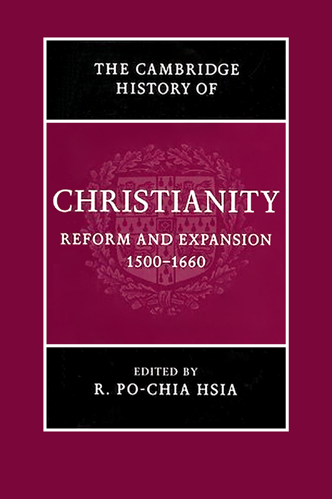

# 卷首资料

<!-- PDF page 1; original page unnumbered -->

## 剑桥基督教史

### 第六卷 改革与扩张：1500—1660年

夏伯嘉（R. Po-chia Hsia）编

<!-- PDF page 2; original page unnumbered -->

## 改革与扩张，1500—1660年

这部权威著作，叙述了从新教宗教改革前夕，到天主教改革鼎盛时期的基督教历史。除深入讨论16世纪各类改革运动的政治与神学外，本书还详尽考察永久分裂对拉丁基督教世界的影响、天主教的回应，以及这种分裂如何影响东正教诸教会的发展。这个全面而具有比较性的综览，涵盖拉丁基督教地区的社会、政治、神学、礼仪、修会和艺术史。来自不同国家的作者，合撰三十章，将研究范围扩展到欧洲与非欧洲世界中，基督教和非基督教宗教——犹太教、印度教与佛教——之间的关系。

夏伯嘉是美国宾夕法尼亚州立大学埃德温·厄尔·斯帕克斯历史学与宗教学教授。著作众多，包括 *The World of Catholic Renewal 1540–1770*，第2版（2005）。

<!-- PDF page 3; original page unnumbered -->

<!-- 原书空白页。 -->

<!-- PDF page 4; original page unnumbered -->

## 剑桥基督教史丛书

《剑桥基督教史》按时间顺序，全面叙述基督教从起源直到今日，在神学、思想、社会、政治、区域和全球等各方面的发展。每一卷本身，都对相应时代的学术研究，作出实质贡献；全套历史，则构成一部重要的学术参考著作。本丛书力图提供全球视野，远不只是一部西欧基督教及其分支的历史。东方与科普特基督教，自早期起便得到充分考虑；在较晚时期，非洲、远东、新大陆、南亚，以及其他非欧洲地区的基督教发展，也获得应有的论述。各卷涵盖民众虔敬和基督教信仰的非正式表达，并在广阔文化背景中，考察基督徒形成、敬拜和虔敬生活的社会学问题。基督教与其他主要信仰的关系，也始终受到关注。这部历史，将为学者与学生，提供极为宝贵的资源。

### 各卷目录

| 卷名 | 编者 |
|---|---|
| 起源至君士坦丁 | 玛格丽特·M. 米切尔（Margaret M. Mitchell）、弗朗西丝·M. 扬（Frances M. Young） |
| 君士坦丁至约600年 | 奥古斯丁·卡西代（Augustine Casiday）、弗雷德里克·W. 诺里斯（Frederick W. Norris） |
| 中世纪早期基督教，约600—约1100年 | 托马斯·诺布尔（Thomas Noble）、朱莉娅·史密斯（Julia Smith） |
| 西欧基督教，约1100—约1500年 | 米里·鲁宾（Miri Rubin）、沃尔特·西蒙斯（Walter Simons；本页原印Walter Simon） |
| 东方基督教 | 迈克尔·安戈尔德（Michael Angold） |
| 改革与扩张，1500—1660年 | 夏伯嘉（Ronnie Po-chia Hsia） |
| 启蒙、复兴与革命，1660—1815年 | 斯图尔特·J. 布朗（Stewart J. Brown）、蒂莫西·塔克特（Timothy Tackett） |
| 世界基督教，约1815—1914年 | 布赖恩·斯坦利（Brian Stanley）、谢里登·吉利（Sheridan Gilley） |
| 世界基督教，约1914—约2000年 | 休·麦克劳德（Hugh McLeod） |

<!-- PDF page 5; original page unnumbered -->

<!-- 原书空白页。 -->

<!-- PDF page 6; original page unnumbered -->

## 剑桥基督教史

### 第六卷

### 改革与扩张，1500—1660年

夏伯嘉编

<!-- PDF page 7; original page unnumbered -->

## 版权与出版资料

剑桥大学出版社

剑桥、纽约、墨尔本、马德里、开普敦、新加坡、圣保罗

Cambridge University Press, The Edinburgh Building, Cambridge CB2 8RU, UK

美国版由剑桥大学出版社纽约分社出版。

出版社网站：www.cambridge.org；本书信息：www.cambridge.org/9780521811620。

© 剑桥大学出版社，2007年。

本出版物受版权保护。除法定例外，以及有关集体许可协议规定的情形外，未经剑桥大学出版社书面许可，不得复制本书任何部分。

2007年初版。在英国剑桥大学印刷厂印制。

英国图书馆备有本书的编目记录。

ISBN：978-0-521-81162-0，精装本。

剑桥大学出版社不对本出版物所提及的外部或第三方网站网址的持续有效性和准确性负责，也不保证这些网站的内容现在或将来仍然准确、适当。

<!-- PDF page 8; original page vii -->

## 目录

以下页码沿用英文原书，不是中文排版页码。

- 插图目录：xi
- 作者简介：xii
- 编者序：xv
- 大事年表：xvii

### 第一编 路德与神圣罗马帝国

| 章 | 标题 | 作者 | 原书页码 |
|---|---|---|---|
| 1 | 改革者马丁·路德 | 斯科特·亨德里克斯 | 3 |
| 2 | 新教在神圣罗马帝国的兴起与巩固：至1600年 | 托马斯·A. 布雷迪 | 20 |
| 3 | 激进宗教改革 | R. 埃米特·麦克劳克林 | 37 |
| 4 | 17世纪的路德宗 | 哈特穆特·莱曼 | 56 |

### 第二编 第二次宗教改革

| 章 | 标题 | 作者 | 原书页码 |
|---|---|---|---|
| 5 | 共同体宗教改革：慈运理、路德与神圣罗马帝国南部 | 彼得·布利克勒 | 75 |

<!-- PDF page 9; original page viii -->

| 章 | 标题 | 作者 | 原书页码 |
|---|---|---|---|
| 6 | 日内瓦的加尔文宗教改革 | 罗伯特·M. 金登 | 90 |
| 7 | 改革宗基督教的神学与礼仪 | 马克·格林格拉斯 | 104 |
| 8 | 新教扩张的第二波 | 菲利普·本尼迪克特 | 125 |

### 第三编 天主教更新

| 章 | 标题 | 作者 | 原书页码 |
|---|---|---|---|
| 9 | 重新界定天主教：特伦托及其后 | 罗伯特·比雷利，耶稣会士 | 145 |
| 10 | 新的男性修会 | 约翰·帕特里克·唐纳利，耶稣会士 | 162 |
| 11 | 女性圣德：1500—1660年 | 加布里埃拉·扎里 | 180 |
| 12 | 特伦托改革后的敬拜与圣徒崇敬 | 西蒙·迪奇菲尔德 | 201 |

### 第四编 化解宗派冲突

| 章 | 标题 | 作者 | 原书页码 |
|---|---|---|---|
| 13 | 没有和谐的和平：宗教宽容的理论与实践 | 尼科莱特·毛特 | 227 |
| 14 | 推行教会与社会纪律 | 乌特·洛茨—霍伊曼 | 244 |
| 15 | 迫害与殉道 | 布拉德·格雷戈里 | 261 |
| 16 | 欧洲近代早期地中海地区的宗教裁判所 | 威廉·蒙特 | 283 |

<!-- PDF page 10; original page ix -->

| 章 | 标题 | 作者 | 原书页码 |
|---|---|---|---|
| 17 | 宗教会谈与宽容 | 奥利维耶·克里斯坦 | 302 |
| 18 | 西方基督教与东正教 | 米哈伊尔·V. 德米特里耶夫 | 321 |

### 第五编 宗教、社会与文化

| 章 | 标题 | 作者 | 原书页码 |
|---|---|---|---|
| 19 | 宗教改革与视觉艺术 | 李·帕尔默·万德尔 | 345 |
| 20 | 近代早期基督教的仪式 | 苏珊·C. 卡兰特—纳恩 | 371 |
| 21 | 音乐与宗教变迁 | 亚历山大·J. 费舍尔 | 386 |
| 22 | 恶魔学：1500—1660年 | 沃尔夫冈·贝林格 | 406 |
| 23 | 科学与宗教 | 安·布莱尔 | 425 |
| 24 | 新的教士群体 | 路易泽·朔恩—许特 | 444 |
| 25 | 妇女与宗教变迁 | 梅里·威斯纳—汉克斯 | 465 |

### 第六编 基督教与其他信仰

| 章 | 标题 | 作者 | 原书页码 |
|---|---|---|---|
| 26 | 基督教与犹太教 | 米里亚姆·博迪安 | 485 |
| 27 | 安第斯基督教诸形态的本土化 | 肯尼思·米尔斯 | 504 |

<!-- PDF page 11; original page x -->

| 章 | 标题 | 作者 | 原书页码 |
|---|---|---|---|
| 28 | 伊斯兰教与东正教之间：东南欧的新教徒与天主教徒 | 伊什特万·G. 托特 | 536 |
| 29 | 由中国人塑造的基督教 | 钟鸣旦 | 558 |
| 30 | 对印度教与佛教的接受 | 伊内斯·G. 茹帕诺夫、夏伯嘉 | 577 |

- 参考书目：598
- 索引：713

<!-- PDF page 12; original page xi -->

## 插图目录

以下为原书页码。

| 图号 | 图题 | 原书页码 |
|---|---|---|
| 1 | 老卢卡斯·克拉纳赫，《基督与敌基督受难对照》（*Passional Christi und Antichristi*，1521） | 356 |
| 2 | 老卢卡斯·克拉纳赫，《宗教改革祭坛画》，维滕贝格（1547） | 359 |
| 3 | 伦勃朗·哈尔门松·范·赖恩，《圣安娜》（1639），维也纳艺术史博物馆 | 361 |
| 4 | 伦勃朗·哈尔门松·范·赖恩，《圣保罗》（1633？），维也纳艺术史博物馆 | 362 |
| 5 | 米开朗基罗·梅里西·达·卡拉瓦乔，《玫瑰经圣母》（1606／1607），维也纳艺术史博物馆 | 364 |
| 6、7 | 吉安·洛伦佐·贝尔尼尼，《圣特蕾莎的狂喜》，罗马科尔纳罗礼拜堂 | 365、366 |
| 8 | 彼得·保罗·鲁本斯，《洛约拉的圣依纳爵的奇迹》（1615／1616），维也纳艺术史博物馆 | 369 |

<!-- PDF page 13; original page xii -->

## 作者简介

以下职衔依2007年原书出版时的记载。

- **沃尔夫冈·贝林格（Wolfgang Behringer）**：德国萨尔布吕肯大学近代史教授。
- **菲利普·本尼迪克特（Philip Benedict）**：瑞士日内瓦大学教会史教授。
- **罗伯特·比雷利（Robert Bireley, SJ）**：耶稣会士，美国芝加哥洛约拉大学历史学教授。
- **安·布莱尔（Ann Blair）**：美国哈佛大学历史学教授。
- **彼得·布利克勒（Peter Blickle）**：瑞士伯尔尼大学近代史荣休教授。
- **米里亚姆·博迪安（Miriam Bodiam）**：美国图罗学院犹太史副教授。
- **托马斯·A. 布雷迪（Thomas A. Brady）**：美国加利福尼亚大学伯克利分校萨瑟历史学荣休教授。
- **奥利维耶·克里斯坦（Oliver Christin）**：法国里昂第二大学近代史教授。
- **西蒙·迪奇菲尔德（Simon Ditchfield）**：英国约克大学历史学高级讲师。
- **米哈伊尔·德米特里耶夫（Mikhail Dmitriev）**：俄罗斯莫斯科国立大学历史学教授。
- **约翰·帕特里克·唐纳利（John Patrick Donnelly, SJ）**：耶稣会士，美国马凯特大学历史学教授。
- **亚历山大·J. 费舍尔（Alexander J. Fisher）**：加拿大不列颠哥伦比亚大学音乐学助理教授。
- **马克·格林格拉斯（Mark Greengrass）**：英国谢菲尔德大学历史学教授。
- **布拉德·格雷戈里（Brad Gregory）**：美国圣母大学历史学副教授。
- **斯科特·亨德里克斯（Scott Hendrix）**：美国普林斯顿神学院尼科尔斯宗教改革史教授。
- **夏伯嘉（R. Po-chia Hsia）**：美国宾夕法尼亚州立大学埃德温·厄尔·斯帕克斯历史学教授。
- **苏珊·卡兰特—纳恩（Susan Karant-Nunn）**：美国亚利桑那大学历史学教授，中世纪晚期与宗教改革研究部主任。
- **罗伯特·金登（Robert Kingdon）**：美国威斯康星大学麦迪逊分校历史学荣休教授。
- **哈特穆特·莱曼（Hartmut Lehmann）**：德国哥廷根马克斯·普朗克历史研究所荣休所长。
- **乌特·洛茨—霍伊曼（Ute Lotz-Heumann）**：任教于德国柏林洪堡大学历史学系。
- **R. 埃米特·麦克劳克林（R. Emmet McLaughlin）**：美国维拉诺瓦大学历史学教授。
- **肯尼思·米尔斯（Kenneth Mills）**：加拿大多伦多大学历史学教授。
- **威廉·蒙特（William Monter）**：美国西北大学历史学荣休教授。

<!-- PDF page 14; original page xiii -->

- **尼科莱特·毛特（Nicolette Mout）**：荷兰莱顿大学近代史与中欧研究教授。
- **路易泽·朔恩—许特（Luise Schorn-Schütte）**：德国法兰克福大学近代史教授。
- **钟鸣旦（Nicolas Standaert）**：比利时鲁汶天主教大学汉学教授。
- **伊什特万·G. 托特（István G. Tóth）**：已故，匈牙利中欧大学历史学副教授。
- **李·帕尔默·万德尔（Lee Palmer Wandel）**：美国威斯康星大学麦迪逊分校历史学教授。
- **梅里·威斯纳—汉克斯（Merry Wiesner-Hanks）**：美国威斯康星大学密尔沃基分校历史学教授。
- **加布里埃拉·扎里（Gabriella Zarri）**：意大利佛罗伦萨大学历史学教授。
- **伊内斯·G. 茹帕诺夫（Ines G. Županov）**：法国国家科学研究中心研究员。

<!-- PDF page 15; original page unnumbered -->

<!-- 原书空白页。 -->

## 译校说明

- 原书目录及本页作者简介，将米里亚姆的姓氏印作Bodiam；保留这一原文拼写，以便核对。
- 第17章作者在原书目录作Olivier Christin，作者简介作Oliver Christin；中文均用“奥利维耶·克里斯坦”，外文按各处原载保留。
