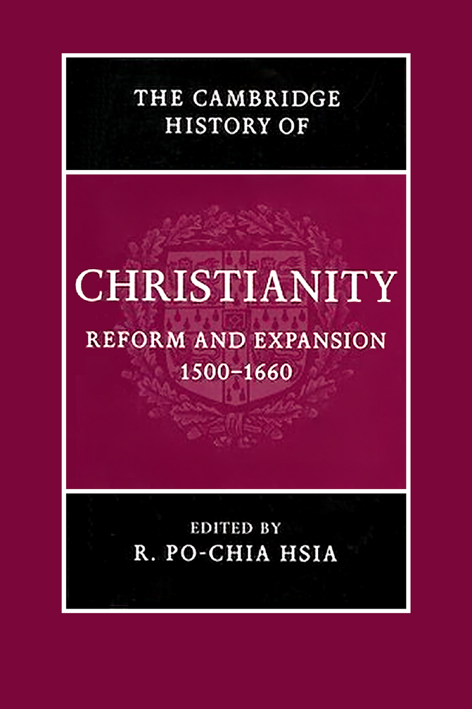
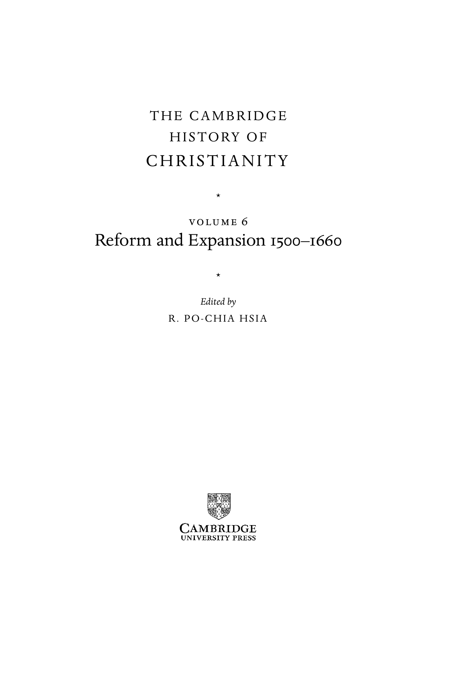

# 卷首资料：英文转换底稿

<!-- PDF page 1; original page unnumbered -->

<!-- PDF page 2; original page unnumbered -->

the cambridge history of christianity

R E F O R M A N D E X PA N S I O N 1 5 0 0– 1 6 6 0

This authoritative volume presents the history of Christianity from

the eve of the Protestant Reformation to the height of Catholic

Reform. In addition to in-depth coverage of the politics and the-

ology of various reform movements in the sixteenth century, this

book discusses at length the impact of the permanent schism on

Latin Christendom, the Catholic responses to it, and the influ-

ence on the development of the Orthodox churches. This compre-

hensive and comparative overview covers the history of society,

politics, theology, liturgy, religious orders, and art in the lands

of Latin Christianity. In thirty chapters written by an interna-

tional team of contributors the volume expands the boundaries of

inquiry to the relationship between Christianity and non-Christian

religions – Judaism, Hinduism, and Buddhism – both in Europe and

in the non-European world.

r. po-chia hsia is Edwin Erle Sparks Professor of History and

Religious Studies at Pennsylvania State University. His many publi-

cations include The World of Catholic Renewal 15 40–1770, 2nd Edition

(2005).

<!-- PDF page 3; original page unnumbered -->

<!-- PDF page 4; original page unnumbered -->

the cambridge history of

C H R I S T I A N I T Y

The Cambridge History of Christianity offers a comprehensive

chronological account of the development of Christianity in all its

aspects – theological, intellectual, social, political, regional, global –

from its beginnings to the present day. Each volume makes a sub-

stantial contribution in its own right to the scholarship of its period

and the complete History constitutes a major work of academic

reference. Far from being merely a history of Western European

Christianity and its offshoots, the History aims to provide a global

perspective. Eastern and Coptic Christianity are given full consider-

ation from the early period onwards, and later, African, Far Eastern,

New World, South Asian and other non-European developments

in Christianity receive proper coverage. The volumes cover popu-

lar piety and non-formal expressions of Christian faith and treat the

sociology of Christian formation, worship and devotion in a broad

cultural context. The question of relations between Christianity

and other major faiths is also kept in sight throughout. The History

will provide an invaluable resource for scholars and students alike.

List of volumes:

Origins to Constantine

edited by margaret m. mitchell and

fr ances m. young

Constantine to c. 600

edited by augustine casiday and

frederick w. norris

Early Medieval Christianity c. 600–c. 1100

edited by thomas noble and julia smith

Christianity in Western Europe c. 1100–c. 15 00

edited by miri rubin and walter simon

Eastern Christianity

edited by michael angold

Reform and Expansion 15 00–1660

edited by ronnie po-chia hsia

Enlightenment, Reawakening and Revolution 1660–1815

edited by stewart j. brown and timothy tackett

World Christianities c. 1815 –1914

edited by brian stanley and sheridan gilley

World Christianities c. 1914 to c. 2000

edited by hugh mcleod

<!-- PDF page 5; original page unnumbered -->

<!-- PDF page 6; original page unnumbered -->

T H E C A M B R I D G E

H I S T O RY O F

C H R I S T I A N I T Y

*

v o lu m e 6

1500 1660

Reform and Expansion –

*

Edited by

R . P O - C H I A H S I A

<!-- PDF page 7; original page unnumbered -->

cambridge university press

Cambridge, New York, Melbourne, Madrid, Cape Town, Singapore, São Paulo

Cambridge University Press

The Edinburgh Building, Cambridge cb2 8ru, UK

Published in the United States of America by Cambridge University Press, New York

www.cambridge.org

Information on this title: www.cambridge.org/9780521811620

© Cambridge University Press 2007

This publication is in copyright. Subject to statutory exception

and to the provisions of relevant collective licensing agreements,

no reproduction of any part may take place without

the written permission of Cambridge University Press.

First published 2007

Printed in the United Kingdom at the University Press, Cambridge

A catalogue record for this publication is available from the British Library

isbn 978-0-521-81162-0 hardback

Cambridge University Press has no responsibility for the persistence or accuracy of URLs for external

or third-party internet websites referred to in this publication, and does not guarantee that any

content on such websites is, or will remain, accurate or appropriate.

<!-- PDF page 8; original page vii -->

Contents

List of illustrations xi

List of contributors xii

Editor’s preface xv

Chronology xvii

pa rt i

LU T H E R A N D T H E H O LY R O M A N E M P I R E

1 · Martin Luther, reformer 3

s cott h e n d r i x

2 · Emergence and consolidation of Protestantism in the Holy Roman

Empire to 1600 20

t h o m a s a . b r a dy

3 · The radical Reformation 37

r . e m m et m clau g h l i n

4 · Lutheranism in the seventeenth century 5 6

h a rt m ut l e h m a n n

pa rt i i

T H E S E C O N D R E F O R M AT I O N

5 · Communal Reformation: Zwingli, Luther, and the south of the Holy

Roman Empire 75

pet e r b l i c k l e

vii

<!-- PDF page 9; original page viii -->

Contents

6 · The Calvinist Reformation in Geneva 90

ro b e rt m . k i n g d on

7 · The theology and liturgy of Reformed Christianity 1 04

m a r k g r e e n g r a s s

8 · The second wave of Protestant expansion 1 25

ph i l i p b e n e d i c t

pa rt i i i

C AT H O L I C R E N E WA L

9 · Redefining Catholicism: Trent and beyond 1 45

ro b e rt b i r e l ey, s j

10 · New religious orders for men 1 62

j o h n pat r i c k d on n e l ly, s j

11 · Female sanctity, 1500–1660 1 80

ga b r i e l la za r r i

12 · Tridentine worship and the cult of saints 201

s i m on d i tc h f i e l d

pa rt i v

R E S O LV I N G C O N F E S S I O NA L C O N F L I C T S

13 · Peace without concord: religious toleration in theory and practice 227

n i co l ett e m o ut

14 · Imposing church and social discipline 244

ut e lot z - h e u m a n n

15 · Persecutions and martyrdom 261

b r a d g r e g o ry

16 · The Mediterranean Inquisitions of early modern Europe 283

w i l l i a m m on t e r

viii

<!-- PDF page 10; original page ix -->

Contents

17 · Religious colloquies and toleration 302

o l i v i e r c h r i st i n

18 · Western Christianity and Eastern Orthodoxy 321

m i k h a i l v. d m i t r i e v

pa rt v

R E L I G I O N, S O C I E T Y, A N D C U LT U R E

19 · The Reformation and the visual arts 345

l e e pa l m e r wa n d e l

20 · Ritual in early modern Christianity 371

s u s a n c. k a r a n t - nu n n

21 · Music and religious change 386

a l e x a n d e r j. f i s h e r

22 · Demonology, 1500–1660 406

wo l f ga n g b e h r i n g e r

23 · Science and religion 425

a n n b la i r

24 · The new clergies 444

lu i s e s c h o r n - s c h ü tt e

25 · Women and religious change 465

m e r ry w i e s n e r - h a n k s

pa rt v i

C H R I S T I A N I T Y A N D O T H E R FA I T H S

26 · Christianity and Judaism 485

m i r i a m b o d i a m

27 · The naturalization of Andean Christianities 5 04

k e n n et h m i l ls

ix

<!-- PDF page 11; original page x -->

Contents

28 · Between Islam and Orthodoxy: Protestants and Catholics

in south-eastern Europe 5 36

i st v á n g. t ó t h

29 · Christianity shaped by the Chinese 5 5 8

n i co la s sta n da e rt

30 · Reception of Hinduism and Buddhism 5 77

i n e s g. ž u pa n ov a n d r . p o - c h i a h s i a

Bibliography 5 98

Index 71 3

x

<!-- PDF page 12; original page xi -->

Illustrations

1 Lucas Cranach the Elder, Passional Christi und Antichristi (1521) page 356

2 Lucas Cranach the Elder, Reformation Altar, Wittenberg (1547) 359

3 Rembrandt Harmensz van Rijn, Saint Anna (1639), Kunsthistorisches

Museum, Vienna 361

4 Rembrandt Harmensz van Rijn, Saint Paul (1633?), Kunsthistorisches

Museum, Vienna 362

5 Michelangelo Merisi da Caravaggio, ‘Madonna of the Rosary’ (1606/7),

Kunsthistorisches Museum, Vienna 364

6 & 7 Gian Lorenzo Bernini, ‘The Ecstasy of Saint Teresa’, Cornaro Chapel,

Rome 365, 366

8 Peter Paul Rubens, ‘The Miracles of Saint Ignatius of Loyola’ (1615/16),

Kunsthistorisches Museum, Vienna 369

xi

<!-- PDF page 13; original page xii -->

Contributors

Wolfgang Behringer is Professor of Modern History at the University of Saarbrücken,

Germany.

Philip Benedict is Professor of Church History at the University of Geneva, Switzer-

land.

Robert Bireley, SJ is Professor of History at Loyola University Chicago, USA.

Ann Blair is Professor of History at Harvard University, USA.

Peter Blickle is Emeritus Professor of Modern History at the University of Bern,

Switzerland.

Miriam Bodiam is Associate Professor of Jewish History at Touro College, USA.

Thomas A. Br ady is Sather Professor of History Emeritus at the University of California

at Berkeley, USA.

Oliver Christin is Professor of Modern History at the University of Lyon II, France.

Simon Ditchfield is Senior Lecturer in History at the University of York, UK.

Mikhail Dmitriev is Professor of History at Moscow State University, Russia.

John Patrick Donnelly, SJ is Professor of History at Marquette University, USA.

Alex ander J. Fisher is Assistant Professor of Music at the University of British

Columbia, Canada.

Mark Greengr ass is Professor of History at the University of Sheffield, UK.

Br ad Gregory is Associate Professor of History at Notre Dame University, USA.

Scott Hendrix is Nichols Professor of Reformation History at the Princeton Theological

Seminary, USA.

R. Po-chia Hsia is Edwin Erle Sparks Professor of History at Pennsylvania State Uni-

versity, USA.

Susan Kar ant-Nunn is Professor of History and Director of the Division for Late

Medieval and Reformation Studies at the University of Arizona, USA.

Robert Kingdon is Emeritus Professor of History at the University of Wisconsin at

Madison, USA.

Hartmut Lehmann is Emeritus Director of the Max-Planck Institute of History in

Göttingen, Germany.

Ute Lotz-Heumann teaches in the Department of History of the Humboldt University

Berlin, Germany.

R. Emmet McLaughlin is Professor of History at Villanova University, USA.

Kenneth Mills is Professor of History at the University of Toronto, Canada.

William Monter is Emeritus Professor of History at Northwestern University, USA.

xii

<!-- PDF page 14; original page xiii -->

List of contributors

Nicolette Mout is Professor of Modern History and Central European Studies at

Leiden University, The Netherlands.

Luise Schorn-Schü tte is Professor of Modern History at the University of Frankfurt,

Germany.

Nicolas Standaert is Professor of Sinology at the Catholic University of Leuven,

Belgium.

Istvá n G. Tó th is the late Associate Professor of History at the Central European

University, Hungary.

Lee Palmer Wandel is Professor of History at the University of Wisconsin at Madison,

USA.

Merry Wiesner-Hanks is Professor of History at the University of Wisconsin at

Milwaukee, USA.

Gabriella Zarri is Professor of History at the University of Florence, Italy.

Ines G. Ž upanov is a researcher at the Centre National de la Recherche Scientifique,

France.

xiii

<!-- PDF page 15; original page unnumbered -->

