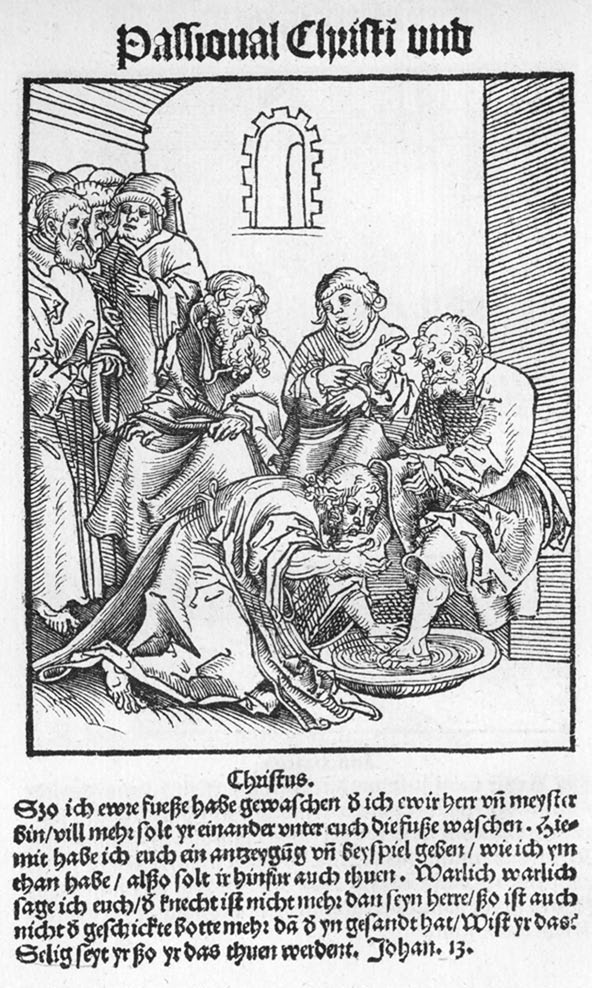
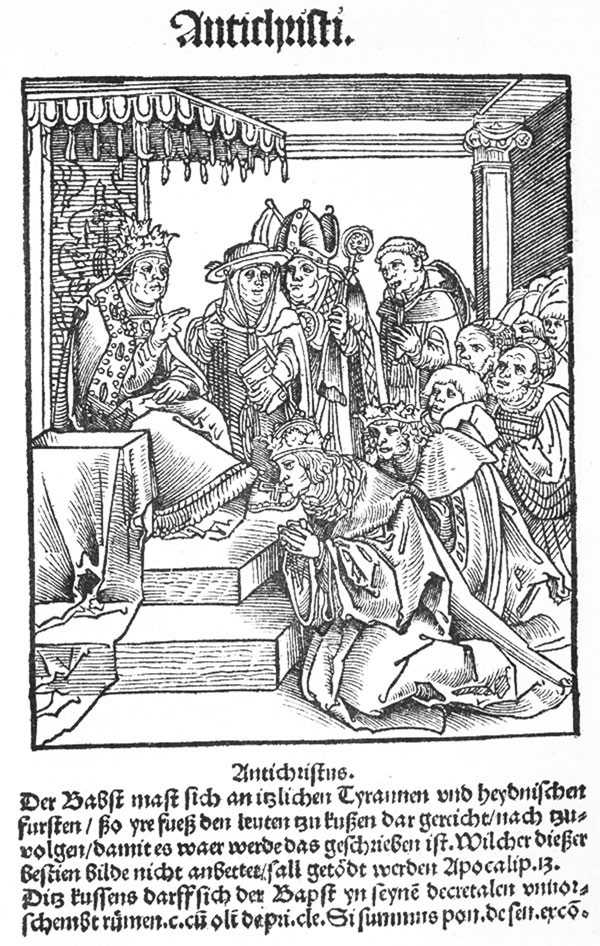
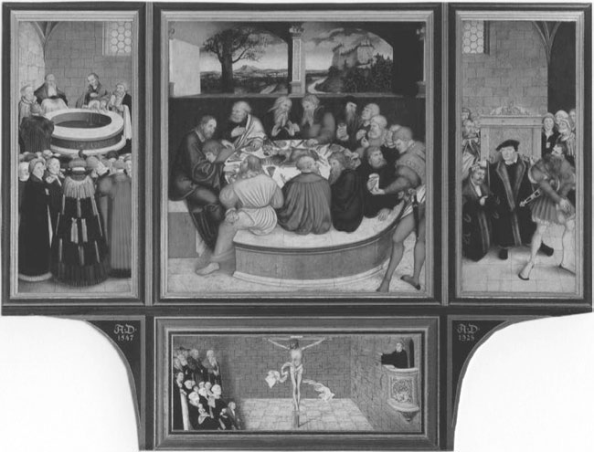
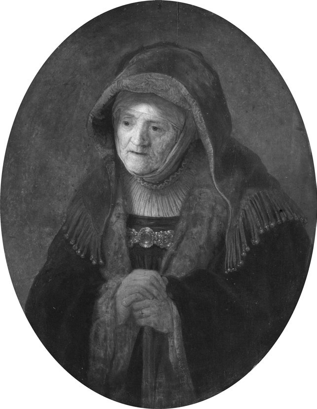
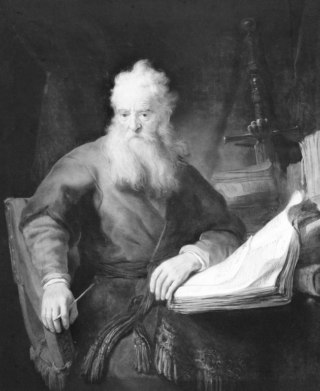
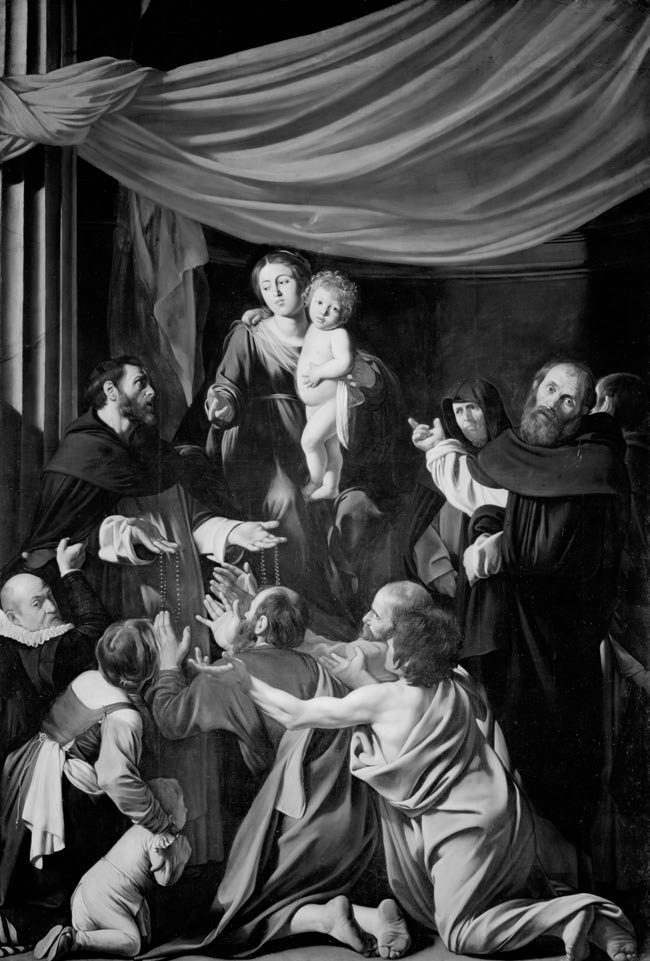
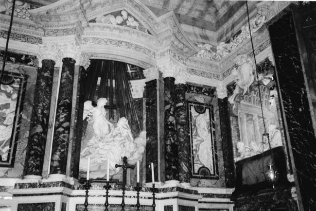
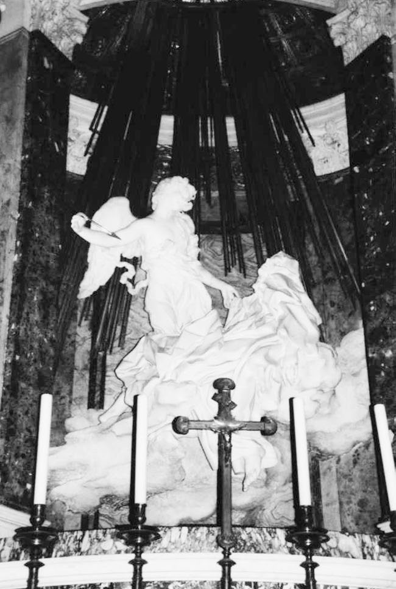
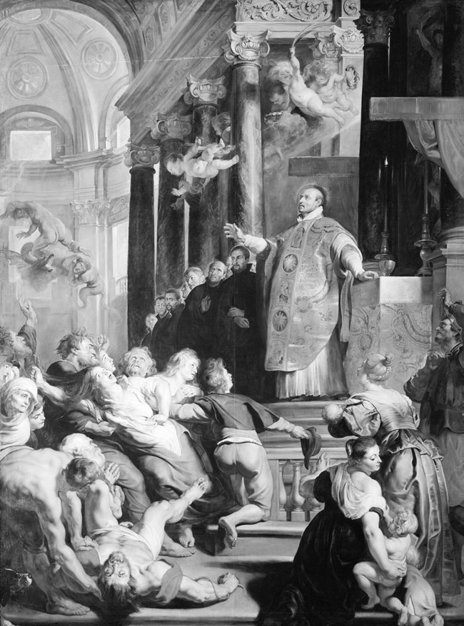

# 第19章 宗教改革与视觉艺术

作者：李·帕尔默·万德尔（Lee Palmer Wandel）

<!-- PDF page 368; original page 345 -->

## 道成肉身神学与视觉艺术

讨论宗教改革时期的视觉艺术，必须从道成肉身开始。[^p368-1]纵观历史，基督徒始终努力理解，《约翰福音》所说“道成了肉身”（1:14，英王钦定本），究竟意味着什么。道成肉身，推翻了从前苏格拉底哲学家到斯多亚派等许多古典思想流派所设定的对立：肉身与精神、物质与心灵。对任何基督徒来说，“肉身”或物质，都不可能与“道”或上帝完全分离；二者在基督内结合，否认这一点，就是异端。

道成肉身，也突破了犹太教对图像的禁令。正如罗马与君士坦丁堡，在八、九世纪圣像争论中共同宣告的，如果上帝能够取了肉身，那么，基督的物质性再现，就在某种根本意义上，属于一个连续体：物质能够让神圣者，呈现于信徒眼前。随着中世纪盛期圣徒崇拜兴起，这个连续体扩展到圣徒图像，显示基督降世之后，上帝仍在基督徒生活中行动。托马斯·阿奎那，解释这些宣告的后果，明确把视觉再现，放在一条连续不断的线上：始于耶稣，继而玛利亚、圣徒，最终到人为制作的视觉形象，依次再现基督、玛利亚和圣徒。

教堂中图像日益增多的同时，[^p368-2]一些中世纪记忆、认知理论，也赋予图像越来越重要的作用。对若干理论家，图像是<!-- PDF page 369; original page 346 -->组织、保存所获知识的核心。[^p369-3]他们认为人通过脑海图像，记住所学，并理解其意义；而这些心象，本身可以来自视觉经验。这种立场，有力支持了图像在默观、虔敬中的用途，范围从供平信徒使用的彩饰祈祷书，到教堂雕刻祭坛背屏。

对基督徒，无论新教或天主教、改革宗或路德宗、罗马教会或东正教，“再现”从来不只是透视、比例问题。人们总是在如何理解基督和上帝，临在物质世界的框架中，看待视觉艺术。十六世纪基督徒的分歧，不在上帝是否通过物质启示自身，而在人手究竟能否、又如何参与这种启示。他们痛苦地追问一个令人痛苦的问题：人为制作的“再现”，能否揭示上帝或基督的任何本性、真理？教理和讲道中的回答，使他们彼此分裂。

成为“天主教徒”，意味着认同可追溯到八、九世纪圣像争论的传统，一再肯定再现在基督教文化中的核心地位；成为“路德宗信徒”，意味着视图像为无关敬拜本质之事；成为“改革宗信徒”，首先意味着重新划分《十诫》，使禁止人为图像，成为独立的一条诫命。

十六世纪，天主教正式立场，呼应圣像争论中发展、由阿奎那最充分表达的图像及其与神圣者关系的观念。[^p369-4]特伦托大公会议颁布的立场，有两个核心部分。首先，确认图像在虔敬中，一个严格界定的位置：

> 他们也必须教导，基督、童贞天主之母及其他圣徒的图像，应当设置、保存，尤其在教堂中；人应给予适当尊荣与敬意。这并非因为相信图像本身含有某种神性、力量，作为敬礼理由，也非期待从它们得到什么，或像古代异教徒一样，把信心放在图像上，而是因为向图像表示的尊荣，归于它所代表的原型。因此，通过我们亲吻、在其前脱帽、跪下的图像，我们向基督致崇拜，向图像所

<!-- PDF page 370; original page 347 -->

> 再现的圣徒致敬礼。这已获各次大公会议的法令认可，尤其第二次尼西亚会议反对破坏圣像者的法令。

其次，确认图像在基督教教育整体中的认知功能：

> 主教应仔细教导，藉绘画或其他形象，表现我们救赎奥迹的故事，使信徒纪念、经常回想信仰条款，从而得到教导、坚固。一切神圣图像，都带来重大益处，不仅提醒人们，基督给予我们的恩赐、祝福，也把上帝通过圣徒所行的奇迹，以及圣徒有益救恩的榜样，置于信徒眼前，使他们为此感谢上帝，效法圣徒，塑造自身生活、行为，并受激励，去崇拜、爱上帝，实践虔敬。若有人教导或坚持与这些法令相反的立场，当受绝罚。[^p370-5]

对罗马教会，图像在敬拜秩序中，具有古老、谨慎界定的位置。它们不仅服务于不识字者，即近代早期绝大多数基督徒，也服务于所有基督徒，因为它们能够把举止、仪态、信仰行为、虔敬表达，“置于信徒眼前”，能够“提醒”，让人再次想起道成肉身的“恩赐”。

马丁·路德本人，视所有图像为无关救恩之事，即adiaphora，并不重要。[^p370-6]他激进地强调信仰，因此不像天主教、甚至改革宗立场那样，赋予图像作为物质的同等力量。对路德图像恰因其物质性，既不能诱惑，也不能照亮灵魂。但一些大体赞同其神学主要原则的人，强烈反对他的图像立场。例如，路德藏身瓦尔特堡期间，安德烈亚斯·博登施泰因·冯·卡尔施塔特，在维滕贝格鼓吹破坏圣像，发表《论移除图像》，列出《圣经》禁止任何上帝形象的全部规定。

卡尔施塔特的立场，呼应最激进的福音派，即绝对执行反图像诫命的人。多数这类群体，秘密聚会，因此没有可供安置图像的场所。不过，他们的成员中，也有一些最直言不讳的<!-- PDF page 371; original page 348 -->圣像破坏者，表明许多与路德、慈运理决裂的人，视图像为敬拜所不容。[^p371-7]

约翰·加尔文并不敌视视觉艺术本身：

> 然而，我并未陷入那种迷信，以为绝对不准有任何图像。既然雕塑、绘画，是上帝的恩赐，我就寻求二者纯洁、正当的用途，以免主为自身荣耀、我们的益处赐下的事物，不仅被错误使用所污染，甚至转而毁灭我们。[^p371-8]

对加尔文问题不在图像本身，而在图像代表什么、由谁创造。[^p371-9]一切图像，既然出自人手，便反映人对上帝、基督的观念；人向图像表达虔敬，也就在敬拜自己关于上帝、基督的观念。危险并非图像本身，而是人僭妄地以为，图像透明无碍地揭示上帝。对加尔文上帝在光、在自然秩序中“再现”自身，虽然借助物质，却非人工制品。

## 破坏圣像

或许最引人注目的，是神学家大多在回应针对图像的暴力时，才形成自身立场。[^p371-10]除卡尔施塔特，以及可能包括斯特拉斯堡马丁·布策尔外，没有哪位神学家赞许这种暴力。与路德、加尔文、慈运理不同，普通男女平信徒，认为图像问题迫在眉睫，因为灵魂安危系于其上；与此同时，他们对图像及其敬拜地位，又表达极其不同的理解。

一个又一个共同体，两极分化：有些人把针对教堂图像的言语、身体暴力，称为“亵渎”，视为攻击上帝；另一些人则把同一图像称为“偶像”，要求“为上帝荣耀”毁坏它们。争论并非围绕比例、技艺、美学，甚至完全不用审美语言，而是围绕敬拜：怎样最恰当地尊荣上帝？在任何其他时代，都没有这么多基督徒，把图像置于确定真正敬拜的如此核心位置。

<!-- PDF page 372; original page 349 -->

从东部波兰，到西南法国，从瑞士到苏格兰、瑞典，欧洲各地堂区，都有基督徒个人“拆下偶像”。[^p372-11]许多人这样做，冒着生命危险，因为在许多共同体，亵渎是死罪。对他们破坏圣像，无论言语还是身体暴力，都是信仰行动，也使自己可能成为殉道者。

“破坏圣像”涵盖多种行为。最早的行动者，可能半夜攻击一座祭坛背屏；有些人，只把物件搬出教堂，归还最初捐赠者的家族，或者更常见地，让它们“消失”。更多时候，他们在原地砸碎图像，把再现形象，打回制作它们的石头、木材。在使破坏圣像合法化的共同体中，木材经常分给穷人取暖，石头重新铺路，布料分给穷人做衣物。某些壮观案例，如1529年巴塞尔，以及1566年“奇迹之年”尼德兰各省，出现同时代人称为数百人的群体，闯入教堂，砸毁所有与敬拜有关之物：具象艺术、礼仪器具、彩色玻璃窗、祭坛和弥撒经书。

对许多基督徒，破坏圣像与“宗教改革”密不可分；清除虚假偶像，是建立真正敬拜的必要条件。不同圣像破坏者，指出这些“偶像”以多种方式冒犯上帝。十字苦像、祭坛，关联着把弥撒理解为献祭的特定观念；但路德、慈运理、加尔文以及数十位其他福音派人士，都宣讲这种献祭，已在十字架上一次完成，永远有效。圣徒图像及圣髑，参与圣徒崇拜，使虔诚者无法专心、深入地以基督一生，作为唯一圣洁典范、神圣仁慈的启示。圣母图像，也使信徒偏离耶稣生平救恩意义的核心，削弱基督的神性、威严。

所有这些物件，从具象艺术，到金圣爵、镶宝石弥撒经书、油灯，都体现财富；而财富本应用于“爱邻舍”，照顾穷人。对拆除、毁坏者，图像当然“有力量”：能够把信徒引离上帝，导向人对敬拜、基督生平意义、上帝本身的观念。

<!-- PDF page 373; original page 350 -->

在法国，从《南特敕令》颁布到撤销的1598至1685年；在联省共和国，事实上从1572年后、法律上从1648年后，凡特定改革宗教会或会众，拥有合法权限与地方权力，便会从教堂清除“偶像”。不同会众，对哪些具体图像构成“偶像”，意见不一；但普遍接受的定义，是任何导致错误敬拜的东西，不只具象艺术，也包括礼仪物品、祭坛、礼服。换言之，只要使信徒，不能密切专注于所宣讲、所实践的上帝圣言，就属于偶像。

神圣罗马帝国的政治局势，更加动荡。许多教堂先后经历“清理”与“重新天主教化”；后一个过程中，人们以雕塑、板画、祭坛背屏，以及直接雕进建筑结构的小天使、先知、使徒，有意识、明确地重新占据天主教内部空间。

## 图像的制作

基督徒对于宗教图像的内容、安置地点，意见分歧；但天主教、路德宗和改革宗信徒，都继续委托制作宗教艺术。新教、天主教艺术，同样在由师傅、帮工、学徒构成的工坊生产。艺术家为双方委托，使用相同材料：墨、白垩、油彩、大理石、石材、木材、铜和铁。这一时期，虽然出现油彩等新媒介，以及蚀刻等新技术，这些媒介、技术，似乎并不专属某个教会。例如，伦勃朗·范·莱因，采用从卡拉瓦乔作品中看到的明暗对照法，描绘福音题材场景。而且，多数艺术家，都使用不止一种媒介。

生产方式，在宗教改革视觉艺术史中发挥作用；它反映的，与其说宗派分界，不如说整个时期“宗教改革”性质的改变。我们可以追踪一种转移：早期，印刷品服务于即时论战；教会逐渐确立之后，赞助人则委托更持久、稳定的艺术形式。

最早的宗教改革图像，是印刷图像。十六世纪二、三十年代，新教徒首先采用木刻。木刻可能是制作成本最低的图像，一部分因为材料，一部分因为技术劳动成本较低，因此更多人买得起。它的制作也无疑最快，也更<!-- PDF page 374; original page 351 -->容易用于早年的论战；当时，基督徒正在彼此对立中，界定神学立场、礼仪与伦理。

印刷图像的制作方式，使其本身及发挥作用的方式，都有别于绘画、雕塑。[^p374-12]它们印在不太耐久的纸张上；十六世纪初印刷图像的主题，也更为短暂，因为论战紧贴当下。证据显示印刷图像也被悬挂在酒馆、住宅、教堂中，但它们似乎以多数雕塑、绘画无法做到的方式发挥作用。私人灵修双联画、三联画，固然可能随富有赞助人旅行，印刷图像却能装在口袋、背囊里，沿道路传播，手手相传，进入作坊，也进入工匠、农民家庭，把视觉形象带到可能找不到其他图像的地方。

十六世纪二十年代，阿尔卑斯山以北许多共同体，停止制作绘画、雕塑。后来重新生产时，虽然大体沿用传统方法、材料，其委托方式、安置地点、内容，以及人们理解它们在虔敬中的作用，都反映了基督教世界已经分裂。

## 赞助与图像的安置地点

艺术赞助，在很大程度上是宗派身份的表达。对天主教徒，图像是传教、促成皈依的重要手段，他们向图像投入文化与财务资本。罗马、安特卫普，都是艺术生产重镇。无论显赫还是普通的天主教家族，都出资为“重新天主教化”的教堂，补置图像、祭坛画、唱诗班隔屏和彩色玻璃窗。

法尔内塞、博尔盖塞等教皇家族，也是伟大艺术赞助者：为教堂较公开空间，捐建纪念性雕塑群；为自己的“私人”礼拜堂，委托名家祭坛画，虽然所有信徒都能向内观看；也赞助更亲密的灵修艺术。美第奇、哈布斯堡等政治上强大的天主教家族，同样通过捐赠礼拜堂祭坛画、较公开的雕塑或绘画，以及修建礼拜堂、翻修或恢复教堂，展示信仰。平信徒、教士，都委托制作装饰丰富的灵修书籍，以及私人灵修图像。这些委托，本身就是虔敬行为，也是传播信仰的努力：最初面向<!-- PDF page 375; original page 352 -->佛兰德人、巴伐利亚人、波兰人，很快扩展到印加人、阿兹特克人、中国人，以及美洲、亚洲其他原住民。

与天主教徒一样，路德宗信徒继续为教堂委托图像，但用途更集中于教导。我们对个别赞助者，了解较少；图像并不被视为其虔敬的证明，所以委托记录不那么公开，相关研究也不如显赫天主教家族充分。随着路德宗教会确立，信徒委托教堂内部绘画；《奥格斯堡和约》之后，又委托墓葬雕塑、建筑雕刻，以及描绘圣经故事的横饰带。[^p375-13]路德生前，老卢卡斯·克拉纳赫，已为萨克森路德宗教堂制作多幅祭坛画，每幅似乎都由当地路德宗家族支付。克拉纳赫、霍尔拜因等人，也受托为路德《圣经》译本，制作木刻、铜版插图。[^p375-14]

改革宗传统的赞助方式，并不统一。法国胡格诺派市民阶层，似乎回避一切公共宗教艺术；荷兰改革宗商人，却构成伦勃朗圣经人物、故事绘画与版画的市场，尽管这些图像，既未受委托用于公共敬拜，也不安置其中。这些商人，确实为部分教堂，委托墓葬雕塑，以及绘有《十诫》的木板。

三个主要传统的基督徒，都赞助艺术。宗派差异，集中于艺术是否属于公共敬拜空间。天主教徒委托公共、家庭空间中的宗教艺术，也涉及严格说来属于“市民”的领域，以及教会领域，规模从纪念性巨构，到亲密小品。路德宗同样为教堂、插图《圣经》委托艺术。两者都把图像安置在平信徒、教士共同礼拜之处，任何愿意观看者，都可以接近、凝视、跪在其前祈祷。然而，只有天主教徒，把图像视为欧洲、美洲、亚洲传教事业的核心。两者委托图像的目的，并不相同。

在主要传统中，改革宗最努力限制宗教图像的观看地点、方式。胡格诺派禁止在礼拜建筑内，设置绘画、雕像和彩色玻璃。[^p375-15]

<!-- PDF page 376; original page 353 -->

荷兰改革宗会众，在政治环境允许时，“清理”教堂中的中世纪绘画、圣髑、祭坛，重新以讲坛组织空间；有些在墙上挂绘有《十诫》的木板。[^p376-16]改革宗教堂，主要以慈运理认为如此“美丽”的白墙为特色；这种视觉性的讨论，超出本文范围。多数改革宗艺术，为私人住宅委托，面向不同观众，也具有不同功能。

## 宗派与图像的内容、功能

安尼巴莱·卡拉奇、彼得·保罗·鲁本斯、贝尔尼尼，是“天主教”艺术家；克拉纳赫是“路德宗”，伦勃朗是“改革宗”。他们都试图通过物质，通过体量、质感、线条和色彩，表达宗教想象。他们使用的材料、生产过程，并无区别。主要传统的分歧，在于什么可以再现，以及与这种内容规定不可分割的另一问题：图像如何在虔敬中发挥作用。

### 印刷图像与“宗教改革”

即使在清除教堂“偶像”的同时，新教徒仍通过印刷图像，传播“宗教改革”。[^p376-17]印刷图像，在几个重要方面，不同于教堂图像。它们是二维的，因此从不“栩栩如生”；以线条为主，外观更接近印刷书页，而非诉诸感官的形象；通常印在迅速劣化的纸上，这种短暂性，也削弱图像变成偶像的可能。最后，新教印刷图像的主题，大体是论战，而非灵修。例如，基督图像，被放在圣经故事中，与经文本身并列，或明确对照教士、教皇的行为。

新教徒在两个场合，使用印刷图像，二者共同服务于传播福音信息的大计划：印刷《圣经》，以及视觉论战。新教《圣经》被列入罗马《禁书目录》，却希望接触识字程度不一的人口；因此许多版本，包含数百幅图像，有些还经精美手工着色。十六世纪两位最成功艺术家，霍尔拜因、克拉纳赫，分别为慈运理和路德《圣经》译本设计图像。这些《圣经》中的木刻，<!-- PDF page 377; original page 354 -->被采用、复制，转用于其他场合，以设计者或许从未设想的方式，传播福音信息。

新教徒以前所未有的数量，印制图像，不仅以视觉方式，把《圣经》带给世界，也挑战罗马的首位权主张质疑中世纪教会的一系列实践，描绘教士弊端，并以细微视觉细节，表达“真正教会”与罗马教会的对比。对一个最初在人口、政治上都居少数的群体，印刷图像，可能是最有效的工具。但无论德意志、罗马、佛兰德还是法国天主教徒，都未以同样强度、惊人数量，把印刷图像用于论战。

印刷图像虽然较简单，缺乏色彩、立体塑造，却与绘画、雕塑、表演，共享复杂的视觉语言：象征、符号、服装、物件、姿势、面容，以及经过安排的身体关系。[^p377-18]图像运用大量传统象征，也采用十六世纪新象征，从无处不在、既具有复杂神学意义又直接表示基督教的十字架，或鸽子，到法国百合花、帝国双头鹰，再到对有些人象征信仰、真正基督教的路德玫瑰。

成千上万种熟悉物件，都可作符号：连枷、长矛表示不同劳动；权杖表示世俗权力关系；祭坛、圣爵、圣体，则依观看者立场，可表示弥撒奥迹，也可表示亵渎、偶像崇拜。与符号相近的，是可称为视觉隐喻的形象：修士大腹，表示生活过于优裕；修女斜视，暗示与会服所代表誓愿矛盾的放纵；仰起的面容，表示明亮信仰；还有合掌祈祷的双手。

服装可以表示身份等级，如皮毛、王室白鼬皮；表示职务，如市政官钥匙、枢机帽；表示劳动，如工匠短衣、农民木鞋；或表示性格，如愚人帽。某些服饰，可以代表本人或职务，教皇三重冠便常兼具两义。最有效、最著名的天主教论战图像之一，是约翰内斯·科赫莱乌斯1529年小册子扉页《七头路德》。它使用土耳其头巾、东正教宗主教兜帽、苍蝇或“狂热派”（Schwärmerei）意象，以及巴拉巴头颅，把路德联系到基督教世界最惧怕的敌人。两幅最流行的论战单张，《修士牛犊》《教皇驴》，则把两例著名畸形出生，分别借助修士兜帽，联系到<!-- PDF page 378; original page 355 -->修道人，借助台伯河的地理背景，联系到教皇。

宗教改革版画，最常通过对立展开论战，以姿势、表情和人物关系的视觉语言，表达对比。例如，《敬虔磨坊》木刻，通过位置安排，呈现对照：“福音派”的伊拉斯谟、路德接近《福音书》；身着各自服饰的枢机、修士、教廷，则远离。老克拉纳赫1521年在维滕贝格出版《基督与敌基督受难图》，共十三组配对木刻，对照基督、教皇的姿势、仪态，以及与追随者的关系，见图1。它唤起基督徒从教堂早已熟悉的数千幅基督谦卑、贫穷图像，再以线条、位置，明确展示教皇的动作、行为、仪态、服饰、宫廷，如何与之相反，因此更加有效。

一些荷兰铜版画，把教皇派两种主要偶像崇拜，即弥撒和敬拜时使用图像，与同时移除祭坛、图像的改革宗破坏圣像相对照。许多论战版画，夸张姿势，或添加大腹等暗示内在性格的身体特征，强化对比。

姿势、表情、人物关系，也是虔敬的身体语言。新教印刷图像，在对照福音派的举止仪态，与参加弥撒的迷信者时，也描绘信徒应有的姿态，例如虔诚聆听福音派讲道的人。在有些单张中，听众站着；有些让妇女坐在地板上；但所有人，都朝向讲坛，仰脸看着讲道者的脸和嘴。坐着的人，双手合在膝上，既不握念珠，也不编织。在版画的福音派一侧，无人诵念玫瑰经、与邻人说话、编织、雕刻，或进行任何其他手工生产。

图像的“言说”，充满对其他图像的暗指。头部、手部的特定位置，以线条或阴影表现，会指向其他媒介的形象；牧人、羔羊的轮廓，能“再现”观看者在别处见过、具有色彩和体量的人物。绘画、雕塑，可能援引印刷圣经插图、讽刺画、单张中，人物的布局、背景，或表现基督行动的特定方式；木制祭坛背屏，也复制圣经插图的姿势、人物安排和面部表情。此外，所有图像，无论印刷、绘画还是雕塑，在捕捉姿势、头部角度，

<!-- PDF page 379; original page 356 -->

*图1：老卢卡斯·克拉纳赫，《基督与敌基督受难图》（1521年）。*

<!-- PDF page 380; original page 357 -->

*图1（续）。*

<!-- PDF page 381; original page 358 -->

手部特定表情时，都越出自身，指向现实中的行动者。有些描绘规定精细的礼仪动作，指向实际演行；有些描绘修士攫取的手，指向活着的修道人。视觉暗指，并不止于图像。版画赋予人物的性格比喻，如修士大腹、修女斜视、教皇傲慢，也能够附着于现实中的人。这正是图像的效力、力量。

### 路德宗艺术

路德宗信徒，为教堂委托绘画、雕塑，却不再把这些再现，理解为启示连续体的一部分。即使中世纪圣徒图像，仍留在教堂，它们提供的也是行为榜样，而非圣徒崇拜中心。无论敬拜功能，还是内容，路德宗图像都不同于天主教。[^p381-19]用路德本人的话说，这些图像“是为普通人之故”，属于更大教导事业。它们与教理一起，教授路德宗基本教义：《十诫》、作为仁慈之父的上帝、基督的核心救恩作用、《主祷文》，以及圣礼的性质、正确举行方式。十六、十七世纪，尤其《十诫》，也包括《主祷文》，被绘在木板上，悬于教堂中殿。

最早、最多产的早期路德宗画家，老克拉纳赫，也用油彩，把基本教义视觉化。[^p381-20]在版画、油画中，他都以寓言方式，表现路德关于律法与恩典的对立观念。在一系列重要祭坛画中，他表现路德宗对洗礼、圣餐的理解。1547年为维滕贝格圣玛利亚教堂完成的《宗教改革祭坛画》，从左至右，以三块画板呈现三项圣礼：洗礼、圣餐、告解，见图2。洗礼画面，让人看见受洗者是婴儿，使用简单洗礼池，共同体也在场。告解画面，则显示其公开、开放性质，由路德自己的

<!-- PDF page 382; original page 359 -->

*图2：老卢卡斯·克拉纳赫，《宗教改革祭坛画》，维滕贝格，1547年。*

“告解神父”约翰内斯·布根哈根，手持来自天上的赦罪钥匙。中央一幅，是三块中最大的一块，表现路德宗圣餐。两侧场景，可能设于教堂，背景石墙暗示这一点；主餐却置于开放房间。路德转身，把圣爵递给一位骑士；与此同时，基督把蘸过苦酒的饼，送入犹大口中，犹大手中紧抓的钱袋，标明身份。桌子正中，是逾越节羔羊，面包分布四周。

克拉纳赫，把路德放在最后晚餐本身的圆桌旁，置于基督使徒之中，利用油彩，把路德、基督、门徒，表现得具有真实肉身、就在眼前：所有人，在同一时刻，同时临在，具有同样的血肉感。他因此能够以绘画，表现路德难以理解的基督体血与饼酒共同存在的神学，原文称consubstantiation；这种神学，连最亲近的追随者、艺术家，也不容易掌握。相较之下，许多天主教艺术家知道，化质说，可以用多种方式视觉呈现：受难基督的图像、传统圣格里高利弥撒图像，或者通过道成肉身图像，作间接暗示。

<!-- PDF page 383; original page 360 -->

### 改革宗艺术

究竟什么构成“改革宗”宗教图像，争论很大，因为改革宗并不为教堂委托图像，而这本来是界定图像宗教身份最容易的方法。[^p383-21]伦勃朗可以作为代表：他的父母中，一位属于改革宗，妻子也是成员；他家中似乎始终有《圣经》，也去教堂，却本人并非阿姆斯特丹荷兰改革宗会众成员。[^p383-22]在极其多产的生涯中，他以版画、绘画，表现数十个圣经场景、人物，见图3、4。[^p383-23]

这些作品，无论绘画还是版画，都是历史性的。不同于中世纪前辈，服饰、背景，采用十七世纪人所理解的圣经时代样貌；全都明确置于时间之中，具有历史性，正因其时间性、具体情境性，抵抗了被用作崇拜圣像的可能。不过，伦勃朗的《圣经》取向，在某些方面并不“典型”：他的圣经场景，既反映对故事深刻的个人解释，也体现他对更广泛圣经学者群体中，亲犹思想的参与。[^p383-24]

### 天主教艺术

特伦托大公会议第二十五次会议，规定每个观看者，与图像之间应有的确切关系。这一立场，有意识地回应新教批评，以及新教对于人心、对于人心容易受人为创造和各种物质影响的特定理解。但它未能涵盖，图像融入天主教虔敬生活的全部方式；未能涵盖委托艺术本身的意义；也未能涵盖，经神学正统性审查、认可的天主教艺术，以油彩、大理石、色彩、体量，所“再现”的特定关系，即上帝的行动、启示与物质世界之间的关系。

特伦托重申宗教图像教导用途的古老论证之际，服务教会的艺术家，也运用新的明暗技术、新的纪念性规模，表现天主教圣徒、殉道。艺术家以白垩、油彩、大理石、木、石，探索精神与肉身的复杂互动。[^p383-25]他们用油彩

<!-- PDF page 384; original page 361 -->

*图3：伦勃朗·哈尔门松·范·莱因，《圣安娜》（1639年），维也纳艺术史博物馆。*

或大理石这些沉重材料，表现道成肉身奥迹的不同面向：重力的意义，物质性对于发光、“升天”及飞翔的后果；其中“升天”，是宗教改革时代天主教艺术的特定主题。

学者长期争论，天主教改革与巴洛克风格的关系。路德宗，确实在十七、十八世纪，为自己的教堂采用巴洛克

<!-- PDF page 385; original page 362 -->

*图4：伦勃朗·哈尔门松·范·莱因，《圣保罗》（1633年？），维也纳艺术史博物馆。*

风格。不过，反宗教改革的伟大艺术家，也不可分割地参与了巴洛克风格的形成：卡拉奇、贝尔尼尼、鲁本斯、丁托列托、卡拉瓦乔。巴洛克艺术，如同其戏剧对应物，比中世纪<!-- PDF page 386; original page 363 -->和文艺复兴前辈，更能表达细致多变的情感、灵性状态。[^p386-26]无论绘画还是雕塑，天主教巴洛克艺术家，都通过姿势、体态，明确表现圣灵临在，如何在人体中变得可见。圣灵临在，以身体方式显现，不只在脸上，也通过手臂、双手、躯干、双腿，甚至双脚，见图5。圣洁，恰恰通过人体坚实的物质性，被人认识；同样的“肉身”，也能用油彩、大理石表现。

贝尔尼尼在罗马胜利圣母堂科尔纳罗小堂的作品，体现了巴洛克中，身体呈现、艺术再现与展示之间的独特互动，见图6。[^p386-27]小堂的中心，是雕塑《圣德肋撒的神魂超拔》，但它首先整合于祭坛上方自己的舞台，再纳入一个复杂的虔敬剧场。这场“神魂超拔”，发生在其他人眼前。雕塑本身，以大理石，表达德肋撒虔敬的许多特质，把她经常出现的一次神视，转化为可见材料：金、大理石、尺度、重量。

> 主愿意让我这样看见天使。他个子不高，反而矮小，却极美；面容如火燃烧，仿佛那些最高等级、全身是火的天使之一。他们应当就是称为革鲁宾的天使……我看见他手中，有一支长金矛，铁尖末端，似乎有一点火。他仿佛用它，数次刺穿我的心，一直进入内脏；拔出时，我觉得内脏也随之被带出，使我完全被对上帝的强烈爱火点燃。疼痛如此锐利，使我数次呻吟；然而，这剧痛带来的甘甜，又如此强烈，使人永不愿失去，灵魂也再不能满足于任何小于上帝的事物。[^p386-28]

天使、圣徒两个人物，悬于金色光芒前；这些光芒，同时传导隐藏光源的光，把某种神圣流溢观念，赋予可见形式。圣徒衣袍、天使衣袍的大理石，表现运动，恰与大理石本身的重量、坚实相反；而衣褶之下，圣徒身体，是超拔发生的场所。若她独自在修室静坐，这种超拔，绝不会为其他人看见。贝尔尼尼以特定方式表现她的身体，

<!-- PDF page 387; original page 364 -->

*图5：米开朗基罗·梅里西·达·卡拉瓦乔，《玫瑰圣母》（1606／1607年），维也纳艺术史博物馆。*

<!-- PDF page 388; original page 365 -->

*图6：吉安·洛伦佐·贝尔尼尼，《圣德肋撒的神魂超拔》，罗马科尔纳罗小堂。*

暗示了神秘主义者在神魂超拔与死亡之间，建立的联系。[^p388-29]把她心灵受刺的神视，置于祭坛上方，也通过大理石、金，把圣事礼仪，与圣徒及其敬礼联系起来。

不过，使这件雕塑独特的，是它所处环境：它并非独立摆放的两人组合，而是更大背景中再现的一场事件。雕塑左右，都有看起来很像剧院包厢的跪祷席，见图7；每个里面，有四个身着教廷服装的男性人物。并非所有人，都看着圣徒，事实上，还有一人在阅读。换言之，她的“可见性”，不只是物理问题，而涉及更复杂的观看。圣灵临在的这些身体显现，其意义并非一目了然；身体呈现，也不能直接读懂。

天主教艺术，也再现炼狱、[^p388-30]化质说，以及童贞圣母应得的独特尊荣等核心教义。[^p388-31]这些图像，以色彩、线条、体量、质感的视觉语言，表达

<!-- PDF page 389; original page 366 -->

*图7：吉安·洛伦佐·贝尔尼尼，《圣德肋撒的神魂超拔》，罗马科尔纳罗小堂。*

<!-- PDF page 390; original page 367 -->

处于天主教身份核心的正统教义，所具有的具体含义。它们因此赋予复杂神学教义以视觉定义，本身也就受到严格的正统性审查。[^p390-32]事实上，特伦托之后，当时的人文主义者、神学家，检查许多绘画的神学正统性。[^p390-33]他们明白，教义不仅能通过油彩、大理石表现，这些材料也如印刷文字一样，可以表达虚假、错误教义。

这些再现，与贝尔尼尼的科尔纳罗小堂一样，并非透明无碍、按字面呈现，而是充分探索道成肉身的艺术含义。许多艺术家、赞助者，选择受难中的一个时刻，肯定天主教实体转变教义。这类绘画，通常悬于主祭坛上方，参与弥撒演行；画中所表现的运动，与弥撒庆典及举扬圣体的实际动作相呼应。

例如，鲁本斯为安特卫普圣瓦尔布加堂，绘制《竖起十字架》。[^p390-34][^p390-35]教堂已不复存在，但安东·赫林赫的一幅画，描绘了这件三联祭坛画，位于主祭坛上方，祭坛本身又在抬高的后殿内，构成一连串升高：神圣后殿、祭坛、祭坛画，最后到基督身体。如鲁本斯所有作品一样，肉身色彩居主导；基督肌肤更明亮、更有光泽，在画面中，也从左下到右上，构成一条对角线。六名劳工的背部，以及两名士兵的四肢，通过肌肉，表现竖起十字架的身体力量。这里并非简单的化学转变，而是通过人体、人的行动，实现的一场事件，具有核心神圣意义。

### 耶稣会艺术

在十六世纪所有修会中，耶稣会最充分接受图像的“力量”。[^p390-36]耶稣会灵修木刻、铜版画，谨慎、细致地以线条，表现虔敬、超拔、光照等特定面部表情。[^p390-37]又以同样精细的线条，再现基督的具体姿势，以及他和其他圣经人物，与周围人的独特关系，向信徒生动展示，信仰如何通过身体体现：它是什么样貌，怎样行动，怎样与<!-- PDF page 391; original page 368 -->他人相处。这些简单线描，构成耶稣会“操练”不可分割的一部分。它们用线条向信徒显示：当信仰如此演行，使举止、仪态、方式、行为，都与之相符时，就在更深意义上成为身体实践；所谓耶稣会式“操练”，正是有意识地在生活中实践信仰。

耶稣会明确把图像，纳入使亚洲、美洲民族皈依，以及使欧洲人重新皈依的计划。[^p391-38]他们利用图像，把基督教核心神学观念，转译到非欧洲文化。[^p391-39]在亚洲、美洲兴建新教堂时，他们将欧洲视觉传统，与本土传统连接，同时保存、改变双方。[^p391-40]在巴伐利亚重新天主教化中，他们为遭“清理”的教堂，委托新图像，也建造视觉上丰富的新教堂，见图8。[^p391-41]

在每种环境，耶稣会既携带图像，也向当地工匠委托图像，希望向欧洲人，以及语言尚未被他们掌握的文化，传达天主教核心神学概念。例如，1610年皮埃尔·比亚尔，随首批耶稣会士抵达加拿大阿卡迪亚时，说：“我趁机给他们图像，在他们小屋前，放置一个十字架，同时唱《又圣母经》（Salve Regina）。”[^p391-42]十七世纪中叶，阿尔冈昆“新入教者”，在痛苦时把眼睛转向圣母图像。[^p391-43]同样，在传教修会中，耶稣会最先利用黄金独特的物理性质，以物质语言传达上帝特质；没有哪种材料，能如此生动地表现“上帝荣耀”。

耶稣会在若干灵修著作中，说明他们如何理解图像，在皈依和加深虔敬中发挥作用。热罗尼莫·纳达尔，委托制作一组非凡图像，目的不是给文字插图，而是集中读者心神，经眼睛触及灵魂；不是单纯“辅助默想”，而是让整个身体，参与默想，从眼睛到内心。[^p391-44]耶稣会艺术，建立在一个信念上：图像可以通过操练，塑造人对世界本身的感知；

<!-- PDF page 392; original page 369 -->

*图8：彼得·保罗·鲁本斯，《圣依纳爵·罗耀拉的奇迹》（1615／1616年），维也纳艺术史博物馆。*

<!-- PDF page 393; original page 370 -->

训练人的认知，让视觉刺激立即引发虔敬联想，经过一段时间，甚至无须有意识地决定，从而培养一种在生活中实现的默观、视觉虔敬状态。而且，图像能把这种操练，传给不识字者和非欧洲人。

## 结论

天主教与改革宗教会，都在道成肉身、上帝在世界中再现的背景下，理解图像问题。改革宗依据自身关于人性、罪的理解，限制图像在敬拜中的使用，因为图像出自人手，反映人的价值、感知。天主教依据对恩典运作的理解，把图像作为大规模传教、皈依事业的重要工具：图像能够触动精神，以物质呈现道成肉身对于人类的多重意义。路德激进地强调信仰，赋予图像的分量最轻；在奉他为创立者的传统中，图像依然存在，却与道成肉身的宏大戏剧相分离。

## 注释

[^p368-1]: 《尼西亚信经》阐明道成肉身教义。文本参见 Tanner, Decrees of the ecumenical councils, vol.1, p.5。

[^p368-2]: 道成肉身神学与中世纪艺术互动的细致研究，西方参见 Kessler and Wolf, The holy face；东方参见 Pelikan, Imago Dei。更一般讨论，参见 Hans Belting, Bild und Kult。

[^p369-3]: Carruthers, The book of memory.

[^p369-4]: 旧文献概述及问题的有影响表述，参见 Prodi, ‘Ricerche sulla teorica delle arti figurative’。

[^p370-5]: Tanner, Decrees of the ecumenical councils, vol.2, p.776；拉丁文本p.775。

[^p370-6]: “图像、钟、弥撒祭衣、教堂装饰、祭坛灯等，我视为自由之事；愿意者可保留。我虽认为取自《圣经》、好故事的图像很有用，却仍属自由、自愿，因为我不赞同毁像者。”Martin Luther, Vom Abendmahl Christi, p.514。

[^p371-7]: 例如苏黎世克劳斯·霍廷格，参见 Wandel, Voracious idols and violent hands, pp.72–80。

[^p371-8]: Calvin, Institutes, p.112.

[^p371-9]: 加尔文图像观一般讨论，参见 Wencelius, L’esthétique de Calvin。

[^p371-10]: Wandel, Voracious idols and violent hands.

[^p372-11]: 各国毁像文献，参见 Wandel, Voracious idols and violent hands, p.13, note 31。最新研究参见 Macht und Ohnmacht der Bilder。

[^p374-12]: Griffiths, Prints and printmaking。

[^p375-13]: Smith, German sculpture of the later Renaissance.

[^p375-14]: Schmidt, Die Illustration der Lutherbibel, pp.93–161.

[^p375-15]: Mentzer, ‘The Reformed churches of France’ Seeing Beyond the Word, p.228.

[^p376-16]: 荷兰部分，Finney, Seeing beyond the word, pp.343–425。

[^p376-17]: Scribner, For the sake of simple folk.

[^p377-18]: Andersson, ‘Popular imagery’.

[^p381-19]: Martin Scharfe 区分不同新教图像：圣经史、神性、圣人及理想基督徒行为、神圣行动与历史、理想基督徒生死；各与观者有特定关系，意图激发不同回应。Scharfe, Evangelische Andachtsbilder。另见 Christensen, Art and the Reformation。

[^p381-20]: Thulin, Cranach Altäre der Reformation; Hoffmann, Luther und die Folgen für die Kunst.

[^p383-21]: 例如 Egbert Haverkamp-Begemann 评论，收 Finney, Seeing beyond the word, pp.423–5。

[^p383-22]: Arius Theodorus van Deursen，引自 Zell, Reframing Rembrandt, p.6。

[^p383-23]: Visser t’ Hooft, Rembrandt and the gospel; Halewood, Six subjects of Reformation art.

[^p383-24]: 参见 Zell, Reframing Rembrandt 的有说服力解释。

[^p383-25]: Smith, Sensuous worship.

[^p386-26]: Norman, The theatrical Baroque.

[^p386-27]: Lavin, Bernini and the unity of the visual arts, Part II.

[^p386-28]: The life of Teresa of Jesus, pp.274–5.

[^p388-29]: “换言之，德肋撒是一位殉道者，非肉体意义上为信仰死，而是精神意义上因信仰死。”Lavin, Bernini and the unity of the visual arts, p.114。

[^p388-30]: Göttler, Die Kunst des Fegefeuers nach der Reformation.

[^p388-31]: 反宗教改革图像学综述，参见 Mâle, L’art religieux；Knipping, The iconography of the Counter-Reformation。

[^p390-32]: Dempsey, ‘Mythic inventions’.

[^p390-33]: 同上；Hall, Renovation and Counter-Reformation。

[^p390-34]: 竖起十字架主题，参见 Lawrence, ‘Before The raising of the cross’。

[^p390-35]: Belkin, Rubens, pp.103–13.

[^p390-36]: Wittkower, Baroque art: the Jesuit contribution.

[^p390-37]: Melion, ‘The art of vision’.

[^p391-38]: Gagnon, La conversion par l’image.

[^p391-39]: Spence, The memory palace。本土文化与欧洲传教基督教复杂互动，参见 Bailey 出色研究 Art on the Jesuit missions in Asia and Latin America, 1542–1773。

[^p391-40]: 欧洲基督教与原住民文化复杂互动实例，参见 Bailey, Art on the Jesuit missions；Vargas Ugarte, Los Jesuitas del Peru y el arte。

[^p391-41]: Baumstark, Rom in Bayern; Smith, Sensuous worship.

[^p391-42]: Gagnon, La conversion par l’image, p.15.

[^p391-43]: 同上，p.55。

[^p391-44]: Melion, ‘Artifice, memory, and Reformatio’及‘The art of vision’。
