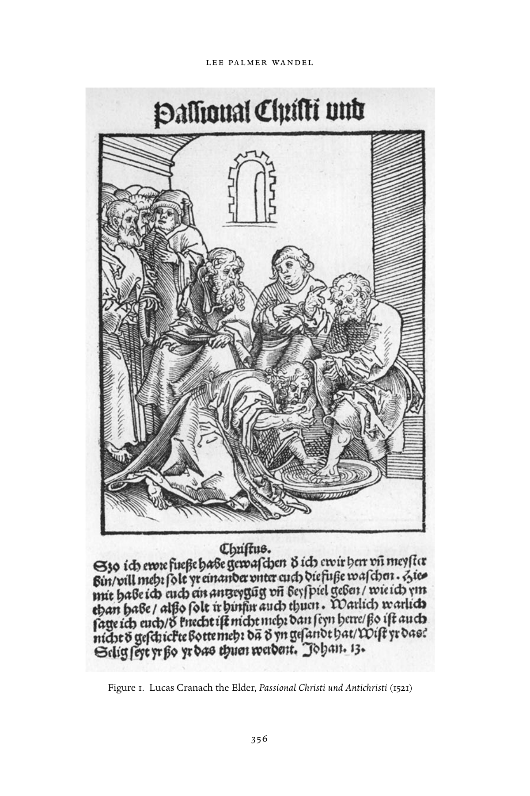
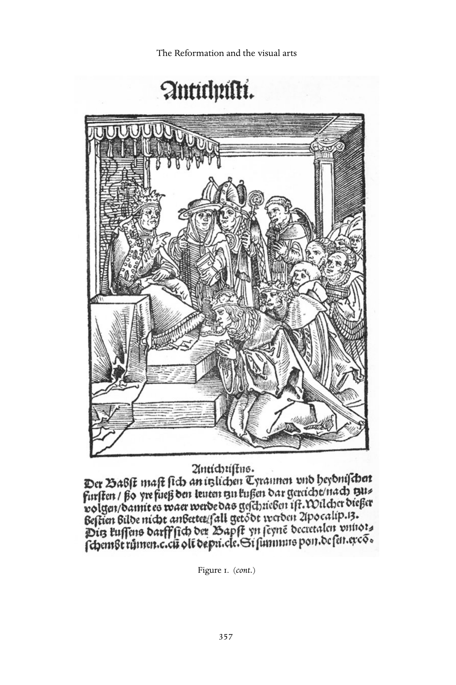
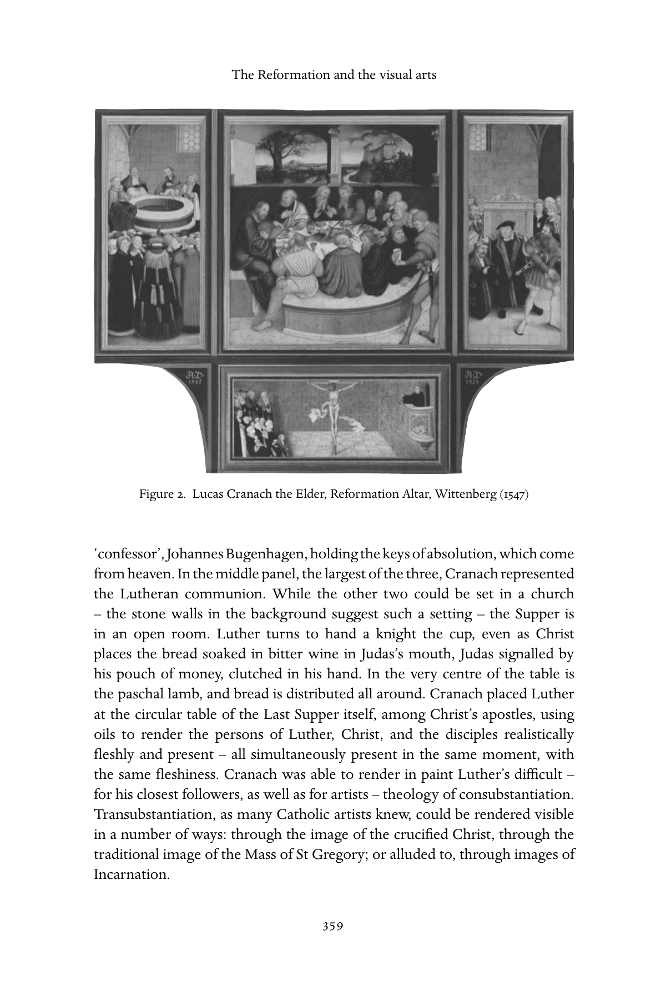
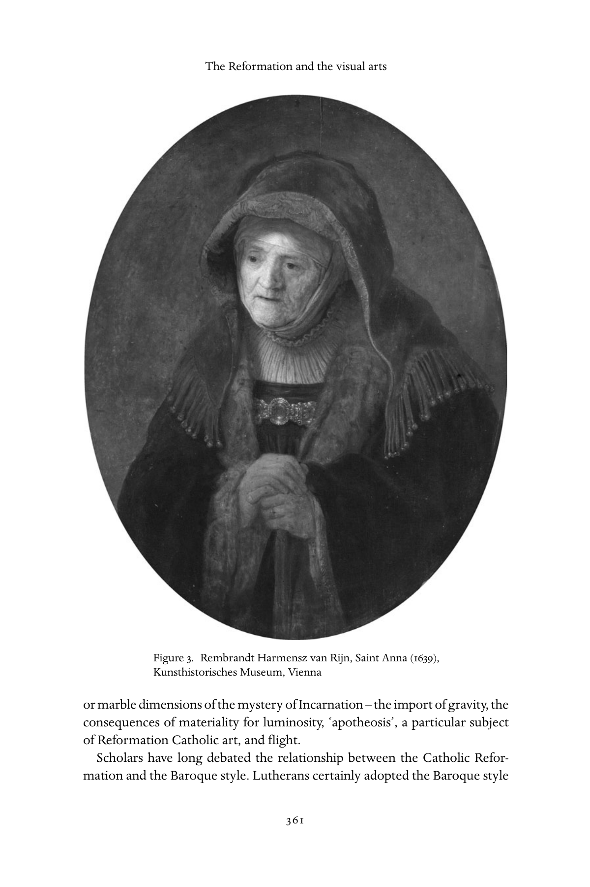
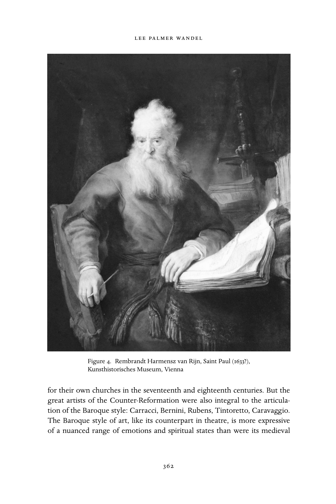
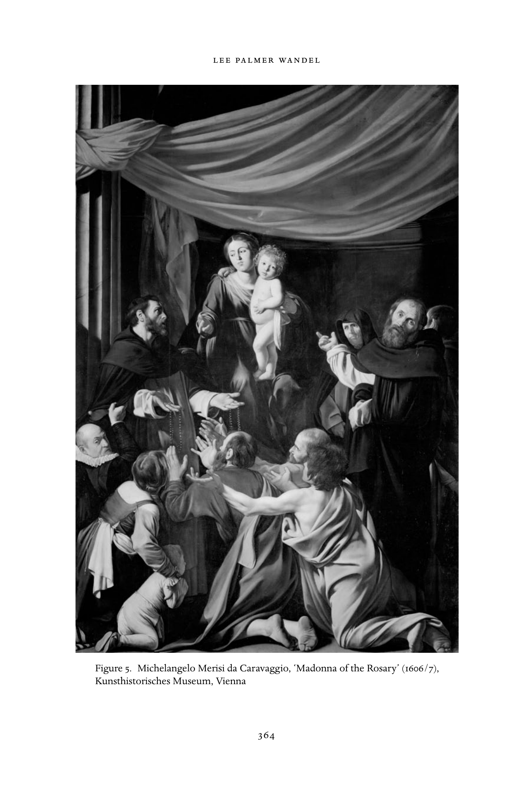
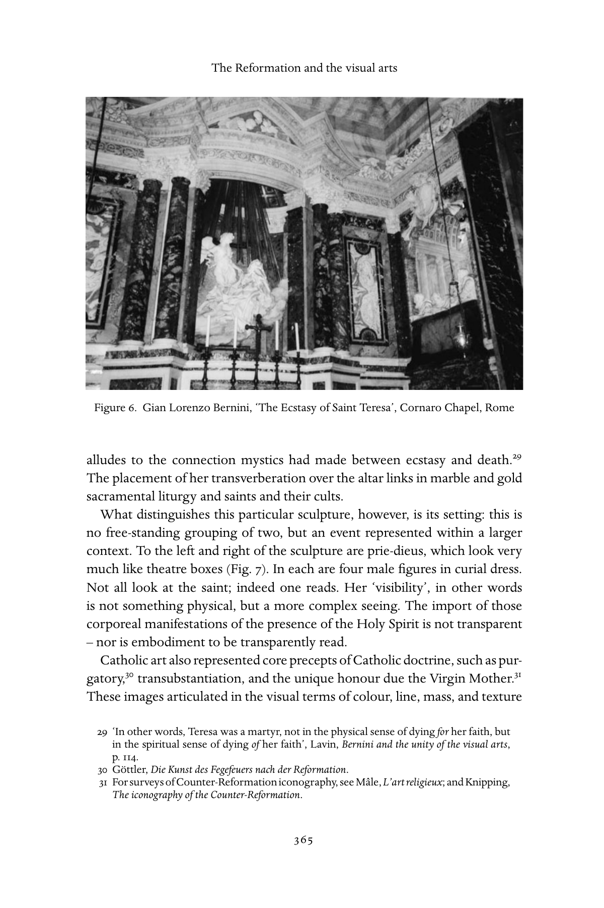
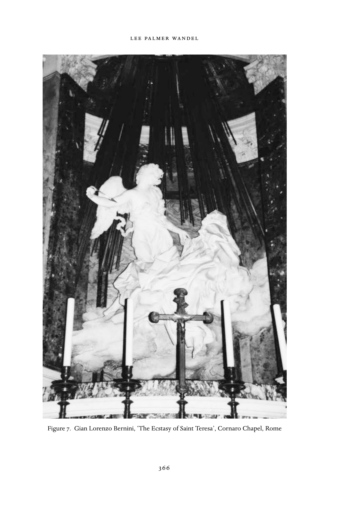
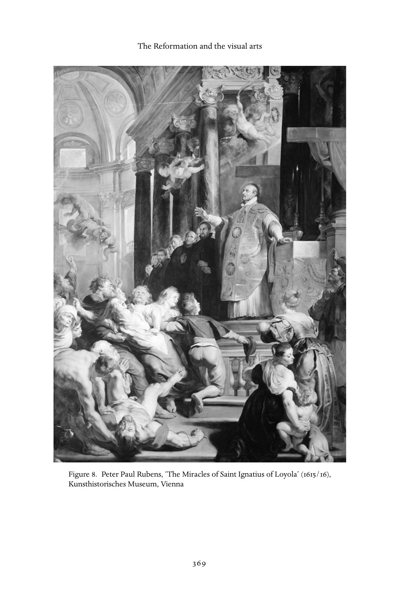

# 宗教改革与视觉艺术：英文转换底稿

<!-- PDF page 368; original page 345 -->

### 19

## The Reformation and the visual arts

### l e e pa l m e r wa n d e l

### The theology of Incarnation and the visual arts

Any consideration of the visual arts in the Reformation must begin with the Incarnation.[^p368-1] Throughout their history, Christians have struggled with what it means that, in the words of the Gospel of John, ‘the Word was made flesh’ (1:14, KJV). The Incarnation overthrew the opposition many different schools of classical thought, from the presocratics through the Stoics, had posited: of flesh to spirit, matter to mind. For no Christian could ‘flesh’, or matter, be completely severable from ‘the Word’ or God – the two were bound together in Christ, and to state otherwise was heresy.

The Incarnation also overthrew the Jewish prohibition of images. As both Rome and Constantinople declared during the iconoclastic controversies of the eighth and ninth centuries, if God could take on the flesh, then material representations of Christ in some essential way belonged on a continuum in which matter could serve to make divinity present to the eyes of the faithful. With the rise of the cult of the saints in the high Middle Ages, that continuum came to encompass images of saints, which revealed God’s hand in the lives of Christians after the life of Christ. Thomas Aquinas, explicating the conse- quences of those pronouncements, explicitly located visual representations on an unbroken line that began with Jesus, then Mary, and then the saints, and ended with man-made visual representations, first of Christ, then Mary, and finally, the saints.

The proliferation of images in churches[^p368-2] coincided with the increasingly important function accorded images in a number of medieval theories of memory and cognition. For several theorists, images were central to the

[^p368-1]: The text of the Nicene Creed sets forth the doctrine of the Incarnation. For the text, see Tanner, Decrees of the ecumenical councils, vol. 1, p.5.

[^p368-2]: For close studies of the interplay of incarnational theology and medieval art, see Kessler and Wolf, The holy face, for the West, Pelikan, Imago Dei, for the East. More generally, see Hans Belting, Bild und Kult.

<!-- PDF page 369; original page 346 -->

organization and retention of received knowledge.[^p369-3] For them, human beings both remembered their learning and made sense of it through images in their minds, which themselves could be drawn from visual experience. Such a posi- tion provided powerful support for images, from illuminated prayer books for the laity through carved altar retables in churches in the use of contemplation and devotion.

For Christians, whether one was Protestant or Catholic, Reformed or Lutheran, Roman or Orthodox, ‘representation’ was never a simple prob- lem of perspective and proportion. The visual arts were viewed within the context of how one understood Christ – and God – to be present in the phys- ical world. Sixteenth-century Christians were divided on the question, not if God revealed himself through matter, but if and how human hands could have any part at all in that revelation. In the sixteenth century, Christians asked the agonized and agonizing question: could any human-made ‘representation’ reveal anything of God’s, or Christ’s, nature or truth? Their answers, revealed in their catechisms and in their preaching, divided them. To be ‘Catholic’ was to align oneself with a tradition reaching back to the eighth- and ninth-century iconoclastic controversies, which repeatedly endorsed the centrality of repre- sentation to Christian culture. To be ‘Lutheran’ was to hold images to be indifferent to worship. To be ‘Reformed’ was, foremost, to reorganize the Ten Commandments, such that the prohibition against human-made images was a commandment unto itself.

In the sixteenth century, the formal Catholic position echoed the concep- tualization of images and their relationship to divinity worked out in the iconoclastic controversies and most fully articulated by Thomas Aquinas.[^p369-4] That position, as it was decreed at Trent, had two central components. First, it affirmed the closely defined place of images in devotion:

> And they must also teach that the images of Christ, of the virgin mother of God and the other saints should be set up and kept, particularly in churches, and that due honour and reverence is owed to them, not because some divinity or power is believed to lie in them as reason for the cult, or because anything is to be expected from them, or because confidence should be placed in images as was done by pagans of old; but because the honour showed to them is referred to the original which they represent: thus, through the images which we kiss and before which we uncover our heads and go down on our knees, we give adoration to Christ and veneration to the saints, whose likeness they

[^p369-3]: Carruthers, The book of memory.

[^p369-4]: For a summary of older literature and an inflfluential formulation of the question, see Prodi, ‘Ricerche sulla teorica delle arti figurative’.

<!-- PDF page 370; original page 347 -->

> bear. And this has been approved by the decrees of the councils, especially the second council of Nicaea, against the iconoclasts.

Second, it affirmed the cognitive function of images in the complex of educa- tion in Christianity:

> Bishops should teach with care that the faithful are instructed and strength- ened by commemorating and frequently recalling the articles of our faith through the expression in pictures or other likenesses of the stories of the mysteries of our redemption; and that great benefits flow from all sacred images, not only because people are reminded of the gifts and blessings con- ferred on us by Christ, but because the miracles of God through the saints and their salutary example is put before the eyes of the faithful, who can thank God for them, shape their own lives and conduct in imitation of the saints, and be aroused to adore and love God and to practise devotion. If anyone teaches or holds what is contrary to these decrees: let him be anathema.[^p370-5]

For the Church of Rome, images had a long-standing and carefully delineated place within the economy of worship, serving not only the illiterate – the great majority of Christians in the early modern world – but all Christians through their capacity to ‘put before the eyes of the faithful’ manner, bearing, acts of faith, expressions of devotion; to ‘remind’, to call to mind again, the ‘gifts’ of the Incarnation.

Martin Luther himself held all images to be adiaphora, unimportant.[^p370-6] His radical emphasis on faith did not accord images, qua matter, the same potency as did either Catholic or even Reformed positions – images, for Luther, by their very materiality, were not capable of seducing or illumining the soul. Others, who largely agreed with the major tenets of his theology, strongly disagreed with his position on images. While Luther was in hiding at the Wartburg, for instance, Andreas Bodenstein von Karlstadt preached iconoclasm in Witten- berg and published ‘On the Removal of the Images’, in which he listed all the biblical injunctions against any representations of God.

Karlstadt’s position echoed that of the most radical evangelicals – those who took the commandment against images absolutely. Most of those groups met clandestinely – and therefore had no sites where images might have been placed. Some of the most outspoken iconoclasts number among their

[^p370-5]: Tanner, Decrees of the ecumenical councils, vol. 2, p.776, Latin text, p. 775.

[^p370-6]: ‘Bilder / glocken / Messegewand / kirchenschmueck / allter liecht und der gleichen / halt ich frey / Wer da wil / der mags lassen / Wie wol bilder aus der schrifft und von guten Historien ich fast nuetzlich / doch frey und wilkoerig halte / Denn ichs mit den bildestuermen nicht halte.’ Martin Luther, Vom Abendmahl Christi, p.514.

<!-- PDF page 371; original page 348 -->

members, however, which suggests that many of those who broke with Luther and Huldrych Zwingli found images anathema to worship.[^p371-7]

John Calvin was not hostile toward the visual arts per se:

> And yet I am not gripped by the superstition of thinking absolutely no images permissible. But because sculpture and painting are gifts of God, I seek a pure and legitimate use of each, lest those things the Lord has conferred upon us for his glory and our good be not only polluted by perverse misuse but also turned to our destruction.[^p371-8]

For Calvin, the problem was not images themselves, but what those images represented and who created them.[^p371-9] Insofar as all images were made with human hands, they reflected human conceptions of God and Christ; insofar as human beings directed devotion towards those images, they were worship- ping their own conceptions of God and Christ. The danger lay not in the images themselves, but in human presumption that the images revealed God transparently. For Calvin, God ‘represented’ himself in light, in the ordering of nature – materially, but not artificially.

### Iconoclasm

Perhaps most striking, the theologians’ positions were largely formulated in reaction to violence against images.[^p371-10]  None of the theologians, other than Karlstadt and, possibly, Martin Bucer in Strasbourg, condoned that violence. Unlike Luther, Calvin, or Zwingli, lay Christians, ordinary men and women, held the question of images to be absolutely urgent – souls were at stake – even as they voiced a wide range of different understandings of images and their place in worship. In community after community, Christians polarized, some calling the acts of verbal or physical violence against the images in their churches ‘blasphemy’, an assault against God, others calling those same images ‘idols’, and calling for their destruction ‘for the honour of God’. These debates were framed not in terms of proportion or craftsmanship or aesthetics, not in any aesthetic terms at all, but in terms of worship: how does one best honour God? At no other time had images been so central to so many Christians in the determination of true worship.

[^p371-7]: Klaus Hottinger of Zurich, for example; see Wandel, Voracious idols and violent hands, pp. 72–80.

[^p371-8]: Calvin, Institutes, p.112.

[^p371-9]: On Calvin’s position on images more generally, see Wencelius, L’estheˆtique de Calvin.

[^p371-10]: Wandel, Voracious idols and violent hands.

<!-- PDF page 372; original page 349 -->

In parishes throughout Europe – from Poland on the east to south-western France, from Switzerland to Scotland and Sweden – individual Christians ‘took down the idols’.[^p372-11]  For many, in doing so, they were putting their own lives at risk: blasphemy was, in many communities, a capital crime. For many, iconoclasm, violence whether verbal or physical, was an act of faith, an act, moreover, which put them at risk of becoming martyrs. ‘Iconoclasm’ encompassed a range of acts. The earliest iconoclasts might attack a single altar retable in the middle of the night. Some simply carried the objects out of the churches. Those objects might be returned to the families of the original donors or, more often, simply ‘disappear’. More often, iconoclasts smashed images in their places, breaking representations into the material of which they had been made, stone or wood. Indeed, in communities which legalized iconoclasm, the wood was frequently given to the poor to heat their homes, the stone reused as cobblestones, and the cloth given to the poor for clothing. And in spectacular cases, such as Basel in 1529 and throughout the provinces of the Low Countries during the Won- deryear in 1566, crowds contemporaries numbered in the hundreds broke into churches, smashed all the objects associated with worship – representational art, liturgical implements, stained glass windows, altars, and missals.

For many Christians, iconoclasm was inseparable from ‘Reformation’. Removing the false idols was essential to the institution of true worship. Those ‘idols’ participated in a number of affronts against God, as delineated by different iconoclasts. Crucifixes and altars participated in a particular concep- tualization of the mass as a sacrifice, a sacrifice that Luther, Zwingli, Calvin, and dozens of other evangelicals preached had been made once for all time at the crucifixion. Images of the saints as well as their relics participated in the cult of saints, which distracted the devout from concentrating exclusively and intensively on the life of Christ alone as the model of sanctity and the revela- tion of divine mercy. Images of Mary also drew the attention of the faithful away from the central salvific meaning of Jesus’s life, as well as diminishing Christ’s divinity and majesty. All the different kinds of images – from repre- sentational art through the golden chalices, the jewelled missals, and the oil lamps – embodied wealth that ought to have been spent in ‘love of one’s neigh- bour’, for the care of the poor. For those who tore them down and destroyed them, images were ‘powerful’ certainly: capable of drawing the faithful away from God and towards human conceptions of worship, of the meaning of Christ’s life, and of God.

[^p372-11]: For literature on iconoclasm in different nations, see Wandel, Voracious idols and violent hands, p.13, note 31. For the most recent study, see Macht und Ohnmacht der Bilder.

<!-- PDF page 373; original page 350 -->

In the years between the Edict of Nantes and its Revocation in France, 1598– 1685, de facto after 1572 and legally after 1648, in the United Provinces, where specific Reformed churches or congregations had the legal authority and the local power to so institute, they removed ‘idols’ from their churches. Which specific images constituted ‘idols’ was not consistent from congregation to congregation, but the generally accepted definition of ‘idols’ was anything – not simply representational art, but also liturgical objects, altars, vestments – that led to false worship, that led the faithful, in other words, from close attention to the Word of God as it was preached and lived. The political situation within the Empire was even more volatile, and any number of churches witnessed ‘cleansing’, then ‘recatholicization’, in which the interiors of Catholic churches were consciously and explicitly reclaimed with sculpture, panel paintings, altar retables, as well as putti and prophets and apostles carved right into the architecture.

### The production of images

Christians were divided on the content of religious images and the sites, but Catholic, Lutheran, and Reformed Christians all continued to commission religious art. Protestant and Catholic art alike continued to be produced in workshops, each with a master, journeymen, and apprentices. Artists used the same substances – ink, chalk, oil, marble, stone, wood, copper, iron – for Protestant and Catholic commissions alike. While new media, such as oil, and new techniques, such as etching, emerged in this period, those media and techniques do not seem to belong to one church or another: Rembrandt van Rijn used the technique of chiaroscuro he had seen in the work of Caravaggio to render evangelical biblical scenes. Most artists, moreover, worked in multiple media.

Modes of production played a role in the history of the visual arts in the Reformation – not reflecting confessional divides so much as the changing character of ‘Reformation’ over the course of the period. We can trace a shift, from the early years, when print served the immediacy of polemics, to the years of the establishment of churches, when patrons commissioned more durable and stable forms of art.

The earliest Reformation images were printed. In the 1520s and 1530s, Protes- tants took up woodcuts foremost. Woodcuts were perhaps the cheapest image of all to produce – in part because of the materials involved, in part because of the lesser value of the skilled labour – and therefore affordable for a greater number of people. They were certainly the quickest to produce, far more

<!-- PDF page 374; original page 351 -->

easily appropriated for the polemics of the early years, when Christians were defining theological positions, liturgy, and ethics in opposition to one another.

Printed images were produced in a way that set them and how they func- tioned apart from painted and sculpted images.[^p374-12]  Printed images were pro- duced on a less-durable material, paper. The subject of early sixteenth-century prints was itself more transient: their polemics were very much of the moment. There is evidence that printed images were hung – in taverns as well as homes and churches. But prints seem to have functioned in ways that the majority of sculpted and painted images could not: while private devotional diptychs and triptychs might travel with their wealthy patrons, printed images travelled on the road, in a pocket or knapsack, from hand to hand, into the workplace, and into the homes of artisans and peasants. They carried visualizations to places where no other images might be found.

In the 1520s, many communities north of the Alps ceased the production of painted and sculpted images. When painted and sculpted images were again produced, largely using traditional methods and materials, their commissions, their placement, their content, and the ways in which they were understood to function in devotion all reflected a divided Christendom.

### Patronage and sites for images

Patronage was very much an expression of confession. For Catholics, images were an important means of proselytizing and conversion. Catholics invested capital, cultural and financial, in images. Rome and Antwerp were major centres of artistic production. Catholic families, both great and humble, paid to replace images, altarpieces, choir screens, stained glass windows in churches that were ‘recatholicized’. The great papal families – the Farnese, the Borghese – were also great patrons of the arts, endowing monumental sculp- tural programmes for more public spaces in churches, altarpieces from major artists for their ‘private’ chapels, into which all the faithful could look, as well as more intimate forms of devotional art. Politically powerful Catholic families, such as the Medici and the Habsburgs, also demonstrated their faith through the endowment of chapel altarpieces and more public sculpted or painted images, as well as the construction of chapels and the renovation or restora- tion of churches. Catholics, lay and clerical, commissioned richly illuminated devotional books and private devotional images. Those commissions were themselves acts of devotion, efforts to promulgate the faith, at first among the

[^p374-12]: Griffifiths, Prints and printmaking.

<!-- PDF page 375; original page 352 -->

Flemish, Bavarians, and Polish, but soon among the Inca, Aztec, Chinese, and other indigenous peoples of the Americas and Asia.

Lutherans, like Catholics, continued to commission images for their churches, but those images were more narrowly didactic. We know less of individual patrons: images were not evidence of their devotion, so the record of commissions is less public, and their patronage is less studied than that of the great Catholic families. With the institution of Lutheran churches, Lutherans commissioned painting for the interiors of their churches, and after the Peace of Augsburg, funerary sculpture, architectural sculpture, and friezes of bibli- cal narratives.[^p375-13]  Within Luther’s lifetime, Lucas Cranach the Elder produced a number of altarpieces for Lutheran churches in Saxony, each one of which seems to have been paid for by local Lutheran families. So, too, Cranach, Holbein, and others were commissioned to produce illustrations – woodcuts and engravings – for Luther’s translation of the Bible.[^p375-14]

The Reformed tradition does not present a uniform pattern of patronage. French Huguenot bourgeois eschewed, apparently, all public religious art. Dutch Reformed merchants, on the other hand, were the market for Rem- brandt’s paintings and prints of biblical figures and narratives – though those images were neither commissioned, nor placed in public places of worship. Those merchants did commission both funerary sculpture for some of their churches and painted wooden panels depicting the Ten Commandments.

Christians from all three of the major traditions patronized the arts. Patron- age differentiated confessionally over whether art belonged within the public space of worship. Catholics commissioned religious art for both public and domestic spaces, both technically ‘civic’ and ecclesiastical domains, ranging from monumental to intimate in scale. Lutherans, too, commissioned art for their churches, as well as illustrated bibles. Both Catholics and Lutherans com- missioned images that were placed where laity and clergy alike worshipped, where anyone, therefore, who wished to see them might have access to them, to gaze at them, to kneel before them, to pray. Only Catholics, however, saw images as very much central to the project of missionizing in Europe, the Americas, and Asia. Catholics and Lutherans commissioned images for different purposes.

Of the major traditions, the Reformed Church sought most to circumscribe where and how religious images were to be seen. Huguenots barred paint- ings, statues, and stained glass from the buildings in which they worshipped.[^p375-15]

[^p375-13]: Smith, German sculpture of the later Renaissance.

[^p375-14]: Schmidt, Die Illustration der Lutherbibel, pp.93–161.

[^p375-15]: Mentzer, ‘The Reformed churches of France’ Seeing Beyond the Word, p.228.

<!-- PDF page 376; original page 353 -->

Dutch Reformed congregations, insofar as their political situation allowed them to act, ‘cleansed’ their churches of medieval paintings, relics, and altars; reoriented the space itself around the pulpit; and some hung on the walls boards painted with the Ten Commandments.[^p376-16]  Reformed churches were largely distinguished by those white-washed walls that Zwingli had found so ‘beautiful’ – their visuality lies outside the scope of this essay. Most Reformed art was commissioned for private homes, for a different viewership and with a different function.

### Confession and the content and function of images

Annibale Carracci, Peter Paul Rubens, and Bernini were ‘Catholic’ artists, Cranach, ‘Lutheran’, and Rembrandt, ‘Reformed’. All sought to articulate in matter – in mass and texture and line and colour – religious visions. They did not differ in the materials they used or in the process of production. The major traditions divided on what might be represented and, inseparable from that prescription of content, how an image might function in devotion.

### The printed image and ‘Reformation’

Even as they were removing ‘idols’ from their churches, Protestants promul- gated ‘Reformation’ through printed images.[^p376-17]  Printed images differed from the images in the churches in important ways. They were two-dimensional, and therefore never ‘life-like’. They were linear, closer in appearance to the printed page than to the sensuous image. They were usually printed on paper, a sub- stance that deteriorated rapidly, its transience also undercutting the potential for an image to become an idol. Finally, the subject of Protestant printed images was largely polemical, as distinct from devotional, the images of Christ, for example, set within biblical narratives and next to scripture itself, or in explicit contrast to the conduct of clergy and pope.

Protestants used printed images in two contexts that were linked in the larger project of promulgating the evangelical message: printed bibles and visual polemics. Protestant bibles, which were put on the Roman Index, sought to reach populations of mixed literacy; many, therefore, carried hundreds of images, sometimes beautifully hand-coloured. And two of the most successful artists of the sixteenth century, Holbein and Cranach, designed images for Zwingli’s and Luther’s translations of the Bible, respectively. The woodcuts

[^p376-16]: Section on the Netherlands, Finney, Seeing beyond the word, pp.343–425.

[^p376-17]: Scribner, For the sake of simple folk.

<!-- PDF page 377; original page 354 -->

from these bibles were taken up, copied, used in other contexts, carrying the evangelical message in ways that their designers may never have intended.

Protestants printed images in unprecedented numbers, not only to carry visually the Holy Scripture to the world, but also to challenge Rome’s claim to primacy, to dispute a range of practices of the medieval church, to delineate clerical abuses, and to articulate in minute visual detail the contrast between the ‘True Church’ and the Church of Rome. It may be that printed images were the most effective tool of a group who began as both a demographic and a political minority, but Catholics, whether German, Roman, Flemish, or French, never took up printed images with the same intensity or sheer proliferation for the purposes of polemics.

While printed images were simpler, lacking colour or plasticity, they shared with painting, sculpture, and performances complex visual languages of sym- bols, signs, clothes, objects, gestures, faces, and articulated physical relations.[^p377-18] Printed images drew upon a plethora of symbols, both traditional and new to the sixteenth century, from the ubiquitous cross with its complex theological meaning, as well as its immediate connotation of Christianity, or the dove, to the fleur de lis of France or the two-headed eagle of the Empire, to Luther’s rose, for some a symbol of faith and true Christianity. Thousands of familiar objects served as signs: the thresher or the pike, for example, signalled kinds of labour; the sceptre, relations of secular power; the altar, or the chalice or the host, which could signal either the mystery of the mass or blasphemy and idolatry, depending on the viewer. Analogous to these signs were what we might call visual metaphors: the monk’s belly, signalling a life lived too well; the nun’s sidelong glance, signaling a promiscuity that contradicted the oath the habit signalled; the uplifted face, signalling luminous faith; the hands pressed together in prayer. Clothes might signal rank, such as fur or the royal ermine; or office, the key of the magistrate or the cardinal’s hat; or labour, the artisan’s tunic or the peasant’s clogs; or character, the fool’s cap. Some pieces of clothing could stand for the person or the office: the pope’s tiara served frequently to signal one or the other. One of the most effective and famous Catholic polemical images, ‘The Seven-headed Luther’, published as the title- page of a 1529 pamphlet by Johannes Cochleus, used the turban of the Turk, the hood of the Eastern Orthodox patriarch, flies or ‘Schwärmerei’, and the head of Barrabbas to link Luther to the most feared enemies of Christendom. Two of the most popular polemical single-sheet images, the monk calf and the papal ass, linked two famous monstrous births, the one through the cowl to

[^p377-18]: Andersson, ‘Popular imagery’.

<!-- PDF page 378; original page 355 -->

the religious, and the other, through the physical setting of the Tiber, to the pope.

The polemic of Reformation prints most often operated through opposi- tions, which were articulated in the visual terms of gesture, facial expression, and relations between figures. The woodcut, ‘The Godly Mill’, for instance, articulated contrast through the language of placement: those who were ‘evan- gelical’, Erasmus and Luther, were close to the gospels, and the cardinals, monks, and curia, signalled by their habits, were remote. Lucas Cranach the Elder’s Passional Christi und Antichristi, a series of thirteen paired woodcuts published in Wittenberg in 1521, contrasted Christ’s gesture, demeanour, and relation to his followers, to those of the pope (Fig. 1). It was all the more effective for recalling the thousands of images of Christ’s humility and poverty, so familiar to Christians from their own churches, and articulating explicitly in line and placement how papal gesture, conduct, demeanour, dress, and court contrasted. Some Dutch engravings contrasted the two major forms of papal idolatry – the mass and the use of images in worship – to Reformed iconoclasm, which removed altars as well as images. Many polemical prints heightened the contrast through the exaggeration of gesture or the addition of physical attributes, such as a belly, that connoted inner character.

Gesture, facial expression, and relations between figures were also the cor- poreal language of devotion. Even as they contrasted evangelical demeanour and bearing to the superstitious attending mass, Protestant printed images depicted the proper demeanour of the faithful, as in those that showed the pious listening to evangelical preachers. In some broadsheets, the audience stands, in some the women are seated on the floor, but in all their persons are oriented towards the pulpit, their faces turned upward towards the preacher’s face and mouth. Hands are folded in the laps of the seated, neither holding rosary beads nor knitting. On the evangelical side of these prints, no one prays the rosary, speaks to a neighbour, knits, carves, and/or performs any other forms of manual production.

Images ‘spoke’ in a language rich in allusion to other images. A particular position of the head or hand, rendered in line or shadow, pointed to other images in other media; the outlined forms of shepherds or lambs ‘represented’ figures the viewer had seen in colour and mass elsewhere. Painted and sculpted images might refer to an arrangement of figures, a background, a particular rendering of Christ’s agency in printed biblical illustrations, caricatures, or broadsheets; wooden retables reproduced the gestures, figural arrangements, and facial expressions of biblical illustrations. All images, whether printed, painted, or sculpted, moreover, in capturing a gesture, an angle of the head,

<!-- PDF page 379; original page 356 -->

Figure 1. Lucas Cranach the Elder, Passional Christi und Antichristi (1521)

<!-- PDF page 380; original page 357 -->

Figure 1. (cont.)

<!-- PDF page 381; original page 358 -->

a particular expression of the hand, reached beyond themselves to human actors – some, in representing the carefully dictated movements of the liturgy, reached out to its lived performance; some, in representing the grasping hand of the monk, reached out to living religious. The play of visual allusion did not stop with images. The visual tropes of character that printed images attached to their representations – the belly to the monk, the glance to the nun, the hauteur to the pope – could attach to the persons of living human beings. That was their efficacy and their power.

### Lutheran art

Lutherans commissioned paintings and sculpture for their churches, but those representations were no longer to be understood on a continuum of revelation: even if medieval representations of saints might survive within the churches, those images provided models of behaviour, not foci for the cult of saints. In both function within worship and in content, Lutheran images differed from Catholic.[^p381-19]  Lutheran images were, in Luther’s own words, ‘for the sake of simple folk’, a part of a larger didactic enterprise. As such, they served along with catechisms to teach the fundamentals of Lutheran doctrine: the Ten Commandments, God as merciful Father, Christ’s central salvific role, the Lord’s Prayer, the nature and proper celebration of the sacraments. In the sixteenth and seventeenth centuries, the Ten Commandments, in particular, but also the Lord’s Prayer, were painted on boards that hung along the nave.

The first and most prolific of the early Lutheran painters, Cranach the Elder, also rendered in oil visualizations of fundamental tenets of Lutheran doctrine.[^p381-20]  In both printed image and in oil, he gave visual articulation to Luther’s conceptions of law and grace, rendering their opposition allegorically. In a series of major altarpieces, he rendered the Lutheran formulations of the sacraments of baptism and communion. In the ‘Reformation Altar’, completed in 1547 for the church of Mary in Wittenberg, Cranach represented the three sacraments in three panels, left to right: baptism, communion, confession (Fig. 2). The representation of baptism made visible the infancy of the recipient, a simple font, and the presence of the community. The representation of confession made visible its public and open character, with Luther’s own

[^p381-19]: MartinScharfedifferentiatedspecififickindsofProtestantimages–biblicalhistory,divinity, saints and ideal Christian behaviour, sacred acts and history, and the ideal Christian life and death – each of which existed in a distinctive relationship to its viewer, and was intended to invoke different responses. Scharfe, Evangelische Andachtsbilder. See also Christensen, Art and the Reformation.

[^p381-20]: Thulin, Cranach Altäre der Reformation; Hoffmann, Luther und die Folgen für die Kunst.

<!-- PDF page 382; original page 359 -->

Figure 2. Lucas Cranach the Elder, Reformation Altar, Wittenberg (1547) ‘confessor’, Johannes Bugenhagen, holding the keys of absolution, which come from heaven. In the middle panel, the largest of the three, Cranach represented the Lutheran communion. While the other two could be set in a church – the stone walls in the background suggest such a setting – the Supper is in an open room. Luther turns to hand a knight the cup, even as Christ places the bread soaked in bitter wine in Judas’s mouth, Judas signalled by his pouch of money, clutched in his hand. In the very centre of the table is the paschal lamb, and bread is distributed all around. Cranach placed Luther at the circular table of the Last Supper itself, among Christ’s apostles, using oils to render the persons of Luther, Christ, and the disciples realistically fleshly and present – all simultaneously present in the same moment, with the same fleshiness. Cranach was able to render in paint Luther’s difficult – for his closest followers, as well as for artists – theology of consubstantiation. Transubstantiation, as many Catholic artists knew, could be rendered visible in a number of ways: through the image of the crucified Christ, through the traditional image of the Mass of St Gregory; or alluded to, through images of Incarnation.

<!-- PDF page 383; original page 360 -->

### Reformed art

There is considerable debate as to what constitutes a ‘Reformed’ religious image, given that no images were commissioned for churches – the easiest way to define the religious identity of an image.[^p383-21]  Here, Rembrandt may serve as representative: the son of one member and the husband of another, Rembrandt seems always to have had a Bible in his house and to have been a churchgoer, but he was himself not a member of the Dutch Reformed congregation in Amsterdam.[^p383-22]  In an extraordinarily productive career, Rembrandt rendered in print and paint dozens of biblical scenes and figures (Figs. 3 and 4).[^p383-23]  All, whether painted or printed, are historical, that is, unlike medieval predecessors, dress and setting were of biblical times, as the seventeenth century understood it. All are explicitly situated within time, historical – by their very temporality and contingency resisting iconic use. Rembrandt’s biblicism, however, was not ‘typical’ in some ways: his rendering of biblical scenes reflected both a deeply personal interpretation of those narratives and his own engagement with the philosemitism of a broader community of biblical scholars.[^p383-24]

### Catholic art

The twenty-fifth session of the Council of Trent stipulated what the precise nature of each viewer’s relationship to images was to be. It was formulated in conscious response to the Protestant critique, with its particular understand- ing of the human mind and its vulnerabilities both to human creations and to matter of all kinds. That position did not capture all the ways that images were integral to Catholic devotion. It did not capture the significance of commis- sioning art. It did not capture the particular understanding of the relationship between God’s agency and revelation on the one hand and the physical world on the other that Catholic art, scrutinized for its theological orthodoxy and approved, ‘represented’ in oil and marble, colour and mass.

Even as Trent echoed ancient arguments for the didactic purposes of reli- gious images, artists in service of the church brought new techniques of light and shadow, a new monumental scale to the representation of Catholic saints and martyrdom. Artists explored in chalk, oil, marble, wood, and stone a com- plex interplay of spirit and flesh.[^p383-25]  They rendered in the heavy substance of oil

[^p383-21]: See, for example, Egbert Haverkamp-Begemann’s comment, in Finney, Seeing beyond the word, pp.423–5.

[^p383-22]: Arius Theodorus van Deursen, quoted in Zell, Reframing Rembrandt, p.6.

[^p383-23]: Visser t’ Hooft, Rembrandt and the gospel; Halewood, Six subjects of Reformation art.

[^p383-24]: See Zell’s compelling interpretation in Reframing Rembrandt.

[^p383-25]: Smith, Sensuous worship.

<!-- PDF page 384; original page 361 -->

Figure 3. Rembrandt Harmensz van Rijn, Saint Anna (1639), Kunsthistorisches Museum, Vienna or marble dimensions of the mystery of Incarnation – the import of gravity, the consequences of materiality for luminosity, ‘apotheosis’, a particular subject of Reformation Catholic art, and flight.

Scholars have long debated the relationship between the Catholic Refor- mation and the Baroque style. Lutherans certainly adopted the Baroque style

<!-- PDF page 385; original page 362 -->

Figure 4. Rembrandt Harmensz van Rijn, Saint Paul (1633?), Kunsthistorisches Museum, Vienna for their own churches in the seventeenth and eighteenth centuries. But the great artists of the Counter-Reformation were also integral to the articula- tion of the Baroque style: Carracci, Bernini, Rubens, Tintoretto, Caravaggio. The Baroque style of art, like its counterpart in theatre, is more expressive of a nuanced range of emotions and spiritual states than were its medieval

<!-- PDF page 386; original page 363 -->

and Renaissance predecessors.[^p386-26]  In both painting and sculpture, artists of the Catholic Baroque articulated in gesture and in posture just how the presence of the Holy Spirit was made visible in the human body – the presence of the Holy Spirit was manifested corporeally, not only in the face, but through the arms, the hands, the torso, the legs, even the feet (Fig. 5). Sanctity was made known precisely through the solid materiality of the human body, that same ‘flesh’ that could be represented in the substances of oil or marble.

Bernini’s work in the Cornaro Chapel, of the Church of Santa Maria della Vittoria, Rome exemplifies the particular interplay of embodiment, represen- tation, and epideic, in the Baroque (Fig. 6).[^p386-27]  The centrepiece of the chapel is the sculpture, ‘The Ecstasy of St Teresa’, but the sculpture is integrated, first within its own stage, set above the altar in the chapel, and then within a complex theatre of piety. That ‘ecstasy’ takes place before other human beings. The sculpture itself gives expression in marble to many of the quali- ties of Teresa’s piety. It renders in visible matter – gold, marble, dimension, weight – one of her frequent visions:

> It pleased the Lord that I should see this angel in the following way. He was not tall, but short, and very beautiful, his face so aflame that he appeared to be one of the highest types of angel who seem to be all afire. They must be those who are called cherubim . . . In hishands I saw a long golden spear and at the end of the iron tip I seemed to see a point of fire. With this he seemed to pierce my heart several times, so that it penetrated to my entrails. When he drew it out, I thought he was drawing them out with it and he left me completely afire with a great love for God. The pain was so sharp that it made me utter several moans; and so excessive was the sweetness caused me by this intense pain that one can never wish to lose it, nor will one’s soul be content with anything less than God.[^p386-28]

The two figures of angel and saint hang before golden rays, which serve also to carry light from a hidden source – giving visible form to a particular notion of divine emanation. The marble of the saint’s robes and the angel’s renders motion – precisely the opposite of the mass and solidity of the substance marble – even as the saint’s body, beneath those folds, is the site for transport: had she sat still and alone in her cell, such transport would never have been visible to another human being. In his particular rendering of her body, Bernini

[^p386-26]: Norman, The theatrical Baroque.

[^p386-27]: Lavin, Bernini and the unity of the visual arts, Part II.

[^p386-28]: The life of Teresa of Jesus, pp.274–5.

<!-- PDF page 387; original page 364 -->

Figure 5. Michelangelo Merisi da Caravaggio, ‘Madonna of the Rosary’ (1606/7), Kunsthistorisches Museum, Vienna

<!-- PDF page 388; original page 365 -->

Figure 6. Gian Lorenzo Bernini, ‘The Ecstasy of Saint Teresa’, Cornaro Chapel, Rome alludes to the connection mystics had made between ecstasy and death.[^p388-29] The placement of her transverberation over the altar links in marble and gold sacramental liturgy and saints and their cults.

What distinguishes this particular sculpture, however, is its setting: this is no free-standing grouping of two, but an event represented within a larger context. To the left and right of the sculpture are prie-dieus, which look very much like theatre boxes (Fig. 7). In each are four male figures in curial dress. Not all look at the saint; indeed one reads. Her ‘visibility’, in other words is not something physical, but a more complex seeing. The import of those corporeal manifestations of the presence of the Holy Spirit is not transparent – nor is embodiment to be transparently read.

Catholic art also represented core precepts of Catholic doctrine, such as pur- gatory,[^p388-30]  transubstantiation, and the unique honour due the Virgin Mother.[^p388-31] These images articulated in the visual terms of colour, line, mass, and texture

[^p388-29]: ‘In other words, Teresa was a martyr, not in the physical sense of dying for her faith, but in the spiritual sense of dying of her faith’, Lavin, Bernini and the unity of the visual arts, p. 114.

[^p388-30]: Göttler, Die Kunst des Fegefeuers nach der Reformation.

[^p388-31]: For surveys of Counter-Reformation iconography, see Maˆle, L’artreligieux; and Knipping, The iconography of the Counter-Reformation.

<!-- PDF page 389; original page 366 -->

Figure 7. Gian Lorenzo Bernini, ‘The Ecstasy of Saint Teresa’, Cornaro Chapel, Rome

<!-- PDF page 390; original page 367 -->

specific implications of orthodox doctrines at the centre of Catholic identity. In so doing, they gave visual definition to complex theological doctrines and were, therefore, themselves subject to close scrutiny for their orthodoxy.[^p390-32] Indeed, in the wake of Trent, contemporary humanists and theologians scru- tinized a number of paintings for theological orthodoxy.[^p390-33]  Those humanists and theologians were aware that theological doctrine not only could be ren- dered in oil and marble, but that those substances, like the printed word, could give expression to false or wrong doctrine.

These representations were, like Bernini’s Cornaro Chapel, not transparent or literal, but engaged fully with the artistic implications of Incarnation. Many artists and patrons chose as an affirmation of the Catholic doctrine of transub- stantiation one moment in the crucifixion. These paintings, normally hung over the high altar, would then participate in the performance of the mass, their represented motion a counterpart to the performed celebration, with the elevation, of the mass. Rubens, for example, painted the Raising of the Cross[^p390-34] for the parish church of St Walburga in Antwerp.[^p390-35]  The church no longer exists, but a painting by Anthoon Gheringh depicts the altarpiece, a triptych, over the high altar, which was itself on a raised apse – a series of elevations, of sacred apse, of altar, of altarpiece, and then of the body of Christ. As in all Rubens’s paintings, the colour of flesh dominates, Christ’s flesh lighter, more luminous, also forming in this image a diagonal line from the lower, sinister side to the upper right. The backs of the six labourers, as well as the arms and legs of the two soldiers, manifest in muscle the physicality of raising the cross. Here is no simple chemical transformation, but an event worked out through human bodies, realized in human agency, of central sacred meaning.

### Jesuit art

Of all the orders of the sixteenth century, the Jesuits embraced most fully the ‘power’ of images.[^p390-36]  Jesuit devotional woodcuts and engravings articulated carefully and in detail in line the particular facial expressions of devotion, trans- port, illumination.[^p390-37]  In rendering again in that same careful line the specific gestures of Christ and the distinctive relationships that he, and other biblical figures, had to others, these images provided the faithful with eloquent rep- resentations of embodied faith: how it looked, how it moved, how it existed

[^p390-32]: Dempsey, ‘Mythic inventions’.

[^p390-33]: Ibid.; and Hall, Renovation and Counter-Reformation.

[^p390-34]: On the theme of the Raising of the Cross, see Lawrence, ‘Before The raising of the cross’.

[^p390-35]: Belkin, Rubens, pp.103–13.

[^p390-36]: Wittkower, Baroque art: the Jesuit contribution.

[^p390-37]: Melion, ‘The art of vision’.

<!-- PDF page 391; original page 368 -->

in relationship to others. Those simple linear images were integrally a part of Jesuit ‘discipline’, showing the faithful, in line, how that faith, when so enacted, so brought into conformity with the demeanour and bearing and manner and conduct, would come to be embodied in a deeper sense, ‘disciplined’ in the Jesuit sense of a lived and conscious enactment of faith.

Jesuits explicitly took up images as a part of their programme of conversion of the peoples of Asia and the Americas and of reconversion of the peoples of Europe.[^p391-38]  They drew upon images to translate central Christian theological ideas to non-European cultures.[^p391-39]  They built new churches in Asia and the Americas, in the process connecting European visual traditions to local, at once preserving and transforming both.[^p391-40]  In the recatholicization of Bavaria, they commissioned new images for churches that had been ‘cleansed’, and built new churches, which were also visually rich (Fig. 8).[^p391-41]  In each milieu, the Jesuits both carried with them and commissioned from local artisans images that might bring to Europeans and to cultures whose languages the Jesuits had not yet mastered central theological concepts of Catholicism. When Pierre Biard arrived in 1610 with the first Jesuits at Acadia in Canada, for instance, ‘I took the occasion to give them images and to place a cross before their cabin, singing a Salve Regina’.[^p391-42]  The ‘neophytes’ among the Algonquins in the mid-seventeenth century turned their eyes to an image of the Virgin in times of suffering.[^p391-43]  So, too, the Jesuits foremost among the missionizing orders took up gold, its particular physical properties, to convey in material language qualities of God – no material captured quite so dramatically the ‘glory of God’.

In a number of devotional works, Jesuits suggested how they understood images to function in the processes of conversion and of deepening piety. Jerome Nadal commissioned a series of extraordinary images whose function was not to illustrate the text, but to focus the mind of the reader, to reach the soul through the eyes, not to ‘aid meditation’, but to bring the entire body into the act of meditation – eyes to heart.[^p391-44]  Jesuit art rested on the conviction that images might shape the perception of the world itself, through exercises;

[^p391-38]: Gagnon, La conversion par l’image.

[^p391-39]: Spence, The memory palace. On the complex interaction of native cultures and European missionizing Christianity, see Bailey’s excellent study, Art on the Jesuit missions in Asia and Latin America, 15 42–1773.

[^p391-40]: For specifific examples of the complex interplay of European Christian and indigenous cultures, see Bailey, Art on the Jesuit missions; and Vargas Ugarte, Los Jesuitas del Peru y el arte.

[^p391-41]: Baumstark, Rom in Bayern; Smith, Sensuous worship.

[^p391-42]: Gagnon, La conversion par l’image, p.15.

[^p391-43]: Ibid., p. 55.

[^p391-44]: Melion, ‘Artififice, memory, and Reformatio’ and ‘The art of vision’.

<!-- PDF page 392; original page 369 -->

Figure 8. Peter Paul Rubens, ‘The Miracles of Saint Ignatius of Loyola’ (1615/16), Kunsthistorisches Museum, Vienna

<!-- PDF page 393; original page 370 -->

train human cognition itself to attach immediately and, after time, without conscious decision, pious associations to visual stimuli, and thereby discipline a lived state of contemplative and visual devotion. Images, moreover, could teach that discipline to the illiterate and to non-Europeans.

### Conclusion

Both the Catholic and Reformed churches construed the question of images within the context of the Incarnation and the representation of God in the world. The Reformed Church, in keeping with its conception of human nature and of sin, circumscribed the use of images – which were human-made cre- ations, reflecting human values and perceptions – in worship. The Catholic Church, in keeping with its understanding of the operation of grace, took up images as important in a massive project of proselytization and conversion – images could touch the spirit, could render in matter the multiplex meaning of the Incarnation for humanity. Luther, with his radical emphasis on faith, gave images the least weight: in the tradition that looked to him as its founder, images remained, but they existed apart from the great drama of Incarnation.
