# 剑桥基督教史 第四卷：西欧基督教（约1100—约1500年）

编者：米里·鲁宾（Miri Rubin）、沃尔特·西蒙斯（Walter Simons）

原书2009年出版。全卷已译完，包含卷首资料、引言、七编、31章、脚注、参考书目与索引。原书页码与PDF页码均保留，便于对照。

- [卷首资料](#pdf-001)
- [引言](#pdf-021)
- [第一编 制度与变革（1100—1200年）](#pdf-029)
- [教士的贞洁与重整秩序的世界](#pdf-031)
- [罗马主教（1100—1300年）](#pdf-042)
- [宗教贫穷与对完美的追求](#pdf-059)
- [修道会与其他修会（约1100—约1350年）](#pdf-074)
- [第二编 基督教世界的塑造（1200—1300年）](#pdf-093)
- [神学框架](#pdf-095)
- [法律基础](#pdf-109)
- [物质支持之一：堂区](#pdf-119)
- [物质支持之二：修会](#pdf-127)
- [圣言及其传播](#pdf-134)
- [第三编 边界的建立](#pdf-153)
- [基督徒与犹太人](#pdf-155)
- [基督教世界与伊斯兰教](#pdf-169)
- [基督徒与异端](#pdf-190)
- [女人与男人](#pdf-207)
- [天堂、地狱与炼狱（1100—1500年）](#pdf-220)
- [第四编 基督教世界的形态](#pdf-237)
- [圣事生活](#pdf-239)
- [宗教声景：礼仪与音乐](#pdf-258)
- [图像及其用途](#pdf-274)
- [玛利亚](#pdf-303)
- [神秘主义与超越](#pdf-317)
- [第五编 运动中的基督徒生活](#pdf-329)
- [宗教生活的边缘：隐士与幽居者、悔罪者与第三会成员、贝居安女子与贝格哈德男子](#pdf-331)
- [圣徒与朝圣：新与旧](#pdf-344)
- [十字军与征服](#pdf-360)
- [第六编 基督教社会面临的挑战](#pdf-373)
- [镇压与权力](#pdf-375)
- [信仰与知识人（一）](#pdf-392)
- [信仰与知识人（二）](#pdf-414)
- [第七编 改革与更新](#pdf-425)
- [通过阅读、写作与榜样获得力量：新虔敬运动](#pdf-427)
- [邪魔与基督徒共同体](#pdf-440)
- [威克里夫主义与罗拉德派](#pdf-453)
- [修会中的严规改革](#pdf-466)
- [公共纯洁与纪律：国家与宗教更新](#pdf-478)
- [十五世纪的《圣经》](#pdf-492)
- [参考书目选编](#pdf-514)
- [索引](#pdf-577)

---

# 卷首资料

<!-- PDF page 1; original page unnumbered -->

<!-- 原书空白页 -->

<!-- PDF page 2; original page unnumbered -->

## 本卷简介

### 西欧基督教：约1100—约1500年

中世纪早期，欧洲形成复杂多样的基督教文化。约1100年起，世俗统治者、相互竞争的派别，以及富于感召力的个人，继续使基督教社会呈现多元而不断变化的面貌。本卷探讨中世纪晚期，欧洲基督徒生活所涉及的广泛制度、实践与经验。当时教士重新思考司祭、主教、教宗的角色，并展开雄心勃勃的平信徒教导计划。对平信徒而言，堂区宗教实践居于中心；但许多人还寻求其他途径，充实自己的基督徒生活。魅力型讲道者引领、世俗统治者支持的改革与更新浪潮，周期性席卷欧洲。同时，基督徒常因自身共同体内部及边境的非基督徒，而深感忧虑。本书以清晰易读的叙述，介绍这些复杂的历史过程，引导读者进一步探究。

**米里·鲁宾（Miri Rubin）**，伦敦大学玛丽女王学院中世纪史教授。近著包括《上帝之母：圣母玛利亚史》（Mother of God: A History of the Virgin Mary，2009）、《空洞王冠：中世纪晚期不列颠史》（The Hollow Crown: A History of Britain in the Late Middle Ages，2005）。

**沃尔特·西蒙斯（Walter Simons）**，达特茅斯学院历史系副教授。著有《女性之城：中世纪低地国家的贝居安共同体，1200—1565年》（Cities of Ladies: Beguine Communities in the Medieval Low Countries 1200–1565，2001）；与耶伦·德普洛赫、马蒂娜·德勒、斯蒂芬·范德普滕合编卢多·J. R. 米利斯《宗教、文化与中世纪低地国家：论文选》（Religion, Culture and Medieval Low Countries: Selected Essays，2005）；与彼得·阿尔纳德、玛莎·豪厄尔合编《北欧城市空间的生产力》（The Productivity of Urban Space in Northern Europe，2002）。

<!-- PDF page 3; original page unnumbered -->

<!-- 原书空白页 -->

<!-- PDF page 4; original page unnumbered -->

## 《剑桥基督教史》丛书说明

《剑桥基督教史》按时间顺序，全面叙述基督教从起源至今，在神学、思想、社会、政治、区域及全球各方面的发展。每卷都独立地为相应时期的研究，作出实质贡献；全套构成一部重要的学术参考著作。本丛书旨在提供全球视野。自早期开始，东方基督教、科普特基督教即获得充分关注；后来的非洲、远东、新大陆、南亚及其他非欧洲地区的基督教发展，也得到适当论述。各卷涵盖民间虔敬、基督教信仰的非正式表达，将基督徒塑造、敬拜与虔敬的社会学问题，置于广阔文化背景中考察。基督教与其他主要信仰的关系，也贯穿全书。本丛书将成为学者、学生的宝贵资源。

### 分卷目录

1. **起源至君士坦丁**；玛格丽特·M. 米切尔（Margaret M. Mitchell）、弗朗西丝·M. 扬（Frances M. Young）编。
2. **君士坦丁至约600年**；奥古斯丁·卡西迪（Augustine Casiday）、弗雷德里克·W. 诺里斯（Frederick W. Norris）编。
3. **中世纪早期基督教：约600—约1100年**；托马斯·诺布尔（Thomas Noble）、朱莉娅·史密斯（Julia Smith）编。
4. **西欧基督教：约1100—约1500年**；米里·鲁宾（Miri Rubin）、沃尔特·西蒙斯（Walter Simons）编。
5. **东方基督教**；迈克尔·安戈尔德（Michael Angold）编。

<!-- PDF page 5; original page unnumbered -->

### 分卷目录（续）

6. **宗教改革与扩张：1500—1660年**；夏伯嘉（Ronnie Po-chia Hsia）编。
7. **启蒙、复兴与革命：1660—1815年**；斯图尔特·J. 布朗（Stewart J. Brown）、蒂莫西·塔克特（Timothy Tackett）编。
8. **世界基督教：约1815—约1914年**；布赖恩·斯坦利（Brian Stanley）、谢里丹·吉利（Sheridan Gilley）编。
9. **世界基督教：约1914—约2000年**；休·麦克劳德（Hugh McLeod）编。

<!-- PDF page 6; original page unnumbered -->

## 剑桥基督教史

### 第四卷

### 西欧基督教：约1100—约1500年

米里·鲁宾、沃尔特·西蒙斯 编

<!-- PDF page 7; original page unnumbered -->

## 出版与版权信息

剑桥大学出版社：剑桥、纽约、墨尔本、马德里、开普敦、新加坡、圣保罗、德里。

剑桥大学出版社，The Edinburgh Building, Cambridge CB2 8RU, UK。

美国版由纽约的剑桥大学出版社出版。

出版社网站：www.cambridge.org；本书信息：www.cambridge.org/9780521811064。

© 剑桥大学出版社，2009年。

本出版物受版权保护。除法律规定的例外及相关集体许可协议所允许的情形外，未经剑桥大学出版社书面许可，不得复制本出版物的任何部分。

2009年初版。英国剑桥大学印刷所印制。

英国国家图书馆备有本书编目记录。

ISBN 978-0-521-81106-4，精装本。

剑桥大学出版社不对本书所引外部或第三方网站网址的持续有效性、准确性负责，也不保证这些网站的内容现在或将来始终准确、适当。

<!-- PDF page 8; original page vii -->

## 目录

以下页码均依原书。中文版另设可点击目录。

| 卷首资料 | 原书印刷页码 |
| --- | --- |
| 插图目录 | xi |
| 地图目录 | xii |
| 撰稿人 | xiii |
| 缩略语 | xv |
| 地图 | xvi |

| 篇目与作者 | 原书印刷页码 |
| --- | --- |
| [引言；米里·鲁宾、沃尔特·西蒙斯](#pdf-021) | 1 |
| [第一编 制度与变革（1100—1200年）](#pdf-029) | 9 |
| [第1章 教士的贞洁与重整秩序的世界；亨丽埃塔·莱瑟](#pdf-031) | 11 |
| [第2章 罗马主教（1100—1300年）；安东尼·佩龙](#pdf-042) | 22 |
| [第3章 宗教贫穷与对完美的追求；贝弗莉·梅恩·金茨勒](#pdf-059) | 39 |
| [第4章 修道会与其他修会（约1100—约1350年）；布赖恩·帕特里克·麦圭尔](#pdf-074) | 54 |
| [第二编 基督教世界的塑造（1200—1300年）](#pdf-093) | 73 |
| [第5章 神学框架；莱斯利·史密斯](#pdf-095) | 75 |

<!-- PDF page 9; original page viii -->

## 目录（续）

| 篇目与作者 | 原书印刷页码 |
| --- | --- |
| [第6章 法律基础；安德斯·温罗特](#pdf-109) | 89 |
| [第7章 物质支持之一：堂区；布里吉特·雷斯尔](#pdf-119) | 99 |
| [第8章 物质支持之二：修会；珍妮特·伯顿](#pdf-127) | 107 |
| [第9章 圣言及其传播；凯瑟琳·扬森](#pdf-134) | 114 |
| [第三编 边界的建立](#pdf-153) | 133 |
| [第10章 基督徒与犹太人；奥拉·利莫尔](#pdf-155) | 135 |
| [第11章 基督教世界与伊斯兰教；戴维·尼伦伯格](#pdf-169) | 149 |
| [第12章 基督徒与异端；彼得·比勒](#pdf-190) | 170 |
| [第13章 女人与男人；梅根·麦克劳克林](#pdf-207) | 187 |
| [第14章 天堂、地狱与炼狱（1100—1500年）；艾伦·E.伯恩斯坦](#pdf-220) | 200 |
| [第四编 基督教世界的形态](#pdf-237) | 217 |
| [第15章 圣事生活；米里·鲁宾](#pdf-239) | 219 |
| [第16章 宗教声景：礼仪与音乐；苏珊·博因顿](#pdf-258) | 238 |

<!-- PDF page 10; original page ix -->

## 目录（续）

| 篇目与作者 | 原书印刷页码 |
| --- | --- |
| [第17章 图像及其用途；萨拉·利普顿](#pdf-274) | 254 |
| [第18章 玛利亚；雷切尔·富尔顿](#pdf-303) | 283 |
| [第19章 神秘主义与超越；艾米·霍利伍德](#pdf-317) | 297 |
| [第五编 运动中的基督徒生活](#pdf-329) | 309 |
| [第20章 宗教生活的边缘：隐士与幽居者、悔罪者与第三会成员、贝居安女子与贝格哈德男子；沃尔特·西蒙斯](#pdf-331) | 311 |
| [第21章 圣徒与朝圣：新与旧；安德烈·沃谢](#pdf-344) | 324 |
| [第22章 十字军与征服；马库斯·布尔](#pdf-360) | 340 |
| [第六编 基督教社会面临的挑战](#pdf-373) | 353 |
| [第23章 镇压与权力；约翰·H. 阿诺德](#pdf-375) | 355 |
| [第24章 信仰与知识人（一）；约瑟夫·齐格勒](#pdf-392) | 372 |
| [第25章 信仰与知识人（二）；米夏埃尔·施托尔茨](#pdf-414) | 394 |

<!-- PDF page 11; original page x -->

## 目录（续）

| 篇目与作者 | 原书印刷页码 |
| --- | --- |
| [第七编 改革与更新](#pdf-425) | 405 |
| [第26章 通过阅读、写作与榜样获得力量：新虔敬运动；库恩·豪德里安](#pdf-427) | 407 |
| [第27章 邪魔与基督徒共同体；阿兰·布罗](#pdf-440) | 420 |
| [第28章 威克里夫主义与罗拉德派；坎蒂克·高什](#pdf-453) | 433 |
| [第29章 修会中的严规改革；伯特·鲁斯特](#pdf-466) | 446 |
| [第30章 公共纯洁与纪律：国家与宗教更新；罗伯托·鲁斯科尼](#pdf-478) | 458 |
| [第31章 十五世纪的《圣经》；克里斯托弗·奥克尔](#pdf-492) | 472 |
| [参考书目选编](#pdf-514) | 494 |
| [索引](#pdf-577) | 557 |

<!-- PDF page 12; original page xi -->

## 插图目录

以下数字为原书印刷页码。许可与图片来源，均为原书所载说明。

- **图14.1** 《班贝格〈启示录〉》，Msc.Bibl.140，叶53r，《最后的审判》；原书承班贝格国家图书馆许可刊载。203页。
- **图14.2** 《时祷书》彩饰首字母，叶197r，手稿133 M 131；原书承荷兰海牙皇家图书馆许可刊载。215页。
- **图15.1** 罗吉尔·范·德·魏登《七圣事》三联画，安特卫普皇家美术博物馆藏；图片由Reproductiefonds提供。220页。
- **图17.1** 橡木十字架苦像，比利时布鲁塞尔附近福雷的圣但尼教堂，约1160—1180年。版权及摄影：布鲁塞尔IRPA-KIK。261页。
- **图17.2** 《弗洛雷夫圣经》卷首画：阐释《约伯记》开篇经文；比利时默兹河谷弗洛雷夫普雷蒙特雷会修院，约1150年。伦敦大英图书馆，add. ms. 17738，叶3v。摄影：大英图书馆。263页。
- **图17.3** 亚眠圣母主教座堂：中殿与后殿交接处；法国北部，十三世纪。摄影：akg-images/Erich Lessing。268页。
- **图17.4** 《启示录》16:4注释插图局部；《道德诠释圣经》，巴黎，约1225年。维也纳奥地利国家图书馆图片档案，cod. 1179，叶236d。摄影：奥地利国家图书馆。273页。
- **图17.5** 基督—约翰群像，圣约翰将头靠在耶稣胸前；施瓦本／博登湖地区，十四世纪初。慕尼黑巴伐利亚国家博物馆，藏品号65/38。摄影：Andreas Praefcke；公有领域。275页。
- **图17.6** 象牙念珠末端珠，正面为相拥恋人，背面为爬满蛆虫的可怖骷髅；德意志，十六世纪。纽约大都会艺术博物馆，J. Pierpont Morgan于1917年捐赠，17.190.305。摄影：©大都会艺术博物馆。279页。

<!-- PDF page 13; original page xii -->

## 地图目录

| 图号与标题 | 原书印刷页码 |
| --- | --- |
| 图1 西欧：约1100—约1500年 | xvi |
| 图2 欧洲的大学 | xviii |
| 图3 中世纪晚期的意大利 | xx |
| 图4 低地国家：约1100—约1500年 | xxi |

<!-- PDF page 14; original page xiii -->

## 撰稿人

以下机构、职务及前述编者近作，依原书2009年刊行时记载。

| 撰稿人 | 所属机构／地址 |
| --- | --- |
| 约翰·阿诺德（John Arnold） | 英国，伦敦大学伯克贝克学院历史、古典学与考古学院 |
| 艾伦·E. 伯恩斯坦（Alan E. Bernstein） | 美国图森，亚利桑那大学历史系 |
| 彼得·比勒（Peter Biller） | 英国，约克大学历史系 |
| 阿兰·布罗（Alain Boureau） | 法国巴黎，社会科学高等研究院 |
| 苏珊·博因顿（Susan Boynton） | 美国纽约，哥伦比亚大学音乐系 |
| 马库斯·布尔（Marcus Bull） | 英国，布里斯托尔大学历史研究系 |
| 珍妮特·伯顿（Janet Burton） | 英国，威尔士大学兰彼得分校历史系 |
| 雷切尔·富尔顿（Rachel Fulton） | 美国，芝加哥大学历史系 |
| 坎蒂克·高什（Kantik Ghosh） | 英国，牛津大学三一学院 |
| 库恩·豪德里安（Koen Goudriaan） | 荷兰，阿姆斯特丹自由大学 |
| 艾米·霍利伍德（Amy Hollywood） | 美国马萨诸塞州剑桥，哈佛大学神学院 |
| 凯瑟琳·扬森（Katherine Jansen） | 美国华盛顿特区，美国天主教大学历史系 |
| 贝弗莉·梅恩·金茨勒（Beverly Mayne Kienzle） | 美国马萨诸塞州剑桥，哈佛大学神学院 |
| 亨丽埃塔·莱瑟（Henrietta Leyser） | 英国，牛津大学圣彼得学院 |
| 奥拉·利莫尔（Ora Limor） | 以色列特拉维夫，开放大学 |
| 萨拉·利普顿（Sara Lipton） | 美国石溪，纽约州立大学石溪分校历史系 |
| 布赖恩·帕特里克·麦圭尔（Brian Patrick McGuire） | 丹麦，罗斯基勒大学中心历史系 |
| 梅根·麦克劳克林（Megan McLaughlin） | 美国艾奥瓦城，艾奥瓦大学历史系 |
| 戴维·尼伦伯格（David Nirenberg） | 美国，芝加哥大学社会思想委员会 |
| 克里斯托弗·奥克尔（Christopher Ocker） | 美国，旧金山神学院 |
| 安东尼·佩龙（Anthony Perron） | 美国洛杉矶，洛约拉玛丽蒙特大学历史系 |
| 布里吉特·雷斯尔（Brigitte Resl） | 英国，利物浦大学历史系 |
| 伯特·鲁斯特（Bert Roest） | 荷兰，格罗宁根大学历史系 |
| 米里·鲁宾（Miri Rubin） | 英国，伦敦大学玛丽女王学院历史系 |
| 罗伯托·鲁斯科尼（Roberto Rusconi） | 意大利罗马，罗马大学（Università degli studi di Roma） |
| 沃尔特·西蒙斯（Walter Simons） | 美国新罕布什尔州汉诺威，达特茅斯学院历史系 |

<!-- PDF page 15; original page xiv -->

## 撰稿人（续）

| 撰稿人 | 所属机构／地址 |
| --- | --- |
| 莱斯利·史密斯（Lesley Smith） | 英国，牛津大学哈里斯曼彻斯特学院 |
| 米夏埃尔·施托尔茨（Michael Stolz） | 瑞士，伯尔尼大学德语系 |
| 安德烈·沃谢（André Vauchez） | 法国巴黎，阿拉瑟街2号（2 rue Alasseur） |
| 安德斯·温罗特（Anders Winroth） | 美国康涅狄格州纽黑文，耶鲁大学历史系 |
| 约瑟夫·齐格勒（Joseph Ziegler） | 以色列，海法大学历史系 |

<!-- PDF page 16; original page xv -->

## 缩略语

| 缩略语 | 原文及中文说明 |
| --- | --- |
| AA.SS. | Acta Sanctorum，《圣徒行传》，第3版，巴黎：Palmé，1863年起 |
| CCCM | Corpus Christianorum: Continuatio mediaevalis，《基督教文献丛刊·中世纪续编》 |
| CCSL | Corpus Christianorum Series Latina，《基督教文献丛刊·拉丁系列》 |
| CFS | Cistercian Fathers Series，《熙笃会教父丛书》 |
| CSEL | Corpus scriptorum ecclesiasticorum latinorum，《拉丁教会作家文集》 |
| MGH | Monumenta Germaniae Historica，《德意志历史文献集》，汉诺威等：Hahn等，1826年起 |
| MGH EPP | Epistolae，书信 |
| MGH SS | Scriptores，史家 |
| OED | Oxford English Dictionary，《牛津英语词典》 |
| PG | Patrologiae Cursus Completus, Series Graeca，《教父全集·希腊系列》，J.-P. Migne编，巴黎：Migne，1857—1866年 |
| PL | Patrologiae Cursus Completus, Series Latina，《教父全集·拉丁系列》，J.-P. Migne编，巴黎：Migne，1844—1864年 |
| SBO | Sancti Bernardi opera，《圣伯尔纳著作集》 |
| SC | Sources chrétiennes，《基督教文献》 |
| SCH | Studies in Church History，《教会史研究》 |

除另有说明，《圣经》引文，均据《武加大译本》的《杜埃—兰斯》英译本。

<!-- PDF page 17; original page unnumbered -->

## 地图1 西欧：约1100—约1500年

**译校补图说明：** 本地电子原书PDF第17页确为空白，第18页为地图移出说明，未附目录所列地图1、2。两张地图据[剑桥大学出版社公开卷首文件](https://assets.cambridge.org/97805218/11064/frontmatter/9780521811064_frontmatter.pdf)第16—19页补入，各将左右跨页合排；该公开文件为2015年第三次印刷的卷首，正文、版权等仍依据本地2009年原书。原图©剑桥大学出版社。

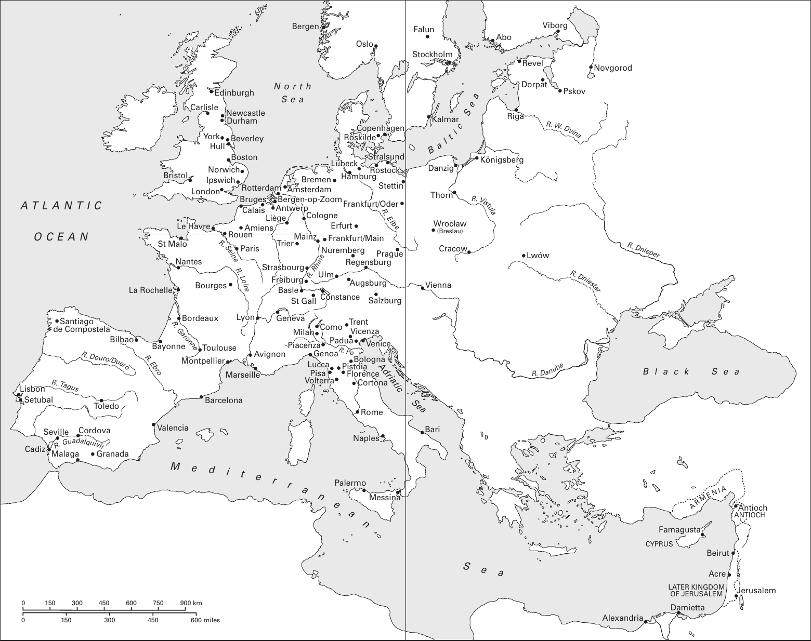

图1 西欧：约1100—约1500年。原图地名保留，中文逐项对照如下；比例尺km为千米，miles为英里。

| 原图标名 | 中文 |
| --- | --- |
| Edinburgh | 爱丁堡 |
| Newcastle | 纽卡斯尔 |
| Durham | 达勒姆 |
| Carlisle | 卡莱尔 |
| York | 约克 |
| Hull | 赫尔 |
| Beverley | 贝弗利 |
| Boston | 波士顿（英格兰） |
| Norwich | 诺里奇 |
| Ipswich | 伊普斯维奇 |
| London | 伦敦 |
| Bristol | 布里斯托尔 |
| North Sea | 北海 |
| Malaga | 马拉加 |
| Granada | 格拉纳达 |
| Cordova | 科尔多瓦 |
| Valencia | 瓦伦西亚 |
| Seville | 塞维利亚 |
| Lisbon | 里斯本 |
| Setubal | 塞图巴尔 |
| Toledo | 托莱多 |
| Barcelona | 巴塞罗那 |
| Montpellier | 蒙彼利埃 |
| Bayonne | 巴约讷 |
| Toulouse | 图卢兹 |
| Bordeaux | 波尔多 |
| La Rochelle | 拉罗谢尔 |
| Nantes | 南特 |
| Paris | 巴黎 |
| St Malo | 圣马洛 |
| Bourges | 布尔日 |
| Marseille | 马赛 |
| Palermo | 巴勒莫 |
| Messina | 墨西拿 |
| Naples | 那不勒斯 |
| Rome | 罗马 |
| Oslo | 奥斯陆 |
| Copenhagen | 哥本哈根 |
| Roskilde | 罗斯基勒 |
| Bergen | 卑尔根 |
| Frankfurt/Oder | 奥得河畔法兰克福 |
| Stettin | 斯德丁 |
| Stralsund | 施特拉尔松德 |
| Hamburg | 汉堡 |
| Rostock | 罗斯托克 |
| Lübeck | 吕贝克 |
| Prague | 布拉格 |
| Regensburg | 雷根斯堡 |
| Nuremberg | 纽伦堡 |
| Mainz | 美因茨 |
| Frankfurt/Main | 美因河畔法兰克福 |
| Erfurt | 埃尔福特 |
| Augsburg | 奥格斯堡 |
| Constance | 康斯坦茨 |
| Cologne | 科隆 |
| Bremen | 不来梅 |
| Mediterranean Sea | 地中海 |
| Avignon | 阿维尼翁 |
| Lyon | 里昂 |
| Le Havre | 勒阿弗尔 |
| Calais | 加来 |
| Rouen | 鲁昂 |
| Amiens | 亚眠 |
| Genoa | 热那亚 |
| Milan | 米兰 |
| Trent | 特伦托 |
| Venice | 威尼斯 |
| Bologna | 博洛尼亚 |
| Florence | 佛罗伦萨 |
| Cortona | 科尔托纳 |
| Pistoia | 皮斯托亚 |
| Pisa | 比萨 |
| Lucca | 卢卡 |
| Volterra | 沃尔泰拉 |
| Adriatic Sea | 亚得里亚海 |
| Como | 科莫 |
| Salzburg | 萨尔茨堡 |
| Ulm | 乌尔姆 |
| Piacenza | 皮亚琴察 |
| Geneva | 日内瓦 |
| Basle | 巴塞尔 |
| St Gall | 圣加仑 |
| Trier | 特里尔 |
| Freiburg | 弗赖堡 |
| Strasbourg | 斯特拉斯堡 |
| Liège | 列日 |
| R. Elbe | 易北河 |
| R. Ebro | 埃布罗河 |
| R. Garonne | 加龙河 |
| R. Tagus | 塔霍河 |
| R. Guadalquivir | 瓜达尔基维尔河 |
| R. Loire | 卢瓦尔河 |
| R. Seine | 塞纳河 |
| Atlantic Ocean | 大西洋 |
| Cadiz | 加的斯 |
| Padua | 帕多瓦 |
| Vicenza | 维琴察 |
| Rotterdam | 鹿特丹 |
| Amsterdam | 阿姆斯特丹 |
| Antwerp | 安特卫普 |
| Bruges | 布鲁日 |
| Bergen-op-Zoom | 贝亨奥普佐姆 |
| Bilbao | 毕尔巴鄂 |
| Santiago de Compostela | 圣地亚哥－德孔波斯特拉 |
| R. Po | 波河 |
| R. Douro/Duero | 杜罗河／杜埃罗河 |
| R. Rhine | 莱茵河 |
| Vienna | 维也纳 |
| Cracow | 克拉科夫 |
| Lwów | 利沃夫 |
| Danzig | 但泽 |
| Königsberg | 柯尼斯堡 |
| Riga | 里加 |
| Pskov | 普斯科夫 |
| Novgorod | 诺夫哥罗德 |
| Dorpat | 多尔帕特 |
| Revel | 雷瓦尔 |
| Viborg | 维堡 |
| Abo | 奥布 |
| Kalmar | 卡尔马 |
| Thorn | 托伦 |
| Black Sea | 黑海 |
| Damietta | 达米埃塔 |
| Alexandria | 亚历山大里亚 |
| Acre | 阿克 |
| Beirut | 贝鲁特 |
| Jerusalem | 耶路撒冷 |
| Famagusta | 法马古斯塔 |
| Antioch | 安条克（城与领地） |
| Cyprus | 塞浦路斯 |
| Later Kingdom of Jerusalem | 耶路撒冷后期王国 |
| Bari | 巴里 |
| Stockholm | 斯德哥尔摩 |
| Falun | 法伦 |
| R. W. Dvina | 西德维纳河 |
| R. Vistula | 维斯瓦河 |
| R. Dniester | 德涅斯特河 |
| R. Dnieper | 第聂伯河 |
| R. Danube | 多瑙河 |
| Armenia | 亚美尼亚 |
| Baltic Sea | 波罗的海 |
| Wroclaw (Breslau) | 弗罗茨瓦夫（布雷斯劳） |

<!-- PDF page 18; original page unnumbered -->

## 地图2 欧洲的大学

原电子书此页的说明译文：“为便于使用，印刷版此处的地图已移除，现作为附加资源，列于章节概览页面。”本译稿已据上述出版社文件补回。

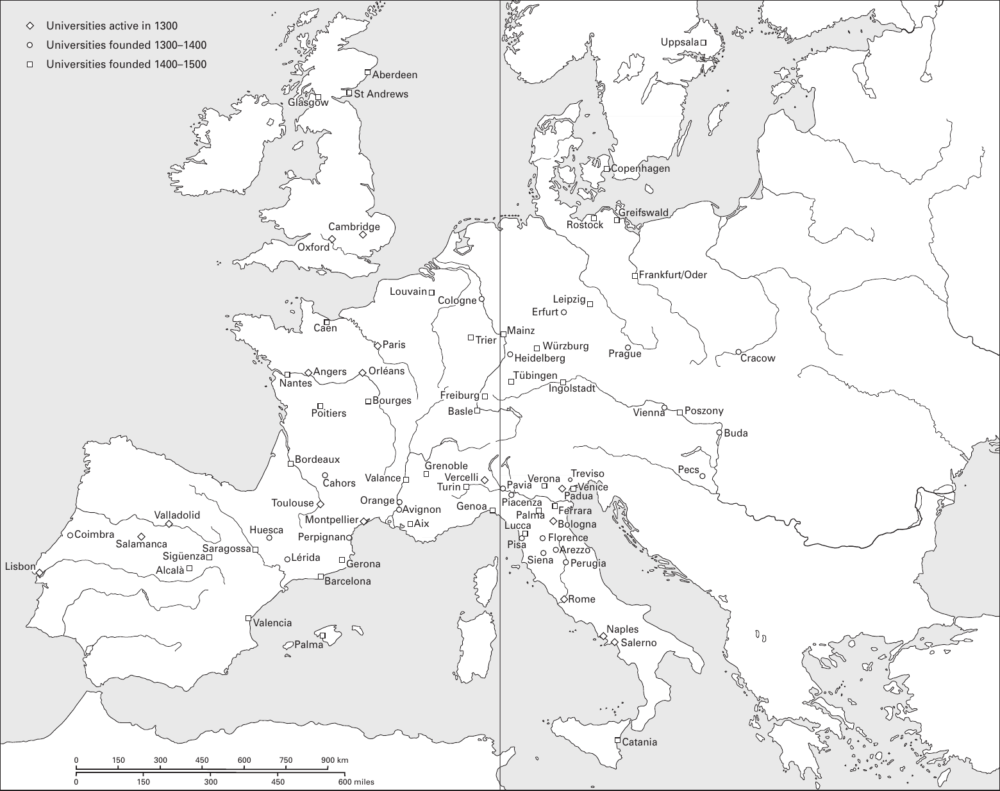

图2 欧洲的大学。原图地名保留，中文逐项对照如下；比例尺km为千米，miles为英里。

原图在马略卡岛、意大利北部两处均印作Palma，表中分列；Poszony、Valance等拼写亦依原图保留。

| 原图标名 | 中文 |
| --- | --- |
| Aberdeen | 阿伯丁 |
| St Andrews | 圣安德鲁斯 |
| Glasgow | 格拉斯哥 |
| Oxford | 牛津 |
| Cambridge | 剑桥 |
| Cologne | 科隆 |
| Trier | 特里尔 |
| Freiburg | 弗赖堡 |
| Basle | 巴塞尔 |
| Caen | 卡昂 |
| Louvain | 鲁汶 |
| Paris | 巴黎 |
| Orléans | 奥尔良 |
| Angers | 昂热 |
| Nantes | 南特 |
| Bourges | 布尔日 |
| Poitiers | 普瓦捷 |
| Bordeaux | 波尔多 |
| Cahors | 卡奥尔 |
| Toulouse | 图卢兹 |
| Montpellier | 蒙彼利埃 |
| Aix | 艾克斯 |
| Avignon | 阿维尼翁 |
| Orange | 奥朗日 |
| Grenoble | 格勒诺布尔 |
| Valance | 瓦朗斯（依原图拼写） |
| Lisbon | 里斯本 |
| Coimbra | 科英布拉 |
| Salamanca | 萨拉曼卡 |
| Valladolid | 巴利亚多利德 |
| Alcalà | 阿尔卡拉 |
| Valencia | 瓦伦西亚 |
| Palma（马略卡岛） | 帕尔马（马略卡岛） |
| Barcelona | 巴塞罗那 |
| Gerona | 赫罗纳 |
| Perpignan | 佩皮尼昂 |
| Lérida | 莱里达 |
| Huesca | 韦斯卡 |
| Saragossa | 萨拉戈萨 |
| Sigüenza | 锡古恩萨 |
| Turin | 都灵 |
| Genoa | 热那亚 |
| Vercelli | 韦尔切利 |
| Copenhagen | 哥本哈根 |
| Rostock | 罗斯托克 |
| Greifswald | 格赖夫斯瓦尔德 |
| Frankfurt/Oder | 奥得河畔法兰克福 |
| Uppsala | 乌普萨拉 |
| Cracow | 克拉科夫 |
| Vienna | 维也纳 |
| Buda | 布达 |
| Poszony | 波若尼（依原图拼写） |
| Ingolstadt | 因戈尔施塔特 |
| Leipzig | 莱比锡 |
| Erfurt | 埃尔福特 |
| Würzburg | 维尔茨堡 |
| Prague | 布拉格 |
| Verona | 维罗纳 |
| Padua | 帕多瓦 |
| Venice | 威尼斯 |
| Ferrara | 费拉拉 |
| Bologna | 博洛尼亚 |
| Florence | 佛罗伦萨 |
| Siena | 锡耶纳 |
| Rome | 罗马 |
| Perugia | 佩鲁贾 |
| Naples | 那不勒斯 |
| Salerno | 萨莱诺 |
| Catania | 卡塔尼亚 |
| Pecs | 佩奇 |
| Treviso | 特雷维索 |
| Arezzo | 阿雷佐 |
| Mainz | 美因茨 |
| Heidelberg | 海德堡 |
| Tübingen | 蒂宾根 |
| Pavia | 帕维亚 |
| Piacenza | 皮亚琴察 |
| Palma（意大利图位） | 帕尔马（意大利；原图作Palma） |
| Pisa | 比萨 |
| Lucca | 卢卡 |
| Universities active in 1300 | 菱形：1300年已活跃的大学 |
| Universities founded 1300–1400 | 圆形：1300—1400年创立的大学 |
| Universities founded 1400–1500 | 方形：1400—1500年创立的大学 |

<!-- PDF page 19; original page unnumbered -->

## 地图3 中世纪晚期的意大利

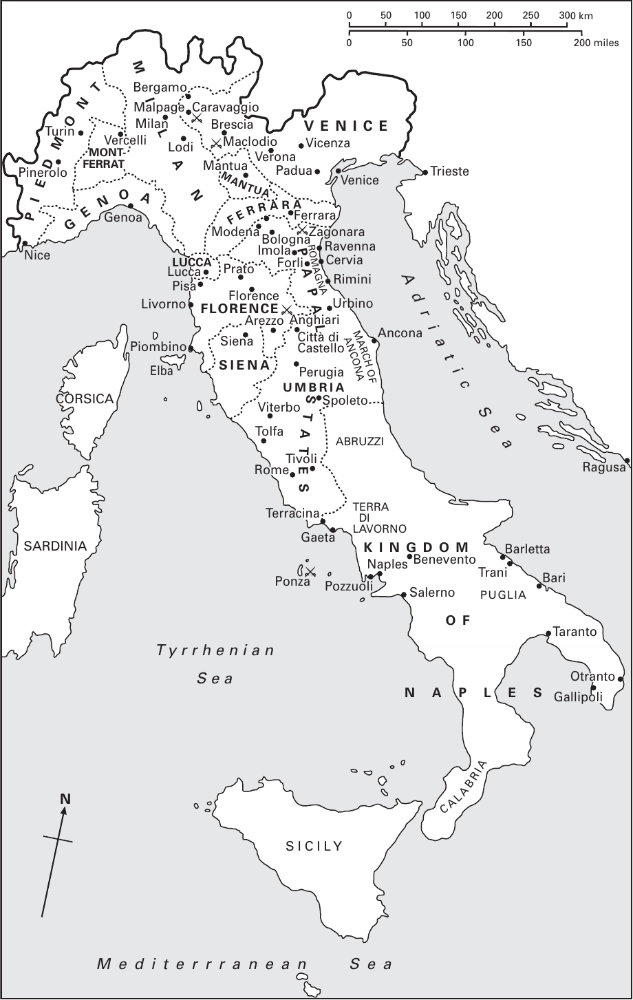

图3 中世纪晚期的意大利。原图地名保留，中文逐项对照如下；比例尺km为千米，miles为英里。

图中城市与同名领地，在表中合列。

| 原图标名 | 中文 |
| --- | --- |
| Piedmont | 皮埃蒙特 |
| Turin | 都灵 |
| Pinerolo | 皮内罗洛 |
| Mont-Ferrat | 蒙费拉托 |
| Vercelli | 韦尔切利 |
| Milan | 米兰（城与领地） |
| Bergamo | 贝加莫 |
| Malpage | 马尔帕加（原图作Malpage） |
| Caravaggio | 卡拉瓦乔 |
| Brescia | 布雷西亚 |
| Lodi | 洛迪 |
| Maclodio | 马克洛迪奥 |
| Venice | 威尼斯（城与领地） |
| Vicenza | 维琴察 |
| Verona | 维罗纳 |
| Padua | 帕多瓦 |
| Trieste | 的里雅斯特 |
| Mantua | 曼图亚（城与领地） |
| Genoa | 热那亚（城与领地） |
| Nice | 尼斯 |
| Ferrara | 费拉拉（城与领地） |
| Modena | 摩德纳 |
| Bologna | 博洛尼亚 |
| Imola | 伊莫拉 |
| Zagonara | 扎戈纳拉 |
| Ravenna | 拉韦纳 |
| Cervia | 切尔维亚 |
| Forlì | 弗利 |
| Rimini | 里米尼 |
| Romagna | 罗马涅 |
| Lucca | 卢卡（城与领地） |
| Pisa | 比萨 |
| Prato | 普拉托 |
| Livorno | 里窝那 |
| Florence | 佛罗伦萨（城与领地） |
| Arezzo | 阿雷佐 |
| Anghiari | 安吉亚里 |
| Urbino | 乌尔比诺 |
| Città di Castello | 卡斯泰洛城 |
| Ancona | 安科纳 |
| March of Ancona | 安科纳边区 |
| Siena | 锡耶纳（城与领地） |
| Piombino | 皮翁比诺 |
| Elba | 厄尔巴岛 |
| Corsica | 科西嘉岛 |
| Perugia | 佩鲁贾 |
| Umbria | 翁布里亚 |
| Spoleto | 斯波莱托 |
| Viterbo | 维泰博 |
| Tolfa | 托尔法 |
| Papal States | 教宗国 |
| Abruzzi | 阿布鲁齐 |
| Tivoli | 蒂沃利 |
| Rome | 罗马 |
| Ragusa | 拉古萨 |
| Terracina | 泰拉奇纳 |
| Gaeta | 加埃塔 |
| Terra di Lavorno | 拉沃罗地区（原图作Lavorno） |
| Kingdom of Naples | 那不勒斯王国 |
| Naples | 那不勒斯 |
| Benevento | 贝内文托 |
| Sardinia | 撒丁岛 |
| Ponza | 蓬扎岛 |
| Pozzuoli | 波佐利 |
| Salerno | 萨莱诺 |
| Barletta | 巴列塔 |
| Trani | 特拉尼 |
| Bari | 巴里 |
| Puglia | 普利亚 |
| Taranto | 塔兰托 |
| Otranto | 奥特朗托 |
| Gallipoli | 加利波利 |
| Calabria | 卡拉布里亚 |
| Sicily | 西西里岛 |
| Adriatic Sea | 亚得里亚海 |
| Tyrrhenian Sea | 第勒尼安海 |
| Mediterranean Sea | 地中海 |
| N | 北 |

<!-- PDF page 20; original page unnumbered -->

## 地图4 低地国家：约1100—约1500年

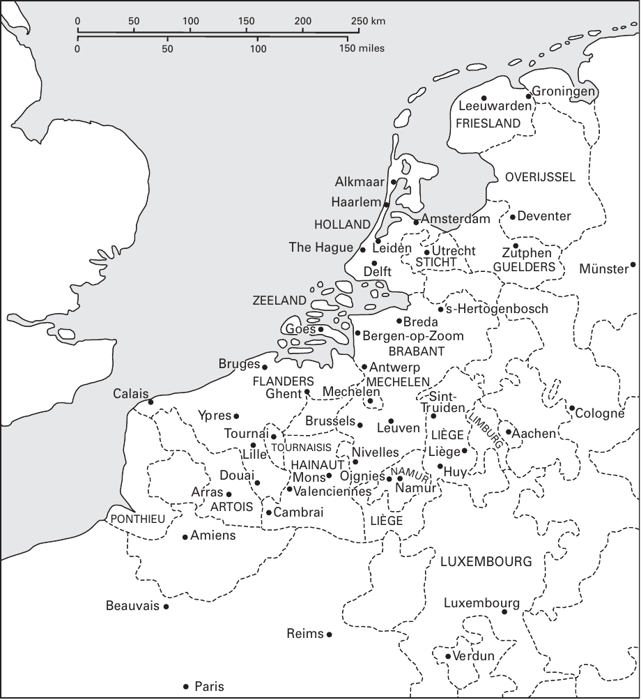

图4 低地国家：约1100—约1500年。原图地名保留，中文逐项对照如下；比例尺km为千米，miles为英里。

图中城市与同名领地，在表中合列。

| 原图标名 | 中文 |
| --- | --- |
| Groningen | 格罗宁根 |
| Leeuwarden | 吕伐登 |
| Friesland | 弗里斯兰 |
| Overijssel | 上艾瑟尔 |
| Alkmaar | 阿尔克马尔 |
| Haarlem | 哈勒姆 |
| Holland | 荷兰地区 |
| Amsterdam | 阿姆斯特丹 |
| The Hague | 海牙 |
| Leiden | 莱顿 |
| Deventer | 代芬特尔 |
| Zutphen | 聚特芬 |
| Guelders | 海尔德尔斯 |
| Münster | 明斯特 |
| Utrecht | 乌得勒支 |
| Sticht | 乌得勒支主教领 |
| Delft | 代尔夫特 |
| Zeeland | 泽兰 |
| ’s-Hertogenbosch | 斯海尔托亨博斯 |
| Breda | 布雷达 |
| Bergen-op-Zoom | 贝亨奥普佐姆 |
| Goes | 胡斯 |
| Brabant | 布拉班特 |
| Antwerp | 安特卫普 |
| Mechelen | 梅赫伦（城与领地） |
| Bruges | 布鲁日 |
| Flanders | 佛兰德 |
| Ghent | 根特 |
| Calais | 加来 |
| Ypres | 伊普尔 |
| Tournai | 图尔奈 |
| Tournaisis | 图尔奈地区 |
| Lille | 里尔 |
| Brussels | 布鲁塞尔 |
| Leuven | 鲁汶 |
| Sint-Truiden | 圣特勒伊登 |
| Liège | 列日（城与领地） |
| Limburg | 林堡 |
| Cologne | 科隆 |
| Aachen | 亚琛 |
| Nivelles | 尼韦勒 |
| Hainaut | 埃诺 |
| Mons | 蒙斯 |
| Oignies | 瓦尼 |
| Namur | 那慕尔（城与领地） |
| Huy | 于伊 |
| Valenciennes | 瓦朗谢讷 |
| Douai | 杜埃 |
| Arras | 阿拉斯 |
| Artois | 阿图瓦 |
| Cambrai | 康布雷 |
| Ponthieu | 蓬蒂厄 |
| Amiens | 亚眠 |
| Luxembourg | 卢森堡（城与领地） |
| Beauvais | 博韦 |
| Reims | 兰斯 |
| Verdun | 凡尔登 |
| Paris | 巴黎 |

---

# 引言

米里·鲁宾、沃尔特·西蒙斯（Miri Rubin and Walter Simons）

<!-- PDF page 21; original page 1 -->

长期以来，中世纪的基督教欧洲一直被视为基督教遗产形成过程中一个关键的时空。直到不久之前，无论通俗读物还是学术著作，仍将它描述为“信仰的时代”：宗教感情强烈，人们为实现宗教目标而采取非同寻常的行动，十字军、宗教裁判、经院神学与神秘主义都是其表现。气势恢宏的公共基督教艺术，以及居于领导地位的教宗制度，构成了这个时代的鲜明特征。直到近几十年，关于中世纪欧洲基督教的研究还主要以拉丁文文本为基础，包括神学论著、教会法及其评注，以及一些虔敬著作。在这种叙述中，主角是教宗、主教、推行改革的修院院长和积极活动的传教士；人们设想的活动空间，则是修院、主教座堂和大学。尽管欧洲数以万计的堂区始终可见，人们却很少关心其中宗教生活的实际面貌，仿佛堂区所获得的宗教供给不是十分匮乏，就是学者、教宗和主教所提出的官方学理表述的稀释版本。

《剑桥基督教史》本卷通过一系列文章，向读者概述有关1100至1500年间西欧人生活于其中的宗教文化的一部分历史研究。这些研究富于启发和想象力，并改变了我们对这一领域的认识。本卷无法涵盖当前研究的全部领域，但就极广泛的主题提供了入门性论述，希望感兴趣的读者能够继续深入探索。我们既力图概述与机构和个人的基督徒生活有关的观念与理论，也希望让读者看到，这些观念如何在堂区和宗教机构的生活节奏中、在城市街头以及欧洲的朝圣道路上付诸实践。这里讨论的每一种观念和实践，都有复杂的历史：它们产生于教父传统、古典传统或扎根于更早中世纪的传统，也在欧洲各个不同地区经历了各自的发展。

中世纪的基督徒生活始终同时具有一致性与多样性。以居于核心地位、并在这一时期显著兴盛的童贞女玛利亚崇敬为例：

<!-- PDF page 22; original page 2 -->

孩子从母亲膝前便开始认识玛利亚，但各地对她的称呼、她的雕像形态，甚至为尊崇她而庆祝的节日种类，都不尽相同。例如，十三世纪法国北部新出现了母子温柔相拥的形象，而加泰罗尼亚各教会所珍爱的，则是端坐正面、庄严肃穆、被称为“智慧之座”的玛利亚。意大利中部城市发展出一种丰富而声势盛大的本地语言虔敬方式：善会成员通过诵唱赞颂玛利亚的赞歌，即 *laude*，来尊崇她。这是其他地方所没有的现象。甚至在中世纪末期出现、作为向玛利亚祈祷之辅助的玫瑰经，也是北方的产物，经过很长时间才进入南欧人的日常习惯。欧洲人在为贸易、外交或朝圣而旅行时，能够在他人的宗教生活中辨认出某种同属一家的相似之处，其程度甚至超过他们在治理、战争和商业习惯中所见的相似性。但欧洲各区域的宗教文化也有强烈的地方意识，语言差异和礼仪传统又进一步强化了这种意识。信仰与实践可能在某一方面，如地理、社会或语言方面，表现出统一性，却在另一方面显出多样性。统一与多样都可以观察到，但其形式和表现方式会随着主题、地点等因素而有所不同。制度的集中化、托钵修会的传播、各大学的国际影响，以及最终出现的印刷机，使规章和教义趋于一致；与此同时，这一时期也存在其他抵消这种一致性的力量，尤其是本地语言在虔敬生活中的突破、支持臣民获得救赎的强大“民族”君主国，以及虔敬生活本身取之不尽的创造力。

这一时期的开端，正逢欧洲经济、政治结构和民众生活状况发生重大变化。1000至1200年间，欧洲人口可能增加了一倍。成千上万的新城镇兴起，其中大多是小型集镇；新近开垦的土地上也出现了新的村庄。欧洲人不断流动：从事贸易，踏上朝圣之旅，到欧洲边缘新征服的地区定居，包括伊比利亚和波罗的海地区。统治者及其官员有组织的引导，为这些事业提供了便利。教会中受过教育的人深入参与其中：他们为国王出谋划策，管理教会地产，谈判条约，担任法官。杰出的知识人则从理论上探讨，基督教社会，即 *societas Christiana*，可以而且应当依据什么原则处理自身事务。十二世纪，一些将影响基督徒生活数百年的基本制度获得了奠基性的表述：

<!-- PDF page 23; original page 3 -->

圣事的意义，公正的价格与劳动报酬，基督徒婚姻的条件，教士独身的性质，以及适合司祭的生活方式。

教会行政体系与世俗行政体系共同兴起的过程，也是观念和人物交锋的战场。早在基督教帝国的形成时期，即五世纪，皇帝和罗马主教就已讨论各自职分所具有的相对分量与尊荣。法律管辖权和征税权涉及复杂的界限问题，因为国王与教宗都声称拥有这些权利，而且都依赖从同一批人身上取得的资源。于是，在教会的官僚体系与各种国家之间，形成了一个既有竞争也有相互仿效的领域：教会通过其体系向基督徒传递救赎恩典，而王国、城邦和公国则通过司法保障财产，保护人的生命与身体。这些领域紧密交织，不仅有神圣王权这一强大制度将它们联系起来，它们还共同致力于规制家庭、性道德和继承等事务。教会与国家都认同其所统治和服务的共同体所依据的基督教伦理，因此携手界定和纠正宗教偏离，也共同面对与此相关的挑战：在基督教政体中确定犹太人的位置。

中世纪盛期逐渐整合的欧洲，越来越遵循以堂区为基础的基督教模式。尽管最著名、文献记载最丰富的机构是各类修会的会院，多数基督徒却是在村庄或城市街区的共同体中体验宗教生活。他们出生于一个堂区，并在此后的一生中与它保持联系。所有拓展和深化基督教教导与训诲的努力，都把注意力引向堂区及其服务者——堂区司祭。这一时期召开的一系列大公会议，也界定并传播了这一事业的具体要求。信仰基础知识的传授始于家庭，继而在堂区延续；随后是告解、补赎和每年领圣餐；婚姻也被引导至堂区之中，生命终结时的安葬与纪念同样如此。司祭承担着多种任务：主持礼仪、探望病人、教导年轻人、扶助穷人、服侍临终者，同时还要维持堂区来自土地、牲畜、租金和什一税的收入。

在乡村共同体中，农业劳动、领主管辖和堂区往往以同一地域为单位，通过共同的宗教生活，形成一个对社会交往富有意义的空间。在城市中心，欧洲约有百分之十至十五的人口居住于此，表达宗教关切的途径则更为多样。

<!-- PDF page 24; original page 4 -->

欧洲某些地区，如意大利中北部和低地国家，城市化程度很高；城市和城镇中的平信徒，无论男女，都在尝试新的宗教生活形式。这些城市环境孕育了一种女性宗教人士——贝居安女子。她们在世俗世界中追求宗教上的完美，把祈祷、默想、服务与劳动结合起来。托钵修士也是这些城市的产物，其中最突出的便是方济各会的模式：修士生活贫穷，以行乞为生，通过个人榜样与有力的讲道相结合，使基督徒成为笃定投入的基督徒，也就是使灵魂归正。各种善会生活形式也超越了堂区范围。平信徒联合起来，在托钵修士这些专家就宗教诗歌、戏剧和音乐所作的指导下，以新的方式探索古老的主题，包括基督受难、玛利亚生平和基督圣体。这是一个创造力极其旺盛的时代。欧洲的财富、发明才智，以及大理石、雪花石膏、木材、珍珠、金银等各类材料，被制作成基督教故事的可见、可触的表现形式。本卷也收录了关于视觉艺术和音乐的专章。中世纪欧洲的宗教生活充满节奏与歌声、光线与色彩。由于其观念和实践通过种种努力变得具体可感，一些批评者，如约翰·威克里夫，认为它们已濒于偶像崇拜。

中世纪后期欧洲接连遭受灾难：1315至1322年的饥荒、1347至1350年的黑死病，以及随后数十年反复暴发的瘟疫，给人们造成了深重创伤，也使人们更加专注于死亡和来世。这些灾难使欧洲人口锐减，却也为幸存者打开了新的机会。各政体和共同体很快把灾难与道德危险联系起来：黑死病引发了对犹太人的袭击，神圣罗马帝国各地的犹太人共同体遭到毁灭；一套以纯洁与危险之间的辩证关系为基础的话语也由此发展起来。随着一种新型讲道者的出现，欧洲形成了新的传播方式。他们的听众不再限于一个堂区或一座城市，而是遍及整个区域。教宗制度在十四、十五世纪始终卷入界定自身的斗争，但它仍从最热忱、最有才能的托钵修士中招募富有感召力的讲道者，授予他们许可，委派他们承担改革、纠正和劝诫的工作，例如文森特·费雷尔（卒于1419年）和卡皮斯特拉诺的乔瓦尼（卒于1456年）。城市和公国聘请这些善于公开宣讲的人，在广场上推行社会纪律：例如十五世纪二十年代活跃于意大利中部城市的贝尔纳迪诺，以及九十年代的萨沃纳罗拉。同时，在欧洲西北部的城市中，<!-- PDF page 25; original page 5 -->市政当局往往更偏爱市民的自助活动，而非公开演说。城市居民中识字且更为积极投入的人，可以从丰富的本地语言虔敬文学中获得滋养：包括《明镜》、《效法基督》，以及布鲁日、根特、亚眠和安特卫普的作坊成千上万制作的时祷书。范围稍大一些的男女平信徒群体，则可以观看修辞社团制作的戏剧演出，或基督圣体行会演出的宗教剧。

1100至1500年间，女人和男人都积极参与塑造欧洲基督教，但参与方式有时有所不同。医学、神学和法律等多种知识结合起来，形成了一套牢固、普遍接受的官方认识，认为女性缺乏思考、作道德判断、忍受艰苦、行使权威和担任领导的能力。与更早的中世纪一样，这一时期的女性被排除在教会的一切大小圣秩之外，也无法进入与教会有关的教育机构学习。有些女性，通常出身贵族，在女修院中追求宗教上的完美；少数人凭借神秘洞见与典范生活获得了极高声望，例如宾根的希尔德加德（卒于1179年）、舍瑙的伊丽莎白（卒于1164或1165年）和瓦尼的玛丽（卒于1213年）。随着这一时期的发展，与前面所述的宗教生活趋势相应，已婚或曾婚的妇女、有孩子的母亲，以及出身十分微寒的年轻女子，都表现出形式多样的宗教热忱。满足女性的圣事需要始终是一项难题：司祭必须进入她们的禁院，听取告解并举行弥撒。反过来，当女性有重要的内容需要传达时，无论是预言、改革的讯息还是神秘启示，她们就必须走入世间，采取当时被认为不适合女性的行动方式。有些人，如瑞典的布里吉特（卒于1373年），顺利完成了这一转变；另一些人，如玛格丽特·波雷特（卒于1310年），则没有。她被视为再犯的异端，死于火刑。

“异端”这个词本身也在这一时期得到重新界定，获得了前所未有的精确含义。早期基督教立法的遗产，以及中世纪早期对这个问题的某些关注，在这一时期经过全面改造，形成了一套针对被认定为“异端”者的制度，结合了辨认、审查、尝试纠正与最终惩罚。通过公开惩罚那些明知而故意偏离信仰的人来保护信仰，首先是主教的责任。堂区司祭应当向主教呈报那些传播自身观点、拒绝接受纠正的人。主教法庭处理所有严重违反教会法的案件，<!-- PDF page 26; original page 6 -->并负责维护真正的信仰。随着教会法体系的发展和在全欧洲的推广，以及新的教宗敕令不断使其更加严密、统一并充实内容，一整套有关异端的法律与实践逐渐形成。自十二世纪起，人们感到欧洲某些地区面临的挑战更为深刻，因此教宗在十三世纪三十年代允许设立宗教裁判制度，起初由新近成立的多米尼克托钵修会承担工作。法国南部、波希米亚和意大利北部，因而出现了特别集中的反异端讲道，以及对坚持不改者的审判。然而，欧洲政治版图再次显示，各地对这项制度的接受并不一致：它从未在英格兰施行，伊比利亚诸君主也直到十五世纪后期才采纳它。不过，宗教裁判官仍编写了大量关于辨认和讯问技巧的著作，用来训练未来的继任者，希望使这一体系透明、统一，并符合教会法的原则。

在这个世界里，基督教叙事获得了庞大而精细的制度和思想阐发，基督教堂区为欧洲人的生活提供了基本框架；与此同时，人们也十分关注那些并不完全属于这一世界的人。人们投入大量想象力和思想精力来思考犹太人和穆斯林，这与人们认为基督教社会是什么、又应当是什么的构想紧密相连。犹太人在基督传道的叙事中占据核心位置，并在这一时期被更加鲜明地描绘成明知故犯、因而负有罪责的受难事件行动者。圣奥古斯丁的传统论述认为，犹太人作为基督教真理的见证者具有价值，是基督教故事展开直至终局的重要组成部分。但在中世纪欧洲的城镇中，这种看法受到挑战，因为犹太人的存在不断提醒人们，怀疑基督教是可能的。大量论争文献推动了把犹太人塑造成敌人的复杂叙事的形成，其中的论点有时由讲道者在讲坛上重述，有时在安排好的公开辩论中提出，例如1240年的巴黎、1263年的巴塞罗那和1410年的托尔托萨。犹太人被认为在基督教诞生时就是基督的敌人，如今又被想象成欧洲人的敌人，敌视他们的神圣空间、珍视的信仰和无辜的儿童。这一时期也出现了有关仪式谋杀的指控、血诬，以及亵渎圣体的叙事。

在伊比利亚、意大利南部、塞浦路斯和圣地，基督徒曾在一些时期与犹太人相遇，并在近邻的位置观察他们的实践。在伊比利亚，基督徒君主不断征服先前由穆斯林占据的土地，并面对<!-- PDF page 27; original page 7 -->治理真正的多族群共同体的挑战。人们积极鼓励穆斯林改信基督教，而且可能认为这比犹太人的改宗更容易实现。大量文学作品把穆斯林塑造成兼具传奇色彩与暴力特征的形象。伊比利亚流传着数十则穆斯林与童贞女玛利亚相遇的故事。追求宗教一致性的努力，在这一时期即将结束之际，导致犹太人、继而穆斯林被逐出伊比利亚半岛；在此之前，犹太人已被逐出英格兰、法国，以及意大利和帝国的一些城市。

1100至1500年欧洲基督教的历史，是几部相互重叠的历史共同构成的结果。这些历史发生在堂区和大学中，发生在男女、学者和不识字的热忱信徒之间；它们记录了超凡感召力在日常基督徒生活的常规中迸发，也记录了宽容和暴力侵害。无论转向何处，我们都会遇到教宗、主教、神学家、诗人和统治者的努力：他们界定基督教欧洲的统一与秩序，并试图将之维系。当观念运用于日常生活时，这些努力也与疑问和怀疑并存，甚至鼓励了它们。领受圣秩的司祭作为救赎恩典的渠道，把强有力的圣事基督教模式传递给欧洲的每一个基督徒。然而，这一模式也面临挑战：物质能够承载神圣，可能犯错的人能够成为恩典的渠道，石雕或木板绘画中的图像能够帮助人与上帝沟通，这些主张都受到质疑。十四世纪英格兰的罗拉德派和十五世纪波希米亚的胡斯派，就曾以提出这些问题而著称；两者都引发了教会与国家强烈的政治回应。《西欧基督教：约1100—约1500年》力图理解这些富有创造力的辩证过程。它们塑造了中世纪欧洲的生活；当欧洲人介入美洲、非洲和亚洲人民的生活时，这些过程也成为全球历史的一部分。

<!-- PDF page 28; original page unnumbered -->

<!-- 原书空白页 -->

---

# 第一编 制度与变革（1100—1200年）

<!-- PDF page 29; original page unnumbered -->

第一编

制度与变革：1100—1200年

<!-- PDF page 30; original page unnumbered -->

<!-- 原书空白页 -->

---

# 第1章 教士的贞洁与重整秩序的世界[^p031-star]

亨丽埃塔·莱瑟（Henrietta Leyser）

<!-- PDF page 31; original page 11 -->

海斯特巴赫的凯撒里乌斯（Caesarius of Heisterbach，约1180—约1250年）是一位严厉谴责不贞行为的熙笃会修士。他讲过一个故事：一名“好色的”司祭试图举行弥撒，到了祝圣时刻，一只雪白的鸽子飞落祭坛，喝光圣爵里的酒，又衔着饼飞走。这件事并非只发生了一次，而是在这名司祭接连尝试举行的三次弥撒中都发生了。司祭惊恐万分，终于痛悔，告明了自己的罪：那天清早出门巡视时，他偶遇一名女子，并与她发生了性关系。司祭获得赦罪后，鸽子便把三枚圣饼送回圣体布上，又从喉中将所有的酒倒回圣爵。[^p031-1]

凯撒里乌斯喜欢讲令司祭难堪的故事，同时又理解，甚至接纳人性的软弱。对他来说，无论教士还是修士，独身确实都至关重要；然而，即使未能遵守，只要真心悔改，仍然可以期待宽恕。例如，一名修士离开会院，成为在俗司祭，“像许多人惯常所做的那样”纳了一名妾，并与她生了孩子。后来，他认识到自己所行有误，怀着悔恨，请求从前的院长圣伯尔纳重新接纳自己。伯尔纳同意了，但由于急着出行，便叫司祭暂候片刻。伯尔纳离开期间，司祭死了。回来后，伯尔纳命人打开坟墓，结果“众人所见的他，并未穿着安葬时的世俗衣服，而是剃着修士的发式，穿着修士的会衣”。凯撒里乌斯评说道，真正的痛悔能够恢复一切。[^p031-2]

凯撒里乌斯这种将讥诮与同情结合起来的独特方式，背后是他深切领会的1215年第四次拉特朗会议的教导。关于鸽子与<!-- PDF page 32; original page 12 -->圣餐的故事，放在那场有关弥撒本质、最终由这次会议作出裁决的长期争论中，便有了格外明确的意义。故事的结局，既体现会议关于告解圣事之必要性和效力的规定，也体现它对教士独身的坚持。在凯撒里乌斯看来，“贞洁与知识”是“司祭生活的荣耀”；而贞洁不同于知识，是人人都能做到的，因此也就格外重要。[^p032-3] 这里明显呼应了英诺森三世对罗马教士所作的一篇讲道：

> 我们既已领受圣秩，就必然负有守护贞洁的义务。因为经上记着，大卫逃避扫罗的迫害时，来到挪伯的司祭亚希米勒那里，请他给五个饼充饥。司祭回答说：“我手边没有未祝圣的饼，只有圣饼。倘若这些年轻人是洁净的，尤其没有亲近妇女，就可以吃。”他并没有说，他们若有信、望、爱；若有智慧与聪明之灵、谋略与刚强之灵、知识与虔敬之灵，以及敬畏主之灵，就可以吃。他说的却是：“他们若是洁净的，尤其没有亲近妇女，就可以吃。”因为他们若不洁净，未曾远离与妇女的性交，就不能相称地吃这圣饼。[^p032-4]

对性行为造成污染的忧虑，以及随之而来的对教士独身的坚持，当然远在英诺森三世任教宗之前就已存在。早在四世纪，这些问题便在教会内部引发激烈争论，也使东西方的意见分歧显露出来。东方采取了折衷办法：要求主教独身，却允许在祝圣前已经结婚的司祭和执事，在祝圣后继续夫妻间的性生活。另一方面，西方至少从约325年的埃尔维拉会议之后，便不时坚持所有已婚教士都应禁欲生活，尽管这些要求往往徒劳无功。不遵守者有时会受到鞭打及其他惩罚的威胁，但总的来说，严苛派的谴责收效甚微。因此，直到十一世纪，主教、司祭和执事结婚生子仍十分常见。他们的子女也可能领受圣秩，继承父亲的职位。这类“世袭”司祭可以期待享有相当受人尊重的地位。不过，十一、十二世纪，这一切都将改变。

<!-- PDF page 33; original page 13 -->

里沃的埃尔雷德（Aelred of Rievaulx，1110—1167年）的故事，只是众多可举例子中的一个。

埃尔雷德出身于英格兰北部一个绵延多代的司祭家族。他的曾祖父曾在达勒姆负责照料圣卡斯伯特不腐的遗体，替他剪头发、剪指甲，还要赶走一只在圣卡斯伯特棺内筑巢的鼬。他的祖父和父亲则照料赫克瑟姆的圣徒。但到1138年，这个特定的世界终于走到了尽头。这一年，埃尔雷德的父亲埃拉夫（Eilaf）病倒了。约克的诺曼总主教所推行的改革政策，已经降低了他在赫克瑟姆的地位。守规咏祷教士——因而也是独身教士——被引入赫克瑟姆，名义上是协助埃拉夫，实际却使他的职责大为缩减。对埃拉夫而言，局势的预兆已十分清楚。他的儿子埃尔雷德此前已经放弃在苏格兰国王宫廷中大有前途的事业，加入新近来到里沃的熙笃会。埃拉夫决定，自己也要放弃家族对赫克瑟姆的一切权利主张，到达勒姆做修士，度过余生。与此同时，卡斯伯特也不再是从前那位圣徒：由已婚司祭照料他的时代过去了，他成了一位著名的厌女者。据说他生前就极力反对修士与女性交往，因此死后也无法容忍女性进入任何一处曾经安放过他遗体的墓地，哪怕遗体只在那里短暂停留过。达勒姆的西缅所记述的这类女子遭受可怕命运的故事，使人不禁要问：一位圣徒生前曾要求，安葬自己时要裹上某位女子赠送的布，为什么死后却如此执着于将一切女性拒之门外？[^p033-5] 教会改革者为什么会把如此强烈的注意力集中在性污染问题上？

长期以来，十一世纪的教会改革主要与格列高利七世的教宗任期联系在一起。原因并不难理解。格列高利富有攻击性的言辞，与同样强硬的政策相互呼应。他将皇帝亨利四世逐出教会，随后教宗与皇帝又于1077年在卡诺莎和解，这构成了西方中世纪史上最富戏剧性的场景之一。不过必须清楚，教宗与皇帝之间的争执，所涉及的是权力<!-- PDF page 34; original page 14 -->与权威，而非教士道德和改革。亨利四世或许会质疑，格列高利支持抵制不称职司祭所举行的弥撒，是否明智；但无论他本人，还是他所拥立的对立教宗、拉文纳的维贝尔特，都毫不怀疑买卖圣职——买卖职务或圣事——和教士婚姻，是必须根除的弊端。这两种现象常被相提并论，被称为至少在理论上教会与世俗统治者可以联手对抗的“瘟疫”。例如，英格兰的亨利一世尽管因授职权问题与安瑟伦总主教激烈争执，却不反对安瑟伦禁止英格兰司祭娶妻的措施。尤其是后来禁令重申时，亨利得以借此向违犯者勒索钱财，令他的主教们大为恼怒。[^p034-6]

一个毫无污点、摆脱买卖圣职的玷污和婚床诱惑的教士群体，是一种能够跨越社会常见分界、获得广泛认同的理想。对一些人而言，最令人愤慨的是教士家庭给教会造成的巨大开支：据说司祭向妻子挥霍奢侈品，并替儿子谋取特权。对另一些人而言，其中也包括教会认定为异端的人，贞洁者的感召力具有特殊吸引力，能够赢得一种超出名义权威应得范围的尊敬。追求祭仪纯洁的呼声，后来成为教廷热烈支持的纲领，但要注意，它最初产生于别处，即十一世纪早期的大型和平集会。它的信息起初也不是经由教宗会议和使节传播，而是由游方讲道者及禁欲圣人传开。我们所知最早的一批此类圣人中，有一位是罗穆阿尔德，这很能说明问题。彼得·达米安撰写的《罗穆阿尔德传》宣称，罗穆阿尔德最先把买卖圣职认定为异端；据达米安说，他的抱负是“把整个世界变成一所隐修院”。[^p034-7] 达米安还推广了“尼哥拉派主义”这个名称，借用《启示录》2:6与2:14所说的异端教派，指称已婚教士。过去似乎只适用于修院的价值观，如今成了所有人都应效法的榜样。这一纲领的规模之大，很难把握；直到1215年的拉特朗会议，它的含义才得到全面阐明。要理解它的革命性，我们必须首先考察：在十二、十三世纪的牧灵革命之前，男女平信徒的得救机会，究竟存在着多大的疑问。

<!-- PDF page 35; original page 15 -->

十世纪，得救的钥匙掌握在修士手中：除非成为修士，或安排修士为自己祈祷，否则几乎没有希望进入天堂。一个平信徒男子如何能够过有德性的生活，远不清楚。奥里亚克的杰拉尔（Gerald of Aurillac，卒于909年）尽了最大努力：任人劫掠，拒绝流人血，坚定守护贞洁。他死后停放遗体时，一只手不肯停在胸前，执意移到下身，遮住私处。但杰拉尔是个例外。颇能说明问题的是，他还为自己的准修道生活加上了最后一笔：亲自剃了修士的发式，只是一直戴着小帽，将此事保密。[^p035-8] 更常见的是努瓦永的骑士拉尔夫所选择的道路。那是在1092年，拉尔夫生过一场病，开始担忧自己灵魂的处境。他向一位修士求教，得到明确的答复：“只要你还像现在这样生活在世间，我就看不出你如何能够得救。你若真想得救，就要放弃世俗，拥抱修道生活。”拉尔夫向妻子曼森迪丝（Mainsendis）诉说忧虑，发现她同样担心：“我为自己的灵魂害怕，正如你为自己的灵魂害怕一样。”但她已有身孕，所以两人都觉得无法立即弃世。此后十八个月，他们继续共同生活，却“没有任何肉体之事”。到发愿的时候，他们不但献上自己，也将几个儿子，包括那个尚在襁褓中的婴儿，都奉献给修道生活。婴儿连同摇篮一起放在祭坛上，因为他们不愿把孩子留在“魔鬼手中”。[^p035-9]

到第四次拉特朗会议召开的1215年，杰拉尔、拉尔夫和曼森迪丝所处的世界，几乎已经消失。一个骑士阶层已经兴起，教会愿意祝福他们的武器和生活方式；十字军使战争获得了正当性；婚姻已被宣布为一项圣事；将儿童奉献入修院不再流行，尤其是新兴修会，明确拒绝接纳成年人之外的入会者。现在看来，世俗世界并非本质上邪恶；所有受洗基督徒都可以得救：“不仅童贞者和禁欲者，已婚者也凭正确信仰与善行而蒙上帝悦纳，并配得永恒的福乐。”[^p035-10] 人性既是如此，男女仍会犯罪，但定期告解可以使任何<!-- PDF page 36; original page 16 -->真正悔改的人恢复恩典状态。炼狱在天堂与地狱之间架起了桥梁。极其勇敢的人可以在朝圣时造访那里——爱尔兰的德格湖提供了一处颇受欢迎的入口；勇气不及他们的人，也可以在来世凭借信徒的祈祷和为自己举行的弥撒获救，脱离炼狱。

1215年的拉特朗会议，以及随后教规的传播，为基督教世界的这种新秩序作了确认。事实表明，这个世界并非像过去所认为的那样，由教士、修士和平信徒三个群体构成，而只有两个群体：教士与平信徒。两者的区别必须绝对分明；谁是教士，谁不是，应该一眼就能看出：

> 教士不应从事世俗性质的职业或商业，尤其是不名誉的行当。不应观看滑稽剧演员、艺人和戏子的表演。除非旅途中偶然迫于必要，应完全避开酒馆。不应玩赌博游戏或掷骰子，也不应在场观看。他们应当保有适宜的发圈与剃发式，勤勉地从事敬拜礼仪和其他善业。外衣应当合拢，长度既不过短，也不过长。不应喜用红色或绿色布料、长袖、绣花鞋或尖头鞋，也不应使用镀金或有其他多余装饰的辔头、马鞍、马胸带和马刺。不应在教堂举行敬拜礼仪时穿带袖的斗篷；如果是司祭或堂区本堂司祭，即使在其他地方也不应如此……不应佩戴以金银装饰的搭扣或腰带；戒指也不应佩戴，除非其尊位适宜佩戴。所有主教在公共场合和教堂里都应穿亚麻外衣，先前曾为修士者除外，他们可以穿修道会衣；在公共场合，不应任斗篷松散垂下，而应在颈后或胸前扣好。（第16条）

教士应当“节制贪食与醉酒”（第15条）；不应“打猎或捕鸟”（第15条）；不应深夜不睡，宴饮作乐，耽于“被禁止的谈话”；不得为了听取“平信徒的闲谈”而忽略礼仪职责（第17条）；不得参与任何涉及流血的判决，也不得“担任雇佣兵、弩手或其他这类流血之人的统帅”；不得从事“外科医术”，也不得参与神判（第18条）；应当保持教堂“整齐清洁”，绝不可“把自己甚至别人的家具存放在里面，以致教堂看起来像平信徒的住宅，而不是上帝的圣堂”（第19条）。然而，最首要的要求，是他们必须贞洁：教士应当“过禁欲而贞洁的生活”，以“纯洁的心和未受玷污的身体”事奉上帝。凡被发现<!-- PDF page 37; original page 17 -->“屈从于不节制恶习”的人，都应“依据教规的制裁，按其罪行的轻重”受罚；“应当切实而严格地执行这些制裁，使那些不能因敬畏上帝而止恶的人，至少能因现世惩罚而受到约束，不去犯罪”（第14条）。

第四次拉特朗会议的法令，实际上确立了教士群体的修道化。不再允许创立新的修道会，不仅因为会议明确提出，“修会种类过多，会在上帝的教会中造成严重混乱”（第13条），也因为这类修会已不再是必要的。男女平信徒奉命自行关顾灵魂的得救，并由司祭协助（第21条）；此后几十年尤其清楚地表明，他们也会得到新出现的托钵修士的帮助，后者既是牧灵革命的先驱，也是它的实行者。司祭作为平信徒的领导者，行为必须堪为表率。英诺森三世坚称，有罪的教士是一切罪恶的根源：“信仰衰败，宗教变形，自由受阻。正义被践踏，异端兴起……”[^p037-11] 异端长期以来一直是英诺森特别关切的问题。他在会议开幕时先庄严宣认信仰，继而谴责个别异端及一切异端：“我们谴责所有异端，无论他们以什么名称出现。”（第3条）但除异端之外，任何认同会议所宣认信经的人，都可以得救；他们却需要正直教士的支持，“因为民众的一切败坏，首先都来自教士”。[^p037-12]

英诺森为教会提出的纲领，不仅回应了其任期中的即时处境，也试图为十一、十二世纪的动荡提供解决办法。千年之交，成群的人聚集在圣徒圣髑龛周围，来到游方讲道者脚前，表现出强烈的属灵渴望。格列高利七世的改革在一定程度上满足了这种渴望，却也付出了代价。格列高利被称为“神圣的撒但”和“危险的人”，并非没有缘由。[^p037-13] 在与皇帝的冲突中，他毫不犹豫地动员群众。第四次拉特朗会议后来煞费苦心维护的教士与平信徒之间的区别，曾因格列高利煽动群众的<!-- PDF page 38; original page 18 -->本能而面临被颠覆的危险。他支持米兰的帕塔里尼派，就是一个例子。这个群体激烈反对教士婚姻，不仅主张抵制不禁欲教士所举行的弥撒，也主张对他们采取直接行动。凡是他认为对改革不够尽心的司祭或主教，格列高利都愿意联合平信徒加以对抗。对于编年史家让布卢的西格贝尔特（Sigebert of Gembloux，约1030—1112年）来说，令人震惊的正是这些手段。反对买卖圣职和教士婚姻是一回事——西格贝尔特问，还有什么比这“更美好”的呢？——但格列高利的方法却损害了他的一切目标：“如果你寻找成果，就会看到主的羊群悲惨地四散，而它们的牧人却煽动狼群去袭击它们。”改革者宣称已婚司祭所施行的圣事无效，这种教导是“致命的毒药”。西格贝尔特最后说：“谁不为教会中如此巨大的动乱而悲伤？哪个基督徒只要还有一点同情心，会在看到基督教被践踏时不深感哀痛……而这一切都有权威作后盾，得到那些被称为基督教世界领袖之人的支持。”[^p038-14]

为世界的新秩序作最后确认，并尽可能弥合先前冲突造成的裂痕，这一重任落在十二世纪诸教宗、尤其英诺森三世的肩上。十一世纪看似极其棘手的平信徒授职问题，终究可以通过妥协解决：英格兰、法国，最后连帝国也都找到了办法。买卖圣职虽然仍可能令人忧虑，却不再引发“道德恐慌”；[^p038-15] 人们已普遍接受它是错误的。至少在理论上，教会职位的选举如今可以自由进行，免受平信徒庇护人的不当影响，也不必发生金钱交易。与此同时，教会法学家也令人信服地确立，弥撒的有效性绝不取决于主礼者的道德状况。仍然难以处理的问题，只有教士独身。教宗必须一再重申谴责，并使禁令更加严厉，同时继续呼吁平信徒，不要参加那些已知有妻子或妾的司祭所举行的弥撒。1119年的兰斯会议上，加里斯都二世重申乌尔班二世在1095年发出的罢职威胁，针对一切被发现与妻子或妾同居的司祭、执事或副执事。第一次和第二次拉特朗会议又分别更进一步，<!-- PDF page 39; original page 19 -->于1123年宣布，司祭、执事、副执事和修士的婚姻应视为无效；又于1139年要求已婚教士与伴侣分离，范围包括“主教、司祭、执事、副执事、守规咏祷教士、修士及已发愿的平信徒会士”，理由是这类婚姻，即“这般骇人的行为”，违反教会法，因而不合法。1179年的第三次拉特朗会议已不再提及已婚教士，似乎说明1139年的法令取得了成效，但纳妾显然仍是问题：“领受圣秩的教士若公然纳妾，将情妇留在家中，就应将她们逐出，过禁欲的生活，否则应被剥夺教会职务与俸禄。”[^p039-16]

在这种新的世界秩序中，那些掌握捆绑与释放之权，而且唯有他们能够把圣餐中的饼酒转化为基督身体与宝血的人，必须与平信徒明显区别开来。尽管作为这一区别之试金石的贞洁，始终难以强制推行，情况仍是如此。英诺森三世本人认识到这一点，海斯特巴赫的凯撒里乌斯的故事清楚说明了这一点，已婚司祭一次次喧闹的抗议也证明了这一点。亨廷登的亨利兴高采烈地讲述过枢机约翰·克雷马的故事：他“在晚祷之后，被发现与一名妓女在一起”；就在同一天，他主持会议，“极其严厉地处理司祭妻子的问题，说从妓女身旁起身就去制作基督的身体，是最大的罪”。欧洲各地的听众想必都会对这样的故事心有戚戚。[^p039-17] 即使迟至1215年，仍有神学家对新政策是否明智、是否过于严厉感到不安。例如，乔巴姆的托马斯在大约这个时候写成的《告解神师大全》（*Summa confessorum*）中，就愿意论证：教士秘密结婚的罪，小于婚外性行为的罪；他还以更一般的方式，对强制教士独身的正当性表示疑问。尽管如此，托马斯仍承认，罗马已经发话，这件事到此实际上已无可争论。

要理解罗马立场背后的决心，借助社会人类学的见解或许有益。罗伯特·贾斯特关于二十世纪后期希腊的研究，在这里很有参考价值。贾斯特说，希腊的乡村司祭通常已经结婚，而且一般就来自自己出生的村庄。这套制度有明显的弱点：

<!-- PDF page 40; original page 20 -->

> 一方面，整个教会被认为高高在上，与富人和权势者结盟，属于那个令人艳羡却无法接近的世界；这个世界的成功本身，就足以证明它的腐败。另一方面，在地方层面，人们却对司祭群体真实或想象中的人性弱点了如指掌，议论纷纷。
>
> 在这种处境中，乡村司祭处处吃亏。他是教会的仆人，而教会富得惊人，政治上保守，又远离“人民”；同时，他也不过是另一个村民，是某人的兄弟、某人的丈夫、某人的父亲、某人的儿子……一个像所有人一样，必须尽可能为自己谋利的人，谁会信任他？一个同样有女儿要出嫁、有田地要灌溉的人，谁会向他吐露自己的秘密或难题？然而，人们又必须称他为“帕帕斯”（Papas），请他为孩子施洗、主持婚礼、埋葬死者。[^p040-18]

只需稍作调整，这样的场景就很适合描述十一世纪早期的欧洲。西方选择的出路，给教士及其被抛弃的女性伴侣带来了苦难，也给那些不能达到独身生活新要求的人，招来许多粗俗笑话。十三世纪一首小调就是一个例子：“司祭若无姑娘相亲／便顾不得沉沦殒身／逢人便要找来作伴／已婚未婚一概不问。”[^p040-19] 然而，不能简单地把推行教士独身，视为改革后的教宗制度误入歧途的清教式严苛，也不能认为它只是“狂热的司祭至上主义或毫无理性的偏执”的表现，更不能像维多利亚时代的历史学家亨利·利在其巨著《教士独身史》中所说的那样，将其影响判为“几乎纯粹的恶”。[^p040-20] 毫无疑问，这套制度造成了牺牲者，其中最著名的就是埃洛伊丝与阿伯拉尔。他们被1123年禁止一切领受高级圣秩教士结婚的新规定所困；这项规定也构成了埃洛伊丝提出那些论点的背景，阿伯拉尔这样转述她的话：

> 她抗辩道，一场使我蒙羞、让我们两人受辱的婚姻，能给她带来什么荣誉？……想想这样一场婚姻会招来多少诅咒，使<!-- PDF page 41; original page 21 -->教会蒙受损失，使哲学家陷入悲痛！大自然创造我，是为了整个人类；倘若我把自己束缚在一个女子身上，屈从于如此卑下的奴役，那会是多么可悲的丑事……在每个民族中，无论异教徒、犹太人还是基督徒，总有一些人因信仰或正直的生活方式而出众，又因其非凡的贞洁或苦修而与他人分开……如果异教徒和平信徒都能这样生活……那么你作为教士和咏祷教士，岂不更有义务，不把卑下的欢愉置于神圣职责之上，并警惕自己一头栽进这卡律布狄斯大漩涡，从此丧失一切廉耻，永远沉沦于不洁的旋涡吗？[^p041-21]

无论我们多么为阿伯拉尔与埃洛伊丝的爱情结局感到惋惜，都不应去质疑埃洛伊丝试图劝阻阿伯拉尔结婚的那些论点；我们应当聆听它们的力量，并努力理解其历史。

## 注释

[^p031-star]: 本章标题得益于Gerd Tellenbach将授职权之争概括为‘为世界的正当秩序而进行的斗争’这一说法；参见其Church, State and Christian Society at the Time of the Investiture Contest，R. F. Bennett译（Oxford: Basil Blackwell, 1938），1。

[^p031-1]: Caesarius of Heisterbach, Dialogus miraculorum, ed. Joseph Strange (2 vols.; Cologne: Heberle, 1851; repr., Ridgewood, N.J.: Gregg, 1966), vol. 1, distinctio 2, ch. 5, 64–5.

[^p031-2]: Caesarius, Dialogus, vol. 1, distinctio 2, ch. 3, 62–3.

[^p032-3]: Caesarius, Dialogus, vol. 2, distinctio 9, ch. 26, 183–4.

[^p032-4]: Innocent III, Sermones de diversis, PL 217, cols. 684–5。这些讲道的译文，参见Corinne J. Vause and Frank C. Gardiner, Pope Innocent III: Between God and Man: Six Sermons on the Priestly Office (Washington, D.C.: Catholic University of America Press, 2004)。

[^p033-5]: 卡斯伯特的裹尸布，参见Bertram Colgrave, ed. and trans., Two Lives of Saint Cuthbert: A Life by an Anonymous Monk of Lindisfarne and Bede’s Prose Life (Cambridge: Cambridge University Press, 1940; repr. 1985), 272。达勒姆的西缅所述故事，参见其Libellus de exordio atque procursu istius hoc est Dunhelmensis ecclesie: Tracts on the Origins and Progress of this the Church of Durham, ed. and trans. David Rollason (Oxford Medieval Texts; Oxford: Clarendon Press, 2000), 104–11及174–7。

[^p034-6]: Henry of Huntingdon, Historia Anglorum: The History of the English People, ed. and trans. Diana Greenaway (Oxford Medieval Texts; Oxford: Clarendon Press, 1996), bk. 3, 484.

[^p034-7]: Peter Damian, Vita Beati Romualdi, ed. Giovanni Tabacco (Fonti per la storia d’Italia 94; Rome: Istituo Storico Italiano, 1957), ch. 37, 78.

[^p035-8]: Odo of Cluny, Vita Sancti Geraldi Auriliacensis Comitis, PL 133, cols. 639–704。尤其参见第1卷第8、26章；第2卷第3章；第3卷第10章。

[^p035-9]: Herimanni liber de restauracione monasterii Sancti Martini Tornacensis, ed. Georg Waitz, MGH SS 14, 274–317。拉尔夫与曼森迪丝的故事见第61—63章。该文本现有Lynn H. Nelson的译本：The Restoration of the Monastery of Saint Martin of Tournai (Washington, D.C.: Catholic University of America Press, 1996)。

[^p035-10]: Norman Tanner, ed., Decrees of the Ecumenical Councils, vol. 1, (Nicaea 1–Lateran V) (Washington, D.C.: Georgetown University Press, 1990), ch. 1, 231.

[^p037-11]: 英诺森三世在第四次拉特朗会议召开之际所作的讲道，Sermones de diversis, col. 673。

[^p037-12]: Sermones de diversis, col. 673.

[^p037-13]: 彼得·达米安称格列高利为自己的‘神圣的撒但’，见Peter Damian, Die Briefe des Petrus Damiani, ed. Kurt Reindel, MGH, EPP, no. 107, 3.185；‘periculosus homo’（危险的人）这一称呼出自不来梅总主教利马尔，见Die Hannoversche Briefsammlung, ed. C. Erdmann, in Briefsammlungen der Zeit Heinrichs IV (MGH, EPP, Briefe der deutschen Kaiserzeit V; Weimar: Böhlau, 1950), no. 15, 3–5。

[^p038-14]: Sigebert of Gembloux, Apologia contra eos qui calumniantur missas coniugatorum sacerdotum, ed. E. Sackur (MGH, Libelli de Lite Imperatorum et Pontificum 2; Hanover: Hahn, 1892), 438.

[^p038-15]: ‘道德恐慌’：参见Timothy Reuter, ‘Gifts and Simony’, in Esther Cohn and Mayke B. de Jong, eds., Medieval Transformations: Texts, Power and Gifts in Context (Leiden: Brill, 2001), 160。

[^p039-16]: 第一次、第二次和第三次拉特朗会议的相关法令，参见Tanner, ed., Decrees, 191，第7条；194，第21条；198，第6条；217，第11条。

[^p039-17]: Henry of Huntingdon, Historia Anglorum: The History of the English People, ed. and trans. Diana Greenaway (Oxford Medieval Texts; Oxford: Clarendon Press, 1996), bk. 7, 473–5.

[^p040-18]: Robert Just, ‘Anti-clericalism and National Identity: Attitudes towards the Orthodox Church in Greece’, in Wendy James and Douglas H. Johnson, eds., Essays in the Social Anthropology of Religion Presented to Godfrey Lienhardt (Oxford: Jaso, 1988), 27–8.

[^p040-19]: 出自‘De concubinis sacerdotum’，收入T. Wright, ed., The Latin Poems Commonly Attributed to Walter Mapes (London: Camden Society, 1841)。此处据James Brundage在‘Sin, Crimes and the Pleasures of the Flesh’中的引文，见Peter Linehan and Janet L. Nelson, eds., The Medieval World (London: Routledge, 2001), 298。

[^p040-20]: Henry C. Lea, History of Sacerdotal Celibacy in the Christian Church (3rd edn; London: Williams and Norgate, 1907), 410, 430.

[^p041-21]: Peter Abélard, Historia Calamitatum, ed. J. Monfrin (Paris: Librairie Vrin, 1959), 75–8。译文参见Betty Radice, The Letters of Abelard and Heloise, rev. edn, M. T. Clanchy (London: Penguin, 2003), 13–16。

---

# 第2章 罗马主教（1100—1300年）

安东尼·佩龙（Anthony Perron）

<!-- PDF page 42; original page 22 -->

十二、十三世纪罗马主教的历史，无法与他们和世俗统治者之间往往十分激烈的冲突分开。这一时代毕竟始于授职权之争的最后阶段，此后又不断出现与霍亨斯陶芬诸皇帝，以及英格兰、匈牙利、挪威、丹麦、法国和伊比利亚诸君主的争执。这些争执既涉及教会与王权的关系，也涉及问题重重的王室婚姻。然而，尽管主张罗马高于世俗国家的言辞常常十分尖锐，在与腓特烈二世的斗争中尤其如此，这一时期的教宗仍被迫接受君主权力不断增长的现实。十二世纪对罗马法的研究，以及十三世纪亚里士多德《政治学》的翻译，都大大提高了君主在思想上的地位。格列高利七世曾宣称，国王并非当代的麦基洗德，而不过是“不认识上帝的世俗之人”；但在博尼法斯八世（约1294—1303年）和罗马的埃吉迪乌斯（约1243—1316年）之前，这类激烈主张通常都会让位于妥协。1122年的《沃尔姆斯协定》已经体现了这种精神。十一世纪七十和八十年代的“格列高利式”纲领，试图建立教宗对王权领域，即 *regnum*，的普遍权力，但在随后的两个世纪里，这一目标远未成为现实。

另一方面，如果转向罗马与更广泛的教士权领域，即 *sacerdotium*，之间的关系，格列高利留下的遗产就清楚一些。尽管教宗制度在十二世纪受到两次分裂的困扰，十三世纪又出现两次漫长的教宗职位空缺，这一时代仍然可以被合理地视为格列高利七世关于彼得在西方教会内享有最高权威的构想逐步实现的时期。他信念背后的具体观念本身并不新颖，许多早已由五世纪的伟大教宗——英诺森一世、大利奥和格拉修一世——提出。例如，彼得与耶稣的特殊关系，便为教宗对整个教会享有“全权”，即 *plenitudo potestatis*，提供了依据。但是，将这些观念纳入其中的、更宏大的教会权力纲领，却是新的，并构成了对中世纪早期教会的彻底改造。在八世纪加洛林王朝组织起来、<!-- PDF page 43; original page 23 -->并深受盎格鲁—撒克逊影响的帝国教会中，罗马是使徒的故乡，是“正确的”法律、礼仪和规章的源头，但实际的教会管辖权掌握在主教及其强有力的总主教监督者手中。格列高利热切地认同彼得，认为凡坐上其座位的人都因彼得而成圣；十二世纪的教宗及其支持者则把这一观念转化为英诺森三世的“基督代理人”观念，使使徒座的教宗即便未被提升到上帝的地位，也已超越常人。

提出如此宏大的主张并不困难，要将它们兑现，却需要制度。中世纪盛期的教宗制度尤其善于把思想与实践结合起来。本章讨论这一时期教宗最高统治权的主要组成部分，以及针对罗马权势过度膨胀的批评，并简要考察1100至1300年间，使徒座与不断扩展的拉丁基督教世界边缘及更远地区诸民族的关系。

## 会议

十二世纪召开了自四至九世纪那些奠基性会议以来，首批大规模的“普遍”教会会议。其中最重要的是四次拉特朗会议（1123、1139、1179和1215年）及两次里昂会议（1245和1274年）。规模最大的会议有来自整个拉丁教会及其以外地区的一千多名高级教士参加，但各国代表人数远非按比例分配，来自拜占庭地区的观察者也很少。[^p043-1] 罗马晚期那些大型集会的先例固然重要，但中世纪会议的直接前身，却是十一世纪教宗、尤其格列高利七世所召开的四旬期会议，有时也会召集意大利以外的主教参加。[^p043-2] 此外，早期大公会议展示的是皇帝与东方牧首主教协作行使的权力；十二、十三世纪会议中的主导力量，无疑则是教宗。例如，英诺森三世第四次拉特朗会议的法令，往往干脆被称作“英诺森宪令”（*constitutiones Innocentii*）或“教宗陛下宪令”（*constitutiones domini pape*）。

<!-- PDF page 44; original page 24 -->

这类集会有多重目的。首先，它们往往在一段分裂之后展示团结。第一次拉特朗会议召开于授职权之争结束时；第二次结束了阿纳克勒图斯引发的分裂；第三次则召开于奥克塔维安，即维克托四世所造成的分裂结束之际。第一次里昂会议旨在巩固对腓特烈二世的抵抗，并在会上将他废黜。最后，第二次里昂会议紧接在一场漫长而激烈、几乎持续三年的教宗职位空缺之后。教宗也利用会议严厉谴责那些被教士精英视为教会敌人的群体，例如卡塔尔派（第三次拉特朗会议）、希腊人（第四次拉特朗会议）和撒拉森人（第四次拉特朗会议及第二次里昂会议都号召发动十字军）。与此同时，十二、十三世纪的会议为教会改革指明了方向：禁止教士性行为（四次拉特朗会议）、禁止流血行为（第二、第三次拉特朗会议）、限制兼领圣职（第三次拉特朗会议及第二次里昂会议）、坚持教士应受过教育并“适任”（尤以第三、第四次拉特朗会议为然）、要求修士守贫穷和禁院生活（第三次拉特朗会议），以及禁止创设新的守规修会（第四次拉特朗会议及第二次里昂会议）。直接影响平信徒的事务较不突出，却绝非不存在。例如，第二次拉特朗会议禁止骑士比武；第四次拉特朗会议规定每年告解和领圣餐，并重新规定禁止结婚的亲等范围，从七等减为四等；第二次里昂会议甚至处理了教堂内喧闹失序的行为。许多历史学家对这些规定实际执行到何种程度提出疑问，[^p044-3] 但会议法令仅仅通过表述这些标准，就已帮助塑造了司祭与堂区信徒的德性观念。会议立法也没有忽略程序与教会行政的核心问题，例如高级教士的选举（第三次拉特朗会议）、向教宗上诉和受委托的管辖权。后两者由第一次里昂会议处理；在中世纪盛期的所有会议中，它最具法律色彩，主持它的英诺森四世，或许正是最伟大的法学家教宗。

拉特朗和里昂诸会议自然最受重视。这六次会议如今都属于天主教会承认的大公会议。然而，它们只是教宗领导下更广泛的会议活动浪潮的一部分；这种活动在法国尤其明显。1095年的克莱蒙会议以开启十字军运动著称，而兰斯在十二世纪先后举行过三次<!-- PDF page 45; original page 25 -->会议。其中第二次由英诺森二世召开。他在第二次拉特朗会议之前，还主持了克莱蒙、皮亚琴察和比萨的会议。亚历山大三世在第三次拉特朗会议前十五年，曾在图尔召开会议；在第四次拉特朗会议与第一次里昂会议之间，霍诺里乌斯三世又召集布尔日会议。这些会议所处理的许多问题，与更著名的拉特朗和里昂会议相同。

## 上诉

会议具有庄严隆重的礼仪氛围，适于用仪式展示教宗不断扩大的立法作用，也展示其司法权，因为人们会在会上提出争端。例如，第四次拉特朗会议上，托莱多与孔波斯特拉争论西班牙的首席权；第一次里昂会议上，又有人抱怨大量意大利人通过教宗授职涌入英格兰，以及罗马施加于英格兰教会、被认为属于其他弊政的行为。[^p045-4] 然而，会议每隔十年或二十年才召开一次，作为日常行使管辖权的工具，显得十分笨重。这一时期的教宗担任拉丁西方的法官，并通过创设先例成为立法者，其更有效的方式，是向欧洲各个角落的案件敞开使徒座司法的大门。这种做法根基深厚。“重大案件”，即 *causae maiores*，应归罗马教座处理的观念，可以追溯到英诺森一世。在加洛林时期诸教宗中，尼古拉一世以忙碌的法官，即 *iudex*，形象格外突出。例如，他审理过兰斯总主教欣克马尔与苏瓦松主教罗塔德之间的案件，也处理过汉堡与科隆两教会关于不来梅教区归属的争执。[^p045-5] 这些无疑是“重大”案件，不仅涉及主教，也涉及省会主教权。然而，十二、十三世纪的教宗与尼古拉这类早期教宗的区别，不仅在于教廷司法活动的数量大幅增加，也在于其中相当多的诉讼当事人地位低得多，案件也小得多。这些案件大多是从较低级的教会法庭上诉至教廷的；不过，也有些原告宁愿绕过可利用的中间管辖机构，<!-- PDF page 46; original page 26 -->直接前往教宗教廷。正如法学家所说，罗马法要求诉讼先由适当的下级法庭审理，然后才能提交君主；教会法却没有这种限制，任何人都可以随时求助教宗。[^p046-6]

十二世纪后半叶，向教宗提出诉讼的人迅速增加，“法学家教宗”的时代也由此开始，在亚历山大三世任内尤为明显。事实上，司法事务在教宗工作中占据的分量已如此巨大，以至一些教宗试图限制涌入罗马的案件。亚历山大曾设法杜绝欺诈性或轻率的上诉；格列高利八世则抱怨，自己“无法忍受从四面八方挤进”教廷的人们的“叫喊与嘈杂”，因而试图限制“小事”，即标的不足二十马克的案件。[^p046-7] 格列高利的办法，是将较小争端的监督权交给省会主教。然而，在其他事务上，教宗又排挤总主教及地区机构，将若干“保留案件”收归自身专属管辖，使拉特朗本已堆积如山的诉讼更多了。对教士施以严重暴力，以及主教辞职、调任和罢免等案件，都因此归入教宗的权力范围。[^p046-8] 亚历山大四世在1257年又把有争议的主教选举加进了这份名单。[^p046-9]

历史学家经常指出，教宗司法权的增长，在很大程度上是一种被动的现象。[^p046-10] 与其说教廷强求他人承认自己的权利主张，不如说是诉讼者主动选择请求教廷关注。在教宗授职的运用上，尤其如此。十二世纪的教宗回应请愿者的请求，有时会要求地方教会将需要救济的教士安置到空缺职位上。到十三世纪，这逐渐膨胀为一种<!-- PDF page 47; original page 27 -->教宗向整个西方教会授予圣俸职位的广泛权利。授职制度的弊端固然严重，例如它加剧了一人兼领多职的问题，但可供分配的座堂俸禄收入，也成了供养教宗行政机构所需、日渐扩大的教士队伍的一项有效手段。

## 圣徒的册封

另一项既增加教廷事务，又提高教宗威望和权威的程序，是圣徒册封。与授职相似，这项制度在被明确规定为使徒座的专属权力之前，其兴起也是被动的。奥格斯堡的乌尔里希通常被认为是首位由教宗册封的圣徒。993年，教宗约翰十五世宣布，应当尊崇他的纪念，并将其“奉入对上帝的敬拜”。[^p047-11] 然而，乌尔里希的册封，以及丹麦圣克努特于1096年获封等其他早期事例，并未立刻构成有约束力的先例。整个十二世纪，地方仍然通过旧有的礼仪方式承认圣徒：在主教监督下，将圣洁男女重新安葬于教堂的神圣空间，并为新圣徒的瞻礼编写圣歌和读经。不过，这一时期，寻求教宗认可的做法越来越普遍。十二、十三世纪正式册封的圣徒总数从未很多，从亚历山大三世开始，平均每两三年约一位；[^p047-12] 但控制圣洁性，已经成为教宗管辖权武库中一项重要的象征性垄断。关于教宗册封权的共识究竟何时形成，法律史学家意见不一。亚历山大三世的教令《我们听说》（*Audivimus*，1171或1172年），后来成为一项主张的权威依据：正如格列高利九世在1234年的《教令集续编》（*Liber extra*）中宣布的，“未经教宗许可，不得将任何人作为圣徒尊崇”。[^p047-13] 但亚历山大的原信似乎只是在说，一名道德状况有疑问的“圣徒”，不应“未经罗马教会授权”便受尊崇。由于《我们听说》被收入《第二汇编》（1210—1215年），多数历史学家都同意，<!-- PDF page 48; original page 28 -->到英诺森三世的时候，册封已经被视为教宗的专有权利。[^p048-14]

十二世纪，各类审判机构会听取关于候选圣徒资格的证据，最后决定甚至可能交回地方官员作出。英诺森任内，处理册封申请的固定程序逐渐形成。地方教会首先提出请求，通常由世俗领袖与教会领袖联合提出；如果候选人的情况看来有希望，教廷就会授权调查。调查组由三名委员主持，通常包括一名主教和一名守规修院的高级教士，省会主教也常参与其中。他们考察候选人的生平，寻找德性以及当然不可缺少的正统信仰的证据，并查验奇迹。为了证明奇迹，往往必须具体描述因圣人介入而痊愈的疾病和伤口，因此形成的卷宗读来常常令人毛骨悚然。调查完成后，关于“生平与奇迹”（*vita et miracula*）的报告送往罗马，由教宗及枢机在枢密会议中作出最后决定。

随着程序系统化，要求也日趋严格。十二世纪，申请遭拒的情况很少；但从英诺森三世到克莱孟四世，罗马授权进行的近四十八项调查中，最终只有二十三项获得批准，其中六项还曾先被退回地方教会，要求补充证据。[^p048-15] 不难想见，政治考虑在决定哪些申请成功、哪些失败时，作用很大。教宗册封只是正式承认一种已经存在的崇敬，因此圣洁性在这个意义上仍是共同体自发形成的现象；但那些被提交罗马、又获使徒座认可的崇敬对象，却偏重于守规宗教人士及其社会网络。例如，来自意大利城市的圣徒日渐突出，很大程度上有赖于教宗对托钵修会的支持；这些城市中的圣洁男女，正是在托钵修会的激励下出现的。[^p048-16]

<!-- PDF page 49; original page 29 -->

## 大学的兴起与教宗官僚机构的完善

十二、十三世纪，若没有中世纪盛期两种特色制度——大学与教宗教廷行政机构——的同步发展，教宗权力就不可能成为一股国际力量。十一世纪，高等教育由主教座堂学校和修院学校垄断，组织松散，以卓越的个别教师为中心。十二世纪至十三世纪初，随着博洛尼亚和巴黎大学的形成，更系统的高等教育制度才逐渐建立。大学虽有赖于王权而非教宗权力才得以存在——博洛尼亚在1158年获得腓特烈·巴巴罗萨的特许，巴黎在1200年获得腓力·奥古斯都的特许——但大学，尤其法律和神学学部，却为教宗的最高权威提供了思想上的压舱石。教宗全权和基督代理人等观念，主要就是在这种学术环境中得到阐发和传播的。而且，这些强有力的思想工场一旦运作起来，教宗也会对其施加控制。1210年，英诺森三世将第一部获教宗授权的教会法书《第三汇编》寄给博洛尼亚的“教师与学生”，指示他们“在审判和教学中，毫无疑虑地使用这些〔教令信〕”（*tam in iudiciis quam in scholis*）。[^p049-17] 约二十年后，出自孔蒂家族的另一位教宗格列高利九世承认了巴黎大学的社团独立性，在教师与城市王家官员发生一场恶性争执后，重申教师的权利。大学教师则影响一代代来自欧洲各地的学生，他们随后又把使徒座最高权威的观念带回家乡。

下文会看到，大学绝非一致支持教宗权力，但众多枢机出自教师和学者队伍；许多在外地，即 *partes*，监督向教廷上诉事务的人，也来自这些群体。[^p049-18] 经院教育不仅传授思想观念，也为教宗法庭中的请愿者<!-- PDF page 50; original page 30 -->和法官提供所需的实际训练。事实上，大学的兴起，正与治理机构的迅速扩张相对应，后者必须应付提交使徒座、数量不断增加的事务。中世纪早期，教宗家政机构主要围绕礼仪职责组织，虽也有官员处理档案和财务。重大变化始于十一世纪。枢机不仅成为教宗的选举人，从尼古拉二世1059年的选举法令起便是如此，也成为他的主要顾问与行政助手。承担礼仪职责的御用圣堂仍是教宗家政机构的重要部分，但其重要性已被不断扩大的公共行政官僚机构超过。文书制作由书记局负责，由书记长监督，约1220年起则由副书记长监督，具体工作交给大批公证人和抄写员。财政事务由财务总管管理，包括教宗国的收入、彼得便士等传统缴纳款项，以及教士缴纳的十字军二十分之一税等税收。最著名的财务总管，即 *camerarius*，是后来成为霍诺里乌斯三世的琴乔·萨韦利。他编成著名的《赋税簿》（*Liber censuum*，1192年），列出了教宗在全欧洲的收入。

书记局和财务局各有自己的法庭，前者称 *audientia litterarum contradictarum*，后者称 *audientia camere*；但“最高法庭”是教宗亲自主持的枢密会议，也称“圣宫听审庭”（*audientia sacri palatii*）。由于教宗不可能亲自审理所有案件，枢机及其他显要教廷人士被指定为听审官，即 *auditores*，其组织最终正式成为圣轮法院。教宗及其法官的裁决，连同部分书记局文书，被抄入宏富的教宗登记册，文书领取者往往还须付费。[^p050-19] 这些裁决构成一套先例，由教会法学家加以发掘，成为西方教会活的共同法，即 *ius commune*。书记局信件的激增，也为伪造者开辟了活跃的市场，英诺森三世尤其为此忧心。[^p050-20] 最后一项重要机构创设于十三世纪，即<!-- PDF page 51; original page 31 -->宗座圣赦院，获权发放日常特许，例如准许禁婚亲等内的婚姻，或豁免领受圣秩的障碍。穿行于这座迷宫，并非外行人所能胜任，因此还需要一批专业诉讼代理人。有些由国王、富有的教会人士及团体长期雇用，另一些则为困惑的请愿者提供服务，当然要收取费用。

教宗法庭变成繁忙而汇集各国人士的中心，尤其令人瞩目，因为十二、十三世纪的教廷常常四处移动。这种流动部分出于季节原因，教宗们愿意到闷热的罗马城外度夏；但也出于教宗作为教宗国君主的治理需要，他们必须巡视领土各区。有时，罗马贵族和民众敌视自己的主教，逃离也是必要的。因此，虽然有些教宗主要住在拉特朗，许多人却长时间住在意大利其他地方或国外。十三世纪教宗长期停留里昂，尤其值得注意。教宗四处巡行，可能令上诉者不胜烦扰，也让随行队伍疲惫不堪，但它确实使使徒座的权力变得可见；教宗所到之处，也会形成绵延数代的地方记忆，记住教宗的权威。[^p051-21]

中世纪盛期，中央官僚机构对于落实罗马的管辖权主张至关重要，但教宗代表“在各省”（*in provinciis*）的活动，也同样重要。这些代表包括使节：有时是获权代表教宗行事的本地主教，后来称为“固有使节”（*legati nati*），通常是总主教，如坎特伯雷和兰斯总主教；有时则是权力更大的“亲侧使节”（*legati a latere*），通常由枢机担任，受派执行特定任务，如推进十字军、解决政治冲突——多为王冠与主教冠之间的争执——或推行改革纲领。同时，他们在使节辖区也获准较广泛地代行教宗职权，给予特许和大赦。常驻使节并不多见，亲侧使节却可能很多。十二世纪四十和五十年代，短短几年间，就有多达十二名这类使者往来于德意志。[^p051-22] 教宗收税官也越来越普遍地出现在拉丁基督教世界。不言而喻，这些<!-- PDF page 52; original page 32 -->官员并不受欢迎。在瑞典斯卡拉教区，一些地方司祭因未缴款而被逐出教会，随后袭击了教宗圣堂司铎贝特朗·阿马尔里奇的代理人。[^p052-23]

不过，教宗地方管辖权的枢纽，是委任法官。他们一般是本地显要人士，受教宗委派，审理上诉至罗马的案件。因此，他们通常并非行使固有管辖权的法官，即主教及其总执事或其他下属，而是由教宗法庭或更常见地由原告挑选，回到案件发生国进行审判的人。他们的总体活动量，必定超过使徒座教廷本身。仅英格兰邓斯特布尔的院长理查一人，在任职三十余年间，作为教宗委任法官就审理过近四十八起案件。[^p052-24] 通常，向罗马上诉的一方可以自行选择委任法官，但对方可以提出异议，因此这一制度在理论上可以制约不公正的常权法官。[^p052-25] 然而，对方若要确保公平审理，也必须派代表到罗马，或聘请诉讼代理人。所以，教宗委任管辖制度有利于财力雄厚的个人和团体：他们付得起旅行开支，只要能换来一位同情自己的法官即可。教会法中规范委任法官工作的文本之多，也说明了这个职位的重要性及其工作的复杂程度。格列高利九世《教令集续编》中“论委任法官之职”（第1卷第29题）共四十三章，而常权法官之职（第1卷第31题）只有二十章。

## 教宗制度与圣战

1100至1300年间，教宗的权力当然还在其他领域得到体现。其中不可忽视的是十字军。基督教圣战的根源虽然早于格列高利式教宗制度的兴起，例如查理大帝的基督教帝国思想、他强迫撒克逊人改宗的行动，以及十世纪和十一世纪早期的“上帝和平”与“上帝休战”运动，<!-- PDF page 53; original page 33 -->格列高利本人仍把神圣暴力推向了新阶段，发愿亲自率军解救东方的基督徒，并重新联合罗马教会与东方教会。[^p053-26] 更早的1063年，亚历山大二世已向参加西班牙再征服的人提供赦罪。[^p053-27] 十一世纪最后几年，由教宗号召的十字军终于发动，即获得出人意料成功的第一次十字军。此后两个世纪，无论圣战针对穆斯林、卡塔尔派、异教徒，还是罗马的政治敌人，教宗的宣布实际上都成了必不可少的条件。只有使徒座可以授予效力广泛、备受渴求的十字军大赦。十二世纪间，这一教义逐渐被理解为：完全免除因罪而须在现世及炼狱承受的一切惩罚。用英诺森三世的话说，参加十字军可获“罪的完全赦免”。[^p053-28] 然而，十字军一旦出发，教宗对其行动便几乎无法控制。第四次十字军误入歧途，洗劫基督徒的君士坦丁堡，因而“只提供了邪恶与黑暗作为的榜样”，英诺森对此严词谴责；[^p053-29] 但十字军的顾问却让他们确信，这场战争是“正当而公义的”（*droite et juste*）。[^p053-30]

## 批评

教宗地位的上升，在罗马晚期及中世纪早期教会中根基深厚，但仍是一场激进的变化，也并未获得一致的热烈欢迎。对君主式教宗制度的批评，包括大量讽刺作品。早在约1100年，《加尔西亚论》（*Tractatus Garsiae*）就“记述”了将“圣银与圣金的圣髑”迁奉至罗马“圣贪欲”圣所的故事。一名枢机说：“凡拥有它们圣髑的人，立刻就被称义；从前属世的，如今成为属天的；从前不敬虔的，如今变成无辜者。”[^p053-31] 教廷腐败贪婪的主题，又在《圣银马克福音》（*Gospel of St Mark of Silver*）中重现。一个穷人<!-- PDF page 54; original page 34 -->来到教宗的守门人面前，乞求怜悯。廷臣回答：“你和你的贫穷一起下地狱去吧！……我实实在在告诉你，不拿出最后一个便士，你就不能进入你主人的喜乐！”[^p054-32] 这类诗句讥讽的是：教宗改革运动原本想清除财富给教会带来的恶果——不妨想想十一世纪彼得·达米安把买卖圣职与粪便联系起来的说法——如今自己却成了一头贪得无厌的金钱巨兽。金钱本身也并非唯一的讽刺对象。诗人还抨击伴随金钱涌流而来的教宗司法弊端。沙蒂永的瓦尔特（约1134—1200？年）写道：“罗马人的法庭不过是个市场，元老们的法律在那里出售。在这枢密会议中，谁想为自己或别人辩讼，都应先读懂这一点：不给钱，罗马就一概拒绝；给钱越多，官司就打得越好。”[^p054-33]

这些讽刺虽然诙谐，却反映了严肃的忧虑：教宗制度正在追求世俗权力，放弃属灵领导职责。克莱尔沃的伯尔纳（1090—1153年）写给教宗尤金三世的《论省察》（*De consideratione*），所发出的更为庄重的哀叹，核心也在这里。伯尔纳尤其抨击教廷的法律主义：在那里，“查士丁尼的法律”取代了“主的律法”，狡猾的诉讼者以不义的上诉破坏正义，丑闻缠身的修院傲慢地脱离主教有秩序的监督，而教宗的注意力也离开了使徒服务的核心使命。[^p054-34] 半个世纪之后，英诺森三世直接受到伯尔纳启发，试图使教宗制度回到牧灵职责。他在讲道中呼应这位圣徒的告诫：“加在我们身上的是服务的职分，而不是赐给我们统治权。”[^p054-35]

英诺森的努力促成托钵修会的创设，也使谦卑者派和贫穷天主教徒等群体与教会和解。然而，恢复教宗职务之司祭召命的计划，仅取得部分成功。卡塔尔派和瓦勒度派继续声称，罗马教会是信仰已死的巴比伦，[^p054-36] 尤其指出，<!-- PDF page 55; original page 35 -->教宗职务与尘世财富、权力的结合，始于据说西尔维斯特一世接受《君士坦丁赠礼》之时；当然，当时人们相信这份文书是真实的。[^p055-37] 作为回应，原以讲道为使命的托钵修士，变成了教宗宗教裁判制度的突击队。中世纪宗教裁判最初由格列高利九世授权，其人员大量来自托钵修会。后来，人们以“主的猎犬”（*domini canes*）来双关多米尼克会之名，借用了更早把讲道者比作“狗”的意象：它们到处狂热地嗅探异端“小狐狸”，不论那里究竟有没有。这些宗教裁判官在法国和西班牙尤其活跃；英诺森四世1252年的诏书《为根除》（*Ad extirpanda*），又授权他们在执行职务时使用酷刑。

宗教裁判制度所体现的托钵修士与教宗之间的密切关系，引发更多批评；事实上，它造成了在帕多瓦的马西利乌斯之前，来自教会内部、针对教宗最高权力学说最严重的挑战。争论发生于巴黎大学。方济各会和多米尼克会在那里迅速崛起，凭借黑尔斯的亚历山大（方济各会，卒于1245年）和大阿尔伯特（多米尼克会，1193？—1280年）等大师的教学，更不用说其著名思想传人波纳文图拉与托马斯·阿奎那。托钵修士也十分善于从学生中招募成员。然而，托钵修会教师拒绝接受大学教师团体的行会权威，因而招致在俗教师的敌意。这场校内争端很快涉及更广泛的问题。言辞激烈的圣阿穆尔的威廉，不仅维护在俗教师，也维护教区教士，即主教和司祭；托钵修士凭借罗马赋予的特权讲道和听告解，损害了他们的利益。“在俗教师与托钵修士之争”主要围绕修士所教导的使徒贫穷，但也触及教宗全权的问题。阿布维尔的杰拉尔和圣阿穆尔的威廉（约1200—1272年）等论战者否认，教宗有权侵犯主教在自己教区内不可侵犯的管辖权。与之相对，波纳文图拉及其他托钵修会的维护者则强调，在神法和自然法范围之内，教宗对牧职体系拥有等级上的最高权力。[^p055-38]

<!-- PDF page 56; original page 36 -->

## 边缘地区的教宗制度

中世纪盛期教宗权力的一个经常被忽视的方面，是罗马与伊比利亚、爱尔兰、斯堪的纳维亚及东欧等“边缘”地区的交往。十一世纪诸教宗敏锐地认识到，与不断扩展的边缘地区培养关系十分重要。从政治上说，在经常制造麻烦的德意志和法国周围，建立同情罗马的边境教会，对教宗有利。这种政策也延续了使徒座与传播罗马基督教之间的传统联系，其传播对象包括异教徒和“不合规范”的基督徒。早在大格列高利向英格兰派遣传教团时，这种联系就已可见；圣博尼法斯在德意志中部传教时，又尤其加以发展。格列高利七世向西班牙、波希米亚、匈牙利、波兰、丹麦、挪威和瑞典的统治者及民众发出众多牧函，反映了教宗对拉丁基督教边缘地区持续的关注。[^p056-39] 教宗尤其担心边缘信徒中不寻常的习俗。教士纳妾几乎是普遍受到抱怨的问题，不过斯堪的纳维亚地方教士声称，自己已获教宗豁免，不必承担这一负担——但他们未能成功坚持这一说法！[^p056-40] 其他促使教宗行动的问题，还包括近亲婚姻，例如爱尔兰的情况，[^p056-41] 以及弥撒和圣事中的不规范行为。格列高利七世抨击波希米亚使用古斯拉夫语礼仪，以及西班牙使用莫扎拉布礼；[^p056-42] 十三世纪诸教宗则禁止在挪威以啤酒举行圣餐、以唾液施洗。[^p056-43] 在波兰等许多地区，建立固定的堂区结构并推行什一税，至关重要。[^p056-44] 当然，最终也可能不得不迁就特殊的地方情况。例如，格列高利九世“由于土地贫瘠、民生困苦”，同意限制<!-- PDF page 57; original page 37 -->波罗的海哥得兰岛居民临终时向教会的赠与。[^p057-45]

罗马治理边缘地区时，常常借助总主教。格列高利式教宗制度虽然在欧洲其他地方冲击总主教制度，但十二、十三世纪诸教宗却把总主教视为“在遥远地区”（*in remotis partibus*）推行教会改革的伙伴，而非对手。这时创设了许多省会教座，例如爱尔兰的阿马、都柏林、卡舍尔和图阿姆四个教省中心，以及北欧的隆德、尼达罗斯／特隆赫姆和乌普萨拉三个总主教教会。省会主教经常获得“固有使节”的称号，负责实施教士改革，向邻近不信者宣讲圣战。亲侧使节在边境地区同样作用突出。阿布维尔的约翰（西班牙）、约翰·帕帕罗（爱尔兰）、尼古拉·布雷克斯皮尔（挪威）、格列高利·德·克雷申蒂奥（丹麦）、萨比纳的威廉（利沃尼亚）、列日的雅克（波兰）及佩科拉拉的雅各布（匈牙利）等使者进行巡视并召开会议，使边缘地区长久记住教宗的权威，即使其具体命令后来因疏于执行而失效。

中世纪盛期，教宗也关注基督教的“他者”。早在十一世纪后期，格列高利七世就曾向“毛里塔尼亚西提芬西斯”（阿尔及利亚）的穆斯林统治者发出一封非同寻常的信，声称基督教与伊斯兰教敬拜同一位上帝，并由亚伯拉罕传统联系在一起。[^p057-46] 格列高利及其许多继任者，关心的是穆斯林统治下残存教会的福祉；他们虽在圣地和伊比利亚宣讲十字军，却更常劝告非洲基督徒耐心忍受。十三世纪，教宗的兴趣越来越转向亚洲。这部分出于与丝绸之路沿线涅斯托里乌斯派教会联系的愿望，尽管那些教会未必热切期望教宗的援助；但也包括向非基督徒传教。正如格列高利九世所说，唯有福音传遍万民，“外邦人的全数”（*plenitudo gentium*）才会来到，以色列的得救才会开始。[^p057-47] 在向蒙古派遣传教团的问题上，英诺森四世和尼古拉四世尤为突出。英诺森作为教会法学家，首次系统阐发拉丁基督教与不信者世界关系的理论。他承认<!-- PDF page 58; original page 38 -->非基督徒依据自然法享有财产与政治权力，但也主张教宗对包括蒙古人在内的一切人的灵魂负有职责。[^p058-48] 托钵修士在这里也发挥重要作用，不足为奇；不过，他们在英诺森任内的努力鲜有成功。传教困难的原因之一，是信奉萨满信仰的蒙古人认为，他们命中注定受神意安排，统治一切土地，包括基督徒和穆斯林的土地。另一方面，中亚人通过与涅斯托里乌斯派共同体的接触，形成了基督徒是臣属、地位卑贱的看法。在出身方济各会的尼古拉四世任内，使徒座对东方的兴趣再次达到高峰，促成小兄弟会士孟高维诺的约翰的传教事业。他于1291年被派出，在汗八里，即北京，担任总主教，得到少数托钵修会属下主教的协助，直至1328至1330年间去世。[^p058-49] 到十三世纪后半叶，十一世纪改革教宗的构想已在很大程度上实现。教宗并非仅仅是罗马主教，而是普世常权者，这一雄心勃勃的观念，经神学锻造、由法律支撑、在教会政治中实施，已获多数基督徒接受。然而，这种接受并未持续很久。十四世纪之交，“美男子”腓力与博尼法斯八世的斗争，展示了初兴民族国家的力量，以及它对教会享有君主最高权力的主张。随后出现阿维尼翁教宗时期；无论这种看法公允与否，人们都认为其腐化不可原谅，对圣洁漠不关心，约翰二十二世攻击小兄弟派，便被视为一例。大分裂进一步侵蚀了人们可能还保留着的对使徒座的信任。随着基督教人文主义的伟大时代向前推进，它在地方层面不懈推动改革，并在十五、十六世纪提出强有力的主教治理构想，“格列高利式”时代的教宗教会也就逐渐退入远景。

## 注释

[^p043-1]: Achille Luchaire发现并刊印了一份第四次拉特朗会议出席者名单，见其‘Un document retrouvé’, Journal des savants n.s. 3 (1905), 557–68。另参Georgine Tangl, Die Teilnehmer an den allgemeinen Konzilien des Mittelalters (Cologne: Böhlau, 1969)。

[^p043-2]: I. S. Robinson, The Papacy 1073–1198: Continuity and Innovation (Cambridge: Cambridge University Press, 1990), 122–3.

[^p044-3]: 例如Marion Gibbs and Jane Lang, Bishops and Reform 1215–1272, with Special Reference to the Lateran Council of 1215 (Oxford: Oxford University Press, 1934), 131–79；较近的研究有Paul B. Pixton, The German Episcopacy and the Implementation of the Decrees of the Fourth Lateran Council, 1216–1245: Watchmen on the Tower (Leiden and New York: Brill, 1995)。

[^p045-4]: 西班牙问题，参见吉森匿名作者的记述，Stephan Kuttner and Antonio García y García, ‘A New Eyewitness Account of the Fourth Lateran Council’, Traditio 20 (1964), 124。英格兰人在里昂提出的申诉，见Matthew Paris, Chronica majora, ed. Henry Richards Luard, Rolls Series 57:4 (London: Longman and Co., 1877), 440–5。

[^p045-5]: 尼古拉一世对欣克马尔与罗塔德案件的裁决，参见Le liber pontificalis, ed. L. Duchesne, vol. 2 (Paris: E. de Boccard, 1955), 162–5。他对不来梅问题的决定，参见Rimbert, Vita sancti Anskarii, PL 118, cols. 959–1012。

[^p046-6]: 参见Ricardus Anglicus对《第一汇编》教令‘Vel ex malitia’（第2卷第20题第47章）的注释（Vatican City, Biblioteca apostolica vaticana, Pal. lat. 696, fol. 44v）：‘secundum leges pretermisso medio non appellatur ad principem, secus secundum canones, nam ab omnibus appellatur ad papam, de aliis secus nisi gradatim procedatur’；意为：依民法，不得越过中间层级向君主上诉；依教规则不同，任何人都可向教宗上诉，向其他人上诉则须逐级进行。Laurentius Hispanus在其对《第一汇编》‘Cum non ignoretis’（第1卷第22题唯一章）的注释中进一步解释（同馆Vat. lat. 1377, fol. 14v）：‘oppressi ad romanam ecclesiam omissis omnibus aliis mediis appellent’，即受压迫者可越过一切其他中间层级，向罗马教会上诉。

[^p046-7]: 第三次拉特朗会议第6条。参见Giuseppe Alberigo, ed., Conciliorum oecumenicorum decreta, 3rd edn (Bologna: Istituto per le scienze religiose, 1973), 214；以及Emil Friedberg, ed., Quinque compilationes antiquae (Graz: Akademische Druck- und Verlagsanstalt, 1956 [repr. of Leipzig, 1882]), 24–5（《第一汇编》第2卷第20题第47章）。

[^p046-8]: 参见 Kenneth Pennington, Pope and Bishops: The Papal Monarchy in the Twelfth and Thirteenth Centuries (Philadelphia: University of Pennsylvania Press, 1984), 75–114.

[^p046-9]: C. Bourel de la Roncière et al., eds., Les registres d’Alexandre IV (Paris: A. Fontemoing, 1917), vol. 2, 684–6 (‘Dilecti filii’).

[^p046-10]: 例如R. W. Southern, Western Church and Society in the Middle Ages (Harmondsworth: Penguin, 1970), 109。

[^p047-11]: John XV, Epistolae et privilegia, PL 137, col. 846.

[^p047-12]: 据André Vauchez, Sainthood in the Later Middle Ages, trans. Jean Birrell (Cambridge: Cambridge University Press, 1997), 25（亚历山大三世、克莱孟三世与塞莱斯廷三世任内的册封）及61（1198—1431年的册封）。

[^p047-13]: Emil Friedberg, ed., Corpus iuris canonici, vol. 2 (Leipzig: Bernhard Tauchnitz, 1881), lib. 3, tit. 45, c. 1.

[^p048-14]: 一种较强的观点是，Eric Kemp认为，亚历山大三世在1171年已‘十分确信，自己有权控制对任何新圣徒的尊崇’。见其Canonization and Authority in the Western Church (London: Oxford University Press, 1948), 98–9。相反，Stephan Kuttner, ‘La réserve papale du droit de canonisation’, Revue historique de droit français et étranger 4.17 (1938), 172–228认为，即使在《第二汇编》之后，教会法学家仍忽略了‘Audivimus’在法律上的可能用途。

[^p048-15]: Vauchez, Sainthood, 52–3, 61.

[^p048-16]: Donald Weinstein and Rudolph M. Bell, Saints and Society: Two Worlds of Western Christendom, 1000–1700 (Chicago and London: University of Chicago Press, 1982), 168.

[^p049-17]: Friedberg, ed., Quinque compilationes, 105.

[^p049-18]: John Baldwin编录第三次至第四次拉特朗会议之间的巴黎教师，共列四十六人，其中四人成为枢机，二十四人以上成为显要的主教座堂教士。参见其‘Masters at Paris from 1179 to 1215: A Social Perspective’, in Robert L. Benson, Giles Constable and Carol D. Lanham, eds., Renaissance and Renewal in the Twelfth Century (Cambridge, Mass.: Harvard University Press, 1982), 138–72。

[^p050-19]: 除约翰八世和格列高利七世的登记册外，连续的教宗登记册始于英诺森三世的书信；上述两者中，只有后者现存原始手稿。参见Leonard Boyle, A Survey of the Vatican Archives and of its Medieval Holdings (Toronto: Pontifical Institute of Mediaeval Studies, 1972), 103–13。如今已佚的登记册，早在五世纪就已使用，十二世纪也确实存在，见Uta-Renate Blumenthal, ‘Papal Registers in the Twelfth Century’, in Papal Reform and Canon Law in the Eleventh and Twelfth Centuries (Aldershot: Ashgate Variorum, 1998), no. 15。

[^p050-20]: 例如Reginald L. Poole, Lectures on the History of the Papal Chancery Down to the Time of Innocent III (Cambridge: Cambridge University Press, 1915), 149–51。

[^p051-21]: Brenda Bolton, ‘The Caravan Rests: Innocent III’s Use of Itineration’, in Anne J. Duggan, Joan Greatrex and Brenda Bolton, eds., Omnia disce: Medieval Studies in Memory of Leonard Boyle, O.P. (Aldershot: Ashgate, 2005), 41–61.

[^p051-22]: Johannes Bachmann, Die päpstlichen Legaten in Deutschland und Skandinavien (1125–1159) (Historische Studien, 115; Berlin: Emil Ebering, 1913), 67–100.

[^p052-23]: 参见 P. A. Munch, ed., Pavelige nuntiers regnskabs- og dagböger førte under tiende-opkrævningen i Norden 1282–1334 (Oslo: Brögger og Christies Bogtrykkeri, 1864), 149 (no. 17).

[^p052-24]: Jane E. Sayers, Papal Judges-Delegate in the Province of Canterbury, 1198–1254: A Study in Ecclesiastical Jurisdiction and Administration (Oxford: Oxford University Press, 1971), 296–301.

[^p052-25]: 参见 R. H. Helmholz, Canon Law and the Law of England (London: Hambledon Press, 1987), ch. 2 (‘Canonists and Standards of Impartiality for Papal Judges Delegate’), 21–39.

[^p053-26]: 例如Gregory VII, Das Register Gregors VII, ed. Erich Caspar, MGH, EPP, Epistolae Selectae, vol. 2, fasc. 1–2, 2.31。

[^p053-27]: S. Loewenfeld, ed., Epistolae pontificum romanorum ineditae (Leipzig: Verlag Veit and Co., 1885; repr., Graz: Akademische Druck- und Verlagsanstalt, 1959), 43。有学者认为，亚历山大的信所指并非战士，而是朝圣者。对此的反驳，参见Jean Flori, ‘Réforme, reconquista, croisade: L’idée de reconquête dans la correspondance pontificale d’Alexandre II à Urbain II’, Cahiers de civilisation médiévale 40 (1997), 320–1。

[^p053-28]: Innocent III, Regesta sive epistolae, PL 214, col. 265.

[^p053-29]: Innocent III, Regesta sive epistolae, PL 215, col. 701.

[^p053-30]: Geoffrey of Villehardouin, La conquête de Constantinople, ed. Edmond Faral, vol. 2 (Paris: Société d’Edition ‘Les belles lettres’, 1961), p. 24.

[^p053-31]: Rodney M. Thomson, ed., Tractatus Garsiae (Textus minores, 46; Leiden: Brill, 1973), p. 18.

[^p054-32]: 文本见B. Bischoff, ed., Carmina burana: Die Lieder der Benediktbeurer Handschrift (Munich: Deutscher Taschenbuch Verlag, 1979), 118。

[^p054-33]: 同上, 110.

[^p054-34]: Bernard of Clairvaux, De consideratione, in Sancti Bernardi opera, ed. J. Leclercq and H. M. Rochais, vol. 3 (Rome: Editiones Cistercienses, 1963), 399, 435 and 442.

[^p054-35]: 英诺森说：‘Servum me fateor, et non dominum…et ideo ministerium mihi vindico, dominium non usurpo’，即‘我承认自己是仆人，而非主人……因此我要求的是服务之职，而不僭取统治权’，见PL 217, col. 655。伯尔纳在De consideratione, 416写道：‘impositum senserimus ministerium, non dominium datum’，即应当意识到，加于我们的是服务之职，而非授予统治权。

[^p054-36]: Moneta of Cremona, Adversus Catharos et Valdenses, ed. T. A. Ricchinius (Rome: N. and M. Palearini, 1743; repr., Ridgewood, N. J.: Gregg, 1964), 389–408.

[^p055-37]: 例如Renerius, Summa, in Thesaurus novus anecdotorum, ed. E. Durand and U. Martène, vol. 5 (Paris: F. Delaulne, 1717; repr., Farnborough: Gregg International, 1969), col. 1775。

[^p055-38]: 尤其参见M.-M. Dufeil, Guillaume de Saint-Amour et la polémique universitaire parisienne, 1250–1259 (Paris: Éditions A. et J. Picard, 1972)。

[^p056-39]: Gregory VII, Register, 1.17, 38, 58, 59, 61, 63, 64, 78, 83; 2.6–8, 13, 50, 51, 63, 70–3, 75; 3.18; 4.25, 28; 5.10, 12; 6.13, 29; 7.6, 11, 21; 8.11; 9.2, 14.

[^p056-40]: Diplomatarium danicum, ser. 1, vol. 5, ed. Niels Skyum-Nielsen (Copenhagen: Det danske sprog- og litteraturselskab, 1957), no. 37（瑞典）；Diplomatarium norvegicum, vol. 1, ed. C. C. A. Lange and C. R. Unger (Oslo: P. T. Malling, 1849), no. 19（挪威）。

[^p056-41]: John Watt, The Church in Medieval Ireland (Dublin: University College Dublin Press, 1998), 17–24。另参Gerald of Wales (Giraldus Cambrensis), Topographia hibernica, ed. J. S. Brewer, Rolls Series 21.5 (London: Longmans, 1867)：‘nondum matrimonia contrahunt, non incestus euitant…’，即‘他们尚不缔结婚姻，也不避开乱伦……’。

[^p056-42]: Lisa Wolverton, Hastening toward Prague (Philadelphia: University of Pennsylvania Press, 2001), p. 135, and Robert Bartlett, The Making of Europe: Conquest, Colonization, and Cultural Change, 950–1350 (Princeton: Princeton University Press; London: Allen Lane, 1993), p. 249.

[^p056-43]: Diplomatarium norvegicum, vol. 1, nos. 16, 26; vol. 6, no. 10.

[^p056-44]: Piotr Górecki, Parishes, Tithes, and Society in Earlier Medieval Poland, ca. 1100–1250 (Philadelphia: American Philosophical Society, 1993).

[^p057-45]: Diplomatarium danicum, ser. 1, vol. 5, no. 105.

[^p057-46]: Gregory VII, Register, 3.21.

[^p057-47]: 参见诏书‘Cum hora undecima’，收入Acta Honorii III et Gregorii IX, ed. Aloysius L. Tăutu, Pontificia Commissio ad redigendum Codicem Iuris Canonici Orientalis, ser. 3, vol. 3 (Vatican City: Typis Polyglottis Vaticanis, 1950), no. 210。

[^p058-48]: 尤其参见James Muldoon, Popes, Lawyers, and Infidels: The Church and the Non-Christian World, 1250–1550 (Liverpool: Liverpool University Press, 1979), 3–71。

[^p058-49]: 参见Peter Jackson, ‘The Mongols and the Faith of the Conquered’, in Reuven Amitai and Michael Biran, eds., Mongols, Turks, and Others: Eurasian Nomads and the Sedentary World (Leiden and Boston: Brill, 2005), 245–90。东方的方济各会，参见John R. H. Moorman, A History of the Franciscan Order, from its Origins to the Year 1517 (Oxford: Oxford University Press, 1968), 235–9, 429–32。蒙古传教事业的总体研究，参见Felicitas Schmieder, Europa und die Fremden: Die Mongolen im Urteil des Abendlandes vom 13. bis in das 15. Jahrhundert (Sigmaringen: Jan Thorbecke Verlag, 1994)，尤其129–51。

---

# 第3章 宗教贫穷与对完美的追求

贝弗莉·梅恩·金茨勒（Beverly Mayne Kienzle）

<!-- PDF page 59; original page 39 -->

“我们的修会意味着卑微、谦逊、自愿的贫穷、服从、和平，以及圣灵中的喜乐。”熙笃会院长克莱尔沃的伯尔纳（1090—1153年）这样写信给加入熙笃会的圣让多尔普修士。他在一篇讲道中进一步解释，自愿贫穷就像耶稣进入的那座设防之城（《路加福音》10:38），保护居于其中的人，使其免于自身的嫉妒和他人的嫉妒。伯尔纳劝告特鲁瓦主教阿托时断言：“贫穷的报偿是天国。”[^p059-1] 整个十二世纪，通过拥抱自愿贫穷而寻求天国的愿望，不仅激励着这位伟大的克莱尔沃院长，也激励着守规教士、在俗教士和平信徒中的许多基督徒。

贫穷既意味着抛弃世俗财物，也意味着放弃自我意志。《古塔—辛特拉姆抄本》（*Guta-Sintram codex*）描绘圣奥古斯丁站在一条题辞之下：“愿贫穷甘甜，心思贞洁，意志合一。”这部抄本由阿尔萨斯施瓦岑坦的女咏祷教士与附近马尔巴赫的咏祷教士合作制作，其中还收录了彼得·阿伯拉尔为圣灵慰藉者修院的修女所写、阐释“虚心的人有福了”（《马太福音》5:3）的讲道。他告诫她们：“那些效法使徒生活、彻底弃绝世俗的人，才更真正地贫穷，也更接近上帝。”[^p059-2] 宾根的希尔德加德（1098—1179年）在异象著作《认识道路》（*Scivias*）中，描写“心灵贫穷”接受倾注而下、金色的神圣之光；这光辉如此荣耀，使人无法直视她的面容。[^p059-3] 这种灿烂光辉，启发了鲁佩茨贝格的童贞修女们<!-- PDF page 60; original page 40 -->在节日穿着饰有金线的礼服，却招致安德纳赫女修院长滕克斯温德的责备。滕克斯温德对贫穷的理解与希尔德加德不同，并批评这位同时代人拒绝接纳社会地位低、财产少的女性。[^p060-4]

在既有修会的会院之外，平信徒和持异议的群体，也尊崇并争论使徒贫穷理想。游方讲道者提倡福音式的俭朴，依靠捐赠为生，颇似一个世纪后的托钵修士。克桑滕的诺伯特（1082—1134年）变卖世俗财物，先获得教宗格拉修二世许可，成为游方讲道者，随后于1120年在法国东北部的普雷蒙特建立新共同体。隐修讲道者阿布里塞尔的罗贝尔、蒂龙的伯尔纳和萨维尼的维塔利斯，都创设了修院。阿布里塞尔的罗贝尔赤足走遍乡间，身披兽皮和破斗篷传道，1101年在丰特夫罗聚集追随者，影响了包括布列塔尼伯爵夫人埃尔芒加德（约1070—1147年）在内的许多人。他劝告她：“热爱自愿的贫穷。在地位和荣誉之中……与先知一同叹息说：我是一个穷乏贫困的女人……”[^p060-5]

并非所有号召人转向使徒生活的讲道者，都获教会当局认可。施泰因费尔德的埃韦尔温在1143年写给克莱尔沃的伯尔纳的信中，谴责一种“新”异端。其信徒声称自己承继使徒，自称“基督的穷人”，不拥有自己的财产。约二十年后，舍瑙的埃克贝特（卒于1184年）撰写十三篇讲道，反对他称为“卡塔尔派”的异端。他与妹妹伊丽莎白（1129—1164年）及宾根的希尔德加德一起，谴责这些异议者无可否认的俭朴生活方式，试图将之揭露为虚假和欺骗。又过了十年，对使徒贫穷的渴望，促使里昂商人瓦勒度放弃全部财富，从事福音传播。他及其被称作瓦勒度派的追随者，倡导严格贫穷、公开讲道并只服从上帝的生活（《使徒行传》5:29）。同样，在意大利北部的城市繁荣和宗教异议之中，谦卑者派寻求共同生活，致力于集体体力劳动。他们因此受到异端指控，直至1201年才与教会和解。

<!-- PDF page 61; original page 41 -->

无论是精神上的贫穷，还是通过放弃财富而达到的物质贫穷，都居于十二世纪追求宗教完美、拥抱使徒理想的核心。修士、修女、男女咏祷教士、平信徒与异议者，共同信奉以《圣经》为基础的这些理想。推动新修会创设的禁欲精神，渗透到修院内外的社会中；讲道者倡导以贫穷、悔罪为基础的使徒生活，对某些人而言，还包括公开传播福音。

## 十二世纪

这场宗教复兴的原因复杂，包括经济增长、人口增加、社会变化、广泛的教会改革运动、学校和修院的蓬勃发展，以及拉丁文和本地语言文学的繁荣。正如赫伯特·格伦德曼首先指出的，教会内外识字程度日益提高的群体，在寻求使徒生活时，表现出非同寻常的宗教热忱。[^p061-6] 如此大规模的发展，植根于十一世纪后期商业与工业的扩张、货币使用的增加，以及城镇及其人口的增长。约1100年起，规模和影响日增的城市，开始反对土地贵族的权威，要求自治。对这种经济转变的反应，大致分为两类：一类如修士和隐修士，试图避开它；另一类如咏祷教士及某些平信徒，则希望正面应对，预示了十三世纪托钵修士的道路。正如莱斯特·K. 利特尔所指出的，这种应对促成了一种适合城市生活的新灵修方式。[^p061-7]

在教宗格列高利七世（1073—1085年）任内发起的改革运动，更新并改革了宗教生活及其制度，同时把贫穷、贞洁、服从和体力劳动等修道纪律，推广为所有基督徒的典范。这种使世界成圣的追求，从使徒生活的理想延伸到十字军思想的阐发。格列高利七世及其顾问勾勒出的基督教世界观，将所有平信徒置于<!-- PDF page 62; original page 42 -->教会等级体系之下：罗马教宗居首，所有主教及教会领袖在其之下。由此产生的使徒生活渴望，推动本笃会院急剧增长，也推动新修会成立：1098年的熙笃会、1108年的圣维克托咏祷教士会，以及1120年的普雷蒙特咏祷教士会。[^p062-8]

平信徒也渴望过以贫穷、讲道、贞洁和体力劳动为特征的生活。随着修院和学校中的学术繁荣，教士和平信徒的“文本共同体”扩大，以对《圣经》的共同解释为灵修基础，整体识字水平也随之提高。[^p062-9] 在以口传为主的文化中，讲道者掌握了有力的教导和公众劝服工具，吸引人群聆听倡导改革纲领的劝诫。[^p062-10] 改革还产生广泛的外溢影响：它强化教士与平信徒的区别，导致教会等级体系对平信徒的敌意和不信任。平信徒将改革理想应用于自身生活时，对未能体现改革精神的教士也越发苛责。有些平信徒为自己主张传福音的权威，因而违背了作为修道生活根基的服从准则。[^p062-11]

## 修道生活

修道灵修以追求属灵完美的奋斗为中心。《本笃会规》序言说：“修士必须在身体和灵魂上预备自己，在神圣服从的诫命之下战斗。”[^p062-12] 阅读、祈祷和默想的生活，旨在与上帝神秘合一，并成为天上耶路撒冷蒙选者中的一员。在修道思想中，与天上之城最相近的尘世对应物，就是修院。在一个地上场所可能达到的范围内，它拥有天上城市的尊严及属灵益处。克莱尔沃的伯尔纳把修士描述为耶路撒冷的居民，效法天上之城的生活方式。[^p062-13]

<!-- PDF page 63; original page 43 -->

此外，修院被视为“基督的学校”（*schola Christi*），以基督为导师。它因而提供获得永生所需的教育。

坚持修道生活需要纪律：服从会规，服从依会规治理的男女院长。会规要求每位追随者谦卑地放弃自我意志，服从由院长代表的共同体意志；院长在修院中居于基督的位置（《本笃会规》第2章）。反过来，院长也必须在审判时，向上帝交代自己的教导及门徒所表现的服从（同章）。因此，最崇高而不可分割的修道德性，是服从与谦卑。

修道生活的另一核心要素，是工作，包括体力劳动和称为“上帝之工”（*opus dei*）的祈祷。重视工作这一观念，源于保罗书信和早期修道教父：基督徒应当自食其力，并通过劳动获得救济贫困者的资源。修士受到教导，要遵循保罗的榜样。克莱尔沃的伯尔纳把贫穷界定为既不让自己接受供养，又向他人提供供养，正说明了这一点。[^p063-14]

## 熙笃会

克莱尔沃的伯尔纳，是熙笃会最显赫的修士。该会起源于1098年，莫莱姆的罗贝尔率领一群修士来到新修院，希望回到《本笃会规》的纯粹状态。他们认为，这种纯粹性已随克吕尼修道生活的发展而丧失。熙笃会强调劳动、俭朴、简洁和远离尘世，集中体现了改革精神。他们修改日常作息，为劳动和个人祈祷留出更多时间；力求礼仪与建筑更加简朴。熙笃会立场的著作，则谴责克吕尼在这些及其他方面的过度奢华。

熙笃会对教会等级体系有很强影响，有些成员担任教会权力职务，成为推动和示范<!-- PDF page 64; original page 44 -->改革的力量。他们迅速扩展，体现了新建宗教会院和向往使徒生活的热潮。熙笃会从这股热忱中受益，大批皈依该会的人中，有许多人成为平信徒会士，如莱拉的蓬斯。他放弃做强盗时取得的财物，将妻儿送入修院，公开悔罪并朝圣，随后创设西尔瓦内修院。[^p064-15] 受过教育的人也进入修院，因为熙笃会同样受益于识字程度提高和学校的发展。从克莱尔沃的伯尔纳开始，他们帮助阐述了人们感到有必要将改革纲领延伸至劝化异议者和非基督徒的主张。

许多修院，包括女修院，虽未正式加入熙笃会，却遵行其惯例。法国和西班牙的女修院逐渐形成两个联合会：一个以熙笃附近的塔尔为中心，创设于1120年，1132年获特许；另一个隶属于布尔戈斯附近、王室于1187年创设的拉斯韦尔加斯修院。家族联系常常影响女修院的创设与治理。1113年成立的朱利本笃会共同体，最初由女院长伊丽莎白领导；她的丈夫居伊曾与著名的弟弟伯尔纳一同进入熙笃，后来领导共同体的则是圣伯尔纳的妹妹安贝琳。拥有贵族成员及其嫁资的修院，其生活与那些必须艰苦劳动、生产食物才能生存的共同体，形成鲜明对比。[^p064-16]

熙笃会自视为高于其他修士的属灵精英，这种自我形象早年就招致敌意。例如，本笃会的多伊茨的鲁佩特就曾批评他们坚持体力劳动等各种做法。该会扩张、积聚财产并参与羊毛生产，尤其在英格兰北部，为修院所在地带来经济和社会益处；但也产生了财富，与该会创设时提出的简朴、俭约信息相矛盾。那些曾谴责克吕尼修院过度奢华的修士，如今自己也成了讽刺财富与贪婪的对象。[^p064-17]

<!-- PDF page 65; original page 45 -->

## 本笃会与咏祷教士

克莱尔沃的伯尔纳与熙笃会，有时主导了十二世纪宗教史的叙述，使本笃会修道生活黯然失色。有些学者甚至认为，黑衣修士经历了“危机”；但约翰·范恩根指出，这种错误印象，是过于照字面接受批评本笃会者的言论、又未充分考虑语境造成的。十二世纪上半叶，黑衣修士的人数并未下降，只是在后来才失去其在教会中的中心地位。[^p065-18] 许多改革者出自他们之中，如希尔绍的威廉（卒于1091年），推动德意志修道生活更新，使1080至1120年间成立了约四十所会院。传记作者希尔绍的海莫，将条顿地区修道生活的恢复归功于威廉，称赞他“以言语和行动，劝勉基督的穷人与朝圣者，知足于少量所需，把世界及其一切荣耀踩在脚下”。[^p065-19] 受克吕尼启发的希尔绍运动，涵盖了一个修院网络，包括迪西博登贝格；希尔德加德于1112年与导师尤塔一同进入那里封闭修行。[^p065-20] 本笃会将其著名会院的物质繁荣，以及教堂壮丽的美，视为属灵成功的证明。十二、十三世纪新的灵修方式却使他们受到批评，因为熙笃会及其他人强调，物质贫穷是属灵完美不可缺少的基础。[^p065-21]

修道生活蓬勃发展之时，教育需求却开始超过修院学校所能提供的范围。十一世纪后期，越来越多无意成为修士的学生，转向主教学校。主教座堂学校的教士，既包括继续生活于世俗之中的“在俗”咏祷教士，也包括遵行某种近似修道会规、通常为希波圣奥古斯丁会规的“守规”咏祷教士。巴黎圣维克托修院的咏祷教士，为新时代建立了典范，努力同时成为修士和学者。圣维克托的雨果（约1096—1141年）为学校拟定教育纲领，<!-- PDF page 66; original page 46 -->后来成为新兴大学的学习基础。他的《教学论》（*Didascalion*）受到奥古斯丁《论基督教教义》的启发，主张应教授自由学艺，为细读《圣经》奠定基础。[^p066-22]

## 女性共同体

上述举措推动的是男性宗教生活；女性共同体的历史，则较难记录和评价。布鲁斯·韦纳德指出，从约1080年至1170年，英格兰和法国的女修院由一百所增至四百余所。其中有些附属于男性修会，但超过一半或是独立的，或与以女性为中心的修会相联系。后者主要包括丰特夫罗会，得名于阿布里塞尔的罗贝尔所创设的丰特夫罗，以及吉尔伯特会，得名于创办人森普林厄姆的吉尔伯特（约1089—1189年）。男性修会中，普雷蒙特会起初曾建立男女共同体；但诺伯特1134年去世后，该会开始安排男女分离，并于1198年决定不再接纳女性。[^p066-23]

熙笃会常被描述为不愿接纳希望加入的女性共同体，但实际情况更复杂。在十三世纪限制性的熙笃会立法背后，学者发现证据表明，早在十二世纪二十年代，熙笃会院长就已协助修女遵行该会惯例。[^p066-24] 不过，总体而言，可以认为各修会，包括十三世纪的方济各会和多米尼克会，无论起初接纳还是迟疑于接纳女修院，最终都对共同管理男女及供养发愿遵行使徒贫穷的女性共同体所产生的问题，作出了消极回应。布伦达·博尔顿认为，教会本来能够、也应当批准创设一个新的女性修会，却在1215年第四次拉特朗会议上，禁止批准任何新的宗教会规，也就禁止了新修会。[^p066-25] 对女性宗教人士历史的持续研究，将揭示立法在多大程度上反映现实，以及男女共同体之间的<!-- PDF page 67; original page 47 -->属灵、思想与制度合作，在多大程度上仍然延续。[^p067-26]

## 平信徒

自格伦德曼以来，历史学家承认，平信徒虔敬与教士虔敬一样，都以尊崇使徒生活为特征。[^p067-27] 十一世纪后期起，城市发展与识字程度提高，既使平信徒更加需要互相支持的属灵共同体，也使他们得以在教会之外发展这类共同体。安德烈·沃谢指出，千年之交的修道改革和异端，共同持有一种看法：基督教的唯一希望，在于摆脱在俗教会的物质牵累，并由信仰共同体将信徒集合起来，过经过改革的生活。[^p067-28]

然而，追求贫穷和传福音的理想，使某些平信徒运动与教会发生冲突。格列高利改革牢固确立教士的视角后，凡不受教会等级体系指导而兴起的平信徒宗教潮流，便受到怀疑。十二世纪中叶左右，异议运动增强，教士对平信徒宗教的不信任也随之加深。相应地，平信徒接受使徒式改革典范的感召，开始认为它们高于修道服从理想，并对教士、尤其高层教士失去信任。部分改革措施使教士在物质上更富有，平信徒则越来越意识到，教士的生活与福音教导之间存在矛盾。

游方讲道者倡导使徒生活的俭朴，依靠捐赠维生。有些人找到庇护者，例如阿布里塞尔的罗贝尔获得勒芒主教希尔德贝尔特支持。另一方面，布雷西亚的阿诺德则把谴责教士腐败推到更远：他于1146年发动民众起义，将教宗逐出罗马，并在那里宣布建立共和国。他在1139年的第二次拉特朗会议和1140年的桑斯会议受到英诺森二世谴责，1148年最终被逐出教会，1155年奉哈德良四世之命遭逮捕并处死。也是在世纪中叶前后，布吕伊的彼得（约1140年卒）和修士亨利（约1145年卒），<!-- PDF page 68; original page 48 -->激怒了西方教会最有权势的两个人物：克吕尼院长“可敬者”彼得攻击彼得·布吕伊派，克莱尔沃院长伯尔纳则动身捕捉亨利，劝其追随者离开他。亨利最终死于狱中。他曾如此强烈地煽动勒芒民众反对教士权威，以至主教希尔德贝尔特返城时，迎接他的是人们投掷的泥块。异议运动不断增强；R. I. 穆尔因而提出，1179至1215年间，出现了“西欧此前从未经历过的、民众异端最快速的传播”。[^p068-29]

## 卡塔尔派

施泰因费尔德的埃韦尔温及后来的作者所批评的卡塔尔派，表现出显著的俭朴，并精通《圣经》。据埃韦尔温报告，他们只自称“好基督徒”或“基督的穷人”。卡塔尔派构成一个与官方教会相抗衡的教会，拥有信众、教士和主教；其信仰、组织与仪式的某些基本要素，与十世纪初出现于保加利亚的波格米尔派相同。西方卡塔尔派在若干信念上不同于罗马：基督的本质——在他们看来，基督并非真正的人——教会等级体系的结构与作用、圣事的数量与功能、世上邪恶的来源，以及所有信徒得救的可能性。“慰藉礼”（*consolamentum*）是仿照《新约》按手仪式而行的按手礼，也是得救所需的唯一圣事，兼具洗礼、坚振、授秩、赦罪和临终傅油的作用。婚姻和圣餐都不被视为圣事，但卡塔尔派仍一同举行象征性的掰饼。卡塔尔派与波格米尔派同样相信，物质由叛逆天使路西法创造，而最后一个堕落灵魂将在此世终结时得救。两者都拒绝圣像，实行简单、重复的礼仪。他们的生活方式也以简朴为特征。卡塔尔派教士称为“完美者”，一经授职或领受“慰藉”，便遵守独身，放弃一切财产所有权。

在西方，卡塔尔派在法国南部和意大利北部尤其强大，也扎根于法国北部和莱茵地区。他们不仅在城市兴盛，也在小村庄中蓬勃发展，那里<!-- PDF page 69; original page 49 -->手工业者共同生活、工作与敬拜，传授信仰和手艺，尤其是织布与制鞋。卡塔尔派中有各社会阶层的成员。在奥克西塔尼亚，它起初在上层阶级中势力强大，继而渗入其他阶层，这是当地社会的特殊状况造成的：社会各成员都居住在城镇，即 *castrum* 中。家族联系是卡塔尔派网络的重要纽带。作为共同财产的卡塔尔派会舍，兼有宗教和社会经济作用，人们可以到那里学习手艺和宗教。卡塔尔派不对信众施加经济限制，也不征收什一税。他们鄙视罗马教会的财富，并将婚姻视为物质关系而加以拒绝。[^p069-30]

教会采取行动阻碍女性追求宗教生活时，异议群体却往往给予女性比传统宗教共同体中更重要的角色。卡塔尔派女性住在自己的会舍，互相教导和讲道，并通过教导、讲道、医治，甚至按手施行圣事，来服侍他人。这一运动为女性提供了在家过宗教生活的选择，贵族妇女可以在那里担任亲属的属灵导师。[^p069-31] 卡塔尔派的发展，加深了教会等级体系对使徒式运动的疑虑，也使其更关注控制讲道授权。赴奥克西塔尼亚的传道使命未能成功，成为教会为发动阿尔比十字军（1209—1229年）辩护的理由之一。[^p069-32]

## 瓦勒度派

瓦勒度运动以物质贫穷为基础，因为它起源于里昂商人瓦勒度在十二世纪七十年代初的彻底归正与放弃财富。瓦勒度倡导专事讲道、依靠捐赠为生的生活，颇似不久后出现的方济各会。然而，早期瓦勒度派号召所有信徒，包括女性，都参与讲道，并把《圣经》及其他著作译成本地语言。他们在私人住宅中聚会、讲道，也往来各城镇，宣讲使徒贫穷。最终，他们<!-- PDF page 70; original page 50 -->建立了自己的共同居所，包括供瓦勒度派姊妹居住的会舍。

瓦勒度派依据对《圣经》的解释，证明自己传福音召命的正当性：圣灵的召唤与耶稣的差遣（《马可福音》16:15），不必受教会等级体系控制，人只应服从上帝（《使徒行传》5:29）。他们说，使徒并未受过正规教育，而抹大拉的玛利亚及其他妇女也曾传播好消息。宗教裁判记录证明，瓦勒度派女性既在住宅内，也在公开场合讲道。她们从事医治，有些似乎还承担了司祭职能。

坚持公开讲道，使瓦勒度派与教会等级体系发生正面冲突。1179年，教宗亚历山大三世认可他们的自愿贫穷，却不准他们未经主教许可便讲道。这一拒绝，使该群体与教会高层疏离；他们仍继续讲道。1184年，教宗卢修斯三世在维罗纳颁布、获皇帝腓特烈一世支持的《为废除》（*Ad abolendam*）法令，将瓦勒度派与谦卑者派、阿诺德派和帕塔里尼派一同谴责。早期瓦勒度派与罗马的分歧，并非出于教义，主要是服从问题；讲道争议将这一分歧推向尖锐对立。

英诺森三世热切希望招募并授权忠于罗马的讲道者，以对抗异议者。韦斯卡的杜兰带领一批瓦勒度派成员，寻求与罗马和解。1208年，英诺森三世认可了这些“贫穷天主教徒”的生活纲领，即 *propositum conversationis*，条件是他们须宣誓接受天主教信仰声明。[^p070-33]

## 谦卑者派

1179年，与瓦勒度派一同出席第三次拉特朗会议的，还有来自伦巴德地区的城镇居民。他们请求允许自己反异端讲道，生活贫穷，却继续留在家中。谦卑者派吸引了各社会阶层的追随者，女性比例很大。所有人都怀着属灵愿望，希望依靠体力劳动共同生活。他们大多留在城市，谋求生活方式上的独立，却不反对教会的教义与实践。维特里的雅克报告，十二世纪七十年代，米兰及附近已有谦卑者派群体生活，但关于他们的大多数证据，来自中世纪后期。约1180年写作的一位拉昂匿名编年史家，将<!-- PDF page 71; original page 51 -->谦卑者派与瓦勒度派拒绝宣誓的行为相比较。1184年的《为废除》将包括谦卑者派在内、各种追随使徒生活的群体一并谴责。然而，某些地区的谦卑者派继续得到地方教士支持，并在1201年获英诺森三世批准其生活纲领，得以过福音式贫穷生活，从事讲道。英诺森三世在他们中间划分了三个“会级”：教士、守规者与第三会成员；但实际生活方式更复杂。其中一类由男女共同体构成，大致相当于男女咏祷教士的混合修会；另一类相当于修道的姊妹与弟兄；第三类则包括住在自家的平信徒成员。谦卑者派鲜明地说明，十二世纪基督徒如何将对贫穷和宗教完美的追求，调整为适合城市生活的形式。[^p071-34]

## 早期贝居安群体

关于贝居安群体男女成员的大多数文献，始于十三世纪初；但在作为宗教异议中心的低地国家，平信徒自称奉行使徒生活的证据，可以追溯到十一世纪。朗贝尔·勒贝格曾被误认为贝居安运动某种意义上的创始人。他谴责教士贪婪和买卖圣职，1175年因异端罪被捕，1177年加里斯都三世驳回了这一指控。朗贝尔的辩护文主张，所有基督徒都有责任以良好榜样劝勉他人。这种观念激怒了教士，却因模糊教士与平信徒的界限而影响了贝居安运动。[^p071-35]

沃尔特·西蒙斯对低地国家贝居安女子的研究，指出该地区城市化与识字水平很高，女性也对经济生产作出贡献。十一世纪以后的城市扩张期间，日渐增多的女性人口迁入城市工作。同时，越来越多的女性寻求过未婚的宗教生活。阿鲁埃斯会和普雷蒙特会起初都吸引了大量女性，守规咏祷教士会院及非正式共同体亦然。一篇来自列日的匿名论著，详细讨论了十二世纪上半叶众多男女如何在非正式组织中献身宗教生活。从<!-- PDF page 72; original page 52 -->于伊的朱埃塔和瓦尼的玛丽两位圣洁女性的传记中，可以获得一些关于西蒙斯所称贝居安运动“制度形成前阶段”的信息，即十三世纪之交以前兴起、组织松散的共同体。朱埃塔服务于于伊城外一所麻风病院；玛丽则说服丈夫发愿守贞，1191年开始在麻风病院工作，1207年才迁至瓦尼一所咏祷教士修院附近居住。[^p072-36]

普雷蒙特会最终于1198年排斥女性，实际上反而推动了女性运动：失去隶属关系后，共同体依旧存在，开始寻找新方向。此外，生活于城镇的“圣洁女性”（*mulieres sanctae*）在女性会舍中聚居，形成自己的共同体。她们制订共同生活规则，仿照修道者，却不以服从和定居誓愿约束参与者。许多贝居安女子住在今日法国北部与比利时一带，那里普雷蒙特会院众多，这大概并非纯属巧合。

多数追求使徒贫穷生活的女性，看来较为富裕，出身贵族、小贵族或商人阶层。新经济繁荣带来的好处，使她们强烈反抗财富与使徒理想之间的矛盾。“圣洁女性”在私人住宅中结群，过仿效福音的生活，靠自己带来的财产及所从事的手艺维生。男性也走相似道路，但人数较少。有些女性也独自过宗教生活，或住在家中，或四处游行。到十三世纪三四十年代，编年史家记述，城市地区许多女性已组织为宗教共同体，其中不少成为规模大、组织明确的贝居安院。圣徒传记录了对新城市财富的强烈厌恶和不信任，例如尼韦勒的伊达对父亲替她准备入修院嫁资的那笔钱，就表现出这样的态度。[^p072-37]

贫穷与宗教完美的理想，激励着十二世纪全欧洲的基督徒。十三世纪之交，巴黎知识人继续格列高利七世开创的社会成圣事业，主要通过劝勉人们，将修道生活调整为适用于一切基督徒的形式。教宗英诺森三世推行广泛改革，其各项内容具体落实于1215年第四次拉特朗会议的教规。英诺森三世针对异议运动，招募讲道者，<!-- PDF page 73; original page 53 -->劝说其成员归于正统。讲道也传播十字军号召，既对付欧洲异端，也反对穆斯林统治圣地。自乌尔班二世1095年宣讲第一次十字军以来，这一直是教宗改革纲领的一部分。

对使徒生活的不同解释，尽管都以修道理想为基础，却造成冲突与危机。教会主张有权控制宗教热忱，界定和规制对使徒生活的追求；当相互竞争的定义挑战既定界限时，它便介入。各种群体各自提出对贫穷、宗教完美和讲道的权利主张，这种权威宣示便产生紧张，甚至竞争和危机。此后几个世纪，围绕使徒生活之不同定义和界限的紧张不断升级。众多例证中，只举两项便可说明：方济各会严规派与属灵派之间的冲突，以及1311年维埃纳会议针对贝居安女子的法令。

## 注释

[^p059-1]: Sancti Bernardi Opera, ed. J. Leclercq, H. M. Rochais and C. H. Talbot (8 vols.; Rome: Editiones Cistercienses, 1957–77), vol. 7, Ep. 142, 340；The Letters of St. Bernard of Clairvaux, trans. B. S. James, new introduction by B. M. Kienzle (Stroud: Sutton Publishing, 1998), Letter 151, 220。引文由B. Kienzle翻译。

[^p059-2]: Fiona Griffiths, ‘Brides and Dominae: Abelard’s Cura monialium at the Augustinian Monastery of Marbach’, Viator 34 (2003), 28.

[^p059-3]: Hildegard of Bingen, Scivias, trans. Columba Hart and Jane Bishop; introduction, Barbara J. Newman; preface, Caroline Walker Bynum (New York: Paulist Press, 1990), Vision I.1, 68; Scivias, ed. A. Führkötter and A. Carlevaris (CCCM 43; Turnhout: Brepols, 1978), 9–10.

[^p060-4]: Letters 52 and 52r, The Letters of Hildegard of Bingen, trans. J. L. Baird and R. K. Ehrman (3 vols.; Oxford: Oxford University Press, 1994, 1998, 2004), vol. 1, 127–30. Epistolarium I, ed. L. Van Acker (CCCM 91; Turnhout: Brepols, 1991), 125–30.

[^p060-5]: B. L. Venarde, ed. and trans., Robert of Arbrissel: A Medieval Religious Life (Washington, D.C.: Catholic University of America Press, 2003), 78.

[^p061-6]: Herbert Grundmann, Religious Movements in the Middle Ages: The Historical Links between Heresy, the Mendicant Orders, and the Women’s Religious Movement in the Twelfth and Thirteenth Century, with the Historical Foundations of German Mysticism, trans. S. Rowan, with an introduction by R. Lerner (Notre Dame and London: University of Notre Dame Press, 1995).

[^p061-7]: L. K. Little, Religious Poverty and the Profit Economy in Medieval Europe (Ithaca, N.Y.: Cornell University Press, 1978).

[^p062-8]: 参见书目所列G. Constable、B. Kienzle、E. Peters及J. Russell的著作。

[^p062-9]: Brian Stock, The Implications of Literacy: Written Language and Models of Interpretation in the Eleventh and Twelfth Centuries (Princeton: Princeton University Press, 1983).

[^p062-10]: B. M. Kienzle, ‘Medieval Sermons and their Performance: Theory and Record’, in C. A. Muessig, ed., The Sermon in the Middle Ages (Leiden: Brill, 2002), 89–124.

[^p062-11]: B. M. Kienzle, ‘Holiness and Obedience: Denouncement of Twelfth-Century Waldensian Lay Preaching’, in A. Ferreiro, ed., The Devil, Heresy and Witchcraft in the Middle Ages: Essays in Honor of Jeffrey B. Russell (Leiden: Brill, 1998), 259–78.

[^p062-12]: The Rule of St Benedict, trans. with intro. and notes by A. C. Meisel and M. L. del Mastro (New York: Doubleday Image Books, 1975), 45.

[^p062-13]: SBO, vol. 2, Sermo 55.2, 112; SBO, vol. 7, Ep. 64, 158; James, Letters, no. 67, 91.

[^p063-14]: SBO, vol. 7, Ep. 103, 259；James, Letters, no. 104, 151。参见书目所列J. Leclercq与M. Newman的著作；B. M. Kienzle, Cistercians, Heresy and Crusade in Occitania, 1145–1229: Preaching in the Lord’s Vineyard (Woodbridge: Boydell Press; York: York Medieval Press, 2001)；B. M. Kienzle, ed., The Sermon (Typologie des sources du Moyen Âge occidental, fasc. 81–3; Turnhout: Brepols, 2000), 271–317；Carolyn A. Muessig, ed., Medieval Monastic Preaching (Leiden: Brill, 1998)。

[^p064-15]: B. M. Kienzle, ‘Pons of Léras’〔导言与译文〕，in Thomas Head, ed., Medieval Hagiography (New York: Garland Press, 2000), 495–513。

[^p064-16]: 参见J. Nichols, ‘Introduction’，以及Jean de la Croix Bouton, ‘The Life of the Twelfth and Thirteenth-Century Nuns of Cîteaux’，in J. A. Nichols and L. T. Shank, eds., Hidden Springs: Cistercian Monastic Women, Medieval Religious Women, vol. 3.1 (Cistercian Studies 113A; Kalamazoo, Mich.: Cistercian Publications, 1995), 4–7, 14–25。

[^p064-17]: Kienzle, Cistercians, Heresy and Crusade 41.

[^p065-18]: J. Van Engen, ‘The “Crisis of Cenobitism” Reconsidered: Benedictine Monasticism in the Years 1050–1150’, Speculum 61 (1986), 269–304.

[^p065-19]: Giles Constable, The Reformation of the Twelfth Century (Cambridge: Cambridge University Press, 1996), 44.

[^p065-20]: Anna Silvas, trans. and annot., Jutta and Hildegard: The Biographical Sources (University Park: Pennsylvania State University Press, 1999), 54.

[^p065-21]: Van Engen, ‘The “Crisis of Cenobitism”’, 302–04.

[^p066-22]: 参见书目所列J. Longère的著作。

[^p066-23]: 参见 B. L. Venarde, Women’s Monasticism and Medieval Society: Nunneries in France and England, 890–1215 (Ithaca, N.Y.: Cornell University Press, 1997), 7–15, 70–9.

[^p066-24]: 参见Brigitte Degler-Spengler, ‘The Incorporation of Cistercian Nuns into the Order in the Twelfth and Thirteenth Century’, in Nichols and Shanks, eds., Hidden Springs, vol. 3.1, 85–134，以及该卷其他文章。

[^p066-25]: B. Bolton, ‘Mulieres sanctae’, in S. M. Stuard, ed., Women in Medieval Society (Philadelphia: University of Pennsylvania Press, 1976), 141–58.

[^p067-26]: 参见书目所列F. Griffiths的文章。

[^p067-27]: Grundmann, Religious Movements.

[^p067-28]: A. Vauchez, The Laity in the Middle Ages: Religious Beliefs and Devotional Practices, ed. and intro. Daniel E. Bornstein, trans. Margery J. Schneider (Notre Dame: University of Notre Dame Press, 1993), 13.

[^p068-29]: R. I. Moore, The Formation of a Persecuting Society: Power and Deviance in Western Europe, 950–1250 (Oxford and New York: Blackwell, 1987), 23。另参书目所列Moore的其他著作。

[^p069-30]: 参见书目所列A. Brenon、J. Duvernoy、Y. Hagman、B. Hamilton、L. Kaelber及M. Lambert的著作，以及本卷第12章。

[^p069-31]: 卡塔尔派女性，参见书目所列A. Brenon的著作。

[^p069-32]: 参见 Kienzle, Cistercians, Heresy and Crusade.

[^p070-33]: 参见书目所列P. Biller与G. Audisio的著作，以及本卷第20章。

[^p071-34]: 参见书目所列F. Andrews与S. Brasher的著作。

[^p071-35]: Walter Simons, Cities of Ladies: Beguine Communities in the Medieval Low Countries, 1200–1565 (Philadelphia: University of Pennsylvania Press, 2001), 24–34.

[^p072-36]: Simons, Cities of Ladies, 39–40.

[^p072-37]: Simons, Cities of Ladies, 63.

---

# 第4章 修道会与其他修会（约1100—约1350年）

布赖恩·帕特里克·麦圭尔（Brian Patrick McGuire）

<!-- PDF page 74; original page 54 -->

## 传统修道生活

这一时期，西欧传统修道生活发生改革，形成了默观型和牧灵型的新修会。军事修会的创设，将军旅生活与修道召命结合起来。1200年后出现的宗教生活形式，以较早的共同体牧灵生活为基础，如今又反映出创办人的关切，尤其是多米尼克和方济各。十二、十三世纪的丰富程度令人目不暇接：这一时期修道会和其他修会的数量、种类与发展，浩繁得难以尽述，我在此只能勾勒其轮廓。

中世纪的修道或修会生活，意味着遵循以共同体、祈祷和服从为基础的生活会规。传统修道生活要求发愿定居、服从，以及“生活方式的转变”（*conversio morum*）。约800年以后，西方几乎所有受此生活约束的人，都遵循《圣本笃会规》或816年亚琛会议采纳的《咏祷教士规则》。前者针对修士或修女，后者针对守规男女咏祷教士。然而，约1100年后，一种新的修道生活理解出现了，在熙笃会的起源中尤其明显。同时，咏祷教士开始依据《圣奥古斯丁会规》理解自己的召命；与亚琛立法不同，它不允许个人财产，更强调共同生活。

考察十二世纪的变化之前，值得先看看传统的本笃式修道生活。遍布欧洲、尤其位于较大人口中心及其附近的男女共同体，早在1100年之前很久，就已遵循《圣本笃会规》。本笃传统的修院各为独立实体，彼此自主，因此在这个时候谈论一个本笃“修会”，<!-- PDF page 75; original page 55 -->并不正确。各院院长都是自主的领主，只有被判定行为不端时，才须服从教区主教。

每所本笃修院都是完整共同体，包括仆人、劳动者、施主，当然也有修士本人。修道礼仪，即“上帝之工”，是这些机构的首要事务，并通过遵守全年节庆，提供延续感。修院对施主负有义务，献上祈祷，纪念其亡者。自古代晚期以来，基督教始终认为，为亡者祈祷是有益的。随着人们逐渐认识炼狱是净化之地，修士祈祷的价值更高了。修士彼此联系，也与施主相联，由此表达“诸圣相通”的鲜活现实：地上争战者、炼狱受苦者和天上凯旋者的合一与相互依存。

传统修士描述自身关切时，通常谈论特权和财产。两者相互依赖，缺一不可。这种心态最善于表达的代言人之一，是大修院伯里圣埃德蒙兹的修士布雷克隆德的乔斯林。他在十二世纪末写作，生动刻画了1182年就任的参孙院长，令人难忘。参孙当选后，答应尊重修院惯例：

> 院长说，他希望保持我们接待宾客的古老惯例：院长在院时，应接待各类宾客，但修道人、在俗司祭，以及假借主人名义、自行来到院门的随从除外；院长离院时，则各等宾客均由庶务长接待，最多十三匹马……[^p075-1]

乔斯林的叙述，显示伯里长期争论院长与修院各自的财务。这两套财务逐渐分开管理，但修士开始觉得，参孙侵犯了他们的份额。这种资源划分，在《圣本笃会规》中没有先例；然而修士认为，必须依靠分立管理来保护自己，免受院长剥削。

若将这一时期的修道史简化为斤斤计较的争吵，就错了。必须记住，令人不快的纷争常常<!-- PDF page 76; original page 56 -->在史料中留下痕迹，日常生活顺利运转时却未必如此。要了解传统修道生活中还有什么重要事情，可以转向这一时期最杰出的修道史家之一马修·帕里斯，看看他如何记述自己所在、伦敦以北的圣奥尔本斯修院的诸位院长。他概述任职于1214至1235年的威廉·特兰平顿的生涯时，描述他如何装饰教堂、获得圣伍尔夫斯坦的一根肋骨、美化圣奥尔本祭坛、为其圣髑龛及圣母圣龛供应蜡烛、设立永久每日咏唱的弥撒、制作圣母像，等等。清单还继续罗列了获得的其他圣髑、雕像和十字架。[^p076-2]

马修·帕里斯也称赞威廉平息修院内外纷争，但主要记住的，是他在物质方面的增益。这种描述不意味着没有内在生活，却表明传统修道召命涉及积聚财富、保卫得来不易的特权，以及重复旨在取得上帝眷顾的仪式行为。在马修·帕里斯的记述中，在这种背景下，英格兰院长由盎格鲁—撒克逊人变成诺曼人的过渡，几乎不引人注意：修道机构照旧运行，可以说只是换了主人。在英法两国，君主与大修院之间形成牢固联盟。例如，巴黎城外的圣但尼是王室葬地，十二世纪院长叙热既是国王顾问，也在路易七世出征十字军期间代理王国事务。

女修院通常不如男修院富裕。在英格兰盎格鲁—撒克逊时期，女院长曾掌管双修院，如惠特比的希尔达（卒于680年）。如今，在格列高利改革之后，这种安排受到怀疑，双修院开始消失。不过，女修院仍遍布欧洲，虽然留下的文字史料很少，却在贵族家族的王朝计划中发挥关键作用。同时，这些修院使少数享有特权的女性有机会识字，过不受婚姻重负羁绊的生活。[^p076-3]

<!-- PDF page 77; original page 57 -->

女性对修道生活的自身关切，可以见于埃洛伊丝写给阿伯拉尔的某些信件。一百多年后，我们又得知，路易九世的妹妹法兰西的伊莎贝尔如何在隆尚创设修院。她的故事由该院第三任院长、阿尔库尔的阿涅丝（卒于1291年）讲述。[^p077-4] 阿涅丝处于中世纪社会的顶层；不过，传统修道生活虽主要为贵族女性和男性设计，我们仍可推想，也有少数出身更普通的女性获准加入。

十二世纪初，修道生活是一种旨在稳定社会的保守制度。然而，欧洲仍分布着许多改革会院。今天最著名的是克吕尼，由阿基坦公爵威廉于909年创设。他在创院文书中明确规定，自己及继任者对修院均不享有任何权利或特权；双方联系应当纯属精神层面。克吕尼专注礼仪，以至某些修士很少、甚至完全没有时间从事体力劳动。后来在熙笃等地出现的修道形式，则试图重新取得平衡。

克吕尼幸运地拥有能干的院长：他们长寿、善治，且有时间培养继任者。本章讨论时期之初，有一位名叫蓬斯的院长，看来无法承担这所会院的重担。他的继任者“可敬者”彼得（卒于1156年），则是克吕尼历任院长中最聪明能干的人物之一。彼得自行编集书信，留下其任职时期的印记，也为后世保存了有关自己遍布欧洲的友谊与事业的代表性材料。[^p077-5]

克吕尼诸院构成我们所谓的联合会：各修道会院以不同方式与克吕尼修院相联，形成松散的联盟。许多会院，但并非全部，属于附属修院，视克吕尼院长为自己的院长。然而，当时不存在一个克吕尼“修会”，正如不存在本笃“修会”一样。克吕尼与其他改革会院相似，对其他会院施加或多或少的影响，却没有行政机构确保克吕尼与附属修院及关联大修院之间永久联结。归根结底，维系联合会的，只有克吕尼院长的<!-- PDF page 78; original page 58 -->个人及其努力。直到熙笃会出现，才有明确法律结构中的正式纽带。

## 熙笃会的挑战

1098年，一群修士离开勃艮第的莫莱姆修院，建立他们称作“新修院”（*Novum monasterium*）的会院。他们的目标是更严格遵行《圣本笃会规》，看来并不打算创设后来成为那个时代首个独立修道会的组织。[^p078-6] 到1119或1120年，创办者开始把新修院称为熙笃时，已承认他们所做的不只是建立一所修院。其间二十年，他们经历过首任院长被教宗命令返回莫莱姆的丑闻。一批最初的修士随他离去，余下者只能推举原先的副院长阿尔贝里克为院长。

阿尔贝里克1109年去世，副院长斯蒂芬·哈丁继任。他是英格兰人，曾在西南部的舍伯恩接受传统修道训练，后来离开该院，过游学生活，1098年之前某时来到莫莱姆。如今，在新的修道生活中，斯蒂芬·哈丁找到真正的召命。他成为熙笃的组织天才，尽管史书中，克莱尔沃的伯尔纳其人及其著作遮蔽了他的光芒。但若能将某一个人称作熙笃会创办人，那就是斯蒂芬·哈丁。[^p078-7]

从1112或1113年起，熙笃开始派遣修士群体，建立子院，最先的是拉费尔泰、蓬蒂尼、克莱尔沃和莫里蒙。新修会的宪章《爱德宪章》（*Carta caritatis*），正是在此时拟成，并于1119年底获教宗加里斯都二世确认。[^p078-8] 斯蒂芬·哈丁试图逐字遵行《圣本笃会规》，却建立了会规从未预见的修道生活形式。原会规将修院最终权威交给院长；如今，各院院长都参与一个由会议和联系构成的网络，权力因而受到限制。所有院长必须参加<!-- PDF page 79; original page 59 -->每年九月在熙笃举行的总会议，并接受会议可能对他们及其修院施加的纪律措施。因此，院长放弃了《圣本笃会规》赋予他们的自主权。在熙笃的母子院隶属体系中，他们必须接受母院院长巡视，也须负责巡视自己的子院。这些联系应以爱德而非金钱为基础：《爱德宪章》第一章就规定，母院无权向子院征收款项。

约1115年后，熙笃及其子院、孙院发展出卓越的行政体系，等级结构简明。同时，熙笃会重新发现了《圣本笃会规》的意义：“他们在会规及圣本笃生平中，找不到证据说明自己的导师曾拥有教堂或祭坛、奉献或安葬收费、他人的什一税、烤炉或磨坊、村庄或农民……于是放弃了所有这些特权。”[^p079-9] 熙笃会因此摆脱了缠绕传统修院弟兄的联系与义务。十二世纪中叶，熙笃会作者普吕费宁的伊东，在《两修士对话》（*Dialogus duorum monachorum*）中，概述自己修会优于克吕尼之处。[^p079-10] 克吕尼与熙笃各自宣称其修道生活更优越，成为竞争者。

斯蒂芬·哈丁任熙笃院长至1133年，以公正和虔诚为后人记忆。他进入教堂参加日课前，会触碰教堂门，象征性地放下修院事务的忧虑，敞开心灵，投入修道祈祷。他有智慧认识年轻伯尔纳的才能，也批评他忘记为亡故父母祈祷。这些故事见于十二世纪最后几十年汇集而成的大型熙笃会故事集《熙笃会大起源记》（*Exordium magnum cisterciense*）。[^p079-11] 书中宣称，修道召命源于耶稣与使徒。就此而言，熙笃会认为自己才是跟随基督最真实的基督徒。他们受克莱尔沃的伯尔纳启发，希望尽可能让更多人进入修院，使整个世界归正，也许是中世纪欧洲第一个、也是最后一个怀有此愿望的修道群体。

<!-- PDF page 80; original page 60 -->

伯尔纳走到哪里，哪里就留下熙笃会修院。传说他来到附近时，母亲们会把儿子藏起来。[^p080-12] 年轻人一旦听到他讲道，便执意加入这个修会；它似乎尤其吸引小贵族成员。这样的故事没有提及这些家族的女儿，但实际上，许多女性也加入了选择遵循熙笃会规章的会院。直到十二世纪末，这种归附才获得正式承认，而到1220年，总会议就已禁止新的女修院加入。

照顾禁院女性的属灵与身体需要，即 *cura mulierum*，在许多情况下被视为负担。不过，此时已有若干女修院，定期由熙笃会男性巡视，他们与女院长或个别修女建立密切关系。女性熙笃会修道生活的历史，数百年来一直隐而不彰，近几十年才开始得到应有关注。[^p080-13]

当代研究也挑战了有关熙笃会起源的标准叙述，较近的例子是康斯坦丝·霍夫曼·伯曼。[^p080-14] 她揭示修士如何逐渐发展为一个修会，纠正了最初修士离开莫莱姆时，熙笃几乎就已成为修会的看法，这是有益的。伯曼也指出，把它设想为整齐的母院创设子院的隶属谱系，具有误导性，因为许多会院在决定加入熙笃会之前就已存在。萨维尼联合会1147年整体加入的著名例子，早已为人熟知；伯曼则说明，许多修院，尤其法国南部的修院，在选择熙笃道路前，已存在很久。

伯曼声称，十二世纪五十年代之前根本没有熙笃修会，而这一点我不能同意。这样的论点意味着，熙笃会早期宪章，尤其《爱德宪章》，是较晚时期的伪作。我看不出有确凿证据支持这一主张。相反，我看到克莱尔沃的伯尔纳本人在书信中，已经以熙笃修会存在为前提，并认为权威归于总会议及熙笃院长。

<!-- PDF page 81; original page 61 -->

伯尔纳的见证表明，十二世纪二十年代起，熙笃会便已存在。[^p081-15]

熙笃会是西方修道史上的伟大事业之一。他们试图完整实践本笃修道生活的默观性，并为此建造建筑，以其简洁与稳固反映修会的身份。即便创设一个世纪后，其组织结构仍如此受赞赏，以至成为其他修会的榜样。1215年的第四次拉特朗会议要求本笃传统的院长，仿照熙笃会，定期召开总会议。更早已有本笃诸院定期集会的尝试，如安德斯·苏内森总主教领导下的丹麦。传统修院一般抵制这类组织措施，但一个最终形成正式本笃修会的过程，仍由此展开。因此，可以说，熙笃会促成了本笃会成为一个正式修会。

熙笃会不仅促使本笃弟兄采用新的修道治理方式，也使成年前进入修院变得不可想象。数百年来，父母一直将儿女作为奉献儿童送入修院；如今，熙笃会坚持，只有成年人才能决定入修院。通常接受的年龄是十八岁，尽管偶尔有奇迹故事表明，玛利亚使例外成为可能。不过，熙笃会的一般规则，后来成了各地固定遵守的规范。

进入熙笃修院的人，可以依靠平信徒会士服务。十一世纪其他修道群体就已接纳这类劳动者。他们成为西方最早一批容易获得得救途径的农民。平信徒会士常定居于远离修院的农庄，照管羊群，收割庄稼。熙笃会平信徒会士特别善于利用边缘土地，使之获利。修士喜欢认为自己开垦处女地，让荒漠开花；实际上，他们常向农民收购土地，或将农民赶出获赠的土地。熙笃会很善于美化自己的成就。不过，撇开宣传，修士及其平信徒会士确实十分成功地按照自己的形象改造了乡村。

<!-- PDF page 82; original page 62 -->

## 奥古斯丁咏祷教士：朴实中的成功

《圣奥古斯丁会规》于十一世纪后半叶被“发现”。各种关于修道生活的文字，与奥古斯丁写给一些修女的信，被汇集起来。[^p082-16] 奥古斯丁的建议，比《圣本笃会规》更为概括，却有其姓名和声望赋予的威信。奥古斯丁成为主教后，与其他司祭共同生活的方式，也为主教座堂和其他教堂的咏祷教士提供了模式。

理查德·萨瑟恩指出，奥古斯丁咏祷教士共同体，无须建造传统本笃修院所需的巨额投入，就能蓬勃发展：“咏祷教士避开精美建筑和装饰，因为他们通常太穷，无力炫耀。”[^p082-17] 熙笃会出于选择，摒弃这种华丽；奥古斯丁咏祷教士则无从选择。他们许多共同体很小，只有几名教士，几乎没有世俗财产。

不过，《圣奥古斯丁会规》为一种成功的新修道形式奠定基础。有些共同体专注牧灵任务，另一些更偏重默观。阿图瓦的阿鲁埃斯修院，成为一个受熙笃会启发、却遵循奥古斯丁会规的联合会的首院，强调禁院生活与俭朴。[^p082-18] 巴黎圣维克托联合会也遵循奥古斯丁道路，以多位杰出教师引人注目。圣维克托改革巴黎圣热纳维耶芙教堂的在俗咏祷教士，引入奥古斯丁会规。1165年，圣热纳维耶芙的守规咏祷教士威廉，受昔日同窗、当时的罗斯基勒主教阿布萨隆之邀，前往丹麦。阿布萨隆担心一群住在罗斯基勒峡湾岛上、聚会宴饮过多、难以约束的咏祷教士。威廉到来后建立秩序，几年内将他们迁至较不孤立的埃贝尔霍尔特。[^p082-19]

他们在这里，与北方十五公里的熙笃会埃斯鲁姆修院近得令人担忧。威廉的书信集，是<!-- PDF page 83; original page 63 -->中世纪丹麦独一无二的史料，表明双方逐渐解决了差异和分歧。其间必然存在某种分工：熙笃会专注默观，奥古斯丁咏祷教士则从事牧灵。文字史料对两者均少有记载，但考古发现揭示了埃贝尔霍尔特在社会中的作用。教士中有人精通医术，发掘显示，他们照顾受伤战士和难产妇女。同时，院长威廉1203年去世后，人们开始涌往其墓地朝圣，咏祷教士想必也满足朝圣者的属灵和圣事需要。

奥古斯丁咏祷教士完全有理由强调，自己献身于使徒生活。他们作为修道共同体一起生活，通常也向平信徒开放，施行圣事，提供慈善服务。熙笃会挑选一部分农民，将之作为平信徒会士纳入修院；奥古斯丁咏祷教士却使所有平信徒都能获得属灵益处。

普雷蒙特会也属于奥古斯丁咏祷教士家族，由莱茵地区克桑滕的一位咏祷教士诺伯特创立。他放弃圣俸，成为隐修讲道者。1121年，他与追随者许诺依福音及《圣奥古斯丁会规》生活。遵循奥古斯丁模式，普雷蒙特会将共同生活与牧灵使命结合；但同时，其礼仪借鉴熙笃会，也具有相似的默观取向。起初有若干男女双修院，后来教士决定不再承担女性事务，1198年该会决定不许女性加入。

十二世纪后半叶，普雷蒙特会逐渐远离最初带有传教性质的使徒生活，转向默观。诺伯特与伯尔纳是朋友，两个修会也自视为表亲。另一个拥有双修院的修会是吉尔伯特会，只限于英格兰。创办人森普林厄姆的吉尔伯特曾请求，将其会院纳入熙笃会，却遭拒绝。

## 军人修士与隐修士：寻求完美生活

熙笃会对圣殿骑士的态度，则更为积极。1119年，来自香槟的骑士于格·德·帕恩，将同伴组织为军人修士。他们最初的职责，是保护圣地的朝圣者，<!-- PDF page 84; original page 64 -->但也必须咏唱日课。圣殿骑士在白天对抗穆斯林、夜间祈祷的生活中，找到了自己的召命。克莱尔沃的伯尔纳认为，他们值得在《赞新骑士团》（*De laude novae militiae*）中受到歌颂。他将沉溺物质享受的世俗骑士，与身形瘦削、灵性清健、献身保卫耶路撒冷的骑士相对照。

1187年耶路撒冷陷于萨拉丁后，圣殿骑士尽力寻找新职能。他们在伦敦、巴黎及其他大城市的总部，早已开始为十字军存放财富。圣殿骑士因而跻身西欧最早的银行家之列。最终，这个修会的覆灭，正是经济成功的结果。1307年，法国“美男子”腓力国王及其爪牙捏造罪名，指控圣殿骑士，以夺取其财产。在欧洲历史上，虚假宣传首次被用来摧毁一场修道运动，却不是最后一次。[^p084-20]

修士容易遭遇危险，因为社会将希望和梦想寄托于他们的言行。有一场运动从未令其“投资者”失望，那就是加尔都西会。[^p084-21] 创办人布鲁诺是一位在科隆任教的教师，深受古代晚期沙漠隐修士故事吸引。约1080年，他加入科朗森林中的隐修群体，后来又在阿尔卑斯山中找到孤僻地点，作为隐修所。不久后，他离开前往卡拉布里亚；继任者、格勒诺布尔的教士长吉戈，则于1109年当选院长。1132年发生可怕雪崩后，会院迁至山谷下方，成为我们所知的大沙特勒兹修院。加尔都西修士像隐修士一样，各居小室；平信徒会士送来食物，将托盘从开口递入。修士每日在教堂相聚一次，星期日有较多交往。共同体规模始终很小，只有十二至十五位弟兄，以抄书作为体力劳动。

中世纪后期，加尔都西会以其神秘灵修闻名。十三世纪末，一些成员离开偏僻地点，在<!-- PDF page 85; original page 65 -->城市中间建立修院。他们仍能继续过隐修生活，并以强健的灵性令施主印象深刻。该会对奇迹和圣徒兴趣不大。成为林肯主教的加尔都西圣徒阿瓦隆的于格，“认为奇迹最不值得赞叹或希望效法”。对他而言，“创造中神秘而奇妙的作为”，才是“唯一普遍的奇迹”。[^p085-22]

## 托钵修会：干练的多米尼克会

1200年后不久，方济各会与多米尼克会创设，源于新一波宗教感情高涨，以及通过效法使徒生活来追求使徒生活的愿望。多米尼克的故事不如方济各非同寻常，因此也较易理解。多米尼克原是咏祷教士，跟随主教、奥斯马的迭戈来到法国南部，两人都震惊于卡塔尔异端的成功。反对这些讲道者的，只有受教宗委派的熙笃会院长，但他们无法有效传达自己的信息。

熙笃会除了在会院会议中，从未学过如何讲道。面对生活方式可能比排场十足的院长更显虔敬和禁欲的人，他们不适应激烈的现场交锋，并不奇怪。多米尼克准备充分得多：他作为咏祷教士，曾依《圣奥古斯丁会规》生活，所创修会也以这一会规为基础。1215年第四次拉特朗会议，为防止修会增长过快，要求任何新会院都采用既有会规。因此，多米尼克会作为献身讲道的咏祷教士修会，实现了普雷蒙特会最初展现的潜能。

多米尼克会似乎从一开始，就很适应自己的召命。我们称他们为托钵修士，因为他们与方济各会一样乞求施舍。但他们首先是自己所称的“宣道兄弟会”。训练与会院生活中的一切，都旨在促进善于讲道的能力，向平信徒传达福音。1236年的宪章规定，任何事情都不应妨碍学习和讲道：“凡被指定讲道或学习者，均不应承担管理世俗财物的职责或责任，以便更好、更有效地履行交付给他们的属灵服务。”

<!-- PDF page 86; original page 66 -->

同样，也要缩短在教堂中的时间，为学习留出更多时间：“为学习之故，他们可以在自己的小室阅读、写作、祈祷、睡眠，愿意的话，甚至可以通宵工作。”[^p086-23]

多米尼克及首批宣道修士决意使上帝之道得以宣讲、被人听见并理解。因此，许多多米尼克会教堂没有耳堂，例如丹麦南部里伯的圣凯瑟琳教堂。简单的厅堂形制，旨在改善声学效果，方便听讲道。这类建筑无疑符合多米尼克的愿望。他常被描写得不甚鲜明，但在为其册封而作的宣誓证词中，却呈现为一位和蔼、热情、深信以贫穷为生活方式的人。[^p086-24] 他没有方济各那些狂热的关切，给人的印象是一位温和的组织者：“我从未听到他讲一句闲话或有害的话，无论奉承还是诋毁。”[^p086-25]

多米尼克会的代议治理方式，在当时前所未有。会院院长由弟兄在会议中直接选出；他们还选一位同伴，即 *socius*，陪院长参加年度会省会议。会省会议特别会期由各院院长及每院两名代表出席，选出会省长。为使事务得到妥善处理，多米尼克会仿照熙笃会，将部分事项委托四名“议决员”（*diffinitors*）。全会总会议每年召开，由总会长及各会省会议派出的一名代表参加。连续两年由各省选出的代表出席，第三年则由会省长参加。轮替原则既保证代表性，也确保领导力。

任何新章程，都须获连续三次总会议接受。扩大总会议选举总会长。这种周密而仍然简单的治理形式，是多米尼克及继任者萨克森的约尔丹的成就。不过，多米尼克会不只是有效管理自身事务的人。在理性才智背后，也有人的热情，约尔丹描绘马斯特里赫特的亨利弟兄时便可见：“他很容易打动每个人的心，对每个人又如此亲切，以至你只要与他稍稍相处，离开时就会觉得，自己<!-- PDF page 87; original page 67 -->是他在世上最爱的朋友。”[^p087-26] 同一位约尔丹，也曾向住在博洛尼亚多米尼克会女修院的安达洛的迪亚娜表达爱意。[^p087-27] 他的书信表明，多米尼克会延续了宗教生活中的男女友谊，而这类友谊此前曾是熙笃会与女性接近时的特色。[^p087-28]

多米尼克会似乎几乎总能做对事情，因而迅速成为教宗宠儿，并不奇怪。他们领导了将在疑有异端的教区设立的新宗教裁判。此前，这类调查由主教负责；但卡塔尔派获得成功之后，似乎有必要让教宗负责揭露异端信仰和实践。到1230年，多米尼克会已作为教宗使节，承担新的、更有效的宗教裁判。[^p087-29]

即使多米尼克会，有时也会引起争议。在巴黎大学，他们与方济各会一起，开始占据神学教席。成功组织为学术行会的在俗教师，怨恨自己的职位如今落入外人之手。同时，他们想必也注意到，托钵修士教学与行政的效率很高：修会生活为他们提供了在俗教师所缺乏的物质和精神基础。

在大学之外，托钵修士也在许多城市堂区引起类似不满。堂区牧者必须忍受多米尼克会和方济各会，被指责诱走堂区信徒。修士在城镇广场讲道，已够令人不快；不久，他们还建起自己的教堂。托钵修士听告解、为病人傅油，最终又安葬那些自己曾照顾的男女。这种联系带来遗赠，使收入不再落入堂区司祭之手。多米尼克会虽然看似温和，在大学和堂区中，却可能是强硬的竞争者。

<!-- PDF page 88; original page 68 -->

## 托钵修会：问题重重的方济各会

方济各会与多米尼克会一样，在大学和堂区生活中遇到问题，但他们的困难根本得多。他们有一位言辞与影响都富有争议、令人不安的创办人。阿西西的方济各所说所写的一切，都挑战基督教会此前的运作方式。他与“贫穷夫人”成婚，坚持效法基督意味着按字面放弃一切世俗财物。成为方济各的追随者，就意味着抛下一切。

要捕捉方济各及早期方济各式贫穷的真正精神，十分困难；没有人似乎能为创办人写出令人满意的传记，便说明了这一点。人们作过多次尝试：切拉诺的托马斯写了两次，随后，十三世纪六十年代，总会长波纳文图拉写出自己的版本，并试图销毁所有早期版本。1244年的总会议鼓励认识方济各的弟兄，记录自己的回忆。三位幸存见证者——利奥、鲁菲诺和安杰洛——贡献的一则故事说，方济各有一次与生病的修士一起吃葡萄。他不想让那人因获得特殊待遇而难堪，于是自己也吃，使同伴“不至因独自进食而尴尬”。[^p088-30] 这个故事强调，他能够为了个人需要而灵活处理规则。

但在其他情况下，方济各可能觉得世俗方式损害了自己的立场。有个故事说，阿西西市镇共同体为他建了房屋，他愤怒地试图拆毁屋顶。听说房屋属于市镇共同体，他才停止揭瓦，说：“房子若是你们的，我就不想动它。”[^p088-31] 这里已有后来所谓“贫穷使用”（*usus pauper*）的早期例子：修士允许自己适度使用别人借给他们的东西。这或许像是解决办法，但对坚持绝对贫穷的人而言，这种安排可能等于放弃理想。

方济各试图通过《遗嘱》，确保修士忠于自己给予的会规。他禁止他们以注释消解会规要求，以为这样便能维持原初召命的纯粹。新修会的名称本身，“小兄弟会”或“卑微弟兄会”（*Ordo fratrum minorum*），正是要<!-- PDF page 89; original page 69 -->强调成员的谦卑与不自居。这一名称直接回应了方济各所出身的意大利商人阶层的骄傲。历史学家莱斯特·利特尔揭示，方济各会如何回应十二世纪末以来在意大利北部兴盛的新营利经济。[^p089-32]

正如方济各传记有多个版本，会规也经历多次修订：已经散佚的1209或1210年《生活纲领》、1221年的《未经诏书批准的会规》（*Regula non bullata*），以及1223年的《经诏书批准的会规》（*Regula bullata*）。后者因初稿遗失而必须重写，至少波纳文图拉是这样说的。[^p089-33] 在1221年会规及《劝勉赞美上帝》中，我们看到各种《圣经》引文交织。方济各重复经文中对上帝的赞颂，表达自己通过受造物敬奉造物主的愿望；向鸟儿讲道、训诫古比奥的狼时，他也这样做。

方济各富有吸引力，却也是难以相处的人物。他留下的遗产充满分歧与分裂，尤其是持续一个世纪的争执：住院派将贫穷主要理解为象征，属灵派则坚持按字面遵守。[^p089-34] 多位教宗先后支持这种或那种贫穷解释；1323年，约翰二十二世试图结束争论，尤其宣称，基督和使徒并未生活于绝对贫穷之中。

方济各会内的纷争，不应使我们忽略新修会传遍欧洲的事实。我们有首批修士抵达德意志和英格兰的记述。最早跨越阿尔卑斯山的群体不懂德语，也没有译员。弟兄发现，“ja”（是）这个词通常效果不错；但当别人问他们是不是异端，他们也如此回答时，就惹出了麻烦。[^p089-35] 下一批便带了译员。方济各会相信自己的热忱，却也能从错误中学习。

方济各会叙事把我们带到亚洲的尽头，跟随出发劝化大汗的传教弟兄。正如方济各曾在穆斯林苏丹面前讲道，修士也认真对待使不信者<!-- PDF page 90; original page 70 -->归正的追求。蒙古人威胁西欧时，方济各会却正向东方进发。他们也能以不那么戏剧性的方式取得成功，几乎在西方每座城镇安顿下来。丹麦王国可说明这一模式：方济各会1232年到来，几十年内建立二十所男会院，多米尼克会则建立十三所会院。[^p090-36] 双方看来有某种避免过度竞争的约定。较小城镇只由一个修会建立会院，例如西西兰的卡伦堡接纳方济各会，而东面约四十公里的霍尔拜克则有多米尼克会院。

若不提第二会和第三会，即修女与平信徒，方济各会和多米尼克会的故事就不完整。托钵修会是基督教西方首批向平信徒提供其生活方式的修道宗教团体：平信徒可以留在世间，从善会中汲取灵感。多米尼克会和方济各会修女，人数可能超过男修士。没有克拉拉，方济各本人也不完整。他担忧与女性的联系，但克拉拉不让他忘记自己及她的修道尝试。她接受禁院生活是女修院的必要条件，但最深的热爱，似乎是从方济各那里听见的贫穷召唤：“姊妹们不要据有任何东西，无论房屋、地方或任何物品；相反，要像世上的朝圣者与寄居者，以贫穷和谦卑事奉主，放心派人求取施舍。”[^p090-37] 贫穷克拉拉会成为默观、禁院的修会。

## 丰富得目不暇接：发展至约1350年

修道史传统上会探讨，何时何地可能发生标准衰落。早在1200年以前很久，廷臣兼轶事讲述者瓦尔特·马普，就攻击熙笃会未能实践理想。有些历史学家甚至把该会衰落定于1153年伯尔纳去世之时。方济各会因地位突出，更成为批评乃至嘲笑对象：罗宾汉传说中有肥胖的塔克修士；也可以看薄伽丘笔下顽劣的方济各会士，例如阿尔贝托修士诱骗<!-- PDF page 91; original page 71 -->妇女，让她们相信，他肉体上的来访应当作为大天使加百列显现来接受。

品味这些故事时，必须记住，新的修道形式和托钵修会，一直扩展至十四世纪。这里无暇讲述加尔默罗会或奥古斯丁托钵修会，但教会人士感到新出现的修士、修女和托钵修会多得令人招架不住，因此十三世纪后期曾有意识地削减获认可修会的数量。[^p091-38] 中世纪欧洲竟能供养如此众多的修道与托钵机构，令人惊叹。修士、咏祷教士和托钵修士继续通过照顾病人、留宿旅客、施行圣事、讲道，尤其通过为贫富施主祈祷纪念，使自己对社会有用。

那么女性呢？她们始终在场，即便理论上与其余社会隔绝。没有克拉拉的方济各无法想象，没有迪亚娜的萨克森的约尔丹亦然。沃尔特·西蒙斯一章所讨论的贝居安女子，又为女性，也为男性，提供了共同体宗教生活的另一面。

凡有修士或托钵修士之处，便有故事出现，提供劝诫与鼓励。最早的教化故事由克吕尼和熙笃会人写下，采用大格列高利在《对话录》中提供的奇迹模式。托钵修士接手许多故事，有时几乎原样照用。例如熙笃会有玛利亚将修士藏在披风下的故事，在托钵版本中，修士就变成多米尼克会士。中世纪生活充满好故事的讲述，修士和托钵修士都尽力维持其流传。[^p091-39]

人们始终担心偏离创办人的标准，也始终希望回归。我们可以在本笃十二世（1334—1342年）的教宗任期中，看到这种努力。他曾以宗教裁判官雅克·富尼耶之名备受非议。在成为帕米耶主教、花时间聆听蒙塔尤村民无休无止的叙述之前，本笃曾是熙笃会丰弗鲁瓦修院院长。但作为教宗，他致力改革修道会，尤其熙笃会。他的法令《灿若明星》（*Fulgens sicut stella*），<!-- PDF page 92; original page 72 -->试图激励修士同伴，回到斯蒂芬·哈丁与克莱尔沃的伯尔纳的标准。[^p092-40]

任何参观过里沃修院遗址、见到其优美拱廊映衬约克郡山丘的人，或在世界任何角落的特拉普熙笃会院参加过修道日课的人，都能体验修道生活曾经拥有、并在一定程度上仍然存在的东西。多米尼克会与方济各会也一样，继续保持中世纪以来对学问和讲道的投入。光秃的唱经席废墟和活着的共同体，都延续古老价值，并使之更新。修道生活与中世纪许多其他事物不同，至今仍与我们同在。

## 注释

[^p075-1]: H. E. Butler, trans., The Chronicle of Jocelin of Brakelond (London: Thomas Nelson, 1949), 39.

[^p076-2]: Richard Vaughan, ed., Chronicles of Matthew Paris: Monastic Life in the Thirteenth Century (Gloucester: Alan Sutton, 1984), 47–55.

[^p076-3]: 总体讨论参见Jo Ann Kay McNamara, Sisters in Arms (Cambridge, Mass.: Harvard University Press, 1996)，第3章。另参Penelope D. Johnson, Equal in Monastic Profession: Religious Women in Medieval France (Chicago: University of Chicago Press, 1991)；Sally Thompson, Women Religious: The Founding of English Nunneries after the Norman Conquest (Oxford: Clarendon Press, 1991)。

[^p077-4]: Sean L. Field, ed., The Writings of Agnes of Harcourt (Notre Dame: University of Notre Dame Press, 2003).

[^p077-5]: Giles Constable, ed., The Letters of Peter the Venerable (Cambridge, Mass.: Harvard University Press, 1967), vols. 1–2。本时期的一般背景，另参Giles Constable, The Reformation of the Twelfth Century (Cambridge: Cambridge University Press, 1996)。

[^p078-6]: 据Exordium Cistercii，希望遵行会规，是离开莫莱姆的核心动机。参见Chrysogonus Waddell, ed., Narrative and Legislative Texts from Early Cîteaux (Cîteaux: Commentarii Cistercienses, 1999), 400。

[^p078-7]: Brian Patrick McGuire, ‘Who Founded the Order of Cîteaux?’, in E. Rozanne Elder, ed., The Joy of Learning and the Love of God (Kalamazoo, Mich.: Cistercian Publications, 1995), 389–413.

[^p078-8]: Waddell, ed., Narrative and Legislative Texts, 273.

[^p079-9]: 出自Exordium parvum，见Pauline Matarasso, trans., The Cistercian World (London: Penguin, 1993), 6。

[^p079-10]: Idung of Prüfening, Cistercians and Cluniacs: The Case for Cîteaux (Kalamazoo, Mich.: Cistercian Publications, 1977).

[^p079-11]: Bruno Griesser, ed., Exordium magnum cisterciense sive narratio de initio cisterciensis ordinis (Rome: Editiones cistercienses, 1961), 82–4.

[^p080-12]: S. Bernardi Vita Prima I.3.15, PL 185, col. 235：‘Jamque eo publice et privatim praedicante, matres filios abscondebant…’，即‘当他开始公开或私下讲道，母亲们便把儿子藏起来……’。

[^p080-13]: 例如‘The Life of Ida the Compassionate of Nivelles, Nun of La Ramée’，收入Martinus Cawley, trans., Send Me God (Turnhout: Brepols, 2003)。

[^p080-14]: Constance Hoffman Berman, The Cistercian Evolution: The Invention of a Religious Order in Twelfth-Century Europe (Philadelphia: University of Pennsylvania Press, 2000).

[^p081-15]: Brian Patrick McGuire, ‘Bernard’s Concept of a Cistercian Order: Vocabulary and Context’, Cîteaux: Commentarii Cistercienses 54 (2003), 225–49.

[^p082-16]: George Lawless, Augustine of Hippo and his Monastic Rule (Oxford: Clarendon Press, 1987).

[^p082-17]: R. W. Southern, Western Society and the Church in the Middle Ages (Harmondsworth: Penguin, 1970), 251.

[^p082-18]: Ludo Milis, L’ordre des chanoines réguliers d’Arrouaise (Bruges: De Tempel, 1969).

[^p082-19]: M. Cl. Gertz, Vitae Sanctorum Danorum (Copenhagen: Gad, 1908–12), 300–24.

[^p084-20]: Malcolm Barber, The New Knighthood: A History of the Order of the Temple (Cambridge: Cambridge University Press, 1996), and Desmond Seward, The Monks of War: The Military Religious Orders (London: Penguin, 1995).

[^p084-21]: 加尔都西会的英文概论很少，Robin Bruce Lockhart, Halfway to Heaven: The Hidden Life of the Carthusians (Kalamazoo, Mich.: Cistercian Publications, 1999)是一例。James Hogg主编的Analecta carthusiana丛书，已出版数百部有关加尔都西生活与灵修的著作。

[^p085-22]: Magna vita sancti Hugonis, vol. 1, ed. Decima L. Douie and Hugh Farmer (London: Thomas Nelson, 1961), 90–1.

[^p086-23]: Rosalind B. Brooke, ed., The Coming of the Friars (London: Allen & Unwin, 1975), 199.

[^p086-24]: Simon Tugwell, ed., Early Dominicans: Selected Writings (New York: Paulist Press, and London: SPCK, 1982), 66–93.

[^p086-25]: ‘Testimony of Brother Frugerio of Pennabilli’, in Tugwell, ed., Early Dominicans, 84.

[^p087-26]: Jordan of Saxony, On the Beginnings of the Order of Preachers, ed. Simon Tugwell (Dublin: Dominican Publications, 1982), 19.

[^p087-27]: Tugwell, ed., Early Dominicans, 401–8。另参Brian Patrick McGuire, Friendship and Community: The Monastic Experience (Kalamazoo, Mich.: Cistercian Publications, 1988), 394–8。

[^p087-28]: ‘The Cistercians and the Transformation of Monastic Friendships’, in Brian Patrick McGuire, Friendship and Faith: Cistercian Men, Women, and their Stories, 1100–1250 (Aldershot: Ashgate, 2002).

[^p087-29]: Edward Peters, Inquisition (Berkeley: University of California Press, 1988), 52–8.

[^p088-30]: Rosalind B. Brooke, ed., Scripta Leonis, Rufini et Angeli Sociorum S. Francisci (Oxford: Clarendon Press, 1970), 95.

[^p088-31]: Brooke, ed., Scripta Leonis, 107.

[^p089-32]: L. K. Little, Religious Poverty and the Profit Economy in Medieval Europe (Ithaca, NY: Cornell University Press, 1978).

[^p089-33]: Regis J. Armstrong and Ignatius C. Brady, trans., Francis and Clare: The Complete Works (New York: Paulist Press, 1982), 107.

[^p089-34]: David Burr, The Spiritual Franciscans (University Park: Pennsylvania State University Press, 2001).

[^p089-35]: 参见贾诺的约尔丹的记述，收入Placid Hermann, trans., Thirteenth Century Chronicles (Chicago: Franciscan Herald Press)，第5章，22。

[^p090-36]: Jørgen Nybo Rasmussen, Die Franziskaner in den nordischen Ländern im Mittelalter (Kevelaer: Butzon & Bercker, 2002).

[^p090-37]: Regis J. Armstrong, ed., Clare of Assisi: Early Documents (Saint Bonaventure, N.Y.: Franciscan Institute, 1993), 73.

[^p091-38]: 例如1274年第二次里昂会议第23条，处理‘宗教修会种类过多’的问题。参见G. Alberigo, Conciliorum Oecumenicorum Decreta (Basel: Herder, 1962), 302–3。

[^p091-39]: Brian Patrick McGuire, ‘Written Sources and Cistercian Inspiration in Caesarius of Heisterbach’，收入Friendship and Faith。另参McGuire, ‘Cistercian Storytelling – A Living Tradition: Surprises in the World of Research’, Cistercian Studies Quarterly 39 (2004), 281–309。

[^p092-40]: J.-B. Mahn, Le pape Benoît XII et les cisterciens (Paris: Champion, 1949).

---

# 第二编 基督教世界的塑造（1200—1300年）

<!-- PDF page 93; original page unnumbered -->

第二编

基督教世界的塑造：1200—1300年

<!-- PDF page 94; original page unnumbered -->

<!-- 原书空白页 -->

---

# 第5章 神学框架

莱斯利·史密斯（Lesley Smith）

<!-- PDF page 95; original page 75 -->

十三世纪，是基督教会历史上神学最富活力的时期之一。这一时期，神学的研究对象得到更严格的界定；同时代人通常称之为“神圣教义”（*sacra doctrina*）或“神圣经文”（*sacra pagina*），神学也成为教育机构中的学习科目。然而，构成神学教义的观念，多半并不变化。事实上，它们又怎么可能不是如此？基督教教义，主要由四、五世纪早期教会，即“教父”时期的会议和神学家阐明并达成共识。他们在确定《圣经》正典的同时，也从中提炼构成信经和圣事生活基础的信仰声明。创造、罪、道成肉身、恩典、救赎、三位一体、圣事及末世的基本结构，早在十三世纪之前便已确立；对于深植于过去权威观念的信仰体系，根本变化既不可能，也不值得追求。

因此，从根本教义这一最深层意义而言，十三世纪教会的神学框架与先前时代没有、也不可能有差别。然而，真正变化、也使十三世纪有资格在基督教神学史上产生深远回响的，是双重演变：第一，进一步明确研究神学究竟意味着什么；第二，神学思考可以产生实际影响的领域扩大了，其论断所面向的群体也更广泛。

说基督教神学变得更包罗万象，似乎即便不是不可能，也至少自相矛盾。它的触及范围，怎么会比基督教会更宽？它的论断，怎么会超出今生来世的意义和生活方式？当然，在理论上，这些只是修辞性问题，并不存在更广的领域；但实践情形相当不同。直到十三世纪，<!-- PDF page 96; original page 76 -->人们所理解的教会，以及教会在现实中所能理解的自己，基本只是中世纪三分社会——劳动者、战士与祈祷者——中的一部分；但十三世纪一系列条件汇合，使这一角色得以改变。教会对自身世界地位的雄心，从格列高利七世（1073—1085年）的抱负开始，在十二世纪进一步扩张，如今终于能够实现。教会进入“大治理”时代，即所谓“教宗君主制”：它不仅试图在广阔的国际政治舞台留下印记，也谋求纵深影响，深入基督教世界普通成员的生活，规范其行为、言语，并尽可能规范思想。

所以，十三世纪基督教的神学框架格外重要，因为它为一个不断成长、施展力量，并准备抵抗任何被视为威胁自身生存之内外因素的身体，提供骨架。对于“教会是什么”这个问题，神学回答虽与八百年前奥古斯丁可能给出的答案没有实质差别，但政治、社会和文化现实意味着，教会及其教义的范围与影响，已涵盖西欧大部分人口的日常生活——确切地说，包括他们的希望与恐惧。

这些变化为什么发生？是外在力量推动，还是神学本身内在逻辑的结果？教宗利奥九世（1048—1054年）和格列高利七世颁行的改革，为这些动力提供了可辨认的关键进程。格列高利决意使教会被承认为基督教世界的首要力量，并试图提高教士道德标准；以其当时的结果看，或可判为失败，因为他在世俗政治对手逼迫下流亡，最终死于异乡。但这些抱负长期造成的变化，使改革以他的名字命名，称为格列高利改革。下文将看到，他本人未能实现的，将由十三世纪继任者英诺森三世（1198—1216年）完成。格列高利政策的一项持久影响，是教会日益教士化，平信徒被排除在多数组织、任命和决策之外。随着时间推移，与之部分相伴的，是平信徒对个人得救的意识加强，更希望积极参与促成自身得救。在格列高利任教宗之后的一个世纪，教士与平信徒分野的两边，都在所谓十二世纪文艺复兴中得到强化。

<!-- PDF page 97; original page 77 -->

这场文艺复兴的特色之一，是城市生活获得罗马时代以来未有的增长和吸引力。新城镇在旧址上成长，受到扶植成为人口中心，或自发兴起于有利地点及贸易路线。教会和神学既影响从乡村到城市的移动，也受其影响。教会对城市生活的神学态度有些矛盾：《圣经》为现世提供了巴别或所多玛这类邪恶城市的例子，却把人类生命所盼望的终局描绘为天上的耶路撒冷——和平之城。教会领袖开始认识到，在堂区体系相当薄弱的情况下，以脱离世俗为目标的修道共同体，为基督身体所提供的服务不足。专业教会人士为其他所有人祈祷，已不再足够。热忱信徒的群体，大多由平信徒组成，如雨后春笋般出现；若要使其神学保持在正统范围内，就需要教育和牧灵照顾。城市是新观念可能扎根的地方，陌生人和脱离熟悉关系的人涌入，很容易威胁并颠覆基督教信仰。教会需要以新的牧职服务信仰基督的平信徒及信奉其他宗教的人。它必须认真对待普通人的宗教信仰，提供结构与培育；否则，别人早就准备好填补空缺。

修院也在另一方面失去主导地位。十二世纪“守规”生活，即遵行宗教会规的生活，像许多富于创造力的事业一样蓬勃发展；但新的教育场所，仍使修院失去部分原本独具的职能和目的。在神学上，修院承担双重角色：首先，几乎一切正式神学思考，都由修士完成，撰写有关《圣经》卷册、主题，或特别适用于修院之基督徒生活方面的默观论著，例如《雅歌》默想，或论童贞、属灵友谊的作品；其次，修院学校提供了相当部分高等教育，培养日后可能思考或撰写神学的人。十二世纪，这两种角色都向其他人开放，到1200年，神学舞台已有更多种类的参与者，也许更重要的是，更多种类的受众。新的神学著作，不再主要是修士经过反复研读和祈祷生活后，写给其他修士的作品；《圣经》和神学已成为欧洲城市中新兴在俗学校或大学可以教授、考核的正式科目。

<!-- PDF page 98; original page 78 -->

几百年来，主教座堂周围一直提供教育；但十二世纪后期，这些“在俗”主教座堂学校成为高等教育的主要提供者与规范者。所谓“在俗”，是因为教师虽为教士，却并非修士。有些位于重要城市的学校，名声传出本地，并发展特色，吸引远近学生。神学方面，巴黎学校最为突出，集中在圣母主教座堂周围，以及左岸圣维克托奥古斯丁咏祷教士修院附近；左岸至今仍因学校语言而称为拉丁区。到1200年，凡向往最优神学教育的人，都前往巴黎。

此时，基督教世界也已有一位新教宗。英诺森三世是意大利人，曾在巴黎学习神学，也可能在博洛尼亚学习教会法。[^p098-1] 他集智慧、决心与分析能力于一身，看见时代的危险和机遇，便大胆面对。环境及个人才干，使他最接近实现格列高利七世关于教会居主导地位的梦想。为通过更有控制力的中央权威，使充满活力和自信的教会构想获得持久力量，他于1215年在罗马拉特朗宫召开新的教会会议。第四次拉特朗会议的立法，处理与东方教会的关系，谴责异端；但尤其关键的是，它也规定教士和平信徒应当如何共同构成地上的基督身体。会议提醒主教履行职责，尤其教导与讲道；要求男女平信徒至少每年一次，私下向本堂司祭告解并领圣餐。这里充分承认格列高利七世将教会划分为教士与平信徒的后果和责任：教士必须认真照顾受其牧养者，平信徒也同样受命——或获准，视立场而定——积极参与做基督徒的事务。

英诺森明白，要使这一理想成为现实，必须更有效地训练现有堂区教士，也必须使他们的行为达到教会与平信徒日益提高的期待。平信徒看到，自己的司祭常常表现得比其他近似基督教的教派或其他宗教的领袖还差。英诺森借助主教与使节，作为自己在地方的代理人；<!-- PDF page 99; original page 79 -->他们常与他一样，曾在巴黎求学或任教，受到十二世纪后期道德神学巨擘圣咏长彼得的影响。彼得开创将《圣经》解释和神学思考用于平信徒实际道德问题的做法，讨论高利贷、卖淫和正义战争等问题。杰出的《圣经》学者、讲道者、巴黎教师及坎特伯雷总主教斯蒂芬·兰顿（约1155—1228年），以及教师兼枢机使节罗贝尔·库尔松（卒于1219年），甚至在第四次拉特朗会议教规拟定之前，就已能将牧灵神学付诸实践。他们体现英诺森愿意运用学术取向的神学家，处理教会实际与道德问题的态度。[^p099-2]

当一个新的男性群体出现，提出用新方式向平信徒传布信仰时，英诺森看到了上帝赐予的机会。他认可阿西西的方济各（1181或1182—1226年）和多米尼克·古斯曼（约1171—1221年）的托钵追随者，认为他们虽各有方式，都能成为教会争取灵魂的先锋。斯蒂芬·兰顿与罗贝尔·库尔松通过自己的教会立法推进第四次拉特朗会议目标；下一代两位伟大主教神学家，也鼓励在本教区工作的托钵修士，满足民众的属灵需要。罗伯特·格罗斯泰斯特（约1170—1253年）担任英格兰最大教区林肯的主教，管辖蓬勃发展的牛津学校。多米尼克会1221年、方济各会1224年来到牛津，都是有意前往当地学校。格罗斯泰斯特任主教前，曾为牛津方济各会担任导师；后来继续支持他们及其牧职，同时颁布有关平信徒牧灵照顾、教士训练和道德的法规。他还亲自撰写告解与补赎论著，供教士使用。海峡对岸，巴黎主教奥弗涅的威廉（约1180—1249年）也同样支持托钵修会。他被任命为主教时，原是学校教授，也是广泛神学著作的作者，包括供教士使用、有关圣事、告解、补赎与讲道的论著。[^p099-3] 这两位在俗主教撰写告解著作时，继承了供告解神师使用的作品传统，<!-- PDF page 100; original page 80 -->这一传统在第四次拉特朗会议前后重要地复兴。没有罗伯特、威廉及同类主教的支持、认可和鼓励，实用牧灵神学的发展会很不同。结果，英诺森对方济各会和多米尼克会的认可，不仅推动教会的传福音与牧灵活动；更根本地，这些修会还将在十三世纪余下岁月决定学术神学的方向。

多米尼克从创设宣道兄弟会之初，就设想它是一群专受训练、教授并宣讲正统信仰的人。因此，1218年，距英诺森认可其事业仅三年，多米尼克会就在巴黎设院，热切希望向学校学习，并不奇怪。这是一条双向道路：他们不仅想向最好的神学家学习，最优秀的学者也开始希望向他们学习。宣道修士是最早的大学牧灵司祭；博洛尼亚会院吸引学生和教师入会，在巴黎也同样成功。1230年，神学教师圣吉尔的约翰加入多米尼克会，继续在大学任教。方济各会迅速跟进，同样引人注目：约1235年，黑尔斯的亚历山大与约翰一样，已是知名学者，却在讲道中途穿上小兄弟会会衣，再走上讲坛，姿态带有典型的方济各式戏剧性。他们将成为一长串人物之首；此后，托钵修士逐步走向主导神学学部和神学写作。十二世纪二十年代末至三十年代初进入大学的托钵学者，并非从零创造。例如，约1216年，在俗教师乔巴姆的托马斯就已写成颇受欢迎的《告解神师大全》，为须履行第四次拉特朗会议义务的司祭提供实用手册。[^p100-4] 托钵修士把握已有局面，利用强大的组织与传播能力，将影响扩展至学校之外很远的地方。

修士阐释神学，受众主要是其他修士；托钵修士却把全世界看作受众。受众意识始终存在于其作品中。他们发展出一种较少拘泥正式释经的新讲道风格，编写讲道例证集，收录故事和笑话，用波纳文图拉（约1217—1274年）的话说，是让教导“留在你的脑中”。他们也回应十三世纪的货币<!-- PDF page 101; original page 81 -->经济，把债务与偿付、利润与报酬的词汇纳入上帝与人类的关系，有时还加以仿拟。约1230年，大赦的授予更普遍时，为其辩护的语言，就是在功德宝库中积累信用。平信徒的召命日益受到重视。两个托钵修会都发展出“第三会”，为平信徒提供简化的生活会规；平信徒男性也组成善会，实行身体慈悲善工。婚姻生活开始被重视为得救途径，身体神学地位的提高，也以多种方式表现：从1264年引入基督圣体节，到对宗教游行和戏剧的新兴趣，或使用玫瑰经祈祷——其起源被错误归于多米尼克。这些都是让身体、而不只是心灵参与敬拜的方式。

在俗教士虽继续在大学任教，托钵修士却很快开始主导专业神学。在俗学者并非没有怨言，但两个修会的学者都受益于自身所属的国际组织。修会希望培养受过精良教育的教师精英，使其工作成为其他成员实际牧职的动力；它能提供物质支持，安排作品抄写和传播，传教需要又成为作品类型创新的源泉。此外，修会为他们提供稳定的学生来源，一代代热切听众随时愿意讨论问题和解决办法，并带着很快就要在外界辩论者所具有的鲜明兴趣。为效法基督和使徒而共同守贫穷、使修士得以轻装旅行的托钵理想，极受欢迎。最优秀、最聪明的人不再蜂拥加入伯尔纳的熙笃隐居生活，而是加入方济各和多米尼克的传教突击队。十三世纪神学的伟大名字都是托钵修士：大阿尔伯特、波纳文图拉和托马斯·阿奎那。相比才华出众的在俗同时代人，他们的作品拥有持久优势：实际上作为同会弟兄的指定教材，始终保持“在版”。

不过，对实际牧灵神学的关注并非绝对；更确切地说，它无法与较抽象的神学思考分离。多米尼克会的圣谢尔的于格（卒于1263年）概括了两者关系：“先在学习中张弓……再在讲道中放箭。”[^p101-5] 从学校传向外界的观念，<!-- PDF page 102; original page 82 -->以学术精英开拓性的研究为基础。他们在多个领域追求知识。一切神学都须以《圣经》及其解释为根基；但教父和加洛林时期许多释经作品直接转向可见的道德或属灵教训，十二、十三世纪却对文本的字面义或历史义产生新兴趣。没有正确的字面基础，就无法阐述可靠的道德意义。建立这一基础，涉及学习《圣经》语言，或寻找能够解释的人，往往是犹太人；也意味着努力理解经文中地理和习俗的原初背景与含义。耶柔米解释希伯来地名和人名的小著作，成为多数十三世纪《圣经》的标准附录。这也促成以不同经文版本作细致文本批判，产生“校订表”（*correctoria*），列出文本冲突处和异文。

十二世纪学者对整个受造宇宙产生新的尊重，视其为上帝本质之仁善印记。为此，神学家开始研究自然科学，主要通过寻回有关宇宙与物理主题的古代文本。[^p102-6] 中世纪典型的工作方式，始终是寻找可作为释经和评注基础的权威文本。这样，创新与变化可以发生，却总有一只脚踏在已知事物之上。来自广泛背景和文化的文本，只要看来有助于理解上帝的创造之工，都可以采用。

因此，古希腊异教徒亚里士多德的作品，令十二、十三世纪学者无法抗拒，并不太令人意外。他博学多才，以全面、系统和百科全书式的方法处理知识。亚里士多德的某些作品，主要是逻辑著作，早已通过六世纪初学者波爱修的翻译为人所知，用于教授自由学艺。十二世纪的兴趣促成更多翻译，有的直接译自希腊文，有的辗转译自阿拉伯文版本，后者从东地中海传到伊斯兰西班牙。文本传统并不总是清楚：某些以亚里士多德观点传世的内容，其实是阿拉伯学者阿维森纳，即伊本·西纳（980—1037年），或阿威罗伊，即伊本·鲁世德（1126—1198年），所作的评注或转述。引用“亚里士多德”，可能指<!-- PDF page 103; original page 83 -->真正的原著，也可能是阿维森纳或阿威罗伊的意见，甚至是托名作品，尤其是影响很大的《原因论》（*Liber de causis*）。

基督教学者渴求亚里士多德能提供的材料。他的吸引力，不只在于试图包办一切；其著作呈现对整个有生命和无生命自然界的观察结果，还大胆从自然推论更广泛的伦理问题。《政治学》直到十三世纪后期才译出；在亚里士多德看来，“实然”可以教导我们“应然”。十二、十三世纪学者自己也尝试百科全书式作品，而兼有“概括”与“顶峰”含义的“大全”（*Summa*），成为经院群体的代表性论著。亚里士多德权威地展示多方面专长，必然令人着迷，至少不容忽视。此外，他广泛的兴趣，又与善于划分和组织结构的才能相结合，迎合了中世纪对归类与分类的偏好。他部分方法，就是通过越来越精确的定义，增进并细化知识；十三世纪神学家也采用相同技巧。

作为学校的产物，这一时代的神学和神学家有时被称为“经院的”，但“经院方法”的定义更严格。它适用于以广泛、深入的提问展开的作品。每个问题都以论辩方式处理，按照重要程度，汇集来自权威文本的正反论据：包括《圣经》、教父作者、法律或选定的当代教师。解决问题，必须回答每项反对论证，而个别问题又在《大全》所代表的累积知识体系中占有位置。这一方法借鉴法律实践，至少可追溯至逻辑学家彼得·阿伯拉尔，并由十二世纪神学教科书、彼得·伦巴德的《箴言集》推广。因此，它并非直接受亚里士多德影响，诉诸权威也不是亚里士多德式特征；但其论证有条不紊的推进，得到亚里士多德榜样的鼓励。

到1200年，亚里士多德几乎所有作品都有译本，并为惯于阅读其逻辑论著的巴黎艺学部采用。新作品推动学部扩展，逐渐成为我们今天所谓自然科学、实验科学与哲学的中心。艺学部是学生进一步高等学习的跳板，在巴黎通常通向神学；神学家正是通过艺学训练，获得亚里士多德知识。艺学生最年轻，约十五至二十一岁；艺学教师刚过二十一岁，也是经验最少的学者。

<!-- PDF page 104; original page 84 -->

他们热烈接受亚里士多德观念，放手加以发展，使较保守的神学家震惊失措。后者的反应是严加禁止。1210年，原任学校教师的桑斯总主教科尔贝的彼得，在巴黎召开会议，谴责并焚烧贝讷的阿马尔里克与迪南的大卫两位学者的著作，禁止公开或私下讲授亚里士多德的自然哲学作品。

1215年，罗贝尔·库尔松重申禁令。此时，他已是巴黎教宗使节，负责组织当地课程。他允许阅读亚里士多德的逻辑学与伦理学，却禁止形而上学和自然哲学，包括一切“评注或摘要”；这项措施可能针对阿维森纳及其他阿拉伯学者的著作。亚里士多德的观点，挑战基督教信经，也挑战犹太教与伊斯兰教的基本教义。世界永恒的信念，显然与上帝在时间中创造世界相矛盾；其关于人如何认识事物的理论，对最后审判时人能否作为个体复活，也有重要含义，而基督徒原认为认识来自上帝对人类理智的光照。受亚里士多德影响，很容易形成泛神论神学，或把无形体的个体吸收进单一、不可分的理智。神学家最忧虑的是，亚里士多德的推理方法没有给神圣启示留下位置；长远来看，以经验和理性上的可证明性来衡量一切结论，将成为亚里士多德复兴最具破坏性的遗产。

若以1229年新创图卢兹大学的宣传为据，禁令似乎确有某些效果：该校夸称，会讲授“巴黎禁止的自然哲学书籍”。但即便没有自然哲学课程，神学家显然仍在阅读它们，因为约1220年起，无可非议的在俗教师作品中，就出现了被禁文本的引文。亚里士多德不是基督徒，本身并非不可克服的问题。经奥古斯丁改造的柏拉图观念，在基督教思想中居于核心；罗马诗人和作家，也常被用来提供正确行为的例子。基督教神学家对犹太释经日益熟悉，便赞赏地引用该传统的评注者，尤其迈蒙尼德和拉希；在具体释经问题上，有时甚至优先采用他们，而非某些基督教解释，当然不会接受其整体理解。最早在学校中使用亚里士多德的神学家，如欧塞尔的威廉、书记长腓力、奥弗涅的威廉和黑尔斯的亚历山大，<!-- PDF page 105; original page 85 -->以及英格兰的格罗斯泰斯特，运用亚里士多德的方式，与运用犹太和罗马观念相近：取其所认为有用的，舍弃其余。

这些都是著名而深思熟虑的思想家，不大可能看不出全盘接受亚里士多德的后果。但这一时期，教会正日益自信地通过与各种“他者”区分，界定自身。它针对犹太人、穆斯林及各类非正统群体信仰的挑战，提出论证，与之交锋，宣示正统基督教教义与实践的优越。到1231年，曾在巴黎学神学的格列高利九世，确实命令删去有问题的亚里士多德书籍中的错误，却未全面禁止。这时，显然已无法逆转潮流，或者人们觉得拥抱亚里士多德比反对他更好。多数人只是从他那里开采有用的金块，少有人认真面对其完整的理性—经验世界观所代表的反基督教体系。1255年，巴黎艺学部新章程，在此前仅规定其逻辑作品和《论灵魂》的基础上，几乎把全部自然哲学著作列为指定教材。

新章程似乎强化了艺学部不同于神学的自我意识。教师已发展出“哲学家”的自我身份——亚里士多德常被简称为“哲学家”——而新近获准使用的材料涌入，更加证实了这一身份。作为用语和观念，它并不新：彼得·阿伯拉尔（1079—1142或1143年）早已自称哲学家，但同样招致神学家怀疑。这次，艺学教师展翅之际，两位杰出托钵教师也开始了神学学术生涯。方济各会波纳文图拉与多米尼克会托马斯·阿奎那的不同回应，体现并概括了各自修会的神恩，也显示神学如何应对亚里士多德，以及未来可能如何发展。

与阿奎那一样，波纳文图拉是意大利人，由认识到其学术天才的修会派往巴黎。他与托马斯同时在学校活动，在同样动荡的时期担任教师；当时托钵教师正与在俗教师争执，反对托钵贫穷理想的声音也日益增强。1257年，波纳文图拉当选方济各会总会长，纯粹的学术生涯就此中断。该会围绕所发贫穷誓愿之性质长期内争，已威胁自身存在。有些现代学者认为，波纳文图拉<!-- PDF page 106; original page 86 -->对亚里士多德挑战颇为轻忽的回应，出于学术生活被截断，以及必须投入修会事务的精力与想象力。但他对亚里士多德哲学表述所提出之神学问题相对缺乏兴趣，也完全符合个人偏好。他思路清晰，拉丁文风澄澈，学术神学读来令人愉快；然而，即使不考虑使他离开学校的命运转折，他似乎也更偏爱直接适用于教会工作的写作。

波纳文图拉并不敌视亚里士多德及其方法，但不认为理性能解决神学最深的问题，或使人更接近上帝。当然，这不是说他不运用理性论证：为反驳圣阿穆尔的威廉（卒于1272年）及反托钵的在俗论战者而写的贫穷辩护论著，就是释经推理的典范。但他不正面应对基督教信仰所受的哲学挑战，是因为认为其产生的答案，大体无助于建立信仰。他不在哲学层面辩论世界永恒问题；他从普遍基督教教义知道这观念错误，便认为哲学领域可以保持独立而居于较低地位。相反，他转向撰写实用论著，详述默观中趋近上帝的过程。其中《心灵通向上帝之旅》和《六翼炽天使》尤为重要，成为灵修经典，引领虔诚信徒逐级接近与上帝更亲密的神秘合一。通过默观的神秘神学，包括被误归于他、影响很大的《基督生平默想》（*Meditationes vitae Christi*），波纳文图拉预示一种局面：所有基督徒都确信，凭自己的信仰、用自己的语言，可以靠恩典走向上帝。

托马斯·阿奎那（约1225—1274年）选择另一条道路。多米尼克会起初相当隔绝于亚里士多德知识：他们升入神学之前，不在艺学部学习，而在本会教学中心受教；1228年宪章也禁止学习世俗科学和自由学艺。但托马斯在巴黎的德意志多米尼克会老师、劳因根的阿尔伯特，在当时就被称为“大阿尔伯特”，却像亚里士多德一样，着迷于自然界及科学的可能性。阿尔伯特（卒于1280年）对各种新观念保持敏感。他不仅为几乎全部亚里士多德著作作转述式评注，也评注新柏拉图主义神秘思想家托名狄奥尼修的作品。他认为，神学若不面对并接纳这些新知识，就无法<!-- PDF page 107; original page 87 -->前进，当然不能不加批判，更不能牺牲信仰。他相信，必须按哲学自身的条件处理哲学，因此作为学者无所畏惧：其亚里士多德科学研究在艺学部影响极大，而亚历山大四世（1254—1261年）也请他撰文，反驳与个体灵魂不朽可能性相矛盾的阿威罗伊理论。然而，他自己的修会仍有疑虑，在1271、1278和1280年总会议上重申，神学优先于其他知识形式。

有这样的老师，阿奎那觉得不能回避亚里士多德主义提出的问题，并不奇怪。托马斯不仅试图在哲学层面反驳论据，还要建立一种符合两门学科要求、如今仍称为托马斯主义的综合性哲学神学。自然可以与恩典并列，理性与启示互补而非竞争。作为论证的一部分，他宣布，神学与哲学一样是科学，即理性可以理解的有序知识体系。他当然维护正统基督教，反对亚里士多德主义者，但有时也对那些认为不必应对哲学论证的神学家表示不满。例如，1270至1271年的短论《论世界永恒，驳抱怨者》（*De aeternitate mundi contra murmurantes*）中，“抱怨者”就是那些看不出争论有何意义的基督教思想家。十三世纪六十年代，托马斯面对强大对手：布拉班特的西格尔、达契亚的波爱修及其追随者，即所谓拉丁阿威罗伊派。他们拥护、或被认为拥护一种有力结合的亚里士多德与阿威罗伊观点，以世界永恒反对创造，讨论受动理智统一的学说，而后者排除了个体复活的可能。他们被指控相信“双重真理”：哲学通过理性得到一种真理，神学通过启示得到另一种，而前者优先于后者。

西格尔本人似乎更是激进思想者，而非革命者；他很清楚，自己寻求的是哲学真理，而非永恒真理，读过托马斯的反驳后，也缓和了观点。但较保守的神学家再次介入，这次由巴黎主教、昔日学校学生斯蒂芬·唐皮耶出面。1270和1277年，他颁布两份命题清单，谴责其中内容。这些清单全面涵盖所有争议，甚至使<!-- PDF page 108; original page 88 -->1274年已去世的托马斯本人，也被其中某些条款波及。以火攻火，结果烧到了自己的手指。

西格尔及“阿威罗伊派”的著作只部分传世，但从现存材料看，并不清楚他们正式讲授过唐皮耶所谴责的任何观点。或许，唐皮耶和教宗比论辩者自己，更认真看待学校教学中常见的激烈口头争论；也或许，唐皮耶比他们更准确地判断出，理性主义可能对神学造成致命打击。谴责使双方在该世纪余下时间有所退却，但理性和科学的进展，最终不可阻挡。托马斯的综合尝试卓越却无望，即便他的天才也不能阻住潮流。随着时间推移，哲学神学被局限于越来越狭窄的学术隔离区，科学和理性则走向征服世界。

科学革命的种子已经播下。世纪之初作为众科学女王的“神圣教义”，眼见自己新近得势的婢女哲学，在不信者亚里士多德帮助下，放肆地起身争夺王位。讽刺的是，女王曾欢迎这无赖进入宫殿，并合谋促成这场政变。“神圣教义”从中心的全知地位，变成众多科目之一的神学，不过是学校里另一张考卷。等待她的未来，是不断论证自身仍有意义，最终被软禁于学院围墙之内；其包罗全部知识的主张，再也无法获接受。在自己的围墙内，只要忽略科学和哲学的某些问题，一切仍可显得安好。教会声势正盛，牧灵照顾的实用神学扩展至普通生活越来越多的领域。平信徒与教士一样，被承认为基督身体的必要成员；其个人属灵福祉，既是神秘神学，也是实用神学的研究对象。因此，在自身领域内，神学家仍基本团结，共同致力于建立上帝子民信仰这一目标。阿奎那也认为这是自己的目的；但其思想遗产留给了哲学，而非神学。亚里士多德一旦到来，无论托马斯的拥抱，还是波纳文图拉的保留，最终都无法维持神学至高无上的地位。

## 注释

[^p098-1]: 有关英诺森，参见B. Bolton, Innocent III: Studies on Papal Authority and Pastoral Care (Aldershot: Variorum, 1995)；C. Morris, The Papal Monarchy: The Western Church from 1050–1250 (Oxford: Clarendon Press, 1989)；J. E. Sayers, Innocent III: Leader of Europe 1198–1216 (London: Longman, 1994)。

[^p099-2]: 彼得及其圈子，参见J. W. Baldwin, Masters, Princes and Merchants: The Social Views of Peter the Chanter and his Circle (2 vols.; Princeton: Princeton University Press, 1970)。牧灵照顾的一般研究，参见L. E. Boyle, Pastoral Care, Clerical Education and Canon Law, 1200–1400 (London: Variorum, 1981)；J. W. Goering, William de Montibus (c. 1140–1213): The Schools and the Literature of Pastoral Care (Toronto: Pontifical Institute of Mediaeval Studies, 1992)。

[^p099-3]: 参见 N. Valois, Guillaume d’Auvergne (Paris: Alphonse Picard, 1880).

[^p100-4]: Thomas of Chobham, Thomae de Chobham: Summa confessorum, ed. F. Broomfield (Analecta mediaevalia Namurcensia 25; Louvain and Paris: Nauwelaerts, 1968).

[^p101-5]: 这句话出自他对《创世记》9:13的评注，所指是彩虹。

[^p102-6]: 参见M.-D. Chenu, La théologie comme science au XIIIe siècle, 3rd edn (Bibliothèque thomiste 33; Paris: Vrin, 1957)。

---

# 第6章 法律基础

安德斯·温罗特（Anders Winroth）

<!-- PDF page 109; original page 89 -->

十二、十三世纪，西方教会的法律基础经历重大转变。教宗立法以会议法令和教宗裁决的形式进入成熟阶段；教宗管辖权大幅扩张，产生丰富判例，并被系统汇编。教会的法律，即“教会法”，成为欧洲新兴大学的研究科目，催生不断扩展、往往富于创新的评注与分析。因此，教会法日益复杂、精细和准确。这一发展，既源于欧洲治理和行政的总体变化，也源于中世纪盛期教会的历史。通常认为，教会改革运动始于德意志皇帝亨利三世1046年介入教宗事务；这场运动传播一种深植于法律的教会构想。改革者也利用法律，使教士和平信徒接受这一构想。这些情况推动法律研究，并使教会立法重新充满活力。

1046年后的第一个世纪，一大特色是大力搜寻图书馆和档案馆中的法律材料，并以实用形式汇集起来。发现的材料包括许多教会法与罗马法文本，其中有查士丁尼《学说汇纂》。许多作者编纂教会法律，以促进教宗改革运动的目标。值得注意的是卢卡主教安瑟伦约1083年的汇编。他与格列高利七世（1073—1085年）关系密切，其著作坚持教宗的权力与最高地位，体现了教宗纲领。安瑟伦是首位系统搜集正义战争法律的教会法学家。在德意志皇帝与教宗公开交战、十字军即将兴起的时代，这一主题直接切合现实。枢机德乌斯德迪特约1087年的汇编，以及圣克里索戈诺枢机格列高利约1111年的《波利卡尔普汇编》（*Polycarpus*），也有相似倾向。

<!-- PDF page 110; original page 90 -->

法国沙特尔主教伊沃，在十一世纪九十年代编成的汇编中采取较温和立场。《通览》（*Panormia*）是一部影响极大的手册；含3760章的《教令集》（*Decretum*），则是当时规模最大的教会法资料库。他的作品主题比前人更广。与前人一样，伊沃只收入权威文本，不以自己声音评论；但他提供序言，勾勒以“经院”方式协调相互冲突权威的纲领。他鼓励使用者区分表面矛盾的教规，因为其权威、适用范围或真伪可能不同。伊沃对具体法律问题的看法，有时可从其大量传世书信中看出；其中许多信，是应其他主教请求而提供法律建议。

伊沃本人虽未在教会法汇编中实践这一纲领，其他教会法学家却在十二世纪初，依此思路写了几部讨论特定问题的小型专著。最突出的是列日的阿尔热于1101年之前写成的《论慈悲与正义》（*Liber de misericordia et iustitia*），讨论当时教会的问题，包括买卖圣职及不称职教士施行圣事的效力。阿尔热除引用法律来源中的权威文本，也在“论说”（*dicta*）中，依伊沃提出的路线，加入自己的论证与结论。

上述多数教会法汇编，都收入了相关罗马法节录。源于438年《狄奥多西法典》的文本，在整个中世纪早期持续为人所知、所用。该法典相当部分被收入506年的《西哥特罗马法》，后者为九世纪伪伊西多尔文书的伪造者采用。六世纪三十年代，查士丁尼皇帝将数百年罗马立法和法学活动的成果，汇为庞大法律文集；到十二世纪之前，它对西欧法律史只有有限的直接影响。十二世纪初，这套精密法律与教会法大致同时成为系统研究对象。

教会法汇编为重新发现查士丁尼法典提供观察窗口，因为随着罗马法材料获得，人们便将片段纳入其中。德乌斯德迪特最早引用《新律》，采用中世纪流传广泛、称为《正本》（*Authenticum*）的拉丁译本及重编本。十一世纪九十年代，匿名《不列颠汇编》，继而伊沃，引用查士丁尼《学说汇纂》第一部分，即《旧学说汇纂》（*Digestum vetus*）的段落；这部书看来是逐部分重新发现的。随后，《波利卡尔普汇编》出现最后一部分，即《新学说汇纂》（*Digestum novum*）的片段。直到约1140年，才有使用中间部分，即 *Infortiatum*，的证据。

<!-- PDF page 111; original page 91 -->

这种汇集活动，为法律学术研究的开端提供背景。十二世纪上半叶，后来发展为大学的学习中心，开始成形。法律研究的首要地点是博洛尼亚，最迟十二世纪三十年代，那里已有一批教师活动。罗马法方面，“四博士”（*Quattuor doctores*），包括布尔加鲁斯（约1166年卒）和马尔提努斯·戈西亚（约1160年卒），精通并教授查士丁尼作品。

博洛尼亚教师中有格拉提安。1139年后不久，他完成教会法教材《不一致教规的协调》（*Concordia discordantium canonum*）的第一稿，也简称《教令集》。除知道他至少撰写过该书一个稿本外，我们对格拉提安几乎一无所知。1143年，他可能作为专家出现在威尼斯一宗诉讼中；但他究竟是主教还是修士，仍不清楚，后世不同来源说法不一。

《教令集》初稿约含1860条教规。开头是关于教士授秩与生活的长篇论述，即“第一部分”；其后教规分为三十六个专题“案件”（*causae*），每案又分二至十一个问题。长篇悔罪论《论悔罪》（*De penitentia*），插入第三十三案。与前人相同，格拉提安采用多种来源，包括普遍及教省会议立法、教宗教令、教父著作、伪伊西多尔教令、悔罪书与世俗法律。每节中，教规都纳入“格拉提安论说”（*dicta Gratiani*）的框架。他利用早期经院方法，解决教规间矛盾，与沙特尔的伊沃所勾勒的思路相近。

这部书既是教学工具，即以推理方式组织现行法律的教材，也是第一个千年教会立法的资料库。在后一方面，它有所不足，因而十二世纪四十年代就产生规模加倍的第二稿，约含3800条教规。一项显著增补，是全部第三部分《论祝圣》（*De consecratione*），讨论若干圣事，尤其洗礼和圣餐。其余增补则遍及几乎所有章节。第一部分被分成一百个、后来为一百零一个“区别篇”。新增材料包括约二百段查士丁尼罗马法文集节录；初稿则只有此前教会法汇编中已有的节录，如伊沃作品及《波利卡尔普汇编》所载。第二稿成为早期立法，即“旧法”（*ius antiquum*）的权威汇编，后来的教会法学家很少再回到更早来源。两稿的视野和方法差异<!-- PDF page 112; original page 92 -->很大，许多学者认为作者不同。

尽管《教令集》出于私人编纂，未曾由任何教会当局正式颁行，它却成为中世纪余下时期乃至后来教会法教学与教会法庭的根本依据。它被收入《教会法大全》（*Corpus iuris canonici*），在天主教会中一直作为有效法律，直到1917年。首几代以《教令集》为教材的教师，称为“教令集学派”，将解释、交叉参照与评论写在手稿页边，作为注释。许多学者参照前人，为整个《教令集》编写成套注释。许多这类作品保存下来，或在《教令集》手稿页边，或独立成书。十二世纪四十或五十年代，帕乌卡帕莱亚写成现存最早的此类评注。后来有影响的评注作者，包括鲁菲努斯（约1164年）、图尔奈的斯蒂芬（约1164—1169年）、约翰内斯·法文提努斯（约1171年），以及尤其重要、思想敏锐且富于独创性的胡古乔（1188年以后）。约1216年，条顿的约翰内斯将这一传统汇集为《教令集》权威注释，即《常用注释》（*Glossa ordinaria*）。约1240年，布雷西亚的巴尔托洛缪为纳入《教令集续编》，即下文的 *Liber extra*，而修订该注释。

教会法教师除解释格拉提安《教令集》，也开始搜集新立法，尤其关注具有实用法律内容的教宗书信。中世纪盛期，此类信件数量呈指数增长。格列高利七世（1073—1085年）任内，各类信件每年平均存世不足五十封；英诺森三世（1198—1216年）对应数字为303封，约翰二十二世（1316—1334年）则为3646封。许多信件把教宗在个别争端和刑事案件中的司法权，委托地方教会人士。他们须核实案情是否符合教宗获知的内容；若相符，委任法官就应按教宗的准确指示裁决。这类信件称为教令，构成一种教宗判例法。教宗颁教令已有数百年，但亚历山大三世（1159—1181年）率先将之作为教宗治理的重要工具，其任内现存教令超过七百份。

“教令学派”在格拉提安《教令集》完成后不久，就开始搜集教令节录。教宗指示可用于其他案件，因此，教令针对的具体案件结束后，它们仍作为现行法律的权威判定而保有价值。起初，教会法学家把这类信件抄在<!-- PDF page 113; original page 93 -->《教令集》或其他法律书籍手稿的衬页上。十二世纪七十年代，独立汇编开始流通，尤其在英格兰。汇集者通常删掉无法律价值的文字，例如诉讼者或争议财产的名称。这类汇编最初没有逻辑次序，很快则变得系统化。博洛尼亚法律教师帕尔马的伯尔纳于1188年编成《教规集外教规简编》（*Breviarium extravagantium canonum*），具有开创性，与格拉提安《教令集》一道，成为博洛尼亚法律课程中的基础教会法教材。伯尔纳收入912则教令节录，仿罗马法来源设计组织结构，按古老拉丁口诀分成五个专题卷，分别关注法官、审判、教士、婚姻和犯罪。每卷再分为处理具体小题目的“题”。后来的教令汇编都采用相同结构。

这类汇编的正式权威，在于每份教令均由教宗颁发，文本的选择与编排则由法学教授完成。这意味着教宗无法充分控制法学院教授哪些新法律，而且某些汇编还混入伪造教令。1210年，英诺森三世试图补救，审查了教会法学家贝内文托的彼得编成、收录其任教宗前十二年教令的汇编，附简短序言寄往博洛尼亚，要求当地法律教师在法庭和课堂采用。博洛尼亚法学教授，又把英诺森之前几任教宗的教令，以及他1210年以后的立法，编成另两部未经正式批准的汇编。1226年，教会法学家坦克雷德在霍诺里乌斯三世（1216—1227年）推动下，将这位教宗的教令汇为另一部集子。这五部作品合称《古五汇编》（*Quinque compilationes antiquae*）。除教宗教令外，它们也收入教会会议立法，尤其1179年第三次和1215年第四次拉特朗会议，以及少量帝国宪令。

格列高利九世（1227—1241年）委派教会法学家佩尼亚福特的雷蒙（卒于1275年），将五汇编及其本人立法合为一书，删去多余材料，按需要添加新法。成书称《格列高利九世教令集》（*Decretales Gregorii IX*），又称《教令集续编》（*Liber extra*），于1234年颁行，作为格拉提安以来教会法的权威汇编。它含1871则节录，相较之下，五汇编合计有2143则。后来的教宗立法，又出现于其他相似集子，包括博尼法斯八世（1294—1303年）1298年的《第六书》（*Liber sextus*）。

<!-- PDF page 114; original page 94 -->

博洛尼亚及其他地方的法学教授讲授各类教令汇编，撰写评注与大全。前者逐行解释权威文本；后者按教材顺序概述主题，但每个主题内部的组织由作者决定。英诺森四世（1243—1254年，本名西尼巴尔多·德伊·菲耶斯基）及枢机亨利·德·塞古西奥，即因任奥斯蒂亚枢机主教而称为“霍斯蒂恩西斯”的法学家（卒于1271年），编写了最重要的《教令集续编》评注。霍斯蒂恩西斯也仿照特拉诺的戈弗雷杜斯（卒于1245年）的《大全》，为《教令集续编》撰写重要大全，后称《黄金大全》（*Summa aurea*）。帕尔马的伯尔纳于1266年去世前，将《教令集续编》的评注传统汇为《常用注释》。

除各法律书籍的注释、评注与大全外，十二世纪最后几十年，法学家开始撰写专著，脱离权威法书的结构，却不脱离其内容。最早这类作品讨论法律程序，这并不奇怪，因为罗马法来源中没有专论程序的部分，格拉提安《教令集》的处理也远不理想。中世纪诉讼程序大量借助罗马法与教会法，故称罗马—教会法程序。坦克雷德约1215年的《审判程序》（*Ordo iudiciarius*），是一部重要程序大全；其后是威廉·杜兰（卒于1296年）约1271年完成、约1287年修订的巨著《审判之镜》（*Speculum iudiciale*）。其他大全讨论教会法特定领域，如主教选举、婚姻和悔罪。最知名的有佩尼亚福特的雷蒙约1225年的悔罪大全，以及约1235年的婚姻法大全。帕维亚的伯尔纳也撰写婚姻法大全和教会选举论著。这一时期，教会法学说大有发展：不仅形成新法，一切法律也变得更准确、更复杂。这属于中世纪盛期行政趋于精密的总体趋势，常被概括为“从记忆到书面记录”。

教会法变复杂，也源于与查士丁尼罗马法的相遇。后者的精密深刻影响教会法，赋予它结构和思想准确性。罗马法在各类教会法评注与分析中十分显眼，仅看中世纪教会法学家大量引用查士丁尼汇编，即可明白。结果，法学院发展出新的法律体系，称为<!-- PDF page 115; original page 95 -->“共同法”（*ius commune*），或“欧洲共同法”。它以教会法和罗马法为基础，却超越两者。整个中世纪乃至后来，几乎一切欧洲立法和司法活动，都受到共同法影响。

教会法的主题范围，大体由格拉提安《教令集》第二稿确立，后者又借鉴伊沃《通览》处理的广泛事项。除教会内部事务，如教宗权威、教会等级及财产、修道生活和异端，以及包括婚姻在内的圣事施行外，《教令集》也处理现代读者可能视为世俗的主题，例如某些经济事务与战争法。

教会法的中心，是处理教会事务的规则。教宗权威在中世纪不断增长，至少到英诺森三世任内，教会政制已可称为享有最高权力的教宗君主制。从皇帝到罗马贵族家族，世俗统治者长期对新教宗任命有发言权，往往起决定作用；但情况改变了。1059年罗马会议规定新的选举程序：由枢机、首先是枢机主教选举教宗；世俗人士仅限于同意其选择。1179年第三次拉特朗会议修订规则，要求各级枢机中三分之二多数方能当选。这条规则仍适用。

格列高利七世通过插入书记局登记册的一篇短文，要求广泛权力。这就是《教宗敕令》（*Dictatus pape*），概括他为教宗职位主张的法律权利。卢卡的安瑟伦搜集法律文本，支持至少其中部分主张；格拉提安及继任法学家，随后接受或修订这些主张。

其中一条是：无人可以审判教宗，教宗却可以审判所有人，包括教士与平信徒，也包括皇帝和国王。五世纪起，人们已多次提出这种主张，却未阻止国王和皇帝实际审判教宗。格列高利七世及其继任者的坚持，促成原则获得充分接受，使教宗成为自主的最高统治者，也促成大型教宗司法机构，包括罗马教廷官僚、教宗使节与委任法官。

教宗对所有世俗和宗教人士的管辖权，是其“全权”（*plenitudo potestatis*）的一面。这一概念将教宗的完整权威，与委托其他教会人士的较低层次“分担照管”（*pars sollicitudinis*）相对照。利奥一世（440—461年）已在此意义上使用这些词，格拉提安《教令集》第二稿也引述了他。约1150年，<!-- PDF page 116; original page 96 -->克莱尔沃的伯尔纳同时在《论省察》中发展并推广这一观念。教宗，尤其英诺森三世，运用它证明自己在教会内和世俗社会之上的最高地位。教会法学家在讲授和著作中采用并进一步细化它，论证教宗高于人定法。为个人、机构或集体，例如修道会或全体教士之益，教宗可以偏离教会法的通常要求。许多此类“特许”保存下来，例如容许平信徒在全区其他教会礼仪均暂停的停礼令期间听弥撒，或容许非婚生男子成为司祭。有些评注者，并非全部，更进一步主张，教宗作为“基督代理人”，甚至可以豁免神法。例如，他能免除修院乃至平信徒缴纳被认为由上帝设立的什一税。霍斯蒂恩西斯是教会法学家中最坚定的教宗权力支持者。他声称，教宗甚至可以化圆为方，但必须始终适当、合宜地行使权力，以共同利益为目标。

随着教宗以法律为基础主张权力，也产生宗教责任：按改革者所理解的基督教理想，组织教士生活。教宗试图将这些理想强加给有时提出抗议的社会。

改革者力求将教士与其余社会清楚分开。因此，这一时期教会立法充满强调教士独特性的规则：教士应剃发，不穿华服，不参与战争、国际象棋或打猎等典型平信徒活动；不得在世俗法庭受审，只能由教会法庭审理，即“法庭特权”（*privilegium fori*）；不得向平信徒购买圣职，即“买卖圣职”；也不得结婚。这些禁令背后的理想并不新，但十一世纪中叶起，产生新的紧迫感。教宗试图通过立法落实它们，却不是迅速完成的过程。

例如，即便晚至格拉提安这样的教会法学家，仍犹豫应如何准确理解教士婚姻禁令。他认为，教士若结婚，婚姻纽带的力量使其不可解除，因此教士应离开圣职。图尔奈的斯蒂芬不同意，认为这种结合根本不是婚姻。他的立场为中世纪余下时期及后世定下基调。

教宗方面，也未严格执行教士婚姻禁令。亚历山大三世仍发特许，允许教士<!-- PDF page 117; original page 97 -->维持婚姻，但越来越少。十三世纪，许多教士仍与女性结合生活，也有人公开反对某些人认为过严的法律。不过，禁令成功地将这类关系界定为纳妾，将所生子女标为非婚生。直到十六世纪，强制教士独身的措施才更有效。

禁止买卖圣职较为成功。从1059年至1123年第一次拉特朗会议，会议反复颁布反对此弊端的立法。许多有影响的教会人士撰写反买卖圣职论著，包括教会法学家德乌斯德迪特于1095年前完成的《驳侵夺者与买卖圣职者》（*Libellus contra invasores et simoniacos*）。十二世纪后期及中世纪余下时期，会议与教宗较少颁布这类法规，说明买卖圣职已不那么成问题。

主教选举程序被规定得更严格，以排除平信徒影响。但教宗，尤其十三世纪，开始直接控制主教任命，这些规则很快过时。教会选举规则仍然重要，因为它们塑造了中世纪后期形成的世俗选举实践。

除规范自身事务，教会也主张、并常获得对平信徒生活若干方面的管辖权。其理论根据是：教会负责防止罪，因此任何可能导致罪的人类行为，都受教会法规制。

西欧大部分地区的婚姻，归教会法及教会管辖。这不是预定结果，因为世俗法也有悠久婚姻法传统。这一时期之初，婚姻如何形成，有两种竞争定义。性交说植根于日耳曼法，认为婚姻始于双方性交；合意说以罗马法为基础，认为婚姻始于双方同意结婚。格拉提安将两者协调，主张婚姻通过两个步骤形成：先合意，后性交。与此同时，法国神学家提出更重合意的婚姻形成理论。巴黎神学家彼得·伦巴德（卒于1160年）断言，若合意用现在时表达，本身即构成婚姻；若用将来时表达，则须随后性交，才形成婚姻。巴黎活动的教会法学家，早在十二世纪六十年代就受此启发，采取相似立场。亚历山大三世在教令中追随法国观点，而非格拉提安；他的立场将成为定论。

<!-- PDF page 118; original page 98 -->

教会也将某些经济事务作为犯罪机会而加以规制，最著名的是禁止高利贷，将之定义为借贷本金以外的任何回报。从十二世纪后期起，教会法学家为适应欧洲商业经济迅速扩张的需要，逐步阐明这一总规则的例外。

教宗改革运动，在1215年第四次拉特朗会议达到顶点，英诺森三世主持来自全欧洲主教的会议。雄心勃勃的立法，确立中世纪基督徒生活的许多基本要素。例如，会议为反对包括卡塔尔派在内的各异端运动，界定信仰内容；也立法要求，所有基督徒至少每年一次向本堂司祭告罪后领圣餐。司祭对所听告解负有保密义务。

会议禁止教士参与神判。过去，他们为用来查明真相的工具祝福，例如烧热的铁或沸水。这种证明方式，并不像现代人想象的那样任意；但它正逐渐被罗马—教会法程序的规则取代，后者通过证言和供认，判定被告有罪或无罪。

通常的“控告式”程序，始终需要一名私人控告者，向法官提出指控。十二世纪，一种称为“审问”的新程序开始使用；至少从亚历山大三世任教宗起，最初用于起诉教士。审问式程序不需控告者出面，法官自行调查传闻中的罪行。

英诺森三世在第四次拉特朗会议上，为这一程序规定规则。格列高利九世任命专门法官，即“宗教裁判官”，搜寻并惩罚异端，将审问程序用于起诉异端。英诺森三世已宣称，异端等同于叛逆皇帝，因此宗教裁判官可以采用罗马法中起诉叛逆罪的程序。这意味着通常程序规则的若干例外，包括可以使用酷刑。

约1050至约1300年，是中世纪教会法的顶峰，也是西欧教会史的决定性时刻。许多被认为是中世纪及现代教会特色的事物，在此时奠定法律基础。教会制度通过教宗立法与法学院的法学研究，尤其通过两者的互动，得到塑造。

---

# 第7章 物质支持之一：堂区

布里吉特·雷斯尔（Brigitte Resl）

<!-- PDF page 119; original page 99 -->

十三世纪，欧洲各地兴建宏伟主教座堂，哥特式建筑大获成功，现代艺术史家对此赞颂甚多。“哥特式图像”似乎捕捉了“大教堂时代”的精神，体现十二、十三世纪欧洲的思想抱负、艺术发展和工艺水平。[^p119-1] 但这一切由谁付钱？历史学家探讨教会机构的物质支持，恐怕最常关注贵族庇护，以及为准备“善终”而作的捐赠。然而，持续每日向共同体提供宗教服务、供养和教育教会人员，以及建造、日常运转和修缮复杂昂贵的建筑，都需要更多、更稳定的供给。教会从起源起，就依赖坚实的经济基础及共同体的持续支持，才能保证服务。为此，它逐渐建立强制性与自愿性贡献的一系列实践和规则，在平信徒与主教座堂、堂区教堂、修院、医院等众多教会机构之间，形成复杂的联系与相互依赖。

中世纪平信徒支持教会的许多特色，来自数百年间的渐进发展。但十三世纪，这些物质支持体系出现若干重要变化。其关键一部分可视为教会法扩张，使过去的习惯做法得到法律上的正式确立；另一部分则是捐赠<!-- PDF page 120; original page 100 -->性质和数量的新趋势，源于当时更广泛的社会文化变化。[^p120-2]

叙述教会物质支持的各种形式时，人们常区分非自愿与自愿贡献。这对初步了解或许有帮助，但两者界限始终模糊。此事数百年来主要依习惯行事，这并不奇怪；即便教会法学家竭尽所能，也未能建立清楚稳固的规则，最终正式确定应缴教会的各种款项。什一税就是模糊性的好例子。依据《旧约》，献出年产十分之一，在早期基督教会原是自愿支持；八世纪起，它被明确规定为强制义务，此后又受到一系列进一步规范。什一税主要来自农产，却不放过任何收入，无论多小。基本原则虽早已确立，其运用的各方面仍须不断监督和改进。像一切税款一样，应缴者常寻找逃避或不足额缴纳的机会；对于城镇居民可能取得的利润，这尤其容易。与此同时，在法律专家日趋活跃的时期，整个十三世纪，人们都在仔细审查体系漏洞，以便堵住。[^p120-3] 1215年第四次拉特朗会议规定，缴什一税优先于其他税赋（第54条）；它也填补一个特别明显的弱点：不再容忍把地产交给获豁免者耕种、以逃避什一税的广泛习俗（第53条）。英格兰成文法提供了法律眼光愈加精细的好例子，力求发现并澄清潜在混乱与争执，例如羊白天在一个堂区内吃草，夜间却在另一个堂区圈养，该如何处理。[^p120-4] 尽管许多堂区信徒试图减少<!-- PDF page 121; original page 101 -->每年的什一税，几乎没有人实质反对这一体系本身，这仍值得提及。[^p121-5]

丧亡献纳或丧葬费的习惯变化，说明许多信徒试图逃避什一税。教会要求信徒去世时缴纳这些费用，假定他们必须补偿一生积欠的什一税；乡村通常交一头牲畜，城镇则交最好的袍服或相似物品。[^p121-6] 但拒缴应纳款项的平信徒，并非教会资金、尤其什一税持续面临的唯一重大风险。堂区教堂还面对另一风险：平信徒与教会庇护人，包括主教，试图转移其部分收入。第四次拉特朗会议1215年力图制止这一习俗（第32条）。早在1179年，第三次拉特朗会议就规定，未经教宗同意，不得将什一税转让给平信徒。[^p121-7]

除什一税外，另一主要收入，尤其在堂区，是基本宗教服务的收费，例如婚礼、洗礼、丧礼、忌日纪念，庆祝圣诞、复活和圣灵降临等大节，以及教堂献堂节或诸圣节等特定节日。不过，这些缴纳究竟是强制还是自愿，并不完全清楚。第四次拉特朗会议似乎试图处理这一问题，规定一切圣事都必须免费施行，与习惯相反；但同一条教规又说，平信徒不得拒缴惯常奉献（第66条）。尽管存在根本模糊，这些收费显然对教士收入不可缺少，必须维持。例如，《温彻斯特法规》规定，所有成年堂区信徒“必须在四个节日，亦即圣诞节、复活节、庆节和教堂献堂节，缴纳应付及惯常的奉献”。[^p121-8] 但这样一来，它们显然又违背教会立法关于免费提供服务的总体精神。

<!-- PDF page 122; original page 102 -->

十三世纪，教宗不仅更有力地控制平信徒向地方教会的缴纳，教会开支也成为审查与立法对象。例如，什一税原应均分给主教、堂区穷人、教堂建筑，以及本堂司祭或其他圣俸持有人。到十三世纪，主教分取什一税的做法虽已废弛，他们却取得其他向堂区取款的权利，例如巡视时，要求堂区为本人及随从提供食宿的接待供给权。[^p122-9] 另一方面，堂区成功保留什一税的最大份额，却面临严格的支出规定，例如必须为堂区教堂建筑留出资金。十三世纪法规再次提供许多例子，说明这一问题的重要；违反规则的记录，则像往常一样，显示立法者为何必须一再重申要求。[^p122-10] 堂区信徒不仅通过什一税中特定份额承担教堂建筑费用，也直接负责堂区教堂结构的某些部分。[^p122-11]

平信徒较自愿提供给教会的支持，还有大量其他赠与和缴纳。金钱、财产和物品向宗教机构的转移，根本上以互惠为基础：共同体提供物质条件，使教会能够供应属灵服务。捐赠者不仅希望获得教会许诺的属灵报偿，也希望分享共同体身份，由此提高社会地位。日常礼仪、大节和特殊场合，都会募捐。为增加收入机会或提高特定地点的吸引力，个别机构引入额外节日，或取得新圣髑。基督圣体节是极成功的礼仪创新，十三世纪后期，尤其十四世纪初，迅速传遍欧洲，<!-- PDF page 123; original page 103 -->获得教士和平信徒热烈欢迎。[^p123-12] 它也为采用这一节日的机构创造可观收入。同样，朝圣者习惯在造访的地点参加礼仪时留下礼物。因此，吸引朝圣人流极其可贵，以至有人伪造圣髑或编造相关主张。另一种吸引更多人、增加捐赠的办法，是提供大赦。人们获许诺，在指定教堂参加特定礼仪，可以额外扣减灵魂预期在炼狱停留的天数。为确保参加教会活动者知道这些附带特殊益处的场合，授予特权的文书会公开展示。

这些以及大多数其他平信徒捐赠，都与当时的来世观有关。自始以来，希望或期待在来世取得益处，就是平信徒支持基督教会的主要动力，但十三世纪出现了一些重要创新。雅克·勒高夫甚至称十三世纪为“炼狱的胜利”。[^p123-13] 灵魂在这一空间停留不同时长、接受净化，而这一时期，人们对它的界定和想象更加具体。这种信念塑造了平信徒向教会机构捐赠的模式。[^p123-14] 为避免在审判日加入前往地狱的“山羊”，而能跟随“绵羊”进入天堂，中世纪基督徒也可以生前通过祈祷、施舍和捐赠教会，补偿自己的罪。[^p123-15] 中世纪较早时期，受益者通常是修院；到十三世纪，托钵修会、堂区教堂和追思弥撒基金，成为常见受赠对象。

这些转变，是当时欧洲经济变化的直接结果。十一世纪以来，城市人口激增、新财富出现，为平信徒捐赠带来新方向。变化有时一代人间便可发生，十三世纪维也纳富裕家庭的做法，就说明这一点。维也纳精英的重要成员霍恩马克特的奥托，到1250年已为自己和家人建立稳固的经济物质基础，<!-- PDF page 124; original page 104 -->也投入资金供养城市宗教共同体。然而，他最偏爱的机构，是附近乡村山谷中的熙笃会海利根克罗伊茨修院。儿子格赖夫效法父亲，虔敬方式却也显出重要新倾向。他偏爱“河岸圣母”私人小堂，即父亲一所城内住宅中的圣母小堂，后来成为重要城市教堂，获得城市精英大量支持。父亲退居海利根克罗伊茨，并请求葬在那里；格赖夫却把时间和金钱投入城市医院，这一机构实际上由他更早的祖先创设。[^p124-16]

从乡村转向城市机构，从修道转向市民机构，是一种新趋势。人们希望将可自行决定的捐赠，与必须交给所属堂区的什一税不同，给予自己共同体内部、可加监督的机构。中世纪后期全欧洲，都可见富裕市民建立私人小堂。英格兰最早的例子表明，批准此类赠与的主教，起初视之为临时安排，并要求所有人也参加堂区礼仪。[^p124-17] 多种机构试图提供过去由堂区供应的服务，反映捐赠者希望更密切控制那些受托照料其灵魂的教会机构。

十三世纪，自愿支持宗教机构，不仅性质改变，数量也改变。更多人能够捐赠。英格兰王家行政部门开始忧虑，宗教机构掌握的土地过多。1279年《死手法》通过规范土地向宗教机构的转移，试图遏制这一流动。[^p124-18] 欧洲多数地区都有类似干预的记录。但捐赠量持续增加，不能仅视为负担得起捐赠的人增多，也反映平信徒参与教会的总体增长。这一发展始于格列高利改革，在十二、十三世纪持续加强。

十三世纪订立遗嘱也更普遍。遗嘱通常包含某种宗教捐赠，有时与<!-- PDF page 125; original page 105 -->丧礼或忌日纪念相关。这类捐赠似乎是自愿支持的典型；与丧亡献纳不同，法律没有强制要求，但捐赠者认为，灵魂得救有此必要。为保证遗嘱获法律承认而需要的见证人，不仅可能确保立遗嘱者死后心愿得到执行，也可能施加压力，使其符合期待。1419年，前维也纳市长鲁道夫·安格费尔德记录遗嘱时，三名见证人先后三次询问，他是否确定不向任何教会机构捐赠，之后才接受其决定。[^p125-19] 同样，十四世纪英格兰遗嘱中，丧亡献纳已成为惯例。[^p125-20]

平信徒向教会提供物质支持的另一重要方面，即参与并资助慈善，也在十三世纪发生重大转变。照顾穷人是教会职责，什一税本应拨出一部分作此用途，但公众也更直接地参与济贫。慈善遗赠是准备来世的另一关键部分，形式多样：捐给宗教机构、设立追思弥撒基金及其相关慈善安排、资助教育机构，或资助桥梁等公共工程。尤其在十三世纪，平信徒创设医院大增，慈善捐赠由教堂转向这些医院。与前述变化一样，这里改变的是实践的外在形式，而非背后属灵意图；原因仍在经济社会条件的演变。医院能更有效、更具体地济贫，尤其在较大聚落；相较于专门宗教性质的会院，平信徒创办者也更能控制其运作。从礼物交换模式来看，捐给医院可能特别有吸引力，因为机构既能持久、反复执行捐赠者意愿，也有相当多的人为其灵魂祈祷。一份维也纳城市医院文书，可以说明物质支持的新方向。在这份署年1268年的文书中，院长与医院兄弟团体向公众请求<!-- PDF page 126; original page 106 -->协助承担日常开支，并许诺所有捐赠者可获得多方权威所授大赦，从地方主教、总主教，直到教宗。这份文书显然是伪作，却制作精良，必定出于十三世纪末或十四世纪初，甚至附有真正的维也纳市印。值得注意的是，其制作恰逢医院建筑群的主要建设阶段，其中包括一座庞大、装饰华丽的哥特式教堂。[^p126-21] 捐赠者既能从石造建筑中，也能从大赦许诺的未来报偿中，看到自己的钱换来什么。

不过，害怕因生前犯罪而永受诅咒，或希望拥有私人小堂及司祭以保证领受圣事，并不能完全解释人们对教会机构的慷慨支持。炫耀性消费、展示个人财富的观念，也不足以解释，尤其涉及十三世纪大主教座堂及类似庞大工程的资助时。个别捐赠者确实会出资制作彩绘玻璃，或捐赠华丽礼仪用品，为建筑群作出惊人的贡献；但协助教士长和座堂教士团，还需要多得多的投入。在这方面，也须考虑通过创造地标和共同体象征所表达的市民自豪感。无论主教及教士团与城市居民的关系有时多么紧张，当时人确实将主教座堂视为共同体身份的标志，极其希望为建设、维护和装饰出力。例如，索尔兹伯里新主教座堂兴建时，不仅亨利三世国王慷慨支持，相当大一部分地方居民也按自身财力，以不同方式捐赠。[^p126-22] 类似地，十三世纪，全欧洲都有宏伟主教座堂建成。[^p126-23] 细看共同体在这一世纪向教会提供的物质支持，我们同样不妨从这些伟大艺术品出发。

## 注释

[^p119-1]: E. Mâle, The Gothic Image: Religious Art in France of the Thirteenth Century (London: Collins, 1961). G. Duby, The Age of Cathedrals: Art and Society, 980–1420 (London: Croom Helm, 1981).

[^p120-2]: 十三世纪教宗税收的扩展，例如参见J. Thomson, The Western Church in the Middle Ages (London: Hodder, 1998)。

[^p120-3]: J. Moorman, Church Life in England in the Thirteenth Century (Cambridge: Cambridge University Press, 1945), 116.

[^p120-4]: C. Deedes, ed., Registrum Johannis de Pontissara, Episcopi Wyntoniensis, A.D. MCCLXXXII– MCCCIV (London: Surrey Record Society, 1916), 231; Moorman, Church Life, 118.

[^p121-5]: G. Constable, ‘Resistance to Tithes in the Middle Ages’, Journal of Ecclesiastical History 13 (1962), 172–85.

[^p121-6]: R. N. Swanson, Church and Society in Late Medieval England (Oxford: Blackwell, 1989), 216.

[^p121-7]: 第三次和第四次拉特朗会议法令，参见N. Tanner, ed., The Decrees of the Ecumenical Councils (London: Sheed & Ward; Washington D.C.: Georgetown University Press, 1990), vol. 1, 206–71。

[^p121-8]: Moorman, Church Life, 126.

[^p122-9]: Moorman, Church Life, 120.

[^p122-10]: 处理此问题的成文法规实例，参见Moorman, Church Life, 126–31。A. Brown, Popular Piety in Late Medieval England: The Diocese of Salisbury, 1250–1550 (Oxford: Clarendon Press, 1995), 77，引述了1222和1224年索尔兹伯里违反规则的两例。

[^p122-11]: Swanson, Church and Society, 217. K. French, The People of the Parish: Community Life in a Late Medieval English Diocese (Philadelphia: University of Pennsylvania Press, 2001).

[^p123-12]: M. Rubin, Corpus Christi: The Eucharist in Late Medieval Culture (Cambridge: Cambridge University Press, 1991).

[^p123-13]: J. Le Goff, The Birth of Purgatory (Chicago: University of Chicago Press, 1984), 235–41.

[^p123-14]: Le Goff, The Birth, 209–34.

[^p123-15]: 《马太福音》25:32—46。Jacques Chiffoleau在这一语境中提出‘budget de l’au-delà’（来世预算）的说法，见J. Chiffoleau, La comptabilité de l’au-delà: Les hommes, la mort et la religion dans la région d’Avignon à la fin du Moyen Âge, vers 1320–vers 1480 (Rome: École française de Rome, 1980)。

[^p124-16]: B. Pohl-Resl, Rechnen mit der Ewigkeit: Das Wiener Bürgerspital im Mittelalter (Vienna and Munich: Böhlau, 1996), 25–7.

[^p124-17]: Moorman, Church Life, 15.

[^p124-18]: Swanson, Church and Society, 197.

[^p125-19]: Wiener Stadt- und Landesarchiv, Stadtbuch 3, fol. 15v（1419年10月22日；于1419年11月10日登记）。

[^p125-20]: Swanson, Church and Society, 216.

[^p126-21]: Wiener Stadt- und Landesarchiv, Bürgerspitalurkunde 2，1268年6月29日；Pohl-Resl, Rechnen mit der Ewigkeit, 15–21。

[^p126-22]: Brown, Popular Piety, 49–51.

[^p126-23]: 十三世纪兴建或完工的欧洲主教座堂名单，参见F. D. Logan, A History of the Church in the Middle Ages (London: Routledge, 2002), 251–2。

---

# 第8章 物质支持之二：修会

珍妮特·伯顿（Janet Burton）

<!-- PDF page 127; original page 107 -->

整个中世纪，修会与其意欲远离的社会，都表现出相互依赖。西方修道生活早期，进入修院的人就把每天大部分时间，投入“上帝之工”，即持续、共同进行的祈祷与敬拜循环。这不仅使他们实现个人属灵愿望，也越来越让他们承担为人类代祷的社会功能。修士和修女尤其为物质供养者的灵魂祈祷；通过增设亡者弥撒与祈祷而充实礼仪的做法，在909至910年创设的勃艮第克吕尼修院联合会中达到顶峰。然而，十二、十三世纪，修道会及其他修会机构所获物质支持的性质，发生很大变化。

中世纪早期，修院的物质支持来自多个渠道。六世纪中叶的《圣本笃会规》暗示，部分捐产可能来自修士自己。第58章规定，拥有财物或地产的成年入院者，必须选择将之赠给修院，或施给穷人。[^p127-1] 第59章规定儿童奉献入院，要求奉献儿童的父母确保，孩子继承财产的一切途径都被堵住。一种办法就是捐赠修院。[^p127-2] 本笃无意进一步概述修院的物质基础，但显然认为它会拥有地产；若修院贫困，可能须由修士亲自耕作。[^p127-3] 现存中世纪文书<!-- PDF page 128; original page 108 -->见证了修院围墙外的人希望“为灵魂的得救”（*pro salute anime/animarum*）向会院捐赠。有些人更进一步，通过支持修道团体，加入其弟兄关系或善会；如许多文书所说，成为“会院中一切祈祷与善工（*orationes et beneficia*）的参与者”。

到1200年，已有许多变化。首先，在熙笃会等改革修会压力下，奉献儿童几乎消失，早期修道招募的这一主要来源，逐渐成为过去。这些修会强调，成年人自由发愿，比别人代表儿童所发誓愿更有效。伟大的熙笃会士、克莱尔沃院长圣伯尔纳，曾问离开克莱尔沃转投克吕尼的侄子——后者声称，父母在他幼年就已把他许给克吕尼——“父亲替儿子发的愿，与儿子为自己发的愿，哪一个效力更大？”[^p128-4] 此外，伴随男女成为修士、咏祷教士和修女而来的赠与，开始被联系到买卖圣职之罪。梅尔菲（1089年）、罗马（1099年）和威斯敏斯特（1127、1175、1200年）的会议立法，反对收取入院费，即“为接纳咏祷教士、修士与修女而定额索钱”；[^p128-5] 1215年第四次拉特朗会议尤其指出，女修院“沾染买卖圣职之罪”。[^p128-6] 男女进入宗教生活与某种金钱或土地捐赠之间的联系，并未终止；子女、甚至捐赠者本人穿上会衣时，将土地赠给会院的文书，就是见证。但修道机构不能再期待这笔收入，接受时必须谨慎，因而可能更加依赖施主的物质支持。

修院捐产的其他方面也在变化。十二世纪，宗教人士对愿意接受何种物质捐赠，开始出现分歧。本笃传统坚持<!-- PDF page 129; original page 109 -->世代施主给予的传统经济资产：土地、庄园、租金、教堂、什一税、磨坊、市场和农奴。例如，约克圣母修院的早期文书，就清楚显示富裕城市本笃共同体的捐产性质。[^p129-7] 因为这些赠与，较大的男女修院成为重要地主，常控制大片地产。而且，捐产性质意味着，修院在许多方面像世俗地主和庄园领主一样运作。十二世纪末起，许多大修院和附属修院，收回原来租给佃户的土地，直接经营，并引入中央财库和定期审计，加强地产管理。坎特伯雷主教座堂修院在亨利·厄斯特里院长（1285—1331年）治下的地产管理革命，说明这一发展。[^p129-8] 相反，熙笃会等新改革修会避开一切与庄园经济相关的收入，也避开教堂和什一税等“属灵权益”（*spiritualia*）收入，依靠大批平信徒会士，即 *conversi*，通过一系列农庄或外设农场，管理没有这类牵累的土地。[^p129-9] 依靠本会劳动力，而非庄园应得的劳役，使修院能够整合地产，革新熙笃会院的经济基础。欧洲许多地方，熙笃会通过清理森林荒地、排干沼泽及低洼地区，走在扩大耕地的前列。这既促进混合农业，也促进采矿等专门经济活动。熙笃经济的现实，当然比模式更复杂；但仍须记住，十二世纪确实激进地重新评价了，可接受的平信徒捐产应具何种性质。

<!-- PDF page 130; original page 110 -->

有些会院的另一支持来源，是前来拜谒圣徒、圣髑龛和圣物的朝圣者与访客。英格兰拥有本院圣徒的修院中，最突出的是坎特伯雷主教座堂修院，托马斯·贝克特殉难之地。其他会院也有吸引朝圣者的圣物，例如沃尔瑟姆奥古斯丁咏祷教士拥有一片真十字架。早期熙笃会不鼓励访客来院，但后来也看到，拥有吸引朝圣者之物的好处。海尔斯修院创于1246年，创办人给予丰厚捐产，但到1261年已负债累累。1270年，康沃尔伯爵埃德蒙赠送基督圣血圣物后，财务状况改善，使该共同体成为中世纪英格兰最重要的朝圣中心之一。

更多变化即将到来。与十二世纪一样，动力部分来自修道群体内部，部分来自社会经济条件的变化。从十二世纪起，到十三世纪更加明显，曾被普遍视为使徒生活真正践行者的修道会，开始面对其他群体对这一称号的挑战；后者对宗教生活有新的构想。男女都受这些发展影响，但实际上，对男性修道生活影响更大，因为社会习俗和实际考虑决定，禁院生活才被视为适合女性。对一些人，贫穷成为宗教生活的核心概念。重新强调贫穷，部分源于对日益繁荣、经济更加复杂的社会感到忧虑，希望拒绝参与其中。修道群体却一直难以实现这种割离。即使著作强调追寻“荒漠”的修道群体，也发现驯化荒野的事业，反而带来财富和商业成功。没有人比方济各（1181—1226年）更能体现十三世纪新时代精神。他创设方济各托钵修会，本人是富商之子，却有意拒绝财富。最初，他那衣衫褴褛的一群伙伴，只是献身宣讲福音训诫的非正式团体，很快却发展为需要规范的修会。方济各会规最终版本《经诏书批准的会规》，强调推动新运动的贫穷观念，称赞“最高贫穷的崇高”，要求“在贫穷与谦卑中”事奉上帝。[^p130-10] 修会的新颖之处，<!-- PDF page 131; original page 111 -->也表现在修士拒绝买卖的世界，甚至不肯接触金钱。[^p131-11] 他们希望与最穷的人处于平等地位，因而进一步解释贫穷，连可供居住的房产也拒绝拥有。修士是游行者，应当靠行乞维持。然而，真正贫穷很难做到。过去大量给予修道会的物质支持，开始流向托钵修会。追求贫穷的多米尼克会、方济各会，以及规模较小的奥古斯丁托钵会和加尔默罗会，都受施主欢迎；其十三世纪历史，相当部分就是如何调和自身追求“贫穷夫人”的愿望，与施主希望减轻其贫穷的愿望。平信徒的物质支持，无疑影响修会理想。1230年，教宗允许方济各会拥有代其持有钱财的“属灵朋友”；1247年进一步规定，属灵朋友成为一切商业事务中的法律代表。[^p131-12]

托钵修士的吸引力，原因复杂，代表新鲜事物无疑是一方面；但其成功，也大量有赖于社会经济条件变化。他们有意前往城镇，那里更易靠行乞维生，也在商人和城市阶层中，找到现成的讲道听众。他们成为新城市宗教生活的一部分。在“修道的几个世纪”里，修道文学满是军事隐喻：修士是“战士”或“属灵士兵”，以代祷和不间断祈祷为武器，对抗看不见的敌人。[^p131-13] 这种语言吸引创设并进入修院的贵族和骑士阶层，但对十三世纪新兴城市阶层，意义不大。

<!-- PDF page 132; original page 112 -->

莱斯特·K. 利特尔说，他们“想听人演说，喜爱娱乐和场面，寻求被说服，要求得到解释”。[^p132-14] 这正是托钵修士吸引力的一部分：他们的讲道和例证，使用市场与酒馆的语言，直接向听众说话。托钵修士的物质支持，也来自原先支持修士的人，例如法国路易九世和英格兰亨利三世等国王，以及贵族。不过，城市阶层提供了最持续的支持。[^p132-15]

面对托钵修会的挑战，给予修道会的捐产开始减少，并未消失，但对广泛的施主而言，托钵修会在许多方面更有吸引力。证据不在赠与文书和文书汇编，而在十三世纪后期起日益增多的遗嘱。它们表明，立遗嘱者最后遗赠时，虽仍记得男女修院，但受赠修院的数量，很可能少于托钵会院。[^p132-16] 人们可能夸大施主背弃修院的程度：捐产继续，庇护人仍寻求葬于修院，男性仍成为修士与咏祷教士，女性仍成为修女。但总体浏览中世纪文书汇编，就可确认大规模施赠时代已经结束；1200年以后，竞争过多，大量土地已转归修道会，而英格兰1279年《死手法》又禁止未经王室同意、未缴罚金，便向宗教会院转让土地。[^p132-17] 文书也表明，如今向修道会提供物质支持的人，更可能要求慷慨的回报。许多人不再满足于“为我灵魂得救”（*pro salute anime mee*）而赠与，而指定施赠须用于供穷人进食、购蜡制烛，或为图书馆购书。最后，文书汇编显示，捐赠男女修院，逐渐加入更强的实际经营意识：以施赠换取终身供养权，即对年老或家境转差的一种保险。

<!-- PDF page 133; original page 113 -->

这些变化，相当部分显示人们对得救途径有了新态度。1200年以前，礼仪祈祷循环，是修院中属灵战士即修士的职能。因此，修道会鼎盛期，大多数以物质支持换取属灵益处的人，与修院其他施主共同受到纪念。他们可能只是《生命册》（*liber vitae*）许多姓名中的一个，或在亡者弥撒中得到一般性的纪念和祈祷。十二世纪末，正如施主可以指定赠与用途，也能对自身属灵福祉提出更具体要求，开始希望以忌日追思、周年纪念和弥撒，获得更个人化的纪念。十二世纪后期起，我们开始发现修院内设立追思弥撒基金，包括祭坛前的长明灯和忌日追思安排，也就是永久为灵魂举行弥撒。不久，追思弥撒基金的观念，也在修院之外扎根，或建为独立小堂，或设于堂区教堂。这源于对亡者纪念的思想转变：它被视为社会共同体的责任，而不仅是宗教会院的责任。并非只有修士才能为得救祈祷。[^p133-18] 家庭、行会或平信徒善会雇用的司祭或小堂司祭，也能在堂区教堂承担此事。追思弥撒基金提供了更个人化的纪念。

## 注释

[^p127-1]: The Rule of St Benedict, ed. J. C. McCann (London: Sheed and Ward, 1972), 128–33.

[^p127-2]: 同上, 134–5.

[^p127-3]: 同上, 111.

[^p128-4]: The Letters of St Bernard of Clairvaux, trans. B. S. James (London: Burns and Oates, 1953), Letter 1, 1–10 (6).

[^p128-5]: ‘exactiones certas pecuniarum pro recipiendis canonicis monachis et sanctimonialibus’，即为接纳咏祷教士、修士及修女而定额索取钱财。引自1127年威斯敏斯特会议，见Councils and Synods with Other Documents Relating to the English Church, vol. 1, AD 871–1204, ed. D. Whitelock, M. Brett and C. N. L. Brooke (Oxford: Clarendon Press, 1981), 747。

[^p128-6]: 参见J. Lynch, Simoniacal Entry into the Religious Life from 1000 to 1260 (Columbus: Ohio University Press, 1976), 193–5。Lynch认为，会议特别批评女性，是因为女修院的经济基础通常不如男修院稳固，使修女更依赖入院赠与。

[^p129-7]: 参见 Janet Burton, The Monastic Order in Yorkshire 1069–1215 (Cambridge Studies in Medieval Life and Thought, fourth series 40; Cambridge: Cambridge University Press, 1999), 39–41.

[^p129-8]: R. A. L. Smith, Canterbury Cathedral Priory: A Study in Monastic Administration (repr., Cambridge: Cambridge University Press, 1969 [1943]).

[^p129-9]: 过去几年，关于独特熙笃会经济态度如何形成，出现活跃争论。尤其参见Constance Brittain Bouchard, Holy Entrepreneurs: Cistercians, Knights and Economic Exchange in Twelfth-Century Burgundy (Ithaca, N.Y. and London: Cornell University Press, 1991)；Constance Hoffman Berman, Medieval Agriculture, the Southern French Countryside, and the Early Cistercians (Transactions of the American Philosophical Society, 76.5; Philadelphia: Diana Publishing, 1986)。人们承认，情形不像从前认为的那样界线分明，观念形成也比早期熙笃文献暗示的更渐进。然而，无论在1134年还是十二世纪五十年代中期，熙笃会确实表达了关于修院捐产性质的特定见解。

[^p130-10]: Regula Bullata有实用译文，见R. B. Brooke, ed., The Coming of the Friars (London: Allen & Unwin, 1975), 120–5。

[^p131-11]: 这种拒绝很激进，却并不新。蒂龙的伯尔纳传记已提及这一特征；他先后为修士、院长、隐修士、院长，创设蒂龙会院，继而发展为修会。方济各会禁止接触金钱，参见Regula Bullata，第4章，收入Brooke, ed., Coming of the Friars, 122。

[^p131-12]: D. Knowles, The Religious Orders in England, vol. 1 (Cambridge: Cambridge University Press, 1948), 142; M. D. Lambert, Franciscan Poverty: The Doctrine of the Absolute Poverty of Christ and the Apostles in the Franciscan Order 1210–1323 (London: SPCK, 1961).

[^p131-13]: 例如Orderic Vitalis对什鲁斯伯里修院创设的记述，将修士描述为‘基督的驻军’与‘披修士兜帽的斗士’，和魔鬼‘不断战斗’，见The Ecclesiastical History of Orderic Vitalis, ed. Marjorie Chibnall (Oxford Medieval Texts 3; Oxford: Clarendon Press, 1972), 142–7。

[^p132-14]: Lester K. Little, Religious Poverty and the Profit Economy in Medieval Europe (Ithaca, N.Y.: Cornell University Press 1978), 198.

[^p132-15]: 同上, 205.

[^p132-16]: 这一主题，参见R. W. Southern, Western Society and the Church in the Middle Ages (Harmondsworth: Penguin, 1970), 286–92。另参Andrew D. Brown, Popular Piety in Late Medieval England: The Diocese of Salisbury 1250–1550 (Oxford: Clarendon Press, 1995), 27–33。

[^p132-17]: Sandra Raban, Mortmain Legislation and the English Church 1279–1500 (Cambridge: Cambridge University Press, 1982).

[^p133-18]: 这些主题较近的讨论，参见Andrew Brown, Church and Society in England 1000–1500 (Basingstoke: Palgrave Macmillan, 2003), 122–6。

---

# 第9章 圣言及其传播

凯瑟琳·扬森（Katherine Jansen）

<!-- PDF page 134; original page 114 -->

里尔的阿兰（约1128—1202年）在十二世纪最后几十年写成的《讲道术》（*Ars Praedicatoria*）中，概括讲道的构成：“讲道，是公开向公众施行的行为与信仰教导；它源于理性之路和‘权威’之泉，旨在塑造人。”[^p134-1] 与私下教学不同，讲道是公开进行的论说，依据权威来源，以《圣经》为指导，旨在向基督信徒灌输正确信仰和道德实践。阿兰的论著，是一场将改变中世纪向民众讲道方式的革命的最初炮声之一。也就是说，从十二世纪起，讲道术在观念、结构和工具上都得到根本重造，以面对变化世界的挑战。讲道采用名为“新式讲道”的风格，涉及新主题，也催生辅助撰写讲章的新文献。这些文献大量制作，满足新兴专业讲道者阶层——托钵修士——的需要。他们如今与主教一道，把“好消息”带给遥远听众，从科克直到中国（Cathay）。听众本身也促成讲道史的巨变：识字程度提高，对个人得救更加关切，他们便为讲章集创造消费需求，即市场。讲章集成为个人获取启发、反省的读物。因此，十二世纪后期起，教会拟定牧灵使命，要使欧洲重新基督教化，并通过讲道，将上帝之道传至基督教世界边缘及更远的土地。

这却不意味着中世纪早期不重视讲道。始终记挂罗马主教牧灵职责的<!-- PDF page 135; original page 115 -->大格列高利教宗（约590—604年在位），本人就是杰出讲道者。他的《福音讲道四十篇》，收集591和592年在罗马及附近巡回驻堂礼仪中所作讲道，是整个中世纪流传最广的讲道集之一，甚至传播到斯堪的纳维亚；其古诺尔斯语本，成为1150年以后抄写最多的讲章集。格列高利一世树立榜样，最终制定法律的则是查理大帝。789年《总训令》规定，每堂区应有司祭，职责是向民众讲道；同一立法还要求，每位司祭都须拥有一部大格列高利《福音讲道四十篇》。随后，帝国东南部立法规定，每位司祭都应备讲道集，以便主日及一切节日宣讲福音。这些立法使查理大帝亲自委托编写的执事保罗《讲道集》，成为整个法兰克王国撰作讲章的范本。该书用拉丁文写成，但法兰克会议认识到，讲道要有效，必须使用本地语言。813年图尔会议因而规定，讲道应以平易、简单的语言进行，使平信徒容易理解。十世纪末至十一世纪初的英格兰，约克总主教伍尔夫斯坦的圈子，把加洛林讲道法令调整为本地适用的形式。司祭同样被要求在主日和节日讲道，并用英语解释福音。因此，中世纪讲道从一开始就充当催化剂，促进本地口语发展；然而，多数保存下来的书面讲章仍为拉丁文。所以，必须首先认识书面记录——讲章集——与口头事件之间的距离。在口头讲道中，讲道者作为神圣神学的中介，以本地语言翻译、传授经文知识及正确宗教信仰与实践。

这种任务需要学识，因此整个中世纪早期和盛期，公开向公众讲道仍在地方主教与咏祷教士的职权范围内。但十二世纪，作为格列高利改革未竟事业的遗产，宣讲教会改革的游方讲道者，开始遍行西方基督教世界。其中一些，如阿布里塞尔的罗贝尔（约1047—1117年），反对买卖圣职和尼哥拉派主义，即改革以后仍困扰教会的弊端。罗贝尔允许<!-- PDF page 136; original page 116 -->女性追随的做法，虽使较保守的同道侧目，其讲道本身似乎未受当局谴责。后来的感召型讲道者则未必如此，如洛桑的亨利（生于十二世纪初）。1116年四旬期，他激烈谴责教士的世俗与淫荡，激起勒芒居民极大愤怒，以至他们袭击地方司祭，损伤其身体与财产。1135年比萨会议命亨利停止煽动，进入修院；但他似乎并未照做，因为1145年，克莱尔沃的伯尔纳仍在严厉谴责他。布雷西亚的阿诺德（1090—1155年）是这些感召型讲道者的精神继承人，在罗马十年间，宣讲一种易燃的教会改革与共和政治混合物。从1144年起，他加入罗马市民共同体运动，后者当时正公开反抗教宗的世俗权力。阿诺德抨击教宗的财富与虚伪，宣称人们既不应服从，也不应尊敬教宗。帝国军队进军罗马，解救陷于困境的教宗，捕获并处死阿诺德。但改革信息仍存，后来正统和非正统人士都加以承继，持续回响于中世纪及后世。

教会改革由此形成讲道传统的基础，吸引许多杰出倡导者，其中包括德意志女院长宾根的希尔德加德（1098—1179年）。众所周知，她博学多才，是异象者、学者、音乐家、剧作家和科学家；较少为人所知的是，她也是有力的讲道者。强烈异象体验及坚定道德信念，推动她谴责当时教会与国家的道德失败。1158年，约六十岁时，希尔德加德开始一系列共四次巡回讲道。有些，如1170年最后一次施瓦本之行，属于传统修道讲道：造访各修院，在会议厅向集合的修士或修女讲话。其他时候，她采取更非同寻常的做法，公开向教士与平信徒混合听众讲道，例如1160年第二次巡回期间在特里尔所做的。部分讲章与书信一同保存，显示她批评教士缺失时，绝非畏缩之人。可能在1163年的科隆，她如此谴责地方教士：“你们应当是教会力量的基石，支撑她，如同基石支撑大地的边界。”她雷霆般说：“但你们倒卧，并未支撑教会，反而退入自身欲望的洞穴。因为……你们的财富、贪婪与其他虚妄追求，你们没有适当<!-- PDF page 137; original page 117 -->教导下属。”[^p137-2] 希尔德加德的异象权威，赋予她一种训导权，使她能够公开讲道而不受谴责，斥责教士而无惧报复，尽管她必然熟悉保罗禁止女性公开发言的训令。她的讲章抄本曾见于佛罗伦萨圣十字方济各会中世纪图书馆，这颇有意味。

讲章内容表明，她不只是通常的改革讲道者，也直言批评异端。异端对教会教导权构成新挑战，尤其因为里昂的瓦勒度、意大利北部谦卑者派及法国南部卡塔尔派等运动领袖和成员，都主张自己即使没有登讲坛的权利，也有此义务。这既挑战教士特权，也威胁传统认可的既定教会秩序。与先前游方讲道者不同，这些新宗教运动的追随者，并非领受圣秩的教士，大多数也未受过正规神学训练。有些可能还是女性，至少教会批评者如此声称。讲道因而成为绊脚石，迫使许多群体走向分裂，有时甚至明确的异端，因为教会以平信徒未受过解释福音所需的精深神学训练为由，禁止其公开讲道。

瓦勒度正陷于这一困境。他于1179年前往罗马，决意在第三次拉特朗会议为平信徒讲道申辩，却徒劳无功。1182年，瓦勒度派因继续坚持宣讲福音，被逐出教会并驱出里昂；两年后，又在维罗纳会议受到卢修斯三世谴责。须注意，1184年首次谴责时，他们并未被指控持有教义错误的异端，而是因未经地方主教同意，继续宣讲福音，被控蔑视主教权威，即 *contumacia*。围绕谁有权传达福音的争论，似乎陷入僵局。

值得注意的是，同一次会议也因相似过失，谴责意大利北部谦卑者派。谦卑者派希望在维持家庭纽带的同时，共同过自愿贫穷、祈祷与体力劳动的生活，也主张有讲道召命。但与<!-- PDF page 138; original page 118 -->因坚持讲道而越过异端门槛的瓦勒度派不同，谦卑者派后来与教会和解。1201年，英诺森三世批准其生活纲领或意向声明。其中准许他们聚集，听取来自自身成员的讲道者讲道，条件是讲道者有资格，并获地方主教批准；主教不应无理拒绝。他们可以讲道德，却不得谈神学、教义或圣事：教会的深奥秘密，仍由有学识的教士掌握。因此，一代人之内，英诺森三世（约1198—1216年在位）为一个几乎撕裂制度教会的问题，找到了妥协办法：平信徒可以私下劝诫、教导，教士继续享有公开解释福音的特权。

英诺森对谦卑者派的处理，只是其关注讲道的一个例子，无疑与他在巴黎的思想训练有关。年轻的洛塔里奥·德·孔蒂，在里尔的阿兰曾任教的大学受训，很可能曾在道德神学家圣咏长彼得的圈子中学习。彼得身边聚集了一代最杰出的人物，包括罗贝尔·库尔松和斯蒂芬·兰顿。巴黎圈子的宏大计划，是揭示道德神学与日常生活的关系，再通过讲道，把结论带给平信徒。书面上，他们的论证常采用德性与恶习论著的形式。事实上，阿兰《讲道术》和圣咏长彼得《简要圣言》（*Verbum Abbreviatum*），都采用这种论述结构。

当时两位最伟大的讲道者，纳伊的富尔克（卒于1201年）和维特里的雅克（约1170—1240年），吸收巴黎圈子的教导，通过讲道向广大听众传播。富尔克讲章虽无存世，其中一次最成功的讲道，发生于塞纳河右岸尚波集市广场：“他的悔罪呼召如此打动听众，以至他们撕扯衣服，伏在他脚前。”[^p138-3] 同道雅克也极受欢迎，可能因为他尤其善于判断听众。其现存四百余篇讲章中，七十四篇归入“按身份”（*ad status*）讲章集，依社会类型安排，如寡妇、商人、法官、学者、十字军和水手。这些也称“通俗讲章”（*vulgares*）的作品，保存于十五部手稿抄本中。

<!-- PDF page 139; original page 119 -->

巴黎最著名的校友英诺森三世，也是演说天赋相当出色的讲道者，连敌人都承认。其不共戴天的对手乔瓦尼·卡波奇，曾打断讲道，愤怒喊道：“你说的是上帝的话，做的却是魔鬼的事！”[^p139-4] 英诺森任教宗早期的讲章集，现存于八十六部手稿，充分提醒我们其修辞能力。该集曾寄往熙笃修院，很可能意在作为熙笃会的讲道范本；自1145年起，该会便持续在法国南部反卡塔尔异端讲道。

熙笃会向卡塔尔派传道，标志修道讲道史的转向，却并非全无先例。中世纪早期传教活动中，弗里斯兰人的使徒威利布罗德等博学修士，曾在欧洲东北部各地建立会院，明确以传播福音为目的。但这些改宗活动结束后，修士把讲道转向内部，关注遵守会规和共同体的属灵进步。克莱尔沃的伯尔纳讲章，是这类作品的典范；法恩扎的乌米尔塔（1226—1310年）向本院瓦隆布罗萨会修女所作讲道，也是如此。然而，十二世纪宗教异议和异端高涨所显示的危机，促使白衣修士离开修院，以圣言之力对抗异端。

熙笃会在法国南部反卡塔尔派的行动，注定未能成功；但失败灰烬中升起的凤凰，却体现为一位年轻卡斯蒂利亚咏祷教士的召命。1206年的一次顿悟中，多米尼克·古斯曼（约1171—1221年）明白了，为何不断反阿尔比异端讲道，收效却如此少：只有真正践行使徒生活的人，才能与以自我牺牲、严苛生活闻名的卡塔尔派司祭竞争。因此，在图卢兹主教富尔克支持下，多米尼克建立传道事业，目标是“根除异端败坏、驱逐恶习、教导信仰准则，使人养成健全道德”。这些新讲道者将“像修道人一样步行，过福音式贫穷生活”而完成使命，隐含批评教会财富；熙笃会传道团的骏马和奢华排场，如今似乎正体现了这种财富。[^p139-5] 多米尼克于1215年创立的<!-- PDF page 140; original page 120 -->宣道兄弟会，以通过讲道传播并捍卫基督教为核心。既然事关灵魂得救，使命就要求讲道充满正统信仰与深厚神学学识。

同时代的阿西西的方济各（1181—1226年）截然不同。他喜欢无稿即兴，宁愿弟兄保持不识字状态，从自身体验中临场讲道。方济各本人即兴宣讲和平与悔罪，似乎颇具观赏性。切拉诺的托马斯说，“小穷人”有时看起来仿佛在跳舞；另一些时候，他似乎完全忘记正在说什么，便以祝福遣散人群。[^p140-6] 无论如何，他很快吸引门徒；约1209年，这群形形色色的追随者达到十二人，陪同他前往罗马，寻求英诺森三世认可。教宗肯定了他们的生活方式，授予初生小兄弟会宣讲悔罪、却不宣讲教义的权利，正如数年前对谦卑者派所做的。教士对解释福音的垄断再次得到维护，但这始终是整个中世纪持续争夺的领域。

英诺森的任期，以关注平信徒的属灵滋养、通过讲道服务圣言为特色。这一关切，在1215年11月11日第四次拉特朗会议首次全体会议的第10条教规《在其他事务之中》（*inter caetera*）中正式体现：

> 主教单凭自己，常不足以向民众传布上帝之道……因此，我们以这项普遍宪令规定，主教须指定适任者，有益地履行神圣讲道职责。他们应当在言行上有力，代替无法亲自完成任务的主教，悉心探访托付给他们的民众，以言语和榜样建立他们……因此，我们命令，任命……辅助者和合作者，不仅协助讲道，也听取告解、指定补赎，并处理其他有益于灵魂得救的事务。[^p140-7]

<!-- PDF page 141; original page 121 -->

这条教规的直接受益者，是方济各和多米尼克的新托钵修会。事实上，正是他们这些“言行”有力的“适任者”，填补空缺，履行“神圣讲道职责”。他们也加快十二世纪已经开始的讲道革命：到1300年，仅方济各会就约有三万人，分布于整个基督教世界及边缘地区约一千一百所会院。这些“言行”有力的人，也需要系统训练和文本，才能履行讲道职责。

多米尼克把精密的教育纲领纳入会院体系，确保修士足以胜任神圣讲道。早在1220年，会宪就规定，任何会院若没有一名教师（*doctor*）和一名学员导师，便不得成立，后者负责监督、指导讲道训练。十三世纪中叶，该会已发展教学技巧和课程，为新讲道者登讲坛作准备。课程包括研读《圣经》，也包括以中世纪神学教材、伦巴德《箴言集》为基础的一轮课程；到十四世纪前四分之一，又加入本会新封圣徒托马斯·阿奎那的作品。讲授是课程基础，辩论和复讲辅导也属标准内容。

学员导师负责训练学生讲道，主要通过模仿这一体裁的大师。重要会院学校中，受训者可模仿驻院讲道者；较不显赫的场所，则借助讲章范本集及其他讲道辅助资料，这些材料为训练讲道者而大量制作。导师须确保会院图书馆备有最新工具，例如摘句集，即从“经典”文本中节录权威论断、供查考使用的汇编；例证集，即具有教益、甚至娱乐性的故事，用来调剂劝诫讲道的沉重；以及《讲道术》类实际指导撰写讲章的手册。最重要的是讲章范本集，提供“新式讲道”（*sermo modernus*）的代表性例子。这种新类型在十三世纪三十年代已流行，成为中世纪后期讲道体裁的典型。新式讲道也称“经院式讲道”，主要特点是围绕一个主题经句（*thema*）组织，通常取《圣经》一节，再分<!-- PDF page 142; original page 122 -->三或四部分，每部分展开主题的一面。讲道通常在开头就说明分段及展开方式。中古英语、盎格鲁—法语等本地语言的新式讲章，与拉丁范本一样，分段往往押韵，可能充当讲道者及听众的记忆工具。讲道者预告结构、各部分押韵，并依靠权威引文和例证构成论证，形成熟悉框架，帮助听众接受信息。结构如此熟悉，以至中世纪末伟大的瓦伦西亚讲道者文森特·费雷尔（1350—1419年），可以打趣问听众：“现在要听权威引文吗？现在要听权威引文吗？”[^p142-8] 有趣的是，新式讲道因其形式而如此普遍、成功，以至跨越宗教界限。有学者认为，十五世纪末，犹太讲道有意识地采用“新式方法”，引入主题经句的技巧，希伯来语称 *nosei*。

新式讲章以按礼仪年安排的范本集传播。“按时节”（*de tempore*）讲章集，主要包括主日系列（*dominicales*），也包括将临期（*adventuales*）和四旬期（*quaresimales*）系列；最后一种可能是中世纪流传最广的类型。随着圣徒崇敬大幅增长——据估计，十一至十五世纪增长百分之二十五——为圣徒瞻礼编成的“圣徒讲章集”（*de sanctis*）也更流行。犹太讲章的传播方式相近：安息日讲章为一类，特定圣日讲章为另一类。犹太教与基督教传统，都发展出用于不同场合、如婚姻或死亡纪念的讲章集。君主入城等政治场合，也可能收入其中；反过来，那不勒斯国王罗贝尔（1275—1343年）记录十四世纪王国重要事件的讲章，也可归为场合讲道。

这些混合类型，证明十二至十四世纪讲章文本产量增加。据估计，<!-- PDF page 143; original page 123 -->1150至1350年间，作者可考的现存六万篇拉丁讲章中，只有百分之五早于1200年。托钵会院学校和大学神学学部的需求，推动了惊人的文本增长。这场讲道相关文本的生产爆炸，意义如此重大，以至有学者将其比作近代早期印刷革命。

除文本之外，新讲道者还通过实践学习。他在会院共同体内部，由学员导师指导；导师批评其文稿，评价其讲坛表现。成功完成学习及会议厅试讲后，修士被认为已可公开讲道，获派陪伴经验丰富的讲道者，在实地学徒。此后最后一步，才是取得修会许可；该会在意大利的教堂，每年安排240至250场讲道。

宣道兄弟会通过从不列颠延伸至远东的会省体系，传递这套训练。方济各会随着教士化、使命超越悔罪讲道，也很快采用相似而不完全相同的制度，训练新成员的神学和讲道术，由会院讲师负责。1260年以后，小兄弟会士若不先获得主教讲道许可，就不可能成为讲师、神学学士或神学教师。

两个修会的使命，都以城市为导向。异端住在城市，新财富相关的诱惑也在那里。城市是播撒善道的沃土，因此两个修会很早就在欧洲城市中心乃至中东，组织会省体系，以适应惊人增长。仅方济各会的例子已很有启发：到1217年已有五省，即意大利、法国、西班牙——包括葡萄牙——德意志——包括中东欧——以及圣地——包括尼科西亚。1224年伦敦、约1229年科克建立会院后，十三世纪二十年代又增设包括爱尔兰和苏格兰的英格兰省，这时原体系已不敷使用。1239年，德意志省扩展为八个不同分省，包括德意志，即莱茵地区、萨克森、奥地利、匈牙利、斯克拉沃尼亚，即达尔马提亚、并入低地国家的科隆、达契亚，即斯堪的纳维亚，以及包括波兰的波希米亚。1263年，该会已有三十四省，其中新增“罗马尼亚”，指巴尔干地区与希腊。到1300年，<!-- PDF page 144; original page 124 -->包括君士坦丁堡的东方代管区，以及涵盖远东的鞑靼代管区，也已建立。宣道兄弟会的会省扩展，在时间和地理上遵循相似模式。

修会来到基督教世界边缘后，使命扩大，包括通过讲道拯救非基督徒灵魂。早在1219年，紧随第五次十字军，方济各就前往埃及，试图向穆斯林传福音，却未成功。苏丹马利克·卡米勒礼貌听取讲道，却无意改宗。十三世纪二十年代，多米尼克会最早向匈牙利东境游牧、“异教”的库曼人传教，起初似乎较成功，1227年有人改宗；但这可能只是政治权宜姿态，因为库曼人需要作为传教事业庇护人的匈牙利基督徒诸侯作盟友。

十三世纪三十年代，托钵修士也已成为十字军讲道者，教宗通过致会省长的信件征召他们。1234和1235年，格列高利九世要求每省提供两人。维特里的雅克等十字军讲道者，常经地方主教同意自行组织活动，也会借其他场合招募。例如，约翰·维尔德斯豪森与威廉·科德尔在骑士比武大会讲道，希望找到愿意背负十字架的骑士听众。

随着十字军打开中东，十三世纪四十年代，托钵传教团进一步东进。方济各的后继者，如乔瓦尼·皮安·德尔·卡尔皮内、鲁布鲁克的威廉和波代诺内的奥多里科，沿印度与中国贸易路线，冒险进入远东。早期传教士与商人并行，因此凡商人建立商馆之处，也会出现拉丁礼小堂，由托钵修士服务。

十三世纪后半叶，人们明白，要在基督教世界之外拯救灵魂，修士就必须学会适当语言，宣讲改宗。为此最宏大的计划，来自雷蒙·卢尔（1235—1315年）。十三世纪七十年代，他在马略卡创设米拉马尔学院，推动阿拉伯语学习，训练修士到伊斯兰世界传福音。

即使在基督教地区“家中”，语言问题也仍然复杂。方济各会编年史家帕尔马的萨林贝内记述，伟大的德意志讲道者、雷根斯堡的贝特霍尔德（1220—1272年），以“德语”（*in lingua theotonica*）讲道。学者同意，向平信徒讲道一般用地方<!-- PDF page 145; original page 125 -->本地语言，尽管多数文本保存为学者语言拉丁文。[^p145-9] 至少有两个原因。第一，修会国际化，跨越语言边界分布，以国际语言拉丁文保持交流及学术传承。第二，本地语言常受怀疑，略带异端气味，尤其用来传达《圣经》意义时。瓦勒度派及后来的英格兰罗拉德派，都因把福音译成本地语言，供平信徒讲道而受谴责。早在1242年，多米尼克会立法便禁止弟兄用各民族语言编写讲章；1409年阿伦德尔宪章为正面对抗罗拉德派，更禁止任何《圣经》本地语言翻译。因为这一禁令，如今罗拉德派讲章竟占现存中古英语讲道文本的大部分，理由很简单：正统禁止把经文材料译成本地语言。

正如五旬节时，门徒受火舌激励，被差遣以不同语言讲道，中世纪讲道者无论正统与否，也用公众最理解的语言宣讲。即使不是人人多语，他们仍找到传递信息的办法。1147年，里斯本主教佩德罗向语言混杂的士兵宣讲十字军，雇译员将拉丁文译成所需本地语言。三百年后，1451年，卡皮斯特拉诺的乔瓦尼（1386—1456年）也采取相似做法。他穿行巴伐利亚、萨克森和波兰，针对胡斯派讲反异端道，随从译员将其拉丁文译为地方语言。

反异端与十字军讲道，是两种著名类型，都能吸引众多反应热烈的听众。英诺森三世在1216年临终前不久，于奥尔维耶托宣讲十字军，据报有两千余人新领十字架。1244年，维罗纳的彼得（1205—1252年）在佛罗伦萨新圣母教堂反卡塔尔派讲道，听众如此多，以至多米尼克会必须请市镇共同体扩建广场，容纳争听其激动人心言辞的人群。另一类讲道则容易吸引暴力人群，即反犹讲道，伊比利亚半岛的记录尤其丰富。例如1328年，<!-- PDF page 146; original page 126 -->方济各会士佩德罗·德·奥略戈延的煽动性讲道，把人群鼓动得极度狂热，最终发生针对纳瓦拉犹太人的集体暴行。令人遗憾的是，这类例子不胜枚举。

但大多数讲道，只是为了用锡耶纳的贝尔纳迪诺（1380—1444年）的话说，“播撒上帝之道”。[^p146-10] 实际上，这意味着两件事：讲和平，讲悔罪。这两项主题都不需神学训练，因此阿西西的方济各早期讲道——没有一篇传世——也采用它们，概括于著名的“和平与善”（*pax et bonum*）。斯帕拉托的托马斯描写方济各1222年在博洛尼亚讲道：

> 他整个讲话方式，都旨在消除敌意，促成和平。他的会衣肮脏，仪表不引人注目，面容远非俊美；但上帝赋予其言语如此力量，以至许多贵族派系之间，原因古老仇怨而激起猛烈愤怒、流血不止，如今却获得和解。[^p146-11]

和平与和解，也是1233年“大哈利路亚”运动的目标。方济各会与多米尼克会联合开展安抚行动，面对派系分裂的意大利北部城镇。调停取得具体成果：许多长期仇怨结束，宿敌交换和平之吻。摩德纳的杰拉尔这位方济各会讲道者，甚至被帕尔马征召为市政长官，即负责确保市民和平的最高城市官员。

该世纪后期，雷米焦·德·吉罗拉米（1235—1319年）等有学识的多米尼克会士，开始在讲道中面对和平的伦理层面。个人间和平，对“公共利益”（*bono communi*），即共同体福祉，意味着什么？比萨的乔尔达诺（约1255—1311年）于1305年4月20日，这样向听众提出问题：

> 你想在邻人头上作主吗？……路西法的骄傲就是如此，他想统治其他人，扰乱天上和平，因此被逐出、永远赶离天堂。而从这个……根源，生出……人与人之间一切分歧、争吵、紧张和分裂。也就是说，出于骄傲——我想作你的主，你想作我的主，彼此如此。但若人人谦卑……就会有和平与繁荣。[^p146-12]

<!-- PDF page 147; original page 127 -->

尤其在复仇仍常见的意大利中北部，整个中世纪，调解和平的讲道都极重要。到十五世纪，方济各会严规派已成为专家，以至贝尔纳迪诺、卡皮斯特拉诺的乔瓦尼和马尔凯的贾科莫（1391—1476年）等人，常受城市议会邀请，安抚城邦。讲道之后，城市长官进一步咨询这些修士，就司法与治理改革巩固和平，也并非罕见。

经验丰富的贝尔纳迪诺所讲的和平信息，乍看简单：个人内在归正，促进外在归正，形成有益公共福祉的和平。和平与和睦讲道，与归正讲道交织，即转向悔罪，也是多数中世纪讲道的主题。悔罪生活包括广泛观念：离罪归正，伴随悔改、赎罪、自我克苦和慈善，且常以自愿贫穷的纽带维系。抹大拉的玛利亚在法利赛人家中、伏于基督脚前戏剧性归正，被视为个人悔罪的典范，因此常在中世纪讲道中成为此类生活的榜样。讲道者将悔罪道路设想为永久过程、一生事业，要求不断警觉，注意世俗陷阱。这些陷阱包括虚荣、色欲、索多玛之罪与高利贷，也包括巫术和魔法；贝尔纳迪诺以地狱烈火般严厉的讲道谴责它们，使这份清单广为人知。

言语，即使贝尔纳迪诺有说服力的言语，也未必足以使公众离开这些恶习。听众需要被说服，讲道者便动用一切戏剧手段。有时解释教堂墙壁的壁画，有时指向半圆后殿悬挂的十字架，说明论点；场合合适时，更可大为表演。十三世纪，雷根斯堡的贝特霍尔德戏剧性地点燃“虚荣之火”，鼓励听众，尤其女性，将假发、梳子和面纱等虚荣赘物投入火中。这种激发悔改的技巧如此有效，十五世纪末萨沃纳罗拉（1452—1498年）仍用篝火场面实现相同目的，但虚荣清单已长得多。投进其火堆的物品，包括桑德罗·波提切利的画作；画家是这位激烈多米尼克会士的忠实追随者。篝火虽也属贝尔纳迪诺的讲道武器，人们最常将他与<!-- PDF page 148; original page 128 -->神圣小木牌（*tavoletta*）联系起来，上刻耶稣圣名首字母YHS。金色字母徽记置于蓝底，周围环绕光芒四射的太阳，由贝尔纳迪诺亲自设计，被当作具有护符般作用的戏剧道具，引导听众参与讲道。高潮时，他有时挥举木牌，听众一见便下跪、脱帽，敬虔落泪。他很清楚心思常会走神，因此也着眼身体，邀请、或者更准确地说，要求听众积极以身体动作参与。

里尔的阿兰曾劝讲道者，不要滑稽逗笑或耍廉价把戏，但这建议有时被忽视，尤其到了十五世纪超级明星讲道者的时代。文森特·费雷尔善用眼泪、意味深长的停顿及夸张手势，甚至唱流行歌曲，即便只是为了谴责它们。他并非唯一在讲道中插入戏剧段落、使听众的信仰鲜活起来的人。四旬期与圣周是全年演说最忙的季节，意大利讲道者常尝试称为“半戏剧式讲道”的体裁：以戏剧动作穿插讲道，往往朗诵但丁或彼特拉克的本地语言诗，或托迪的雅科波内的赞歌，其中《天堂的圣母》特别受欢迎。讲道者利用诗歌，演出并赋声于所解释的经文人物。亚历山德罗·德·里蒂斯和罗贝尔托·卡拉乔洛等方济各会严规派，是这一体裁的大师，以壮观新方式融合图像、言语和手势。意大利市镇共同体有时将托钵修士与其他街头表演者联系起来。1288年法恩扎一项法规，禁止讲道进行时，在城市拱廊下唱法国诗歌或其他歌曲。

讲道活动发展为场面演出，讲道空间也随之演变，以适应圣言传播。早期，雷根斯堡的贝特霍尔德就在讲台上挂满小旗，兼作装饰和风向标，告诉听众坐在哪里听得最好。关注声学，也是托钵建筑的共同特色，其空间组织让口头言语居首。托斯卡纳修士的“讲道谷仓”，说明主要建筑要求：往往是单一宽阔空间，容纳大量人群，而且在庞大厅堂任一点，都应轻松听清讲道者的话。但讲道者当然未必总能享用声学设计空间，必须到听众聚集处，常在露天市场、农庄、田野和广场。主教座堂若有外部讲坛，如佩鲁贾，游方讲道者可能<!-- PDF page 149; original page 129 -->获主教准许使用；但更多时候，只能用现场为此搭起的便携木讲坛和台架。卡塔尔派讲道者也在主日和节日讲道，但这类异端讲道不得不隐蔽进行，地点常是墓地等僻处，或秘密的私人住宅。

普通讲道约一小时，有些超级讲道者却可持续数小时。卡皮斯特拉诺的乔瓦尼早年曾任贝尔纳迪诺的讲道同伴，他作证说，贝尔纳迪诺一次可讲四至五小时。文森特·费雷尔则以长达六小时闻名。

因此，到十五世纪，讲道者的道具、戏剧性表达、场所及超长时段，连同听众参与，使圣言传播成为神圣表演；伴随奇迹时尤其如此。1372年，加尔默罗会讲道者阿丰索·阿贝略修士的讲道，使埃武拉的雨停了；文森特·费雷尔的讲道则如此有效，结束马略卡干旱。中世纪后期复兴讲道者不断抬高听众的期待，以至公众开始指望超级讲道者施行奇迹，他们也很少令人失望。贝尔纳迪诺与卡皮斯特拉诺的乔瓦尼，都以在讲道活动中创造医治奇迹闻名，后者甚至用前者的圣髑施行。有时，讲道活动还会产生自己的圣物，听众将临时讲坛碎片当作圣物带走。

但听众主要仍将讲道视为日常生活的调剂，或至多视为释经和道德指导。米歇尔·梅诺（1440—1518年）敏锐观察到，许多人出于好奇而来：“他们吃完晚饭，填饱肚子，就说：‘去听那个讲道者吧，也许能听见些逗我们开心的东西。’”[^p149-13]

偶尔，讲道确实改变个人命运。克拉拉会修女卡米拉·巴蒂斯塔·达·瓦拉诺（1458—1524年）在属灵自传中记述，自己年幼时听了一篇改变人生的讲道，受其感召而成为修女。当然，并非所有讲道都结出如此甘美果实；一般而言，基督教讲道者能够期待的，是有感染力的讲道促使听众告解和悔罪。

<!-- PDF page 150; original page 130 -->

第四次拉特朗会议第10条教规，将讲道与告解联系起来，因此讲道者常带着告解神师一同旅行。

激动人心的讲道，也能动员集体行动。1494年，来自诺瓦拉的巴尔托洛梅奥·迪·尼比亚修士来到科尔托纳，散布恶毒反犹言论，随后市政领袖成立慈善典当所（*monte di pietà*）。但犹太人也能回应，而且确实回应了。十五世纪后期，布拉加犹太人被迫听保罗师傅侮辱性的讲道后，向阿丰索五世正式申诉。同期塞维利亚一个改宗者共同体，受到埃尔南多·德·塔拉韦拉（1428—1507年）讲道攻击的刺痛，便以《异端小册》（*Herético libelo*）反击，维护改宗的真诚。这些都是克制、深思熟虑、甚至尊重对方的回应；而犹太人雅各布和维达尔·斯特鲁赫在佩皮尼昂批评文森特·费雷尔某篇讲道时所用的不客气言辞，可能更接近一般犹太人不受审查时，对基督教反犹演说的反应。

讲道者常抱怨听众，尤其注意力不集中；但雅各布和维达尔的事例证明，听众远非对内容漠不关心。听众质疑讲道者观点，或批评主题，并非没有先例。有志讲道而未成的弗兰科·萨凯蒂记述，一位奥古斯丁托钵修士受聘，在佛罗伦萨圣雷帕拉塔向贫穷羊毛工讲四旬期系列，却以高利贷为题。讲了几晚，听众莫名其妙；终于，一位愤怒听众站起，要求换个更切合听众处境的主题。修士意识到失言，赶忙改讲贫穷之福。

听众也会因不赞同主题而退场，即便讲道者是贝尔纳迪诺这样的明星。有一次，他讲夫妻间的性义务，在女孩在场时直言性实践，冒犯了若干母亲的感受。她们愤怒离开广场抗议，令绝望的讲道者在讲坛上哀求：“别走，别离开，等等！也许你们会听见从来没听过的东西！”[^p150-14]

<!-- PDF page 151; original page 131 -->

显然，中世纪听众能够辨别，尤其当他们本人识字时。中世纪末，有鉴赏力的听众，会把所听讲道记入摘录簿，以供个人反省。例如，一位匿名佛罗伦萨听众，三十五年间在属灵日记中记下二十多篇讲道。与圣徒传一样，书面讲章在中世纪后期，成为私人虔敬阅读材料。事实上，讲道与圣徒传常共同流通，例如约翰·默克约1400年的《节日讲章集》（*Festial*），将圣徒生平与按时节讲道汇集，作于十四世纪末，现存中古英语抄本三十余部。

从讲道活动到书面虔敬文本，可以有许多途径。有时，拉丁讲章范本集被整体用作默观材料；但平信徒及宗教人士，也推动本地语言文本需求。女性宗教人士常不通拉丁文，却尤其热衷制作和使用本地语言宗教文学。有学者甚至认为，1170至1230年间的早期德语讲章，几乎全为女性宗教人士的牧灵照顾，即 *cura monialum*，而作。修院藏书目录支持这一看法。十五世纪，圣卡泰里娜阿尔蒙特女修院，即圣加乔，委托翻译克莱尔沃的伯尔纳讲章，也藏有比萨的乔尔达诺的本地语言《四旬期讲章集》。

乔尔达诺用意大利语讲道，由善会成员、公证人及感兴趣的平信徒等不同人，以本地语言记录。由此产生的听讲笔录，即 *reportationes*，是面对现场听众讲道的无价记录，使我们尽可能接近中世纪讲道活动的气氛。记录者除写下本地语言文本，还常记讲道者的手势、声音、听众反应、地点和日期，有时甚至天气。乔尔达诺之外，研究最充分的，是贝尔纳迪诺和文森特·费雷尔的听讲笔录；费雷尔雇用教士和律师，以加泰罗尼亚语及卡斯蒂利亚语记录。十三世纪巴黎来源的笔录较少为人所知，却同样重要。值得注意的是，贝尔纳迪诺和萨沃纳罗拉等人在整理讲道、准备以拉丁文继续传播时，反而以本地语言听讲笔录为依据。

<!-- PDF page 152; original page 132 -->

十五世纪印刷出现后，讲章集作为最早印刷的文本之一，起初采用拉丁文版本。事实上，讲道文本在早期印本即“摇篮本”时期，占印刷书籍很大比例。据估计，1500年前斯特拉斯堡印书的百分之二十五，是讲章集。印刷创造的第一个学人共和国，主要是拉丁文文化；但随着印刷虔敬材料需求增加，讲章也首次以本地语言印行。1474年，罗贝尔托·卡拉乔洛（1425—1495年）出版最早一批意大利语印刷讲章集之一，献给阿拉贡国王费尔南多，供其“闲暇阅读”。[^p152-15] 正如手稿文化中发生的，本地语言识字水平提高，在新印刷世界创造虔敬材料市场。讲章集以原有形式居于核心，如今又被改写为德性恶习论著，以及其他各类小作品。雅科波·帕萨万蒂《真悔罪之镜》（*Specchio di vera penitenza*）和埃尔南多·德·塔拉韦拉《大有裨益的讲论》（*Collación muy provechosa*）的印本，都是带有起源于讲道材料痕迹的虔敬作品。十五世纪末，借助印刷机，本地语言与拉丁文一道，成为向大众传达上帝之道的工具。然而，不应忘记，中世纪结束时，口头讲道依然充满活力；本地语言改革讲道艺术，将在即将汇聚的风暴中发挥关键作用。

## 注释

[^p134-1]: PL 210, col. 111.

[^p137-2]: Hildegard of Bingen Epistolarium, ed. L. van Acker (2 vols.; CCCM 91–91A; Turnhout: Brepols, 1991–93), vol. 1, Epist. Xvr, 37; Joseph L. Baird and Radd K. Ehrman, trans., The Letters of Hildegard of Bingen (3 vols.; Oxford: Oxford University Press, 1994–2004), vol. 1, x.

[^p138-3]: James of Vitry, The Historia occidentalis of Jacques de Vitry: A Critical Edition, ed. John Frederick Hinnebusch, O. P. (Fribourg: The University Press, 1972), 95–6.

[^p139-4]: Caesarius of Heisterbach, Dialogus miraculorum, ed. Joseph Strange (2 vols.; Cologne: J. M. Heberle, 1851), vol. 1, 103.

[^p139-5]: Monumenta diplomatica S. Dominici, ed. Vladimir J. Koudelka (Monumenta ordinis fratrum Praedicatorum historica 25; Rome: Institutum Historicum Fratrum Praedicatorum, 1966), no. 63, 57.

[^p140-6]: Thomas of Celano, Vita prima in St. Francis of Assisi: Writings and Early Biographies: English Omnibus of the Sources of the Life of St. Francis, ed. Marion Habig, 4th rev. edn (Chicago: Franciscan Herald Press, 1983), ch. 27, 65–6.

[^p140-7]: Norman Tanner, ed., The Decrees of the Ecumenical Councils (2 vols.; Washington, D.C.: Georgetown University Press, 1990), vol. 1, 239–40.

[^p142-8]: Manuel Ambrosio Sánchez Sánchez, ‘Vernacular Preaching in Spanish, Portuguese, and Catalan’, in Beverly Mayne Kienzle, ed., The Sermon (Typologie des sources du Moyen Âge occidental, fasc. 81–3; Turnhout: Brepols, 2000), 805–6.

[^p145-9]: Salimbene de Adam, Cronica, ed. Giuseppe Scalia (2 vols; Bari: Laterza, 1966; repr. CCCM 125–5a; Turnhout: Brepols, 1999), vol. 125a, sec. 813, 840.

[^p146-10]: Bernardino of Siena, Prediche volgari sul Campo di Siena, 1427, ed. Carlo Delcorno (2 vols., Milan: Rusconi, 1989), vol. 2, no. XXVIII, 803.

[^p146-11]: Thomas of Spalato, trans. Paul Oligny, in St. Francis of Assisi: Writings, 1601–2.

[^p146-12]: Prediche del Beato Giordano da Rivalto dell’Ordine dei Predicatori (Florence: Pietro Gaetano Viviani, 1739), no. LII, 316.

[^p149-13]: Michel Menot, Domenica quarta quadragesime, in Joseph Nève, ed., Sermons choisis de Michel Menot (1508–1518) (Paris: E. Champion, 1924), 421.

[^p150-14]: Bernadino of Siena, Prediche volgari 1427, vol. 2, no. XX, 586.

[^p152-15]: Roberto Caracciolo, Quaresimale in volgare, in Enzo Esposito, ed., Opere in volgare (Galatina: Congedo, 1993), 74, 83.

---

# 第三编 边界的建立

<!-- PDF page 153; original page unnumbered -->

第三编

边界的建立

<!-- PDF page 154; original page unnumbered -->

<!-- 原书空白页 -->

---

# 第10章 基督徒与犹太人

奥拉·利莫尔（Ora Limor）

<!-- PDF page 155; original page 135 -->

用“边界”一词讨论犹太人，颇为复杂。与穆斯林一样，犹太人在基督教信仰之外；但与穆斯林不同，他们身处基督教社会内部。与异端一样，犹太人存在于基督教社会中；但与异端不同，他们不被视为信仰身体的一部分。这三类群体代表三种不同边界，每种都决定了对边界所界定群体的不同态度。然而，基督教世界并不认为三者完全分离，对一个群体的态度，会延伸至对其他群体的处理。例如，十字军明确针对异国的教会敌人——穆斯林——却影响并恶化了对基督教境内敌人——犹太人——的待遇。同样，十三世纪开始密集打击异端派别，也使基督徒与犹太人之间的屏障更坚固。

此外，犹太人在基督教世界中，存在于两个并不完全重合的层面：具体的人与神学形象。神学或释经意义上的犹太人，[^p155-1] 存在于基督徒的想象与思想中，作为具有固定不变特征的内部实体，构成基督教世界观不可分的一部分；这种认识也决定了对活着的犹太人的态度。而且，即使“真实”的犹太人不在基督教社会，他们仍作为想象中的内部“他者”发挥作用。边界与想象中的犹太人这两个概念，都是理解中世纪、尤其十三世纪基督徒与犹太人关系的关键。

<!-- PDF page 156; original page 136 -->

中世纪早期，多数犹太人生活于伊斯兰地区，主要犹太文化创造也发生在那里；进入第二个千年后，犹太人却经历“欧洲化”。各种犹太文献反复出现“〔宁可〕在以东之下，也不在以实玛利之下”的说法，显示犹太人更愿生活于基督徒而非穆斯林中间。[^p156-2] 记录通常专注灾难、逆境及偏离常态的事件，对平静日子默然略过。尽管如此，史料仍使我们推知，到十三世纪初，犹太人已融入环境，共同体繁荣，与基督徒的关系大体如邻里。除宗教实践外，他们在衣着、语言甚至习俗方面，通常几乎难与基督徒区分。犹太人主要住在城市，从事商业和金融活动，大受欧洲城市化增长之益。通常可以区分三大群体：德意志犹太共同体这一大群体，包括法国北部和英格兰；再征服后的西班牙犹太中心，包括法国南部；以及意大利一个不同而独立的群体。[^p156-3]

一般来说，犹太人是基督教社会中唯一获准存在的少数群体。他们遍居基督教西方，处于相对宽容状态。这既受到圣奥古斯丁阐明的根本基督教神学原则启发，也出于当局维护法律与秩序这一可以理解的愿望。宽容和稳定，会被偶发的不宽容打断，极端时成为暴力袭击，仿佛永恒摆动的钟摆，越来越偏向不宽容。划定边界的需要变得迫切，<!-- PDF page 157; original page 137 -->恰恰因为两群体在空间、社会和文化上的接近。基督教世界团结的观念越牢固，犹太人受到的待遇越差。迫切划清边界、标明谁在内部谁在外部、防止群体间任何可能接触，是十三世纪基督教针对犹太人立法和措施的首要特色。基督徒与犹太人双方都需要边界，以保存各自独特身份；但十二世纪起，尤其十三世纪，边界往往伴随对犹太人各方面生活的限制，成为基督教转变为“迫害社会”的主要表现。[^p157-4] 这一过程最终导致犹太人被完全逐出原居土地。因此，十三世纪初犹太人尚遍居欧洲，到中世纪末，即1500年，西欧却只有意大利及德意志帝国少数地区仍有犹太人。中世纪教会立法维护犹太人受保护、并在基督教世界中获得最低限度体面生存的权利，若干教宗也颁保护诏书。[^p157-5] 犹太人得以留在基督教世界并获保护的神学理由，见于诗句：“不要杀他们，以免他们忘记你的律法；要以你的能力使他们四散。”（《七十士译本·诗篇》58:12）换言之，犹太人保证基督徒不会忘记自己的信仰，而这一信仰可见于犹太经书。但只有保持奴仆般、低下的地位，犹太人的存在才可容忍。这既是保护的基础，也是限制的理由。

在此问题上，最根本、最著名的文书，是《Sicut Iudaeis》诏书，也称《犹太人宪令》（*Constitutio pro Iudaeis*）。它于1120年由加里斯都二世首次颁行，随后由多位教宗重颁。[^p157-6] 诏书重申，<!-- PDF page 158; original page 138 -->“犹太人见证”教义的神学原则，是给予保护、禁止虐待犹太人及侵犯其权利的基础，尽管他们顽固、不肯承认真理。不得强迫其改宗，但任何已经改信基督教的人，不得反悔重新做犹太人。当然，上述一切，仅在他们不阴谋反对基督徒和基督教的条件下适用。

教会对犹太人态度的重要里程碑，是英诺森三世于1215年在罗马拉特朗宫召开的第四次拉特朗会议。会议讨论基督教世界迫切问题：教会地位、实体转变教义、卡塔尔异端传播，以及重启十字军的尝试。主要目标，是加强基督教世界的统一与一致，更鲜明划定基督教社会边界。会议总共七十条法令，有关犹太人的四条，应置于这一更广背景中理解。[^p158-7] 四条规定确定教会政策，对欧洲犹太生活影响很大：限制犹太人可收利息率；禁止其担任对基督徒享有权威的职位；禁止自愿受洗的犹太人继续遵行犹太习俗；并试图通过区别衣着，尽量减少犹太人与基督徒的接触。共同特色，是着眼两群体的联系，尽可能限制互动。

服装法令，是会议有关犹太人规定中最著名的一条。会后不久，英诺森三世致信法国总主教及主教，要求执行衣着规定，前提是不危及犹太人生命。教宗由此确认基督教会政策的双重面向：必须维持并保护犹太人，同时尽可能使其与基督徒分离。反复请求执行，表明法令并未立即、普遍落实。不过，“犹太人佩章”，即所有犹太人在公共场合必须附于衣服的识别标记，是这一法令的直接结果，佩戴义务持续数百年。[^p158-8]

<!-- PDF page 159; original page 139 -->

另一种使基督徒与犹太人隔离的办法，是把犹太人划入专门居住区。最初，像任何少数群体，犹太人倾向聚居于自己的街区。中世纪早期，统治者希望犹太人到城里定居时，会在较好地段设置犹太街区，靠近市中心、市场或河流。阿什肯纳兹诸城如此，再征服后的西班牙亦然。中心位置有经济、社会和文化意义。中世纪城市很小，会堂靠近主教座堂或其他教堂，两群体始终接触。犹太街区并不封闭，也不排他。有些城市没有特别的犹太街区，另一些则犹太人与基督徒杂居。十三世纪起，尤其十四世纪，为限制双方接触，人们开始要求犹太人住在分离区域。[^p159-9] 将犹太人迁往完全分隔街区的进程，有时选在偏僻、不卫生的地方，直到中世纪后期才加速，最终导致“犹太隔都”建立。这种现象源于十六世纪意大利，对犹太人边缘化起到关键作用。

建立分隔、封闭犹太街区，是一种内部驱逐。更激烈的办法，是将犹太人完全逐出基督教领土。驱逐原因各异，通常混杂宗教、经济和政治动机，但无疑表达欧洲基督徒与犹太人关系最极端的一面，更准确地说，是基督徒试图彻底消除这种关系的趋势。然而，许多被驱逐者仍留在天主教世界，主要在意大利和波兰。自基督教诞生，基督徒就以文字阐述自己与犹太人的差别，形成庞大体裁；它与许多具体作品一样，称为“驳犹太人”（*Adversus Iudaeos* 或 *Contra Iudaeos*）。[^p159-10] 从二至十六世纪，约有二百四十部基督教<!-- PDF page 160; original page 140 -->作品属于这一体裁，数量表明主题对基督教的重要，许多出自著名思想家。犹太世界也从九世纪开始发展平行体裁，十二世纪以后尤其显著，称为“胜利文学”（*Nizzahon Literature*），作品达数十部。它可视为基督教作品的镜像，表达基督教施加的神学压力。[^p160-11] 但与犹太教的论争，并不限于特定体裁，几乎存在于中世纪各种作品：教士讲道、书信、历史编年、诗歌、宗教戏剧，尤其《圣经》评注。视觉艺术也成为明显的论战工具。

十二世纪，“驳犹太人”体裁繁荣，既是总体文化复兴的一部分，也是教会关于基督教社会构想的大胆表达。与犹太教的论争强化并系统化，应视为当时思想和传教趋势的一部分。这些论战作品虽自称旨在说服对手，却不用对方语言写作：基督教作品用拉丁文，犹太作品用希伯来文；而且许多言辞咄咄逼人，甚至恶毒，很难说是建立信任和理解的好方法。因此，应将之视为内部说服工具，即在内部面对姊妹宗教所提出的问题，以巩固信徒信仰。

直到十三世纪，论战文学大多围绕经文及其解释，仿佛一家人争论如何正确理解共同文本、其中故事、人物与预言。基督教阅读赋予文本预象义和寓意义，促使犹太人坚持忠于经文字面的历史阅读。但双方也都存在向对方阅读和释经开放的态度。有些基督教学者，如圣维克托的雨果（卒于1142年）和<!-- PDF page 161; original page 141 -->圣维克托的安德鲁（卒于1175年），甚至正因犹太释经忠于希伯来原文，即“希伯来真理”（*Hebraica veritas*），而认为它更优越。[^p161-12]

经文争论贯穿中世纪，延续至近代。但十三世纪，作为基督教密集传教、攻击信仰边界外所有人、包括犹太人的一部分，论战发生根本变化。新的传教与论战攻势，主要由新近成立的托钵修会策划和主持。修士担任传教士、论战者、游方讲道者、大学学者和宗教裁判官，所有职能都旨在保卫信仰堡垒，鲜明界定边界。[^p161-13]

多米尼克会的一项创新，是将《塔木德》带入两教论争的核心。早在托钵修会诞生前的十二世纪，克吕尼院长“可敬者”彼得，就在1144年的《驳犹太人根深蒂固的顽梗》（*Adversus Judeorum inveteratam duritiem*）中提出，当今犹太人已不同于过去，教会因此无须容忍他们。[^p161-14] 彼得依据彼得·阿方索（Petrus Alphonsi）1108或1110年的《对话》描绘当代犹太人；该书利用《塔木德》传说，证明犹太信仰的愚昧。[^p161-15] 与《圣经》不同，基督徒不熟悉《塔木德》，它也未译成他们的语言。这是犹太内部文本，此前基督徒几乎不干预犹太内部事务。十三世纪托钵传教把它变成核心攻击对象，指称犹太人并不按《圣经》，而是按《塔木德》生活；他们不是《新约》故事中的犹太人，而是“塔木德犹太人”。[^p161-16] 这场攻势的先锋，<!-- PDF page 162; original page 142 -->是改信基督教的犹太人。他们尤其能接触《塔木德》文本，攻击也有多个方面。一项指控是，《塔木德》充满异端和亵渎。尼古拉·多宁在1240年巴黎辩论中试图证明这一点，指控被接受为真，导致1242年法国焚烧二十四车《塔木德》。[^p162-17] 另一项论点是，《塔木德》贤哲认识耶稣，也承认其福音真实，证据藏在《塔木德》传说中。这是1263年巴塞罗那辩论策划者采用的策略，也是拉蒙·马尔蒂（Raimundus Martini）1278年巨著《信仰之匕》（*Pugio fidei*）的基础。[^p162-18]

将《塔木德》视为指导犹太生活的异端文学，使基督徒眼中的犹太人形象进一步恶化，预示犹太文化自治终结；其中也可见基督教审查制度的种子，后者将在以后发展兴盛。在巴黎，基督徒把原用于对抗基督教内部异端的宗教裁判体系，施加于犹太人。与宗教裁判一样，控诉、证词、证据和结论均由教士掌握，执行判决则交给世俗当局。

宗教论争不只是文学现象。两群体在文化与空间上的接近，促成持续活跃的对话，表达其宗教世界的活力。普通教士、甚至平信徒之间自发、偶然、通俗的交锋，自然几乎不留痕迹。信息可间接见于禁止平信徒辩论的教会规定，[^p162-19] 以及少数非典型作品，如1286年《马略卡辩论》，呈现十三世纪平信徒商人之间的辩论。[^p162-20]

十三世纪一项创新，是把辩论正式变成公共事务，由托钵修士策划编排，成为旨在<!-- PDF page 163; original page 143 -->证明基督教真理的某种示众审判。包括1240年巴黎辩论、1263年巴塞罗那辩论和1269年第二次巴黎辩论。[^p163-21] 这些辩论都涉及改信基督教的犹太人，除提出《圣经》证据，也都讨论《塔木德》。最精密的是巴塞罗那辩论，1263年7月在阿拉贡国王庇护下举行，历时四天。其复杂精深，不仅取决于议题，也取决于参与者。犹太方是当时西班牙最伟大的拉比纳赫马尼德；基督教方是原为犹太人、后入多米尼克会的巴勃罗·克里斯蒂亚尼，以及一批托钵修会学者，由博学的前多米尼克会总会长佩尼亚福特的雷蒙领衔。议程清楚表达两教争论核心：弥赛亚是否如基督徒所信已经来临，还是如犹太人所信尚待未来？弥赛亚是上帝，还是确实为人？弥赛亚来临后，是否仍须遵守律法诫命？[^p163-22] 1286年在马略卡与犹太人辩论的热那亚商人英盖托·孔塔尔多，一句话概括差别：“除弥赛亚以外，我们与你们没有分歧；我们说他已经来，你们说他还会来。”[^p163-23] 弥赛亚主题是一根线，将讨论连至其他根本问题：神性——上帝是一，还是三？——童贞女生子，甚至犹太人的历史处境，即持续流亡如何证明其错误。然而，商人言论的前半句也值得注意：除弥赛亚外，犹太人与基督徒处处相同。十三世纪末，地中海混合城市中，仍有人如此断言，而托钵修士和其他教会代表，恰恰希望对这种主张树立屏障。

<!-- PDF page 164; original page 144 -->

公开辩论体现十三世纪基督教的传教热忱，但犹太对手仍受到尊重。至少巴塞罗那如此，纳赫马尼德获言论自由，甚至参与确定议程。其他传教方法，则包括基督教讲道者强制在会堂宣讲，主要由托钵修士承担，如巴勃罗·克里斯蒂亚尼和雷蒙·卢尔。[^p164-24] 然而，对犹太人及其文化的新兴趣，也产生新型基督教学问，值得注意。马尔蒂庞大的《信仰之匕》表面为传教而作，同时也体现对犹太文学的学术兴趣，预示中世纪后期的基督教希伯来学。尽管旨在论战，它仍具有交流和对话的一面；犹太人与基督徒持续文化互动、著作跨语言跨文化翻译，以及《圣经》诠释、哲学和科学上的对话，都表达这一点。

公开与书面论战主要面向有学识的基督徒，视觉艺术的表现却人人能懂，影响更广。[^p164-25] 教会与会堂，即 *ecclesia* 和 *synagoga* 的拟人形象，广见于当时雕塑和绘画，表达姊妹宗教同时冲突而又互补的状态；两形象互相解释，缺一不可。[^p164-26] 这种较平静形象之外，还有传达更负面信息的形象，如该隐和加略人犹大：后者是背叛、贪婪的首恶，按其姓名所暗示，成为“犹太人”的化身。同样，教会讲道所用例证，如雅各布斯·德·沃拉吉内《黄金传说》中的加略人犹大故事，依据据称属于过去犹太人的传统特征，把当代犹太人描绘得极为负面。[^p164-27]

<!-- PDF page 165; original page 145 -->

犹太人作为历史和神学存在的复杂形象，也有末世论层面。根深蒂固的基督教信念认为，犹太人确实拒绝见光，但末日将承认基督教真理，其戏剧性改宗，会预示天国降临人间。十三世纪弥赛亚期待升温，对基督即将再临的盼望加强，尤其在受菲奥雷的约阿希姆（约1135—1202年）教导影响的托钵圈子中，使犹太人改信基督教成为迫切事务。针对他们的积极传教，也应放在此背景下理解。[^p165-28]

中世纪改宗通常单向发生，即从犹太教转向基督教；教会传统上继续反对强迫改宗。但单向改宗并未消除基督徒根深蒂固的恐惧：基督徒可能改信犹太教。克莱孟四世在1267年《心怀忧扰》（*Turbato corde*）诏书中，命多米尼克会与方济各会调查犹太人试图劝基督徒改宗的报告，后来的教宗也重申这一命令。[^p165-29] 新成立的宗教裁判机构采取措施，防止犹太人影响那些原为犹太人、现已改信基督教的人。犹太人与基督徒之间的性关系，被视为异端，参与者被判火刑。合理推测，公开辩论与论战作品一样，主要为了内部宣传，强化信徒信仰。1413至1414年的托尔托萨公开辩论则不同，它被设计为使犹太人改信基督教的武器，期间确有数百人改宗，表达了十三世纪犹太教所不具有的软弱与被迫害感。[^p165-30] 城市商人阶层成长，使犹太人逐渐被挤出商业，北欧尤其如此；许多人转向放债，经济上不可缺少，却在神学和社会观念中受鄙视。渐渐地，这一职业成为犹太人的识别特征。放债加强了<!-- PDF page 166; original page 146 -->犹太人与君主的联系。君主需要信贷，对犹太人收入征重税，并以保护回报。[^p166-31] 依赖当局进一步削弱犹太人地位，有些情况下，当其用途耗尽，就被逐出王国。[^p166-32] 受鄙视的职业，加上直接联系当局，使犹太人蒙上罪与剥削的色彩，进一步增加敌意。此外，城市化、基督教社会贸易金融活动增强，以及贫富差距扩大，使基督徒把自身罪疚感推到犹太人身上，将之变为基督教社会的替罪羊。[^p166-33] 高利贷又叠加于将犹太人描绘成迫害基督徒、杀害基督之人的撒但化形象。十二世纪起，尤其十三世纪，犹太人形象更加负面，撒但化特征更清晰。如果过去他们被视为盲目、因而无知行事，如今则被看作蓄意作恶，具有根深蒂固的魔性、乖谬和背叛本性。[^p166-34] 这种魔鬼化形象的激进表达，是仪式谋杀、仪式食人即血诬，以及亵渎圣体的指控，常继之以针对犹太人的暴力袭击。

最早有记录的犹太人被控仪式性杀害基督徒，通常是儿童，发生于十二世纪中叶，<!-- PDF page 167; original page 147 -->即1144年的诺里奇。[^p167-35] 此后至1290年犹太人被逐出英格兰，已知至少十四起诬告，包括1255年林肯血诬，显示观念很容易在基督教土壤扎根。十二世纪后半叶，欧洲大陆也出现诬告，如1171年布卢瓦案，约四十名犹太人最终被烧死，尽管根本没有发现失踪基督徒的尸体。[^p167-36] 1235年富尔达，仪式谋杀诬告又增加一项指控：将基督徒血用于仪式，通常用来烤逾越节无酵饼，即 *matzot*。[^p167-37] 这种扩展版血诬，无疑是中世纪基督徒与犹太人关系中最黑暗的一环。诬告在整个基督教世界获得信者，先在北欧，随后也到伊比利亚。诚然，并非所有基督徒都相信，犹太人会为仪式杀害基督徒儿童、使用其血。国王、教宗和基督教学者，持续高声反对，甚至试图揭露虚假，却未能根除这一信念，或阻止其蔓延。[^p167-38]

除血诬外，十三世纪后期又出现圣体诬告，即1290年的巴黎案。其前提，是相信犹太人以欺骗手段获得圣体，随后加以虐待和亵渎。[^p167-39] 著名故事都以圣体产生奇迹告终，使犹太人违背自身意愿，最终证实基督教信仰。仪式谋杀与圣体这两类诬告，都重演被归于犹太人的原初、永恒之罪，即钉死耶稣。按诬告逻辑，犹太人明知耶稣是弥赛亚，仍杀害他；又因信仰命令，不断杀害其身体，即圣体，以及其信徒。目前已知，至少一百八十起血诬<!-- PDF page 168; original page 148 -->曾针对犹太人提出，另有约一百起圣体诬告，许多造成犹太人死亡。[^p168-40]

关于诬告为何出现，有多种解释。有些到犹太世界寻找起源，认为是基督徒误解犹太习俗或信仰；另一些则到基督教世界寻找，把它们与实体转变教义的确立，以及怀疑该教义引发的焦虑等联系起来。[^p168-41] 后来又增加井水投毒的指控，如黑死病期间，以及以黑魔法摧毁基督教等。基督教公众愿意接受针对犹太人及其著作的指控，体现时代气氛与基督教虔敬的性质；这种虔敬尤其强调耶稣作为人的痛苦，以及对其母童贞女玛利亚的崇敬。[^p168-42] 对犹太人的指控，反映基督徒基本焦虑，以及基督教意识中非理性因素加强。诬告也显示，犹太人虽数百年来都是基督教社会的少数群体，有时甚至受迫害，基督教想象却仍以全部原初活力，保存信仰根基处的原初创伤，即钉十字架的创伤。在基督徒想象中，犹太人仍是迫害者，基督徒仍是被迫害者。对犹太人而言，无数指控在两教间造出不可穿透的边界，其破坏性影响，显见于中世纪后期，延续至近代。

## 注释

[^p155-1]: Jeremy Cohen, Living Letters of the Law: Ideas of the Jew in Medieval Christianity (Berkeley, Los Angeles and London: University of California Press, 1999), 1–21.

[^p156-2]: Bernard Septimus, ‘“Better under Edom than under Ishmael”: The History of a Saying’, Zion 47 (1982), 103–11（希伯来文）。

[^p156-3]: Salo Wittmayer Baron, A Social and Religious History of the Jews, 2nd edn (18 vols.; New York: Columbia University Press, 1952–83), vols. 10, 11；Guido Kisch, The Jews in Medieval Germany: A Study of their Legal and Social Status (Chicago: University of Chicago Press, 1949)；Michael Toch, Die Juden im mittelalterlichen Reich (Munich: R. Oldenbourg, 1998)；Robert Chazan, Medieval Jewry in Northern France: A Political and Social History (Baltimore and London: Johns Hopkins University Press, 1973)；Yitzhak Fritz Baer, A History of the Jews in Christian Spain, trans. Louis Schoffman (2 vols.; Philadelphia: Jewish Publication Society, 1961–66)；Attilio Milano, Storia degli Ebrei in Italia (Turin: Einaudi, 1963)。不同共同体在许多方面彼此有别。直到十四世纪，西班牙世界以‘convivencia’即共处为特征：犹太人、基督徒与穆斯林相对和谐、高度宽容地共存，包括文化开放、多种经济职业和参与政府职位，而这些现象在德意志世界并不存在。

[^p157-4]: R. I. Moore, The Formation of a Persecuting Society: Power and Deviance in Western Europe, 950–1250 (Oxford and New York: Blackwell, 1987).

[^p157-5]: Amnon Linder, The Jews in the Legal Sources of the Early Middle Ages (Detroit: Wayne State University Press, 1997); Solomon Grayzel, The Church and the Jews in the XIIIth Century (Philadelphia: Dropsie College, 1933); Shlomo Simonsohn, ed., The Apostolic See and the Jews, vol. 1, Documents: 492–1404 (Toronto: Pontifical Institute of Mediaeval Studies, 1988).

[^p157-6]: Grayzel, The Church and the Jews, 92–5; Solomon Grayzel, ‘The Papal Bull Sicut Judaeis’, in Meir Ben-Horin et al., eds., Studies and Essays in Honor of Abraham A. Newman (Leiden: Brill, 1962), 243–80.

[^p158-7]: Grayzel, The Church and the Jews, 306–13.

[^p158-8]: Guido Kisch, ‘The Yellow Badge in History’, Historia Judaica 19 (1957), 89–146; Alfred Rubens, A History of Jewish Costume (London: Weidenfeld and Nicolson, 1973).

[^p159-9]: Alfred Haverkamp, ‘The Jewish Quarters in German Towns during the Late Middle Ages’, in R. Po-Chia Hsia and Hartmut Lehmann, eds., In and Out of the Ghetto: Jewish– Gentile Relations in Late Medieval and Early Modern Germany (Cambridge: Cambridge University Press, 1995), 13–28.

[^p159-10]: Heinz Schreckenberg, Die christlichen Adversus-Judaeos-Texte (3 vols.; Frankfurt am Main: Peter Lang, 1982, 1988, 1994); Samuel Krauss and William Horbury, The Jewish–Christian Controversy: From the Earliest Times to 1789 (Tübingen: J. C. B. Mohr [Paul Siebeck], 1995); A. Lukyn Williams, Adversus Judaeos: A Bird’s-Eye View of Christian Apologiae until the Renaissance (Cambridge: Cambridge University Press, 1935).

[^p160-11]: David Berger, ed., The Jewish–Christian Debate in the High Middle Ages: A Critical Edition of the Nizzahon Vetus (Philadelphia: The Jewish Publication Society of America, 1979); Robert Chazan, Daggers of Faith: Thirteenth-Century Christian Missionizing and Jewish Response (Berkeley, Los Angeles and London: University of California Press, 1989).

[^p161-12]: 相关研究包括Beryl Smalley, The Study of the Bible in the Middle Ages, 2nd edn (Oxford: Blackwell, 1952)；Michael A. Signer, ‘God’s Love for Israel: Apologetic and Hermeneutical Strategies in Twelfth-Century Biblical Exegesis’, in Michael A. Signer and John Van Engen, eds., Jews and Christians in Twelfth Century Europe (Notre Dame: University of Notre Dame Press, 2001), 123–49。

[^p161-13]: Jeremy Cohen, The Friars and the Jews: The Evolution of Medieval Anti-Judaism (Ithaca, N.Y. and London: Cornell University Press, 1982); Steven J. McMichael and Susan E. Myers, eds., Friars and Jews in the Middle Ages and Renaissance (Leiden: Brill, 2004).

[^p161-14]: Peter the Venerable, Adversus Iudeorum inveteratam duritiem, ed. Yvonne Friedman (CCCM 58; Turnhout: Brepols, 1985).

[^p161-15]: Petrus Alphonsi, Dialogus Petri cognomento Alphonsi, ex Judaeo Christiani et Moysi Judaei, PL 157, cols. 535–672; Petrus Alfonsi, Dialogue against the Jews, trans. Irven M. Resnick (The Fathers of the Church, Medieval Continuation 8; Washington D.C.: Catholic University of America Press, 2006).

[^p161-16]: Alexander Patschovsky, ‘Der “Talmudjude”: Vom mittelalterlichen Ursprung eines neuzeitlichen Themas’, in Alfred Haverkamp and Franz-Josef Ziwes, eds., Juden in der christlichen Umwelt während des späten Mittelalters (Berlin: Duncker & Humblot, 1992), 13–27.

[^p162-17]: Ch. Merchavia, The Church versus Talmudic and Midrashic Literature (500–1248) (Jerusalem: The Bialik Insitute, 1970)（希伯来文）；Cohen, The Friars and the Jews, 60–76。

[^p162-18]: Raimundus Martini, Pugio fidei adversus Mauros et Judaeos (Leipzig, 1687, repr. Farnborough: Gregg, 1967).

[^p162-19]: Grayzel, The Church and the Jews, 300–1, 318–19, 324–5; Solomon Grayzel, The Church and the Jews in the XIIIth Century, vol. 2, ed. Kenneth R. Stow (Detroit: Wayne State University Press, 1989), 39, 67, 68.

[^p162-20]: Ora Limor, ed., Die Disputationen zu Ceuta (1179) und Mallorca (1286): Zwei antijüdische Schriften aus dem mittelalterlichen Genua (MGH, Quellen zur Geistesgeschichte des Mittelalters 15; Munich Monumenta Germaniae Historica, 1994).

[^p163-21]: Cohen, The Friars and the Jews; Chazan, Daggers of Faith; Hyam Maccoby, Judaism on Trial: Jewish–Christian Disputations in the Middle Ages (London and Toronto: Associated University Press, 1982); Joseph Shatzmiller, ed., La deuxième controverse de Paris: Un chapitre dans la polémique entre chrétiens et juifs au Moyen Âge (Paris: Peeters 15, 1994).

[^p163-22]: Robert Chazan, Barcelona and Beyond: The Disputation of 1263 and its Aftermath (Berkeley, Los Angeles and Oxford: University of California Press, 1992), 59.

[^p163-23]: ‘Quoniam inter nos et vos non est dissencio nisi de Messia, quem nos dicimus venisse et vos dicitis venire debet’，即除弥赛亚以外，我们与你们没有分歧；我们说他已经来，你们说他还会来。Limor, ed., Die Disputationen, 257。

[^p164-24]: Jocelyn N. Hillgarth, Ramon Lull and Lullism in Fourteenth-Century France (Oxford: Clarendon Press, 1971); Harvey J. Hames, The Art of Conversion: Christianity and Kabbalah in the Thirteenth Century (Leiden: Brill, 2000).

[^p164-25]: Heinz Schreckenberg, The Jews in Christian Art: An Illustrated History (New York: Continuum, 1996); Ruth Mellinkoff, Outcasts: Signs of Otherness in Northern European Art of the Late Middle Ages (2 vols.; Berkeley and Los Angeles: University of California Press, 1994); Sara Lipton, Images of Intolerance: The Representation of Jews and Judaism in the Bible moralisée (Berkeley: University of California Press, 1999).

[^p164-26]: Wolfgang S. Seiferth, Synagogue and Church in the Middle Ages: Two Symbols in Art and Literature, trans. Lee Chadeayne and Paul Gottwald (New York: Ungar, 1970).

[^p164-27]: Ruth Mellinkoff, The Mark of Cain (Berkeley, Los Angeles and London: University of California Press, 1981); Peter Dinzelbacher, Judastraditionen (Vienna: Selbstverlag des österreichisches Museum für Volkskunde, 1977); Hyam Maccoby, Judas Iscariot and the Myth of Jewish Evil (London: Peter Halban, 1992).

[^p165-28]: Richard Kenneth Emmerson, Antichrist in the Middle Ages: A Study of Medieval Apocalypticism, Art, and Literature (Seattle: University of Washington Press, 1981); Robert E. Lerner, The Feast of Saint Abraham: Medieval Millenarians and the Jews (Philadelphia: University of Pennsylvania Press, 2001).

[^p165-29]: Grayzel, The Church and the Jews, vol. 2, 102–4, 122–3, 147, 171–2, 181.

[^p165-30]: Baer, A History of the Jews, vol. 2, 170–243.

[^p166-31]: ‘servi camerae’（财库奴仆）的称呼，最早见于十二世纪，在整个中世纪保持通行。该术语原意保护犹太人，最终却加重其屈辱。Kisch, The Jews in Medieval Germany, 143–5；David Abulafia, ‘The King and the Jews – the Jew in the Ruler’s Service’, in Christoph Cluse, ed., The Jews of Europe in the Middle Ages (Tenth to Fifteenth Centuries) (Turnhout: Brepols, 2004), 43–54。

[^p166-32]: Robert Stacey, ‘Thirteenth-Century Anglo-Jewry and the Problem of the Expulsion’, in David S. Katz and Yosef Kaplan, eds., Exile and Return: Anglo-Jewry through the Ages (Jerusalem: The Zalman Shazar Center for Jewish History, 1993)（希伯来文）；William Chester Jordan, The French Monarchy and the Jews: From Philip Augustus to the Last Capetians (Philadelphia: University of Pennsylvania Press, 1989)；Markus J. Wenninger, Man bedarf keiner Juden mehr: Ursachen und Hintergründe ihrer Vertreibung aus den deutschen Reichsstädten im 15. Jahrhundert (Vienna: H. Bohlaus Nachf., 1981)。

[^p166-33]: Lester K. Little, Religious Poverty and the Profit Economy in Medieval Europe (London: Paul Elek, 1978).

[^p166-34]: Joshua Trachtenberg, The Devil and the Jews (New Haven: Yale University Press, 1943); Anna Sapir Abulafia, Christians and Jews in the Twelfth-Century Renaissance (London and New York: Routledge, 1995); Jeremy Cohen, ‘The Jews as the Killers of Christ in the Latin Tradition: From Augustine to the Friars’, Traditio 39 (1983), 1–27.

[^p167-35]: Gavin I. Langmuir, ‘Thomas of Monmouth: Detector of Ritual Murder’, Speculum 59 (1984), 820–46; Gavin I. Langmuir, ‘Historiographic Crucifixion’, in David R. Blumenthal, ed., Approaches to Judaism in Medieval Times (Brown Judaic Studies 54; Chico, Cal.: Scholars Press, 1984), 1–26.

[^p167-36]: Robert Chazan, ‘The Blois Incident of 1171: A Study in Jewish Intercommunal Organization’, Proceedings of the American Academy of Jewish Research 36 (1968), 13–32.

[^p167-37]: Bernhard Diestelkamp, ‘Der Vorwurf des Ritualmordes gegen Juden vor dem Hofgericht Kaiser Friedrichs II. im Jahr 1236’, in Dieter Simon, ed., Religiöse Devianz (Frankfurt am Main: V. Klostermann, 1990), 19–39.

[^p167-38]: Grayzel, The Church and the Jews，索引‘Ritual Murder’（仪式谋杀）；Grayzel, The Church and the Jews, vol. 2，同项索引。

[^p167-39]: Miri Rubin, Gentile Tales: The Narrative Assault on Late Medieval Jews (New Haven, Conn.: Yale University Press, 1999).

[^p168-40]: Will-Erich Peuckert, ‘Ritualmord’, in Handwörterbuch des deutschen Aberglaubens (Berlin: Walter de Gruyter, 1935–36), vol. 7, cols. 727–39.

[^p168-41]: Israel Jacob Yuval, Two Nations in your Womb: Perceptions of Jews and Christians in Late Antiquity and the Middle Ages (Berkeley and Los Angeles: University of California Press, 2006); Rubin, Gentile Tales.

[^p168-42]: William Chester Jordan, ‘Marian Devotion and the Talmud Trial of 1240’, in Bernard Lewis and Friedrich Niewöhner, eds., Religionsgespräche im Mittelalter (Wiesbaden: Harrassowitz, 1992), 61–76.

---

# 第11章 基督教世界与伊斯兰教

戴维·尼伦伯格（David Nirenberg）

<!-- PDF page 169; original page 149 -->

中世纪基督教与穆斯林文化极其多样，两者关系难以综合概括，并不奇怪。例如，许多生活于穆斯林土地的基督徒，与伊斯兰教的关系，和正教拜占庭或天主教拉丁欧洲的基督徒大不相同。因此，标题中的“基督教世界”，反映主题范围一次大幅却必要的缩减。本章只讨论那些开始把自己理解为“基督教世界”的土地，即从伊比利亚诸王国到匈牙利的西欧天主教地区。[^p169-1] 我将提出三个相互关联的问题：第一，基督徒知道哪些伊斯兰教知识？第二，他们对伊斯兰教的思考，如何影响基督教世界概念本身的形成？第三，伊斯兰教如何体验基督教世界？因为整个这一时期，不仅有众多基督徒通过朝圣、贸易、十字军和传教，进入伊斯兰土地，也有许多穆斯林生活于基督教世界内部。

前两个问题当然与第三个不同：它们较少关乎中世纪基督教与伊斯兰教具体历史接触和关系，更多关乎基督徒对伊斯兰教的观念，如何塑造其对世界及基督教在其中地位的认识。第三个问题则涉及历史上具体的相遇。我会简述最著名的形式，即贸易和十字军，却给较少为人所知的现象——基督教土地上的伊斯兰实践——更多篇幅。我们倾向于把中世纪天主教欧洲想象为基本“无穆斯林”（*Muslimrein*）的地区。

<!-- PDF page 170; original page 150 -->

即使承认其中有伊斯兰教，也很少停下来思考，基督教背景如何影响当地伊斯兰实践的类型。但事实上，整个这一时期，欧洲都存在穆斯林共同体，其“做穆斯林”的体验，与伊斯兰色彩更浓地区的人很不相同。

## 一

我的第一个问题是：“中世纪基督徒知道哪些伊斯兰教知识，又何时得知？”学者常这样问，但至少在一层意义上，它远没有看起来那么有趣。七世纪中叶，伊斯兰教开始从阿拉伯半岛强势扩张时，基督徒就已知道自己认为大部分有必要知道的东西：伊斯兰教不是基督教，而且善战。从基督徒视角，这些非基督徒的胜利，只可能意味着两件事：基督教是错误宗教，应当放弃而转信伊斯兰教；或者基督徒选对了宗教，却正受愤怒上帝惩罚。无数选择改信征服者宗教的基督徒，采取第一条路。基督教关于伊斯兰教的写作，当然一般出自选择以神义论解释的人。634年圣诞日，入侵正进行，耶路撒冷牧首向战栗的羊群说明，上帝派来“不敬神的撒拉森人”，惩罚“数不清的罪和极严重的过错”。他劝道：“让我们改正自己。如果约束自身……就会看见他们最终毁灭。”[^p170-2]

索弗罗尼乌斯只关心解释穆斯林在基督教神圣历史中的角色，撒拉森信仰的实际内容，对他无关紧要。悔罪未能阻止入侵，也没有使他更认真转向民族志。据说，哈里发欧麦尔凯旋进入耶路撒冷时，牧首宣告：“这真是先知但以理所说，立在圣所的荒凉可憎之物。”[^p170-3] 差不多同时，认信者马克西穆斯从亚历山大里亚写信，说得更直白：入侵者是“野蛮、无法驯服的兽，仅有人的外形”。他又说，他们是犹太人，<!-- PDF page 171; original page 151 -->也是敌基督的追随者。[^p171-4] 因此，穆斯林或是基督用于改进基督教世界的鞭子，或是末日的突击队，总以某种方式与上帝其他敌人，如犹太人、拜偶像者和异端相连。无论哪种，当时人都看不出研究其宗教信仰或文化实践有何意义，除非为了谴责或证明其错误。

作为非常概括的规则，这一点贯穿中世纪。从七世纪到十五世纪末，基督徒理解伊斯兰教，依赖两个基本公理：第一，它是错误宗教；第二，它属乎肉欲，以暴力和性为荣。立场形成之早，令人惊讶。例如634年已有基督教作者，把伊斯兰征服看作其虚假的迹象：“先知会带着刀剑和战车来吗？”[^p171-5] 当然，同一作者无疑会把基督徒军事胜利，解释为其宗教真实的迹象。性也立刻进入论战前沿：基督徒声称，穆罕默德创设伊斯兰教是为满足色欲，而他许诺给那些追随他而死的人之来世，也完全属肉体。

对伊斯兰教日益熟悉，并未改变这类论战的语调，只使其更尖锐。例如，大马士革的约翰（Yuhanna b. Mansur b. Sarjun）精通阿拉伯语，希腊语实际上是第二语言；他也曾在倭马亚哈里发阿卜杜勒·马利克和瓦利德一世（685—715年）的宫廷，担任重要财政官员。但其明显的伊斯兰知识，并未改变所写反伊斯兰论著的总体路线。他说，以实玛利人是敌基督的先驱；他们原本敬拜阿佛洛狄忒，后被“一名叫马梅德的假先知……诱惑。他偶然接触《旧约》和《新约》，据说又遇到一位阿里乌斯派修士，便自创异端”。约翰认为，穆罕默德的动机主要是性的，因此详述《古兰经》关于一夫多妻和离婚的处理，以及穆罕默德众多妻子。[^p171-6]

<!-- PDF page 172; original page 152 -->

以上是最早一批基督教伊斯兰叙述，既早于本卷时期，也出自所讨论地区以外。但它们与数百年后、更西方的基督徒所说，并无实质差别。从异端修士、偶像崇拜到泛滥肉欲，这些主题在十一至十六世纪每个世纪的基督教作品中都可见。这不是说，西方可用的伊斯兰知识不变。相反，十二世纪本地语言诗人，如《罗兰之歌》作者，与拉丁文教士，如教令法学家，都继续把穆斯林描绘成阿波罗或阿佛洛狄忒崇拜者，并非缺乏更明白情况的来源。但即便知识最充分的来源，新的学问也只是为陈旧论战磨出更锋利刀口。例如，一位十二世纪伊比利亚基督徒用阿拉伯语写的《揭露之书》（*Liber denudationis*），作者对伊斯兰教所知甚多，显然熟悉阿拉伯语《古兰经》注释；但阅读这些来源，是为巩固而非挑战偏见，从中挖掘证据，支持穆斯林物质主义和过度性欲的古老套语。因此，他兴高采烈地宣扬一种边缘、秘传、甚至可说荒诞的伊斯兰传说：天堂中，每位有德行的穆斯林信徒，都会获得阴茎长大至如此长度的报偿，以至需要七十名基督徒和七十名犹太人在前面替他抬着。[^p172-7]

接触伊斯兰文本，并未改变基督徒的伊斯兰认识，因为这种接触与穆斯林接触基督教、犹太教文本，或犹太人接触伊斯兰、基督教文本一样，很大程度上受到论战结构支配。[^p172-8] 例如，中世纪《古兰经》译本的页边注释，<!-- PDF page 173; original page 153 -->明确告诉基督徒读者应从中读出什么：“注意，他到处许诺充满尘世享乐的天堂，正如从前其他异端所做的。”[^p173-9] 事实上，翻译的目的并非增加伊斯兰知识，只是重申每个基督徒已经知道的。克吕尼“可敬者”彼得，是当时最有权势的教会人士，于十二世纪中叶组织首部《古兰经》及若干其他阿拉伯文本的拉丁翻译；他在反伊斯兰宣言中直说：“我把这一教派的全部内容，连同其邪恶创办人可憎的生平，从阿拉伯文译成拉丁文，置于我们的人审视之下，使人知道它是多么污秽、轻浮的异端。”[^p173-10]

现代历史学家常强调中世纪基督徒描述伊斯兰教的细微差异，十分注意寻找真正了解伊斯兰实践的证据，往往把它正面评价为文化接触与交流的迹象。对现代批评者而言，某位中世纪基督徒把穆斯林称为拜偶像者、犹太化者，或一神论异端，差别很大。事实上，多数中世纪评述者将伊斯兰教视为异教、犹太教和阿里乌斯派等基督教异端的混合。但这些微妙区分，错过一个基本点：中世纪基督徒相信，伊斯兰教是错误且危险的信仰；除极少数例外，对它的研究完全旨在谴责并击败它。

这并不妨碍他们发展知识体系，形成一门涉及大量信息搜集和翻译的“伊斯兰学”。直到本卷时期结束，他们发展出的学问始终具有标准地位，甚至将少量思想内容传给十八、十九世纪法国和英国学者的“东方学”。然而，这门学问的真理价值，取决于它在多大程度上<!-- PDF page 174; original page 154 -->符合并强化基督教神学，而非符合穆斯林的历史与宗教经验。弗赖辛的奥托这类中世纪编年史家指出，穆斯林尊穆罕默德为先知，而非神，是要显示自己博览群书，并非教育读者认识伊斯兰教，或缓和敌意。他和同代人会同意，写一种错误的历史，实在不必太在乎细节。贡比涅的戈蒂耶在十二世纪的穆罕默德传记中说：“一个人的邪恶，超过一切能对他说出的恶言，便可以放心说他坏话。”[^p174-11]

## 二

1000至1500年，拉丁欧洲可获的伊斯兰信息急剧增加，却未实质改变知识流经的论战渠道。原因之一，是整个中世纪，这些渠道所承担的工作越来越重要。奇怪的是，这种重要性与伊斯兰对拉丁欧洲本身的军事威胁，成反比。十一世纪以前，伊斯兰军事影响范围最远时，例如穆斯林迟至993年仍洗劫热那亚，972年在阿尔卑斯山俘虏克吕尼院长马约尔，反伊斯兰论战在西欧核心地区却相对不重要。[^p174-12] 1000年后，恰在拉丁基督教力量重新扩展至地中海时，这种论战开始居于思想中心。一个重要例子，是伊斯兰教在基督徒思考暴力与战争中，被赋予新角色。基督徒征服意大利南部、撒丁、西西里，以及穆斯林安达卢斯大片土地的同几个十年，也产生教宗亚历山大二世的宣告：基督徒虽不得流人血，但与那些“迫害基督徒，<!-- PDF page 175; original page 155 -->将他们逐出城镇与居所”的撒拉森人“作战，是正当的”。[^p175-13] 这并非巧合：十一、十二世纪，关于伊斯兰教的观念，对创造一种强势欧洲基督教发挥重要作用。它越来越认为，自己因共同命运而团结，要征服一个被想象为穆斯林的更广大世界。[^p175-14]

我们今日所称的十字军，当然是最著名的例子。西方战士、商人和朝圣者虽早在东地中海活动，但1096年第一次十字军中，法国、诺曼、奥克西塔尼亚、德意志和意大利十字军，长途进军耶路撒冷的纷乱景象，仍让观察者觉得新奇。拜占庭公主安娜·科穆宁娜形容，仿佛北方森林突然把自身倾倒入地中海。对于东方穆斯林统治者，十字军进入其领地，确是西欧首次显著闯入政治意识；而最初印象的形态，很有意思。穆斯林统治者并不认为最初几次十字军，是基督教连贯、持续攻击伊斯兰教的一部分；这种意识过了一百多年才形成。但他们从一开始，就把成分混杂的十字军视为统一民族。此后数百年，穆斯林不论军队成员实际出身，都称为“firandj”，即“法兰克人”。这一名称在阿拉伯语、汉语及亚洲及其次大陆许多语言中，逐渐意为“欧洲人”，一直延续到近代。如果1492年哥伦布著名地误认作“印度人”的那些人，确实是印度人，他们无疑也会把这位挂卡斯蒂利亚旗航行的热那亚人，称为“法兰克人”。[^p175-15]

穆斯林把十字军欧洲同质化，虽完全出于过分粗糙的民族志，却与十字军组织者本人的明确目标平行。对乌尔班二世，第一次十字军既为援助拜占庭、从伊斯兰教手中夺耶路撒冷，也同样为在西方建立和平与团结。现存关于他<!-- PDF page 176; original page 156 -->讲道的每份报告，都强调相同一点：对穆斯林战争，是基督徒内战的解药。多尔总主教、布尔格伊的博德里所作概述，很有代表性：

> 听着，并要明白。你们系上从军腰带，目露骄傲，昂然行走；你们屠杀弟兄，在自己中间制造派系。使救赎主羊群四散的，绝非基督军队……你们必须尽快卸下这种从军腰带，或者勇敢地作为基督士兵前进，迅速援救东方教会……可以约束你们杀人的手，不再毁灭弟兄，而为信仰亲族，起来抵抗外邦人……弟兄们，向基督徒举起暴力之手，你们应战栗，应战栗；对撒拉森人挥剑，罪恶较轻。这是唯一公义的战争。[^p176-16]

修士罗贝尔给乌尔班安上的词语稍异，论点却相同：

> 你们居住的土地，对庞大人口太狭窄；它并不富足，供给耕作者的食物也几乎不足。因此，你们彼此谋杀、开战，常常互相杀伤而死……所以，让仇恨离开你们，让争吵结束、战争停止，一切分歧争论都安睡吧。踏上前往圣墓的道路，从邪恶族类手中夺取那土地，使之服从你们。[^p176-17]

弗赖辛的奥托说，讲道的后果十分显著：“无数民族和人民……受感动领十字架，几乎整个西方突然如此安静，以至不仅作战，甚至公开携武器，都被视为错误。”[^p176-18] 乌尔班、伯尔纳与可敬者彼得，都可谓涂尔干和弗雷德里克·杰克逊·特纳的好学生。他们把不和向外投射至“外邦边疆”，促进基督教世界内部和平与统一：*Intus pax, foris terrores*，即“内有和平，外有恐惧”。[^p176-19]

<!-- PDF page 177; original page 157 -->

十字军既为安抚西方基督教世界，也为给予共同事业与共享目标感。它不是某一国王、贵族或民族的任务，而是“基督徒的事业”（*negotium christianum*）。英诺森三世等教宗宣讲十字军，使 *christianitas* 的观念扩展为“基督徒人民”（*populus christianus*），继而形成一个由对所有不信的异族作战而集体定义的“基督教世界”。当然，从教宗视角，单一实体需要单一领袖，即基督代理人教宗。支持十字军的同一批神学家，发展“基督代理人”而非旧称“彼得代理人”，并非巧合。例如，克莱尔沃的伯尔纳首次将这一称号专用于教宗，而不包括一切主教，甚至平信徒诸侯；英诺森三世则是首位公开使用该称号的教宗。[^p177-20]

换言之，乌尔班、伯尔纳、英诺森及其他教宗权力的设计者，既是社会学家，也是政治理论家；既像读过涂尔干，也像读过卡尔·施米特。他们强调外敌危险，对其宣战，不仅想安抚拉丁欧洲，也要加强一种新兴、统辖欧洲的最高权力，即中世纪史家所称“教宗君主制”的教宗最高权力。这并非只争“基督代理人”等头衔，也涉及建设泛欧洲机构、行使泛欧洲权力。在这种建设中，向穆斯林这些“上帝和神圣基督教世界的敌人”发动十字军，起了关键作用。[^p177-21]

征税提供一个好例子。需要为十字军筹款，也可以用十字军证明筹款<!-- PDF page 178; original page 158 -->正当，使教宗得以建立西方首个常规税收体系。十字军税或什一税，在堂区教堂、主教区等地方层面征收，再交给作为十字军运动领袖的教宗；教宗转而分给与自己协议出征的国王或贵族。英诺森三世至少在理论上取得共识，一切圣俸都应拿出收入一定比例，支持教宗批准的十字军。后来的教宗完善体系。例如，格列高利十世（1271—1276年）将整个基督教世界分为二十六个收税区，征收真正普遍的什一税。体系一旦建立，征敛当然趋于常规；没有十字军作战时，也为下次战争预先征税。事实上，西班牙此税一直收至近代。[^p178-22]

这可称为今天所谓“跨国欧洲机构”的例子。用于中世纪，术语不合时代，但关键只是：十字军促进了以教宗权威和控制为中心的泛欧洲机构建设。另一例，也许对未来欧洲扩张和殖民意义最大，就是十字军本身的观念，即教宗认可的圣战。

通过这些方式，基督徒向伊斯兰教作战的观念，赋予中世纪欧洲更统一、更自觉的历史使命感。[^p178-23] 但若夸大西欧这一扩张性基督教世界观念的觉醒，对抗伊斯兰教或创造“穆斯林敌人”的依赖，就错了，尽管以当前事件来看，这种倾向可以理解。[^p178-24] 确实，<!-- PDF page 179; original page 159 -->意大利南部穆斯林据点，因直接威胁教宗领土利益，特别影响早期教宗授权或指导战争的努力。最早为十字军辩护，也确实以伊斯兰教为目标。但原因既在伊斯兰教，也同样在神圣地理。只是因为穆斯林占据“基督诞生之地”“他的双足曾站立之地”、上帝的“产业”，他们才必须被击败；败服范围未必须超出圣地。[^p179-25]

十字军若起初旨在恢复上帝位于圣地的封地与出生地，很快便得到更一般的理解，成为“上帝为扩展基督教世界而发动的战争”（*bella Domini…ad dilationem Christianitatis*）。[^p179-26] 但这一更广泛的扩张思想，不再特别由对抗伊斯兰教推动。它可以针对任何非基督徒或异端，事实上，除重要例外，并不主要针对穆斯林土地。许多十字军神学论著，甚至不提伊斯兰教。例如，圣托马斯·阿奎那在《神学大全》中，系统表达一种影响很大的辩护：“基督信徒常向不信者作战，并非为强迫他们相信——即使征服并俘虏，仍应让他们自由决定是否相信——而为防止他们阻碍基督教信仰。”（II-II，第10题第8条）他接着论证，即使非基督教政府获人定法认可，十字军仍有权摧毁它们。这些政府可以“经拥有上帝权威的教会判决或命令，正当地废除，因为不信者因其不信，理当丧失对那些已成为<!-- PDF page 180; original page 160 -->上帝子女的信徒的权力”（第10条）。这类论证对欧洲扩张者极有用，恰因其不专门针对穆斯林，而更一般地谈论外邦人与不信者。

伊斯兰教只是扩张性基督教世界最早、而且越来越不常见的目标。从第二次十字军开始，德意志向东欧征服，为欧洲增加的土地，远多于一切反伊斯兰战争总和，包括伊比利亚“再征服”。事实上，十字军最可怕的成就，也许不在旧世界，而在新世界；类似圣托马斯所表达的逻辑，为摧毁阿兹特克、印加等原住民政体，征服其人民并向其传福音，提供了依据。

十字军也未在中世纪形成单一的穆斯林“敌人”形象。托马日·马斯特纳克指出，十字军讲道和宣传使“撒拉森人”成为基督教想象中的重要负面词，有时可泛用。十二世纪某些时候，诺曼人、斯拉夫人、一般东欧人、撒克逊人、丹麦人、苏格兰人、爱尔兰人和维京人，都被称为“Saraceni”“Agareni”等。[^p180-27] 但这种用法少见。与“犹太人”不同，“撒拉森人”没有成为中世纪基督徒间常见辱称。除伊比利亚或短命十字军国家等地区，我们也难以发现，普遍认为伊斯兰教对基督教秩序本身构成生存威胁的意识。这要等到本卷时期最后阶段，1453年君士坦丁堡陷落，以及奥斯曼开始西扩。

此外，十字军宣传虽可把穆斯林塑造成几乎非人、必须消灭的敌人，《罗兰之歌》就是好例子，这类表现却远未在基督教世界独占主导。在与穆斯林权力交往成为生活事实的地区，可发现更实际、更具民族志性质的认识，例如比较《熙德之歌》与《罗兰之歌》。对伊比利亚和十字军国家的基督徒，或任何希望参与地中海和黑海庞大经济<!-- PDF page 181; original page 161 -->网络的人，问题不在于、或者不只在于妖魔化伊斯兰教、幻想其毁灭，也在于以建设性和有利可图的方式交往，而且两者常同时存在。[^p181-28] 例如，最早一批译成欧洲本地语言的伊斯兰法汇编中，有部为基督徒领主制作的加泰罗尼亚语手册，使他能从穆斯林臣民取得最大司法收益，因为其违法行为必须按伊斯兰法判决。[^p181-29] 这种事业产生的丰富知识，对论战者或十字军讲道者的伊斯兰表现，却没有可察觉影响，因为两项事业存在于复杂基督教文化的不同层次。

另一个与论战者或讲道者观点大异的文化层次，是军事精英自己。尽管《罗兰之歌》这类武功歌高度两极分化，十二世纪已有新型平信徒文学，十字军理想可以与一种共同文化的承认并存，甚至促进这种承认，认为基督徒骑士与穆斯林骑士相联。有时，共同感出于直接军事接触：十三世纪十字军人茹安维尔，毫不犹豫地记录对手与同教者一样的尊严、勇气和苦难。但即使远离真实穆斯林，新兴骑士理想也塑造穆斯林战士形象；它对暴力的肯定，以适当对待可敬对手为前提。因此，十二世纪末起，直至本卷时期以后很久，整个北欧读者都期待宫廷传奇中有穆斯林骑士漫游。《帕西法尔》甚至有一个安茹的费雷菲兹，是基督徒与穆斯林所生，皮肤白棕斑驳。这类故事并不显示真正的伊斯兰知识，却表明宫廷文学中的伊斯兰教，并非纯粹敌对的类别，<!-- PDF page 182; original page 162 -->也不妨碍想象中的军事精英团结。乔叟《坎特伯雷故事集》中的骑士，为基督徒或穆斯林雇主都同样“极受珍视”，正呈现并批评这种既被想象、又在中世纪后期雇佣军世界中相当真实的团结。[^p182-30]

即便在政治思想层面，中世纪基督教欧洲也能想象多元政体。一位十一或十二世纪匈牙利教士说：“只有一种人民和一种习俗的王国，软弱而脆弱。”匈牙利和伊比利亚等地，基督教王权，乃至基督教世界本身，都能自觉理解为依靠非基督徒服务，尽管教宗反对。约1250年，贝拉四世写信给英诺森四世：“为了基督教世界之益……今天我们靠异教徒保卫王国……借异教徒帮助，将教会敌人践踏脚下。”同样，1266年阿拉贡“征服者”海梅国王，忽略克莱孟四世要求逐出境内所有犹太人与穆斯林的命令，正如其继任者此后数百年所做的；若照办，就意味着摧毁自身繁荣与王国。[^p182-31]

这些信念在本卷时期显然衰弱，却从未消失，即使1492年征服格拉纳达、把犹太人逐出西班牙，也未终止。例如，同年一位匿名编年史家完成献给那不勒斯国王的西班牙诸王历史“简编”，从赫拉克勒斯写起。他认为，西班牙先后吸收许多民族，是力量的基础。尽管到处强调，从伊斯兰教手中再征服伊比利亚，是基督教君主最光荣任务，他也坚持，虐待穆斯林或犹太人，会削弱王国与君主制。例如，十四世纪佩德罗国王对穆斯林<!-- PDF page 183; original page 163 -->邻人的残酷，有助于解释他后来在流血内战中的垮台。同样，编年史家暗示，自己时代前所未有地驱逐犹太人，也只会削弱王国。[^p183-32] 关键在于，即使在最持续与伊斯兰教交战的地区，即使在基督徒胜利的高峰时刻，基督教世界与穆斯林及伊斯兰教的关系，也远不只是敌对。尽管目前政治意义重大，批判研究这些关系，仍是年轻领域。随着成熟，其最大挑战之一，将是让叙述反映这种复杂性。

## 三

上述基督教世界面对伊斯兰教的自我界定，与拉丁欧洲真实伊斯兰教的存在关系不大，尽管整个中世纪，都有穆斯林人口生活于基督教世界。穆斯林是匈牙利、意大利南部若干地区，尤其伊比利亚的少数群体。巴尔干此时尚无穆斯林，因为直到本卷时期接近结束，拜占庭仍处于伊斯兰教与西方之间。这些共同体中，最大、也是唯一贯穿整个时期存在的，是伊比利亚共同体；它能说明在中世纪欧洲做穆斯林的特殊性。[^p183-33]

伊比利亚基督徒统治下的穆斯林，称为“穆德哈尔人”，代表伊斯兰历史上一种新颖而重要的现象：自愿生活在“战争之域”，即非穆斯林政体中的穆斯林“离散”共同体。今天，数百万穆斯林住在非穆斯林国家。有些如昔日穆德哈尔人，生活于基督徒从祖先手中“再征服”的地区，例如前南斯拉夫或前苏联的穆斯林；另一些则迁往更繁荣土地。这些历史背景都与中世纪伊比利亚很不同。但今日这些穆斯林人口面对的文化适应、同化和群体身份维护问题，与穆德哈尔人所面对的，绝不只是表面相似。

<!-- PDF page 184; original page 164 -->

穆德哈尔人是“和平的穆斯林”（*de pacis*），即本人或更常见地，其祖先同意与基督徒和平相处、臣服于他们的人。这从根本上区别于仍与基督徒交战、因此可被合法杀死或奴役的“战争的穆斯林”（*de guerra*）。原则上，穆德哈尔权利由征服时签订的条约规定。伊比利亚征服横跨半个千年、多个王国，条约不同并不奇怪。但最重要的让步跨时代相当一致，容易列举。作为劳动与税赋的交换，穆德哈尔人应得到：一、安全及财产权确认；二、自由宗教实践的保障，包括在清真寺祈祷、向子女教授伊斯兰教和朝圣的权利；三、按伊斯兰法自我治理、纯穆斯林案件依此审判，以及任命自身宗教和司法官员的权利；四、确认现有虔敬捐产永久有效；五、限制税收，大致与穆斯林统治下相当。[^p184-34]

这些特权是穆德哈尔生存的基石，却不意味着不会被违反或忽略。他们并不天真，知道即使基督徒国王愿意，也未必能强迫暴力臣民遵守自己签下的条约。尽管如此，条约仍以异常稳定的正式法律语言，表达穆斯林继续存在于基督教伊比利亚的契约基础。1492年格拉纳达投降时签订的条约，那些约四百年前将同样壮丽的托莱多交给基督徒的穆斯林，也会完全理解。[^p184-35]

穆斯林自愿服从基督徒管辖，在伊斯兰法学家中引发争议。他们将之与文化脆弱、败坏和衰落相连。最常被引用的，是十五世纪北非法学家万沙里西（al-Wansharīsī）。他对穆德哈尔毫无暧昧：“他居留在那里，显然证明精神卑贱低下。”

<!-- PDF page 185; original page 165 -->

“抬高基督徒、削弱穆斯林权威，是巨大而灾难性的毁坏……这样做的人，已在不信的边缘。”十四世纪末穆夫提伊本·米克拉什，可能也是从基督教伊比利亚迁出的移民，以罕见段落说明这种文化脆弱，用性来描述基督徒统治下伊斯兰教的命运。他说，穆德哈尔人与拜偶像者混杂，丧失热忱；妻子依赖基督徒领主，因而在性上易受其侵犯。他问，对宗教和妻子都失去热忱的人，还有什么命运比这更糟？[^p185-36]

多数法学家没有这么生动。他们强调的不是穆德哈尔妻子受辱，而是其宗教与法律文化退化。他们证明穆德哈尔人欠缺马立克学者所界定的法律文化，由此论证他们不是完整意义上的穆斯林。早在十二世纪，伊本·鲁世德，即阿威罗伊，这样的权威已判定，穆德哈尔人“可信度可疑，法庭证词不可接受，也不准领拜”。他们说，穆德哈尔学者的法律权威值得怀疑，因为其法官由不信者任命，而且无知。这种无知，成为北非与格拉纳达法学家著作中的一种套语。

当然，马立克法学家对穆德哈尔问题，也有较温和意见；但上述看法清楚说明，管辖权分类如何转变为文化身份。[^p185-37] 穆斯林自愿、永久居住于基督徒敌人土地，以劳动直接支持这些敌人，对伊斯兰政体长期成功作战，这一问题迫使法学家面对何为穆斯林，并以由此产生、自称规范性的特征，区别基督徒统治下伊斯兰教特殊而腐化的性质。

他们通过两套很不同的逻辑，处理穆德哈尔处境的腐化效应。第一套严格属于管辖权：在基督徒统治下，无法充分实现伊斯兰生活。如果学者、法官和官员由基督徒当局任命，如何遵循伊斯兰法？没有穆斯林国家元首可受缴，如何履行<!-- PDF page 186; original page 166 -->缴天课的义务？第二套更明确属于文化。如万沙里西所言：

> 必须提防他们〔基督徒〕的生活方式、语言、衣着、令人反感的习惯，以及长期共居所产生的普遍影响。阿维拉等地居民已如此，他们失去了阿拉伯语；语言消失，对它的热爱也消失，于是忽略以言辞表达、富于丰富内涵和卓越德性的敬拜。[^p186-38]

按照这一模式，可将穆德哈尔文化与较中心穆斯林地区规范性伊斯兰教的某些文化标记比较，评价其有活力的伊斯兰性质：语言、法律程序、衣着、仪式与习俗。在此框架中，嘲笑穆德哈尔阿拉伯语很常见，批评法律知识也是另一策略。例如，一位迁往奥兰的穆德哈尔人，在十四世纪末声称，他们中间的革新（*al-bidaʿ*）已“熄灭伊斯兰法之光”。[^p186-39] 可以概括地说，对居于伊斯兰土地的中世纪穆斯林，“基督教世界内部的伊斯兰教”，多少是个自相矛盾的说法。

但生活于基督教土地的中世纪穆斯林，显然有不同感受。诚然，多数穆德哈尔学者认为自身文化衰落。“因为居所遥远、与同教者分离，无人学习、无人写作。”这类哀叹相当常见，表明他们意识到自身文本实践与所认规范之间的距离。而在基督徒统治的世界，需要维护和转译的伊斯兰身份标记，也不只是文本实践。已见马立克教法学家坚持，基督徒统治使若干具体而不可缺少的穆斯林身份标记退化：阿拉伯语、遵行《古兰经》定刑，以及穆斯林女性不被非穆斯林男性接近。还可如北非穆夫提所做的，添加无法确定斋月起点、无法离开基督徒土地去朝圣、无法履行天课义务等；依伊斯兰法，这些都是信徒关键义务。然而，穆德哈尔人虽强烈感到文化衰落，仍不断努力维持他们认为<!-- PDF page 187; original page 167 -->对表达穆斯林身份至关重要的边界，并在过程中锻造出今天可称为离散型伊斯兰教的形态。

有些义务的处理相当直接。例如，穆德哈尔人倾向以施舍（*ṣadaqa*）替代须有穆斯林政体的天课，特别用于赎回被奴役或俘虏的穆斯林。到摩里斯科时期，甚至有北非穆夫提提倡此办法。其他边界要保持可辨认，就不只是重新分类。维护代价也许最沉重的，是穆斯林女性与非穆斯林男性之间的界限。格拉纳达及北非法学家，如前述伊本·米克拉什，常说基督徒领主统治下，穆德哈尔人无法保护穆斯林女性免受非穆斯林求欢。如果不能执行伊斯兰法禁止穆斯林女性与非穆斯林男性性交的规定，也不能按《古兰经》定刑处罚，离散中的穆斯林如何维持这一根本边界？

这不是理论问题。基督教档案中，有数以千计穆斯林女性与基督徒、犹太人发生性关系的记载。但这些记载，与其说源于文化侵蚀，不如说源于维持重要边界的新方式。穆德哈尔共同体一次又一次购买特许，准许处死被控通奸或跨宗教性交的穆斯林女性，尽管定刑必须折为交王室奴役这种社会性死亡。父亲们一次又一次指控自己及邻人的妻女越界，将之交付惩罚。记录法律后果的材料出自基督教方面，不应掩盖背后事实：穆斯林共同体和个人，正将伊斯兰法规定转译为穆德哈尔自身形式。[^p187-40]

正如“战争之域”中穆斯林女性面临的风险，刺激穆德哈尔人更强烈意识到女性划定边界的作用，改宗可能性也提高了对宗教身份标记的敏感。甚至可以说，在离散中，辨认伊斯兰教、维持其边界的责任，更重地落在每个穆斯林身上。这一过程对于塑造一种既承认自身“衰落”、<!-- PDF page 188; original page 168 -->却坚决认定自身伊斯兰性质的身份，至关重要。试看伊比利亚穆斯林中阿尔哈米亚多文的兴起，即用阿拉伯字母书写罗曼语。其使用增加，常被视为文化衰落的迹象、阿拉伯语侵蚀的后果。但同样可以把它看作穆德哈尔伊斯兰学问扩展，而非收缩的例子。伊比利亚基督徒统治的特殊条件，使穆斯林得以为广泛注释和翻译实践辩护；这可能意味着，在较中心伊斯兰地区日益限于“学者阶层”即乌里玛的知识，反而更深入半岛的“民众”或“无知”阶层。[^p188-41]

最近发现的格拉纳达末期首席卡迪穆瓦克（al-Mawwaq）所作法特瓦，动人地说明这一点。有人问穆斯林在战争之域应如何行事，他将熟悉权威伊斯兰传统者，与努力辨明差异、以在不信者中保持穆斯林身份的个人，两种地位加以融合，而非对立。他写道，每个穆德哈尔人都应“成为自己的教法学家”（*faqīh al-nafs*）：“他教导自己，应辨明呈现于前的善行，与降临身上的恶行。”[^p188-42] 识别伊斯兰教与其他信仰边界的责任，从学识精英移向受困的个别信徒，是中世纪基督教欧洲伊斯兰离散最值得注意的文化后果之一。

从手稿证据看，实现这一责任转移的重要途径之一，是宗教论战。伊本·哈兹姆（994—1064年）在科尔多瓦哈里发国崩溃、基督徒扩张开始后写作；从他起，伊比利亚穆斯林似乎比中心地区穆斯林，更关注反基督教和反犹太教论战，随着所谓再征服持续，尤其如此。穆德哈尔人越来越依靠自己制作、流通、注释和翻译的论战文本。北非的穆罕默德·盖西，见阿尔及尔国家图书馆<!-- PDF page 189; original page 169 -->第1557号手稿，是好例子。十四世纪初，他被俘于阿拉贡王冠领，对生活于基督徒中间的文化影响，作出动人描述，甚至说灵魂背叛了自己，内外都已不再阿拉伯化。但盖西也提供一篇自称在阿拉贡国王面前与司祭辩论的文本，名为《宗教之钥》（*Kitāb Miftāḥ al-Dīn*），或《基督徒与穆斯林的辩论》。十四世纪上半叶，它很快被译为多个版本，现存于约四部阿尔哈米亚多文手稿。[^p189-43]

盖西并非孤例，穆斯林与基督徒之间，也并非唯一受到论战守卫的边疆。一位穆德哈尔人十四世纪中叶用阿拉伯语写的反犹作品《信仰的维护》（*Ta’yīd al-millah*），存在多部阿拉伯语手稿，有些含大量阿尔哈米亚多文行间注释，另一些则是完整翻译与改编。[^p189-44] 在如此残缺的史料中，这些论战保存多个文本，很不寻常，证明其受欢迎。而且，在所有体裁中，它们最早得到注释和翻译；十四世纪初，这一过程已充分展开。翻译并非面向学者，而是更广大穆德哈尔人，使人人能在这“多神信仰之地”，成为自身信仰的维护者。

基督教世界内部穆斯林对论战的重视，提醒我们回到前文关于基督徒接触伊斯兰教的结论。与现代性中较天真的进步主义取向所期待的相反，更多接近并了解其他宗教共同体，既可能消除论战形式的力量，也同样可能增强它。像伊比利亚伊斯兰统治下的莫扎拉布基督徒一样，基督教世界中的穆德哈尔穆斯林，对那些用来对照界定自身的宗教，了解远多于较同质土地上的同教者。但正如前文基督教例子所见，这些知识除极少例外，并非为了在异质社会理解和容纳宗教差异，而是为了支撑一种信仰的结构，抵御其他信仰的主张。

## 译校说明

本章将中世纪的教宗和神学家称作涂尔干、特纳的“学生”，又把其思路比作阅读施米特，是原作者借现代社会学与政治理论所作的修辞比较，并非实际师承或阅读关系。

## 注释

[^p169-1]: 对拜占庭感兴趣的读者，可参考Adel Théodore Khoury等人的研究：Polémique byzantine contre l’Islam (VIIIe–XIIIe s.) (Leiden: Brill, 1972)；Les théologiens byzantins et l’Islam: Textes et auteurs (VIIIe–XIIIe s.) (Louvain and Paris: Editions Nauwelaerts, 1969)。

[^p170-2]: ‘Christmas Sermon’, trans. Walter Kaegi, ‘Initial Byzantine Reactions to the Arab Conquest’, Church History 38 (1969), 139–49.

[^p170-3]: The Chronicle of Theophanes the Confessor, trans. Cyril Mango and Roger Scott (Oxford: Clarendon Press, 1997), 471.

[^p171-4]: 认信者马克西穆斯在PG 91, col. 540中的抱怨，译见John Lamoreaux, ‘Early Christian Responses to Islam’, in John Tolan, ed., Medieval Christian Perceptions of Islam: A Book of Essays (New York: Garland, 1996), 3–31，此处14页及以下。早期基督教对伊斯兰教较正面的某些评价，参见John Tolan, Saracens: Islam in the Medieval European Imagination (New York: Columbia, 2002), 45–6。

[^p171-5]: ‘Doctrina Jacobi nuper baptizati’〔新受洗者雅各的教导〕，译见Kaegi, ‘Initial Byzantine Reactions’, 141。

[^p171-6]: John of Damascus, Liber de haeresibus, in P. Bonafatius Kotter, ed., Die Schriften des Johannes von Damaskos (5 vols.; Berlin: de Gruyter, 1969–81), vol. 4, 19–67，此处60。另参Daniel Sahas, John of Damascus on Islam: The ‘Heresy’ of the Ishmaelites (Leiden: Brill, 1972)。后来以阿拉伯语写的基督教反伊斯兰论著，如九世纪Risâlat al-Kindî，对《古兰经》和先知传记Sirah显示更多知识，却将知识用于相同目标：把伊斯兰教描绘为肉欲宗教、犹太教与异端基督教的衍生物。此论战传统，参见Samir Khalil Samir and Jørgen S. Nielsen, eds., Christian Arabic Apologetics during the Abbasid Period: 750–1258 (Leiden: Brill, 1994)。这类作品在基督教西班牙的传播，参见P. Sjoerd van Koningsveld, ‘La Apología de Al-Kindî en la España del siglo XII: Huellas toledanas de un “animal disputax”’, in Estudios sobre Alfonso VI y la reconquista de Toledo: Actas del II congreso internacional de estudios mozárabes (Toledo: Instituto de Estudios, 1989), 107–29。

[^p172-7]: Liber denudationis §9.20，收入Thomas Burman, ed., Religious Polemic and the Intellectual History of the Mozarabs (Leiden: Brill, 1994)。拉丁西方对伊斯兰《古兰经》释义的研究，另参Thomas Burman, ‘Tafsīr and Translation: Robert of Ketton, Mark of Toledo, and traditional Arabic Qur’ān Exegesis’, Speculum 73 (1998), 703–32。

[^p172-8]: 这是概括性很强的说法，尽管‘很大程度上’并不等于‘完全’。但例外确实很少。最有趣的一例来自迈蒙尼德：‘穆斯林绝不是拜偶像者……他们承认上帝独一。不能仅因他们诬告我们……我们就也说谎，称他们为拜偶像者……若有人说，他们赞美上帝的麦加圣所，是偶像庙，内藏祖先敬拜的偶像〔克尔白〕，〔就应知道〕如今向他俯伏的人，心中只有上帝。拉比们已在《公会篇》中解释，如果有人在偶像庙俯伏，却相信那是会堂，他的心就是向着上帝。’Moses Maimonides, Letters and Essays of Moses Maimonides, ed. and trans. Isaac Shailat (Jerusalem: Maliyot Press of Yeshivat Birkat Moshe Maaleh Adumim, 1987), 238页及以下。

[^p173-9]: John Tolan, ‘Peter the Venerable, on the “Diabolical Heresy of the Saracens”’, in Alberto Ferreiro, ed., The Devil, Heresy, and Witchcraft in the Middle Ages: Essays in Honor of Jeffrey B. Russell (Leiden: Brill, 1998), 345–67; Marie-Thérèse d’Alverny, ‘Deux traductions latines du Coran au Moyen-Âge’, Archives d’histoire doctrinale et littéraire du Moyen Âge 16 (1947–8), 69–131.

[^p173-10]: Summa totius haeresis Saracenorum, in Rheinhold Glei, ed., Schriften zum Islam (Corpus Islamo-Christianum, series latina 1; Alternberg: CIS-Verlag, 1985), §18.

[^p174-11]: 此语见诺让的吉贝尔关于第一次十字军的记述，Dei gesta per Francos, ed. R. B. C. Huygens (CCCM 127A; Turnhout: Brepols, 1996), 94；译见Robert Levine, The Deeds of God through the Franks (Woodbridge: Boydell Press, 1997), 32。另参Jean Flori, ‘La caricature de l’Islam dans l’Occident médiéval: Origine et signification de quelques stéréotypes concernant l’Islam’, Aevum 2 (1992), 245–56。

[^p174-12]: 马约尔院长的事件尤其有趣，见Syrus, Vita Sancti Maioli (PL 137, cols. 763D–768D)；译文与讨论见Benjamin Z. Kedar, Crusade and Mission: European Approaches towards the Muslims (Princeton: Princeton University Press, 1984), 42–3。

[^p175-13]: Epistolae et diplomata, no. 101 (PL 146, cols. 1386–7).

[^p175-14]: 近来从很不相同、却互补的观点研究这一作用的两部著作，是Dominique Iogna-Prat, Order and Exclusion: Cluny and Christendom face Heresy, Judaism, and Islam (1000–1150), trans. G. R. Edwards (Ithaca, N.Y.: Cornell University Press, 2002)；Tomaž Mastnak, Crusading Peace: Christendom, the Muslim World, and Western Political Order (Berkeley: University of California Press, 2002)。

[^p175-15]: 伊斯兰世界对十字军的回应，参见Emmanuel Sivan, L’Islam et la Croisade: Idéologie et propagande dans les réactions musulmanes aux Croisades (Paris: Librairie d’Amérique et d’Orient, 1968)；Interpretations of Islam Past and Present (Princeton: The Darwin Press, 1985)，第1章。另参Encyclopedia of Islam, 2nd edn，‘Crusades’条；‘法兰克’一词，参见同书‘Ifrandj’条。

[^p176-16]: Baldric of Dol, Historia Jerosolimitana I.iv, 14–15；译见Edward Peters, The First Crusade: The Chronicle of Fulcher of Chartres and Other Source Materials (Philadelphia: University of Pennsylvania Press, 1989), 9。另参Jonathan Riley-Smith, The First Crusade and the Idea of Crusading (London: Athlone, 1993), 149。

[^p176-17]: Roberti monachi historia Iherosolimitana I.1–2, 727–29, trans. Peters, The First Crusade, 2–4.

[^p176-18]: Otto of Freising, The Deeds of Frederick Barbarossa, trans. Ch. Mierow (Toronto: University of Toronto Press, 1994), vol.1, xliv.

[^p176-19]: 因此Joseph Strayer称第一次十字军是‘迈向欧洲和平统一的一次壮观进展’，见‘The First Western Union’，收入Medieval Statecraft and the Perspectives of History (Princeton: Princeton University Press, 1971), 334。‘christianitas’与‘christianissimus’在此期的兴起，参见Jean Rupp, L’idée de chrétienté dans la pensée pontificale des origines à Innocent III (Paris: Les Presses Modernes, 1939)；P. Rousset, ‘La notion de chrétienté aux XIe et XIIe siècles’, Le Moyen Âge 69 (1963), 195页及以下。‘Intus pax, foris terrores’由Étienne Delaruelle在‘Paix de Dieu et croisade dans la chrétienté du XIIe siècle’中引用，但未注明来源，见Paix de Dieu et guerre sainte en Languedoc au XIIIe siècle (Cahiers de Fanjeaux 4; Toulouse: Édouard Privat, 1969), 51–71，此处61。

[^p177-20]: 这些术语的发展，参见Tomaž Mastnak, Crusading Peace: Christendom, the Muslim World, and Western Political Order (Berkeley: University of California Press, 2002), 91–9, 144–6；Agostino Paravicini-Bagliani, The Pope’s Body (Chicago: Chicago University Press, 2000), 58；Jane E. Sayers, Innocent III: Leader of Europe (1198–1216) (London: Longman, 1994), 16。伯尔纳的用例见On Consideration II.viii.16、IV.vii.23。

[^p177-21]: Gesta Francorum VI.xiii：‘Turci inimici Dei et sanctae christianitatis’，即突厥人是上帝与神圣基督教世界的敌人。Alphonse Dupront为其编辑的Paul Alphandéry讲稿所写结语说：‘十字军与基督教世界在相互创造中一同形成。’Paul Alphandéry, La chrétienté et l’idée de croisade, vol. 2, ed. Alphonse Dupront (Paris: Éditions Albin Michel, 1959), 274。

[^p178-22]: Sayers, Innocent III, 73–4, 188; Ludovico Gatto, Il pontificato di Gregorio X (1271–1276), (Rome: Istituto Storico Italiano per il Medio Evo, 1959), 87–8; Jonathan Riley-Smith, The Crusades: A Short History (London: Athlone, 1992), 171, 176; William Chester Jordan, Louis IX and the Challenge of the Crusade: A Study in Rulership (Princeton: Princeton University Press, 1979), ch. 4.

[^p178-23]: 这种自觉的例子，见La chanson d’Antioche, ed. Suzanne Duparc-Quioc (Paris: Académie des Inscriptions et Belles-Lettres, 1977), 26, IX, lines 170–82。诗中耶稣在十字架上，预言将诞生一个民族，为其死亡复仇，重夺其土地，恢复‘sainte Crestïentés’即神圣基督教世界。

[^p178-24]: 此类夸大的例子，参见Mastnak, Crusading Peace, 115：‘拉丁基督徒对伊斯兰教一无所知，或几乎一无所知，并未妨碍他们把穆斯林塑造成基督教及基督教世界的敌人。’强调出自原文。

[^p179-25]: 十字军讲道中这些专指圣地的表达，参见Ursula Schwerin, Die Aufrufe der Päpste zur Befreiung des Heiligen Landes von den Anfängen bis zum Ausgang Innozenz IV: Ein Beitrag zur Geschichte der kurialen Kreuzzugspropaganda und der päpstlichen Epistolographie (Berlin: Ebering, 1937), 51–4。目的地对早期十字军的重要性无可否认，但较近研究广义十字军运动的某些历史学家，更愿强调教宗的首要权威，即auctoritas principalis，为定义原则，因为这样可把许多目标并非黎凡特的后期十字军纳入概念。尤其参见Norman Housley, The Later Crusades: From Lyons to Alcazar 1274–1580 (Oxford: Oxford University Press, 1992)导论。另参Jonathan Riley-Smith, ‘History, the Crusades, and the Latin East: A Personal View’, in M. Shatzmiller, ed., Crusaders and Muslims in Twelfth-century Syria (Leiden: Brill, 1993), 9–10；更一般的讨论见C. J. Tyerman, The Invention of the Crusades (Toronto: University of Toronto Press, 1998)。

[^p179-26]: 这些措辞，参见P. Rousset, Les origines et les characteres de la première croisade (Neuchâtel: Baconnière, 1945), 100–1，及其‘La notion’, 199；Mastnak, Crusading Peace, 123。

[^p180-27]: 诺曼人被称为‘Agareni’，参见Carl Erdmann, Die Entstehung des Kreuzzugsgedankens (Stuttgart: W. Kohlhammer, 1935), 110。十三世纪中古英语中将丹麦、爱尔兰、撒克逊及苏格兰人称为‘Sarazins’的若干例子，参见J. Hall, ed., King Horn: A Middle English Romance (Oxford: Clarendon Press, 1901), 96–7；Diane Speed, ‘The Saracens of King Horn’, Speculum 65 (1990), 566–7。1149年，尤金三世谈到‘L. dux Poloniae, collecta sarracenorum multitudine…’，即波兰公爵L.聚集大量撒拉森人，对东欧基督徒领土发动前所未闻、非人的入侵。见其致摩拉维亚主教亨利的信，Epistolae et Privilegia n. 351 (PL 180, col. 1385)。

[^p181-28]: 基督教与伊斯兰政体的外交经济联系，书目多不胜数。近来一部有趣的贸易旅行制度研究，是Olivia Remie Constable, Housing the Stranger in the Mediterranean World: Lodging, Trade, and Travel in Late Antiquity and the Middle Ages (Cambridge: Cambridge University Press, 2003)。外交接触，可参Michael A. Köhler等，Allianzen und Verträge zwischen fränkischen und islamischen Herrschern im Vorderen Orient: Eine Studie über das zwischenstaatliche Zusammenleben vom 12. bis ins 13. Jahrhundert (Berlin: Walter de Gruyter, 1991)。

[^p181-29]: Carmen Barceló, ed., Un tratado Catalán medieval de derecho islámico: El llibre de la çuna e xara de los moros (Córdoba: University of Córdoba, 1989).

[^p182-30]: Wolfram of Eschenbach, Parzival, ed. Karl Lachmann (Berlin: Walter de Gruyter, 1926), lines 57:15–22。参照Stephanie Cain van D’Elden, ‘Black and White: Contact with the Mediterranean World in Medieval German Narrative’, in Marilyn J. Chiat and Kathryn L. Reyerson, eds., The Medieval Mediterranean: Cross-Cultural Contacts (Medieval Studies at Minnesota 3; Minneapolis: University of Minnesota Press, 1988), 112–18。乔叟笔下的骑士，见The Canterbury Tales，‘General Prologue’，64—67行。

[^p182-31]: 教士的说法见Libellus de institutione morum, ed. J Banogh (Scriptores rerum Hungaricarum 2; Budapest: Academia Litter. Hungarica, 1938), 625。贝拉国王书信的讨论，参见Nora Berend, At the Gates of Christendom: Jews, Muslims, and Pagans in Medieval Hungary, c. 1000–c. 1300 (Cambridge: Cambridge University Press, 2001), 166页及以下。第5章启发性地分析，教宗与王权对于基督教匈牙利王国应具何种面貌的冲突构想。克莱孟致海梅书信，参见Santiago Dominguez Sánchez, Documentos de Clemente IV (1265–1268) referentes a España (León: Universidad de León, 1996), 224–7。

[^p183-32]: Breve compendio de las Crónicas de los Reyes de España, B. N. Paris. Ms. Esp. 110, folios 4r, 21v, 30r–31v.

[^p183-33]: 其他地区，可从James Powell, ed., Muslims under Latin Rule, 1100–1300 (Princeton: Princeton University Press, 1990)入手。

[^p184-34]: 例如比较希韦尔特条约（1234年），见M. V. Febrer Romaguera, ed., Cartas Pueblas de las Morerias Valencianas y documentacion complementaria, vol. 1 (Zaragoza: Anubar, 1991), 10–16；及格拉纳达条约（1491年），摘要见L. P. Harvey, Islamic Spain, 1250–1500 (Chicago: University of Chicago Press, 1990), 314–23。

[^p184-35]: 十四世纪安达卢斯伊玛目伊本·拉比，明确谈及这一危险。参见P. S. van Koningsveld and G. A. Wiegers, ‘The Islamic Statute of the Mudejars in the Light of a New Source’, Al-Qant.ara 17 (1996), 19–59。

[^p185-36]: H. Buzineb, ‘Respuestas de jurisconsultos maghrebies en torno a la inmigración de musulmanes hispánicos’, Hespéris Tamuda 26–7 (1988), 59, 63.

[^p185-37]: 主导马格里布与安达卢斯的马立克法学派，对于居住非伊斯兰政体的穆斯林少数群体问题，实际上最为严苛。K. Abou el-Fadl, ‘Islamic Law and Muslim Minorities’, Islamic Law and Society 1.2 (1994), 141–87。

[^p186-38]: Harvey, Islamic Spain, 58.

[^p186-39]: Buzineb, ‘Respuestas’, 65, lines 1–2.

[^p187-40]: Cf. David Nirenberg, Communities of Violence: Persecution of Minorities in the Middle Ages (Princeton: Princeton University Press, 1996), 139.

[^p188-41]: 本节及以下数页，我重述自己在‘Varieties of Mudejar Experience: Muslims in Christian Iberia, 1000–1526’中的论证，见P. Linehan and J. Nelson, eds., The Medieval World (London and New York: Routledge, 2001), 60–76。

[^p188-42]: 此法特瓦由Kathryn Miller发现，见其开拓性博士论文‘Guardians of Islam: Muslim Communities in Medieval Aragon’ (Yale University, 1998), 51、57。论文许多洞见，影响了我在本章及‘Varieties of Mudejar Experience’中的论证。另参Miller, Religious Authority and Muslim Communities of Late Medieval Spain (New York: Columbia University Press, 2008), 129。

[^p189-43]: P. S. van Koningsveld and G. A. Wiegers, ‘The Polemical Works of Muh. ammad al-Qaysī (fl. 1309) and their circulation in Arabic and Aljamiado among the Mudejars in the Fourteenth Century’, Al-Qant.ara 15 (1994), 163–99.

[^p189-44]: Nirenberg, Communities, 196–8.

---

# 第12章 基督徒与异端

彼得·比勒（Peter Biller）

<!-- PDF page 190; original page 170 -->

“应当唤起教会的力量，消灭近来已在世界许多地方萌生的各种异端邪恶。”[^p190-1] 这份1184年教宗教令的开头，表达了1200年前后几十年，教会人士对异端危险的普遍看法。异端与牧灵不足相结合，构成拉丁教会的一场异常危机。但这里被称为邪恶与异端的群体，自认为良善而属基督。他们几乎未留下神学藏书和行政档案，无法像教会或修会那样，为历史学家提供重建叙述的资料。因此，本章考察这些群体时，不得不大量采用教会的语言和视角，先从主要的考古遗存入手，即大量含有教会观点的手稿书，然后追问，这些文本如何塑造并重塑群体形象。

这意味着，须看主教座堂教士团和宗教会院的藏书，再看学校与大学神学及教会法教学所产生、所使用的作品。[^p190-2] 《圣经》抄本含有被认为指称异端及其特征的段落，如披羊皮的狼；另有较早积累的教父反异端著作，尤其针对二元论摩尼教，以及<!-- PDF page 191; original page 171 -->中世纪的词典、伊西多尔《词源》中，对教会、宗派和异端的重要定义。十二世纪，文本大量增生，将旧语言和主题，与出现新异端及异端者的观念结合；有些直接描述或反驳特定新异端。历史和编年史简述当代异端，可敬者彼得和克莱尔沃的伯尔纳有正式论异端书信。彼得还写了一部针对当代异端者、逐条反驳教义的论著，使论战专著这一体裁重新活跃，后来继承者甚为重要。伯尔纳又改用《雅歌》中小狐狸毁坏主之葡萄园的段落，狐狸就是异端。会议法令处理当代异端，格拉提安《教令集》则把大量材料按辩证方式安排。十三世纪，内容进一步扩充，例如1184年教令成为格列高利九世1234年《教令五书》，即《教令集续编》中异端专节的一部分。但也有新体裁：为讲道增色的例证故事集，有时出现异端。法国南部通过讲道直接对付异端，得到小册子帮助，列出其错误及可用来反驳的经文；意大利中北部则出现庞大、博学的论战专著，协助与异端辩论。十三世纪三十年代，正式宗教裁判兴起，主要由多米尼克会及较少的方济各会承担，催生技术文献：手稿载固定格式，供嫌疑人宣誓说真话、受问讯、受判，也记录讯问及判决。

中世纪盛期异端存在的一部分，恰恰就是如此：在这些文本中的勾勒，以及存在于那些抄写、阅读、讨论，并用于教学、讲道和宗教裁判者的头脑中。此方面的一般史，需要描述文本如何传播和使用，例如伯尔纳《雅歌评注》反复被抄写，进入欧洲众多熙笃会及其他会院；《教令集》和《教令五书》在教会法学校被讲授、评注；异端讯问记录受到严密保管，有时成为偷窃或销毁阴谋的目标。还须描述文本中异端、异端者及宗派不同的呈现方式。光谱一端阴暗模糊，另一端清晰耀眼，却仍有扭曲。模糊一端，是受《圣经》中披羊皮的狼、<!-- PDF page 192; original page 172 -->小狐狸等动物隐喻，以及“异端邪恶”“行在黑暗中”等套语支配的文本。较清楚一端，是讯问记录：问题出自聪明、善于观察，却概括化的典型行为模型，宗教裁判官把这些行为归给法律和悔罪分类中的“异端信奉者”，嫌疑人据此回答。神学反驳也在这一端：必须准确表现异端观点，却把人简化为一系列神学命题。前异端者或接近群体之人的知识，尤其受重视。最佳例子，是拉涅罗·萨科尼1250年的论著。[^p192-3] 他做过十七年卡塔尔派，如今成为多米尼克会士，写出简明而知识丰富的叙述。同时，著作受正在形成的“剖析宗派”文学惯例塑造，依教会对宗派与真教会类型划分的一项要素组织：宗派以分裂、多元为特征，教会则以合一为特征。

两端之间有许多程度和表现类型，教士心思、阅读与观察相遇，又产生许多奇异转折。最重要的特色之一，是把不属于异端自身的词语，强加到他们身上。稍后我们将更直接描述这一时期两大异端，即卡塔尔派与瓦勒度派，仍继续用教会词汇。但首先须确立，两套词汇表达的是两种现实：异端自己的说法，与教会人士的说法。卡塔尔派精英称“善男”“善女”，瓦勒度派精英称“弟兄”“姊妹”，到了教会人士语言中，都成为异端；瓦勒度派友人成为信奉者，卡塔尔教会或诸教会、瓦勒度宗教修会，成为宗派或异端。当然有例外，萨科尼等少数作者保留许多自称；两套词汇也偶尔重合，如卡塔尔信奉者，以及“卡塔尔”这个名称，源于意为纯洁的希腊词。他们偶尔这样自称，却并不常见，[^p192-4] 可能来自君士坦丁堡说希腊语的波格米尔派，稍后将谈到。还有许多复杂性未能在此详述，例如朗格多克，卡塔尔派是最典型的异端，瓦勒度派<!-- PDF page 193; original page 173 -->只占少数。这反映于地方用语：宗教裁判官只称前者“异端”或“异端者”，不再限定，较少见群体才用“瓦勒度派”“瓦勒度主义”专名。

教会词汇以多种方式操纵现实。明显的是，使异端运动成为邪恶；较不明显、也更有意思的是，掩盖正统与异端运动的相似性。若称“小兄弟会”与“里昂穷人会”，很容易想到方济各会与瓦勒度派的相似；后一群体一旦进入教会异端词汇，相似就被遮住。[^p193-5] 词汇也提供框架，鼓励教会人士通过名称、历史与教义理解异端身份。根本影响来自伊西多尔《词源》。它列举异端，为每种提供三项：名称，如摩尼教；名称来源，常是创始人，如摩尼；主要异端教义的数语概述。教士看到当代被禁的里昂穷人会，便能轻易纳入模型，聚焦近期创办人瓦勒度，给修会及其成员加上“Valdenses”或“Valdesia”，即瓦勒度派或瓦勒度主义之名。看到主要教义为神学二元论的当代卡塔尔派，他可能聪明地与摩尼教二元论比较，却难以辨明其历史。期待创始人而找不到，他仍试图运用伊西多尔模型，称之摩尼教徒，暗示其历史和起源。

约1260年，上下奥地利多瑙河、恩斯河和伊布斯河沿岸，有四十余村，男女在家中聆听属于穷人会的弟兄讲道，在其指导下学习《圣经》段落；到1390年，许多村仍如此。邻近有塞滕施泰滕、圣弗洛里安和克洛斯特新堡等许多修院，其至今完整的图书馆，保存宗教裁判官汇编和论战反驳书：《帕绍匿名集》（约1266年）与《当人们睡着时》（1395年）。两者描述这些<!-- PDF page 194; original page 174 -->瓦勒度异端，称其披羊皮的狼，宣讲邪恶教义。[^p194-6] 人的现实，与文本中化为贬义词的现实，确实就住在隔壁。

若必须以这类文本书写真实异端史，怎能信任？例如，一组材料涉及“自由之灵”异端。1311年维埃纳会议《致我们》（*Ad nostrum*）法令，列出其据称持有的教义。嫌疑人受问时，说自己曾作为宗派成员如此相信并实践；但研究表明，他们是在重复宗教裁判官根据该法令提出的表述。恐惧与酷刑结合，使人对诱导问题表示同意。更广而言，会议法令基础模糊，告解供词又有虚构性质，两者结合，表明“自由之灵”异端多少是教会想象出来的。[^p194-7]

现代历史学对这一宗派的解构，令人信服。但模式不能用于较大宗派。卡塔尔派和瓦勒度派的证据如此多样，又有少量自身材料保存，其真实性无可怀疑。教训应是谨慎对待文本，因为它们与群体之间，总隔着一定角度。因此，下节将依这些文本，接近中世纪盛期两大异端运动，最后评论文本的主要扭曲。

巴黎大学学术神学家中，有时也发现并谴责异端。标签还有其他用法，最著名的是教宗与腓特烈二世皇帝斗争，皇帝在1245年里昂会议被定为异端。但教会所谓“危险异端与宗派”，通常指现代历史学家称为“民众异端”的卡塔尔派和瓦勒度派。约1200年，著名神学家里尔的阿兰撰四卷论著，捍卫天主教信仰，对抗敌人；他各用一卷讨论犹太人和穆罕默德追随者这两种非基督教信仰，另各用一卷讨论卡塔尔与瓦勒度这两大基督教信仰。近半世纪后，一部宗教裁判官手册开头的问题，显示同样关注：“你见过异端〔即卡塔尔派〕或瓦勒度派吗？”七十年后，在<!-- PDF page 195; original page 175 -->十四世纪初伯尔纳·居伊的审判与宗教裁判手册中，主要关注仍是卡塔尔派和瓦勒度派，虽增添意大利使徒派、法国南部贝居安派等较小运动；后者是一位激进方济各会神学家的追随者。[^p195-8] 本章将追随教会长久以来的首要关切，只讨论两大宗派。

里昂穷人会起源已见第三章，此处仅简述。[^p195-9] 应把它放在同时代其他追求使徒生活、贫穷游行讲道者的运动中理解。多数这类运动，如后来圣方济各追随者，最终成为教会内部修会。这场由里昂富裕市民商人瓦勒度发起的运动，有几年一直在教会内，获里昂主教座堂教士团支持，并在1179年第三次拉特朗会议得到有条件认可。[^p195-10] 最独特的是，创办人能读本地语言，却不通拉丁文，因此委托地方抄写员与教士，将若干《圣经》卷册和教父段落译为罗曼语。瓦勒度和追随者开始讲道。他们轻忽教会法要求，即平信徒讲道须寻求地方教会许可，加上讲道批评教士，先导致困难，后于1184年被逐出教会。虽有两群人在英诺森三世任内与正统和解，穷人会此后仍成为遭禁的异端宗派，其存在与分支偶尔可见，主要通过宗教裁判。《帕绍匿名集》保存许多零散、未组织的信息；另一匿名作品《论里昂穷人的生活……》，可能出于十三世纪末，依据一位被瓦勒度派试图招为弟兄的叛离司祭的供述，对存在一百余年的运动作出值得注意的正式描述。[^p195-11]

<!-- PDF page 196; original page 176 -->

这些文本提示，这基本上是一场由教会产生、在某些意义上仍处于其中的运动，存在于两个层面。一层基本是秘密托钵修会：男女放弃世俗生活，加入宗教修会，正式发贫穷、贞洁、服从三愿，穿会衣，此后在会舍中依作息祈祷、受教。词汇与教会内修会相同，称弟兄姊妹，发愿，属于一个修会，定期开总会议；会议每年在意大利北部与法国南部举行，集合两地及德意志弟兄。另一层是友人，属于天主教普通平信徒的一个分群。与其他天主教平信徒一样，他们在地方教堂受洗、参加弥撒、告解、结婚和接受丧礼，却秘密在家接待弟兄，在两个领域重复地方教会提供或进行的活动：听弟兄讲道、训诲，向他们告罪。正统平信徒既向本堂司祭也向托钵修士告解，提供一个有趣平行。虽有瓦勒度派司祭职分及圣周四纪念性祝饼的记载，他们并未广泛试图取代教会圣事，或使友人远离圣事。一定程度上，仍在将自己逐出教会的教会内过圣事生活，同时又批评、拒绝其许多部分，对宗教改革后的人，可能完全矛盾；却是里昂穷人会及友人实际生活的现实。

运动多快成形？最早追随瓦勒度的男女，放弃普通生活，四处讲道；这种方式在某时凝结为正式修会。一位妇女1246年的供词提供线索：她对宗教裁判官说，约1206年曾在卡斯泰尔诺达里，与瓦勒度派妇女共同住四年；这是称姊妹的早期用语。她和她们一样穿衣、吃喝、祈祷并做其他事情，这一表述暗示，正式会院生活当时已存在。[^p196-12] 秘密化随有效镇压推进，缓慢且零散地到来；公开讲道随之减少、消失，积极保密措施出现。弟兄伪装手工业者旅行；德意志弟兄翻越阿尔卑斯山赴伦巴德总会议，伪装成<!-- PDF page 197; original page 177 -->朝圣者；地方友人接待弟兄，再护送至安全会舍，夜间讲道和听告解，形成复杂秘密体系。到十三世纪四十年代，仍可瞥见姊妹公开或在友人家讲道，此后却几乎从文本中隐形。最可能的原因，是牧灵活动缩减、保密成功，而非从运动中消失。[^p197-13]

游行讲道和劝化，使运动传播范围超过中世纪其他异端。1218年已到德语区；一直随德语人口传播，1300年前到波罗的海。似乎未进入德意志西北或斯堪的纳维亚，却向东传至波兰、波希米亚、特兰西瓦尼亚和匈牙利西部，在奥地利、波希米亚扎根最深。现代人最强烈记住的，是朗格多克卡塔尔派数量；这也许有误。大多数现存宗教裁判记录来自朗格多克，德语区却只有残片。将文学证据中的估计，与残存的1335至约1353年波希米亚北部裁判中的讯问、处死人数，以及伯尔纳·居伊在朗格多克审理异端的处决数比较计算，提示这些地区的瓦勒度派，可能超过朗格多克卡塔尔派。[^p197-14] 瓦勒度派也传至勃艮第、西班牙北部、多菲内、皮埃蒙特、伦巴德、托斯卡纳及意大利南部，但除皮埃蒙特外，密度不相当。

证据极少照亮第一次传道、首次进入某地区。通常，宗教裁判揭露的，是已存在一段时间的运动的瞬间面貌。秘密归附弟兄的关系，代代传下。父母一方，或亲属友人，会告诉孩子，这些人秘密周游世界，与他们一起便可得救，然后带孩子去向弟兄告解，年龄大概与首次在本堂<!-- PDF page 198; original page 178 -->告解相近。他们被鼓励与宗派内的人结婚。归属很大程度上是家族事务，其中叛逆孩子可能反而只想做天主教徒。男女在宗派内的地方活动，往往符合较一般的性别规范：男性较多护送，女性较多接待，有时也在当地劝化。许多友人住乡村，贫穷至中等，职业是农夫、磨坊主，以及鞋匠裁缝等小中型手工业者；但也能看到地位财富更高的人。[^p198-15] 例如，来自牢固瓦勒度家庭的两位友人，三个手足成为瓦勒度弟兄，于1319年被伯尔纳·居伊判刑。[^p198-16] 法国王室记录显示，两人各有逾七十图卢兹镑财产。[^p198-17] 友人给弟兄钱，《论里昂穷人的生活……》说，总会议所收大多数款项来自德意志，1400年前后宗教裁判又揭露富裕城市友人。[^p198-18] 将早期评论与晚得多的审判结合，可设想十三世纪该书写成时，德意志南部和奥地利就已有相当富裕、完全逃过发现的城市友人。

审判记录显示，弟兄在夜间讲道中教授某些异端：杀人和宣誓永远是罪，因此战争与刑事司法也是罪。他们说没有炼狱，圣徒无代祷能力，不应祈求。主要关注道德，而非教义：不要作恶伤人，不犯罪，不说谎。关于具体夜间场合的回忆，通常不包含《帕绍匿名集》等论著所强调的内容，<!-- PDF page 199; original page 179 -->即弟兄热切关心教导，使追随者熟记《圣经》，能够背诵，再转教他人。匿名作者也描述了一种将弟兄使命与身份置于教会历史中的叙事，它后来开始见于伯尔纳·居伊的审判，再见于1335年皮埃蒙特宗教裁判。历史第一阶段，基督与使徒时代，教会贫穷谦卑；第二阶段始于《君士坦丁赠礼》接受财富，教会衰落；第三阶段瓦勒度兴起，以谦卑恢复或延续使徒贫穷。文本和口传混合保存，促成历史版本多样；一版设定有小群蒙选者，将使徒与瓦勒度联系起来。[^p199-19] 整个中世纪，极少数女性受问时，记得这段历史。这提示，少数女性友人可能在保存记忆、为地方共同体提供身份方面，发挥特殊作用。[^p199-20]

卡塔尔派虽同样遭教会迫害、被标为异端，却与瓦勒度派很不相同。[^p199-21] 他们并非由天主教会内部形成，而是西方有利的本土属灵潮流，与东方波格米尔派在西方成功植入的拉丁表现形式，汇聚而成。波格米尔派对神性及物质世界起源，持激进观点，存在于拜占庭帝国及希腊语、斯拉夫语环境。早期波格米尔派，尤其保加利亚一支，持所谓“温和二元论”宇宙观；十二世纪另一观点发展起来，与德鲁贡提亚的波格米尔派有关，主张绝对二元论，两者下文均将解释。

西方卡塔尔派最早可确定的年代，是约1140年的莱茵地区、十二世纪六十年代的朗格多克，以及约1170年的意大利中北部，<!-- PDF page 200; original page 180 -->意大利南部则是十二世纪九十年代。东方起源在西方史料某些最早名称中留下痕迹：“卡塔尔”源于意为纯洁的希腊词，可能来自君士坦丁堡希腊语波格米尔派；“保加尔人”的各种变体，则表示起源于保加利亚的温和波格米尔教会，并与之联系。西方卡塔尔派的确切年代和起源，虽无法确定划出，却显然早于最初记载，也清楚具有东方起源。有些现代学者很急于缩小其东方起源和国际性，并尽可能推迟西方兴起时间。伯尔纳·汉密尔顿是例外，这里追随其建议。[^p200-22]

一个拉丁波格米尔／卡塔尔教会，在君士坦丁堡形成，成员为到来的法国北部人，可能出于1096至1097年或1101年的军事远征。卡塔尔仪式的拉丁版本，大概也在这里产生；十二世纪上半叶，君士坦丁堡也与部分希腊文亚里士多德拉丁翻译相关。法国北部人返回，建立法国北部卡塔尔教会，1167年出现首位具名主教。此后的传教活动不显眼，可能因为传教士在语言文化上都是西方人，宣讲温和二元论，在十二世纪早期法国禁欲游方讲道者中，并未特别引人注意。向北传播至莱茵地区者，大概又在十二世纪六十年代渡海，向英格兰进行一次未成功的传教。法国北部人也在朗格多克和意大利传教。约1170年，君士坦丁堡希腊语波格米尔派领袖尼基塔斯，或称尼金塔，赴西方传教，照亮运动。他的教会已经转向绝对二元论。1167年，他主持朗格多克总会议，劝服出席者接受绝对二元论；数年后另赴意大利，也劝服部分当地人。会议有君士坦丁堡、法国北部、朗格多克和伦巴德诸教会首领出席，鲜明见证国际性；朗格多克设两个新教区，则表明这些年的扩张。接受绝对二元论的西方卡塔尔派，因而更显<!-- PDF page 201; original page 181 -->激进异端特征，而意大利许多人仍坚持温和二元论，成为十三世纪分裂和争斗的根源。

激烈镇压限制了卡塔尔派在欧洲西北部的存在；到十四世纪中叶，除皮埃蒙特山区少数地点，南部卡塔尔派大多也被扑灭。其间一个半世纪以上，它却在南欧许多地方繁荣或存活：朗格多克、西班牙北部、伦巴德、托斯卡纳、意大利南部和达尔马提亚海岸。可瞥见这一时期活动的文本中，最突出的是朗格多克丰富审判记录，以及前述意大利多米尼克会士萨科尼1250年的描述性论著。朗格多克审判显示，该运动在此人数远多于瓦勒度派，对贵族和城市精英也有更明显吸引。十三世纪三四十年代受问老人的记录仍存，回忆可追溯到十二世纪最后约二十年，却还不够早，触及最初传教。其年轻时代，卡塔尔派已安顿下来，常在家族中传承。他们说，1209年十字军到来前，它公开存在，此后逐步秘密化。证词中，卡塔尔派不停移动，有时住树林的小屋和帐篷，从一处安全住所转到另一处。

这些及相似文本，描绘温和二元论的神学：一位上帝及其两个儿子基督和魔鬼；上帝虽创造四元素，塑造此世界的却是魔鬼。绝对二元论中，则有两个永恒本原，一善神、一恶神；前者创造遥远的另一世界，后者创造此世界。后者世界的人由身体、灵魂和灵构成。灵魂从另一世界堕入邪恶此世，恶神将其囚禁于男女、鸟兽邪恶的物质身体。“慰藉礼”保证受礼者死后，灵魂获释并回归另一世界，前提是避免性行为、杀生、食用交配产生的食物及其他重大罪。这些受礼者，就是朗格多克的“善男”“善女”，许多现代历史学家称其“完美者”，选用了一个当时相当少见的词。[^p201-23] 十字军与<!-- PDF page 202; original page 182 -->宗教裁判到来之前，一些善男善女住在特定会舍。同一性别的禁欲宗教人士共居，穿独特黑衣，过祈祷禁食生活，每月有告明小罪的礼仪，难免让人想到天主教会院。卡塔尔各教会具有类似教区的领土边界，也有少量结构平行和差异：每个教会的全男性等级，由主教、长子——将继任主教——幼子——将继任长子——及执事构成。

只有这一等级体系和善男善女，构成卡塔尔教会。普通平信徒中相信他们的人，不是教会的一部分。他们未受慰藉礼，还在通过结婚、生育、吃禁食之物和杀生，与邪恶世界合作。这是根本分野。天主教会与瓦勒度弟兄，都以劝勉、告解和补赎，使普通人少犯罪、多行善；卡塔尔派却没有相应安排。当然，这些极端而纯粹的基督徒并不鼓励犯罪，这种说法只是论战者的谎言。但其神学没有改善信众道德的理由。信奉者虽往往不显示、或未被要求显示对二元论神学理解深刻，却对这一点很清楚。问到异端向他们讲什么时，他们反复回答：卡塔尔派讲教义，瓦勒度派讲道德。

卡塔尔派的核心是知识。随着时间推移，学校和新大学为天主教会产生越来越经院化的神学，卡塔尔神学也发生相似、只是较难得知的变化。约1214至1215年，科莫卡塔尔派告诉一位与之同住的教士，伦巴德和托斯卡纳的卡塔尔派，会送优秀学者到巴黎学习逻辑辨析与神学论说。[^p202-24] 意大利北部城市某些平信徒圈子教育程度高，异端直至约1250—1275年仍享有许多自由，因此教义讨论活跃。不同卡塔尔群体之间，以及卡塔尔与天主教之间，大量论战交流，在天主教反驳专著及一部卡塔尔著作《二本原之书》中留下痕迹。它们表明，在这些精密的思想环境中，卡塔尔<!-- PDF page 203; original page 183 -->神学因一般新学问，也因面对天主教攻击而重新武装，变得更经院化。这与引用福音的瓦勒度弟兄简单劝善的世界，相距很远。

至此，本章试图确立，教士头脑和文本中的异端，与被如此标记、自称良善基督徒的运动，如何平行且交错存在。这是在描述，而非解释。“为什么有异端？”多数有学问教士，会以圣保罗的天意解释回答：“必须有异端，使你们中间经得起考验的人显明。”〔《哥林多前书》11:19〕《帕绍匿名集》讨论异端缘起的章节，直接列出一长串帕绍教区司祭弊端：把圣餐带到酒馆，不让产后妇女领圣餐，等等。第三、第四次拉特朗会议，即1179与1215年前后，多数改革教会者认为，异端源于缺乏受良好教育、有效的讲道者。专业宣道兄弟会多米尼克会，起源于朗格多克反卡塔尔讲道，是最大表现；十三世纪五十年代匿名《论审问异端者》的一句话，对具体成因及平行性也极有启示：瓦勒度派主要到方济各会、多米尼克会不到的人群和地方。[^p203-25] 这些与现代历史学家讨论1200年前后的牧灵危机，以及教会为应对危机而改革，相互契合。现代研究另一个显然有说服力的观点，也值得重复：西欧最终的异端分布图，部分由另一张地图产生。中央权力强、愿意镇压的地区，如英格兰、佛兰德和法国北部，驱逐异端；缺少这些条件的地区，则一度有其存在。

其他模式与对比，仍难解释。卡塔尔派被消灭，瓦勒度派存活至十六世纪。卡塔尔派比瓦勒度派更吸引精英。尽管卡塔尔派早入欧洲西北，瓦勒度派又持续存在于南欧部分地区，最终卡塔尔派最强在南欧罗曼语区，瓦勒度派在1400年前则最强于北欧及东北欧德语区。

<!-- PDF page 204; original page 184 -->

讯问证据告诉历史学家的，是已经存在、安顿的异端共同体，而非最早建立它们的传教；因此，试图描述和解释的人，难以掌握早期使命。这是本章最后主题的主线。除把人和运动转置为异端者、异端与宗派的基本操作外，教会文本对这些人的表现，还有哪些不足或扭曲？

讯问记录保留对裁判官问题的回答；最好的情况，往往其实相当不错，是保存其感兴趣的知识：表示罪责程度的行为，如某人听异端讲道多少次，而非难以证明的内心状态。这是不完整的图景。多数现存记录问的是追随者，而非讲道的异端，其教义基础往往不深。再加异端神学书普遍失传，以及论战专著把异端表现为一串负面要点，而非整体，便产生缺乏神学统一与连贯的印象。如果只依天主教平信徒讯问，而没有高层神学文本，来评价天主教会统一和连贯，其信仰也会显得杂乱，可惜我们没有这样的讯问。这并非否认，杂乱本就是天主教徒与异端“实际宗教生活”的一部分。但总的说，天主教传世证据呈现体系而非杂乱，异端证据则呈现杂乱而非体系。历史学家应警惕由此产生的虚假对比。

至少有极少量神学或仪式文本保存，档案则没有。圣费利克斯—德—卡拉曼卡塔尔会议记录，让我们瞥见划界委员会工作；[^p204-26] 论战者萨尔沃·布尔奇说，卡塔尔派花大量金钱，赴会议调解和平。[^p204-27] 一封瓦勒度信件，则显示正式而详细的准备、<!-- PDF page 205; original page 185 -->代表任命，以及1218年贝加莫瓦勒度会议前交换书面立场的情况。[^p205-28] 我们也知道，瓦勒度派带钱参加总会议，正式提交财务账目。[^p205-29] 这些运动作为处理金钱、拥有书面记录的组织，整整一面消失了。少数瞬间画面，构成的群体十分具体，与某些教会文本中模糊的宗派形象，相距很远。

最后是危险及其范围。《帕绍匿名集》包含一项警告：瓦勒度派比其他宗派更危险，因为传播更广，几乎无地没有。这使人想到《为废除》开头，说异端在世界许多地方萌生，提醒我们警惕以警告为首要目的的文本中的地理夸张。匿名作者也向相反方向行进，建立于一套古老的教会与异端对比之上；塞维利亚的伊西多尔《词源》，最有影响地把它传入中世纪盛期。这些对立包括：教会长存，异端新奇；教会普世，异端只在少数国家；教会信徒众多，涵盖各等级，异端信者少，来源阶层范围更窄、更低；天主教信仰不分裂，合一且完整，而宗派却超过七十种，这是依据伊西多尔所列六十八种作的约数。[^p205-30]

教会文本既可夸大，也可缩小异端。缩小，意味着低估连贯性、规模、力量和分布，强调内部裂痕。相反两种倾向中，后者更隐蔽有害，因为与宗教裁判和秘密活动的一项特性，以及现代史学一种趋势结合。一旦迫害开始，运动便秘密化。它们被发现，只是有时；教会知道其事，只是一部分。现代历史学家急于把中世纪教会人士看作夸大其词的幻想者，主要注意其夸张，却忽略<!-- PDF page 206; original page 186 -->其缩小。合理地说，这些“异端”运动通常更多、更大、更连贯、更有组织，超过教会手稿中那些说法，以及宗教裁判记录偶尔探照、极少落到黑暗一角加以照亮时所显示的程度。

## 注释

[^p190-1]: X 5.7.9；Corpus iuris canonici, ed. Emil Friedberg (Leipzig: B. Tauchnitz, 1879), vol. 1, 780。现代中世纪异端通论包括Malcolm D. Lambert, Medieval Heresy: Popular Movements from the Gregorian Reform to the Reformation, 3rd edn (Oxford: Blackwell, 2002)，以及Andrew P. Roach, The Devil’s World: Heresy and Society 1100–1300 (Harlow: Pearson Longman, 2005)。

[^p190-2]: 下文参见Arno Borst, Die Katharer (Schriften der Monumenta Germaniae Historica 12; Stuttgart: Anton Hiersemann, 1953), 1–26；Caterina Bruschi and Peter Biller, ‘Introduction’, in Caterina Bruschi and Peter Biller, eds., Texts and the Repression of Medieval Heresy (York Studies in Medieval Theology 4; Woodbridge: Boydell and Brewer, 2003), 3–12。

[^p192-3]: Franjo Šanjek, ed., ‘Raynerius Sacconi O.P. Summa de Catharis’, Archivum Fratrum Praedicatorum 44 (1974), 31–60；译文见Walter L. Wakefield and Austin P. Evans, Heresies of the High Middle Ages (New York: Columbia University Press, 1969), 329–46。

[^p192-4]: Borst, Die Katharer, 240–43.

[^p193-5]: 在自身文本中，男性方济各会士和瓦勒度派都称宗教弟兄，即fratres。现代翻译若保持一致，也会将两者同称为friars，凸显相同之处。

[^p194-6]: Alexander Patschovsky, Der Passauer Anonymus: Ein Sammelwerk über Ketzer, Juden, Antichrist aus der Mitte des xiii. Jahrhunderts (Schriften der MGH 22; Stuttgart: Anton Hiersemann, 1968); Peter Biller, The Waldenses 1170–1539: Between an Order and a Church (Variorum Collected Studies Series 676; Aldershot: Ashgate, 2001), chapters 15–16.

[^p194-7]: Robert E. Lerner, The Heresy of the Free Spirit in the Later Middle Ages (Berkeley, Los Angeles and London: California University Press, 1972).

[^p195-8]: Louisa A. Burman, So Great a Light, So Great a Smoke: The Beguin Heretics of Languedoc (Ithaca and London: Cornell University Press, 2008).

[^p195-9]: 起源参见Kurt-Viktor Selge, Die ersten Waldenser, 2 vols. (Arbeiten zur Kirchengeschichte 37/1–2; Berlin: Walter de Gruyter, 1967)。现代通论有Gabriel Audisio, The Waldensian Dissent, trans. Claire Davison (Cambridge: Cambridge University Press, 1999)；Euan Cameron, Waldenses: Rejections of Holy Church in Medieval Europe (Oxford: Blackwell, 2000)。另参Biller, Waldenses，以及Peter Biller, ‘Goodbye to Waldensianism?’, Past and Present 192 (2006), 3–33。

[^p195-10]: 早期教会支持，参见Michel Rubellin, ‘Guichard de Pontigny et Valdès à Lyon: La rencontre des deux idéaux réformateurs’, Revue de l’Histoire des Religions 217 (2000), 39–58；以及‘Valdès: Un “exemple” à Clairvaux? Le plus ancien texte sur les débuts du Pauvre de Lyon’, Revue Mabillon 72 (2000), 187–95。

[^p195-11]: Peter Biller, ‘Fingerprinting an Anonymous Description of the Waldensians’ and ‘Appendix: Edition and Translation of the De vita et actibus’, in Bruschi and Biller, eds., Texts and the Repression of Medieval Heresy, 163–207.

[^p196-12]: Biller, Waldenses, 135–7.

[^p197-13]: 斯特拉斯堡审判中瞥见的入会仪式，最近重新刊于Georg Modestin, ed., Quellen zur Geschichte der Waldenser von Straßburg (1400–1401) (MGH, Quellen zur Geistesgeschichte des Mittelalters 22; Hanover: Hansche Buchhandlung, 2007), 93–4；评论见Georg Modestin, Ketzer in der Stadt: der Prozess gegen die Straßburger Waldenser von 1400 (MGH, Studien und Texte 41; Hanover: Hansche Buchhandlung, 2007), 141–5。

[^p197-14]: Alexander Patschovsky, ‘Einleitung’, in Alexander Patschovsky, ed., Quellen zur Böhmischen Inquisition im 14. Jahrhundert (MGH, Quellen zur Geistesgeschichte des Mittelalters 11; Weimar: Hermann Böhlaus Nachfolger, 1979), 21–4.

[^p198-15]: Jörg Feuchter, Ketzer, Konsuln und Büsser: Die städtischen Eliten von Montauban vor dem Inquisitor Petrus Cellani (1236/1241) (Tübingen: Mohr Siebeck, 2007), 246.

[^p198-16]: Annette Pales-Gobilliard, ed., Le livre des sentences de l’inquisiteur Bernard Gui, 2 vols. (Paris: CNRS, 2002), vol. 2, 1076, 1078, 1080.

[^p198-17]: Robert Fawtier, ed., Comptes royaux (1314–1328) (Recueil des Historiens de la France, Documents Financiers 4; Paris: Imprimerie Nationale, Librairie Klincksieck, 1961), nos. 4319–20, Part 1, 248.

[^p198-18]: Peter Biller, ‘German Money and Medieval Heresy: The Wealth of the German Waldenses’, in Biller, Waldenses, 111–23；斯特拉斯堡，参见Modestin, ed., Quellen，以及Modestin, Ketzer in der Stadt；弗里堡，参见Kathrin Utz Tremp, ed., Quellen zur Geschichte der Waldenser von Freiburg im Üchtland (1399–1439) (MGH, Quellen zur Geistesgeschichte des Mittelalters 18; Hanover: Hahnsche Buchhandlung, 2000)，以及Kathrin Utz Tremp, Waldenser, Wiedergänger, Hexen und Rebellen: Biographien zu den Waldenserprozessen von Freiburg im Üchtland (1399 und 1430) (Fribourg: Universitätsverlag Freiburg Schweiz, 1999)。

[^p199-19]: Peter Biller, ‘The Liber Electorum’, in Biller, Waldenses, 207–24.

[^p199-20]: Peter Biller, ‘Women and Dissent’，即将收入Alastair Minnis and Rosalynn Voaden, eds., The Yale Companion to Medieval Holy Women in the Christian Tradition c. 1100–c. 1500 (New Haven, Conn.: Yale University Press)。

[^p199-21]: 通论参见Malcolm D. Lambert, The Cathars (Oxford: Blackwell, 1998)，以及Malcolm Barber, The Cathars: Dualist Heretics in Languedoc in the High Middle Ages (Harlow: Longman Pearson, 2000)；另参Bernard Hamilton, ‘The Cathars and Christian Perfection’, in Peter Biller and Barrie Dobson, eds., The Medieval Church: Universities, Heresy and the Religious Life. Essays in Honour of Gordon Leff (Studies in Church History, Subsidia 11; Woodbridge: Boydell Press, 1999), 5–23。Mark G. Pegg在The Corruption of Angels: The Great Inquisition of 1245–1246 (Princeton and Oxford: Princeton University Press, 2001)中试图解构卡塔尔派，相关评论见Bernard Hamilton, American Historical Review 107 (2002), 925–6，以及Peter Biller, Speculum 78 (2003), 1366–9。

[^p200-22]: Bernard Hamilton, ‘Introduction’, in Hugh Eteriano, Contra Patarenos, ed. Bernard Hamilton, Janet Hamilton and Sarah Hamilton (Leiden and Boston: Brill, 2004), 1– 102; Bernard Hamilton, ‘Bogomil Influences on Western Heresy’, in Michael Frassetto, ed., Heresy and the Persecuting Society in the Middle Ages: Essays on the Work of R. I. Moore (Leiden and Boston: Brill, 2006), 93–114.

[^p201-23]: Borst, Die Katharer, 205–6。宗教裁判官伯尔纳·居伊正式定义了perfect一词，用其拉丁本义，即‘完整’或‘完全具备资格’。它由此指宗派中‘完全的’异端者，相对于不完整、尚未完全具备资格的信奉者，后者称‘imperfect’。Bernard Gui, Practica inquisitionis heretice pravitatis iv.3, ed. Célestin Douais (Paris: Alphonse Picard, 1886), 218。

[^p202-24]: Peter Biller, ‘Northern Cathars and Higher Learning’, in Biller and Dobson, eds., The Medieval Church: Universities, Heresy and the Religious Life, 25–51 (50–1).

[^p203-25]: 〔托名奥格斯堡的大卫〕，De inquisitione hereticorum xv, ed. Wilhelm Preger, ‘Der Tractat des David von Augsburg über die Waldesier’, Abhandlungen der bayerischen Akademie der Wissenschaften, Philosophisch-historische Klasse 14 (1879), 204–35（213）。

[^p204-26]: 讨论其真实性的一部专集中，提供了十七世纪版本的影印：Monique Zerner, ed., L’histoire du Catharisme en discussion: Le ‘concile’ de Saint-Félix (1167) (Collection du Centre d’Études Médiévales de Nice 3; Centre d’Études Médiévales: Nice, 2001)，248与249页之间。参见Hamilton, ‘Introduction’, 79–87。

[^p204-27]: Salvo Burci, Liber Suprastella, ed. Caterina Bruschi (Istituto Storico Italiano per il Medio Evo, Fonti per la Storia dell’Italia Medievale, Antiquitates 15, Rome: Nella Sede dell’Istituto, 2002), p. 5.

[^p205-28]: Rescriptum heresiarcharum Lombardie ad Leonistas in Alamania, in Alexander Patschovsky and Kurt-Viktor Selge, ed., Quellen zur Geschichte der Waldenser (Texte zur Kirchen- und Theologie-Geschichte 18; Gütersloh: Gerd Mohn, 1973), 20–43；译见Wakefield and Evans, Heresies of the High Middle Ages, 279–89。

[^p205-29]: Biller, ‘Fingerprinting’, 173–4.

[^p205-30]: Patschovsky, Der Passauer Anonymus, p. 109.

---

# 第13章 女人与男人

梅根·麦克劳克林（Megan McLaughlin）

<!-- PDF page 207; original page 187 -->

“不分犹太人、希腊人，不分奴隶、自由人，也不分男和女；因为你们在基督耶稣里都成为一。”（《加拉太书》3:28）这一男女平等的许诺，明载于早期基督教洗礼用语，后由保罗在致加拉太人书信中重复，却在中世纪后期很少引起回响。中世纪释经者有时讨论整段用语，但“不分男和女”这一具体主张，很少受关注。相反，1000至1500年，性别差异与性别等级观念，遍布主流基督教。《圣经》评注、牧函、教会法及经院大全中，后期中世纪教士反复重述教父与早期中世纪的观念，讨论男女不同本性及两性不平等关系，偶尔细化旧论证，处理新问题。讲道和劝诫中，这些观念也传给更广大平信徒。教士与平信徒又共同在堂区日常礼仪中，展演性别差异与等级。

这些文本与展演一致、看来无可动摇的信息，是上帝使男女在重要方面不同，男性高于母亲、姊妹、妻女，女性应接受神所安排的从属。即使宾根的希尔德加德（卒于1179年）等女性思想家，也接受并重复这些观点，虽通常加以缓和或复杂化。[^p207-1] 但细看便会发现，差异与等级的围墙，实际上多么脆弱。公然主张两性平等虽罕见，性别等级却常在文本及实践中，被重新解释、重新赋值，有时甚至倒转。

<!-- PDF page 208; original page 188 -->

先仔细看性别的礼仪展演，即男女差异如何在中世纪教会反复举行的仪式中表现。基督徒最常接触神学家和教会法学家在文字中充分阐发的男女观念，是在礼仪，而非讲道或告解中。最详细信息，来自礼仪评注者的作品。这些教士为同道描述、解释教会仪式，广泛采用神学家与教会法学家著作。因此，其作品既提醒我们中世纪性别思想的关键要素，也告诉我们教堂实际做什么，显示在堂区弥撒、全年节庆和生命历程礼仪中，性别差异与等级如何一再展演。

例如，堂区弥撒时，男女通常站在不同地方，突出两性差别。许多地方，女性站中殿北侧，男性站南侧；另一些地方，男性在前，女性挤在后部。这可简单理解为，防止神圣时刻发生不合宜调情。但礼仪学家也从两性内在区别解释位置不同。奥坦的霍诺里乌斯（约1157年卒）将南方与诱惑的“热”联系起来。男性作为天生较强的一性，更能承受此热，适宜置于南侧；较弱的一性则应在北侧，离诱惑更远。[^p208-2] 克雷莫纳的西卡尔德（卒于1215年）说，有些地方男性在女性之前，反映“男人是女人的头”（《以弗所书》5:23）、因而是其领袖的信念。[^p208-3]

另一空间区别，涉及接近祭坛。总体而言，这一时期祭坛周边往往留给教士，但男性平信徒有时可趋近，地位够高，甚至可在弥撒中，坐于<!-- PDF page 209; original page 189 -->唱经席。女性则被教会法禁止进入圣所。[^p209-4] 除少数显著例外，即使丈夫坐在圣坛区，女性仍另坐中殿。[^p209-5] 有些修院完全禁止女性进入范围，圣所、中殿，甚至墓地都向她们关闭。在修院，这些规定似乎象征圣洁创办人和共同体成员，为保持贞洁而奋斗。[^p209-6] 堂区教堂圣所不向女性开放，则可能出于祭仪纯洁的关切及对女性污染的恐惧。

礼仪中，两性还以头部覆盖区别。圣保罗教导（《哥林多前书》11:3—16），男性在教堂不应蒙头，女性祈祷则应蒙头，因为男人“是上帝的形象和荣耀”，女人却“是男人的荣耀”：她为男人而造，男人却非为女人而造。此俗在中世纪保存。女孩若未蒙头入堂，母亲“或另一妇女”，应立刻用布盖住她头。[^p209-7] 礼仪评注者解释这一区别时，发挥女性与罪常相联系的观念。巴黎神学家约翰·贝莱特（活跃于1160—1164年）认为，长发代表“众多罪恶”。因此，长发女性可被视为罪最多，头巾象征其与上帝的距离；男性平信徒发较短，处于中间；教士剃发，则使自己与上帝之间没有阻隔。[^p209-8] 头巾因此是一种差别标记，在许多礼仪学家看来，表示道德低下。

弥撒中专为基督徒共同体的“合一、爱德、和平与敬重”[^p209-9] 而设的时刻，也提供了<!-- PDF page 210; original page 190 -->展演性别差异的另一机会。中世纪后期，平安之吻越来越不是给另一个人，而是给一块绘画木牌，在会众中传递。但礼仪评注者仍十分担心，教堂交换亲吻会激发色欲，而非敬重，因此坚持男女不应“彼此亲吻”。[^p210-10] 西卡尔德解释，这正是弥撒时男女分站两处的原因：“男女不要彼此亲吻，以免〔产生〕色欲，因此应当分开，不仅身体之吻分开，连位置也分开。”[^p210-11] 但“分开”似乎意味着，否定两性之间的“合一、爱德、和平与敬重”。此刻男人之间、女人之间，可以和解与宽恕，男女之间却没有礼仪机会，展演相互和解或宽恕，承认彼此团契。两性在弥撒中，以深刻却未完全明言的方式，仍然疏离。

平安礼中亲吻的次序，也强化共同体社会等级。平安牌从祭坛教士，按社会地位传到平信徒，可能引发礼貌争让，甚至争吵谁有权接下来亲吻。[^p210-12] 但不论其他地位问题，礼仪学家常规定，先传给男会众，再传女会众，因为“男人是女人的头”。[^p210-13]

个人生命历程礼仪，不像弥撒那样经常，却仍频繁强化差别与从属。尤其围绕女性生育能力的仪式，传达一系列关于女性不洁的强烈信息，没有男性对应物。六世纪末，大格列高利曾向坎特伯雷的奥古斯丁（约604年卒）保证，经期女性参加教会并无罪，但此事仍有疑惑。[^p210-14] 十三世纪初，<!-- PDF page 211; original page 191 -->西卡尔德声称，“罗马人的习惯”是，经期妇女“出于敬重”，不进入教堂。[^p211-15] 较普遍的共识，则是经期可以入堂，但部分教士仍担心经血污染神圣仪式、空间，甚至其他人。中世纪教会法学家要求经期妇女，不作礼仪奉献。[^p211-16] 有些地方，经期与丈夫性交的女性，必须在弥撒时站在堂外，公开为罪悔改。[^p211-17]

如果对月经尚有分歧，礼仪评注者则一致认为，分娩应有禁忌围护，防止污染神圣空间。威廉·杜兰（卒于1296年）劝妇女，感到阵痛时不要进教堂，至少注意“不要污染它”。[^p211-18] 产后也应暂不入堂。霍诺里乌斯说，因为她们“象征不洁者被排除于天上圣殿之外”。[^p211-19] 此指“产后返堂礼”：分娩后一定时期不准女性入堂，待“洁净”后，以仪式重新接纳。之所以需要洁净，是因为与受孕相关的性行为，以及分娩本身，都被认为使女性“受污染而成为罪人”。[^p211-20] 教士讨论返堂礼时，产血有时被等同经血，引发污秽污染的忧虑。[^p211-21] 产血也可比作暴力流出的血。霍诺里乌斯说，谋杀受害者的尸体不应抬入教堂，以免血污地面，须重新祝圣建筑。他又称，有人相信，死于<!-- PDF page 212; original page 192 -->分娩的妇女，也应因同样理由不被抬入教堂，尽管他自己认为可以。[^p212-22] 总之，每次妇女分娩，堂区共同体都会通过她被仪式性排除、再获准返回教堂，想起女性不洁的危险。

不论死于分娩、疾病、意外或高龄，女性死亡都会最后一次提醒性别差异和等级。十二世纪，许多地方已为死者敲“逝世钟”，让同堂信徒暂停活动，为新亡灵魂祈祷。但女性与男性钟声不同，前者两下，后者三下。可能原意是让听者辨认谁刚去世，以更个人化方式祈祷；礼仪学家却也按性别解释：男性三下，反映与三位一体相似。[^p212-23] 女性只两下，因为“差异由女人而来，即人类与上帝分离；她因此蒙受双重羞辱，也因而象征差异”（*unde binarius infamis est, eo quod alteritatem significat*）。[^p212-24]

女人因此“象征差异”。所以，中世纪教会最普遍的礼仪，一再展演女性软弱、罪、不洁与从属，教导也反复断言女性低下。但性别也因此成为神学家和讲道者指称其他差异的有用符号。文本不断援引女性，象征软弱、不完美、感官欲望、身体与人性；男性则代表力量、完美、理性、灵与神性。这继而使女性被用来象征社会中某些群体，认为其体现负面的“女性”特征。

<!-- PDF page 213; original page 193 -->

异端就是一类。霍诺里乌斯在《雅歌评注》中，将“女子中美丽的”（《雅歌》1:7）寓意解释为，在女子，即“异端者”中，“信仰”美丽者。因为“女人”（*mulier*）发音如“更软弱”（*mollier*），被理解为众多异端者或不完美者，他们“柔弱，即倾向犯罪”。[^p213-25] 将异端与柔弱、软弱、女性化联系，可追溯至基督教古代。但十二、十三世纪，神学家和牧者更注意非正统信仰，便把越来越多经文中的女性，解释为异端。例如，底拿“出去，要见那地的女子”（《创世记》34:1—2），随后遭强暴，可被解释为因“喜欢听异端和哲学家教导”而离开教会的普通人。他们“很快被俘获、欺骗，加入异端羊群”。[^p213-26] 《箴言》9:13向“愚蒙者”呼喊的“愚昧喧嚷妇人”，也可联系异端：“愚昧喧嚷的妇人，就是异端败坏；愚昧，因其推理空洞；喧嚷，因其多嘴。”异端吸引愚蠢、缺判断力的人。[^p213-27]

当然，《提摩太后书》3:6专指恶人，中世纪通常理解为异端，“潜入人家，牢笼那些担罪的愚妇”（*mulierculas*）。这个词可以泛指“愚昧、软弱、卑微、反复无常”的灵魂，无论男女。[^p213-28] 但文本也常被按字面读。正统作者指控异端与女性过分亲近，是常见说法。据称，异端讲道者带着既非妻子，也非<!-- PDF page 214; original page 194 -->姊妹的女性，即同一词 *mulierculas*，一起旅行。[^p214-29] 有些群体甚至准女性讲道。[^p214-30] 而且，许多正统教士断言，女性是异端最热切听众。[^p214-31] 丰科德的伯尔纳（约1192年卒）解释，异端先接近女性，因为较易动摇，再由她们带丈夫入异端，如夏娃使亚当误入歧途。既然女性与异端联系紧密，听异端的男人被说成“并非以男子方式，而以女子方式”行事，也就不奇怪了。[^p214-32]

女性与中世纪另一受鄙视群体，即犹太人的认同关系，更复杂。[^p214-33] 基督教神学家传统上把犹太人同顽固、“心硬”相联，难与女性“柔弱”相配。但女性与污染的联系，使其仍可衬托犹太人的“背信”。许多作者将当代犹太人比作经文中的妾和妓女。押沙龙叛乱迫使大卫离开耶路撒冷时，他留下十个妾照顾王宫（《撒母耳记下》15:16；原书作2 Kings）。回来后，又把她们置于看守下，供养生活，却不再亲近；她们“被禁闭直到死日，仿佛活人的寡妇”（同书20:3；原书作2 Kings）。彼得·达米安（卒于1072年）据此论证：“如今犹太人显然被关住，寡居生活，因为不去亲近圣教会的丈夫。她的天上新郎也不进入他们那里，因为他鄙弃与那些向魔鬼卖身的愚妇同居，反而因其通奸受污染，给他们休书。”[^p214-34]

<!-- PDF page 215; original page 195 -->

这些文本对犹太人的敌意，令人不安，但考虑此期基督教作者反犹情绪增长，或许不意外。达米安眼中的犹太人，不仅是“妓女”，还是“向魔鬼卖身”的妓女。同样，多伊茨的鲁佩特（约1129年卒）将犹太人比作邪恶王后耶洗别，[^p215-35] 其名被解释为“血流”。这把她与犹太人都连至经期不洁，[^p215-36] 也提醒读者，犹太人曾要求基督的血“归到我们和子孙身上”（《马太福音》27:25）。[^p215-37] 鲁佩特又把《启示录》17:1—6“喝醉圣徒之血”的大淫妇，视为犹太人的预象：“因此可以确定，这淫妇首要部分，就是杀害圣先知的以色列族；所以它得到女人的名称，被判定曾与〔地上〕诸王行淫。”他断言，“属肉体的以色列”被表为淫妇，因为其“以女性欲望狂躁”。[^p215-38]

女性常被联系于某些负面特征，使其成为中世纪教士用来“思考”的有用符号。[^p215-39] 但不应过分简化中世纪基督教“男性”与“女性”特征的二分，因为不同思想家会按自身处境和目标，灵活运用教士惯常性别语言。[^p215-40] 通常属“女性”的特征，可以用来区分不同男性类别。[^p215-41] 因此，某些修道文本称唱经修士“属灵”，把下层出身的平信徒会士联系于身体性。[^p215-42] 同样，把<!-- PDF page 216; original page 196 -->软弱或肉欲等特征归给全体女性，也可能因女性内部差异而复杂化。尤其童贞，甚至婚内守贞，都可能使属肉体女性转为属灵精英。[^p216-43]

中世纪作者以性别意象思考上帝本性，方式多样，尤其引人注意。当然，通常表现为男性，即天父、万军的战士上帝。但有时，“他”也可描为女性，说明“他”对人类的母性爱。[^p216-44] 另一些作者则使用悖论语言，突出女性差异，以说明神圣差异：用女性“他者性”，揭示上帝至高“他者性”。[^p216-45] 例如，彼得·阿伯拉尔（卒于1142年）指出，上帝选择由女人而生，并非因为女性更尊贵，恰因她们较不尊贵：

> 这一性别在主的母亲身上获得的荣耀，有何荣耀能与之相比？我们的救赎主若愿意，当然可以从男人取得身体，正如他选择从男人身体造出第一个女人。但他把谦卑的这一独特恩典，转为较弱一性的尊荣。他可以从女性身体另一较尊贵部分出生，不像其他人，生于那也使他们受孕、最卑微的部分。但为给予较弱身体无比荣耀，他以出生祝圣了女性生殖器，其程度远胜以割礼祝圣男性生殖器。[^p216-46]

正面提及女性通常被视为“不体面”的部分，显然有意震撼，却远非革命。阿伯拉尔的目标，与其说是<!-- PDF page 217; original page 197 -->使读者对女性产生好感，不如说是提醒他们，道成肉身中基督至高的谦卑。

还应记住，在以救赎为基础的宗教中，“女性”不可能全为负面：它唤起的不仅是堕落，即“人类与上帝分离”，也有爱克服分离、使人类与上帝重新合一的可能。对中世纪基督徒，“女人”不只象征宇宙不完美之处，也象征这种不完美如何回到神圣领域。尤其，她代表有时任性、甚至可能不洁，却永远被爱的教会。正如男女在婚姻中成为一体，教会也是基督的新娘和身体；堕落造成的差异，最终在救赎婚姻的时刻消除。一篇为祈祷日所作的匿名讲道，讲一个男人的新娘被“陌生人”觊觎，他们暴力夺去她，拘留很久，直到男人先后送去一系列警告后，终于亲自来到，从敌人手中救她。男人当然是基督，来到世上，解救教会，脱离“从头到脚玷污她的魔鬼，即以偶像崇拜之罪污染她”。基督洗净教会，使她再度纯洁；曾“受许多情人玷污”的新娘，如今饰以珠宝，使新郎喜悦。[^p217-47]

因此，中世纪基督教的性别教导，可以相当暧昧。教士通常强调女性的负面联系，强化男性惯常优越；但有时也用同样方式，质疑权威和地位的普通类别，抬高某些蒙上帝恩宠的女性。而美丽、温柔、坚定等正面女性特质，也可在特定情况下被援引，尤其关于教会、童贞女玛利亚或其他女圣徒的作品，有时甚至涉及普通女性。[^p217-48] 中世纪欧洲主张两性平等者虽少，仍有一些思想家强调性别互补，而非等级。希尔德加德写道：

<!-- PDF page 218; original page 198 -->

> 男人与女人彼此依存，各为对方所必需。没有女人，男人就不称为“男人”；没有男人，女人也不叫“女人”。女人是男人所必需，男人是女人的慰藉；两者都不能离开对方。[^p218-49]

男女可以视为创造中不同、却同样必要的两面，共同完成上帝对人类与世界的计划。

这一观点最极端的表达，也许见于米兰一个微小宗派的作品与行动。历史学家按其核心圣洁女性之名，称为古列尔玛派。古列尔玛可能出身波希米亚王室，十三世纪六十年代来到米兰，因简朴生活、医治能力和奇迹而吸引追随者。她如何理解自己生活与工作，并不确定；但1281年去世后，两名追随者开始传播，她是圣灵在世间道成肉身，“在女性性别中，是真上帝，也是真人”。他们可能受菲奥雷院长约阿希姆（卒于1202年）末世思想影响，后者将历史分为圣父、圣子和圣灵三个时代。至少部分追随者似乎认为，正如男性救赎者基督死而复活，开启第二时代，女性救赎者古列尔玛死而复活，也将开启世界第三、最终时代。那时，犹太人与“撒拉森人”会改宗，教会更新。事实上，他们在1300年禧年就开始更新：期待救赎者即将复活，其女性“教宗”迈弗雷达·达·皮罗瓦诺，在男女助手围绕下，主持庄严的复活节弥撒。数月后，她与数名成员被控异端，受审处死。[^p218-50] 古列尔玛派短暂，结局悲惨，但其存在本身，就告诉我们中世纪性别秩序的脆弱之处。

<!-- PDF page 219; original page 199 -->

过去半世纪研究，已清楚显示中世纪宗教信仰多样。教士内部并非总一致，其他民众也当然不总认同对其享有属灵权威者的观点，迈弗雷达及同伴的信念行为就是见证。相反，中世纪男女像现代个人一样，从可用文化材料抽出线索，织成对自己及周围人有意义的信仰图案。性别思想方面，共识可能高于某些领域，因为世俗法律和社会实践，强化神学与讲道所表达的性别差异和等级。但即便此处，仍有充足空间容纳例外与倒转，如前所见。

## 译校说明

原书第194页有关大卫妾室的两处经文沿用“2 Kings”卷名，对应今通行卷名《撒母耳记下》，正文保留原书卷名提示。第192页“双重羞辱”按原书英语译出；第24注所引拉丁文则直接以“二这个数字”为主语，脚注译文保留这一区别。

## 注释

[^p207-1]: Barbara Newman, Sister of Wisdom: St. Hildegard’s Theology of the Feminine (Berkeley and Los Angeles: University of California Press, 1987), 89–120.

[^p208-2]: Honorius Augustodunensis, Sacramentarium 31 (PL 172, col. 763)：‘男性站南侧，女性站北侧，表示由较强一性象征较坚强圣徒，面对世上较大试探；由较弱一性象征较软弱者，置于较适宜之处。’

[^p208-3]: Sicard of Cremona, Mitrale 1.11 (PL 213, col. 39)：‘依另一些人说法，男人在前，女人在后，因为男人是女人的头。’

[^p209-4]: Bonizo of Sutri, Liber de vita christiana 9.87–8, ed. E. Perels (Texte zur Geschichte des Römischen und kanonischen Rechts in Mittelatter 1; Berlin: Weidmann, 1930), 9.87–8, 275–6；Ivo of Chartres, Decretum 2.135 (PL 161, cols. 197–8)。参照O. Pontal and J. Avril, eds., Les statuts synodaux français du XIIIe siècle，迄今5卷 (Collection des documents inédits sur l’histoire de France; Paris: Comité des travaux historiques et scientifiques, 1971–), vol. 4, 65。

[^p209-5]: Margaret Aston, ‘Segregation in Church’, in W. H. Sheils and Diana Wood, eds., Women in the Church (SCH 27; Oxford: Basil Blackwell, 1990), 237–94, at 244–8.

[^p209-6]: Jane T. Schulenburg, Forgetful of their Sex: Female Sanctity and Society, ca. 500–1100 (Chicago: University of Chicago Press, 1998).

[^p209-7]: John Belethus, Summa de ecclesiasticis officiis 39, ed. H. Douteil, 2 vols. (CCCM 41; Turnhout: Brepols, 1976), vol. 2, 73; cf. Sicard, Mitrale 3.4 (PL 213, cols. 111–12).

[^p209-8]: Belethus, Summa 39, vol. 2, 73; cf. Honorius, Gemma animae 1.146 (PL 172, col. 589).

[^p209-9]: William Durandus, Rationale divinorum officiorum 4.53.10, ed. A. Davril and T. M. Thibodeau, with B.-G. Guyot, 3 vols. (CCCM 140; Turnhout: Brepols, 1995), vol. 1, 546.

[^p210-10]: Belethus, Summa 48, vol. 2, 83; Durandus, Rationale, 4.53.9, vol. 1, 546.

[^p210-11]: Sicard, Mitrale 3.8 (PL 213, col. 140).

[^p210-12]: Eamon Duffy, The Stripping of the Altars: Traditional Religion in England, 1400–1580 (New Haven, Conn.: Yale University Press, 1992), 125–7.

[^p210-13]: Sicard, Mitrale 3.8 (PL 213, col. 140)：‘平安通过他传至民众，但先给男人，再给女人，因为男人是女人的头……’

[^p210-14]: R. Meens, ‘A Background to Augustine’s Mission to Anglo-Saxon England’, Anglo-Saxon England 23 (1994), 5–17.

[^p211-15]: Sicard, Mitrale 1.11 (PL 213, col. 38).

[^p211-16]: Burchard of Worms, Decretorum libri XX 19.140 (PL 140, col. 1010)：‘经期妇女不可奉献，无论修女或平信徒。若擅自为之，须悔罪三周。’参照Ivo of Chartres, Decretum 15.150 (PL 161, col. 891)。

[^p211-17]: Honorius, Gemma animae 1.146 (PL 172, col. 589)：‘因这一象征，许多地方经期与男人同房的妇女，惯常站在教堂外，因而作为悔罪者，不应进入教堂。’

[^p211-18]: Durandus, Rationale 7.7.7, vol. 3, 37–8：‘但妇女感到分娩阵痛即将来临时，不应入教堂，至少须小心不要污染它。’

[^p211-19]: Honorius, Gemma animae 1.146 (PL 172, col. 589)：‘妇女产后也不入教堂，因为她们象征不洁者被排除于天上圣殿。’

[^p211-20]: Fulbert of Chartres, Sermones 3 (PL 141, col. 319).

[^p211-21]: P. Rieder, ‘Between the Pure and the Polluted: The Churching of Women in Medieval Northern France, 1100–1500’ (PhD dissertation, University of Illinois, 2000), 67–71.

[^p212-22]: Honorius, Gemma animae 1.170 (PL 172, cols. 596–7)：‘被杀者不抬入教堂，是免得血污地面。因同样原因，有人以为分娩时死去的妇女也不该抬入教堂，不过这样做是允许的。’

[^p212-23]: Belethus, Summa 161, vol. 2, 317; Durandus, Rationale 1.4.13, vol. 1, 56.

[^p212-24]: Peter of Roissy, Manuale de misteriis Ecclesie, ed. M.-T. d’Alverny, in P. Gallais and Y.-J. Riou, eds., Mélanges offerts à René Crozet à l’occasion de son soixante dixième anniversaire, 2 vols. (Poitiers: Société d’études médiévales, 1966), vol. 2, 1100。拉丁引文意为：‘男人敲三次，中间停顿，因为合一的形象，首先见于先被造的男人。女人则两次，因为差异由女人而来，即人与上帝分离。因此，二这个数字被视为不光彩，因为它表示差异。’

[^p213-25]: Honorius, Expositio in Cantica canticorum 7 (PL 172, col. 372)：‘女人被称为mulier，仿佛mollier〔较软弱〕；它被理解为众多异端或不完美者，他们柔弱，即倾向犯罪。’

[^p213-26]: Bruno of Segni, Expositio in Genesim (PL 164, col. 216)：‘底拿出去见那地的女子，表示普通男人离开教会，喜听异端和哲学家的教义。他们很快被俘获和欺骗，转入异端羊群；于是与上帝订婚的灵魂，开始成为魔鬼的妓女。’

[^p213-27]: Bernard of Fontcaude, Adversus Waldensium sectam 7.4 (PL 204, col. 821)：‘愚昧喧嚷的妇人，是异端的败坏；因其理解愚钝，故愚昧，因其多嘴，故喧嚷……’

[^p213-28]: Hervé of Bourg-Dieu, Commentaria in epistolas Pauli (PL 181, cols. 1466–7)：‘把愚昧、软弱、卑微、反复无常的灵魂，无论男人或女人，拖入错误的囚禁。’

[^p214-29]: Vita S. Norberti (PL 170, col. 1314); Eberwin of Steinfeld, De haereticis sui temporis (PL 182, col. 680); Bernard of Clairvaux, Sermones super Cantica canticorum, 65 in J. Leclerq, H.-M. Rochais and C. H. Talbot, eds., SBO, vol. 2 (Rome: Editiones Cistercienses, 1958), 172–7.

[^p214-30]: 例如Stephen of Bourbon, Tractatus de diversis materiis praedicabilis 4.7.342, in A. Lecoy de la Marche, ed., Anecdotes historiques, légendes, et apologues tirés du recueil inédit d’Etienne de Bourbon, dominicain du XIIIe siècle (Publications de la Société de L’histoire de France; Paris: Renouard, 1877), 291–2。

[^p214-31]: Vita S. Norberti 13 (PL 170, col. 1313); cf. Hugh of Rouen, Contra haereticos sui temporis (PL 192, cols. 1289–90).

[^p214-32]: Bernard of Fontcaude, Adversus Waldensium sectam 7.2 (PL 204, col. 821).

[^p214-33]: 参见 Sara Lipton, ‘The Temple is my Body: Gender, Carnality, and Synagoga in the Bible Moraliséè, in Eva Frojmovic, ed., Imagining the Self, Imagining the Other: Visual Representation and Jewish–Christian Dynamics in the Middle Ages and Early Modern Period (Leiden: Brill, 2002), 129–63.

[^p214-34]: Peter Damian, Epistolae, 90, Die Briefe des Petrus Damiani, ed. K. Reindel, 4 vols. (MGH, Die Briefe der deutschen Kaiserzeit, 4; Munich, 1983–93), vol. 2, 579：‘如今犹太人显然被禁闭，寡居生活，因为不接近圣教会的丈夫。那天上新郎也不进入他们，因为不屑与这些被魔鬼使之卖身的愚妇同居；又因其通奸受污染，给他们休书。’

[^p215-35]: 《列王纪上》16—21章；《列王纪下》9章。参照《启示录》2:20。

[^p215-36]: W. Johnson, ‘The Myth of Jewish Male Menses’, Journal of Medieval History 24 (1998), 273–95.

[^p215-37]: Rupert of Deutz, De sancta Trinitate et operibus eius 26, ed. H. Haacke, 4 vols. (CCCM 21–4; Turnhout: Brepols, 1971–72), 1415.

[^p215-38]: Rupert of Deutz, Commentaria in Apocalypsim (PL 169, cols. 1135–6)：‘因此可以确定，这淫妇首要部分，就是杀害圣先知的以色列族。因此它理当得到女性名称，也被证明曾与诸王行淫……’同处另句：‘并被指控以女性色欲而发狂。’

[^p215-39]: Rupert of Deutz, In librum Ecclesiastes commentarius 4 (PL 168, col. 1269)：‘若把妇女的问题转为寓意，就须注意妇女所构成的象征有多重大。’

[^p215-40]: C. W. Bynum, ‘“…And Woman his Humanity”: Female Imagery in the Religious Writings of the Late Middle Ages’, in C. Bynum, S. Harrell and P. Richman, eds., Gender and Religion: On the Complexity of Symbols (Boston: Beacon Press, 1986), 257–88.

[^p215-41]: Sharon Farmer, ‘The Beggar’s Body: Intersections of Gender and Social Status in High Medieval Paris’, in S. Farmer and B. Rosenwein, eds., Monks and Nuns, Saints and Outcasts: Religion in Medieval Society (Ithaca, N.Y. and London: Cornell University Press, 2000), 153–71.

[^p215-42]: Barbara Newman, God and the Goddesses: Vision, Poetry, and Belief in the Middle Ages (Philadelphia: University of Pennsylvania Press, 2003).

[^p216-43]: 例如罗马的弗朗切斯卡传，编于AA. SS., March, vol. 2 (Antwerp: Société des Bollandistes, 1668), 96。

[^p216-44]: C. Bynum, Jesus as Mother: Studies in the Spirituality of the High Middle Ages (Berkeley and Los Angeles: University of California Press, 1982), 110–69.

[^p216-45]: M. McLaughlin, ‘Gender Paradox and the Otherness of God’, Gender and History 3 (1991), 147–59. Constance Bouchard, ‘Every Valley Shall Be Exalted’: The Discourse of Opposites in Twelfth-Century Thought (Ithaca, N.Y. and London: Cornell University Press, 2003), 28–56.

[^p216-46]: Heloise and Peter Abelard, ‘The Letter of Heloise on Religious Life and Abelard’s First Reply’, ed. J. T. Muckle, Mediaeval Studies 17 (1955), 270–1。所引拉丁文意为：‘有何荣耀，能与这一性别在主的母亲身上所得相比？救赎主若愿意，本可从男人取得身体，正如愿从男人身体造第一个女人。但他把自身谦卑这一独特恩典，转成较弱一性的尊荣。他可以从女人身体另一较尊贵部分出生，而不像其他人，从同一受孕的最卑微部分出生。但为给较弱身体无比尊荣，他以降生祝圣女性生殖器，远胜通过割礼祝圣男性生殖器。’

[^p217-47]: Pseudo-Hildebert of Le Mans, Sermones de tempore 45 (PL 171, cols. 568–9)：‘从敌人手中，即从魔鬼手中〔解救〕，他们将她完全玷污，即以偶像崇拜之罪污染她。’同处另语：‘此前曾受许多情人玷污。’

[^p217-48]: 例如Marbod of Rennes, Liber decem capitulorum 4, ll. 64–71, ed. R. Leotta (Rome: Herder, 1984), 119。

[^p218-49]: Hildegard of Bingen, Liber divinorum operum 1.4.100, ed. A. Derolez and P. Dronke (CCCM 92; Turnhout: Brepols, 1996), 243。拉丁原文意为：‘男人与女人如此彼此交织，各自需要对方；没有女人，男人不称男人，没有男人，女人不称女人。女人是男人所需，男人是女人的慰藉；两者均不能无对方而存在。’英语译文见C. Bynum, Holy Feast and Holy Fast: The Religious Significance of Food to Medieval Women (Berkeley and Los Angeles: University of California Press, 1987), 260。参照《哥林多前书》11:11—12。

[^p218-50]: Barbara Newman, From Virile Woman to Woman Christ: Studies in Medieval Religion and Literature (Philadelphia: University of Pennsylvania Press, 1995)，尤其185—195；Janine L. Peterson, ‘Social Roles, Gender Inversion, and the Heretical Sect: The Case of the Guglielmites’, Viator 35 (2004), 203–19。

---

# 第14章 天堂、地狱与炼狱（1100—1500年）[^p220-star]

艾伦·E.伯恩斯坦（Alan E. Bernstein）

<!-- PDF page 220; original page 200 -->

本章故事在许多层面展开，最深处是个人良心。但个人对来世的感受，绝非孤立，而嵌入社会关系网络。天堂、地狱与炼狱当然涉及死者，亡灵却并未完全离开尘世，仍萦绕家人。一如罗马时代，家庭也包括已故父母与祖先。[^p220-1] 中世纪欧洲人通过“助祷”（suffrages），即专为死者所做的善工，表达宗族忠诚。教会受赠文书显示，捐赠者为自己及先人灵魂利益而行动。故事讲述炼狱或地狱来客，要求继承人清偿债务，或处理其他未了事务。亡者也从天堂归来，鼓励怯懦者。因此，不论措辞如何虔诚，许多慈善行为也包含私利：洗净良心、积累功德、消除罪责。捐给教会，也是赠予教士；虔诚捐赠，与世上有影响力的人建立联盟。

宗教权威往往也是政治力量，在从教宗到堂区的各层级运作，也塑造个人对天堂地狱的态度。教宗与会议，以教义定义和审判异端介入。神学家阐述个别教义规定的理由，把结论写入手册，提供告解神师和讲道者使用；约1200年开始以拉丁文流通，约1300年以俗语传播，约1450年出现印本。教堂内外公共艺术、礼仪戏剧，以及行会资助、涉及天使圣徒魔鬼的神秘剧，使最有力量的宗教形象<!-- PDF page 221; original page 201 -->为民众熟悉。异象文学记载悔罪灵魂与“她的”守护天使对话（拉丁语“灵魂”为阴性词；诚然，记载往往已是二手、三手）。有时，神秘主义者报告与耶稣本人亲密的身体接触；某些故事中，他从十字架走下，向他们致意。

一个自上而下、权威性的教会，要求众人接受中央界定信仰的印象，会误导人。本章探讨其希望、恐惧、盘算的宗教共同体，并非完全团结。教宗尚不被视为无谬，只偶尔能针对特定异端主张或人物，强制教义一致。政治运作塑造教义定义，权威宣告也可能激起民众反抗。人们同时透过民间、牧灵、神学、教义界定的观念和视觉图像，形成万花筒般信仰认识。因此，必须区分个人、心理、文学、神学、教义各层面的感知与表达。

1100至1500年，基督教来世观有三大变化。首先是良心的普及化。对良心的重视，从古代晚期修道生活的倡导者向“下”渗透，中世纪盛期传至大量普通信徒，系统省察良心成为平信徒悔罪纪律一部分。其次，更关注“中间期”，即个人死亡与基督再来、普遍复活和最后审判之间。当中间期成为使良心得安抚的行动场域，炼狱就浮现。第三，随时间推移，到十四、十五世纪，炼狱、助祷及中间期相关问题，本身也产生难题。暂时炼狱的诉求，与得救和受罚的永恒性，由此发生竞争，使西欧宗教发展进入新阶段。

良心作用在古代晚期已清楚显现。耶柔米（卒于420年）反对奥利金否认永恒地狱，理由是他“仅仅”把地狱置于良心。[^p221-2] 但耶柔米自己也讲述一个梦，梦中在自己的良心里受地狱火煎熬。[^p221-3] 地狱在此通过良心侵入活人。塞维利亚的伊西多尔（卒于636年），以tristitia（悲苦）称这种良心发作。他认为<!-- PDF page 222; original page 202 -->默观者必须生前关注这种悲苦，否则灵魂将在地狱永受其折磨。他说，地狱“火烧身体，而悲苦烧心灵”。[^p222-4] 中世纪早期修道经验，为西欧表述了活人良心与日后地狱苦刑的联系。我把活人内疚良心中这地狱预尝，称为“内在死亡”。

助祷——为死者的祈祷、施舍或弥撒——也渗透中世纪早期情感生活。奥古斯丁（卒于430年）在《手册》中讨论。为亡者祈祷的效力，依其生前生活而异。极善者不需祈祷，极恶者祈祷不及；居中者则以两种方式受益：不太善者，罪获完全解除；不太恶者，仅处境改善，亦即“较可忍受的惩罚”（tolerabilior damnatio）。[^p222-5] 基督徒期望这种利益，资助为父母祈祷，也预先考虑自身需求。他们捐给男女修院和主教座堂；赠产成为俸禄，在数世纪间构成有影响力的教会团体的地产基金。[^p222-6]

中世纪早期另一个稳定影响，是贯穿几乎全部中世纪末世论的类比：回溯《圣经》把天堂视为上帝国度的观念，天上与地上秩序相互对应，既政治也宗教。中世纪盛期，神学家、巴黎主教奥弗涅的威廉（卒于1249年），据此论证地狱必存在：每座治理良好城市，都有执行正义的地方；宇宙为上帝之城，因此有地狱，作为上帝执行正义之处。[^p222-7] 托马斯·阿奎那（卒于1274年）反向推理，劝国王“在其王国中，如灵魂在身体中、上帝在宇宙中那样”治理。[^p222-8]

最后审判的视觉表现，也提供延续。此后半千年成为标准的构图，最早见于<!-- PDF page 223; original page 203 -->约1000年的一幅彩饰画（图14.1）。

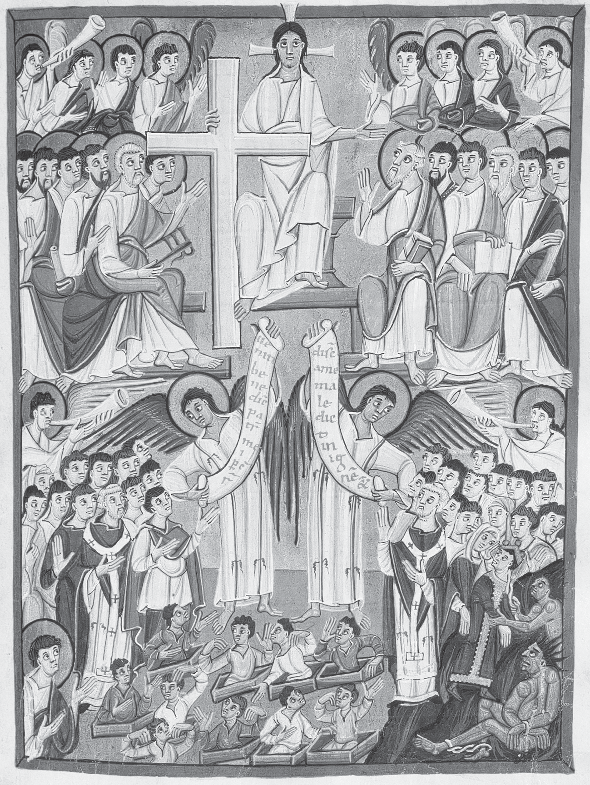

图14.1 《班贝格启示录》，Msc.Bibl.140，书叶53正面，《最后审判》（照片：班贝格国立图书馆）。

《班贝格启示录》以鲜明而权威的方式描绘最后审判，强调审判者基督威严，清楚分割场景。基督在天上主持，周围天廷环绕：吹号天使、担任陪审者的圣徒，<!-- PDF page 224; original page 204 -->俯视尘世。在基督右侧，天使向受祝福者展示欢迎卷轴：“来吧，蒙我父祝福的人〔承受为你们准备的国……〕”（《马太福音》25:34）；另一侧天使，则向基督左边受罚者展示不受欢迎的消息：“离开我，你们受咒诅的人，进入〔永〕火……”（《马太福音》25:41）。受罚者下方敞开地狱景象：攫人的魔鬼拖拽恶人，加入被锁链束缚的撒但。

这两个标准宗教政治表达的例子，尽管体现稳定，却省略居中时间（中间期）、居中人群（奥古斯丁的不太善与不太恶者）、居中空间（炼狱）。尽管已有奥古斯丁分类，对既非大罪人、亦非大圣徒者的忧虑，仍催生个人死亡至普遍复活之间人群的异象。从弗尔西、巴龙图斯（七、八世纪）到韦蒂、胖子查理（九世纪），异象显示灵魂在死前离体，游历彼世。异象者无法区分永受惩罚与暂时炼净的灵魂。[^p224-9] 有时刑罚发生尘世。约1160年，撒丁岛托雷斯的赫伯特，在异象中见亡者队列：“有人较早获释，有人较晚，但许多人仍受无法解除的惩罚。”他见一个灵魂，死后九年在自家集水池赎过，被天使用光柱接升天堂。[^p224-10] 被定罪者与即将得救、或尚需时日者，混杂尘世，忍受漫长昏暗的不死状态。

其他文本也混合死后暂时与永恒受苦。《唐达尔异象》（1148年）中，一个挥霍无度的骑士，因突发病症濒死，由守护天使带领游历彼世。唐达尔尝到身体刑罚，地点像生产作坊：厨房、锻炉、烤架，及神话场所（怪物巨口）。他必须带一头类似曾偷过的牛，走过满布朝上尖刺的桥，脚被刺穿。途中，遇另一有罪灵魂迎面而来。他哀叹，却承认罪过，立刻发现已安全过桥。认罪终止刑罚。来到地狱深坑时，<!-- PDF page 225; original page 205 -->唐达尔见撒但在烤架上扭动，同时吞吃、排泄、抓挠受害者灵魂。（林堡兄弟在贝里公爵《豪华时祷书》中，使这一形象不朽。）他认出昔日同伴，宣布与邪恶伙伴决裂。天使赞扬，称他为“归正的灵魂”。他“抛却先前悲苦，如今满怀喜悦”。[^p225-11] 他否弃邪恶过去后，天使展示，其他方面善良、却未施舍穷人者，如何按其慈善程度受罚或奖赏（per aliquot）。科马克国王离开天上宫殿，受与淫罪、伪誓相称的刑罚，但生前所助穷人，在他受苦时侍奉。唐达尔的天堂是一座有城墙之城，充溢圣徒“联合体”组成唱诗班的和声；这个词社会含义重要，因为consortium也是类似行会或行业团体的职业联合组织。同心城墙区分贞洁的已婚者、童贞者、殉道者。那里没有提及君王统治；在唐达尔异象中，天堂是联合体。

另一文本《圣帕特里克炼狱记》，可能写于1179—1181年左右，讲述骑士欧文约1151—1152年的经历。它以明确把炼狱命名为地方而著名，但大量戏剧性仍围绕炼狱与地狱的混淆。开篇是起源神话：为帮助爱尔兰人改宗，耶稣向圣帕特里克展示洞穴，内有地狱恐怖、天堂欢愉。耶稣不称它炼狱，却说任何人在其中过夜，均可获全部罪的赦免。故事开始，满怀悔意的骑士欧文，为应对内心悲苦，[^p225-12] 希望探访圣帕特里克炼狱，承担异乎寻常的严厉补赎。进洞后，魔鬼催他折返，否则永受洞中刑罚，力图使他相信炼狱实际是地狱。十三世纪二十年代，海斯特巴赫的凯撒里乌斯将对熙笃会初学者宣称，炼狱施罚者是天使，地狱是魔鬼；然而这篇《炼狱记》中，操持<!-- PDF page 226; original page 206 -->火轮刑具的，却是“塔耳塔罗斯的役卒”（指古代施罚冥府）。文本提出地狱新读法：正确理解，地狱酷刑是个人应得惩罚的目录。活着时自愿省察自己在地狱应受刑罚，正如修士借悲苦所做，这种内省就能有炼净作用。《圣帕特里克炼狱记》宣扬一个悔罪者可亲赴的地方，借此组织自己的悔改。

悔罪与彼世的联系，进入新兴大学。内疚良心、悔罪行为、个人最终命运，究竟如何相连？若悔罪能赢得自身赦免，祖先状况如何？应为受永罚者祈祷吗？巴黎神学家、主教彼得·伦巴德（卒于1160年），其神学教材《命题集》在学校盛行至十六世纪，赞同为受永罚者祈祷。他承认，不能使他们脱离惩罚，却能减轻痛苦。[^p226-13] 对通过炼狱得救者，助祷不带来更充分赦免，只加快完成，也就是更早入天堂。[^p226-14] 这些主张鼓励助祷，也鼓励一种把地上助祷行为与来世结果联系的量化。死亡实际上已有衡算尺度，“最后清算”权衡善行与罪过。但继任神学家拒绝其为受永罚者祈祷的立场。欧塞尔的威廉（卒于1231年），认为助祷仅对“其中存在功德的根基与根源，即爱德”者有效。[^p226-15] 因此，一些神学家抵制了从炼狱减刑，推衍地狱可能减苦的诱惑。

这一时期艺术，也处理彼世空间如何适当配置。重要教堂的门上半圆饰区，呈现《班贝格启示录》最后审判构图。孔克，魔鬼兴高采烈折磨受害者，急等更多人；奥坦，它们拨动衡量灵魂行为的天平。沿门楣，复活身体面对厄运，面目扭曲。布尔日，如同沙特尔南门最后审判，地狱之口已移入半圆饰区本身；巴黎圣母院，则移出饰区，至第一道拱券饰带，整体平静。魔鬼用锁链牵走受罚者，但总体上，对神圣君王如子女般敬爱，取代奴仆般怕地狱。这些图像从彩饰手稿书页，移至教堂外门前公共空间，使其传授的教义<!-- PDF page 227; original page 207 -->受众扩大。门后教会围墙内，回廊则象征乐园。

十三世纪，讲道者也大幅拓展受众。新建方济各会、多明我会，在新大学，或由大学毕业者监督的会内学校，成批训练讲道者。这些队伍遍布欧洲，以俗语讲道。讲章突出支持神学结论的经文；为直接吸引不识字者，从数世纪劝善文学汲取现代寓言，即例证。讲道例证展示宗教生活各面。波旁的斯蒂芬讲，地狱火树扎根于商人胸膛，因为他引儿子放高利贷；每一代占新增枝条，所有罪压在始祖身上，把他碾压于地狱火地面。修院提供另一道路，但需坚持。斯蒂芬说，一个熙笃会初学者不满小室，称“比地狱更坏”。亡母以幽灵显现，劝诫，先让他预尝地狱最轻痛苦——猪哼，再尝天堂最小祝福——鸟鸣。初学者于是坚持有益救恩的纪律。[^p227-16]

讲道者从近乎权威的汇编传播劝善故事，按示范讲章集讲道，教会领袖由此感到俗语力量，设想获得向最偏远堂区传教义的新能力。虽从未完全标准化，创新仍极大激活基层。直到十五世纪印刷发明，宗教信息传播才再有可比的跃进。女性尤其受益：传统大体阻碍她们学拉丁文，教士又将她们拒于大学外。尽管成见古老，宾根的希尔德加德（卒于1179年）、兰茨贝格的赫拉德（霍恩堡，卒于1195年）等以拉丁文写作的修女，据存世记录判断，仍在神学、科学、音乐、艺术作出卓越贡献。女性帮助俗语成为文学载体，一些人，如布拉班特的哈德维赫（十三世纪）、马格德堡的梅希蒂尔德（约卒于1285年）、玛格丽特·<!-- PDF page 228; original page 208 -->波雷特（1310年被处死）、诺里奇的朱利安（卒于1413年），更频繁写作，未必是修女，也未必受男性监督。

彼世教义更有效传播——换言之，教士更全面回应民众关切——带来行为后果。许多平信徒热切追求天堂。讲道者把讲道称上帝之言，单是出席，就被视为美德。作为补赎的朝圣赢得大赦（减轻因罪所欠惩罚）；十字军又是朝圣形式。男女进入修院，崇敬圣徒获得超自然代求者。从出生地至墓地，公私仪式把个人意义，与公共场面、政治宣传、集体感受相连。教会、继而行会，资助露天上演《圣经》故事。一些圣事也变化。十二世纪前，悔罪通常出于自愿；但1215年，教宗英诺森三世要求，每年向本堂司祭告解。托钵修士普及这种私下告解。平信徒新宗教团体出现：托钵修会第三会、善会，以及主要供女性的贝居安团体。严格的新严规支派，也使修会本身承受压力。十三世纪起，创建医院，作为新慈善形式而扩散。各类捐赠由教会机构管理，把今世来世利益相连。教会受赠，确实深刻塑造欧洲经济；教会权威所征税亦然。希望天堂、恐惧地狱炼狱，增强教会经济政治影响，都是其介入民众死后赏罚观的结果。

教宗基于对民众参与的认识，用教义定义尝试使信仰一致。主要关切之一，是在中间期与永恒，划分空间、时间、归宿。十三世纪宣告，使赏罚从临终开始，不再延至基督再来，从而强化超自然制裁。

1215年信经，英诺森三世宣布按功德审判：行善者“将与基督同享永恒荣耀”，行恶者“将与魔鬼同受永恒惩罚”。[^p228-17]

<!-- PDF page 229; original page 209 -->

这意味着衡量善恶行为，功德重量或数量更大者得救，未提中间期或炼狱。

英诺森四世1254年《在公教信仰宣认之下》信函（Sub catholicae professione），以悔罪为标准，决定能否在炼狱赎“轻微小罪”。不悔罪，未告解而死，就在地狱付永恒代价：“若有人未悔罪，死于大罪……将永受永恒革亨纳之火折磨。”[^p229-18] 他定义炼狱为“暂时之火，〔藉它〕洗净死后仍负累灵魂的微小罪过，只要这些罪生前已获解除〔即赦免〕”。他不只正式开放炼狱为悔罪者归宿，也宣布“在爱德中”死去者，灵魂“立即进入永恒家园”。[^p229-19] 实际上，炼狱仅能洗净轻罪的限定，很快让位于较古老传统：告解甚至使“重大的”罪，即大罪，成为轻罪。[^p229-20] 1274年，格列高利十世不再坚持唯轻罪能在炼狱赎清，却规定地狱与炼狱、天堂一样，死亡即开始。[^p229-21] 如此压缩末世时间，把后果拉近当下，强调个人行动与告解。

教宗宣告层面之下，巴黎神学家努力阐明一致的来世体系。困难来自助祷、十字军等制度要求：若这些行为影响死后状态，以何比率？欧洲主要思想家力求避免等价交换的量化安排，但并不总容易。黑尔斯的亚历山大（卒于1245年），建立罪行尺度（轻罪、大罪），及对应惩罚（地上补赎，来世炼狱与地狱刑罚），思考各类如何转化、折换。他说：“每一种惩罚，均折换为与它相应的惩罚。”[^p229-22] 不论本意如何，他这交换、折换的比喻，并未限制，反而促进实际上已形成的衡算死亡文化。

<!-- PDF page 230; original page 210 -->

若助祷能减轻彼世惩罚，数量足够，能否连受永罚者也救？教宗格列高利一世中世纪传记讲，他代求，使异教皇帝图拉真从地狱重返尘世，再活一次，得以作为基督徒死去；到但丁笔下，已得救，成为天上星辰。[^p230-23] 波纳文图拉（卒于1274年）考虑此例：上帝能够，却不拯救受永罚者。“〔死后〕死于罪中的人得救，不只困难，而且不可能；不是神力不能成就，而是神圣正义合理公正地作出相反决定。”[^p230-24] 这种对神圣权能的保留，通常只在谈到十四世纪时才引人注意；它将以区分上帝绝对权能（potentia absoluta）与既定权能（potentia ordinata）的形式，变得越来越重要。

托马斯·阿奎那（卒于1274年），对为受永罚者助祷，追随欧塞尔的威廉：“爱德是联结教会成员的纽带，不只延及生者，也及于在爱德中死去的亡者。”[^p230-25] 因此，炼狱灵魂的特征，不是消极的平庸，而是积极的拥有爱德。因为有爱德，助祷可及；地狱受罚者缺爱德，自绝于助祷。[^p230-26] 亡者重新分类，虽使炼狱地位更稳，却绝未使地狱空虚；反而绝对隔绝其居民与任何其他生者、死者的联系，使地狱更强。湮没愈发遥远。

神学著作偏好细密分类，可能忽略坚持己见、自主的民众观念，但有时仍显露。约1220年，海斯特巴赫的凯撒里乌斯，为本院初学者写神学入门手册，讲附近列日故事：主教不许基督徒寡妇，将非基督徒、放高利贷的丈夫葬于教堂墓地。妻子司法上诉获胜，搬进丈夫墓旁棚屋，为他祈祷。七年后，丈夫穿半白半黑衣现身：“我已从地狱深处、从最大刑罚中被拉出。若你再为我做同样善工<!-- PDF page 231; original page 211 -->七年，我便完全获释。”妻照办，七年后，丈夫穿明亮白衣显现，感谢她，宣布自己“已获释”。凯撒里乌斯将故事归炼狱，不归地狱，因为他说，无人能从地狱赎回；推测死者曾在最后一刻悔悟，虽故事未说明。[^p231-27] 他努力解释掉当地民间故事中明显的神学问题——妻子以祈祷，把罪人救出地狱——表明学术与民众文化有矛盾。假定全部社会结构，始终神学一致，是错误。尽管他作“修正”，故事三段结构仍提示，一些人相信能为他人祈祷，先出地狱，再出炼狱，最终入天堂。

末世问题的交锋，也可发生最高层。1331—1332年，教宗约翰二十二世宣称，荣福直观，即直接看见上帝的天上奖赏，须待普遍复活，身体灵魂重合，方可获得。同理，受永罚者，无论人或魔鬼，最后审判后才入地狱。宣告有逆转上世纪趋势之虞：那趋势把决定时刻提前至个人死亡。遭民众、政治、甚至王室巨大反对，他临终撤回意见。继任本笃十二世，恢复适当应得者即时进入天堂地狱两种最终归宿的趋向。[^p231-28]

正如神学家从大学讲席走向讲道台，会转换修辞层次，壁画家在教堂墙面表现不可言喻奥秘，但丁《神曲》也同时面向宗教共同体的学术、民众两面。它既是公教神学权威阐释，也是人间爱情故事，亦为政治抨击的场合。诗人以意大利语诗，讲虚构异象，追踪通往上帝的路。[^p231-29] 他按朝圣阶段，接受衡算死亡。一切有尺度。地狱，<!-- PDF page 232; original page 212 -->陷入深度衡量罪责；天堂，直观上帝的强度衡量恩典：

> e del vedere è misura mercede，所见衡量其奖赏。（《天堂篇》28:112）

对他，衡量解释神圣正义。

但他也怀疑这些理性手段。天堂，圣彼得问其信仰定义；听这佛罗伦萨流亡者用“三段论”“何所是”等经院术语，彼得质问：“你为何把封闭自己心灵的这些命题，视为神圣火花？”（《天堂篇》24:98—99）但丁答，三个位格与福音，是内心燃烧火焰，使彼得欢喜。

火确为《神曲》的组织性比喻：

> catun si fascia di quel ch’elli è inceso. 每人把自己裹进使自己燃烧之物。（《地狱篇》26:48）

燃烧（ardere），在地狱造成永恒折磨，炼狱带来净化，天堂成为永恒光明与爱。人人都有可能被这爱“点燃”（incesi）。因此，炽热本身，无论人的执迷、洗净之火或神圣之爱，遍及宇宙。上帝回应人的爱，会平息激动求天堂者的火。但丁虚构异象，隐然挑战地狱门铭：不应放弃希望，应活着“进入”地狱，如欧文，面对悲苦，检视过失，培育信仰，追求爱。

《天堂篇》中，彼得不只问但丁信仰。对谈时，首位教宗痛惜欧洲属灵衰败：宗教权威滥职谋私；神学家夸耀多余区分；讲道者喋喋不休；假大赦贩子，从轻信、购买伪造承诺的人那里，收取劣币（《天堂篇》第29歌）。但丁下一代，弗朗切斯科·彼特拉克（卒于1374年），批评学者会定义美德，却不会爱、不会实践。波纳文图拉承认，上帝若愿，可救永罚者，但不如此做；这一让步在唯名论者中开花，成为绕过官僚式、可预测上帝形象的努力。那形象限上帝于既定权能，而传统强调——如伪狄奥尼修——上帝超越认识，因而可自由使用绝对权能。信仰理性化，以及制度层面的量化，是否走得太远？

<!-- PDF page 233; original page 213 -->

一些人试借数学观念、意象，恢复质的焦点。但丁同时代，方济各会属灵派卡萨莱的乌贝尔蒂诺（1305年写作），按《马太福音》25:40字面解释，视谦卑自降、自愿属灵贫穷，为得救前提。他要求灵魂认同基督弟兄中“最微小者”，以此与耶稣结合。这转变使信徒成为“小耶稣”（jesunculi），达到“至微”（minimitas），唯此状态使人得救。[^p233-30] 最小与最大间的对立，以及神秘意义的对应，启发库萨的尼古拉（卒于1464年）研究。他探求对立的重合，发展无穷的数学观念，作为通往上帝另一道路。

强大制度压力仍在。参加十字军、朝圣、特殊盛会——如博尼法斯八世1300年宣布的禧年——或大小捐赠，都获大赦；这种等价交换式赎罪，催生种种“衡量”悔改进展的方法。黑尔斯的亚历山大所作折换量化，进入民间与制度实践，超出他对悔罪纪律与来世关系的理解。在追思弥撒堂、或侧廊小堂祭坛，资助私人弥撒，把中世纪早期资助主教座堂、提供俸禄的大任务，拆为较小单位，每项均对应死前或死后预期功德收益。[^p233-31] 须注意，权威否认这些行为能除罪责，只免罪所生惩罚；但焦虑地狱炼狱痛苦的民众，不懂这区分。1477年，西克斯图斯四世宣称，有教宗能力，为炼狱需助祷者分配“基督与圣徒”共有功德，称它“宝库”。[^p233-32] 免除炼狱刑罚，似乎越来越易获得；有时，正如此次宣告所因事件，仅须捐现金建教堂。

牛津的奥卡姆的威廉（卒于1349年）等学者，早反对这种神学，认为把上帝权能限于人从《圣经》可推论之事。其追随者唯名论者，坚称上帝权能绝对，决不受人类理性限制。援引上帝的绝对权能——神力绝对、不受束缚——高于其既定<!-- PDF page 234; original page 214 -->权能——限于上帝已启示之事的神力——挑战炼狱、助祷、大赦观念。批评者认为，它们把量化，以及人对推衍的信心，推得太远。1479年，美因茨教会法庭迫使韦塞尔的约翰，撤回反大赦论著。他说，只有基督曾与使徒立此协议，才可能有分配基督圣徒功德之权；但《圣经》未启示此事。[^p234-33] 虽他撤回，援引《圣经》挑战功德量化，却未消失。事实上，《圣经》将成为新教挑战这些公教实践的号召。新教也以抹平等级的眼光看天堂，淡化位次与等级，例如废除圣徒崇敬。

与此同时，不论神学家有何异议，争取死后利益的行动加强。1215年每年告解要求以来，对良心的重视提高，影响个人虔敬，也相应使艺术物品普及。罗曼式与哥特式教堂立面，以最后审判结合天堂地狱的宏伟构图，广泛出现，如十三世纪晚期佛罗伦萨洗礼堂穹顶。私人赞助也能使其个人化，如帕多瓦乔托的阿雷纳小堂（1305年）。富家私家小堂也有较小祭坛画；许多同样在双联画或单幅画，结合从天堂至地狱的全景。十五世纪早期印刷木刻引入，显著推动这种艺术零售化，即物件更小、更便宜。印机可在单张纸复制虔敬图像，宗教信息已不依赖公共空间接触大量人。受众的集中，在“时祷书”达到特别亲密程度：这些小型祈祷书，藉彩饰加强默想，文字图像在私人主人膝上结合。

时祷书的核心祷文系列，是《圣母日课》，因此许多插画讲述圣母故事，以天堂为背景，如加冕、升天。但天堂，也始终是《启示录》诸多戏剧情节的场景：身披太阳的女人、朝拜羔羊、基督口衔剑显现、与龙争战、叛逆天使坠落、天上耶路撒冷、最后审判。

<!-- PDF page 235; original page None -->

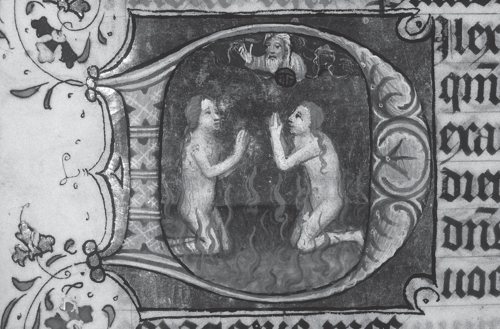

图14.2 一部《时祷书》的彩饰首字母，书叶197正面，手稿133 M 131（照片：荷兰国家图书馆，海牙）。

<!-- PDF page 236; original page 216 -->

天堂也呈现为天意俯瞰大地之处。上帝之手，或俯冲天使，警告、启发、保护、驱逐所看顾的人。天使奏乐起舞，如米兰波尔蒂纳里小堂，或伦敦国家美术馆弗拉·安杰利科的《基督在天廷受荣耀》。天堂是最后审判王廷所在，也是基督听玛利亚代求处——她为求助者向耶稣恳求。十二世纪科学兴趣兴起，天堂成为创造场景：上帝以几何学家身份设计地球，天堂围绕黄道十二宫。世俗化后，可成《玫瑰传奇》或克吕尼博物馆独角兽挂毯中情人围园。中世纪戏剧，它现于舞台左侧，地狱之口则右侧。

炼狱十四世纪进入艺术，[^p236-34] 后来，昂盖朗·卡尔东在阿维尼翁新城的《三位一体为圣母加冕》（1454年），及让·科隆布在贝里公爵《豪华时祷书》的画（约1480年），有两幅尤其宏伟表现。教义普遍接受的重要数量证据，包括时祷书彩饰首字母：两灵魂相向，跪于炼狱火焰祈祷。[^p236-35]

与文艺复兴艺术相连的新能力，以肉色和写实解剖表现人体，使奥尔维耶托西尼奥雷利，以及早期尼德兰画家罗吉尔·范·德·魏登、汉斯·梅姆林、迪尔克·鲍茨、扬·范·艾克的末世场景，具令人屏息的临场感。一代后，希罗尼穆斯·博斯，把看似荒谬形象，置于类似天堂地狱场景，象征内在死亡的罪责与幻想。图像强化惊惧恐怖、希望渴望。这些内在现实，正是马丁·路德1517年反大赦《九十五条论纲》所唤起。他批评支点是痛悔：罪人与上帝的个人关系，悔恨独立于任何司祭职能。唯上帝统管灵魂，捐钱、完成朝圣、参与战役，均无助益。对内在个人的关注，在公教中也有同情者。西斯廷礼拜堂米开朗琪罗《最后审判》（1536—1541年），呈现的惊恐希望，不亚敬畏，强烈表明，对他，审判日由心理现实主导。

## 注释

[^p220-star]: 感谢JoAnne Gitlin Bernstein、Paul R. Katz、Miri Rubin与Jeffrey Burton Russell，为本章提供有益建议。

[^p220-1]: Charles King, ‘The Organization of Roman Religious Beliefs’, Classical Antiquity 22 (2003), 275–312. Charles King, ‘The Living and the Dead: Ancient Roman Conceptions of the Afterlife’, (PhD dissertation, University of Chicago, 1998).

[^p221-2]: Epistola 124, ad Avitum, §7; Eusebii Hieronymi Epistulae, ed. Isidorus Hilberg (CSEL 56.1; Vindobonae: Verlag der Österreichischen Akademie der Wissenschaften, 1996), 104.

[^p221-3]: Epistola 22, ad Eustochium §30, CSEL 54, 189–91.

[^p222-4]: Isidorus Hispalensis, Sententiae 1.28.1, ed. P. Cazier (CCSL 111; Turnhout: Brepols, 1998), 86.

[^p222-5]: Alan E. Bernstein, The Formation of Hell: Death and Retribution in Antiquity and the Early Christian Worlds (Ithaca, N.Y.: Cornell University Press, 1993), 322–5.

[^p222-6]: 概述见Paul Fouracre, The Age of Charles Martel (Harlow: Longman, 2000), 137–45。更详图景见Ian Wood, ‘Teutsind, Witlaic and the History of Merovingian Precaria’, in Wendy Davis and Paul Fouracre, eds., Property and Power in the Early Middle Ages (Cambridge: Cambridge University Press, 1995), 31–52。

[^p222-7]: Guilielmus Alvernus, Opera Omnia, 2 vols. (Paris, 1674; repr. Frankfurt: Minerva, 1963), De Universo, 665 (= 673) aD–bA.

[^p222-8]: Thomas Aquinas, ‘On Kingship, to the King of Cyprus’, ch. 12., in A. P. d’Entrèves, ed., Aquinas: Selected Political Writings, trans. J. G. Dawson (Oxford: Blackwell, 1959), 66–7.

[^p224-9]: 巴龙图斯，见J. N. Hillgarth, ed., Christianity and Paganism, 350–750 (Philadelphia: University of Pennsylvania Press, 1986), 195–204。弗尔西、韦蒂、胖子查理，见E. Gardiner, ed., Visions of Heaven and Hell before Dante (New York: Italica Press, 1989), 51–5, 65–79, 129–33。

[^p224-10]: PL 185, col. 1376 C-D, 1376-A：‘有人较早获释，有人较晚，但许多人的惩罚仍无法解除。’另见Jean-Claude Schmitt, Ghosts in the Middle Ages (Chicago: University of Chicago Press, 1998), 93–121。

[^p225-11]: Visio Tnugdali, ed. A. Wagner (Erlangen: Deichert, 1882), 40：‘卸下过往悲苦，灵魂充满喜悦。’Gardiner, Visions of Heaven and Hell, 180–1。

[^p225-12]: 一系列文本异文，显示十二世纪如何理解古代晚期的tristitia。以下是《圣帕特里克炼狱记》三个拉丁版本与一个法语译本的表达。PL 180, col. 989B：‘miles multum contristatus’（骑士极其悲伤）。Karl Warnke, ed., Das Buch vom Espurgatoire S. Patrice der Marie de France und seine Quelle (Halle: Niemeyer, 1938; repr., 1976), 38–9：‘miles graviter indoluit’（骑士内心深感悲痛）；‘intima contritione cordis ingemuit’（他怀内心强烈痛悔而呻吟）。玛丽的古法语作：‘Li chevaliers pur ses pechiez / fu mult tristes e esmaiez’（骑士因自己的罪／极其悲伤、恐惧）。

[^p226-13]: Peter Lombard, Sententiae in IV Libris Distinctae 4SN d.46 c.1 n 4 (Grottaferrata: Collegium S. Bonaventurae, 1972), vol. 2, 531, lines 11–12.

[^p226-14]: Peter Lombard, Sententiae, 4SN d. 45 c.4 n. 2; 526, lines 22–3.

[^p226-15]: William of Auxerre, Summa Aurea 4.18.4.1 (Paris: Pigouchet, 1501; repr. 1964), 538.145–9：‘其中有功德的根基与根源，即爱德。’

[^p227-16]: 这些例证，见Alan E. Bernstein, ‘The Invocation of Hell in Thirteenth-Century Paris’, in J. Hankins, J. Monfasani and F. Purnell, Jr, eds., Supplementum Festivum: Studies in Honor of Paul Oskar Kristeller (Medieval and Renaissance Texts and Studies 49; Binghamton, N.Y.: M.R.T.S., 1987), 13–54。

[^p228-17]: H. Denzinger and A. Schönmetzer, eds., Enchiridion Symbolorum, 34th edn (Barcelona: Herder, 1967), no. 801, 260.

[^p229-18]: 同上, no. 839, 272.

[^p229-19]: 同上

[^p229-20]: Decretum. De Pen. d.1 c.88：‘行为时本是重罪的，因告解成为轻罪。’见E. Friedberg, ed., Decretum Magistri Gratiani (Leipzig, 1879; repr. Graz: Akademische Druck und Verlagsanstalt, 1959), vol. I, 1188。

[^p229-21]: Denzinger, Enchiridion, nos. 856–8, 276–7.

[^p229-22]: Alexander of Hales, Glossa in quatuor libros sententiarum Petri Lombardi 4.18.4, IV.q. (Quaracchi, Florence: Collegium S. Bonaventurae, 1957), vol. 4, 324.

[^p230-23]: E. Gordon Whatley, ‘The Uses of Hagiography: The Legend of Pope Gregory and the Emperor Trajan in the Middle Ages’, Viator 15 (1984), 25–63.

[^p230-24]: Bonaventure, Commentaria in Quatuor Libros Sententiarum, 4 d.20 p. 1 a.1 post q.6; dubium 3 (Quaracchi: Collegium S. Bonaventurae, 1889), 527b–8a.

[^p230-25]: P. Caramello, ed., Summa Theologiae, Tertia Pars, Supplementum, Q.71 a.2 (Turin, Rome: Marietti, 1956), vol. 3, 254b.

[^p230-26]: Thomas Aquinas, Supplementum a. 5; 258a.

[^p231-27]: Caesarius of Heisterbach, The Dialogue on Miracles, 12.24, trans. H. von E. Scott and C. C. Swinton Bland, 2 vols. (London: Routledge, 1929), vol. 2, 313–14.

[^p231-28]: Denzinger, Enchiridion, nos. 1000–1, 296–7.

[^p231-29]: Aron Gurevich在‘The “Divine Comedy” before Dante’中，概述民众与学者思维模式的汇合；见J. M. Bak and P. A. Hollingworth, trans., Medieval Popular Culture: Problems of Belief and Perception (Cambridge: Cambridge University Press, 1988), 104–52。

[^p233-30]: Arbor Vitae Crucifixae Jesu (Venice: Andreas de Bonettis of Pavia, 1485; repr. with an introduction and bibliography by Charles T. Davis, Turin: Bottega d’Erasmo, 1961), 490b.

[^p233-31]: R. W. Southern, ‘Between Heaven and Hell’, Times Literary Supplement 4133 (18 June 1982), 651–2.

[^p233-32]: Denzinger, Enchiridion, no. 1406, 349.

[^p234-33]: 转引自Heiko A. Oberman, ‘Luther and the Via Moderna: The Philosophical Backdrop of the Reformation Breakthrough’, Journal of Ecclesiastical History 54 (2003), 641–70，所引661。

[^p236-34]: 参见 Joseph Polzer, ‘Andrea di Bonaiuto’s Via Veritatis and Dominican Thought in Late Medieval Italy’, Art Bulletin 77 (1995), 262–89; Michelle Fournié, ‘La représentation de l’au-delà et le purgatoire à Saint-Just de Narbonne’, in Le grand retable de Narbonne (Narbonne: Ville de Narbonne, 1990), 45–55.

[^p236-35]: 例如海牙，KB，133 M 131，书叶197正面，‘屈伦博赫的兹韦德大师’作品（图14.2）。

---

# 第四编 基督教世界的形态

<!-- PDF page 237; original page None -->

<!-- PDF page 238; original page None -->

<!-- 原书空白页 -->

---

# 第15章 圣事生活

米里·鲁宾（Miri Rubin）

<!-- PDF page 239; original page 219 -->

1445至1450年间某时，佛兰德画家罗吉尔·范·德·魏登（1400年生于图尔奈，1464年卒于布鲁塞尔），在三块橡木板作画，后来称为《七圣事祭坛画》。[^p239-1] 他曾在1450年禧年赴罗马朝圣，此后作品——包括此画——显示新获得的活力与色彩。罗马之行，也可能激发画中明显的心态：他提供一部“大全”，视觉地总结基督徒生活，视为从摇篮到坟墓的圣事旅程。这一愿景，十二世纪起由教宗构想推动，到其时代已成基督徒生活基本框架。

圣事历史当然更早。二世纪德尔图良（约160—约225年），已尝试用罗马法律术语sacramentum——誓言——描述宗教委身。[^p239-2] 他又发展其含义，指“象征、预象、寓意、象征性德能或力量、象征性秩序或人物”。[^p239-3] 圣事是表明委身，或表示重大事件的举动、实践。[^p239-4] 讨论的下一个<!-- PDF page 240; original page 220 -->重要阶段，一如常见，是希波的奥古斯丁（354—430年）处理。

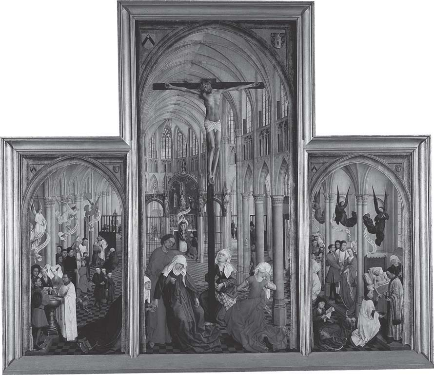

图15.1 罗吉尔·范·德·魏登《七圣事》三联画，安特卫普皇家美术馆。

奥古斯丁全面构想基督教社会与政治共同体，也就是亲见罗马帝国各地正在发生的过程，探讨圣事性质。人们通过这些仪式成为基督徒，并以个人、群体方式，过基督徒生活。若这种生活以希望得救为前提，救恩来自基督牺牲带入世界的救赎恩典，圣事就是恩典流向个人的管道。首先洗礼除原罪，此后终身，恩典支持基督徒生活的努力。

圣事使恩典不可见、奥秘的运作，可触可见。作为可见记号，总经水、油、饼等物质媒介运作。奥古斯丁承认，<!-- PDF page 241; original page 221 -->有些人也能以其他方式圣化、蒙恩典触及，但多数信徒，圣事绝对必要。任希波主教，他面对多纳图斯派倾向，主张唯纯洁司祭主持，圣事才有效。他拒绝此立场，帝国也以异端迫害。其关于圣事与施行者的立场，最适应所处大量改宗的动荡时期：若异教徒不能相信新基督徒生活核心的洗礼、圣餐，确实有效、因而能救人，又如何被吸引？

圣事不只是使人加入、建立维持基督徒生活的仪式，也是承继链条的环节，重演不断发展、处在历史中的教会基本结构。从基督生平，经创立教会的使徒，再经彼得继承人罗马教宗，形成圣事行动链。奥古斯丁的理解，因而连着教会愿景：教会如建筑，容纳基督自身生活所发的恩典遗产，以及教导榜样传承。因此圣事讨论，总涉及教士地位、权能、独特特权。此外，其物质层面——诉诸感官经验——也抵御基督教内部一种倾向：以二元论拒绝物质进入基督徒生活。奥古斯丁自己，也曾长期受其吸引。

讨论本期西欧圣事生活，须记住这早期基督教遗产。中世纪早期，较少讨论圣事理论，尽管个别圣事获关注阐发。[^p241-5] 最显著的重新探讨，发生十二世纪神学与牧灵供给中心：巴黎诸学校。奥古斯丁传统的学者圣维克多的雨果（1096—1141年），在圣事论著中，区分历史各阶段的圣事类型：

<!-- PDF page 242; original page 222 -->

自然法之下、成文律法之下、恩典之下。他也细化圣事外在面貌与内在运作的关系：

> 圣事是身体性或物质性要素，外在地呈于感官；凭相似性表现，凭其设立而表意，凭圣化而蕴含某种不可见的属灵恩典。[^p242-6]

新兴圣事神学及其牧灵应用，将更重视外在呈现。

雨果重思圣事，影响其学生、伟大体系化者彼得·伦巴德。转向这部极重要神学评注——彼得（卒于1160年）的《命题集》——可见奥古斯丁用语重新表述：

> 严格说，所谓圣事，是上帝恩典的记号、不可见恩典的形态，既承载该恩典的形象，也构成其原因。[^p242-7]

与旧律仪式不同，基督教圣事不只象征，也赐予恩典（haec conferunt gratiam）。[^p242-8] 彼得也确定其数。奥古斯丁已区分不同类型，他则明确数量，不是某些人主张的三、四、十二，[^p242-9] 而是七：洗礼、坚振礼、圣秩礼、婚姻、告解、圣餐、临终傅油。[^p242-10]

<!-- PDF page 243; original page 223 -->

范·德·魏登画中，圣事是社会事件，呈现家庭庆典所有多样与活力。构图巧传根本意义：最前方、每个及全部圣事场景之上，是钉十字架，一切恩典与得救希望之源。基督身体高悬，地面约翰、玛利亚、圣洁妇女哀悼。同一轴线，教堂深处东端，有祭坛，举行祭坛圣事。司祭正举扬圣体：饼酒刚祝圣，经实体转变，成为基督身体与血；其祭披有十字架，背面朝观者。中央画板唤起历史空间，及其通过首要圣事圣餐，在祭坛重现。司祭背后，一平信徒跪着，是否在等待领圣餐以参与？

两侧各含三圣事，左下从洗礼开始，右下以死亡结束。三位鲜艳天使，悬于这一画板的圣事场景上。受洗为婴儿，远不同于奥古斯丁面对的大量成人受洗；婴孩浸入洗礼池，教父母围绕。洗礼使其加入基督徒共同体，也标志成年人的承诺：生父母、洗礼父母，都答应引导孩子过基督徒生活。当然，这是严肃委身，不只因希望得救，也希望孩子渡过婴儿期危险，长大成人。[^p243-11] 池边时刻充满意义，洗礼池因而常雕信仰概要，表示到场者答应予以保障，并不奇怪。中世纪晚期东盎格利亚，洗礼池多八角形，八面展示七圣事，及其传递恩典所源的钉十字架。[^p243-12]

父母极怕孩子未洗即死；教会放宽条件，若无司祭，任何平信徒均可念施洗程式。接生婆常在体弱新生儿降生时在场，因此<!-- PDF page 244; original page 224 -->一些教区会考核她们是否知道施洗程式。暴力威胁下强迫犹太人、穆斯林受洗，挑战圣事应自由领受的理解。施洗较易，区别于多数圣事。梅斯主教贝特拉姆，1206年致信英诺森三世，问一犹太人“临近死亡，在只有其他犹太人在场时，亲念施洗程式，自投水中”的情况。[^p244-13] 教宗要求，按适当方式重洗。

接着坚振礼，给青少年步入考验重重的青春期、性觉醒之初，额外增添恩典。父母旁观，主教施礼。受坚振孩子属于一群同处童年成年门槛的年轻人。这也是初领圣餐年龄；被认为能理解复杂真理者，已准备领受。

坚振后，年轻人被视为对行为负责，能作道德选择，需要告解引导、抚慰，即画左下一圣事。早期教会，告解为公开仪式；十五世纪较私密，虽告解亭要到反宗教改革才引入公教实践。司祭提问引导，又借助《悔罪书》指南；这种手册，十二世纪晚期大量出现。[^p244-14] 告解经探索性追问促成，使人自知、真正面对罪。司祭受教辨别诸种犯罪情境，以头韵问题提示：何地？何时？如何？与谁？多少次？因此，越轨置于完整背景，分配适当补赎更细致。补赎可为不同严厉程度斋戒、施舍、朝圣近处乃至极远圣地。康布雷主教1260年教区会议法规，要求劝告解者探访“教区母堂，康布雷主教座堂”，并附<!-- PDF page 245; original page 225 -->大赦作奖赏。[^p245-15] 告解周围发展责任伦理：所听任何事均须保密，不可透露，甚至暗示。司祭身份增添全新层面，如康布雷主教拉昂的吉亚尔（1238—1248年在任）法规：

> 任何司祭不得因愤怒、仇恨，甚至怕死，用手势或言语，笼统或具体暗示，泄露告解者任何告明事项；例如说：“我知道你是什么样的人。”若泄露，应毫不宽恕地褫夺〔司祭身份〕。[^p245-16]

告解、痛悔、回心转意、离罪后，基督徒可领圣餐。事实上，第四次拉特朗会议（1215年）及各国后续规定，向基督徒提供并要求的整套圣事安排，重点就是把二者结合为庄严、有意义的年度事件。平信徒，这已足够：

> 所有男女信徒，达到明辨年龄后，应各自诚实地向本堂司祭，至少每年一次告明全部罪过，并尽力完成所命补赎，至少复活节敬领圣餐圣事；除非按本堂司祭建议，因合理理由，认为应暂不领受。否则，生前应禁止进入教堂，死时不得以基督徒礼安葬。[^p245-17]

中央画板，画等待领受者。从洗礼，经教导、坚振、告解引发的交流，塑造基督徒的一切，都应使其准备<!-- PDF page 246; original page 226 -->领受司祭在祭坛制成的基督肉与血。圣餐在画中居中，反映当时讨论辩论的地位。多数指南，及所有教导平信徒的劝善故事集，关于祭坛圣事，均有尤其长的部分。[^p246-18] 圣餐蕴含诸多根本真理，正确理解，应使人积极、甘愿相信其他圣事运作。此外，至1200年，圣餐神学已成考验重重的理论大厦，拱心石是相信实体转变；术语创于十二世纪八十年代，即司祭用最后晚餐基督话语（《马太福音》26:26—28）祝圣，使祭坛饼酒变为基督肉血。第四次拉特朗会议第一条，规定必须相信实体转变，即祭坛圣事中这一特定形式的基督临在，且不接受其他形式，作为信仰要求。

右侧画板，三圣事并非人人经历，也非得救绝对必要。先圣秩礼，少数选择司祭圣召者特权。准入严限：只限男性，法律身份自由、婚生、身体无瑕、达适龄、独身。为招司祭，教会法提供若干途径，让不全符合者申请特许，由主教酌决。受秩为长程终点：年轻人男孩时先领剪发礼，后可逐级取得低级圣职，在司祭旁辅助，包括辅祭（acolyta）、读经员（lector）、协助驱魔者（exorcista）、提圣水者（aquabaiulus）。二十五岁进入较高圣职，可达受秩顶峰：先副执事（subdiaconus），再执事（diaconus），终司祭（presbiter）。司祭以下各级教士，虽均可协助举行，甚至施行某些圣事，祭坛圣事却只限司祭主持。

圣秩某种意义是婚姻，与基督结婚。画中受秩者跪着，穿白衣，如新娘。受秩赋许多特权：须预先确保圣俸及适当收入的证明；一旦受秩，便享有<!-- PDF page 247; original page 227 -->教导、领导权威，只对教会法庭及法律负责。不论品格可疑、学识浅薄、身体衰弱或不善言辞，受秩者仍是有效圣事施行者：每年每日在祭坛制成基督身体，圣诞节两次。

施圣事是司祭特权，体现教会释放、捆绑，管理恩典宝库，提供独一、唯一救恩途径的权能。十一世纪起，教会推动、争取自由，即libertas ecclesiae。[^p247-19] 每个政治共同体中，这自由均须经与世俗统治者斗争取得，但斗争也是内部：教会若主张自由特权，成员就须承担独身考验，举止庄重。传递恩典、教导信仰的专有权，以个人牺牲、努力为代价，司祭自应表现适当。十二世纪诺曼底库唐斯教区主教提醒：

> 我们劝你们，不论在外、家中或拜访堂区居民，剪发、衣着均保持适当仪表……衣服应系好，不可过长过短而惹眼，否则像弓箭手或竞技斗士。[^p247-20]

如圣秩，婚姻并非人人领受，但多数如此，帮助把社会组织为基督徒养育、劳动、互助单位。婚姻是教会与世俗政权持续争执领域，双方均制定规则。作为传递财产地位的制度，它嵌于极古老地方传统：影响南欧婚俗的罗马法，至塑造德国、法国北部、英格兰、斯堪的纳维亚婚俗的日耳曼法典。至1100年，教会已发展婚姻神学，界定配偶间允许、禁止的血亲程度，视婚姻为个人自由所作道德选择。[^p247-21] 这观念，<!-- PDF page 248; original page 228 -->正面冲撞父权社会家庭习俗；在那里，婚姻由家长撮合，决定儿女未来。

基督教婚姻发展漫长；教会对性的态度，有时互相矛盾，更添复杂。[^p248-22] 奥古斯丁再次是奠基思想家的好例子：从厌恶欲念——青年时曾强烈体验——转向接受婚姻，作为约束性生活、养育基督徒后代的框架。[^p248-23] 十二世纪密集讨论，提出突破性法律表述，尤其婚姻如何成立。若为圣事，就必须出于自由道德行为。婚姻具有相互性，对应理想中所有灵魂、一切受造物的平等；这种平等，实践常被否认扭曲。

圣事婚姻赋男女在缔结中同等分量。十二世纪神学愈强调，应按背后使行为发生的意图判断；因此，表达结婚意图，也被视为有约束力。[^p248-24] 教会法因而承认，两人缔结的婚姻，即使无证人、无公开仪式。同时，教会也提供庄严结婚的圣事场合，鼓励使用。数世纪间，且延续中世纪之后，教堂仪式，渐成家庭共同体古老婚庆必要部分。[^p248-25] 婚姻既为圣事，就不可解散；注意《祭坛画》司祭以领带捆连夫妇。但若有理由，使婚姻选择背后的“自由”无效，亦可宣告无效或解除。中世纪晚期教会法庭，大量业务是婚姻诉讼。婚姻成为圣事，创造许多复杂<!-- PDF page 249; original page 229 -->挑战，也把社会生活基本形式，与教会礼仪、行政服务相连。婚姻、爱情、性，牵动但丁、乔叟、克里斯蒂娜·德·皮桑等所有伟大诗人艺术家，也牵动较次要者。[^p249-26]

圣事标记生命周期，为人生过渡礼提供仪式框架。[^p249-27] 最大过渡，当然从今世至来世。临终傅油，即临终圣事，旨在给将踏上最可怕旅程的基督徒，最后增添恩典。死亡吸引诸多仪式：十二世纪，向病床、临终床榻送祝圣圣体，成为广泛且受规范的仪式。[^p249-28] 第四次拉特朗会议，要求医师劝病人及时请司祭领圣事。[^p249-29] 对临终者的牧灵服务，也常与立遗嘱相连。[^p249-30] 祭坛圣事融入对亡者处置：葬礼含安魂弥撒；为炼狱灵魂的弥撒，成为生者减轻亡亲痛苦、为未来减轻自身折磨而预作安排的主要方式。教士在堂区，通过圣事引导人生趋向救恩的基督教欧洲愿景，十二、十三世纪渐成现实，普遍制度最终在第四次拉特朗会议宣布。如前所见，信仰立足圣事生活，也由此检验。[^p249-31]

<!-- PDF page 250; original page 230 -->

会议法令指导、加强主教显然已在教区实施的举措。[^p250-32] 欧洲各地，教区、教省会议发布大量法规，使圣事制度真实可感。服务形态不只取决神学辩论、会议法令，还取决不断向教士传播、解释相关观念实践。几位神学家着手写概要手册，甚至形成“圣事大全”（summae de sacramentis）整个文类，帮助教士受教、工作、传播知识、施行圣事。十三世纪也发展其他工具：堂区教学手册，用于教导平信徒。

教士与修道人，一方，平信徒，另一方，经长期连续教导与共处，使圣事理解渗入平信徒生活世界。司祭专业手册之外，也创作、汇编叙事世界，故事力求使基督徒信服圣事及其权能的效力、必要、独特。例证是简短说明故事，讲道者插入讲章，或教导时作劝诫，常涉及圣事。某些题目，可能最困惑、最考验信徒，似乎激发最多故事：实体转变、告解补赎、婚誓力量、追思亡者弥撒的效力。

熙笃修士海斯特巴赫的凯撒里乌斯（1170—1240年），汇编劝善奇迹集，中世纪晚期广用、抄写、翻译。以资深修士与初学者对话编排，教化力量鲜明。例如，一教士杀银匠，又牵连姊妹藏罪，两人被捕，判死。押赴刑场，姊妹劝他告解，他绝望答：“我不做；如此晚告解，对我有何用？”她请来司祭，真心痛悔告解。两人被绑桩，燃料堆围绕，

<!-- PDF page 251; original page 231 -->

> 告解的奇妙力量！救主的奇妙慈悲！火焰立刻吞噬绝望教士，却不碰、不伤女孩，也不给她任何痛苦；只烧断锁链。

法官目睹奇迹，决定释放。[^p251-33]

这些故事汇编后，十三世纪起译为俗语。方济各、多明我托钵修士，在欧洲各城镇讲道使用。有叙事，往往随之视觉表现。奥尔维耶托主教座堂圣事小堂，存座堂圣物，便饰以圣餐奇迹故事。[^p251-34]

俗语专门文本，先给较有特权者，后也教更广受众。约1250年，让·德·茹安维尔，随路易九世十字军出征前，写圣事论著，最重要的洗礼、圣餐配插图。[^p251-35] 身兼多职的本堂司祭，也获专门工作手册，填知识空缺，提供指南，回应圣事必然引发的诸问题。十三世纪晚期，普遍同意，司祭教老幼的核心，是七圣事。[^p251-36] 坎特伯雷总主教佩卡姆制定课程，1281年传全教省，给简要教学提纲：信仰条款、十诫、六项慈悲善工、七恶与七德、七圣事。

> Septem etiam sunt gratie sacramenta, quorum dispensatores sunt prelati ecclesie; quorum quinque ab omnibus debent recipi christianis: utpote baptismus, confirmatio, penitentia, eukaristia suo tempore, et extrema unctio, que tantum illis dari debet qui gravis infirmitatis indiciis videntur mortis appropinquare periculo… Sunt et duo alia sacramenta, ordo et matrimonium.[^p251-37]

<!-- PDF page 252; original page 232 -->

> 恩典圣事有七，由教会神职长上施行；五项应由所有基督徒领受：洗礼、坚振、悔罪、适时圣餐、临终傅油。傅油只给因重病征象，看来将面临死亡危险者……还有两项圣事：圣秩、婚姻。

中世纪晚期，这制度大体未变，反复强调加强；近期基督教化地区，如伊比利亚、波美拉尼亚、立陶宛部分教区，以及十五世纪非洲西北部，更热心推广。圣事既如此根本，特定时刻也重新颁布。1274年第二次里昂会议，拜占庭皇帝米海尔·巴列奥略，以此程式改奉公教：

> 同一神圣罗马教会，也坚持、教导，教会有七圣事：其一，前述洗礼；其二，坚振，主教为重生者傅油，同时覆手；再悔罪、圣餐、圣秩、婚姻、临终傅油，按真福雅各教义〔《雅各书》5:14—15〕，施于病人。同一罗马教会以无酵饼举行圣餐；坚持、教导，圣事中，饼真实地实体转变为我主耶稣基督身体，酒转为其血。婚姻方面，她坚持，男人不可同时有数妻，女人不可同时有数夫。[^p252-38]

此处圣餐特别详述，因希腊教会对此仪式的理解、施行，很不相同。同样，十五世纪东方教会与罗马合一的尝试，产生其他圣事制度声明。1439年佛罗伦萨会议，向亚美尼亚人公布各圣事性质，方便确实随后实现的合一。迄今已追踪，圣事制度发展，与整个基督教世界堂区、教区网络铺设并进，确保每个基督徒归属圣事单位。只要司祭按正确形式举行，圣事即有效，但审查<!-- PDF page 253; original page 233 -->领受者，也属圣事交流。已提悔罪领圣餐相连，另有前提。给嘲弄根本信仰者圣事抚慰，可能破坏信仰与信赖圣事的平衡，因此第四次拉特朗会议要求，司祭查问涉嫌异端者，未补过，则禁止参与。[^p253-39] 列日1287年教区会议，更将违背劳动合作社会规范者，隔离于共融，即绝罚：侵入夺取公地、沼泽、森林者，每主日谴责，视同普通窃贼，因为窃取公共利益。[^p253-40]

救恩圣事之网，因此铺于基督教大陆，网住所有出身基督徒家庭者与改宗者；即使否认拒绝，仍受其掌握。但欧洲人常流动，远离原乡村镇，需求挑战制度。朝圣者可免本堂参与义务；士兵由领主司祭照顾；王室、贵族宫廷，在奢华小堂提供私礼；修道院构成自主圣事单位。旅途商人，是另一脆弱群体。与另一商人共同体长期联系者，常在遗嘱也留赠产，说明首选葬地。教会法持续处理两难：堂区居民实际常流动，却仍被视为紧密、亲近的堂区群体成员。

负责照顾基督教欧洲圣事大厦者，不断被提醒，存在移动、变化、怀疑、失败。圣事毕竟是每日涉及千千万万人的展演。人们持续努力，使其显得如所声称般，是强大、可靠救恩渠道。专论圣事及其他仪式操作的礼仪文献，与圣事生活强化并进。神学家兰根施泰因的亨利（约1325—1397年），短篇实用弥撒论著，多纠正、少分析，名为《司祭弥撒<!-- PDF page 254; original page 234 -->实用秘要》（Secreta sacerdotum que in Missa teneri debent multum utilia）。[^p254-41] 祭坛前夸张动作，可能引尴尬事故：

> 那些效果显然良好的动作，也不总安全；伸展双臂，下垂长白衣袖，可能轻易碰翻圣爵。

视觉证据显示，圣事行动领域，作了若干实用调整。祭坛围栏，阻居民接近最大奥秘发生处；洗礼池加盖，保清洁；祭坛四周帘幕，免穿堂风吹灭举扬圣体时点燃的蜡烛火炬；香草撒地或束挂，驱除令人分心、不悦的恶臭。圣事诉诸感官，也藉此加强。[^p254-42]

因此，范·德·魏登祭坛画，呈现高度发展、无处不在、旨在触及每个基督徒的制度。随天气、地域、趣味、热情、财富、共同体规模，有无数变化。但欧洲主张相似回响：无圣事，就无救恩；无教士，就无恩典渠道；多少美德、自助，皆不足。常规之外，人们积极寻宗教经验，补充装饰日常。十三世纪早期，托钵修士来到城市，新专业讲道者，不隶任何堂区，也无堂务负累，与本堂司祭真正竞争。人们听动人讲道后求告解，或求葬托钵修院教堂，均损本堂利益。教会法虽保护堂区，大量资源——捐赠、遗赠——仍从所属圣事堂区，转至新颖、振奋的托钵修院。至1350年，整个善会网络就位，提供宗教团体成员资格，或奉特定圣徒，或连某工艺，或专某敬礼，如鞭笞、受难、基督圣体。[^p254-43] 新敬礼吸引更多堂外活动：1476年起风靡欧洲的玫瑰经善会，<!-- PDF page 255; original page 235 -->由托钵修士引导推动，其实践在家、工作、途中皆可做。[^p255-44]

普通人热情之外，还有专务宗教敬礼者的执着；其中许多女性遍欧洲，住女修院，或依附其生活。男性独掌的制度，认定她们有所不足；她们常加以反抗。科尔尼永的朱利安娜（1193—1258年），因告解神师限制其领圣事而沮丧，遂发展每次领圣餐时及之后，细味默想的实践：

> 领基督身体后，我们的童贞女，喜欢保持沉默至少一周。这期间，任何人走近，均令她不安……她确信，吃这圣饼有如此大力量，不疑单凭食物之力，甚至身体也可存活如此久……每逢领基督身体——无限之爱，使她渴求常领——他便向她启示天上奥秘中某个新秘密。[^p255-45]

法国北部贝居安女子玛格丽特·波雷特（卒于1310年），发展默观生活与神学理解，舍弃美德，及对基督徒生活实践的其他依恋。以皮卡第法语方言写寓言诗《单纯灵魂之镜》（Le mirouer des âmes simples），表达经验：

> 美德，我向你们永远辞别，
> 我的心因而更喜悦、更自由；
> 为你们效劳，是终身枷锁，你们也明白。[^p255-46]

诺福克金斯林平信徒妇女玛杰里·肯普（1373—1438年），离开生育十四个孩子的婚姻家庭，因为本堂教会已不能满足、安慰。她放下圣事、生命周期常规，重塑为朝圣者、作者；远游，常独行，与讲道者、司祭冲突。固定圣事制度，对她少吸引，虽然<!-- PDF page 256; original page 236 -->仍热情参与圣地、朝圣中心游行弥撒。

另有人认为圣事欠公正，富人似比穷人获益多。多明我会总会长罗芒的洪贝尔（卒于1277年），并非无动于衷的旁观者。《如何迅速缝制一篇讲章》（De modo prompte cudendi sermones），引导讲道者注意穷人问题，使教导适应最无特权者的生活经验。[^p256-47]

仅几年后，巴约1300年教区会议法规，认为值得重申，临终傅油不专留富人；他们可能每病一次，就考虑领受，随后复常生活。[^p256-48] 英格兰后来称罗拉德派者，受主教审讯，表达相似观点：否认实体转变、炼狱苦刑，拒绝基督徒需要司祭施圣事。据1429年记录，玛杰里·巴克斯特告诉邻居乔安娜·克利夫兰：

> 基督徒父母所生任何儿童、婴孩，无须按通行习惯以水施洗，因为已在母腹获得充分洗礼。[^p256-49]

还说，教堂洗礼池浸水，仅为司祭发明的偶像崇拜行为，从人们勒钱，维持自身放荡生活。贝克尔斯手套匠约翰·埃尔登，也因曾说司祭无权捆绑、释放男女之罪，人们因而无须补赎，遭类似审讯。[^p256-50]

圣事制度，是庞大雄心计划的基本服务：把全大陆及所有多样性，纳入单一神圣愿景。它旨在使<!-- PDF page 257; original page 237 -->恩典超凡力量、信仰热情、超越渴望，成为日常，易于获得。马丁·路德尖锐重思这充满灵力的圣事世界，只保留二圣事：洗礼、祭坛圣事。[^p257-51] 新教徒拆解圣事，不只是重组教会仪式，也重造生活节奏，重造约三百年来个人共同体赖以生活的仪式。

## 注释

[^p239-1]: 中央画板200×97厘米，侧板各119×63厘米，展于安特卫普皇家美术馆（Koninklijk Museum voor Schone Kunsten）。Dirk De Vos, Rogier van der Weyden: The Complete Works (New York: Harry N. Abrams, 1999), 217–25，有权威讨论。De Vos提出较早断代1440—1445年，并认为委托人为图尔奈主教让·舍夫罗，原拟置于家乡弗朗什—孔泰波利尼的咏祷教士团教堂小堂。另见Pierre Quarré, ‘Le triptyque des Sept Sacraments de Rogier van der Weyden, en Bourgogne’, Publication du centre européen d’études burgundo-médianes 17 (1976), 85–94。感谢James H. Marrow与Walter Simons，在相关文献方面提供建议。

[^p239-2]: Peter Cramer, Baptism and Change in the Early Middle Ages, c. 200–c. 1150 (Cambridge: Cambridge University Press, 1993), 63–4.

[^p239-3]: Brian Stock, The Implications of Literacy: Written Language and Models of Interpretation in the Eleventh and Twelfth Centuries (Princeton: Princeton University Press, 1983), 256–8.

[^p239-4]: 另见Elizabeth Saxon, The Eucharist in Romanesque France: Iconography and Theology (Woodbridge: Boydell Press, 2006), 14–15。

[^p241-5]: Arnold Angenendt, Geschichte der Religiosität im Mittelalter (Darmstadt: Wissenschaftliche Buchgesellschaft, 1997), 387–404; Philip Lyndon Reynolds, Marriage in the Western Church: The Christianization of Marriage during the Patristic and Early Medieval Periods (Supplements to Vigiliae Christianae 24; Leiden: Brill, 1994); Frederick S. Paxton, Christianizing Death: The Creation of a Ritual Process in Early Medieval Europe (Ithaca, N.Y.: Cornell University Press, 1990); Stock, The Implications of Literacy, 255–8。感谢Yitzhak Hen，对中世纪早期提供建议。

[^p242-6]: Hugh of St Victor, ‘De Sacramentis’, Book 1, Part IX, c.2; PL 176, col. 317 D.

[^p242-7]: Peter Lombard, Sententiae in IV libris distinctae (Grottaferrata: Collegium S. Bonaventurae, 1981), IV Sent. D.1, c.2; vol. 2, 232.

[^p242-8]: 同上, III Sent D.40, c.3; vol.2, 229.

[^p242-9]: N. Häring, ‘The Interaction between Canon Law and Sacramental Theology in the Twelfth Century’, in S. Kuttner, ed., Proceedings of the Fourth International Congress of Medieval Canon Law (Monumenta iuris canonici ser. C, Subsidia 5; Vatican: Apostolic Library of the Vatican Press, 1976), 483–93.

[^p242-10]: Marcia Colish, Peter Lombard, 2 vols. (Brill Studies in Intellectual History 41; Leiden: Brill, 1994), 528。巴黎讨论，见John W. Baldwin, Masters, Princes, and Merchants: The Social Views of Peter the Chanter and his Circle, 2 vols. (Princeton: Princeton University Press, 1970)。

[^p243-11]: Cramer, Baptism and Change in the Early Middle Ages, c. 200–c. 1150, 136–55; Shulamith Shahar, Childhood in the Middle Ages (London and New York: Routledge, 1991), 45–52.

[^p243-12]: Ann Eljenholm Nichols, Seeable Signs: The Iconography of the Seven Sacraments, 1350–1544 (Woodbridge: Boydell, 1994)。感谢Ann Nichols，就八角形洗礼池所作启发性讨论。

[^p244-13]: Paul B. Pixton, The German Episcopacy and the Implementation of the Decrees of the Fourth Lateran Council 1216–1245 (Watchmen on the Tower; Leiden: Brill, 1995), 141.

[^p244-14]: Robert of Flamborough, Liber poenitentialis, ed. J. J. Francis Firth (Pontifical Institute of Mediaeval Studies and Texts 18; Toronto: Pontifical Institute of Mediaeval Studies, 1971). See also Alexander Murray, ‘Confession before 1215’, Transactions of the Royal Historical Society, 6th series 3 (1993), 51–81.

[^p245-15]: Les statuts synodaux de l’ancienne province de Reims, ed. Joseph Avril (Collection de documents inédits sur l’historie de France 23; Paris: Comité des travaux historiques et scientifiques, 1997), no. 5, 73.

[^p245-16]: 同上 no.44, 36.

[^p245-17]: Canon 21, The Decrees of the Ecumenical Councils I, ed. Norman P. Tanner (London: Sheed & Ward; Washington, D.C.: Georgetown University Press, 1990), 245–245*.

[^p246-18]: 圣事等级，见Saxon, The Eucharist in Romanesque France, 45–6。

[^p247-19]: G. Cushing, Reform and Papacy in the Eleventh Century: Spirituality and Social Change (Manchester: Manchester University Press, 2005).

[^p247-20]: Edmond Martène, Thesauram novum anecdotorum IV (Paris, 1717; repr. Farnborough: Gregg, 1969), c. 18, col. 806.

[^p247-21]: Constance B. Bouchard, ‘Consanguinity and Noble Marriages in the Tenth and Eleventh Centuries’, Speculum 56 (1981), 268–87; Christopher N. L. Brooke, The Medieval Idea of Marriage (Oxford: Oxford University Press, 1989), 126–43.

[^p248-22]: Pierre J. Payer, The Bridling of Desire: Views of Sex in the Later Middle Ages (Toronto: University of Toronto Press, 1993).

[^p248-23]: Elizabeth A. Clark, ‘“Adam’s Only Companion”: Augustine and the Early Christian Debate on Marriage’, in Robert R. Edwards and Stephen Spector, eds., The Olde Daunce: Love, Friendship, Sex, and Marriage in the Medieval World (Albany: State University of New York Press, 1991), 15–31; Brooke, The Medieval Idea, 54–6。中世纪早期讨论，见Reynolds, Marriage in the Western Church。

[^p248-24]: Colish, Peter Lombard, 473–80.

[^p248-25]: Judith M. Bennett, ‘Conviviality and Charity in Medieval and Early Modern England’, Past and Present 134 (1992), 19–41.

[^p249-26]: 这些主题在视觉图像中的呈现，值得探讨。例如Jonathan J. G. Alexander, ‘Chastity, Love and Marriage in the Margins of the Wharncliffe Hours’, in Bernard J. Muir, ed., Reading Texts and Images: Essays on Medieval and Renaissance Art and Patronage in Honour of Margaret M. Manion (Exeter: Exeter University Press, 2002), 201–20。另见Christine Peters, ‘Gender, Sacrament, and Ritual: The Making and Meaning of Marriage in Late Medieval and Early Modern England’, Past and Present 169 (2000), 63–96。

[^p249-27]: 中世纪晚期人生过渡礼，见Nicola F. McDonald and W. M. Ormrod, Rites of Passage: Cultures of Transition in the Fourteenth Century (Woodbridge: York Medieval Press with Boydell and Brewer, 2004)。

[^p249-28]: Rubin, Corpus Christi, 77–82.

[^p249-29]: Decrees of the Ecumenical Councils, 245–6.

[^p249-30]: Michael M. Sheehan, The Will in Medieval England from the Conversion of the Anglo-Saxons to the End of the Thirteenth Century (Toronto: Pontifical Institute of Mediaeval Studies, 1963), chs. IV–VI.

[^p249-31]: Tanner, ed., Decrees of the Ecumenical Councils I, 245–*245.

[^p250-32]: 教区会议法规指南，见Odette Pontal, Les statuts synodaux (Typologie des sources du Moyen Âge occidental 11; Turnhout: Brepols, 1975)。

[^p251-33]: Caesarius of Heisterbach, The Dialogue of Miracles I, trans. H. von Scott and C. C. Swinton Bland (London: Routledge, 1929), c. 15, 147–8; at 147.

[^p251-34]: Catherine Harding, ‘The Miracle of Bolsena and the Relic of the Corporal at Orvieto Cathedral’, in H. Weston and D. Davies, eds., Essays in Honour of John White (London: University of London Press, 1990), 82–8.

[^p251-35]: Text and Iconography for Joinville’s Credo, ed. Lionel J. Friedman (Medieval Academy of America Publications 68; Cambridge, Mass.: Medieval Academy of America Publications, 1958), 45.

[^p251-36]: Leonard E. Boyle, ‘The Fourth Lateran Council and Manuals of Popular Theology’, in Thomas J. Heffernan, ed., The Popular Literature of Medieval England (Knoxville: University of Tennessee, 1985), 30–43.

[^p251-37]: F. M. Powicke and C. R. Cheney, eds., Councils and Synods and other Documents Relating to the English Church II/2 (Oxford: Clarendon Press, 1964), 905.

[^p252-38]: J. Neusner and J. Dupuis, eds., The Christian Faith in the Doctrinal Documents of the Catholic Church, rev. edn (New York: Alba House, 1982), no. 28 (p. 19).

[^p253-39]: Tanner, ed., Decrees of the Ecumenical Councils I, 233–*234.

[^p253-40]: E. Schoolmeesters, ed., Les statuts synodaux de Jean de Flandre, évèque de Liège (Liège: Cormaux, 1908).

[^p254-41]: Augsburg, 1503.

[^p254-42]: 思考感官与礼仪行动时，获益于Matthew Milner尚未发表的博士论文，‘A Sensible Reformation: the Senses and Liturgical Life in Tudor England’，University of Warwick，2006年9月。

[^p254-43]: Rubin, Corpus Christi, 232–43.

[^p255-44]: Anne Winston-Allen, Stories of the Rose: The Making of the Rosary in the Middle Ages (University Park: Pennsylvania State University Press, 1997).

[^p255-45]: Barbara Newman, trans., The Life of Juliana of Mont-Cornillon (Peregrina Translation Series 13; Toronto: Peregrina, 1988), c.12, 40.

[^p255-46]: Marguerite Porète, The Mirror of Simple Souls, trans. Edmund Colledge, J. C. Marler and Judith Grant (Notre Dame Texts in Medieval Culture 6; Notre Dame: University of Notre Dame Press, 1996), 17。原文见Marguerite Porète, Le mirouer des âmes simples, ed. Romana Guarnieri (CCCM 69; Turnhout: Brepols, 1986), 24。

[^p256-47]: Alexander Murray, ‘Religion among the Poor in Thirteenth-Century France: the Testimony of Humbert of Romans’, Traditio 30 (1974), 285–324.

[^p256-48]: Johannes Dominicus Mansi, ed., Sacrorum conciliorum nova, et amplissima collectio (Venice: A. Zatta, 1782), ch. lxxiv, col. 73.

[^p256-49]: Norman P. Tanner, ed., Heresy Trials in the Diocese of Norwich 1428–31 (Camden Society fourth series 20; London: Royal Historical Society, 1977), 46.

[^p256-50]: 同上, 135.

[^p257-51]: Lee Palmer Wandel, The Eucharist in the Reformation: Incarnation and Liturgy (Cambridge: Cambridge University Press, 2006), 94–114.

---

# 第16章 宗教声景：礼仪与音乐

苏珊·博因顿（Susan Boynton）

<!-- PDF page 258; original page 238 -->

音乐在中世纪基督教世界至关重要。演奏、演唱与创作，不只反映历史神学环境，也主动决定礼仪、虔敬经验。中世纪盛期与晚期，音乐家继续经营传统圣咏，也创作礼仪内外表演的新音乐。本章旨在说明这些趋势在宗教文化的位置。[^p258-1]

1100—1500年，圣乐功能、场景不断扩展，不只守规教士礼拜、堂区居民参与的礼仪游行，也有平信徒和教士赞助者专门委托的祈愿演出，以及平信徒团体集体歌唱。行会及其他团体，愈参与宗教音乐赞助、表演；托钵修会重属灵教导，培育唱俗语歌的平信徒善会。[^p258-2] 礼仪表演，仍是修会成员集体身份基石。但并非人人同样献身司祭职。十三至十五世纪，发展培训专业教会歌者的机构，许多<!-- PDF page 259; original page 239 -->隶属咏祷教士团教堂、主教座堂的音乐家，仍只具低级圣职。守规教士，一日大部分时间唱礼仪，这是团体生活本质；希尔德加德、海斯特巴赫的凯撒里乌斯等修道作者，生动展示。[^p259-3]

中世纪晚期，弥撒、日课以外的虔敬纪念仪式，音乐也愈重要。通常关联教堂特定空间，如追思弥撒堂、圣母小堂、侧祭坛。纪念亡者，超越长期的亡者日课、为亡者祈愿弥撒传统，纳入捐赠者指定、专门资助的追思礼。非全部唱出，但带音乐者增多，证明十四、十五世纪宗教声乐复调真正爆发。[^p259-4] 现知首组同一作曲家所作复调弥撒常用部分乐章，是纪尧姆·德·马肖（1300—1377年）《圣母弥撒曲》（Messe de Notre Dame），为圣母祈愿弥撒，可能旨在每年于其任咏祷教士的兰斯主教座堂演唱，纪念他本人。[^p259-5] 作品体现1100—1500年圣乐创作两大力量交汇：相信为亡者唱祷有效，及崇敬圣母，视其为有独特代求能力、帮助求援者的圣徒。赞助者相信，祈祷可减灵魂在炼狱时间，使音乐祈祷在代求文化居核心。

音乐始终是基督教思想组成部分，中世纪盛期晚期，神学意义持续丰富。拉丁礼仪，新旧文字音乐互动，经文与非经文交织，创造<!-- PDF page 260; original page 240 -->展演式释经：实时表达多层《圣经》阅读，在一场礼仪、一天、一节期、整个教会年反复演出。[^p260-6] 经文并置、交织、扩展，实际演出预象、寓意、末世意义。历代注释者，以基督教预象解释《诗篇》为预言；自古代晚期渗透礼仪的诗篇吟唱，每日实践此解释。诗篇音乐表现涵盖连续风格：从日课、部分弥撒的诗篇吟唱，连续诗节用相同、简短重复旋律，至为单节或数组诗节——有时结合其他文本——谱成长度、复杂度悬殊的圣咏。

教士须背诗篇，在日课合唱，反复歌唱，加频繁阅读反思，使经文深印心中。音乐表演赋诗篇、其他经文以多层意义，依其特定礼仪功能形成联想，储存敬拜者记忆，塑造评注传统。

呼应礼仪诠释倾向，许多新作是应用经文评注技术的诗，解释所庆节日意义。继叙咏（sequence）是成对短句组成的诗，在弥撒哈利路亚后唱，九世纪起源，初近散文，十二、十三世纪显著发展。日耳曼地区，以加洛林晚期核心曲目，不断累积新作；西欧其他地区，十二世纪起主要类型，却以简短易记乐句、节奏富感染力的押韵歌词为特征。

<!-- PDF page 261; original page 241 -->

圣维克多的亚当、阿伯拉尔、希尔德加德等宗教作者，创作这类新继叙咏，反映当时神学话语，歌词密布经文意象、多层预象。[^p261-7]

本质上更具释经性，是附加段（trope）：在既存圣咏加入新词、新音乐，形成结构上融入圣咏自身的礼仪评注。它们呈现诗人作曲家与音乐礼仪环境，以及基础圣咏经文与中世纪释经传统间，引人入胜的对话。[^p261-8] 有些更以对话写成，如复活节早晨的半戏剧《你们寻找谁》（Quem queritis）。[^p261-9] 约1300年，西欧多数附加段较少见，虽德语地区仍兴盛。[^p261-10] 一些修会把它排除于礼仪，多地继叙咏似已取代它，成为新创作首选。奥古斯丁守规咏祷教士、多明我会等，发展自身继叙咏曲目，表现宗教共同体集体身份。[^p261-11] 其他如十二世纪熙笃会，修订圣咏旋律，创造自认为更真实的版本。[^p261-12]

<!-- PDF page 262; original page 242 -->

1100—1500年，礼仪音乐修订创作从未衰减，留下大量中世纪晚期圣咏，至今大体未获学者探索。许多为新教会年节庆，如基督圣体节，或庄严程度提高的圣徒纪念、其他庆节，提供弥撒日课新曲。新词可配既有旋律，形成音乐学家称“换词曲”（contrafact或contrafactum）的类型。通过原圣咏文字音乐的回响，可建立超越当下所唱文本表面意义的多层意涵。[^p262-13] 但有些目的，需创全新成套圣咏；尤其圣徒韵文日课，十一世纪起增多，十三世纪极普遍。[^p262-14] 十三世纪，坎特伯雷的托马斯、多米尼克、方济各等广受崇敬圣徒的日课，为其他圣徒日课提供词曲范本。新册封的平信徒圣徒，尤其匈牙利的伊丽莎白、查理大帝、法国路易九世等王室圣徒，也有专用日课；为适应不同机构环境，常有多版本。[^p262-15] 一些创作说明塑造中世纪世界的重要历史变化。例如，殉道挪威王奥拉夫·哈拉尔德松日课的创作传播，反映王室推动挪威基督教化。[^p262-16] 同样，为巴黎圣礼拜堂取得荆冠圣物，促成新日课，<!-- PDF page 263; original page 243 -->在国外某种程度成为礼仪地位象征。[^p263-17] 与早期圣咏曲目不同，新日课并非全匿名；作曲家的个人身份、艺术家地位，愈受重视。[^p263-18] 庞大晚期日课库，构成可比同时期文字圣徒传的声音圣徒传，自有惯例，反映宗教、社会经济、政治变迁。

个别节庆成套圣咏之外，也有整部曲目，为特定共同体需要而生。十二世纪，阿伯拉尔为埃洛伊丝保惠师修院，编赞美诗集，包括许多自作。[^p263-19] 十四世纪中叶，瑞典的布里吉特创建布里吉特会（Brigittine，亦拼Bridgettine），修女有独特曲目，称“修女圣咏”（cantus sororum），含新作与传统成分。从瑞典母院瓦德斯泰纳，远传亨利五世创建的锡安修院；无论个别圣咏风格，或每周礼仪循环中大量重复材料，都反映此默观修会重简朴严峻。[^p263-20] 保惠师、布里吉特会是修道共同体，但也有为平信徒参与礼仪发展的宗教曲目，如意大利劳达赞歌（laude）。波希米亚胡斯运动，产生捷克语礼仪译本，及全新俗语圣咏，首次见于十五世纪二十年代晚期、或三十年代早期手稿，与<!-- PDF page 264; original page 244 -->非礼仪捷克语宗教歌曲同存。[^p264-21] 十五世纪新虔敬运动（devotio moderna），产生配拉丁、荷兰语歌词的音乐。[^p264-22]

1100—1500年最重要发展之一，是书写复调愈突出，形式功能愈复杂多样，同时更简单的口传复调，仍繁荣。[^p264-23] 现知最早书写实例中，有十一世纪手稿，将教会年某些庆节弥撒、日课圣咏的独唱部分配复调，尤其弥撒哈利路亚、升阶咏、晚祷答唱。以弥撒专用圣咏为基础的奥尔加农（organa），构成十二世纪晚期、十三世纪巴黎圣母院复调曲目核心。[^p264-24] 至十五世纪末，主导者转为弥撒常用部分复调：垂怜经、荣耀颂、信经、圣哉经、羔羊经。该世纪后半，许多弥撒，取世俗法语歌曲音乐，而非传统圣咏旋律。十五世纪中叶至十七世纪末，数十部弥撒使用《武装的人》（L’homme armé）一曲，可能联系纪念朗基努斯的“武装者”仪式，或神学上以武装者为基督的理解。[^p264-25] 弥撒回响熟悉的法语歌曲（香颂，chansons），因此把新的词曲联想带入礼仪。借世俗音乐习惯，更生一层音乐互文：香颂弥撒，常与先前同曲为基础的弥撒相连。

香颂弥撒这类曲种存在，证明世俗、宗教音乐文化的边界，即使<!-- PDF page 265; original page 245 -->存在，也可穿透；我们视宗教的音乐，当然并非全为礼仪而作。十一至十三世纪，许多可唱的拉丁节奏诗，反映圣母、道成肉身等当时教义关切，谱曲贴切传达文本思想。[^p265-26] 有些拉丁歌的世俗词，显露宗教争论，可联系大学环境。[^p265-27] 同样，俗语中世纪歌，让人理解平信徒宗教经验。某些有特定仪式功能，如意大利善会唱劳达赞歌。[^p265-28] 即使似为娱乐，如南法游吟诗人（troubadours）、北法游吟诗人（trouvères）的歌，也见证创作者宗教观，有时吸收教会影响。庞大曲集，似结合平信徒表演、虔敬、娱乐，是俗语圣母奇迹大全《圣母颂歌集》（Cantigas de Santa Maria）：十三世纪加利西亚—葡萄牙语宗教歌集，归于卡斯蒂利亚、莱昂王阿方索十世。[^p265-29]

礼仪、宫廷曲种交相滋养的最佳例子之一，是经文歌（motet），多声部作品，十三世纪生于法国北部，十四世纪传遍西欧。[^p265-30] 早期是新旧互动沃土：多数有以礼仪圣咏旋律为基础的定旋律声部（tenor），其他声部词则新诗，常法语。有些把不同文本分给不同声部，产生延及作品之外、与其他作品的互文。许多十三世纪俗语经文歌，共用称叠句（refrains）的短文本；它们及其他联系，<!-- PDF page 266; original page 246 -->形成复杂互文网络。[^p266-31] 起源虽有争论，最初手稿即与其他新宗教、世俗声乐并存，见其流行。十三世纪法语经文歌，接近北法游吟歌；诗词代表宫廷爱情传统，却经常取自既有圣咏的定旋律，与礼仪相连。好例是十三世纪晚期《蒙彼利埃抄本》的《比花更美／花是她的儿子》（Plus bele que flors/flos filius eius；章末例1）。[^p266-32] 它从十一世纪早期、归沙特尔主教富尔贝尔的圣母答唱《耶西之根干》（Stirps Jesse），取乐句作定旋律声部基础，完全融入另三声部构成的复调整体，每部唱不同法语词。定旋律词“花是她的儿子”（flos filius eius），借代唤起整篇答唱，以基督解释《以赛亚书》11:1—12：“耶西根干生枝条，枝条开花；滋养之灵安息花上。枝条是童贞的上帝之母，花是她儿子。滋养之灵安息花上。”[^p266-33]

此类作品的丰厚织体，使个别歌词身份，基本消融。虽多文本同时演唱，使每个无法持续清晰可闻，但独特元音、节奏型，从声响群突出；歌者、读者能感知个别文本及彼此关系。例如三篇法语词都出现flor（花），联系定旋律flos，意指基督。表面类型多样，实则微妙相连。最高的第四声部（quadruplum），以宫廷爱情效劳方式表达圣母虔敬；同样方式，也见于歌爱情、春至的第三声部（triplum）。直到<!-- PDF page 267; original page 247 -->第四声部唱到中段，说话者才透露，所爱是童贞女玛利亚。第二声部（motetus）也歌爱情，却用牧歌叙事，春日起兴，带情欲意味：叙事者遇见的非牧羊女，而是衣着精美女士，诉爱之苦，仍宣布决意坚持。转述话语末两行，采用众多十三世纪法语歌中的著名叠句。西尔维娅·于奥指出，第三声部，在音乐上处复调整体中央，在文本上中介第四声部的圣母虔敬，与第二声部暗含诱惑的园中遇女；回响渗透圣母礼仪文本的《雅歌》语言。[^p267-34] 因而，结合诸歌词，加上作品外部却影响效果的回响，形成广泛互文网络。演出中，各部融成平滑听觉织体，多样曲种、意象汇流，生既宫廷又虔敬的情歌，如许多十三世纪俗语宗教歌。[^p267-35]

圣俗相似共生，也见博韦《但以理剧》，十二世纪晚期音乐剧，汇音乐诗歌多风格、拉丁俗语对话、生动人物。玛戈·法斯勒论证，它反映法国北部座堂教士文化，尤其副执事世界；博韦割礼节喜庆日课，也可窥见，似与愚人庆节有关。[^p267-36] 十三世纪某些受难剧，纳入俗语歌，提供早期圣母哀歌例子。[^p267-37]

宗教、世俗、拉丁、俗语互动，尤其生动者，是十四世纪早期、插入音乐的《福韦尔传奇》（Roman de Fauvel）手稿。这部独特、插图丰富的汇编，结合并置礼仪圣咏、法语歌曲、复调，将它们穿插于<!-- PDF page 268; original page 248 -->叙事段落之间，叙事略加掩饰地讽刺当时法国宫廷权贵。[^p268-38] 十四世纪稍后，马肖作品代表圣俗融合，尤其经文歌，以礼仪圣咏定旋律，结合世俗法语歌曲、拉丁诗风格的声部。安妮·沃尔特斯·罗伯逊近来认为，其早期经文歌构成连贯套曲，反映晚期神学，尤其海因里希·苏索《智慧时钟》等神秘著作。[^p268-39] 单首或整体，均以展演推演复杂神学、音乐、诗歌思想。

马肖拉丁经文歌《福乐童贞女／无玷生母／我们向你叹息》（Felix virgo / Inviolata genitrix / Ad te suspiramus），展示晚期经文歌词曲交织、丰富生义（例2）。[^p268-40] 定旋律取《又圣母经》（Salve regina，“万福，母后”），十二世纪起，日常、每周纪念圣母所唱四大圣母对经之一。不像与诗篇或颂歌同唱的对经，如晚祷《尊主颂》、终祷《今释仆颂》，圣母对经单独唱，在某些礼仪后，尤其礼仪日末的终祷后，先游行至圣母像，再唱。这晚间敬礼，广至在俗、守规、托钵教士、善会、行会，成为西欧宗教共同体共有声景。终祷游行，及关联圣母代求功能的其他仪式，产生无数复调，许多以圣母对经为基础。《又圣母经》比另三大对经更突出：乔叟等作家提及，多明我会文学与奇迹相连，更有自身评注传统。[^p268-41]

<!-- PDF page 269; original page 249 -->

每日唱《又圣母经》的教士歌者，必能听出马肖经文歌贯穿引用。如第三声部，称玛利亚“我们唯一的希望”（sola nostra spes），回响对经“我们的希望”（spes nostra）。第二声部末节，“啊，因此”（Eia ergo）、“并转向我们”（et versus nos converte），也引用该经。第二声部还引熟悉圣母赞美诗《万福，海星》（Ave maris stella）：“为我们预备安全道路”（para nobis tutum iter），可能出自诗的“预备安全道路”（iter para tutum）；第一节末“海星”（stella maris），也可能暗指它。第三声部第一节，“你如此摧毁异端”（sic hereses peremisti），结合“童贞女”（virgo）、“喜悦”（gaudium），可能暗引圣母答唱：“欢乐吧，童贞女玛利亚：整个世界，唯你摧毁一切异端”（Gaude Maria virgo: cunctas haereses sola interemisti in universo mundo）。词之外，经文歌高声部，又以对经开头乐句，微妙唤起《又圣母经》旋律；定旋律声部没有它，而取其后乐句。通过巧妙引用、扩展，缺席的旋律片段遂在场。

罗伯逊认为，经文歌把敌人入侵、折磨、迫害，与惯常求圣母慈悲代求交织，可能暗指创作时百年战争，包括兰斯围城，使《又圣母经》普遍祈求，带上当下历史迫切关切。她更扩展引用网络，提出作品用于兰斯座堂中殿、每日终祷后的圣母纪念礼。此礼由查理五世1380年创设，含继叙咏《无玷、完整、贞洁的玛利亚》（Inviolata, integra, et casta Maria），开头圣母称谓，与经文歌一声部相同；并有圣母对经，可能即词曲贯穿作品的《又圣母经》。[^p269-42] 地方因素，与广泛集体求代祷形式交汇，使马肖作品演出，获植根兰斯座堂仪式生活的具体意义。

<!-- PDF page 270; original page 250 -->

某些经文歌，为特定场合的庆典创作，既紧连某堂礼仪实践，也反映更普遍传统。名例是纪尧姆·迪费《近日玫瑰花》（Nuper rosarum flores），为1436年佛罗伦萨座堂奉献礼而作。复杂构造，成为教会及奉献礼神学的强化论述。整体时间结构，据《列王纪》所罗门圣殿相关数字；两个定旋律声部，用教堂奉献弥撒标准进堂咏，另两个高声部词，则专属佛罗伦萨座堂，紧连专为奉献礼所作继叙咏。[^p270-43] 北方人迪费为该座堂作曲，见晚期音乐国际性：法语、佛兰德语地区作曲家，广在意大利工作，赞助者、演奏者、手稿，又把英格兰作曲家音乐带大陆。不论原乡，仍为礼仪作乐、创经文歌，包括歌词日益多样的圣母经文歌。

马肖独特引用《又圣母经》约百年后，十五世纪七十、八十年代三首圣母经文歌，除代表大集体，更有为具体个人代求含义。洛伊塞·孔佩尔《充满一切美善》（Omnium bonorum plena），取极流行香颂旋律，标题也回响海内·范·希泽赫姆《充满一切美善》（De tous biens playne），恳圣母怜悯一系列具名歌者，包括作者自己。若斯坎·德·普雷《万福玛利亚，充满恩典／主与你同在》（Ave maria gratia plena / Dominus tecum），纪念教会年圣母节庆循环，结尾以惊人简朴的音乐宣叙：“上帝之母，请记念我”（Mater dei memento mei）；这词常见于连捐赠者也画入的圣母祈愿图像。[^p270-44] 正是具体普遍、新旧、俗语拉丁、宫廷礼仪等意义汇流，揭示音乐在中世纪宗教文化核心地位。[^p270-45]

<!-- PDF page 271; original page 251 -->

## 例1

巴黎，BNF，nouv.acq.fr. 13521，书叶377背面。原书英译由苏珊·博因顿据斯蒂芬·海恩斯译文修改。

### 第四声部（Quadruplum）

| 原文 | 中文 |
| --- | --- |
| Plus bele que flors | 比花更美的， |
| est, ce m’est avis, | 在我看来， |
| cele a cui m’atour. | 是我倾心的她。 |
| Tant com soie vis, | 只要我活着， |
| n’avra de m’amor | 就无人可享我爱情的 |
| joie ne deliz | 喜悦、欢愉， |
| autre mes la flor | 除了那朵花， |
| qu’est de paradis: | 来自乐园的花： |
| mere est au Seignor | 她是主的母亲， |
| qui si nous a mis | 主将我们置于此世， |
| et nos au retour | 又愿我们 |
| veut avoir tout dis. | 永远归向他。 |

### 第三声部（Triplum）

| 原文 | 中文 |
| --- | --- |
| Quant revient et foille et flor | 当枝叶与花朵重返， |
| contre la saison d’este, | 夏季来临， |
| diex! Adonc mi souvient d’amours | 上帝啊！我便记起爱情， |
| qui tot jours | 它一直 |
| m’a courtoise et douce esté. | 对我温柔甜美。 |
| Molt aim son secors, | 我珍爱它的慰藉， |
| c’a ma volenté | 它使我心满意足， |
| m’aliege de mes doulours. | 减轻我的苦痛。 |
| Mout en vient biens et honours | 许多美善、荣誉， |
| d’estre a son gré. | 来自遂其心愿。 |

### 第二声部（Motetus）

| 原文 | 中文 |
| --- | --- |
| L’autrier jouer m’en alai | 前些日，我出游， |
| par un destor; | 沿一条偏路； |
| en vergier m’en entrai | 走进花园， |
| por cuillir flor. | 要采花。 |
| Dame plaisant i trovai, | 遇见一位美丽女士， |
| cointe d’atour; | 衣着精雅； |
| cors ot gai; | 身姿美好， |
| si chantoit par grant esmai: | 却满怀忧伤唱道： |
| ‘Amors ai | “我已相爱， |
| qu’en ferai? | 该怎么办？ |
| C’est la fin, la fin, | 这是结局，结局， |
| que que nus die, j’amerai.’ | 无论人们说什么，我仍要爱。” |

### 定旋律声部（Tenor）

| 原文 | 中文 |
| --- | --- |
| Flos filius eius. | 花是她的儿子。 |

<!-- PDF page 272; original page 252 -->

## 例2

纪尧姆·德·马肖，第23首经文歌。原书文本及英译，取自Anne Walters Robertson, Guillaume de Machaut and Reims: Context and Meaning in his Musical Works（版权所有：Cambridge University Press，2002），329—331；原书经出版者、作者许可转载。

### 第三声部（Triplum）

| 原文 | 中文 |
| --- | --- |
| Felix virgo, mater Christi, | 福乐的童贞女，基督之母， |
| que gaudium mundo tristi | 你给悲苦世界带来喜悦， |
| ortui tui contulisti, | 藉你的诞生， |
| dulcissima, | 至甘美者， |
| sic hereses peremisti | 你如此摧毁异端， |
| dum angelo credidisti | 当你相信天使， |
| filiumque genuisti | 诞下一个儿子， |
| castissima. | 至贞洁者。 |
| Roga natum, piissima, | 求你的孩子吧，至虔诚者， |
| ut pellat mala plurima | 愿他驱除诸多灾祸， |
| tormentaque gravissima, | 及最深重折磨， |
| que patimur; | 我们正忍受着； |
| nam a gente ditissima, | 因我们被极富有的一族， |
| lux lucis splendidissima, | 〔啊〕光中最璀璨的光， |
| de sublimi ad infima | 从高处， |
| deducimur; | 压入深渊； |
| Cunctis bonis exuimur, | 我们一切美善被夺， |
| ab impiis persequimur, | 受不虔敬者追迫， |
| per quos jugo subicimur | 他们使我们受轭， |
| servitutis, | 奴役的轭； |
| nam sicut ceci gradimur | 我们行路如盲， |
| nec directorem sequimur, | 又不随引路者， |
| sed a viis retrahimur, | 反被拉离道路， |
| nobis tutis. | 于我们安全的道路。 |
| Gracie fons et virtutis, | 恩典、美德的泉源， |
| sola nostre spes salutis, | 我们得救唯一希望， |
| miserere destitutis | 请怜悯那些 |
| auxilio, | 失去援助的人， |
| ut a culpis absolutis | 使我们脱离〔自身〕罪过， |
| et ad rectum iter ductis | 获引导走上正途， |
| inimicisque destructis | 仇敌被摧毁， |
| pax sit nobis cum gaudio. | 得到和平与喜悦。 |

### 第二声部（Motetus）

| 原文 | 中文 |
| --- | --- |
| Inviolata genitrix | 无玷生母， |
| superbie grata victrix | 可爱的、战胜骄傲者， |
| expers paris, | 无与伦比， |
| celestis aule janitrix, | 天廷守门者， |
| miserorum exauditrix, | 俯听困苦者的人， |
| stella maris. | 海星。 |
| Que ut mater consolaris | 你如母亲般安慰， |
| et pro lapsis deprecaris | 并为堕落者代求， |

<!-- PDF page 273; original page 253 -->

### 第二声部（续）

| 原文 | 中文 |
| --- | --- |
| humiliter, | 谦卑地， |
| gracie fons singularis | 独一恩典泉源， |
| que angelis dominaris | 统领天使者， |
| celeriter | 请迅速 |
| para nobis tutum iter, | 为我们备安全道路， |
| juvaque nos viriliter | 有力地帮助， |
| nam perimus, | 因我们将灭亡， |
| invadimur hostiliter | 我们受敌入侵， |
| sed tuimur debiliter, | 却无力抵御， |
| neque scimus | 也不知道 |
| quo tendere nos possimus, | 能往何方， |
| nec per quem salvi erimus | 不知凭谁可得救， |
| nisi per te; | 除非凭你； |
| eya! Ergo poscimus | 啊！因此我们祈求， |
| ut sub alis tuis simus | 愿在你翼下， |
| et versus nos te converte. | 并请你转向我们。 |

### 定旋律声部（Tenor）

| 原文 | 中文 |
| --- | --- |
| Ad te suspiramus gementes et flentes | 我们向你叹息，哀叹哭泣， |
| in hac lacrimarum valle. | 在这涕泣之谷。 |
| Eia ergo, advocata nostra. | 啊，因此，我们的代求者。 |

## 注释

[^p258-1]: 本期音乐史概述，见 Richard Crocker and David Hiley, eds., The Early Middle Ages to 1300 (New Oxford History of Music 2; Oxford: Oxford University Press, 1990); Reinhard Strohm and Bonnie Blackburn, eds., Music as Concept and Practice in the Late Middle Ages (New Oxford History of Music 3.1; New York: Oxford University Press, 2001); Reinhard Strohm, The Rise of European Music, 1380–1500 (Cambridge: Cambridge University Press, 1993).

[^p258-2]: 劳达赞歌善会的仪式、社会背景，尤其参见 Blake Wilson, Music and Merchants: The Laudesi Companies of Republican Florence (Oxford: Oxford University Press, 1992)；十五世纪末委托制作礼仪圣咏手稿的玫瑰经善会，见 Lorenzo Candelaria, ‘El Cavaller de Colunya: A Miracle of the Rosary in the Choirbooks of San Pedro Mártir de Toledo’, Viator (2004), 221–64.

[^p259-3]: 希尔德加德音乐作品在其共同体中的功能，见 Margot Fassler, ‘Composer and Dramatist’, in Barbara Newman, ed., Voice of the Living Light: Hildegard of Bingen and her World (Berkeley and Los Angeles: University of California Press, 1998), 149–75；凯撒里乌斯论礼仪展演，见 Susan Boynton, ‘Work and Play in Sacred Music and its Social Context, ca. 1050–1250’, in R. N. Swanson, ed., The Use and Abuse of Time in Christian History (Studies in Church History 37; Woodbridge: Boydell, 2002), 57–79.

[^p259-4]: Barbara Haggh, ‘Foundations or Institutions? On Bringing the Middle Ages into the History of Medieval Music’, Acta musicologica 68 (1996), 87–128.

[^p259-5]: Anne Walters Robertson, ‘The Mass of Guillaume de Machaut in the Cathedral of Reims’, in Thomas Forest Kelly, ed., Plainsong in the Age of Polyphony (Cambridge: Cambridge University Press, 1992), 100–39；另见Robertson, Guillaume de Machaut and Reims: Context and Meaning in his Musical Works (Cambridge: Cambridge University Press, 2002), 257–75, 398–406.

[^p260-6]: 展演式释经概念，见 Susan Boynton, ‘Performative Exegesis in the Fleury Interfectio Puerorum’, Viator 29 (1998), 39–64；《圣经》文本在中世纪礼仪中的诠释用途，见 William Flynn, Medieval Music as Medieval Exegesis (Lanham, Md. and London: Scarecrow Press, 1999); Susan Boynton, ‘The Bible and the Liturgy’, in Susan Boynton and Diane Reilly, eds., The Practice of the Bible in the Western Middle Ages (New York: Columbia University Press, 待出版). 中世纪拉丁礼仪有用的总论，见 John Harper, The Forms and Orders of Western Liturgy from the Tenth to the Eighteenth Century: A Historical Introduction and Guide for Students and Musicians (Oxford: Oxford University Press, 1991), 11–152；礼仪音乐层面更详讨论，见 David Hiley, Western Plainchant: A Handbook (Oxford: Oxford University Press, 1993).

[^p261-7]: Chrysogonus Waddell, ‘Epithalamica: An Easter Sequence by Peter Abelard’, The Musical Quarterly 72 (1986), 239–71; Hildegard of Bingen, Symphonia: A Critical Edition of the Symphonia Armonie Celestium Revelationum, ed. and trans. Barbara Newman (Ithaca, N.Y.: Cornell University Press, 1988); Margot Fassler, Gothic Song: Victorine Sequences and Augustinian Reform in Twelfth-Century Paris (Cambridge: Cambridge University Press, 1993).

[^p261-8]: 参见 Margot Fassler, ‘The Meaning of Entrance: Liturgical Commentaries and the Introit Tropes’, in Paul Brainard, ed., Reflections on the Sacred: A Musicological Perspective (New Haven, Conn.: Yale Institute of Sacred Music, Worship, and the Arts, 1994), 8–17; Fassler, Gothic Song, 18–37.

[^p261-9]: 复活节戏剧研究近来综述及书目，见 Nils Holger Petersen, ‘Liturgical Drama: New Approaches’, in Jacqueline Hamesse, ed., Bilan et perspectives des études médiévales (1993–1998) (Turnhout: Brepols, 2004), 633–44.

[^p261-10]: 晚期附加段曲目，见 Andreas Haug, Troparia tardiva: Repertorium später Tropenquellen aus dem deutschsprachigen Raum (Kassel and New York: Bärenreiter, 1995); Lori Kruckenberg, ‘Some Observations on a troparium tardivum: the Proper Tropes in Utrecht, Universiteitsbibliotheek, 417’, Tijdschrift v.d. Kon. Vereniging voor Nederlandse Muziekgeschiedenis 53 (2003), 151–82.

[^p261-11]: 参见 Fassler, Gothic Song, and Fassler, ‘Music and the Miraculous: Mary in the Mid- Thirteenth-Century Dominican Sequence Repertory’, in Leonard Boyle and Pierre- Marie Gy, eds., Aux origines de la liturgie dominicaine: Le manuscrit Santa Sabina XIV L1 (Rome: École française de Rome; Paris: CNRS Editions, 2004), 229–78.

[^p261-12]: 熙笃会圣咏改革，参见以下学者的多项研究：Chrysogonus Waddell, ‘The Origin and Early Evolution of the Cistercian Antiphonary: Reflections on Two Cistercian Chant Reforms’, in Basil Pennington, ed., The Cistercian Spirit: A Symposium in Memory of Thomas Merton (Washington, D.C.: Cistercian Publications, Consortium Press, 1970), 190–223；另见Waddell, ed., The Twelfth-Century Cistercian Hymnal (Cistercian Liturgy Series 1–2; Trappist, Ky.: Gethsemani Abbey, 1984).

[^p262-13]: 继叙咏换词曲如何产生特定意义，一例见 Michael McGrade, ‘O rex mundi triumphator: Hohenstaufen Politics in a Sequence for Saint Charlemagne’, Early Music History 17 (1998), 183–219.

[^p262-14]: 近来综述，见 Andrew Hughes, ‘Late Medieval Plainchant for the Divine Office’, in Strohm and Blackburn, eds., Music as Concept and Practice, 47–96. 贝克特日课，见 Kay Brainerd Slocum, Liturgies in Honour of Thomas Becket (Toronto: University of Toronto Press, 2003).

[^p262-15]: 参见Barbara Haggh, ed., Two Offices for St Elizabeth of Hungary: Introduction and Edition (Musicological Studies 65.1; Ottawa: Institute of Mediaeval Music, 1995)；查理大帝日课，见 Eric Rice, ‘Music and Ritual in the Collegiate Church of St Mary in Aachen, 1300–1600’ (未发表博士论文, Columbia University, 2002), 85–95；圣路易押韵日课最新讨论，见 Cecilia Gaposchkin, ‘Philip the Fair, the Dominicans, and the Liturgical Office for Louis IX: New Perspectives on Ludovicus decus regnantium’, Plainsong and Medieval Music 13 (2004), 33–61.

[^p262-16]: 此日课全面研究及校订本，见 Eyolf Østrem, The Office of Saint Olav: A Study in Chant Transmission (Acta universitatis upsaliensis, Studia musicologica upsaliensia, nova series 18; Uppsala: Elanders Gotab, 2001).

[^p263-17]: Judith Blezzard, Stephen Ryle and Jonathan Alexander, ‘New Perspectives on the Feast of the Crown of Thorns’, Journal of the Plainsong and Mediaeval Music Society 10 (1987), 23–47.

[^p263-18]: Rob C. Wegman, ‘From Maker to Composer: Improvisation and Musical Authorship in the Low Countries, 1450–1500’, Journal of the American Musicological Society 49 (1996), 409–79.

[^p263-19]: 词曲校订本及评注，见 Chrysogonus Waddell, ed., Hymn Collections from the Paraclete (Cistercian Liturgy Series 8–9; Trappist, Ky.: Gethsemani Abbey, 1987–9). 另见David Wulstan, ‘Novi modulaminis melos: The Music of Heloise and Abelard’, Plainsong and Medieval Music 11 (2002), 1–23; and Marc Stewart and David Wulstan, eds., The Poetic and Musical Legacy of Heloise and Abelard (Ottawa: Institute of Mediaeval Music; Westhumble: The Plainsong and Mediaeval Music Society, 2003).

[^p263-20]: 布里吉特会圣咏，见 Viveca Servatius, Cantus sororum: Musik- und liturgiegeschichtliche Studien zu den Antiphonen des birgittinischen Eigenrepertoires nebst 91 Transkriptionen (Acta universitatis upsaliensis, Studia musicologica upsaliensia nova series 12; Uppsala: Almqvist & Wiksell, 1990). 锡安修院礼仪、圣咏最新研究，见 Anne Bagnall Yardley, Performing Piety: Musical Culture in Medieval English Nunneries (New York: Palgrave MacMillan, 2006), 203–27.

[^p264-21]: 一部手稿部分内容的校订本，附捷克、英语导论评注，见 Jaroslav Kolár, Anezka Vidmanová and Hana Vlhová-Wörner, eds., Jistebnický kancional, MS Praha, Knihovna Národniho muzea, II C 7, Kritická edice / Jistebnice Kancionál, MS Prague, National Museum Library II C 7, critical edition, vol. 1: Graduale (Monumenta liturgica bohemica 2; Brno: Marek, 2005).

[^p264-22]: 一部含此类音乐的手稿，见 Ulrike Hascher-Burger, Gesungene Innigkeit: Studien zu einer Musikhandschrift der Devotio Moderna (Utrecht, Universiteitsbibliotheek, ms. 16 H 34, olim B 113), Mit einer Edition der Gesänge (Studies in the History of Christian Thought 106; Leiden: Brill, 2002).

[^p264-23]: 简单复调，见 Cesare Corsi and Pierluigi Petrobelli, eds., Le polifonie primitive in Friuli e in Europa: Atti del congresso internazionale, Cividale del Friuli, 22–24 agosto 1980 (Rome: Torre d’Orfeo, 1989).

[^p264-24]: 此曲目，见以下校订本导论：Edward Roesner, ed., Le magnus liber organi de Notre-Dame de Paris, vol. 1, Les quadrupla et tripla de Paris (Monaco: L’Oiseau-Lyre, 1993).

[^p264-25]: 《武装的人》诸弥撒的解释，见 Craig Wright, The Maze and the Warrior: Symbols in Architecture, Theology, and Music (Cambridge, Mass.: Harvard University Press, 2001), 159–205, 282–8, 325–32.

[^p265-26]: James Grier, ‘A New Voice in the Monastery: Tropes and versus from Eleventh- and Twelfth-Century Aquitaine’, Speculum 69 (1994), 1023–69; Rachel Golden Carlson, ‘Striking Ornaments: Complexities of Sense and Song in Aquitanian versus’, Music & Letters 84 (2003), 527–56.

[^p265-27]: 一首‘政治性’孔杜克图斯（conductus）的近来研究及该曲种整体书目，见 Thomas Payne, ‘Aurelianis civitas: Student Unrest in Medieval France and a Conductus by Philip the Chancellor’, Speculum 73 (2000), 589–614.

[^p265-28]: 劳达赞歌的仪式、社会背景，尤其见 Wilson, Music and Merchants.

[^p265-29]: 《圣母颂歌集》音乐，见 Stephen Parkinson, ed., Cobras e son: Papers on the Text, Music and Manuscripts of the ‘Cantigas de Santa Maria’ (Oxford: European Humanities Research Centre, 2000).

[^p265-30]: 早期经文歌，见 Mark Everist, French Motets in the Thirteenth Century: Music, Poetry and Genre (Cambridge: Cambridge University Press, 1994); Sylvia Huot, Allegorical Play in the Old French Motet: The Sacred and the Profane in Thirteenth-Century Polyphony (Stanford: Stanford University Press, 1997).

[^p266-31]: 参见 Ardis Butterfield, Poetry and Music in Medieval France from Jean Renart to Guillaume de Machaut (Cambridge: Cambridge University Press, 2002), 75–102.

[^p266-32]: Hans Tischler, ed., The Montpellier Codex, vol. 1 (Madison, Wis.: A-R Editions, 1978), 39–40. 收录此曲、易于取得的两种录音为 Anonymous IV, Love’s Illusion (Harmonia Mundi, 1994) and Gothic Voices, The Marriage of Heaven and Hell (Hyperion, 1990).

[^p266-33]: ‘耶西根干生枝条，枝条开花；滋养之灵安息花上。〔短句〕枝条是童贞的上帝之母，花是她儿子。滋养之灵安息花上。’ 此答唱及神学背景，见 Margot Fassler, ‘Mary’s Nativity, Fulbert of Chartres, and the Stirps Jesse: Liturgical Innovation circa 1000 and its Afterlife’, Speculum 75 (2000), 389–434.

[^p267-34]: Huot, Allegorical Play in the Old French Motet, 90–4.

[^p267-35]: 参见 Marcia Epstein, Prions en chantant: Devotional Songs of the Trouvères (Toronto: University of Toronto Press, 1997).

[^p267-36]: Margot Fassler, ‘The Feast of Fools and Danielis ludus: Popular Tradition in a Medieval Cathedral Play’, in Kelly, ed., Plainsong, 65–99.

[^p267-37]: Susan Boynton, ‘From the Lament of Rachel to the Lament of Mary: A Transformation in the History of Drama and Spirituality’, in Nicholas Bell, Claus Clüver and Nils Holger Petersen, eds., Signs of Change: Transformations of Christian Traditions and their Representation in the Arts, 1000–2000 (Amsterdam: Rodopi, 2004), 319–40.

[^p268-38]: Margaret Bent and Andrew Wathey, eds., Fauvel Studies: Allegory, Chronicle, Music, and Image in Paris, Bibliothèque nationale de France, MS français 146 (Oxford: Oxford University Press, 1998); Susan Rankin, ‘The Divine Truth of Scripture: Chant in the Roman de Fauvel’, Journal of the American Musicological Society 47 (1994), 203–43.

[^p268-39]: Robertson, Guillaume de Machaut, 79–186.

[^p268-40]: Ed. Leo Schrade in Machaut’s Oeuvres complètes, vol. 2 (Monaco: L’Oiseau-Lyre, 1977), 82–9. 此曲近来一版录音，收于 the Hilliard Ensemble’s Guillaume de Machaut: Motets (ECM, 2004).

[^p268-41]: 《又圣母经》奇迹，见 Fassler, ‘Music and the Miraculous’, 238–43；中世纪晚期《又圣母经》评注的最新论述，见 Martina Wehrli-Johns and Peter Stotz, ‘Der Traktat des Dominikaners Albert von Weißenstein über das Salve regina (gedruckt: Zürich um 1479/1480)’, in Andreas Meyer, Constanze Rendtel and Maria Wittmer-Butsch, eds., Päpste, Pilger, Pönitentiarie, Festschrift für Ludwig Schmugge zum 65. Geburtstag (Tübingen: Günter Narr, 2004), 283–313.

[^p269-42]: Robertson, Guillaume de Machaut, 215–21.

[^p270-43]: Craig Wright, ‘Dufay’s Nuper rosarum flores, King Solomon’s Temple, and the Veneration of the Virgin’, Journal of the American Musicological Society 47 (1994), 395–441.

[^p270-44]: Bonnie Blackburn, ‘For Whom Do the Singers Sing?’, Early Music 25 (1997), 593–610.

[^p270-45]: 十五世纪经文歌，见 Julie E. Cumming, The Motet in the Age of Dufay (Cambridge: Cambridge University Press, 1999).

---

# 第17章 图像及其用途

萨拉·利普顿（Sara Lipton）

<!-- PDF page 274; original page 254 -->

十二世纪上半，三名本笃修士写下基督教艺术辩护。第一篇见约1120—1139年《诗篇集》，用法语改述一封归于教宗大格列高利的书信：

> 敬拜图画，与从图画故事学习什么应受敬拜，是两回事。文字给能读者的，图画展示给不识字者……正因如此，图画如同给民众的一课。[^p274-1]

这部称《圣奥尔本诗篇集》的祈祷书，是英格兰近两百年来首部含全页绘画场景的手稿，抄写者显然认为，华丽装饰需解释。第二篇，多伊茨院长鲁佩特（卒于1129年）所作，反驳犹太人指责基督徒崇敬图像等同偶像崇拜。他强调情感影响、虔敬效力：“当我们藉十字架形象，外在呈现〔基督〕之死，内心便〔燃起〕对他的爱……”[^p274-2] 第三篇，圣但尼院长叙热，详颂新重建院堂的美、属灵力量（约1144年），隐然回应视艺术为“使人分心的物质主义”者。[^p274-3] 他写，艺术不仅不使分心，反把“迟钝心灵”引向神圣，“促其<!-- PDF page 275; original page 255 -->从物质事物，向上升至非物质”。[^p275-4] 基督教艺术远非新事；西方基督徒早以尽可能美的形式，供奉上帝之言，以华丽建筑、金属器、象牙雕，彰显神威。但这些文本仍证明重要事实：十二世纪，图像在拉丁基督教实践中，比从前更核心。

图像用途，如其形式、观看者一样多样。三位作者引的教导、感发、引升功能，是中世纪神学家最常说的，但只是多种用途描述的起点。以下，大体依年代，概述图像在中世纪盛期基督教作用。虽涉及赞助委托、风格、图像学等传统艺术史问题，重点是人们如何看、用周围图像。多数用途起于十一、十二世纪，故较深入讨论此期，随后数世纪，仅述重要新变化。

## 十一世纪后期与十二世纪

盛期艺术繁荣，必要前提若是经济复苏、至少一定政治稳定，推动力则宗教更新。教士改革者谋提高教会教士地位、深化敬拜意义、肯定圣事效能、引平信徒入宗教生活，视觉层面因而更重要。圣物崇敬日盛，或为盛期欧洲信仰拓广深化最显著征象，吸引愈多人、金钱，投向物质对象；观看触摸，被许诺可接触神圣。[^p275-5] 1059—1079年，一系列会议解决圣餐争论，支持后来称<!-- PDF page 276; original page 256 -->实体转变的教义，强力宣告每座教堂，均有可见基督身体。教会、帝国争最高地位，视觉辉煌，也几乎与言辞论战、军事力量同受青睐为武器。

艺术史家通常以创新、壮观罗曼式教堂，开始盛期艺术史，其内华饰器物激增，同样显著。更大、更宏丽圣物匣之外，礼仪日繁，需更多、更美器皿、祭衣、用具：圣爵、圣盘、鸽形圣体容器、圣体盒、牧杖、礼仪梳、扇、香炉，以及水晶、金、银、铜、象牙、珐琅烛台、水壶，挤满祭坛，或悬其上。器物如容纳它们的机构，同时多层运作，兼礼仪、属灵、实用功能，经形式、媒材、题材传义。圣物匣、龛，以对称等级形态，呈属灵领域秩序，贵重材料代表复活身体荣耀。[^p276-6] 外部图像述圣徒生平、经文，强调新旧约对应，或将内藏特定圣徒，与普世天上大军相连。身体部位形圣物匣，宣传所容圣物，但学者近来发现，也能遮掩：弗勒里院长戈兹兰（卒于1030年）所购手臂匣，藏的非臂骨，而裹尸布；比利时埃诺班什的彼得手臂匣，藏腿骨。[^p276-7] 这时图像作隐喻，“手臂”意力量、行动。许多也有仪式作用：圣安德烈足形圣物匣，兼便携祭坛；臂匣则祝福信徒、宣誓、治病。[^p276-8] 祭坛、游行所用十字架、苦像，无论如卡斯蒂利亚、莱昂国王费尔南多、王后桑查1063年象牙、黄金、蓝宝石十字苦像般豪华，或如现藏修道院博物馆（The Cloisters）的奥地利木苦像般朴素，都象征基督教核心、每日弥撒重演的牺牲，容纳圣物，作为教会年最神圣时刻的焦点：耶稣受难日<!-- PDF page 277; original page 257 -->礼仪，高潮为揭开苦像帷幕、向其致敬。[^p277-9] 圣爵、圣盘、水壶、主教冠，分别盛酒、饼、水，装饰抬高主教；也都捕捉反射光，把色彩辉光带入教堂，以自身美丽奢华，体现神圣不可估量的珍贵。

这最后、最基本功能，当然由来已久。基督徒始终认为，圣所、庆典物质辉煌，均使上帝、制度教会、资助者得荣耀。虽有影响力的熙笃院长克莱尔沃的伯尔纳（卒于1153年），讥修道炫耀，劝减敬拜外饰，多数基督徒，包括修士，仍视装饰支出为可赞虔行。阿尔巴诺枢机马太（卒于1132年），斥责追随伯尔纳、投票采俭朴的本笃修士：“亲爱的弟兄，这些尊荣、敬意……若非属于至高、不可言喻的神圣威严，又属谁？谁曾从〔华丽祭衣、器物〕求荣耀，除了上帝、神圣母亲教会？”虽意图排除一切非纯然无私的奢华动机，他随即补充：

> 最虔诚的皇帝、国王、其他君主……以各样装饰美化〔上帝教会〕；圣徒、宗座教宗、可敬院长，同样如此……正因这样，人们相信他们已获天国许诺。[^p277-10]

捐赠者，也从捐赠获属灵利益。

神圣器物也有我们会称较平凡的功能——原主人可能不如此区分，对他们，大体无意义——充当游览吸引物、战利品、外交礼物、引更多捐赠的“种子”资金，声明捐赠者社会政治抱负。费尔南多、桑查苦像脚部铭文，宣扬王室夫妇虔敬；贵重材料，宣布财富地位。约1120年、称“圣柜”（Arca Santa）的豪华包银箱，藏大量<!-- PDF page 278; original page 258 -->圣物，助奥维耶多成为通往孔波斯特拉朝圣路热门停驻地，提升教会特权声望。伯尔纳写，修院贪求“精致玩物”“包金圣物”，为抓游人目光、松钱袋，只是对普遍认可实践，施格外尖锐批评。[^p278-11]

同期，成熟视觉装饰，又添新图像。罗曼式建筑延续、扩展壁画，也首次在基督教西方，把广泛连贯雕塑方案融建筑结构；意大利，沉寂马赛克复兴，如十一世纪七十年代蒙特卡西诺、1128年前罗马圣克莱门特。祭坛开始加木、金属、珐琅、灰泥前饰板（antependia），雕画基督、使徒、各圣徒。十字架、苦像，长用于游行、弥撒，如今永久固定祭坛。十一世纪末，近真人大木苦像，开始置唱诗席屏障，或悬圣所拱门，给平信徒骤然放大的救主像。十世纪已出现的内藏圣物雕像，十一世纪末广布；十二世纪，添不容圣物崇敬像，继而大体取代，如“智慧之座”（Sedes sapientiae，圣母子宝座像）、圣徒雕像。[^p278-12]

各类同时代文本，显示新图像引忧虑。昂热教士伯尔纳（约1020年），初遇孔克圣福瓦雕像崇敬，所受震撼，广为人知。[^p278-13] 某种抵抗，显然激发开篇每种辩护。最鲜明的是，图像自身，有时一边警告不得误用，一边声称独特价值。威尼斯圣马可大教堂，一幅约1100年“主之威仪”（Maiestas Domini）马赛克上方题铭，<!-- PDF page 279; original page 259 -->断言：“图像教人认识上帝，但本身非上帝。应尊敬这〔像〕，但用心敬拜在其中认出的对象。”[^p279-14] 十二世纪初，埃斯特利亚圣米格尔教堂北门铭文，告诫：“你见的图像，既非上帝，也非人；但圣像所表现者，既是上帝，又是人。”[^p279-15] 图像内含领会神圣的许诺，也含偶像崇拜危险。

希望忧虑，均有充分理由。十一、十二世纪，雕画似吸收传统归圣物的神圣力量，激发全新以图像为基础的崇敬。[^p279-16] 朝圣者远行，在其前屈膝、点烛、祈祷；或图像离原处，随游行远行，让城乡居民，在本地感到玛利亚、圣徒，及拥有它们的机构临在。虽有警告，许多信徒显然把像与原型等同，相信图像自身能“说话、哭泣、飞出窗，旱时降雨，战时退敌，或只打顽童耳光”。[^p279-17] 礼仪实践更添混淆：“智慧之座”像，已知在神秘剧扮玛利亚；意大利弗鲁图阿里亚修院棕枝主日礼仪，称ossana的塑像，扮基督本人。[^p279-18] 图像行奇迹的例证日盛，如犹太人嘲弄、击打苦像而像流血的传说，必既鼓励、也引导图像崇敬和敬礼。[^p279-19]

<!-- PDF page 280; original page 260 -->

而且，把强烈回应视觉刺激，视为专属、甚至主要属平信徒，是错误；“精英”“民众”用途鸿沟，可能比长期假定更窄。诚然，十二世纪圣维克多的理查等神学家，随奥古斯丁、伪狄奥尼修，把身体感知排低，设想上升等级，从肉眼视觉，经想象，至无图像的智性、理解。[^p280-20] 但少人追求，更遑论达到最终阶段。许多男女修道敬礼，围绕视觉刺激，尤其呼应加洛林先例的钉十字架基督像。鲁佩特凝视苦像，求实现效法基督（imitatio Christi）的修道理想；费康的约翰（卒于1079年）、坎特伯雷的安瑟伦（卒于1109年）、里沃的埃尔雷德（卒于1166年）等，有影响人物，写动人、亲密默想文，促进引导苦像视觉默观，供修士、修女、虔诚信徒使用。[^p280-21] 敬礼变化，反映于图像变化；十二世纪，是被钉者形象过渡期。许多仍给基督以加洛林、更早艺术熟悉的得胜、活着样貌；其他，如布鲁塞尔近郊福雷圣但尼教堂橡木苦像（约1160年），动人表现垂首、肋骨绷紧的垂死基督，开始以形式，反映新情感取向、强调基督人性（图17.1）。[^p280-22] 但外形与敬礼功能关系，并非简单；视觉保守，不必排除创造回应。如鲁佩特，一件似遵传统图像模式的器物，使其生极“现代”的爱，与基督神秘结合。[^p280-23] 同期，对圣母慈悲、哀恸母职格外温柔的赞颂，却意外鲜少反映于艺术。

<!-- PDF page 281; original page 261 -->

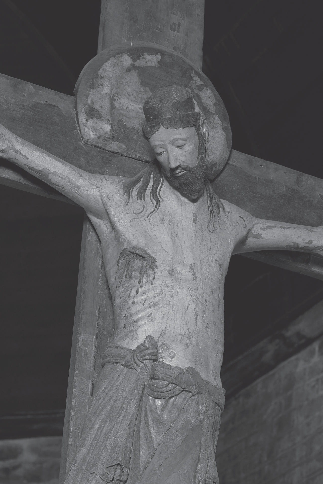

图17.1 橡木十字苦像，比利时布鲁塞尔近郊福雷圣但尼教堂，约1160—1180年。版权所有：IRPA-KIK，布鲁塞尔（摄影：IRPA-KIK，布鲁塞尔）。

<!-- PDF page 282; original page 262 -->

除寥寥图像，直到十二世纪末，玛利亚仍被表现为尊贵的天上母后。[^p282-24]

彩饰手稿虽早已见于西方，1080—1140年，图绘书籍——主要《圣经》、礼仪书——生产，量质均跃进。[^p282-25] 华丽图像，高调宣布修院拥抱改革，也实现以辉煌光彩荣耀上帝的普遍目标。[^p282-26] 手稿因而更大、更昂贵，十一世纪德国、约1100年法国书艺开始用金。叙事图像大增；十一世纪，彩绘圣徒传已显著增多；十二世纪，出现《圣奥尔本诗篇集》那样庞大经文图绘组。虽抄写者如此宣称，“未受教者”似不太可能是主要受众。有些组图，或确作《圣经》手册，教努力学拉丁文的学生、只读俗语的贵族男女神圣历史；但大多数由修士制作、供修士使用，不需图像作基本教导。且许多过于密集深奥，不能履此功能。如《弗洛雷夫圣经》（约1150年），复杂寓意图像混学问艺术，至今未全理解（图17.2）。[^p282-27] 这些手稿，极可能为图文共同组织的默观练习基础，显示即使本世纪最博学者，也借图像丰富宗教经验。

那么，抄写者推崇、学者长期视为宏伟教堂艺术主要功能的教学，即教不识字者基本信仰，如何？证据显示，也比过去所想复杂。一些最广叙事组，被置于平信徒无法进入之处，例如莫瓦萨克克吕尼派圣彼得修院（约1100年），回廊柱头优美缠绕的《圣经》、圣徒生平雕刻。

<!-- PDF page 283; original page 263 -->

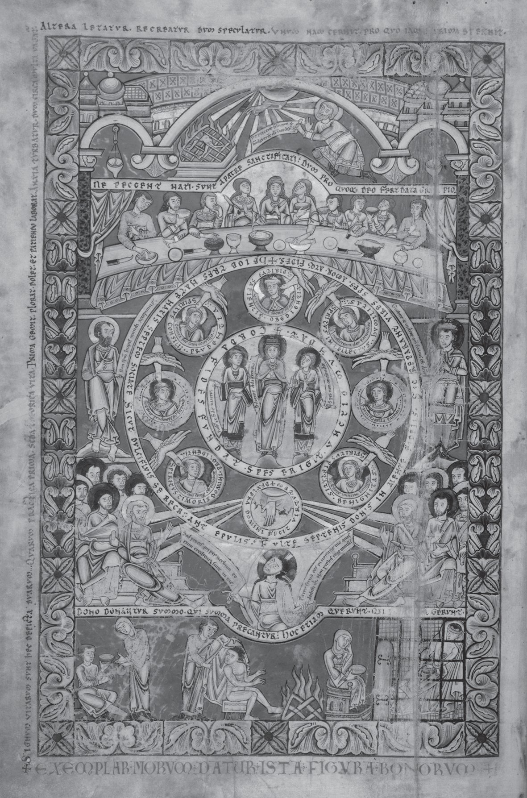

图17.2 《弗洛雷夫圣经》卷首画：阐释《约伯记》开篇经文。比利时默兹河谷，普雷蒙特雷会弗洛雷夫修院，约1150年。伦敦，大英图书馆，add. ms. 17738，书叶3背面（摄影：大英图书馆）。

<!-- PDF page 284; original page 264 -->

法国多数罗曼式壁画组，也位于平信徒无法进入区域。即使较易接近者，如加泰罗尼亚里波尔圣玛利亚修院西门（约1150年），满布经文图像；克吕尼派圣萨万—叙尔—加尔唐普附属修院中殿拱顶壁画（约1100年），生动展从创造至西奈颁法的《圣经》历史；瑞士齐利斯圣马丁堂天花（约1140—1160年），近一百五十块经文场景画板，也似不适作“给单纯者的课程”。劳伦斯·达根指出，参观者也可证实，多数难看清、解读，常需解释铭文补充。[^p284-28] 叙热明确承认，他的艺术只有有学识者能理解，他们也仍须借助文字说明。[^p284-29] 是否真有“不言自明”图像，可争论；但中世纪，显然不是替代文字，而是补充。

因此，艺术主要教导功能，与其教新事，不如使既有教导活起来，唤回以别形式、或别时间呈现的教训。[^p284-30] 布永的戈弗雷公爵（卒于1100年）故事，似即此义。被问主人虔敬例证，仆人报：“一旦入教堂，即使日课毕，也诱不出来；反求司祭、似懂这些的人，解释每一图像、绘画。”[^p284-31] 受赞的不是看像学习，而是求助理解。这位主教所写故事，暗示图像若为单纯者《圣经》，至少教士看来，也如《圣经》，需注释。

现存少量涉及艺术的讲道，确把图画叙事如《圣经》，视为属灵、道德寓意化跳板。十二世纪圣维克多一院长，<!-- PDF page 285; original page 265 -->不断在讲道提倡隐喻看艺术，告咏祷教士，应效法圣徒：“他们理当称非未经雕琢、而是雕成之石，因为言语所宣，行动明示；正行在其身可辨，正如……雕刻解释所行。”[^p285-32] 显非期待“字面”读像；奥古斯丁咏祷教士，通常不被期望复活死者、医跛盲、逐魔，或行雕圣徒常见多数事。他要人看表面以下，如效使徒和睦共居，或如安东尼抗魔，勤拒诱惑恶习。彼得·科梅斯托尔（卒于1178年），明斥字面读艺术，警告主显圣容壁画，可能使人误以为基督身体未受变化：“通常把一些光辉射线，画在主身体四周，却与身体分离……”[^p285-33] 许多图像难见，并不奇怪；如戈弗雷故事暗示，最大价值可能非传信息，而是激发须求权威方能解的问题。

当然，有些信息相当直接。林肯主教雨果告诉英王约翰，教堂门口最后审判雕画，旨让礼拜者“真正知道地狱恐怖”；孔克圣福瓦生动最后审判半圆饰区，边沿刻文末警：“罪人，若不改行，须知可怕命运等待。”[^p285-34] 位置如内容，有针对性：堂门审判像，提醒朝圣者，唯教士掌释放捆绑之权，也唯他们能为平信徒观者译拉丁文。但艺术常可超创作者意图，请看约翰如何回应<!-- PDF page 286; original page 266 -->雨果这番依艺术讲道。编年史说，毫无畏缩的约翰，走到对墙，指出戴华冠、由天使喜悦引至天上君王的国王：“主教大人，您该给我们看这些！”

最终，内容或次于感官效果。常饰罗曼式墙面的威仪基督绘画、马赛克，赋阿尔法、俄梅戛、书、球等古老智慧权力符号；但色彩、强度、规模，或与象征同样动人。让艺术史家沮丧，当时描述更常谈“明亮”“生动”，而非形式、题材。[^p286-35] 视觉欢悦，虽远不及叙热对神圣的引升领会，仍可有牧灵目的。富伊瓦的咏祷教士雨果（卒于1172年），承认艺术能“留住”那些较单纯、不能悦于经文精妙却能悦于图画的人。[^p286-36] 伯尔纳也略不耐烦地承认，许多人“越鲜艳的，越被认为神圣”。[^p286-37]

## 十三世纪与十四世纪早期

十三世纪，改革领导权，转至大学训练、居城市的教士、托钵修士；关注扩及全体信徒、更广行为，强调外在敬拜须伴内在奉献。背景重点变化，进一步削弱教士／平信徒、修院／世界区分，关联图像三大发展：题材增多分化，风格趋情感、自然主义，宗教艺术进入城市市民家庭空间。虽教导、感动、激励、抬高、增显威势等基本目标未改，合而观之，见功能新路。十一世纪，艺术求以材质色形捕捉天国荣耀，把“彼处”带至“此处”；十三世纪，转而发现、突出<!-- PDF page 287; original page 267 -->自然世界天上美，模糊彼此边界。属灵事件获现实迫近感，日常生活遂理想地浸润属灵意义。

这些趋势，最清楚见约1220年始建的亚眠圣母大教堂。高拱顶、尖拱，引视线向东向上，唱诗席薄墙、精细窗格、大窗，似融光海，内外区分消失（图17.3）。[^p287-38] 柱头、中殿拱上，生动雕花植物带，更强此效。外部大量雕塑，把无数基督教图像带城市中心。城市更看得见图像，图像也更看得见城市：人物当代衣着、精细场景、人性动作表情。西立面中央门最下、最易见层，恶习非抽象拟人，而是持日常物件的熟悉人物；不服从，是侮辱主教青年；贪婪，是往箱堆钱袋的吝啬者。似呼应讲道者、告解神师，劝羊群看自己，以基督教价值读行为。较高处，中央门中柱“美丽的上帝”（Beau-Dieu）基督像，踏古老邪恶符号，持象征智慧的书，外貌却全异罗曼式半圆饰区得胜审判者。他温柔可近，形体饱满、解剖可信，却比活人更完美。[^p287-39] 南门同样美的玛利亚，伸臂热迎信徒。哥特雕塑自然主义加强，有时释为亚里士多德式物质主义，或文艺复兴人文主义先声；但如保罗·宾斯基论证，或最好视为当时宗教精神的视觉表达，尤其日益崇敬有血肉人性的基督。[^p287-40]

<!-- PDF page 288; original page 268 -->

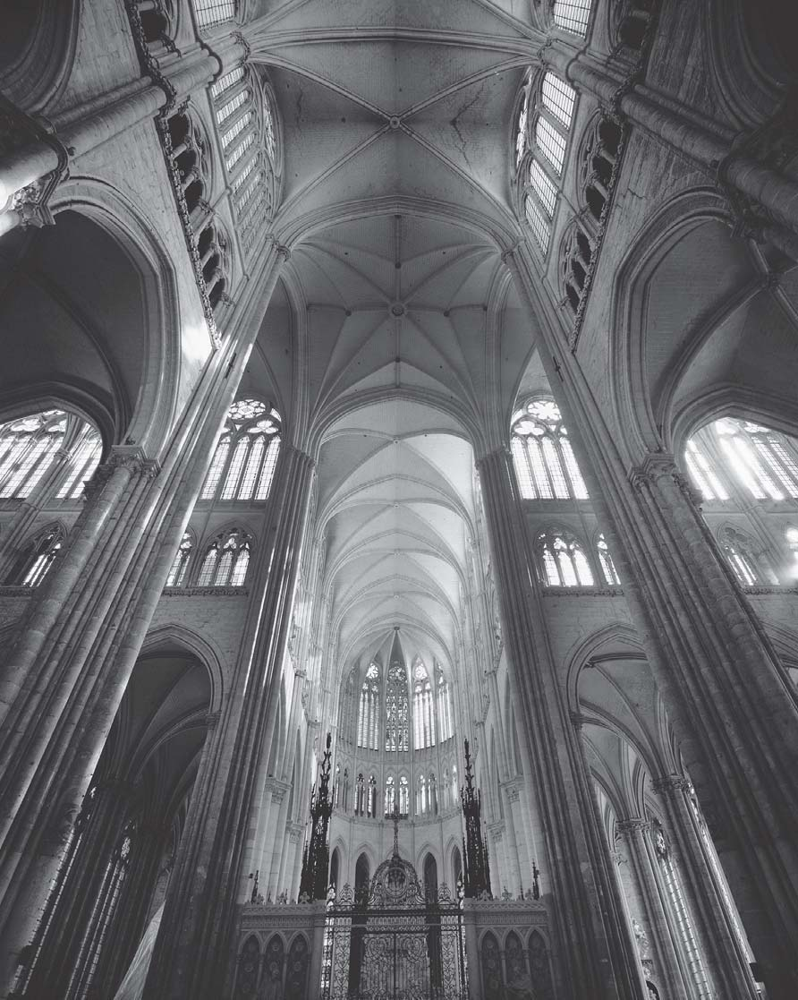

图17.3 亚眠圣母大教堂：中殿与半圆后殿交接处。法国北部，十三世纪（摄影：akg-images／Erich Lessing）。

亚眠如许多哥特座堂、教堂，奉献玛利亚：完全为人的形象，可亲、养育的母亲，上帝与人之间最终极代求者，却升为天上母后，亚眠教堂立面圣母门便刻其加冕。

亚眠彩色玻璃已失，但许多同时代窗饰留存，使可想其形貌效果。如宝石般浓烈的<!-- PDF page 289; original page 269 -->色彩，以及该世纪早期流行、严密分格的叙事，约1250年，开始让位更浅、更透光、单块更大的玻璃。细致生动故事、丰富人物器物、常饰边缘的职业行会徽志，突出惯称“神圣”“世俗”领域相连；一座既为教会中枢、又为市民城镇中央集会点的建筑，正可期待如此。[^p289-41] 十三世纪少数讲道提及彩绘玻璃的一例，也显示把神圣历史视觉地投射当世的风险：沙托鲁的厄德回忆，童年旁一平信徒解释，好撒玛利亚人窗饰中，撒玛利亚人穿俗人衣，利未人穿教士装，因为“教士不怜穷人、受苦者，平信徒却十分怜悯”。[^p289-42]

意大利气候，使薄墙大窗不理想，便以别法达许多同目标。契马布埃首先，乔托后来更著名，以个性化表情面貌、更丰富色彩、透视，使壁画更自然、更具情感迫近感。连圣马太这般传统人物，也获新感性：阿西西圣方济各圣殿上堂约1280年像中，手扶胸，似思其福音叙述的悲伤事件。帕多瓦阿雷纳小堂（1305—1310年）基督、圣母生平壁画，乔托造幻觉，使窗光似真照在表情丰富人物身体，连其手执器物也似可触、完全在场。[^p289-43] 基督徒观者、自然世界、天国，藉图像相聚。

<!-- PDF page 290; original page 270 -->

哥特空间、图像，也使城市居民相聚，有时和谐，有时混乱。全城资助、建座堂的故事——据说沙特尔市民热情，把自己套车，运石到工地——可能大多为神话，但展示艺术建筑象征市民团结自豪，以及等级权力的重要，至少对讲述者如此。贵族、市民、工人、农民，在建筑图像触发、参与的仪式，各有精心安排角色，如为杜乔所作锡耶纳新祭坛画（1308—1311年）组织的游行：

> 〔画〕抬往座堂那天，店铺关闭，主教率大群虔诚司祭、托钵修士，庄严行进，九位执政官、全体市政官、所有民众陪同。最受敬重者，依次持燃烛，站在画旁；妇女孩子，怀极虔敬，跟后。[^p290-44]

教会、政治权威较不受居民接受处，座堂成为分裂指标；内部撕裂的城市，常以它为暴力目标。[^p290-45]

哥特座堂、教堂内，礼仪与艺术，更趋场面化，伴随控制引导目光的欲望。约1200年，司祭弥撒开始背平信徒，遮祭坛台面，使最终举扬圣体，供所有人看时，更具戏剧性。祭坛后立画、雕浮雕，即祭坛背屏（retables），成为仪式真正背景，加强此效。[^p290-46] 这些<!-- PDF page 291; original page 271 -->鲜艳、细致、常拥挤场景，把经文、寓意事，画如当代事件，助会众忆神圣历史关键时刻，甚至想象重历。如精美《威斯敏斯特祭坛背屏》（约1270—1280年），原立威斯敏斯特修院主祭坛后，一目击基督奇迹妇女，戴最新流行圆筒小帽；既悦宫廷观者精雅趣味，也邀想自己在基督身旁。[^p291-47] 中殿、唱诗席间屏障更高，但有开口，容有限、受控观看另一侧；华丽雕塑场景，助理解另一侧奥秘，实际上把它框起来。[^p291-48] 圣物匣也更“可读”，主动求目光；虽仍有以形式图像识别内藏圣物者，却愈经透明水晶窗展示圣物本身。约1311年，克雷芒五世下令正式采用基督圣体节后，展示祝圣圣体的显供器，愈常见。[^p291-49]

但各类图像虽增，讲道者直接用视觉叙事仍少，继续提倡寓意、非字面阅读。如十三世纪许多讲道，要求在被钉基督像，“看见”写朱字的羊皮纸、满病灶的麻风者、张臂欲拥人的恋人、鲜红军旗。[^p291-50] 常零碎处理图像，不是叙事，而是偶然细节，成为视觉教学跳板。约1225年巴黎讲道，乔布姆的托马斯，非从圣徒行迹，而从光环形状读义：“灵魂须自制，如国王须自统……因此，教会习惯，凡画一位善于自制圣徒，<!-- PDF page 292; original page 272 -->就在头周，画如盾的圆冠，称为冕冠。”[^p292-51] 如此，外在美教内在反省，不用肉眼，而用“心的眼睛”看。[^p292-52]

图像牧灵潜能，在手稿彩饰最充分发挥。图绘道德劝善文本，如带注《圣经》评注、十三世纪晚期《国王大全》（Somme le roi）、圣母奇迹，流行于富教士、平信徒精英；美丽奢华、创新图文并置、论战力量，同样显著。如为法王路易八世制作的《道德诠释圣经》（Bible moralisée，约1225年），注释图绘，将古老《圣经》、图像符号——钱袋、硬币、书卷、蛙、乌鸦、猫——用于新观念背景，构造城市常见罪恶全面目录（图17.4）。主要意图，可能引悔罪、教美德，但也造视觉语汇，把异端、犹太人、放贷者，标为改革基督教世界理想的对立面。可以说，图像也影响王室对这些群体政策。[^p292-53]

但世俗统治者非只被动接受，也调动哥特美与力量，服务政治宗教同时、或说不可分的目的。匈牙利埃斯泰尔戈姆十二世纪晚期座堂、宫殿，惊人早现法国哥特形式，被联系贝拉三世（卒于1196年）亲法王朝外交、受巴黎影响的教会改革议程。[^p292-54]

<!-- PDF page 293; original page 273 -->

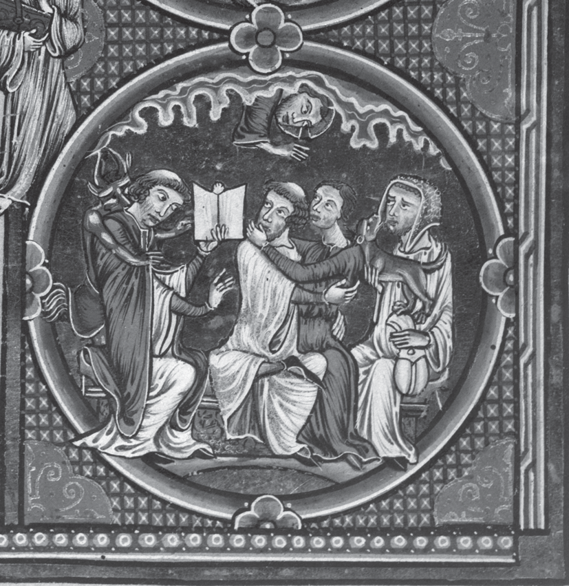

图17.4 《启示录》16:4评注插图细部。《道德诠释圣经》，巴黎，约1225年。维也纳奥地利国家图书馆图像档案，cod. 1179，fol. 236d（摄影：奥地利国家图书馆）。

关联路易九世（卒于1270年）的“宫廷风格”，首次、最著名体现，是圣礼拜堂，精巧如珠宝盒，为容纳基督两大圣物而造。[^p293-55] 十四世纪，波希米亚查理四世，也大量投入精力金钱，把布拉格圣维特座堂变王权圣殿，把宫廷变宗教图像中心。[^p293-56] 墓葬艺术，也成为王朝、属灵抱负共同表达的重要场域。[^p293-57]

对于以图像为基础的崇敬敬礼，官方谨慎立场未改，但增更积极承认合法、力量、重要。[^p293-58] 托马斯·阿奎那呼应前人，称不借图像的默想为<!-- PDF page 294; original page 274 -->最高默观形式；但也认为，基督像而非圣徒像，配受与基督本人相同敬拜（latria），部分因承认已为教会传统。他说，“有些教堂保存为圣物的血，并非从基督肋旁流出，而据说从某受虐基督像流出”，似也承认一些像行奇迹的能力。[^p294-59] 拉丁、俗语牧灵文本，如《基督徒之镜》（Speculum Christiani）、海因里希·苏索（卒于1366年）《范本》（Exemplar），指导正确崇敬圣像。两大托钵修会成员，都实践视觉敬礼，并助在修女、平信徒男女间普及；方济各会尤其积极推动受难想象默想，赞助创新图像。[^p294-60]

教堂常为其场所，也愈进入亲密家庭空间，伴随个人拥有图像数量种类扩大，惯称“虔敬像”（Andachtsbilder），虽有时误导。[^p294-61] 通常为象牙、金属、木像，雕画福音场景，或从大叙事抽出个别圣洁人物的画板，或见于小型彩绘祈祷书。许多题材熟悉；十字架、圣母子，整个中世纪始终最常见。但优先强调人间温柔的新像也出现：基督—约翰群像，约翰头靠耶稣胸；维罗妮卡圣容像，基督面部特写，被视为真容（vera icon）；圣殇像（Pietà），玛利亚哀悼死去儿子。十三世纪后期、十四世纪早期日盛（图17.5）。用途多样，既崇敬、虔修，既情感、智性：助取得适合祈祷心态，赋非教会空间圣洁气氛，使敬拜者在小室、家中、旅途，近似司祭动作态度，方便与圣徒交流，为高阶默想提供记忆辅助。

<!-- PDF page 295; original page 275 -->

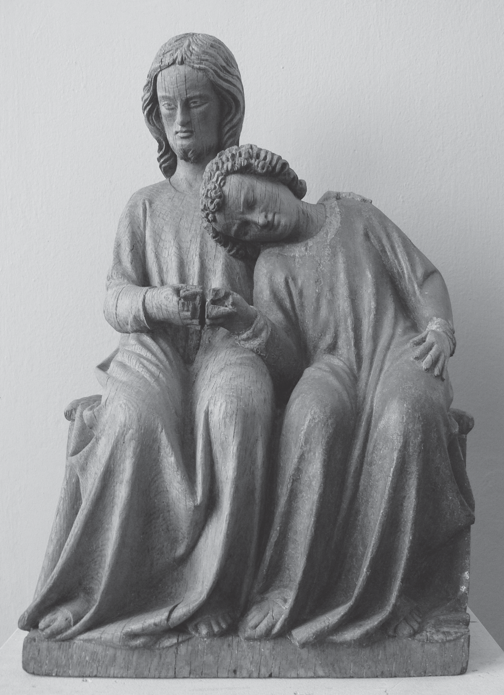

图17.5 基督—约翰群像（圣约翰头靠耶稣胸前）。施瓦本／博登湖地区，十四世纪早期。慕尼黑，巴伐利亚国立博物馆，藏品号65/38（摄影：Andreas Praefcke；公有领域）。

<!-- PDF page 296; original page 276 -->

这些图像也助神秘主义者，与神圣达到出神共融。[^p296-62] 有些平信徒似不只视为正式礼仪补充，而是充分替代；有人相信，死亡当天看圣克里斯托弗、圣芭芭拉像，即使未领临终礼，也助入天堂。[^p296-63] 反之，也有替官方立场说话的报告：据说圣母像，打过一名过度禁欲的普雷蒙特雷会修女耳光。[^p296-64]

中世纪、现代讨论，常假定视觉敏感尤属女性虔敬。杰弗里·汉堡格等，确无疑证明，视觉敬礼在修女、贝居安女子属灵生活重要。但许多文本也显示，教士、俗人男性，同受艺术吸引：雷蒙·卢尔经历苦像激发、充满激情的异象，与许多女性所述无别。[^p296-65] 回应艺术，可能反映属灵准备、个人情境需求差异，非简单性别差异。[^p296-66]

基督、圣母、圣徒虔敬像增加同时，教会建筑、文本较边缘处，生较轻佻图像：幻想怪物、拼合异兽、龇牙滴水兽，装柱头、檐口、水嘴；猿猴、驴、无名幻想生物，在书页边缘嬉戏。支撑拱廊、导水等主要功能之外，也有用途。至少引目光至座堂远角，以幽默调剂教义、悦眼，或增对教会好感。也可能见证<!-- PDF page 297; original page 277 -->上帝创造的丰饶。迈克尔·卡米耶论，手稿边饰、哥特怪诞，放大、评论、讽刺主流图像概念，体现本被抹除思想，构成反官方话语；有些例子令人信服，有些较不然。[^p297-67] 不论意义，少有图像，比栖上帝殿堂顶端、生动“真实”却全然幻想的生物，更能概括盛期哥特图像的观念复杂、视觉精巧。

## 中世纪晚期（约1330—1500年）

十四、十五世纪，宗教图像全盛。图像敬礼、由像激发神秘异象，渗各社会层；每重要庆节关联特定图像；大陆各地教堂添台座、壁龛、圣龛、托架；大量生产图像，宣传、商业意义空前。[^p297-68] 但如玛格丽特·阿斯顿所说，“即使这充满图像的时期，态度仍暧昧”。[^p297-69] 教士、制度教会虽推动并求获益，如写像前祷文、以版画宣传朝圣、为崇敬特定雕画颁大赦，也不安于激发的情感过度，疑艺术创新。[^p297-70] 平信徒既拥抱，也以罗拉德运动率先反对。[^p297-71] 到十四世纪末，<!-- PDF page 298; original page 278 -->图像太多的抱怨，愈常出现。[^p298-72]

如晚期虔敬文学，图像特征是强烈悲情，常藉视觉“丑陋”实现。[^p298-73] 匈牙利加拉姆圣贝内德克十五世纪末“基督棺”，不只饰精雕、极戏剧化受难场景，也在复活节游行，安放可移动、真人大基督遗体像。最流行虔敬像，为“忧患之人”（Man of Sorrows，受伤基督半身像）；不同于所据拜占庭圣像将死身连上帝荣耀，西方强调其人间痛苦。脆弱痛苦，也见晚期苦像；圣殇像中，遗体愈可怖，玛利亚愈悲恸。细察身体、情感受苦的表现，或助观者本能认同圣洁人物。[^p298-74] 另些映其他焦虑：“三个生者与三个死者”、“死亡之舞”（1423年首见记载）、腐朽骸骨，生动提醒肉身易坏，隐含灵魂不朽。[^p298-75] 奢华装饰也有阴沉意味：十六世纪象牙珠，正面拥抱情人，背藏狰狞骷髅（图17.6）。

焦虑痛苦视觉化，旨灌虔敬悔罪，却也有阴暗面：邪恶描绘随之锐化，艺术成为宗教热情与社会仇恨混合的有力媒介。

<!-- PDF page 299; original page 279 -->

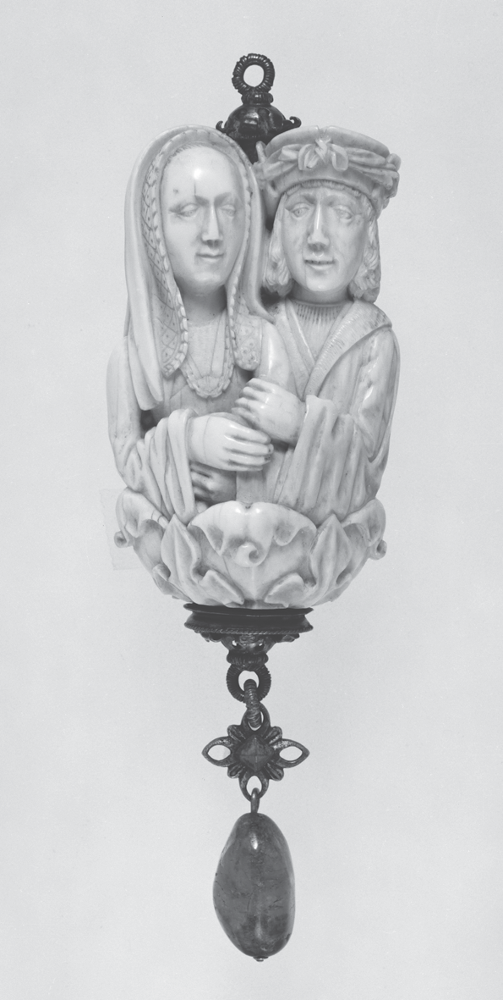 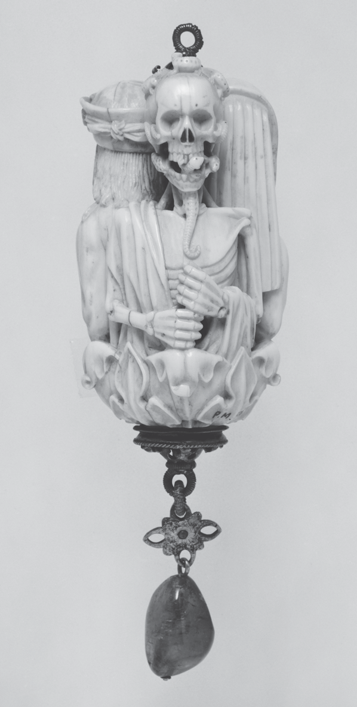

图17.6 象牙念珠末端坠珠，正面拥抱情人，背面爬满蠕虫的狰狞骷髅。德国，十六世纪。纽约，大都会艺术博物馆，J.皮尔庞特·摩根赠，1917年，17.190.305（摄影：©大都会艺术博物馆）。

受难图中，折磨基督者愈丑陋残酷；殉道图中，行刑者数量、凶猛，也增加。[^p299-76] 许多被画成衣饰夸张的无赖、面相粗陋农民、缠头巾穆斯林、漫画化犹太人——肤暗、鹰鼻、面扭曲。[^p299-77] 同期，诬告犹太人亵渎圣体、杀基督徒儿童，也成绘画、版画、小册子流行题材。

<!-- PDF page 300; original page 280 -->

这些图像不只反映反犹情绪增长，几乎肯定也加强、引导它。[^p300-78]

此期宗教艺术绝非全阴沉。十五世纪尼德兰、意大利绘画，结合复杂象征、最新透视油画技术，创极逼真、灿烂神圣场景。扬·范·艾克1436年布鲁日《圣母与咏祷教士范德帕勒》，华锦、毛皮、丝绸、捐赠者本人，与极美圣母、优雅骑士式圣乔治、华服主教圣多纳提安，共居中心；织物可触，似证捐者神秘异象真实。许多也为豪华家饰，神圣题材体现最新优雅风格，生动叙事兼娱乐教化。如修道院博物馆约1500年《独角兽挂毯》，可欣赏其活泼呈现晚期狩猎、作受难寓言、颂求爱生育。许多精美至此，让·热尔松不得不教基督徒，勿只因美而敬拜图像。[^p300-79]

图像敬礼，始终强触觉；晚期艺术，更方便身体表达感情。婴儿床含感伤幼年耶稣像，使修女如待亲子。玛杰里·肯普朝圣，每重要停驻处，虔敬为基督像穿衣；许多人遗嘱留钱，购珠宝衣物，饰圣徒像。[^p300-80] 拥抱亲吻雕像苦像的古老实践，对有些人成每日习惯。[^p300-81] 像前屈膝，成重要正统表现；不如此，致疑。身体互动也非单向，图像愈会动。晚期北方祭坛画，有可动翼板，在<!-- PDF page 301; original page 281 -->礼仪年关键时刻开合；苦像、其他雕像，有可动肢体。[^p301-82] 至中世纪末，人不必是天赋异禀的神秘主义者，也能见宗教艺术“活起来”。

盛期宗教图物，用途令人目眩：荣耀自己、家庭、政治共同体、机构；示美德、体现恶习；赋权威、真实性；保护城、人；强群体团结、团体身份，或显示其崩解；造气氛、行奇迹、宣传纲领朝圣、筹款、滋仇恨、激想象，或束缚想象。也作礼物、容器、代表像、记号、标志。许多全期普遍，另些随社会宗教需求、流行形式媒材，盛衰。但几个基本观察，贯穿大陆、盛期数世纪。

首先，不能按地位、性别、属灵身份，简单分用途；平信徒、教士、修士、男女，均可从像学习、被感动。其次，“单纯者之书”陈说暗含文字图像对立，细查即破：图像极少、甚至从不“替代”文字，许多突出文字，也如文字作寓意阅读；到末期，几无完全脱离视觉联想的礼仪、《圣经》用语。第三，艺术、神学、社会变化，似按细腻摆动节奏展开。盛期基督像，常视为公教慈爱、怜悯的神人观，最完美视觉表达；但鲁佩特，早在这些情感主导钉十字架形象前，就从苦像见爱、怜悯。十三世纪重耶稣疤伤的敬礼，先于晚期更极端图像，后者又激敬礼更过度。有时，观者尚未准备接受，就遇艺术变化。历史提示，思想、图像、教义、艺术、社会，关系复杂，<!-- PDF page 302; original page 282 -->创新有时出现一域，有时另一域。最后、最根本，此处多重、交叠、冲突用途，证明图像在盛期生活核心。中世纪末，《善终术之书》（The Boke of the Crafte of Dying）所载探病礼仪，承认这地位。[^p302-83] 书指示，临终者（moriens）可能不能听、说、理解，司祭应展示苦像，助其从上帝之爱得安慰。最后，文本暗示，灵魂若失其他一切通神途径，所剩是视觉。还有艺术。

## 注释

[^p274-1]: 原注古法语：‘Altra cóse est aurier la painture/e altra cose est par le historie de la painture ap[re]ndre/ quela cóse seit ad aurier, kar ico que la scripture aprestet/ as lisanz, icó aprestet la painture as ignoranz, kar an icele veient/ les ignoranz quet il deivent sivre.’（意为：敬拜图画，与通过画的故事学习应敬拜什么，是两回事。文字给予能读者的，图画给予不识字者，因为他们在其中看见应该追随什么。） Hildesheim, St Godehard Library, St Albans Psalter, fol. 68v. 同叶也含书信拉丁版本：‘Aliud est picturam adorare, aliud ratione[m] de pict[ur]is int[er] roganti/per picture historia[m] quid sit adorandu[m] addiscere, Nam quod legentib[us]/ scriptura hoc ignotis prestat pictura, q[u]a in ipsa ignorantes vident quid/ sequi debeant.’（意为：敬拜图画是一事；探问图画之义、通过其中故事学习应敬拜什么，是另一事。文字给予读者的，图画给予不识字者，因为他们在其中看见应该追随什么。）

[^p274-2]: Rupert of Deutz, Anulus sive dialogus inter Christianum et Iudaeum, ed. Rhabanus Haacke, in Maria Lodovica Arduini, Ruperto di Deutz e la controversia tra cristiani ed ebrei nel secolo XII (Rome: Istituto storico italiano per il Medio Evo, 1979), 232–5.

[^p274-3]: 参见 Conrad Rudolph, Artistic Change at St.-Denis: Abbot Suger’s Program and the Early Twelfth-Century Controversy over Art (Princeton: Princeton University Press, 1990).

[^p275-4]: Suger of Saint Denis, De Administratione 27, in Erwin Panofsky, ed. and trans., Abbot Suger on the Abbey Church of St. Denis and its Art Treasures, 2nd edn, ed. Gerda Panofsky-Soergel (Princeton: Princeton University Press, 1979), 48.

[^p275-5]: 圣物崇敬，见 Arnold Angenendt, Heilige und Reliquien: Die Geschichte ihres Kultes vom fruhen Christentum bis sur Gegenwart (Munich: Verlag C. H. Beck, 1994); Patrick J. Geary, Furta sacra: Thefts of Relics in the Central Middle Ages (Princeton: Princeton University Press, 1978); and Barbara Abou-el-Haj, The Medieval Cult of Saints: Formations and Transformations (Cambridge: Cambridge University Press, 1994).

[^p276-6]: Caroline Walker Bynum, The Resurrection of the Body in Western Christianity, 200–1336 (New York: Columbia University Press, 1995), 209–12.

[^p276-7]: Barbara Boehm, ‘Body-Part Reliquaries: The State of Research’, Gesta 36 (1997), 8–19.

[^p276-8]: Cynthia Hahn, ‘The Voices of the Saints: Speaking Reliquaries’, Gesta 36 (1997), 20–31.

[^p277-9]: The Art of Medieval Spain, a.d. 500–1200 (New York: Metropolitan Museum of Art, 1993), 244.

[^p277-10]: Stanislaus Ceglar, ‘Guillaume de Saint-Thierry et son rôle directeur aux premiers chapitres des abbés bénédictins, Reims 1131 et Soissons 1132’, in M. Bur, ed., Saint Thierry: Une abbaye du VIe au XXe siècle. Actes du Colloque international d’Histoire monastique, Reims-Saint-Thierry, 11 au 14 octobre 1976 (Saint-Thierry: Association des Amis de l’Abbaye de Saint-Thierry, 1979), 331.

[^p278-11]: Conrad Rudolph, The ‘Things of Greater Importance’: Bernard of Clairvaux’s Apologia and the Medieval Attitude toward Art (Philadelphia: University of Pennsylvania Press, 1990).

[^p278-12]: Signe Horn Fuglesang, ‘Christian Reliquaries and Pagan Idols’, in Soren Kaspersen, ed., Images of Cult and Devotion: Function and Reception of Christian Images in Medieval and Post- Medieval Europe (Copenhagen: Museum Tusculanum Press, 2004), 7–32; Irene H. Forsyth, Throne of Wisdom: Wood Sculptures of the Madonna in Romanesque France (Princeton: Princeton University Press, 1972).

[^p278-13]: Bernard of Angers, The Book of Sainte Foy, trans. Pamela Sheingorn (Philadelphia: University of Pennsylvania Press, 1995).

[^p279-14]: Ragne Bugge, ‘Effigiem Christi, qui transis, semper honoria: Verses Condemning the Cult of Sacred Images in Art and Literature’, Acta archaeologiam et artium historiam pertinentia 6 (1975), 127–39.

[^p279-15]: Calvin B. Kendall, The Allegory of the Church: Romanesque Portals and their Verse Inscriptions (Toronto: University of Toronto Press, 1998), no. 47. 几乎相同的诗句也见约1150年手稿，讨论见 Jeffrey F. Hamburger, The Visual and the Visionary: Art and Female Spirituality in Late Medieval Germany (New York: Zone Books, 1998), 186.

[^p279-16]: 参见 André Vauchez, ‘L’image vivante: Quelques réflexions sur les fonctions des représentations iconographiques dans le domaine religieux en Occident aux derniers siècles du Moyen Âge’, in Maurice Aymard et al., eds., Pauvres et riches: Société et culture du Moyen Âge aux temps modernes. Mélanges offerts à Bronislaw Gesemek à l’occasion de son soixantième anniversaire (Warsaw: Wydawnictwo Naukowe PWN, 1992), 231–41.

[^p279-17]: Forsyth, Throne of Wisdom, p. 3; David Freedberg, The Power of Images: Studies in the History and Theory of Response (Chicago: University of Chicago Press, 1989).

[^p279-18]: Forsyth, Throne of Wisdom; Elizabeth Lipsmeyer, ‘Devotion and Decorum: Intention and Quality in Medieval German Sculpture’, Gesta 34 (1995), 20–7.

[^p279-19]: Sixten Ringbom, ‘Devotional Images and Imaginative Devotions: Notes on the Place of Art in Late Medieval Private Piety’, Gazette des Beaux-Arts ser. 6.73, alt. no. 1202 (1969), 160. 787年在尼西亚举行、支持圣像的第七次大公会议，一篇讲道提及这奇迹故事；十一世纪才传入西欧，以《圣像受难》（Passio ymaginis）日课纪念。参见 Michele Bacci, ‘The Berardenga Antependium and the passio ymaginis Office’, Journal of the Warburg and Courtauld Institutes 61 (1998), 1–16.

[^p280-20]: Richard de St Victor, Liber exceptionum, ed. J. Chatillon (Paris: J. Vrin, 1958).

[^p280-21]: 参见 Rachel Fulton, From Judgment to Passion: Devotion to Christ and the Virgin Mary, 800– 1200 (New York: Columbia University Press, 2002), 336–41; Sara Lipton, ‘Sweet Lean of his Head: Writing about Looking at the Crucifix’, Speculum 80 (2005), 1172–1208.

[^p280-22]: Rhein und Maas: Kunst und Kultur 800–1400 (Cologne: Schnütgen-Museum, 1973), vol. 2, 412–13, fig. 10.

[^p280-23]: Lipton, ‘Sweet Lean of his Head’.

[^p282-24]: Fulton, From Judgment to Passion, 348.

[^p282-25]: Walter Cahn, Romanesque Bible Illumination (Ithaca, N.Y.: Cornell University Press, 1982), 121.

[^p282-26]: Cahn, Romanesque Bible, 104.

[^p282-27]: Anne Marie Bouché, ‘The Floreffe Bible Frontispiece, London, B.L. add. ms. 17738, fol. 3v-4r, and Twelfth-Century Contemplative Theory’ (PhD dissertation, Columbia University, 1997).

[^p284-28]: Lawrence Duggan, ‘Was Art Really the “Book of the Illiterate”?’, Word and Image 5 (1989), 227–51.

[^p284-29]: Suger of Saint Denis, De Administratione 33.

[^p284-30]: 助记功能，隐含于伪托格列高利致塞昆迪努斯的书信，赞艺术可助回忆教训；但多数改述遮蔽此义，强调“图像之于平信徒，犹文字之于教士”的类比。

[^p284-31]: William of Tyre, History of Deeds Done beyond the Sea, trans. Emily Atwater Babcock and A. C. Krey (New York: Columbia University Press, 1943).

[^p285-32]: ‘Qui recte non puri sed sculpti lapides esse dicuntur, quia quod verbis asserunt, operibus evidenter ostendunt, et dum in eis recta operatio cernitur, quodammodo velut in sculptura quod egerunt explanatur.’（意为：他们理当称为非未经雕琢、而是雕成的石，因为口头宣称，以行为明示；当其正确行为被辨认，某种程度如同雕刻，把所行解释出来。） Paris, Bibliothèque nationale, ms. lat. 14, 525, fol. 95v.

[^p285-33]: ‘Ideoque tradunt splendorem illum non fuisse in corpore dominico, sed in aere circum se… Cui opinioni consonant picture in parietibus ecclesiarum, ubi depingitur transfiguratio. Solent depingi quidam radioli splendoris circa corpus dominicum seorsum a corpore dominico…’（意为：因此，他们教导，那光辉不在主身体中，而在周围空气中……教堂墙面变容图画，吻合此见。通常有些光辉射线画在主身体四周，却与主身体分离……） Paris, Bibliothèque nationale, ms. lat. 15,269, fol. 106v.

[^p285-34]: Adam of Eynsham, Magna vita sancti Hugonis: The Life of St. Hugh of Lincoln, 2 vols., ed. Decima L. Douie and David Hugh Farmer (Oxford: Clarendon Press, 1985), vol. 1, 138–42.

[^p286-35]: C. R. Dodwell, Painting in Europe, 800 to 1200 (New Haven, Conn.: Yale University Press, 1992), 126.

[^p286-36]: De claustro animae, 1b. II, c. 4, PL 176, col. 1053.

[^p286-37]: Rudolph, ‘Things of Greater Importance’, 280–1.

[^p287-38]: Stephen Murray, Notre-Dame, Cathedral of Amiens: The Power of Change in Gothic (Cambridge: Cambridge University Press, 1996).

[^p287-39]: Wilhelm Schlink, Der Beau-Dieu von Amiens: Das Christusbild der gotischen Kathedrale (Frankfurt: Insel Verlag, 1991).

[^p287-40]: Paul Binski, Becket’s Crown: Art and Imagination in Gothic England, 1170–1300 (New Haven, Conn.: Yale University Press, 2004), and ‘The Angel Choir at Lincoln and the Poetics of the Gothic Smile’, Art History 20 (1997), 350–74.

[^p289-41]: Wolfgang Kemp, The Narratives of Gothic Stained Glass, trans. Caroline Dobson Saltzwedel (Cambridge: Cambridge University Press, 1997); Jane W. Williams, Bread, Wine, and Money: Windows of Trades at Chartres Cathedral (Chicago: University of Chicago Press, 1993). 这些行会纹章是否表示赞助关系，尚有争论。

[^p289-42]: 转引自 Kemp, Narratives of Gothic Stained Glass, 71.

[^p289-43]: Michael Camille, Gothic Art: Glorious Visions (New York: Harry N. Abrams, 1996), 48.

[^p290-44]: B. Kempers, ‘Icons, Altarpieces and Civic Ritual in Siena Cathedral 1100–1530’, in Barbara Hanawalt and Katherine L. Reyerson, eds., City and Spectacle in Medieval Europe (Minneapolis: University of Minnesota Press, 1994)；另见Joanna Cannon and André Vauchez, Margherita of Cortona and the Lorenzetti: Sienese Art and the Cult of the Holy Woman in Medieval Tuscany (University Park: Pennsylvania State University Press, 1999).

[^p290-45]: 抵抗也可只表现为不加理会：图卢兹主教，未能筹资支持雄心勃勃的哥特式座堂重建。参见 Michael T. Davis, ‘“Sic et Non”: Recent Trends in the Study of Gothic Ecclesiastical Architecture’, The Journal of the Society of Architectural Historians 58 (1999), 414–23.

[^p290-46]: 1310年特里尔会议，将此实践成文，宣布每一祭坛后方或上方，须有形像、雕像、绘画，乃至铭文，说明祭坛为尊谁而建。 Donald L. Ehresmann, ‘Some Observations on the Role of Liturgy in the Early Winged Altarpiece’, Art Bulletin 64 (1982), 368.

[^p291-47]: Paul Binski, ‘The Earliest Photographs of the Westminster Retable’, The Burlington Magazine 130 (1988), 128–32.

[^p291-48]: Jacqueline E. Jung, ‘Beyond the Barrier: The Unifying Role of the Choir Screen in Gothic Churches’, Art Bulletin 82 (2000), 622–57.

[^p291-49]: Miri Rubin, Corpus Christi: The Eucharist in Late Medieval Culture (Cambridge: Cambridge University Press, 1991), 181–5 and 290–1.

[^p291-50]: 参见 Nicole Bériou, L’avènement des maîtres de la parole: La prédication à Paris au XIIIe siècle, 2 vols. (Paris: Institut d’Études Augustiniennes, 1998).

[^p292-51]: ‘Et ideo habet ecclesia in consuetudine quod ubicumque ymago alicuius sancti qui bene se rexit depingitur, describitur circa capud eius corona rotunda in modum scuti quod dicitur diadema.’（意为：因此，教会习惯，凡画一位善于自我治理的圣徒，就在头周画如盾的圆冠，称为冕冠。） Thomas of Chobham, Sermones, ed. Franco Morenzoni (CCCM 82A; Turnhout: Brepols, 1993), sermo 20, lines 209–13, 214–15.

[^p292-52]: 例如，切里顿的厄德（卒于1247年），从一则关于魔鬼画的例证故事，得出以下道德教训： ‘Utinam quilibet faciem eius oculis cordis diligenter inspiceret, in qua cauterium et signum dampnationis comprehenderet… ’（意为：但愿每人用心的眼睛细察其脸，在其中认出烙痕、永罚标记……） Cambridge, Gonville and Caius College, ms. 362/441, fol. 103v.

[^p292-53]: Sara Lipton, Images of Intolerance: The Representation of Jews and Judaism in the Bibles moralisées (Los Angeles and Berkeley: University of California Press, 1999).

[^p292-54]: Ernö Marosi, Die Anfänge der Gotik in Ungarn: Esztergom in der Kunst des 12. – 13. Jahrhunderts (Budapest: Akademiai Kiado, 1984).

[^p293-55]: Robert Branner, Court Style and Sainte Chapelle: St. Louis and the Court Style in Gothic Architecture (London: A. Zwemmer, 1965).

[^p293-56]: Iva Rosario, Art and Propaganda: Charles IV of Bohemia, 1346–1378 (Woodbridge: Boydell and Brewer, 2000); Paul Crossley, ‘The Politics of Presentation: The Architecture of Charles IV of Bohemia’, in Sarah Rees-Jones, Richard Marks and A. J. Minnis, eds., Courts and Regions in Medieval Europe (Woodbridge: Boydell and Brewer, 2000), 99–172.

[^p293-57]: Anne McGee Morganstern, Gothic Tombs of Kinship in France, the Low Countries, and England (University Park: Pennsylvania State University Press, 2000); Paul Binski, Westminster Abbey and the Plantagenets (New Haven, Conn.: Yale University Press, 1995).

[^p293-58]: Hamburger, Visual and the Visionary, 112.

[^p294-59]: Thomas Aquinas, Summa Theologica II.2.174, III.25.3 and III.54.3.

[^p294-60]: Anne Derbes, Picturing the Passion in Late Medieval Italy: Narrative Painting, Franciscan Ideologies, and the Levant (New York: Cambridge University Press, 1996).

[^p294-61]: “虔敬像”（Andachtsbilder）术语的起源、问题，以及试图区分崇敬用像与虔修用像的徒劳，见 Kaspersen, ed., Images of Cult and Devotion, iv–v.

[^p296-62]: 参见Peter Dinzelbacher, ‘Religiöses Erleben vor bildender Kunst in autobiographischen und biographischen Zeugnissen des Hoch- und Spätmittelalters’, in Kaspersen, ed., Images of Cult and Devotion, 61–88. 助记功能、默想引导，见 Hamburger, Visual and the Visionary, 78–9 and 184.

[^p296-63]: Henk van Os, Art of Devotion in the Late Middle Ages in Europe, 1300–1500, trans. Michael Hoyle (Princeton: Princeton University Press, 1994), 32.

[^p296-64]: Dinzelbacher, ‘Religiöses Erleben’, 67. 图像若未能令人满意地“表现”，自身反过来也可能挨打，或受其他惩罚。

[^p296-65]: Ramon Llull, Livro do amigo e do Amado, ed. Mark D. Johnston (Warminster: Aris & Phillips, 1995), 36 (no. 91).

[^p296-66]: 参见Hamburger, Visual and the Visionary, 111ff. Lipton, ‘Sweet Lean of his Head’另提供补充文本、讨论。

[^p297-67]: Michael Camille, Image on the Edge: The Margins of Medieval Art (Cambridge, Mass.: Harvard University Press, 1992).

[^p297-68]: Alison G. Stewart, ‘Early Woodcut Workshops’, Art Journal 39 (1980), 189–94.

[^p297-69]: Margaret Aston, ‘The Use of Images’, in Richard Marks and Paul Williamson, eds., Gothic: Art for England 1400–1547 (London: Victoria and Albert Museum, 2003).

[^p297-70]: Ingalill Pegelow, ‘Pictures of Cult and Letters of Indulgence’, in Kaspersen, ed., Images of Cult and Devotion, 33–46; Hamburger, Visual and the Visionary, 348. Hamburger (p. 315) 指出，一幅十四世纪被认为适合女修院的圣像，十五世纪移至男修院，也就是被没收。 抵抗创新，见 Paul Binski, ‘The Crucifixion and the Censorship of Art Around 1300’, in P. Linehan and J. Nelson, eds., The Medieval World (London and New York: Routledge, 2001), 342–60.

[^p297-71]: Margaret Aston, England’s Iconoclasts (Oxford: Oxford University Press, 1988).

[^p298-72]: Eustache Deschamps, 转引自 Michael Camille, The Gothic Idol: Ideology and Image- Making in Medieval Art (Cambridge: Cambridge University Press, 1989), 219.

[^p298-73]: 参见 Jeffrey F. Hamburger, ‘To Make Women Weep: Ugly Art as “Feminine” and the Origins of Modern Aesthetics’, Res 31 (1997), 9–33.

[^p298-74]: Joanna E. Ziegler, Sculpture of Compassion: The Pieta and the Beguines in the Southern Low Countries, c. 1300–1600 (Brussels and Rome: Institut historique belge de Rome, 1992).

[^p298-75]: Paul Binski, Medieval Death: Ritual and Representation (London: British Museum, 1996).

[^p299-76]: James H. Marrow, Passion Iconography in Northern European Art of the Late Middle Ages and Early Renaissance: A Study of the Transformation of Sacred Metaphor into Descriptive Narrative (Kortrijk: Van Ghemmert, 1979).

[^p299-77]: Ruth Mellinkoff, Outcasts: Signs of Otherness in Northern European Art of the Late Middle Ages (Berkeley: University of California Press, 1993).

[^p300-78]: Miri Rubin, Gentile Tales: The Narrative Assault on Late Medieval Jews (New Haven, Conn.: Yale University Press, 1999), and Sara Lipton, Dark Mirror: Jews, Vision, and Witness in Medieval Christian Art (New York: Metropolitan Books, 待出版).

[^p300-79]: 转引自 Ringbom, ‘Devotional images’, 169 n. 50.

[^p300-80]: Kathleen Kamerick, Popular Piety and Art in the Late Middle Ages: Image Worship and Idolatry in England, 1350–1500 (New York: Palgrave, 2002), 102.

[^p300-81]: Dinzelbacher, ‘Religöses Erleben’.

[^p301-82]: Ehresmann, ‘Some Observations’.

[^p302-83]: Carl Horstmann, ed., Yorkshire Writers: Richard Rolle of Hampole, an English Father of the Church, and his Followers, 2 vols. (New York: Macmillan, 1895–96), vol. 2, 409–10.

---

# 第18章 玛利亚

雷切尔·富尔顿（Rachel Fulton）

<!-- PDF page 303; original page 283 -->

我等圣母、上帝之母、贞女中之贞女、海星、仁慈之母、智慧之座、象牙之塔、群魔之惧、耶路撒冷之女、所罗门之榻、喜乐之园、玄义玫瑰、妇女中有福者、上帝新娘、三位一体的婢女、天上母后：这只是中世纪欧洲西方连祷及其他祈祷，称呼耶稣之母玛利亚的少数称号。[^p303-1] 数量、种类同样惊人。有人会说，恰证明宗教改革前敬礼，不幸地、若非必然地，极易流于“过度”“滥用”。天地、日月星；园花、田野果实香料树；金银、象牙、水晶、珍木宝石珍珠；泉源、堡垒、圣殿、约柜；门、梯、藏书室、宝箱；镜子、引水道；塔、军队、鸽子；群山、海洋：晚期艺术、文学、礼仪，都援为童贞上帝之母的象征、属性。本笃会出身的坎特伯雷总主教安瑟伦（卒于1109年），在三大圣母祷文第三篇惊叹：

> 天、星辰、地、水、昼夜，以及凡受人支配使用之物，都曾有罪；夫人，如今它们欢庆失去那份荣耀，因为藉你获赐新的、不可言喻恩典。它们重获生命，感谢……〔因为〕藉你，诸元素更新。[^p303-2]

如何解释如此联想繁盛的属性、称号、特权、象征？一些女性主义分析明确、许多近来研究隐然采用的解释，是将盛期、晚期<!-- PDF page 304; original page 284 -->圣母敬礼，视为围绕心理上近乎必然的“女神归来”凝聚；未必益于其他女性地位，却起于深切需要母性慰藉支持。历史问题，遂只剩普遍“童贞女—母亲—女儿—新娘”原型的地方内容：为何是玛利亚，而非伊什塔尔（Ishtar）、库柏勒（Cybele）或伊西斯（Isis）？这当然假定，原型及情感，本身是能量源，能唤起多种表达；其力量，至少历史上，确少理由怀疑。于是，论者如此解释，才有繁盛称号。一位重要女性主义神学家说：“〔玛利亚〕〔在此期〕凭自身成为强大力量”，因为“〔对她的〕赞美、致敬，从满爱与敬畏的心涌出”。[^p304-3] 按此读法，她成如上帝般女神，自身受荣耀赞美，信徒逆境求保护；天后能力，只限于其子审判者，愿听代求的程度。

然而，不管多吸引现代将神性重新构想为女性的努力，作为基督教欧洲实际历史、神学发展解释，这读法既过窄，又过泛。路德所谓“贫穷、虔诚、正直少女”，为何不只高过圣徒，甚至天使，成人神关系楷模、中保？不只是历史人物，吸收异教丰产、智慧、童贞、冥府女神属性。如路德及改革同伴充分认识，盛期、晚期圣母，挑战《圣经》、信经表述的基督教神性定义。若如路德（卒于1546年）说，“教宗和他的修士……把童贞女玛利亚造为神”，[^p304-4] 问题在于，他们依据特定上帝观，不只圣父或圣子，更是天地造物主、三而一者。从此看，改革者有理由说，藉祈祷诵《圣母经》（Ave Maria），呼求玛利亚为女中保（mediatrix），<!-- PDF page 305; original page 285 -->影响基督作恩典中保的救赎角色。但至少在敬礼层面，即便未必在神学层面，他们与后继者未理解，去掉向玛利亚祈求，不只削弱她，也削弱上帝。这种削弱，并不是某些女性主义神学家所说的，通过强化神性的父权、男性中心层面造成——诚然，改革者也确实强化了它——而是因为否认支撑晚期玛利亚、上帝形象的正统传统本身逻辑。

须留意三点。首先，传统在修院礼仪结构最充分发展，虽晚期随时祷书、玫瑰经引入，已绝非严格依赖机构。其次，实践、神学，均立足特定经文礼仪用途：不只《路加》明确圣母段落，加百列“万福玛利亚”（1:28）、玛利亚《尊主颂》（1:46—55），还包括圣母日课诗篇、读经、对经，尤其《箴言》《德训篇》《智慧篇》《雅歌》。第三，同时关切，不只基督道成肉身、受难、复活的救恩工作，也关切上帝三个位格在时间之前、时间之内的创造。改革者试图把她的神学、敬礼角色，限于基督的凡人母亲；盛期晚期艺术家、礼仪家、神学家，却既以基督论，也以三位一体论构想。十字架同苦、升天身体不腐，使她像基督；其被预先构想，与上帝“自起初、世代之前”（ab initio ante saeculum；《德训篇》24:14）同居，又像智慧。

彼此相连的重点，艺术敬礼效应，仍可见全欧：为“智慧之座”奇迹像造的朝圣堂，以及十字架下受苦、加冕天后的无数画雕。最熟悉的，或是被当作“滥用”的故事：玛利亚愿怜悯最不肖的信众，尤其向其子代求，如狄奥斐鲁斯。今人或觉图像祈求，极端甚至尴尬，起源却如她，更朴实、甚至无聊，至少对不惯规律礼仪祈祷险径、<!-- PDF page 306; original page 286 -->悬崖者如此。对实践者，诵赞祷更振奋，因为确信，不只玛利亚听，还有成群“魔鬼”。十五世纪，一部解释锡安修院（英格兰艾尔斯沃思）布里吉特会圣母日课的著作，告诫修女：

> 我们闭居这圣修院，如城堡骑士，被大群魔鬼围攻，昼夜图入、占灵魂……因此，听钟召夜课，须如忠于上帝的骑士，即刻起身，以祈祷武装。[^p306-5]

她们期待玛利亚如良善领主，解救“忠诚骑士”；奇迹故事一再见证，她确如此。

一则极流行、版本众多的故事，虽不如“狄奥斐鲁斯”古老，讲一个教士或修士，其他方面生活放荡，却为圣母所救，只因每次经过她的祭坛，必停步问安：“万福玛利亚，充满恩典，主与你同在”（Ave, Maria, gratia plena, dominus tecum）。[^p306-6] 有些版本，男子访情妇途中溺死，众魔来拖魂，天使虽现，却无力抗其主张。圣母抵，斥：“你们无权索此魂；在身内时，曾奉事我，如今弃之，不义。”[^p306-7] 魔鬼坚持交天王裁，天王仍判还魂，许补赎。另些版本，男子被敌所杀。镇人不知死况，葬墓地外；圣母向镇中另一教士显现，质问：

<!-- PDF page 307; original page 287 -->

“为何这样待我的书记长？”要求基督徒葬礼。开墓，见口绽美花，舌“鲜好，仿佛正待赞美上帝”。[^p307-8] 众人信，唱《你已美丽》（Speciosa），迁尸墓园。[^p307-9]

这些故事的重点，不是有人所说的圣母面对上帝正义要求时的任性——溺水教士仍须补赎——而在于，一方面她忠于仆人，另一方面最简单的礼仪祈祷也有巨大力量。乔叟《女修院长的故事》“小教童”（litel clergeon），上学往返只会唱《救主慈母》（Alma redemptoris mater），却足以在故事中，既因撒但煽动而激犹太人怒，又藉圣母帮助，割喉后仍“逐字合着曲调”唱同一对经。[^p307-10] 对她、上帝，同样重要的是适时、正确发音、全神说正确词语。上帝毕竟以一言“成就吧”（Fiat），使世界万物存在；玛利亚同样以“愿成就在我身上”（Fiat mihi），答天使，愿为上帝之母。

口才甘美的熙笃院长伯尔纳（卒于1153年），惊叹此迫切时刻，求她开口：

> 童贞女，你听何事将发生，如何发生……天使待答……快答，我的童贞女。夫人，说这地、地狱、天自身皆等之言……只要说出话语，就领受圣言；给出你的言，就孕育上帝之言……何以迟延？[^p307-11]

奥古斯丁守规咏祷教士纽伯勒的威廉（卒于1198年后），在《雅歌》评注，更强烈请求：

<!-- PDF page 308; original page 288 -->

> 诚然，〔童贞女〕，〔你〕仅相信不够。心里相信，使人称义；口里认信，使人得救。除非以口表达心中信仰，至高者不会接受你献的救恩祭。因此，说出甘美的话，快说你将说的话！[^p308-12]

此交流，远不只关乎她顺服、愿为上帝之母。中世纪敬礼者理解，她如上帝的发言，是创造、更准确再创造时刻，不只依同意，也依她充分合作，许他入子宫。安瑟伦如此见奥秘：

> 无物与玛利亚相等，除上帝外，无物高于她……万有由上帝所造，上帝由玛利亚所生。上帝创造万物，玛利亚诞下上帝……能从无造有者，不愿以强力重造，而先成玛利亚之子。上帝因此为一切受造物之父，玛利亚为一切再造物之母。[^p308-13]

《耶利米书》31:22说：“主在地上创造新事，女子将环抱男子”（creavit Dominus novum super terram, femina circumdabit virum）。塞尼主教、阿斯蒂的布鲁诺（卒于1123年）解释：“即童贞女玛利亚，在子宫承载整个世界无法容纳的基督。”[^p308-14]

敬礼作者不禁反复思此悖论，比童贞女未经男人介入便为母，更大奥秘。天地造物主，怎入自己创造？不只取物身——已足奇迹——而取其人类受造物之一的血肉，更在她同为血肉的子宫，居九月？晚期世界图（mappa mundi）的图像布局，或最能表现：下萨克森埃布斯托夫本笃女修院十三世纪晚期巨图，世界自身就是基督身体，头、手、<!-- PDF page 309; original page 289 -->足，刚探海洋框架外。[^p309-15] 十三世纪若干华丽《道德诠释圣经》卷首，造物主基督也表达同义：坐宝座，左手怀抱宇宙，右手持建筑师圆规量其尺度。[^p309-16] 敬礼者惊叹，她正如此在胎怀基督，膝上支撑幼子。

随后尚有同样精妙奥秘。星期六圣母弥撒读经、每日圣母晚祷短读，读《德训篇》24:9—10：“从起初、世代之前，我已受造，直到将来世代，永不止息；在他神圣居所，我侍立面前。”[^p309-17] 日课所唱对经、诗篇，加强她对创造真正无所不包的角色。例第一对经“你是有福的”（Benedicta tu），夜课中，置《诗篇》8“主啊，我们的主”（Domine Dominus noster）首尾：

> 对经：你是有福的。诗篇：主啊，我们的主，你名在全地何其美！你把荣耀设于诸天之上……我看你指头造的天、所立月星，人算什么，你竟顾念；人子算什么，你竟眷顾？你使他略低于天使，冠以荣耀尊贵……主啊，我们的主，你名在全地何其美！[^p309-18] 对经：你在妇女中有福，你胎所结的果也有福。

再一步，就问，上帝起初为何选这一童贞女，而非其他，诞生人子。十二世纪中叶《童贞女之镜》（Speculum virginum）说：“母亲怎会不与圣子同预存？他的成胎降生，转动枢轴，开启全体有理性受造物成圣、<!-- PDF page 310; original page 290 -->合一、重归平安之门。”简答，她当然预存：“不是在时间意义上，而凭神圣预知；不以身体实体形态，而以存有的形象，待在世代之前就为她预定的时刻显现。”[^p310-19]

创造第一日，上帝已知，要经这女人身体入世。因此，也选最纯材料，造将为其帐幕者：“金、银、铜、蓝宝石、紫色、双染朱红”，及各宝石（参照《出埃及记》25:3—7）。教义上，预知引尖锐问题：玛利亚自身成胎时，灵魂如亚当夏娃后众人，有罪，还是因预定为基督母，而无罪？敬礼上却直接：再造万物之母，如创造，不只善，也美；以美显示本不可言的上帝荣耀。8月15日圣母升天节，拉丁世界合唱：“我的爱人，你全然美丽，毫无斑点。嘴唇滴蜂房蜜，舌下奶蜜，膏香胜诸香料……起来，快来，我的爱人；从黎巴嫩来，你将戴冠”（参照《雅歌》4:7、11、10；2:10；4:8）。[^p310-20] 天使也悦其美，不只见母后，更如本笃女院长希尔德加德（卒于1179年）优美歌咏：“上帝创造前凝视的光明百合”、“太阳倾入无遮蔽美的灿烂宝石”、“圣言经以呼出诸德的光辉物质”、“〔上帝〕一切美的镜、整个创造的怀抱”。[^p310-21] 庆节合唱：“神圣的上帝之母，你已被高举，超天使歌队，至天上领域。”[^p310-22]

作为上帝道成肉身的母体，她的身体虽光辉如水晶，毕竟仍是身体；人们一再坚持，它和一切人的身体一样，受“必死之律”与“肉身锁链”约束。[^p310-23] 然而，<!-- PDF page 311; original page 291 -->一篇广引、托名奥古斯丁的十二世纪早期升天讲道，断言：“耶稣血肉，就是玛利亚血肉。”[^p311-24] 怎能任其身墓中腐解？东方最迟五世纪中叶、西方早六世纪的故事说，并未如此：死后数日，基督偕天使临墓，邀爱人起来。但仍有疑：身体停墓几日？怎知已升天，而非移别处，待其子审判日来复活？伪奥古斯丁论，基督不许母身为“虫粮”，不仅可能，也合宜，因正从此身取肉而未损童贞。如安瑟伦好学生，甚至可能坎特伯雷的埃德默（约卒于1128年），或会说：“Potuit, voluit, decuit, fecit”——“他能，他愿，合宜，所以做了。”

有人盼更直接保证，有时圣母愿给。舍瑙本笃修女伊丽莎白（卒于1165年），连续三年升天节异象，获此启示。“我们一位长者”催她问升天方式，她出神，见“远处墓，围大光，内似女人形，众天使环立。一会儿，〔女人〕从墓起，与旁众一起被举高”。继而，“一男子，荣耀无比，从天高处”，偕另群天使“迎接”。她续说：“我看时，夫人前往我通常见她的光门，站着向我示荣耀。”随后理解，所见“夫人肉身、灵魂一同升天”，且非8月15日，那只是死日，而四十日后9月23日。[^p311-25] 但据瑞典布里吉特（卒于1373年）后来所听，玛利亚身体入土后，停墓<!-- PDF page 312; original page 292 -->仅约十五日，“随后被众天使举天。此数”，她说，“有大奥秘；第七时辰，身体普遍复活；第八时辰，灵魂、身体福乐圆满”。[^p312-26]

这就是晚期祈祷默想的圣母之喜：天使报喜问安、儿诞生、复活升天、她被接升天、加冕母后。[^p312-27] 但喜乐伴哀苦。西缅警：“刀将刺透你的魂”（《路加福音》2:35）。不只魂，也因同苦而及身体；纽伯勒的威廉等解释，她见被捕、受审、剥衣、鞭笞、嘲弄、钉架、流尽血、下葬者，正是“她骨中骨、肉中肉”（参照《创世记》2:23）。近同时代的博纳瓦勒的阿诺（卒于1159年后）、洛切迪奥的奥吉耶（卒于1214年），坚持母爱情感上的同一，完全绝对：“垂死基督之伤，就是母亲之伤；基督之痛，是母魂残酷折磨者。”[^p312-28] 威廉更想，她为子痛所绞，求饮受难杯，“正如曾经……合作于你圣洁道成肉身奥秘，如今也藉与你同苦……虔诚合作于人类救赎”。[^p312-29] 后来论，她未死，足证唯上帝赐力耐悲，因“她爱自己那为神而人的儿子，其爱德胜过任何妇人所生者对自己或他人之爱”。[^p312-30] 但正如基督不能任母身腐墓，她也不能在子死时不共苦：“Caro enim Jesu caro est Mariae”——“耶稣血肉，就是玛利亚血肉。”

敬礼上，同一性也绝对，常极生动。如罗吉尔·范·德·魏登（卒于1464年）名作《下十字架》，鲁汶弓箭手行会为圣母小堂委托。基督遗体，由尼哥底母、亚利马太的约瑟扶持下垂；玛利亚身体，同样瘫倒，由同立<!-- PDF page 313; original page 293 -->十字架下的其他几位玛利亚、约翰抱住。[^p313-31] 又如十五世纪七十年代，为勃艮第的玛丽所作时祷书，以受难细密画饰圣母日课，每日每时，重述二者对应悲痛。[^p313-32] 图像暗示，她合作于子死，与合作于其诞生一贯：他在被卖之夜花园受苦（夜课），她报喜时也受苦，疑天使所说真否；他在本丢·彼拉多前受审（第一时祷），她往见时也受苦，在她胎中婴儿欢跃时，已知儿将如何死。信众懂，爱子多深，失子多悲，每喜伴苦。可以说，比其子及自己成胎的纯洁、比诞子之美、天上伴子的尊荣更重要，是逐时陪子走各各他的痛苦，使她深动人心，尤其教人祈祷：“我恳求你，神圣夫人玛利亚，耶稣基督甘美之母……”（Obsecro te, domina sancta Maria, dulcis mater Ihesu Christi…）[^p313-33]

为何向受造物玛利亚，而非直接向上帝祈祷？十六世纪改革者，拆解数世纪积于心灵、修院、圣母小堂、朝圣堂的敬礼，正问此。今隔数世纪，难懂欧洲究失何物；但如亨利·亚当斯百年前恰说，显然力极大：“全世界蒸汽，也不能像童贞女那样，建成沙特尔。”[^p313-34] 然而，随改革者，及多数公教、新教、世俗后继者，断晚期崇敬虽能促经济艺术建筑，仍“颓败”、早该“清除”前，[^p313-35] 或该稍停，另问：“祈祷，是什么意思？”

<!-- PDF page 314; original page 294 -->

现代研究者，大概多据朝圣圣地故事，倾向以为，对中世纪人，祈祷主要求物：食、健康、财富、和平、分娩帮助、胜敌、出狱等等。诚然，文学性、纯圣地奇迹集，均有证据，信众危机中，直求“妈妈”，“她会摆平一切”。[^p314-36] 但如所见，有正式文献见证的绝大多数祷文，包括圣母日课、玫瑰经默想，所用象征称号，不只结构意象，神学也远比这种直斥“过度”者所承认复杂。

祈祷也可能危险。传说魔鬼潜歌席，备收每个错词音节，作审判时记于修士修女魂上的过失。音太美，可诱骄傲。更险，“上帝不愿听自己不听、也不用心听祷文者的祈祷”；词曲虽完美，可能只出嘴唇。因此，布里吉特会《圣母之镜》（Myroure of oure Ladye）劝，初祷先全神念简单一篇，如《圣母经》，以预备。“心之竖琴”调合“赞美我主旋律”，意义、文字、音乐，遂“激魂去爱、敬拜、赞上帝，在其中喜悦虔敬”。[^p314-37] 形式、内容，都重要；思神与玛利亚创造、再创造的“成就吧”（Fiat），已明其因。

这种说唱，真能“过度”？或可，若上帝能被赞过多。但中世纪基督徒更常问，如何才赞得够。

他们坚持，赞玛利亚合理，因她肉身诞子，使神而人者，以人形可见。也尤其是她，使造物主可见，藉其美之镜，反照<!-- PDF page 315; original page 295 -->上帝所造世界的光辉纯洁——这世界，既是物质，也是艺术作品。她站十字架下与子同苦，使上帝作为赋予力量、激发人心的爱而可见，教求她者，如何同样藉爱分享喜苦。神学家、小说家多萝西·塞耶斯（卒于1957年），曾引阿奎那，预示后来认知结构体现于隐喻的研究：

> 禁止造关于上帝的图像，等于完全禁止思上帝；人本性如此，除借图像，无法思考……关于上帝的一切语言……必是类比。不必惊讶……其实，关于任何事物的一切语言，都属类比；我们在一连串隐喻中思考。[^p315-38]

信经可见一种“图像式思维”：“唯一上帝，全能父，天地造物主……唯一主耶稣基督，独生子……〔及〕圣灵，主、赐生命者……与父子同受敬拜荣耀。”另一例，晚期所谓“神龛圣母像”：小木圣母子像，打开显三位一体，作“恩典宝座”，圣父扶被钉圣子，鸽形圣灵悬中。[^p315-39] 圣母为“神性从未离开的宝座”，真正使上帝作为天地创造、救赎、维系者可见。[^p315-40] 《圣母之镜》星期日夜课第三读经解释，又一例：藉亚伯拉罕在以撒成胎前，为其备油、麦、酒，显“万物受造以前，上帝对圣母无尽的大爱”：

> 油脂须放灯芯才能燃；同样，圣父最炽热爱德，直到圣子从你取人身，才在世上公开照耀。这身体，由灯芯象征，啊，上帝特选的新娘……麦须多器具预备，才成饼；同样，上帝之子……在你有福子宫，身体具诸肢、成正确形状前，不以饼形，为人食粮……又如酒，须先备<!-- PDF page 316; original page 296 -->好容器，才可承载；同样，酒所象征的圣灵恩典，须等你至爱儿子的身体……经过受难、死亡预备好，才可赐给人，让人得永生。

光、粮、生命，皆经一言：“愿成就在我身上”（Fiat mihi），世界造物主，成为童贞女配偶。“藉这益于救恩的容器，一切甘美恩典，极丰盛地施予天使、人。”[^p316-41] 对她——一切再造物之母、完美映照造物主神性的明镜——怎么可能赞得足够？

## 译校说明

原书第293页“圣母往见”一段作“the babe leapt in her womb”，连续使用的代词容易混淆。正文保留原书措辞；按[《路加福音》1:41—44](https://www.biblegateway.com/passage/?search=Luke+1%3A41-44&version=NIV%3BKJV%3BNKJV)，所述跃动的是以利沙伯腹中的孩子。

## 注释

[^p303-1]: G. G. Meersseman, Der Hymnos Akathistos im Abendland, 2 vols. (Spicilegium Friburgense 2–3; Fribourg: Universitätsverlag, 1958, 1960).

[^p303-2]: Anselm, Oratio 7, trans. Benedicta Ward, The Prayers and Meditations of Saint Anselm (Harmondsworth: Penguin, 1973), 118–19.

[^p304-3]: Elizabeth A. Johnson, ‘Marian Devotion in the Western Church’, in Jill Raitt, ed., Christian Spirituality, vol. 2, High Middle Ages and Reformation (New York: Crossroad, 1987), 396, 406.

[^p304-4]: Beth Kreitzer, Reforming Mary: Changing Images of the Virgin Mary in Lutheran Sermons of the Sixteenth Century (Oxford: Oxford University Press, 2004), 31.

[^p306-5]: John Henry Blunt, ed., The Myroure of oure Ladye (Early English Text Society ES 19; London: N. Trübner, 1873) 72.

[^p306-6]: Evelyn Faye Wilson, The Stella maris of John of Garland (Cambridge, Mass.: Wellesley College and The Mediaeval Academy of America, 1946), 178–9; R. W. Southern, The Making of the Middle Ages (New Haven, Conn.: Yale University Press, 1953), 248–9; Johannes Herolt, Miracles of the Blessed Virgin Mary, trans. C. C. Swinton Bland (London: George Routledge & Sons, 1928), 76–7, 100; Henry Adams, Mont Saint Michel and Chartres (Harmondsworth: Penguin, 1986), 249–50.

[^p306-7]: Gonzalo de Berceo, Miracles of our Lady, trans. Richard Terry Mount and Annette Grant Cash (Lexington, Ky.: University Press of Kentucky, 1997), 34. Cf. Miracula sanctae virginis Mariae, ed. Elise F. Dexter (University of Wisconsin Studies in the Social Sciences and History 12; Madison: University of Wisconsin Press, 1927), 17–18.

[^p307-8]: Dexter, ed., Miracula; 18–19.

[^p307-9]: De Berceo, Miracles, 37. 此对经，是敬礼圣母所唱最古老者之一： ‘Speciosa facta es et suavis in deliciis tuis, sancta Dei Genitrix.’（意为：神圣的上帝之母，你已美丽，在你的喜乐中甘美。） 参见Henri Barrè, ‘Antiennes et répons de la Vierge’, Marianum 29 (1967), 218.

[^p307-10]: Geoffrey Chaucer, The Canterbury Tales, Fragment 7, line 547, Oxford Text Archive no. OTA U-1678-C 1993, 弗吉尼亚大学图书馆在线文本.

[^p307-11]: Bernard of Clairvaux, Homilies in Praise of the Blessed Virgin Mary, trans. Marie-Bernard Saïd (Kalamazoo, Mich.: Cistercian Publications, 1979), 53–4.

[^p308-12]: William of Newburgh, Explanatio Sacri Epithalamii in Matrem Sponsi, ed. John C. Gorman (Spicilegium Friburgense 6; Fribourg: Universitätsverlag, 1960), 200; Rachel Fulton, trans., From Judgment to Passion: Devotion to Christ and the Virgin Mary, 800–1200 (New York: Columbia University Press, 2002), 445.

[^p308-13]: Anselm, Oratio 7, trans. Ward, 120–1.

[^p308-14]: Bruno, Sententiae, bk. 5, chap. 1, PL 165, col. 1022.

[^p309-15]: David Areford, ‘The Passion Measured: A Late-Medieval Diagram of the Body of Christ’, in A. A. MacDonald, H. N. B. Ridderbos and R. M. Schlusemann, eds., The Broken Body: Passion Devotion in Late-Medieval Culture (Groningen: Egbert Forsten, 1998), plate 10; Naomi Reed Kline, Maps of Medieval Thought (Woodbridge: Boydell, 2001), fig. 8.4.

[^p309-16]: Oxford, Bodleian Library, MS Bodl. 270b, fol. 1v (Kline, Maps, fig. 8.7); Vienna, Österriechische Nationalbibliothek, MS 1179, fol. 1v (Johannes Zahlten, Creatio mundi: Darstellungen der sechs Schöpfungstage und naturwissenschaftliches Weltbild im Mittelalter (Stuttgart: Klett-Cotta, 1979), fig. 269); Toledo, Archivio capitular, Bible moralisée of Louis IX, fol. 1v.

[^p309-17]: Barbara Newman, God and the Goddesses: Vision, Poetry, and Belief in the Middle Ages (Philadelphia: University of Pennsylvania Press, 2003), 197–8.

[^p309-18]: 原书此处采用《新钦定本》（New King James Version）英译。

[^p310-19]: Speculum virginum, bk. 5, in trans., Barbara Newman, Listen, Daughter: The Speculum Virginum and the Formation of Religious Women in the Middle Ages, ed. Constant J. Mews (New York: Palgrave, 2001), 286–7.

[^p310-20]: Fulton, From Judgment, 270.

[^p310-21]: Symphonia, nos. 17, 10, 20, in Barbara Newman, ed. and trans., Symphonia: A Critical Edition of the Symphonia armonie celestium revelationum, 2nd edn (Ithaca, N. Y.: Cornell University Press, 1998), 123, 115, 131.

[^p310-22]: Barré, ‘Antiennes’, 224.

[^p310-23]: Philip of Harvengt, Commentaria in Cantica canticorum, PL 203, col. 349.

[^p311-24]: De assumptione beatae Mariae virginis, PL 40, cols. 1141–8.

[^p311-25]: Elisabeth of Schönau, The Complete Works, trans. Anne L. Clark (New York: Paulist Press, 2000), 209–11.

[^p312-26]: Bridget, Liber celestis, bk. 6, chap. 62, in Elizabeth Spearing, trans., Medieval Writings on Female Spirituality (Harmondsworth: Penguin, 2002), 154.

[^p312-27]: Ancrene wisse, part 1, trans. Hugh White (Harmondsworth: Penguin, 1993), 20–1.

[^p312-28]: Ogier, ‘Quis dabit’, in Thomas Bestul, ed. and trans., Texts of the Passion: Latin Devotional Literature and Medieval Society (Philadelphia: University of Pennsylvania Press, 1996), 174–5.

[^p312-29]: William, Explanatio, ed. Gorman, 104–5.

[^p312-30]: Myroure of oure Ladye, ed. Blunt, 250.

[^p313-31]: Otto von Simson, ‘Compassio and Co-redemptio in Roger van der Weyden’s Descent from the Cross’, Art Bulletin 35 (1953), 9–16.

[^p313-32]: Vienna, Österreichische Nationalbibliothek, Codex Vindobonensis 1857.

[^p313-33]: André Wilmart, ‘Prières de compassion’, in Auteurs spirituels et textes dévots du Moyen Âge latin: Études d’histoire littéraire (Paris: Études Augustiniennes, 1971), 526.

[^p313-34]: Henry Adams, Education of Henry Adams (Washington, D.C.: Printed by the author, 1907), 339.

[^p313-35]: Hilda Graef, Mary: A History of Doctrine and Devotion, 2 vols. in 1 (London: Sheed and Ward, 1985), vol. 1, 273, 320–2.

[^p314-36]: Johnson, ‘Marian Devotion’, 411.

[^p314-37]: Myroure of oure Ladye, ed. Blunt, 39–60.

[^p315-38]: Dorothy Sayers, The Mind of the Maker (repr., New York: Harper Collins, 1987), 22–3.

[^p315-39]: Christoph Baumer, ‘Die Schreinmadonna’, Marian Library Studies 9 (1977), 239–72.

[^p315-40]: Heinrich von Meissen, alias Frauenlob (d. 1318), ‘Marienleich’, trans. Newman, God and the Goddesses, 252.

[^p316-41]: Myroure of oure Ladye, ed. Blunt, 113.

---

# 第19章 神秘主义与超越

艾米·霍利伍德（Amy Hollywood）

<!-- PDF page 317; original page 297 -->

北非希波的神学家奥古斯丁（354—430年），在《忏悔录》第九卷中，叙述自己皈依正统基督教后不久的生活。他的母亲莫尼卡，自他出生起，就为他的皈依祈祷。奥古斯丁讲述皈依如何改变自己的人生，也赞颂母亲，并叙述一件往事，明确显示她的得救与自己的得救紧密相连。

两人准备从意大利乘船，长途返回北非，在奥斯蒂亚休息时，倚着住处的一扇窗，“俯瞰屋内庭院的花园”。他们一同思索“圣徒的永生会是什么样子”，交谈使他们认识到：“肉身的快乐，无论多么强烈，无论得到怎样的尘世光辉照耀，与圣徒生活的幸福相比，都不值得比较，甚至不值一提。”奥古斯丁写道，两人交谈之际，“爱的火焰燃烧得更加旺盛”，将他们“提升到更高处，趋向永恒的上帝”。他们的思想遍历一切物质事物，上达诸天，再越过物质的天穹，进入自身灵魂。

然而，“圣徒的永生”甚至超出非物质灵魂的领域，处在由智慧统摄的“永恒安宁”之境：

> 我们谈论永恒的智慧，以心灵的全部力量渴慕它、奋力趋近它；就在转瞬即逝的一刻，我们伸向它，触及了它。随后，我们叹息着，把心灵的收获留在那里，与它相系，自己则回到言语的声音之中；我们说出的每个词，都有开始和终结。这与你的圣言、我们的主，多么不同！他永远安住于自身，却从不衰老，并使万物获得新的生命。[^p317-1]

<!-- PDF page 318; original page 298 -->

这里，奥古斯丁深受新柏拉图主义本体论影响；这种本体论在其皈依过程中至关重要。他描述一种由物质进入非物质，再由灵魂领域进入智慧领域的运动。

然而，异教哲学家普罗提诺（卒于270年）所论述的，是个体灵魂进入自身、穿越自身，再超出自身，进入世界灵魂、理智与太一；奥古斯丁则坚持，这种提升与回归必须通过神的中介才能实现。正如道成肉身的基督所作的中介，是奥古斯丁最终皈依所必需的，这里的智慧就是圣言，就是成为人的上帝，救恩通过他才有可能实现。（普罗提诺认为，万物的创造发生于流溢之中：太一流溢为理智，理智流溢为灵魂，灵魂流溢为物质受造界。奥古斯丁则认为，创造通过作为圣言与智慧的基督发生；他“使万物获得新的生命”。）

我从奥古斯丁谈起，因为他的著作为中世纪盛期与晚期的神秘主义确定了议题。1100至1500年，常被视为西方神秘主义的“盛放”时期；[^p318-2]但这一传统的基础，由古代晚期与中世纪早期以希腊文、拉丁文写作的基督徒奠定。因此，下文有时会涉及这些早期著作。修士、修女、新兴宗教运动的成员，以及后来的平信徒，正是在这一背景下，生活、实践，并思考神秘生活。

学者至今仍争论，奥古斯丁本人究竟是否神秘主义者；[^p318-3]但毫无疑问，《忏悔录》这一段凝聚了西方基督教神秘主义发展中的关键主题。这段经历有四个特点，对后来的神秘传统影响重大。第一，奥古斯丁与莫尼卡力求超越物质领域，也超越各自的个体灵魂。这一过程主要依靠理智，但爱——在这里以心来表示——对超越性的提升同样至关重要。第二，两人的灵魂含摄于超越的智慧之中，并在其中归一；但他们即使触及了智慧，也只是短暂的一瞬。第三，对神圣圣言的这一瞬间把握，与<!-- PDF page 319; original page 299 -->人的言语形成明确对照。奥古斯丁与莫尼卡知道，当他们回到“自己言语的声音之中，每个词都有开始和终结”时，就已不再触及智慧。人的言语与神圣圣言不同，它占据时间，而时间中的事物有始有终。神圣圣言却是永恒的，“永远安住于自身，却从不衰老”。奥古斯丁借用视觉、味觉、触觉、听觉与思想等领域的种种比喻，试图表达自己与莫尼卡如何奋力趋向神，又如何短暂抵达神；比喻如此繁多，也进一步显示，人类语言在涵括神圣智慧时有其限度。最后，奥古斯丁的经历鲜明地具有共同体性质：他在与莫尼卡交谈的过程中，通过交谈趋近圣言。他们一起“伸向并触及”神圣智慧，又一起退回人类言语，退回受造者居住的“不相似之域”，直到他们进入上帝里面的永生。

这样阅读奥古斯丁，可以说，他为五至十六世纪——有时甚至远在这之后——所表述的基督教神秘经验，提供了一种广义的现象学描述。或许更准确地说，他在《忏悔录》及其他作品中，对神秘经验的超越性、短暂性、不可言说性及共同体性质的描述，规定了中世纪基督徒理解上帝经验、与上帝合一的经验的范围。中世纪基督教神秘主义，可以理解为一系列持续的经验性、共同体性与文本性的评注和争论；它们围绕奥古斯丁为上帝与人在尘世相遇所划定的可能性和限度展开。

## 超越

有关奥古斯丁是否神秘主义者的许多争论，围绕一个问题展开：他本人是否声称，自己曾经历神，或曾与神合一？《忏悔录》提供了肯定答案的明确证据；但奥古斯丁传统中的许多人，始终对与神合一的主张保持警惕。这些争论牵涉几个关键问题。第一个问题，现代神秘主义研究者比中世纪神学家更为关切：神秘主义——中世纪尚没有这个名词形式的术语[^p319-4]——究竟只涉及上帝临在的经验，还是涉及与上帝合一的经验？中世纪文本经常声称发生了后一种经验；如果如此，<!-- PDF page 320; original page 300 -->这种合一，究竟容许灵魂保有自己的身份，还是使灵魂没入神之中？最后，无论如何理解合一，实现它的最佳途径是什么？人是通过认识还是通过爱——通过心智还是通过心——达到合一，抑或通过两者的某种结合？

在早期基督教文献中，声称经验过上帝临在，乃至经验过某种与上帝合一的例子，随处可见。可以认为，奥古斯丁著作中有这样的主张，克莱门特（约卒于215年）、奥利金（约185—254年）、尼撒的格里高利（约335—394年）、托名亚略巴古的狄奥尼修的文本（约500年），以及大量殉道记、圣徒传和修道文献中，也有这样的主张。在中世纪西方，影响最大的是奥古斯丁与狄奥尼修；两人都暗示——却没有明确断言——合一意味着自我在上帝面前、在上帝里面消融。然而，奥古斯丁传统的主流，坚持合一是意志的合一：灵魂即使感到自己与上帝的区别仿佛消失，仍保有不同于上帝的身份。这一主流，以克莱尔沃的伯尔纳（1090—1153年）及其熙笃会同道的著作为代表，也包括十二世纪圣维克多派，以及十三、十四世纪大量方济各会神秘主义著作。

伯尔纳援引《哥林多前书》6:17：“但那与主联合的，便是与主成为一灵”（Qui autem adhaeret Domino unus spiritus est），问道：“灵魂何时才能体验这样的爱，以致心智醉于神爱，忘却自身，使自己如同破碎的器皿（《哥林多前书》6:17），径直进入上帝，依附于他，与他成为一灵？”[^p320-5]有人可能认为，灵魂的意志与上帝意志的合一，类似圣父与圣子的合一；伯尔纳反对此说，强调人与上帝“并不具有相同的本性或实体”，所以“不能说他们是一体；但若他们因爱的纽带而相连，说他们成为一灵，则完全真实、准确。这种合一，并非主要由本质的同一造成，而是由意志的契合造成”。[^p320-6]因此，伯尔纳一方面肯定，灵魂与上帝的合一，在今生可以实现；另一方面强调，这种合一绝不以灵魂不再作为受造者存在为代价。我们与上帝成为一，<!-- PDF page 321; original page 301 -->是因为借着上帝的恩典，已克服自身罪性，使自己的意志完全依附上帝的意志。

在整个中世纪，意志合一的观念，始终是神学表述神秘经验的核心。不过，十三世纪晚期至十四世纪早期，北欧首先显现出另一股趋势；也有证据表明，阿尔卑斯山以南同时有人持类似观点。贝居安女子哈德维赫（约1250年）、玛格丽特·波雷特（卒于1310年），以及多明我会的埃克哈特大师（约1260—1328年），提出：灵魂不仅克服罪性，而且超越自身的受造性，才会与上帝完全合一。哈德维赫在一则异象中，暗示了这一看法：天使让她看见一个理想的、已经“长成”的哈德维赫，含藏于神之内，从未陷入罪中。[^p321-7]波雷特更进一步，认为真正自由而归无的灵魂——她不仅克服自己的罪与意志，而且消除了理性、意志与欲望——存在于“她存在之前所在的地方”。[^p321-8]

埃克哈特为这些主张，提供了新柏拉图主义的框架。在《约翰福音》序言的注释中，他阐述神性的自我生发、万物由神圣本源向外流溢，以及万物回归上帝。利用拉丁词principium的双重含义，埃克哈特指出，福音开头的“In principio”（太初），既指万物在时间中的开端，也指万物的本源或本原。追随《原因论》及其他新柏拉图主义文献，他认为，凡“从某物产生或发出的，都预先包含于其中”，并且“如种子存在于其本原之中那样，预先存在于其中”。[^p321-9]而且，所发出之物，不仅预先存在于本源，也仍留在本源之内，“正如它在生成之前、在起初时的样子”。[^p321-10]因此，一切受造之物的本原，都在另一者之内，而这一本原仍留在那另一者之中。一切受造物既有在本源中潜存（virtual）的一面，也有以形式存在（formal）的一面；因此，它们与神的关系，既是同永恒的，也是时间性的。万物回归神圣本源的根据就在这里，因为万物的<!-- PDF page 322; original page 302 -->本原都在神之中；就它们与这一神圣根基一同保持为未受造者而言，它们永恒地参与神性以及一切受造物的自我生发。

埃克哈特的拉丁文著作，为他在这些作品及德语讲道、论著中的主张，提供了本体论框架：人就其受造而言，与神性绝对相异；就其未受造而言，则与神圣根基为一。尤其在德语讲道中，他召唤听众，摆脱一切受造性，最要紧的是摆脱理智与意志的运作，从而毫无区别地与神性为一。别人争论认识与爱——理智与意志——何者是达到与上帝合一的最佳途径，并因此构成荣福直观的实质；[^p322-11]埃克哈特则坚持，真正公义的人，必须摆脱这两者的受造层面，才能生出公义，而这公义就是圣子本人：

> 圣父不停地生出他的圣子；我还要说，他生出我，生出作为他圣子、同一圣子的我。我还要说，他不仅生出作为他圣子的我，也生出作为他自身的我、生出作为我的他自身，并生出作为他的存在与本性的我。在最内在的本源处，我在圣灵中涌出，那里只有一个生命、一个存在、一个作为。上帝所行的一切都是一；因此，他生出我、他的圣子，毫无任何区别。[^p322-12]

## 短暂性

埃克哈特声称，自己对于灵魂根基与神圣根基合一的理解，有奥古斯丁作为根据。然而，他认为灵魂能够完全超越自身受造本性的主张，恐怕难为奥古斯丁接受。（审问埃克哈特的人，当然也不能接受；不过，这在很大程度上，是因为他们无法认可埃克哈特对受造物形式层面与潜存层面的区分。）[^p322-13]<!-- PDF page 323; original page 303 -->与奥古斯丁传统冲突更明显的，是十三世纪开始出现这样的叙述：与神合一的状态，持续的不只是短暂片刻，而是数小时、数日，甚至可能终其一生。

伯尔纳再一次提供背景，使我们看清这些主张的新颖。与《忏悔录》中的奥古斯丁一样，他坚持：在今生，一切与上帝合一的经验，都是罕见而短暂的：

> 谁获赐哪怕仅仅一瞬、体验今生如此罕见的事，我就称他为有福、圣洁的人。失去自己，仿佛自己不再存在，对自身毫无感知，倒空自身（《腓立比书》2:7），几近归无，这属于天上的爱，而非人的爱。[^p323-14]

伯尔纳代表中世纪传统的主流。这一传统用专门的语言，描述与上帝合一及默观生活的高峰，始终认为这些状态必然短暂。[^p323-15]正如十三世纪的贝居安女子、马格德堡的梅希蒂尔德所强调，持续停留于这种状态，对感官与身体而言，就等于“死亡”。[^p323-16]

然而，十三世纪低地地区写成的男女神秘主义者圣徒传，开始叙述一连持续数日、数周的出神与神魂超拔。例如，维特里的雅克（约1170—1240年），在贝居安女子瓦尼的玛丽（1176—1213年）传记中，描述她长久的神魂超拔：

> 有时，她会在甜美、有福的静默中，与主一同安歇三十五天，不吃任何身体的食物，也说不出任何话，只有这一句：“我要我们的主耶稣基督的身体。”领受圣体后，她会一整天、一整天地与主同处静默。在那些日子，她觉得自己的灵，仿佛与身体分离……并且……如此远离感官事物，在某种出神（excessus）中，被提到自身之上。终于，五周后，她回到自己里面，开口进食身体的食物，也向身边那些惊异不已的人说话。[^p323-17]

<!-- PDF page 324; original page 304 -->

伯纳德·麦金指出，雅克在此借用格列高利大教宗与伯尔纳的默观修道传统中的语言，描述玛丽一连持续数日、数周的状态：“与身体分离，远离感官事物，在出神中被提举”（separatus a corpore, a sensibilibus abstracta, in excessu rapta）。[^p324-18]波雷特再度把这一立场推向极端，提出自由而归无的灵魂，可以无限期地保持无所牵累的状态。（但须认识到，对波雷特而言，这样的灵魂，已不再受到雅克所描述的那类神魂超拔与出神支配。）[^p324-19]这一主张十分激进，意味着灵魂在尘世，就能永久达到一种状态：它与上帝之间，不再需要任何中介。这可能导致她被定罪。[^p324-20]

## 不可言说性

凡论述与上帝合一的中世纪基督徒，都坚持人类语言永远无法完整涵括这种经验。然而，这种不可言说性，以无数不同方式表现出来。伯尔纳将一段段《圣经》文本层层叠加，遍历神圣启示的整个范围，暗示灵魂短暂把握上帝时，经验何等丰富。他的论著、讲道与注释中，贯穿视觉、触觉、味觉、嗅觉和听觉的比喻，意在唤起灵魂经验上帝时的多重面向，却不声称能够完全捕捉这一经验。不过，追随奥利金开创的传统，伯尔纳坚持：这些经由《圣经》语言唤起、描述的感官经验，是属灵的。到十三世纪，不仅这些经验的短暂性受到质疑，身体与属灵之间的界线，也远不如先前分明。例如，哈德维赫描写灵魂对上帝的多种感官经验时，所用的方式使人难以确定：她认为这些经验纯然属灵，还是也包含身体层面。[^p324-21]

<!-- PDF page 325; original page 305 -->

哈德维赫最著名的异象之一，描述她领受圣餐时，基督如何显现：先是孩童，继而是成年男子。

> 随即，他以男人的形貌和衣着来到，如同当初把自己的身体赐给我们那一天。他看起来是一个人、一个男人，奇妙、美丽，面容荣耀；他谦卑地来到我这里，如同一个完全属于另一个人的人。随后，他依照惯例，以圣事的形态、以其外在形色，将自己赐给我；接着，又依照惯例，让我从圣杯中饮下，其形色与滋味，亦如惯常。此后，他亲自来到我身边，把我整个拥入怀中，将我紧压在他身上；我的每一肢体，都在完全的幸福中感到他的肢体，正合我心灵与人性的渴望。于是，我在外在方面得到满足，也完全进入超拔。[^p325-22]

在这一异象之前，她的心与血脉曾颤抖、震动；与之相似，哈德维赫这种身体性的语言，很容易被读作：她的身体与灵魂，都在与基督身体、灵魂的爱之合一中，经历了这些事。

但即便把她的语言理解为既有身体性、也有属灵性，仍须认识到，她为这种语言与经验表达自身和上帝合一的能力，设定了限度。因此，她接着描述与圣子在内里的合一；在这里，感官被“撤言”，语言本身最终失效：

> 但不久，过了短短片刻，在外在、在我眼前，他形貌中那男性的美便消失了。我看见他完全归于无，渐渐隐没，一下子全然消融，以至我在自己之外，再也不能认出或感知他；在自己之内，也再不能把他区分出来。于是，我觉得我们仿佛已成为一，毫无分别。[^p325-23]

奥古斯丁、狄奥尼修、埃克哈特及其他男性释经者，论证并实践对《圣经》与哲学中神之名称的否定，即“撤言”（apophasis）；哈德维赫在这里，则以自己异象中的出神经验，作为进行否定的肯定性基础。由此，与神合一的不可言说性，通过她的经验与文本，在表达过程中被实际展现出来。

<!-- PDF page 326; original page 306 -->

## 共同体

可以说，中世纪西方基督教神秘传统与奥古斯丁分歧最大的地方，是合一的共同体性质。奥古斯丁坚持，自己与母亲莫尼卡一同触及智慧；哈德维赫却明确拒绝与奥古斯丁合一。在一则异象中，她看见自己的灵魂与奥古斯丁的灵魂聚在一起，被“三位一体所居的合一”吞没，“两人都消失于其中”。异象过后，她感到自己“贫困而悲惨”。她愤怒于自己必须与另一人分享神性的享有，也愤怒于上帝竟希望她以同另一人合一为乐。她巧妙地以自身的卑微，为自己大胆而崇高的要求提供根据：

> 因为我是一个自由的人类受造者，在某一方面也是纯洁的。我可以用意志自由渴望，愿意志所向有多高就有多高，从上帝那里把握、领受他的一切，而他既不反对，也不愤怒——没有一位圣徒能这样做。因为圣徒已经依照自己的喜悦，完全实现了意志；他们再不能意愿超出已拥有的。我曾憎恶许多伟大、奇妙的作为与经验，因为我只愿属于爱，也因为我无法相信，有任何人类受造者，像我这样热烈地爱他。尽管我知道，这是确凿无疑的事实，我仍无法相信或感到这一点，因为爱如此强烈地触动我。[^p326-24]

然而，尽管哈德维赫坚持，自己无法相信别人能像自己这样爱上帝，她全部作品的对象，却是一些女性共同体；她希望与她们分享这种毫不妥协的渴望。她写信给已与自己分离的贝居安同道，呼吁她们追求那些她在此坚称只属于自己的目标。

哈德维赫这些不同寻常的主张，显示一种张力：一方面渴望基督教的神秘共同体，另一方面又坚持，人与上帝合一时，人的独特性仍然保留。奥古斯丁与莫尼卡能够——甚至或许必然要——一同触及智慧，因为他们在那安住于智慧、即其创造者之中的人类典范里，本来就是一体。（奥古斯丁认为，合一发生在我们受造的人性层面，所以在亚当这一形象之中，并通过他实现。）对波雷特和埃克哈特而言，灵魂与上帝之间的区别，则在更根本的层面消失：我们不仅在受造的人性典范之中、并通过这一典范合一，也在未受造的本源中合一，换言之，在智慧本身之中合一。（当然，必须记住，波雷特与<!-- PDF page 327; original page 307 -->埃克哈特都遭到了定罪。）哈德维赫在这里，更接近伯尔纳：她坚持，与神发生关系的受造者，具有自身的实体性。但伯尔纳认为，只有人的意志依附神的意志，才能合一；哈德维赫则认为，合一由渴望产生。这种渴望，即使认识到自身具有共同体性质，仍感到自己独一无二。共同体可以劝勉、支持这些无畏的信徒；但至少对哈德维赫而言，她坚定的渴望，只向着爱本身。

<!-- PDF page 328; original page unnumbered -->

<!-- 原书空白页 -->

## 注释

[^p317-1]: Augustine of Hippo, Confessions, bk. IX, Section 10, trans. R. S. Pine-Coffin (Harmondsworth: Penguin, 1961), 197–8.

[^p318-2]: 这是伯纳德·麦金描述十三、十四世纪时采用的比喻。但正如本文所示，完全可以认为，这种‘盛放’始于十二世纪的熙笃会神秘主义者。参见 Bernard McGinn, The Presence of God: A History of Western Christian Mysticism, vol. 3, The Flowering of Mysticism: Men and Women in the New Mysticism – 1200–1350 (New York: Crossroad, 1998).

[^p318-3]: 参见 Bernard McGinn, The Presence of God, vol. 1, The Foundations of Mysticism: Origins to the Fifth Century (New York: Crossroad, 1992), 229–31，及该处所引文献。

[^p319-4]: 有关mystic（神秘主义者）、mystical（神秘的）与mysticism（神秘主义）等词的历史，参见 Louis Bouyer, ‘Mysticism: An Essay on the History of the Word’, in Richard Woods, ed., Understanding Mysticism (Garden City, N.Y.: Image Books, 1980), 42–55; and Michel de Certeau, “Mystique” au XVIIe siècle: Le problème du langage “mystique”’, in L’homme devant Dieu: Mélanges offerts au Père Henri de Lubac (Paris: Aubier, 1964), vol. 2, 267–91.

[^p320-5]: Bernard of Clairvaux, On Loving God, in G. R. Evans, trans., Selected Works (New York: Paulist Press, 1987), X.27, 195. 原书译文有调整。

[^p320-6]: Bernard of Clairvaux, Sermons on the Song of Songs IV, trans. Irene Edmonds (Kalamazoo, Mich: Cistercian Publications, 1980), Sermon 71, n. 7, 54.

[^p321-7]: Hadewijch, The Complete Works, trans. Mother Columba Hart (New York: Paulist Press, 1980), Vision 4, 274.

[^p321-8]: Marguerite Porete, The Mirror of Simple Souls, trans. Edmund Colledge, J. C. Marler and Judith Grant (Notre Dame: University of Notre Dame Press, 1999), ch. 135, 712. 原书译文有调整。

[^p321-9]: Meister Eckhart, Meister Eckhart: The Essential Sermons, Commentaries, Treatises, and Defense, trans. Edmund Colledge and Bernard McGinn (New York: Paulist Press, 1981), ‘Commentary on John’, n. 4, 123.

[^p321-10]: 同上, 124.

[^p322-11]: 有关这些争论，参见 Bernard McGinn, ‘Love, Knowledge and Unio Mystica in the Western Christian Tradition’, in Moshe Idel and Bernard McGinn, eds., Mystical Union in Judaism, Christianity, and Islam: An Ecumenical Dialogue (New York: Continuum, 1996), 59–86; Bernard McGinn, The Presence of God, vol. 2, The Growth of Mysticism: Gregory the Great through the Twelfth Century (New York: Crossroad, 1994), 200–3 and 233–74; and McGinn, The Flowering of Mysticism, 78–87, 110–12, and 135–6.

[^p322-12]: Eckhart, Essential Sermons, German Sermon 6, 186–7. 原书译文略有调整。

[^p322-13]: 有关埃克哈特被定罪的问题，参见 Bernard McGinn, ‘Eckhart’s Condemnation Reconsidered’, The Thomist 44 (1980), 390–414; and Bernard McGinn, The Mystical Thought of Meister Eckhart: The Man from Whom God Hid Nothing (New York: Herder and Herder, 2001), 14–19.

[^p323-14]: Bernard of Clairvaux, Selected Works, ‘On Loving God’, X, 27, 195.

[^p323-15]: 有关格列高利大教宗与伯尔纳所论合一的短暂性，参见 McGinn, Growth of Mysticism, 63–70, 190–3 and 208–13.

[^p323-16]: 最著名的例子，见 Mechthild of Magdeburg, The Flowing Light of the Godhead, trans. Frank Tobin (New York: Paulist Press, 1993), Book I, ch. 44, 58–62.

[^p323-17]: Jacques de Vitry, The Life of Marie d’Oignies, trans. Margot H. King (Toronto: Peregrina Publishing, 1998), Book I, n. 25, 65–6.

[^p324-18]: McGinn, Flowering of Mysticism, 37–8. 有关奥弗涅的威廉（卒于1249年）将相思病的语言与神秘超拔的语言相混合，参见 Mary Wack, Lovesickness in the Middle Ages: The ‘Viaticum’ and its Commentaries (Philadelphia: University of Pennsylvania Press, 1990), 23–4.

[^p324-19]: Porète, Mirror of Simple Souls, esp. ch. 118, 142–6.

[^p324-20]: 有关波雷特被定罪及处死，参见 Paul Verdeyen, ‘Le procès d’inquisition contre Marguerite Porète et Guiard de Cressonessart (1309–1310)’, Revue d’histoire ecclésiastique 81 (1986), 47–94.

[^p324-21]: 将哈德维赫的语言至少部分理解为身体性的论述，见 Caroline Walker Bynum, Holy Feast and Holy Fast: The Religious Significance of Food to Medieval Women (Berkeley: University of California Press, 1987), 153–65. 对属灵感官的详细论述，以及坚持哈德维赫的语言完全属灵的观点，见 Gordon Rudy, The Mystical Language of Sensation in the Later Middle Ages (New York: Routledge, 2002).

[^p325-22]: Hadewijch, Complete Works, Vision 7, 281.

[^p325-23]: 同上

[^p326-24]: 同上, Vision 11, 290–1.

---

<!-- PDF page 329; original page unnumbered -->

# 第五编 运动中的基督徒生活

<!-- PDF page 330; original page unnumbered -->

<!-- 原书空白页 -->

---

# 第20章 宗教生活的边缘：隐士与幽居者、悔罪者与第三会成员、贝居安女子与贝格哈德男子

沃尔特·西蒙斯（Walter Simons）

<!-- PDF page 331; original page 311 -->

过去约五十年间，中世纪基督教史研究的目光，已超出教宗、主教、皇帝、国王、圣徒和修士等熟悉人物。过去的叙述，由这些人物构成；那个时代最持久的理想，也由他们表达。如今，历史学家常把卑微的乡村司祭、勤勉的修女，以及组成编年史中“基督子民”（populus Christi）的广大平信徒，纳入考察。视角的转移，不仅扩大画面，也使我们认识到，在教会制度与常规社会边缘活动的个人和共同体，曾起到怎样的作用。本章考察一群多样而重要的人。他们难以简单归类，却都与修道生活有着宽泛联系。作为隐士、幽居者、平信徒“悔罪者”、贝居安女子和贝格哈德男子，他们身份模糊，跨越社会中平信徒与修道者这两类身份的边界。尽管他们自认正统基督徒，且常被赞为极度虔诚，却倾向于抗拒纳入修道生活的正式结构；约1100年以前，他们在官方记录中几乎不留痕迹。但在本卷涉及的时期，他们的人数、影响和公众地位，都大幅增长。中世纪晚期，有时把他们的生活称为“中间道路”（via media）或“第三身份”（status tertius）；现代学者则创造了“半修道性”一词。[^p331-1]研究这种生活，能揭示宗教献身的多种表达方式，既显示修道理想如何启发平信徒宗教生活，也显示人们如何开始质疑、乃至颠覆修道理想。

<!-- PDF page 332; original page 312 -->

## 隐士与幽居者

这种生活的先例，远可追溯到早期基督教妇女奉献于神的守寡生活；隐士更是修道制度本身的基础。中世纪早期，修道机构遍布西方，确立个人成全的标准；非正式的宗教生活方式，逐渐不再引人注目，但无疑并未消失。公元一千年后不久，当时的资料，先在意大利中部，继而在欧洲西北部，开始报道众多隐士和幽居者：有人寻访他们，求取灵性指导；他们也以“巡游讲道者”身份，行走各地。很快，隐士便成为追求福音性或“使徒性”贫穷的新运动的先锋。他们的苦修、讲道和个人榜样，自上而下重新激活教会思想。隐士彼得在第一次十字军动员中的作用，众所周知；但在他以前，另一个隐士、拉谢兹迪厄的阿德莱尔姆，约在1080年，已在西班牙收复失地战争中，率领基督徒军队作战。[^p332-2]十一世纪至十二世纪早期诞生的许多修士会与守规咏祷教士会，都起源于这类苦修游行者的活动。仅举最重要者：罗穆阿尔德（卒于1027年）创立的卡马尔多利会、约翰·瓜尔贝特（卒于1073年）创立的瓦隆布罗萨会，以及阿鲁埃兹会（特朗卢瓦的罗杰，约卒于1095年）、丰特夫罗会（阿尔布里塞尔的罗贝尔，卒于1117年）、格朗蒙会（米雷的斯蒂芬，卒于1124年）、普雷蒙特雷会（克桑滕的诺伯特，卒于1134年），当然还有大沙特勒兹修院（科隆的布鲁诺，卒于1101年）与熙笃修院（莫莱姆的罗贝尔，卒于1110年）。这一时代建立的修院，很少有不声称自己起源于隐修处的。

很难想象，这种生活在实践中如何进行。运动最早的一些领袖，可能受希腊隐修传统启发；他们在意大利南部，亲自接触到这一传统。[^p332-3]这是十一世纪东西方社会、文化接触加强的更广泛格局的一部分。其他人则利用<!-- PDF page 333; original page 313 -->西方传统为特定修士提供的个人独居机会。例如，《本笃会规》说，这些人“不再受初入修道生活时的热情驱动，而是在修院中久经考验，借众人帮助，学会与魔鬼争战；装备齐全之后，离开弟兄们的战阵，进入旷野，单独作战”。[^p333-4]即使在以严格、有序的团体修道生活闻名的克吕尼，也有不少修士，独居林中小室；可敬者彼得任院长时（1122—1156年），会前往探望。[^p333-5]退隐于eremum或desertum，即荒野，是苦修史的常见主题，但不应始终按字面理解。这个时代备受赞颂的隐士，少有真正独居者；毕竟，唯一彻底成功的隐士，就是没有留下任何文献记录的人。[^p333-6]然而，不论这些人原先是修士、咏祷教士，还是平信徒，都共同渴望恢复与原始教会、古代旷野教父相联系的非正式苦修，也恢复基督退到山上独处的榜样，并进一步效法他的整个生活。因此，他们有时热心讲道，在我们看来或许自相矛盾。为实现这一理想，他们常拒绝修道惯例传统上规定的某些准则，例如团体纪律、定居一处，甚至会规这一概念本身。米雷的斯蒂芬，把超越修道模式、重返《圣经》纯洁性的努力，鲜明结合起来：他拒绝被称为咏祷教士、修士或隐士，因为倘若借这些名号“荣耀自己”，他的“荣耀就算不得什么”（《约翰福音》8:54）；他坚持，“除福音之外，没有别的会规”。[^p333-7]《论教会内各类修会与生活方式小书》的匿名作者，于1121至1161年间在<!-- PDF page 334; original page 314 -->列日写作，认为在“最初的时代”（prima aetas），隐士便“欣然”以这种非正式方式，侍奉、敬拜上帝，效法的是：

> 义人亚伯，住在树荫下，专心放牧羊群……那时人很少；上帝既认为他配得称义，他独自侍奉上帝，也就适宜。他通过放羊，仿佛确立了独修生活；羊这种动物，无疑喜爱安静。

他又带着辩护意味补充：因此，当时隐士享有的行动自由，并无可非议：

> 若这一类人中，显出某种多样性，各自安排不同生活，有人独居，有人二三人或更多人共居；有人生活较轻省，有人较艰苦，如同古代隐士间的多样性；又若每个人运用选择的权力，按照自己的意愿或能力，作尽可能多的尝试，旁人都不应因此不安；主也不会为此定他们的罪。[^p334-8]

女性独居者，要取得这种自由困难得多。她们倾向于留在同一处，通常住在附属于堂区教堂或修院的小室，可能终身封闭其中。像男性隐士一样，女幽居者未必独居，而可能有一个或多个同伴：极少数情况下，是男性隐士；[^p334-9]更常见的是仆人，或由主要女幽居者教授阅读与宗教知识的女孩。这一模式有许多变体。关于迪西博登贝格的女幽居者尤塔（1092—1136年），与异象家宾根的希尔德加德（1098—1179年）共同生活初期的几份引人入胜的资料，便说明这一点。尤塔是法兰克尼亚施蓬海姆伯爵之女，十四岁时，从当地总主教手中领受“神圣修道生活的会衣”，并寻找寡妇乌达，作为自己的导师（magistra）。乌达与她，一同住在尤塔寡母的居所。八岁的希尔德加德，由父母奉献于修道生活，也在那里加入她们。一段时间里，她们非正式地以幽居者身份共居；最终，尤塔、希尔德加德<!-- PDF page 335; original page 315 -->和另一位少女，于1112年11月1日，在附近本笃会迪西博登贝格修院的幽居小室，经历庄严的砌墙封闭仪式。此时二十岁的尤塔担任导师，其他人是“弟子”。1136年，她去世后，“在继承她导师职分的尊荣方面”（in honore magisterii），“无人被认为比希尔德加德更配得”。后者最终成为一个传统修道共同体的女院长，也凭自身成就，成为著名的灵性领袖。[^p335-10]这个例子充分说明，女幽居者的小室，可以成为修道生活的肥沃温床、女孩的学校——里沃的埃尔雷德（1110—1167年）对此发展深感遗憾，因为它妨碍默观[^p335-11]——也可以成为一种可敬传统的传承之处，由一代女性传给下一代。十四世纪，男性隐修生活开始衰落时，女性独居者已成为许多城镇的常见景象，尤其在低地地区、英格兰、法国和德国。布拉班特的梅赫伦与鲁汶，都是中等城市；前者十四世纪至少有五处幽居小室，后者十六世纪初期至少有七处。[^p335-12]少数女幽居者，得到近乎制度性捐产的支持；但更普遍的，是依靠个人收入——许多人出身贵族或城市显贵家庭——以及来访者的馈赠。人们向这些“活圣人”请教广泛问题，既包括神学，也包括实际生活。[^p335-13]

## 悔罪者与第三会成员

隐修生活久负声誉；这一时代兴起的其他非正式宗教生活类型，却并非如此。后者吸引的人数更多，尤其在平信徒之中。

<!-- PDF page 336; original page 316 -->

倾向改革的本笃会修士、格列高利改革的辩护者圣布莱斯的伯诺尔德（卒于1100年），在编年史中热情评论道：

> 此时〔1091年〕，德意志王国许多地方，共同生活蓬勃兴盛；不仅极虔诚地生活的教士、修士如此，平信徒男子也如此。他们极热心地把自身与财产奉献于共同生活；虽在衣着上不同于教士、修士，却被认为功德丝毫不逊……不仅有大量男子，也有大量妇女，服从教士或修士，献身这种共同生活。[^p336-14]

这些是新式的平信徒修士与修女（conversi、conversae）：他们成年后，以不识字者身份进入修院，在修道共同体旁边，组成一个独特群体，有自己的会衣、习惯和工作。所有新建或改革后的修会——最初是瓦隆布罗萨、希尔绍，随后是熙笃会等——都向实行这种新式修道生活的平信徒男子，有时也向女子，敞开大门。许多其他资料证实，他们后来在人数上超过唱经修士与修女。[^p336-15]但伯诺尔德随后，又欢迎另一群寻求生活转向（conversio）的平信徒：

> 在这些村庄，无数乡村姑娘，弃绝丈夫与尘世，生活在一位司祭的权威之下；甚至已婚者，也献身虔敬生活，以极大的敬虔，始终服从修道者。这种生活安排，在德意志尤其兴盛，整个村庄都接受修道生活，平信徒不断以圣洁的生活方式，彼此扶助（praevenire）。[^p336-16]

伯诺尔德或许把愿望当成现实，夸大了这一现象的规模；但他正确辨认出一种新兴社会趋势。此时，最偏远的聚落，已获得自己的教堂或小礼拜堂；社会各阶层，都能接触基督教教义的基本内容，隐士及其他改革者的讲道，更生动表达这些内容。有些信徒因此尝试，在修院<!-- PDF page 337; original page 317 -->围墙之外，在自己家中，以独身者或夫妻身份，过成全的生活。关于这些新尝试的证据，起初既稀少，又零散。维琴察的圣德西德里奥乡村兄弟会，约在1186年成立，以促进宗教性的共同生活与相互支持；其成员从1216年起，被视为“悔罪者”。《拉昂世界编年史》在1178或1179年条目中，提到伦巴第市民，或许是谦卑派成员：他们提倡“某种宗教生活方式”，衣着朴素，仍住在家中。列日由倾向改革的司祭“口吃者”朗贝尔带领的一群虔诚礼拜者，构成“秩序井然的方阵”，也是例子。朗贝尔于1175／1177年写道，他们在家中“反思教堂里听到的内容，彼此督促实践”；他把《使徒行传》译成俗语，“帮助他们做好工作”。《使徒行传》，常被用作新宗教生活方案的蓝图。[^p337-17]

十二世纪末，这些基层活动，凝结成众多“运动”，努力克服自己与教会之间往往紧张的关系。意大利的谦卑派，因平信徒讲道得罪教会当局，但于1201年，获得教宗认可，成为由教士、修女和平信徒三支组成的修会。伦巴第的“贫穷公教徒”，是与教会和解的瓦勒度派成员；自1207／1208年起，他们继续使命，但受到教会新加的限制。[^p337-18]意大利北部、中部的许多其他人，则用悔罪的语言，表达自己的努力。这源于古老且受教会法认可的悔罪者身份：罪人内在的生活转向，以某些外在标志显现，包括特殊、朴素的衣服，遵守七次日课，不服兵役，以及更严格的斋戒。1221年，罗马涅的一些“悔罪弟兄姐妹”群体，采用一套称为《生活志向纪要》（Memoriale Propositi）的共同惯例。[^p337-19]悔罪者作为平信徒男女，自然归主教管辖；但不久，对他们的监督，越来越多落到圣方济各追随者手中。方济各曾写<!-- PDF page 338; original page 318 -->两封劝导悔罪者的“书信”，被视为“悔罪者会”的规章。[^p338-20]十三世纪后半叶，人们普遍相信，圣方济各在创立小兄弟会及与之相联系的圣克拉拉姐妹会后，还创立了悔罪者的“第三”会。随着小兄弟们日益介入悔罪者生活，首位出身方济各会的教宗尼古拉四世，于1289年批准《生活志向纪要》的修改版，作为他们的正式会规；同时建议选择一位方济各会士，担任巡察员，即宗教监督者。这使他们与小兄弟会的紧密联系确立下来。[^p338-21]

整个中世纪及近代早期，这个新“第三会”，始终是一个形态相当松散的统合组织，容纳多种群体与个人。其中一些人，因圣洁生活或灵性教导，在当地深受敬重，例如科尔托纳的玛格丽特（卒于1297年）、福利尼奥的安杰拉（卒于1309年）。[^p338-22]从长远看，在这一组织支持的众多创举中，影响最广泛的，或许是十三世纪最后几十年，第三会内部“守规”分支的发展：一些悔罪者，通常是女性，组成近似修院的共同体。十五世纪欧洲几乎每座城市，都散布着这些姐妹的小型会院。她们采用尼古拉四世的会规，作为基本原则；它足够灵活，能适应各种理想，从教学、在医院照料病人，到较为封闭的默观生活。选择后一种方式的姐妹，最终开始遵守传统修女的严格禁院制度。[^p338-23]

<!-- PDF page 339; original page 319 -->

与此同时，与方济各会附属组织相似的悔罪者组织，也相继出现，尤以多明我第三会为代表。其地方先例，可追溯到十三世纪；1405年，教宗批准其会规，此时距离最著名成员、锡耶纳的圣加大利纳（卒于1380年）的活动，已过了一段时间。[^p339-24]

## 贝居安女子与贝格哈德男子

本章最后考察的平信徒宗教运动，是贝居安女子。她们兼有上述许多特征，却又独具特色，因为几乎全由女性组成。贝居安生活的性别特征，令当时人和现代学者，都深感突出；这些特征，在很大程度上，既解释她们的成功，也解释她们的困境。

这一运动的起源多样。有些女性，如瓦尼的玛丽（1177—1213年），与家人同住——她以贞洁婚姻的方式生活——投身善工、祈祷和悔罪，与意大利悔罪者的方式十分相似。另一些，如于伊的朱埃塔（1158—1228年），延续幽居者传统，从自己的小室，为城市共同体提供灵性指引。还有一些，如圣特雷登的“奇迹者”克里斯蒂娜（1150—1224年），以游行施行奇迹者、非正式讲道者身份活动。低地地区南部及相邻法国、德国地域，更多这样的女性，没有留下姓名。支持她们的教士与平信徒，视她们为“虔修妇女”（mulieres religiosae），尽管她们并不过修院生活，也并不具有正式修道身份。她们没有修院会规，但这并未妨碍维特里的雅克（约1170—1240年），以同样适用于禁院修女的措辞，描述列日教区的这些女主人公：

> 她们为基督轻视肉身的诱惑，因爱天国而鄙弃世间财富，以贫穷、谦卑献身<!-- PDF page 340; original page 320 -->天上的新郎；尽管家境富裕，仍以双手劳动，挣得粗淡饭食。[^p340-25]

另一位早期贝居安女子的重要支持者、海斯特巴赫的凯撒里乌斯写道：“她们爱上帝，甚至超过许多住在禁院中的人。她们在人群中，过隐修生活；在世俗人中，过属灵生活；在追求享乐者中，保持童贞。争战越大，恩典也越大；更大的冠冕，将等候她们。”[^p340-26]

这种“在世间”的宗教生活观，不要求正式誓愿，也不要求弃绝个人财产，自然承接十二世纪对内在灵性、人与神的个人关系的重视，以及对形式主义日益增长的批评。不过，新颖之处是：如此众多女性实践这种生活，并逐渐自行组织起来，几乎不受男性或教士监督。约1230年起，非正式共居的贝居安女子，开始共同置产，推选其中一人担任领袖，与当地司祭约定，确保定期——最好专门为她们——举行礼拜。最早的“贝居安院区”由此产生。到十三世纪七十年代，它们已覆盖整片街区，以围墙与城市其他部分隔开。贝居安女子围绕教堂，住在小屋或较大居住单位内，开办学校，经营纺织业，尤其为贫困或年老妇女，设立收容医院。中世纪及近代早期不同阶段，低地地区某些共同体，容纳数百名贝居安女子。其中最大的梅赫伦圣加大利纳院区，十六世纪上半叶，住有一千五百余人。[^p340-27]欧洲北部、中部的其他地区，她们通常居住于分散在城市中的小型会院；但在那里，选择贝居安<!-- PDF page 341; original page 321 -->生活的女性，总数也可能相当可观。[^p341-28]然而，这一运动主要自发成长，多方面抗拒制度化，因此从未存在一个贝居安“修会”。原则上，每个地方共同体都独立自主，少有院区彼此维持紧密联系。模仿这种生活的男性共同体，被称为贝格哈德（beguini、beghardi）；它们独立发展，但规模始终不大。

贝居安理想迅速传播，在很大程度上，归功于少数有影响力的教士。面对异端运动，尤其卡特里派显见的进展，他们把贝居安女子，推举为正统虔敬的活榜样。维特里的雅克所属的朋友圈，在十三世纪最初几十年，或领受司祭职，或加入新修会，都热心在平信徒中，大力开展使徒工作。这个圈子包括他曾经的导师尼韦尔的约翰（卒于1233年），后者的同伴兼老师利鲁的约翰（卒于1216／1217年以后），尼韦尔的吉多（卒于1227年），以及年轻一代的著名圣徒传作者、学者康坦普雷的托马斯（约1200—约1272年）。[^p341-29]他们都曾在巴黎学习，接触与领唱者彼得（卒于1197年）及其门生相关的新牧灵神学。其门生包括讲道者讷伊的富尔克（卒于1202年），以及后来的教宗英诺森三世（1198—1216年）。这些人，都曾以司祭身份，为低地地区贝居安共同体提供指导，或撰写传记，记录个别贝居安女子的事迹。他们以及不少其他修道人，例如维莱尔的熙笃会士和若干多明我会士，在地区与国际层面，为贝居安生活争取合法地位，取得教宗口头许可，以及支持个别院区的众多主教特许状。[^p341-30]

但贝居安院区的广泛吸引力，也根植于更广泛的社会、文化变化。低地地区与莱茵兰蓬勃发展的城市经济，为单身女性提供前所未有的就业途径：纺织劳动、医院工作、教学。佛兰德、布拉班特和荷兰的城市官员<!-- PDF page 342; original page 322 -->与封建领主，有时协助建立院区，因为这些女性既满足实际社会需求，又提供廉价劳动力。[^p342-31]对女性而言，院区有望在危险环境中，提供安全庇护，让志趣相投的女性相互支持，也使她们能在弥撒、每日时祷、虔敬操练、歌舞和写作中，表达宗教志向。布拉班特的哈德维赫（十三世纪）、马格德堡的梅希蒂尔德（约1208—约1282年），以及玛格丽特·波雷特（卒于1310年），是这一环境中诞生的丰富、多样的俗语神秘文学，最著名的贝居安作者；但她们无疑并非仅有的作者。[^p342-32]

支持这些发展的教士，看到司祭职能与平信徒女性虔敬之间的和谐互补；反对者却看到异端、绊倒信众的丑闻（scandalum），以及颠覆教会权威的可能。民众最初同样抱持怀疑。“贝居安”之名，并非像有时被认为的那样，源于Albigensis——十三世纪称呼异端者的拉丁词——也并非源于列日司祭“口吃者”朗贝尔的名字，虽然后者被误认为运动的创始人。它实际源于词根begg-，意为低声含糊地说话或喃喃祈祷。因此，beguina原指假虔诚者：一个自称虔敬，话语却含混不清、因而不可信的女人。尽管贝居安女子后来，把这一侮辱之名，作为荣誉标志，在有关她们为劝勉而作的非正式讲道、教学、异象能力与神秘主义的争论中，原本含义仍十分鲜明。对女性在这些领域拥有权威的深刻猜疑，于十四世纪早期突出显现：1310年，波雷特因被指控持有异端而遭处死；维埃纳大公会议（1311—1312年），又谴责不服从管束的贝居安女子。同一时期，城市经济衰退，减少对女性劳动的需求，使社会政策趋于严厉；这种同时发生，并非偶然。北欧许多地区的贝居安共同体，关闭大门；少数接受“正式”会规，例如方济各第三会会规。但在低地地区，<!-- PDF page 343; original page 323 -->规模较大、关系广泛的院区，几乎完整保存下来，有些甚至延续到二十世纪；贝居安的组织方式，也启发了新虔敬运动等新尝试。[^p343-33]

## 结论

制度性与非正式权力来源之间的自然张力，始终是基督教宗教生活中，推动反思和更新的创造性源泉。中世纪盛期、晚期，教会与国家发展出更复杂的治理机构，更多人口获得教育和写作能力，这种张力很容易爆发为冲突。教会越来越重视由教士训导权进行教导，非正式宗教生活，因此提出特殊难题。十三世纪，贝居安女子和女性第三会成员兴起，又把性别问题，加到权威与正统、对神的认识，以及物质世界中的道德纯洁等复杂问题之上，使难题更尖锐。[^p343-34]然而，有些当时人，仍怀着信心与乐观，欢迎新兴的平信徒虔敬。雅克有一段名言：

> 我们不只把弃绝尘世、转入修道生活的人，视为修道人；凡在福音会规之下侍奉主、在唯一至高无上的院长之下有序生活的基督信徒，我们也可以称为守规者。[^p343-35]

在这种整体视野中，统一胜过分裂，相互影响才是常态。历史学家即使不认同这一视角，也承认，这一时代非正式宗教生活的繁盛，有助于把原本仅属修士的观念和实践，传播到广泛社会阶层。中世纪末，悔罪意识、苦修与自愿贫穷的原则、对受难时祷的默想，以及当然包括阅读、书写灵性文字的能力，都已成为平信徒虔敬不可分割的部分。

## 注释

[^p331-1]: 概述见 Kaspar Elm, ‘Vita regularis sine regula. Bedeutung, Rechtsstellung und Selbstverständnis des mittelalterlichen und frühneuzeitlichen Semireligiosentums’, in Frantisek Smahel and Elisabeth Müller-Luckner, eds., Häresie und vorzeitige Reformation im Spätmittelalter (Munich: R. Oldenbourg, 1998), 239–73.

[^p332-2]: Ralph the Monk, Vita Adelelmi Casae Dei, ed. E. Flórez in España Sagrada, vol. 27 (Madrid: M. F. Rodriguez, 1772), 832–41, at 839.

[^p332-3]: 参见 Jean-Marie Martin, ‘L’érémitisme grec et latin en Italie méridionale (Xe–XIIIe siècle)’, in André Vauchez, ed., Ermites de France et d’Italie (XIe–XVe siècle) (Rome: École française de Rome, 2003), 175–98；有关卡马尔多利会的发展，参见 Cécile Caby, De l’érémitisme rural au monachisme urbain: Les Camaldules en Italie à la fin du Moyen Âge (Rome: École française de Rome, 1999)；有关隐修运动的总体研究，见 Henriette Leyser, Hermits and the New Monasticism: A Study of Religious Communities in Western Europe 1000–1150 (London: Macmillan, 1984).

[^p333-4]: Regula Benedicti, ch. 1, in Adalbert de Vogüé and Jean Neufville, eds., La Règle de Saint Benoît, vol. 1 (Paris: Éditions du Cerf, 1971–2), 436–8.

[^p333-5]: Sancti Petri Venerabilis abbatis Cluniacensis vita, ed. Martin Marrier and André Duchêne, Bibliotheca Cluniacensis (Paris, 1614), cols. 589–601, at 600; see Giles Constable, ‘Eremitical Forms of Monastic Life’, in Istituzioni monastichi e istituzioni canonicali in Occidente (1123– 1215) (Milan: Vita e pensiero, 1980), 239–64, at 255–6, 261.

[^p333-6]: 这些人物，有时在记载当时其他灵性领袖的资料中，被简短提及。例如，隐居卢森堡附近树林的舍策洛，多年以‘野猪的食物’维生，甚至设法躲避圣伯尔纳的使者：Herbert of Clairvaux, De miraculis Cisterciensium monachorum, ed. PL 185, cols. 453–61, at 456. 身份不显的平信徒罗杰，最初住在阿拉斯以南‘贝伦加尔树干’隐修处；后来，两位教士埃尔德马尔与科农加入。罗杰早逝后，后两人可视为阿鲁埃兹的真正创建者：Ludo Milis, L’ordre des chanoines réguliers d’Arrouaise: Son histoire et son organisation, de la fondation de l’abbaye-mère (vers 1090) à la fin des chapitres annuels (1471), vol. 1 (Bruges: De Tempel, 1969), 93–113.

[^p333-7]: Stephen of Lecey, Vita Stephani Muretensis, ch. 32,及匿名的 Liber de doctrina, prologue, ed. Jean Becquet, Scriptores ordinis Grandimontenses (Turnhout: Brepols, 1968), 121 and 5, ，分别见两处。众所周知，一个世纪后，圣方济各也持相同心志。

[^p334-8]: Libellus de diversis ordinibus et professionibus qui sunt in aecclesia, ed. Giles Constable and Bernard Smith (Oxford: Clarendon Press, 1972), 4–6, 14–16 （原书部分译文改编自 Giles Constable, The Reformation of the Twelfth Century (Cambridge: Cambridge University Press, 1996), 60.

[^p334-9]: 例如，一同居住于旺多姆附近的伊芙（卒于1113年）与哈维（卒于1119年），参见 Monika Otter, Goscelin of St. Bertin, The Book of Encouragement and Consolation [Liber confortatorius]; The Letter of Goscelin to the Recluse Eva. Translated from the Latin with Introduction, Notes, and Interpretive Essay (Cambridge: D. S. Brewer, 2004).

[^p335-10]: 参见 Anna Silvas, ed., Jutta and Hildegard: The Biographical Sources (Turnhout: Brepols, 1998), 46–63; 引文出自 Vita domnae Juttae inclusae, ed. Franz Staab, ‘Reform und Reformgruppen im Erzbistum Mainz. Vom “Libellus de Willigisi consuetudinibus” zur “Vita domnae Juttae inclusae”’, in Stefan Weinfurter, ed., Reformidee und Reformpolitik im spätsalisch-frühstaufischen Reich (Mainz: Selbstverlag der Gesellschaft für Mittelrheinische Kirchengeschichte, 1992), 119–87, at 174, 184, 185,，以及让布卢的吉贝尔在第38封信中关于希尔德加德的记述，编者 Albert Derolez, Guiberti Gemblacensis epistolae, vol. 2 (Turnhout: Brepols, 1989), 375.

[^p335-11]: De institutione inclusarum, ed. Anselm Hoste and C. H. Talbot, Aelredi Rievallenis opera omnia (Turnhout: Brepols, 1971), 637.

[^p335-12]: Walter Simons, Cities of Ladies: Beguine Communities in the Medieval Low Countries, 1200–1565 (Philadelphia: University of Pennsylvania Press, 2001), 188–9, n. 77. See also Ann K. Warren, Anchorites and their Patrons in Medieval England (Berkeley and Los Angeles: University of California Press, 1985), and P. L’Hermite-Leclercq, ‘Le reclus dans la ville au bas Moyen Âge’, Journal des Savants (July–December 1988), 219–62.

[^p335-13]: Anneke B. Mulder-Bakker, Lives of the Anchoresses: The Rise of the Urban Recluse in Medieval Europe (Philadelphia: University of Pennsylvania Press, 2005).

[^p336-14]: Bernold of St Blaise, Bernoldi chronicon, ed. Georg Pertz, in MGH, SS 5, 385–467, at 452–3；附引教宗乌尔班二世诏书，认可希尔绍修士所推广的安排，视之为仿效‘原始教会卓越典范’的生活。

[^p336-15]: 参见 Kaspar Elm, ed., Beiträge zur Geschichte der Konversen im Mittelalter (Berlin: Duncker & Humblot, 1980); Constable, Reformation, 74–82. 有关成年奉献者，参见下书；他们大概并非伯诺尔德所指，且约一个世纪后，才作为可辨认的平信徒虔修群体出现：Charles de Miramon, Les ‘donnés’ au Moyen Âge: Une forme de vie religieuse laïque (v. 1180–v.1500) (Paris: Éditions du Cerf, 1999).

[^p336-16]: Bernoldi chronicon, 453.

[^p337-17]: G. G. Meersseman, Ordo fraternitatis: Confraternite e pietà del laici nel medioevo (Rome: Herder, 1977), 305–55; Chronicon universale, ed. Georg Waitz, in MGH, SS, 26, 442–57, at 449–50, and Frances Andrews, The Early Humiliati (Cambridge: Cambridge University Press, 1999), 39–40; Lambert le Bègue, Epistola VI, ed. A. Fayen, ‘L’“Antigraphum Petri” et les lettres concernant Lambert le Bègue conservées dans le manuscrit de Glasgow’, Bulletin de la Commission Royale d’Histoire 5th ser., 9 (1899), 255–356, at 351, and Simons, Cities of Ladies, 24–34.

[^p337-18]: 参见 Andrews, The Early Humiliati, 64–98，以及本卷第三章。

[^p337-19]: In G. G. Meersseman, ed., Dossier de l’ordre de la pénitence au XIIIe siècle, 2nd edn (Fribourg: Éditions universitaires, 1982), 91–112.

[^p338-20]: C. Esser, ed., Opuscula sancti patris Francisci Assisiensis (Grottaferrata: Editiones Collegii S. Bonaventurae, 1978), 107–28; see Robert M. Stewart, ‘De illis qui faciunt penitentiam’: The Rule of the Secular Franciscan Order: Origins, Development, Interpretation (Rome: Istituto Storico dei Cappuccini, 1991).

[^p338-21]: Supra Montem (18 August 1289), in J.-H. Sbaralea, ed., Bullarium Franciscanum, vol. 4 (Rome: Typis Sacrae Congregationis de Propaganda Fide, 1768), 94–7, no. 150.

[^p338-22]: 近来的研究，已全面修订这一第三会的复杂历史。概述见 Giovanna Casagrande, ‘Il movimento penitenziale francescano nel dibattito storiografico degli ultimi 25 anni’, Analecta Tertii Ordinis Regularis Sancti Francisci 29 (1998), 351–89,；以及同一作者的 Religiosità penitenziale e città al tempo dei communi (Rome: Istituto Storico dei Cappuccini, 1995); Anna Benvenuti Papi, ‘In castro poenitentiae’: Santità e società femminile nell’Italia medievale (Rome: Herder, 1990); Daniel Bornstein and Roberto Rusconi, eds., Women and Religion in Medieval and Renaissance Italy (Chicago and London: University of Chicago Press, 1996).

[^p338-23]: 有关‘守规’第三会历史的材料，汇编于 G. Andreozzi, Il terzo ordine regolare di San Francesco nella sua storia e nelle sue leggi, 3 vols. (Rome: Editrice Franciscanum, 1993–5). 意大利第三会共同体，自十四世纪晚期起，采用严格的、约束成员外出的禁院制度；在低地地区，许多第三会会院，与新虔敬运动联系密切，约1410／1420年，禁院生活变得更普遍：Madelon van Luijk, Bruiden van Christus: De tweede religieuze vrouwenbeweging in Leiden en Zwolle, 1380–1580 (Zutphen: Walburg Pers, 2004), 141–74 and Hildo van Engen, De derde orde van Sint-Franciscus in het middeleeuwse bisdom Utrecht (Hilversum: Verloren, 2006), 244–96.

[^p339-24]: 多明我会悔罪者会规，编刊于 Meersseman, Dossier, 143–56；该书误将其系于1285年，并归于1285至1291年任多明我会总会长的萨莫拉的穆尼奥。有关该第三会，参见 Martina Wehrli-Johns, ‘L’Osservanza dei Domenicani e il movimento penitenziale laico: Studi sulla “regola di Munio” e sul Terz’ordine domenicano in Italia e Germania’, in G. Chittolini and K. Elm, eds., Ordini religiosi e società politica in Italia e Germania nei secoli XIV e XV (Bologna: il Mulino, 2001), 287–329; Maiju Lehmijoki-Gardner et al., Dominican Penitent Women (New York: Paulist Press, 2005).

[^p340-25]: James of Vitry, Vita Mariae Oigniacensis, ed. D. Papebroch in AA.SS., June, vol. 5, 542–72 at 547–8. See also Anneke B. Mulder-Bakker, ed., Mary of Oignies: Mother of Salvation (Turnhout: Brepols, 2007); Mulder-Bakker, Lives of the Anchoresses, 52–77; and Barbara Newman, ‘Possessed by the Spirit: Devout Women, Demoniacs, and the Apostolic Life in the Thirteenth Century’, Speculum 73 (1998), 733–70. 有关早期其他著名贝居安女子，论述见 Ernest McDonnell, The Beguines and Beghards in Medieval Culture: With Special Emphasis on the Belgian Scene (New Brunswick, N.J.: Rutgers University Press, 1954), and Simons, Cities of Ladies, 35–48. 主要文献的系统概述，见 Walter Simons, ‘Holy Women of the Low Countries: A Survey’, in Rosalynn Voaden and Alastair Minnis, eds., The Yale Companion to Medieval Holy Women in the Christian Tradition (New Haven, Conn.: Yale University Press, 即将出版).

[^p340-26]: Caesarius of Heisterbach, Libri VIII miraculorum, in A. Hilka, ed., Die Wundergeschichte des Caesarius von Heisterbach, vol. 3 (Bonn: Peter Hanstein Verlagsbuchhandlung, 1937), 26–7 （写于1225—1228年）.

[^p340-27]: 低地地区南部贝居安共同体名录及人口资料，见 Simons, Cities of Ladies, 48–60, 253–313.

[^p341-28]: 重要区域研究包括 Jean-Claude Schmitt, Mort d’une hérésie: l’Église et les clercs face aux béguines et aux beghards du Rhin supérieur du XIVe au XVe siecle (Paris: Mouton and École des Hautes Études en Sciences Sociales, 1978); Florence Koorn, Begijnhoven in Holland gedurende de middeleeuwen (Assen: Van Gorcum, 1981); Andreas Wilts, Beginen im Bodenseeraum (Sigmaringen: Jan Thorbecke, 1994); Frank-Michael Reichstein, Das Beginenwesen in Deutschland: Studien und Katalog (Berlin: Koster, 2001).

[^p341-29]: 这些人物的更多资料，见 Simons, Cities of Ladies, 38–47 and 170–80.

[^p341-30]: 1216年10月，维特里的雅克写信告诉朋友，教宗霍诺里乌斯三世已口头‘准许虔修妇女，不只在列日教区，也在法国和帝国，同住一屋，以彼此劝勉，激励对方趋向善’（R. B. C. Huygens, ed., Lettres de Jacques de Vitry (1160/1170–1240) évêque de Saint-Jean d’Acre (Leiden: Brill, 1960), 74). 利鲁的约翰，可能也曾在罗马寻求类似保证。教宗保护贝居安女子的书面证据，虽不甚明确，自1231年起已有记录（Simons, Cities of Ladies, 41–2, 48 and 174, n. 37).

[^p342-31]: 对贝格哈德男子，即‘男性贝居安’而言，人们担忧他们与职业行会工人竞争，因此限制了这类官方支持。

[^p342-32]: 参见 Caroline Walker Bynum, Holy Feast and Holy Fast: The Religious Significance of Food to Medieval Women (Berkeley and Los Angeles: University of California Press, 1987); Amy Hollywood, The Soul as Virgin Wife: Mechtild of Magdeburg, Marguerite Porete, and Meister Eckhart (Notre Dame: University of Notre Dame Press, 1995); Bernard McGinn, The Presence of God: A History of Western Christian Mysticism, vol. 3, The Flowering of Mysticism: Men and Women in the New Mysticism (1200–1350) and vol. 4, The Harvest of Mysticism in Medieval Germany (1300–1500) (New York: Crossroad, 1998 and 2005).

[^p343-33]: Elisabeth Makowski, ‘A Pernicious Sort of Woman’: Quasi-Religious Women and Canon Lawyers in the Later Middle Ages (Washington, D.C.: Catholic University of America Press, 2005); Simons, Cities of Ladies, 109–43; 另参见第二十六章。

[^p343-34]: 大量研究已探讨这些问题。除仍具权威性的拜纳姆Holy Feast外，例如还可参见 John Coakley, Women, Men, and Spiritual Power: Female Saints and their Collaborators (New York: Columbia University Press, 2006), and Jeffrey Hamburger, The Visual and the Visionary: Art and Female Spirituality in Medieval Germany (New York: Zone Books, 1998).

[^p343-35]: James of Vitry, Historia occidentalis, ed. J. F. Hinnebusch (Fribourg: Éditions universitaires, 1972), 165–6. See also Constable, The Reformation, 7 and 292–3.

---

# 第21章 圣徒与朝圣：新与旧

安德烈·沃谢（André Vauchez）

<!-- PDF page 344; original page 324 -->

中世纪并未发明圣徒崇敬。基督教古代晚期，殉道者与宣信者崇敬，就已在信徒宗教生活中，占据重要位置。然而，中世纪把这种虔敬大幅强化，使之成为人与神关系的基石之一。今天，我们仍可从这一时期无数献给上帝男女仆人的艺术作品——绘画、雕塑、金银器、彩窗——中，看出这一点。圣徒崇敬首先表现为节庆与礼仪；九至十四世纪，它们的数量不断增加。加洛林时期，每座教堂的教士，都庆祝使徒、福音书作者的节日，以及若干普遍节日：诸圣节（11月1日）、施洗约翰节（6月24日）、圣劳伦斯节（8月10日）、圣米迦勒节（9月29日）、圣马丁节（11月11日）、诸圣婴孩节（12月28日）。此外，各教堂还有特有纪念日，即其奉献对象与主保圣徒的纪念日。十一世纪起，克吕尼院长奥迪洛（994—1048年在任）引入的已亡信徒纪念日，广为采用；这一节日，有时称为festum animarum，即诸灵节，在11月2日庆祝。圣母始胎节也广为传播：它起源于诺曼底与英格兰，十二世纪遍及欧洲大陆，尽管圣伯尔纳本人反对这种敬礼，曾提出抗议。约1140年，《格拉提安教令集》，首次收录罗马公教会全体信徒必须守的节日正式清单；格列高利九世于1232年，就同一问题颁布《Conquestus est》教令，几乎原样重申该清单。[^p344-1]不过，这两部<!-- PDF page 345; original page 325 -->规范文本，也承认主教有权在本教区，庆祝自己认为重要的其他圣徒节日。主教极其自由地运用这一权利，以至十四世纪末起，纷纷出现的各种教会改革方案，作者都要求禁止设立新节日，因为它们实在太多。与此同时，历史性殉道录，尤其约875年，巴黎圣日耳曼德普雷修院的于苏阿尔所作殉道录，广为流传，为修士与咏祷教士，编写韵律日课和拉丁文圣徒传记、奇迹录（Vitae et miracula），提供了基础。在最重要的教堂，这些作品，按全年次序（per circulum anni），汇成涵盖整个礼仪年的巨型圣徒事迹集。

## 圣徒：今世与来世关系的核心

对大多数基督徒而言，圣徒的圣洁，首先是一种具体、可经验的现实，具有人人认可的社会面向。毕竟，最庄严的誓言，要对着圣徒遗骨宣誓；瘟疫肆虐或灾难威胁共同体时，人们会抬着圣髑游行。对圣徒的信赖，与其说依靠只有教士才能理解的神学观念，不如说依靠一套渗透于共同心态的信念。其中重要的一条，是相信上帝不断介入人类生活。创造者有时允许邪恶力量活动，惩罚罪人与不信者；但他也介入历史，使遭罪破坏的世界恢复秩序。疾病、战争和恶劣天气，是罪最明显的后果。然而，上帝无限伟大，难以企及，人们很少直接趋近他。通常，人们更愿向接近人类的中介求助：圣母玛利亚，尤其是圣徒。这符合尘世中，支配者与被支配者交往的惯例。法国国王路易九世（1214—1270年），即后来的圣路易，对此表达得十分清楚：

> 他说，天堂圣徒与国王顾问的情形相同……凡要向尘世国王办事的人，都会打听：国王看重谁，谁能得他垂听，成功接近他。然后，便寻找这位受宠者，恳请他转达请求。天堂圣徒也是如此。他们是我们主的朋友与亲信，能满怀信心地向他祈求，因为他必不会不听。[^p345-2]

<!-- PDF page 346; original page 326 -->

中世纪圣徒传与图像中，常见天上宫廷的主题；它不仅是修辞手法，也准确表达中世纪人如何想象上帝与信徒的关系：他们把这种关系，比作国王与封臣、官员的关系。它也说明，人们多么重视圣徒的权能及其代祷能力。普通人眼中，圣徒过于非凡，难以效法；他们是普通人中超自然力量的见证者，也是困厄时可能求助的对象。人们崇敬他们，首先正是出于这一身份。一种可追溯到基督教最初几个世纪的信念认为，圣徒因在尘世获得的功德、承受的苦难，蒙上帝恩赐一种力量（virtus）；死后，这力量仍在其遗骸，或曾与他们接触的物品中起作用。这种恩典，以人人认得、不会骗人的征兆显示：遗体保存完好，尤其是圣洁的馨香，即上帝仆人圣髑散发的特殊气味；有时，安放圣髑的坟墓或祭坛旁，会渗出油。信徒相信，新圣徒或尚未获承认的圣徒，主要通过异象表达意愿，要求得到尊崇。若其崇敬要求未获满足，他们会毫不犹豫地，以可感知的征兆表示不满，直到圣髑从地下或原来安放之处被举出（elevatio），迁往更适当的地方（translatio），如石棺、石墓或祭坛，再在盛大礼仪中，展示给信徒敬礼（ostensio），大批群众为求奇迹而涌来。从这一人类学视角看，圣洁性首先表现为一种身体语言，也是以圣髑赋予活力、施行医治的力量为基础的象征体系的枢纽；这并不妨碍它同时在少数精英眼中，也是一种灵魂品质与属灵状态。

这种虔敬，既深植基督教传统，也深植人们的心态，根本不可能遭到正面反对。十一、十二世纪，修士与主教，在自己与平信徒贵族的无数纠纷中，毫不犹豫地利用教堂内圣躯引起的敬畏，求取公道，或收回权利、土地。同样，在和平运动中，圣髑作为领主对教会，或对教会试图保护的弱者，履行承诺的担保，发挥关键作用。克吕尼、孔克圣福瓦等大修院，强调圣徒崇敬的医治效能与社会作用，<!-- PDF page 347; original page 327 -->编写《奇迹录》（Libri miraculorum），记录人们在教堂内，呼求当地受崇敬圣髑所属的圣徒时，发生的奇迹。这进一步鼓励信徒，前往朝圣。

## 圣地与朝圣：基督教西方神圣性的地域化

随着圣洁观念的变化，圣所观念的发展及圣所的地理分布，也发生重大转变。加洛林时期以前，西方基督徒视为神圣、又吸引大量朝圣者的地方，似乎相对较少。整个古代晚期与中世纪早期，基督教世界最负盛名的教堂，是君士坦丁皇帝，在耶路撒冷被认为是基督墓穴及复活之处，兴建的圣墓教堂。十一世纪，西方许多宗教建筑，尝试模仿这座纪念建筑的形制，复制其圆形平面，有时甚至复制内部结构，例如博洛尼亚圣斯蒂芬教堂、法国讷维圣塞皮尔克尔教堂；这样做，是为与基督教奠基者，建立特殊联系。耶路撒冷与圣地，作为根本参照，持续数百年塑造西方基督徒的意识与想象世界。除此之外，罗马也格外重要：那里崇敬殉道者彼得、保罗，以及劳伦斯、阿格内斯、塞西莉亚等众多圣徒。他们的名字，出现在弥撒正典中，信徒耳熟能详。拜占庭皇帝，在君士坦丁堡积聚大量显赫圣髑；这座城市同样令人向往，尽管前往较困难。可以想见，西方基督徒多么觊觎其神圣宝藏；1204年，十字军攻占、劫掠该城后，这些宝藏，丰富了意大利与法国教堂的收藏。除这三个伟大朝圣中心外，还应提到阿普利亚北部圣天使山的圣米迦勒大圣所。它与西方修道制度的摇篮卡西诺山，一同吸引许多朝圣者；它在诺曼底的圣米歇尔山，以及阿尔卑斯山口入口处的基乌萨圣米迦勒，也有仿建圣所。图尔的圣马丁圣所，同样重要。

若把历史向前推进两个世纪，观察十三世纪初，西方基督教世界的宗教地理，<!-- PDF page 348; original page 328 -->就会发现图景大不相同：圣所数量大增，前往的朝圣者类型也已改变。耶路撒冷与罗马，当然仍居主导地位。耶路撒冷始终吸引西方基督徒；十世纪起，人数持续增加。第一次十字军之后，增长更甚：旨在解放、保卫基督教圣地的武装朝圣，即passagium，使所有参加者，享有全大赦的特权，亦即免除罪过应受的一切惩罚。永恒之城罗马，则受益于教宗权威声望的提高；1300年，博尼法斯八世设立禧年后，前往罗马者，也可获得从前仅赐予圣地朝圣者的全大赦。然而，在这些传统朝圣中心之外，十一、十二世纪，还发展出许多新圣所。最著名的是孔波斯特拉的圣雅各圣所，其在基督教世界中日益受欢迎，与西班牙收复失地战争侵夺伊斯兰势力的进展，同步展开。但许多其他圣地，也在整个基督教世界闻名；即使缺乏统计资料衡量影响，也可以肯定其重要。仅举法国南部、中部，就有鲁埃格的孔克圣福瓦、凯尔西的罗卡马杜尔、朗格多克的圣吉扬勒代塞尔与圣吉勒、奥弗涅的勒皮昂沃莱、勃艮第崇敬抹大拉的玛利亚的韦兹莱、多菲内的维埃纳地区圣安托万、卢瓦尔地区的旺多姆三一圣所与马尔穆捷等。意大利也有同样现象：卢卡圣容、威尼斯圣马可、巴里圣尼古拉等朝圣地，日益兴盛。十二世纪后半叶，这一趋势传入欧洲西北部，表现为对三王与圣托马斯·贝克特的崇敬发展。1164年，腓特烈·巴巴罗萨，把三王圣髑，从米兰迁往科隆；贝克特于1170年，在坎特伯雷主教座堂被杀，1173年封圣，使这座教堂，成为声名显赫的殉道圣所；特别禧年设立后，又吸引欧洲大陆的朝圣者。

这一现象，与其说是与过去决裂或全新创造，不如说是长期趋势的加速。多种因素此时汇合，推动基督教更深入地整合空间。首先，是西方自古代晚期、中世纪早期以来，持续发展的神圣性地域化进程：为接近圣髑，墓葬聚集在教堂高祭坛或祭坛周围，即“在圣徒近旁”（ad sanctos），并<!-- PDF page 349; original page 329 -->接近举行圣餐祭献之处。后来，教堂周围被称为circuitus ecclesiae的区域，成为优先埋葬死者的地方；从前分散在乡野墓区的坟墓，逐渐集中，形成墓园。墓园作为神圣场所，享有庇护权。加洛林时期起，主教试图使每座教堂，都成为圣地：他们发展祝圣或奉献礼仪，并把祝圣祭坛的权利，保留在自己手中；祭坛内，一贯安放圣髑。与此同时，《圣经》注释者，将基督教堂比作耶路撒冷圣殿。这与教父传统相反；教父认为，上帝真正的殿，不是礼拜场所，而是聚集祈祷、敬拜的信徒会众。

第二个同向发展的因素，是圣髑在西方宗教与社会生活中，日益重要。加洛林时期，只有少数大修院和一些主教座堂，拥有重要圣髑，珍藏在宝库中，不愿外流。后来，三个因素汇合，促使上帝仆人的遗骸，在基督教世界各教堂间，日益迅速地流通：奥托王朝时期，罗马地下墓窟遭大规模掠夺；诺曼人或撒拉森人入侵，导致修院收藏的圣髑散失；以及“神圣盗窃”（furta sacra）越来越多，使西方商人与海盗，能从穆斯林东方或拜占庭，带回显赫的圣躯，例如圣马可的遗体到威尼斯，圣尼古拉的遗体到巴里。拉乌尔·格拉贝尔（985—1047年），是这一过程满怀赞叹的观察者，他写道：

> 当整个世界，如我们所说，披上新教堂的白色外衣时……许多圣徒的遗骸，经各种征兆，在长期隐藏之处显露。仿佛他们一直等候辉煌的复活，如今获上帝允许，显现在信徒眼前；他们确实使人心大得安慰。[^p349-3]

公元一千年后，促成西方圣所增多的另一因素，是朝圣在信徒宗教生活中，日益重要。古代晚期与中世纪早期资料中，当然已有基督徒朝圣者的证据；但十一世纪后，出于虔敬目的的旅程，似乎在性质上，尤其在规模上，发生变化。加洛林时期，主要是<!-- PDF page 350; original page 330 -->世间显贵——主教、院长、修士、高级平信徒权贵——带一小队随行者，前往耶路撒冷、罗马或卡西诺山；返程时，带回珍贵物品，包括圣髑，也包括东方织物、象牙制品、盛圣油的小瓶等。第一次十字军（1095—1099年）后，朝圣更加频繁，参加者日益大众化，甚至成为强烈劝勉男女平信徒实行的功德行为，但并不劝修士如此。圣安瑟伦（1033—1109年）对某些英格兰院长，以及圣伯尔纳（1090—1153年）对熙笃会士的严厉告诫，说明这一点：他们提醒，选择修道生活者，修院才是真正的耶路撒冷；修道人想要游访圣地，因而毫无意义，甚至危险。[^p350-4]

只有放在当时朝圣在悔罪过程中角色变化的背景下，才能理解这一转移。朝圣成为特别有效的手段，使信徒获得罪的赦免。这并非全新之事：中世纪早期，爱尔兰修士，曾实践、提倡一种神圣漂泊，使peregrinus——拉丁文意为“异乡人”——成为悔罪者；若在旅途中遭杀害，有时还成为殉道者。十一世纪末，大部分前往圣所的信徒，仍因许愿而自发前往；但已有一些人，因为教会当局，甚至世俗当局命令，踏上旅途，以适当补赎，赎其罪过或恶行。许多罪人，于是前往罗马朝圣，就某些保留由圣座赦免的特别严重罪行，求教宗赦罪。

教会法汇编，很少涉及这些问题；因此，圣徒传资料，最能照明这一领域中信念与实践的演变。最突出的是圣吉勒修院，位于朗格多克与普罗旺斯交界。那里崇敬一位神秘隐士吉勒的坟墓；人们认为，他在中世纪早期，曾住在那里。其传说把他描绘为，在上帝面前格外有影响力的代祷者，甚至说他曾成功<!-- PDF page 351; original page 331 -->使查理曼的灵魂得救。[^p351-5]人们相信，上帝不会拒绝他的任何请求，尤其在赦罪方面。这一信念，遍传基督教世界，甚至到遥远的波兰。十二世纪，前往其圣所的朝圣极为兴盛；约1166年，圣吉勒修士，兴建宏伟的罗马式大教堂，配有宽大的环形回廊，即为明证。同时，圣徒的角色，获得新层面：人们不再只向他们求医治、奇迹，而越来越多地，求他们通过减轻尘世苦难，帮助生者和死者获得救恩。信徒开始以远赴大圣所的方式，积累功德，不久又积累教宗、主教授予的大赦；沿途，他们也探访其他圣所，虽较不出名，却并非无足轻重。就在这一时期，连接欧洲西北部与罗马的法兰奇杰纳路，又接上“天使之路”，一直延伸到加尔加诺的圣米迦勒大圣所；还有最著名的“法国之路”（Camino francès），通往圣地亚哥德孔波斯特拉。这些是真正的神圣行程，把沿途圣所串联起来，路边分布接待朝圣者的旅舍，例如比利牛斯山口尽头的龙塞斯瓦列斯，以及托斯卡纳阿尔诺河以南的阿尔托帕肖。约1140年，法国教士艾默里·皮科，在《圣雅各孔波斯特拉朝圣指南》中，描述其中一条信仰之路，告诉读者应走何种最佳路线，以便在抵达终点前，尽可能多地探访圣地。[^p351-6]《指南》显示，此时西方基督教世界，已遍布大小圣所，构成一个由特殊道路，彼此连接的网络。

## 教宗对圣徒产生的控制

十二世纪，一些教士，面对日益繁多的上帝仆人崇敬，开始感到不安。这些人物，除了遗骸在某处产生奇迹之外，几乎无人知其生平。例如，约1120年，修士诺让的吉贝尔，在《论圣徒遗物》（De pigneribus sanctorum）中，猛烈谴责某些<!-- PDF page 352; original page 332 -->教会人士的滥行：他们不惜利用民众轻信，展示虚假圣髑，提高圣所声望与收入。他惊讶于法国三座不同教堂，竟都声称拥有施洗约翰的头。[^p352-7]这种批判态度，当时仍少见；但到该世纪末，教宗接过这一立场。从亚历山大三世起，教宗试图对圣徒崇敬，施加一定控制，最初主要出于纪律考虑。此前，按照加洛林立法，建立新旧圣徒崇敬，都属主教权限，但必须得到所属教省会议批准。实际上，主教只要认为适当，就自行举出、迁移圣躯，等于授权举行礼仪性崇敬；同样，有些大小修院的院长，也毫不犹豫地自行引入对创院者，或某位具有圣洁声誉而逝的修士的崇敬，即使当地主教不在场，且未同意。格列高利改革，以及随之围绕罗马教会展开的中央集权之后，教宗介入，试图给这种无序状况，加上秩序。其干预，通常容易被接受，因为它以自身权威，认可正式承认的崇敬，保证其在整个西方基督教世界获得声誉；不过，把新封圣者的节日，列入地方礼仪历，并非强制，仍属各宗教共同体权限。1234年，《格列高利九世教令集》收录亚历山大三世1172年的一封信，法律状况由此十分明确：未经圣座授权，禁止举行对新圣徒的崇敬。[^p352-8]然而在实践中，直到十六世纪，主教仍保有在本教区，设立新节日的权利。

教会等级体系加强对圣徒崇敬的控制，同时，教宗代表罗马教会，发展出一种核实圣洁性的程序，也因而界定了圣洁性。英诺森三世（1198—1216年），在这里发挥决定性作用。他尤其在克雷莫纳的圣霍莫博努斯（卒于1197年）的封圣诏书中，表明要仔细审查圣洁性本身：

<!-- PDF page 353; original page 333 -->

> 按照真理的见证，灵魂要在凯旋教会中达到圣洁，只需要坚持到底，因为“惟有忍耐到底的，必然得救”；然而，在争战教会中，要被认定为圣徒，必须具备两件事：德行的高尚，与征兆的真实，亦即生前的虔敬作为，以及死后的奇迹。[^p353-9]

教宗在同一文本中，还强调，奇迹往往含混不明，因为“法老的术士，早就施行过奇迹；敌基督也会行奇事，诱使甚至选民陷入谬误”。只有真实、经证实的功德，随后出现显而易见的奇迹，这些奇迹才足以成为可靠的圣洁标志，使教会崇敬上帝以此方式指明的人。这些新要求，意味着圣座必须在围绕上帝仆人及其圣髑的超自然现象中，作出选择，也由此产生封圣程序。已知最早的一次，是1185年，为托斯卡纳隐士加尔加诺（卒于1181年）所作；但完整法律形式，直到1230年后才形成。此后直至十六世纪，程序开始于主教主持的地方调查：他希望使圣座注意一位自己认为值得封圣的人，形成一份着重奇迹的初步案卷，送往教廷。随后，教宗若认为适当，便启动所谓“当地调查”（inquisitio in partibus），交给三名专员，通常是有关地区的主教或院长。他们前往上帝仆人生前活动之处，询问认识他们，或曾受惠于其代祷的证人。最后阶段，也是结果最难预测的阶段，完整案卷由枢机委员会审查；该委员会负责准备报告，呈交教宗，在枢密会议讨论。教宗听取枢机建议后，作出决定，或举行、或不举行新圣徒封圣。封圣，即在礼仪中，把该男子或女子，列入公教会“圣徒名录”；仪式中，讲道赞颂这位“上帝之友”。随后，庄严诏书，把决定通告基督教世界，授权其礼仪性崇敬。申请者畏惧封圣程序；它确实对送达圣座的众多请求，构成相当有效的屏障：在四十八<!-- PDF page 354; original page 334 -->次由教宗在1198至1276年间，为封圣而下令进行的当地调查中，二十五次——超过一半——没有结果。许多调查，还必须重作或补充，因为调查者送到罗马的记录，其形式未能满足教宗此时提出的要求。

不过，引入教宗封圣，并不只是，甚至主要不是，为遏止民间圣洁的涌现。它首先回应教会等级体系的愿望：向教士、信徒提出德行完整、信仰正统的近世圣徒，供他们尝试效法，使他们不至于崇敬真伪可疑的圣髑，或屈从于卡特里派完美者、巡游的瓦勒度派讲道者的苦修行为与无可指摘的道德的吸引。十二世纪末，尤其十三世纪托钵修会兴起后，教士中最有见识的人明白：部分人口，主要在城市，正倾向脱离教会影响；教会若要使他们深入基督教化，就必须提供足以赢得其支持的宗教行为榜样。因此，他们开始把圣洁性用于牧灵，撰写人物往往生活于不久前、且积极活动于世的圣徒传。哥特式主教座堂门口，常表现真实或神话中的武人圣徒；不要忘记，罗兰被奉为殉道者，奥朗日的纪尧姆也如此，后者在与撒拉森人作战中，表现突出，后来才到热洛讷为修士。在这些人物之外，工匠圣徒、商人圣徒开始出现，尤其在意大利与佛兰德，这些社会职业群体，人数众多、影响重大。1199年，英诺森三世封克雷莫纳的圣霍莫博努斯为圣，确认这一趋势。他原是布商，两年前去世，以热心悔罪与慈善著称。1215年，法国教士雅克——后来成为阿卡主教与枢机，卒于1240年——怀着相似目的，撰写神秘主义贝居安女子瓦尼的玛丽（卒于1213年）传记，供法国南部可能受诱惑加入卡特里派的女性平信徒阅读。他曾是她的灵修指导与知己。几十年后，1260年，比萨总主教费德里科·维斯孔蒂，在亚西西的圣方济各节日讲道时，毫不犹豫地向本城商人宣告：“你们知道，你们的弟兄〔方济各〕曾是一位商人，在我们这个时代成为圣者，想必会很高兴。”[^p354-10]

<!-- PDF page 355; original page 335 -->

## 圣徒历的更新与奇迹的新形式

罗马圣徒历的更新，是教会对圣徒崇敬这一新态度的主要表现之一。十二世纪中叶以前，教宗的主教座堂拉特朗圣约翰大殿，以及圣彼得大殿，几乎只庆祝使徒、福音书作者、最初几个世纪殉道者的传统节日，外加奥古斯丁、本笃、格列高利大教宗等少数教会史伟人。1170年起，其礼仪历开始纳入时代很近的圣徒节日：托马斯·贝克特，其节日迅速遍及基督教世界；小兄弟会与宣道兄弟会的创办者，亚西西的方济各（卒于1226年）、多明我（卒于1221年）；方济各会讲道者、神学家帕多瓦的安东尼（卒于1231年）；匈牙利的伊丽莎白（卒于1231年），这位公主兼平信徒悔罪者，在图林根以爱贫者、热心服侍病人著称；以及1252年在米兰附近被杀、次年封圣的多明我会宗教裁判官、殉道者彼得。多数情况下，教宗不满足于封圣，还积极出面维护他们。例如，格列高利九世与亚历山大四世，肯定圣方济各五伤的真实性，反对诋毁者的质疑，并催促地方教会、修会，接纳其崇敬。更新圣徒历的努力，并非处处同样成功：在地中海地区，迅速而明显；在西班牙、法国北部、日耳曼世界和英格兰等地，则成效小得多。那里传统代祷者，尤其地方圣徒，直到中世纪末，仍保有全部声望，新圣徒难以立足。赫里福德主教圣托马斯·坎蒂卢普（卒于1282年），就是例子：1320年封圣时，英格兰西部，曾爆发巨大热情；但前往其圣所的朝圣，不久衰退，到宗教改革前夕，已微不足道。[^p355-11]然而，即使受崇敬的圣洁形式不变，通过圣徒传，仍可察觉圣徒表现方式的转变，以及他们在信徒宗教生活中作用的增强。这很大程度上，得益于简编圣徒事迹集的成功，例如多明我会的让·德·马伊、特伦托的巴尔托洛梅奥、康坦普雷的托马斯所作汇编，<!-- PDF page 356; original page 336 -->以及其中影响最大的沃拉吉内的雅各所作汇编。他约1265年写成的著名《黄金传说》，存有无数拉丁文手稿，十四、十五世纪，又译成基督教世界的各种俗语。教士在讲道中，讲论这些文本；艺术家在众多绘画、壁画中，表现其内容。正是通过这类文本，圣徒才真正进入信徒的宗教生活。教士讲道时引用的劝善故事，即exempla，常取自圣徒传，色彩鲜明、寓意道德，旨在激发听众想象，同时教化他们。这些故事，使人更熟悉圣徒；即使不是熟悉其历史真实，至少也熟悉他们作为信仰与虔敬的榜样。在这些作品的大多数，以及当时圣徒传中，圣徒的生活、奇迹，诚然仍令人惊异、钦佩；其行为往往远超人性的范围。然而，十三世纪，奇妙的生平，逐渐取代施行奇迹的神异：我们仍处于奇妙之域，或者更准确地说，处于mirabilis之域；但令人钦佩的成分，见于圣徒的生活方式（conversatio），其生平被表现为一系列英勇或非凡行动。十四世纪，这一趋势增强，预言、异象、启示等新的圣洁面向，被圣徒传作者纳入著作。与此同时，小兄弟会传播到整个基督教世界的负五伤圣方济各形象，以一个人的身体，与受钉基督的身体，奇迹般相合，揭示超自然力量的新表达。这一使圣洁普及化的过程结束时，上帝仆人仍是非凡者，具有超乎常人的功德或能力；但人人熟悉其人物形象，因而唤起的，更多是亲切虔敬，而非敬畏恐惧。

## 从圣髑到圣像：圣母崇敬的勃兴与朝圣的变化

十三世纪末至十五世纪末，另一根本变化，影响西方圣徒崇敬：圣髑仍保有一定声望，但圣像的力量增长。在人们的心态世界中，视觉开始与触觉一道，发挥更重要作用。这种信念，意味着在某些被称为灵验的圣像中，承认一种主动临在，即运动及被感动的能力；也承认一种被动临在，即受苦、遭冒犯的能力。十四世纪，这些吸引大规模<!-- PDF page 357; original page 337 -->敬礼的圣像，多数是表现圣母玛利亚的雕塑，更常见的是绘画。圣母崇敬，在一般民众中，获得了全新的重要性。某些圣像，何以从特定时刻起，被认定为灵验，标准仍大体不明。任何宗教图像，无论新旧，都可能在某一时刻，被赋予超自然力量；通过异象、动作——圣母流泪、流血或转头——或奇迹，这力量公开显露。研究者已注意到，意大利民众偏爱“异域”图像，尤其“希腊式”（alla greca）圣母像，即被认为由圣路加制作的东方圣像。图像的神圣性，较少来自其表现对象，而更多来自其被视为奇迹性或超自然的起源：例如牧羊女在树上、农夫挖地时在地下，发现圣母雕像；又如罗马圣彼得大殿保存的维罗妮卡圣容像（Vera icona），以及再现死去基督受苦面容的圣裹尸布。后者十四世纪中叶开始引人注意，先在尚贝里的萨伏依公爵礼拜堂受敬礼，随后移至都灵。人们所设想的神圣起源，解释了圣像的超自然力量，尤其施行医治奇迹的能力。这些图像受欢迎的根本标准，是灵验。有些极受敬重，例如每年由兄弟会抬着，在罗马街头游行的“罗马人民的救援”（Salus Populi Romani）圣母像；信徒或朝圣者心中，这种成功，与像中圣徒愿意垂听恳求者祷告的事实相连。人们反过来，以奉献其他图像，即还愿像的方式，感谢其干预。这既是感恩，也是为展示还愿像的圣所宣传。奇迹发生之处，始终具有根本作用。在意大利，新的敬礼，通常献给玛利亚；但对求助者而言，要紧的，与其说是圣母本人，不如说是她选择显示权能的地方。因此，这些虔敬热潮，往往短暂。佛罗伦萨最早的灵验圣像，似乎是1292年的奥尔桑米凯莱圣母；但十四世纪，它很快被城外的因普鲁内塔圣母取代。瘟疫之后，后者又让位于受美第奇家族庇护的圣母忠仆会领报堂圣母。这不是说，原有敬礼消失了；而是说，安放这些灵验圣像的圣所，有时专为此兴建，曾一度吸引全城人口，后来<!-- PDF page 358; original page 338 -->影响收缩到一个街区，或一个为其设立、维持敬礼的兄弟会。

中世纪最后几个世纪，圣母崇敬为何与圣体敬礼一道勃兴，历史学家仍在争论。地中海国家尤其早、尤其明显，但十四、十五世纪，整个基督教西方，虽时间有早晚，都出现这一现象。教士可能给予鼓励，因为他们更愿信徒敬礼上帝之母或圣体，而非来历不明的圣徒、来源不详的圣髑。不过，主动倡议，多数似乎来自平信徒。他们借兄弟会传播的慈悲圣母形象，能够在城乡主动开创新敬礼，无须像迁移圣髑那样，征求主教授权，甚至起初也不需要当地教士合作。有时，圣母显现，或向一位普通信徒，揭示某圣像的灵验性质，就足以产生一种崇敬。若它延续，并伴随礼拜建筑的兴建，教会通常最终予以批准。由此，出现一种更直接面对超自然力量的关系，众多圣母圣所，正是其表现。最典型的，是意大利中部洛雷托圣所。十二世纪末，此地已有献给圣母的乡村教堂，十三世纪成为地方圣所。十四世纪，敬礼扩大，教宗约翰二十二世，给前来朝圣者授予大赦，就是明证。十五世纪，人们开始谈论：拿撒勒圣家居所，即“圣屋”（Santa Casa），就在此处。原教堂没有地基，被视为其奇迹性起源的证据，产生了天使把它搬来此地的传说。对奇迹迁移的信念，也可能与一幅圣母像迁来有关：土耳其人推进巴尔干半岛时，它从克罗地亚特尔萨托圣所，迁到洛雷托。整个中世纪，亚得里亚海两岸，经常交流崇敬习俗与宗教物品，因此此事并不奇怪。十五世纪，洛雷托圣所，已闻名整个基督教世界。法国国王路易十一，对洛雷托圣母，尤其虔敬慷慨；意大利以外若干地方，也仿建这座圣所。[^p358-12]

<!-- PDF page 359; original page 339 -->

中世纪末，圣徒崇敬与朝圣，都发生重要变化，但总体上仍兴盛、受欢迎。有些敬礼衰退，另一些取而代之。只有威克里夫或某些佛罗伦萨人文主义者等心怀不满的知识人，才对若干过度现象，稍加批评。基督徒或许从未像这一时期，旅行如此频繁；女性似乎尤其积极。瑞典的圣布里吉特，与丈夫前往孔波斯特拉圣雅各；寡居、定居罗马后，又走访意大利大多数圣所；最后，临终前，还远赴圣地朝圣，蒙赐异象，尤其在伯利恒。另一位女性，名气较小，却或许更具代表性：英格兰异象家玛杰里·肯普（卒于1439年），也把大量时间，花在探访圣所上。[^p359-13]她最初在英格兰，几乎走遍一切重要圣地，从坎特伯雷到布里德灵顿。后者崇敬不久前封圣的布里德灵顿的圣约翰（卒于1379年）遗体。1414年，她抵达罗马，在诸圣使徒教堂，见到自己与基督神秘婚配的异象；1417年，前往孔波斯特拉圣雅各；此后，到德国北部维尔斯纳克，那里因一次圣体奇迹，开始崇敬基督圣血；1433年，又到亚琛。最后，1434年，她与儿媳跨越北海，前往但泽。几年前，蒙陶的多萝西（卒于1394年），已在那里去世。这位平信徒女神秘主义者，与玛杰里一样，曾为人妻、为人母。玛杰里从儿子那里，听说她的事；儿子是经常往来波罗的海港口的商人。这两个例子，再次证实——如果还需要证实——朝圣在信徒宗教生活中的重要作用；也显示，至少在这一时期，区分民间宗教与精英宗教，具有人为性质。因为从农民到国王，人人朝圣；朝圣也为当时最伟大的神秘主义者，在灵性进程中，提供不可或缺的滋养。

## 注释

[^p344-1]: Decretum Gratiani, IIIa pars, De consecratione, c.1, and Decretalium Gregorii papae IX compilatio, L.II, tit. IX, de feriis, c. 5 (Conquestus est nobis), in E. Friedberg, ed., Corpus iuris canonici, vol. 1 (Leipzig, 1879), c. 1353, and vol. 2 (Leipzig, 1881), cc. 272–3.

[^p345-2]: Guillaume de Saint-Pathus, Vie de Saint Louis, ed. H.-F. Delaborde (Paris, 1899), 73.

[^p349-3]: J. France, ed. and trans., Rodulfus Glaber: The Five Books of the Histories (Oxford: Clarendon Press, 1989), 126–7.

[^p350-4]: 参见 the texts cited by G. Constable, ‘The Opposition to Pilgrimage in the Middle Ages’, in his Religious Life and Thought (11th–12th Centuries) (London: Variorum Reprints, 1979), vol. 4, 135–41; and by E. R. Labande, ‘De saint Edouard à saint Thomas Becket: Pèlerinages anglais du XIIe siècle’, in Mediaevalia christiana, XIe-XIIIe siècles. Hommage à Raymonde Foreville (Tournai: De Boeck Université, 1989), 315.

[^p351-5]: Galli Anonymis cronicae, ed. K. Maleczynski, Monumenta Poloniae historica, n.s., vol. 2 (Krakow: Academia litterarum Poloniae, 1952) 4–7; T. Dunin-Wasowicz, ‘Saint-Gilles et la Pologne aux XIe et XIIe siècles’, Annales du Midi 82 (1970), 123–35.

[^p351-6]: Le guide du pèlerin de Saint-Jacques de Compostelle, ed. J. Vielliard (Mâcon: Protat Frères, 1963), trans. James Hogarth, The Pilgrim’s Guide: A 12th Century Guide for the Pilgrim to St James of Compostella (London: Confraternity of St James, 1992).

[^p352-7]: Guibert de Nogent, De sanctis et eorum pigneribus, ed. R. B. C. Huygens (CCCM 127; Turnhout: Brepols, 1996).

[^p352-8]: Decretalium Gregorii IX papae compilatio, L. III, vol. 45, ed. E. Friedberg, Corpus iuris canonici, c. 650, 重载《Audivimus》敕函，出自亚历山大三世致瑞典国王科尔的信（1171／1172年），涉及该国民众对前国王圣埃里克的崇敬。

[^p353-9]: Innocent III, Bull Quia pietas (12 January 1199), in O. Hageneder and A. Haidacher, eds., Das Register Innocenz’III, vol. 1 (Graz-Cologne: Verlag der österreichischen Akademie der Wissenschaften, 1964), 761–2.

[^p354-10]: N. Bériou and I. Le Masne de Chermont, eds., Les sermons et la visite pastorale de Frédéric Visconti, archevêque de Pise (1253–1277) (Rome: École française de Rome, 2001), 778–9.

[^p355-11]: R. C. Finucane, Miracles and Pilgrims: Popular Belief in Medieval England (London: J. M. Dent & Sons, 1977).

[^p358-12]: F. Citterio and L. Vaccaro, eds., Loreto crocevia religioso tra Europa, Italia e Oriente (Brescia: Morcelliana, 1997).

[^p359-13]: S. B. Meech and H. E. Allen, eds., The Book of Margery Kempe (Early English Text Society, Original Series 212; Oxford: Oxford University Press, 1940).

---

# 第22章 十字军与征服

马库斯·布尔（Marcus Bull）

<!-- PDF page 360; original page 340 -->

十字军，是中世纪基督教文明中，具有鲜明当代回响的现象。它唤起的形象与联想，常遭误解、误用，“9·11”之后尤其如此。自哥特小说兴起，以及浪漫主义者钟情骑士精神以来，中世纪世界的许多方面，都曾以某种方式流行于大众文化中，或享其利，或受其害；但少有像十字军这样，遭严重歪曲。中世纪史上，也没有其他事件或过程，曾促使现代基督徒，无论教宗还是福音派，出面致歉。不过，十字军成为重要研究领域，并非仅因现代耸人听闻的名声，也因它深刻影响中世纪教会与文化。例如，要理解十一至十六世纪，教宗权威如何运作，王权政府如何在意识形态上塑造自身，教会与世俗权威的微妙关系如何起伏，国际性修会如何传播并产生影响，贵族文化如何构成，以及大众虔敬如何表达，就必须了解十字军运动。十字军本属相对新颖的事物，却渗入最根本、最传统的社会关系。例如，1201年，教宗英诺森三世（1198—1216年），颁教令宣告，十字军誓愿，不能被较早的婚姻誓愿取消。由此，教会法处理婚姻的一项核心原则，顷刻被推翻；而教会对此领域的生活，实际上已极认真地介入一个多世纪。与英诺森时代接近的作者，例如威尔士的杰拉尔德（1146—1223年）、海斯特巴赫的凯撒里乌斯（约1180—约1240年），叙述新募十字军战士，挣脱绝望妻子紧抓的双手，故事引人注目。它们或许更多显示，讲道者如何以虚构家庭小景，为讲道增添趣味，而非可观察的现实；但也说明，英诺森回应的是<!-- PDF page 361; original page 341 -->真实的社会张力，直接由十字军运动及其吸引力、要求造成。[^p361-1]

十字军对更广泛理解中世纪生活的意义，在许多背景下，都很明显。有人说，十字军是欧洲税收史的核心，这只是略有夸张；因为巨大费用，迫使教会与世俗统治者，创新汲取臣民财富的方式，再使之常规化。任何讨论犹太人在拉丁基督教世界中地位的历史，都必须充分考虑十字军的影响。第一次十字军（1095—1101年）以前，已有基督徒敌视犹太人的某些证据；但此次十字军宣讲，在法国北部与莱茵兰，引发迫害；其后年代中，宣讲十字架与反犹煽动，又常相伴出现。这表明，十字军使犹太人历史，进入一个新的、充满困扰的阶段。讲道对招募十字军的重要性，以及尤其十三世纪起，教会对此投入日益精密的安排，显示十字军对讨论中世纪传播、读写与口传，以及精英文化、大众文化交流的重要性。十字军也与当代学界，关于中世纪后期西欧文化中心与边缘关系的争论，密切相关。它由改革后的教宗制度构想，主要参与者，来自旧加洛林核心地带，显然出自一个自信、扩张的中心；但其行动，大多发生在拉丁基督教世界边缘，或边界之外，因此又必须适应地方传统与需要。

十字军远征，尤其较成功者，常成为详尽历史叙事的题材；这一事实，揭示它们对讨论中世纪纪念与记忆的重要性。值得注意，最早的大篇幅古法语散文，是两部第四次十字军（1202—1204年）记述，均在所述事件后约十年内写成。作者维尔阿杜安的若弗鲁瓦（约1150—约1212年），以及克莱里的罗贝尔（卒于1216年以后），都是目击者，属于参与者兼历史作者的悠久传统。[^p361-2]这提醒我们，十字军另一个值得关注之处，<!-- PDF page 362; original page 342 -->是它打破观察者与被观察者之间的史学边界，并产生刻意模糊，甚至玩弄文类区分的文本：编年史、史诗歌谣、建基神话、圣杯追寻、君王传记、朝圣指南、旅行记、民族志。此外，十字军的魅力，还在于它们或许独一无二，至少以无与伦比的程度，检验了西方基督徒想象力的边界。所谓想象力，不仅是心中地图，不仅是基督教世界觉得自己，在多大程度上受地理、宗教疆界限制，也包括普通基督徒的能力：他们能清楚表达共同历史、弟兄情谊和爱德的观念，而这些观念，原本可能含混无形、未获实现。

尽管如此，仍须把握分寸。十字军虽然常常重要、影响广泛，却不是整个文明的主旋律。它是一项新事物，同时表达一些根深蒂固的观念；这些观念，早于它、超出它，有时也比它更长久。其间展开一些奇特悖论。十字军是格列高利式教宗制度的创造物；这一制度的改革政策，立足于教士应脱离世俗世界污染性影响的观念。但十字军又是教会，深入最世俗活动——战争——的实践，从而显示，教会需要格列高利主义教导它不信任的世俗权威援助。或许早在第二次十字军（1145—1149年），至少到法国国王路易九世（1226—1270年在位），于1248至1254年发动其第一次十字军时，教宗已严重依赖国王的组织与资源，开展大规模远征。这一过程，换了一种形式，重新造出教宗、皇帝相互依赖的格局；格列高利改革者，曾明确憎恶这种格局，最初发明十字军，正为绕过它。

因此，十字军在中世纪文明中，是一种重要而有限的存在。近几十年，十字军学术研究，之所以拓宽、深化，是因为研究者试图理解它对于中世纪教会、基督教文化意义的复杂性；过去则主要着眼于复述激动人心的故事。二十世纪六七十年代以来，许多令人振奋的中世纪新研究，考察传统史学视野排除的人群，例如女性、穷人、异端和少数群体。新的方法，又为传统主题的理解注入活力，例如<!-- PDF page 363; original page 343 -->借社会人类学与性别研究所得的认识，研究政治冲突。但在中世纪史的旧经典范围内，也就是至少可追溯到十九世纪这一学科创立时的那些领域，十字军或许是近来重新构造得最深刻的一部分。这回应了多方面视角变化。最明显、也可能最重要的一项，是扩大主题的地理范围。从近代早期最初的十字军史家，经沃尔特·司各特（1771—1832年）的《护符》（1825年），到史蒂文·朗西曼（1903—2000年）畅销且不断再版的《十字军史》（1951—1954年），传统图景一向直截了当：十字军在地中海东部作战；事实上，基本由这一事实来界定。为容纳战略上的进退变化，行动区域可以划得相当宽，包括小亚细亚、北非沿岸；但巴勒斯坦与叙利亚，本质上仍被视为十字军的根本活动地区，反映耶路撒冷与圣地，在十字军战士志向中的中心地位。

近几十年，至少对多数学者而言，这一单一图景，已扩大并多样化。如今，人们承认，十字军也在其他地区作战，因而对手，并不只有地中海东部的穆斯林。它们也针对西班牙摩尔居民、意大利部分地区的教宗政治对手、异端，尤其法国南部的卡特里派，以及波罗的海地区、拉丁基督教世界东北边缘以外的异教徒。早在十二世纪四十年代第二次十字军时，就曾尝试在三条大致战线上，同步发动多支远征军：中东、西班牙、欧洲东北部。这次行动的得失，乏善可陈；基督徒攻占里斯本，是唯一持久成果。但彼此真正相连的总体意识，仍持续存在。十二世纪后半叶，虽然西班牙与波罗的海两个战区极为不同，仍可见教宗有时同时对两地十字军产生浓厚兴趣。英诺森三世任期起，教宗试图统筹所有形式的十字军。例如，为鼓励别处远征的招募，可以撤回某地区十字军的大赦，使它“关停”。

这种对于十字军及其目的的广阔视野，反映一种观念：教宗指明的一切具体问题，作为对整个教会的威胁，都具有超越性。这里的教会，可以理解为<!-- PDF page 364; original page 344 -->神意的流出、一种服从关系、一套崇敬传统、一组教义、一系列制度、一个人群、在基督教故事中具有历史作用的地方，或建筑与物品。人们认为，十字军回应的是针对教会这些层面、以不同方式组合而成的威胁。这有助于解释：早在1095年克莱蒙会议发动第一次十字军时，经十三世纪第四次拉特朗会议（1215年）、第一次里昂会议（1245年）、第二次里昂会议（1274年）达到高峰，甚至可以说一直延续至十六世纪特伦托会议，关于十字军的讨论，始终与更广泛的改革努力相连。十字军逐渐不只被看作更新教会、基督教社会所可能附带产生的益处；它代表验证这一雄心的目标，是更新已奏效的确凿证明。

十字军史地理范围扩大，相应也使时间边界延伸。这或许是同样重要的、与旧范式的决裂。传统十字军故事，是一条简单的兴衰轨迹。依此观点，叙事应在1291年终止：马穆鲁克苏丹国，攻占阿卡，以及拉丁基督徒在巴勒斯坦、叙利亚海岸所余的其他据点，结束西方人在此地近两世纪的存在；这种存在，始于第一次十字军期间及紧接其后的征服。诚然，拉丁人并未完全退出地中海东部；他们仍控制塞浦路斯，以及短命的君士坦丁堡拉丁帝国（1204—1261年）的残余地区。但最后的拉丁人，惊慌争抢、挤上离开阿卡的最后船只，这一场景，似乎具有终局性与象征意义，仿佛1975年，人们拼命爬上撤离西贡的最后直升机。无论如何，这一解释认为，当时西欧对十字军的热情，正急剧衰退；这也是事态陷入危局的原因之一。十字军的生命有限，辉煌已过。近来，修正旧说的学者，把十字军年代范围，延伸到十六世纪；某些制度形式，例如军事修会，还延伸得更远。结果显示，旧叙事轨迹，过分简单，且有误导性。的确，若所谓“衰退”，仅指西欧重演第一次十字军的能力、意愿下降，就可以说，十三世纪后期，十字军已衰退。但这一衡量标准，并不比以下说法更合理：1300年的城堡，因不同于两百年前的土丘—围郭式城堡，就某种意义上更差；或<!-- PDF page 365; original page 345 -->认为主教座堂本该继续采用罗马式，而不是哥特式设计。

十字军不断适应、变形，以应对新挑战。例如，十四、十五世纪，它更加侧重海军，反映地中海东部战争的性质；同时，吸纳贵族骑士文化的新重点。大规模集结远征减少，因为战争费用上升，国家又日益控制武人精英的活动，使十字军有时必须嵌入欧洲战争，尤其百年战争的间歇。但1365年，塞浦路斯的彼得一世（1359—1369年），虽短暂却成功攻占亚历山大；1456年，在卡皮斯特拉诺的约翰（1386—1456年）讲道、领导鼓舞下，守住贝尔格莱德，抵抗奥斯曼人；克雷芒六世（1342—1352年）、庇护二世（1458—1464年）等教宗，热心支持十字军事业；1571年，一支西班牙主导的海军联盟，在科林斯湾勒班陀外海，击败土耳其舰队，广受庆贺。这些都证明，十字军作为理想，仍有活力。

那么，什么才是“十字军”？尽管对此著述极多，或许也正因为如此，这始终充满争议。核心难题在于，现代学术使用的术语，来自一系列调和：中世纪受教育精英的拉丁文专业用语；未必能与拉丁文对应词整齐对应的中世纪俗语；开创该领域研究的近代早期学者，所创造的概念与类别，尤其包括大规模东方十字军的编号；以及现代学术话语。中世纪缺少明确性与共识，十分突出：词源上来自“十字架”、且专门用于军事远征的俗语词，证据直到十三世纪才出现，距第一次十字军，已逾一百年。另一方面，没有精确词汇，并不必然意味着，起初没有某些明确观念、形象在发挥作用。近来的用法中，“十字军”常被宽泛用于一切基督徒对穆斯林的战争，或至少其中很大一部分，即有证据表明，一方或双方，有意识地赋予其宗教色彩的战争。这样，就把跨越时空的巨大多样性，压进同一类别。例如，中世纪西班牙基督徒与穆斯林冲突的研究，直到近来，都受一种不愿约束“十字军”词义的态度困扰；使用如此宽泛，终至失去意义。

<!-- PDF page 366; original page 346 -->

另一个极端，定义过于精细、狭窄，会使十字军历史，呈现碎点式画面，低估中世纪人，凭想象建立联系、自行化解不一致的能力。然而，要理解十字军对中世纪欧洲的影响，仍有必要尝试定义。它的边缘，或许模糊；但若干核心制度、观念、价值与形象，累积起来，足以使我们称之为十字军“运动”。今天，多数学者，会指出以下主要界定要素：教宗授权，并授予大赦，其具体形式，可能随背后神学而变化；参与者立誓并佩戴十字，誓愿与朝圣誓愿相联系，但并不相同；以及一套本质上回应侵害的正当理由，援引传统正义战争标准，主张解放基督徒与基督教领土，或补救所受损害。

某种清晰定义的价值，也得到以下事实确认：第一次十字军宣讲时，人们为其新颖而震动，尽管这新事物，由熟悉的要素组成。教宗乌尔班二世（1088—1099年），在1095至1096年提出的号召，有许多前例。他回应拜占庭皇帝阿莱克修斯一世·科穆宁（1081—1118年）的求援；这是罗马与君士坦丁堡长期外交往来中的最新一环。他呼吁志愿军，解放耶路撒冷及不信者统治下的东方基督徒，与格列高利改革者的修辞相呼应；乌尔班本人，也是改革者之一。对耶路撒冷、圣墓的强调，以及向有意参加者提出的悔罪性质的任务，汇入十一世纪大众虔敬的强大潮流，也呼应前往东方朝圣的吸引力。有人把乌尔班描述为工匠：重新组合旧材料，创造新配置。这或许低估其个人成就；但创造生于传统的基本图景，是准确的。回头看，可以发现，克莱蒙会议前，事态已逐步酝酿：与格列高利七世（1073—1085年）相关的激进思想者，已试探性地把战争与悔罪相连；乌尔班在自己任期较早时，也提出过作战与朝圣的类比。但不应低估新事物带来的震撼；这本身，就能在很大程度上，解释号召为何成功。卡昂的拉乌尔（约1080—约1130年），为第一代十字军战士坦克雷德（约1076—1112年）所写历史的开头，有一段著名小景：主人公深陷抑郁、焦虑，在领主与<!-- PDF page 367; original page 347 -->武士的责任，以及福音训诫之间撕裂。前者会拖他犯罪，后者实际上意味着转入修道生活。随后，他听到十字军号召，精神骤然完全恢复：因为他领会到，十字军已把骑士身份，从救恩的障碍，转变为得救的途径。[^p367-3]

十字军号召，显然主要针对西欧军事精英构想。早在第一次十字军，乌尔班二世现存的有关言论，就把milites，即骑士，列为主要对象；这一重点，成为十字军最持久、一贯的主题之一。但实践中，十字军的贵族性质，常在两方面受到修正。第一，任何骑士，都不可能脱离照料本人、装备和马匹的附从支持队伍，孤身光荣行动。十二世纪起，勇敢、独行的游侠骑士，成为文学想象偏爱的母题，却与十字军战士的实际经验无关。第二，十字军号召，在根本上具有牧灵性质，强调赦罪，并吸纳朝圣；而朝圣自古向各阶层开放，因此不可能排除不从军的大多数。估计参加第一次十字军的总人数中，骑士约占百分之十；其他大众参与的十字军，大概也有类似比例。十三世纪，东方十字军越来越常乘船出行，较高海运费用，起到社会筛选作用，强化其贵族面貌。从这一时期起，例如1212、1251、1309、1320年，也开始出现大众十字军热潮，并非巧合。这些热潮，通常由官方十字军讲道触发，却又在某种程度上，表现为对贵族常规的反对，自认为更纯洁、更有功德的改进。敌意观察者，常把这些贫穷热心者，称为“儿童”或“牧童”，仿佛要强调其天真误入歧途或颠覆性、社会边缘地位，以及不适合作战。儿童与牧童，可能成为不稳定力量，缺少强有力领导、明确方向时，容易走向过激。但他们至少证明：十字军意识形态，虽首先在贵族文化的优越圈子中安家，其吸引力，在圈外也经久不衰。

<!-- PDF page 368; original page 348 -->

这种刻意、持续的精英色彩，既关乎实际到场人数，也同样关乎人们的看法。因此，要评估十字军对整个基督教文化的影响，主要须考察贵族社会。多数骑士，多数时候，并未成为十字军战士；但教会对十字军号召的表达，明显超出其非定期、自愿、仅少数人参与的性质，意图重新界定骑士身份本身。例如，克莱尔沃的伯尔纳（1090—1153年），是最伟大的十字军讲道者、辩护者之一。他在约1130年的《赞新骑士》中论证，为侍奉上帝而作的功德战争，力量如此强大，以至颠倒骑士平常理解自身及地位时，那些安稳的类别与假设。这部论著，直接面向初生的圣殿军事修会，但许多观念，也适用于一般十字军战士。[^p368-4]伯尔纳利用拉丁文militia（骑士身份）与malitia（邪恶）的近似，主张卷入传统内斗的骑士，不能理解为坏骑士：他们根本不配称骑士。沿着这一惊人主题，他进一步挑战：选择malitia而不选择militia，就是丧失男子气概。这是对社会角色性别划分的极大胆正面攻击；而这种划分，实际上构成男性贵族自我塑造的组织原则。指责柔弱女性化，伤人极深。伯尔纳的话，当然是娴熟修辞家为新观念辩护的夸张；但他把男性身份问题，推到话语表面，说明教会希望十字军，对贵族习俗提出根本挑战。

最终，十字军的持久性、适应力，意味着它必须随贵族文化而变化。十三至十五世纪，骑士崇尚发展，对贵族炫示与仪式日益友好，尤其明显。中世纪晚期骑士文化，至今仍常被描绘为形式胜过内容、姿态胜过情感；因此，它与十字军关系紧密，很容易被误解为十字军本身空洞的证据。这会低估骑士文化，作为文化力量的重要性。1454年，勃艮第好人公爵菲利普（1396—1467年），在里尔举行著名、奢华的“雉鸡宴”；宴会上，公爵与许多贵族宾客，隆重宣誓<!-- PDF page 369; original page 349 -->十字军誓愿。这很容易被斥为空洞装饰，却会忽略：像菲利普这样成功、雄心勃勃的政权，能够赋予骑士文化怎样的政治、文化工具价值；进而，也忽略十字军作为激活更广价值体系的理想，有何意义。骑士式炫示，可以与务实的献身并存。众所周知，十四世纪及十五世纪最初二十年，条顿骑士军事修会，吸引西欧贵族、骑士，来到普鲁士总部，再从那里带领远征，穿越大片难行的森林、沼泽，攻击立陶宛敌人。这些Reisen，即“旅行”，多少带有骑士式包办游程的意味；活动结束时，一整套仪式化宴饮、纹章炫示，更印证这种感觉。但这些绝非散步：必须在夏季干热，或隆冬冰冻时，地面才可通行；战役对手，又足智多谋、组织日益严密。因此，尽管贵族经历诸多文化、社会变化，普鲁士远征的要求，仍在十分真实的意义上，直承乌尔班二世第一次十字军时的观念：行动的属灵功德，与其危险、耗时、花费，以及巨大身心努力，直接相关；乌尔班精明地估量过，十字军必然包含这些代价。这一核心价值，使十字军对贵族生活的影响，具有根本连续性，也解释它为何能够渗入个人、群体自我认同的基本方面，例如性别、声誉、仪式和炫示等观念。

十字军还与贵族文化，并在一定程度上，与更广泛大众文化共鸣，因为它使人们有机会，以日常生活少有的方式，把自己置于时间之中。在亲密的家庭层面，这表现为参加十字军的家族传统；值得注意，这些传统，既可经男性，也可经女性世系传递。它们在人们意识中，如此突出，讲道者常用来激起听众本能、深沉的情感反应。早在第二次十字军，教宗欧根三世（1145—1153年），就在十字军通谕《Quantum praedecessores》中，强调这一主题，提醒当时贵族，先辈的成就；并警告，若一代的功业，不能在下一代重现，将蒙受可耻污名。[^p369-5]属于某种连续传统的<!-- PDF page 370; original page 350 -->感觉，也超越家庭，伸展为更广泛的历史责任感。多明我会前总会长罗芒的洪贝尔（约1199—1277年），为第二次里昂会议（1274年），撰写讨论十字军现状、未来的文件时，试图预先回应一种批评：浪费基督徒鲜血，尤其圣路易等受敬爱领袖的鲜血，毫无意义；圣路易不久前，死于十字军行动。洪贝尔唤起查理·马特（684—741年）、查理曼（747—814年），与撒拉森人作战的功业，以及布永的戈弗雷（约1061—1100年），在第一次十字军中的成就。[^p370-6]

看到这一名单，或许会怀疑：洪贝尔为了掩饰基督徒近来的糟糕战绩，已到何种无物可取的地步？三个榜样中，两个已死去四百五十多年，连戈弗雷的功业，也距今近两世纪。这些人物对十三世纪贵族而言，同样活在史诗歌谣英雄的身份中；至少在现代人看来，这更显示洪贝尔历史论证的牵强。但更要紧的是，洪贝尔作为十字军讲道者的经验，必使他相信，这些联系有意义，当时人也重视把自身经验，置于漫长年代框架的能力。事实上，他论证的另一部分，追溯得更远，直到《旧约》时代，唤起十字军与以色列民的对应；自第一次十字军编年史以来，这已是十字军辩护论的惯用材料。《圣经》的联系，还不止于此。十字军，尤其东方远征的吸引力，预设福音事件与当下之间的年代距离，可以消除。圣地是基督生活、死亡、复活的场所，因此仍是他的产业。这样，即使过了一千多年，人们所认为加诸圣地及其居民的伤害，仍应理解为直接、真实地伤害基督本人；他便能通过代言者教宗，召唤追随者，伸雪这一不义，如同世俗领主召集骑士，展开复仇。因此，十字军运转所依靠的，是《圣经》时间、神话历史时间与王朝时间，一种令人振奋、独特的混合。

全面评估十字军对基督教的影响，绝非易事，因为这一运动，以多样的制度、思维习惯和文化<!-- PDF page 371; original page 351 -->形式表达出来。它对基督徒宗教思想，因而对一般教士、平信徒互动，最重要的单项贡献，或许是大赦。大赦成为基准，使教会能在广泛情境中，衡量所提供的属灵奖赏。十字军大赦各种表述的神学基础，以及民众如何接受，都是历史学家激烈争论的问题。第一次十字军时，它大概始于宽厚免除补赎；到英诺森三世任期，转变为免除罪所招致、须在今世及炼狱中承受的暂罚。但民众理解，从不与有时犹疑、含混的官方表述，整齐对应。早在第一次十字军目击记述中，就可见对其属灵益处的最大化解读：作者谈到阵亡同伴时，借用殉道语言。十字军究竟带来何种属灵效果，教士与平信徒，多半同意各持己见，或不提出太多难答的问题。在这一程度上，十字军也是一种创造性遮掩：掩盖受教育者、大众，对功德、奖赏等概念理解的不一致。

就促进宗教虔敬表达而言，十字军最明显的效果，是1099年至萨拉丁于1187年率穆斯林收复期间，拉丁人控制耶路撒冷与圣地。西方前往东方的朝圣，十一世纪已在增长；第一次十字军成功，使真正的朝圣热潮成为可能。拉丁人兴建宏伟的圣墓教堂，以及可容纳数百名贫病朝圣者的圣约翰骑士团医院，显示这一热潮有多重要。在一定程度上，耶路撒冷可以向外传播：受眷顾的朝圣者带回西方的圣物，包括髑髅地及圣墓本身的岩石碎屑，也包括真十字架木片，以及无数其他珍贵物品。仿建圣地建筑，也能强烈表达虔诚依恋。1185年，由耶路撒冷宗主教祝圣的伦敦圣殿教堂，是这种通过模仿实现认同的例子；约1500年，在萨克森东部格尔利茨，兴建的圣墓小堂精巧复制品，是另一个例子。有人主张，十二世纪圣地开放的效果之一，是在西方大众虔敬中，加强对基督人性，并进而对荣福圣母玛利亚的依恋；这种情感，十三<!-- PDF page 372; original page 352 -->世纪起，虽拉丁人已失去圣地控制权，托钵修会仍能维持、发展。这一论点，很有吸引力；但也暴露难题：难以从基督教生活的诸多变化中，单独划出明确、专属十字军的效果。对基督人性的关注，有许多早于十字军的复杂根源；西方对圣地的依恋，也表达一般朝圣热情，并非仅属朝圣意识形态中的十字军这一支。

人们常说，中世纪在整个欧洲大舞台展开的诸多事件、过程中，十字军最常闯入编年记录、编年史、奇迹集、圣徒传、城市史和家谱；这类文本，通常由地方事务主导，视野十分有限。换言之，至少按这一指标，十字军最有助于打破地方局限，促进彼此相连的基督教世界意识。这一看法，多有可取，却不宜夸大：即使十字军打开新视野，这些文本的范围，大多仍牢牢局限于本地。同样，十一世纪起，拉丁文明中心与边缘的诸多深刻重组，从来不只由十字军造成。十字军的重要，在于它是更完整图景的一部分；这幅图景还包括教宗改革运动、国际性修会的成长、讲道等传播技术的变化、海上扩张、军事技术发展，以及伊比利亚半岛、东欧和较有限程度上的中东，向边界及跨越边界的人口移动。十字军要求西欧人，重新审视基本身份；但其表达方式，又肯定他们熟悉的参照，尤其贵族地位、家庭，以及附着于财产、忠诚与义务、服役与奖赏的价值。十字军是一项非凡创新；一位第一次十字军的历史作者，称它为“获得救恩的新道路”。但其效果，是使中世纪后期欧洲文明的基督教身份，发生转调，而非根本重构。

## 注释

[^p361-1]: Gerald of Wales, The Journey through Wales; The Description of Wales, trans. L. Thorpe (Harmondsworth: Penguin, 1978), 76, 80, 109; Caesarius of Heisterbach, The Dialogue on Miracles, trans. H. von E. Scott and C. C. Swinton Bland, 2 vols. (London: Routledge, 1929), vol. 2, 191.

[^p361-2]: Geoffrey of Villehardouin, ‘The Conquest of Constantinople’, in M. R. B. Shaw, trans., Chronicles of the Crusades (Harmondsworth: Penguin, 1963), 27–160; Robert of Clari [Cléry], The Conquest of Constantinople, trans. E. H. McNeal (New York: Columbia University Press, 1936; repr. Toronto: Medieval Academy of America, 1996).

[^p367-3]: Ralph of Caen, ‘Gesta Tancredi in expeditione Hierosolymitana’, in Recueil des historiens des croisades: Historiens occidentaux, 5 vols. (Paris: Académie des Inscriptions et Belles- Lettres, 1844–95), vol. 3, 605–6.

[^p368-4]: Bernard of Clairvaux, ‘In Praise of the New Knighthood’, in M. Barber and K. Bate, trans., The Templars: Selected Sources (Manchester: Manchester University Press, 2002), 215–27.

[^p369-5]: L. Riley-Smith and J. S. C. Riley-Smith, The Crusades: Idea and Reality, 1095–1274 (London: Edward Arnold, 1981), 57–9.

[^p370-6]: 同上, 106–7.

---

<!-- PDF page 373; original page unnumbered -->

# 第六编 基督教社会面临的挑战

<!-- PDF page 374; original page unnumbered -->

<!-- 原书空白页 -->

---

# 第23章 镇压与权力

约翰·H. 阿诺德（John H. Arnold）

<!-- PDF page 375; original page 355 -->

沃尔姆斯城的编年记录者告诉我们，那是我主1231年：

> 蒙神允许，一场悲惨的瘟疫、极严酷的判罚降临。来了一个名叫康拉德·多尔斯的托钵修士，完全不识字，属于宣道兄弟会；他带着一个名叫约翰的在俗男子，此人独眼、残疾，实在极其卑劣。两人开始……首先在穷人中，声称知道谁是异端；他们开始烧死承认罪行、却不肯离开其教派的人……他们定罪的许多人，临死时全心呼求我们的主耶稣基督，甚至在火中，仍竭力呼喊，恳求上帝的圣母及众圣徒帮助。

后来，马尔堡的康拉德，加入多尔斯与约翰。康拉德是一位司祭，曾任匈牙利的圣伊丽莎白（1217—1231年）的告解神师，以严苛闻名，直到她不久前去世。此后，由第二位康拉德带领，且获教宗权威支持，三人继续工作：

> 的确，承认异端者——许多无辜者，为活命也如此——须剃去耳朵以上的头发，并按〔宗教裁判官〕所愿，始终以此模样行走。真正拒绝〔认罪〕的人，则被烧死。他们的意志，处处得逞，因为康拉德弟兄，是识字之人，且极善言辞。

编年史作者说，这三个宗教裁判官，都是“不称职、没有怜悯的法官”，据说夸口：“一百个无辜者中，只要有一个有罪，我们也会把他们全烧死。”[^p375-1]他们确实这样烧人。

这些发生于中世纪德意志、美因茨总教区的事件，可能是中世纪最早调查异端的宗教裁判实例。其他有关马尔堡的康拉德活动的记述，强调几乎无人能逃脱其掌握；因为只有承认<!-- PDF page 376; original page 356 -->异端，并牵连他人，才能获得自由。这十分符合某种时代图景：狂热宗教裁判官，追捕倒霉的受害者，不加区别地起诉，逼供，并尽可能多地判处死刑。残酷、冷峻、不合逻辑，是“信仰时代”的阴暗面。人们很容易想象，这样的时代，不仅坚决要求宗教一致，也必然敌视一切文化偏离，不重视个人自由，无情强制严格的性与社会规范。几乎无法想象，更具压制性的社会。

然而，在轻易接受这种流行的中世纪镇压形象之前，应更仔细考察美因茨周围的事件。上引编年史，由匿名教士，在迫害发生前后写成，显然痛惜康拉德的作为。此外，美因茨总主教，曾极负面地向教宗报告其行动，说自己曾警告康拉德：“如此大事，应更温和、审慎地进行，但他拒绝了。”[^p376-2]康拉德指控若干有权势贵族为异端；但1233年，案件提交美因茨的主教、贵族会议时，指控遭驳回。三天后，康拉德被杀；多尔斯与约翰，也遭类似命运。教宗最初写信，称康拉德为殉道者；但不同于后来某些遇害宗教裁判官，他并未封圣，大概因为恶名过甚。事实上，他死后一年，一次教会会议上，一位主教“突然说出这些话：‘马尔堡的康拉德师傅，应该被挖出来，当作异端烧死。’”[^p376-3]康拉德或获教宗认可，但这不意味着，整个教会欢迎其行动，也不意味着，每个教会人士赞同其观点、方法，更不意味着，其社会中的世俗权力支持他。作为这场“瘟疫”的结局，沃尔姆斯编年史作者记载，一位教宗使节宣布：今后，“涉及异端调查之事，圣父的传承、法律与《圣经》，如今及永远，都须严格遵守”。[^p376-4]不加区别的迫害，应由有条理地施行法律取代。

原本纯黑的图景，如今或显为更复杂的灰色。黑暗中世纪的形象，今天仍常见，尤其在大众文化中，也影响某些历史研究。然而，这一形象，有自身的历史。它尤其在<!-- PDF page 377; original page 357 -->宗教改革剧变之后形成。十六世纪起，新教史家，在更早时代的异端中，寻找改革根源，把当代斗争，与过去迫害相联系，描绘无所不能、压制严厉的公教会。这一视角的某些成分，继续影响十九世纪晚期、二十世纪，奠定中世纪镇压研究基础的历史著作。然而，近来的研究，部分因更同情中世纪公教，而尝试修正这一形象。[^p377-5]历史学家强调，中世纪教会具有多样性，主张可在中世纪思想中，辨认一定程度的宗教宽容；在镇压无可争辩地存在之处，则强调中世纪人，在多大程度上，把异端及其他偏离，视为对社会、救恩的深刻威胁，因此采取行动。这样看，宗教裁判官，较少是镇压的狂热者，而更多是有教育的教会人士，按条理工作，试图挽救羊群的灵魂。

这些修正，十分重要。不能、也不应以马尔堡的康拉德的活动为代表，把整个中世纪教会一笔抹黑。但同时，康拉德的恐怖统治，确实发生过；有人因被认为违反信仰而遭杀害；这也并非教士领导狂热迫害异说的唯一场合。此外，教宗以教会法统治，取代康拉德的狂热，并没有给德意志带来温和的宗教多元秩序；而是把不受约束的宗教暴力，换成更微妙，却可以说更强有力的教义管控框架。新教改革者，为中世纪教会所画的耸人图景，应予放弃；但这并不必然意味着，应在其位置，挂上一幅苍白的宽容、和谐水彩。我们需要的，是能表现更复杂明暗层次的画面。

## 镇压的发展

R. I. 穆尔提出一项有影响力的论点：十二、十三世纪，对异端、犹太人、麻风病人及其他群体的迫害，在中世纪社会中，变得习以为常，并制度化。[^p377-6]这<!-- PDF page 378; original page 358 -->并非因为遭迫害群体本身，发生了客观变化；他们对基督教的“威胁”，并不比从前更大。穆尔所谓“迫害社会的形成”，有两个相互关联的原因。一是新生国家官僚机构的发展，使镇压得以制度化；二是litterati，即有自觉意识的受教育教士、行政人员阶层兴起，大部分官僚机构由他们运作。他们在修辞上，把认定的“局外人”，作为一个集体妖魔化，以强化自身精英地位的合法性。

穆尔关于识字精英兴起的理论，或许不能说明全部。沃尔姆斯编年史作者，把马尔堡的康拉德的权力，部分归于识字；但多尔斯却被称为“完全不识字”。不过，该描述所用的词——laicus totalis，字面为“十足的平信徒”——显示，教士对平信徒及其智识能力的观念，如何影响文化与宗教变化。十一世纪、十二世纪早期，描述异端爆发的资料，倾向把平信徒，表现为相当简单、没有区分的群体：或是轻信的羊群，容易被异端首领的巧舌迷惑；或是虔诚信徒，对异端教派施加正义暴力。后一类记述，有时或反映某种现实；但平信徒敌视异端，并非源于对宗教多样性的天生反感，而是源于教会恰在这一时期，教给他们，尤其教给世俗当局的态度。教会反对异端，以及其他群体的第一种武器，是言语。十二世纪，卡特里派异端，在朗格多克占据强势时，最初反应，是向当地派遣有力的正统讲道者，克莱尔沃的伯尔纳（1091—1153年），是其中最著名者。十二世纪神学家，在讲道集，以及为讲道者提供材料的论战文本中，提出一种教会统治理论：它不仅涵盖基督教，也声称对犹太教拥有某种管辖权，并宣告伊斯兰教，是一种基督教异端。这些观念，在十三世纪，尤其英诺森四世（1243—1254年）时期，进入教会法。[^p378-7]抽象论证之外，又辅以修辞。描绘异端的多种套语，变得常见：异端者疯狂、受迷惑，其异说像癌症或疾病蔓延；异端是毒药，暗中起作用；在假虔敬的遮蔽之下，最恶劣的性与<!-- PDF page 379; original page 359 -->灵性越轨，被指为正在发生。[^p379-8]例如，异端被指控，举行秘密淫乱聚会，杀害儿童，亲吻魔鬼肛门；整个中世纪，不同时间、地点，反复出现这一指控的全部或部分，包括一位编年史作者，对马尔堡的康拉德所迫害者的记述。[^p379-9]

这些关于邪恶的幻想，为随后的暴力，作了必要准备。妖魔化修辞，使人害怕那些被认定的局外人，把他们置于共同体纽带之外。敌意形象，在群体之间渗透：异端淫乱、杀婴的故事，与同样诞生于十二世纪的犹太人仪式杀童幻想，显然相似；十五世纪，某些地区的巫术，也开始与杀童相联系。异端被比作毒药；犹太人、麻风病人，则被恐惧为投毒者，尤其1321年，法国“发现”投毒水井阴谋，据称犹太人付钱，让麻风病人施毒。对性污染的恐惧——犹太人与基督徒之间，麻风病人与健康者之间，娼妓与嫖客之间，鸡奸者与其他男性之间——是反复出现的主题。异端、犹太教、巫术、鸡奸，某些时候，其所谓威胁，被混为一谈，尤其十五世纪。最荒谬的例子之一，或是某些评论者声称，亵渎圣体的犹太人，正与胡斯派异端联手。这套修辞暗示，在某个层面，这些越轨者相互联系，联合于同一个撒但阴谋中，攻击基督教世界。

不过，教会不只传播修辞，也颁布法律。可以通过若干立法里程碑，追踪镇压的制度化。十一世纪对异端的回应，在观念、实践上，基本是地方性、个别性的。某位主教，或写信问另一位，如何处理困扰自己教区的特定异端群体；但几乎没有“教会政策”的意识。事实上，恰因缺乏统一政策，才寻求建议。因此，行动各不相同：有的取消共融，但暂容异端存在，这是列日主教瓦佐约1048年所给的建议；有的与异议者辩论，如1025年的阿拉斯；有的未经正式程序，直接处死，似由平信徒动手，如约1028年的蒙福尔特。但十二世纪后期，情形改变。第三次拉特朗会议（1179年），诅咒若干具名异端群体，并以旨在争取地方世俗<!-- PDF page 380; original page 360 -->权力协助的措施，对付他们。教宗诏书《Ad abolendam》（1184年）、《Vergentis in senium》（1199年），分别确立：平信徒必须与教会合作，追究异端；异端本身，是一种叛逆，因此同时威胁世俗与教会权威。后来对《Ad abolendam》的注释，把《约翰福音》中耶稣的话，作为应给异端何种“相应惩罚”的指示：“人若不常在我里面，就像枝子丢在外面枯干；人拾起来，扔在火里烧了。”（15:6）1215年第四次拉特朗会议，在开篇界定基督教信仰时，以长篇异端谴责，框定其内容，并引入在象征上，把犹太人与其居住的基督徒共同体分开的措施。此后几十年，直至十四世纪，欧洲各地教区会议，不断阐发、扩展第四次拉特朗会议，关于异端、犹太人，以及正统基督教实践正式要求的措施，例如每年告解。

专门针对宗教异议的措施，在十三世纪中叶发展，最突出者，是宗教裁判。反异端宗教裁判，最初出现于十三世纪三十年代早期，利用一种新的法律程序，即职权调查（inquisitio）；它发展于英诺森三世任期最初几年，并由第四次拉特朗会议正式确立。最初的裁判，如马尔堡的康拉德的行动，缺乏纪律与明确目标。但很快，更精细的安排出现。影响重大的教会法学家佩尼亚福特的雷蒙德（卒于1275年），在1242年塔拉戈纳会议上，详细界定异端越轨；纳博讷会议（1243年）、贝济耶会议（1246年），再加指示。约1248年，第一部真正的宗教裁判手册写成；1252年，《Ad extirpanda》诏书，给予酷刑使用以教宗认可。十四世纪二十年代早期，著名多明我会宗教裁判官伯尔纳·吉，编成《宗教裁判实务》（Practica inquisitionis），与稍后的尼古拉·艾梅里克手册一道，成为此后数世纪宗教裁判活动的模板。教宗宗教裁判官，起初主要在法国南部、德意志部分地区、意大利北部，针对卡特里派与瓦勒度派。但随后几个世纪，其目光移向更广领域：镇压方济各会属灵派，骚扰贝居安女子，即自发采用近似修道生活的平信徒，尤其女性；著名地消灭圣殿骑士团；可以说，先在十四世纪德意志构造出所谓“自由之灵派”，再加以迫害；到十五世纪，又把部分注意力，投向巫术，同时继续追究德意志、皮埃蒙特残存的瓦勒度派。偶尔，也有犹太人、鸡奸者、神秘主义者，被卷入审讯。

<!-- PDF page 381; original page 361 -->

十五世纪最后时期，独立、由国家支持的西班牙宗教裁判所，开始针对伊比利亚半岛，来自犹太教与伊斯兰教、受到怀疑的改宗者。

这一连串渐趋强烈的年代与实践，或有些误导，把镇压表现为按方案不断上升。发展并非这样计划：没有一个长期方案，要制造迫害社会；教宗只是间歇性地带头，指导以其名义进行的活动；整个几个世纪，教会始终是多样实体，有时在某地区接纳，另一区域却起诉同类事物。酷刑虽获许可，与世俗法一样，但十五世纪以前，使用相当有限，尤其因为教会法学家，十分清楚它可能产生虚假供认。没有中央镇压机构；作为常设教宗机关的“宗教裁判所”，直到十六世纪才建立。然而，中世纪宗教裁判官，在工作中相互合作，汇集自己保存的大量审判记录，撰写手册，概述共同任务。许多人，但并非全部，来自多明我会；调查异端，只是其修道任务之一，例如伯尔纳·吉，把大量时间用于编写会史。同时，教宗宗教裁判以外，也有其他迫害机制：例如，主教能够，也确实运用职权调查，追究本教区异端；此外，还有主教、总执事对堂区的巡察，有时起诉违反信仰的各种“弊端”，从性越轨到使用魔法。个别镇压实例的回响，也可能远超对少数人的处罚。我们再次可能怀疑：所见究竟黑白分明，还是笼罩各种灰度？问中世纪教会，究竟多么压制，是合理的；但问题，也可稍作改变：教会对信仰潮流，行使何种权力？

## 迫害的机制

教会武器库中，最引人注目的，是十字军：起初用于东方伊斯兰世界，十三世纪起，也在欧洲内部，针对异端地区。1209至1229年，征服朗格多克的尝试，以及十五世纪，针对波希米亚胡斯派发动的十字军，都是残酷镇压，使用最粗暴的武力，间或由狂热宗教热忱滋养。但十字军，是钝器。它以重击，使朗格多克丧失政治自由，<!-- PDF page 382; original page 362 -->图卢兹的雷蒙七世去世后，该地区归入法国统治；然而，异端并未由此根除，只是从宫廷、城镇，移到森林、山地。多年十字军之后，卡特里派，依靠平信徒支持者，获得日常供给；又凭与意大利松散的制度联系，获得灵性支持。要根除异端，必须使用更细密的宗教裁判工具。大体到该世纪中叶，卡特里派已被铲除，但某些残余，一直延续到十四世纪相当晚的时候；瓦勒度派异端，也在南欧延续至宗教改革。[^p382-10]

宗教裁判做到、十字军未做到的，是磨损、最终撕裂支持异端教派的社会组织。宗教裁判官进入某地，会向民众讲道，提出选择：未来两周内，自愿前来，为自己的异端罪过，求取宽恕，惩罚将只是轻微补赎；若继续等待，直到被传唤或逮捕，惩罚就重得多。出现在宗教裁判官面前时，还必须说出别人的名字。与基督徒奉命向本堂司祭所作的年度告解，形成鲜明对照，裁判供认，既向内，也向外。承认自身罪过，并不足够；还须指出、列举、详述他人的行动。这种制度，破坏共同体依赖的信任，尤其当共同体试图逃避侦察时。十三世纪中叶，很快就能在裁判记录中，看见邻人威胁或恳求另一个邻人，不要说出共同活动。后来的证据，还显示，有些人利用裁判官到来，解决仇怨，或真或假地告发邻居中的敌人。通过这种威胁与劝诱的细密混合，宗教裁判，腐蚀了异端支持者的团结。有时使用密探；十四世纪，裁判官已善于强迫、诱骗嫌疑人供认。十三世纪中叶起，宗教裁判把供认档案，化为强大武器；不同裁判官，在几十年间，可以汇总、交叉对照、查阅，利用过去越轨的文字记录，在多年后使人落网。[^p382-11]

<!-- PDF page 383; original page 363 -->

但对十字军与宗教裁判，也必须指出其有限性。十字军本质上是一场战争，而战争总须结束。阿尔比十字军，本身并不是连续二十年的暴力，而是一串残酷冲突，不均匀地分布于这二十年。如前所述，宗教裁判并非常设法庭，而是在特定时间、地点的特定任务。十三世纪中叶，涉及范围广，覆盖法国南部许多地区，以及别处；短短几年，至少八千人，可能多达其五倍，遭审问、判决。但后来的裁判，人数少得多，以百计，而非以千计；裁判官也总在特定时段活动。十五世纪英格兰主教，以职权调查对付异端时，受询人数更低，使用更零星。这两种镇压武器，要有效运作，都十分依赖世俗支持；这种支持，并不总能获得。法国王权，直到南方战争的最后几年，才肯介入；《巴黎条约》（1229年）后，立即通过的大量立法，旨在强迫贵族，打击此前忽略或支持的异端。理论上，裁判官享有广泛、非常权力；但实践中，没有地方世俗支持，其工作至少困难，最糟时，甚至自身危险。上文已见康拉德及助手的结局；他们并非唯一被对手杀害的裁判官，纪尧姆·阿尔诺于1242年，维罗纳的彼得于1252年，也遭同样命运。法国、意大利、德意志裁判官，在不同时候，还遭较低强度的威吓、骚扰、集体抵抗。

就反异端斗争而言，可以说，在某些时间、地点，能辨认出迫害社会：十三世纪中叶的朗格多克，以及稍后的意大利城邦，根除卡特里派；十四世纪德意志部分地区，主要针对瓦勒度派、所谓“自由之灵派”；十五世纪英格兰，较间歇地针对罗拉德派。对反犹镇压，也可作类似说法：间歇性暴力——仅举少数，1095至1096年德意志等地，十二世纪中后期英格兰的零星事件，十三世纪九十年代德意志，1320至1321年法国，十四世纪九十年代西班牙，十五世纪早期再度发生于德意志——被欧洲各地大量反犹教会立法串联。立法尤其集中十三世纪，此后周期性重申。近来<!-- PDF page 384; original page 364 -->研究，却较少强调反犹太教情绪的持续、病态性质，而更多强调不同群体，如何把针对犹太人的镇压暴力，用作政治工具：从1290年英格兰驱逐犹太人之前、十三世纪与英格兰王权斗争的男爵，到十四世纪法国反对税收的大众政治抗议。[^p384-12]同样值得注意，中世纪晚期英格兰，反犹态度，仍发挥某种文化“工作”，例如乔叟《坎特伯雷故事集》及各种宗教剧；此时，这种仇恨的假想对象，已离开英格兰海岸一个多世纪。仇恨脱离所谓目标，显然被用于特定目的。本书大部分时期的巫术起诉，也可作同样判断：早些世纪，本来罕见；许多案件，与针对权势人物的阴谋相连，本质上属于特定政治斗争。即使十五世纪，著名《女巫之锤》写成时，也如此。[^p384-13]事实上，海因里希·因斯蒂托里斯，撰写《女巫之锤》，并非体现当时对巫术的态度、政策，而是试图重新塑造它们。此前，他曾试图说服因斯布鲁克当局，起诉自己认为潜藏当地的大批女巫，却被当局嘲笑，逐出法庭。[^p384-14]

因此，开篇美因茨的镇压实例，在某种意义上，比我起初所说的更具代表性：康拉德在特定时期，恐吓特定区域；但镇压发生于政治紧张局势中，这种局势，最终又限制其活动。人们有办法，个人或集体抵抗这类权力。例如，受宗教裁判官审问者，有时试图只供出死者作为同谋。宗教裁判开展的早期，若干城镇，一度成功把裁判官逐出城墙。还有几次，群体试图偷走、销毁裁判官的文书记录。十四世纪初，卡特里派支持者，倾向只二三人一起，与完美者会面，希望若裁判官来访，有限的潜在证人，能更容易<!-- PDF page 385; original page 365 -->应付过去。方济各会讲道者伯尔纳·德利雪，曾著名地在法国南部，领导反对宗教裁判的大众与法律抗争。他固然失败，后来还因巫术被判刑；但他能够尝试，且获得一定支持，已说明裁判官并无绝对权力。因此，镇压机制，以多种方式，受地方政治、态度变化左右。可以说，意识形态虽有意，国家机构却即使不算软弱，至多也不稳定。以这些方式行使权力，从未获得足够物质资源、政治支持，使之真正制度化、常规化。世俗意见，可以在某些时间、地点，被动员起来，制造、排斥“局外人”；但不能持续，也不总达到促成暴力或法律行动的程度。镇压始终发生于特定情境，而非普遍常态。

那么，更细密的镇压工具如何？关于讲道，也可作类似判断。针对“局外人”最有力、有效的讲道活动，例如十四世纪末西班牙文森特·费雷尔（约1350—1419年）的反犹宣传，或十五世纪意大利城市中，锡耶纳的贝尔纳迪诺（1380—1444年），对鸡奸、巫术等的谴责，同样具体，具有地方性。它们引人注目，恰因欧洲各地，并未原样重复，也因个别讲道者，在煽动听众上，异常有效。镇压修辞虽倾向把基督教世界的假想敌，连成一个集体威胁，却不意味着，所有态度，都被导向同一方向。例如，十五世纪最初十年，在巴塞尔，多明我会神学家莱茵费尔登的海因里希，在迫害本城贝居安共同体中，发挥关键作用；当地方济各会士，曾试图保护她们，但失败。1416年，同一个海因里希，却因向多明我会院平信徒工人，作“鸡奸式”求欢，而被城市当局调查。不过，他的修会成功维护了他。[^p385-15]这些事件中，异端与鸡奸相遇，却远非预想的勾连方式。“多头怪兽”的修辞，可放大任何单项威胁，却不意味着，所有中世纪教士，更不用说平信徒，都认为犹太人、异端、麻风病人、同性恋者等，始终合谋。若真如此，他们几乎不可能在任何时候，允许犹太共同体<!-- PDF page 386; original page 366 -->住在身旁，也肯定不会向中世纪后期发展起来的众多麻风病院，施舍。甚至异端，也可被另眼看待，平信徒听众，也可能质疑讲道者对其罪行的谴责。例如，有些场合，明显与瓦勒度“教派”无关的平信徒，仍谴责处死一位瓦勒度派讲道者，认为他显然过着圣洁生活，不应遭此命运。[^p386-16]

因此，教会耸动的宣传，并非总有直接效果。平信徒听众，无论大众还是精英，有时会被狂热讲道者，煽动参与镇压；但也能忽视，甚至拒绝此类号召。也并非每位教士，都按同一讲稿宣讲。教会等级体系，寻求教义、态度一致的基督教世界；但实践中，欧洲各地基督教差异甚大，不同支流，体现不同态度。巴塞尔方济各会士，试图保护贝居安共同体，免遭多明我会攻击，只是众多例子之一，显示不同基督徒生活方式间，可能出现的张力，以及张力所能促成的多样性。不过，这种多样性，并非无限；指出中世纪教会之屋，有许多住处，并不意味着主体建筑不存在。它确实存在，而且需要权力、权威建造。但较粗暴的镇压努力，并不能充分代表这些权力的复杂性质。

## 正统的塑造

如前所述，人们认罪时，马尔堡的康拉德与同伴，会给他们剃头。另一资料明确指出其目的：供认后，这是强加于认罪者的“补赎标志”。[^p386-17]罪责、供认、补赎，聚焦个人，也是教宗在十三世纪强化的更广泛悔罪体系的一部分。第四次拉特朗会议要求年度告解；平信徒的告解神师，会按罪行，以及罪人履行能力，指定适当补赎。通常是反复念《主祷文》《圣母经》、斋戒、施舍、朝圣。这些实践，通常被称为“私人”补赎，并非意指<!-- PDF page 387; original page 367 -->秘密，而是其效果向内，仅针对个人。然而，康拉德施加的补赎，性质不同：它明显公开，既试图培植私人痛悔，也同样试图施加公众羞耻。这类补赎，成为宗教裁判对付异端的关键特征，虽未完全沿用美因茨的残酷形式。裁判官能对定罪者，施加多种补赎，包括长期监禁、前往遥远圣所朝圣——朝圣者必须带回书信，证明确实到过——以及重额罚款、没收财产。但最常见的，是强制佩戴十字：两个黄色十字，分别缝在衣服前后，在规定期间，始终佩戴，可能一年、两年、十年，或终身。裁判官以使人被烧死闻名；某种意义上，并非不当。重新陷入异端，或“顽固”坚持异端者，会被送上火刑柱；教会“放弃”照管其灵魂，也向他人发出严厉警告。但阿尔比十字军，以及十三世纪四十年代最后的卡特里城堡陷落后，死刑相对罕见。伯尔纳·吉所作判决，保存至今：六百余次裁决中，四十一人被送上火刑柱；更多人，则立即，或经一段监禁后，须佩戴黄十字。[^p387-18]

烧死人，显然是镇压。它最有效地使人沉默，也恐吓其直接支持者。但用十字标记人，是性质颇不同的行动。问题并非它是否“更仁慈”，而是它更复杂，更明确向外、面向整个社会，成为可被解读的符号。整个中世纪后期，教宗裁判官，都作这类判决。英格兰主教，起诉罗拉德派时，也让定罪者，列队走向教堂、市场，有时手持柴捆或其他补赎标志，显示罪责。使越轨身体，在公众面前可识读，也见于别处：犹太人须在衣服上，戴特殊徽记；麻风病人，须携铃，宣告自己到来；十四世纪起，娼妓常被命令，穿条纹兜帽等特殊服饰，以示区别。这些符号，可以理解为，使“局外人”可见，因而把他们排除于社会接纳之外。但这类惩罚，还有另一用途，使人类学上整齐的“内群体”“外群体”区分，复杂起来。欧洲各地，教会<!-- PDF page 388; original page 368 -->法庭，经常判人公开补赎，最常针对私通、通奸等性罪。通常，获罪男女，会在市场与教堂周围，被鞭打着行进，有时只穿内衫，手持白杖或蜡烛。这类场面，在中世纪堂区，颇为常见。因此，对异端、犹太人、娼妓、麻风病人的标识，以及对犯异端或其他罪者，施加更严厉的公开补赎，与共同体生活的其他规管方面，构成一条连续谱。

首先，这表明，教会反异端及其他越轨的文化武器，虽或只在特定场合，得到积极支持，但支撑它们的世界图景——越轨之罪、共同体排斥、等级管控——却得到更广泛、较被动的接受。这个意义上，镇压大体是常态，远超烧死异端、处死鸡奸者等引人注目的事件。研究者还指出，职权调查法律程序的发展，最初针对性罪的管控，起先在教士中，后来范围更广。十二世纪，罪的观念，越来越与犯罪相连，从而使以强制手段处置，有了正当理由。第四次拉特朗会议引入职权调查，容许教士依职权（ex officio）行动，在没有特定控告人的情况下，搜寻罪行，例如堂区内的性不道德。理查德·弗雷尔指出，这些发展，既形成一个“迫害社会”，也形成一个“起诉社会”。[^p388-19]起诉并非全由教会进行；德意志、意大利北部，严重性罪，包括鸡奸，常由世俗当局处罚。但这些事务，仍深受教士观念与修辞影响。

1150至1350年的发展，即穆尔“迫害社会”的巩固，不仅涉及异端，甚至也不只涉及更广泛地镇压“局外人”。重要背景，是教宗权威主张，缓慢而不断增强，在英诺森三世治下达到显著优势；随之，各欧洲王国中，教会与世俗权力的关系，也发生变化。识字精英，是这些发展的组成部分；他们对智识、文化权威的要求，支撑其寻求的改变。但这里所述转变的核心，有两个要素，或促使我们思考：

<!-- PDF page 389; original page 369 -->

权力不只是镇压，使言语沉默、行动消失；也具有生产性，培植新的思考、观看、说话、行为方式。第一，是司法程序改变，集中体现于英诺森三世发展职权调查。无论调查异端、教士姘居、平信徒性越轨，还是巫术，与此前控告程序（accusatio）、检举程序（denunciatio）或神判相比，职权调查，都给教会提供了一套等级性强得多的法律治理机制。能够不凭地方共同体支持，依职权行动，积极使用官僚文书，以及提取供认的技巧日益狡黠，使调查成为强大、又精细的工具。它把治理对象，作为个人，而非集体处理，将他们纳入治理的文字机器。在这里，它与第二要素相连：灵魂照管（cura animarum）的范围改变。十二世纪，教会对平信徒属灵生活的关注增长；十三世纪，尤其进入教会法立法。普遍要求年度告解，提供良好堂区牧职，扩大以改革平信徒听众为目标的讲道，都显示教会精英，看待羊群的方式改变。十一世纪、十二世纪早期的异端报告，倾向把平信徒，表现为相当被动、易受摆布的一“团”，被异端首领少量的“酵”败坏。但宗教裁判的使用，接触到这一“团”内部的个人，逐一审问，发现平信徒的越轨行为，比先前想象更多样、复杂。这是更广泛转变最锋利的一端：试图把更充分、更细致、更针对个人的属灵纪律，施于民众。平信徒的经济、性、属灵行为，都将受到前所未有的管控。在某些镇压时期，例如十三世纪朗格多克、十五世纪早期英格兰，教会不仅试图限制异端传教者的活动，也试图禁止平信徒讨论基督教信仰，或传播俗语宗教文学。某一时期，可能只被视为松懈或轻微越轨的行为，到中世纪晚期，可能染上更危险的色彩。例如，亵渎性言语，长期受教会作者谴责；但十五世纪，有些地方，不再只把它视为应责备堂区居民的坏习惯，而纳入刑事立法，甚至宗教裁判追诉。何种行为可能构成越轨，其范围改变了。

因此，镇压的发展，不仅使人沉默、受压。中世纪盛期与晚期，它也有助于产生新的认识：平信徒<!-- PDF page 390; original page 370 -->是什么，应当是什么。迫害不同“局外人”，又带来更多生产性效果，在不同时间、地点，以不同方式，锻造、划定正统。一位较赞许地叙述马尔堡的康拉德活动的编年史作者，列出受迫害者的“谬误”。有些是异端行为的刻板印象，例如以“最恶劣的方式”，大概在肛门处，亲吻魔鬼；但另一些，更值得注意地平常：贬低教会权威，无视教士关于血亲婚姻的规定，节日工作，耶稣受难日吃肉。[^p390-20]这些罪，肯定不限于任何可辨认的异端“教派”成员，而是平信徒中，普遍存在的过失。编年史作者对这类“罪行”的报告，属于改革世俗生活的更广努力，把原可视为松懈或怀疑的行为，描绘为严重违反信仰。类似过程，也在其他领域运作：诬指犹太人亵渎圣体的反犹故事，被用来强化对实体转变奇迹的信仰，强调其重要性。麻风病在身体上的可怖表现，被当作警戒例证，展示人们所谓的性罪，如何在身体上留下痕迹，从而鼓励告解、补赎。迫害瓦勒度派，强调讲道归教士所有；追捕所谓自由之灵派，划定寻求神秘共融的正确、错误方式；起诉罗拉德派，强化圣事与圣徒崇敬，也给兰开斯特政权，提供一个有用的恐怖对象，借此巩固自身合法性。十五世纪女巫审判，虽比前几世纪更常见，规模却远不及近代早期猎巫狂潮；推动它们的，是起诉当局，而非一般民众，对魔鬼活动的信念。对海因里希·因斯蒂托里斯、约翰内斯·尼德等猎巫手册作者而言，相信魔鬼，强化相信上帝，也强化在这不安定时期，必须由教会权威领导道德改革的信念。女巫那些恶魔般的越轨，是反击怀疑、反教士主义的有力方式。[^p390-21]

欧洲确实成为迫害社会；但迫害多半局限于特定时间、地点，常与其他政治争端相连。中世纪教会、世俗统治者，从未拥有那种能够维持现代迫害社会的国家机器，例如斯大林时期的俄国、二十世纪后期的德意志民主共和国，或<!-- PDF page 391; original page 371 -->作者撰写本章时的朝鲜。宗教身份与国家治理的联系，也从未像宗教改革、反宗教改革的血腥剧变所造成的那样紧密。十六、十七世纪的巨大动荡，虽产生更多关于宽容的抽象讨论，但在实际层面，宗教改革后，镇压宗教差异的意愿、机会，都比此前更大。中世纪欧洲，也不仅是迫害社会；镇压机器，始终只是生产、细化正统身份的更大机制的一部分。然而，同时，在鼓动人们恐惧“局外人”的耸动故事中，在把鸡奸与异端、巫术与魔鬼崇拜混同的做法中，以及在宗教裁判程序的发展中，它也为后来时代的黑暗，奠定基础。

## 注释

[^p375-1]: Annales Wormatienses, ed. G. H. Pertz, MGH, SS 17, 38–40.

[^p376-2]: Chronica Albrichi monachi trium fontium, ed. P. Scheffer-Boichorst, MGH, SS 23, 932.

[^p376-3]: Annales Erfordienses, ed. G. H. Pertz, MGH, SS 16, 29.

[^p376-4]: Annales Wormatienses, 39.

[^p377-5]: 例如 G. Macy, ‘Was there a “The Church” in the Middle Ages?’, in R. Swanson, ed., Unity and Diversity in the Church (Studies in Church History 32; Oxford: Basil Blackwell, 1996), 107–16; C. J. Nederman, Worlds of Difference: European Discourses of Toleration c. 1100–1550 (University Park: Pennsylvania State University Press, 2000).

[^p377-6]: R. I. Moore, The Formation of a Persecuting Society: Power and Deviance in Western Europe 950–1250 (Oxford: Blackwell, 1987).

[^p378-7]: D. Iogna-Prat, Order and Exclusion: Christendom and Cluny Face Judaism, Islam and Heresy (1000–1150), trans. G. R. Edwards (Ithaca, N.Y.: Cornell University Press, 2002); J. Muldoon, Popes, Lawyers and Infidels: The Church and the Non-Christian World 1250–1550 (Liverpool: Liverpool University Press, 1979).

[^p379-8]: 关于文本如何表现异端，另参见第十二章（比勒）。

[^p379-9]: Gestorum Treverorum, continuatio IV, ed. G. Waitz, MGH, SS 24, 401.

[^p382-10]: 关于这两个教派，见第十二章（比勒）。

[^p382-11]: J. B. Given, Inquisition and Medieval Society: Power, Discipline and Resistance in Languedoc (Ithaca, N.Y.: Cornell University Press, 1998), 25–51.

[^p384-12]: R. C. Stacey, ‘Antisemitism and the Medieval English State’, in J. R. Maddicott and D. M. Palliser, eds., The Medieval State (London: Hambledon, 2000), 163–77; D. Nirenberg, Communities of Violence: Persecution of Minorities in the Middle Ages (Princeton: Princeton University Press, 1996).

[^p384-13]: R. Kieckhefer, European Witch Trials (London: Routledge & Kegan Paul, 1976), 10, 以及案件年表 108–47.

[^p384-14]: 参见 E. Wilson, ‘Institoris at Innsbruck’, in R. Scribner, ed., Popular Religion in Germany and Central Europe 1400–1800 (Houndmills: Macmillan, 1996), 87–100.

[^p385-15]: H. Puff, Sodomy in Reformation Germany and Switzerland, 1400–1600 (Chicago: University of Chicago Press, 2003), 37–8.

[^p386-16]: 例如，奥尔诺拉克的纪尧姆·奥斯塔茨：J. Duvernoy, ed., Le registre d’inquisition de Jacques Fournier, évêque de Pamiers (1318–1325) (Toulouse: Privat, 1965), vol. 1, 208–10.

[^p386-17]: Gestorum Treverorum, 401.

[^p387-18]: Given, Inquisition and Medieval Society, 69, table 3.1.

[^p388-19]: R. M. Fraher, ‘IV Lateran’s Revolution in Criminal Procedure’, in R. J. Castillo, ed., Studia in honorem Eminentissimi Cardinalis Alphonsi M. Stickler (Rome: LAS, 1992), 97–111.

[^p390-20]: Gesta Treverorum, 401.

[^p390-21]: W. Stephens, Demon Lovers: Witchcraft, Sex, and the Crisis of Belief (Chicago: University of Chicago Press, 2002); M. D. Bailey, Battling Demons: Witchcraft, Heresy, and Reform in the Later Middle Ages (University Park: Pennsylvania State University Press, 2003).

---

# 第24章 信仰与知识人（一）[^p392-star]

约瑟夫·齐格勒（Joseph Ziegler）

<!-- PDF page 392; original page 372 -->

中世纪思想史，可以写成一部要求理性自我限制、为信仰腾出空间的历史。教会会被描绘为，本质上遏制思想的机构，为捍卫正统，持续、有效地向知识人施压。遭压制、面对教会或大学谴责威胁的知识人，很容易成为这一故事的英雄。[^p392-1]但与此同时，信仰也被巧妙运用，为理性腾出空间。十二世纪起，身处学校或大学学术环境的学者，自然地运用理性，探索从前未经研究的主题，讨论从前未认真考虑的可能性。[^p392-2]

把理性用于解决神学问题的人，当然知道，到了决定答案时，理性从属于信仰。但有一种观念认为，质疑某些信条，可能危及自身救恩；尤其神学家中，虚妄好奇（vana curiositas），正在侵蚀其学术使命。正是这些观念，使适当法律、司法程序，成为必要，以限制，甚至消除这类危险动态，保全信仰（salvare fidem）。教会审查机构，从简单口头恐吓，到谴责、焚书、监禁，其效力、影响，仍有争论。[^p392-3]不过，就学术<!-- PDF page 393; original page 373 -->谴责而言，一般承认，大学的学说谴责，通常不针对具备完整资格的神学硕士，而是较低级教师、神学学士，以及地位较低的艺学院成员。他们容易陷入错误，或与年轻有关：渴望声名，使他们在表达与内容上，都较不谨慎，因而更需要纪律指导，或纠正，学习如何探求真理，如何审慎、稳重、体面地公开讨论。在巴黎大学内外，教义正确性，并非由主教、高级教长或教宗等司法权威强加，而是通过学术上的优越地位，即硕士们的专业知识与教学权威，确立。神学硕士，以推论和分析方法，向偏离正轨的学者证明，其观点不合信仰。

研究已表明，把审查可疑教说的纪律、司法程序，描绘为限制学术自由的明显标志，既无帮助，也不合时代。[^p393-4]十三世纪及随后各世纪，libertas scholastica，只有一种解释：大学管理自身事务的自由。因此，无论1277年的谴责，还是十三、十四世纪，针对个别硕士启动的程序，都未威胁这种学术自由。它比我们的概念，狭窄得多，既不包含学生学习的自由，也不包含教学自由。十四世纪，甚至那些讨论如何回应主教所谴责、自己却认为明显真实的命题的神学硕士，例如丰坦的戈弗雷，也认为学术讨论，不应越过信仰边界。只有错误谴责，阻碍探求关乎救恩的真理知识时，神学家才应坚持，谴责必须撤销；他当然不应遵从，自己认为不正确的谴责。

自然哲学书籍，有时被地方或教宗教会权威禁止。[^p393-5]但真正使圣座或地方<!-- PDF page 394; original page 374 -->教会官员，关切到要发出禁令的自然哲学书，相对很少。教会注意力，多指向含有明确神学错误的著作。哲学作品遭教会禁令，例如1210、1215、1231年，亚里士多德《自然学诸书》（Libri naturales）及其注释的情形，并非因为魔法，而是因为它们，牵涉异端表白或特定教义错误。对这些书的研究，并未受到全面谴责：禁止的是讲授，不是个人阅读。1231年要求的删改，始终是一纸空文；大量证据表明，在十三世纪三四十年代，巴黎学术空间内，已研究许多《自然学诸书》。这远早于1255年章程；该章程规定，研究整个亚里士多德著作体系，是进入医学、法律、神学等高级学院的必要前提。

《秘中之秘》（Secretum secretorum），是一部影响重大的文集，充满魔法、相术、炼金术、占星术、医学内容。如今已明确，它约1230年译成后，教宗宫廷与皇帝宫廷一道，不仅在传播中发挥主导作用，也没有系统尝试，通过删去可疑部分，审查这一文本。[^p394-6]教士的黎波里的腓力，译成该书后，获得教宗授予的多种圣俸。它很快进入基督教欧洲的学术心脏巴黎大学，也进入海峡彼岸牛津大学等显赫机构。

信仰与理性关系的研究，长期笼罩于一次审查行动之下：1277年3月7日，主教斯蒂芬·唐皮耶，谴责哲学、神学中的219条命题。[^p394-7]主教参与，自然使教会整体，与这一文件背后的审查精神相联系。1277年的<!-- PDF page 395; original page 375 -->谴责，常被用来说明信仰与理性的对立。在这一具体情形中，新译的亚里士多德及其注释者阿威罗伊的哲学著作，被引入艺学院，造成影响；谴责被描绘为：非基督教哲学知识的吸收，给信仰带来难以忍受的挑战，教会因此回应。理性与信仰冲突时，真理总被认为在信仰一方。但尽管困难重重，神学家与自然哲学家，都热情接受亚里士多德自然哲学。神学家赋予自然哲学，解释信仰、教义问题的重要角色；1277年后，这一方式，并未减弱。约1300年，已少有人能说出谴责文件的细节；其实际影响，可能远比以往使我们相信的弱。中世纪科学研究者，似乎一致认为，谴责较重要的后果之一，是神学家、哲学家，日益强调上帝绝对权能（potentia Dei absoluta）的真实性、重要性：只要不造成逻辑矛盾，上帝就能行任何所愿之事。这鼓励思想者，在哲学辩论中，提出精细、大胆、富想象力的问题，产生新颖、有趣的回答，使科学思想的范围，远超亚里士多德主义的约束。对自然上不可能之事的探索，为自然哲学增添内容，虽未改变其仍严格遵循亚里士多德的主体。尽管多次发生针对个别学者、观念、书籍的司法谴责，系统性教会压制人物、观念的看法，仍不符合实际：直到十四世纪末，各经院机构、学科，依然产生庞大、原创、多样、日益富于试验性的思想成果。

就本章主题而言，应特别注意唐皮耶引言信开头的一部分，因为它显示，促使他行动的原因之一，是深深担忧某些艺学院成员，越过本学院的界限。[^p395-8]这种对越界的恐惧，持续存在，尽管1272年4月章程，已规定：任何艺学硕士或学士，不得擅自裁定，甚至<!-- PDF page 396; original page 376 -->辩论任何纯粹神学问题；若他们碰巧辩论，看来同时触及信仰、哲学的问题，不得作违背信仰的裁定；若在讲读或辩论中，遇到似乎破坏信仰的问题，必须反驳其中反对信仰的论点，或承认那些论点绝对错误。[^p396-9]一种分析性提问技巧，在识字阶层、所有学科，包括自然哲学与神学中广为传播，可能加强跨越学科的倾向。它包含提出假设性问题，便利神学家深入自然哲学，也便利反向跨越，使学科边界变得可穿透。神学家开始提出，越来越直接取自自然哲学的问题。许多涉及上帝权能的领域：上帝能做、不能做什么，知道、不知道什么；它们都反映一个知识阶层的欲望：仅凭理性，尽可能多地认识。

这是否意味着，应接受某些历史学家共同持有的观念：十七世纪以前，神学、自然哲学，不应视为不同学科？[^p396-10]人们或许可以谈论一种“多明我会版自然哲学”，以亚里士多德为基础，反驳同样利用亚里士多德，否认公教基督教真理的卡特里派；也可以谈论一种“方济各会版自然哲学”，尤其光学，即scientia perspectiva，以伪狄奥尼修，因而以新柏拉图主义为基础，推广特定灵性实践，研究上帝在宇宙中持续的创造活动。不论这些说法是否成立，中世纪自然哲学，最初由教士塑造，且许多人是修会成员，这一事实，都邀请历史学家，评估这些人研究宇宙物理、物质层面时的动机。仅举最突出者，就有罗伯特·格罗斯泰斯特、大阿尔伯特、托马斯·阿奎那、罗杰·培根、约翰·佩卡姆、让·布里丹、尼科尔·奥雷姆、萨克森的阿尔伯特。这是他们关注上帝及其创造的直接延伸，还是像现代<!-- PDF page 397; original page 377 -->科学家那样，只是在研究自然？[^p397-11]约1300年活跃的两位学院医生，维拉诺瓦的阿尔瑙、莱万托的加尔瓦诺，顺畅地把专业关注，延伸为对当时灵性、神学论述的重要贡献，说明第一种可能，至少在医生中，确实存在，有时也成现实。博尼法斯八世，曾劝阿尔瑙专心行医，不要涉足神学；他未听从，为此付出沉重个人代价。[^p397-12]

但爱德华·格兰特已表明，中世纪自然哲学家，在所提问题中，大多忽略上帝、信仰、教会教义相关主题。总体看来，上帝与信仰，在中世纪自然哲学中，作用很小。这是因为，自然现象须由自然解释的目标，使信仰问题，变得无关。甚至撰写自然哲学论著的神学家，通常以注释亚里士多德某书的形式写作，也通常选择尽量减少自然哲学的神学化。自然哲学，从未被神学显著渗透，因为两者是不同学科。它当然研究上帝的创造，但把创造看成理性构造，只能由理性理解。因此，从自然哲学角度看，它与神学的边界，很少模糊到无法辨认。

某些自然哲学主题，例如世界永恒或受造，以及真空的可能性，有直接神学后果。有些哲学家，例如达契亚的波爱修，坚持神学必须排除于物理学之外；布里丹等人，则采用另一方式。[^p397-13]波爱修认为，哲学家依物理原则论证，应得出世界永恒的结论；布里丹则在物理学中，如同在神学中，接受世界受造，化解亚里士多德、阿威罗伊，反对新创造可能性的论点。

<!-- PDF page 398; original page 378 -->

另一方面，实体转变的神学教义，又迫使他违反亚里士多德，承认偶性真实存在的可能性。布里丹调整形而上学，容纳信仰教义要求的偶性可分离性。他以亚里士多德式论证，得出这一非亚里士多德式结论。但在重新界定“实体”“偶性”时，他仍停留于一般形而上学层面，不解释圣餐偶性的存在方式。作为哲学家，他不能容许自己，侵入神学家领域。[^p398-14]

从神学一端看，情况完全不同：神学需要自然哲学，且彻底依赖它。[^p398-15]尽管柏拉图主义与基督教相合，十三世纪初，亚里士多德主义，仍开始主导思辨与学术，把神学自己的科学活动领域，留给神学。神学发展为严格、科学性的学科，是这种改换归属的重要原因。[^p398-16]同时，与卡特里派的斗争，迫使教会诉诸理性、哲学，捍卫信仰。[^p398-17]十三世纪第二个三分之一时期起，《四部语录》注释与任意问题辩论，充满取自自然哲学的问题、论证，把理性应用于神学。例如，《四部语录》第一卷注释，包含密集讨论各种无限的自然哲学内容，如无限空间、世界永恒；第二卷，对诸天，包括属灵身体与天使、天体、光、消化、遗传，展开密集自然哲学讨论；第三卷，让注释者展示详细的胚胎学知识；第四卷，则鼓励神学家，兼用自然哲学、医学，描述亚当与基督的身体。那不勒斯的约翰，多明我会士，约卒于1350年，其1315至1317年的《任意问题集》，就是典范，充满对身体各方面的兴趣。[^p398-18]

<!-- PDF page 399; original page 379 -->

加尔默罗会神学家约翰·贝肯索普，在约1325年的《四部语录》注释中，与许多同道一样，讨论基督由女子、未经精液生殖而诞生的奥秘。这一思想领域，已被称为“神圣胚胎学”；[^p399-19]其中几个关键问题，促使神学家，展开冗长、细致的生物学讨论：玛利亚在基督生成中的确切作用，成胎后她的童贞，以及她为基督身体提供的原初材料。同一趋势，还包括详细研究：圣灵如何代替主动的男性精液，基督胎儿阶段的发展、生活，即身体瞬间还是逐渐形成，以及成胎时，可能存在的星体影响。这些都试图，把基督奥秘，置于科学背景中。问题的答案，远不只是标示十三世纪神学家，自然主义倾向日增；它们决定性地影响一个根本问题：基督生成中，没有男性生殖种子参与，何以仍属于人类物种？

贝肯索普，独特地讨论另一个类似问题：基督是否像玛利亚？[^p399-20]这一问题本身，显示他从生物学思考基督。讨论女性生殖作用的盖伦派、亚里士多德派哲学家与医生，争论时，母子相似问题，是最关键的论据之一。[^p399-21]对盖伦派而言，它为自身理论，提供常识性的关键证明：女性精液，在生殖中，也有一定主动力量。贝肯索普肯定回答上述问题，使用两类相似：按形态的相似（ad speciem），又分为两种，首先依实体形式，即属于人类物种，其次依个体特征（signa personalia）；以及偶性相似（secundum aliquod accidens），如肤色、性别、身体缺陷。按贝肯索普说法，两种动物混合后产物的实体形式，始终由父方决定；因此，与以血滋养胎儿的母亲，此处即玛利亚，相似的，只是<!-- PDF page 400; original page 380 -->个体特征。贝肯索普在这里，引入一个动物学例子，随后成为关键类比的基础：犬与狐交配的产物，身体上像雌方，因为胎儿从母方获得营养。这一类比，大概取自亚里士多德《动物的生成》第二卷第七章（746a）；类比对象是耶稣。在这套论述中，他也被视为两个不同种类，玛利亚与圣灵，混合的产物，应如两种动物的杂交后代那样分析。相似并不依实体形式，因为实体形式始终由父方引入；而依个体特征，在基督这里，即玛利亚的人性（humanitas）。基督与玛利亚的相似，尤其强烈，因为过程中，没有男性生殖种子。对玛利亚而言，母体营养的压倒性影响，不受根本不存在的男性生殖种子阻碍。贝肯索普这种部分遵循盖伦的解释，其语言、风格，纯属生物学，并具体引用亚里士多德《动物的生成》。他对基督性别的解释，也采取类似生物学思路：基督生为男性，因为玛利亚没有感到通常性交时的快感，因此没有排出“多余体液”（humidum superfluum）；按这套理论，这种体液，通常与经血混合，导致女孩出生。

为什么这些讨论，与信仰和知识人的主题有关？因为它们揭示神学与自然哲学相遇时的基本趋势、细微规则。1240年前，神学家强调，导向基督诞生的事件，应以奇迹解释：玛利亚从圣灵，获得超自然生殖能力，使她无须男子、也不损童贞，便能生子。1240年后，越来越多神学家，尤其方济各会士，但并非只有他们，强调玛利亚对胎儿的自然贡献。由此，更细致地比较她的作用，与普通妇女及其他雌性动物，生育后代时的作用。神学家日益系统地引用哲学、医学资料，尤其亚里士多德《动物诸书》第十五、十六卷，对应《动物的生成》第一、二卷，以及阿维森纳《医典》。[^p400-22]盖伦学派对女性胚胎形成作用的看法，即通过自身生殖种子，发挥主动作用，虽不如男性主动，在这里尤其有用；它也符合方济各会对玛利亚的敬爱，以及提升其声望、巩固其崇敬的愿望。较遵循亚里士多德的神学家，许多<!-- PDF page 401; original page 381 -->属于多明我会，则乐于使用亚里士多德关于被动女性的观念：经血是胚胎肉身的主要成分，在早期滋养胚胎；阴道分泌物，没有生殖种子意义，只起润滑作用，便利性交；受孕不要求女性感到性快感；女性不主动参与胎儿形成，只提供材料。他们把这些特征，都与玛利亚在基督形成中的作用相连。神学话语，在许多方面，经历了自然化过程。

神学家当然没有放弃基督诞生的基本奥秘；但通过给奇迹故事的部分内容，补充自然主义解释，缩小事件的奇迹范围。基督胚胎是逐渐形成，因而自然，还是瞬间形成，因而属于奇迹，这一问题，压倒性地判向奇迹解释，以免自然解释完全取代奇迹。[^p401-23]不过，他们为传统基督诞生故事，增加科学深度，反映一个不再满足于简单、超自然解释的环境的智识需要。心态改变，使人在传统的自然、超自然事物以外，又加上第三种认识类别，即超常事物：它们要求自然解释，却仍令人惊异、钦佩。十三世纪第二个三分之一时期，知识人对奇迹的感受，为何发生这种变化，仍待研究。但使奇迹、信仰奥秘更合乎理性的明显需要，很可能与新吸收的科学知识，造成的挑战有关。它对年轻、聪慧学者的吸引力，意味着，神学若要保住“一切学问的女王”地位，神学家就必须相应调整话语，使之更新，与当前自然哲学问题相关。[^p401-24]

<!-- PDF page 402; original page 382 -->

关于基督生成性质的生物学讨论，并非没有界限。例如，许多方济各会神学家，接受盖伦学派的说法，认为生殖出于男女生殖种子的混合。这不可避免地引出问题：玛利亚是否排出生殖种子（seminavit），这种排出，是否如男女排精的通常情形一样，伴随快感？[^p402-25]甚至只是设想，玛利亚在基督成胎时，可能感到某种快感，就使大阿尔伯特，谴责盖伦派神学家的可憎观念。有两条出路。第一，否认玛利亚在成胎时排精，而认为圣灵，使用她的几滴血，形成基督身体。她与其他女性的区别，是血由圣灵，从身体分离，而非因男性身体刺激，自然分离。通过母亲“贞洁、极纯净的血”（ex castis et purissimis sanguinibus），基督身体获得人性所需的一切。玛利亚的经血，始终完全纯净，因为在圣灵作用下怀基督，并不涉及快感。第二条出路，是把玛利亚是否受圣灵性刺激、继而排精的问题本身，界定为羞耻（turpis）、好奇而愚蠢的行为，冒犯一切处理此题的权威资料。波纳文图拉认为，应避免滑入这种危险地带；只须简单说，童贞女提供适于上帝之子“按肉身”（secundum carnem）生成的材料，就已足够。[^p402-26]大阿尔伯特对鸡奸的讨论，是另一个自我审查实例，显示知识人，不能或不愿使思想，摆脱正统宗教约束。阿尔伯特有意忽视阿维森纳，对鸡奸倾向的生理解释，即此倾向不可改变，因此不应治疗，而坚持把罪与鸡奸相连、严厉谴责鸡奸习性（habitus）的传统宗教话语。[^p402-27]

然而，尽管有这些自设限制，基本上也通过科学视角，思考所有《圣经》故事、正统信念的倾向，仍自十三世纪第二个三分之一时期起，极大丰富神学话语。这种心态，并未显著改变所提<!-- PDF page 403; original page 383 -->问题，却使答案更精细、不那么简单，牢固立足于最新科学理论。

基督的生成，并非中世纪晚期神学家，科学思辨的唯一焦点。十三世纪神学家的心态，远不同于庇护五世1567年诏书所体现者；该诏书严厉谴责一种观念：亚当不朽，并非神恩的结果，而是其自然状态的产物。[^p403-28]他们讨论一系列问题：应如何解释亚当在无罪状态（status innocentie）中的不朽？是因上帝恩典，还是身体天然具有保证不朽的物理性质？应如何准确描述，食用生命树果实，对亚当身体的作用？他们借医学理论的关键术语——体质、均衡体质（complexio equalis）、根本湿质与营养湿质、自然热——描述亚当犯罪前的身体：它自然完美，体质完全平衡，抵抗一切败坏，因而抵抗死亡。他们把生命树对身体健康的作用，描绘为某种物质，防止根本湿质，自然、不可避免地消耗；按当时解释，这种消耗，正是死亡不可避免的根本原因。他们并未否认恩典的解释作用，只是把它推远，以自然解释包裹。在这里，直接借自医学文本的医学理论，在神学释经中，发挥重要辅助作用，使之经历医学化。[^p403-29]同样，讨论原罪如何从亚当，生物性地传给后代时，神学家以根本湿质（humidum radicale）这一医学、生物学概念，为关键神学观念veritas humane nature，披上最先进的科学外衣。后者指复活时将起来的核心实质，每人独有，决定其身体身份。[^p403-30]这几乎与根本湿质这一关键概念，被医学理论吸收，同时发生。

<!-- PDF page 404; original page 384 -->

神学家科学思辨的又一焦点，是基督受钉时及其后的身体。[^p404-31]其中一个奇特问题，针对受难基督以汗流出的血（《路加福音》22:44），显示神学家如何用科学认识，丰富释经：十字架上受难的基督，所流的汗，是否自然产生（utrum sudor Christi quem sudavit in agonia fuerit naturalis）？[^p404-32]1269年，约翰·佩卡姆在牛津，提出这一任意辩论问题；学生罗杰·马斯顿，于1284年再次讨论。它要求细致解释：基督的完美体质，为何不容许多余物质，如普通汗液，形成，因此只能流出纯血。佩卡姆的解答是，基督血汗自然产生，源于理想消化机制、完全均衡的体质；其中，包含基督受难生理效果的科学描述。首先，痛苦影响心脏的体液构成，使血集中周围；随后，热的作用，使血散至其他器官，以混血汗液形式排出。其次，基督想象即将发生的流血；依照想象能够推动体液的物理法则，想象推动血液，使之以汗的形式，散出体外。第三，他最优越的体质，极为精细、敏感，因此特别容易有效蒸发残余体液。

以上所有以高深科学知识，丰富神学话语的例子，都与人体有关。但教会对人体的兴趣，不只是思辨。约1300年，教宗宫廷，是一种尊重人体的新思想风气的主要推动者；它远离传统的轻视，即把身体，视为包裹不朽灵魂、终将败坏的外壳。十三、十四世纪教士精英，尤其教宗宫廷内外者，与腓特烈二世等少数平信徒统治者一道，是“新科学”，即医学、炼金术、相术、光学的主要推广者。博尼法斯八世，是其最典型代表；他格外关心身体，有人认为过度，因此遭批评。这些学科，都提供重要的延寿策略。[^p404-33]

<!-- PDF page 405; original page 385 -->

教会如何回应这些科学？如今已明确，教宗并不反对法医或学术目的的解剖。教宗以特许加以规管，而非禁止。教宗反对为丧葬而肢解尸体，见于1299年9月27日著名诏书《Detestande feritatis》；与此同时，我们却看见，最早为医学或司法目的进行的公开解剖，得到教宗批准。颁布诏书的博尼法斯八世，出于身体完整极其重要的观念，以及生命能够平顺、直接地经过死亡，进入复活的信念，而不是厌恶学术解剖。因此，借试验性科学，即炼金术、医学、光学，尤其使用可饮用的金，使身体恢复青春、延长生命，被视为趋近复活身体最终状态的重要前提。完美、年轻的身体，是救恩工具，取得它的方法，应予培育。[^p405-34]

十三世纪，炼金术得到教会良好接纳；但十四世纪初，恰在炼金术取得神秘主义面向时，可以察觉猜疑增长。[^p405-35]十五世纪，批评者会把它与魔法、魔鬼学相连。炼金术本质上，偏离经院科学的主导特征：否认师徒关系，取消注释这一基本练习，强调炼金术士独自研究；这些或许加重其可疑地位。但所有这些，并未构成十三、十四世纪教会共同遏制炼金思想的努力。相反，似乎恰是炼金术的宗教面向，使其可为教会当局接受，同时使从事者，充满宗教使命感。

炼金术与信仰、宗教，有何共同之处？炼金话语，浸透基督教语言。早期炼金文本中，死亡、复活的形象，就预示原初物质的溶解，以及重组为光辉之石。宗教性、圣洁的生活，常被认为是成功炼金术士的前提，其知识则来自神圣启示。人们期望炼金术的祭司<!-- PDF page 406; original page 386 -->贞洁、道德正直，在行为、习惯上节制。炼金知识，被视为上帝恩赐（Donum dei）；炼金学，被描绘为“部分属神”（partim divina）。[^p406-36]炼金术与基督教，因而彼此渗透，其他科学也如此。不过，下述理解，并非我的主张：炼金术士不以化学变化为首要目标，只借化学语言、术语，以寓意形式掩盖灵性、道德或神秘过程。[^p406-37]炼金术士的目标，主要是化学性、物质性的；但基督教信仰奥秘，日益以化学类比，描绘、解释，使炼金术的研究、实践，虽科学地位可疑，仍取得正当性。它为修辞目的、教学例证，提供比喻和形象，促使神学家，承认它是正当活动。

炼金术士思考，甚至制造延寿药物时，用均衡体质（complexio equalis）概念，描述追求的身体状态：四元素的性质，完全和谐，构成完全平衡的体质。他们从医学理论借入此概念；十三世纪第二个三分之一时期，它开始承载浓厚宗教含义。[^p406-38]堕落前的亚当与基督，是唯一具有这种独特体质的人类受造者；它保证不朽。复活者，无论蒙福还是被罚，其身体，也将有这种完美体质，因而不朽。因此，身体不朽，被视为人类物种的自然特征，一切健康缺陷，都可用自然手段修复。炼金术以长生药形式，提供人为手段，取得这种均衡体质的身体。虽不能真的变得不朽，却极接近复活身体的最终状态，而后者，也以不朽为特征。

<!-- PDF page 407; original page 387 -->

基于这一作用，罗杰·培根称炼金术为“救恩工具”（instrumentum salutis），赋予它解放作用，使人摆脱教会作者，把原罪与败坏，牢不可分地捆在一起的悲观看法。在《六学之书》（Liber sex scientiarum）中，培根断言，即使堕落后的人，也应自然活得比当下更长。[^p407-39]其体质败坏，主要出于自然原因，因此应能通过自然纠正，恢复身体某种均衡体质。一旦取得这种形式，身体便均衡（corpus equale），衰老显著放缓；身体因坏习惯或遗传，已积累的一切缺陷，都被消除。借天体力量辅助，从人血分离、纯化所得体液，制成的均衡体，能够传播形相（species）；虽不能达到不坏，却可保证伴随非凡智慧、完美健康的长寿。历代忽视适当养生，是身体迅速败坏的原因；这既非上帝，也非自然强加。这种忽视，出于“人的愚蠢”（stultitia hominis），并非个人之罪或原罪。这位牛津方济各会士，在为教宗克雷芒四世准备的多种文本中，发展出这样的身体神学。但这并非孤例：十三世纪，英诺森四世、克雷芒四世、博尼法斯八世等教宗，都是讨论延寿、减缓衰老、保存青春的医学炼金论著的服务对象或委托者。

犹太思想家对炼金术兴趣甚少这一事实，从反面证明，基督教面向，对炼金术的重要；它开始与永恒追寻救恩相连。因此，某些托名阿尔瑙的文本，例如《寓言论》（Tractatus parabolicus），可把圣餐与哲人石相对应：后者是重组、改变自然的有效媒介，却不可理解，甚至具有奇迹性。石如基督一样，奇迹般产生，两者都须经历身体苦难，才能取得医治能力。这不可避免地，使古代炼金权威，带上先知光环，因为他们在哲人石中，预言了基督故事的每一细节。通过长生药追求不朽，<!-- PDF page 408; original page 388 -->与坚信身体完整，紧密相连；身体在荣耀状态中的重要性，使它同时具有罪性与荣耀，也能与复杂炼金变化，找到共同基础：同一物质，在一段时间中，可以具有几种特定形式。炼金术容许相反性质同时存在，有助于解释玛利亚无原罪始胎的可能性，或圣餐奇迹。基督十字架之死的拯救效果，被比喻为底野迦，一种由炼金术制成、效力最强、能治一切病的终极药物；十字架上的基督，又被描绘为磁石，吸引全人类的罪，归向自己。[^p408-40]

十三世纪后半叶与十四世纪，教宗宫廷，很熟悉炼金文本的宗教性质，教宗藏书中，就有若干手稿。因此，没有迹象表明，转入宗教或灵性类比，会引起教会权威猜疑。约翰二十二世1317年教令《Spondent》，或阿拉贡宗教裁判官尼古拉·艾梅里克1399年所作《反炼金术士》（Contra alchimistas），所表达的谴责，针对冶金炼金术、伪造钱币问题，并非炼金话语的宗教表达。艾梅里克文本中，怀疑炼金术过于魔法化，甚至与魔鬼有关，是炼金争论中的新成分。

十三世纪及以后，学术占星术、炼金术兴盛，进一步显示，经院亚里士多德主义，未能阻止在亚里士多德著作体系以外的科学知识领域，开展经院式、自然主义论述。1277年谴责，全面反对断事占星术的宿命论面向，却仍为星体医学，留下某些余地。受过较多或较少教育的教士环境，充满对隐秘科学的兴趣、好奇，并使之与正统基督教信仰相容。多明我会大阿尔伯特、方济各会罗杰·培根，只是十三世纪，两个突出人物；他们代表一个大得多的群体，各层级、各领域的教士科学研究者，都热切关心隐秘知识的多种面向。每人都形成自己的方式，融合信仰与<!-- PDF page 409; original page 389 -->科学，并在科学思辨、实践中，划定许可、不许可的边界。因此，自由科学好奇心与信仰要求之间，不可避免的张力，并未损害教士对这些科学的贡献。或许恰好相反：大量研究，受宗教关切驱动，或至少包裹浓厚的宗教、灵性语言。一旦拒绝决定论，以及一切妨碍自由意志的东西，科学研究的范围，确实相当广。以占星术或炼金术为例，虽无法人为改变事物的特定形式，这是只保留给上帝的特权，却可提出一条因果链，把占星或炼金原因，通过技艺者这一工具性媒介，与护符相连；其技艺完全服从自然因果，尤其星体影响。[^p409-41]

在这一背景下，占星图像（imagines astronomice）观念的出现，确实引人注目。它们是用于各种防护目的的护符，其效力，以自然的占星因果解释。十三世纪，《星学之镜》（Speculum astronomie）匿名作者等思想者，播下自然魔法的种子。他们设想一种制造、使用护符、佩符的方式，不召唤其他神祇或至高理智体，全部力量，只来自物理影响，主要是天体影响。[^p409-42]作者自称“信仰与哲学的热心捍卫者”（zelator fidei et philosophie），在信仰要求，与日益增长的自然哲学科学兴趣之间，造出微妙妥协。前者要保持基督教对仪式，以及与上帝、其天上代理者接触的垄断；后者则包括占星术、其他占卜实践等，较隐秘或边缘的科学。

皮埃尔·达伊（卒于1420年）的著作，又提供一例：神学及教会生涯，与高水平占星思辨融合，却不显不安。在其作品中，占星术是十四、十五世纪，理性世界观的组成部分。[^p409-43]相信天体对下界，有某种影响，与相信上帝为<!-- PDF page 410; original page 390 -->世界命运制定计划，同样普遍。他不把占星术，视为操纵世界未来进程的魔法技艺，而视为辨识尘世事件总体模式的理性科学。像许多在医学、商业决策、政治建议中，运用占星术的人一样，他认为自己正向科学求知。达伊为占星术辩护，是想把它确立为“自然神学”，既可解释预言，也可验证宗教史年代。更具体地说，1410年后，占星计算，把敌基督到来，置于遥远未来，因而确认他对教会分裂，怀抱希望的解释。

复兴的相术技艺与科学，提供最后一项有力证据，显示教士如何通过修辞、思想机制，容忍，甚至培养一种可能破坏基督教伦理、自由意志观念的知识活动。[^p410-44]若身体外在特征，能告诉我们一个人的全部性格，而这些特征，又从出生，甚至成胎起，就已内在于个人，那么，行为便在出生时决定，自由意志、自愿选择，几无余地；这对基督教牧灵神学，后果严重。

不同知识人，采用若干策略，使相术取得正当性。第一，那些接受星学原则，作为某种确定知识有效性指标的人，把相术，表现为星辰对自然压倒性力量的反映。对他们而言，相术因此不能被视为迷信占卜术。[^p410-45]

第二，作者、抄写者，利用相术文本的序言，以符合基督教的方式，解释其根据，并限制范围，降低其对基督教道德的潜在危险。例如，可以像大阿尔伯特那样，主张相术只显示倾向，反映血液、身体精气的性质；必要时，这些倾向，能由理性约束。[^p410-46]

<!-- PDF page 411; original page 391 -->

传说中，相术家菲勒蒙，判断希波克拉底放荡、狡诈、情欲难抑，其弟子因此与他冲突。阿尔伯特以此为典型证据，证明人能控制一切负面倾向，哲学无非是节制、制伏欲望，没有什么由自然预先决定。希波克拉底，以爱哲学、爱端正品行，制伏自身欲望。自然未给他的，他通过智识努力（studium）取得。其他人强调，相术目光所解读的人性，并不强加必然性；对人、兽而言，滋养（nutritiva），按最广义理解，包括灵性、智识滋养，都可能强于自然，因而有效改变自然。[^p411-47]

有时，为尽量降低相术的潜在危险，似乎须更明确地改动文本。一部包含《秘中之秘》相术篇版本的牧灵抄本，抄写者修改最后一章，将其变为道德插论，讨论如何抵抗、战胜自然强加给人的、看来天生的性格。[^p411-48]对他而言，相术话语，与恶习、美德话语，顺畅融合。相术只揭示潜在之罪；准确判断，必须把征兆及其意义，与个人实际行动、行为比较。由于身体结构、体质禀赋，人自然倾向情欲及其他欲望；摆脱虽难，仍有可能。在这一斗争中，对抗恶习的善行，以及由运作良好的理性欲求（racionalis appetitus）统摄的灵魂，是主要手段。希波克拉底故事，再次成为对抗自然倾向的可能性的例证。

第三，抄写者或个别使用者，会在希波克拉底弟子故事旁，或《秘中之秘》版本最后一段旁，添画手指及其他“注意”标记，提醒读者，仓促相术判断有危险，克服自然倾向，既可能，也值得。最后一段，警告勿凭单一征兆，仓促下结论。抄写者也可在卷末题记，加上自己的评语，强调相术涉及可能性，<!-- PDF page 412; original page 392 -->而非必然性。[^p412-49]另一巧妙方式，是用标题，使相术变成一篇虔敬的基督教道德作品，从而转移对其危险的注意。例如，十三世纪多塞特的瑟恩修院，一份《秘中之秘》相术篇版本，以红字题为《希波克拉底论轻视尘世》（Ypocras de contemptu mundi）。[^p412-50]把希波克拉底弟子故事及其道德教训，置于相术中心，抄写者既能化解这门科学的内在危险，也能让读者充分接触全部原理。因为，文本信息若与修道理想“轻视尘世”（contemptus mundi）如此一致，自然人人可读。

第四，早在十三世纪中叶，人们塑造基督教相术理想类型，引导相术使用者相信：它虽旨在教我们，周围的人究竟是什么样，也能让我们更接近把握不可测之事，即基督的相貌。对中世纪相术家，理想类型，并非属于某个特定族群的个人。它以完美匀称的身体，显示完全均衡的体质，因而具有完美性格、行为；这一类型是基督，超越国族、代表全人类的第二亚当。按医生米凯莱·萨沃纳罗拉的说法，体质均衡者（homo temperatus），最突出的两个特征，是红白颜色比例适当，且皮肤细腻、明亮。[^p412-51]他把体质均衡者的描述，即比例适当、以适中（mediocritas）为特征，与十三世纪广泛传播的一篇拉丁文基督面貌描述相连。“适中”，是理想人格的关键相术类别；那篇文本，描写基督面貌的方式，看来明显具有相术性质。[^p412-52]萨沃纳罗拉，辨识出体质均衡者的身体征兆后，立即完整抄录这一描述。其中断言，基督面容没有皱纹、斑点，适度红润，使之美丽。想象中的基督皮肤，中等、挺直的身材，适度<!-- PDF page 413; original page 393 -->平直的头发，以及蓝色、色泽变幻而明亮的眼睛，因而成为容纳道德完美人格的理想身体范本。这些属于最佳均衡人格的古典类别，都被基督教化，再次呈给西方想象，成为解读完美人格的钥匙。相术由此获得宗教正当性。

尽管有教会控制、审查机制，尽管亚里士多德主义，对自然哲学家、神学家，都有压倒性影响，尽管人们真诚敬重宗教正统与《圣经》，十三、十四世纪各知识领域的知识人，仍与其他学科同道的观念，展开活跃对话。神学家，热情地把直接借自医学、哲学书籍的高深、精密、最新科学知识，织入神学辩论。就研究人体的试验性科学而言，没有迹象显示，教会当局采取系统镇压方式；相反，情形往往不同。炼金术士、占星家、相术家，则采用一系列修辞、教义方式，使专业活动与宗教正统相容。各学科边界，固定而清楚；但任何阶段，都并非外来者出于好奇，无法穿越的壁垒。

## 译校说明

本章“传播形相”（propagate species），指培根理论中自然作用的传递，译词保留species，以区别同词的生物分类含义。关于这一概念与其炼金医药学的关系，可参见梅根·艾伦的[研究说明](https://csmbr.fondazionecomel.org/blog/forma-fluens/life-prolongation-bacon/)。

原书第384页正文，把《路加福音》22:44的血汗，与十字架受难并述；其所引拉丁问题写作“基督在极度痛苦中所出的汗，是否自然”。两种表述按原文保留。

## 注释

[^p392-star]: 本文极大受益于2005年2月3日，柏林马克斯·普朗克科学史研究所第二研究部研讨会与会者的评论。

[^p392-1]: L. Bianchi, Censure et liberté intellectuelle à l’université de Paris (XIIIe–XIVe siècles) (Paris: Les Belles Lettres, 1999).

[^p392-2]: E. Grant, God and Reason in the Middle Ages (Cambridge: Cambridge University Press, 2001), esp. 13–16, 182–282, 356–64.

[^p392-3]: J. M. M. H. Thijssen, Censure and Heresy at the University of Paris 1200–1400 (Philadelphia: University of Pennsylvania Press, 1998), 1–39; Bianchi, Censure et liberté, 53–67.

[^p393-4]: Thijssen, Censure and Heresy, 90–112; Bianchi, Censure et liberté, 69–71; A. Boureau, Théologie, science et censure au XIIIe siècle: Le cas de Jean Peckham (Paris: Les Belles Lettres, 1999), 335–6.

[^p393-5]: S. J. Williams, The Secret of Secrets: The Scholarly Career of a Pseudo-Aristotelian Text in the Latin Middle Ages (Ann Arbor: University of Michigan Press, 2003), 155–6; Bianchi, Censure et liberté, 89–127.

[^p394-6]: Williams, The Secret of Secrets, 142–82.

[^p394-7]: Thijssen, Censure and Heresy, 40–56; E. Grant, ‘The Effect of the Condemnation of 1277’, in N. Kretzmann, A. Kenny and J. Pinborg, eds., The Cambridge History of Later Medieval Philosophy (Cambridge: Cambridge University Press, 1982), 537–9; idem, The Foundations of Modern Science in the Middle Ages: Their Religious, Institutional and Intellectual Contexts (Cambridge: Cambridge University Press, 1996), 70–85, and God and Reason in the Middle Ages, 214–17; L. Bianchi and E. Randi, Vérités dissonantes: Aristote à la fin du Moyen Âge (Fribourg: Editions Universitaires, 1993), 50–109; Bianchi, Censure et liberté, 203–30; J. F. Wippel, Mediaeval Reactions to the Encounter between Faith and Reason (Milwaukee: Marquette University Press, 1995); 与本题相关的，还有以下书中三十五篇研究：J. A. Aertsen, K. Emery, Jr. and A. Speer, eds., Nach der Verurteilung von 1277: Philosophie und Theologie an der Universität von Paris im letzten Viertel des 13. Jahrhunderts. Studien und Texte (Miscellanea Mediaevalia 28; Berlin and New York: Walter de Gruyter, 2001).

[^p395-8]: ‘nonnulli parisius studentes in artibus proprie facultatis limites excedentes’（某些在巴黎学习艺学的人，越过自身学院的界限）, in D. Piché, ed., La condamnation parisienne de 1277: Texte latin, traduction, introduction et commentaire (Paris: Vrin, 1999), 72.

[^p396-9]: H. Denifle and H. Chatelain, eds., Chartularium universitatis parisiensis, 4 vols. (Paris, 1889–97), vol. 1, no. 441, 499.

[^p396-10]: 有关争论，见 Grant, God and Reason, 185–206 ；格兰特强烈反对前现代世界中，神学与自然哲学没有、或几乎没有区别的观点。

[^p397-11]: 有关这一主题持续的争论，见安德鲁·坎宁安、爱德华·格兰特，在下列论坛所作文章：‘Open Forum: The Nature of “Natural Philosophy”’, Early Science and Medicine 5.3 (2000), 258–300.

[^p397-12]: J. Ziegler, Medicine and Religion c. 1300: The Case of Arnau de Vilanova (Oxford: Clarendon Press, 1998).

[^p397-13]: E. D. Sylla, ‘Ideo quasi mendicare oportet intellectum humanum: The Role of Theology in John Buridan’s Natural Philosophy’, in J. M. M. H. Thijssen and J. Zupko, eds., The Metaphysics and Natural Philosophy of John Buridan (Leiden: Brill, 2001), 221–45. See also J. Zupko, John Buridan: Portrait of a Fourteenth-Century Arts Master (Notre Dame: University of Notre Dame Press, 2003), 139–45 ，讨论神学与哲学的关系。

[^p398-14]: P. J. J. M. Bakker, ‘Aristotelian Metaphysics and Eucharistic Theology: John Buridan and Marsilius of Inghen on the Ontological Status of Accidental Being’, in Thijssen and Zupko, eds., The Metaphysics and Natural Philosophy of John Buridan, 247–64.

[^p398-15]: Grant, God and Reason, 207–82; and ‘What Was Natural Philosophy in the Late Middle Ages’, History of Universities 20.2 (2005), 12–46.

[^p398-16]: G. Wieland, ‘Plato or Aristotle – A Real Alternative in Medieval Philosophy?’, in J. F. Wippel, ed., Studies in Medieval Philosophy (Studies in Philosophy and the History of Philosophy 17; Washington D.C.: Catholic University of America, 1987), 63–84.

[^p398-17]: R. French and A. Cunningham, Before Science: The Invention of the Friars’ Natural Philosophy (Aldershot: Scholar Press, 1996), 99–145.

[^p398-18]: P. Biller, ‘John of Naples, quodlibets and Medieval Theological Concern with the Body’, in P. Biller and A. J. Minnis, eds., Medieval Theology and the Natural Body (York Studies in Medieval Theology 1; Woodbridge: York Medieval Press, 1997), 3–12 (4–9).

[^p399-19]: M. van der Lugt, Le ver, le démon et la vierge: Les théories médiévales de la génération extraordinaire (Paris: Les Belles Lettres, 2004), 365–473.

[^p399-20]: Van der Lugt, Le ver, le démon et la vierge, 447–52 and esp. 449 n. 206 ，该注抄录以下作品的部分内容：John Baconthorpe, In III Sent., 2 vols. (Cremona, 1618), dist. 4, art. 1–4, vol. 2, 36a–39b.

[^p399-21]: J. Cadden, Meaning of Sex Difference in the Middle Ages: Medicine, Science, and Culture (Cambridge: Cambridge University Press, 1993), 34.

[^p400-22]: Van der Lugt, Le ver, le démon et la vierge, 392 and 397.

[^p401-23]: 例如，参见 Roland of Cremona, Summa III.20, in van der Lugt, Le ver, le démon et la vierge, 404–5. See J. Ziegler, ‘Medicine and Immortality in Terrestrial Paradise’, in P. Biller and J. Ziegler, eds., Religion and Medicine in the Middle Ages (York Studies in Medieval Theology 3; York and Woodbridge: York Medieval Press, 2001), 201–42 (at 232, 236–7) ；该文讨论依赖自然哲学、医学，解释伊甸园不朽，却未放弃恩典作为主要解释因素的论述。

[^p401-24]: 十七世纪科学发展，向神学家提出类似挑战。他们也发展自然主义策略，使奇迹更可信。参见 F. Vidal, ‘Extraordinary Bodies and the Physicotheological Imagination’, in L. Daston and G. Pomata, eds., The Faces of Nature in Enlightenment Europe (Berlin: Berliner Wissenschafts-Verlag, 2003), 61–96 (at 69–74 关于神圣胚胎学).

[^p402-25]: Van der Lugt, Le ver, le démon et la vierge, 421–3.

[^p402-26]: Bonaventure, In III Sent., dist. 4 art. 3, q. 1, ad 2, in van der Lugt, Le ver, le démon et la vierge, 422, n. 137.

[^p402-27]: M. Jordan, The Invention of Sodomy in Christian Theology (Chicago: University of Chicago Press, 1998), 114–35.

[^p403-28]: L. Cova, ‘Morte e immortalità del composto umano nella teologia francescana del XIII secolo’, in C. Casagrande and S. Vecchio, eds., Anima e corpo nella cultura medievale: Atti del V Convegno de studi della Società Italiana per lo Studio del Pensiero Medievale, Venezia, 25– 28 settembre 1995 (Florence: Sismel, 1999), 107–22 (at 107, n. 1).

[^p403-29]: Ziegler, ‘Medicine and Immortality’, 201–42.

[^p403-30]: J. Ziegler, ‘Ut dicunt medici: Medical Knowledge and Theological Debates in the Second Half of the Thirteenth Century’, Bulletin of the History of Medicine 73 (1999), 208–37; L. Cova, Originale peccatum e concupiscentia in Riccardo di Mediavilla: Vizio ereditario e sessualità nell’antropologia teologica del XIII secolo (Rome: Edizioni dell’Ateneo, 1984).

[^p404-31]: Boureau, Théologie, science et censure, 87–136.

[^p404-32]: Ziegler, ‘Medicine and Immortality’, 237–8; Van der Lugt, Le ver, le démon et la vierge, 468–9.

[^p404-33]: A. Paravicini-Bagliani, Medicina e scienze della natura alla corte dei papi nel duecento (Spoleto: Centro italiano di studi sull’alto medioevo, 1991), and in particular ‘Federico II e la corte dei papi: Scambi culturali e scientifici’, 55–84. See also his The Pope’s Body, trans. D. S. Peterson (Chicago and London: University of Chicago Press, 1998), 171–211, 225–34.

[^p405-34]: A. Paravicini-Bagliani, ‘La papauté du XIIIe siècle et la renaissance de l’anatomie’, in Medicina e scienze, 269–79, and ‘The Corpse in the Middle Ages: The Problem of the Division of the Body’, in P. Linehan and J. L. Nelson, eds., The Medieval World (London: Routledge, 2001), 327–41.

[^p405-35]: A. Boureau, ‘Conclusion’, Micrologus 3 (1995), 347–53 (at 349).

[^p406-36]: C. Crisciani, Il papa e l’alchimia: Felice V, Guglielmo Fabri e l’elixir (Rome: Viella, 2002), 44–5, 81. See also G. Roberts, The Mirror of Alchemy: Alchemical Ideas and Images in Manuscripts and Books (Toronto: University of Toronto Press, 1994), 78–82.

[^p406-37]: L. M. Principe and W. R. Newman, ‘Some Problems with the Historiography of Alchemy’, in W. R. Newman and A. Grafton, eds., Secrets of Nature: Astrology and Alchemy in Early Modern Europe (Cambridge Mass.: MIT Press, 2001), 385–431 (esp. 397– 400). 关于培根为自然科学的可靠性，以及其作为神学婢女的宗教用途所作辩护，参见 D. C. Lindberg, ‘The Medieval Church Encounters the Classical Tradition: Saint Augustine, Roger Bacon and the Handmaiden Metaphor’, in D. C. Lindberg and R. L. Numbers, eds., When Science and Christianity Meet (Chicago and London: University of Chicago Press, 2003), 7–32 (esp. 21–32).

[^p406-38]: Ziegler, ‘Medicine and Immortality’, 215–24.

[^p407-39]: W. R. Newman, ‘An Overview of Roger Bacon’s Alchemy’, in J. Hackett, ed., Roger Bacon and the Sciences: Commemorative Essays (Leiden: Brill, 1997), 317–36 (esp. 324–8). A. Paravicini-Bagliani, ‘Ruggero Bacone, Bonifacio VIII e la teoria della “Prolongatio vitae”, in Medicina e scienze, 329–61 and ‘Ruggero Bacone e l’alchimia di lunga vita. Riflessioni sui testi’, in C. Crisciani and A. Paravicini-Bagliani, eds., Alchimia e medicina nel Medioevo (Florence: Sismel, 2003), 33–54 (at 45–6).

[^p408-40]: Boureau, ‘Conclusion’, 352; B. Obrist, ‘Vers une histoire de l’alchimie médiévale’, Micrologus 3 (1995), 3–43 (35–6); A. Calvet, ‘À la recherche de la médicine universelle. Questions sur l’élixir et la thériaque au 14e siècle’, in Crisciani and Paravicini-Bagliani, eds., Alchimia e medicina nel Medioevo, 177–216 (at 198–203); Ziegler, Medicine and Religion, 143–8; Crisciani, Il papa e l’alchimia, 43–5.

[^p409-41]: N. Weill-Parot, Les ‘images astrologiques’ au Moyen Âges et à la Renaissance: Spéculations intellectuelles et pratiques magiques (XIIe–XVe siècle) (Paris: Honoré Champion, 2002), 877.

[^p409-42]: 关于《星学之镜》作者归属的争论，见 Weill-Parot, Les ‘images astrologiques’, 27–32 and A. Paravicini-Bagliani, Le Speculum Astronomiae, une enigme? Enquête sur les manuscrits (Turnhout: Brepols, 2001).

[^p409-43]: L. Ackerman Smoller, History, Prophecy, and the Stars: The Christian Astrology of Pierre d’Ailly, 1350–1420 (Princeton: Princeton University Press, 1994).

[^p410-44]: 这一主题的更详细讨论，见 J. Ziegler, ‘Text and Context: On the Rise of Physiognomic Thought in the Later Middle Ages’, in Y. Hen, ed., De Sion exibit lex et verbum domini de Hierusalem: Essays on Medieval Law, Liturgy, and Literature in Honour of Amnon Linder (Turnhout: Brepols, 2001), 159–82 (at 161–76).

[^p410-45]: P. Zambelli, The ‘Speculum astronomiae’ and its Enigma: Astrology, Theology and Science in Albertus Magnus and his Contemporaries (Boston Studies in the Philosophy of Science 17; Dordrecht, Boston and London: Kluwer, 1992), ch. 17, 272–3.

[^p410-46]: Albertus Magnus, De animalibus I.2.2, in De animalibus libri xxvi, ed. H. Stadler, 2 vols. (Beiträge zur Geschichte der Philosophie des Mittelalters 15; Münster: Aschendorffsche Verlagsbuchhandlung, 1916), vol. 1, 46/127; Quaestiones de animalibus, Liber I q. 21, ed. E. Filthaut, in Alberti magni … Opera omnia, vol. 12 (Aschendorff: Monasterii Westfalorum in aedibus Aschendorff, 1955), 94–5.

[^p411-47]: L. Ladouzy and R. Pépin, eds., Le régime du corps du maître Aldebrandin de Sienne (Paris: Honoré Champion, 1911), 193–202; and Ziegler, ‘Text and Context’, 163 n. 12.

[^p411-48]: Paris, BnF, MS nouv. acq. lat. 711, fol. 29r−v.

[^p412-49]: 例如，参见 Paris, BnF, MS lat. 6298, fols 155rb–156rb；这是一部十四世纪亚里士多德自然哲学纲要，含一篇以《秘中之秘》为基础的相术文本。

[^p412-50]: London, British Library, MS Egerton 843, fol. 35v.

[^p412-51]: Michele Savonarola, Speculum physonomie, Paris, BnF, MS lat 7357, fol. 54rb.

[^p412-52]: 有关该文本的历史，见 E. von Dobschütz, Christusbilder: Untersuchungen zur christlichen Legende (Texte und Untersuchungen zur Geschichte der Altchristlichen Literatur, vol. 3 NF; Leipzig, 1899), vol. 2, 308–30. 关于这一文学肖像的相术背景，见 Ziegler, ‘Text and Context’, 170–2 and ‘Skin and Character in Medieval and Early Renaissance Physiognomy’, Micrologus 13 (2005), 529–30.

---

# 第25章 信仰与知识人（二）

米夏埃尔·施托尔茨（Michael Stolz）

<!-- PDF page 414; original page 394 -->

本章讨论，中世纪盛期、晚期，人们如何在自由艺（artes liberales）背景下，持续关注探究与信仰之间的边界。[^p414-1]古代晚期以来，自由艺，是基督教学校的基础学问，作为研习《圣经》的前提。在考察它们于宗教、世俗探究交界处的角色之前，有必要简述其在基督教世界中的发展。

奥古斯丁、耶柔米等基督教作者，从希腊、罗马典范中，接纳自由艺观念。公元一世纪，亚历山大的斐洛，把这些学科，界定为智辩学术的预备学习所构成的“圆环”或“合唱队”，包括语法、修辞、几何、音乐，也包括算术、辩证法、天文。这些科目，地位较低，属于“中间学问”。对斐洛而言，这一学习圆环，由亚伯拉罕婢女夏甲代表；她生下以实玛利，却与儿子一起，被亚伯拉罕遣退（《创世记》16、21章）。另一方面，<!-- PDF page 415; original page 395 -->亚伯拉罕之妻、合法儿子以撒之母撒拉，被解释为哲学、美德、智慧的形象。[^p415-2]

在一世纪拉丁文化中，这些科目，成为自由艺，被视为学习道德哲学的预备，引导人实践伦理。“自由”意指，它们配得自由人研习，即经济地位、心智习惯，都自由的人。[^p415-3]罗马作者瓦罗，曾在已佚《学科诸书》（Disciplinarum libri）中，讨论自由艺；[^p415-4]波爱修的若干论著，也有涉及。他还创造“四艺”（quadruvium）一词，指算术、音乐、几何、天文等数学学科，见《算术原理》第一卷第一章。[^p415-5]波爱修认为，它们是哲学知识的前提，因为逐步引导心智，从可感世界，走向可知世界。后来，大概加洛林时代，仿照quadruvium，当时写作quadrivium，出现“三艺”（trivium）一词，指语法、辩证法、修辞等语言学科。[^p415-6]

奥古斯丁把这种由四艺与后来所谓三艺组成的经典体系，引入基督教学问。386年的对话《论秩序》，讨论神圣天意，提到自由艺诸学科。它们被理解为，引导人从可感世界，走向可知世界；其中辩证法，涉及永恒形式，以及算术，具有核心作用，因为形式、数的法则，有助于理解创造秩序。要求严格、也包含哲学的自由艺教育，被等同于神圣法则；这一法则，虽永远与上帝同在，却仿佛刻在智者灵魂中（第二卷8.25）。[^p415-7]约395至426／427年写成的《论基督教教义》中，奥古斯丁承认，异教古代发展出的学科，可用于《圣经》释经；修辞，还可用于讲道（第二卷39及后，58—61；第四卷2.3）。他的主要<!-- PDF page 416; original page 396 -->论据是：以色列人逃离埃及时，上帝劝他们，带走异族的金银器皿，依据《出埃及记》3:22、11:2、12:35。同样，基督徒也应向异教徒学习，“作更好的使用”；他们的教导，不限于“迷信幻想”，也包含确实可用于探求真理的自由艺（第二卷40.60）。[^p416-8]耶柔米，也提出类似论据。他在第70封信第二节，援引另一段经文：《申命记》21:10—13规定，上帝准许以色列人，把外族女俘带回家，娶为妻，只须遵守某些清洁措施。基督徒也同样可以吸收异教学问，只要清除有害部分。[^p416-9]

有这些论据辩护，自由艺进入中世纪思想生活。一部有影响的手册，借神话叙述，说明自由艺诸科，鼓励在基督教背景中，使用世俗知识；这就是马尔提安努斯·卡佩拉的《菲洛洛吉娅与墨丘利的婚姻》（De nuptiis Philologiae et Mercurii）。[^p416-10]作品写于五世纪晚期，作者是异教徒，熟悉神术、秘仪传统，也熟悉新柏拉图主义。它叙述墨丘利神，与少女菲洛洛吉娅的婚礼。仪式中，墨丘利以七位伴娘，作为婚礼赠品，即人格化的自由七艺；寓意性引言之后，各学科，都得到平实、详细解释。加洛林时代起，《婚姻》，成为基础学习手册。其注释者，包括约翰·司各脱·爱留根纳，把婚姻解释为智慧，即菲洛洛吉娅，与雄辩，即墨丘利，的结合。[^p416-11]

六世纪作者卡西奥多鲁斯（约485—约585年），也支持自由艺的基督教正当性。他在指南《学术纲要》第二部分，讨论七艺，比作《箴言》9:1智慧之屋的七根柱子。公元600年前后数十年，西班牙主教塞维利亚的伊西多尔（约560—636年4月4日），把卡西奥多鲁斯有关自由艺的论述，收进百科全书式的《词源学》，又名《起源》。整个中世纪，它都被用作参考书，因而传播这些知识。[^p416-12]

<!-- PDF page 417; original page 397 -->

卡西奥多鲁斯、伊西多尔与奥古斯丁一样，视自由艺为《圣经》研习的预备课程；后来作者，则倾向赋予其更自主的地位。九世纪《婚姻》注释中，已含这种态度。爱留根纳理解“自由艺”，认为这些学科，可以为其自身而学习：“为它们本身而取得、研习”（propter se ipsas adipiscuntur et discuntur；卡佩拉注第四卷367）。但这一判断，尤其关乎自由艺“自然存在于灵魂之中”这一事实（第四卷368）。技艺须经发明、模仿取得；与之相反，自由艺，独立存在于灵魂，使人洞察创造者的作为。这种自主倾向，有利于那些探究自然真理者，开展科学研究；他们被称为“自然研究者”（fisici）或“自然真理的探究者”（naturalis veritatis inquisitores；第八卷862）。[^p417-13]

十世纪起，这一兴趣扩大，带来更深入的四艺研究。欧里亚克的热尔贝尔（约940／959—1003年），即后来的教宗西尔维斯特二世，使用算板，即放置算石计算的木板，也试验浑仪、星盘等不同天文仪器。[^p417-14]赖歇瑙的赫尔曼（1013—1054年），十一世纪早期，撰写星盘测量论著，直到十四世纪，仍被使用；他的音乐理论、数战游戏（rithmimachia），以及历算（computus），即计算复活节浮动日期的历法著作，也广泛传播。[^p417-15]这些努力，受阿拉伯世界学术成就影响；热尔贝尔、赫尔曼时代，欧洲已在讨论这些成就。尽管雷根斯堡圣埃梅拉姆的教师奥特洛（约1010—1079年），在著作中，表达对异教知识的怀疑，这一过程，仍持续加速。[^p417-16]

十二世纪，“沙特尔学派”，即与沙特尔主教座堂学校松散相连的一群法国学者，打开新学术视野。[^p417-17]在下个世纪，希腊文、阿拉伯文文本大规模涌入前，“沙特尔”学者，既在古典传统内工作，也超越它。启发他们的资料，有波爱修、<!-- PDF page 418; original page 398 -->卡佩拉，也有盖伦医学著作、赫尔墨斯传统，以及古代神话。这种融合，产生科学与诗学的结合；这在柏拉图《蒂迈欧篇》中，已具特色，而它也是“沙特尔学派”成员的主要资料之一：神圣创造，被理解为艺术与诗的作品。

沙特尔的蒂埃里，约1142年起，为沙特尔主教任教务长，撰写一本自由七艺著作，称《七卷书》（Heptateuchon）。[^p418-18]他在手册中，汇集古代、中世纪，关于四艺、三艺的著作摘录。他把两支学科，理解为洞察与语言传达，其结合，对应卡佩拉所设计的菲洛洛吉娅、墨丘利婚姻。序言中，他说，为人类教育之益，完成各艺的人格化集合。同样，另一位接近“沙特尔学派”的作者索尔兹伯里的约翰，也强调自由艺中，人的能力。他在1159年《逻辑学辩护》（Metalogicon）中，[^p418-19]说：“自然，是诸艺之母。”根据是，人凭自然禀赋，在心中感知事物，随后保存在记忆，最终以理性判断。约翰认为，人的心智，天然由探究精神驱动；热情、练习，促进这一精神，而它是“一切技艺的起源”。

十二世纪起，沙特尔作者所宣扬的知识观中，自由艺的主导地位，开始下降。此后，它们被纳入更复杂的学问体系。[^p418-20]巴黎圣维克多的奥古斯丁守规咏祷教士雨果，约1127年写成的《研学论》（Didascalicon），就是一例。[^p418-21]雨果把哲学这一总学科，分为理论（theorica）、实践（practica）、机械技艺（mechanica）、逻辑（logica）四支。四艺，作为数学部分，归入理论；三艺，则出现在逻辑领域。对雨果而言，一切智识努力，都有明确救赎面向，因为其目标，是恢复失去的原初本性。堕落后，诸艺可以帮助人类，重新取得类似上帝的地位。雨果在<!-- PDF page 419; original page 399 -->《研学论》前三卷，处理诸艺的世俗学问，后三卷则专论《圣经》研究。两套知识体系，彼此独立，却有共同目标：恢复神圣肖似，与上帝合一。雨果认为，诸艺不再像奥古斯丁所说，只是《圣经》研究的前提；而可循序渐进，引导人类走向救赎。这种人类学基础，也见于蒂埃里、索尔兹伯里的约翰，是十二世纪人文主义的成就。[^p419-22]

在知识增长、专业化发展的世界，雨果对自由艺与《圣经》研习的调和，并未持久。雨果体现修道学问传统，运用默想（meditatio）、祈祷（oratio）、默观（contemplatio）等内省方法；城市学校、大学，则实践提问（quaestio）、辩论（disputatio）等新辩证技巧。在《圣经》、古典文本权威之外，又有推理论证的学者权威（auctoritas magistrorum）。彼得·阿伯拉尔，是最突出的代表之一；他在1123／1128年起的《是与否》（Sic et non）中，把来自《圣经》、教父的矛盾引文，并列对照。[^p419-23]

十三世纪，希腊、伊斯兰学问的影响，加强宗教与世俗知识的两极化。整个亚里士多德著作体系，连同阿拉伯哲学家注释，开始遍为欧洲所知。最初在西班牙、意大利南部翻译之后，亚里士多德著作传播，以大学为中心；大学借章程的颁定，发展为该世纪主导思想机构：巴黎章程，确立于1215至1231年；博洛尼亚、牛津、剑桥章程，则于十三世纪五十年代。[^p419-24]

在四学院大学体系中，自由艺，在最低层级的艺学院讲授。约<!-- PDF page 420; original page 400 -->六年后，取得硕士学位，才打开进入医学、法律、最后神学等高级学院的道路。但出于经济原因，许多学生，完成或尚未完成艺学课程，就离开大学。尤其因这一实际原因，奥古斯丁赋予自由艺的预备地位，几乎完全放弃。

艺学课程中的亚里士多德著作，包括《新逻辑》，即《前分析篇》《后分析篇》《论题篇》《辨谬篇》，还有《物理学》《论灵魂》《形而上学》《尼各马可伦理学》《欧德谟伦理学》《论生成与毁灭》《论天与地》，以及伪亚里士多德《原因论》。十三世纪后半叶，译者穆尔贝克的威廉，修订其中部分文本，以自身工作，补全这一体系。同时，阿拉伯注释者，把亚里士多德观念，与新柏拉图主义结合，影响如此重大，甚至开始取代这位斯塔吉拉哲学家的著作。巴黎大学中，阿维森纳，即伊本·西那（980—1037年），以及阿威罗伊，即伊本·鲁世德（1126—1198年）的注释，取得重要权威地位。亚里士多德、柏拉图主义，也影响神学研究；神学课程，在艺学院教育之后，延续八年。

在巴黎，可以观察到，亚里士多德著作逐渐获接受的几个重要阶段。[^p420-25]1210年，桑斯会议，禁止一切涉及亚里士多德科学著作及其注释的讲授。教宗使节罗贝尔·库尔松，1215年颁布章程，确认禁令；教宗格列高利九世，在1228、1231年章程中，再次重申。1252年，巴黎大学英格兰—德意志学生团体，引入包含《论灵魂》的学士课程。到1255年，一次全面课程改革，提出的学习方案，几乎已包括亚里士多德全部科学、逻辑、伦理著作，以及《形而上学》，还有《原因论》等伪作。由此，亚里士多德著作体系，在该世纪中叶，普遍获接受。牛津情形，大体相同；1268年课程，也显示其科学著作的主导地位。

尽管有这一转折，巴黎总主教斯蒂芬·唐皮耶（Étienne Tempier），仍于1270、1277年，谴责激进亚里士多德派，布拉班特的西格尔、达契亚的波爱修的命题。[^p421-26]

<!-- PDF page 421; original page 401 -->

禁令针对哲学、神学事务中的自然主义、理性主义倾向，甚至谴责大阿尔伯特、托马斯·阿奎那著作中的命题。被禁观点，常出自亚里士多德注释者的思想，例如阿威罗伊关于理智的一体性、唯一性的学说。其他命题，主张世界永恒，或否认神圣天意、个人不朽。

大学教学，也产生系统性的艺学、科学手册。早期例子，是所谓《学生指南》（Guide de l’étudiant），十三世纪三十年代，写于巴黎的匿名学生手册。[^p421-27]其考试问题、必读书目，显示逻辑占主导。亚里士多德形而上学、自然科学、伦理著作，也列出，虽尚未正式纳入课程。旧课程中，例如“沙特尔学派”代表所用者，《蒂迈欧篇》、波爱修《哲学的慰藉》等，也被收入方案；诸学科总体安排，则遵循波爱修《论三位一体》。

十三世纪，这类系统分类，十分常见。许多出自托钵修会成员；他们在大学生活中，发挥重要作用，又因坚持使徒贫穷原则，引发所谓“在俗教师”与托钵修士之争。这场争论，本质上涉及哲学、神学关系，也影响艺学院、神学院之间的制度划界。[^p421-28]

多明我会的罗伯特·基尔沃德比，在巴黎、牛津受教育后，成为坎特伯雷总主教；1277年，巴黎总主教谴责之后不久，他也在牛津，禁止激进亚里士多德观念。约1250年《论诸学科的起源》（De ortu scientiarum）中，他区分“关于神圣事物的哲学”，与“关于人类事物的哲学”。[^p421-29]前者包括自然科学、数学，即四艺加光学，以及形而上学；后者包括伦理、机械技艺、三艺。这是在新学问范围内，调和世俗、属灵知识的一次相当独特的尝试。

<!-- PDF page 422; original page 402 -->

其他尝试，创新较少。多明我会的博韦的樊尚，在约1256／1259年起的大型汇编《大镜》（Speculum maius）中，收集当时知识。除《自然之镜》《历史之镜》《道德之镜》外，《学问之镜》，处理艺学、科学，以神学居首。他对新学问的谨慎态度，在《自然之镜》一段话中，十分明显：“他的身份，不容许他，专注探究、描述这类事物。”（序言第10、18章）[^p422-30]方济各会学者波纳文图拉，在1248至1256年间，写于巴黎的《论诸艺归于神学》（De reductione artium ad theologiam）中，采用不同策略。他试图结合亚里士多德观念、新柏拉图主义传统，把不同知识，描述为从上帝流出的光源。这些光，是机械技艺、感官知觉、哲学学问，包括自由艺，以及《圣经》。[^p422-31]

方济各会知识人罗杰·培根，提出更具等级性的看法。在1266／1267年起的《大著作》（Opus maius）中，他以“婢女”比喻，描述诸科学与神学的关系：神学是“其他学科的女主人……其他学科，是她不可分割的必需品；没有它们，她就不能实现目的”。[^p422-32]他认为，亚里士多德、阿拉伯著作引入的新学问，绝不可忽略，必须为信仰收归使用。奥古斯丁曾建议，少量取用世俗学问，帮助研习《圣经》；培根则要使用其全部。这一态度，是十三世纪欧洲思想生活变化的根本。

学问与基督教神学的伟大综合，由托马斯·阿奎那，在《神学大全》及其他著作中实现。约1256／1257年，注释波爱修《论三位一体》时，他说：“借信仰，神圣地教给我们的，不会与自然赋予我们的”，亦即哲学，“相反。”（第二题第三条）[^p422-33]亚里士多德哲学、基督教神学，是发现真理的两条相容道路。一条凭人的自然感官、理性能力，另一条凭超越人类发现、理解能力的神圣启示。但此时，托马斯所谓哲学，早已不是自由艺这一旧经典体系，所能涵盖。他在注释中，<!-- PDF page 423; original page 403 -->强调：“自由艺，不能充分划分理论哲学。”（第五题第一条）[^p423-34]

这句话，恰当描述十三世纪后半叶的思想状况。三艺中，辩证法，此时多称逻辑，占据主导，也影响语法、修辞的构想。四艺，则增添形而上学、自然哲学、医学、光学、炼金术等新主题。该世纪末，著名大学，开始以某些领先研究领域，彼此区别。巴黎擅长艺学，尤其三艺的哲学、思辨方向；方济各会学者罗伯特·格罗斯泰斯特、罗杰·培根活跃的牛津，自然科学居主导。十四世纪，托马斯·布拉德沃丁领导的默顿学院数学家群体，发挥重要作用。其理论，影响巴黎艺学院成员，尤其哲学家让·布里丹。[^p423-35]巴黎及英伦大学，也启发中欧新建大学，例如布拉格（1347／1348年）、维也纳（1365年）、海德堡（1385年）、科隆（1388年）。[^p423-36]

巴黎、牛津、剑桥，富裕捐助者，设立自主学院，聘艺学课程讲师。这些学院，甚至吸引资深学者，鼓励局限于艺学的职业生涯。另一方面，艺学院处理的许多问题，与神学问题相遇，尤其形而上学、伦理、宇宙论、认识论领域。受艺学教育的修会成员，越来越集中于这些边界；十四、十五世纪，他们成为哲学、神学问题的领军人物。一个核心问题，是偶然性，即与必然性相对的偶然发生，尤其如何解释神圣慈悲、救恩的工作。围绕这一问题，人们讨论自由意志、人类行动与上帝全能的关系、预定，以及信仰事务中的认识方式等主题。牛津方济各会士约翰·邓斯·司各脱（1265／1266—1308年）与<!-- PDF page 424; original page 404 -->奥卡姆的威廉（1285／1290—约1348年），作出重要贡献。他们发展唯名论，即否认共相实在性、词项逻辑，即区分句子中逻辑词项的性质，以及认识论问题，例如认识由感官、理性产生的形式、形象。[^p424-37]

十五世纪，这一组哲学问题，引发“旧学之路”（via antiqua）与“新学之路”（via moderna）的争论，一度分裂艺学院，导致分别设置两种路线的教席，尤其在中欧新建大学。意大利大学艺学院中，十四、十五世纪，人文主义运动占据优势，随后又向阿尔卑斯山以北大学、城市传播。嘉尔笃会院长格雷戈尔·赖施，约1490年编写的《哲学宝珠》（Margarita philosophica），是一部艺学手册，1503年在布赖斯高的弗赖堡，首次印行。[^p424-38]它以七卷，逐一处理自由七艺，再补充自然科学、伦理、灵魂各卷。若干段落，显示“新学之路”争论及人文主义运动的影响；各卷开头的木刻图，逻辑卷、修辞卷等，也如此。但就科学与宗教信念的历史而言，手册方案相当有限，主要用于包括神学在内的高等教育的预备。

丈量探究与信仰的边界，是复杂过程，其中人力、神力的平衡，不断受到挑战。神学与古典诸学持续互动，意味着两者，都属于基督教文化的主流。[^p424-39]

## 译校说明

本章两处原称唐皮耶为巴黎“总主教”（archbishop），第二十四章则称“主教”（bishop）；译文保留各章表述。1252与1255年之间，原文写作“仅两年后”，正文保留原日期，以“到1255年”连接。格罗斯泰斯特的修会归属、大学创建年份及思想家的并列分类，亦按本章原文保留。

## 注释

[^p414-1]: 关于中世纪自由艺的历史，见 Arts libéraux et philosophie au Moyen Âge: Actes du quatrième congrès international de philosophie médiévale. Université de Montréal, Montréal, Canada, 27 août – 2 septembre 1967 (Montréal: Institut d’études médiévales; Paris: Vrin, 1969); Detlef Illmer, ‘Artes liberales’, Theologische Realenzyklopädie 4 (1979), 156–71; David L. Wagner, ed., The Seven Liberal Arts in the Middle Ages (Bloomington: Indiana University Press, 1983); Uta Lindgren, Die Artes liberales in Antike und Mittelalter: Bildungs- und wissenschaftsgeschichtliche Entwicklungslinien (Algorismus 8; Munich: Institut für Geschichte der Naturwissenschaften, 1992); Friedrich Dechant, Die theologische Rezeption der Artes liberales und die Entwicklung des Philosophiebegriffs in theologischen Programmschriften des Mittelalters von Alkuin bis Bonaventura (St Ottilien: Eos, 1993); Ingrid Craemer-Ruegenberg and Andreas Speer, ed., ‘Scientia’ und ‘ars’ im Hoch- und Spätmittelalter, 2 vols. (Miscellanea Mediaevalia 22, 1/2; Berlin and New York: Walter de Gruyter, 1994); Michael Stolz, Artesliberales-Zyklen: Formationen des Wissens im Mittelalter, 2 vols. (Bibliotheca Germanica 47; Tübingen and Basel: A. Francke, 2004), 6–57. 下文许多补充参考资料，包括原始文献与版本，一般可在最后一书中找到。

[^p415-2]: Ilsetraut Hadot, Arts libéraux et philosophie dans la pensée antique (Paris: Études augustiniennes, 1984), 282–7.

[^p415-3]: 同上, 271–3.

[^p415-4]: 同上, 156–90 （批评以往的重构尝试）.

[^p415-5]: Henry Chadwick, Boethius: The Consolations of Music, Logic, Theology, and Philosophy (Oxford: Clarendon Press, 1981); Margaret Gibson, Boethius: His Life, Thought and Influence (Oxford: Basil Blackwell, 1981); Michael Masi, ed., Boethius and the Liberal Arts: A Collection of Essays (Utah Studies in Literature and Linguistics 18; Bern, Frankfurt a.M. and Las Vegas: Peter Lang, 1981).

[^p415-6]: Stolz, Artes-liberales-Zyklen, vol. 1, p. 12f. 另参见贺拉斯《诗艺》评注中，最早的相关用例：Vienna, National Library of Austria, Cod. 223 [Phil. 244], fol. 1r-17v, 十一世纪。

[^p415-7]: Henri-Irénée Marrou, Saint Augustin et la fin de la culture antique, new edn (Paris: Boccard 1983), esp. 184–6; Hadot, Arts libéraux, 101–36.

[^p416-8]: Marrou, Saint Augustin, 387–413; Dechant, Die theologische Rezeption der Artes liberales, 50–4; Stolz, Artes-liberales-Zyklen, vol. 1, 11, and 462 n. 176.

[^p416-9]: J[ohn] N. D. Kelly, Jerome: His Life, Writings and Controversies (London: Duckworth, 1975), 43f.

[^p416-10]: Muriel Bovey, Disciplinae cyclicae: L’organisation du savoir dans l’œuvre de Martianus Capella (Polymnia 3; Trieste: Edizioni Università di Trieste, 2003); Stolz, Artes-liberales- Zyklen, vol. 1, 19–27.

[^p416-11]: 同上, 27f.

[^p416-12]: Hadot, Arts libéraux, 191–214; Stolz, Artes-liberales-Zyklen, vol. 1, 13–19.

[^p417-13]: Hadot Arts libéraux, 61–4; Stolz, Artes-liberales-Zyklen, vol. 1, 32f.

[^p417-14]: Lindgren, Die Artes liberales, 41–64.

[^p417-15]: Stolz, Artes-liberales-Zyklen, vol. 1, 34 （附更多参考文献）.

[^p417-16]: 同上, 35.

[^p417-17]: R. W. Southern, Scholastic Humanism and the Unification of Europe, vol. 1, Foundations (Oxford and Cambridge, Mass.: Blackwell, 1995), 58–101.

[^p418-18]: 沙特尔市立图书馆，cod. 497/498，1944年毁，缩微胶片保存。参见 Edouard Jeauneau, ‘Le Prologus in Eptatheucon de Thierry de Chartres’, Mediaeval Studies 16 (1954), 171–5.

[^p418-19]: Southern, Scholastic Humanism, 214–21; Stolz, Artes-liberales-Zyklen, vol. 1, 38f.

[^p418-20]: Richard William Hunt, ‘The Introductions to the “Artes” in the Twelfth Century’, in Studia mediaevalia in honorem admodum Reverendi Patris Raymundi Josephi Martin (Bruges: De Tempel, 1948), 85–112.

[^p418-21]: Hadot, Arts libéraux, 557–68; Stolz, Artes-liberales-Zyklen, vol. 1, 39–44.

[^p419-22]: Southern, Scholastic Humanism, and C. Stephen Jaeger, The Envy of Angels: Cathedral Schools and Social Ideals in Medieval Europe, 950–1200 (Philadelphia: University of Pennsylvania Press, 1994).

[^p419-23]: David C. Lindberg, The Beginnings of Western Science: The European Scientific Tradition in Philosophical, Religious and Institutional Context, 600 B.C. to A.D. 1450 (Chicago and London: University of Chicago Press, 1992), 195–7.

[^p419-24]: 关于翻译运动与大学兴起，见同上，203—213页。关于中世纪大学史，参见下书，并附更多参考文献：Hilde de Ridder- Symoens, ed., A History of the University in Europe, vol. 1, Universities in the Middle Ages (Cambridge: Cambridge University Press, 1992); Maarten J. F. M. Hoenen, J. H. Josef Schneider and Georg Wieland, eds., Philosophy and Learning: Universities in the Middle Ages (Education and Society in the Middle Ages and Renaissance 6; Leiden, New York and Cologne: Brill 1995).

[^p420-25]: Hadot, Arts libéraux, 167–70; Lindberg, The Beginnings, 216–23; de Ridder-Symoens, A History of the University, 319–22; Hoenen et al., eds., Philosophy and Learning, 99–103.

[^p421-26]: Lindberg, The Beginnings, 234–40; David Piché, ed., La condamnation parisienne de 1277, nouvelle édition du texte latin, traduction, introduction et commentaire, avec la collaboration de Claude Lafleur (Sic et non) (Paris: Vrin, 1999).

[^p421-27]: Hoenen et al., eds., Philosophy and Learning, 137–99.

[^p421-28]: 同上, 17–28.

[^p421-29]: 同上, 106–21.

[^p422-30]: Stolz, Artes-liberales-Zyklen, vol. 1, 52f.

[^p422-31]: Dechant, Die theologische Rezeption der Artes liberales, 182–209.

[^p422-32]: David C., Lindberg, ‘Science as Handmaiden: Roger Bacon and the Patristic Tradition’, Isis 78 (1987), 518–36 (at 534–6); Lindberg, The Beginnings, 224–7.

[^p422-33]: Lindberg, The Beginnings, 231f.

[^p423-34]: Stolz, Artes-liberales-Zyklen, vol. 1, 54f.

[^p423-35]: 关于十三、十四世纪的发展，参见 Hadot, Arts libéraux, 175–97, 209–13; de Ridder-Symoens, A History of the University, vol. 1, 323, 328–30.

[^p423-36]: Frank Rexroth, Deutsche Universitätsstiftungen von Prag bis Köln: Die Intentionen des Stifters und die Wege und Chancen ihrer Verwirklichung im spätmittelalterlichen deutschen Territorialstaat (Beihefte zum Archiv für Kulturgeschichte 34; Cologne, Weimar and Vienna: Böhlau, 1992); de Ridder-Symoens, A History of the University, vol. 1, 55–64, 71–4.

[^p424-37]: 关于中世纪晚期大学生活，下段亦有叙述，参见 Jozef Ijsewijn and Jacques Paquet, The Universities in the Late Middle Ages (Leuven: Leuven University Press, 1978); de Ridder-Symoens, A History of the University, vol. 1, 330–3; Hoenen et al., eds., Philosophy and Learning, 249–386.

[^p424-38]: Lucia Andreini, Gregor Reisch e la sua Margarita Philosophica (Analecta Cartusiana 138; Salzburg: Institut für Anglistik und Amerikanistik, 1997); Stolz, Artes-liberales-Zyklen, vol. 1, 56f., 541–50.

[^p424-39]: David C. Lindberg, ‘The Medieval Church Encounters the Classical Tradition’, in David C. Lindberg and Ronald L. Numbers, eds., When Science and Christianity Meet (Chicago: University of Chicago Press, 2003), 8–32, esp. 31f.

---

<!-- PDF page 425; original page unnumbered -->

# 第七编 改革与更新

<!-- PDF page 426; original page unnumbered -->

<!-- 原书空白页 -->

---

# 第26章 通过阅读、写作与榜样获得力量：新虔敬运动

库恩·豪德里安（Koen Goudriaan）

<!-- PDF page 427; original page 407 -->

十四世纪最后几十年，今荷兰地区，兴起一场宗教复兴运动，后来称“新虔敬运动”。这一名称，来自亨利·波梅里乌斯《格鲁嫩达尔修院起源》中的用语；[^p427-1]他称赫尔特·格罗特，是“守规咏祷教士中，当今虔敬（modernae devotionis）的泉源与起点”。

赫尔特·格罗特（1340—1384年），是代芬特尔一位富裕市民之子，曾在巴黎学习，开始教会生涯；但一场重病，促使他于1372年转变生活。他放弃圣俸，开始苦修。在一所嘉尔笃会修院退隐数年后，他受任执事，于1379年，开始在乌得勒支教区讲道，劝听众过纯洁、灵性更新的生活。在西方教会大分裂背景下，他反对教会衰败，谴责种种恶习。他批评在俗教士，财富丰厚，屡犯独身规定，买卖圣职；修会也因要求入院捐产，被指买卖圣职。对修会的另一责难，是内部存在proprietarii，即不认真遵守贫穷誓愿、私有财产的修士修女。格罗特的意图，完全正统；批评源于尊重司祭职与修道生活。但1383年，他严厉攻击“蓄妾者”（focarists），即与姘妇共居的司祭，使整个教区教士陷入混乱，因而被禁止讲道。

<!-- PDF page 428; original page 408 -->

余生，他致力于翻译《时祷书》。1384年8月20日，因瘟疫去世。

他死后数十年，更新教会的号召，主要效果，是建立新的修院及半修道机构网络，使“修道”生活，获得巨大推动。在欧洲西北部，新虔敬运动，实际上成为所谓“严规运动时期”的第一波。它分为三大方向：共同生活弟兄与姐妹、守规咏祷教士与女咏祷教士，以及第三会成员。

共同生活弟兄与姐妹，不遵循教会正式批准的会规。他们的生活依据，是自愿实践福音劝谕，回归他们所理解的使徒教会生活。[^p428-2]第一所姐妹会院，是格罗特亲自创立、位于代芬特尔的“赫尔特先生之家”。弟兄会院的范本，则由同城“弗洛伦斯之家”提供；这一共同体，建立在格罗特运动领袖继承者，弗洛伦斯·拉德韦因斯的住宅中。这里与其他地方，弟兄中，都有教士与平信徒弟兄。1401年，乌得勒支主教，为其生活方式，授予一般许可。

姐妹会院之间，差异很大；她们不依共同会规，而按地方习惯生活，因此并不奇怪。共同生活，即放弃私产，把一切个人收入，用于共同家计，通常被视为这些共同体的特色。但实际上，相当多的会院，长期未采用这种生活。另一些共同体，不过是加入格罗特运动、开始新阶段的贝居安会院。弟兄、姐妹会院，从艾瑟尔地区的摇篮，传到乌得勒支教区西部，再越出教区边界，进入低地地区南部、莱茵兰、威斯特法伦。后来，弟兄们加入两个松散同盟之一，即兹沃勒、明斯特的“联席会”（Colloquies）。十五世纪后半叶，德意志南部，建立“总会”；若干弟兄会院，也转为咏祷教士团教堂，弟兄取得在俗咏祷教士身份。

<!-- PDF page 429; original page 409 -->

第二支，由奥古斯丁守规咏祷教士、女咏祷教士组成，从起初就完全修道化。[^p429-3]第一所修院，是1387年，建于兹沃勒附近的温德斯海姆。它后来领导一个集中治理的联合修会，最终超过一百所修院，绝大多数是男性咏祷教士院。最知名的女咏祷教士院，是代芬特尔附近的迪彭芬。1432年起，联合修会拒绝再接纳女性会院，因为照管这些会院的牧灵负担，有过重之虞。[^p429-4]1413年，一组位于布拉班特省、共七所、大多较古老的修院加入，以著名神秘主义者扬·范·吕斯布鲁克的格鲁嫩达尔修院为中心。十五世纪中叶，温德斯海姆的影响，深入德意志帝国，其成员屡被召请，协助改革既有修院。

第三大类，是接受圣方济各第三会会规的男女，即第三会成员；直到近来，对他们的研究，才更细致。[^p429-5]1399年，第一批会院，主要在乌得勒支教区西部，采取第三会身份；同年获教宗批准。1401年，乌得勒支会团，或联合修会，成立。第三会成员，成功保持独立于方济各会；后者此时，尚未采用严规改革。在俗司祭、自身群体中的司祭，以及共同生活弟兄，承担这些会院的牧灵照管。女性会院，占绝大多数。仅乌得勒支教区，第三会会院，就超过一百所。后来，许多会院，经历可称为“禁院化”的过程，转向修道生活：引入封闭制度，弟兄或姐妹，常改守奥古斯丁会规，成为守规咏祷教士或女咏祷教士。第三会也传出教区边界，<!-- PDF page 430; original page 410 -->形成科隆、泽佩伦两会团，后者位于列日教区。

新虔敬者，来自社会各阶层。早期，贵族成员，发挥领导作用；但整体而言，运动并不依赖贵族支持。欧洲这一角，迅速城市化；多数会院，位于城市，或至少在地理、社会上，接近城市。研究已证明，威斯特法伦、莱茵兰会院，与城市共同体领袖圈层，联系紧密；[^p430-6]兹沃勒也如此。[^p430-7]但城市人口下层，也加入新虔敬会院生活。典型情形，是一位富裕寡妇，在身边聚集一群出身较低的童贞女子。[^p430-8]关于莱顿，有人认为，会院人口中，许多是不久前从乡村迁入者。[^p430-9]初期，新虔敬者，尤其共同生活弟兄与姐妹，遭相当反对。生活方式新颖，引发怀疑，认为违反禁止新修会（novae religiones）的规定。多明我会士马修·格拉博，曾谴责他们，但在康斯坦茨会议（1416—1418年）上，被制止发言。争议促成几部辩护论著。杰拉德·泽尔博尔特（1367—1398年），在《论虔敬者共居的生活方式》中，从教会法等资料，提出论据，捍卫共同生活弟兄、姐妹的生活。它极大影响运动后来的自我理解。[^p430-10]

运动领袖，努力保持正统，维护与教会等级体系的良好关系，成效持久。新虔敬者，仿佛贝居安女子的继承者，深知新宗教运动，遭异端指控的风险；格罗特，早已提醒追随者。运动最初半世纪，存在强烈神秘主义暗流，但新虔敬者，避免<!-- PDF page 431; original page 411 -->思辨神学。他们远离学术生活，没有产生威克里夫式人物；无人以大胆理论，讨论统治权、所有权（dominium），以及教会与君主制的正确关系，挑战既得利益，也不直接介入公共生活。这很大程度上解释，为何他们未像威克里夫的罗拉德派、胡斯及其追随者一样，以灾难告终。新虔敬者，始终属于公教主流；在低地地区、莱茵兰、威斯特法伦，甚至居其中心。

新虔敬者，过阅读、写作、默想、祈祷的生活，灵性深受前代修道传统影响。为寻找适当生活范本，他们远溯旷野教父，深入研读卡西安《教父会谈集》。但始于克莱尔沃的伯尔纳，经圣波纳文图拉等方济各会士传递的情感灵修传统，也获充分接受。中世纪晚期灵性普遍具有的圣母崇敬，以及强烈专注基督尘世生活，在新虔敬运动中，同样存在。较近的修道生活范本，来自方济各会——奥格斯堡的大卫《修道人之进益》（Profectus religiosorum），影响甚大——以及当代嘉尔笃会士。

他们对神秘主义，态度矛盾。以埃克哈特大师为代表的多明我会式思辨神秘主义，未获响应；但海因里希·苏索及吕斯布鲁克的著作，受到欣赏。后者的俗语作品，主导十四世纪荷兰宗教文学。格罗特，曾到格鲁嫩达尔探望吕斯布鲁克，钦佩他，却并非没有批评。同院守规咏祷教士斯洪霍芬的约翰（约1356—1432年），著有重要作品《论轻视尘世》，曾为他辩护，反对异端指控。运动早期，许多新虔敬者，甚至领袖，既倾向神秘主义，也追求升天般的神魂超拔、异象等类神秘经验。主要代表，是格尔拉赫·彼得斯（1378—1411年），著有《独语》《短论》。亨利·曼德（卒于1431年），留下《异象集》，其启示，在新虔敬者间引起争论。十五世纪中叶前后，真正的神秘主义，即声称直接、无中介地认识上帝，开始被视为可能颠覆、危及会院有序生活，遭压制。剩下的，是“神秘文化”，一种强烈虔敬、<!-- PDF page 432; original page 412 -->默想的实践，以涉及神秘合一的语言表达，例如《雅歌》释经传统中的语言，却没有实际的神秘合一（unio mystica）经验。[^p432-11]

默想基督受难，极其重要。反复思考其生活每一细节，努力符合他树立的范本，占新虔敬者生活的很大部分。圣体敬礼，是中世纪晚期属灵生活的普遍特征，在他们中间，尤其强烈。生命目标，是效法基督，与主同苦，同被钉、同被弃绝。为达此目标，他们设计各种操练，利用丰富的书面文本，以及非文字视觉材料。格罗特认为，默想可取材四类来源：《圣经》、教父著作、赐予特定个人的启示、自身想象。运用想象，加强与受苦基督的认同，打开把审美手段，用作默想工具的道路。[^p432-12]

但新虔敬灵性的核心，是苦修与有系统的德行操练。早期，斋戒、节食、频繁守夜，穿不舒适、难看的衣服，各式自我惩戒，构成运动特征。后来，这些操练较温和；留下的，是强调圣化日常生活，通过系统根除恶习、培养美德，转化人格。生活转向之后，必须跟随谦卑、服从、爱德、内心纯洁，以及对上帝炽烈的渴望。泽尔博尔特《论灵魂诸能力的革新》《灵性上升》，是这方面的基础著作；两者合成一套完整、系统的灵性生活手册。

劳动，被视为自身即善。它避免闲懒及随之而来的恶习，也取得实践爱德所需的资源。早期，有时出于必要而乞讨，但原则上拒绝托钵。他们也避免需要经常与外界接触的劳动，例如护理病人。女性常从事纺织手工，如纺纱、织布；其优点，是与默想相容：她们<!-- PDF page 433; original page 413 -->可以一边做单调手工，一边诵经、听虔敬讲读、唱虔敬歌曲。换言之，劳动，成为默观生活的一部分。

男性的典型工作，是作为抄写者或作者，书写书籍。有偿书写（pro pretio），有一定经济意义，客户主要来自教士，以及弟兄负责牧灵照管的众多女性会院。但更重要的，是为自身教益、丰富会院图书馆，书写新旧文本。结果产生大量次要作者的文本，许多匿名，形式多样，彼此反复借用，构成真正的“文本网络”。新虔敬者的“实用读写”，重塑旧文学体裁，常以结合既有写作类型，创造新体裁。[^p433-13]但所有文本，都以某种方式，服务共同目标：改善会院及其居民的生活，通过阅读、写作获得力量。他们不太看重，为知识本身积累知识的学问；关注书籍，也不主要出于使徒工作。如一位近来史家所说，他们追求的是汇集，而非分发。[^p433-14]最终表现，是“鲁克洛斯特目录”：鲁克洛斯特，即布鲁塞尔附近“红修院”，汇编大量有关修道生活文本的书目资料，相当于一座十六世纪虚拟图书馆。[^p433-15]这种向内的态度，并未妨碍运动，对整个中世纪晚期书籍文化，产生重要推动。

为适应新背景，新虔敬者转用、改编既有体裁，一种方式就是翻译。格罗特同样开路，编成中世纪晚期灵性生活最有影响的文本之一，荷兰语《时祷书》。泽尔博尔特在《论俗语书籍》中，捍卫传播俗语灵性文本的实践；这是中世纪晚期，欧洲西北部最重要的相关著作。不过，他们并非原则上选择俗语。泽尔博尔特，只为不含<!-- PDF page 434; original page 414 -->“高深”神学事务的文本辩护；后者仍以拉丁文，为适当媒介。因此，格罗特，把吕斯布鲁克若干神秘著作，从荷兰俗语译为拉丁文。运动中的教士成员，仍必须使用拉丁文。十五世纪中叶起，甚至女咏祷教士，也须诵读全部日课，因此必须掌握拉丁语。

尽管如此，他们为本院平信徒弟兄，以及运动中占多数的女性，提供读物的努力，相当可观。在格罗特《时祷书》翻译基础上，约翰内斯·斯许特肯（卒于1423年），翻译《新约》。修道生活指导文本，也获翻译。奥格斯堡的大卫《修道人之进益》，有多个译本；虽尚未确定译者，但可肯定，与卡西安《会谈集》俗语译本一样，在新虔敬者中流传。[^p434-16]博斯科普的韦尔姆鲍德（约1350—1413年），翻译《教父传集》第五、六卷，大概也译了《童贞女之镜》。[^p434-17]另一重要体裁，是众多《耶稣传》，常为所谓“伪波纳文图拉／萨克森的鲁道夫传”的节略、改编。[^p434-18]甚至在圣歌领域，拉丁礼仪歌曲，也与俗语准礼仪歌曲、默想歌曲结合；其中部分，出自赫尔克森的迪尔克、托马斯·肯皮斯等领袖。

翻译之外，他们也创造多种体裁的新文本。不受正式会规约束的共同体，以习惯规章治理生活。[^p434-19]在个人层面，又以“决意”补充，即决心转变生活；此词，指格罗特《决意与志向，而非誓愿》。还有虔敬操练，为苦修、德行实践、基督受难默想，提供方法化方案，例如归于约翰·福斯的操练。[^p434-20]

<!-- PDF page 435; original page 415 -->

从很早起，他们形成习惯，从古老修道文学，以及模范新虔敬者的生平事迹中，选取“言语”（dicta）、“佳点”（puncta）、“榜样故事”（exempla）。[^p435-21]这些言语、要点、例证，与各种摘录，一起收集在所谓rapiaria，即摘记簿中。这些“笔记本”，用于帮助个人默想，因此形式极简单，通常收集者死后，便散失。但著名虔敬者的摘录集，可被接纳为共同体读物，开始第二段生命；格尔拉赫·彼得斯《独语》，就是一例。

要点、言语，又成为史学的构件。历史叙述本身，分成不同体裁。一种是会院编年史，通常着重具有规范意义的创院初年，旨在强化新虔敬者，对本院、其历史与价值的认同。它常由财产管事（procurator）撰写，或从其立场出发，集中于会院物质状况。另一端，是“姐妹传”。十五世纪中叶起，人们编纂已故姐妹的短传集，以其生活，为后代树立范本；这也是一种劝勉体裁，使人通过榜样，获得力量。[^p435-22]运动最重要的史学作品，约翰内斯·布施（1399—约1480年）的《温德斯海姆编年史》，结合若干体裁；他也是伟大的修道改革者。模范弟兄、姐妹，虽不接受礼仪性崇敬，其传记仍与圣徒传，有若干共通特征。新虔敬者也写圣徒传，汇编古老圣徒生平；最重要的汇编，出自红修院的约翰·希勒曼斯（1427—1487年）。荷兰布里尔附近，鲁赫的雨果，为当代圣洁女性，斯希丹的利杜伊娜（卒于1433年），撰写传记。

新虔敬圈子的讲道，也有流传。但更具特色的，是“会谈”（collations）：劝诫性质的非正式讲话，面向共同生活弟兄、姐妹，有兴趣的外来者，或交给弟兄<!-- PDF page 436; original page 416 -->照管的拉丁文学校学生。会谈后来被写下，具体方式，仍不清楚。重要会谈集，以约翰·布林克林克（1359—1419年）、赫尔克森的迪尔克（1381—1457年）之名，传承下来。其他体裁，还有论著，常写成长信形式、灵性书信、灵性遗嘱，即虔敬者临终劝同道过美德生活的告别讲话。

在匿名、集体作者，以及次要作者的总体背景中，出现若干重要作家。运动创始人格罗特，留下重要作品，上文已提若干部。[^p436-23]其书信集，在后来新虔敬作者中，无可比拟。继任领袖弗洛伦斯·拉德韦因斯（1350—1400年），也积极写作；最著名的是《虔敬小论》，旨在指导修道生活。[^p436-24]但作为作者，他被同时代泽尔博尔特的光芒掩盖。[^p436-25]最初几十年，其他重要作者，包括格尔拉赫·彼得斯、亨利·曼德、斯洪霍芬的约翰。当然，最著名的，是兹沃勒附近阿格涅滕贝格的托马斯·肯皮斯（约1380—1471年），《效法基督》的作者。[^p436-26]

加布里埃尔·比尔，生于十五世纪前四分之一时期，卒于1495年，是运动远离大学生活这一规则的例外。他较晚加入弟兄共同体，成为新建蒂宾根大学教授，同时协助符腾堡公爵埃伯哈德，创立一系列按咏祷教士团教堂组织的弟兄会院。他撰写主题多样的神学著作，也为共同体写辩护作品。[^p436-27]约翰内斯·莫布尔努斯，即约翰·蒙巴尔（约1460—1501年），生于布鲁塞尔，却加入兹沃勒附近的阿格涅滕贝格<!-- PDF page 437; original page 417 -->修院。他在《灵性操练玫瑰园》《默想阶梯》中，使默想系统化；有人认为，这些著作影响依纳爵·罗耀拉，但仍有争论。

男性之外，也有几位重要女性作者。迪彭芬首任女院长沙洛梅·斯蒂肯（卒于1449年），撰写《生活准则》，为新建女性会院，提供规章。[^p437-28]阿莱特·巴克（1415—1455年），创作神秘、自传文本。她强烈倾向神秘主义，被视为威胁；1455年，被撤去根特加利利女咏祷教士院的院长职，不久去世。[^p437-29]雅科迈讷·科斯特斯（1462／1463—1503年），住在安特卫普法孔斯女咏祷教士院，写多种宗教作品，包括《异象与榜样》。[^p437-30]

格罗特更新教会的号召，涉及广泛主题，包括教士、平信徒，以及已发愿的“修道人”。运动早期，亨利·福彭斯、博斯科普的韦尔姆鲍德、约翰·布林克林克等领袖，积极向大众讲道。但很快，追随者，明显转向修道方向。他们是否过于轻易地放弃改革“世界”的任务，不当缩窄振兴教会的努力？事实上，已发愿者与平信徒的关系，居于讨论运动对基督教史意义的核心。

长期以来，运动史学，集中于共同生活弟兄。他们完全自由地遵循福音劝谕，因此被理解为非修道、平信徒生活。再加上高估弟兄在拉丁文学校中的教师作用，就把新虔敬运动，解释为平信徒运动，把成员，视为宗教改革、《圣经》人文主义，或两者的先驱。[^p437-31]荷兰学界，又倾向评估它，认为具有特殊“民族”品质，强化这一解释。奈梅亨的公教学者R. R. 波斯特，对这种把运动视为前新教、反修道现象的解释，给予决定性打击。[^p438-32]

<!-- PDF page 438; original page 418 -->

此外，近来研究，逐渐转向众多女性追随者；在不属守规咏祷教士的各支中，她们占多数。不过，大多数新虔敬者，既非教士，也没有严格意义上的修道身份，即未发贫穷、服从、贞洁三愿。回应K. 埃尔姆1985年一篇开创性文章，关于运动性质的讨论，围绕“半修道性”概念展开。[^p438-33]但即使他们偶尔自称，走“中间道路”（via media），单一维度的“半修道性”，仍不足以穷尽其与外界关系的复杂性。

一方面，明确边界，把共同体与世俗世界分开；加入，等于生活转向。会院中，贫穷、贞洁、服从、谦卑等修道价值占主导，不能直接通用于外界。但共同体仍属一般社会，依赖它招募成员、取得物质支持。法律上，其成员也属平信徒世界。至少早期，他们依世俗法生活，受城市官员管辖；当局大体善待，授予多种特权。这并未妨碍他们寻求，且常获承认为教会会院。后来，城市领土内，享豁免的会院不断增多，其不利之处显现，城市便采取更限制性的态度。即使如此，整个十五世纪，私人仍继续眷顾新虔敬者。总之，世俗世界虽不能在自身领域，完全实践会院修道价值，却承认其有效，至少因为，会院相关的圣洁性，加强代祷力量，使整个社会受益。

弟兄会院的位置，更复杂。与女性会院、守规咏祷教士修院不同，弟兄视使徒工作，为职责的重要方面。除初期外，他们不以公开讲道履行，越来越把这一领域，留给严规托钵修士。主要工具，是在自身场所，向<!-- PDF page 439; original page 419 -->平信徒或公立学校学生，作非正式虔敬讲话，即“会谈”。这些讲话，常促成新的生活转向，加入新虔敬者的生活。因此，他们试图逐块把世界，吸入自身范围，借此改革世界；所用基督徒生活范本，本质上是修道的，而非平信徒的。文本制作的主要目的，同样不是使徒工作；但这一领域的活动，包括翻译，仍使外界获得《圣经》、虔敬文本。印刷术引入，进一步把文本，传给广大平信徒；弟兄在其中，作用较小。总的说，把新虔敬运动，认定主要是平信徒运动，是错误的。

十六世纪宗教变化，在新虔敬者中，少获赞同。诚然，路德受戈赫的约翰·普珀作品启发；后者是十五世纪第三个四分之一时期，活动的共同生活弟兄。其著作，直到十六世纪二十年代出版，才为人知。一部论《基督教信仰的自由》，另一部论誓愿与“人为宗教”。整体而言，他的观念，否定修道制度，作为卓越基督徒生活方式的特权地位。威斯特法伦赫尔福德的弟兄会院，加入宗教改革；乌得勒支院长欣讷·罗德，因涉嫌异端，被撤职；但这些都是例外。他们对人文主义，态度相似。伊拉斯谟的《新约》语文学研究，在新虔敬圈子，得到一定兴趣，也遭反对。温德斯海姆联合修会，自十五世纪起，关注《武加大译本》文本纯净，却未使他们，准备好接受伊拉斯谟，大胆返回希腊文原本。对中世纪修道传统的批评，自然也不受欢迎。绝大多数新虔敬者，坚定保持公教信仰；只要外界允许，就坚持惯常生活。

## 注释

[^p427-1]: [Henricus Pomerius], ‘De origine monasterii Viridis Vallis’, Analecta Bollandiana 4 (1885), 288. 有关运动的重要原始资料，见 Johannes Busch, Chronicon Windeshemense und Liber de Reformatione monasteriorum, ed. K. Grube (Halle: Hendel, 1886; repr. Farnborough: Gregg, 1968); Johannes Mauburnus, Rosetum exercitiorum spiritualium et sacrorum meditationum, ed. Leander de S. Martino (Douai: Bellerus, 1620) ，以及下文注释所列其他作品；John Van Engen, Devotio moderna: Basic Writings (New York: Paulist Press, 1988) 提供部分文本的译选。

[^p428-2]: 弟兄共同体创办机构的目录，见 W. Leesch, Ernst Persoons and Anton G. Weiler, eds., Monasticon fratrum vitae communis (3 vols.; Brussels: Archives et bibliothèques de Belgique, 1977–2004).

[^p429-3]: 男女咏祷教士院目录，见 Wilhelm Kohl, Ernst Persoons and Anton G. Weiler, eds., Monasticon Windeshemense (4 vols.; Brussels: Archives et bibliothèques de Belgique, 1976–84). 专论女咏祷教士者，见 Wybren Scheepsma, Medieval Religious Women in the Low Countries: The ‘Modern Devotion’, the Canonesses of Windesheim and their Writings (Woodbridge: Boydell Press, 2004).

[^p429-4]: S. Van der Woude, Acta Capituli Windeshemensis (The Hague: Nijhoff, 1953), 24–5.

[^p429-5]: 参见 Hildo van Engen, De derde orde van Sint-Franciscus in het middeleeuwse bisdom Utrecht: Een bijdrage tot de institutionele geschiedenis van de Moderne Devotie (Hilversum: Verloren, 2006), ；法律资料的编刊见 www.bkvu.nl.

[^p430-6]: G. Rehm, Die Schwestern vom gemeinsamen Leben im nordwestlichen Deutschland: Untersuchungen zur Geschichte der Devotio Moderna und des weiblichen Religiosentums (Berlin: Duncker & Humblot, 1985), 212–24.

[^p430-7]: Madelon van Luijk, Bruiden van Christus: De tweede religieuze vrouwenbeweging in Leiden en Zwolle, 1380–1580 (Zutphen: Walburg Pers, 2004), 180–99.

[^p430-8]: A.G. Weiler, ‘De intrede van rijke weduwen en arme meisjes in de leefgemeenschappen van de Moderne Devotie’, Ons Geestelijk Erf 59 (1985), 403–19.

[^p430-9]: Van Luijk, Bruiden van Christus, 180–99.

[^p430-10]: Theo Klausmann, Consuetudo consuetudine vincitur: Die Hausordnungen der Brüder vom gemeinsamen Leben im Bildungs- und Sozialisationsprogramm der Devotio moderna (Frankfurt: Lang, 2003), 95–139.

[^p432-11]: Th. Mertens, ‘Mystieke cultuur en literatuur in de Late Middeleeuwen’, in Frits van Oostrom et al., eds., Grote lijnen: Syntheses over Middelnederlandse letterkunde (Amsterdam: Prometheus, 1995), 117–35, 205–17.

[^p432-12]: Kees Veelenturf, ed., Geen povere schoonheid: Laat-middeleeuwse kunst in verband met de Moderne Devotie (Nijmegen: Valkhof Pers, 2000).

[^p433-13]: Nikolaus Staubach, ‘Pragmatische Schriftlichkeit im Bereich der Devotio moderna’, Frühmittelalterliche Studien 25 (1991), 418–61.

[^p433-14]: Thomas Kock, Die Buchkultur der Devotio moderna: Handschriftenproduktion, Literaturversorgung und Bibliotheksaufbau im Zeitalter des Medienwechsels, 2nd edn (Frankfurt: Lang, 2002), 323.

[^p433-15]: Kock, Buchkultur, 225–47.

[^p434-16]: Karl Stooker and Theo Verbeij, Collecties op orde: Middelnederlandse handschriften uit kloosters en semi-religieuze gemeenschappen in de Nederlanden (2 vols.; Leuven: Peeters, 1997), I, 217–18, 220, 253.

[^p434-17]: Stooker and Verbeij, Collecties op orde, 215, 221–2.

[^p434-18]: C. C. De Bruin, ed., Tleven ons Heren Ihesu Christi: Het Pseudo-Bonaventura-Ludolfiaanse leven van Jesus (Leiden: Brill, 1980). 其拉丁文来源，过去被视为伪波纳文图拉《基督生平默想》（Meditationes Vitae Christi）与萨克森的鲁道夫《耶稣基督传》（Vita Jesu Christi）的汇编。虽此假说，现已放弃，这个笨拙的称呼，却已成惯例。

[^p434-19]: Klausmann, Consuetudo, 141–331.

[^p434-20]: Klausmann, Consuetudo, 23–94.

[^p435-21]: John Van Engen, ‘The Virtues, the Brothers and the Schools’, Revue Bénédictine 98 (1988), 178–217. Idem, ‘The Sayings of the Fathers: An Inside Look at the New Devout in Deventer’, in Robert J. Bast and Andrew Colin Gow, eds., Continuity and Change: The Harvest of Late Medieval and Reformation History. Essays Presented to Heiko A. Oberman on his 70th Birthday (Leiden: Brill, 2000), 279–320.

[^p435-22]: Anne M. Bollmann, ‘Frauenleben und Frauenliteratur in der Devotio moderna. Volkssprachige Schwesternbücher in literarhistorischer Perspektive’, 未刊博士论文, Rijksuniversiteit Groningen, 2004.

[^p436-23]: 隶属奈梅亨大学的提图斯·布兰兹马研究所，已开始编刊格罗特全集。见 R.Th. van Dijk, Prolegomena ad Gerardi Magni opera omnia, CCCM 192 (Turnhout: Brepols, 2003). 书信编刊于 Gerardi Magni Epistolae, ed. W. Mulder (Antwerp: Neerlandia, 1933).

[^p436-24]: Florent Radewijns, Petit manuel pour le dévot moderne: Tractatulus devotus, ed. and trans. Francis Joseph Legrand (Turnhout: Brepols, 1999).

[^p436-25]: 参见 G. H. Gerrits, Inter timorem et spem: A Study of the Theological Thought of Gerard Zerbolt van Zutphen (1367–1398) (Leiden: Brill, 1986).

[^p436-26]: Thomae Hemerken a Kempis opera omnia, ed. M. J. Pohl (7 vols.; Freiburg i. Br.: Herder, 1902–22).

[^p436-27]: 参见 H. A. Oberman, The Harvest of Medieval Theology: Gabriel Biel and Late Medieval Nominalism (Cambridge, Mass.: Harvard University Press, 1963; 3rd edn, Durham, N.C.: Labyrinth Press, 1983).

[^p437-28]: Scheepsma, Medieval Religious Women, 113–19.

[^p437-29]: Scheepsma, Medieval Religious Women, 197–226.

[^p437-30]: Scheepsma, Medieval Religious Women, 172–89.

[^p437-31]: C. Ullmann, Reformatoren vor der Reformation, 2nd edn (Gotha: Perthes, 1866). Albert Hyma, The Christian Renaissance: A History of the ‘Devotio Moderna’ (Grand Rapids: Reformed Press, 1924).

[^p438-32]: R.R. Post, The Modern Devotion: Confrontation with Reformation and Humanism (Leiden: Brill, 1968), 1–67.

[^p438-33]: Kaspar Elm, ‘Die Bruderschaft vom gemeinsamen Leben. Eine geistliche Lebensform zwischen Kloster und Welt, Mittelalter und Neuzeit’, Ons Geestelijk Erf 59 (1985), 470–96.

---

# 第27章 邪魔与基督徒共同体

阿兰·布罗（Alain Boureau）

<!-- PDF page 440; original page 420 -->

对撒但的焦虑，在中世纪中途，充分扎根；它与对魔鬼崇拜者、党羽的无情迫害，互为因果。基督教始终意识到魔鬼存在；最早描述，见于《创世记》，以及《新约》基督在旷野的段落，[^p440-1]把他表现为引诱者、试探者。魔鬼[^p440-2]是敌人、仇敌，周围有邪魔、党羽与其他追随者。邪恶宫廷，与天上宫廷相对，其形成过程，众所周知：一群天使，随撒但堕落，继续服侍他。一种基本二元对立，把肉身、野心、绝望的诱惑，如约伯最终抗拒前的处境，与爱上帝、怜悯、希望的召唤，相对照。道成肉身的基督，是这一对立中的主导形象，坚定、胜利地抗拒魔鬼及其永无止境的恶行。中世纪中途起，对基督的敬礼，把注意力，集中到与邪魔战斗。努力效法耶稣，意味着不断争战；但与基督自身战斗的艰难、力量悬殊相比，这仍微不足道。需要对抗的邪恶，如此广大，很可能促成十二世纪出现的“卡特里”异端；人们却太容易把它们，只看作一种古老、遥远的错误，被输入、传播。

多种因素，改变这种简单二元对立。早在《旧约》，已出现与撒但没有明确联系的隐晦邪恶力量，例如《多俾亚传》的阿斯莫德，《约伯记》《以赛亚书》的莉莉丝，《利未记》的阿撒泻勒，以及《圣经》各卷中的山羊形萨堤尔。基督教史上，数世纪的<!-- PDF page 441; original page 421 -->灵性指导，创造或确认一种感觉：在人类世界之内，或附近，有强大、多形态的邪魔临在。但民众，并未因此意识到，魔鬼在开展任何精确、有组织的行动；他在一般共同体思想中，确实地位很小。[^p441-3]格列高利大教宗讲的轶事，很有名：[^p441-4]一位修女，吃一片莴苣前，未谨慎地画十字，立刻被藏在菜叶中的魔鬼附体。这种看似“土朴”的“流行病学”观念，并非全无经文基础：在加大拉人之地，基督把名叫“群”（Legion）的恶灵，藏进二千头猪群，六千邪魔，被抛入海中。[^p441-5]人们普遍相信，邪魔接近、密集，居于清朗尘世天空之上，浓厚、幽暗的大气层。这也与众天使堕落的故事相容，或在字面意义上，与传统对堕落位置的界定相容：天使从至高天（Empyrean），即尘世受造物可及的最后领域，一直被抛到环绕地球、最低、最暗的天层。

因此，魔鬼在基督教中，历史古老；但关于魔鬼的学问，即魔鬼学，似乎近得多。当然，圣保罗早已把辨别善恶诸灵，列为教会的奠基特征之一，后来产生驱魔员这一教会职务，至今仍存。基督教最初几个世纪，被附者，即energumens，能为魔鬼计划作证，提供有用知识。人们也能重构某种有关魔鬼、恶天使作为的教父与神学学问。但只有一门自主学科，不只关心邪魔存在及行动，更关心魔鬼与人形成的关系，以及发现恶灵、区分被附者与蒙启示者的方法时，才可谈“魔鬼学”。古老的辨识恶灵“恩赐”，逐渐由更实际的知识，取代或至少细化，成为以粗略教义为基础的技艺。专门论著出现，传达知识、集体经验，是新学科兴起的具体征兆之一。

<!-- PDF page 442; original page 422 -->

因此，长期以来，人们把魔鬼学诞生，定于第一部已知实践、理论论著，即1486年，多明我会宗教裁判官海因里希·因斯蒂托里斯，出版的《女巫之锤》。[^p442-6]此前，当然已有其他裁判官手册，最著名的，是伯尔纳·吉约1323年的手册，[^p442-7]及尼古拉·艾梅里克约1376年的手册；但追捕邪魔及其术士盟友，在其中，并非如此核心，优先者是真正的异端追捕，以及程序技术问题。这一断代的好处，是能使魔鬼学开端，与大规模猎巫所见“魔鬼狂热”的开端，一致。

然而，近来研究，尤其阿戈斯蒂诺·帕拉维奇尼·巴利亚尼团队，以及皮埃雷特·帕拉维、[^p442-8]玛尔蒂娜·奥斯托雷罗的工作，已表明，更早的实践、理论魔鬼学形成的关键时刻，应在十五世纪三十年代末。此时，瓦莱发生最早一批细密的巫术审判，也出现程序教义著作，例如文书长约翰·弗伦德，关于瓦莱女巫的报告，多明我会约翰内斯·尼德的《蚁巢》（Formicarius），匿名《加扎里人的谬误》（Errores gazariorum），以及多菲内法官克洛德·托洛桑的论著。巴塞尔会议（1431—1437年），可能在经验、教义的冲突中，发挥关键作用。[^p442-9]事实上，直到此时，巫魔夜会（Sabbath），才与起诉魔鬼崇拜者，系统相连。教义是新的：中世纪教会，在正式、牧灵工作中，始终谴责或拒斥魔法实践，却轻蔑地把它，看作空洞迷信。魔鬼用诡计，使意志薄弱者，相信其力量；实际上，力量仍有限、自然。这里“自然”，按经院意义理解，涵盖上帝所造的一切。

因此，必须承认，对魔鬼崇拜者的大规模迫害，确实始于中世纪。早期有部分独特之处，“术士”大多是男性；文艺复兴时期，女性成为主要受害者。但对魔鬼的焦虑，并不只源于<!-- PDF page 443; original page 423 -->巫魔夜会观念，在受迫害者、迫害者双方中的普及；即使它暗示这一崇拜可能扩展，确实加剧狂热。“魔鬼会堂”的观念，开始扎根：一个具有全部分支、自有“灵性指导”的反教会。顺带值得注意，这种令人不安的聚会形象，出现在第四次拉特朗会议（1215年）等，对教会实践规定更严之后不久。

对魔鬼的焦虑，似乎早于这些要素被发现。十四世纪初，教宗及欧洲大王权，组织若干涉及魔鬼联系的审判，数量显示关切程度。须注意，新型指控，恰出自使这种联系成为可能的权力机构。此前，口头把被告比作魔鬼，是惯例；如今却针对具体行动，而这些行动，被认为没有与魔鬼勾结，就不可能完成。此外，与近期迷恋相关的一个重要征兆，是约翰二十二世于1320年秋，请十位神学家、教会法专家，判断魔法实践、召唤魔鬼，是否应定为异端。这很可能表示，教宗想为新立法铺路；他准备的教义跃进，需要极严肃的教义工作。

教宗问题及十份回答，保存于梵蒂冈图书馆博尔盖塞第428号手稿，安妮莉泽·迈尔，曾加以追索，[^p443-10]本文作者，则全文刊出。[^p443-11]前三个问题，下文还将讨论，显然涉及未明确与魔鬼学相连的不同巫术；第四问，却很直接：“那些向邪魔献祭，意图说服它们，迫使某人按自己愿望行事的人，或召唤邪魔的人，应视为异端，还是仅仅魔法实践者？”大多数受询神学家，虽有所保留，咨询仍产生显著结果：认可“异端事实”这一新概念。一位专家，恩里科·德尔·卡雷托，甚至勾勒一种有效的撒但<!-- PDF page 444; original page 424 -->圣事：其描述，源自十三世纪后半叶，产生的圣事契约理论。

对魔鬼活动的这类忧虑，引来不同解释。R. I. 穆尔强调镇压假说；卡洛·金茨堡认为，源于教士、大众两种文化互动。我则提出，这一过程，来自两个古老观念的结合、复兴、互动：与魔鬼订约，以及魔鬼附体。撒但契约，是古老观念，早见于著名的狄奥菲卢斯传说。十三世纪，由于政治、神学原因，它获得新鲜、可怖的现实性。第一千纪之初，人口数量、密度，大规模增长后，组织共同体生活的方式，增多、重叠，包括乡村、城市共同体，堂区、领主辖区、诸侯国、王国等。封建制度核心的复杂、多层财产归属，使一物多主的情形增加。经历极端竞争，导致休耕地、发展可能逐渐减少后，十三世纪，不同制度体系间，出现冲突、紧张时期。各主权，试图确立自身，却既无制度，也无意识形态手段；该世纪末起，社会、经院知识两个世界，陷入激烈政治辩论，亚里士多德《政治学》的到来，更加剧之。世俗、宗教统治者，都恐惧阴谋、密谋，例如十四世纪初，著名的圣殿骑士团迫害。神学方面，十三世纪三十年代起，圣事因果理论，逐渐发展，把注意力，集中到上帝与人类的契约观念。此说自然削弱，关于圣事恩典的教会、施职者理论。

超自然力量附于人身的观念，在十三世纪，也获得新实质。熙笃会的人观，与亚里士多德哲学，共同引发人类学兴趣，关注个人统一体的强项、弱点；这一概念，此时已是圣事教义的要义。精神失常者、蒙启示者、疯癫者、梦游者、狂喜者，显得格外鲜明，[^p444-12]仿佛人类处境的一面面凹镜、凸镜。个人的灵魂、身体，<!-- PDF page 445; original page 425 -->被视为更直接承接超自然影响的容器。人的个体力量，使他能抵抗自身脆弱；但自主性，也使他面临被撒但支配的危险。

直到十三世纪末，神学对邪魔，兴趣甚少，因为它们未提出特别的思辨问题；撒但及其堕落，则引发关于恶、预定、神圣天意的反思。最著名的例子之一，是圣安瑟伦于十一世纪末，写成的《论魔鬼的堕落》（De casu diaboli）。但更受关注的，仍是神圣计划及其对人类的后果，而非魔鬼地位。彼得·伦巴德约1140年写成、为大学学习提供框架的《四部语录》，仅简略谈及邪魔：讨论限于第四卷中，它们在地狱的命运；第二卷，只有一条孤立评述，引人注意。

十三世纪七十年代后，情形似乎骤变。第一部伟大经院魔鬼学作品，大概是托马斯·阿奎那《论恶》（De malo）中，关于魔鬼的长篇讨论，[^p445-13]很可能发表于1272年，接近其生命末尾。[^p445-14]这一题的十二条，大幅更新《神学大全》《四部语录注释》中的零散论述，形成完整、原创的教义体系；历史学家，大多低估其意义。[^p445-15]十二条对应十二问，可分四组。第一，问邪魔本性：第一条，“邪魔是否具有按本性与之结合的身体？”第二，三条讨论魔鬼、恶天使堕落的情形：第二条，“邪魔因本性，还是因意志而恶？”第三条，“魔鬼犯罪时，是否渴望与上帝平等？”第四条，“魔鬼是否在受造第一刻犯罪，或可能在那一刻犯罪？”第三，六条讨论<!-- PDF page 446; original page 426 -->邪魔堕落后的能力：第五条，“邪魔犯罪后，自由选择，能否重归善？”第六条，“魔鬼犯罪后的理智，是否昏暗到会出错或受骗？”第七条，“邪魔知道未来之事吗？”第八条，“邪魔知道我们内心思想吗？”第九条，“邪魔能通过改变物质实体的形式，改变物质实体吗？”第十条，“邪魔能使物质实体，发生位置移动吗？”最后两问，集中于邪魔对人的权能：第十一条，“邪魔能在内、外感官方面，影响灵魂的认识能力吗？”第十二条，“邪魔能影响人的理智吗？”

应注意，这组引人深思的问题，并不只是综合神学家对邪魔的意见，而是一系列有论证、也大胆的立场。1277年，若干方济各会士，尤其拉马尔的威廉，很快攻击它。不久，另一神学家、巴黎在任硕士法尔科的彼得，以四个极长的辩论问题，[^p446-16]讨论恶天使，细致指出：哪些地方，阿奎那更倾向哲学家，而非教会圣师，尤其奥古斯丁。最后，十三世纪八十年代初，方济各会的彼得·约翰·奥利维，在《四部语录》第二卷注释中，写七个长篇问题，讨论天使堕落。[^p446-17]阿奎那与奥利维的对立观点，为邪魔的新思考，提供基础。但并非仅是两个人冲突，其他神学家，也参与探索。九十年代初，多明我会硕士巴黎的约翰，又名让·基多尔，[^p446-18]讨论《四部语录》同一段落，为托马斯教义，提供重要补充。这些作品，共同聚焦当时主要争论，组成丰富、重要的文献群，为进一步魔鬼学研究，奠定坚实基础。[^p446-19]

经院对魔鬼、邪魔兴趣的复兴，可归于多种原因。首先，卡特里派及其他十三世纪二元论异端，持续保持<!-- PDF page 447; original page 427 -->力量，可能使人，需要在教义上，回应其基本主张之一：邪恶造物者，即魔鬼，以邪魔充满世界，统治它。1320年十位受询专家之一，雅克·福尼耶，在蒙塔尤地区，细密进行宗教裁判调查，曾亲身接触二元论广泛传播。[^p447-20]早在1241年，巴黎大学，就谴责一命题：“恶天使自受造之初便恶，从来不曾不是恶。”[^p447-21]很难知道，这项没有注明对象的谴责，针对谁。按字面看，似有一种异端，主张与神圣创造相对的邪恶创造。彼得·伦巴德，在《四部语录》中，提到某些人的意见：“他们说，天使被造为恶，并立即堕落。有些人认为，堕落天使，并非凭自己的自由意志偏向恶，而是因为上帝，把它们造为恶。”[^p447-22]阿奎那在《论恶》，指出1241年的错误命题，却未看出其中，暗指邪恶本性或邪恶创造。对他而言，问题在于，撒但立即运用自由意志，选择犯罪：

> 某些近代思想者，竟大胆宣称，魔鬼在受造第一刻，便已邪恶；显然不是因本性，而是因自由意志的行动，使他犯罪。但当时，在巴黎任教的全体硕士，都谴责这一立场。[^p447-23]

第二，早期异教知识的发现，以及古代、阿拉伯新柏拉图主义思想近来取得的声望，使邪魔与古代灵神（daimones）相混合。后者把世界，理解为由有等级的中介存在者充满；灵神具有自然、超人力量，与撒但无关。十三世纪末，“分离实体”问题，在宇宙论中，出现新面貌。天使、死者灵魂，均归此类，两者都<!-- PDF page 448; original page 428 -->没有物质身体，与天体，共处于第一运动天球以内、月上空间。尤其通过《原因论》这一中介，希腊—阿拉伯逍遥学派宇宙论，接纳理智体有别于物质、能动理智的观念。这一转向，为基督教思想，提出新挑战；但早在十二世纪，伯尔纳·西尔维斯特里斯著作中，已见痕迹，虽着墨不多。他是这一“复兴”时期，少数坚定柏拉图主义者之一。在《论宇宙全体》（De mundi universitate）中，[^p448-24]他区分月亮之上的善灵，以及所谓“随从邪魔”（satellite demons），后者诱人作恶，居于大气幽暗地带。天使与古代灵神的混同，也因人们希望，把天使看作已从至高天下降、密切参与人间事务，而持续。因此，约1240年，多明我会的圣康坦的盖里克，声称天使有两处居所：一依本性（ex natura），在至高天；一依职能（ex officio），在大气幽暗区域。堕落后，邪魔只保有依职能所占的地方。[^p448-25]

此外，十三世纪，对邪魔的思考，也因其在宏大历史图景中，可能发挥的作用，得到修订。这幅图景，由方济各会属灵派的末世论建立，以菲奥雷的约阿希姆预言为基础。时日渐近，魔鬼将产生新的助手敌基督，由重组的邪魔队伍支持。（据《启示录》中的约翰，[^p448-26]在末世上帝统治前的短暂时期，基督把这群邪魔，从囚禁中释放。）因此，邪魔被拉出不受时间影响的阴惨状态，成为救恩故事的积极参与者。

最后，十三世纪经院哲学，对天使作重要研究，[^p448-27]把它们置于一个巨大范式中心。该范式，统合普通人、受特殊眷顾者，尤其童贞女玛利亚，<!-- PDF page 449; original page 429 -->以及作为人的基督、天使，探究人类限度、潜能。新分类，使灵魂、天使更接近；按蒂齐亚娜·苏亚雷斯—纳尼的说法，赋予人“潜在天使性”，进而促进对天使学的需要。但任何关于天使意志、理性的问题，都必须在恶天使堕落的背景下讨论。意志、理性，何者优先，是多明我会圣师托马斯，与方济各会士争论的核心之一；或许恰是这一争论，促使前者，不顾难处，系统研究邪魔。总体而言，经院对邪魔的兴趣，无疑首先由其代表的边界案例驱动，而非迷恋魔鬼力量。

面对邪魔威胁，必须迅速、有效行动；但这是矛盾目标，因为有效性，预设缓慢、困难地确立真相。这一时期，教宗有多种司法选择，涉及不同程序、司法权限、调查形式。教会倾向发展以调查为基础的职权调查程序，而非控告式程序。这符合英诺森三世自1198年起，教令所开启的运动，最终形式，见于第四次拉特朗会议（1215年）第八条教规。众所周知，十二世纪以前占主导、后来延续于英美普通法的控告程序，把提出指控，交给特定案件的控告者，后者也可能承担后果；法官、陪审团，只作裁决。诉讼分两阶段：先谨慎构成案件，严格界定，即罗马术语litis contestatio，争讼确定，然后审议。职权调查，则倾向由法官或君主，依职权提出指控，继起于从归罪传闻而来的“名誉受损”。过程包括先后两次调查：先确定fama，即个人的好坏名声，决定起诉或释放；再拼合与该名声相关事实的真相。

多种司法机构，可处理召唤邪魔者：众多主教法庭、宗教裁判法庭、教宗临时委员会。通常认为，教宗约1233年，为反异端创设宗教裁判，长期保持这一功能，招募的法官，更像神学家，而非法律家。激烈争议，玷染中世纪宗教裁判形象，以至难以理性看待。有些中世纪学者，并非无据地努力反驳：不能把它与看似疯狂的<!-- PDF page 450; original page 430 -->迫害，直接相连。爱德华·彼得斯，展示一个黑暗神话，如何随时间包围宗教裁判；[^p450-28]理查德·基克赫费尔，一篇出色文章，则质疑其制度性实在。[^p450-29]事实上，一般意见，常把1542年建立的罗马宗教裁判所，尤其1481至1482年成立、作为国家机构的卡斯蒂利亚宗教裁判所的严酷现实，与中世纪宗教裁判，有限、常混乱的努力，相混淆。但它确实存在；基础虽弱，仍是强大机构。圣座任命裁判官，但他仍与原属修会，直接联系，常是多明我会，也有方济各会，较少为加尔默罗会。日常职责，也使他直接接触世俗当局。

在此背景下，附体、召唤故事，变得更可信、更重要；我们也注意到，对邪魔的思考，发生转变：不再相信其能力有限。主要有三项特征。第一，人们发现，邪魔有某些行为、与人交往方式，赋予其权力，尤其契约、撒但圣事，使自然力量汇合。令人安心的魔鬼幻觉观念，消失。第二项特征，确认邪魔活动扩大：恶行受害者、同谋，不再只是vetule，即轻信妇女，而是全人类，因为人类体质脆弱，易受超自然影响。最后，强烈末世思潮，显示邪魔释放入世的最初征兆。解读这些征兆的不确定性，由一套教会似已接受的调查、镇压过程，抵消。

然而，猎巫与经院魔鬼学之间，显然有一定连续性。《女巫之锤》描述的荒唐，多在叙事部分；其教义部分，仍在经院魔鬼学界限内。因此，或可拒绝主导研究的两个相反史学观点：一是有人试图，彻底否认中世纪存在猎巫；二是相反地，认为猎巫，直接表现中世纪教会、王权的镇压、压迫倾向。经院理性，<!-- PDF page 451; original page 431 -->既不是抵抗疯狂的根本原则，也不是错误的起因。至多可以说，一贯探究、持续修订传统类别的欲望，以及寻求真理时，日益以个人为中心，打开令人不安的思想区域，唤醒古老邪魔。创造人的学问，这一经院真正的创新，付出了代价。

当然，仍须理解：一方是新魔鬼学、程序形成，另一方是系统迫害魔法实践者、巫师开始，两者为何相隔一个世纪。[^p451-30]我们看到的汇合力量，如何实际显现？应注意，世俗当局，有时教会当局，也不愿诉诸职权调查程序。反宗教裁判的反应，有充分证明，却不能解释一切。十六世纪如此活跃的世俗法院，本可自行承担与邪魔战斗。我的假说，是新魔鬼学，只提供看似可信的论据，形成一个复杂、有条件的概念。它可如下表述，也把上文新提议汇合：“当危险时期临近，邪魔拥有巨大潜能，能够利用个人对超自然影响的易感性，以及人们愿意组成异端团体、结为撒但宣誓同谋的倾向，摧毁基督徒共同体。”连词“当”表示的假设或时间条件，普遍获承认，符合末世的共同知识。但相信末日已近者，是少数，尤其方济各会属灵派、贝居安女子。十四世纪中，这种心态，可能越来越接近人们所感的真实；当然，必须提1348年大瘟疫，及其反复出现。显然，不宜认定，瘟疫大屠杀之后，只有一次单一创伤；更应设想，征兆渐积，使末日临近，越来越可信。只有现代经济学家，能够衡量十四世纪一十年代，标志世界“小冰期”开端的动荡规模、持续时间；但它们当时，已使宇宙遍布恶兆。该世纪末，1378年大分裂，又赋予我所述命题中，关于摧毁基督徒共同体的一项内容，以现实意义。西方<!-- PDF page 452; original page 432 -->曾经历多次教宗分裂，但这一次，深刻影响一个比从前，更深入基督徒日常生活的机构。此外，不同国家教会、王权，支持这位或那位教宗，给人一种深刻、或许不可弥合的断裂印象。帕拉维奇尼—巴利亚尼团队提出假说：结束分裂的康斯坦茨、巴塞尔会议，[^p452-31]在传播新巫术教义中，发挥重要作用。这与我的解释一致。

魔鬼契约观念的激进更新，导致一种看法：存在由宣誓反对基督教统一的敌人组成的异端群体，巫师或召唤邪魔者，只是其中例子。十四世纪，人们越来越确信，改宗不可能；这强化一种想法：各异端之间，有威胁性、隐蔽的等同性。瓦勒度派，经历两百多年错误，仍遍布欧洲；伊斯兰教，持续存在并扩张；犹太人坚持信仰，也成为近来“改宗失败”信念的主要受害者。十五世纪西班牙，可怕的“血统纯洁”（limpieza de sangre）法律，可能对应一种确信：犹太人改宗，只是表面、欺骗。

因此，中世纪末，基督教历史，深受对邪魔的执迷标记。邪魔侵入经院哲学的凯旋，无疑是其瓦解，以及与世俗当局重新合谋的最重要因素之一；它给后者，带来过多加强控制的机会、理由。基督教知识的自由，付出沉重代价。

## 译校说明

本章正文所列教宗咨询手稿藏号为博尔盖塞428，注11所引出版物题名则为348，两者照录。第424页人口增长段落，原文作“第一千纪之初”；经文转述及其脚注定位，也均依原书保留。

## 注释

[^p440-1]: 《马太福音》4:1—11；《路加福音》4:1—13。

[^p440-2]: ‘魔鬼’（The Devil）对应希腊词diabolus，后者又用来翻译希伯来语satan；耶柔米以Satan取代之（OED，第2版，第4卷，1989年，568页）。

[^p441-3]: 热罗姆·巴谢指出，十二世纪以前，魔鬼几乎完全不见于基督教图像（‘Diable’, in Jacques Le Goff and Jean-Claude Schmitt, eds., Dictionnaire raisonné du Moyen Âge (Paris: Fayard, 1999), 260).

[^p441-4]: Grégoire le Grand, Dialogues, I, 4, 7, ed. A. de Vogüé (SC 260; Paris: Cerf, 1979), 42–4.

[^p441-5]: Mark 5.9–13.

[^p442-6]: 该书也列詹姆斯·施普林格（James Springer）为作者，但近来史学研究认为，海因里希·因斯蒂托里斯独力完成。

[^p442-7]: Bernard Gui, Manuel de l’inquisiteur, ed. G. Mollat (Paris: Champion, 1926–7).

[^p442-8]: Pierrette Paravy, De la chrétienté romaine à la Réforme en Dauphiné: Evêques, fidèle et deviants (vers 1340 – vers 1530) (Rome: École française de Rome, 1993).

[^p442-9]: Martine Ostorero, Agostino Paravicini Bagliani and Kathrin Utz Tremp in collaboration with Catherine Chène, L’Imaginaire du sabbat: Édition critique des textes les plus anciens (1430 c.–1440 c.) (Lausanne: Université de Lausanne, 1999).

[^p443-10]: 参见安妮莉泽·迈尔，‘Eine Verfügung Johannis xxii über die Zuständigkeit der Inquisition für Zauberprozesse’, Archivum Fratrum Praedicatorum 32 (1952), 226–46, ；其中刊出该委员会第一份回答。劳尔·曼塞利，后来编刊恩里科·德尔·卡雷托的回答：‘Enrico del Carretto e la consultazione sulla magia di Giovanni xxii’, in Raul Manselli, ed., Miscellanea in onore di Monsignor Martino Giusti, vol. 2 (Vatican City: Archivo Segreto Vaticano, 1978), 97–129.

[^p443-11]: Alain Boureau, Le Pape et les sorciers: Une consultation de Jean XXII sur la magie en 1320 (manuscrit B. A. V Borghese 348) (Rome: École française de Rome, 2004).

[^p444-12]: 此处须提南希·卡乔拉的重要著作（Discerning Spirits, Divine and Demonic Possession in the Middle Ages (Ithaca, N.Y.: Cornell University Press, 2003); 以及黛安·埃利奥特的著作（Proving Woman: Female Spirituality and Inquisitorial Culture in the Later Middle Ages (Princeton: Princeton University Press, 2004). 作者考察异象家、神秘主义者的女性、非制度性面向。

[^p445-13]: Thomas Aquinas, De malo, ed. Leonine Commission, Opera omnia, vol. 23 (Rome: Ex Typographia Polyglotta S. C. de Propaganda Fide et al., 1982), 279–334.

[^p445-14]: 关于阿奎那作品的全部断代问题，以及教义概览，我依据以下宝贵著作：J. P. Torrell, Initiation à saint Thomas d’Aquin: Sa personne et son oeuvre (Fribourg: Editions Universitaires; Paris: Le Cerf, 1993; rev. and expanded 2002).

[^p445-15]: 须注意，当代关于经院魔鬼学的参考研究匮乏。阿奎那处理的几乎所有主题、观念，都获持续研究；但据我所知，论邪魔者，仅有1940年一部专著，旨在洗清阿奎那，对中世纪末猎巫所负的任何责任（Charles Edward Hopkin, The Share of Thomas Aquinas in the Growth of Witchcraft (Philadelphia: University of Pennsylvania Press, 1940) （有多个版本）.

[^p446-16]: Peter of Falco, Questions disputes ordinares, ed. A. J. Gondras, vol. 3 (Louvain and Paris: Nauwelaerts, 1968), 722–842, questions 21–4.

[^p446-17]: Peter John Olivi, Fr. Petrus Iohannis Olivi, o.f.m., Quaestiones in secundum librum sententiarum, ed. Bernard Jansen, S. J., vol. 1 (Quaracchi: Collegio San Bonaventura, 1922), questions 42–8, 702–63.

[^p446-18]: John of Paris, Commentaire sur les Sentences, Reportation livre I–II, vol. 1, ed. Jean-Pierre Müller (Studia Anselmiana 47; Rome: Studia Anselmiana, 1961).

[^p446-19]: 尤其罗马的吉尔（Gilles de Rome），于十三世纪七十年代，写成的彼得·伦巴德《四部语录》第二卷注释。

[^p447-20]: 显然，卡特里派二元论的实际存在问题，仍有激烈争论；此处仅涉及雅克·福尼耶的描述。

[^p447-21]: ‘Quintus, quod malus angelus in principio suae creationis fuit malus, et nunquam fuit nisi malus’（第五，恶天使在受造之初便恶，而且从来不曾不是恶）, in H. Denifle and H. Chatelain, eds., Cartularium universitatis parisiensis, vol. 1 (Paris: Delalain, 1889), 171, no. 1218.

[^p447-22]: ‘Opinio dicentium angelos in militia creatos et sine omni mora ruisse. Putaverunt enim quidam angelos qui ceciderunt, creatos esse malos; et non libero arbitrio in malitiam declinasse.’（有些人认为，天使在恶中受造，并毫不迟延地堕落。有些人以为，堕落天使，被造时便恶，而非依自由意志偏向恶。此处所录militia，依上下文作‘恶’解。） Book II, dist. 3, Chapter 4, a. 2, vol. 1, 343–4. 彼得·伦巴德补充，这一观点的根据，是奥古斯丁两句话，随后一段引出。实际上，如其编者伊格内修斯·布雷迪指出，伦巴德混淆了两种观点：一种肯定邪恶的创造；另一种追随奥古斯丁，认为堕落紧随创造。

[^p447-23]: De malo, in Opera omnia, vol. 23, 298, article 4.

[^p448-24]: Bernard Silvester, De mundi universitate libri duo, ed. C. S. Barach and J. Wrobel (Innsbruck: Verlag der Wagnerschen Universitäts-Buchhandlung, 1976), book II, 5, 191–5, 45–6.

[^p448-25]: Guerric de Saint-Quentin, Quaestiones de quodlibet, ed. W. H. Principe and J. Lord, introduction by J. P. Torrell (Toronto: University of Toronto Press, 2002), appendice 2 (de aureola), 401. 盖里克无疑是最早采用任意问题辩论这一重要经院实践的学者之一。每年两次，学者公开回答任何人提出的任何问题。

[^p448-26]: Rev. 12.12.

[^p448-27]: 关于天使在经院思想中哲学作用的出色分析，见 Tiziana Suarez-Nani, Les anges et la philosophie: Subjectivité et function cosmologique des substances séparées à la fin du xiiiè siècle (Paris: Vrin, 2002).

[^p450-28]: Edward Peters, Inquisition (Berkeley: University of California Press, 1988).

[^p450-29]: Richard Kieckhefer, ‘The Office of Inquisition and Medieval Heresy: The Transition from a Personal to an Institutional Jurisdiction’, Journal of Ecclesiastical History 46 (1995) 36–61.

[^p451-30]: 沃尔特·斯蒂芬斯的重要著作，Demon Lovers: Witchcraft, Sex and the Crisis of Belief (Chicago: University of Chicago Press, 2002) 提出相似年代划分：始于十二世纪，十四世纪初，强有力地延续，尽管解释动机不同。

[^p452-31]: 尤其参见 Ostoreso et al., L’Imaginaire du sabbat, n. 9.

---

# 第28章 威克里夫主义与罗拉德派

坎蒂克·高什（Kantik Ghosh）

<!-- PDF page 453; original page 433 -->

本章标题，提出一个与研究中世纪晚期英格兰“异端”，根本相关的问题。[^p453-1]无论当时、今日，评论者，大体同意：约翰·威克里夫（卒于1384年），[^p453-2]及直接学术追随者的哲学、论战思想，是一种异议心态形成的必要部分。其特色，是以英语、拉丁文，对宗教权威既定含义、来源，作有根据、能明确表达的批判性探讨。[^p453-3]但这种异议，与另一范围更弥散、模糊、难把握的领域，究竟有何关系，共识远少。前者，从威克里夫思想，取得令人印象深刻的智识连贯性，在隐含的身份构想中，显出重要一致，并体现于极多样、庞大的文本产出；后者，则逐渐在<!-- PDF page 454; original page 434 -->官方教会立法，以及不断增长、多种多样的论战中，被感知、界定，也被生活、实践为“罗拉德异端”。因此，本章重新提出：至少为分析目的，是否有意义，把“威克里夫主义”“罗拉德派”，用来指概念上不同的现象，无论两者在中世纪晚期英格兰，实际如何相联？

支持这种方式，可指出无争议的事实：威克里夫本人，常以独特方式，借用、发展既有批评、异议传统，最主要，但并非仅有的，是一般归为“反教士主义”的传统。因此，若干学者强调，至少十四世纪最后几十年、十五世纪最初十年，所谓“改革派”或“激进正统”立场，与一种新生的根本性修订质疑，相互重叠。前者的批评，不质疑等级教会的基本结构、存在理由；[^p454-4]后者则在威克里夫及其继承者思想中，开始追问中世纪制度化基督教的根基。回头看，两者区别，足够清楚；但当时人的感知中，自然常模糊，界定“异端”类别，因此混乱。尤其“Lollard”，有些人更愿写作小写“lollard”，既被用作明确威克里夫思想追随者的同义词，也被当作不精确的论战贬称，攻击任何被认为不合规范、批评权威的宗教，乃至准宗教行为。[^p454-5]

因此，本章提出一个工作假说，在概念上，区分威克里夫思想的“生产端”与“接受端”。前者，是他自身作品，以及明确可辨认受其影响的拉丁文、俗语著作群；后者，包括逐渐出现的“异端”定义，一面是立法、司法程序，一面是学术性或较少学术性的论战；也包括威克里夫派及相关文本的读者群，尤其值得注意的是，<!-- PDF page 455; original page 435 -->这些文本，与保守性质的宗教著作，一道传播的问题，以及某些作品意识形态取向，很不清楚的棘手问题。此处须强调，这并非要复活旧有区分：一边是具有显著神学、哲学、政治意义的学术威克里夫主义，一边是被认为与前者关系较少、粗陋的“大众”罗拉德基要主义。[^p455-6]本章主要论点之一，是学术思辨，与跨越社会阶层的校外宗教生活，彼此影响，方式足以使这一方便的二分失效。“罗拉德派”，以及“正统”，最终呈现的形态，都由两者丰富互动决定；这种互动，未必总像历史学家希望的那样，令人满意地连贯。

威克里夫本人，在大量著作中，把多种思想、论战传统，独特地融合，开启这一互动。他的作品，对一种有特色的中世纪晚期话语形成，贡献重大：它把来自经院复杂、分化的专业领域的哲学神学思辨，与改革论战议程，综合起来，面向更广泛的校外“公众”。[^p455-7]尤其，他融合两个可区分、却重叠的话语领域：反教士主义，以及大量讨论哲学、神学相互关系的学术思想，特别是巴黎主教唐皮耶，1277年谴责亚里士多德命题，这一分水岭之后的思想。[^p455-8]

1277年，主教谴责219条据称获巴黎大学艺学院成员支持的亚里士多德命题，有漫长前史，也有同样重要的后续影响。它把<!-- PDF page 456; original page 436 -->制度化经院内部，职业、伦理、认识论上的冲突、张力，推到顶点，并以贯穿十四世纪的方式，持续回响。这些冲突，是界定经院使命及其意义，以及理解不同学术方法，在研究上帝时应有何种角色的核心。[^p456-9]唐皮耶谴责的研究，自成领域；此处简述大卫·皮谢，在所编版本结论中的话：

> 关于1277年被谴责的艺学硕士，我们所知、能够确定地说的，只是：他们试图为自己，安排一个认识论与制度的领域，以便不受宗教考虑支配，为哲学本身而教授、实践，并过哲学的生活……这种哲学的“自主论”观念，无论思辨维度，还是实践效力，都正面冲撞保守神学家的智慧统一图景，这毫无疑问。1277年巴黎谴责，正出自这些神学家；他们不接受艺学者提倡的“多元”视野。[^p456-10]

研究威克里夫者，会在皮谢概括中，认出“福音博士”著作，若干重要、反复主题的雏形：本应服从或协同于单一明确的基督教真理的智识话语，竟分裂、冲突，令人沮丧；哲学方法，尤其逻辑、辩证法，在多大程度上，取代想象中的纯净《圣经》研究，令人惊骇；最重要的，是热切探讨经院使命本身的意义，无论个人，还是制度形式。因此，他的作品，虽在中世纪学术话语传统内运作，却具有显著的<!-- PDF page 457; original page 437 -->“元经院”意识，即对经院活动本身的反思。

其论战中，同样重要的是反教士主义。这个庞大话语领域，不限于拉丁文争论，遍布欧洲，形式多样；[^p457-11]但威克里夫讨论神圣、世俗领域不相容，赋予它亚历山大·帕乔夫斯基所谓“有力的理论基础”。[^p457-12]中世纪晚期，欧洲早已有成熟批评路线，强调既成教会，与理想原始教会（ecclesia primitiva）的灵性二分，相应强调个人基督徒，回归使徒生活（vita apostolica）。[^p457-13]它隐含认可平信徒、制度之外的灵性权威，有时伴随质疑圣事效力、施行。这类或多或少的异议虔敬，彼此分散，未合成连贯教义、教会论；教会以多种方式，尤其以“异端”名义，对抗。[^p457-14]威克里夫思想，则把反教士主义许多持久重点，塑成连贯、理论可辩护、毫不妥协的根本改革方案。严格经院哲学，与宗教论战的这种独特综合，持续成为威克里夫主义的特色，见于数十年间，其拉丁文、俗语传播。甚至较晚的英语论著《论恒常祭的奉献》（De oblacione Iugis sacrificii），编者据内部证据，系于1413至1414年，[^p457-15]仍能轻易把激烈反教士、反教宗论战，融入对圣餐神学，细致、精微的探讨，包括逻辑、语义层面。

精确、范围广泛的学术思辨，与聚焦宗教政治问题的论战结合，力量巨大，尤其俗语<!-- PDF page 458; original page 438 -->成为传播思想的优先语言时，更是如此。[^p458-16]中世纪晚期经院学术，虽反复遭教宗等谴责，内部审查机制，也日益精细，仍培养出达马苏斯·特拉普，恰当描述的“智识领域中……令人屏息的自由”。[^p458-17]这种提问、分析、解构体系的自由，应用于宗教确定性的来源时，即使限于拉丁文、学校技术性专业领域，也可能、确实引发爆炸性争论。来源包括《圣经》，涉及文本性、正典性、语言、诠释学、历史真实；教会基本结构，涉及权力主张真伪、教宗史，以及修会等“私人宗教”的历史；还有圣事，尤其圣餐。[^p458-18]若以俗语，或虽用拉丁文，却面向可能超出学界的更广公众，[^p458-19]开展这类智识活动，并在论战中，支持制度改革方案，其破坏既有秩序的力量，不可低估。当权机构，觉得既定边界、约束结构，正在崩溃，尤其大学以外传播学术知识，鲜明显示这一点，回应因此日益紧张。[^p458-20]这种回应，并非，或不只是，有时看来那样，针对“其实”微小、<!-- PDF page 459; original page 439 -->边缘、陌生异议形式的夸张、不成比例、偏执反应；它也来自充分相关的认识：威胁，针对制度化信仰的存在理由本身，严重且可能影响广阔。十五世纪，反对“异端”的综合学术巨著，例如托马斯·内特《公教会信仰古义教本》（Doctrinale antiquitatum fidei ecclesiae catholicae，十五世纪二十年代），或以极不同方式写成的雷金纳德·皮科克俗语综合论著，约十五世纪四十年代，只有置于这一背景，才开始显出其常令人困惑的意义。

威克里夫派学问，如何传播到学界之外，确切细节，仍不明。但俗语文本产出的数量、内容，令人印象深刻，也反复使当局深感忧虑：两种完整《圣经》译本，一种直译，一种流畅意译，传播最广；一套包含294篇讲章的长篇讲道系列，同样广泛流传；称为《附注福音书》的链式注释，有若干抄本；百科式参考资料，《花圃》（Floretum）、《玫瑰园》（Rosarium），拉丁文多本、英语一本；还有许多论战、理论著作，现存较少，有的仅一本。尤其值得注意，许多俗语作品，例如《英语威克里夫派讲道集》，不仅精确、有力地传播其神学、教会论思想，同时把一整套新专业词，引入英语；也重现他对学科本身的反思，常以复杂、多声部方式，探讨经院方法的含义、目的论意义。威克里夫，既使用，也批评中世纪经院可用的学术理性主义工具。因此，论战能同时显得反智、又极具技术性：正当质疑当代以智识研究上帝的全部存在理由时，语言、部分方法，却取自学校。英语威克里夫派作品，因此不仅是精深的“俗语神学”“俗语哲学”，也同样激进地纳入，对经院努力与“真理”关系的元话语考察。学术理性主义、反思话语自身、论战的特殊综合，当时已获认识，尤其皮科克。他试图以英语，促成平信徒，借亚里士多德哲学，探讨道德问题，著作因而凸显重要的方法自觉。[^p459-21]

<!-- PDF page 460; original page 440 -->

事实上，以俗语传播一套常挑衅、煽动的哲学政治观念，只是威克里夫主义影响的一面。同样令人不安，甚至可以说更令人不安的一面，是这种“异端”，在相对受规管、有边界的大学思想之外，以俗语，培育独特的智识态度、批判方法；[^p460-22][^p460-23]换言之，一种心态，未必与任何特定教义倾向结盟。人们只是逐渐认识这一点。这种心态，以我在别处所称“智识素养”（intellectual literacy）为特色，即有能力，检验一系列关键权威话语的基础、批评其上层结构、争论其主张。[^p460-24]这些话语，几乎总建立在对《圣经》，以及相关教父、经院传统，有争议、受争论的阅读之上。威克里夫自身思想的语言哲学意识，在这方面，他充分属于中世纪晚期学术环境，尤其对诠释学的标志性关注，因此在平信徒“智识素养”的运作中，起到格外重要、动摇秩序的作用。因为《圣经》，在中世纪权威构想中，理论地位居中；如果以足够严密的俗语，检验神学、政治体系的语言、诠释基础，又明示或暗示，邀请平信徒参与，而社会缺少容纳、规管这种平信徒智识<!-- PDF page 461; original page 441 -->主动性的机制，[^p461-25]必然导致失衡感，仿佛世界颠倒。[^p461-26]

中世纪处理受威胁失衡的经典方式之一，当然是运用“异端”政治。英格兰无大规模前例，欧洲大陆却历史悠久。亚历山大·帕乔夫斯基，在一篇影响深远的文章中，把“异端”，描述为“〔中世纪社会〕体系内部矛盾的必然表达”。他说：“从教义上说，〔异端的使用〕，完全不具特定性。它仅用于污名化政治宗教对手，别无其他。”[^p461-27]这一认识，有助于处理一个棘手问题：中世纪英格兰，“异端”的一般意义、定义，以及威克里夫主义、大小写L／l的罗拉德派的特定意义、定义。近来学术争论，聚焦若干相连主题：中世纪晚期英格兰，如何辨认、定义“异端者”“异端性”？这些定义，与威克里夫思想，有何联系？“L／lollard”，意味着什么？能否、在多大程度上，假定被如此称呼者，具有教派性、社会学或教义身份？“异端”究竟真正威胁世俗、教会秩序，还是纯粹宣传工具，或是重要性被新教辩护者、左倾史家，同时夸大的边缘现象？

这些重大问题，需要进一步、细致、不预设纲领结论的研究。伊恩·福雷斯特的工作，照明中世纪晚期英格兰教会，试图划定异端分类、设立侦察根除程序的立法过程，也揭示：立法、程序倡议，与实际地方侦察、举报异端之间，存在令人困惑的复杂互动。后者，必然涉及<!-- PDF page 462; original page 442 -->大多不通拉丁文、未经训练的平信徒，积极合作。[^p462-28]同样复杂的，是教会立法，与学术“异端”，以及学术异端，与俗语论战之间，确切有何关系。立法、学术哲学、俗语论战与反论战，这些以“异端”为内容的不同话语领域，如何促成对“异端”的人物、抽象两个维度的构想？科普兰、高什、萨默塞特，[^p462-29]考察拉丁文与俗语，以及“教士学问”（clergy）常令人生畏的专业性，与宗教政治要求简化之间，如何复杂调适，其研究与此相关。但要求的，是简化，还是复杂化？考察英格兰自十四世纪八十年代，持续到下一世纪及更后的“L／lollard”及其变体用法时，这一问题，更尖锐。人们常忘记，或未充分强调一事实：早在英格兰异端出现以前，以及同时，欧洲大陆宗教论战，已广泛、弥散地使用这一词，指称多种被认为“不合规范”的宗教信念、实践。[^p462-30]其滑动含义、难捉摸的意味，在多大程度上可固定？这一根本含混的词，与多种社会现实，如何相连？[^p462-31]这些“社会现实”，又是什么，究竟能否与“想象现实”区分？保罗·斯特罗姆提出，“异端”，及其孪生者煽乱，只是方便的对抗焦点；一个篡位、合法性薄弱的王朝，可围绕它，更有说服力地安排防卫宣传。[^p462-32]理查德·雷克斯则认为，异端统计发生率，微乎其微；我们与中世纪当局，虽原因不同，却同样耸人听闻地想象，到处异端，而“实际上”很少。[^p462-33]安妮·哈德森的工作，至今仍是英格兰异端研究的主要基础，却提供相反<!-- PDF page 463; original page 443 -->解释的证据。她认为，威克里夫直接及较疏远的追随者，构成连贯“运动”，有明确、有效的改革意识形态；《过早的宗教改革》中，神学、教会论、政治，是三大类别。

关键问题，因此关乎身份：什么构成“身份”，它如何形成、维持、被感知、想象？这不只涉及“异端”的定义，也涉及“正统”，因而隐含关系到，中世纪晚期英格兰宗教智识景观的地理分布本身。一方面，从十四世纪八十年代，至少到十五世纪一十年代中期，有大量威克里夫派作品，明确证明，一群学者、译者、教育者、论战者，教义连贯，政治发声积极。韦尔热会称他们“知识之人”（les gens de savoir）；[^p463-34]或许还包括追随者、学生。其身份感，显著统一，不只反映于意识形态大问题，也反映在词汇细节的微观层面。[^p463-35]另一方面，证据含混，指向远更模糊的领域：“异端”“正统”的意义、边界，不断被界定、塑造、重塑。证据来自审判记录、借更古老诋毁异端模式的反威克里夫论战，以及含有我们认定为威克里夫派文本的手稿。这里，身份模糊，轮廓变化，可能主要服务论战；唯一可有把握说的，是异端、正统的概念对立，随时间强化，即使两方实际内容，仍变化多端，或被简化为粗陋公式，以便塑为宗教裁判术语的类别，如异端审判中所见。[^p463-36]界定、重新界定，持续到十五世纪相当晚的时期，可以说，从未定局；皮科克简化的亚里士多德哲学，被定为异端，或一次异端<!-- PDF page 464; original page 444 -->审判中，引用乔叟《坎特伯雷故事集》，都显示这一点。[^p464-37]此外，最初与典型威克里夫立场相联的某些心态、方法重点，例如诠释学、教父学、《圣经》学术研究、思辨神学，逐渐被自称“正统”的对立一方，吸收。[^p464-38]手稿证据，更令人困惑。我们认为，意识形态相距甚远的文本，常在中世纪汇编中并存：这是伪装企图，还是确实不分界限的接受世界，抄写需要与虔敬上的兼收并蓄，彼此合作？[^p464-39]那些以多种形态流传、威克里夫色彩程度不同的文本，又如何，例如理查德·罗尔的英语《诗篇注释》，或《贫苦卑微者》（Pore Caitif）？它们是否再次证明，异议者，把异端“嫁接”（ymping，即插入）到无可指摘的著作中，[^p464-40]暗中向毫不怀疑的听众，传递观点？还是显示一种宗教生活领域，在那里，整齐、黑白分明的身份、意识形态标记，根本无关、不适用？因此，最稳妥的，是否应假定一条不合常规的宗教行为、信念谱系，从激进威克里夫主义，到并无预设纲领，却批判性探究个人救恩、宗教权威、<!-- PDF page 465; original page 445 -->教会风习者？随论战时机不同，“异端”，可被放在谱系任何位置。能否在这一有限定的意义上，把复数的“罗拉德派现象”（lollardies），[^p465-41]与“异端”等同：既能指威克里夫核心价值，也能指更弥散的权威质疑，尤其“平信徒一方”？后者是皮科克，称呼自己误入歧途的同代人时，随处使用的措辞。

更深理解威克里夫—罗拉德“异端”现象，以及一般的中世纪晚期英格兰宗教文化，有赖于更细致、精微地把握：“异端者”的身份，如何变动；辨认、构想“异端”的基础，如何不稳定。威克里夫，或许更重要的是追随者，创造一种宗教智识心态，刻意使多种真实、想象边界，变得有问题、可穿透：异端与正统，平信徒与教士，英语与拉丁文，学术思辨与宗教政治，经院哲学理性，与有组织宗教实践必需的情感，即马修·阿诺德所谓“诗”。在最安稳时候，智识性检验信仰的基础、上层结构、圣事，也可能动摇秩序；“圣事”，我同时用其专业、非专业含义。中世纪，这种检验，始终限于有自身监督、约束机制的学术精英阶层。即使只是文本分析、辩论、争论的初步工具、技巧，传播到学校之外，也从很早起，就正确地被视为，对整个秩序体系，具有根本、惊人的破坏力。这一体系的概念中心，位于一部文本，以及声称拥有诠释权威的相关传统、制度。因此，古老、包容范围广的“异端”话语，不可避免地被援引、运用，以多样、有时较连贯、有时较不连贯的方式，反击具有深远文化含义的挑战。威克里夫主义—罗拉德派的故事，部分是一段社会努力处理，自身织物经纬之中裂缝、矛盾的历史。因为再引帕乔夫斯基的话：“异端”，应置于“中世纪社会的基础，而非边缘”。[^p465-42]

## 注释

[^p453-1]: 威克里夫主义的基础研究，仍是 Anne Hudson, The Premature Reformation: Wycliffite Texts and Lollard History (Oxford: Clarendon Press, 1988). 同样基础的还有 Anne Hudson, Lollards and their Books (London: Hambledon Press, 1985); and Margaret Aston, Lollards and Reformers: Images and Literacy in Late Medieval England (London: Hambledon Press, 1984). 德里克·G. 皮塔德编的罗拉德研究书目，见 Fiona Somerset, Jill C. Havens and Derrick G. Pittard, eds., Lollards and their Influence in Late Medieval England (Woodbridge: Boydell Press, 2003), 251–319; ；亦在网上维护：http://lollardsociety.org.

[^p453-2]: 近来论述包括 Ian Christopher Levy, ed., A Companion to John Wyclif, Late Medieval Theologian (Leiden: Brill, 2006); Stephen E. Lahey, Philosophy and Politics in the Thought of John Wyclif (Cambridge: Cambridge University Press, 2003); Mariateresa Fumagalli Beonio Brocchieri and Stefano Simonetta, eds., John Wyclif: logica, politica, teologia (Florence: Galuzzo, 2003); Ian Christopher Levy, John Wyclif: Scriptural Logic, Real Presence and the Parameters of Orthodoxy (Milwaukee: Marquette University Press, 2003). Michael Wilks, Wyclif: Political Ideas and Practice (Oxford: Oxbow Books, 2000); and Anthony Kenny, ed., Wyclif in his Times (Oxford: Clarendon Press, 1986) 仍不可或缺。

[^p453-3]: 尤其参见 Kantik Ghosh, The Wycliffite Heresy: Authority and the Interpretation of Texts (Cambridge: Cambridge University Press, 2002); also Anne Hudson, ‘Peculiaris regis clericus: Wyclif and the Issue of Authority’, in M. Gosman, A. V. Vanderjagt and J. R. Veenstra, eds., The Growth of Authority in the Medieval West (Groningen: E. Forsten, 1999), 63–81.

[^p454-4]: Hudson, Premature Reformation, ch. 9; J. A. F. Thomson, ‘Orthodox Religion and the Origins of Lollardy’, History 74 (1989), 39–55; Lawrence M. Clopper, ‘Franciscans, Lollards and Reform’, in Somerset, Havens and Pittard, eds., Lollards and their Influence, 177–96.

[^p454-5]: 参见 Andrew Cole, ‘William Langland’s Lollardy’, and Anne Hudson, ‘Langland and Lollardy?’, 两篇均见 The Yearbook of Langland Studies 17 (2003), 25–54, 93–105; also Wendy Scase, ‘“Heu! quanta desolatio Angliae praestatur”: A Wycliffite Libel and the Naming of Heretics’, and Andrew Cole, ‘William Langland and the Invention of Lollardy’, 两篇均见 Somerset, Havens and Pittard, eds., Lollards and their Influence, 19–36, 37–58.

[^p455-6]: 最突出者为 K. B. McFarlane, John Wycliffe and the Beginnings of English Nonconformity (London: English Universities Press, 1953); also Gordon Leff, Heresy in the Later Middle Ages, 2 vols. (Manchester: Manchester University Press, 1967).

[^p455-7]: 此处相关的，是中世纪晚期‘公共知识人’角色的发展，见 Jacques Verger, Les gens de savoir dans l’Europe de la fin du Moyen Âge (Paris: Presses Universitaires de France, 1997); Rita Copeland, Pedagogy, Intellectuals and Dissent in the Later Middle Ages: Lollardy and Ideas of Learning (Cambridge: Cambridge University Press, 2001); Fiona Somerset, Clerical Discourse and Lay Audience in Late Medieval England (Cambridge: Cambridge University Press, 1998); R. N. Swanson, Universities, Academics and the Great Schism (Cambridge: Cambridge University Press, 1979). 关于‘小论著’，作为中世纪晚期新经院体裁的论述，见 Daniel Hobbins, ‘The Schoolman as Public Intellectual: Jean Gerson and the Late Medieval Tract’, American Historical Review 108 (2003), 1308–37.

[^p455-8]: 目前主要版本为 David Piché, La condamnation parisienne de 1277 (Paris: Vrin, 1999).

[^p456-9]: 参见以下书中各篇文章：Andreas Speer, Kent Emery and Jan Aertsen, eds., Nach der Verurteilung von 1277: Philosophie und Theologie an der Universität von Paris im letzten Viertel des 13 Jahrhunderts (Miscellanea Mediaevalia 28; Berlin: Walter de Gruyter, 2001); Jan Aertsen and Andreas Speer, eds., Was ist Philosophie im Mittelalter? (Miscellanea Mediaevalia 26; Berlin: Walter de Gruyter, 1998); Luca Bianchi and Eugenio Randi, Le verità dissonanti: Aristotele alla fine del medioevo (Rome and Bari: Laterza, 1990).

[^p456-10]: Piché, La condamnation parisienne, p. 285。原书附于正文法语引文的英译，此处转译为中文：‘关于1277年被谴责的艺学硕士，我们所知、能够确定地说的，是他们试图为自己，划出一个认识论与制度的领域，以便独立于宗教考虑，为哲学本身而教授、实践、过哲学的生活……这种自主的哲学观念，无论思辨维度，还是实际效力，都正面冲撞保守神学家所持的智慧统一图景，毫无疑问。1277年巴黎谴责，正是那些不接受艺学者“多元”视野的神学家的作为。’

[^p457-11]: 参见 Peter A. Dykema and Heiko A. Oberman, eds., Anticlericalism in Late Medieval and Early Modern Europe (Leiden: Brill, 1993); Wendy Scase, Piers Plowman and the New Anticlericalism (Cambridge: Cambridge University Press, 1989).

[^p457-12]: Alexander Patschovsky, ‘Heresy and Society’, in Caterina Bruschi and Peter Biller, eds., Texts and the Repression of Medieval Heresy (York: York Medieval Press, 2003), 23–41 (33).

[^p457-13]: 参见 Gordon Leff, ‘The Apostolic Ideal in Later Medieval Ecclesiology’, Journal of Theological Studies n.s. 18 (1967), 58–82; ‘The Making of a Myth of a True Church in the Later Middle Ages’, Journal of Mediaeval and Renaissance Studies 1 (1971), 1–15.

[^p457-14]: 参见 Robert Lerner, The Heresy of the Free Spirit in the Later Middle Ages (Berkeley: University of California Press, 1972).

[^p457-15]: Anne Hudson, ed., The Works of a Lollard Preacher (Early English Text Society OS 317; Oxford: Oxford University Press, 2001), 157–256; 关于断代，见 xlix–l.

[^p458-16]: 参见 Anne Hudson, ‘Lollardy: The English Heresy?’, in her Lollards and their Books, 141– 63; also Margaret Aston, ‘Wycliffe and the Vernacular’, in Anne Hudson and Michael Wilks, eds., From Ockham to Wyclif (Studies in Church History, Subsidia 5; Oxford: Blackwell, 1987), 281–330; repr. in Margaret Aston, Faith and Fire: Popular and Unpopular Religion, 1350–1600 (London: Hambledon Press, 1993), 27–72.

[^p458-17]: Damasus Trapp, ‘Augustinian Theology of the 14th Century; Notes on Editions, Marginalia, Opinions and Book-Lore’, Augustiniana 6 (1956), 146–274 (at 149).

[^p458-18]: 参见 J. M. M. H. Thijssen, Censure and Heresy at the University of Paris 1200–1400 (Philadelphia: University of Pennsylvania Press, 1998); Alain Boureau, Théologie, science et censure au XIIIe siècle: Le cas de Jean Peckham (Paris: Les Belles Letters, 1999); Luca Bianchi, Censure et liberté intellectuelle à l’université de Paris (XIIIe – XIVe siècles) (Paris: Les Belles Lettres, 1999).

[^p458-19]: 此处相关的，是菲奥娜·萨默塞特，对她所谓‘激进拉丁文’的讨论，见其 ‘Expanding the Langlandian Canon: Radical Latin and the Stylistics of Reform’, The Yearbook of Langland Studies 17 (2003), 73–92, ；另参马尔滕·胡嫩，指出中世纪晚期，对学术专门知识、方法传出大学，日益不安的论述，见其 ‘Theology and Metaphysics: The Debate between John Wyclif and John Kenningham on the Principles of Reading the Scriptures’, in Fumagalli Beonio-Brocchieri and Simonetta, eds., John Wyclif, 23–55 (at 53).

[^p458-20]: 最重要的，是《论焚烧异端者法》（De heretico comburendo，1401年），以及阿伦德尔总主教《规章》（Constitutiones，1407—1409年）中的主要立法，见 A. K. McHardy, ‘De heretico comburendo, 1401’, in Margaret Aston and Colin Richmond, eds., Lollardy and the Gentry in the Later Middle Ages (Stroud: Sutton Publishing; New York: St Martin’s Press, 1997), 112–26; Nicholas Watson, ‘Censorship and Cultural Change in Late Medieval England: Vernacular Theology, the Oxford Translation Debate, and Arundel’s Constitutions of 1409’, Speculum 70 (1995), 822–64.

[^p459-21]: 参见 Mishtooni Bose, ‘Reginald Pecock’s Vernacular Voice’, in Somerset, Havens and Pittard, eds., Lollards and their Influence, 217–36; ‘Two Phases of Scholastic Self- Consciousness: Reflections on Method in Aquinas and Pecock’, in Paul Van Geest, Harm Goris and Carlo Leget, eds., Aquinas as Authority (Leuven: Peeters, 2002), 87–107; ‘Vernacular Philosophy and the Making of Orthodoxy in the Fifteenth Century’, New Medieval Literatures 7 (2005), 73–99. 托马斯·内特，也显示出对威克里夫派方法及其含义的敏锐认识，见 Ghosh, Wycliffite Heresy, 174–208; and Mishtooni Bose, ‘The Opponents of John Wyclif’, in Levy, ed., Companion, 407–55.

[^p460-22]: 这一认识，导致主动教导、引导平信徒信仰的尝试，而不只是惩罚。见 Margaret Aston, ‘Bishops and Heresy: The Defence of the Faith’, in her Faith and Fire, 73–93; R. M. Ball, ‘Thomas Cyrcetur, a Fifteenth-Century Theologian and Preacher’, Journal of Ecclesiastical History 37 (1986), 205–39; J. I. Catto, ‘Wyclif and Wycliffism at Oxford 1356–1430’, in J. I. Catto and Ralph Evans, eds., The History of the University of Oxford, vol. 2, Late Medieval Oxford (Oxford: Clarendon Press, 1992), 175–261 (at 254–61).

[^p460-23]: 关于罗拉德派这类特定尝试的研究，见 Rita Copeland, ‘Wycliffite Ciceronianism? The General Prologue to the Wycliffite Bible and Augustine’s De Doctrina Christiana’, in Constant J. Mews, Cary J. Nederman and Rodney M. Thomson, eds., Rhetoric and Renewal in the Latin West 1100–1540: Essays in Honour of John O. Ward (Turnhout: Brepols, 2003), 185–200.

[^p460-24]: Kantik Ghosh, ‘Bishop Reginald Pecock and the Idea of “Lollardy”’, in Ann Hutchison and Helen Barr, eds., Text and Controversy from Wyclif to Bale: Essays in Honour of Anne Hudson (Turnhout: Brepols, 2005), 251–65 (at 263–5).

[^p461-25]: 皮科克，曾作勇敢但失败的尝试，见 James H. Landmann, ‘“The Doom of Reason”: Accommodating Lay Interpretation in Late Medieval England’, in Barbara A. Hanawalt and David Wallace, eds., Medieval Crime and Social Control (Minneapolis: University of Minnesota Press, 1999), 90–123.

[^p461-26]: 同时代诗人，如约翰·高尔、托马斯·霍克利夫、约翰·利德盖特、约翰·奥德莱的作品，充分反映这一点，见 Hudson, Premature Reformation, ch. 9; and James Simpson, The Oxford English Literary History 1350–1547: Reform and Cultural Revolution (Oxford: Oxford University Press, 2002), chs. 7 and 9.

[^p461-27]: Patchovsky, ‘Heresy and Society’, 33–5; 进一步讨论中世纪‘异端’的意义、建构，见 Monique Zerner, ed., Inventer l’hérésie? Discours polémiques et pouvoirs avant l’inquisition (Nice: Centre d’Études Médiévales, 1998); also Howard Kaminsky, ‘The Problematics of “Heresy” and “the Reformation”’, in František Šmahel and Elisabeth Müller-Luckner, eds., Häresie und vorzeitige Reformation im Spätmittelalter (Munich: Oldenbourg, 1998), 1–22.

[^p462-28]: Ian Forrest, The Detection of Heresy in Late Medieval England (Oxford: Clarendon Press, 2005).

[^p462-29]: 见本章注3、7。

[^p462-30]: 参见 Lerner, Heresy of the Free Spirit, passim; also Dietrich Kurze, ‘Die festländischen Lollarden’, Archiv für Kulturgeschichte 47 (1965), 48–76.

[^p462-31]: 参见 Margaret Aston, ‘Were the Lollards a Sect?’, in Peter Biller and Barrie Dobson, eds., The Medieval Church: Universities, Heresy and the Religious Life: Essays in Honour of Gordon Leff (Studies in Church History, Subsidia 11; Woodbridge: Boydell Press, 1999), 163–91.

[^p462-32]: Paul Strohm, England’s Empty Throne: Usurpation and the Language of Legitimation, 1399– 1422 (New Haven, Conn. and London: Yale University Press, 1998), chs. 2 and 5.

[^p462-33]: Richard Rex, The Lollards (Basingstoke: Palgrave, 2002); also see Eamon Duffy, The Stripping of the Altars: Traditional Religion in England 1400–1580 (New Haven, Conn.: Yale University Press, 1992).

[^p463-34]: 见本章注7。

[^p463-35]: 关于威克里夫派作品的特色词汇，见 Matti Peikola, Congregations of the Elect: Patterns of Self-Fashioning in English Lollard Writings (Turku: Publications of the Department of English, University of Turku, 2000). 若奥古斯丁守规咏祷教士亨利·奈顿，这位言辞尖刻的同时代观察者可信，词汇一致性，也反映于口语，见 G. H. Martin, ed. and trans., Knighton’s Chronicle 1337–1396 (Oxford: Clarendon Press, 1995), 302. Also see Anne Hudson, ‘A Lollard Sect Vocabulary?’, in Lollards and their Books, 165–80.

[^p463-36]: 关于审判记录证据及其解释问题，见 John H. Arnold, ‘Lollard Trials and Inquisitorial Discourse’, in Chris Given-Wilson, ed., Fourteenth Century England II (Woodbridge: Boydell Press, 2002), 81–94; and Hudson, Premature Reformation, 32–9.

[^p464-37]: 见于1464年，阿默舍姆的约翰·巴伦审判；参见 Hudson, ‘Lollardy: The English Heresy?’, 142. 也须注意，威克里夫主义指控，很容易被随意使用，例如1460年，在俗教士与托钵修士，争论基督贫穷这一老问题时。教宗保罗二世，于1465年6月4日诏书，痛惜英格兰威克里夫异端再起，见 F. R. H. Du Boulay, ‘The Quarrel between the Carmelite Friars and the Secular Clergy of London, 1464–68’, Journal of Ecclesiastical History 5 (1954), 156–74 (at 163). 关于皮科克，见 V. H. H. Green, Bishop Reginald Pecock: A Study in Ecclesiastical History and Thought (Cambridge: Cambridge University Press, 1945), and Wendy Scase, Reginald Pecock (Aldershot: Variorum, 1996).

[^p464-38]: 这正是我所著Wycliffite Heresy的主要论点之一。

[^p464-39]: 此处尤其相关的，是中世纪晚期流行的虔敬杂录手稿体裁，其中，‘共益书’（common-profit book），构成一个分支。见 Vincent Gillespie, ‘Vernacular Books of Religion’, in Jeremy Griffiths and Derek Pearsall, eds., Book Production and Publishing in Britain 1375–1475 (Cambridge: Cambridge University Press; 1989), 317–44; Ralph Hanna, ‘Miscellaneity and Vernacularity: Conditions of Literary Production in Late-Medieval England’, in Stephen G. Nichols and Siegfried Wenzel, eds., The Whole Book: Cultural Perspectives on the Medieval Miscellany (Ann Arbor: University of Michigan Press, 1996), 37–51; Wendy Scase, ‘Reginald Pecock, John Carpenter and John Colop’s “Common-Profit” Books: Aspects of Book Ownership and Circulation in Fifteenth-Century London’, Medium Aevum 61 (1992), 261–74. Also see Hudson, Premature Reformation, 421–30.

[^p464-40]: 一份罗尔《诗篇注释》抄本序言中，对‘罗拉德派恶人’（yuel men of Lollardry）的指控；刊于 H. R. Bramley, ed., The Psalter Translated by Richard Rolle of Hampole (Oxford: Clarendon Press, 1884), 2. 讨论见 Hudson, Premature Reformation, 421–2; Kevin Gustafson, ‘Richard Rolle’s English Psalter and the Making of a Lollard Text’, Viator 33 (2002), 294–309.

[^p465-41]: 此处值得注意，1414年莱斯特议会，反异端指令的含混措辞：一处提到“secte de heresie appelle Lollardrie”，即“称作罗拉德派的异端教派”；同时，又指示世俗等级当局，“faire oustier cesser & destruir toutz man[er]s heresies & errours appellez vulgairement Lollardries”，即“清除、使之停止、摧毁一切通常称为种种罗拉德异说的异端、错误”。参见 The Statutes of the Realm, 10 vols. (London: George Eyre et al., 1810–28), vol. 2 (1816), 181.

[^p465-42]: Patchovsky, ‘Heresy and Society’, 41.

---

# 第29章 修会中的严规改革

伯特·鲁斯特（Bert Roest）

<!-- PDF page 466; original page 446 -->

所谓严规改革时期，约1370至1500年，活跃程度，远超长期以来，关于中世纪末几个世纪修道生活衰落的信念，曾使我们相信的状况。在教宗分裂、大公会议内斗、长期战争、疫病反复、末世期待，以及对大众异端恐惧加剧之中，许多修会，经历真正复兴，把恢复原初传统的目标，与新的牧灵、灵性敏锐结合。同时，新宗教运动涌现，其活力，吸引当时人想象。[^p466-1]

名称已表明，修会内部严规运动（observantia／observantia regulae），首先是回归初创会规、生活方式的运动。主要动力，是确信修会，已经衰败：抛弃忠于会规，屈从压力，虽变得富有、有影响，却丧失大量灵性热忱，无法完成创立时的任务。

对多数修会，严规运动，并非首次改革。随时间，改革呼声，反复出现，有时从内部发起，有时从外部强加，例如教宗本笃十二世，1335至1339年，为各修会颁布改革规章。[^p466-2]严规运动的独特，在于几乎触及所有主要修会，却不能归于某一单独动力。它是许多<!-- PDF page 467; original page 447 -->不同行动的结果。有时由修会领导层引导，有时从个别中心，向外传播；常受城市、领地统治者、地方主教推动，整体先获比萨、康斯坦茨、巴塞尔改革会议支持。教宗重申首位权时，又获少数倾向改革的教宗支持，尤其十五世纪四十年代的欧根四世。[^p467-3]下文概览将显示，它以不同方式，触及各修会，也促成不同的制度整合方案。

托钵修会，尤其方济各会的严规倡议浪潮，最为显著。十四世纪二十、三十年代，方济各会属灵派派系遭镇压后，领导层允许其残余，退入小型隐修处，例如福利尼奥附近布罗利亚诺。1368年起，修士保卢乔·特林奇，在那里尝试恢复，福音贫穷、以基督为中心的灵性等原初理想。1390年，这一运动，已进入二十余处隐修处、托钵修院。起初，它们追求福音成全，远离尘世，回避那些使方济各会，成为有学问教士修会的学舍。但意大利第二、三代严规修士，在锡耶纳的贝尔纳迪诺、卡皮斯特拉诺的约翰领导下，重新走向学问，转变为较面向外界的改革者、讲道者运动。[^p467-4]十五世纪四十年代，这支方济各会正规严规运动，已改革约六百所男女修院，实际上成为全会内部自主分支，有自己的省代理、总代理，几乎独立于既有等级体系。住院派，即未改革修士，强烈反对，认为这不可接受地破坏修会统一。[^p467-5]

从卡皮斯特拉诺的约翰任代理起，这一“代理辖下”（sub vicariis）的正规严规运动，在意大利以外各会省推进，接收或合作于当地既有严规群体。

<!-- PDF page 468; original page 448 -->

其中有些，已与非严规省级长上，斗争几十年，例如图赖讷米拉博严规派，早在1415年，就从康斯坦茨会议，取得反对省级长上的支持。但改革派，远不止这些。尤其法国、西班牙、德意志，以及一定程度上的英格兰，还有其他严规者，试图避免修会制度分裂。他们被称为“会长辖下严规派”（Observantes sub ministris）；至少正式上，不愿撤回对省会长、总会长的服从，却仍努力恢复原初方济各理想，有时比“代理辖下”正规严规派，更激进。其中，包括卡斯蒂利亚，激进隐修的比利亚克雷塞斯隐修派（Recollectio Villacreciana），法国较温和的科莱特派修士——始于支持法国、勃艮第圣克拉拉贫穷姐妹中，科莱特改革的男性群体——以及德意志萨克森会省的所谓“马丁派”修士。[^p468-6]

十五世纪后半叶，会内各种严规运动，不断扩张，尤其相对温和的“代理辖下”正规严规派。自贝尔纳迪诺时代起，他们受益于与教会等级体系的良好关系，无疑因其牧灵用途。同时，他们不仅试图更独立于余下住院派，也试图吸收“会长辖下”严规派。后者有些灵性抱负更高，例如西班牙比利亚克雷塞斯派、跣足派（Discalceati），或意大利阿马德奥派（Amadeiti）、克拉雷诺派（Clareni），却仍获未改革省会长的某些支持，因为他们不破坏修会统一的残余。竞争始终未解决，直到1517年，教宗利奥十世，命令所有余下“会长辖下”群体，加入“代理辖下”正规严规派，并使后者，成为亚西西的方济各所创修会的正式继承者，有权选举总会长。严规省代理，如今正式成为省会长。余下住院派，成为由一位总会长领导的从属分支，OFMConv。更激进的严规者，仍未满足，约1528年嘉布遣会家族的创立，即为明证。[^p468-7]

<!-- PDF page 469; original page 449 -->

奥古斯丁隐修会的严规改革，1385年，首先在锡耶纳附近莱切托隐修处，取得进展，很快产生首个奥古斯丁严规联合修会。世纪之交至十五世纪三十年代，主要因地方努力，运动开始扩展，在意大利、西班牙、德意志，产生更多严规联合修会。约1419年至三十年代，改革会议支持，会内思想、制度领袖推动，例如奥古斯蒂诺·法韦罗尼圈子。他曾在博洛尼亚、佛罗伦萨，任本会神学教授，1419年起，任总会长，帮助改革，传至各会省。三十年代，欧根四世允许萨克森严规联合修会，自选代理，当时领导层不欢迎，中央改革支持，一度动摇。但只是暂歇。1448至1460年、1485至1498年间，若干严规总会长，重新赞助；十五世纪末，至少已有十一支兴盛严规联合修会，意大利七、西班牙二、德意志一、爱尔兰一，使严规运动，成为会内主导力量。[^p469-8]

多明我会的尝试，始于1388年，普鲁士的康拉德，获效忠罗马教宗一派的总会许可，开办严规修院，废除使修会远离起源的习惯、特权。领导层，尤其总会长卡普阿的雷蒙德，原锡耶纳的加大利纳告解神师，支持发展，1390年发令，号召回归初始理想。随后总会规定，每会省，至少有一所严规修院，作其他会院榜样。许多修士、会院反对，挫败维尔茨堡、科尔马、斯特拉斯堡等地，早期改革尝试；但康斯坦茨、巴塞尔会议后，尤其巴尔托洛梅·特克斯特里乌斯，获选总会长后，这种有引导的努力，渐渐推广。他在<!-- PDF page 470; original page 450 -->1426至1449年，二十余年间，引导温和严规改革，借倾向改革的省会长、院长、神学家，如尼古拉·诺特尔、约翰内斯·尼德协助，使运动传至德意志会省（Teutonia）、西班牙、阿拉贡会省，以及意大利伦巴第、罗马会省的男女会院。[^p470-9]

直到十五世纪六十年代，温和多明我会严规改革，很大程度上，是受引导、较成功的现象，并未赋予严规会院，许多特殊自主权。其间多次受挫，若干会院拒绝改革，甚至暴力反抗改革者。但约1465年，一些会省，严规会院数量足够多，自选省代理，变得更常见。十年后，整个德意志会省，差不多落入严规派手中，其候选人，获选省会长。[^p470-10]这显示，严规运动，正在全会占上风。

特殊现象，是荷兰联合修会（Congregatio Hollandiae），多明我会萨克森会省，严规运动的次支。它始于低地地区，例如鹿特丹，1448年，海牙，约1450年，但很快影响勃艮第领地内外其他地区。总会长马尔提亚利斯·奥里贝利、阿斯蒂的康拉德，解除其会院，受省级监督的义务，1464年，允许正式独立于通常会省管辖，推动成长。1514至1517年，全会会省重组，解散它之前，联合修会已在多个会省，拥有六十六所男性、九所女性严规修院，北至芬兰，西南至布列塔尼。[^p470-11]

加尔默罗会士，严肃的严规改革，始于1413年前后；托斯卡纳会省会议，确认莱塞尔韦严规修院的特殊地位。二十年后，加尔默罗会<!-- PDF page 471; original page 451 -->严规运动，获得动力，受托马斯·科内克特，无畏严规热忱鼓舞。这位巡游讲道者，曾因斥责教廷，在罗马被烧死。追随者，在曼图亚加尔默罗会院避难，从那里发起改革，形成曼图亚联合修会。十五世纪及以后，它改革意大利北部、中部许多会院，取得会内自主地位，并维持至1783年。

加尔默罗会院，还有若干其他严规倡议，尤其十五世纪四十年代起，下德意志会省。最终，在总会长约翰·索雷特（卒于1471年）治下，运动达全会规模。1450年起，他系统推动严规改革，尤其未受曼图亚改革影响的会省；1456年颁布严规章程，次年获教宗卡利克斯图斯三世确认，因而称“卡利克斯图斯改革”，区别更早的“曼图亚改革”。如其他运动，这一时期的加尔默罗严规派，也把若干女性悔罪、贝居安共同体，纳入麾下，形成受严规派控制、初具规模的女性会院网络。[^p471-12]索雷特死后，运动停滞，1500年前不久，由所谓阿尔比联合修会重新推动；它取得类似曼图亚的自主地位。1523年后，总会长尼科洛·奥代特，更普遍地恢复改革。[^p471-13]

改革也触及圣母忠仆会；十四世纪上半叶，该会已大幅扩张。虽不像其他托钵会，那样强烈感到改革必要，但十五世纪初，塞纳里奥山等个别会院，仍发起零星严规改革。若干官员接过事业，最终在伦巴第、威尼斯地区，建立专门改革联合修会。十五世纪四十年代，获欧根四世批准，并给予一定自主权。[^p471-14]

严规改革，远不限于托钵修会。守规咏祷教士的首次尝试，见于十四世纪后期，<!-- PDF page 472; original page 452 -->波希米亚易北河，即拉贝河畔，劳德尼茨咏祷教士院。由此产生的联合修会，1400年前，已有十三个共同体。它最早，却远非唯一。普雷蒙特雷会、圣维克多派、阿鲁埃兹咏祷教士中，改革推进困难。1410年后，圣十字弟兄中的严规改革，较成功，促成十五世纪许多新会院，尤其低地地区、莱茵兰、威斯特法伦，贵族、城市捐助者，都给予支持。[^p472-15]

更重要的，是与温德斯海姆守规咏祷教士共同体，以及起于卢卡弗雷焦纳亚、拉特朗圣救主的拉特朗联合修会，相关的改革。后者，起初影响意大利，很快影响中东欧，尤其波兰许多守规咏祷教士院。温德斯海姆严规共同体，1387年建立于低地地区代芬特尔附近，与其子院，也有广泛影响，很快吸收诺伊斯、锡安等较小改革联合修会，并帮助在低地地区、萨克森、莱茵河谷、瑞士，建立或改革大量共同体。其灵性，大体由新虔敬运动理想塑造；十四世纪后期、十五世纪，该运动，也深刻影响男女悔罪者、第三会共同体。[^p472-16]

较古老修会中，卡马尔多利会、瓦隆布罗萨会，以及熙笃会、若干军事修会、其中世纪晚期分支，也有重大改革倡议。但最显著的，是中世纪晚期本笃会，大型改革联合修会。若干以苏比亚科本笃修院，为重要参照；那里早在1362年，就开始严规改革。依此成功榜样，一波改革联合修会，分别从上普法尔茨卡斯特尔，1378年起，帕多瓦圣朱斯蒂娜，1408年起，梅尔克，约1415年，特里尔圣马蒂亚斯，1421至1439年，以及韦瑟河畔布尔斯费尔德—克卢斯，约1430年，兴起。[^p472-17]

<!-- PDF page 473; original page 453 -->

其中，梅尔克、布尔斯费尔德，极有影响。梅尔克，先派修士到苏比亚科，培训、了解方向；本院改革后，其倡议，带动奥地利、施瓦本、巴伐利亚许多修院改革。布尔斯费尔德，则由若干强有力、倾向严规的院长领导，改变下萨克森、威斯特法伦、莱茵兰、图林根、丹麦、低地地区的本笃会生活。[^p473-18]

频繁参照苏比亚科榜样，表明本笃会严规运动，是典型的修道复兴努力，试图去除礼仪增补，层层累积的外壳；它向内，为所有修士恢复修道灵性，也反对贵族垄断地位。一个可能副作用，是改革几乎不产生新创院。但值得注意，与前几世纪政策相反，严规本笃会，惯常派年轻修士，到地方大学，并从大学环境，招募初学者。[^p473-19]

似乎唯一避开严规改革的主要修会，是默观的嘉尔笃会。人们认为，严格筛选申请者，保持独居、禁院、静默、严格巡察，使它整体，从未失去“古老严谨”（antiquus rigor）。因此，十四世纪后期、十五世纪的严规呼声，使嘉尔笃会，极为<!-- PDF page 474; original page 454 -->有吸引力。其他若干修会，采用其立法要素：布尔斯费尔德本笃会，部分采用巡察制度；温德斯海姆守规咏祷教士会团、严规熙笃会院、西班牙耶柔米会，部分复制其会宪。它们也使用嘉尔笃会，大量有关苦修、纪律、灵性的文学作品。不少其他修会成员，因内部改革困难而沮丧，选择加入嘉尔笃会。它恰在此期，扩张最多，并不奇怪。约1300至1500年，会院从七十，增至二百二十，牢固扎根低地地区、英格兰、德意志。嘉尔笃会士，也常以面向其他会院的论著，以及外出巡察，积极推广、实施其他修会的严规改革。[^p474-20]

最后，这一时期，严规改革活力，也催生全新修会、宗教运动。典型包括平信徒耶稣贫士会（Jesuati）、男女双院的布里吉特会、最小兄弟会（Minimi），即保拉的方济各追随者，意大利、西班牙的耶柔米会，以及低地地区共同生活弟兄、姐妹。后者原是无正式誓愿的平信徒集体宗教生活，逐渐与温德斯海姆联合修会合作，发展为守规咏祷教士式生活。[^p474-21]

严规运动，不只振兴修士、咏祷教士、托钵修士的生活，也深刻影响女性会院、第三会共同体，尤其新虔敬运动内部，以及托钵修会中。多明我会、方济各会的正规严规运动，促进女性严规修院网络兴起。其中若干，如佩鲁贾蒙特卢切、福利尼奥圣卢恰的圣克拉拉贫穷姐妹院，以及德意志南部的多明我会院，<!-- PDF page 475; original page 455 -->自身也向外传播改革。这些改革会院女院长的行动，以及稍早，瑞典布里吉特创立自己修会的非凡活动，说明此事并非只有男性主动。法国、勃艮第，新圣克拉拉修院的建立，例如，极大归功于科尔比的科莱特。她是女性科莱特派，以及对应男性科莱特派的推动者；两支都选择，继续服从方济各会省会长，而非寻求完全自主。同样，没有蒙特焦韦的安杰利娜、佛罗伦萨的安托尼娅、卡塔琳娜·维格里、乌尔苏拉·海德尔等女性的领导、灵性力量，几乎无法设想，意大利、西班牙、德意志，许多女性第三会会院、严规修院的改革。[^p475-22]

对整个中世纪晚期社会，意义重大的是，严规派介入平信徒宗教生活。最初向内时期之后，各修会，尤其托钵修会讲道者，彻底改变讲道、告解实践。十五世纪，是大规模讲道集会时期：他们在助理讲道者、译员、告解神师协助下，巡行各地，在教堂、市场讲道。围绕礼仪年，各重要节日，提供比以往更密集、持续的宗教教导。除此，还介入城市内部冲突、社会经济正义，包括推动所谓慈善典当所（Monti de pietà），以及激烈反对“犹太式”放贷。严规讲道中，又指称犹太人，应为基督之死负责；这些一起，巩固反犹刻板印象，纵容赤裸迫害。[^p475-23]

<!-- PDF page 476; original page 456 -->

除大量讲道材料，严规修士、托钵会士，还以拉丁文、俗语，撰写多种宗教教导文学。[^p476-24]他们也产生许多，捍卫、推广严规运动的小册，例如梅尔克的马丁·冯·森金《为严守圣本笃会规辩护》（Tuitiones observantiae regulae S. Benedicti），多明我会约翰内斯·尼德《论修道人改革》（De reformatione religiosorum），嘉尔笃会的狄奥尼修《论修道发愿》（De professione monastica）。许多男女修会，严规联合修会、会院，也编写历史，为改革方案，争取正当性。[^p476-25]

严规方济各会，最初远离大学学问；约1420年后，却为培训讲道者，强力重返学校，虽未必进入授学位学校，因为许多暂仍由住院派掌握。多明我会、奥古斯丁会，转向没有如此明显；多数从早期，就全心接受，以道德神学为中心的严规学习方案。[^p476-26]修士会、守规咏祷教士会中，严规运动，实际上使其与大学学问，联系比从前更密切。大型本笃改革联合修会，就是例子，鼓励成员，接受大学教育；圣十字弟兄，也利用大学智识资源，训练会士、招募申请者。

严规学问，希望增强修道人、平信徒的信仰、德行，抵抗撒但猛攻；冲突蔓延、土耳其威胁、大众异端阴影，处处显示这种攻击。也许第一次，严规修士、托钵会士，倾向把学习，同时表现为自身灵性更新的基础，以及基督徒生活的内在部分。例如，本笃会约翰内斯·特里特米乌斯著作，以及方济各会的贝尔纳迪诺，1443年，在帕多瓦大学所作《论学问研习的讲道》（Sermo de scientiarum studiis），都强调这一点。这些学习观，与人文主义运动某些支流汇合。尽管<!-- PDF page 477; original page 457 -->多数严规者，警告勿过度研究异教作者，不重文风、语言纯净，但严规改革话语，与人文主义更新话语，仍联系紧密，奥古斯丁会中，最明显。[^p477-27]

副作用之一，是图书馆形成。早期严规共同体，视抄书为正当苦修劳动，也是教化他人的第一步。他们参与会内、会外，宗教生活的灵性更新，更推动这一过程：圣十字弟兄、温德斯海姆联合修会、所有主要托钵修会，以及大量女性严规会院，例如纽伦堡、施莱特施塔特多明我女会院，形成可观藏书。[^p477-28]

运动成功，部分出于平信徒期待。他们极认真地看待宗教，要求自己以施舍、其他恩惠支持的修院、会院，真诚、有效地献身。分裂、大公会议主义之后，城市当局、领地统治者，都谋求影响宗教资源的使用。许多情况下，严规改革，使资产脱离教会控制，减少维持会院费用，似乎更有效地保证教理讲授、学校教育、牧灵和灵性服务。因此，可以说，严规运动，虽如此向往原初，却十分符合中世纪晚期世界的转变。

## 注释

[^p466-1]: 现有最佳概述，见 Kaspar Elm, ed., Reformbemühungen und Observanzbestrebungen im spätmittelalterlichen Ordenswesen (Berliner historischer Studien 14, Ordensstudien 6; Berlin: Duncker & Humblot, 1989), 3–19.

[^p466-2]: F. J. Felten, ‘Die Ordensreformen Benedikts XII. unter institutionengeschichtlichen Aspekt’, in G. Melville, ed., Institutionen und Geschichte: Theoretische Aspekte und mittelalterliche Befunde (Cologne, Weimar and Vienna: Böhlau, 1992), 369–435.

[^p467-3]: Dieter Mertens, ‘Reformkonzilien und Ordensreform im 15. Jahrhundert’, in Elm, ed., Reformbemühungen und Observanzbestrebungen, 431–57; Katherine Walsh, ‘Papsttum und Ordensreform in Spätmittelalter und Renaissance: Zur Wechselwirkung von zentraler Gewalt und lokaler Initiative’, in Elm, ed., Reformbemühungen und Observanzbestrebungen, 411–30.

[^p467-4]: Mario Sensi, Dal movimento eremitico alla regolare osservanza francescana: L’opera di fra Paoluccio Trinci (Rome: Santa Maria degli Angeli, 1992).

[^p467-5]: Duncan B. Nimmo, ‘The Franciscan Regular Observance: The Culmination of Medieval Franciscan Reform’, in Elm, ed., Reformbemühungen und Observanzbestrebungen, 189–205.

[^p468-6]: Brigitte Degler-Spengler, ‘Observanten außerhalb der Observanz. Die franziskanischen Reformen “sub ministris”’, Zeitschrift für Kirchengeschichte 89 (1978), 354–71.

[^p468-7]: Niklaus Kuster, ‘Minorità e itineranza dei primi Cappucini’, Italia Francescana 80.1 (2005), 57–74.

[^p469-8]: Katherine Walsh, ‘The Observance: Sources for a History of the Observant Reform Movement in the Order of Augustinian Friars in the Fourteenth and Fifteenth Centuries’, Rivista di Storia della Chiesa in Italia 31 (1977), 40–67; Francis Xavier Martin, ‘The Augustinian Movement’, in Elm, ed., Reformbemühungen und Observanzbestrebungen, 325–45; Erik L. Saak, High Way to Heaven: The Augustinian Platform between Reform and Reformation, 1292–1524 (Studies in Medieval and Reformation Thought 89; Leiden, Boston and Cologne: Brill, 2002).

[^p470-9]: R. Hernandez, ‘La Reforma Dominicana entre los Concilios de Constanza y Basilea’, Archivo Dominicano 8 (1987), 5–43.

[^p470-10]: Benedictus M. Reichert, ‘Zur Geschichte der deutschen Dominikaner und ihrer Reform’, Römische Quartalschrift 10 (1896), 299–311; Gabriel Löhr, Die Teutonica im 15. Jahrhundert: Studien und Texte vornehmlich zur Geschichte ihrer Reform (Quellen und Forschungen zur Geschichte des Dominikanerordens in Deutschland 19; Leipzig: Harrassowitz, 1924); Eugen Hillebrand, ‘Die Observantenbewegung in der deutschen Ordensprovinz der Dominikaner’, in Elm, ed., Reformbemühungen und Observanzbestrebungen, 219–71.

[^p470-11]: Servatius Petrus Wolfs, ‘Dominikanische Observanzbestrebungen: Die Congregatio Hollandiae (1464–1517)’, in Elm, ed., Reformbemühungen und Observanzbestrebungen, 273–92.

[^p471-12]: 参见 A. Staring, ‘The Carmelite Sisters in the Netherlands’, Carmelus 10 (1963), 56–92.

[^p471-13]: Staring, ‘The Carmelite Sisters’; Joachim Smet, ‘Pre-Tridentine Reform in the Carmelite Order’, in Elm, ed., Reformbemühungen und Observanzbestrebungen, 292–323.

[^p471-14]: Franco A. Dal Pino, ‘Tentativi di riforma e movimenti di osservanza presso i servi di Maria nei secolo XIV–XV’, in Elm, ed., Reformbemühungen und Observanzbestrebungen, 347–70.

[^p472-15]: Pieter Van den Bosch, ‘Die Kreuzherrenreform des 15. Jahrhunderts’, in Elm, ed., Reformbemühungen und Observanzbestrebungen, 71–82.

[^p472-16]: Wilhelm Kohl, ‘Die Windesheimer Kongregation’, in Elm, ed., Reformbemühungen und Observanzbestrebungen, 83–106; J. Van Engen, ed., Learning Institutionalized: Teaching in the Medieval University (Notre Dame: University of Notre Dame Press, 2000), 279–302.

[^p472-17]: Udo Arnold, ‘Reformansätze im deutschen Orden während des Spätmittelalters’, in Elm, ed., Reformbemühungen und Observanzbestrebungen, 139–52; Barbara Frank, ‘Subiaco. Ein Reformkonvent des späten Mittelalters’, Quellen und Forschungen aus italienischen Archiven und Bibliotheken 52 (1972), 526–656; Adalbert Mischlewski, Grundzüge der Geschichte des Antoniterordens bis zum Ausgang des 15. Jahrhunderts (Bonner Beiträge zur Kirchengeschichte 8; Cologne and Vienna: Böhlau, 1976), 17–107; Walter G. Rödel, ‘Reformbestrebungen im Johanniterorden in der Zeit zwischen dem Fall Akkons und dem Verlust von Rhodos (1291–1522)’, in Elm, ed., Reformbemühungen und Observanzbestrebungen, 109–29.

[^p473-18]: Albert Groiß, Spätmittelalterliche Lebensformen der Benediktiner von der Melker Observanz vor dem Hintergrund ihrer Bräuche: Ein darstellender Kommentar zum Caeremoniale Mellicense des Jahres 1460 (Beiträge zur Geschichte des alten Mönchtums und das Benediktinertums 46; Münster: Aschendorff, 1999), xvi–xxii, 30–65.

[^p473-19]: Petrus Becker, ‘Benediktinische Reformbewegungen im Spätmittelalter. Ansätze, Entwicklungen, Auswirkungen’, in Untersuchungen zu Kloster und Stift (Veröffentlichungen des Max-Planck-Institut für Geschichte 68, StGS 14; Göttingen: Max-Planck-Institut für Geschichte, 1980), 167–87; Klaus Schreiner, ‘Benediktiner Klosterreform als zeitgebundene Auslegung der Regel. Geistige, religiöse und soziale Erneuerung in spätmittelalterlichen Klöstern Südwestdeutschlands im Zeichen der Kastler, Melker und Bursfelder Reform’, Blätter für württembergische Kirchengeschichte 86 (1986), 105–95; Petrus Becker, ‘Erstrebte und erreichte Ziele benediktinischer Reformen im Spätmittelalter’, in Elm, ed., Reformbemühungen und Observanzbestrebungen, 23–34.

[^p474-20]: Heinrich Rüthing, ‘Die Kartäuser und die spätmittelalterlicher Ordensreform’, in Elm, ed., Reformbemühungen und Observanzbestrebungen, 35–58.

[^p474-21]: C. C. de Bruin, E. Persoons and A. C. Weiler, Geert Grote en de moderne devotie (Zutphen: De Walburgpers, 1984); A. M. Galuzzi, Origini dell’ Ordine dei Minimi (Rome: Libreria editrice della Pontificia Università Lateranense, 1967); J. R. L. Highfield, ‘The Jeronomites in Spain: their Patrons and Success 1373–1516’, Journal of Ecclesiastical History 34 (1983), 513–44; Tore Nyberg, ‘Der Birgittenorden als Beispiel einer Neugründung im Zeitalter der Ordensreformen’, in Elm, ed., Reformbemühungen und Observanzbestrebungen, 373–96.

[^p475-22]: Jeryldene Wood, Women, Art and Spirituality: The Poor Clares of Early Modern Italy (Cambridge: Cambridge University Press, 1996); Jeffrey Hamburger, The Visual and the Visionary: Art and Female Spirituality in Late Medieval Germany (New York: Zone Books, 1998); Nancy Bradley Warren, Spiritual Economies: Female Monasticism in Later Medieval England (Philadelphia: University of Pennsylvania Press, 2001); Wybren Scheepsma, Medieval Religious Women in the Low Countries: The Modern Devotion, the Canonesses of Windesheim, and their Writings (Woodbridge: Boydell, 2004).

[^p475-23]: Nirit Ben-Aryeh Debby, ‘Jews and Judaism in the Rhetoric of Popular Preachers: The Florentine Sermons of Giovanni Dominici (1345–1419) and Bernardino da Siena (1380– 1444)’, Jewish History 14 (2000), 175–200; H. Martin, Le métier du prédicateur à la fin du Moyen Âge (1350–1520) (Paris: Cerf, 1988); Franco Mormando, The Preacher’s Demons: Bernardino of Siena and the Social Underworld of Early Renaissance Italy (Chicago: University of Chicago Press, 1999).

[^p476-24]: 关于方济各会的贡献，见 Bert Roest, Franciscan Literature of Religious Instruction before the Council of Trent (Studies in the History of Christian Tradition 117; Leiden: Brill, 2004).

[^p476-25]: Bert Roest, ‘Later Medieval Institutional History’, in Deborah Mauskopf Deliyannis, ed., Historiography in the Middle Ages (Leiden and Boston: Brill, 2003), 277–315; Anne Winston-Allen, Convent Chronicles: Women Writing about Women and Reform in the Late Middle Ages (University Park: Pennsylvania State University Press, 2004).

[^p476-26]: Bert Roest, A History of Franciscan Education (c. 1220–1517) (Education and Society in the Middle Ages and Renaissance 11; Leiden: Brill, 2000), 153–70.

[^p477-27]: D. I. Howie, ‘Benedictine Monks, Manuscript Copying, and the Renaissance: Johannes Trithemius’ De Laude Scriptorum’, Revue Bénédictine 86 (1976), 129–54; P. O. Kristeller, ‘The Contribution of Religious Orders to Renaissance Thought and Learning’, The American Benedictine Review 21 (1970), 1–54; Kaspar Elm, ‘Mendikanten und Humanisten im Florenz des Tre- und Quattrocento. Zum Problem der Legitimierung humanistischer Studien in den Bettelorden’, in Otto Herding and Robert Stupperich, eds., Die Humanisten in ihrer politischen und sozialen Umwelt (Bonn and Bad Godesberg: Boppard, 1976), 51–85; Katherine Walsh, ‘Papal Policy and Local Reform, b) Congregatio Ilicetana: The Augustinian Observant Movement in Tuscany and the Humanist Ideal’, Römische historische Mitteilungen 22 (1980), 105–45.

[^p477-28]: Roest, A History of Franciscan Education, 212–13, 229f., 233f.; Pieter Van den Bosch, ‘De bibliotheken van de Kruisherenkloosters in de Nederlanden vóór 1550’, in Studies over het boekenbezit en boekengebruik in de Nederlanden vóór 1600 (Brussels: Koninklijke Bibliotheek Albert I, 1974), 563–636; Werner Williams-Krapp, ‘Die Bedeutung der reformierten Klöster des Predigerordens für das literarische Leben in Nürnberg im 15. Jahrhundert’, in Falk Eisermann, Eva Schlotheuber and Volker Honemann, eds., Studien und Texte zur literarischen und materiellen Kultur der Frauenklöster im Mittelalter: Ergebnisse eines Arbeitsgesprächs in der Herzog August Bibliothek Wolfenbüttel, 24.–26. Febr. 1999 (Studies in Medieval and Reformation Thought 99; Leiden: Brill, 2004), 311–29.

---

# 第30章 公共纯洁与纪律：国家与宗教更新

罗伯托·鲁斯科尼（Roberto Rusconi）

<!-- PDF page 478; original page 458 -->

## 讲道在中世纪晚期宗教、社会生活中的中心地位

十四世纪最后几十年，至十六世纪前期，讲道在西欧宗教、社会、政治生活中，取得中心角色。十四世纪末，讲道者已站在传播改革观念的前沿：英格兰，先有约翰·威克里夫（1320—1384年），后有罗拉德派；波希米亚，有扬·胡斯（约1370—1415年）及追随者。十六世纪最初几十年，宗教更新支持者、宗教改革倡导者，都借讲坛讲道，推广各自观念。

广泛同时代文献，均证明，讲道已成为吸引大批听众的事件；人数，随讲道者名望、城镇规模而异。有时，全城商业、制造活动，都暂停，让居民聚集城市广场，听一篇讲道；乡间居民，也被吸引。[^p478-1]

十五世纪讲道图像，显示许多城市广场，搭起讲坛。讲道者，在虔敬艺术中，也因讲道，被表现为圣徒或真福者（beati）。为使信徒认得他们，人们发展各自标识，与其俗语讲道，推广的敬礼相连：

<!-- PDF page 479; original page 459 -->

方济各严规派锡耶纳的贝尔纳迪诺（1380—1444年），是耶稣圣名符号；多明我会文森特·费雷尔（1350—1419年），是末日审判中，登座的基督。严规派马尔凯的雅各伯（Giacomo della Marca，1394—1476年），手持基督圣血小瓶；卡皮斯特拉诺的约翰（1386—1456年），持十字军旗；费尔特雷的贝尔纳迪诺（1439—1494年），则伴受苦基督形象（Christus patiens），这是他推动建立的慈善典当所标志。[^p479-2]

许多讲道者，具有个人魅力；除此，活动还体现一种制度性圣洁，罗马教宗封圣后，更为明显。1450年禧年，小兄弟会的贝尔纳迪诺，获封圣；几年后，1458年，多明我会费雷尔，也获封圣。此前，1446年，奥古斯丁隐修会，已“重新发掘”上世纪修士托伦蒂诺的尼古拉（1245—1305年）。

向信徒以俗语讲道，尤其托钵修会讲道，应置于十三世纪初，开始更新教会牧灵工作的传统中理解。当时，会士展开广泛计划，教导基督教教义、虔敬实践，听平信徒告解。他们每个星期日，以及极多节日，在本会教堂讲道；主要城镇，将临期、四旬期，更每日讲道，这期间，每位基督徒，都被要求告解、领圣餐。[^p479-3]

十五世纪，讲道形成独特特征，使其比以往，更处于中世纪晚期社会、法律结构的核心。掌权当局，尤其意大利城市当局，充分认识话语效力，讲道者本人，当然也如此；因此，讲道被政治动员，旨在灌输经济、社会行为准则，更广泛地，激发宗教更新、政治改革。

<!-- PDF page 480; original page 460 -->

## 社会的基督教更新：“严规”宗教

罗马教会制度危机，拖延甚久。1378至1417年教宗分裂，西方政体，分属不同效忠体系，先罗马、阿维尼翁，后有比萨。康斯坦茨会议，选出马丁五世后，也未完全解决；背后的大公会议危机，几乎拖到十五世纪中叶。裂痕，明显影响信徒，另一效果，是“从首脑到各肢体”（in capite et in membris）的宗教改革提议，逐渐从教士世界，移向更广社会。讲道者，是传播一种新的社会基督教化的关键；它以道德，而非教义为基础。

道德、教导主题，在追随贝尔纳迪诺权威榜样的小兄弟会，即方济各会讲道中，尤其占主导。[^p480-4]十四世纪，多明我会，曾较有限地如此；世纪之交，乔瓦尼·多米尼奇（1356—1419年），[^p480-5]随后佛罗伦萨主教安托尼诺·皮耶罗齐（1389—1459年），也如此。[^p480-6]会士为自用编成的拉丁讲道书，留下许多这类主题。较有争议的内容，例如和平主义、鼓吹反土耳其十字军、建立慈善典当所，或针对个人财富、异端、女巫、犹太人的讲道，也由听众、同时代编年史，记录下来。

讲道者，希望把自己的虔敬风格，推广到整个社会。某种意义上，平信徒对宗教理想热情减退，正是托钵修士、修士改革，即“严守会规”（observantia regularis）的根源。这种更新，以严格执行构成身份基础的会规，<!-- PDF page 481; original page 461 -->即regula，为依据。对平信徒，则意味着巩固教会牧灵照管，以俗语讲道、听告解为基础，常由同一批会士提供，同时促进遵守十诫。改革视野，相当传统，强调应实践的美德、应避免的恶习，更重家庭及其内外联系网络。[^p481-7]

西欧各地，虽共享更新、改革目标，发生方式，却有显著差别。权力、权威，组织不同，教会、国家合作程度各异，并不奇怪。多明我会文森特·费雷尔（卒于1419年），来自瓦伦西亚王国，是阿拉贡王室臣民，几十年间，游历加泰罗尼亚、阿尔卑斯及山麓意大利、德意志南部、法国中部，最后在布列塔尼讲道，度过晚年。群众涌来听讲；先是凶猛反犹主题，后来转向社会和解。最终，他自认末日讲道者；1458年，卡利克斯图斯三世封圣，以及围绕其记忆、崇敬发展的虔敬图像，确认这一形象。[^p481-8]

同样，意大利方济各严规会士讲道，从十五世纪早期的锡耶纳贝尔纳迪诺，到该世纪末的费尔特雷贝尔纳迪诺，都有社会影响。它首先见于那些逐渐恢复，甚至建立教宗君主权力的意大利地区；半岛其他国家，稍有不同。费拉拉的吉罗拉莫·萨沃纳罗拉（1452—1498年），从社会风习的宗教改革者，转成佛罗伦萨政治更新的行动者，正是在类似框架中崛起；此处，框架是城内不同派系的政治冲突。

<!-- PDF page 482; original page 462 -->

## 向民众讲道与规章改革

编年史、规管文献，均证明：十四世纪最初几十年起，严规修士，日益有意识地介入城市法令改革机制。这在教宗君主制，逐渐压过地方寡头的意大利中部城市，尤为明显，表现为明确谴责派系冲突、推动和平的讲道。方济各会讲道者，例如贝尔纳迪诺、马尔凯的雅各伯，在翁布里亚、马尔凯的出现，可与城市权力基础的改变相连。1424年，布拉乔·福尔泰布拉乔死后，佩鲁贾、亚西西、托迪、福利尼奥，记有他们活动；1444年，雇佣军首领尼科洛·皮奇尼诺死后，阿斯科利皮切诺、费尔莫，也有记录。一位知名讲道者，抵某城连续讲道，从非偶然，甚至也非修士个人决定，通常是教会当局、地方权势者，复杂协商的结果，由一方推动改革。当时、后来，即使教宗国以外，以及将临期、四旬期等传统礼仪时段之外，也如此。[^p482-9]

讲道影响，不可避免地与具有魅力声誉者，产生的情感效果相连。圣徒传、家庭与城市文书、听众笔录，都充满对罪人受罚的阴沉威胁，又常以被记为奇迹的事件印证。让听众直接参与、增强投入的尝试，也明显，从传统游行，到新的公共仪式“虚荣之火”；其中，平信徒弃绝世俗重视之物，如赌骰、珠宝、假发，作为内心转变的标志。公开讲道的戏剧面向，受到更强重视，吸引男女平信徒。

乍看，讲道者，似乎被召到某城，为促成法令集中的改变；这些改变，<!-- PDF page 483; original page 463 -->是邀请者，早已设想的。但讲道者，也越来越意识到这一现实；一旦立足城市，就追求自身的基督教更新议程，常包含严厉批评统治者。那些超出单纯修订既有立场、加入法令集的新法，通常极短命，讲道者离去不久，便又被修改，这十分说明问题。讲道内含建立强大、稳定政府的愿望；国家压制权力，不仅针对派系暴力，也针对某些常见社会行为。在道德家看来，两者同样破坏有序社会的恢复。

贝尔纳迪诺一代，试图通过讲道，取得有形结果，克服多年教会分裂、大公会议危机造成的冷漠、忧虑。[^p483-10]下一代讲道，更具针对性；有些因公认魅力，甚至接受罗马教宗，直接委托的重要任务。阿布鲁佐修士卡皮斯特拉诺的约翰，被派往波希米亚，反胡斯派讲道；随后，从德意志南部出发，宣讲反土耳其十字军，并在1456年，贝尔格莱德胜战中，实际“引导”军队。同会马尔凯的雅各伯，也类似，先在教宗国活动，后到亚得里亚海对岸，匈牙利王室领地。

其他意大利严规方济各会士，得益于各地同受一政府管辖，把信息带往更远国家。例如，阿格里真托的马泰奥，在阿拉贡领地活动；这些领地，从伊比利亚半岛西部，经地中海岛屿、撒丁、科西嘉，延至意大利半岛南部。[^p483-11]即使在制度、社会背景<!-- PDF page 484; original page 464 -->完全不同的法国王国，讲道的重要、有效，也毫不逊色。[^p484-12]

## “虚荣之火”：反对男子游戏、女子装饰

约翰在德意志南部，尤其纽伦堡、班贝格讲道，话语由译员转为当地语言时，带入一种已成意大利严规讲道特征的仪式：“虚荣之火”。十五世纪最初几十年，贝尔纳迪诺讲道中，已有记录；后继者，尤其同会费尔特雷的贝尔纳迪诺、佛罗伦萨多明我会萨沃纳罗拉，以及十六世纪初，另一方济各会士法诺的乔瓦尼，也如此。[^p484-13]

“火堆”被设计为，不只涉及听众，更涉及全体平信徒的仪式，是向当局施压，审查、控制市民个人行为的有力手段。事件充满超自然气氛，有时观众确信，亲眼看见魔鬼，从火焰逃出，正是表现。通常烧毁游戏器具、女性饰物；有时也烧武器、派系旗帜，清楚显示政治意义。压制一切游戏，并非纯出道德考虑，而关乎讲道者、当局，共同商定的社会控制方案。他们把“犯罪”“罪”相连，批评甚至触及，市民珍视的集体仪式。例如，佩鲁贾，<!-- PDF page 485; original page 465 -->以石块、木武器作战的sassaiola，被禁止。它既宣泄攻击性，也检验勇武，却因被视为不道德的暴力，而受批评。别处，正因当局反对，讲道未如此成功；例如威尼斯，“拳头战争”（guerra dei pugni），一直延续到近现代时期。[^p485-14]

严规方济各会士，猛烈反对女性装饰，呼应意大利城市，限制奢侈、反对豪强的政策。教义先例，见于加泰罗尼亚会士弗朗塞斯克·埃希梅尼斯（1330—1409年）的《妇女之书》（Llibre de les dones）。卡皮斯特拉诺的约翰《论各类装饰的使用》（De usu cuiuscumque ornatus），也广泛讨论，并以俗语《论各类女性装饰》（Trattato degli ornamenti specie delle donne），面向更广读者流传。讲坛论据，基于对基督教道德的特定解读：财富，被视为从穷人处偷窃财物，扭曲市场自然运作。关注经济“自然”运行，使严规会士，把财富，视为有罪地颠覆社会秩序。讲道带明显厌女语调，虽反复宣称，女性是家庭中心，主要作用，是促进儿童基督教养育。他们还把“鸡奸”，即男性同性恋的传播，归咎女性装饰，认为婚礼花费，使男子不愿结婚。女性装饰，被视为扭曲家庭中的女性角色；会士、统治精英，都愿支持这一攻击目标，而修会重要代表，也从统治精英中招募。[^p485-15]

游戏遭压制，节庆被规管，新的敬礼、仪式，则依次引入。[^p485-16]贝尔纳迪诺推动耶稣圣名敬礼，尤其成功，虽也遭<!-- PDF page 486; original page 466 -->其他修会，甚至教宗，指控异端。其意图，是建立派系徽记以外的象征，最终在若干托斯卡纳城市，尤其锡耶纳，成为受追随的崇敬。雅各伯，未能为基督圣血，建立类似崇敬，又一次因正统神学理由，受阻；但费尔特雷的贝尔纳迪诺，推动以受苦基督形象，作慈善典当所旗帜，更为成功。

## 讲坛谴责与对差异、多样性的镇压

同时代编年史，与十五世纪末一幅木板画，共同显示：约翰在德意志活动时，犹太人，被迫听公开讲道。[^p486-17]英格兰1290年、法国1306年，那些恶名昭彰的驱逐，远早于1492年，犹太人被逐出重新统一的西班牙王国，使意大利半岛、德语国家，成为中世纪晚期欧洲，犹太共同体最多的地区。

基督教礼仪文字的语调，鼓励传统反犹态度；即使未明确讨论，它也是讲道内在特征，更是方济各会讲道的有力成分。令人惊讶，其意大利虔敬艺术形象中，却无明显痕迹；与1458年封圣后，多明我会费雷尔的图像，不同。

费尔特雷的贝尔纳迪诺，在狂热反犹气氛中，以不可否认的狂热，推动慈善典当所，即以小额抵押，提供贷款的机构；除此，比较意大利不同地区情形，也有意义。[^p486-18]教宗国境内，这些机构，颇说明问题地获地方当局支持，却没有大规模反犹敌意表现，大概<!-- PDF page 487; original page 467 -->因为犹太人，也受教宗保护。这可能解释：特伦托主教约翰内斯·欣德巴赫，请求封男童西蒙内为圣时，罗马教会当局，态度勉强。男童被宣称，在1475年复活节，遭犹太人仪式杀害。严规方济各会讲道者，极力倡导崇敬；这位小“殉道者”的虔敬图像，在意大利北部、特伦托邻近德语地区，广泛传播，即为证明。威尼斯共和国政府，则谨慎行事，迅速驱逐，不遵守禁令、在境内宣讲“真福”西蒙内崇敬的会士。同样，另一名被指为仪式杀害受害者，马罗斯蒂卡的洛伦齐诺，其崇敬，从未超出本地。

意大利方济各会讲道，对犹太人的敌意，源于复杂问题混合。基督教社会、基督教经济观，是核心；任何看似相反之物，都遭谴责、排斥。十三世纪后半叶，这一立场，已确立；普罗旺斯方济各会彼得·约翰·奥利维（Pierre de Jean Olieu）著作，对贝尔纳迪诺的影响，使之进一步发展。他们的经济观，使其直接反对西方社会中，唯一根本不同的群体，即犹太共同体。[^p487-19]

地方当局支持之处，会士就能推进这一事业；有城市官员支持，便可如此讲道，而不受惩罚。十四世纪严规讲道的另一目标，即废除“迷信”，也大致如此。俗语、拉丁文讲道中，此词首先指，他们界定为“愚信”（fatuitas）的信念，不含魔法、仪式要素；也指亵渎使用基督教礼仪的实践，以及与巫术相连的咒术（incantamenta）。[^p487-20]这些实践，常属家庭性质，与女性活动领域相连，彼此难分；这一点，从<!-- PDF page 488; original page 468 -->1426年罗马，对下层妇女菲尼切拉的审判，可见。贝尔纳迪诺前一年，一篇煽动性讲道，导向她被烧死：她被指巫术，以及由所谓吸血行为，造成多次杀婴。她与1428年，托迪“女巫”马泰乌恰，因同一修士活动，遭同样悲惨结局的例子，都显示，助产、行医女性的脆弱处境。[^p488-21]

因此，反“迷信”“巫术”的讲道、镇压，只有地方当局支持，才能展开。1425年，贝尔纳迪诺在阿雷佐讲道，希望毁掉一处“隐井”（fons tecta），与民间信念、仪式、灵力，尤其女性不孕相连，却未获地方官员支持，十分说明问题。大致类似原因，使萨穆埃莱·卡西尼等多明我会士，必须等到十五世纪末，才获准在伦巴第、皮埃蒙特山地，迫害那些看似巫术的习俗。

## 萨沃纳罗拉在佛罗伦萨的兴衰

围绕费拉拉多明我会士萨沃纳罗拉的事件，凝聚意大利文艺复兴大众讲道的许多特征、矛盾。十五世纪末，佛罗伦萨共和国的特殊状况，又突出政治意义。他在修会规定课程中，接受完全传统的神学、教义训练，献身牧灵职务。法国查理八世军队，对意大利作战，促使他发展个人先知意识，得以把讲坛，作为劝佛罗伦萨人民，接受新神权政体的平台。[^p488-22]

<!-- PDF page 489; original page 469 -->

其活动，与上文讨论的当时正式讲道实践，完全一致。伴随这一争议政体的展演，戏剧性鲜明，从虔敬“男孩”街头游行，到广场“虚荣之火”。印刷技术，被用来传播改革方案，促进成功；这是延续此前几年，广泛以印刷传播自身拉丁讲道，以及部分俗语神学、虔敬作品的做法。1494年四旬期起，追随者立即印行、传播其讲道。他亲自编辑，保证所讲话语记录准确，因为这是确认个人魅力权威、建立共和机构以外权力基础的必要工具。[^p489-23]悲剧结局，出于政治原因：亚历山大六世，将他绝罚，继而导致1498年，在佛罗伦萨领主广场，被烧死。讲道影响越来越强，却在失去传统权力精英支持时，命运不可避免地降临。

应把这一悲剧，置于与巡游悔罪讲道者，颇不同的背景。许多城市编年史，记录后者；既有此前十五世纪七十年代，也有他身后。直到当局，为避免萨沃纳罗拉主义，政治复兴，先由第五次拉特朗会议1516年法令，再由佛罗伦萨1517年教省会议，采取压制措施，他们才受限制。巡游者，倾向独行，尤其在意大利中部，往来各处，宣布神罚将至，鼓动信徒，在末日审判前，赎罪。他们不在教堂，而在街头、广场讲道；与其像十六世纪早期，威尼斯隐士帕伦佐的贝尔纳迪诺那样，以简单预言，建立可信性，不如仿施洗约翰，长发、兽皮、手持大十字。[^p489-24]

<!-- PDF page 490; original page 470 -->

## 新时代加剧的文艺复兴讲道限度与矛盾

十四世纪后期至十六世纪早期，各修会，尤其方济各会、多明我会讲道，整体强化教会机构，各国差异明显。它们有助改善政治机构，作为更新媒介，提高平信徒宗教意识，也可能增加参与、献身。

在仍忠于罗马教会宗教模式的地区，讲道现象，起源明确，受先在托钵修会内部发生的改革启发，两会讲道者，都试图向广泛社会传播。意大利半岛，又因社会基督教更新，与教宗在领地内建立权力，密切相连，而有特殊性质。

在此背景，不应只强调讲道者推动、地方当局同意之处，便付诸实践的镇压、排斥机制，也必须强调整合工具的重要：俗语讲道、个人告解，形成基于基督教伦理的共同道德。[^p490-25]讲道者推动由虔敬平信徒组成的兄弟会，进一步强化统治阶层、劳动阶层内部，社会团结。若组织已存在，他们鼓励恢复活力，丰富灵性活动；在讲坛，倡导新崇敬、敬礼。[^p490-26]

十五世纪最后几十年起，大众讲道者提出的宗教模式，影响渐弱，受到人文主义知识圈批评，以及针对会士的政治反对。但一种<!-- PDF page 491; original page 471 -->面向社会主导阶层、以统一道德为基础，又以行为仪式主义，聚集大量城市人口的宗教立场，并未完全瓦解。世纪之交，意大利政治危机年代，一系列女性异象家、“活圣人”，例如费拉拉的纳尔尼的卢恰等，广受注意；预言未来的隐士，如威尼斯共和国的帕伦佐贝尔纳迪诺，也如此。甚至法国国王路易十二，也把著名隐士保拉的方济各，带回巴黎宫廷。[^p491-27]但宗教改革后，欧洲教会信仰、制度统一瓦解，新宗教观念，又部分越过阿尔卑斯，渗入意大利，使权力结构及掌权社会阶层，都重新排列：从罗马教宗的教会政治，到西班牙王室的国际霸权。最终结果，是强加一种强调教义正统的新公教基督教模式，有时称“公教改革”。中世纪晚期讲道，以俗语讲道、听告解的关系为基础；近代初期起，教理问答、灌输正确信念的作用，则占优先地位。

## 译校说明

第463页，阿拉贡领地范围，原文写作伊比利亚半岛“西部”（western part）；关于“十四世纪”严规讲道、费雷尔1458年封圣，以及路易十二与保拉的方济各的表述，也均按本章原文保留。

## 注释

[^p478-1]: 意大利的情形，见 M. G. Muzzarelli, Pescatori di uomini: Predicatori e piazze alla fine del medioevo (Bologna: Il Mulino, 2005); R. M. Dessì, ‘La prophétie, l’Évangile et l’État. La prédication en Italie au XVe et au début du XVIe siècle’, in R. M. Dessì and M. Lauwers, eds., La parole du prédicateur Ve–XVe siècle (Nice: Centre d’Études Médiévales, 1997), 395–444; and F. Bruni, La città divisa: Le parti e il bene comune da Dante a Guicciardini (Bologna: Il Mulino, 2003), chs. 2–5.

[^p479-2]: 参见 R. Rusconi, ‘The Preacher Saint in Late Medieval Italian Art’, in C. Muessig, ed., Preacher, Sermon and Audience in the Middle Ages (Leiden: Brill, 2002), 181–200.

[^p479-3]: 参见 R. Rusconi, L’ordine dei peccati: La confessione tra Medioevo ed età moderna (Bologna: Il Mulino, 2002).

[^p480-4]: 参见 F. Mormando, The Preacher’s Demons: Bernardino of Siena and the Social Underworld of Early Renaissance Italy (Chicago and London: University of Chicago Press, 1999); and C. L. Polecritti, Preaching Peace in Renaissance Italy: Bernardino da Siena and his Audience (Washington, D.C.: Catholic University of America Press, 2000).

[^p480-5]: 参见 N. Ben-Aryeh Debby, Renaissance Florence in the Rhetoric of Two Popular Preachers: Giovanni Dominici (1356–1419) and Bernardino da Siena (1380–1444) (Turnhout: Brepols, 2001).

[^p480-6]: 参见 P. F. Howard, Beyond the Written Word: Preaching and Theology in the Florence of Archbishop Antoninus, 1427–1459 (Florence: Olschki, 1995).

[^p481-7]: 参见 R. Rusconi, ‘Da Costanza al Laterano: La “calcolata devozione” del ceto mercantileborghese nell’Italia del Quattrocento’, in A. Vauchez, ed., Storia dell’Italia religiosa, vol. 1, L’antichità e il Medioevo (Rome and Bari: Laterza, 1993), 505–36.

[^p481-8]: 至少参见 P. M. Cátedra García, Sermón, sociedad y literatura en la edad media: San Vicente Ferrer en Castilla (1411–1412) (Valladolid: Junta de Castilla y León, Consejería de Cultura y Turismo, 1994); and L. Gaffuri, ‘“In partibus illis ultra montanis”: La missione subalpina di Vicent Ferrier (1402–1408)’, in B. Hodel, O. P. and F. Morenzoni, eds., ‘Mirificus Praedicator’: À l’occasion du sixième centenaire du passage de saint Vicent Ferrier en pays romand (Rome: Istituto storico domenicano, 2006), 105–20.

[^p482-9]: 参见 R. Rusconi, “Predicò in piazza”. Politica e predicazione nell’Umbria del ’400’, in Signorie in Umbria tra Medioevo e Rinascimento: L’esperienza dei Trinci. Atti del Convegno. Foligno, 10–13 dicembre 1986 (Perugia: Deputazione di Storia Patria per l’Umbria, 1989), 113–41; R. M. Dessì, ‘Predicare e governare nelle città dello Stato della Chiesa alla fine del Medioevo. Giacomo della Marca a Fermo’, in G. Barone, L. Capo and S. Gasparri, eds., Studi sul Medioevo per Girolamo Arnaldi (Rome: Viella, 2000), 125–59.

[^p483-10]: J.-C. Maire-Viguer, ‘Bernardin et la vie citadine’, in Bernardino predicatore e la società del suo tempo (Atti del XVI Convegno del Centro di studi sulla spiritualità medievale; Todi: Accademia Tudertina, 1976), 253–82.

[^p483-11]: P. Evangelisti, ‘Fede, mercato, comunità nei sermoni di un protagonista della costruzione dell’identità politica della corona catalano-aragonese. Matteo d’Agrigento (c. 1380– 1450)’, Collectanea Franciscana 73 (2003), 617–64.

[^p484-12]: 参见 H. Martin, ‘La prédication et les masses au XV siècle: Facteurs et limites d’une réussite’, in J. Delumeau, ed., Histoire vécue du peuple chrétien (Toulouse: Privat, 1979), vol. 2, 9–41; Le métier du prédicateur à la fin du Moyen Âge (1350–1520) (Paris: Cerf, 1988); ‘Prédication et politique dans les provinces septentrionales de la France de la fin du XIVe à la fin du XVe siècle’, in S. Gensini, ed., Vita religiosa e identità politiche: Universalità e particolarismi nell’Europa del tardo medioevo (Pisa: Pacini, 1998), 493–511.

[^p484-13]: 参见 G. Klaniczay, ‘The “Bonfire of Vanities” and the Mendicants’, in Gerhard Jaritz, ed., Emotions and Material Culture: International Round-Table Discussion. Krems an der Donau, October 7–8, 2002 (Vienna: Verlag des Österreichischen Akademie der Wissenschaften, 2003), 31–57, ；另参更早研究：T. M. Izbicki, ‘Pyres of Vanities: Mendicant Preaching on the Vanity of Women and its Audience’, in T. L. Amos, E. A. Green and B. M. Kienzle, eds., “De ore Domini”: Preacher and Word in the Middle Ages (Kalamazoo, Mich.: Medieval Institute Publications, 1989), 211–34.

[^p485-14]: C. Cardinali, ‘Il santo e la norma. Bernardino da Siena e gli statuti perugini del 1425’, in G. Ortalli, ed., Gioco e giustizia nell’Italia di Comune (Treviso and Rome: Fondazione Benetton/Viella, 1993), 183–91.

[^p485-15]: 此题参见 M. G. Muzzarelli, Gli inganni delle apparenze: Disciplina di vesti e ornamenti alla fine del Medioevo (Turin: Scriptorium, 1996), ；较早研究为 D. Owen Hughes, ‘Sumptuary Law and Social Relation in Renaissance Italy’, in J. Bossy, ed., Disputes and Settlements: Law and Human Relations in the West (Cambridge: Cambridge University Press, 1983), 69–99.

[^p485-16]: A. Rizzi, ‘Il gioco fra norma laica e proibizione religiosa: l’azione dei predicatori fra Tre e Quattrocento’, in Ortalli, ed., Gioco e giustizia nell’Italia di Comune, 149–82.

[^p486-17]: 下文参见 R. Rusconi, ‘Anti-Jewish Preaching in the Fifteenth Century and Images of Preachers in Italian Renaissance Art’, in S. McMichael and S. E. Myers, eds., Friars and Jews in the Middle Ages and Renaissance (Leiden and Boston: Brill, 2004), 225–37.

[^p486-18]: 参见 A. Toaff, Jews, Franciscans and the First ‘Monti di Pietà’ in Italy (1462–1500), in McMichael and Myers, eds., Friars and Jews in the Middle Ages and Renaissance, 239–53. See also M. G. Muzzarelli, Il denaro e la salvezza: L’invenzione del Monte di Pietà (Bologna: Il Mulino, 2001).

[^p487-19]: 尤其参见以下研究：G. Todeschini, La ricchezza degli ebrei: Merci e denaro nella riflessione ebraica e nella definizione cristiana dell’usura alla fine del Medioevo (Spoleto: CISAM, 1989); ‘Ebrei e francescani nel XV secolo. Il conflitto come verifica di un modello economico’, 153–80; Ricchezza francescana: Dalla povertà volontaria all’economia di mercato (Bologna: Il Mulino, 2004), ch. 4: ‘Il mercato come forma della società: Da Barcellona a Siena’, 159–207.

[^p487-20]: 以上诸点，见 M. Montesano, ‘Supra acqua et supra ad vento’: ‘Superstizioni’, ‘maleficia’ e ‘incantamenta’ nei predicatori francescani osservanti (Italia, sec. XV) (Roma: ISIME, 1999).

[^p488-21]: 参见 L. Pellegrini, ‘Predicazione osservante e propaganda politica: a partire da un caso di Todi’, in La propaganda politica nel Basso Medioevo: Atti del XXXVIII convegno storico internazionale. Todi. 14–17 ottobre 2001 (Spoleto: CISAM, 2002), 511–31.

[^p488-22]: 参见 D. Weinstein, Savonarola and Florence: Prophecy and Patriotism in the Renaissance (Princeton: Princeton University Press, 1978); and G. Garfagnini, ed., Una città e il suo profeta: Firenze di fronte al Savonarola (Florence: SISMEL – Edizioni del Galluzzo, 2001). See also L. Pellegrini, ‘La profezia tra il pulpito e lo Stato: il caso di Girolamo Savonarola’, Annali dell’Istituto storico italo-germanico in Trento 25 (1999), 433–56.

[^p489-23]: 参见 R. Rusconi, ‘Le prediche di fra Girolamo da Ferrara: dai manoscritti al pulpito alle stampe’, in Garfagnini, ed., Una città e il suo profeta, 201–34.

[^p489-24]: 参见 A. Volpato, ‘La predicazione penitenziale-apocalittica nell’attività di due predicatori del 1473’, Bullettino dell’Istituto Storico Italiano per il Medio Evo 82 (1970), 114–28, and B. Nobile, ‘“Romiti” e vita religiosa nella cronachistica italiana fra ’400 e ’500’, Cristianesimo nella storia 5 (1984), 303–40.

[^p490-25]: 参见 J. Bossy, Christianity in the West: 1400–1700 (Oxford: Oxford University Press 1985), ch. 3.

[^p490-26]: 概述见 R. Rusconi, ‘Confraternite, compagnie, devozioni’, in G. Chittolini and G. Miccoli, eds., La Chiesa e il potere politico (Turin: Einaudi, 1986), 469–506; ；详细讨论见 C. F. Black, Italian Confraternities in the Sixteenth Century (Cambridge: Cambridge University Press, 1989).

[^p491-27]: 参见 G. Zarri, ‘Living Saints: A Typology of Female Sanctity in the Early Sixteenth Century’, in D. Bornstein and R. Rusconi, eds., Women and Religion in Medieval and Renaissance Italy (Chicago and London: University of Chicago Press,1996), 219–303, and ‘Les prophètes de cour dans l’Italie de la Renaissance’, in A. Vauchez, ed., Les textes prophétiques et la prophétie en Occident (XIIe–XVIe siècle) (Rome: École Française, 1990), 649–75.

---

# 第31章 十五世纪的《圣经》

克里斯托弗·奥克尔（Christopher Ocker）

<!-- PDF page 492; original page 472 -->

中世纪《圣经》，几乎不能算单一本书，而是一组译成拉丁文的古代作品。即使没有释文、其他注释装点，这种情形很少，它的六十六卷、八篇次经，也仍难与层层解释分开。耶柔米等人的翻译，是第一层：武加大译本若干卷，取自早于耶柔米的拉丁译本；《诗篇》，则是他据希腊文《七十士译本》所作第二次翻译，而非根据希伯来原文。序言，是第二层。《旧约》序，取自耶柔米不同著作；《新约》序，来源多样，却以这位圣徒之名流传。较少装点、罕见的武加大译本，成为早期印刷《圣经》的形态：正文加序言，序常传统，有时却新作，如德语、捷克语译本。[^p492-1]通常，人们分部读经，配合注释，或阅读半《圣经》式叙事。它与其说一本书，不如说古代文学群，居于过去、当下，重述、改编、探究、再现其话语的尝试核心，是“极富想象力的注释、道德阐释、用以照明《圣经》意义的修辞形象”的“基础文本”。[^p492-2]

它也是受控制的文学。朗根施泰因的亨利，十四世纪八十年代，任维也纳神学教授时，先讲耶柔米《圣经》序，才转《五经》序、《创世记》。他作出有趣观察：《圣经》语言的意义，包含作者、读者的意图。写者、读者的灵魂，都带着特定兴趣、道德能力，来从事各自任务。这意味着，一个跨越时间的文本<!-- PDF page 493; original page 473 -->共同体，以及受圣灵作用支配的意志交融；圣灵在《圣经》读写两端，文本源头、人的接受端，负责启示。亨利认为，《圣经》持续活着的状态，防止其意义，被如舞台道具般，任意扭转。他用一个别扭比喻，说：“《圣经》没有蜡鼻子，却有铁铸、火热的鼻子！”[^p493-3]一个世纪后，奥古斯丁会士、马丁·路德的导师、朋友，约翰内斯·施陶皮茨，指出圣灵内住者，能够听见上帝语言。[^p493-4]灵感，并非机械生产词句，而关乎神圣写者、读者的状态，以及彼此一致。启示从未停止；神学家，从十四世纪方济各会奥卡姆的威廉，学到这一点。他列出公教真理来源：《圣经》、使徒口传、习惯、从前三者推得的结论，以及新启示。中世纪晚期神学家，不论如何看奥卡姆、十四世纪中叶的谴责，大体同意。[^p493-5]从古代记录，到三段论结论，整条受启示序列，都在上帝作用之下、旁边，或与之共同发生；这是可争的神学问题。上帝作用，是衡量、约束、控制，与一段经文相关的无数可能思想、结论的尺度。甚至怀疑预言者，也信启示；例如十五世纪，巴黎大学教务长让·热尔松，把个人灵感，与《圣经》、传统，并列为三项第一层次真理来源。[^p493-6]学者<!-- PDF page 494; original page 474 -->对一种书籍有灵的看法，提供科学解释、纠正：书在制作、保存、使用中，活着。他们并非否定超自然书观，而是理性化、限定它。此外，教会流行的释经传统，被原则性地视为，与《圣经》教导一致。连续性，可以预设；十三、十四世纪之交，影响巨大的方济各会神学家约翰·邓斯·司各脱，便如此提出。[^p494-7]研究者发现，十四世纪晚期，英根的马西利乌斯、奥伊塔的海因里希·托廷、威克里夫，以及十五世纪胡斯、热尔松、奥古斯蒂诺·法韦罗尼、丹尼斯·范·莱文，即嘉尔笃会的狄奥尼修、文德林·施泰因巴赫等，虽如此不同，均预设连续性。[^p494-8]在某一点，人人向惯例低头，甚至被控罗拉德派的英格兰异议者，也以自己的方式如此，下文再谈；他们争论的是，传统信念的内容、定义。共识，由受教育男性专业阶层记录，再接受辩证试验；可以说，经院注释、神学，无论拉丁文，还是俗语改编，都成为十五世纪《圣经》读写的首要智识背景。

中世纪经院注释体裁、释经方法，1350年前，已完成发展。[^p494-9]十五世纪，《圣经》学术最重要的创新，是洛伦佐·瓦拉约1448年，对希腊文《新约》的语文学注释；直到伊拉斯谟发现、于1505年出版，才有影响。[^p494-10]但瓦拉的<!-- PDF page 495; original page 475 -->语文学，在十二世纪修道学校、早期大学的语法、修辞解释中，已有先例；不过，那里希伯来知识有限，几乎不通希腊语，文本批判，也只限于武加大译本，缺希腊、希伯来原文。[^p495-11]

我们对中世纪晚期《圣经》学者，所知仍相对少。例外，是威克里夫；围绕他的争议之后，英格兰异议者，承认其遗产。学界对俗语宗教著作，远比对拉丁文，更有兴趣，尽管许多人，已指出两种文化的联系。[^p495-12]1959年，维尔弗里德·韦尔贝克，研究来自阿拉贡、瓦伦西亚的奥古斯丁会士海梅·佩雷斯《诗篇》解释，出版以来，少有详细、持续的十五世纪经院注释研究。[^p495-13]亨利·德·吕巴克《中世纪释经：圣经的四重意义》，最后部分于1964年出版，把中世纪晚期注释，称为“衰败”，或使人不愿关注此期。[^p495-14]马克斯·昂加马尔，在考察文艺复兴时期《雅歌》时，概览其<!-- PDF page 496; original page 476 -->解释。[^p496-15]萨尔瓦托雷·I. 坎波雷亚莱，研究瓦拉《圣经》工作，与其争论的关系。[^p496-16]赫尔穆特·费尔德，编刊、研究十五世纪晚期，蒂宾根教授施泰因巴赫的注释。[^p496-17]另有少量人物短论。巴黎大学直言不讳的教务长热尔松，写几篇简短释经作品；卡尔弗里德·弗勒利希，曾作重要研究，但至今无人考察其仅有的完整《圣经》注释，一部论悔罪诗篇，一部论《雅歌》。[^p496-18]住在鲁尔蒙德嘉尔笃会院的丹尼斯·范·莱文，1434至1457年间，写四十三部经注。[^p496-19]丹尼斯·特纳，讨论其《雅歌》解释，但至今无人，以完整专著，研究任何一部经注，或这位会士184部真实作品中的大多数其他著作。[^p496-20]近来论文，讨论意大利多明我会锡耶纳的乔尔乔、世纪中叶西班牙在俗司祭阿方索·德·马德里加尔，以及世纪末，佛罗伦萨多明我会萨沃纳罗拉的字面释经；也讨论本笃会特里特米乌斯，颇带怀旧地倡导《圣经》四重意义。[^p496-21]近来一文，揭示萨沃纳罗拉，在佛罗伦萨民众政体最初几个月的讲道中，寓意阅读与预言的关系，如何变化<!-- PDF page 497; original page 477 -->（1494年）。[^p497-22]最有影响的注释之一，是里拉的尼古拉，覆盖全《圣经》的《字面义释经疏》（Postilla litteralis）；其接受史，迄今只在西班牙，得到研究。[^p497-23]犹太改宗者、后来升任主教的布尔戈斯的巴勃罗，在该世纪第二个四分之一时期早期，为里拉作注，自称要补救其对希伯来原文、基督教意义理解的问题。他在里拉序言后，又加自己的序。[^p497-24]世纪中叶，以反对德意志严规改革扩张闻名的方济各会士马蒂亚斯·德林，为捍卫里拉，纠正布尔戈斯。里拉著作的早期版本，首版由韦因海姆（Weynheym）、潘纳尔茨，于1471至1472年，在罗马印行，始终合收三文本：里拉字面义释经疏、布尔戈斯注解、德林复评，还附里拉《道德义释经疏》、布列塔尼的威廉，对《圣经》序言的阐释，以及里拉反犹太教小论著。[^p497-25]因此，版本记录了观点、论证的复杂对话，至今只获极零碎研究。[^p497-26]《圣经》主题的视觉表现，对异象状态的产生，作用众所周知；但异象著作、图像、虔敬，与经院阅读、解释方法间，可能存在何种联系，仍待探索。[^p497-27]

<!-- PDF page 498; original page 478 -->

这只是巨大冰山一角。要认识这一点，须暂把新虔敬运动创始人格罗特（1340—1384年）的说法，放在一旁；这一运动，或是北欧最有影响的有组织虔敬运动。他曾著名地抱怨，经院思辨，破坏《圣经》研究；神学家似也常作类似指责。[^p498-28]若属实，我们的研究工夫，可很短。但学校仍继续研经，直到十六世纪相当晚的时候，神学学士、硕士，仍须讲授《圣经》，如同必须讲《四部语录》、参加辩论。[^p498-29]至少某些地方，例如牛津，研经甚至增加。食者彼得（Peter Comestor）《经院史》（Historia scholastica）、里拉的尼古拉《释经疏》等早期注释，仍受师生欢迎；十五世纪牛津，又有若干部注释存世。[^p498-30]剑桥、巴黎，也继续要求经文讲授；鉴于巴黎神学课程影响，欧洲日益增多的大学，大概每个神学院，都如此。[^p498-31]中欧，硕士也讲经，直到十五世纪末，终于在神学教授之外，并置《圣经》教授，<!-- PDF page 499; original page 479 -->例如奥古斯丁会士马丁·路德。[^p499-32]有些遭史家忽视的作品，规模巨大。多明我会索斯特的雅各，在科隆，讲《德训篇》《所罗门智训》《希伯来书》《马太福音》的部分内容，留下639页手稿。[^p499-33]讲义被认作学士阶段作品，但篇幅惊人，似不太可能；或是后来在多明我会学校，对学士讲义的修订。科隆在俗司祭、神学家迪特里希·克尔克林，曾代表大学，参加康斯坦茨会议，也讲授《圣经》。[^p499-34]多尔斯滕的约翰内斯，与十五世纪若干重要奥古斯丁会士一样，先在大学取得艺学硕士，再入会；其他如帕尔茨的约翰内斯、约翰内斯·纳廷、约翰内斯·施陶皮茨。他在爱尔福特本会学校，任在任硕士，广泛讲经，页边批注，尚未获研究。[^p499-35]

十五世纪神学家，如前人，相信《圣经》，是连贯的文学群。他们以多种方式解释，其安排，依神学结构。[^p499-36]结构代表上帝与人，交往的历史记录，从应许、预期，到成全，从《旧约》到《新约》。[^p499-37]两约各三分的传统，在十五世纪注释中，仍出现：律法、先知、圣录；福音、使徒、教父，例如丹尼斯·范·莱文。学者知道，如何用两约对照，组织一卷书，如十四世纪，加尔默罗会贝肯索普、方济各会里拉的尼古拉，对《马太福音》所作。他们也会知道，十四世纪初，巴黎方济各会硕士皮埃尔·奥雷奥尔，<!-- PDF page 500; original page 480 -->写过一部《圣经》纲要，范围、简明程度，可与食者彼得《经院史》相比。他按文学风格，依“所采用的八种教导方法”，分八部分。《圣经》目的，被界定为“目的因”，是人类得救，即完满人性的状态。[^p500-38]耶柔米致司祭保利努斯的信，充当多数《圣经》总序；信中，一种文风悖论，既显露，也实现这一目的：《圣经》语言，粗俗、冒犯，唯有属灵洞察者，不如此看；对他们，它是神圣谦卑、交谈的崇高记录。[^p500-39]它属于一种由持续释经史，记录、培育的“实用读写”。[^p500-40]因此，《圣经》，是一部与后来基督教传统，及其主观效果缠绕的文本；按吉尔贝尔·达昂的说法，是“演变中的文本”。作为这样的文本，它在大学研习，日益用欧洲俗语，讲说、阅读，在教会仪式、私人祈祷中反复出现，也以图画，展示于虔敬书、图像、绘画、雕塑。[^p500-41]

从有学问司祭、修士的特权圈层，追踪《圣经》读写，到较开放地方，相对容易；只须追随书籍。中世纪晚期，《圣经》知识媒介增多；同时，教士扩大宗教生活转化的努力，起于十一、十二世纪修道改革，随后两百年，远超修院。[^p500-42]最重要征兆，或是俗语译经。十三世纪起，欧洲各地，法语、德语、荷兰语、英语、意大利语、西班牙语、捷克语、波兰语，及其方言译本，纷纷增多，还包含多种半《圣经》体裁，反映礼仪、祈祷、研究用途：韵文福音，受难记，或塔提安《四福音合参》（Diatessaron）的其他改编；福音读经集、其他选读经集；韵文、散文《诗篇》，有些附彼得·伦巴德取自《常用注释》（Glossa ordinaria）的释文，或其他注释；《雅歌》、<!-- PDF page 501; original page 481 -->《启示录》，以及历史书，或《旧约》选篇叙事。[^p501-43]十三世纪中叶，为法国国王路易九世，编成一部部分《圣经》；大致同时，也有西班牙语部分译本。1280年，完整法译完成。十四世纪，首次出现完整德译，1350年，捷克译，约1357至1360年，荷兰译，1360年，英语译，约1390年；法语《圣经》，继续重抄、重译，零散意大利译本，也被汇成较完整版本。1417年，完整瓦伦西亚语译本完成。

早期经院产生的两部最持久注释，是《常用注释》，以及食者彼得《经院史》。《常用注释》，覆盖整部《圣经》，十三世纪，从巴黎制作中心，传到欧洲所有学校，成为标准注释。[^p501-44]它提供取自教父文学的解释。十三世纪后半叶，拉丁文《常用注释》抄制下降，但部分内容，被纳入一些<!-- PDF page 502; original page 482 -->上述译本，表明它，仍有用途。[^p502-45]《经院史》，是《圣经》手册，混合叙事、释经，协调《圣经》内部，以及经文与世俗历史之间的不同来源。[^p502-46]它被扩写，译为法语，1280年，加泰罗尼亚语，1287年，荷兰语，1361年；十三世纪起，即使非所有，也在多数欧洲语言中，获局部改编。[^p502-47]多数文本，存自修院藏书；平信徒委托或拥有者，通常属贵族、王室。[^p502-48]还应考虑，俗语改编、手册、半《圣经》作品，如詹姆斯·莫里，近来以英格兰为例强调。包括1220至1226年，为法国路易八世，以拉丁文编成的原始《道德诠释圣经》，汇集转述、注释、解释性图像，是后来俗语版本原型；卡乌利布斯的约翰《基督生平默想》，以圣波纳文图拉之名，广泛流传；嘉尔笃会萨克森的鲁道夫《基督传》；奥古斯丁隐修会卡夏的西蒙内·菲达蒂《主救主的事迹》；《黄金传说》选篇、改编；十三世纪晚期，意大利语附注《四福音合参》；1370年前，一部含《常用注释》的荷兰语讲道集；以及以Mammotrectus为基础的拉丁—捷克《圣经》词典。后者原是一部十四世纪早期，方济各会乔瓦尼·马尔凯西尼，所编词典，1500年前，拉丁本出版约二十次。[^p502-49]最早完整捷克、英语《圣经》，也配新序。

<!-- PDF page 503; original page 483 -->

所有这些产出，经院注释、不断增加的翻译、多样经文及改编，显示兴旺的教士文化，日益吸引平信徒跟随。但不应高估受益者数量、多样性。许多书，为欧洲最富有的人制作。[^p503-50]另一些，明确显示读者扩大，却只能在有限意义上，称“大众”。著名的中世纪晚期雕版书《穷人圣经》（Biblia pauperum），也存八十余手稿，可提示最广泛读者的性质。它大概1300年前，写于德意志，广传中欧。克里斯托弗·德·哈梅尔，近来称之为“中世纪《圣经》注释中，智识最精深者之一”，显然不为业余者。[^p503-51]如武加大译本、译经早期印本，多数主人，似为修院，许多仅存残片。[^p503-52]它为受训练的眼睛设计：四十幅图，每页两幅，每幅有两场附题注的《旧约》景象，中间纵列基督、玛利亚生平场景，两侧四个《旧约》小人物，以及《诗篇》等引句。显然意在呈现，由属灵主题连接、两约均衡的对应。其他书，设计类似。普瓦捷的彼得（1167—1205年）《基督生平谱系》，以手稿、木刻版流传，图绘基督、荣福圣母生平，与《旧约》预言协调。《人类救恩之镜》，约1310至1324年，也如《穷人圣经》，分四十幅图，通常每幅，含四个插图，现存约394手稿。[^p503-53]《时祷书》，改编自神圣日课、修道每日祈祷周期，尤其敬玛利亚的《荣福圣母时祷》，使用诗篇，以及《约伯记》《雅歌》等《旧约》段落，配图，有些与《穷人圣经》相同。[^p503-54]这些作品，记录<!-- PDF page 504; original page 484 -->预言在过去的成全；此外，《启示录》雕版书，展示未来预言，大概该世纪中叶，首次在荷兰印行，多数流传于十五世纪第三个四分之一时期，包含预言图绘。《雅歌》雕版书，则提示寓意解释。[^p504-55]最后，名为《大卫史》（Historia David）的文本，依旧称《列王纪》诸卷，绘述古代国王生平。

有些作品，尤其《时祷书》，把教士文本，改给非教士读者；但并非如附大赦的荣福圣母、基督受难器具（arma Christi）木刻图，那样设计为大量流通。它们较少代表自由的平信徒虔敬，更多代表受教士指导的敬礼。增加的传播，许多仍用拉丁文。[^p504-56]教会禁令，不鼓励脱离教士控制的《圣经》读写。旧有禁止瓦勒度派译经之外，又有巴塞尔会议（1431—1448年），出于恐惧威克里夫派、罗拉德派、胡斯派的新禁令。[^p504-57]或因威克里夫及追随者引起的动荡、胡斯革命危险、印刷机出现、新教起源，人们倾向看英格兰、德意志，中世纪晚期反译经现象；在那里，翻译、字面阅读，已明确政治化。[^p504-58]1407年，禁止译经、以英语读经，与其他旨在阻碍威克里夫观念、争论的禁令，并列，反映异端、俗语阅读的关联；这在英格兰，直到十四世纪末，才加强。[^p504-59]神圣罗马帝国，皇帝西吉斯蒙德秘书、吕贝克主教约翰内斯·舍勒，1433年，禁止翻译《福音书》《诗篇》，或整个《圣经》；他说，这会在教士中，产生异端、混乱。[^p504-60]1486年，<!-- PDF page 505; original page 485 -->美因茨当选主教亨内贝格的贝尔托尔德，颁令反对从希腊文、拉丁文译经，理由是圣文中，某些语言不能译为德语，未受教育者，也无法理解。一年后，英诺森八世，命所有主教，控制宗教文学出版。[^p505-61]但这些，都不构成压倒性的反对，远不像十六世纪翻译政治。教会立场，是“原则上容忍，实践中不信任”。[^p505-62]

除威克里夫派外，似无人提倡不受限制地读经；十五世纪，俗语神学产出，整体可能下降。[^p505-63]1361年，荷兰语《经院史》，即Historiebijbel的匿名译者，否认宗教读写由教士垄断；但资助者、布鲁塞尔显贵扬·泰耶，仍须反复劝说，才使他着手《智慧书》诸卷。译者为平信徒读者，规避危险的方法，是在序言指导，绝不可过分按字面理解。[^p505-64]除威克里夫派，最著名的中世纪晚期，平信徒阅读倡导者，是新虔敬运动推广者；有人赞其为路德《圣经》首要性原则，或《圣经》人文主义先驱，也有人贬为狭隘反智者。运动重复，荷兰语Historiebijbel序言的保留意见。[^p505-65]聚特芬的杰拉德·泽尔博尔特，在1393／1394年《论德语书籍》（De libris teutonicalibus）中，捍卫平信徒学习，却倡导有限阅读：经卷中，平信徒只有读《福音书》《使徒行传》，才无危险。《旧约》历史书，尤为危险，因为呈现的规范、习俗，不应效法。[^p505-66]这是一种传统教士<!-- PDF page 506; original page 486 -->对平信徒神学能力的保留。[^p506-67]但真正目标，是为德行而读，下文将见。有人认为，泽尔博尔特的谨慎，回应十四世纪末，对共同生活弟兄、姐妹的异端指控。[^p506-68]十五世纪趋势，只会强化有限灵性阅读所暗示的文化边界。整个世纪，弟兄、姐妹，没有成为宗教改革中盛开的平信徒运动之芽；相反，愈重会院内部生活，运动愈具修道性质。[^p506-69]

平信徒阅读，可能好，也可能坏。十五世纪教会，不知有全面禁止译经的禁令。泽尔博尔特后一代，德意志奥古斯丁会士戈特沙尔克·霍伦，认为德语俗语读经，对德意志人的好处，正如古代对希腊人、希伯来人、迦勒底人、哥特人、斯拉夫人、俄罗斯人的好处；真正危险，是哲学文学，使人以智辩机巧为荣。[^p506-70]多少人，会同意？大概很多，但这不等于争相取得宗教书籍。

《圣经》知识，属于教士社会，因而包含教会治理形式，以及经常把圣灵分施于人的圣事经纶，也依赖教会文化先锋；这些先锋，与现代学者常钦佩者，并非同一批。十五世纪，真正教会先锋，并非人文主义者；也并非常被误认如此、倡导受控制阅读的新虔敬运动。几无迹象，表明这种有生命的文本观，连同超越时间的教会共识预设，以及跨世纪真诚心灵相通的信念，在任何地方，被任何人破坏；或许最不曾破坏它的，恰是中世纪晚期异端的《圣经》主义，尽管正统担忧，坏的<!-- PDF page 507; original page 487 -->字面阅读，潜藏于权威危机背后。[^p507-71]先锋，倒可能是热尔松那样的人，憎恶异端，关注道德秩序，坚持阅读与传统连续。[^p507-72]

且看被控者。瓦勒度派运动，始于十二世纪晚期，对福音的一种解释，以及俗语读经。但尽管定期起诉那些被控持有混合瓦勒度教说的异端，1230至1520年整个时期，只有五篇作品，声称是原生瓦勒度派著作，没有一篇属《圣经》作品。[^p507-73]全写于约1368年。若真实，学者倾向相信如此，也仍不足以使我们认为，瓦勒度派，推动大众《圣经》读写；不过，神学家、裁判官，确把《圣经》主义，与此异端相连。[^p507-74]十六世纪二十年代，再有人以瓦勒度派身份，制作书籍，内容却是较通俗的公教敬礼、宗教诗、译经残片，旁有少量胡斯派、新教材料。[^p507-75]除这些片段，与正统作者所见相同。英格兰，对威克里夫的回应，围绕俗语神学地位，引发长期争论，不论其追随者，是否真削弱与神学读经相关的教士特权。[^p507-76]反对者，相信<!-- PDF page 508; original page 488 -->使用俗语经文，导致异端、叛乱。但异议运动的程度、性质，仍难评估，因为“罗拉德”书，呈现的宗教，没有那么戏剧性地独特；它们使教士文化、研经工具，更广泛可及，并非单纯否定既有方法、工具。[^p508-77]威克里夫派释文，争论教义，也遵循学校惯例，引用《常用注释》、里拉的尼古拉、正统神学家。[^p508-78]把教宗认作敌基督，指控托钵修士、教士腐败，也见于拉丁文学，至少部分正统；反修士指控，广为共享。虽威克里夫派《圣经》主义，强调俗语阅读，其释文、讲道，仍含传统内容，例如按四重意义解释段落。[^p508-79]

这是教会保守的世纪，以回应胡斯派、威克里夫派，努力恢复教宗君主制，以及适应教宗在意大利以外，越来越难施世俗影响，为特征。《圣经》读写，应成为有效教士文化的标志，从顶层开始。克拉科夫的马太，在1403年，谴责教宗分裂的悲愤檄文《论教廷污秽》（De squaloribus curie）中，认为教宗对教士的统属，受福音、全部正典经文、教会会议限制。[^p508-80]普法尔茨选帝侯鲁普雷希特三世，1400年，获选德意志国王时，马太已任其告解神师、顾问数年。罗马基督教世界第一位主教，须如此，各地主教，也须如此。法国著名大公会议主义者皮埃尔·达伊（1350／1351—1420年），在康斯坦茨会议（1414—1418年），坚持高级教长，培养像院长般的属灵习惯。他们应年长、审慎、重灵性，更关心教会，而非自身领主事务；并应是“研读<!-- PDF page 509; original page 489 -->神圣经文，而非全然依附实务、法律学科的人”。学习内在于德行，他们应作信徒榜样。克己风度，应包括朴素衣着、节制饮食，进餐听经文讲读。[^p509-81]要点，不是阅读、听闻，而是养成人格；这是奥古斯丁，把研经视为享受上帝的工具、绝非自身目的的德行导向版本。[^p509-82]库萨的尼古拉，在1458／1459年《全面改革》（Reformacio generalis）中，劝庇护二世：登上使徒位置者，即主教，必须成为基督的样式（Christiformes），才能塑造他人，如同基督。一切受神启示经文，都揭示渴望，对基督的渴望；他是德行、不朽生命、永恒幸福的形式。[^p509-83]

库萨，改用一项经院常见观念：读经，塑造灵魂，一个有特定道德能力的自我。[^p509-84]新虔敬运动，系统推广，把神圣阅读、制作书籍，作为核心实践，如克莱尔沃的伯尔纳、圣维克多的雨果、圣蒂埃里的威廉、奥格斯堡的大卫，这些十二、十三世纪，中世纪晚期仍著名的修道作者，所倡导的灵性纪律。[^p509-85]但并非任意阅读。弗洛伦斯·拉德韦因斯《虔敬小论》，指导信徒，明确为了从灵魂根除恶习、种下美德而读：“不应仅为知道而读，而要为知识而读”（Et non debet simpliciter studere propter scire, vel propter scienciam）。他效法波纳文图拉，安排根除恶习训练的阶段：阅读、默想、再祈祷。[^p509-86]他以实际、虽平常的方式，扩展波纳文图拉：使一切神圣阅读，关联爱德、美德；读整书，不只段落；循时间安排；挑出要点，记忆、反刍；让自己受感动、祈祷；选择引向纯心、爱德的书。阅读轨迹，与受难敬礼，向内的轨迹相同，<!-- PDF page 510; original page 490 -->在这方面，弗洛伦斯也少有原创。[^p510-87]每日默想基督受难，应循每周安排；因此，他按日列受难场景，配劝诫提示，帮助默想。

与读经相连的同一目的性，也见于教士影响聚集民众，最直接的努力，即公开演说。如拉丁文、俗语《圣经》，讲道也非纯粹体裁，而是“流动体裁”“中介话语”，与宗教生活转变、自我塑造的努力相合。[^p510-88]听闻，或许比阅读，更应使经文叙事，与德行塑造的灵魂结合。讲道者，也受启示；其预设，是从经文作者，到当代读者，延伸的一条神圣、受启示连续体。[^p510-89]如前所述，这原是教士预设。讲道，如上述《圣经》、注释、半经文改编，长期主要属教士事务：大学、禁院修士、教会会议、宫廷，教宗宫廷，是最显赫讲道场所。但十三世纪起，讲道沿修道影响的路径，进入贝居安院区、医院、平信徒修会、兄弟会。[^p510-90]星期日、节日，祈求游行之旁，特别恩典宣布时，游行路上，以及城市、郊区堂区教堂、主教座堂、修院教堂、诸侯礼拜堂、王室大厅、公共广场，都有讲道。[^p510-91]所有《圣经》知识媒介中，可以假定，经历这种口头媒介者，<!-- PDF page 511; original page 491 -->多于任何其他媒介；理由简单：绝大多数读者能听，远非所有听者能读。

问题在于，讲道代表、促进何种《圣经》读写？如我们对十五世纪欧洲宗教的许多知识，仍有大量待学，不只讲道制作，也包括旧集子的传播、使用。[^p511-92]可以提出两点一般观察。第一，讲道的《圣经》读写，肯定包含一项经院对神圣言说的预设：神圣话语，如古代预言，反映神、人意志、声音交融。但这一预设，可能逐渐不如后一观念有力：好讲道，重现《圣经》雄辩；这一观念，反映古典修辞的人文主义框架。[^p511-93]第二，讲道所显宗教知识，与上文拉丁文、俗语经文及半经文文学中，所构想的有生命《圣经》文本，一致。

经院讲道范型，部分提示这一点。十三世纪晚期起，“讲道术”（Artes praedicandi）手册，在全欧洲推广“新式”讲道，离开古代基督教，逐句阐述经文叙事的简单方式。[^p511-94]新式讲道，主题通常取自福音选读，以拉丁文引用，再经一系列分题、辨析，按<!-- PDF page 512; original page 492 -->较多或较少具有辩证性的框架，组织话语，结合《圣经》、教父、哲学家、神学家、其他古代作者的材料。[^p512-95]我们或预期强调个人宗教经验的神秘讲道，通常也循类似结构。[^p512-96]新式讲道释经方法，与经院经注模式相合：把一段经文字面义的词、观念，与当代思想、宗教情感、道德教导，相联。[^p512-97]看似以外来观念，淹没经文意义；但在常见经院权威、道德例证混合中，《圣经》仍是引用最多的来源：“经节是根，讲道之树，由此长出。”[^p512-98]要点，是把经文文学，与宗教真理、其对个人心灵的效果，连接。注释，也意图产生同样效果。[^p512-99]明星讲道者，例如费雷尔、卡皮斯特拉诺的约翰、贝尔纳迪诺、萨沃纳罗拉，在面对大批听众的公共场面中，加强内在效果，把谴责奢华、仇斗、自恋，与要求人，在末日毁灭，即《圣经》历史终点前，立即悔改，结合。[^p512-100]其讲道，或许较少关乎，在心内重新构想经文叙事，如基督受难敬礼中常见者；更多关乎反复提出，属于内化福音的道德要求。[^p512-101]至少英格兰，新式讲道，从未完全<!-- PDF page 513; original page 493 -->取代古式；两者边界，不宜过尖，以免照单全收，威克里夫对经院讲道的否定，他称之为托钵修士的智辩。[^p513-102]这种否定，把中世纪晚期讲道者的多样，缩成虚假的《圣经》支持者、诋毁者对比。相反，《圣经》读写，属于与各式正式宗教表达，缠绕的有生命文本。

讲道，把多样来源，与经文话语结合，完全符合中世纪晚期《圣经》，作为文化造物的性质。人们相信，经文叙事，在《圣经》、其他著作、口头文本之间，传递、接受意义；上帝意图，把过去、当下，一切人的反思，汇聚成明亮真理讯号。这是对复杂、难把握的书，一种极理想化的看法。它容许释经，适应无数可争辩用途，同时自居全能、单一明确的声音。十五世纪《圣经》，并未造成平信徒叛乱、反教士主义，虽有时与之相连；教士等级体系、特定意识形态，也无法完全控制解释。所有关注经文者，必都同意，其功能，与教会属灵目标相同：逐渐使人，恢复理想生活形式，即救恩。然而，披着如此仁善外衣，《圣经》却能渗入、动摇中世纪晚期欧洲，任何文化世界。

## 译校说明

第489页，拉德韦因斯读书目的的原书英句，译为“不应仅为知道而读，而要为知识而读”；但随后所录拉丁文，直译为“不应仅仅为了知晓，或为了知识而学习”，两者不尽一致。正文保留英句、拉丁文，后文关于为爱德、美德而读的论述，也完整保留。

第484页，约翰内斯·舍勒的皇帝秘书、吕贝克主教身份，按同一人表述；[州档案所录文书](https://arcinsys.schleswig-holstein.de/arcinsys/showArchivalDescriptionDetails.action?archivalDescriptionId=110901&request_locale=de)也称其为吕贝克主教。书中研究现状、“尚无人研究”等措辞，均属原书2009年出版时的判断。

## 注释

[^p492-1]: Christopher De Hamel, The Book: A History of the Bible (London: Phaidon, 2001), 22–4. Maurice Schild, Abendländische Bibelvorreden bis zur Lutherbibel (Gütersloh: Gerd Mohn, 1970). 德语、捷克语序言，见下文注43，瓦尔特、基亚斯的研究。

[^p492-2]: James H. Morey, Book and Verse: A Guide to Middle English Biblical Literature (Urbana: University of Illinois Press, 2000), 1–23, here 18.

[^p493-3]: Stadtbibliothek Frankfurt am Main, HS 1449, f. 140ra. Christopher Ocker, Biblical Poetics before Humanism and Reformation (Cambridge: Cambridge University Press, 2002), 152–3. 该序，是耶柔米致司祭保利努斯的信，Sancti Eusebii Hieronymi Epistulae, ed. I. Hilberg (CSEL 54; Vienna: Verlag der Österreichischen Akademie der Wissenschaften, 1996), 442–65.

[^p493-4]: Markus Wriedt, Gnade und Erwählung: Eine Untersuchung zu Johann von Staupitz und Martin Luther (Mainz: Philipp von Zabern, 1991), 42. 更多例子，见 Ocker, Biblical Poetics, 123–83.

[^p493-5]: Hermann Schüssler, Der Primat der Heiligen Schrift als theologisches und kanonistisches Problem in Spätmittelalter (Wiesbaden: Franz Steiner, 1977), 81–91. Guillelmus de Occam, Dialogus de imperio et pontificia potestate, I.ii.5, Opera plurima (Lyon, 1494–6; repr. Farnborough: Gregg, 1962), f. 9v. Franz Ehrle, Der Sentenzenkommentar Peters von Candia (Münster: Aschendorf, 1925), 141–3 n. 10. 奥卡姆争论，见 J. M. M. H. Thijssen, Censure and Heresy at the University of Paris, 1200–1400 (Philadelphia: University of Pennsylvania Press, 1998), passim, and William J. Courtenay, ‘Was there an Ockhamist School?’, in M. J. F. M. Hoenen, J. H. J. Schneider and G. Wieland, eds., Philosophy and Learning: Universities in the Middle Ages (Leiden: Brill, 1995), 276–91.

[^p493-6]: Schüssler, Primat, 87–8. Johannes Gerson, Declaratio veritatum quae credendae sunt de necessitate salutis, ed. Louis Ellies Du Pin, 5 vols. (Antwerp 1706; repr. Hildesheim: Georg Olms, 1987), vol. 1, 22.

[^p494-7]: Michael Seybold, Die Offenbarung: Von der Schrift bis zum Ausgang der Scholastik (Handbuch der Dogmengeschichte 1, fasc.1a; Freiburg: Herder, 1971), 143.

[^p494-8]: Schüssler, Primat, 91, 130–58. Albert Lang, Die theologische Prinzipienlehre der mittelalterlichen Scholastik (Freiburg im Breisgau: Herder, 1964), 175. 关于威克里夫，见 G. A. Benrath, ‘Traditionsbewusstsein, Schriftverständnis und Schriftprinzip bei Wyclif ’, in A. Zimmermann, ed., Antiqui und Moderni (Berlin: Walter de Gruyter, 1974), 359–82. 关于胡斯、施泰因巴赫，但须对照比尔，见 Helmut Feld, Die Anfänge der modernen biblischen Hermeneutik in der spätmittelalterlichen Theologie (Wiesbaden: Franz Steiner, 1977), 60, 69, 72–3. 关于热尔松，见 Mark S. Burrows, ‘Jean Gerson on the “Traditioned Sense” of Scripture as an Argument for an Ecclesial Hermeneutic’, in Mark S. Burrows and Paul Rorem, eds., Biblical Hermeneutics in Historical Perspective (Grand Rapids, Mich.: Eerdmans, 1991), 152–72. 关于法韦罗尼，见 Willigis Eckermann, Wort und Wirklichkeit: Das Sprachverständnis in der Theorie Gregors von Rimini und sein Weiterwirken in der Augustinerschule (Würzburg: Augustinus-Verlag, 1978), 290. 关于丹尼斯·范·莱文，见 Dionysius Carthusiensis, Ennarratio in Genesim, Opera omnia, 42 vols. (Montreuil: Typis Cartusiae S. M. de Pratis, 1896–1913), vol. 1, 15.

[^p494-9]: Gilbert Dahan, L’exégèse chrétienne de la Bible en Occident médiéval, XIIe–XIVe siècle (Paris: Éditions du Cerf, 1999) 是最佳综合研究。另参见 De Hamel, The Book, 92–113 ，及该处参考文献。

[^p494-10]: Lorenzo Valla, Collatio Novi Testamenti, ed. Allesandro Perosa (Florence: Sansoni, 1970).

[^p495-11]: Dahan, L’exégèse chrétienne, 213–62. Rita Copeland, Rhetoric, Hermeneutics, and Translation in the Middle Ages (Cambridge: Cambridge University Press, 1991), passim, and Rita Copeland, Pedagogy, Intellectuals, and Dissent in the Later Middle Ages (Cambridge: Cambridge University Press, 2001), 55–98. Suzanne Reynolds, Medieval Reading: Grammar, Rhetoric and the Classical Text (Cambridge: Cambridge University Press, 1996).

[^p495-12]: Gustav Adolf Benrath, Wyclifs Bibelkommentar (Berlin: Walter de Gruyter, 1966), 仍是有用的经注研究。 See also Beryl Smalley, ‘The Bible and Eternity: John Wyclif’s Dilemma’, Journal of the Warburg and Courtauld Institutes 27 (1964), 73–89, reprinted in Beryl Smalley, Studies in Medieval Thought and Learning (London: Hambledon Press, 1981), 289ff., and G. R. Evans, ‘Wyclif’s Logic and Wyclif’s Exegesis: The Context’, in Diana Wood and Katherine Walsh, eds., The Bible in the Medieval World: Essays in Memory of Beryl Smalley (Oxford: Blackwell, 1985), 286–300. 关于罗拉德派研究视角的变化，可从以下著作开始：Fiona Somerset, ‘Introduction’, in Fiona Somerset, Jill C. Havens and Derrick G. Pitard, eds., Lollards and their Influence in Late Medieval England (Woodbridge: Boydell, 2003), 9–16, ，以及全书各篇。 Kantik Ghosh, The Wycliffite Heresy: Authority and the Interpretation of Texts (Cambridge: Cambridge University Press, 2002), 147–216, esp. 173, 201, 207–8, 探究威克里夫派、对手间，隐含的诠释共识，以及与经院内部张力的关系。

[^p495-13]: Wilfrid Werbeck, Jacobus Perez von Valencia: Untersuchungen zu seinem Psalmenkommentar (Tübingen: J. C. B. Mohr/Paul Siebeck, 1959).

[^p495-14]: Henri de Lubac, Exégèse médiévale: Les quatre sens de l’Écriture, 2 vols., with 2 parts each (Paris: Aubier, 1959–64), vol. 2.2, 369–91. 仅第一卷已有英译：Mark Sebanc, trans., Medieval Exegesis: The Four Senses of Scripture (Grand Rapids, Mich.: Eerdmans, 1998). 阿拉斯泰尔·明尼斯、罗伯特·勒纳的评论，见 Alastair Minnis, ‘Fifteenth-Century Versions of Thomistic Literalism’, in R. E. Lerner, ed., Neue Richtungen in der hoch- und spätmittelalterlichen Bibelexegese (Munich: Oldenbourg, 1996), 178–79, and Lerner, ‘Afterword’, ibid., 181–8.

[^p496-15]: Max Engammare, Qu’il me baise des baisiers de sa bouche: Le Cantique des Cantiques à la Renaissance (Geneva: Droz, 1993), 54–62.

[^p496-16]: Salvatore I. Camporeale, Lorenzo Valla: Umanesimo e teologia (Florence: Istituto Nazionale di Studi sul Rinascimento, 1972), 277–403.

[^p496-17]: Helmut Feld, Martin Luthers und Wendelin Steinbachs Vorlesungen über den Hebräerbrief (Wiesbaden: Franz Steiner, 1971). 费尔德也编刊施泰因巴赫注释的出色版本。 Wendelin Steinbach, Opera exegetica, ed. H. Feld, 3 vols. (Wiesbaden: Franz Steiner, 1976–87).

[^p496-18]: Friedrich Stegmüller, Repertorium biblicum, 11 vols. (Madrid: Consejo Superior de Investigaciones Científicas, 1940–80), nos. 4484, 4485. Karlfried Froehlich, ‘“Always to Keep to the Literal Sense Means to Kill One’s Soul”: The State of Biblical Hermeneutics at the Beginning of the Fifteenth Century’, in E. Miner, ed., Literary Uses of Typology from the Late Middle Ages to the Present (Princeton: Princeton University Press, 1977), 20–48.

[^p496-19]: Dionysii Cartusiensis Opera Selecta, ed. Kent Emery, vol. 1 Bibliotheca manuscripta (Turnhout: Brepols, 1991), 15–38, 218–54. Kent Emery, ‘Denys the Carthusian and the Doxography of Scholastic Theology’, in M. D. Jordan and K. Emery, eds., Ad Litteram: Authoritative Texts and their Medieval Readers (Notre Dame: University of Notre Dame Press, 1992), 327–59. A. Stoelen, ‘De Chronologie van de werken van Dionysius de Karthuizer: De eerste werken en de schriftuurkommentaren’, Sacris erudiri 5 (1953), 361–401. Lorna Shoemaker, ‘Denys the Carthusian’, in D. K. McKim, ed., Historical Handbook of Major Biblical Interpreters (Downers Grove, Ill.: Intervarsity Press, 1998), 95–9.

[^p496-20]: Denys Turner, Eros and Allegory: Medieval Exegesis of the Song of Songs (Kalamazoo, Mich.: Cistercian Publications, 1995).

[^p496-21]: Deeana Copeland Klepper, ‘Literal versus carnal: George of Siena’s Christian Reading of Jewish Exegesis’, in Natalie Dohrmann and David Stern, eds., Jewish Biblical Interpretation and Cultural Exchange: Comparative Exegesis in Context (Philadelphia: University of Pennsylavania Press, 2008), 196–213. Minnis, ‘Fifteenth-Century Versions of Thomistic Literalism’, 163–80. Karlfried Froehlich, ‘Johannes Trithemius on the Fourfold Sense of Scripture’, in Richard A. Muller and John L. Thompson, eds., Biblical Interpretation in the Era of the Reformation (Grand Rapids, Mich.: Eerdmans, 1996), 23–60, ，论本笃会特里特米乌斯，颇带怀旧地倡导四重意义。

[^p497-22]: Michael O’Connor, ‘The Ark and the Temple in Savonarola’s Teaching (Winter 1494)’, in Richard Griffiths, eds., The Bible in the Renaissance: Essays on Biblical Commentary and Translation in the Fifteenth and Sixteenth Centuries (Aldershot: Ashgate, 2001), 9–27.

[^p497-23]: Klaus Reinhardt, ‘Das Werk des Nicolaus von Lyra im mittelalterlichen Spanien’, Traditio 48 (1987), 321–58. 但另参见 Ocker, Biblical Poetics, 179–83.

[^p497-24]: Nicholas of Lyra, Postilla litteralis super bibliam cum adnotationibus et replicis (Strasbourg: Anton Koberger, 1497), ff. 16rb-20vb ，为布尔戈斯序言；读者或觉得，它与里拉的对立，并不像德林暗示的那样截然。

[^p497-25]: Karlfried Froehlich, ‘The Printed Gloss’, Biblia Latina cum glossa ordinaria, 4 vols., introduced by Margareth Gibson and Karlfried Froehlich (Turnhout: Brepols, 1992; repr. of Strasbourg: Adolph Rusch, 1480/1), vol. 1, xii–xxvi, here xvi. 1495年威尼斯版编者贝尔纳迪努斯·加多卢斯，把《常用注释》，与里拉、布尔戈斯、德林合编，开头再加一小论著，论经卷及其译者；后来，大多数《常用注释》版本，都收录（PL 113，第19—24栏）。同上，xvii。

[^p497-26]: James Samuel Preus, From Shadow to Promise: Old Testament Interpretation from Augustine to the Young Luther (Cambridge, Mass.: Harvard University Press, 1969). Reinhardt, ‘Das Werk des Nicolaus von Lyra’ （注21，极重要）. Scott H. Hendrix, Ecclesia in via: Ecclesiological Developments in the Medieval Psalms of Martin Luther (Leiden: Brill, 1974), 59–68, 80–2. Kenneth Hagen, A Theology of Testament in the Young Luther: The Lectures on Hebrew (Leiden: Brill, 1974), 16–17, 26–7, 50, 54, 75, 85, 96–7.

[^p497-27]: 无法在此勾勒当今宗教图像、虔敬研究争论的各端；下列作品，可作提示：Jeffrey Hamburger, The Visual and the Visionary: Art and Female Spirituality in Late Medieval Germany (New York: Zone Books, 1998); James Marrow, Passion Iconography in Northern European Art of the Late Middle Ages and Early Renaissance: A Study of the Transformation of Sacred Metaphor into Descriptive Narrative (Kortrijk: Van Ghemmert, 1979); James Marrow, ‘Art and Experience in Dutch Manuscript Illumination around 1400: Transcending the Boundaries’, The Journal of the Walters Art Gallery 54 (1996), 101–17; Kurt Barstow, The Gualenghi-d’Este Hours: Art and Devotion in Renaissance Ferrara (Los Angeles: J. Paul Getty Museum, 2000), 117–202; and Reindert Falkenburg, The Fruit of Devotion: Mysticism and the Imagery of Love in Flemish Paintings of the Virgin and Child, 1450–1550 (Amsterdam and Philadelphia: John Benjamins, 1994).

[^p498-28]: Gerardi Magni Epistolae, ed. Willelm Mulder (Tekstuitgaven van Ons Geestelijk Erf, 3; Antwerp: Uitgever Neerlandia, 1933), 23–36. R. R. Post, The Modern Devotion: Confrontation with Reformation and Humanism (Leiden: Brill, 1968), 81–2. Ocker, Biblical Poetics, 115–21. 比较参见 William J. Courtenay, ‘The Bible in the Fourteenth Century: Some Observations’, Church History 54 (1985), 182. Jacques Verger, ‘L’exégèse de l’Université’, in Pierre Riché and Guy Lobrichon, eds., Le Moyen Âge et la Bible (Paris: Beauchesne, 1984), 225–6. Beryl Smalley, ‘Problems of Exegesis in the Fourteenth Century’, in Paul Wilpert, ed., Antike und Orient im Mittelalter (Miscellanea Mediaevallia 1; Berlin: Walter de Gruyter, 1962), 266–74.

[^p498-29]: Jacques Verger, ‘Patterns’, and Monika Asztalos, ‘The Faculty of Theology’, in H. De Ridder-Symoens, ed., A History of the University in Europe, vol. 1, Universities in the Middle Ages (Cambridge: Cambridge University Press, 1992), 35–74, 409–41.

[^p498-30]: J. I. Catto and R. Evans, eds. The History of the University of Oxford, vol. 2, Late Medieval Oxford (Oxford: Clarendon Press, 1992), 29–30, 196–8, 257, 267–8, 271, 279, 473. 关于中世纪晚期使用里拉，参见 Ocker, Biblical Poetics, 179–83, and Klepper, ‘Literal versus Carnal’, passim.

[^p498-31]: Damian Riehl Leader, A History of the University of Cambridge, vol. 1, The University to 1546 (Cambridge: Cambridge University Press, 1988), 173–4, 185–8.

[^p499-32]: Erich Meuthen, Kölner Universitätsgeschichte, vol. 1, Die alte Universität (Vienna: Böhlau, 1988), 27, 142–3. Isnard Frank, Hausstudium und Universitätsstudium der Wiener Dominikaner bis 1500 (Cologne: Böhlau, 1968), 173–4.

[^p499-33]: Meuthen, Die alte Universität, 143.

[^p499-34]: Meuthen, Die alte Universität, 163.

[^p499-35]: Adolar Zumkeller, Erbsünde, Gnade, Rechtfertigung und Verdienst nach der Lehre der Erfurter Augustinertheologen des Spätmittelalters (Würzburg: Augustinus-Verlag, 1984), 306–13.

[^p499-36]: Ocker, Biblical Poetics, 24–9.

[^p499-37]: Hugh of St Victor, Didascalicon iv, trans. Jerome Taylor (New York: Columbia, 1961), 102–19. Christopher Ocker, ‘Fusion of Papal Ideology and Biblical Exegesis’, in Burrows and Rorem, eds., Biblical Hermeneutics in Historical Perspective, 145. Beryl Smalley, ‘John Baconthorpe’s Postill on St. Matthew’, Medieval and Renaissance Studies 4 (1958), 91–115, reprinted in Beryl Smalley, Studies in Medieval Thought and Learning (London: Hambledon Press, 1981). Dionysius Carthusiensis, Enarratio in Genesim, art. iv., Opera omnia, vol. 1, 13. Dahan, L’exégèse chrétienne, 268–71. Petrus Aureolus, Compendium literalis sensus totius divine scripture (Barcelona, Biblioteca de Universidad, Ms. 121), f. 6ra.

[^p500-38]: Ocker, Biblical Poetics, 123–42.

[^p500-39]: De Hamel, The Book, 22–4. Ocker, Biblical Poetics, 112–23.

[^p500-40]: 我改用尼古拉乌斯·施陶巴赫的说法；他强调新虔敬运动中，阅读、纪律的联系，见 ‘Pragmatische Schriftlichkeit im Bereich der Devotio moderna’, Frühmittelalteriche Studien 25 (1991), 418–61.

[^p500-41]: Dahan, L’exégèse chrétienne, 65–73.

[^p500-42]: 与基督教最初在欧洲扩张有关的古代译本，对中世纪晚期，并无特别影响：例如哥特语《圣经》、仅存残片的美多德的斯拉夫语译本、爱尔兰语、古英语、萨克森语的韵文《诗篇》《福音书》译本，以及十二世纪前，最古老的俗语释文。

[^p501-43]: 本段及下文，依据以下著作。 Jean Bonnard, Les traduction de la Bible en vers français au Moyen Âge (Geneva: Slatkine Reprints, 1967) ，关于韵文译本。 G. W. H. Lampe, ed., The Cambridge History of the Bible, vol. 2, The West from the Fathers to the Reformation (Cambridge: Cambridge University Press, 1969), 362–87, 415–52, 462–91. Bettye Thomas Chambers, Bibliography of French Bibles: Fifteenth- and Sixteenth-Century French-Language Editions of the Scriptures (Geneva: Droz, 1983), 1–34. Amin Doumit, Deutscher Bibeldruck von 1466–1522 (St Katharinen: Scripta Mercaturae, 1997), 10–11. Wilhelm Walther, Die deutsche Bibelübersetzung des Mittelalters (Nieuwkoop: B. De Graaf, 1966), cols. 741–5. J. A. A. M. Biemans, Middelnederlandse Bijbelhandschriften (Leiden: Brill, 1984), passim. G. C. Zieleman, Middelnederlandse epistel- en evangeliepreken (Leiden: Brill, 1978), 57–9. Mikel M. Kors, ‘Die Bibel für Laien: Neuansatz oder Sackgasse? Der Bibelübersetzer von 1360 und Gerhard Zerbolt von Zutphen’, in Nikolaus Staubach, ed., Kirchenreform von unten: Gerhard Zerbolt von Zutphen und die Brüder vom gemeinsamen Leben (Frankfurt am Main: Peter Lang, 2004), 243–63, here 244–8. Vladimír Kyas, ‘Die alttschechische Bibelübersetzung des 14. Jahrhunderts und ihre Entwicklung im 15. Jahrhundert’, in Martin of Tišov, Kutnahorská Bible/Kuttenberger Bibel, ed. Reinhold Olesch and Hans Rothe, 2 vols. (Paderborn: Ferdinand Schöningh, 1989), vol. 2, 9-32. Die alttschechische Dresdener Bible/Drážd’anská anebo Leskovecká bible, ed. Hans Rothe and Friedrich Scholz (Paderborn: Ferdinand Schöningh, 1993). Margaret Deanesly, The Lollard Bible and other Medieval Biblical Versions (Cambridge: Cambridge University Press, 1922), 131–55. James H. Morey, Book and Verse: A Guide to Middle English Biblical Literature (Urbana: University of Illinois Press, 2000). Ralph Hanna, ‘English Biblical Text before Lollardy’, in Fiona Somerset, Jill C. Havens and Derrick G. Pitard, eds., Lollards and their Influence in Late Medieval England (Woodbridge: Boydell, 2003), 141–53.

[^p501-44]: Christopher De Hamel, Glossed Books of the Bible and the Origins of the Paris Booktrade (Woodbridge: D. S. Brewer, 1984). Guy Lobrichon, ‘Une nouveauté: les gloses de la Bible’, in Riché and Lobrichon, eds., Le Moyen Âge et la Bible, 99–110. Beryl Smalley, The Study of the Bible in the Middle Ages (Oxford: Blackwell, 1942, 1952), 46–52. Mark A. Zier, ‘The Manuscript Tradition of the glossa ordinaria for Daniel and Hints at a Method for a Critical Edition’, Scriptorium 47 (1993), 3–25, esp. 3–5 仍是出色的研究综述。

[^p502-45]: 关于制作量下降，见 Lobrichon, ‘Une nouveauté: les gloses de la Bible’, 101 n. 18.

[^p502-46]: Dahan, L’exégèse chrétienne, 276–7.

[^p502-47]: James H. Morey, ‘Peter Comestor, Biblical Paraphrase, and the Medieval Popular Bible’, Speculum 68 (1993), 6–35. James H. Morey, Book and Verse.

[^p502-48]: 例见 Walther, Die deutsche Bibelübersetzung, cols. 729–31, ，以及上文注43，博纳尔、罗布森、莫雷阿莱、基亚斯、科尔斯的研究。 1361年荷兰语Historiebijbel译者，译成一小批宗教著作，若干部，由布鲁塞尔显贵扬·泰耶委托。见 Kors, ‘Die Bibel für Laien’, 244–8.

[^p502-49]: Sara Lipton, Images of Intolerance: The Representation of Jews and Judaism in the Bible moralisée (Berkeley: University of California, 1999), 1–13, esp. 8 with n. 47. 上文注43基亚斯的研究，以及 Kenelm Foster, ‘Vernacular Scriptures in Italy’, in Lampe, ed., Cambridge History of the Bible, vol. 2, 452–65. 关于Mammetrectus，见 Stegmüller, Repertorium biblicum, nos. 4776–7. John of Caulibus, Meditations on the Life of Christ, trans F. X. Taney, A. Miller and C. M. Stallings-Taney (Asheville: Pegasus Press, 2000), xiv–xxvi, xxviii–xxx. Simon Fidati da Cascia, De gestis domini salvatoris, ed. W. Eckermann, 7 vols. (Würzburg: Cassiciacum, 1998). Walter Baier, Untersuchungen zu den Passionsbetrachtungen in der Vita Christi des Ludolf von Sachsen: Ein quellenkritischer Beitrag zu Leben und Werk Ludolfs und zur Geschichte der Passionstheologie (Salzburg: Analecta Cartusiana, Institut für Englische Sprache und Literatur, 1977).

[^p503-50]: 本段及下文，见 De Hamel, The Book, 140–65. 另考虑十三世纪早期，借文字、图像释经，以及控制意义的问题。 Lipton, Images of Intolerance, 54–81 and passim.

[^p503-51]: De Hamel, The Book, 158–63.

[^p503-52]: Walther, Die deutsche Bibelübersetzung, cols. 729–31.

[^p503-53]: Morey, Book and Verse, 112 and de Hamel, The Book, 158–63.

[^p503-54]: John Harthan, Books of Hours and their Owners (London: Thames and Hudson, 1977). Paul Saenger, ‘Books of Hours and the Reading Habits of the Late Middle Ages’, Scrittura e Civiltà 9 (1985), 239–69.

[^p504-55]: Engammare, Qu’il me baise, 65–7, 378–404.

[^p504-56]: 以《诗篇》为例，见 Mary Kay Duggan, ‘The Psalter on the Way to the Reformation: The Fifteenth-Century Printed Psalter in the North’, in Nancy Van Deusen, ed., The Place of the Psalms in the Intellectual Culture of the Middle Ages (Albany: State University Press of New York, 1999), 153–89.

[^p504-57]: Jürgen Miethke and Lorenz Weinrich, eds., Ausgewählte Quellen zur deutschen Geschichte des Mittelalters, 2 vols. (Darmstadt: Wisenschaftliche Buchgesellschaft, 1995), vol. 2, 44. 早期立法概述，见 Deanesly, The Lollard Bible, 18–57, and Morey, Book and Verse, 26–37.

[^p504-58]: Copeland, Pedagogy, 99–140.

[^p504-59]: Anne Hudson, Lollards and their Books (London: Hambledon Press, 1985), 146–63. Morey, Book and Verse, 37–44. Nicholas Watson, ‘Censorship and Cultural Change in Late- Medieval England: Vernacular Theology, the Oxford Translation Debate, and Arundel’s Constitutions of 1409’, Speculum 70 (1995), 822–64.

[^p504-60]: Miethke and Weinrich, eds., Ausgewählte Quellen, vol. 2, 228.

[^p505-61]: Doumit, Deutscher Bibeldruck von 1466–1522, 14–15. 1496年，科隆总主教，依据教宗诏书，在本区引入审查，威胁凡未经许可，出版任何书者，均受绝罚。

[^p505-62]: Deanesly, The Lollard Bible, 372.

[^p505-63]: 如沃森论英格兰，‘Censorship and Cultural Change’, 847–59. 莫里也认为，直到十四世纪早期，英格兰对俗语宗教文学，更为宽容。 Morey, Book and Verse, 37–44, 56–84.

[^p505-64]: Kors, ‘Die Bibel für Laien’, 257–8.

[^p505-65]: Staubach, ‘Pragmatische Schriftlichkeit’, 421–2.

[^p505-66]: Kors, ‘Die Bibel für Laien’, 259–63. Nikolaus Staubach, ‘Gerhard Zerbolt von Zutphen und die Apologie der Laienlektüre in der Devotio moderna’, in Thomas Kock and Rita Schusemann, ed., Laienlektüre und Buchmarkt im späten Mittelalter (Frankfurt am Main: Peter Lang, 1997), 221–89, here 237–63.

[^p506-67]: Copeland, Pedagogy, 107–8.

[^p506-68]: 科尔斯，见注66；施陶巴赫、科克，见下注。

[^p506-69]: Staubach, ‘Pragmatische Schriftlichkeit’, 424. Thomas Kock, ‘Theorie und Praxis der Laienlektüre im Einflußbereich der Devotio moderna’, in Kock and Schuseman, eds., Laienlektüre und Buchmarkt, 199–220. Theo Klausmann, Consuetudo Consuetudine Vincitur: Die Hausordnungen der Brüder vom gemeinsamen Leben im Bildungs- und Sozialisationsprogramm der Devotio moderna (Bern: Peter Lang, 2003), 179–80, 216, 225, 233, 246, 300, 309, 尤其273—274页。

[^p506-70]: Volker Honemann, ‘Gottschalk Hollen, De vera et falsa scriptura. Zur Rezeption des siebten Hauptstückes von Zerbolts Traktat “Super modo vivendi devotorum hominum simul commorantium”’, in Staubach, ed., Kirchenreform von unten, 276–86.

[^p507-71]: 参看热尔松、让·珀蒂，以及勃艮第公爵暗杀奥尔良公爵之事。 Froehlich, ‘Always to Keep to the Literal Sense’, 27–43. Ocker, Biblical Poetics, 165–9. Also, Ghosh, The Wycliffite Heresy, 215, ；关于叛乱、罗拉德派的关联，研究见 Copeland, Pedagogy, 99–140, ；关于基于经文人物，与当代教会或其中某群体类比，而建立的读经、社会行动关系，研究见 Michael P. Kuczynski, ‘The Psalms and Social Action in Late Medieval England’, in Van Deusen, ed., The Place of the Psalms, 191–214.

[^p507-72]: Froehlich, ‘Always to Keep to the Literal Sense’, 20–48. Burrows, ‘Jean Gerson on the “traditioned sense of scripture”’, 152–72. Ocker, Biblical Poetics, 119, 165–8. 关于热尔松对同代、后代的影响，见 Brian Patrick McGuire, Jean Gerson and the Last Medieval Reformation (College Park: Pennsylvania State University, 2005), chs. 7, 11.

[^p507-73]: Euan Cameron, Waldenses: Rejections of Holy Church in Medieval Europe (Oxford: Blackwell, 2000), 118–25. 手稿记于 Jean Gonnet and Amedeo Molnar, Les vaudois au Moyen Âge (Turin: Claudiana, 1974), 447–50. 卡梅伦增列一个十六世纪剑桥抄本，Waldenses, 118–25. 我暂不讨论瓦勒度派《圣经》为何、如何流传。另见 Peter Biller, The Waldenses, 1170–1530: Between a Religious Order and a Church (Aldershot: Ashgate, 2001), 1–23.

[^p507-74]: Gonnet and Molnar, Les vaudois, 197–202.

[^p507-75]: 同上, 216–26.

[^p507-76]: Hudson, Lollards and their Books, 141–63. Copeland, Pedagogy, 114–40. Watson, ‘Censorship and Cultural Change’, 847–51.

[^p508-77]: Copeland, Pedagogy, 131–40. Fiona Somerset, ‘Here, There, and Everywhere? Wycliffite Conceptions of the Eucharist and Chaucer’s “Other” Lollard Joke’, in Somerset, Havens and Pitard, eds., Lollards and their Influence, 127–38. Morey, Book and Verse, ch. 4. Hanna, ‘English Biblical Texts’, 152：‘〔1382年5月黑衣修士会院的谴责〕，如阿伦德尔后来的谴责，无疑失败，未能遏止罗拉德俗语经文的创作，以及后来进入非异端圈子。这种看法，削去威克里夫派经书的挑衅性，也提示：持续把威克里夫主义，理解为对抗、革命，或许遮蔽了实际发生的许多历史动力。’

[^p508-78]: Anne Hudson, The Premature Reformation: Wycliffite Texts and Lollard History (Oxford: Clarendon Press, 1988), 228–77. Ghosh, The Wycliffite Heresy, 7–8.

[^p508-79]: Hudson, Lollards and their Books, 184–91. H. Leith Spencer, English Preaching in the Late Middle Ages (Oxford: Clarendon Press, 1993), 192–3.

[^p508-80]: Miethke and Weinrich, eds., Ausgewählte Quellen, vol. 1, 126.

[^p509-81]: Miethke and Weinrich, eds., Ausgewählte Quellen, vol. 1, 354-7, from Petrus de Alliaco, De reformacione ecclesie (October 1416, at the Council of Constance), ch. 3.

[^p509-82]: Margaret Gibson, ‘The De doctrina christiana in the School of St. Victor’, in E. D. English, ed., Reading and Wisdom: The De doctrina christiana of Augustine in the Middle Ages (Notre Dame: University of Notre Dame Press, 1995), 41–7.

[^p509-83]: Miethke and Weinrich, eds., Ausgewählte Quellen, vol. 2, 472.

[^p509-84]: Ocker, Biblical Poetics, 149–61.

[^p509-85]: Staubach, ‘Pragmatische Schriftlichkeit’, 428–55. 关于制书，见托马斯·科克，对韦瑟尔弟兄会院书写室的个案研究，‘Theorie und Praxis der Laienlektüre’, 199–220.

[^p509-86]: Florent Radewijns, Petit manuel pour le dévot moderne: Tractatulus devotus, ed. and trans. Francis Joseph Legrand (Turnhout: Brepols, 1999), vii., 74–81. Bonaventure, De triplici via, prologue, ed. Quaracchi, 8:3.

[^p510-87]: Radewijns, Petit manuel/Tractatulus devotus, li–lvii, 159–71.

[^p510-88]: Beverly Mayne Kienzle, ‘Introduction’, in Kienzle, ed., The Sermon (Typologie des sources du moyen âge occidental fasc. 81–3; Turnhout: Brepols, 2000), 148–9, 153–4, 168, and Kienzle, ‘Conclusion’, in The Sermon, 964–5. Larissa Taylor, ‘French Sermons, 1215–1535’, in The Sermon, 734. Carlo Delcorno, ‘Medieval Preaching in Italy (1200–1500)’, in The Sermon, 483 n. 103, 507, 510. Mark D. Johnston, ‘The Rethorica nova of Ramon Llull: An Ars praedicandi as Devotional Literature’, in Thomas L. Amos, Eugene A. Green and Beverly Mayne Kienzle, eds., De ore domini: Preacher and Word in the Middle Ages (Studies in Medieval Culture, 27; Kalamazoo, Mich.: Western Michigan University, 1989), 119– 45. Lawrence F. Hundermarck, ‘Preaching the Passion: Late Medieval “Lives of Christ” as Sermon Vehicles’, in Amos et al., eds., De ore domini, 147–67.

[^p510-89]: Kienzle, ‘Introduction’, 153–4.

[^p510-90]: Delcorno, ‘Medieval Preaching in Italy’, 493, 483–6. Manuel Ambrosio Sánchez Sánchez, ‘Vernacular Preaching in Spanish Portuguese and Catalan’, in Kienzle, ed., The Sermon, 885. Hans-Jochen Schiewer, ‘German Sermons in the Middle Ages’, in Kienzle, ed., The Sermon, 885–93, 922–4. J.-M. Mayeur, Ch. Pietri, A. Vauchez and M. Venard, eds., Histoire du Christianisme des origines à nos jours, vol. 6 (Paris: Desclée, 1995), 369-70, ；中世纪晚期讲道概论，见369—387页，及该处参考文献。

[^p510-91]: Anne Riising, Danmarks middelalderlige Praediken (Copenhagen: G. E. C. Gads, 1969), 87–115. Schiewer, ‘German Sermons’, 885–93. Histoire du Christianisme, vol. 6, 271–2.

[^p511-92]: 德意志方面，已与柏林自由大学《中世纪未刊德语讲道目录》（Repertorium der ungedruckten deutschsprachigen Predigten des Mittelalters）项目合作，展开大量讲道文本、传播的基础研究。 Schiewer, ‘German Sermons’, 885–95. Hans-Jochen Schiewer, Die Schwarzwälder Predigten: Entstehungsund Überlieferungsgeschichte der Sonntags- und Heiligenpredigten (Tübingen: Max Niemeyer, 1996), 310–27. Andreas Rüther and Hans-Jochen Schiewer, ‘Die Predigthandschriften des Straßburger Dominikanerinnenklosters St. Nikolaus in undis. historischer Bestand, Geschichte, Vergleich’, and Monika Costard, ‘Predigthandschriften der Schwestern vom gemeinsamen Leben. Spätmittelalterliche Predigtüberlieferung in der Bibliothek des Klosters Nazareth in Geldern’, in Volker Mertens and Hans-Jochen Schwieger, eds., Die deutsche Predigt im Mittelalter (Tübingen: Max Niemeyer, 1992), 169–93, 194–222.

[^p511-93]: Ocker, Biblical Poetics, 184–213 及该处参考文献。

[^p511-94]: Larissa Taylor, Soldiers of Christ: Preaching in Late Medieval and Reformation France (New York: Oxford, 1992), 60–9. 十三世纪早期，巴黎新式讲道的发展，见 Nicole Bériou, L’avènement des maîtres de la Parole: La prédication à Paris au XIIIe siècle, 2 vols. (Paris: Institut d’Études Augustiniennes, 1998), vol. 1, 133–214. Herve Martin, Le métier de prédicateur à la fin du Moyen Âge 1350–1520 (Paris: Cerf, 1988), 235–68. 另参以下观察：Simon Tugwell, ‘De huiusmodi sermonibus texitur omnis recta predicatio: Changing Attitudes towards the Word of God’, in Jacqueline Hamese and Xavier Hermand, eds., De l’homélie au sermon: Histoire de la prédication médiévale (Louvain: Université Catholique de Louvain, 1993), 159–68, here 166–7.

[^p512-95]: Mayeur, et al., eds., Histoire du Christianisme, vol. 6, 374-6.

[^p512-96]: Schiewer, ‘German sermons’, 905–11.

[^p512-97]: Martin, Le métier de prédicateur, 261–7. Zieleman, Middelnederlandse epistel- en evangeliepreken, 24–9.

[^p512-98]: 引文出自 Delcorno, ‘Medieval Preaching in Italy’, 471. 讲道中的引用，见 Taylor, Soldiers of Christ, 73–6.

[^p512-99]: Johannes Baptist Schneyer, Die Unterweisung der Gemeinde über die Predigt bei scholastischen Predigern: Eine Homiletik aus scholastischen Prothemen (Munich: Ferdinand Schöningh, 1968), passim. Silvana Vecchio, ‘Le prediche e l’istruzione religiosa’, in La predicazione dei Frati dalla metà desl ‘200 alla fine del ‘300 (Spoleto: Centro Italiano di Studi sull’Alto Medioevo, 1995), 301–35.

[^p512-100]: Delcorno, ‘Medieval Preaching in Italy’, 467, 479–83. Sánchez Sánchez, ‘Vernacular Preaching in Spanish’, 772–3. Franco Mormando, The Preacher’s Demons: Bernardino of Siena and the Social Underworld of Early Renaissance Italy (Chicago: University of Chicago Press, 1999). 关于预言，另参 John V. Fleming, ‘Christopher Columbus as a Scriptural Exegete’, in Burrows and Rorem, eds., Biblical Hermeneutics in Historical Perspective, 173–83.

[^p512-101]: Thomas Lentes, ‘“Andacht” und “Gebärde”. Das religiöse Ausdrucksverhalten’, in Bernhard Jussen and Craig Koslofsky, eds., Kulturelle Reformation (Veröffentlichungen des Max-Planck-Instituts für Geschichte 145; Göttingen: Vandenhoeck und Ruprecht, 1999), 29–67. Sixten Ringbom, ‘Devotional Images and Imaginative Devotions’, Gazette des Beaux-Arts 73 (1969), 159–70. 彼得·施密特认为，印刷媒介，缩短神圣者、观看者的距离。 Peter Schmidt, ‘Bildergebrauch und Frömmigkeitspraxis. Bemerkungen zur Benutzung früher Druckgraphik’, in Andreas Curtius, ed., Spiegel der Seligkeit: Privates Bild und Frömmigkeit im Spätmittelalter (Nuremberg: Germanischen Nationalmuseums, 2000), 69–83, here 79. 另参 Ghosh, The Wycliffite Heresy, 162–4, ，论虔敬想象、理性。 关于用图像，培育平信徒情感，见 Frank Matthias Kammel, ‘Imago pro domo. Private religiöse Bilder und ihre Benutzung im Spätmittelalter’, in Curtius, ed., Spiegel der Seligkeit, 10–33, 尤其18—25页、该处参考文献，以及 Sixten Ringbom, From Icon to Narrative: The Rise of the Dramatic Close-up in Fifteenth-Century Devotional Painting (Åbo: Åbo Akademie, 1965; 2nd edn, Doornspijk: Davaco, 1984).

[^p513-102]: 本段及下文，见 Spencer, English Preaching in the Late Middle Ages, 143–5, 228–68, here 230. 另参 Schiewer, ‘German Sermons’, 911–14.

---

# 参考书目选编

> 原书第494—556页，PDF第514—576页。依原版分为原始文献、研究文献。作者、原题、译编者、期刊及出版与定位信息保留原文，便于检索。已按悬挂缩进恢复书目条目；相同作者的后续作品，仍依原版省写作者姓名。

<!-- PDF page 514; original page 494 -->

## 原始文献

Acta Honorii III et Gregorii IX, ed. Aloysius L. Tăutu, Pontificia Commissio ad redigendum Codicem Iuris Canonici Orientalis, ser. 3, 3, Vatican City: Typis Polyglottis Vaticanis, 1950.

Adam of Eynsham, Magna vita sancti Hugonis: The Life of St. Hugh of Lincoln, 2 vols., ed. Decima L. Douie and David Hugh Farmer, Oxford: Clarendon Press, 1985.

Aelredi Rievallenis opera omnia, ed. A. Hoste and C.H. Talbot, Turnhout: Brepols, 1971.

Alan of Lille, Summa quadrapartita (Summa contra hereticos), PL 210, cols. 303–430.

Albe, E., ed. and trans., Les miracles de Notre-Dame de Rocamadour au XIIe siècle, rev. introduction and notes Jean Rocacher, Toulouse: Le Pérégrinateur, 1996, trans. Marcus Bull, The Miracles of Our Lady of Rocamadour, Woodbridge: Boydell, 1999.

Alberigo, Giuseppe, ed., Conciliorum Oecumenicorum decreta, 3rd edn, Bologna: Istituto per le Scienze religiose, 1973.

Albertus Magnus, De unitate intellectus contra Averroem, ed. A. Hufnagel, in Alberti Magni… Opera omnia, vol. 17.1, Münster-i-W.: Aschendorff, 1975.

Alexander IV, Les registres d’Alexandre IV, ed. C. Bourel de la Roncière et al., 3 vols., Paris: A. Fontemoing, 1895–1953.

Alfonso X, el Sabio, Cantigas de Santa Maria, ed. Walter Mettmann, 3 vols., Madrid: Editorial Castalia, 1986–1989, trans. Kathleen Kulp-Hill, Songs of Holy Mary of Alfonso X, The Wise, Tempe, Ariz.: Arizona Center for Medieval and Renaissance Studies, 2000.

Die alttschechische Dresdener Bibel/Drážd’anská anebo Leskovecká bible, ed. Hans Rothe and Friedrich Scholz, Paderborn: Ferdinand Schöningh, 1993.

Amadeus of Lausanne, De Maria virginea matre. Homiliae octo, ed. Jean Deshusses, Huit homélies mariales, SC, 72, Paris: Éditions du Cerf, 1980, trans. Grace Perigo, Eight Homilies on the Praises of Blessed Mary, CFS 18B, Kalamazoo, Mich.: Cistercian Publications, 1979.

Annales Erfordienses, ed. G. H. Pertz, MGH, SS 16, 26–40.

Annales Wormatienses, ed. G. H. Pertz, MGH, SS 17, 34–74.

Anselm of Canterbury, Orationes 5–7, in S. Anselmi Cantuariensis archiepiscopi opera omnia, ed. F. S. Schmitt, 6 vols., Edinburgh: Thomas Nelson and Sons, 1946–1961, vol. 3, 13–25, trans. Benedicta Ward, in The Prayers and Meditations of Saint Anselm, with the Proslogion, Harmondsworth: Penguin, 1973. <!--PDF page 515; original page 495 -->

Anselm of Lucca, Anselmi episcopi Lucensis collectio canonum una cum collectione minore, ed. Friedrich Thaner, Innsbruck: Wagner, 1906–15.

Arnold of Bonneval, Libellus de laudibus b. Mariae virginis, PL 189, cols. 1725–34.

Augustine of Hippo, Confessions, trans. R. S. Pine-Coffin, Harmondsworth: Penguin, 1961.

Ausgewählte Quellen zur deutschen Geschichte des Mittelalters, ed. Jürgen Miethke and Lorenz Weinrich, 2 vols., Darmstadt: Wissenschaftliche Buchgesellschaft, 1995.

Barceló, Carmen, ed., Un tratado Catalán medieval de derecho islámico: El llibre de la çuna e xara de los moros, Córdoba: University of Córdoba, 1989.

Becquet, Jean, ed., Scriptores ordinis Grandimontenses, Turnhout: Brepols, 1978.

Berger, David, ed., Jewish–Christian Debate in the High Middle Ages: A Critical Edition of the Nizzahon Vetus Philadelphia: The Jewish Publication Society of America, 1979.

Bériou, N. and I. Le Masne de Chermont, eds., Les sermons et la visite pastorale de Frédéric visconti, archevêque de Pise (1253–1277), Rome: École française de Rome, 2001.

Bernard of Angers, The Book of Sainte Foy, trans. Pamela Sheingorn, Philadelphia: University of Pennsylvania Press, 1995.

Bernard of Clairvaux, De consideratione, in SBO 3, 379–493, trans. John Anderson and Elizabeth Kennan, Five Books on Consideration: Advice to a Pope, CFS 37, Kalamazoo, Mich.: Cistercian Publications, 1976.

In laudibus virginis matris, in SBO 4, 13–58, trans. Marie-Bernard Saïd, Homilies in Praise of the Blessed Virgin Mary, CFS 18A, Kalamazoo, Mich.: Cistercian Publications, 1993.

The Letters of St. Bernard of Clairvaux, trans. B. S. James, new introduction by B. M. Kienzle, Stroud: Sutton Publishing, 1998, reprint of London: Burns and Oates, 1953.

On Loving God, in Selected Works, trans. G. R. Evans, New York: Paulist Press, 1987.

On the Song of Songs, III, trans. K. Walsh and I. M. Edmonds, CFS 31, Kalamazoo, Mich.: Cistercian Publications, 1991.

Sancti Bernardi opera, ed. J. Leclercq, H.-M. Rochais and C. H. Talbot, 8 vols., Rome: Editiones Cistercienses, 1957–77.

Sermones super Cantica canticorum, in SBO vols. 1–2.

Sermons on the Song of Songs, IV, trans. Irene Edmonds, CFS 40, Kalamazoo, Mich.: Cistercian Publications, 1980.

Sermons for the Summer Season: Liturgical Sermons from Rogationtide and Pentecost, trans. with introduction by B. M. Kienzle, additional translations by J. Jarzembowski, CFS 53, Kalamazoo, Mich.: Cistercian Publications, 1991.

Treatises II: The Book on Loving God, trans. M. A. Conway; The Steps of Humility and Pride, trans. R. Walton, CFS 13, Kalamazoo, Mich.: Cistercian Publications, 1980.

Treatises III: In Praise of the New Knighthood, trans. C. Greenia, CFS 19, Kalamazoo, Mich.: Cistercian Publications, 1977.

Bernard of Fontcaude, Adversus Waldensium sectam, PL 204, cols. 793–840.

Bernard Silvester, De mundi universitate, ed. C. S. Barach and J. Wrobel, Innsbruck: Wagner, 1876.

Bernardino of Siena, Prediche volgari sul Campo di Siena, 1427, 2 vols., ed. Carlo Delcorno, Milan: Rusconi, 1989.

Bernold of St Blaise, Bernoldi Chronicon, ed. Georg Pertz, in MGH, SS 5, 385–467. <!--PDF page 516; original page 496 -->

Biblia Latina cum glossa ordinaria, 4 vols., introduced by Margaret Gibson and Karlfried Froehlich, Turnhout: Brepols, 1992, reprint of Strasbourg: Adolph Rusch, 1480/1.

Blamires, Alcuin, ed., Woman Defamed and Woman Defended: An Anthology of Medieval Texts, Oxford and New York: Oxford University Press, 1992.

Bonaventure, De sex alis seraphim, in S. Bonaventurae…Opera omnia, vol. 8, Quaracchi: Collegium S. Bonaventurae, 1898.

Itinerarium mentis ad deum, in S. Bonaventurae…Opera omnia, vol. 5, Quaracchi: Collegium S. Bonaventurae, 1891; trans. and ed. E. Cousins, The Soul’s Journey into God, Classics of Western Spirituality, New York: Paulist Press, 1978.

Bonizo of Sutri, Liber de vita christiana, ed. E. Perels, Texte zur Geschichte des Römischen und kanonischen Rechts im Mittelalter, 1, Berlin: Weidmann, 1930.

Børresen, Kari, ed., Image of God and Gender Models in the Judaeo-Christian Tradition, Minneapolis: Fortress Press, 1994.

Boyd, Beverly, The Middle English Miracles of the Virgin, San Marino, Calif.: The Huntington Library, 1964.

Bozoky, E., ed. and trans., Le livre secret des Cathares. Interrogatio Iohannis, apocryphe d’origine bogomile, Paris: Beauchesne, 1980.

Bramley, H. R., ed., The Psalter Translated by Richard Rolle of Hampole, Oxford: Clarendon Press, 1884.

Bridget of Sweden. The Liber Celestis of St. Bridget of Sweden, ed. Roger Ellis, Early English Text Society, n.s. 291, Oxford: Oxford University Press, 1987. Excerpts trans. Elizabeth Spearing, Medieval Writings on Female Spirituality, 145–74, Harmondsworth: Penguin, 2002.

Brooke, R. B., ed., The Coming of the Friars, London: Allen & Unwin, 1975.

Bruno of Segni, Expositio in Genesim, PL 164, cols. 147–234.

Burchard of Worms, Decretorum libri XX, PL 140, cols. 557–1058.

Burkhart, Louise M., Before Guadalupe: The Virgin Mary in Early Colonial Nahuatl Literature, Institute for Mesoamerican Studies Monograph 13, Albany: State University of New York, 2001.

Caesarius of Heisterbach, Dialogus miraculorum, ed. Joseph Strange, 2 vols. Cologne: J. M. Heberle, 1851; repr., Ridgewood, N.J.: Gregg, 1966. Trans. H. von E. Scott and C. C. Swinton Bland, The Dialogue on Miracles, 2 vols., London: Routledge, 1929.

Libri VIII Miraculorum, in Alfons Hilka, ed., Die Wundergeschichte des Caesarius von Heisterbach, Bonn: Peter Hanstein Verlagsbuchhandlung, 1933–37.

Caracciolo, Roberto, Opere in volgare, ed. Enzo Esposito, Galatina: Congedo, 1993.

Carmina burana: Die Lieder der Benediktbeurer Handschrift, ed. B. Bishoff, Munich: Deutscher Taschenbuch Verlag, 1979.

Chronica Albrichi monachi Trium Fontium, ed. P. Scheffer-Boichorst, MGH, SS 23, 631–950.

Chronicon universale, ed. Georg Waitz, in MGH, SS 26, 442–57.

Clayton, Mary, The Apocryphal Gospels of Mary in Anglo-Saxon England, Cambridge: Cambridge University Press, 1998.

Colgrave, Bertram, ed. and trans., Two Lives of Saint Cuthbert: A Life by an Anonymous Monk of Lindisfarne and Bede’s Prose Life, Cambridge: Cambridge University Press, 1940; repr. 1985.

Conrad of Saxony, Speculum beatae Mariae virginis, Bibliotheca Franciscana Ascetica Medii Aevi 2, Quaracchi: Collegium S. Bonaventurae, 1904, trans. Mary Emmanuel, The <!--PDF page 517; original page 497 --> Mirror of the Blessed Virgin Mary and the Psalter of Our Lady, St Louis: B. Herder Book Co., 1932.

De Bruin, C. C., ed., Tleven ons Heren Ihesu Christi: Het Pseudo-Bonaventuria-Ludolfiaanse leven van Jesus, Leiden: Brill, 1980.

De vita et actibus, ed. Peter Biller, in Caterina Bruschi and Peter Biller, eds., Texts and the Repression of Medieval Heresy, Medieval Theology 4, Woodbridge: Boydell and Brewer, 2003, 195–207.

Denifle H. and H. Chatelain, eds., Chartularium universitatis parisiensis, 4 vols., Paris: Delalain, 1889–97.

Denziger, H. and A. Schönmetzer, eds., Enchiridion symbolorum, 34th edn, Barcelona: Herder, 1967.

Deusdedit, Die Kanonessammlung des Kardinals Deusdedit, ed. Victor Wolf von Glanvell, Paderborn: Ferdinand Schöningh, 1905.

Dewick, E. S., ed., Facsimiles of Horae de Beata Maria Virgine from English MSS. of the Eleventh Century, Henry Bradshaw Society 21, London: Harrison and Sons, 1902.

Dionysii Cartusiensis Opera Selecta, vol. 1, Bibliotheca manuscripta, ed. Kent Emery, Turnhout: Brepols, 1991.

Diplomatarium danicum, ser. 1, vol. 5, ed. Niels-Skyum-Nielsen, Copenhagen: Det danske sprog- og litteraturselskab, 1957.

Diplomatarium norvegicum, vol. 1, ed. C. C. A. Lange and C. R. Unger, Oslo: P. T. Malling, 1849.

Dominguez Sánchez, Santiago, Documentos de Clemente IV (1265–1268) referentes a España, León: Universidad de León, 1996.

Dreves, Guido Maria, ed., Psalteria rhythmica: Gereimte Psalterien des Mittelalters, 2 vols., Analecta Hymnica Medii Aevi 35–36, Leipzig: O. R. Reisland, 1900–01.

Duparc-Quioc, Suzanne, ed., La chanson d’Antioche, Paris: Académie des Inscriptions et Belles-Lettres, 1977.

Durandus, William, Rationale divinorum officiorum, ed. A. Davril and T. M. Thibodeau, with B.-G. Guyot, 3 vols., CCCM 140, Turnhout: Brepols, 1995–2000.

Duvernoy, J., ed., Le registre d’inquisition de Jacques Fournier, évêque de Pamiers (1318–1325), 3 vols., Toulouse: Privat, 1965.

Eckhart, Meister, Meister Eckhart: The Essential Sermons, Commentaries, Treatises, and Defense, trans. Edmund Colledge and Bernard McGinn, New York: Paulist Press, 1981.

Elisabeth of Schönau, Libri visionum et epistolae, in F. W. E. Roth, ed., Die Visionen und Briefe der hl. Elisabeth sowie die Schriften der Äbte Ekbert und Emecho von Schönau, 2nd edn, Brünn: Verlag der ‘Studien aus dem Benedictiner- und Cistercienser-Orden’, 1886, trans. Anne L. Clark, Elisabeth of Schönau, Complete Works, New York: Paulist Press, 2000.

Elliott, J. K., The Apocryphal New Testament: A Collection of Apocryphal Christian Literature in an English Translation, Oxford: Clarendon Press, 1993.

Esser, Caietanus, ed., Opuscula sancti patris Francisci Assisiensis, Grottaferrata: Collegii S. Bonaventurae Ad Claras Aquas, 1978.

Exordium magnum cisterciense sive narratio de initio cisterciensis ordinis, ed. B. Griesser, Rome: Editiones Cistercienses, 1961. <!--PDF page 518; original page 498 -->

Fayen, A., ‘L’ “Antigraphum Petri” et les lettres concernant Lambert le Bègue conservées dans le manuscrit de Glasgow’, Bulletin de la Commission Royale d’Histoire 5th s., 9 (1899), 255–356.

Febrer Romaguera, M. V., ed., Cartas Pueblas de las Morerias Valencianas y documentacion complementaria, vol. 1, Zaragoza: Anubar, 1991.

Fenster, T. and C. Lees, eds., Gender in Debate from the Early Middle Ages to the Renaissance, Basingstoke and New York: Palgrave, 2002.

France, J., ed. and trans., Rodulfus Glaber: The Five Books of Histories, Oxford: Clarendon Press, 1989.

Friedberg, Emil, ed., Die Canones-Sammlungen zwischen Gratian und Bernhard von Pavia, Leipzig: B. Tauchnitz, 1897.

Corpus iuris canonici, 2 vols., Leipzig: Bernhard Tauchnitz, 1879–81.

Fulbert of Chartres, Sermones, PL 141, cols. 317–40.

Gardiner, Eileen, ed., Visions of Heaven and Hell before Dante, New York: Italica Press, 1989.

Gautier de Coinci, Les miracles de Nostre Dame, ed. V. Frederic Koenig, 4 vols., Geneva: Droz, 1955–70.

Geoffrey of Auxerre, Super Apocalypsim, ed. F. Gastaldelli, Temi e Testi 17, Rome: Edizioni di Storia e Letteratura, 1970.

Vita prima, PL 185, cols. 301–68.

Geoffrey of Villehardouin, La conquête de Constantinople, ed. Edmond Faral, 2 vols., Paris: Société d’Edition ‘Les belles lettres’, 1961.

Gerald of Wales, Topographia hibernica, ed. J. S. Brewer, Rolls Series 21.5, London: Longmans, 1867.

Gerardi Magni epistolae, ed. Willelm Mulder, Tekstuitgaven van Ons Geestelijk Erf 3, Antwerp: Uitgeverij Neerlandia, 1933.

Gestorum Treverorum, continuatio IV, ed. G. Waitz, MGH, SS 24, 390–404.

Gonzalo de Berceo, Los Milagros de Nuestra Señora, ed. Brian Dutton, in Obras completas, vol. 2, London: Támesis, 1971, trans. Richard Terry Mount and Annette Grant Cash, Miracles of Our Lady, Lexington, Ky.: University Press of Kentucky, 1997.

Gratian, The Treatise on Laws (Decretum DD. 1–20), trans. Augustine Thompson and James Gordley, Studies in Medieval and Early Modern Canon Law 2, Washington, D.C.: Catholic University of America Press, 1993.

Gray, Douglas, ed., English Medieval Religious Lyrics, Exeter: University of Exeter Press, 1992.

Grégoire le Grand, Dialogues, ed. A. de Vogüé, SC 260, Paris: Cerf, 1979.

Gregory of St Grisogono, Polycarpus, provisional edition by Uwe Horst with a preface by Horst Fuhrmann available at http://www.mgh.de/polycarp/.

Gregory VII, Pope, Das Register Gregors VII, ed. Erich Caspar, MGH, EPP, Epistolae Selectae, vol. 2, fasc. 1–2.

Guerric de Saint-Quentin, Quaestiones de quodlibet, ed. W. H. Principe and J. Lord, introduction by J. P. Torrell, Toronto: University of Toronto Press, 2002.

Gui, Bernard, Manuel de l’inquisiteur, ed. G. Mollat, Paris: Champion, 1926–7.

Guibert of Gembloux, Guiberti Gemblacensis epistolae, ed. Albert Derolez, Turnhout: Brepols, 1989.

Guibert of Nogent, Dei gesta per Francos, ed. R. B. C. Huygens, CCCM 127A, Turnhout: Brepols, 1996, trans. Robert Levine, The Deeds of God through the Franks, Woodbridge: Boydell Press, 1997. <!--PDF page 519; original page 499 -->

Habig, Marion, ed., St. Francis of Assisi: Writings and Early Biographies: English Omnibus of the Sources of the Life of St. Francis, 4th rev. edn, Chicago: Franciscan Herald Press, 1983.

Hadewijch, The Complete Works, trans. Mother Columba Hart, New York: Paulist Press, 1980.

Haggh, Barbara, ed., Two Offices for St Elizabeth of Hungary: Introduction and Edition, ed. Barbara Haggh, Musicological Studies 65.1, Ottawa: Institute for Medieval Music, 1995.

Hall, J., ed., King Horn: A Middle English Romance, Oxford: Clarendon Press, 1901.

Die Hannoversche Briefsammlung, ed. C. Erdmann, in Briefsammlungen der Zeit Heinrichs IV, MGH, EPP, Briefe der deutschen Kaiserzeit V, Weimar: Böhlau, 1950, 1–187.

Heinrich von Meissen [Frauenlob], Leichs, Sangsprüche, Lieder, ed. Karl Stackmann and Karl Bertau, 2 vols., Abhandlungen der Akademie der Wissenschaften in Göttingen 119–20, Göttingen: Vandenhoeck and Ruprecht, 1981.

Heloise and Peter Abelard, ‘The Letter of Heloise on Religious Life and Abelard’s First Reply’, ed. J. T. Muckle, Mediaeval Studies 17 (1955), 240–81.

[Henricus Pomerius], ‘De origine monasterii Viridis Vallis’, Analecta Bollandiana 4 (1885), 257–334.

Henry of Huntingdon, Historia Anglorum: The History of the English People, ed. and trans. Diana Greenaway, Oxford Medieval Texts, Oxford: Clarendon Press, 1996.

Herbert of Clairvaux, De miraculis Cisterciensium monachorum, PL 185, cols. 453–61.

Herman of Tournai, The Restoration of the Monastery of Saint Martin of Tournai, trans. Lynn H. Nelson, Washington, D.C.: The Catholic University of America Press, 1996.

Herolt, Johannes, Miracles of the Blessed Virgin Mary, trans. C. C. Swinton Bland, London: George Routledge and Sons, 1928.

Hervé of Bourg-Dieu, Commentaria in epistolas divi Pauli, PL 181, cols. 391–1692.

Hildebert of Le Mans, Sermones, PL 171, cols. 343–964.

Hildegard of Bingen, Epistolarium I, ed. L. van Acker, CCCM 91–91A, Turnhout: Brepols, 1991–93, trans. J. L. Baird and R. K. Ehrman, The Letters of Hildegard of Bingen, 3 vols., Oxford: Oxford University Press, 1994, 1998, 2004.

Expositiones evangeliorum, ed. J.-B. Pitra, in Analecta S. Hildegardis, in Analecta sacra, vol. 8, Rome, 1882, 245–327.

Liber divinorum operum, ed. A. Derolez and P. Dronke, CCCM 43, Turnhout: Brepols, 1996.

Scivias, ed. A. Führkötter and A. Carlevaris, CCCM 43, Turnhout: Brepols, 1978.

Scivias, trans. Columba Hart and Jane Bishop; introduction, Barbara J. Newman; preface, Caroline Walker Bynum, Classics of Western Spirituality, New York: Paulist Press, 1990.

Symphonia: A Critical Edition of the Symphonia armonie celestium revelationum, ed. and trans. Barbara Newman, Ithaca, N.Y.: Cornell University Press, 1998.

Honorius Augustodunensis, Expositio in Cantica canticorum, PL 172, cols. 347–496.

Gemma animae, PL 172, cols. 541–737.

Sacramentarium, PL 172, cols. 737–806.

Horst, Uwe, ed., Die Kanonessammlung “Polycarpus” des Gregor von S. Grisogono: Quellen und Tendenzen, MGH Hilfsmittel 5, Munich: Monumenta Germaniae Historica, 1980.

Horstmann, Carl, ed., Yorkshire Writers: Richard Rolle of Hampole, an English Father of the Church, and his Followers, 2 vols., New York: Macmillan, 1895–96.

The Hours of Mary of Burgundy: Codex Vindobonensis 1857, Vienna, Österreichische Nationalbibliothek, facsimile edition with commentary by Eric Inglis, London: Harvey Miller, 1995. <!--PDF page 520; original page 500 -->

Hudson, Anne, ed., The Works of a Lollard Preacher, Early English Text Society, OS 317, Oxford: Oxford University Press, 2001.

Hugh of Rouen, Contra haereticos sui temporis, PL 192, cols. 1255–98.

Hugh of St Victor, Didascalicon, trans. Jerome Taylor, New York: Columbia University Press, 1961.

Innocent III, Pope, Regesta sive epistolae, PL 214–16.

Sermones de diversis, trans. Corinne J. Vause and Frank C. Gardiner, Pope Innocent III, between God and Man: Six Sermons on the Priestly Office, Washington, D.C.: Catholic University of America Press, 2004.

Sermones de tempore, PL 217, cols. 309–450.

Ivo of Chartres, Decretum, PL 161, cols. 47–1036.

Panormia, Provisional edition by Martin Brett and Bruce C. Brasington available at http://wtfaculty.wtamu.edu/~bbrasington/panormia.html.

Jaffé, Philipp, Regesta pontificum Romanorum, 2nd edn, Leipzig, 1885–8.

James of Vitry, The Historia occidentalis of Jacques de Vitry: A Critical Edition, ed. John Frederick Hinnebusch, O. P., Fribourg: The University Press, 1972.

Lettres de Jacques de Vitry (1160/1170–1240) évêque de Saint-Jean d’Acre, ed. R. B. C. Huygens, Leiden: Brill, 1960.

Vita Mariae Oigniacensis, ed. D. Papebroeck, in AA.SS., Iunius, vol. 5 (June 23), Paris, 1867; trans. with introduction and notes M. H. King, The Life of Marie d’Oignies, Toronto: Peregrina Press, 1989.

Johannes Teutonicus, Apparatus glossarum in Compilationem tertiam, ed. K. Pennington, Vatican City: Bibliotheca Apostolica Vaticana, 1981.

Johannes Busch, Chronicon Windeshemense und Liber de reformatione monasteriorum, ed. K. Grube, Halle: Hendel, 1886; repr. Farnborough: Gregg, 1968.

Johannes Mauburnus, Rosetum exercitiorum spiritualium et sacrorum meditationum, ed. Leander de S. Martino, Douai: Bellerus, 1620.

John Beleth, Summa de ecclesiasticis officiis, ed. H. Douteil, 2 vols., CCCM 41, Turnhout: Brepols, 1976.

John of Caulibus, Meditations on the Life of Christ, trans. F. X. Taney, A. Miller and C. M. Stallings-Taney, Asheville: Pegasus Press, 2000.

John of Damascus, Liber de haeresibus, in P. Bonafatius Kotter, ed., Die Schriften des Johannes von Damaskos, 5 vols., Berlin: de Gruyter, 1969–81.

John of Garland [Giovanni di Garlandia], Epithalamium beate virginis Marie, ed. Antonio Saiani, Accademia Toscana di Scienze e Lettere ‘La Colombaria’, Studi 139, Florence: Leo S. Olschki, 1995.

John of Paris, Commentaire sur les Sentences, Reportation livre I–II, ed. J.-P. Müller, Rome: Studia Anselmiana, 1961.

Jordan of Saxony, On the Beginnings of the Order of Preachers, ed. Simon Tugwell, Dublin: Dominican Publications, 1982.

Kienzle, B. M., ‘Pons of Léras’, [introduction and translation] in Thomas Head, ed., Medieval Hagiography, New York: Garland Press, 2000, 495–513.

Kolár, Jaroslav, Anezka Vidmanová and Hana Vlhová-Wörner, eds., Jistebnický kancional, MS Praha, Knihovna Národniho muzea, II C 7, Kritická edice/Jistebnice Kancionál, MS Prague, National Museum Library II C 7, critical edition, vol. 1: Graduale, Monumenta liturgica bohemica 2, Brno: Marek, 2005. <!--PDF page 521; original page 501 -->

Kuttner, Stephan and Antonio García y García, ‘A New Eyewitness Account of the Fourth Lateran Council’, Traditio 20 (1964), 115–78.

Lehmijoki-Gardner, Maiju, et al., Dominican Penitent Women, New York: Paulist Press, 2005.

Le liber pontificalis, ed. L. Duchesne, 3 vols., Paris: E. de Boccard, 1955–7.

Libellus de diversis ordinibus et professionibus qui sunt in aecclesia, ed. Giles Constable and Bernard Smith, Oxford: Clarendon Press, 1972.

Libellus de institutione morum, ed. J. Barogh, Scriptores rerum Hungaricarum 2, Budapest: Academia Litter, Hungarica, 1938.

Libri de iudiciorum ordine, ed. Friedrich Christian Bergmann, Göttingen: Vandenhoeck & Ruprecht, 1842.

Limor, Osa, ed., Die Disputationen zu Ceuta (1179) und Mallorca (1286): Zwei antijüdische Schriften aus dem mittelalterlichen Genua, MGH, Quellen zur Geistesgeschichte des Mittelalters 15, Munich: Monumenta Germaniae Historica, 1994.

Loewenfeld, S., ed., Epistolae pontificum romanorum ineditae, Leipzig: Verlag Veit and Co., 1885, repr., Graz: Akademische Druck- und Verlagsanstalt, 1959.

Luchaire, Achille, ed., ‘Un document retrouvé’, Journal des savants n.s. 3 (1905), 557–68.

Machaut, Guillaume, Oeuvres complètes, vol. 2, ed. Leo Schrade, Monaco: L’Oiseau Lyre, 1977.

Magnus liber organi de Notre-Dame de Paris: Les quadrupla et tripla de Paris, ed. Edward Roesner, Monaco: L’Oiseau-Lyre, 1993.

Maimonides, Moses, Letters and Essays of Moses Maimonides, ed. and trans. Isaac Shailat, Jerusalem: Maliyot Press of Yeshivat Birkat Moshe Maaleh Adumim, 1987.

Mansi, Iohannes Domenicus, Sacrorum conciliorum nova et amplissima collectio, Florence and Venice: Antoni Zatta, 1759–98.

Marbod of Rennes, Marbodi liber decem capitulorum, ed. R. Leotta, Rome: Herder, 1984.

Martin, G. H., ed. and trans., Knighton’s Chronicle 1337–1396, Oxford: Clarendon Press, 1995.

Martin of Tišov, Kutnahorská Bible/Kuttenberger Bibel, ed. Reinhold Olesch and Hans Rothe, 2 vols., Paderborn: Ferdinand Schöningh, 1989.

Matthew Paris, Chronica majora, ed. Henry Richards Luard, Rolls Series 57, pts. 1–7, London: Longman and Co., 1887.

Mechthild of Magdeburg, The Flowing Light of the Godhead, trans. Frank Tobin, New York: Paulist Press, 1993.

Meersseman, G. G., ed., Der Hymnos Akathistos im Abendland, 2 vols., Spicilegium Friburgense 2–3, Fribourg: Universitätsverlag, 1958, 1960.

Dossier de l’ordre de la pénitence au XIIIe siècle, 2nd edn, Fribourg: Éditions universitaires, 1982.

Menot, Michel, Sermons choisis de Michel Menot (1508–1518), ed. Joseph Nève, Paris: E. Champion, 1924.

Miracula sanctae virginis Mariae, ed. Elise F. Dexter, University of Wisconsin Studies in the Social Sciences and History 12, Madison: University of Wisconsin Press, 1927.

Moneta of Cremona, Adversus Catharos et Valdenses, ed. T. A. Ricchinius, Rome: N. and M. Palearini, 1743, repr., Ridgewood, N. J.: Gregg, 1964.

Montpellier Codex, I, ed. Hans Tischler, Madison, Wis.: A-R Editions, 1978.

Monumenta diplomatica S. Dominici, ed. Vladimir J. Koudelka, Rome: Institutum Historicum Fratrum Praedicatorum, 1966.

Munch, P. A., ed., Pavelige nuntiers regnskabs- og dagböger førte under teinde-upkrævningen i Norden 1282–1334, Oslo: Brögger og Christies Bogtrykkeri, 1864. <!--PDF page 522; original page 502 -->

Myroure of oure Ladye, ed. John Henry Blunt, Early English Text Society, ES 19, London: N. Trübner, 1873.

Nelli, R., ed. and trans., Écritures cathares, new edn A. Brenon, Monaco Éditions du Rocher, 1995.

Nicholas of Lyra, Postilla litteralis super bibliam cum adnotationibus et replicis, Strasbourg: Anton Koberger, 1497.

Nigel of Canterbury, Miracula sancta Dei genitricis virginis Marie, versifice, ed. Jan Ziolkowski, Toronto Medieval Latin Texts 17, Toronto: Pontifical Institute of Mediaeval Studies, 1986.

Odo of Cluny, Vita Sancti Geraldi Auriliacensis Comitis, PL 133, cols. 639–704.

Ogier of Locedio, ‘Quis dabit’ [‘Meditacio Bernardi de lamentacione beate virginis’], in Thomas Bestul, ed. and trans., Texts of the Passion: Latin Devotional Literature and Medieval Society, Philadelphia: University of Pennsylvania Press, 165–85.

Olivi, Peter John, Fr. Petrus Iohannis Olivi, o.f.m., Quaestiones in secundum librum sententiarum, ed. Bernard Jansen, S. J., Quaracchi: Collegium S. Bonaventurae, 1922.

Orderic Vitalis, The Ecclesiastical History of Orderic Vitalis, ed. Marjorie Chibnall, Oxford Medieval Texts 3, Oxford: Clarendon Press, 1972.

Ostorero, Martine, Agostino Paravicini Bagliani and Kathrin Utz Tremp in collaboration with Catherine Chène, L’imaginaire du sabbat: Édition critique des textes les plus anciens (1430 c.–1440 c.), Lausanne: Université de Lausanne, 1999.

Otter, Monika, Goscelin of St. Bertin, The Book of Encouragement and Consolation [Liber Confortatorius] ; The Letter of Goscelin to the Recluse Eva. Translated from the Latin with Introduction, Notes, and Interpretive Essay, Cambridge: D.S. Brewer, 2004.

Otto of Freising, The Deeds of Frederick Barbarossa, trans. Ch. Mierow, Toronto: University of Toronto Press, 1994.

Pales-Gobilliard, A., ed., Le livre des sentences de l’inquisiteur Bernard Gui 1308–1323, 2 vols, Paris: CNRS, 2002.

Paucapalea, Summa über das ‘Decretum Gratiani’, ed. Johann Friedrich von Schulte, Giessen: E. Roth, 1890.

Peter Abelard, Historia Calamitatum, ed. J. Monfrin, Paris: Librairie Vrin, 1959; trans. Betty Radice, The Letters of Abelard and Heloise, rev. edn, M. T. Clanchy, Penguin: London, 2003, 3–43.

Peter Damian, Die Briefe des Petrus Damiani, ed. Kurt Reindel, MGH, EPP, Die Briefe des deutsche Kaiserzeit, vol. 4, 4 vols., Munich: MGH, 1983–93.

Vita Beati Romualdi, ed. Giovanni Tabacco, Fonti per la storia d’Italia 94, Rome: Istituto Storico Italiano, 1957.

Peter Lombard, Collectanea in omnes divi Pauli epistolas, PL 191, cols. 1297–1696; PL 192, cols. 9–520.

Sententiae in IV libris distinctae, Grottaferrata: Collegium S. Bonaventurae, 1971–81.

Peter of Falco, Questions disputées ordinaires, ed. A. J. Gondras, 3 vols., Louvain and Paris: Nauwelaerts, 1968.

Peter of Roissy, Manuale de misteriis Ecclesie, ed. M.-T. d’Alverny, in P. Gallais and Y.-J. Riou, eds., Mélanges offerts à René Crozet à l’occasion de son soixante dixième anniversaire, vol. 2, Poitiers: Société d’études médiévales, 1966, 1085–1104.

Peter the Venerable, Adversus Judeorum inveteratam duritiem, ed. Yvonne Friedman, CCCM 58, Turnhout: Brepols, 1985.

Tractatus contra Petrobrusianos, ed. J. Fearns, CCCM 10, Turnhout: Brepols, 1968. <!--PDF page 523; original page 503 -->

Peters, Edward, ed., The First Crusade: The Chronicler of Fulcher of Chartres and Other Source Materials, Philadelphia: University of Pennsylvania Press, 1989.

Petrus Alfonsi, Dialogus contra Judaeos, PL 157, cols. 535–672.

Philip of Harvengt, Commentaria in Cantica canticorum, PL 203, cols. 181–490.

Piché, David, ed., La condamnation parisienne de 1277, Paris: J. Vrin, 1999.

Pierre des Vaux-de-Cernay, Hystoria Albigensis, ed. P. Guébin and E. Lyon, 3 vols., Paris: Champion, 1926–39.

Pontal, O. and J. Avril, eds., Les statuts synodaux français du XIIIe siècle, Collection des documents inédits sur l’histoire de France, 5 vols., Paris: C.H.T.S., 1971–2001.

Porete, Marguerite, The Mirror of Simple Souls, trans. Edmund Colledge, J. C. Marler and Judith Grant, Notre Dame: University of Notre Dame Press, 1999.

Prediche del Beato Giordano da Rivalto dell’Ordine dei Predicatori, Florence: Pietro Gaetano Viviani, 1739.

Pseudo-Augustine, De assumptione beatae Mariae virginis, PL 40, cols. 1141–8.

Radewijns, Florent, Petit manuel pour le dévot moderne: Tractatulus devotus, ed. and trans. Francis Joseph Legrand, Turnhout: Brepols, 1999.

Raimundus Martini, Pugio fidei adversus Mauros et Judaeos, Leipzig 1687, repr. Farnborough: Gregg, 1967.

Ramon Llull, Livro do amigo e do Amado: Book of the Lover and the Beloved; an English translation with Latin and Old Catalan versions, ed. Mark D. Johnston, Warminster: Aris & Phillips, 1995.

Richard de St-Victor, Liber exceptionum, ed. J. Chatillon, Textes philosophiques du moyen âge 5, Paris: J. Vrin, 1958.

Richard of St Laurent [pseudo-Albert], De laudibus beatae Mariae virginis, libri duodecim, in B. Alberti Magni Opera omnia, vol. 36, ed. A. and A. Borgnet, Paris: L. Vivès, 1898.

Rimbert, Vita sancti Anskarii, PL 118, cols. 959–1012.

Rufinus of Bologna, Summa decretorum, ed. Heinrich Singer, Paderborn: Ferdinand Schöningh, 1902.

The Rule of St Benedict, ed. J. C. McCann, London: Sheed and Ward, 1972.

The Rule of St Benedict, trans. with introduction and notes A. C. Meisel and M. L. del Mastro, New York: Doubleday Image Books, 1975.

Rupert of Deutz, Anulus sive dialogus inter Christianum et Iudaeum, ed. Rhabanus Haacke, in Maria Lodovica Arduini, Ruperto di Deutz e la controversia tra cristiani ed ebrei nel secolo XII, Rome: Istituto storico italiano per il Medio Evo, 1979, 175–242.

Commentaria in Apocalypsim, PL 169, cols. 825–1214.

De sancta Trinitate et operibus eius, ed. R. Haacke, 4 vols., CCCM 21–4, Turnhout: Brepols, 1971–2.

In librum Ecclesiastes commentarius, PL 168, cols. 1195–1306.

Salimbene de Adam, Cronica, ed. Giuseppe Scalia, 2 vols., Bari: Laterza, 1966, repr. CCCM 125–5a, Turnhout: Brepols, 1999.

Shatzmiller, Joseph, ed., La deuxième controverse de Paris: Un chapitre dans la polémique entre chrétiens et juifs au Moyen Âge, Collection de la Revue des Études Juives 15, Paris: Peeters, 1994.

Sicard of Cremona, Mitrale, PL 213, cols. 13–434.

Sigebert of Gembloux, Apologia contra eos qui calumniantur missas coniugatorum sacerdotum, ed. E. Sackur, MGH, Libelli de Lite Imperatorum et Pontificum 2, Hanover: Hahn, 1892, 436–48. <!--PDF page 524; original page 504 -->

Silvas, Anna, trans. and annot., Jutta and Hildegard: The Biographical Sources, University Park: Pennsylvania State University Press, 1999.

Simon Fidati da Cascia, De gestis domini salvatoris, ed. Willigis Eckermann, 7 vols., Würzburg: Cassiciacum, 1998.

Simonsohn, Shlomo, ed., The Apostolic See and the Jews, 8 vols., Toronto: Pontifical Institute of Medieval Studies, 1988–91.

Somerville, Robert, Papacy, Councils, and Canon Law in the 11th–12th Centuries, Collected Studies CS 312, Aldershot: Ashgate, 1990.

Statutes of the Realm, 10 vols., London: George Eyre et al., 1810–28.

Steinbach, Wendelin, Opera exegetica, ed. Helmut Feld, 3 vols., Wiesbaden: Franz Steiner, 1976–87.

Stephen of Bourbon, Tractatus de diversis materiis praedicabilis, in A. Lecoy de la Marche, ed., Anecdotes historiques, légendes, et apologues tirés du recueil inédit d’Etienne de Bourbon, dominicain du XIIIe siècle, Publications de la Société de l’histoire de France, Paris: Renouard, 1877.

Stephen of Tournai, Die Summa Stephanus Tornacensis über das Decretum Gratiani, ed. Johann Friedrich von Schulte, Giessen: Roth, 1891.

Suger of Saint Denis, De administratione, in Erwin Panofsky, ed. and trans., Abbot Suger on the Abbey Church of St. Denis and its Art Treasures, 2nd edn, ed. Gerda Panofsky-Soergel, Princeton: Princeton University Press, 1979.

Symeon of Durham, Libellus de exordio atque procursu istius hoc est Dunhelmensis ecclesie: Tracts on the Origins and Progress of this the Church of Durham, ed. and trans. David Rollason, Oxford Medieval Texts, Oxford: Clarendon Press, 2000.

Syrus, Vita sancti Maioli, PL 137, cols. 745–80.

Tanner, Norman, ed., The Decrees of the Ecumenical Councils, 2 vols., London: Sheed and Ward; Washington, D.C.: Georgetown University Press, 1990.

Heresy Trials in the Diocese of Norwich, 1428–31, Camden Society, 4th series, 20, London: Royal Historical Society, 1977.

Thomas Aquinas, De aeternitate mundi contra murmurantes, in R. M. Spiazzi, ed., Divi Thomae Aquinatis: Opuscula philosophica, Rome: Marietti, 1954.

De malo, in Leonine Commission, ed., Opera omnia, vol. 23.

Opera omnia jussu Leonis XIII P. M. edita, ed. Leonine Commission, Rome: Ex Typographia Polyglotta S.C. de Propoganda Fide et al., 1882–.

S. Thomae Aquinatis opera omnia, ed. Robert Busa, 7 vols., Stuttgart and Bad Cannstadt: Friedrich Frommann, 1980.

Summa theologica, in Leonine Commission, ed., Opera omnia, vols. 4–12; English trans. and edn in 60 vols., London: Blackfriars, 1964–81.

Thomas of Chobham, Sermones, ed. Franco Morenzoni, CCCM 83A, Turnhout: Brepols, 1993.

Thomae de Chobham: Summa confessorum, ed. F. Broomfield, Analecta mediaevalia Namurcensia 25, Louvain and Paris: Nauwelaerts, 1968.

Thomae Hemerken a Kempis opera omnia, ed. M. J. Pohl, 7 vols., Freiburg i.Br.: Herder, 1902–22.

Tugwell, S., Albert and Thomas: Selected Writings, Classics of Western Spirituality, New York: Paulist Press, 1988.

Tugwell, S., ed., Early Dominicans: Selected Writings, Classics of Western Spirituality, New York: Paulist Press and London: SPCK, 1982.

Valla, Lorenzo, Collatio Novi Testamenti, ed. Allesandro Perosa, Florence: Sansoni, 1970. <!--PDF page 525; original page 505 -->

van Dijk, R.Th. Prolegomena ad Gerardi Magni opera omnia, CCCM 192, Turnhout: Brepols, 2003.

Van der Woude, S., Acta Capituli Windeshemensis. The Hague: Nijhoff, 1953.

Van Engen, John, Devotio Moderna: Basic Writings, New York: Paulist Press, 1988.

Venarde, Bruce L., ed. and trans., Robert of Arbrissel: A Medieval Religious Life, Washington, D.C.: Catholic University of America Press, 2003.

Vita sancti Norberti, PL 170, cols. 1253–344.

Waddell, Chrysogonus, ed., Hymn collections from the Paraclete, Cistercian Liturgy Series, 8–9, Trappist, Ky.: Gethsemani Abbey, 1987–89.

Narrative and Legislative Texts from Early Cîteaux, Cîteaux: Commentarii Cistercienses, 1999.

Twelfth-Century Cistercian Hymnal, Cistercian Liturgy Series 1–2, Trappist, Ky.: Gethsemani Abbey, 1984.

Wakefield, W. L. and A. P. Evans, eds., Heresies of the High Middle Ages, New York: Columbia University Press, 1969, repr. Columbia: Columbia University Press, 1991.

Walter Map, The Latin Poems Commonly Attributed to Walter Mapes, ed. T. Wright, London: Camden Society, 1841.

Whitelock, D., M. Brett and C. N. L. Brooke, eds., Councils and Synods with other Documents Relating to the English Church, vol. 1, AD 871–1204, Oxford: Clarendon Press, 1981.

William of Newburgh, Explanatio sacri epithalamii in matrem sponsi, ed. John C. Gorman, Spicilegium Friburgense 6, Fribourg: Universitätsverlag, 1960.

William of Tyre, History of Deeds Done beyond the Sea, trans. Emily Atwater Babcock and A. C. Krey, New York: Columbia University Press, 1943.

Wilson, Evelyn Faye, The Stella Maris of John of Garland, Edited together with a Study of Certain Collections of Mary Legends Made in Northern France in the Twelfth and Thirteenth Centuries, Cambridge, Mass.: Wellesley College and the Mediaeval Academy of America, 1946.

Wolfram of Eschenbach, Parzival, ed. Karl Lachmann, Berlin: Walter de Gruyter, 1926.

## 研究文献

Abou el-Fadl, K., ‘Islamic Law and Muslim Minorities’, Islamic Law and Society 1 (1994), 141–87.

Abulafia, David, ‘The King and the Jews – the Jew in the Ruler’s Service’, in Christoph Cluse, ed., The Jews of Europe in the Middle Ages (Tenth to Fifteenth Centuries), Turnhout: Brepols, 2004, 43–54.

The Western Mediterranean Kingdoms 1200–1500: The Struggle for Dominion, London: Longman, 1997.

Adams, Henry, Mont Saint Michel and Chartres, Harmondsworth: Penguin, 1986; first published 1904.

Aertsen, Jan and Andreas Speer, eds., Was ist Philosophie im Mittelalter?, Miscellanea Mediaevalia 26, Berlin: Walter de Gruyter, 1998.

Alphandéry, Paul, La chrétienté et l’idée de croisade, vol. 2, ed. Alphonse Dupront, Paris: Éditions Albin Michel, 1959.

d’Alverny, M.-T., ‘Comment les théologiens et les philosophes voient la femme’, Cahiers de civilisation médiévale 20 (1977), 105–29.

Amos, Thomas L., Eugene A. Green and Beverly Mayne Kienzle, eds., De ore domini: Preacher and Word in the Middle Ages, Studies in Medieval Culture 27, Kalamazoo, Mich.: Western Michigan University, 1989. <!--PDF page 526; original page 506 -->

Amsler, Mark, ‘Affective Literacy: Gestures of Reading in the Later Middle Ages’, Essays in Medieval Studies 118 (2001), 83–110.

Andreini, Lucia, Gregor Reisch e la sua Margarita Philosophica, Analecta Cartusiana 138, Salzburg: Institut für Anglistik und Amerikanistik, 1997.

Andreozzi, Gabriele, Il terzo ordine regolare di San Francesco nella sua storia e nelle sue leggi, 3 vols., Rome: Editrice Franciscanum, 1993–95.

Andrews, Frances, The Early Humiliati, Cambridge: Cambridge University Press, 1999.

Angold, M. J., The Byzantine Empire 1025–1204: A Political History, 2nd edn, London: Longman, 1997.

The Fourth Crusade: Event and Context, Harlow: Longman, 2003.

Arnold, J. H., Inquisition and Power: Catharism and the Confessing Subject in Medieval Languedoc, Philadelphia: University of Pennsylvania Press, 2001.

‘Lollard Trials and Inquisitorial Discourse’, in Chris Given-Wilson, ed., Fourteenth Century England II, Woodbridge: Boydell Press, 2002, 81–94.

Arnold, Udo, ‘Reformansätze im deutschen Orden während des Spätmittelalters’, in Elm, ed., Reformbemühingen und Observanzbestrebungen, 139–52.

Arts libéraux et philosophie au Moyen Âge: Actes du quatrième congrès international de philosophie médiévale. Université de Montréal, Montréal, Canada, 27 août–2 septembre 1967, Montréal: Institut d’études médiévales; Paris: Vrin, 1969.

Asbridge, T. S., The Creation of the Principality of Antioch, 1098–1130, Woodbridge: Boydell Press, 2000.

Ashley, Kathleen and Robert Clark, eds., Medieval Conduct, Minneapolis: University of Minnesota Press, 2001.

Ashley, Kathleen and Paula Sheingorn, eds., Interpreting Cultural Symbols: Saint Anne in Late Medieval Society, Athens: University of Georgia Press, 1990.

Aston, Margaret, England’s Iconoclasts, Oxford: Oxford University Press, 1988.

Faith and Fire: Popular and Unpopular Religion, 1350–1600, London: Hambledon Press, 1993.

Lollards and Reformers: Images and Literacy in Late Medieval England, London: Hambledon Press, 1984.

‘The Use of Images’, in Richard Marks and Paul Williamson, eds., Gothic: Art for England 1400–1547, London: Victoria and Albert Museum, 2003, 69–73.

‘Were the Lollards a Sect?’, in Peter Biller and Barrie Dobson, eds., The Medieval Church: Universities, Heresy and the Religious Life. Essays in Honour of Gordon Leff, Studies in Church History, Subsidia 11, Woodbridge: Boydell Press, 1999, 163–91.

‘Wycliffe and the Vernacular’, in Anne Hudson and Michael Wilks, eds., From Ockham to Wyclif, SCH, Subsidia 5, Oxford: Blackwell, 1987, 281–330; repr. in Margaret Aston, Faith and Fire: Popular and Unpopular Religion 1350–1600, London: Hambledon Continuum, 1984, 27–72.

Atkinson, Clarissa, The Oldest Vocation: Christian Motherhood in the Middle Ages, Ithaca, N.Y. and London: Cornell University Press, 1991.

Atkinson, Clarissa, Constance Buchanan and Margaret Miles, eds., Immaculate and Powerful: The Female in Sacred Image and Reality, Boston: Beacon Press, 1985.

Audisio, Gabriel, The Waldensian Dissent: Persecution and Survival, c. 1170–c. 1570, trans. Claire Davison, Cambridge and New York: Cambridge University Press, 1999.

d’Avray, D. L., The Preaching of the Friars, Oxford: Clarendon Press, 1985. <!--PDF page 527; original page 507 -->

Bacci, Michele, ‘The Berardenga Antependium and the passio ymaginis Office’, Journal of the Warburg and Courtauld Institutes 61 (1998), 1–16.

Bachmann, Johannes, Die päpstlichen Legaten in Deutschland und Skandinavien (1125–1159), Historische Studien 115, Berlin: Emil Ebering, 1913.

Baer, Yitzhak Fritz, A History of the Jews in Christian Spain, 2 vols., trans. Louis Schoffman, Philadelphia: Jewish Publication Society, 1971.

Baier, Walter, Untersuchungen zu den Passionsbetrachtungen in der Vita Christi des Ludolf von Sachsen: Ein quellenkritischer Beitrag zu Leben und Werk Ludolfs und zur Geschichte der Passionstheologie, Salzburg: Analecta Cartusiana, Institut für Englische Sprache und Literatur, 1977.

Bailey, M. D., Battling Demons: Witchcraft, Heresy, and Reform in the Later Middle Ages, University Park: Pennsylvania State University Press, 2003.

‘The Feminization of Magic and the Emerging Idea of the Female Witch in the Late Middle Ages’, Essays in Medieval Studies 19 (2002), 120–34.

Baldwin, J. W., Masters, Princes and Merchants: The Social Views of Peter the Chanter and his Circle, 2 vols., Princeton: Princeton University Press, 1970.

‘Masters at Paris from 1179 to 1215: A Social Perspective’, in Robert L. Benson, Giles Constable and Carol D. Lanham, eds., Renaissance and Renewal in the Twelfth Century, Cambridge, Mass.: Harvard University Press, 1982, 138–72.

Ball, R. M., ‘Thomas Cyrcetur, a Fifteenth-Century Theologian and Preacher’, Journal of Ecclesiastical History 37 (1986), 205–39.

Baltzer, Rebecca A., ‘The Little Office of the Virgin and Mary’s Role at Paris’, in Margot E. Fassler and Rebecca A. Baltzer, eds., The Divine Office in the Latin Middle Ages: Methodology and Source Studies, Regional Developments, Hagiography, Oxford: Oxford University Press, 2000, 463–84.

Barber, M. C., The Cathars: Dualist Heretics in Languedoc in the High Middle Ages, Harlow: Longman, 2000.

‘Lepers, Jews and Moslems: The Plot to Overthrow Christendom in 1321’, History 66 (1981), 1–17.

The New Knighthood: A History of the Order of the Temple, Cambridge: Cambridge University Press, 1994.

The Trial of the Templars, Cambridge: Cambridge University Press, 1978.

Baring, Anne and Jules Cashford, The Myth of the Goddess: Evolution of an Image, London and New York: Viking Arkana, 1991.

Baron, Salo Wittmayer, A Social and Religious History of the Jews, 18 vols., 2nd edn, New York: Columbia University Press, 1952–83.

Barré, Henri, ‘Antiennes et répons de la Vierge’, Marianum 29 (1967), 153–254.

Prières anciennes de l’occident à la mère du Sauveur des origines à saint Anselme, Paris: P. Lethielleux, 1963.

Barstow, Anne, Married Priests and the Reforming Papacy: The Eleventh-Century Debates, Lewiston, N.Y.: E. Mellen Press, 1982.

Barstow, Kurt, The Gualenghi-d’Este Hours: Art and Devotion in Renaissance Ferrara, Los Angeles: J. Paul Getty Museum, 2000.

Bartlett, Robert, The Making of Europe: Conquest, Colonization and Cultural Change 950–1350, Princeton: Princeton University Press; London: Allen Lane, 1993.

Baschet, Jérôme, ‘Diable’, in Jacques Le Goff and Jean-Claude Schmitt, eds., Dictionnaire raisonné du Moyen Âge, Paris: Fayard, 1999, 260–72. <!--PDF page 528; original page 508 -->

La justice de l’au-delà: Représentations de l’enfer en France et en Italie, XIIe-XVe siècle, Rome: École française de Rome, 1993.

Baumer, Christoph, ‘Die Schreinmadonna’, Marian Library Studies 9 (1977), 239–72.

Becker, Petrus, ‘Benediktinische Reformbewegungen im Spätmittelalter. Ansätze, Entwicklungen, Auswirkungen’, in Untersuchungen zu Kloster und Stift, Veröffentlichungen des Max-Planck-Instituts für Geschichte 68, StGS 14, Göttingen: Max-Planck-Institut für Geschichte, 1980, 167–87.

‘Erstrebte und erreichte Ziele benediktinischer Reformen im Spätmittelalter’, in Elm, ed., Reformbemühungen und Observanzbestrebungen, 23–34.

Beissel, Stephan, Geschichte der Verehrung Marias in Deutschland während des Mittelalters: Ein Beitrag zur Religionswissenschaft und Kunstgeschichte, Freiburg im Breisgau: Herder, 1909.

Bellomo, Manlio, The Common Legal Past of Europe, 1000–1800, Studies in Medieval and Early Modern Canon Law 4, Washington D.C.: Catholic University Press of America, 1995.

Belting, Hans, The Image and its Public in the Middle Ages: Form and Function of Early Paintings of the Passion, trans. Mark Bartusis and Raymond Meyer, New Rochelle, N.Y.: A. D. Caratzas, 1990.

Likeness and Presence: A History of the Image before the Era of Art, trans. Edmund Jephcott, Chicago: University of Chicago Press, 1994.

Benrath, Gustav Adolf, ‘Traditionsbewusstsein, Schriftverständnis und Schriftprinzip bei Wyclif’, in A. Zimmermann, ed., Antiqui und Moderni, Berlin: Walter de Gruyter, 1974, 359–82.

Wyclifs Bibelkommentar, Berlin: Walter de Gruyter, 1966.

Benson, R. L. and G. Constable with C. Lanham, eds., Renaissance and Renewal in the Twelfth Century, Cambridge, Mass.: Harvard University Press; repr., Toronto: University of Toronto Press, 1991.

Bent, Margaret and Andrew Wathey, eds., Fauvel Studies: Allegory, Chronicle, Music, and Image in Paris, Bibliothèque nationale de France, MS français 146, Oxford: Oxford University Press, 1998.

Benvenuti Papi, A., ‘In castro poenitentiae’: Santità e società femminile nell’Italia medievale, Rome: Herder, 1990.

Berend, Nora, At the Gates of Christendom: Jews, Muslims, and Pagans in Medieval Hungary, c. 1000–c. 1300, Cambridge: Cambridge University Press, 2001.

Bériou, Nicole, L’avènement des maîtres de la parole: La prédication à Paris au XIIIe siècle, 2 vols., Paris: Institut d’Études Augustiniennes, 1998.

Berman, Constance Hoffman, The Cistercian Evolution: The Invention of a Religious Order in Twelfth-Century Europe, Philadelphia: University of Pennsylvania Press, 2000.

Medieval Agriculture, the Southern French Countryside, and the Early Cistercians, Transactions of the American Philosophical Society, 76.5, Philadelphia: Diana Publishing, 1986.

Berman, Harold J., Law and Revolution: The Formation of the Western Legal Tradition, Cambridge, Mass.: Harvard University Press, 1983.

Bernau, A., R. Evans and S. Salih, eds., Medieval Virginities, Toronto and Cardiff: University of Toronto Press, 2003.

Bernstein, Alan E., The Formation of Hell: Death and Retribution in Antiquity and the Early Christian Worlds, Ithaca, N.Y.: Cornell University Press, 1993.

‘Heaven and Hell’, in Maryanne Cline Horowitz, ed., New Dictionary of the History of Ideas, New York: Thomson/Gale, 2005, 969–73. <!--PDF page 529; original page 509 -->

‘The Invocation of Hell in Thirteenth-Century Paris’, in J. Hankins, J. Monfasani and F. Purnell, Jr, eds., Supplementum Festivum: Studies in Honor of Paul Oskar Kristeller, Medieval and Renaissance Texts and Studies 49, Binghamton, N.Y.: M.R.T.S., 1987, 13–54.

‘Tristitia and the Fear of Hell in Monastic Reflection from John Cassian to Hildemar of Corbie’, in Robert J. Bast and Andrew C. Gow, eds., Continuity and Change, the Harvest of Late-Medieval and Reformation History: Essays Presented to Heiko A. Oberman on his 70th Birthday, Leiden: Brill, 2000, 183–205.

Bestul, Thomas H., Texts of the Passion: Latin Devotional Literature and Medieval Society, Philadelphia: University of Pennsylvania Press, 1996.

Beyer, Alfred, Lokale Abbreviationen des ‘Decretum Gratiani’: Analyse und Vergleich der Dekretabbreviationen ‘Omnes leges aut divine’ (Bamberg), ‘Humanum genus duobus regitur’ (Pommersfelden) und ‘De his qui intra claustra monasterii consistunt’ (Lichtenthal, Baden-Baden), Bamberger theologische Studien 6, Frankfurt am Main: Peter Lang, 1998.

Bianchi, Luca, Censure et liberté intellectuelle à l’université de Paris (XIIIe–XIVe siècles), Paris: Les Belles Lettres, 1999.

Bianchi, Luca and Eugenio Randi, Le verità dissonanti: Aristotele alla fine del medioevo, Rome and Bari: Laterza, 1990.

Biddick, K., ‘Genders, Bodies, Borders: Technologies of the Visible’, Speculum 68 (1993), 389–418.

Biemans, J. A. A. M., Middelnederlandse Bijbelhandschriften, Leiden: E. J. Brill, 1984.

Biesinger, Albert and Michael Kesseler, eds., Himmel, Hölle, Fegefeuer: Theologisches Kontaktstudium, Tübingen: Francke, 1995.

Biller, Peter, ‘Cathars and Material Women’, in Peter Biller and A. J. Minnis, eds., Medieval Theology and the Natural Body, York Studies in Medieval Theology 1, York: York Medieval Press, 1997, 61–108.

‘The Cathars of Languedoc and Written Materials’, in Peter Biller and Anne Hudson, eds., Heresy and Literacy, 1000–1530, Cambridge Studies in Medieval Literature 23, Cambridge: Cambridge University Press, 1994, 48–58.

‘Heresy and Literacy: Earlier History of the Theme’, in Peter Biller and Anne Hudson, eds., Heresy and Literacy, 1000–1530, Cambridge Studies in Medieval Literature 23, Cambridge: Cambridge University Press, 1994, 1–18.

The Waldenses, 1170–1530: Between a Religious Order and a Church, Aldershot: Ashgate, 2001.

Biller, Peter and B. Dobson, eds., The Medieval Church: Universities, Heresy, and the Religious Life: Essays in Honour of Gordon Leff, Studies in Church History, Subsidia 11, Woodbridge and Rochester, N.Y.: Boydell Press, 1999.

Biller, Peter and Anne Hudson, eds., Heresy and Literacy, 1000–1530, Cambridge Studies in Medieval Literature 23, Cambridge: Cambridge University Press, 1994.

Biller, Peter and A. J. Minnis, eds., Medieval Theology and the Natural Body, York: York Medieval Press, 1997.

Binski, Paul, ‘The Angel Choir at Lincoln and the Poetics of the Gothic Smile’, Art History 20 (1997), 350–74.

Becket’s Crown: Art and Imagination in Gothic England, 1170–1300, New Haven: Yale University Press, 2004.

‘The Crucifixion and the Censorship of Art around 1300’, in P. Linehan and J. Nelson, eds., The Medieval World, London and New York: Routledge, 2001, 342–60.

‘The Earliest Photographs of the Westminster Retable’, The Burlington Magazine 130 (1988), 128–32. <!--PDF page 530; original page 510 -->

Medieval Death: Ritual and Representation, London: British Museum, 1996.

Westminster Abbey and the Plantagenets, New Haven, Conn.: Yale University Press, 1995.

Birch, D. S., Pilgrimage to Rome in the Middle Ages: Continuity and Change, Woodbridge: Boydell Press, 1998.

Black, C. F., Italian Confraternities in the Sixteenth Century, Cambridge: Cambridge University Press, 1989.

Blackburn, Bonnie, ‘For Whom Do the Singers Sing?’, Early Music 25 (1997), 593–610.

Blackmore, J. and G. Hutcheson, eds., Queer Iberia: Sexualities, Cultures, and Crossings from the Middle Ages to the Renaissance, Durham, N.C.: Duke University Press, 1999.

Blamires, A., ‘Women and Preaching in Medieval Orthodoxy, Heresy, and Saints’ Lives’, Viator 26 (1995), 135–52.

Blezzard, Judith, Stephen Ryle and Jonathan Alexander, ‘New Perspectives on the Feast of the Crown of Thorns’, Journal of the Plainsong and Mediaeval Music Society 10 (1987), 23–47.

Blumenfeld-Kosinski, R., and T. Szell, ed., Images of Sainthood in Medieval Europe, Ithaca, N.Y.: Cornell University Press, 1991.

Blumenkranz, Bernhard, Le juif médiéval au miroir de l’art chrétien, Paris: Études Augustiniennes, 1966.

Blumenthal, Uta-Renate, Papal Reform and Canon Law in the Eleventh and Twelfth Centuries, Aldershot: Ashgate Variorum, 1998.

Boehm, Barbara, ‘Body-Part Reliquaries: The State of Research’, Gesta 36 (1997), 8–19.

Boesch Gajano, S., La santità, Biblioteca essenziale Laterza 20, Rome: Laterza, 1999.

Boesch Gajano, S. and L. Scaraffia, eds., Luoghi sacri e spazi della santità, Sacro/Santo 1, Turin: Rosenberg & Sellier, 1990.

Bollmann, Anne M., ‘Frauenleben und Frauenliteratur in der Devotio moderna. Volkssprachige Schwesternbücher in literarhistorischer Perspektive’, unpublished PhD thesis, Rijksuniversiteit Groningen, 2004.

Bolton, Brenda, ‘The Caravan Rests: Innocent III’s Use of Itineration’, in Anne J. Duggan, Joan Greatrex and Brenda Bolton, eds., Omnia disce: Medieval Studies in Memory of Leonard Boyle, O.P., Aldershot: Ashgate, 2005, 41–61.

Innocent III: Studies on Papal Authority and Pastoral Care, Aldershot: Variorum, 1995.

‘Mulieres sanctae’, in S. M. Stuard, ed., Women in Medieval Society, Philadelphia: University of Pennsylvania Press, 1976, 141–58.

‘Poverty as Protest: Some Inspirational Groups at the Turn of the XIIth Century’, in The Church in a Changing Society – Reconciliation or Adjustment?: Proceedings of the CIHEC-Conference in Uppsala, August 17–21, 1977, Uppsala: Almqvist & Wisell, 1978, 28–32.

Bolzoni, Lina, Web of Images: Vernacular Preaching from its Origins to St. Bernardino of Siena, Aldershot and Burlington, Vt.: Ashgate, 2004.

Bonnard, Jean, Les traductions de la Bible en vers français au Moyen Âge, Geneva: Slatkine Reprints, 1967.

Bornstein, Daniel, and Roberto Rusconi, eds., Women and Religion in Medieval and Renaissance Italy, Chicago and London: University of Chicago Press, 1996.

Børresen, Kari, ‘Matristics: Female Godlanguage in the Middle Ages’, Revue d’histoire ecclésiastique 95 (2000), 343–62.

Subordination and Equivalence: The Nature and Role of Woman in Augustine and Thomas Aquinas, Washington, D.C.: Catholic University Press of America, 1981. <!--PDF page 531; original page 511 -->

Borsook, Eve and Fiorella Superbi Gioffredi, eds., Italian Altarpieces 1250–1550: Function and Design, Oxford: Clarendon Press, 1994.

Borst, A., Die Katharer, Schriften der MGH 12, Stuttgart: Anton Hiersemann, 1953.

Bose, Mishtooni, ‘The Opponents of John Wyclif ’, in Ian Levy, ed., A Companion to John Wyclif, Leiden: Brill, 2006, 407–55.

‘Reginald Pecock’s Vernacular Voice’, in Somerset, Havens and Pittard, eds., Lollards and their Influence, 217–36.

‘Two Phases of Scholastic Self-consciousness: Reflections on Method in Aquinas and Pecock’, in Paul Van Geest, Harm Goris and Carlo Leget, eds., Aquinas as Authority, Leuven: Peeters, 2002, 87–107.

‘Vernacular Philosophy and the Making of Orthodoxy in the Fifteenth Century’, New Medieval Literatures 7 (2005), 73–99.

Boss, Sarah Jane, Empress and Handmaid: On Nature and Gender in the Cult of the Virgin Mary, London: Cassell, 2000.

Bossy, J., Christianity in the West: 1400–1700, Oxford: Oxford University Press, 1985.

Boswell, J., Christianity, Social Tolerance, and Homosexuality: Gay People in Western Europe from the Beginnings of the Christian Era to the Fourteenth Century, Chicago: University of Chicago Press, 1980.

Bouchard, Constance, ‘Every Valley Shall Be Exalted’: The Discourse of Opposites in Twelfth-Century Thought, Ithaca, N.Y. and London: Cornell University Press, 1991, 2003.

Holy Entrepreneurs: Cistercians, Knights and Economic Exchange in Twelfth-Century Burgundy, Ithaca, N.Y. and London: Cornell University Press, 1991.

Bouche, Anne-Marie, ‘The Floreffe Bible Frontispiece, London, B.L. add. ms. 17738, fol. 3v-4r, and Twelfth-Century Contemplative Theory’, PhD dissertation, Columbia University, 1997.

Bouet, P., G. Otranto, and A. Vauchez, eds., Cultes et pèlerinages à saint Michel en Occident: Les trois monts dédiés à l’archange, Rome: École française de Rome, 2003.

Boureau, A., La légende dorée: Le système narratif de Jacques de Voragine (+1298), Paris: Cerf, 1984.

Le Pape et les sorciers: Une consultation de Jean XXII sur la magie en 1320 (manuscript B.A.V Borghese 348), Rome: École française de Rome, 2004.

Théologie, science et censure au XIIIe siècle: Le cas de Jean Peckham, Paris: Les Belles Lettres, 1999.

Bouyer, Louis, ‘Mysticism: An Essay on the History of the Word’, in Richard Woods, ed., Understanding Mysticism, Garden City, N.Y.: Image Books, 1980, 42–55.

Bovey, Muriel, Disciplinae cyclicae: L’organisation du savoir dans l’œuvre de Martianus Capella, Polymnia 3, Trieste: Edizioni Università di Trieste, 2003.

Boyle, Leonard E., Pastoral Care, Clerical Education and Canon Law, 1200–1400, London: Variorum, 1981.

The Setting of the Summa Theologiae of St Thomas, Etienne Gilson Series 5, Toronto: Pontifical Institute of Mediaeval Studies, 1982.

A Survey of the Vatican Archives and of its Medieval Holdings, Toronto: Pontifical Institute of Mediaeval Studies, 1972.

Boynton, Susan, ‘The Bible and the Liturgy’, in Greti Dinkova-Bruun and Jennifer Harris, eds., The Bible as a Way of Life: A Casebook, New York: Routledge, 2006.

‘From the Lament of Rachel to the Lament of Mary: A Transformation in the History of Drama and Spirituality’, in Nicholas Bell, Claus Clüver and Nils Holger Petersen, eds., <!--PDF page 532; original page 512 --> Signs of Change: Transformations of Christian Traditions and their Representation in the Arts, 1000–2000, Amsterdam: Rodopi, 2004, 319–40.

‘Performative Exegesis in the Fleury Interfectio Puerorum’, Viator 29 (1998), 39–64.

‘Work and Play in Sacred Music and its Social Context, ca. 1050–1250’, in R. N. Swanson, ed., The Use and Abuse of Time in Christian History, Studies in Church History 37, Woodbridge: Blackwell, 2002, 57–79.

Bozoky, E. and A. M. Helvétius, eds., Les reliques: Objets cultes, symboles, Turnhout: Brepols, 1999.

Branner, Robert, Court Style and Sainte Chapelle: St. Louis and the Court Style in Gothic Architecture, London: A. Zwemmer, 1965.

Brasher, Sally Mayall, Women of the Humiliati: A Lay Religious Order in Medieval Civic Life, New York and London: Routledge, 2003.

Brasington, Bruce C., Ways of Mercy: The ‘Prologue’ of Ivo of Chartres, Vita regularis: Ordnungen und Deutungen religiosen Lebens im Mittelalter 2, Münster: Lit Verlag, 2004.

Braun, Joseph, Das christliche Altargerät in seinem Sein und in seiner Entwicklung, Munich: M. Huebner, 1932.

Bredero, Adriaan, ‘Jérusalem dans l’Occident médiéval’, in P. Gallais and Y.-J. Riou, eds., Mélanges offerts à René Crozet, Poitiers: Société d’études médiévales, 1966, vol. 1, 259–71.

Bremond, Claude, Jacques Le Goff and Jean-Claude Schmitt, L’‘Exemplum’, Typologie des sources du moyen âge occidental, fasc. 40, Turnhout: Brepols, 1982.

Brenon, A., Les femmes cathares, Paris: Perrin, 1992.

‘Fin’amors et catharisme. L’exemple de Peire Vidal en Lauragais et de Raymond de Miraval en Carcasses, avant la croisade contre les Albigeois’, in V. Cognazzo and G. Mocchia di Coggiola, eds., Peire William de Luserna e lo tems dals trobaires: Atti del convegno Storico Internazionale, 4 e 5 maggio 1991 in Luserna, Cuneo: Ousitanio Vivo, 1994, 139–58.

‘Les fonctions sacramentales du Consolamentum’, Heresis 20 (1993), 33–55.

‘Les hérésies de l’an mille: Nouvelles perspectives sur les origines du catharisme’, Heresis 24 (1995), 21–36.

‘La lettre d’Evervin de Steinfeld à Bernard de Clairvaux de 1143: Un document essentiel et méconnu’, Heresis 25 (1995), 7–28.

Le vrai visage du Catharisme, Toulouse: Loubatières, 1990.

‘The Waldensian Books’, in P. Biller and A. Hudson, eds., Heresy and Literacy, 1000–1530, Cambridge Studies in Medieval Literature 23, Cambridge: Cambridge University Press, 1994, 137–59.

Brooke, C., The Medieval Idea of Marriage, Oxford: Oxford University Press, 1989.

Brooke, R. and C. Brooke, Popular Religion in the Middle Ages: Western Europe 1000–1300, London: Thames and Hudson, 1984.

Brown, Andrew, D., Church and Society in England 1000–1500, Basingstoke: Palgrave Macmillan, 2003.

Popular Piety in Late Medieval England: The Diocese of Salisbury 1250–1550, Oxford: Clarendon Press, 1995.

Brundage, James, Law, Sex, and Christian Society in Medieval Europe, Chicago: University of Chicago Press, 1987.

Medieval Canon Law, London and New York: Longman, 1995.

Medieval Canon Law and the Crusader, Madison: University of Wisconsin Press, 1969. <!--PDF page 533; original page 513 -->

‘Sin, Crimes and the Pleasures of the Flesh’, in Peter Linehan and Janet L. Nelson, eds., The Medieval World, London: Routledge, 2001, 294–307.

Bruni, F., La città divisa: Le parti e il bene comune da Dante a Guicciardini, Bologna: Il Mulino, 2003.

Bruzelius, Caroline, Stones of Naples: Church Building in the Angevin Kingdom, 1266–1343, New Haven, Conn.: Yale University Press, 2004.

Bugge, Ragne, ‘Effigiem Christi, qui transis, semper honoria. Verses Condemning the Cult of Sacred Images in Art and Literature’, Acta archaeologiam et artium historiam pertinentia 6 (1975), 127–39.

Bull, M. G., Knightly Piety and the Lay Response to the First Crusade: The Limousin and Gascony, c.970–c.1130, Oxford: Clarendon Press, 1993.

Thinking Medieval: An Introduction to the Study of the Middle Ages, Basingstoke: Palgrave Macmillan, 2005.

Burger, G. and S. Kruger, eds., Queering the Middle Ages, Minneapolis: University of Minnesota Press, 2001.

Burman, Thomas, Religious Polemic and the Intellectual History of the Mozarabs, Leiden: Brill, 1994.

‘Tafsīr and Translation: Robert of Ketton, Mark of Toledo, and traditional Arabic Qur’ān Exegesis’, Speculum 73 (1998), 703–32.

Burr, D., The Spiritual Franciscans, University Park: Pennsylvania State University Press, 2001.

Burrows, Mark S., ‘Jean Gerson on the “Traditioned Sense” of Scripture as an Argument for an Ecclesial Hermeneutic’, in Mark S. Burrows and Paul Rorem, eds., Biblical Hermeneutics in Historical Perspective, Grand Rapids, Mich.: Eerdmans, 1991, 152–72.

Burton, Janet, The Monastic Order in Yorkshire 1069–1215, Cambridge Studies in Medieval Life and Thought, fourth series 40, Cambridge: Cambridge University Press, 1999.

Butterfield, Ardis, Poetry and Music in Medieval France from Jean Renart to Guillaume de Machaut, Cambridge: Cambridge University Press, 2002.

Buzineb, H., ‘Respuestas de jurisconsultos maghrebies en torno a la inmigración de musulmanes hispánicos’, Hespéris Tamuda 26–27 (1988), 53–66.

Bynum, Caroline Walker, Fragmentation and Redemption: Essays on Gender and the Human Body in Medieval Religion, New York: Zone Books, 1992.

Holy Feast and Holy Fast: The Religious Significance of Food to Medieval Women, Berkeley and Los Angeles: University of California Press, 1987.

Jesus as Mother: Studies in the Spirituality of the High Middle Ages, Berkeley, Los Angeles and London: University of California Press, 1982.

The Resurrection of the Body in Western Christianity, 200–1336, New York: Columbia University Press, 1995.

Bynum, Caroline Walker and Paul H. Freedman, eds., Last Things: Death and the Apocalypse in the Middle Ages, Philadelphia: University of Pennsylvania Press, 2000.

Bynum, C., S. Harrell and P. Richman, eds., Gender and Religion: On the Complexity of Symbols, Boston: Beacon Press, 1986.

Caby, Cécile, De l’érémitisme rural au monachisme urbain: Les Camaldules en Italie à la fin du Moyen Âge, Rome: École française de Rome, 1999.

Caciola, N., Discerning Spirits: Divine and Demonic Possession in the Middle Ages, Ithaca, N.Y. and London: Cornell University Press, 2003.

Cadden, J., The Meanings of Sex Difference in the Middle Ages: Medicine, Science and Culture, Cambridge: Cambridge University Press, 1993. <!--PDF page 534; original page 514 -->

Cahn, Walter, ‘Architecture and Exegesis: Richard of St-Victor’s Ezekiel Commentary and its Illustrations’, Art Bulletin 76 (1994), 53–68.

Romanesque Bible Illumination, Ithaca, N.Y.: Cornell University Press, 1982.

Cain van D’Elden, Stephanie, ‘Black and White: Contact with the Mediterranean World in Medieval German Narrative’, in Marilyn J. Chiat and Kathryn L. Reyerson, eds., The Medieval Mediterranean: Cross-Cultural Contacts, Minneapolis: University of Minnesota Press, 1988, 112–18.

Cameron, Euan, Waldenses: Rejections of Holy Church in Medieval Europe, Oxford: Blackwell, 2000.

Camille, Michael, Gothic Art: Glorious Visions, New York: Harry N. Abrams, 1996.

The Gothic Idol: Ideology and Image-Making in Medieval Art, Cambridge: Cambridge University Press, 1989.

Image on the Edge: The Margins of Medieval Art, Cambridge, Mass.: Harvard University Press, 1992.

Camporeale, Salvatore I., Lorenzo Valla: Umanesimo e teologia, Florence: Istituto Nazionale di Studi sul Rinascimento, 1972.

Candelaria, Lorenzo, ‘El Cavaller de Colunya: A Miracle of the Rosary in the Choirbooks of San Pedro Mártir de Toledo’, Viator (2004), 221–64.

Cannon, Joanna and André Vauchez, Margherita of Cortona and the Lorenzetti: Sienese Art and the Cult of the Holy Woman in Medieval Tuscany, University Park: Pennsylvania State University Press, 1999.

Cardinali, C., ‘Il santo e la norma. Bernardino da Siena e gli statuti perugini del 1425’, in G. Ortalli, ed., Gioco e giustizia nell’Italia di Comune, Treviso and Rome: Fondazione Benetton/Viella, 1993, 183–91.

Carlson, C. and A. Weisl, eds., Constructions of Widowhood and Virginity in the Middle Ages, New York: St Martin’s Press, 1999.

Carlson, Rachel Golden, ‘Striking Ornaments: Complexities of Sense and Song in Aquitanian Verses’, Music & Letters 84 (2003), 527–56.

Carozzi, Claude, Le voyage de l’âme dans l’au-delà d’après la littérature latine (Ve–XIIIe siècle), Collection de l’École française de Rome 189, Rome: École française de Rome, 1994.

Carruthers, Mary J., The Book of Memory: A Study of Memory in Medieval Culture, Cambridge: Cambridge University Press, 1990.

Casagrande, Giovanna, ‘Il movimento penitenziale francescano nel dibattito storiografico degli ultimi 25 anni’, Analecta Tertii Ordinis Regularis Sancti Francisci 29 (1998), 351–89.

Religiosità penitenziale e città al tempo dei communi, Rome: Istituto Storico dei Cappuccini, 1995.

Cátedra García, P. M., Sermón, sociedad y literatura en la edad media: San Vicente Ferrer en Castilla (1411–1412), Valladolid: Junta de Castilla y León, Consejería de Cultura y Turismo, 1994.

Catto, J. I., ‘Wyclif and Wycliffism at Oxford 1356–1430’, in J. I. Catto and Ralph Evans, eds., The History of the University of Oxford, vol. 2, Late Medieval Oxford, Oxford: Clarendon Press, 1992, 175–261.

Catto, J. I. and R. Evans, eds., The History of the University of Oxford, vol. 2, Late Medieval Oxford, Oxford: Clarendon Press, 1992.

Cavendish, Richard, Visions of Heaven and Hell, New York: Harmony Books, 1977. <!--PDF page 535; original page 515 -->

Ceglar, Stanislaus, ‘Guillaume de Saint-Thierry et son rôle directeur aux premiers chapitres des abbés bénédictins, Reims 1131 et Soissons 1132’, in M. Bur, ed., Saint Thierry: Une abbaye du VIe au XXe siècle. Actes du Colloque international d’Histoire monastique, Reims-Saint-Thierry, 11 au 14 octobre 1976, Saint-Thierry: Association des Amis de l’Abbaye de Saint-Thierry, 1979, 299–350.

Certeau, Michel de, ‘“Mystique” au XVIIe siècle: Le problème du langage “mystique”’, in L’homme devant Dieu: Mélanges offerts au Père Henri de Lubac, vol. 2, Paris: Aubier, 1964, 267–91.

Chadwick, Henry, Boethius: The Consolations of Music, Logic, Theology, and Philosophy, Oxford: Clarendon Press, 1981.

Chambers, Bettye Thomas, Bibliography of French Bibles: Fifteenth- and Sixteenth-Century French-Language Editions of the Scriptures, Geneva: Droz, 1983.

Chance, Jane, ed., Gender and Text in the Later Middle Ages, Gainesville, FL: University Press of Florida, 1996.

Chazan, Robert, Barcelona and Beyond: The Disputation of 1263 and its Aftermath, Berkeley, Los Angeles and London: University of California Press, 1992.

‘The Blois Incident of 1171: A Study in Jewish Intercommunal Organization’, Proceedings of the American Academy of Jewish Research 36 (1968), 13–32.

Daggers of Faith: Thirteenth-Century Christian Missionizing and Jewish Response, Berkeley and Los Angeles: University of California Press, 1989.

European Jewry and the First Crusade, Berkeley: University of California Press, 1987.

Medieval Jewry in Northern France: A Political and Social History, Baltimore and London: Johns Hopkins University Press, 1973.

Chenu, M.-D., Introduction à l’étude de St Thomas d’Aquin, 2nd edn, Montreal: Institut d’études médiévales, 1954; trans. A. M. Landry and D. Hughes, Toward Understanding Saint Thomas, Chicago: Regnery, 1964.

Nature, Man and Society in the Twelfth Century, ed. and trans. J. Taylor and L. K. Little, Chicago: University of Chicago Press, 1968.

La théologie comme science au XIIIe siècle, 3rd edn, Bibliothèque thomiste 33, Paris: Vrin, 1957.

Chiffoleau, Jacques, La comptabilité de l’au-delà: Les hommes, la mort et la religion dans la région d’Avignon à la fin du Moyen Âge, vers 1320–vers 1480, Collection de l’École française de Rome 47, Rome: École française de Rome, 1980.

Chodorow, Stanley, Christian Political Theory and Church Politics in the Mid-Twelfth Century, Publications of the Center for Medieval and Renaissance Studies, Berkeley and Los Angeles: University of California Press, 1972.

Christe, Yves, Jugements derniers, Saint-Léger-Vauban: Zodiaque, 2000.

Christian, William A., Jr, Apparitions in Late Medieval and Renaissance Spain, Princeton: Princeton University Press, 1981.

Christiansen, E., The Northern Crusades, 2nd edn, London: Penguin, 1997.

Citterio, F. and L. Vaccaro, eds., Loreto crocevia religioso tra Italia, Europa e Oriente, Brescia: Morcelliana, 1997.

Clark, Anne L., ‘An Ambiguous Triangle: Jesus, Mary, and Gertrude of Helfta’, Maria: A Journal of Marian Studies 1 (2000): 37–56.

Elisabeth of Schönau: A Twelfth-Century Visionary, Philadelphia: University of Pennsylvania Press, 1992. <!--PDF page 536; original page 516 -->

Clark, Elizabeth A., ‘Women, Gender, and the Study of Christian History’, Church History 70 (2001), 395–426.

Clayton, Mary, The Cult of the Virgin Mary in Anglo-Saxon England, Cambridge: Cambridge University Press, 1990.

Clopper, Lawrence M., ‘Franciscans, Lollards and Reform’, in F. Somerset, J. C. Havens and D. G. Pittard, eds., Lollards and their Influence, Woodbridge: Boydell and Brewer, 2003, 177–96.

Cluse, Christoph, ed., The Jews of Europe in the Middle Ages (Tenth to Fifteenth Centuries), Turnhout: Brepols, 2004.

Coakley, John, Women, Men, and Spiritual Power: Female Saints and their Collaborators, New York: Columbia University Press, 2006.

Cohen, Jeremy, The Friars and the Jews: The Evolution of Medieval Anti-Judaism, Ithaca, N.Y. and London: Cornell University Press, 1982.

‘The Jews as the Killers of Christ in the Latin Tradition: From Augustine to the Friars’, Traditio 39 (1983), 1–27.

Living Letters of the Law: Ideas of the Jew in Medieval Christianity, Berkeley, Los Angeles and London: University of California Press, 1999.

Cohen, J. and B. Wheeler, eds., Becoming Male in the Middle Ages, New York: Routledge, 1997.

Coing, Helmut, ed., Handbuch der Quellen und Literatur der neueren europäischen Privatrechtsgeschichte, vol. 1, Munich: C. H. Beck, 1973.

Cole, Andrew, ‘William Langland and the Invention of Lollardy’, in Somerset, Havens and Pittard, eds., Lollards and their Influence, 37–58.

‘William Langland’s Lollardy’, The Yearbook of Langland Studies 17 (2003), 25–54.

Cole, Penny, The Preaching of the Crusades to the Holy Land, 1095–1270, Cambridge, Mass.: Medieval Academy of America, 1991.

Coletti, Theresa, ‘Purity and Danger: The Paradox of Mary’s Body and the Engendering of the Infancy Narrative in the English Mystery Cycles’, in Linda Lomperis and Sarah Stanbury, eds., Feminist Approaches to the Body in Medieval Literature, Philadelphia: University of Pennsylvania Press, 1993, 65–95.

Colish, M., Peter Lombard, Brill Studies in Intellectual History 41, Leiden: Brill, 1994.

Constable, Giles. ‘Eremitical Forms of Monastic Life’, in Istituzioni monastichi e istituzioni canonicali in Occidente (1123–1215), Milan: Vita e pensiero, 1980, 239–64.

‘The Opposition to Pilgrimage in the Middle Ages’, in his Religious Life and Thought (11th– 12th Centuries), London: Variorum Reprints, 1979, 125–46.

The Reformation of the Twelfth Century, Cambridge: Cambridge University Press, 1996.

‘The Second Crusade as Seen by Contemporaries’, Traditio, 9 (1953), 213–79.

Constable, Olivia Remie, Housing the Stranger in the Mediterranean World: Lodging, Trade, and Travel in Late Antiquity and the Middle Ages, Cambridge: Cambridge University Press, 2003.

Copeland, Rita, Pedagogy, Intellectuals and Dissent in the Later Middle Ages: Lollardy and Ideas of Learning, Cambridge: Cambridge University Press, 2001.

Rhetoric, Hermeneutics, and Translation in the Middle Ages, Cambridge: Cambridge University Press, 1991.

‘Wycliffite Ciceronianism? The General Prologue to the Wycliffite Bible and Augustine’s De Doctrina Christiana’, in Constant J. Mews, Cary J. Nederman and <!--PDF page 537; original page 517 --> Rodney M. Thomson, eds., Rhetoric and Renewal in the Latin West 1100–1540: Essays in Honour of John O. Ward, Turnhout: Brepols, 2003, 185–200.

Corsi, Cesare and Pierluigi Petrobelli, eds., Le polifonie primitive in Friuli e in Europa: Atti del congresso internazionale, Cividale del Friuli, 22–24 agosto 1980, Rome: Torre d’Orfeo, 1989.

Cortese, Ennio, Il diritto nella storia medievale, vol. 2, Il basso medioevo, Rome: IL Cigno Galileo Galilei, 1995.

Il rinascimento giuridico medievale, 2nd edn, Rome: Bulzoni, 1996.

Courtenay, William J., ‘Was There an Ockhamist School?’, in M. J. F. M. Hoenen, J. H. J. Schneider and G. Wieland, eds., Philosophy and Learning: Universities in the Middle Ages, Leiden: Brill, 1995, 276–91.

Cowdrey, H. E. J., Popes, Monks and Crusaders, London: Hambledon Press, 1984.

Cracco, G., Per una storia dei santuari cristiani in Italia: Approcci regionali, Bologna: Il Mulino, 1999.

Craemer-Ruegenberg, Ingrid and Andreas Speer, eds., ‘Scientia’ und ‘ars’ im Hoch- und Spätmittelalter, 2 vols., Miscellanea Mediaevalia 22, 1/2, Berlin and New York: Walter de Gruyter, 1994.

Crisciani C., Il papa e l’alchimia: Felice V, Guglielmo Fabri e l’elixir, Rome: Viella, 2002.

Crocker, Richard and David Hiley, eds., The Early Middle Ages to 1300, New Oxford History of Music, 2, Oxford: Oxford University Press, 1990.

Crossley, Paul, ‘The Politics of Presentation: The Architecture of Charles IV of Bohemia’, in Sarah Rees-Jones, Richard Marks and A. J. Minnis, eds., Courts and Regions in Medieval Europe, Woodbridge: Boydell and Brewer, 2000, 99–172.

Cubitt, C., ‘Virginity and Misogyny in Tenth- and Eleventh-Century England’, Gender and History 12 (2000), 1–32.

Cumming, Julie E., The Motet in the Age of Dufay, Cambridge: Cambridge University Press, 1999.

Cunneen, Sally, In Search of Mary: The Woman and the Symbol, New York: Ballantine Books, 1996.

Curtius, Andreas, ed., Spiegel der Seligkeit: Privates Bild und Frömmigkeit im Spätmittelalter, Nuremberg: Germanischen Nationalmuseums, 2000.

Cushing, Kathleen G., Papacy and Law in the Gregorian Revolution: The Canonistic Work of Anselm of Lucca, Oxford Historical Monographs, Oxford: Oxford University Press, 1998.

Dahan, Gilbert, L’exégèse chrétienne de la Bible en Occident médiéval, XIIe-XIVe siècle, Paris: Éditions du Cerf, 1999.

Dal Pino, Franco A., ‘Tentativi di riforma e movimenti di osservanza presso i servi di Maria nei secoli XIV–XV’, in Elm, ed., Reformbemühungen und Observanzbestrebungen, 347–70.

Davies, B., The Thought of Thomas Aquinas, Oxford: Clarendon Press, 1992.

Davis, Michael T., ‘“Sic et Non”: Recent Trends in the Study of Gothic Ecclesiastical Architecture’, The Journal of the Society of Architectural Historians 58 (1999), 414–23.

de Bruin, C. C., E. Persoons and A. C. Weiler, Geert Grote en de moderne devotie, Zutphen: De Walburgpers, 1984.

de Hamel, Christopher, The Book: A History of the Bible, London: Phaidon, 2001.

Glossed Books of the Bible and the Origins of the Paris Booktrade, Woodbridge: D. S. Brewer, 1984. <!--PDF page 538; original page 518 -->

de Lubac, H., Exégèse médiévale: Les quatre sens de l’écriture, 4 vols., Louvain: Éditions Montaigne, 1959; trans. Mark Sebanc, Medieval Exegesis: The Four Senses of Scripture, 2 vols., Grand Rapids, Mich.: Eerdmans; Edinburgh: T&T Clark, 1988, 2000.

De Ridder-Symoens, Hilde, ed., A History of the University in Europe, vol. 1, Universities in the Middle Ages, Cambridge: Cambridge University Press, 1992.

de Wulf, M., Histoire de la philosophie médiévale, 6th edn, Louvain: Institut supérieur de philosophie, 1924–47; trans. Ernest C. Messenger, History of Mediaeval Philosophy, London: Longmans, 1926.

Deansley, Margaret, The Lollard Bible and Other Medieval Biblical Versions, Cambridge: Cambridge University Press, 1922.

Debby, Nirit Ben-Aryeh, ‘Jews and Judaism in the Rhetoric of Popular Preachers: The Florentine Sermons of Giovanni Dominici (1345–1419) and Bernardino da Siena (1380– 1444)’, Jewish History 14 (2000), 175–200.

Renaissance Florence in the Rhetoric of Two Popular Preachers: Giovanni Dominici (1356–1419) and Bernardino da Siena (1380–1444), Turnhout: Brepols, 2001.

Dechant, Friedrich, Die theologische Rezeption der Artes liberales und die Entwicklung des Philosophiebegriffs in theologischen Programmschriften des Mittelalters von Alkuin bis Bonaventura, St Ottilien: Eos, 1993.

Degler-Spengler, Brigitte, ‘The Incorporation of Cistercian Nuns into the Order in the Twelfth and Thirteenth Century’, in J. A. Nichols and L. T. Shank, eds., Hidden Springs: Cistercian Monastic Women, Medieval Religious Women, vol. 3.1, Cistercian Studies 113A, Kalamazoo, Mich.: Cistercian Publications, 1995, 85–134.

‘Observanten außerhalb der Observanz. Die franziskanischen Reformen “sub ministris”’, Zeitschrift für Kirchengeschichte 89 (1978), 354–71.

Delaruelle, Étienne, ‘Paix de Dieu et croisade dans la chrétienté du XIIe siècle’, in M.-H. Vicaire, ed., Paix de Dieu et guerre sainte en Languedoc au XIIIe siècle, Cahiers de Fanjeaux 4, Toulouse: Édouard Privat, 1969, 51–71.

La piété populaire au Moyen Âge, Turin: La Bottega d’Erasmo, 1975.

Derbes, Anne, Picturing the Passion in Late Medieval Italy: Narrative Painting, Franciscan Ideologies, and the Levant, New York: Cambridge University Press, 1996.

Dessì, R. M., ‘Predicare e governare nelle città dello Stato della Chiesa alla fine del Medioevo. Giacomo della Marca a Fermo’, in G. Barone, L. Capo and S. Gasparri, eds., Studi sul Medioevo per Girolamo Arnaldi, Rome: Viella, 2000, 125–54.

‘La prophétie, l’Évangile et l’État. La prédication en Italie au XVe et au début du XVIe siècle’, in R. M. Dessì and M. Lauwers, eds., La parole du prédicateur Ve–XVe siècle, Nice: Centre d’Études Médiévales, 1997, 395–444.

Diestelkamp, Bernhard, ‘Der Vorwurf des Ritualmordes gegen Juden vor dem Hofgericht Kaiser Friedrichs II. im Jahr 1236’, in Dieter Simon, ed., Religiöse Devianz, Frankfurt am Main: V. Klostermann, 1990, 19–39.

Dinzelbacher, Peter, Judastraditionen, Vienna: Selbstverlag des österreichischen Museums für Volkskunde, 1977.

‘Religiöses Erleben vor bildender Kunst in autobiographischen und biographischen Zeugnissen des Hoch- und Spätmittelalters’, in Soren Kaspersen, ed., Images of Cult and Devotion: Function and Reception of Christian Images in Medieval and Post-Medieval Europe, Copenhagen: Museum Tusculanum Press, 2004, 61–88.

Vision und Visionsliteratur im Mittelalter, Stuttgart: Hiersemann, 1981. <!--PDF page 539; original page 519 -->

Dinzelbacher, Peter and James Lester Hogg, Kulturgeschichte der christlichen Orden in Einzeldarstellungen, Stuttgart: Alfred Kröner Verlag, 1997.

Dodwell, C. R., Painting in Europe, 800 to 1200, New Haven, Conn.: Yale University Press, 1992.

Doumit, Amin, Deutscher Bibeldruck von 1466–1522, St Katharinen: Scripta Mercaturae, 1997.

Du Boulay, F. R. H., ‘The Quarrel between the Carmelite Friars and the Secular Clergy of London, 1464–68’, Journal of Ecclesiastical History 5 (1954), 156–74.

Dubois, J. and J. L. Lemaître, Sources et méthodes de l’hagiographie médiévale, Paris: Cerf, 1993.

Dufeil, M.-M., Guillaume de Saint-Amour et la polémique universitaire parisienne, 1250–1259, Paris: Éditions A. et J. Picard, 1972.

Duffy, Eamon, ‘Late Medieval Religion’, in Richard Marks and Paul Williamson, eds., Gothic: Art for England 1400–1547, London: Victoria and Albert Museum, 2003, 56–67.

The Stripping of the Altars: Traditional Religion in England, 1400–1580, New Haven, Conn.: Yale University Press, 1992.

Duggan, Charles, Twelfth-Century Decretal Collections and their Importance in English History, University of London Historical Studies 12, London: University of London, 1963.

Duggan, Lawrence G., ‘Was Art Really the “Book of the Illiterate”?’, Word and Image 5 (1989), 227–51.

Duggan, Mary Kay, ‘The Psalter on the Way to the Reformation: The Fifteenth-Century Printed Psalter in the North’, in Nancy Van Deusen, ed., The Place of the Psalms in the Intellectual Culture of the Middle Ages, Albany: State University Press of New York, 1999, 153–89.

Dumoutet, Edouard, Le désir de voir l’hostie et les origines de la dévotion au Saint-Sacrement, Paris: Beauchesne, 1926.

Dupront, A., Du sacré: Croisades et pèlerinages, images et langages, Paris: Gallimard, 1987.

Dupront, A., ed., Saint-Jacques de Compostelle: La quête du sacré, Turnhout: Brepols, 1985.

Duvernoy, J., Le catharisme: La religion des cathares, Toulouse: Privat, 1976.

‘Le catharisme: L’unité des églises’, Heresis 21 (1993), 15–27.

L’histoire des cathares, Toulouse: Privat, 1979.

Dykema, Peter A. and Heiko A. Oberman, eds., Anticlericalism in Late Medieval and Early Modern Europe, Leiden: Brill, 1993.

Eckermann, Willigis, Wort und Wirklichkeit: Das Sprachverständnis in der Theorie Gregors von Rimini und sein Weiterwirken in der Augustinerschule, Würzburg: Augustinus-Verlag, 1978.

Edbury, P. W., The Kingdom of Cyprus and the Crusades, 1191–1374, Cambridge: Cambridge University Press, 1991.

Edbury, P. W. and J. Rowe, William of Tyre, Historian of the Latin East, Cambridge: Cambridge University Press, 1988.

Edgington, Susan and Susan Lambert, eds., Gendering the Crusades, Cardiff: University of Wales Press, 2001.

Ehresmann, Donald L., ‘Some Observations on the Role of Liturgy in the Early Winged Altarpiece’, Art Bulletin 64 (1982), 359–69.

Ehrle, Franz, Der Sentenzenkommentar Peters von Candia, Münster: Aschendorf, 1925.

Ellington, Donna Spivey, From Sacred Body to Angelic Soul: Understanding Mary in Late Medieval and Early Modern Europe, Washington, D.C.: The Catholic University of America Press, 2001. <!--PDF page 540; original page 520 -->

Elliott, D., Fallen Bodies: Pollution, Sexuality, and Demonology in the Middle Ages, Philadelphia: University of Pennsylvania Press, 1999.

‘Mendikanten und Humanisten im Florenz des Tre- und Quattrocento. Zum Problem der Legitimierung humanistischer Studien in den Bettelorden’, in Otto Herding and Robert Stupperich, eds., Die Humanisten in ihrer politischen und sozialen Umwelt, Bonn and Bad Godesberg: Boppard, 1976, 51–85.

Proving Woman: Female Spirituality and Inquisitional Culture in the Later Middle Ages, Princeton: Princeton University Press, 2004.

‘Reform- und Observanzbestrebungen im spätmittelalterlichen Ordenswesen’, in Elm, ed., Reformbemühingen und Observanzbestrebungen, 3–19.

Spiritual Marriage: Sexual Abstinence in Medieval Wedlock, Princeton: Princeton University Press, 1993.

Elm, Kaspar, ‘Die Bruderschaft vom gemeinsamen Leben. Eine geistliche Lebensform zwischen Kloster und Welt, Mittelalter und Neuzeit’, Ons Geestelijk Erf, 59 (1985), 470–96.

‘Vita regularis sine regula. Bedeutung, Rechtsstellung und Selbstverständnis des mittelalterlichen und frühneuzeitlichen Semireligiosentums’, in Frantisek Smahel and Elisabeth Müller-Luckner, eds., Häresie und vorzeitige Reformation im Spätmittelalter, Munich: Ro. Oldenbourg, 1998, 239–73.

ed., Beiträge zur Geschichte der Konversen im Mittelalter, Berlin: Duncker & Humblot, 1980.

Reformbemühiingen und Observanzbestrebungen im Spätmittelalterlichen Ordenswesen, Berliner Historischer Studien 14, Ordensstudien 6, Berlin: Duncker & Humblot, 1989.

Emery, Kent, ‘Denys the Carthusian and the Doxography of Scholastic Theology’, in M.D. Jordan and K. Emery, eds., Ad Litteram: Authoritative Texts and their Medieval Readers, eds. M. D. Jordan and K. Emery, Notre Dame: University of Notre Dame Press, 1992, 327–59.

Emmerson, Richard Kenneth, Antichrist in the Middle Ages: A Study of Medieval Apocalypticism, Art, and Literature, Seattle: University of Washington Press, 1981.

Engammare, Max, Qu’il me baise des baisiers de sa bouche: Le Cantique des Cantiques à la Renaissance, Geneva: Droz, 1993.

Epstein, Marcia, Prions en chantant: Devotional Songs of the Trouvères, Toronto: University of Toronto Press, 1997.

Erdmann, Carl, Die Entstehung des Kreuzzugsgedankens, Stuttgart: W. Kohlhammer, 1935.

Evangelisti, P., ‘Fede, mercato, comunità nei sermoni di un protagonista della costruzione dell’identità politica della corona catalano-aragonese. Matteo d’Agrigento (c. 1380– 1450)’, Collectanea Franciscana, 73 (2003), 617–64.

Evans, G. R., ‘Wyclif’s Logic and Wyclif’s Exegesis: The Context’, in Diana Wood and Katherine Walsh, eds., The Bible in the Medieval World: Essays in Memory of Beryl Smalley, Oxford: Blackwell, 1985, 286–300.

Everist, Mark, French Motets in the Thirteenth Century: Music, Poetry and Genre, Cambridge: Cambridge University Press, 1994.

Falkenburg, Reindert, The Fruit of Devotion: Mysticism and the Imagery of Love in Flemish Paintings of the Virgin and Child, 1450–1550, Amsterdam and Philadelphia: John Benjamins, 1994. <!--PDF page 541; original page 521 -->

Farmer, S. and C. Pasternack, eds., Gender and Difference in the Middle Ages, Minneapolis: University of Minnesota Press, 2003.

Farmer, S. and B. Rosenwein, eds., Monks and Nuns, Saints and Outcasts: Religion in Medieval Society: Essays in Honor of Lester K. Little, Ithaca, N.Y. and London: Cornell University Press, 2000.

Fassler, Margot, ‘Composer and Dramatist’, in Barbara Newman, ed., Voice of the Living Light: Hildegard of Bingen and her World, Berkeley and Los Angeles: University of California Press, 1998, 149–75.

‘The Feast of Fools and Danielis ludus: Popular Tradition in a Medieval Cathedral Play’, in Thomas Forrest Kelly, ed., Plainsong in the Age of Polyphony, Cambridge: Cambridge University Press, 1992, 65–99.

Gothic Song: Victorine Sequences and Augustinian Reform in Twelfth-Century Paris, Cambridge: Cambridge University Press, 1993.

‘Mary’s Nativity, Fulbert of Chartres, and the Stirps Jesse: Liturgical Innovation circa 1000 and its Afterlife’, Speculum 75 (2000), 389–434.

‘The Meaning of Entrance: Liturgical Commentaries and the Introit Tropes’, in Paul Brainard, ed., Reflections on the Sacred: A Musicological Perspective, New Haven, Conn.: Yale Institute of Sacred Music, Worship, and the Arts, 1994, 8–18.

‘Music and the Miraculous: Mary in the Mid-Thirteenth-Century Dominican Sequence Repertory’, in Leonard Boyle and Pierre-Marie Gy, eds., Aux origines de la liturgie dominicaine: Le manuscrit Santa Sabina XIV L1, Rome: École française de Rome; Paris: CNRS Editions, 2004, 229–78.

Febvre, Lucien and Henri-Jean Martin, The Coming of the Book: The Impact of Printing, 1450–1800, trans. David Gerard, London: Verso, 1984.

Feine, Hans Erich, Kirchliche Rechtsgeschichte, vol. 1, Die katholische Kirche, Weimar: Böhlan, 1954.

Feld, Helmut, Die Anfänge der modernen biblischen Hermeneutik in der spätmittelalterlichen Theologie, Wiesbaden: Franz Steiner, 1977.

Martin Luthers und Wendelin Steinbachs Vorlesungen über den Hebräerbrief, Wiesbaden: Franz Steiner, 1971.

Felten, F. J., ‘Die Ordensreformen Benedikts XII. unter institutionengeschichtlichem Aspekt’, in G. Melville, ed., Institutionen und Geschichte: Theoretische Aspekte und mittelalterliche Befunde, Cologne, Weimar and Vienna: Böhlau, 1992, 369–435.

Ferrante, J., Woman as Image in Medieval Literature, New York and London: Columbia University Press, 1975.

Fichtenau, Heinrich, Heretics and Scholars in the High Middle Ages 1000–1200, trans. Denise A. Kaiser, University Park: Pennsylvania State University Press, 1998.

Finucane, R. C., Miracles and Pilgrims: Popular Belief in Medieval England, London: J. M. Dent & Sons, 1977.

Fletcher, R. A., ‘Reconquest and Crusade in Spain c.1050–1150’, Transactions of the Royal Historical Society, 5th series 37 (1987), 31–47.

Flores, N., ‘Effigies amicitiae … veritas inimicitiae: Antifeminism in the Iconography of the Woman-Headed Serpent in Medieval and Renaissance Art and Literature’, in N. Flores, ed., Animals in the Middle Ages: A Book of Essays, New York: Garland Publishing, 1996, 167–95. <!--PDF page 542; original page 522 -->

Flori, Jean, ‘La caricature de l’Islam dans l’Occident médiéval: Origine et signification de quelques stéréotypes concernant l’Islam’, Aevum 2 (1992), 245–56.

‘Réforme, reconquista, croisade: L’idée de reconquête dans la correspondance pontificale d’Alexandre II à Urbain II’, Cahiers de civilisation médiévale 40 (1997), 317–35.

Flynn, William, Medieval Music as Medieval Exegesis, Lanham, Md. and London: Scarecrow Press, 1999.

Foreville, R., ed., Les fonctions des saints dans le monde occidental (IIIe–XIIIe siècle), Rome: École française de Rome, 1991.

Le Jubilé de saint Thomas Becket du XIIIe au XVe siècle: Études et documents, Paris: SEVPEN, 1959.

Forey, A. J., The Military Orders from the Twelfth to the Early Fourteenth Centuries, Basingstoke: Macmillan, 1992.

Forrest, Ian, The Detection of Heresy in Late Medieval England, Oxford: Clarendon Press, 2005.

Forsyth, Irene H., The Throne of Wisdom: Wood Sculptures of the Madonna in Romanesque France, Princeton: Princeton University Press, 1972.

Fournié, Michelle, ‘Cathédrale et liturgie des défunts: Le cas de Lavaur et de Toulouse’, in Fanjeaux: La cathédrale: XIIe–XIVe siècle, Cahiers de Fanjeaux 30, Toulouse: Privat, 1995, 269–94.

Fournier, Paul, ‘Un tournant de l’histoire du droit (1060–1140)’, Revue historique de droit français et étranger 41 (1917), 129–80.

Fournier, Paul and Gabriel Le Bras, Histoire des collections canoniques en Occident depuis les Fausses Décrétals jusqu’au ‘Décret’ de Gratien, Paris: Recueil Sirey, 1931–32.

Fowler-Magerl, Linda, Ordines iudiciarii and Libelli de ordine iudiciorum (From the Middle of the Twelfth to the End of the Fifteenth Century), Turnhout: Brepols, 1994.

Fraher, R. M., ‘IV Lateran’s Revolution in Criminal Procedure’, in R. J. Castillo, ed., Studia in honorem Eminentissimi Cardinalis Alphonsi M. Sticker, Rome: LAS, 1992, 97–111.

France, J., Victory in the East: A Military History of the First Crusade, Cambridge: Cambridge University Press, 1994.

Frank, Barbara, ‘Subiaco. Ein Reformkonvent des späten Mittelalters’, Quellen und Forschungen aus italienischen Archiven und Bibliotheken 52 (1972), 526–656.

Frank, Isnard, Hausstudium und Universitätsstudium der Wiener Dominikaner bis 1500, Cologne: Böhlau, 1968.

Fransen, Gérard, Décrétales et les collections de décrétales, Typologie des sources du moyen âge occidental 2, Turnhout: Brepols, 1972.

Frassetto, M., Medieval Purity and Piety: Essays on Medieval Clerical Celibacy and Religious Reform, New York, 1998.

Freedberg, David, The Power of Images: Studies in the History and Theory of Response, Chicago: University of Chicago Press, 1989.

French, K., The People of the Parish: Community Life in a Late Medieval English Diocese, Philadelphia: University of Pennsylvania Press, 2001.

Fried, Johannes, Die Entstehung des Juristenstandes im 12. Jahrhundert: Zur sozialen Stellung und politischen Bedeutung gelehrter Juristen in Bologna und Modena, Forschungen zur neueren Privatrechtsgeschichte 21, Cologne: Böhlau, 1974.

Friedlander, A., The Hammer of the Inquisitors: Brother Bernard Délicieux and the Struggle against the Inquisition in Fourteenth-Century France, Leiden: Brill, 2000. <!--PDF page 543; original page 523 -->

Froehlich, Karlfried, ‘“Always to Keep to the Literal Sense Means to Kill One’s Soul”: The State of Biblical Hermeneutics at the Beginning of the Fifteenth Century’, E. Miner, ed., Literary Uses of Typology from the Late Middle Ages to the Present, Princeton: Princeton University Press, 1977, 20–48.

‘Johannes Trithemius on the Fourfold Sense of Scripture’, in Richard A. Muller and John L. Thompson, eds., Biblical Interpretation in the Era of the Reformation, Grand Rapids, Mich.: Eerdmans, 1996, 23–60.

Frojmovic, E., ed., Imagining the Self, Imagining the Other: Visual Representation and Jewish– Christian Dynamics in the Middle Ages and Early Modern Period, Leiden: Brill, 2002.

Fuglesang, Signe Horn, ‘Christian Reliquaries and Pagan Idols’, in Soren Kaspersen, ed., Images of Cult and Devotion: Function and Reception of Christian Images in Medieval and Post-Medieval Europe, Copenhagen: Museum Tusculanum Press, 2004, 7–32.

Fulton, Rachel, From Judgment to Passion: Devotion to Christ and the Virgin Mary, 800–1200, New York: Columbia University Press, 2002.

Fumagalli Beonio-Brocchieri, Maria-Teresa and Stefano Simonetta, eds., John Wyclif: logica, politica, teologia, Florence: Galuzzo, 2003.

Gaffuri, L., ‘“In partibus illis ultra montanis”: La missione Supalpina di Vicent Ferrer (1402–1408)’, in B. Hodel OP and F. Morenzoni, eds., ‘Mirificus Praedicator’: À l’occasion du sixième centenaire du passage de saint Vincent Ferrier en pays romand, Rome: Istituto storico domenicano, 2006, 105–20.

Galuzzi, A. M., Origini del’Ordini dei Minimi, Rome: Libreria Editrice della Pontificia Universita Lateranense, 1967.

Gaposchkin, Cecilia, ‘Philip the Fair, the Dominicans, and the Liturgical Office for Louis IX: New Perspectives on Ludovicus decus regnantium’, Plainsong and Medieval Music 13 (2004), 33–61.

Gatti-Perrer, Maria Luisa, La Gerusalemme celeste: Catalogo della mostra. Milano, Università Cattolica del S. Cuore 20 maggio-5 giugno 1983, Milan: Vita e Pensiero, 1983.

Gatto, Ludovico, Il pontificato di Gregorio X (1271–1276), Rome: Istituto Storico Italiano per il Medio Evo, 1959.

Gaudemet, Jean, Église et cité: Histoire du droit canonique, Paris: Cerf, 1994.

Le mariage en Occident: Les mœurs et le droit, Paris: Cerf, 1987.

Les sources du droit canonique: VIIIe–XXe siècle, Paris: Cerf, 1993.

Gauthier, M. M., Les routes de la foi: reliques et reliquaires de Jérusalem à Compostella, Fribourg and Paris: Office du Livre, 1983.

Geary, P., Furta sacra: Thefts of Relics in the Central Middle Ages, Princeton: Princeton University Press, 1978.

Gerrits, G. H., Inter timorem et spem: A Study of the Theological Thought of Gerard Zerbolt van Zutphen (1367–1398), Leiden: Brill, 1986.

Ghosh, Kantik, ‘Bishop Reginald Pecock and the Idea of “Lollardy”’, in Ann Hutchison and Helen Barr, eds., Text and Controversy from Wyclif to Bale: Essays in Honour of Anne Hudson, Turnhout: Brepols, 2004, 251–65.

The Wycliffite Heresy: Authority and the Interpretation of Texts, Cambridge: Cambridge University Press, 2002.

Gibbs, Marion and Jane Lang, Bishops and Reform 1215–1272, with Special Reference to the Lateran Council of 1215, Oxford: Oxford University Press, 1934.

Gibson, Gail McMurray, The Theater of Devotion: East Anglian Drama and Society in the Late Middle Ages, Chicago: University of Chicago Press, 1989. <!--PDF page 544; original page 524 -->

Gibson, J., ‘Could Christ Have Been Born a Woman? A Medieval Debate’, Journal of Feminist Studies in Religion 8 (1992), 65–82.

Gibson, Margaret, Boethius: His Life, Thought and Influence, Oxford: Basil Blackwell, 1981.

‘The De doctrina christiana in the School of St. Victor’, in E. D. English, ed., Reading and Wisdom: The De doctrina christiana of Augustine in the Middle Ages, Notre Dame: University of Notre Dame Press, 1995, 41–7.

Gilchrist, J. T., The Church and Economic Activity in the Middle Ages, New York: St. Martin’s Press, 1969.

Gilchrist, R., Gender and Material Culture: The Archaeology of Religious Women, London and New York: Routledge, 1994.

Gillespie, Vincent, ‘Vernacular Books of Religion’, in Jeremy Griffiths and Derek Pearsall, eds., Book Production and Publishing in Britain 1375–1475, Cambridge: Cambridge University Press, 1989, 317–44.

Gillingham, J., Richard I, New Haven, Conn.: Yale University Press, 1999.

Gilson, E., History of Christian Philosophy in the Middle Ages, London: Sheed and Ward, 1955.

Given, J. B., ‘Factional Politics in a Medieval Society: A Case from Fourteenth-Century Foix’, Journal of Medieval History 14 (1988), 233–50.

Inquisition and Medieval Society: Power, Discipline and Resistance in Languedoc, Ithaca, N.Y.: Cornell University Press, 1998.

Glorieux, P., Répertoire des maîtres en théologie de Paris au XIIIe siècle, 2 vols., Paris: Vrin, 1933.

Goering, J. W., William de Montibus (c. 1140–1213): The Schools and the Literature of Pastoral Care, Toronto: Pontifical Institute of Mediaeval Studies, 1992.

Gonnet, Jean and Amedeo Molnar, Les vaudois au Moyen Âge, Turin: Claudiana, 1974.

Goodich, M., Vita perfecta: The Ideal of Sanctity in the Thirteenth Century, Stuttgart: Anton Hiersemann, 1982.

Górecki, Piotr, Parishes, Tithes, and Society in Earlier Medieval Poland, ca. 1100–1250, Philadelphia: American Philosophical Society, 1993.

Grabmann, M., Die Geschichte der scholastischen Methode, Freiburg.i.B.: Herder, 1909–11.

Graef, Hilda, Mary: A History of Doctrine and Devotion, 2 vols. in 1, London: Sheed and Ward, 1985; first published 1963, 1965.

Grant, E., The Foundations of Modern Science in the Middle Ages: Their Religious, Institutional, and Intellectual Contexts, Cambridge: Cambridge University Press, 1996.

God and Reason in the Middle Ages, Cambridge: Cambridge University Press, 2001.

Grayzel, Solomon, The Church and the Jews in the XIIIth Century, Philadelphia: Dropsie College, 1933; vol. 2, ed. Kenneth Stow, New York: Jewish Theological Seminary in America, 1989.

‘The Papal Bull Sicut Judaeis’, in Meir Ben-Horin et al., eds., Studies and Essays in Honor of Abraham A. Newman, Leiden: Brill, 1962, 243–80.

Green, V. H. H., Bishop Reginald Pecock: A Study in Ecclesiastical History and Thought, Cambridge: Cambridge University Press, 1945.

Gregg, J., Devils, Women, and Jews: Reflections of the Other in Medieval Sermon Stories, Albany: State University of New York Press, 1997.

Grier, James, ‘A New Voice in the Monastery: Tropes and Versus from Eleventh- and Twelfth-Century Aquitaine’, Speculum 69 (1994), 1023–69.

Griffiths, Fiona, ‘Brides and Dominae: Abelard’s Cura monialium at the Augustinian Monastery of Marbach’, Viator 34 (2003), 1–28. <!--PDF page 545; original page 525 -->

‘“Men’s Duty to Provide for Women’s Needs”: Abelard, Heloise, and their Negotiation of the cura monialium’, Journal of Medieval History 30 (2004), 1–24.

Gripkey, Mary Vincentine, The Blessed Virgin Mary as Mediatrix in the Latin and Old French Legend Prior to the Fourteenth Century, Washington, D.C.: Catholic University of America Press, 1938.

Groiß, Albert, Spätmittelalterliche Lebensformen der Benediktiner von der Melker Observanz vor dem Hintergrund ihrer Bräuche: Ein darstellender Kommentar zum Caermoniale Mellicense des Jahres 1460, Beiträge zur Geschichte des Alten Mönchtums und das Benediktinertums, 46, Münster: Aschendorff, 1999.

Grötecke, I., ‘Representing the Last Judgement: Social Hierarchy, Gender and Sin’, Medieval History Journal 1 (1998), 233–60.

Grundmann, Herbert, Religious Movements in the Middle Ages: The Historical Links between Heresy, the Mendicant Orders, and the Women’s Religious Movement in the Twelfth and Thirteenth Century with the Historical Foundations of German Mysticism, trans. Steven Rowan, with an introduction by Robert Lerner, Notre Dame and London: University of Notre Dame Press, 1995.

Gujer, Regula, Concordia discordantium codicum manuscriptorum? Die Textentwicklung von 18 Handschriften anhand der D. 16 des Decretum Gratiani, Forschungen zur kirchlichen Rechtsgeschichte und zum Kirchenrecht 23, Cologne: Böhlau, 2004.

Gustafson, Kevin, ‘Richard Rolle’s English Psalter and the Making of a Lollard Text’, Viator 33 (2002), 294–309.

Haas, A. and I. Kasten, eds., Schwierige Frauen–schwierige Männer in der Literatur des Mittelalters, Bern: Peter Lang, 1999.

Hadley, D., ed., Masculinity in Medieval Europe: Women and Men in History, Harlow: Addison Wesley Publishing Company, 1999.

Hadot, Ilsetraut, Arts libéraux et philosophie dans la pensée antique, Paris: Études augustiniennes, 1984.

Hagen, Kenneth, A Theology of Testament in the Young Luther: The Lectures on Hebrew, Leiden: Brill, 1974.

Haggh, Barbara, ‘Foundations or Institutions? On Bringing the Middle Ages into the History of Medieval Music’, Acta musicologica 68 (1996), 87–128.

Hagman, Ylva, ‘Le catharisme, un neo-manichéisme?’, in Heresies 21 (1993), 47–59.

‘Le rite de l’initiation chrétienne chez les cathares et les bogomiles’, Heresis 20 (1993), 13–31.

Hahn, Cynthia, ‘The Voices of the Saints: Speaking Reliquaries’, Gesta 36 (1997), 20–31.

Haller, Johannes, Das Papsttum: Idee und Wirklichkeit, vols. 2–5, Munich: Rowohlt, 1965.

Hamburger, Jeffrey F., Nuns as Artists: The Visual Culture of a Medieval Convent, Berkeley: University of California Press, 1997.

‘To Make Women Weep: Ugly Art as “Feminine” and the Origins of Modern Aesthetics’, Res 31 (1997), 9–33.

The Visual and the Visionary: Art and Female Spirituality in Late Medieval Germany, New York: Zone Books, 1998.

Hames, Harvey J., The Art of Conversion: Christianity and Kabbalah in the Thirteenth Century, Leiden: Brill, 2000.

Hamilton, Bernard, ‘The Cathars and Christian Perfection’, in Peter Biller and Barrie Dobson, eds., The Medieval Church: Universities, Heresy, and the Religious Life: <!--PDF page 546; original page 526 --> Essays in Honour of Gordon Leff, Studies in Church History, Subsidia II, Rochester, N.Y.: Boydell Press, 1999, 5–23.

‘Introduction’, in Hugh Eteriano, Contra Patarenos, ed. B. Hamilton, J. Hamilton and S. Hamilton, Leiden and Boston: Brill, 2004, 1–102.

The Medieval Inquisition, London: Edward Arnold, 1981.

‘Wisdom from the East; the Reception by the Cathars of Eastern Dualist Texts’, in Peter Biller and Anne Hudson, eds., Heresy and Literacy, 1000–1530, Cambridge Studies in Medieval Literature 23, Cambridge: Cambridge University Press, 1994, 38–60.

Hanawalt, B. and D. Wallace, eds., Bodies and Disciplines: Intersections of Literature and History in Fifteenth-Century England, Minneapolis: University of Minnesota Press, 1996.

Hanna, Ralph, ‘Miscellaneity and Vernacularity: Conditions of Literary Production in Late-Medieval England’, in Stephen G. Nichols and Siegfried Wenzel, eds., The Whole Book: Cultural Perspectives on the Medieval Miscellany, Ann Arbor: University of Michigan Press, 1996, 37–51.

Harper, John, The Forms and Orders of Western Liturgy from the Tenth to the Eighteenth Century: A Historical Introduction and Guide for Students and Musicians, Oxford: Oxford University Press, 1991.

Harris, Julie A., ‘Redating the Arca Santa of Oviedo’, Art Bulletin 77 (1995), 82–93.

Harthan, John, Books of Hours and their Owners, London: Thames and Hudson, 1977.

Harvey, L. P., Islamic Spain, 1250–1500, Chicago: University of Chicago Press, 1990.

Hasher-Burger, Ulrike, Gesungene Innigkeit: Studien zu einer Musikhandschrift der Devotio Moderna (Utrecht, Universiteitsbibliotheek, ms. 16 H 34, olim B 113), mit einer Edition der Gesänge, Studies in the History of Christian Thought 106, Leiden: Brill, 2002.

Haskins, Charles Homer, The Renaissance of the Twelfth Century, Cleveland and New York: Meridian Books, 1963.

Haug, Andreas, Troparia tardiva: Repertorium später Tropenquellen aus dem deutschsprachigen Raum, Kassel and New York: Bärenreiter, 1995.

Haussherr, Reiner, ‘Triumphkreuz’, Lexikon der christlichen ikonographie 4 (1972), col. 357.

Haverkamp, Alfred, ‘The Jewish Quarters in German Towns during the Late Middle Ages’, in R. Po-Chia Hsia and Hartmut Lehmann, eds., In and Out of the Ghetto: Jewish–Gentile Relations in Late Medieval and Early Modern Germany, Cambridge: Cambridge University Press, 1995, 237–53.

Helmholz, R. H., Canon Law and the Law of England, London: Hambledon Press, 1987.

The Spirit of Classical Canon Law, Athens, Ga. and London: University of Georgia Press, 1996.

Hendrix, Scott H., Ecclesia in via: Ecclesiological Developments in the Medieval Psalms of Martin Luther, Leiden: Brill, 1974.

Herbers, K., Der Jakobuskult des 12. Jahrhunderts und der ‘Liber sancti Jacobi’, Wiesbaden: F. Steiner, 1984.

Hernandez, R., ‘La Reforma Dominicana entre los Concilios de Constanza y Basilea’, Archivo Dominicano 8 (1987), 5–43.

Heslop, T. A. and Veronica A. Sekules, Medieval Art and Architecture at Lincoln Cathedral, London: British Archaeological Association, 1986.

Highfield, J. R. L., ‘The Jeronomites in Spain: Their Patrons and Success 1373–1516’, Journal of Ecclesiastical History 34 (1983), 513–44.

Hiley, David, Western Plainchant: A Handbook, Oxford: Oxford University Press, 1993. <!--PDF page 547; original page 527 -->

Hillebrand, Eugen, ‘Die Observantenbewegung in der deutschen Ordensprovinz der Dominikaner’, in Elm, ed., Reformbemühungen und Observanzbestrebungen, 219–71.

Hillenbrand, C., The Crusades: Islamic Perspectives, Edinburgh: Edinburgh University Press, 2000.

Hillgarth, Jocelyn N., Ramon Lull and Lullism in Fourteenth-Century France, Oxford: Clarendon Press, 1971.

Hinnebusch, W. A., The History of the Dominican Order, 2 vols., Staten Island, N.Y.: Alba House, 1966.

Hirn, Yrjö, The Sacred Shrine: A Study of the Poetry and Art of the Catholic Church, London: MacMillan and Co., 1912.

Hirschbiegel, J. and W. Paravicini, Das Frauenzimmer: Die Frau bei Hofe in Spätmittelalter und früher Neuzeit, Stuttgart: Thorbecke, 2000.

Hobbins, Daniel, ‘The Schoolman as Public Intellectual: Jean Gerson and the Late Medieval Tract’, American Historical Review 108 (2003), 1308–37.

Hoenen, Maarten, ‘Theology and Metaphysics: The Debate between John Wyclif and John Kenningham on the Principles of Reading the Scriptures’, in Fumagalli Beonio-Brocchieri and Simonetta, eds., John Wyclif, 23–55.

Hoenen, Maarten, Josef Schneider and Georg Wieland, eds., Philosophy and Learning: Universities in the Middle Ages, Education and Society in the Middle Ages and Renaissance 6, Leiden: Brill, 1995.

Hollywood, Amy, The Soul as Virgin Wife: Mechtild of Magdeburg, Marguerite Porete, and Meister Eckhart, Notre Dame: University of Notre Dame Press, 1995.

Hopkin, Charles Edward, The Share of Thomas Aquinas in the Growth of Witchcraft, Philadelphia: University of Pennsylvania Press, 1940.

Housley, N. J., The Avignon Papacy and the Crusades, 1305–1378, Oxford: Clarendon Press, 1986.

The Crusaders, Stroud: Tempus Publishing, 2002.

The Italian Crusades: The Papal-Angevin Alliance and the Crusades against Christian Lay Powers, 1254–1343, Oxford: Clarendon Press, 1982.

The Later Crusades: From Lyons to Alcazar 1274–1580, Oxford: Oxford University Press, 1992.

Howard, P. F., Beyond the Written Word: Preaching and Theology in the Florence of Archbishop Antoninus, 1427–1459, Florence: Olschki, 1995.

Howie, D. I., ‘Benedictine Monks, Manuscript Copying, and the Renaissance: Johannes Trithemius’ De Laude Scriptorum’, Revue Bénédictine 86 (1976), 129–54.

Hudson, Anne, ‘Langland and Lollardy?’, The Yearbook of Langland Studies 17 (2003), 93–105.

Lollards and their Books, London: Hambledon Press, 1985.

‘Peculiaris regis clericus: Wyclif and the Issue of Authority’, in M. Gosman, A. V. Vanderjagt and J. R. Veenstra, eds., The Growth of Authority in the Medieval West, Groningen: E. Forsten, 1999, 63–81.

The Premature Reformation: Wycliffite Texts and Lollard History, Oxford: Clarendon Press, 1988.

Hughes, Andrew, ‘Late Medieval Plainchant for the Divine Office’, in Reinhard Strohm and Bonnie Blackburn, eds., Music as Concept and Practice in the Late Middle Ages, New Oxford History of Music 3.1, New York: Oxford University Press, 2001, 47–96. <!--PDF page 548; original page 528 -->

Hughes, D., ‘Distinguishing Signs: Ear-Rings, Jews, and Franciscan Rhetoric in the Italian Renaissance City’, Past and Present 112 (1986), 3–59.

‘Sumptuary Law and Social Relations in Renaissance Italy’, in J. Bossy, ed., Disputes and Settlements: Law and Human Relations in the West, Cambridge: Cambridge University Press, 1983, 66–99.

Hughes, Robert, Heaven and Hell in Western Art, New York: Stein and Day, 1968.

Hunt, Richard William, ‘The Introductions to the “Artes” in the Twelfth Century’, in Studia mediaevalia in honorem admodum Reverendi Patris Raymundi Josephi Martin, Bruges: De Tempel, 1948, 85–112.

Huot, Sylvia, Allegorical Play in the Old French Motet: The Sacred and the Profane in Thirteenth-Century Polyphony, Stanford: Stanford University Press, 1997.

Hyma, Albert, The Christian Renaissance: A History of the ‘Devotio Moderna’, Grand Rapids: Reformed Press, 1924; 2nd edn, Hamden: Archon Books, 1965.

IJsewijn, Jozeph and Jacques Paquet, eds., The Universities in the Late Middle Ages, Leuven: Leuven University Press, 1978.

Illmer, Detlef, ‘Artes liberales’, Theologische Realenzyklopädie 4 (1979), 156–71.

Iogna-Prat, Dominique, Order and Exclusion: Cluny and Christendom Face Heresy, Judaism, and Islam (1000–1150), trans. G. R. Edwards, Ithaca, N.Y.: Cornell University Press, 2002.

Iogna-Prat, Dominique, Éric Palazzo and Daniel Russo, eds., Marie: Le culte de la Vierge dans la société médiévale, Paris: Beauchesne, 1996.

Izbicki, T. M., ‘Pyres of Vanities: Mendicant Preaching on the Vanity of Women and its Audience’, in T. L. Amos, E. A. Green and B. M. Kienzle, eds., ‘De ore Domini’: Preacher and Word in the Middle Ages, Kalamazoo, Mich.: Medieval Institute Publications, 1989, 211–34.

Jackson, Peter, ‘The Mongols and the Faith of the Conquered’, in Reuven Amitai and Michael Biran, eds., Mongols, Turks, and Others: Eurasian Nomads and the Sedentary World, Leiden and Boston: Brill, 2005, 245–90.

Jaeger, C. Stephen, The Envy of Angels: Cathedral Schools and Social Ideals in Medieval Europe, 950–1200, Philadelphia: University of Pennsylvania Press, 1994.

James, John, The Contractors of Chartres, Dooralong, N.S.W.: Mandorla, 1979.

Jeauneau, Edouard, ‘Le Prologus in Eptatheucon de Thierry de Chartres’, Mediaeval Studies 16 (1954), 171–5.

Johnson, Elizabeth A., ‘Marian Devotion in the Western Church’, in Jill Raitt, ed., Christian Spirituality, vol. 2, High Middle Ages and Reformation, New York: Crossroad, 1987, 392–414.

Johnson, W., ‘The Myth of Jewish Male Menses’, Journal of Medieval History 24 (1998), 273–95.

Jordan, M., The Invention of Sodomy in Christian Theology, Chicago: University of Chicago Press, 1997.

Jordan, William Chester, The French Monarchy and the Jews: From Philip Augustus to the Last Capetians, Philadelphia: University of Pennsylvania Press, 1989.

Louis IX and the Challenge of the Crusade: A Study in Rulership, Princeton: Princeton University Press, 1979.

‘Marian Devotion and the Talmud Trial of 1240’, in Bernard Lewis and Friedrich Niewöhner, eds., Religiongespräche in Mittelalter, Wiesbaden: Harrassowitz, 1992, 67–70. <!--PDF page 549; original page 529 -->

Jotischky, A., Crusading and the Crusader States, Harlow: Pearson Longman, 2004.

Jounel, P., Le culte des saints dans les basiliques du Latran et du Vatican au XIIe siècle, Rome: École française de Rome, 1977.

Jung, Jacqueline E., ‘Beyond the Barrier: The Unifying Role of the Choir Screen in Gothic Churches’, Art Bulletin 82 (2000), 622–57.

Just, Robert, ‘Anti-Clericalism and National Identity: Attitudes towards the Orthodox Church in Greece’, in Wendy James and Douglas H. Johnson, eds., Vernacular Christianity: Essays in the Social Anthropology of Religion Presented to Godfrey Lienhardt, Oxford: Jaso, 1988, 73–87.

Kaelber, L., Schools of Asceticism: Ideology and Organization in Medieval Religious Communities, University Park: Pennsylvania State University Press, 1998.

Kamerick, Kathleen, Popular Piety and Art in the Late Middle Ages: Image Worship and Idolatry in England, 1350–1500, New York: Palgrave, 2002.

Kaminsky, Howard, ‘The Problematics of “Heresy” and “the Reformation”’, in František Šmahel and Elisabeth Müller-Luckner, eds., Häresie und vorzeitige Reformation im Spätmittelalter, Munich: Oldenbourg, 1998, 1–22.

Kantorowicz, Hermann U., Über die Entstehung der Digestenvulgata: Ergänzungen zu Mommsen, Weimar: Böhlan, 1910.

Kantorowicz, Hermann U. and W. W. Buckland, Studies in the Glossators of the Roman Law: Newly Discovered Writings of the Twelfth Century, Cambridge: Scientia, 1938; repr. with ‘Addenda et corrigenda’ by Peter Weimar, Aalen: Scientia, 1969.

Kaplan, M., ed., Le sacré et son inscription dans l’espace à Byzance et en Occident: Études comparées, Paris: Publications de la Sorbonne, 2001.

Karras, R., ‘Gendered Sin and Misogyny in John of Bromyard’s Summa Predicantium’, Traditio 47 (1992), 233–57.

‘Holy Harlots: Prostitute-Saints in Medieval Legend’, Journal of the History of Sexuality 1 (1990), 3–32.

Kaspersen, Soren, ed., Images of Cult and Devotion: Function and Reception of Christian Images in Medieval and Post-Medieval Europe, Copenhagen: Museum Tusculanum Press, 2004.

Kay, S. and M. Rubin, eds., Framing Medieval Bodies, Manchester and New York: University of Manchester Press, 1994.

Kedar, Benjamin Z., Crusade and Mission: European Approaches towards the Muslims, Princeton: Princeton University Press, 1984.

Kelly, John N. D., Jerome: His Life, Writings and Controversies, London: Duckworth, 1975.

Kemp, Eric, Canonization and Authority in the Western Church, London: Oxford University Press, 1948.

Kemp, Wolfgang, The Narratives of Gothic Stained Glass, trans. Caroline Dobson Saltzwedel, Cambridge: Cambridge University Press, 1997.

Kempers, B., ‘Icons, Altarpieces and Civic Ritual in Siena Cathedral 1100–1530’, in Barbara Hanawalt and Katherine L. Reyerson, eds., City and Spectacle in Medieval Europe, Minneapolis: University of Minnesota Press, 1994, 89–136.

Kendall, Calvin B., The Allegory of the Church: Romanesque Portals and their Verse Inscriptions, Toronto: University of Toronto Press, 1998.

Kennedy, H. N., Crusader Castles, Cambridge: Cambridge University Press, 1994.

Kenny, Anthony, ed., Wyclif in his Times, Oxford: Clarendon Press, 1986. <!--PDF page 550; original page 530 -->

Kéry, Lotte, Canonical Collections of the Early Middle Ages (ca. 400–1140): A Bibliographical Guide to the Manuscripts and Literature, History of Medieval Canon Law 1, Washington, D.C.: Catholic University Press of America, 1999.

Khalil Samir, Samir and Jørgen S. Nielsen, eds., Christian Arabic Apologetics during the Abbasid Period: 750–1258, Leiden: Brill, 1994.

Khoury, Adel Théodore, Polémique byzantine contre l’Islam (VIIIe–XIIIe s.), Leiden: Brill, 1972.

Les théologiens byzantins et l’Islam: Textes et auteurs (VIIIe–XIIIe s.), Louvain and Paris: Éditions Nauwelaerts, 1969.

Kieckhefer, Richard, European Witch Trials, London: Routledge & Kegan Paul, 1976.

‘Major Currents in Late Medieval Devotion’, in Jill Raitt, Bernard McGinn and John Meyendorff, eds., Christian Spirituality: High Middle Ages and Reformation, World Spirituality 17, New York: Crossroad, 1987, 75–105.

‘The Office of Inquisition and Medieval Heresy: The Transition from a Personal to an Institutional Jurisdiction’, Journal of Ecclesiastical History 46 (1995), 36–61.

The Repression of Heresy in Medieval Germany, Liverpool: Liverpool University Press, 1979.

Unquiet Souls: Fourteenth-Century Saints and their Religious Milieu, Chicago: University of Chicago Press, 1984.

Kienzle, B. M., Cistercians, Heresy and Crusade in Occitania, 1145–1229: Preaching in the Lord’s Vineyard, Woodbridge: Boydell Press; York: York Medieval Press, 2001.

‘Holiness and Obedience: Denouncement of Twelfth-Century Waldensian Lay Preaching’, in A. Ferreiro, ed., The Devil, Heresy and Witchcraft in the Middle Ages: Essays in Honor of Jeffrey B. Russell, Leiden, Boston and Cologne: Brill, 1998, 259–78.

‘Medieval Sermons and their Performance: Theory and Record’, in C. A. Muessig, ed., The Sermon in the Middle Ages, Leiden: Brill, 2002, 89–124.

‘Pons of Léras’, [introduction and translation] in Thomas Head, ed., Medieval Hagiography, New York: Garland Press, 2000, 495–513.

‘The Prostitute-Preacher: Patterns of Polemic against Waldensian Women Preachers’, in B. M. Kienzle and P. J. Walker, eds., Women Preachers and Prophets through Two Millennia of Christianity, Berkeley, Los Angeles and London: University of California Press, 1998, 99–113.

Kienzle, B. M., ed., The Sermon, Typologie des sources du Moyen Âge occidental, fasc. 81–3, Turnhout: Brepols, 2000.

Kienzle, B. M. and P. Walker, eds., Women Preachers and Prophets through Two Millennia of Christianity, Berkeley and Los Angeles: University of California Press, 1998.

Kisch, Guido, Forschungen zur Rechts-und Sozialgeschichte der Juden in Deutschland während des Mittelalters, Ausgewählte Schriften 1, 2nd edn, Stuttgart: W. Kohlhammer, 1955.

The Jews in Medieval Germany: A Study in their Legal and Social Status, Chicago: University of Chicago Press, 1949.

‘The Yellow Badge in History’, Historia Judaica 19 (1957), 89–146.

Klaniczay, G., ‘The “Bonfire of Vanities” and the Mendicants’, in Gerhard Jaritz, ed., Emotions and Material Culture: International Round-Table Discussion. Krems an der Donau, October 7–8, 2002, Vienna: Verlag des Österreichischen Akademie der Wissenschaften, 2003, 31–60.

Holy Rulers and Blessed Princesses: Dynastic Cults in Medieval Central Europe, Cambridge: Cambridge University Press, 2000. <!--PDF page 551; original page 531 -->

Klapisch-Zuber, C., ed., A History of Women in the West, vol. 2, Silences of the Middle Ages, Cambridge, Mass.: Harvard University Press, 1992.

Klausmann, Theo, Consuetudo consuetudine vincitur: Die Hausordnungen der Brüder vom gemeinsamen Leben im Bildungs- und Sozialisationsprogram der Devotio moderna, Bern: Peter Lang, 2003.

Kleinberg, A. M., Prophets in their Own Country: Living Saints and the Making of Sainthood in the Later Middle Ages, Chicago: University of Chicago Press, 1992.

Klepper, Deeana Copeland, ‘Literal versus Carnal: George of Siena’s Christian Reading of Jewish Exegesis’, in Natalie Dohsmann and David Stern, eds., Jewish Biblical Interpretation and Cultural Exchange: Comparative Exegesis in Context, Philadelphia: University of Pennsylvania Press, 2008, 196–213.

Knowles, D., The Monastic Order in England, Cambridge: Cambridge University Press, 1966.

The Religious Orders in England, vol. 1 Cambridge: Cambridge University Press, 1948.

Kock, T., Die Buchkultur der Devotio moderna: Handschriftenproduktion, Literaturversorgung und Bibliotheksaufbau im Zeitalter des Medienwechsels, 2nd edn, Frankfurt: Lang, 2002.

Kock, Thomas and Rita Schusemann, eds., Laienlektüre und Buchmarkt im späten Mittelalter, Frankfurt am Main: Peter Lang, 1997.

Kohl, Wilhelm, ‘Die Windesheimer Kongregation’, in Elm, ed., Reformbemühungen und Observanzbestrebungen, 83–106.

Kohl, Wilhelm, Ernst Persoons and Anton G. Weiler, eds., Monasticon Windeshemense, 4 vols., Brussels: Archives et bibliothèques de Belgique, 1976–84.

Köhler, Michael A., Allianzen und Verträge zwischen fränkischen und islamischen Herrschern im Vorderen Orient: Eine Studie über das zwischenstaatliche Zusammenleben vom 12. bis ins 13. Jahrhundert, Berlin: Walter de Gruyter, 1991.

Koningsveld, P. S. van, ‘La Apología de Al-Kindî en la España del siglo XII: Huellas toledanas de un “animal disputax”’, in Estudios sobre Alfonso VI y la reconquista de Toledo: Actas del II congreso internacional de estudios mozárabes, Toledo: Instituto de Estudios, 1989, 107–9.

Koningsveld, P. S. van and G. A. Wiegers, ‘The Islamic Statute of the Mudejars in the Light of a New Source’, Al-Qan.tara 17 (1996), 19–59.

‘The Polemical Works of Muh. ammad al-Qaysī (fl. 1309) and their Circulation in Arabic and Aljamiado among the Mudejars in the Fourteenth Century’, Al-Qan.tara 15 (1994), 163–99.

Koorn, Florence, Begijnhoven in Holland en Zeeland gedurende de middeleeuwen, Assen: Van Gorcum, 1981.

Krauss, Samuel and William Horbury, The Jewish–Christian Controversy: From the Earliest Times to 1789, Tübingen: J. C. B. Mohr [Paul Siebeck], 1995.

Kreitzer, Beth, Reforming Mary: Changing Images of the Virgin Mary in Lutheran Sermons of the Sixteenth Century, Oxford: Oxford University Press, 2004.

Kretzmann, N., A. J. P. Kenny and J. Pinborg, eds., The Cambridge History of Later Medieval Philosophy: From the Rediscovery of Aristotle to the Disintegration of Scholasticism, 1100–1600, Cambridge: Cambridge University Press, 1982.

Kretzschmar, Robert, Alger von Lüttichs Traktat ‘De misericordia et iustitia’: Ein kanonistischer Konkordanzversuch aus der Zeit des Investiturstreits, Quellen und Forschungen zum Recht im Mittelalter 2, Sigmaringen: Thorbecke, 1985.

Kriss-Rettenbeck, L., and G. Möhlher, Wallfahrt kennt keine Grenzen, Munich and Zurich: Schnell & Steiner, 1984. <!--PDF page 552; original page 532 -->

Kristeller, P. O., ‘The Contribution of Religious Orders to Renaissance Thought and Learning’, The American Benedictine Review 21 (1970), 1–54.

Kruckenberg, Lori, ‘Some Observations on a troparium tardivum: The Proper Tropes in Utrecht, Universiteitsbibliotheek, 417’, Tijdschrift v.d. Kon. Vereniging voor Nederlandse Muziekgeschiedenis 53 (2003), 151–82.

Kuhn, A., and B. Lundt, eds., Lustgarten und Dämonenpein: Konzepte von Weiblichkeit in Mittelalter und früher Neuzeit, Dortmund: Ebersbach, 1997.

Kupfer, Marcia, Romanesque Wall Painting in Central France: The Politics of Narrative, New Haven, Conn.: Yale University Press, 1993.

Kurze, Dietrich, ‘Die festländischen Lollarden’, Archiv für Kulturgeschichte 47 (1965), 48–76.

Kuster, Niklaus, ‘Minorità e itineranza dei primi Cappuccini’, Italia Francescana 80.1 (2005), 57–74.

Kuttner, Stephan, Gratian and the Schools of Law, 1140–1234, Collected studies CS 185, London: Variorum Reprints, 1983.

The History of Ideas and Doctrines of Canon Law in the Middle Ages, Collected studies CS 113, London: Variorum Reprints, 1980.

Medieval Councils, Decretals, and Collections of Canon Law, Collected studies CS 126, London: Variorum Reprints, 1980.

Repertorium der Kanonistik (1140–1234): Prodromus Corporis glossarum, vol 1, Studi e testi 71, Vatican City: Biblioteca Apostolica Vaticana, 1937.

‘La réserve papale du droit de canonisation’, Revue historique de droit français et étranger 4.17 (1938), 172–228.

Studies in the History of Medieval Canon Law, Collected studies CS 325, London: Variorum Reprints, 1990.

Kyas, Vladimír, ‘Die alttschechische Bibelübersetzung des 14. Jahrhunderts und ihre Entwicklung im 15. Jahrhundert’, in Martin of Tišov, Kutnahorská Bible/Kuttenberger Bibel, ed. Reinhold Olesch and Hans Rothe, 2 vols., Paderborn: Ferdinand Schöningh, 1989.

Labande, E. R., ‘De saint Edouard à saint Thomas Becket: Pèlerinages anglais du XIIe siècle’, in C. É. Viola, ed., Mediaevalia christiana, XIe–XIIIe siècles. Hommage à Raymonde Foreville, Tournai: De Boeck Université, 1989, 307–19.

ed., Pellegrinaggi e culto dei santi in Europa fino alla prima crociata (8–11 ottobre 1961), Convegni del Centro di studi sulla spiritualità medievale 4, Todi: Accademia Tudertina, 1963.

Lachièzde-Rey, Marc and Jean-Pierre Luminet, Celestial Treasury: From the Music of the Spheres to the Conquest of Space, Cambridge: Cambridge University Press, 2001.

Lahey, Stephen E., Philosophy and Politics in the Thought of John Wyclif, Cambridge: Cambridge University Press, 2003.

Lambert, Malcolm D., The Cathars, Oxford and Malden: Blackwell, 1998.

Franciscan Poverty: The Doctrine of the Absolute Poverty of Christ and the Apostles in the Franciscan Order 1210–1323, London: SPCK, 1961.

Medieval Heresy: Popular Movements from the Gregorian Reform to the Reformation, 2nd edn, Oxford and Cambridge, Mass.: Blackwell, 1992; 3rd edn, Oxford: Blackwell, 2002.

Lamoreaux, John, ‘Early Christian Responses to Islam’, in John Tolan, ed., Medieval Christian Perceptions of Islam: A Book of Essays, New York: Garland, 1996, 3–31. <!--PDF page 553; original page 533 -->

Lampe, G. W. H., ed., The Cambridge History of the Bible, vol. 2, The West from the Fathers to the Reformation, Cambridge: Cambridge University Press, 1969.

Lampert, L., Gender and Jewish Difference from Paul to Shakespeare, Philadelphia: University of Pennsylvania Press, 2004.

Landau, Peter, Kanones und Dekretalen: Beiträge zur Geschichte der Quellen des kanonischen Rechts, Bibliotheca eruditorum 2, Goldbach: Keip, 1997.

Landmann, James H., ‘“The Doom of Reason”: Accommodating Lay Interpretation in Late Medieval England’, in Barbara A. Hanawalt and David Wallace, eds., Medieval Crime and Social Control, Minneapolis: University of Minnesota Press, 1999, 90–123.

Lang, Albert, Die theologische Prinzipienlehre der mittelalterlichen Scholastik, Freiburg im Breisgau: Herder, 1964.

Langmuir, Gavin I., ‘Historiographic Crucifixion’, in David R. Blumenthal, ed., Approaches to Judaism in Medieval Times, vol. 1, Brown Judaic Studies 54, Chico, Cal.: Scholars Press, 1984, 1–26.

History, Religion and Antisemitism, Berkeley and Los Angeles: California University Press, 1990.

‘Thomas of Monmouth: Detector of Ritual Murder’, Speculum 59 (1984), 820–46.

Toward a Definition of Antisemitism, Berkeley and Los Angeles: California University Press, 1990.

Lawrence, C. H., The Friars, London: Longman, 1994.

Medieval Monasticism, London: Longman, 1989.

Le Bras, Gabriel, Charles Lefebvre and Jacqueline Rambaud, L’âge classique 1140–1378: Sources et théories du droit, Histoire du droit et des institutions de l’Église en Occident 7, Paris: Cujas, 1965.

Le Goff, Jacques, The Birth of Purgatory, Chicago: University of Chicago Press, 1984 [1981].

Saint Louis, Paris: Gallimard, 1996.

Lea, H. C., A History of the Inquisition in the Middle Ages, 3 vols., repr. New York: S. A. Russell, 1955 [1888].

History of Sacerdotal Celibacy in the Christian Church, 3rd edn, London: Williams and Norgate, 1907.

Leader, Damian Riehl, A History of the University of Cambridge, vol. 1, The University to 1546, Cambridge: Cambridge University Press, 1988.

Leclercq, Jean, The Love of Learning and the Desire for God, 3rd edn, trans. Catharine Misrahi, New York: Fordham University Press, 1982.

Lee, B., ‘Men’s Recollection of a Woman’s Rite: Medieval English Men’s Recollections Regarding the Rite of Purification of Women after Childbirth’, Gender and History 14 (2002), 224–41.

Lees, C., ed., Medieval Masculinities: Regarding Men in the Middle Ages, Minneapolis: University of Minnesota Press, 1994.

Leesch, W., Ernst Persoons and Anton G. Weiler, eds., Monasticon fratrum vitae communis, 3 vols., Brussels: Archives et bibliothèques de Belgique, 1977–2004.

Leff, Gordon, ‘The Apostolic Ideal in Later Medieval Ecclesiology’, Journal of Theological Studies n.s. 18 (1967), 58–82.

Heresy in the Later Middle Ages, 2 vols., Manchester: Manchester University Press, 1967.

‘The Making of the Myth of a True Church in the Later Middle Ages’, Journal of Mediaeval and Renaissance Studies 1 (1971), 1–15. <!--PDF page 554; original page 534 -->

Paris and Oxford Universities in the Thirteenth and Fourteenth Centuries, Huntington, N.Y.: R. E. Krieger, 1968.

Lenherr, Titus, Die Exkommunikations- und Depositionsgewalt der Häretiker bei Gratian und den Dekretisten bis zur ‘Glossa Ordinaria’ des Johannes Teutonicus, Münchener theologische Studien 3, Kanonistische Abteilung 42, Munich: Eos, 1987.

Lentes, Thomas, ‘Das religiöse Ausdrucksverhalten’, in Bernhard Jussen and Craig Koslofsky, eds., Kulturelle Reformation, Veröffentlichungen des Max-Planck-Instituts für Geschichte 145, Göttingen: Vandenhoeck & Ruprecht, 1999, 29–67.

Lerner, Robert, The Feast of Saint Abraham: Medieval Millenarians and the Jews, Philadelphia: University of Pennsylvania Press, 2001.

The Heresy of the Free Spirit in the Later Middle Ages, Berkeley: University of California Press, 1972.

Lerner, Robert E., ed., Neue Richtungen in der hoch- und spätmittelalterlichen Bibelexegese, Munich: Oldenbourg, 1996.

Leveleux, C., La parole interdite: Le blasphème dans la France médiévale (XIIIe–XVIe siècles): Du péché au crime, Paris: De Boccard, 2001.

Levy, Ian, ed., A Companion to John Wyclif, Late Medieval Theologian, Leiden: Brill, 2006.

Levy, Ian Christopher, John Wyclif: Scriptural Logic, Real Presence and the Parameters of Orthodoxy, Milwaukee: Marquette University Press, 2003.

Leyser, Henrietta, Hermits and the New Monasticism: A Study of Religious Communities in Western Europe 1000–1150, London: Macmillan, 1984.

L’Hermite-Leclercq, Paulette, ‘Le reclus dans la ville au bas Moyen Âge’, Journal des Savants July–December 1988, 219–62.

Lilie, R.-J., Byzantium and the Crusader States 1096–1204, trans. J. C. Morris and J. E. Ridings, Oxford: Clarendon Press, 1993.

Limor, O. and G. Strousma, eds., Contra Iudaeos: Ancient and Medieval Polemics between Christians and Jews, Tübingen: J. C. B. Mohr, 1996.

Lindberg, David C., The Beginnings of Western Science: The European Scientific Tradition in Philosophical, Religious and Institutional Context, 600 B.C. to A.D. 1450, Chicago and London: University of Chicago Press, 1992.

‘The Medieval Church Encounters the Classical Tradition: Saint Augustine, Roger Bacon, and the Handmaiden Metaphor’, in David C. Lindberg and Ronald L. Numbers, eds., When Science and Christianity Meet, Chicago: University of Chicago Press, 2003, 7–32.

‘Science as Handmaiden: Roger Bacon and the Patristic Tradition’, Isis 78 (1987), 518–36.

Linder, Amnon, The Jews in the Legal Sources of the Early Middle Ages, Detroit: Wayne State University Press, 1997.

Lindgren, Uta, Die Artes liberales in Antike und Mittelalter: Bildungs- und wissenschaftsgeschichtliche Entwicklungslinien, Algorismus 8, Munich: Institut für Geschichte der Naturwissenschaften, 1992.

Lipsmeyer, Elizabeth, ‘Devotion and Decorum: Intention and Quality in Medieval German Sculpture’, Gesta 34 (1995), 20–7.

Lipton, Sara, Images of Intolerance: The Representation of Jews and Judaism in the Bibles moralisées, Los Angeles and Berkeley: University of California Press, 1999.

‘Sweet Lean of his Head: Writing about Looking at the Crucifix’, Speculum 80 (2005), 1172–208. <!--PDF page 555; original page 535 -->

Little, L. K., Religious Poverty and the Profit Economy in Medieval Europe, Ithaca, N.Y.: Cornell University Press, 1978.

Lloyd, S., English Society and the Crusade 1216–1307, Oxford: Clarendon Press, 1988.

Lochrie, K., P. McCracken and J. Schultz, eds., Constructing Medieval Sexuality, Minneapolis: University of Minnesota, 1997.

Logan, F. D., A History of the Church in the Middle Ages, London: Routledge, 2002.

Löhr, Gabriel, Die Teutonica im 15. Jahrhundert: Studien und Texte vornehmlich zur Geschichte ihrer Reform, Quellen and Forschungen zur Geschichte des Dominikanerordens in Deutschland 19, Leipzig: Harrassowitz, 1924.

Longère, J., Œuvres oratoires de maîtres parisiens au XIIe siècle: Étude historique et doctrinale, 2 vols., Paris: Études augustiniennes, 1975.

La prédication médiévale, Paris: Études augustiniennes, 1983.

Lotter F., ‘Die Judenverfolgung des “König Rintfleisch” in Franken um 1298: Die endgültige Wende in den christlich-jüdischen Beziehungen im Deutschen Reich des Mittelalters’, Zeitschrift für Historische Forschung 15 (1988), 385–422.

Lynch, J., Simoniacal Entry into the Religious Life from 1000 to 1260, Columbus: Ohio University Press, 1976.

Maccoby, Hyam, Judaism on Trial: Jewish–Christian Disputations in the Middle Ages, London and Toronto: Associated University Press, 1982.

Judas Iscariot and the Myth of Jewish Evil, London: Peter Halban, 1992.

Macy, G., ‘Was there a “The Church” in the Middle Ages?’, in Swanson, ed., Unity and Diversity, 107–16.

Maier, Anneliese, ‘Eine Verfügung Johannis xxii über die Zuständigkeit der Inquisition für Zauberprozesse’, Archivum Fratrum Praedicatorum 32 (1952), 226–46.

Maier, C. T., Crusade Propaganda and Ideology: Model Sermons for the Preaching of the Cross, Cambridge: Cambridge University Press, 2000.

Preaching the Crusades: Mendicant Friars and the Cross in the Thirteenth Century, Cambridge: Cambridge University Press, 1994.

Maire-Viguer, J.-C., ‘Bernardin et la vie citadine’, in Bernardino predicatore e la società del suo tempo, Atti del XVI Convegno del Centro di studi sulla spiritualità medievale, Todi: Accademia Tudertina, 1976, 251–82.

Maisonneuve, H., Études sur les origines de l’inquisition, Paris: J. Vrin, 1960.

Makowski, Elizabeth, ‘A Pernicious Sort of Woman’: Quasi-Religious Women and Canon Lawyers in the Later Middle Ages, Washington D.C.: Catholic University of America Press, 2005.

Mandonnet, P., Siger de Brabant et l’Averroisme latin au XIIIme siècle, Louvain: Institut supérieur de philosophie, 1908–11.

Manoir, Hubert du, ed., Maria: Études sur la sainte Vierge, Paris: Beauchesne, 1949–61.

Manselli, Raoul, ‘Enrico del Carretto e la consultazione sulla magia di Giovanni xxii’, in Raul Manselli, ed., Miscellanea in onore di Monsignor Martino Giusti, vol. 2, (Vatican City: Archivio Segreto Vaticano, 1978, 97–129.

Marks, Richard, Image and Devotion in Late Medieval England, Stroud: Sutton, 2004.

Marosi, Ernö, Die Anfänge der Gotik in Ungarn: Esztergom in der Kunst des 12.–13. Jahrhunderts, Budapest: Akademiai Kiado, 1984.

Marrou, Henri-Irénée, Saint Augustin et la fin de la culture antique, new edn, Paris: Boccard 1983. <!--PDF page 556; original page 536 -->

Marrow, James, ‘Art and Experience in Dutch Manuscript Illumination around 1400: Transcending the Boundaries’, The Journal of the Walters Art Gallery 54 (1996), 101–17.

Passion Iconography in Northern European Art of the Late Middle Ages and Early Renaissance: A Study of the Transformation of Sacred Metaphor into Descriptive Narrative, Kortrijk: Van Ghemmert, 1979.

‘Symbol and Meaning in Northern European Art of the Late Middle Ages and the Early Renaissance’, Simiolus 16 (1986), 150–69.

Marshall, C. J., Warfare in the Latin East, 1192–1291, Cambridge: Cambridge University Press, 1992.

Marti, Susan, Malen, Schreiben und Beten: Die spätmittelalterliche Handschriftenproduktion im Doppelkloster Engelberg, Zurich: Zurich InterPublishers, 2002.

Martin, Francis Xavier, ‘The Augustinian Observant Movement’, in Elm, ed., Reformbemühungen und Observanzbestrebungen, 325–45.

Martin, H., Le métier du prédicateur à la fin du Moyen Âge (1350–1520), Paris: Cerf, 1988.

‘La prédication et les masses au XV siècle: Facteurs et limites d’une réussite’, in J. Delumeau, ed., Histoire vécue du peuple chrétien, Toulouse: Privat, 1979, II, 9–41.

‘Prédication et politique dans les provinces septentrionales de la France de la fin du XIVe à la fin du XVe siècle’, in S. Gensini, ed., Vita religiosa e identità politiche: Universalità e particolarismi nell’Europa del tardo medioevo, Pisa: Pacini, 1998, 493–511.

Martin, J., ‘The Injustice of not Ordaining Women: A Problem for Medieval Theologians’, Theological Studies 48 (1987), 303–16.

‘The Ordination of Women and Theologians in the Middle Ages’, Escritos del Vedat 16 (1986), 115–77.

Martin, Jean-Marie, ‘L’érémitisme grec et latin en Italie méridionale (Xe–XIIIe siècle)’, in André Vauchez, ed., Ermites de France et d’Italie (XIe–XVe siècle), Rome: École française de Rome, 2003, 175–98.

Masi, Michael, ed., Boethius and the Liberal Arts: A Collection of Essays, Utah Studies in Literature and Linguistics 18, Bern and Frankfurt a.M.: Peter Lang, 1981.

Mastnak, Tomaž, Crusading Peace: Christendom, the Muslim World, and Western Political Order, Berkeley: University of California Press, 2002.

Matter, E. Ann, The Voice of My Beloved: The Song of Songs in Western Medieval Christianity, Philadelphia: University of Pennsylvania Press, 1990.

McClanan, A. and K. Encarnación, eds., The Material Culture of Sex, Procreation, and Marriage in Premodern Europe, Basingstoke and New York: Palgrave, 2002.

McDannell, Colleen and Bernhard Lang, Heaven: A History, New Haven, Conn.: Yale University Press, 1988.

McDonnell, Ernest, The Beguines and Beghards in Medieval Culture: With Special Emphasis on the Belgian Scene, New Brunswick, N.J.: Rutgers University Press, 1954.

McFarlane, K. B., John Wycliffe and the Beginnings of English Nonconformity, London: English Universities Press, 1953.

McGinn, Bernhard, ‘Eckhart’s Condemnation Reconsidered’, The Thomist 44 (1980), 390–414.

‘Love, Knowledge and Unio Mystica in the Western Christian Tradition’, in Moshe Idel and Bernard McGinn, eds., Mystical Union in Judaism, Christianity, and Islam: An Ecumenical Dialogue, New York: Continuum, 1996, 59–86.

The Mystical Thought of Meister Eckhart: The Man from Whom God Hid Nothing, New York: Herder and Herder, 2001. <!--PDF page 557; original page 537 -->

The Presence of God: A History of Western Christian Mysticism, vol. 1, The Foundations of Mysticism: Origins to the Fifth Century; vol. 2, The Growth of Mysticism: Gregory the Great through the Twelfth Century; vol. 3, The Flowering of Mysticism: Men and Women in the New Mysticism 1200–1350; vol. 4, The Harvest of Mysticism in Medieval Germany (1300–1500), New York: Crossroad, 1992–2005.

McGinn, Bernard, J. Meyendorff and J. Leclercq, eds., Christian Spirituality: Origins to the Twelfth Century, New York: Crossroad, 1988.

McGrade, Michael, ‘O rex mundi triumphator: Hohenstaufen Politics in a Sequence for Saint Charlemagne’, Early Music History 17 (1998), 183–219.

McGuire, B. P., Friendship and Community: The Monastic Experience 350–1250, Cistercian Studies Series 95, Kalamazoo, Mich.: Cistercian Publications, 1988.

Friendship and Faith: Cistercian Men, Women, and their Stories, 1100–1250, Aldershot: Ashgate, 2002.

McHardy, A. K., ‘De heretico comburendo, 1401’, in Margaret Aston and Colin Richmond, eds., Lollardy and the Gentry in the Later Middle Ages, Stroud: Sutton; New York: St Martin’s Press, 1997, 112–26.

McInerny, M., Eloquent Virgins from Thecla to Joan of Arc, New York: Palgrave MacMillan, 2003.

McKim, D. K., ed., Historical Handbook of Major Biblical Interpreters, Downers Grove, Ill.: Intervarsity Press, 1998.

McLaughlin, M., ‘Gender Paradox and the Otherness of God’, Gender and History 3 (1991), 147–59.

McMichael, Steven J. and Susan E. Myers, eds., Friars and Jews in the Middle Ages and Renaissance, Leiden: Brill 2004.

McNamara, Jo Ann, Sisters in Arms: Catholic Nuns through Two Millennia, Cambridge, Mass.: Harvard University Press, 1996.

Meersseman, Gilles Gerard, Ordo fraternitatis: Confraternite e pietà del laici nel medioevo, Rome: Herder, 1977.

Mellinkoff, Ruth, The Mark of Cain, Berkeley, Los Angeles and London: University of California Press, 1981.

Outcasts: Signs of Otherness in Northern European Art of the Late Middle Ages, 2 vols., Berkeley and Los Angeles: University of California Press, 1981.

Melnikas, Anthony, The Corpus of Miniatures in the Manuscripts of ‘Decretum Gratiani’, Rome: Studia Gratiana, 1975.

Merchavia, Ch., The Church versus Talmudic and Midrashic Literature (500–1248), Jerusalem: The Bialik Institute, 1970 [in Hebrew].

Mertens, Dieter, ‘Reformkonzilien und Ordensreform im 15. Jahrhundert’, in Elm, ed., Reformbemühungen und Observanzbestrebungen, 431–57.

Mertens, Th., ‘Mystieke cultuur en literatuur in de Late Middeleeuwen’, in Frits van Oostrom et al., eds., Grote lijnen: Syntheses over Middelnederlandse letterkunde, Amsterdam: Prometheus, 1995, 117–35; 205–17.

Meuthen, Erich, Die alte Universität, vol. 1, Kölner Universitätsgeschichte, Vienna: Böhlau, 1988.

Mews, C., Listen, Daughter: The ‘Speculum Virginum’ and the Formation of Religious Women in the Middle Ages, Basingstoke and New York: Palgrave, 2001.

Milano, Attilio, Storia degli Ebrei in Italia, Turin: Einaudi, 1963. <!--PDF page 558; original page 538 -->

Milis, L., L’ordre des chanoines réguliers d’Arrouaise: Son histoire et son organisation, de la fondation de l’abbaye-mère (vers 1090) à la fin des chapitres annuels (1471), 2 vols., Bruges: De Tempel, 1969.

Miller, Kathryn, ‘Guardians of Islam: Muslim Communities in Medieval Aragon’, PhD Dissertation, Yale University, 1998.

Religious Authority and Muslim Communities of Late Medieval Spain, New York: Columbia University Press, 2008.

Miller, M., ‘Masculinity, Reform, and Clerical Culture: Narratives of Episcopal Holiness in the Gregorian Reform’, Church History 72 (2003), 25–52.

Mills, R., ‘“Whatever you Do is a Delight to Me!”: Masculinity, Masochism, and Queer Play in Representations of Male Martyrdom’, Exemplaria 13 (2001), 1–37.

Minois, Georges, Histoire des enfers, Paris: Fayard, 1991.

Miramon, Charles de, Les ‘donnés’ au Moyen Âge: Une forme de vie religieuse laïque v.1180–v.1500, Paris: Éditions du Cerf, 1999.

Mirrer, L., Women, Jews, and Muslims in the Texts of Reconquest Castile, Ann Arbor: University of Michigan Press, 1996.

Mischlewski, Adalbert, Grundzüge der Geschichte des Antoniterordens bis zum Ausgang des 15. Jahrhunderts, Bonner Beiträge zur Kirchengeschichte 8, Cologne and Vienna: Böhlau, 1976.

Mitchell, L., ed., Women in Medieval Western European Culture, New York: Garland Publishing, 1999.

Mobius, Friedrich and Ernst Schubert, eds., Skulptur des Mittelalters: Funktion und Gestalt, Weimar: H. Böhlaus Nachfolger, 1987.

Montesano, M., ‘Supra acqua et supra ad vento’: ‘Superstizioni’, ‘maleficia’ e ‘incantamenta’ nei predicatori francescani osservanti (Itali, sec. XV), Rome: ISIME, 1999.

Mooney, C., ed., Gendered Voices: Medieval Saints and their Interpreters, Philadelphia: University of Pennsylvania Press, 1999.

Moore, Robert I., The Birth of Popular Heresy, Documents of Medieval History 1, London: Edward Arnold, 1975.

The Formation of a Persecuting Society: Power and Deviance in Western Europe, 950–1250, Oxford and New York: Blackwell, 1987.

The Origins of European Dissent, New York: Blackwell, 1985.

Moore, S., ‘The Song of Songs in the History of Sexuality’, Church History 69 (2000), 328–49.

Moorman, John R. H., A History of the Franciscan Order, from its Origins to the Year 1517, Oxford: Clarendon Press, 1968.

Church Life in England in the Thirteenth Century, Cambridge: Cambridge University Press, 1945.

Morey, James H., Book and Verse: A Guide to Middle English Biblical Literature, Urbana: University of Illinois Press, 2000.

‘Peter Comestor, Biblical Paraphrase, and the Medieval Popular Bible’, Speculum 68 (1993), 6–35.

Morgan, Nigel, ‘The Iconography of Twelfth-Century Mosan Enamels’, in Rhein und Maas: Kunst und Kultur 800–1400 II, exhibition catalogue, Cologne: Schnütgen-Museum, 1973, 263–75.

‘Texts and Images of Marian Devotion in Fourteenth-Century England’, in Nicholas Rogers, ed., England in the Fourteenth Century: Proceedings of the 1991 Harlaxton Symposium, Stamford: Paul Watkins, 1993, 34–57. <!--PDF page 559; original page 539 -->

Morganstern, Anne McGee, Gothic Tombs of Kinship in France, the Low Countries, and England, University Park: Pennsylvania State University Press, 2000.

Mormando, Franco, The Preacher’s Demons: Bernardino of Siena and the Social Underworld of Early Renaissance Italy, Chicago: University of Chicago Press, 1999.

Morris, C., The Papal Monarchy: The Western Church from 1050–1250, Oxford: Clarendon Press, 1989.

Muessig, Carolyn A., ed., Medieval Monastic Preaching, Leiden: Brill, 1998.

Mulchahey, M. M., First the Bow is Bent in Study…: Dominican Education before 1350, Studies and Texts, Toronto: Pontifical Institute of Mediaeval Studies, 1998.

Mulder-Bakker, Anneke, Lives of the Anchoresses: The Rise of the Urban Recluse in Medieval Europe, Philadelphia: University of Pennsylvania Press, 2005.

Mulder-Bakker, Anneke, ed. Mary of Oignies: Mother of Salvation, Turnhout: Brepols, 2007.

Muldoon, James, Popes, Lawyers, and Infidels: The Church and the Non-Christian World, Liverpool: Liverpool University Press, 1979.

Müller, Wolfgang P., Huguccio: The Life, Works, and Thought of a Twelfth-Century Jurist, Studies in Medieval and Early Modern Canon Law 3, Washington, D.C.: Catholic University of America Press, 1994.

‘The Recovery of Justinian’s Digest in the Middle Ages’, Bulletin of Medieval Canon Law, n.s. 20 (1990), 1–29.

Murray, J., ed., Conflicted Identities and Multiple Masculinities: Men in the Medieval West, New York: Garland, 1999.

Murray, Stephen, Notre-Dame, Cathedral of Amiens: The Power of Change in Gothic, Cambridge: Cambridge University Press, 1996.

Muzzarelli, M. G., Il denaro e la salvezza: L’invenzione del Monte di Pietà, Bologna: Il Mulino, 2001.

Gli inganni delle apparenze: Disciplina dei vesti e ornamenti alla fine del Medioevo, Turin: Scriptorium, 1996.

Pescatori di uomini: Predicatori e piazze alla fine del medioevo, Bologna: Il Mulino, 2005.

Nederman, C. J., Worlds of Difference: European Discourses of Toleration c. 1100–1550, University Park: Pennsylvania State University Press, 2000.

Neff, Amy, ‘The Pain of Compassio: Mary’s Labor at the Foot of the Cross’, Art Bulletin 80 (1998), 254–73.

Newman, Barbara, From Virile Woman to WomanChrist: Studies in Medieval Religion and Literature, Philadelphia: University of Pennsylvania Press, 1995.

God and the Goddesses: Vision, Poetry, and Belief in the Middle Ages, Philadelphia: University of Pennsylvania Press, 2003.

‘Possessed by the Spirit: Devout Women, Demoniacs, and the Apostolic Life in the Thirteenth Century’, Speculum 73 (1998), 733–70.

Sister of Wisdom: St. Hildegard’s Theology of the Feminine, Berkeley and Los Angeles: University of California Press, 1987.

Newman, Martha, The Boundaries of Charity: Cistercian Culture and Ecclesiastical Reform, 1098– 1180, Stanford: Stanford University Press, 1996.

Nichols, J. A. and L. T. Shank, ed., Hidden Springs: Cistercian Monastic Women, Medieval Religious Women, vol. 3.1, Cistercian Studies 113A, Kalamazoo, Mich.: Cistercian Publications, 1995. <!--PDF page 560; original page 540 -->

Nicholson, H. J., Templars, Hospitallers and Teutonic Knights: Images of the Military Orders, 1128–1291, Leicester: Leicester University Press, 1993.

Nimmo, Duncan B., ‘The Franciscan Regular Observance: The Culmination of Medieval Franciscan Reform’, in Elm, ed., Reformbemühungen und Observanzbestrebungen, 189–205.

Nirenberg, David, Communities of Violence: Persecution of Minorities in the Middle Ages, Princeton: Princeton University Press, 1996.

‘Varieties of Mudejar Experience: Muslims in Christian Iberia, 1000–1526’, in P. Linehan and J. Nelson, eds., The Medieval World, London and New York: Routledge, 2001.

Nobile, B., “Romiti” e vita religiosa nella cronachistica italiana fra ’400 e ’500’, Cristianesimo nella storia 5 (1984), 303–40.

Noonan, John T., ‘Gratian Slept Here: The Changing Identity of the Father of the Systematic Study of Canon Law’, Traditio 35 (1979), 145–72.

Nyberg, Tore, ‘Der Birgittenorden als Beispiel einer Neugründung im Zeitalter der Ordensreformen’, in Elm, ed., Reformbemühungen und Observanzbestrebungen, 373–96.

Oberman, Heiko Augustinus, The Harvest of Medieval Theology: Gabriel Biel and Late Medieval Nominalism, 3rd edn, Durham, N.C.: Labyrinth Press, 1983.

O’Callaghan, J. F., Crusade and Reconquest in Medieval Spain, Philadelphia: University of Pennsylvania Press, 1992.

O’Carroll, M., Robert Grosseteste and the Beginnings of a British Theological Tradition, Rome: Istituto Storico dei Cappuccini, 2003.

Ocker, Christopher, Biblical Poetics before Humanism and Reformation, Cambridge: Cambridge University Press, 2002.

O’Connor, Michael, ‘The Ark and the Temple in Savonarola’s Teaching (Winter 1494)’, in Richard Griffiths, ed., The Bible in the Renaissance: Essays on Biblical Commentary and Translation in the Fifteenth and Sixteenth Centuries, Aldershot: Ashgate, 2001, 9–27.

Østrem, Eyolf, The Office of Saint Olav: A Study in Chant Transmission, Acta universitatis upsaliensis, Studia musicological upsaliensia, nova series 18, Uppsala: Elanders Gotab, 2001.

Pächt, O., C. R. Dodwell and F. Wormald, The St. Albans Psalter, London: Warburg Institute, University of London, 1960.

Panofsky, E. ‘“Imago pietatis’ – Ein Beitrag zur Typengeschichte des “Schmerzenmanns” und der “Maria Mediatrix”’, in Festschrift für Max J. Friedlander zum 60. Geburtstage, Leipzig: E. A. Seemann, 1927, 261–308.

Paravicini-Bagliani, Agostino, The Pope’s Body, Chicago: University of Chicago Press, 2000.

Medicina e scienze della natura alla corte dei papi nel duecento, Spoleto: Centro Italiano di studi sull’alto medioevo, 1991.

Paravy, Pierrette, De la chrétienté romaine à la Réforme en Dauphiné: Évêques, fidèles et deviants (vers 1340–vers 1530), Rome: École française de Rome, 1993.

Parkes, James, The Jew in the Medieval Community, 2nd edn, New York: Hermon Press, 1976.

Parkinson, Stephen, ed., Cobras e son: Papers on the Text, Music and Manuscripts of the ‘Cantigas de Santa Maria’, Oxford: European Humanities Research Centre, 2000.

Parsons, J. and B. Wheeler, eds., Medieval Mothering, New York: Routledge, 1999. <!--PDF page 561; original page 541 -->

Paterson, Linda, The World of the Troubadours: Medieval Occitan Society, c. 1100–c. 1300, Cambridge: Cambridge University Press, 1993.

Patschovsky, Alexander, ‘Heresy and Society’, in Caterina Bruschi and Peter Biller, eds., Texts and the Repression of Medieval Heresy, York: York Medieval Press, 2003, 23–41.

‘Der “Talmudjude”: Vom mittelalterlichen Ursprung eines neuzeitlichen Themas’, in Alfred Haverkamp and Franz-Josef Ziwes, eds., Juden in der christlichen Umwelt während des späten Mittelalters, Berlin: Duncker & Humblot, 1992, 13–27.

Payne, Thomas, ‘Aurelianis civitas: Student Unrest in Medieval France and a Conductus by Philip the Chancellor’, Speculum 73 (2000), 589–614.

Pearson, A., ‘Personal Worship, Gender, and the Devotional Portrait Diptych’, Sixteenth Century Journal 31 (2000), 99–122.

Pegg, M. G., The Corruption of Angels: The Great Inquisition of 1245–1246, Princeton and Oxford: Princeton University Press, 2001.

Peikola, Matti, Congregations of the Elect: Patterns of Self-Fashioning in English Lollard Writings, Turku: Publications of the Department of English, University of Turku, 2000.

Pelikan, Jaroslav, Mary through the Centuries: Her Place in the History of Culture, New Haven, Conn.: Yale University Press, 1996.

Pellegrini, L., ‘La profezia tra il pulpito e lo Stato: Il caso di Girolamo Savonarola’, Annali dell’Istituto storico italo-germanico in Trento 25 (1999), 433–48.

‘Predicazione osservante e propaganda politica: a partire da un caso di Todi’, in La propaganda politica nel Basso Medioevo: Atti del XXXVIII convegno storico internazionale. Todi. 14–17 ottobre 2001, Spoleto: CISAM, 2002, 511–31.

Pennington, Kenneth, ‘Medieval Canonists: A Bio-bibliographical Listing’, in Kenneth Pennington and Wilfried Hartmann, eds., History of Medieval Canon Law, vol. 10, Washington, D.C.: Catholic University Press of America, forthcoming; provisionally available on the web at http://faculty.cua.edu/pennington/biobibl. htm.

Pope and Bishops: The Papal Monarchy in the Twelfth and Thirteenth Centuries, Philadelphia: University of Pennsylvania Press, 1984.

Popes, Canonists, and Texts, 1150–1250, Collected Studies CS 412, Aldershot: Ashgate, 1993.

The Prince and the Law, 1200–1600: Sovereignty and Rights in the Western Legal Tradition, Berkeley: University of California Press, 1993.

Peters, Edward, Heresy and Authority in Medieval Europe, Philadelphia: University of Pennsylvania Press, 1980.

Inquisition, Berkeley: University of California Press, 1988.

Petersen, Nils Holger, ‘Liturgical Drama: New Approaches’, in Jacqueline Hamesse, ed., Bilan et perspectives des études médiévales (1993–1998), Turnhout: Brepols, 2004, 633–44.

Peuckert, Will-Erich, ‘Ritualmord’, in Handwörterbuch des deutschen Aberglaubens, Berlin: Walter de Gruyter, 1931, vol. 7, cols. 727–39.

Philippart, G., ed., Hagiographies: Histoire internationale de la littérature hagiographique latine et vernaculaire en Occident des origines à 1550, 4 vols., Turnhout: Brepols, 1994–2001.

Phillips, J. P., The Crusades, 1095–1197, Harlow: Longman, 2002.

Defenders of the Holy Land: Relations between the Latin East and the West, 1119–1187, Oxford: Clarendon Press, 1996. <!--PDF page 562; original page 542 -->

Pixton, Paul B., The German Episcopacy and the Implementation of the Decrees of the Fourth Lateran Council, 1216–1245: Watchmen on the Tower, Leiden and New York: Brill, 1995.

Plöchl, Willibald, Geschichte des Kirchenrechts, 5 vols., Vienna: Verlag Herold, 1960–70.

Pohl-Resl, B., Rechnen mit der Ewigkeit: Das Wiener Bürgerspital im Mittelalter, Vienna and Munich: Böhlau, 1996.

Polecritti, C. L., Preaching Peace in Renaissance Italy: Bernardino da Siena and his Audience, Washington, D.C.: Catholic University of America Press, 2000.

Polzer, Joseph, ‘Andrea di Bonaiuto’s Via veritatis and Dominican Thought in Late Medieval Italy’, Art Bulletin 77 (1995), 262–75.

Poole, Reginald, Lectures on the History of the Papal Chancery Down to the Time of Innocent III, Cambridge: Cambridge University Press, 1915.

Post, R. R., The Modern Devotion: Confrontation with Reformation and Humanism, Leiden: Brill, 1968.

Powell, James, ed., Muslims under Latin Rule, 1100–1300, Princeton: Princeton University Press, 1990.

Powell, J. M., Anatomy of a Crusade, 1213–1221, Philadelphia: University of Pennsylvania Press, 1986.

Powicke, F. M., Stephen Langton, Oxford: Clarendon Press, 1928.

Prawer, J., Crusader Institutions, Oxford: Clarendon Press, 1980.

Preus, James Samuel, From Shadow to Promise: Old Testament Interpretation from Augustine to the young Luther, Cambridge, Mass.: Harvard University Press, 1969.

Pryor, J. H., Geography, Technology and War: Studies in the Maritime History of the Mediterranean, 649–1571, Cambridge: Cambridge University Press, 1988.

Puff, H., Sodomy in Reformation Germany and Switzerland, 1400–1600, Chicago: University of Chicago Press, 2003.

Queller, D. E. and T. F. Madden, The Fourth Crusade, 2nd edn, Philadelphia: University of Pennsylvania Press, 1997.

Raban, Sandra, Mortmain Legislation and the English Church 1279–1500, Cambridge: Cambridge University Press, 1982.

Radding, Charles M., The Origins of Medieval Jurisprudence: Pavia and Bologna 850–1150, New Haven, Conn.: Yale University Press, 1988.

Raguin, V. and S. Stanbury, eds., Women’s Space: Patronage, Place, and Gender in the Medieval Church, Albany: State University of New York, 2005.

Rankin, Susan, ‘The Divine Truth of Scripture: Chant in the Roman de Fauvel’, Journal of the American Musicological Society 47 (1994), 203–43.

Rashdall, H., The Universities of Europe in the Middle Ages, New Edition, ed. F. M. Powicke and A. B. Emden, 3 vols., Oxford: Clarendon Press, 1936; repr. 1997.

Rehm, G., Die Schwestern vom gemeinsamen Leben im nordwestlichen Deutschland: Untersuchungen zur Geschichte der Devotio Moderna und des weiblichen Religiosentums, Berlin: Duncker & Humblot, 1985.

Reichert, Benedictus M., ‘Zur Geschichte der deutschen Dominikaner und ihrer Reform’, Römische Quartalschrift 10 (1896), 299–311.

Reichstein, Frank-Michael, Das Beginenwesen in Deutschland: Studien und Katalog, Berlin: Köster, 2001.

Reinhardt, Klaus, ‘Das Werk des Nicolaus von Lyra im mittelalterlichen Spanien’, Traditio 48 (1987), 321–58. <!--PDF page 563; original page 543 -->

Reinle, C., ‘Exempla weibliches Stärke: Zu den Ausprägungen des mittelalterlichen Amazonenbildes’, Historiches Zeitschrift 270 (2000), 1–38.

Remensnyder, Amy G., ‘The Colonization of Sacred Architecture: The Virgin Mary, Mosques, and Temples in Medieval Spain and Early Sixteenth-Century Mexico’, in Sharon Farmer and Barbara H. Rosenwein, eds., Monks and Nuns, Saints and Outcasts, Ithaca, N.Y. and London: Cornell University Press, 2000, 189–219.

Reuter, Timothy, ‘Gifts and Simony’, in Esther Cohen and Mayke B. de Jong, eds., Medieval Transformations: Texts, Power and Gifts in Context, Leiden: Brill, 2001, 157–68.

Rex, Richard, The Lollards, Basingstoke: Palgrave, 2002.

Rexroth, Frank, Deutsche Universitätsstiftungen von Prag bis Köln: Die Intentionen des Stifters und die Wege und Chancen ihrer Verwirklichung im spätmittelalterlichen deutschen Territorialstaat, Beihefte zum Archiv für Kulturgeschichte 34, Cologne, Weimar and Vienna: Böhlau, 1992.

Reynolds, P. L., Marriage in the Western Church: The Christianization of Marriage During the Patristic and Early Medieval Periods, Supplements to Vigiliae Christianae 24, Brill: Leiden, 1994.

Reynolds, Suzanne, Medieval Reading: Grammar, Rhetoric and the Classical Text, Cambridge: Cambridge University Press, 1996.

Rhein und Maas: Kunst und Kultur 800–1400, 2 vols., exhibition catalogue, Cologne: Schnütgen-Museum, 1973.

Rice, Eric, ‘Music and Ritual in the Collegiate Church of St Mary in Aachen, 1300–1600’, unpublished PhD thesis, Columbia University, 2002.

Richard, J., The Crusades c.1071–c.1291, Cambridge: Cambridge University Press, 1999.

Les récits de voyages et de pèlerinages, Typologie des sources du Moyen Age occidental 38, Turnhout: Brepols, 1981.

Saint Louis, Crusader King of France, trans. J. Birrell, Cambridge: Cambridge University Press, 1992.

Riché, Pierre and Guy Lobrichon, eds., Le Moyen Âge et la Bible, La Bible de tous les temps 4, Paris: Beauchesne, 1984.

Riches, S. and S. Salih, eds., Gender and Holiness: Men, Women, and Saints in Late Medieval Europe, London: Routledge, 2002.

Rieder, P., ‘Between the Pure and the Polluted: The Churching of Women in Medieval Northern France, 1100–1500’, PhD Dissertation, University of Illinois, 2000.

Riising, Anne, Danmarks middelalderlige Praediken, Copenhagen: G.E.C. Gads, 1969.

Riley-Smith, Jonathan S. C., The Crusades: A Short History, London: Athlone, 1987.

The First Crusade and the Idea of Crusading, London: Athlone, 1986.

The First Crusaders, 1095–1131, Cambridge: Cambridge University Press, 1997.

‘History, the Crusades, and the Latin East: A Personal View’, in M. Shatzmiller, ed., Crusaders and Muslims in Twelfth-century Syria, Leiden: Brill, 1993, 1–17.

Hospitallers: The History of the Order of St John, London: Hambledon Press, 1999.

What Were the Crusades?, 3rd edn, Basingstoke: Palgrave Macmillan, 2002.

Riley-Smith, Jonathan, ed., The Atlas of the Crusades, London: Times Books, 1991.

ed., The Oxford Illustrated History of the Crusades, Oxford: Oxford University Press, 1995.

Ringbom, Sixten, ‘Devotional Images and Imaginative Devotions: Notes on the Place of Art in Late Medieval Private Piety’, Gazette des Beaux-Arts Ser. 6.73, alt. no. 1202 (1969), 159–70. <!--PDF page 564; original page 544 -->

From Icon to Narrative: The Rise of the Dramatic Close-up in Fifteenth-Century Devotional Painting, Åbo: Åbo Akademie, 1965; 2nd edn, Doornspijk: Davaco, 1984.

Rizzi, A., ‘Il gioco fra norma laica e proibizione religiosa: L’azione dei predicatori fra Tre e Quattrocento’, in G. Ortalli, ed., Gioco e giustizia nell’Italia di Comune, Treviso: Fondazione Benetton/Viella, 1993, 149–82.

Roach, Andrew P., The Devil’s World: Heresy and Society 1110–1300, Harlow: Pearson Longman, 2005.

Robertson, Anne Walters, Guillaume de Machaut and Reims: Context and Meaning in his Musical Works, Cambridge: Cambridge University Press, 2002.

‘The Mass of Guillaume de Machaut in the Cathedral of Reims’, in Thomas Forrest Kelly, ed., Plainsong in the Age of Polyphony, Cambridge: Cambridge University Press, 1992, 100–39.

Robinson, I. S., The Papacy 1073–1198: Continuity and Innovation, Cambridge: Cambridge University Press, 1990.

Rödel, Walter G., ‘Reformbestrebungen im Johanniterorden in der Zeit zwischen dem Fall Akkons und dem Verlust von Rhodos (1291–1522)’, in Elm, ed., Reformbemühungen und Observanzbestrebungen, 109–29.

Roest, Bert, Franciscan Literature of Religious Instruction before the Council of Trent, Studies in the History of Christian Traditions, 117, Leiden: Brill, 2004.

A History of Franciscan Education (c. 1220–1517), Education and Society in the Middle Ages and Renaissance, 11, Leiden: Brill, 2000.

‘Later Medieval Institutional History’, in Deborah Mauskopf Deliyannis, ed., Historiography in the Middle Ages, Leiden and Boston: Brill, 2003, 277–315.

Rosario, Iva, Art and Propaganda: Charles IV of Bohemia, 1346–1378, Woodbridge: Boydell and Brewer, 2000.

Roth, D., ‘Mittelalterliche Misogynie–ein Mythos? Die antiken molestiae nuptiarum im Adversus Iovinianum und ihre Rezeption in der lateinischen Literatur des 12. Jahrhundert’, Archiv für Kulturgeschichte 80 (1998), 39–66.

Rouse, Richard H. and Mary A. Rouse, ‘The Commercial Production of Manuscript Books in Late Thirteenth-Century and Early Fourteenth-Century Paris’, in L. L. Brownrigg, ed., Medieval Book Production: Assessing the Evidence, Los Altos Hills, Cal.: Anderson-Lovelace, 1990, 103–15.

Rousset, P., ‘La notion de chrétienté aux XIe et XIIe siècles’, Le Moyen Âge 69 (1963), 191–203.

Les origines et les charactères de la première croisade, Neuchâtel: Baconnière, 1945.

Rubens, Alfred, A History of Jewish Costume, London: Weidenfeld and Nicolson, 1973.

Rubin, Miri, Corpus Christi: The Eucharist in Late Medieval Culture, Cambridge: Cambridge University Press, 1991.

Gentile Tales: The Narrative Assault on Late Medieval Jews, New Haven, Conn.: Yale University Press, 1999.

Rudolph, Conrad, Artistic Change at St.-Denis: Abbot Suger’s Program and the Early Twelfth-Century Controversy over Art, Princeton: Princeton University Press, 1990.

The ‘Things of Greater Importance’: Bernard of Clairvaux’s Apologia and the Medieval Attitude toward Art, Philadelphia: University of Pennsylvania Press, 1990.

Rudy, Gordon, The Mystical Language of Sensation in the Later Middle Ages, New York: Routledge, 2002.

Ruggiero, G., The Boundaries of Eros, Oxford: Oxford University Press, 1985. <!--PDF page 565; original page 545 -->

Rupp, Jean, L’idée de chrétienté dans la pensée pontificale des origines à Innocent III, Paris: Les Presses Modernes, 1939.

Rusconi, R., ‘Anti-Jewish Preaching in the Fifteenth Century and Images of Preachers in Italian Renaissance Art’, in S. McMichael and S. E. Myers, eds., Friars and Jews in the Middle Ages and Renaissance, Leiden: Brill, 2004, 225–37.

‘Confraternite, compagnie, devozioni’, in G. Chittolini and G. Miccoli, eds., La Chiesa e il potere politico, Turin: Einaudi, 1986, 467–506.

‘Da Costanza al Laterano: La “calcolata devozione” del ceto mercantile-borghese nell’Italia del Quattrocento’, in A. Vauchez, ed., Storia dell’Italia religiosa, vol. 1, L’antichità e il Medioevo, Rome and Bari: Laterza, 1993, 505–36.

L’ordine dei peccati: La confessione tra Medioevo ed età moderna, Bologna: Il Mulino, 2002.

‘The Preacher Saint in Late Medieval Italian Art’, in C. Muessig, ed., Preacher, Sermon and Audience in the Middle Ages, Leiden: Brill, 2002, 181–200.

‘Le prediche di fra Girolamo da Ferrara: Ai manoscritti al pulpito alle stampe’, in G. C. Garfagnini, ed., Una città e il suo profeta: Firenze di fronte al Savonarola, Florence: Sismel, 2001, 201–34.

‘“Predicò in piazza”. Politica e predicazione nell’Umbria del ’400’, in Signorie in Umbria tra Medioevo e Rinascimento: L’esperienza dei Trinci. Atti del Convegno. Foligno, 10–13 dicembre 1986, Perugia: Deputazione di Storia Patria per l’Umbria, 1989, 113–41.

Russell, Jeffrey Burton, Dissent and Order in the Middle Ages: The Search for Legitimate Authority, New York: Twayne Publishers; Toronto: Maxwell Macmillan Canada; New York: Maxwell Macmillan International, 1992.

A History of Heaven: The Singing Silence, Princeton: Princeton University Press, 1997.

Rüthing, Heinrich, ‘Die Kartäuser und die spätmittelalterliche Ordensreform’, in Elm, ed., Reformbemühungen und Observanzbestrebungen, 35–58.

Saak, Eric L., High Way to Heaven: The Augustinian Platform between Reform and Reformation, 1292–1524, Studies in Medieval and Reformation Thought, 89, Leiden, Boston and Cologne: Brill, 2002.

Saenger, Paul, ‘Books of Hours and the Reading Habits of the Late Middle Ages’, Scrittura e Civiltà 9 (1985), 239–69.

Sahas, Daniel, John of Damascus on Islam: The ‘Heresy’ of the Ishmaelites, Leiden: Brill, 1972.

Sánchez Sánchez, Manuel Ambrosio, ‘Vernacular Preaching in Spanish, Portuguese, and Catalan’, in Beverly Mayne Kienzle, ed., The Sermon, Typologie des sources du Moyen Âge occidental, Turnhout: Brepols, 2000, 81–3.

Sapir Abulafia, Anna, Christians and Jews in the Twelfth-Century Renaissance, London and New York: Routledge, 1995.

Saxon, E., The Eucharist in Romanesque France: Iconography, and Theology, Woodbridge: Boydell Press, 2006.

Sayers, Dorothy, The Mind of the Maker, New York: Harcourt Brace, 1941; repr. New York: Harper Collins, 1987.

Sayers, Jane E., Innocent III: Leader of Europe 1198–1216, London: Longman, 1994.

Papal Government in England during the Pontificate of Honorius III (1216–1227), Cambridge: Cambridge University Press, 1984.

Papal Judges-Delegate in the Province of Canterbury, 1198–1254: A Study in Ecclesiastical Jurisdiction and Administration, Oxford: Oxford University Press, 1971. <!--PDF page 566; original page 546 -->

Scaraffia, L. and G. Zarri, Donna e fede: Santità e vita religiosa in Italia, Rome: Laterza, 1994.

Scase, Wendy, ‘“Heu! quanta desolatio Angliae praestatur”: A Wycliffite Libel and the Naming of Heretics’, in Somerset, Havens and Pittard, eds., Lollards and their Influence, 19–36.

Piers Plowman and the New Anticlericalism, Cambridge: Cambridge University Press, 1989.

‘Reginald Pecock, John Carpenter and John Colop’s “Common-Profit” Books: Aspects of Book Ownership and Circulation in Fifteenth-Century London’, Medium Aevum 61 (1992), 261–74.

Schäfer, Peter, Mirror of his Beauty: Feminine Images of God from the Bible to the Early Kabbalah, Princeton: Princeton University Press, 2002.

Scheepsma, Wybren, Medieval Religious Women in the Low Countries: The Modern Devotion, the Canonesses of Windesheim, and their Writings, Woodbridge: Boydell, 2004.

Schild, Maurice, Abendländische Bibelvorreden bis zur Lutherbibel, Gütersloh: Gerd Mohn, 1970.

Schiller, Gertrud, Ikonographie der christlichen Kunst, vol. 4.2, Maria, Gütersloh: Gütersloher Verlagshaus, 1980.

Schimmelpfennig, Bernhard, The Papacy, trans. James Sievert, New York: Columbia University Press, 1992.

Schlink, Wilhelm, Der Beau-Dieu von Amiens: Das Christusbild der gotischen Kathedrale, Frankfurt: Insel Verlag, 1991.

Schmieder, Felicitas, Europa und die Fremden: Die Mongolen im Urteil des Abendlandes vom 13. bis in das 15. Jahrhundert, Sigmaringen: Jan Thorbecke Verlag, 1994.

Schmitt, Jean-Claude, Ghosts in the Middle Ages: The Living and the Dead in Medieval Society, Chicago: University of Chicago Press, 1998 [1994].

Le saint lévrier. Guinefort guérisseur d’enfants depuis le XIIIe siècle, Paris: Flammarion, 1979.

Mort d’une hérésie: L’Église et les clercs face aux béguines et aux béghards du Rhin supérier du XIVe au XVe siècle, Paris: Mouton and École des Hautes Études en Sciences Sociales, 1978.

Schneyer, Johannes Baptist, Die Unterweisung der Gemeinde über die Predigt bei scholastischen Predigern: Eine Homiletik aus scholastischen Prothemen, Munich: Ferdinand Schöningh, 1968.

Schreckenberg, Heinz, Die christlichen Adversus-Judaeos-Texte, 3 vols., Frankfurt am Main: Peter Lang, 1982, 1988, 1994.

The Jews in Christian Art: An Illuminated History, New York: Continuum, 1996.

Schreiner, Klaus, ‘Benediktinische Klosterreform als zeitgebundene Auslegung der Regel. Geistige, religiöse und soziale Erneuerung in spätmittelalterlichen Klöstern Südwestdeutschlands im Zeichen der Kastler, Melker und Bursfelder Reform’, Blätter für württembergische Kirchengeschichte 86 (1986), 105–95.

Maria: Jungfrau, Mutter, Herrscherin, Munich: Carl Hanser, 1994.

Schuler, Carol, ‘The Seven Sorrows of the Virgin: Popular Culture and Cultic Imagery in Pre-Reformation Europe’, Simiolus 21 (1992), 5–28.

Schulte, Johann Friedrich von, Die Geschichte der Quellen und Literatur des canonischen Rechts I, Stuttgart: F. Enke, 1875. <!--PDF page 567; original page 547 -->

Schüssler, Hermann, Der Primat der Heiligen Schrift als theologisches und kanonistisches Problem in Spätmittelalter, Wiesbaden: Franz Steiner, 1977.

Schwerin, Ursula, Die Aufrufe der Päpste zur Befreiung des Heiligen Landes von den Anfängen bis zum Ausgang Innozenz IV: Ein Beitrag zur Geschichte der kurialen Kreuzzugspropaganda und der päpstlichen Epistolographie, Berlin: Ebering, 1937.

Seiferth, Wolfgang S., Synagogue and Church in the Middle Ages: Two Symbols in Art and Literature, trans. Lee Chadeayne and Paul Gottwald, New York: Ungar, 1970.

Sensi, Mario, Dal movimento eremitico alla regolare osservanza francescana: L’opera di fra Paoluccio Trinci, Rome: Santa Maria degli Angeli, 1992.

Septimus, Bernard, ‘“Better under Edom than under Ishmael”: The History of a Saying’, Zion 47 (1982), 103–11 [in Hebrew].

Servatius, Viveca, Cantus sororum: Musik- und liturgiegeschichtliche Studien zu den Antiphonen des birgittinischen Eigenrepertoires nebst 91 Transkriptionen, Acta universitatis upsaliensis, Studia musicologica upsaliensia nova series 12, Uppsala: Almqvist & Wiksell, 1990.

Seward, D., The Monks of War: The Military Religious Orders, London: Penguin, 1995.

Seybold, Michael, Die Offenbarung: Von der Schrift bis zum Ausgang der Scholastik, Handbuch der Dogmengeschichte 1, fasc. 1a, Freiburg: Herder, 1971.

Sheils, W. and D. Wood, eds., Women in the Church, Studies in Church History 27, Oxford: Blackwell, 1990.

Siberry, J. E., The New Crusaders: Images of the Crusades in the Nineteenth and Early Twentieth Centuries, Aldershot: Ashgate, 2000.

Sigal, P., L’homme et le miracle dans la France médiévale (XIe–XIIe siècle), Paris: Cerf, 1985.

Les marcheurs de Dieu: Pèlerinages et pèlerins au Moyen Âge, Paris: A. Colin, 1974.

Signer, Michael A., ‘God’s Love for Israel: Apologetic and Hermeneutical Strategies in Twelfth-Century Biblical Exegesis’, in Michael A. Signer and John Van Engen, eds., Jews and Christians in Twelfth-Century Europe, Notre Dame: University of Notre Dame Press, 2000, 123–49.

Signer, Michael A. and John Van Engen, eds., Jews and Christians in Twelfth-Century Europe, Notre Dame: University of Notre Dame Press, 2000.

Signori, G., Maria zwischen Kathedrale, Kloster und Welt, Stuttgart: Jan Thorbecke Verlag, 1995.

Silvestre, H., ‘Trois témoignages mosans du début du XIIe siècle sur le crucifix de l’arc triomphal’, Revue des archaeologues et historiens d’art de Louvain 9 (1976), 225–31.

Simons, Walter, Cities of Ladies: Beguine Communities in the Medieval Low Countries, 1200–1565, Philadelphia: University of Pennsylvania Press, 2001.

‘Holy Women of the Low Countries: A Survey’, in Rosalynn Voaden and Alastair Minnis, eds., The Yale Companion to Medieval Holy Women in the Christian Tradition, New Haven, Conn.: Yale University Press, forthcoming.

Simpson, James, The Oxford English Literary History 1350–1547: Reform and Cultural Revolution, Oxford: Oxford University Press, 2002.

Sivan, Emmanuel, Interpretations of Islam Past and Present, Princeton: The Darwin Press, 1985.

L’Islam et la Croisade: Idéologie et propagande dans les réactions musulmanes aux Croisades, Paris: Librairie d’Amérique et d’Orient, 1968.

Slocum, Kate Brainerd, Liturgies in Honour of Thomas Becket, Toronto: University of Toronto Press, 2003. <!--PDF page 568; original page 548 -->

Smail, R. C., Crusading Warfare, 1097–1193, 2nd edn, Cambridge: Cambridge University Press, 1995.

Smalley, Beryl, The Gospels in the Schools c. 1100–c. 1280, London: Hambledon Press, 1985.

Studies in Medieval Thought and Learning, London: Hambledon Press, 1981.

The Study of the Bible in the Middle Ages, 2nd edn, Oxford: Blackwell, 1952; repr. Notre Dame: University of Notre Dame Press, 1970.

Smet, Joachim, ‘Pre-Tridentine Reform in the Carmelite Order’, in Elm, ed., Reformbemühungen und Observanzbestrebungen, 293–323.

Smith, Kathryn A., ‘The Neville of Hornby Hours and the Design of Literate Devotion’, Art Bulletin 81 (1999), 72–92.

Smith, L., Masters of the Sacred Page, Notre Dame: University of Notre Dame Press, 2001.

Smith, R. A. L., Canterbury Cathedral Priory: A Study in Monastic Administration, repr., Cambridge: Cambridge University Press, 1969 [1943].

Snoeck, J., Medieval Piety from Relics to Eucharist: A Process of Mutual Interactions, Leiden: Brill, 1985.

Somerset, Fiona, Clerical Discourse and Lay Audience in Late Medieval England, Cambridge: Cambridge University Press, 1998.

‘Expanding the Langlandian Canon: Radical Latin and the Stylistics of Reform’, The Yearbook of Langland Studies 17 (2003), 73–92.

Somerset, Fiona, Jill C. Havens and Derrik G. Pittard, eds., Lollards and their Influence in Late Medieval England, Woodbridge: Boydell, 2003.

Somerville, Robert and Bruce C. Brasington, Prefaces to Canon Law Books in Latin Christianity: Selected Translations, 500–1245, New Haven, Conn.: Yale University Press, 1998.

Somerville, Robert, with the collaboration of Stephan Kuttner, Urban II, the “Collectio britannica,” and the Council of Melfi (1089), Oxford: Clarendon Press, 1996.

Southern, R. W., ‘The English Origins of the “Miracles of the Virgin”’, Mediaeval and Renaissance Studies 4 (1958), 176–216.

Robert Grosseteste: The Growth of an English Mind in Medieval Europe, Oxford: Clarendon Press, 1986.

Scholastic Humanism and the Unification of Europe, vol. 1, Foundations, Oxford and Cambridge, Mass.: Blackwell, 1995.

Western Society and the Church in the Middle Ages, Harmondsworth: Penguin, 1970.

Speed, Diane, ‘The Saracens of King Horn’, Speculum 65 (1990), 564–95.

Speer, Andreas, Die entdeckte Natur: Untersuchungen zu Begründungsversuchen einer ‘scientia naturalis’ im 12. Jahrhundert, Studien und Texte zur Geistesgeschichte des Mittelalters 45, Leiden, New York and Cologne: Brill, 1995.

Speer, Andreas, Kent Emery and Jan Aertsen, eds., Nach der Verurteilung von 1277: Philosophie und Theologie an der Universität von Paris im letzten Viertel des 13 Jahrhunderts, Miscellanea Mediaevalia 28, Berlin: Walter de Gruyter, 2001.

Spencer, H. Leith, English Preaching in the Late Middle Ages, Oxford: Clarendon Press, 1993.

Stacey, Robert, ‘Thirteenth-Century Anglo-Jewry and the Problem of the Expulsion’, in Yosef Kaplan and David S. Katz, eds., Exile and Return: Anglo-Jewry through the Ages, Jerusalem: The Zalman Shazar Center for Jewish History, 1993, 9–25 [in Hebrew]. <!--PDF page 569; original page 549 -->

Stacey, R. C., ‘Antisemitism and the Medieval English State’, in J. R. Maddicott and D. M. Palliser, eds., The Medieval State, London: Hambledon, 2000, 163–77.

Staring, A., ‘The Carmelite Sisters in the Netherlands’, Carmelus 10 (1963), 56–92.

Staubach, Nikolaus, ‘Pragmatische Schriftlichkeit im Bereich der Devotio moderna’, Frühmittelalteriche Studien 25 (1991), 418–61.

Staubach, Nikolaus, ed., Kirchenreform von unten: Gerhard Zerbolt von Zutphen und die Brüder vom gemeinsamen Leben, Frankfurt am Main: Peter Lang, 2004.

Stegmüller, Friedrich, Repertorium biblicum, 11 vols., Madrid: Consejo Superior de Investigaciones Científicas, 1940–80.

Steinberg, L., The Sexuality of Christ in Renaissance Art and in Modern Oblivion, 2nd edn, Chicago: University of Chicago Press, 1996.

Stephens, W., Demon Lovers: Witchcraft, Sex, and the Crisis of Belief, Chicago: University of Chicago Press, 2002.

Stewart, Alison G., ‘Early Woodcut Workshops’, Art Journal 39 (1980), 189–94.

Stewart, Marc and David Wulstan, eds., The Poetic and Musical Legacy of Heloise and Abelard, Ottawa: Institute of Mediaeval Music; Westhumble: The Plainsong and Mediaeval Music Society, 2003.

Stewart, Robert M., ‘De illis qui faciunt penitentiam’. The Rule of the Secular Franciscan Order: Origins, Development, Interpretation, Rome: Istituto Storico dei Cappuccini, 1991.

Sticca, Sandro, The Planctus Mariae in the Dramatic Tradition of the Middle Ages, trans. Joseph R. Berrigan, Athens: University of Georgia Press, 1988.

Stievermann, Dieter, ‘Klosterreform und Territorialstaat in Süddeutschland im 15. Jahrhundert’, Rottenburger Jahrbuch für Kirchengeschichte 11 (1992), 1149–60.

Stock, Brian, The Implications of Literacy: Written Language and Models of Interpretation in the Eleventh and Twelfth Centuries, Princeton: Princeton University Press, 1983.

Stoelen, A., ‘De Chronologie van de werken van Dionysius de Karthuizer: De eerste werken en de schriftuurkommentaren’, Sacris erudiri 5 (1953), 361–401.

Stolz, Michael, Artes-liberales-Zyklen: Formationen des Wissens im Mittelalter, 2 vols., Bibliotheca Germanica 47, Tübingen and Basel: A. Francke, 2004.

Stooker, Karl and Theo Verbeij, Collecties op orde: Middelnederlandse handschriften uit kloosters en semi-religieuze gemeenschappen in de Nederlanden, 2 vols., Leuven: Peeters, 1997.

Stow, Kenneth R., Alienated Minority: The Jews of Medieval Latin Christendom, Cambridge, Mass.: Harvard University Press, 1992.

Strayer, Joseph, Medieval Statecraft and the Perspectives of History, Princeton: Princeton University Press, 1971.

Strohm, Paul, England’s Empty Throne: Usurpation and the Language of Legitimation, 1399–1422, New Haven, Conn. and London: Yale University Press, 1998.

Strohm, Reinhard, The Rise of European Music, 1380–1500, Cambridge: Cambridge University Press, 1993.

Strohm, Reinhard and Bonnie Blackburn, eds., Music as Concept and Practice in the Late Middle Ages, New Oxford History of Music 3.1, New York: Oxford University Press, 2001.

Studt, B., ‘Helden und Heilige: Männlichkeitsentwürfe im frühen und hohen Mittelalter’, Historische Zeitschrift 276 (2003), 1–36. <!--PDF page 570; original page 550 -->

Suarez-Nani, Tiziana, Les anges et la philosophie: Subjectivité et function cosmologique des substances séparées à la fin du xiiiè siècle, Paris: Vrin, 2002.

Sumption, J., Pilgrimage: An Image of Mediaeval Religion, London: Faber and Faber, 1975.

Swanson, R. N., Church and Society in Late Medieval England, Oxford: Blackwell, 1989.

Universities, Academics and the Great Schism, Cambridge: Cambridge University Press, 1979.

ed., Gender and Christian Religion, Studies in Church History 34, Woodbridge: Boydell Press, 1998.

Unity and Diversity in the Church, Studies in Church History 32, Oxford: Blackwell, 1994.

Szittya, P. R., The Antifraternal Tradition in Medieval Literature, Princeton: Princeton University Press, 1986.

Szövérffy, Joseph, Marianische Motivik der Hymnen: Ein Beitrag zur Geschichte der marianischen Lyrik im Mittelalter, Leiden: Classical Folia Editions, 1985.

Tangl, Georgine, Die Teilnehmer an den allgemeinen Konzilien des Mittelalters, Cologne: Böhlau, 1969.

Taylor, C., Heresy in Medieval France: Dualism in Aquitaine and the Agenais, 1000–1249, Woodbridge: Boydell and Brewer, 2005.

Taylor, Larissa, Soldiers of Christ: Preaching in Late Medieval and Reformation France, New York: Oxford, 1992.

Tellenbach, Gerd, Church, State and Christian Society at the Time of the Investiture Contest, trans. R. F. Bennett, Oxford: Basil Blackwell, 1938.

Thijssen, J. M. M. H., Censure and Heresy at the University of Paris, 1200–1400, Philadelphia: University of Pennsylvania Press, 1998.

Thompson, Sally, Women Religious: The Founding of English Nunneries after the Norman Conquest, Oxford: Clarendon Press, 1991.

Thomson, J. A. F., ‘Orthodox Religion and the Origins of Lollardy’, History 74 (1989), 39–55.

Thunoe, E. and G. Wolf, eds., The Miraculous Image in the Late Middle Ages and Renaissance, Rome: L’Erma di Bretschneider, 2004.

Uomo e spazio nell’Alto Medioevo: Atti della cinquantesima Settimana di studi sull’Alto Medio Evo (Spoleto, 4–9 aprile 2002), Spoleto: Centro italiano di studi sull’Alto Medioevo, 2003.

Toaff, A., Jews, Franciscans and the First “Monti di Pietà” in Italy (1462–1500), in Steven J. McMichael and Susan Myers, eds., Friars and Jews in the Middle Ages and Renaissance, Leiden: Brill, 2004, 239–53.

Toch, Michael, Die Juden im mittelalterlichen Reich, Munich: R. Oldenbourg, 1998.

Todeschini, G., La ricchezza degli ebrei: Merci e denaro nella riflessione ebraica e nella definizione cristiana dell’usura alla fine del Medioevo, Spoleto: CISAM, 1989.

Ricchezza francescana: Dalla povertà volontaria all’economia di mercato, Bologna: Il Mulino, 2004.

Tolan, John, ‘Peter the Venerable, on the “Diabolical Heresy of the Saracens”’, in Alberto Ferreiro, ed., The Devil, Heresy, and Witchcraft in the Middle Ages: Essays in Honor of Jeffrey B. Russell, Leiden: Brill, 1998, 345–68.

Saracens: Islam in the Medieval European Imagination, New York: Columbia, 2002. <!--PDF page 571; original page 551 -->

Torrell, J. P., Initiation à saint Thomas d’Aquin: Sa personne et son oeuvre, Fribourg: Editions Universitaires; Paris: Cerf, 1993 (revised and expanded 2002).

Townsend, D. and A. Taylor, eds., The Tongue of the Fathers: Gender and Ideology in Twelfth-Century Latin, Philadelphia: University of Pennsylvania Press, 1997.

Trachtenberg, Joshua, The Devil and the Jew, New Haven, Conn.: Yale University Press, 1943.

Trapp, Damasus, ‘Augustinian Theology of the 14th Century; Notes on Editions, Marginalia, Opinions and Book-Lore’, Augustiniana 6 (1956), 146–274.

Trexler, R., Sex and Conquest: Gendered Violence, Political Order, and the European Conquest of the Americas, Ithaca, N.Y. and London: Cornell University Press, 1995.

Tugwell, S., ‘De huiusmodi sermonibus texitur omnis recta predicatio: Changing Attitudes towards the Word of God’, in Jacqueline Hamesse and Xavier Hermand, eds., De l’homélie au sermon: Histoire de la prédication médiévale, Louvain: Université Catholique de Louvain, 1993, 159–68.

Turner, Denys, Eros and Allegory: Medieval Exegesis of the Song of Songs, Kalamazoo, Mich.: Cistercian Publications, 1995.

Tyerman, C. J., England and the Crusades, 1095–1588, Chicago: University of Chicago Press, 1988.

The Invention of the Crusades, Toronto: University of Toronto Press; Basingstoke: Macmillan, 1998.

Ullmann, C., Reformatoren vor der Reformation, 2nd edn, Gotha: Perthes, 1866.

Ullmann, Walter, A Short History of the Papacy in the Middle Ages, London: Methuen and Co., 1972.

Vaccaro, L., ed., L’Europa dei pellegrini, Milan: Centro Ambrosiano, 2004.

Valois, N., Guillaume d’Auvergne, Paris: Alphonse Picard, 1880.

Van den Bosch, Pieter, ‘De bibliotheken van de Kruisherenkloosters in de Nederlanden vóór 1550’, in Studies over het boekenbezit en boekengebruik in de Nederlanden vóór 1600, Brussels: Koninklijke Bibliotheek Albert I, 1974, 563–636.

‘Die Kreuzherrenreform des 15. Jahrhunderts’, in Elm, ed., Reformbemühungen und Observanzbestrebungen, 71–82.

Van der Lugt, M., Le ver, le démon et la vierge: Les théories médiévales de la génération extraordinaire, Paris: Les Belles Lettres, 2004.

Van Engen, Hildo, De derde orde van Sint-Franciscus in het middeleeuwse bisdom Utrecht: Een bijdrage tot de institutionele geschiedenis van de Moderne Devotie, Hilversum: Verloren, 2006. With edition of legal sources: www.bkvu.nl.

Van Engen, John, ‘The “Crisis of Cenobitism” Reconsidered: Benedictine Monasticism in the Years 1050–1150’, Speculum 61 (1986), 269–304.

‘The Sayings of the Fathers: An Inside Look at the New Devout in Deventer’, in Robert J. Bast and Andrew Colin Gow, eds., Continuity and Change: The Harvest of Late Medieval and Reformation History. Essays Presented to Heiko A. Oberman on his 70th Birthday, Leiden: Brill, 2000, 279–320.

‘The Virtues, the Brothers and the Schools’, Revue Bénédictine 98 (1988), 178–217.

ed., Learning Institutionalized: Teaching in the Medieval University, Notre Dame, Ind.: University of Notre Dame Press, 2000. <!--PDF page 572; original page 552 -->

Van Luijk, M., Bruiden van Christus: De tweede religieuze vrouwenbeweging in Leiden en Zwolle, 1380–1580, Zutphen: Walburg Pers, 2004.

Van Os, Henk, The Art of Devotion in the Late Middle Ages in Europe, 1300–1500, trans. Michael Hoyle, Princeton: Princeton University Press, 1994.

The Way to Heaven: Relics Veneration in the Middle Ages, Baarn: Uitgeverij de Prom, 2001.

Van Steenberghen, F., Aristotle in the West, 2nd edn, Louvain: Nauwelaerts, 1970.

La Philosophie au XIIIe siècle, 2nd edn, Philosophes Médiévaux 28, Louvain: Institut supérieur de philosophie, 1991.

Vauchez, A., ‘L’image vivante: Quelques réflexions sur les fonctions des représentations iconographiques dans le domaine religieux en Occident aux derniers siècles du Moyen Âge’, in Maurice Aymard et al., eds., Pauvres et riches: Société et culture du Moyen Âge aux temps modernes. Mélanges offerts à Bronislaw Geremek à l’occasion de son soixantième anniversaire, Warsaw: Wydawnictwo Naukowe PWN, 1992, 231–41.

The Laity in the Middle Ages: Religious Beliefs and Devotional Practices, ed. and intro. Daniel E. Bornstein; trans. Margery J. Schneider, Notre Dame: University of Notre Dame Press, 1993.

La sainteté en Occident aux derniers siècles du Moyen Âge, 2nd edn, Bibliothèque des Écoles françaises d’Athènes et de Rome 241, Rome: École Française de Rome, trans. Jean Birrell, Sainthood in the Later Middle Ages, Cambridge: Cambridge University Press, 1999.

Saints, prophètes et visionnaires: Le pouvoir surnaturel au Moyen Âge, Paris: Albin Michel, 1999.

Vauchez, A., ed., Lieux sacrés, lieux de culte et sanctuaires, Rome: École française de Rome, 2000.

Vauchez, A. and C. Caby, L’histoire des moines, chanoines et religieux au Moyen Âge: Guide de recherche et documents, L’atelier du médiéviste 9, Turnhout: Brepols, 2003.

Vazquez de Parga, L., J. M. Lacarra, and J. Uria Riu, Las peregrinaciones a Santiago de Compostela, 3 vols., Madrid: Consejo Superior de Investigaciones, 1948–49.

Vecchio, Silvana, ‘Le prediche e l’istruzione religiosa’, in La predicazione dei Frati dalla metà del ‘200 alla fine del’ 300, Spoleto: Centro Italiano di Studi sull’Alto Medioevo, 1995, 301–35.

Venarde, B. L., Women’s Monasticism and Medieval Society: Nunneries in France and England, 890–1215, Ithaca, N.Y.: Cornell University Press, 1997.

Verdeyen, Paul, ‘Le procès d’inquisition contre Marguerite Porète et Guiard de Cressonessart (1309–1310)’, Revue d’histoire ecclésiastique 81 (1986), 47–94.

Verger, Jacques, Les gens de savoir dans l’Europe de la fin du Moyen Âge, Paris: Presses Universitaires de France, 1997.

Vetulani, Adam, Sur Gratien et les décretales: Recueil d’études, Collected Studies CS 308, Aldershot: Ashgate, 1990.

Vicaire, M.-H., Histoire de St Dominique, Paris: Les Éditions du Cerf, 1957; trans. Kathleen Pond, St Dominic and his Times, New York, Toronto and London: McGraw Hill, 1964.

Vitz, E., ‘Gender and Martyrdom’, Medievalia et Humanistica NS 26 (1999), 79–99. <!--PDF page 573; original page 553 -->

Volpato, A., ‘La predicazione penitenziale-apocalittica nell’attività di due predicatori del 1473’, Bullettino dell’Istituto Storico Italiano per il Medio Evo 82 (1970), 113–28.

Von Simson, Otto, ‘Compassio and Co-redemptio in Roger van der Weyden’s Descent from the Cross’, Art Bulletin 35 (1953), 9–16.

Vorgrimler, Herbert, Geschichte der Hölle, Munich: W. Fink, 1993.

Vovelle, Michel and Gaby Vovelle, Vision de la mort et de l’au-delà en Provence, d’après les autels des âmes du purgatoire, XVe–XXe siècles, Cahiers des Annales 29, Paris: A. Colin, 1970.

Wack, Mary, Lovesickness in the Middle Ages: The ‘Viaticum’ and its Commentaries, Philadelphia: University of Pennsylvania Press, 1990.

Waddell, Chrysogonus, ‘Epithalamica: An Easter Sequence by Peter Abelard’, The Musical Quarterly 72 (1986), 239–71.

‘The Origin and Early Evolution of the Cistercian Antiphonary: Reflections on Two Cistercian Chant Reforms’, in Basil Pennington, ed., The Cistercian Spirit: A Symposium in Memory of Thomas Merton, Washington, D.C.: Cistercian Publications, Consortium Press, 1970, 190–223.

Wagner, David L., ed., The Seven Liberal Arts in the Middle Ages, Bloomington: Indiana University Press, 1983.

Walsh, Katherine, ‘The Observance: Sources for a History of the Observant Reform Movement in the Order of Augustinian Friars in the Fourteenth and Fifteenth Centuries’, Rivista di Storia della Chiesa in Italia 31 (1977), 40–67.

‘Papal Policy and Local Reform, a) The Beginnings of the Augustinian Observance in Tuscany, b) Congregatio Ilicetana: The Augustinian Observant Movement in Tuscany and the Humanist Ideal’, Römische historische Mitteilungen 21 (1979), 35–72 and 22 (1980), 105–45.

‘Papsttum und Ordensreform in Spätmittelalter und Renaissance: Zur Wechselwirkung von zentraler Gewalt und lokaler Initiative’, in Elm, ed., Reformbemühungen und Observanzbestrebungen, 411–30.

Walther, Wilhelm, Die deutsche Bibelübersetzung des Mittelalters, Nieuwkoop: B. De Graaf, 1966.

Ward, Benedicta, Miracles and the Medieval Mind: Theory, Record and Event, 1000–1215, rev. edn, Philadelphia: University of Pennsylvania Press, 1987.

Warren, Ann K., Anchorites and their Patrons in Medieval England, Berkeley and Los Angeles: University of California Press, 1985.

Warren, Nancy Bradley, Spiritual Economies: Female Monasticism in Later Medieval England, Philadelphia: University of Pennsylvania Press, 2001.

Waterton, Edmund, Pietas Mariana Britannica: A History of English Devotion to the Most Blessed Virgin Marye, London: St. Joseph’s Catholic Library, 1879.

Watson, Nicholas, ‘Censorship and Cultural Change in Late Medieval England: Vernacular Theology, the Oxford Translation Debate, and Arundel’s Constitutions of 1409’, Speculum 70 (1995), 822–64.

Watt, John, The Church in Medieval Ireland, Dublin: University College Dublin Press, 1998.

Webb, D., Patrons and Defenders: The Saints in Italian City States, London and New York: Tauris Academic Studies, 1996. <!--PDF page 574; original page 554 -->

Wegman, Rob. C., ‘From Maker to Composer: Improvisation and Musical Authorship in the Low Countries, 1450–1500’, Journal of the American Musicological Society 49 (1996), 409–79.

Wehrli-Johns, Martina, ‘L’Osservanza dei Domenicani e il movimento penitenziale laico: Studi sulla “regola di Munio” e sul Terz’ordine domenicano in Italia e Germania’, in Giorgio Chittolini and Kaspar Elm, eds., Ordini religiosi e società politica in Italia e Germania nei secoli XIV e XV, Bologna: Il Mulino, 2001, 287–329.

Wehrli-Johns, Martina and Peter Stotz, ‘Der Traktat des Dominikaners Albert von Weißenstein über das Salve regina (gedruckt: Zürich um 1479/1480)’, in Andreas Meyer, Constanze Rendtel and Maria Wittmer-Butsch, eds., Päpste, Pilger, Pönitentiarie: Festschrift für Ludwig Schmugge zum 65. Geburtstag, Tübingen: Günter Narr, 2004, 283–313.

Weigand, Rudolf, Glossatoren des Dekrets Gratians, Bibliotheca eruditorum 18, Goldbach: Keip, 1997.

Die Glossen zum ‘Dekret’ Gratians: Studien zu den frühen Glossen und Glossenkompositionen, Rome: Studia Gratiana, 1991.

Weigand, Rudolf, Liebe und Ehe im Mittelalter, 2nd edn, Bibliotheca eruditorum, Goldbach: Keip, 1998.

Weinstein, D., Una città e il suo profeta: Firenze di fronte al Savonarola, ed. G. Garfagnini, Florence: SISMEL – Edizioni del Galluzzo, 2001.

Savonarola and Florence: Prophecy and Patriotism in the Renaissance, Princeton: Princeton University Press, 1978.

Weinstein, Donald and Rudolph M. Bell, Saints and Society: Two Worlds of Western Christendom, 1000–1700, Chicago and London: University of Chicago Press, 1982.

Weisheipl, J. A., Thomas d’Aquino and Albert his Teacher, Toronto: Pontifical Institute of Mediaeval Studies, 1980.

Wenninger, Markus J., Man bedarf keiner Juden mehr: Ursachen und Hintergründe ihrer Vertreibung aus den deutschen Reichsstädten im 15. Jahrhundert, Vienna: H. Bohlaus Nachf., 1981.

Werbeck, Wilfrid, Jacobus Perez von Valencia: Untersuchungen zu seinem Psalmenkommentar, Tübingen: J.C.B. Mohr/Paul Siebeck, 1959.

Wettstein, Th., Heilige vor Gericht: Das Kanonisationsverfahren im europäischen Spätmittelalter, Cologne: Böhlau, 2004.

Wieck, Roger S., ‘The Book of Hours’, in Thomas J. Heffernan and E. Ann Matter, eds., The Liturgy of the Medieval Church, Kalamazoo, Mich.: Medieval Institute Publications, Western Michigan University Press, 2001, 473–513.

Time Sanctified: The Book of Hours in Medieval Art and Life, New York: George Braziller, 1988.

Wiethaus, U., ‘Sexuality, Gender and the Body in Late Medieval Spirituality: Cases from Germany and the Netherlands’, Journal of Feminist Studies in Religion 7 (1991), 35–52.

Wiethaus, U., ed., Maps of Flesh and Light: The Religious Experience of Medieval Women Mystics, Syracuse, N.Y.: Syracuse University Press, 1993.

Wilkins, Eithne, The Rose-Garden Game: The Symbolic Background to the European Prayer-Beads, London: Victor Gollancz, 1969.

Wilks, Michael, Wyclif: Political Ideas and Practice, Oxford: Oxbow Books, 2000. <!--PDF page 575; original page 555 -->

Williams, A. L., Adversus Iudaeos: A Bird’s-Eye View of Christian Apologiae until the Renaissance, Cambridge: Cambridge University Press, 1935.

Williams, D. H., The Cistercians in the Early Middle Ages, Leominster: Gracewing, 1998.

Williams, Jane W., Bread, Wine, and Money: Windows of Trades at Chartres Cathedral, Chicago: University of Chicago Press, 1993.

Williams-Krapp, Werner, ‘Die Bedeutung der reformierten Klöster des Predigerordens für das literarische Leben in Nürnberg im 15. Jahrhundert’, in Falk Eisermann, Eva Schlotheuber and Volker Honemann, eds., Studien und Texte zur literarischen und materiellen Kultur der Frauenklöster im Mittelalter: Ergebnisse eines Arbeitsgesprächs in der Herzog August Bibliothek Wolfenbüttel, 24.–26. Febr. 1999, Studies in Medieval and Reformation Thought 99, Leiden: Brill, 2004, 311–29.

Wilmart, André, Auteurs spirituels et textes dévots du Moyen Âge latin: Études d’histoire littéraire, Paris: Études Augustiniennes, 1971 [1932].

Wilson, Blake, Music and Merchants: The Laudesi Companies of Republican Florence, Oxford: Oxford University Press, 1992.

Wilson, E., ‘Institoris at Innsbruck’, in R. Scribner, ed., Popular Religion in Germany and Central Europe 1400–1800, Houndmills: Macmillan, 1996, 87–100.

Winroth, Anders, The Making of Gratian’s Decretum, Cambridge: Cambridge University Press, 2000.

Winston-Allen, Anne, Convent Chronicles: Women Writing about Women and Reform in the Late Middle Ages, University Park: Pennsylvania State University Press, 2004.

Stories of the Rose: The Making of the Rosary in the Middle Ages, University Park: Pennsylvania State University Press, 1997.

Wirth, Jean, L’image à l’époque romane, Paris: Éditions du Cerf, 1999.

Wolf, G., ‘Salus populi romani’: Die Geschichte römischer Kultbilder im Mittelalter, Weinheim: VCH, Acta humaniora, 1990.

Wolfs, Servatius Petrus, ‘Dominikanische Observanzbestrebungen: Die Congregatio Hollandiae (1464–1517)’, in Elm, ed., Reformbemühungen und Observanzbestrebungen, 273–92.

Wolverton, Lisa, Hastening toward Prague, Philadelphia: University of Pennsylvania Press, 2001.

Wood, Jeryldene, Women, Art and Spirituality: The Poor Clares of Early Modern Italy, Cambridge: Cambridge University Press, 1996.

Woolf, Rosemary, The English Religious Lyric in the Middle Ages, Oxford: Oxford University Press, 1968.

Wriedt, Markus, Gnade und Erwählung: Eine Untersuchung zu Johann von Staupitz und Martin Luther, Mainz: Philipp von Zabern, 1991.

Wright, Craig, ‘Dufay’s Nuper rosarum flores, King Solomon’s Temple, and the Veneration of the Virgin’, Journal of the American Musicological Society 47 (1994), 395–441.

The Maze and the Warrior: Symbols in Architecture, Theology, and Music, Cambridge, Mass.: Harvard University Press, 2001.

Wulstan, David, ‘Novi modulaminis melos: The Music of Heloise and Abelard’, Plainsong and Medieval Music 11 (2002), 1–23.

Yardley, Anne Bagnall, Performing Piety: Musical Culture in Medieval English Nunneries, New York: Palgrave MacMillan, 2006. <!--PDF page 576; original page 556 -->

Yuval, Israel Jacob, Two Nations in your Womb: Perceptions of Jews and Christians in Late Antiquity and the Middle Ages, Berkeley and Los Angeles: University of California Press, 2006.

Zaleski, Carol, Otherworld Journeys, New York: Oxford University Press, 1987.

Zaleski, Carol and Philip Zaleski, The Book of Heaven: An Anthology of Writings from Ancient to Modern Times, Oxford: Oxford University Press, 2000.

Zarri, G., ‘Living Saints: A Typology of Female Sanctity in the Early Sixteenth Century’, in D. Bornstein and R. Rusconi, eds., Women and Religion in Medieval and Renaissance Italy, Chicago and London: University of Chicago Press, 1996, 219–303.

‘Les prophètes de cour dans l’Italie de la Renaissance’, in A. Vauchez, ed., Les textes prophétiques et la prophétie en Occident (XIIe–XVIe siècle), Rome: École Française, 1990, 649–75.

Le sante vive: Profezie di corte e devozione femminile tra ‘400 e 500’, Turin: Rosenberg & Sellier, 1990.

Zerner, Monique, ed., Inventer l’hérésie? Discours polémiques et pouvoirs avant l’inquisition, Nice: Centre d’Études Médiévales, 1998.

Ziegler, Joanna E., Sculpture of Compassion: The Pieta and the Beguines in the Southern Low Countries, c. 1300–1600, Brussels and Rome: Institut historique belge de Rome, 1992.

Ziegler, J., ‘Medicine and Immortality in Terrestrial Paradise’, in P. Biller and J. Ziegler, eds., Religion and Medicine in the Middle Ages, York Studies in Medieval Theology 3, York and Woodbridge: York Medieval Press, 2001, 201–42.

Medicine and Religion c. 1300: The Case of Arnau de Vilanova, Oxford: Clarendon Press, 1998.

‘Text and Context: On the Rise of Physiognomic Thought in the Later Middle Ages’, in Y. Hen, ed., De Sion exibit lex et verbum Domini de Hierusalem: Essays on Medieval Law, Liturgy, and Literature in Honour of Amnon Linder, Turnhout: Brepols, 2001, 159–82.

Zieleman, G. C., Middelnederlandse epistel- en evangeliepreken, Leiden: Brill, 1978.

Zier, Mark A., ‘The Manuscript Tradition of the glossa ordinaria for Daniel and Hints at a Method for a Critical Edition’, Scriptorium, 47 (1993), 3–25.

Zumkeller, Adolar, Erbsünde, Gnade, Rechtfertigung und Verdienst nach der Lehre der Erfurter Augustinertheologen des Spätmittelalters, Würzburg: Augustinus-Verlag, 1984.

---

# 索引

> 原书第557—577页，PDF第577—597页。依原索引英文字母顺序，完整保留主词目、分项、续项与交叉参见。主词目附原文，方便对照。数字均为**英文原书印刷页码**，不是中文版排版页码。
>
> 原索引的疑点照录并标记：克莱孟五世后所列1342—1352年；“罗芒的洪贝尔”的236–, 350，其中范围缺末数；Oseorero与正文Martine Ostorero的拼写差异。以上均已对照原页图像核实。瓦罗名下Publius等人名表述也保留原索引。

- <!-- PDF page 577; original page 557 -->阿卜杜勒·马利克，哈里发（‘Abd al-Malik, Caliph），151
- 彼得·阿伯拉尔（Abelard, Peter）
    - 与爱洛伊丝，20–1, 57
    - 玛利亚神学，196–7
    - 音乐创作，39, 241, 243
    - 哲学，83, 85
    - 《是与否》，399
- 阿方索·阿贝略（Abelho, Afonso），129
- 阿布萨隆，罗斯基勒主教（Absalon, Bishop of Roskilde），62
- 阿布拉菲亚，拉比托多尔斯·本·约瑟夫（Abulafia, Rabbi Todors ben Joseph），130
- 圣维克多的亚当（Adam of Saint-Victor），241
- 亨利·亚当斯（Adams, Henry），293
- 拉谢兹迪厄的阿德莱尔穆斯（Adelelmus of La Chaise-Dieu），312
- 埃贝尔霍尔特修院（Æbelholt Abbey），62–3
- 里沃的埃尔雷德（Aelred of Rievaulx），13, 260, 315
- 阿方索五世（Afonso V），130
- 来世（afterlife）
    - 艺术表现，202–4, 206–7, 214–16
    - 观念的发展，201–14
    - 讲道者，207
- 阿尔库尔的阿涅丝（Agnes of Harcourt），57
- 皮埃尔·达伊（Ailly, Pierre d’），389–90, 488–9
- 里尔的阿兰（Alan of Lille），114, 118, 128, 174
- 阿尔贝里克，熙笃修院院长（Alberic, Abbot of Cîteaux），58
- 大阿尔伯特（Albert the Great），35, 81, 86–7, 376, 382, 388, 390, 401
- 劳因根的阿尔伯特，见大阿尔伯特（Albert the Great）
- 萨克森的阿尔伯特（Albert of Saxony），376
- 阿尔比十字军（Albigensian Crusade），49, 363
- 炼金术（alchemy），385–8, 403
- 亚历山大二世，教宗（1061—1073年）（Alexander II, Pope (1061–73)），33, 154
- 教宗亚历山大三世，1159—1181年（Alexander III, Pope (1159–81)）
    - 圣徒封圣，27–8, 332
    - 教士婚姻，96
    - 图尔会议（1164年），25
    - 教令，92
    - “法学家教宗”，26
    - 婚姻法，97
    - 瓦勒度派，50
- 亚历山大四世，教宗（1254—1261年）（Alexander IV, Pope (1254–61)），26, 87, 335
- 亚历山大六世，教宗（1492—1503年）（Alexander VI, Pope (1492–1503)），469
- 黑尔斯的亚历山大（Alexander of Hales），35, 80, 84, 209, 213
- 亚历山大里亚（Alexandria），345
- 阿莱克修斯一世·科穆宁（Alexius I Comnenus），346
- 阿方索十世，卡斯蒂利亚与莱昂国王（Alfonso X, King of Castile and Leon），245
- 列日的阿尔热（Alger of Liège），90
- 阿尔哈米亚多文（Aljamiado），168, 169
- 诸灵节（All Souls Day），324
- 阿尔托帕肖（Altopascio），331
- 阿马德奥派（Amadeiti），448
- 贝纳的阿马尔里克（Amalric of Bène），84
- 亚眠主教座堂（Amiens Cathedral），267–9
- 阿纳克莱图斯分裂（Anacletan schism），24
- 解剖学（anatomy），385
- 圣维克多的安德烈（Andrew of Saint-Victor），140
- 福利尼奥的安杰拉（Angela of Foligno），318
- 安杰利科修士（Angelico, Fra），216
- 蒙特焦韦的安杰利娜（Angelina of Montegiove），455
- 天使（angels），427–9
- 鲁道夫·安格费尔德（Angerfelder, Rudolf），105
- 安娜·科穆宁娜（Anna Comnena），155
- 安瑟尔姆，坎特伯雷总主教（Anselm, Archbishop of Canterbury），14, 260, 283, 288, 330, 425
- 安瑟尔姆，卢卡主教（Anselm, Bishop of Lucca），89, 95
- 佛罗伦萨的安东尼（安托尼诺）（Anthony of Florence），455
- 帕多瓦的安东尼（Anthony of Padua），335
- 反教士主义：威克里夫（anticlericalism, Wyclif），437, 493
- 安特卫普（Antwerp），417
- 《启示录》图书（Apocalypse books），484
- 使徒派（Apostles, sect），175
- 向教宗上诉（appeals to papacy），25–7
- 托马斯·阿奎那（Aquinas, Thomas）
    - 亚里士多德主义，86–8
    - 审查，401
    - 十字军运动，159–60
    - 魔鬼学，425–6, 427
    - 巴黎大学，35
    - 哲学家教士，376
- <!-- PDF page 578; original page 558 -->托马斯·阿奎那（续）（Aquinas, Thomas (cont.)）
    - 哲学，402–3
    - 助祷，210
    - 图像的使用，273, 295
    - 宇宙观，202
- 阿拉伯学问（Arabic learning），397, 399, 400, 402, 427–8
- 阿雷佐（Arezzo），468
- 亚里士多德主义（Aristotelianism）
    - 阿奎那，86–8
    - 教会谴责，85, 400, 435–6
    - 中世纪哲学，82–7, 399–403, 424
    - 皮科克，443
    - 威克里夫，439
- 亚里士多德（Aristotle）
    - 与卡特里派，376
    - 相关注释，377–8
    - 自然哲学，374, 380–1
    - 《政治学》，22, 424
    - 重新发现，88, 375
- 算术（arithmetic），395
- 维拉诺瓦的阿尔瑙（Arnau de Vilanova），377
- 纪尧姆·阿尔诺（Arnaud, Guillaume），363
- 马修·阿诺德（Arnold, Matthew），445
- 博纳瓦勒的阿诺（Arnold of Bonneval），292
- 布雷西亚的阿诺（Arnold of Brescia），47, 116
- 阿诺派（Arnoldists），50
- 阿拉斯（Arras），359
- 阿鲁埃兹修院（Arrouaise Abbey），62
- 阿鲁埃兹会（Arrouaisians），51, 312
- 艺术（art）
    - 另见音乐（music）
    - 十一至十二世纪的教会艺术，256–66
    - 十三至十四世纪，266–77
    - 辩护，254–5
    - 图像的功能，281–2
    - 圣徒图像，336–8
    - 中世纪晚期，277–81
    - 来世的表现，202–4, 206–7, 214–16
- 禁欲（asceticism）
    - 十二世纪，41
    - 贝居安女子，4, 51–3, 319–23, 360, 431
    - 本笃会，45–6
    - 虚荣之火，462, 464–6, 469
    - 卡特里派，48–9
    - 熙笃会，43–4
    - 谦卑派，50–1
    - 平信徒，47–53
    - 修道会，42–7
    - 讲道者，459
    - 瓦勒度派，49–50
    - 女性共同体，46–7
- 阿斯科利（Ascoli），462
- 阿西西（Assisi），462
- 玛格丽特·阿斯顿（Aston, Margaret），277
- 占星术（astrology），388–90
- 天文学（astronomy），395, 397
- 阿托，特鲁瓦主教（Atto, Bishop of Troyes），39
- 尼科洛·奥代特（Audet, Niccolò），451
- 坎特伯雷的奥古斯丁（Augustine of Canterbury），190
- 希波的奥古斯丁（Augustine of Hippo）
    - 来世，204
    - 与艺术，260
    - 自由艺观念，394, 395–6, 399
    - 论犹太人，6
    - 婚姻圣事，228
    - 论玛利亚，291
    - 修道会规，39, 54
    - 神秘主义，297–9, 302–3, 305, 306
    - 柏拉图主义，84
    - 论贫穷，39
    - 为亡者祈祷，202
    - 圣事，220–1
    - 宽容，136
    - 传统，300
    - 世俗学问的使用，402
- 奥古斯丁会女咏祷教士（Augustinian canonesses）
    - 新虔敬运动，409–19
- 奥古斯丁会咏祷教士（Augustinian canons）
    - 新虔敬运动，409–19
    - 音乐，241
    - 会规，39, 54, 62
    - 成功，62–3
- 奥古斯丁会托钵修士（Augustinian friars），449, 459
- 皮埃尔·奥雷奥尔（Aureol, Pierre），479
- 马尔提亚利斯·奥里贝利（Auribelli, Martialis），450
- 奥地利（Austria）
    - 瓦勒度派，173, 177
- 奥坦（Autun），206
- 阿威罗伊（伊本·鲁世德）（Averroes (Ibn Rushd)），82, 87, 165, 375, 377, 400, 401
- 阿维森纳（伊本·西那）（Avicenna (Ibn Sina)），82, 380, 382, 400
- 阿维尼翁教宗时期（Avignon papacy），38, 460
- 罗杰·培根（Bacon, Roger），376, 387, 388, 402, 403
- 约翰·贝肯索普（Baconthorpe, John），379–80, 479
- 阿戈斯蒂诺·帕拉维奇尼·巴利亚尼（Bagliani, Agostino Paravicini），422
- 阿莱特·巴克（Bake, Alijt），417
- 布尔格伊的博德里克，多勒总主教（Baldric of Bourgueil, Archbishop of Dol），156
- 波罗的海十字军（Baltic crusades），343
- 班贝格（Bamberg），464
- 《班贝格〈启示录〉》（Bamberg Apocalypse），203, 206
- 洗礼（baptism），223–4, 236
- 巴里（Bari），328, 329
- 巴龙图斯（Barontus），204
- 布雷西亚的巴尔托洛梅奥（Bartholomew of Brescia），92
- 特伦托的巴尔托洛梅奥（Bartholomew of Trent），335
- <!-- PDF page 579; original page 559 -->巴塞尔（Basel），365, 366–71
- 巴塞尔会议（1431—1437年）（Basel Council (1431–7)），422, 432, 484
- 玛杰里·巴克斯特（Baxter, Margery），236
- 巴约教务会议（1300年）（Bayeux Synod (1300)），236
- 博韦（Beauvais），247
- 托马斯·贝克特（Becket, Thomas），110, 242, 328, 335
- 贝格哈德男子（beghards），321
- 贝居安女子（beguines），4, 51–3, 319–23, 360, 410, 431
- 贝居安派（Béguins, sect），175
- 贝拉三世，匈牙利国王（Béla III, King of Hungary），272
- 贝拉四世，匈牙利国王（Béla IV, King of Hungary），162
- 约翰·贝莱特（Beleth, John），189
- 贝尔格莱德（Belgrade），345
- 本笃十二世，教宗（1334—1342年）（Benedict XII, Pope (1334–42)），71–2
- 本笃会（Benedictines）
    - 十二世纪的苦修，45–6
    - 财务，107–8
    - 严规改革，452–3
    - 会规，61, 313
    - 传统修道生活，54–6
- 贝加莫：瓦勒度派会议（Bergamo, Waldensian council），185
- 康斯坦斯·霍夫曼·伯曼（Berman, Constance Hoffman），60–1
- 昂热的伯尔纳（Bernard of Angers），258
- 克莱尔沃的伯尔纳（Bernard of Clairvaux）
    - 反异端讲道，171, 358
    - 奥古斯丁传统，300
    - 严苦生活，257, 258, 266
    - 权威，60
    - 教士独身，11, 12
    - 书信，40
    - 十字军讲道，156
    - 《论省察》，34
    - 死亡，70
    - 家庭，44, 108
    - 圣母成胎节，324
    - 友谊，63
    - 与洛桑的亨利，116
    - 影响，59–60, 411, 489
    - 论玛利亚，287
    - 修道生活，39, 42, 43
    - 神秘主义，300, 303, 304, 307
    - 教宗权威，96, 157
    - 论朝圣，330
    - 讲道，119, 131
    - 与圣殿骑士团，64
    - 与巡回讲道者，48
- 丰科德的伯尔纳（Bernard of Fontcaude），194
- 帕尔马的伯尔纳（Bernard of Parma），93, 94
- 帕维亚的伯尔纳（Bernard of Pavia），94
- 蒂龙的伯尔纳（Bernard of Tiron），40
- 费尔特雷的贝尔纳迪诺（Bernardino da Feltre），459, 461, 464, 466
- 帕伦佐的贝尔纳迪诺（Bernardino da Parenzo），469, 471
- 锡耶纳的贝尔纳迪诺（Bernardino da Siena）
    - 权威，460
    - 虚荣之火，127–8, 464
    - 封圣，459
    - 讲道集，131
    - 谴责，365
    - 节庆，465
    - 圣徒传，467
    - 煽动性讲道，4, 130, 468
    - 严规改革者，447
    - 和平讯息，127
    - 讲道，126, 459
    - 与教会当局的关系，448
    - 《论研习各门学问的讲道》，456
    - 讲道风格，127–8, 129, 492
- 圣布拉西恩的伯尔诺尔德（Bernold of St Blaise），316–17
- 雷根斯堡的贝尔托尔德（Berthold of Regensberg），124, 127, 128
- 贝特拉姆，梅斯主教（Bertram, Bishop of Metz），224
- 贝特兰杜斯·阿马尔里克（Bertrandus Amalric），32
- 贝济耶会议（1246年）（Béziers Council (1246)），360
- 圣经（Bible）
    - 《道德诠释圣经》，289, 482
    - 《穷人圣经》，483
    - 教士控制，484–93
    - 构成部分，472
    - 受控文献，472–4
    - 《弗洛雷夫圣经》，262
    - 《常用注释》，481
    - 与异端，486–8
    - 平信徒读者，483–6
    - 经院注释，474–82
    - 与讲道，490–3
    - 翻译，125, 175, 317, 414, 480–1, 484–6
- 加布里埃尔·比尔（Biel, Gabriel），416
- 保罗·宾斯基（Binski, Paul），267
- 布里吉特会，243, 286, 294, 454；另见瑞典的布里吉特（Bridget of Sweden）
- 主教，见主教职（episcopate）
- 黑死病（Black Death），4, 148, 431
- 亵渎（blasphemy），369
- 布卢瓦（Blois），147
- 乔瓦尼·薄伽丘（Boccacio, Giovanni），70
- 达契亚的波爱修（Boethius of Dacia），87, 377, 395, 397, 400, 402
- 波格米勒派（Bogomils），48, 172, 179–80
- 波希米亚（Bohemia）
    - 另见胡斯派（Hussites）
    - 古斯拉夫语礼仪，36
    - 讲道，6
    - 瓦勒度派，177
- 《善终术之书》（The Boke of the Crafte of Dying），282
- 博洛尼亚（Bologna），327
- <!-- PDF page 580; original page 560 -->博洛尼亚大学（Bologna University），29, 91, 93, 399
- 布伦达·博尔顿（Bolton, Brenda），46
- 圣波纳文图拉（Bonaventure, Saint），35, 68, 80, 85–6, 210, 212, 382, 402, 411
- 虚荣之火（bonfire of vanities），127–8, 462, 464–6, 469
- 圣卜尼法斯（Boniface, Saint），36
- 卜尼法斯八世，教宗（1294—1303年）（Boniface VIII, Pope (1294–1303)）
    - 炼金术，387
    - 解剖学，385
    - 权威，22
    - 身体照顾，384
    - 教令，93
    - 禧年（1300年），213, 328
    - 与哲学家，377
- 书籍（books）
    - 时祷书，5, 205, 214–16, 293, 294, 413, 483–4
    - 虔敬文献，5
    - 插图手稿，262, 272
    - 讲道，121–3, 131–2
- 希罗尼穆斯·博斯（Bosch, Hieronymus），216
- 博斯科普的韦姆鲍德（Boskoop, Wermboud of），414, 417
- 桑德罗·波提切利（Botticelli, Sandro），127
- 布尔日（Bourges），206
- 布尔日会议（1225年）（Bourges Council (1225)），25
- 迪尔克·鲍茨（Bouts, Dierk），216
- 布拉班特（Brabant），315, 409
- 托马斯·布拉德沃丁（Bradwardine, Thomas），403
- 尼古拉斯·布雷克斯皮尔（教宗哈德良四世）（Breakspear, Nicholas (Pope Hadrian IV)），37, 47
- 不来梅教区（Bremen diocese），25
- 瑞典的布里吉特，5, 243, 291, 339, 455；另见布里吉特会（Birgittines）
- 布列塔尼的威廉（Brito, Guilelmus），477
- 布罗利亚诺（Brogliano），447
- 布鲁日（Bruges），280
- 阿斯蒂的布鲁诺，塞尼主教（Bruno of Asti, Bishop of Segni），288
- 科隆的布鲁诺（Bruno of Cologne），64, 312
- 布鲁塞尔（Brussels），413, 416
- 保加利亚（Bulgaria）
    - 波格米勒派，179
- 布尔加鲁斯（卒于约1166年）（Bulgarus (d. c. 1166)），91
- 萨尔沃·布尔奇（Burci, Salvo），184
- 官僚体制（bureaucracy）
    - 教宗的，29–32
    - 与迫害，358
- 让·布里丹（Buridan, Jean），376, 377–8, 403
- 布尔斯费尔德－威悉河畔克卢斯（Bursfeld-Klus an der Weser），452–3, 454
- 伯里圣埃德蒙兹（Bury Saint Edmunds），55
- 约翰·布施（Busch, John），415
- 海斯特巴赫的凯撒里乌斯（Caesarius of Heisterbach），11, 19, 205, 239, 320, 340
- 加里斯都二世，教宗（1119—1124年）（Calixtus II, Pope (1119–24)），18, 58, 137
- 加里斯都三世，教宗（1455—1458年）（Calixtus III, Pope (1455–8)），51, 451
- 卡马尔多利会（Camaldulensians），312, 452
- 康布雷（Cambrai），224
- 剑桥大学（Cambridge University），399, 403, 478
- 迈克尔·卡米尔（Camille, Michael），277
- 萨尔瓦托雷·坎波雷阿莱（Camporeale, Salvatore），476
- 教会法（canon law）
    - 十三世纪，89–98
    - 汇编，89–93
    - 发展，94–8
    - 扩张，99
    - 婚姻，97
    - 教学，91–4
- 圣徒封圣（canonisation of saints），27–8, 331–4
- 坎特伯雷主教座堂修院（Canterbury Cathedral Priory），109, 110
- 托马斯·坎蒂卢普，赫里福德主教（Cantilupe, Thomas, Bishop of Hereford），335
- 乔瓦尼·卡波奇（Capocci, Giovanni），119
- 嘉布遣会（Capuchins），448
- 罗伯托·卡拉乔洛（Caracciolo, Roberto），132
- 加尔默罗会（Carmelites），430, 450–1
- 嘉尔笃会（Carthusians），64–5, 411, 453–4
- 约翰·卡西安（Cassian, John），411, 414
- 萨穆埃莱·卡西尼（Cassini, Samuele），468
- 弗拉维乌斯·马格努斯·奥雷利乌斯·卡西奥多鲁斯（Cassiodorus, Flavius Magnus Aurelius），396–7
- 卡斯泰尔诺达里（Castelnaudary），176
- 卡特里派（Cathars）
    - 阿尔比十字军，49, 363
    - 禁欲，48–9, 334
    - 熙笃会的反对运动，65, 119
    - 十字军运动，33, 343, 361–2
    - 描述，171–3
    - 多明我会的反对运动，67
    - 二元论，420, 426–7
    - 反对策略，364
    - 与教宗制，24, 33, 34, 67
    - 讲道，117, 129
    - 反对该派的讲道运动，40, 119, 358
    - 镇压，360
    - 与学术，180
    - 传播，178–80
    - 术语，172
    - 神学辩论，376, 378
- 主教座堂学校（cathedral schools），78
- 主教座堂（cathedrals），99, 106
- 卡乌利布斯的约翰（Caulibus, John of），482
- 对知识人的审查（censorship of intellectuals），372–6
- 瑟恩修院（Cerne Abbey），392
- 尚贝里（Chambéry），337
- 私人礼拜堂（chapels, private），104
- 慈善机构（charities），105–6, 208
- 查理曼（Charlemagne），32, 115, 350
- <!-- PDF page 581; original page 561 -->查理四世，波希米亚国王（Charles IV, King of Bohemia），273
- 查理五世，法国国王（Charles V, King of France），249
- 查理八世，法国国王（Charles VIII, King of France），468
- 查理·马特（Charles Martel），350
- 胖子查理（Charles the Fat），204
- 沙特尔（Chartres），206, 270, 293
- 沙特尔学派（Chartres, School of），397–8, 401
- 杰弗里·乔叟（Chaucer, Geoffrey），162, 229, 248, 287, 443
- 巴勃罗·克里斯蒂亚尼（Christiani, Pablo），144
- 圣特勒伊登的“奇迹者”克里斯蒂娜（Christine Mirabilis of Sint-Truiden），319
- 教堂（churches）
    - 为亡者代祷的弥撒纪念，113
    - 内部陈设，256–66
- 产后返堂礼（churching），191, 192
- 乔瓦尼·契马布埃（Cimabué, Giovanni），269
- 熙笃会（Cistercians）
    - 反卡特里派运动，65, 119
    - 禁欲，43–4
    - 挑战，54, 58–61
    - 人的观念，424
    - 劝善故事，71
    - 财务，109–10
    - 创立，42
    - 平信徒弟兄，61, 63, 316
    - 体力劳动，57
    - 音乐，241
    - 严规改革，452
    - 财富，44
    - 与女性，46–7, 60
- 熙笃修院（Cîteaux Abbey），58, 312
- 克莱尔沃修院（Clairvaux Abbey），58
- 圣克拉拉（Clare, Saint），70
- 克拉雷诺派（Clareni），448
- 克莱孟四世，教宗（1265—1268年）（Clement IV, Pope (1265–8)），145, 162, 387
- 克莱孟五世，教宗（1342—1352年，原索引如此）（Clement V, Pope (1342–52)），271, 345
- 亚历山大里亚的圣克莱孟（Clement of Alexandria, Saint），300
- 教士（clergy）
    - 独身，96–7
    - 纯洁，11–21
    - 买卖圣职，14, 18, 34, 96, 97
- 克莱蒙会议（1095年）（Clermont Council (1095)），24, 344
- 修道院博物馆（Cloisters, The），256, 280
- 克吕尼修院（Cluny Abbey），57–8, 59, 107, 313, 326
- 乔安娜·克利夫兰（Clyfland, Joanna），236
- 科莱特派托钵修士（Coletan friars），448, 455
- 科莱特派（Coletines），455
- 科尔比的科莱特（Colette of Corbie），455
- 科尔马（Colmar），449
- 科隆（Cologne），403, 479
- 让·科隆布（Colombe, Jean），216
- 食者彼得（Comestor, Peter），265, 478, 480, 481–2
- 纪念死者（commemoration of the dead），113
- 共同生活（common life），408
- 领圣体圣事（communion, sacrament），225–6
- 科莫（Como）
    - 卡特里派，182
- 洛伊塞·孔佩尔（Compère, Loyset），250
- 告解（confession）
    - 每年告解，214, 369
    - 奇迹故事，230–1
    - 悔罪，224, 366–7
    - 与讲道，471
    - 私下，208
    - 圣事，224–5
- 坚振（confirmation），224
- 兄弟会（confraternities），234, 337, 338, 470
- 托马斯·科内克特（Connecte, Thomas），451
- 孔克（Conques），206, 258, 265, 326, 328
- 阿斯蒂的康拉德（Conrad of Asti），450
- 马尔堡的康拉德（Conrad of Marburg），355–6, 357, 358, 359, 360, 364, 366–7, 370
- 良心（conscience）
    - 民主化，201
    - 作用，201–2
- 康斯坦茨会议（1414—1418年）（Constance Council (1414–18)），410, 488
- 君士坦丁，皇帝（Constantine, Emperor），327
- 君士坦丁堡（Constantinople），327, 344
    - 波格米勒派／卡特里派，180
    - 陷落（1453年），160
- 英盖托·孔塔尔多（Contardo, Inghetto），143
- 丽塔·科普兰（Copeland, Rita），442
- 基督圣体（Corpus Christi）
    - 节庆，102–3, 271
    - 行会，5
- 雅科迈内·科斯特斯（Costers, Jacomijne），417
- 主教会议（councils）
    - 另见各具体会议
    - 法律裁决汇编，93
    - 与教宗制，23–5
- 罗贝尔·德·库尔松（Courçon, Robert），79, 84, 118, 400
- 克雷马的枢机约翰（Crema, Cardinal John），19
- 十字军运动（crusades）
    - 第一次十字军，312, 344, 346–7, 351
    - 第二次十字军，342, 343, 349
    - 第四次十字军，33, 341
    - 针对异端，361–3
    - 中心地位，341–3
    - 可变性，345
    - 基督徒的经验，155–63
    - 会议的号召，24
    - 十字军讲道者，53, 124, 125–6, 341, 347
    - 定义，345–7
    - 终结，344–5
    - 基督教世界的扩张，159–60
    - 影响，350–2
    - 与犹太人，135, 341
- <!-- PDF page 582; original page 562 -->十字军运动（续）（crusades (cont.)）
    - 为战争赋予合法性，15
    - 军事精英，347–9
    - 穆斯林的经验，155
    - 新的史学研究，342–5
    - 与教宗制，32–3, 157, 342–4
    - 大众文化，349–50
    - 圣髑，351
    - 传统形象，343
    - 基督教世界的统一，157–60, 352
    - 另见阿尔比十字军（Albigensian Crusade）、波罗的海十字军（Baltic crusades）
- 库曼人（Cumans），124
- 库萨的尼古拉（Cusa, Nicholas of），213, 489
- 圣卡斯伯特（Cuthbert, Saint），13
- 塞浦路斯（Cyprus），6, 344
- 吉尔贝尔·达昂（Dahan, Gilbert），480
- 彼得·达米安（Damian, Peter），14, 34, 194–5
- 但丁·阿利吉耶里（Dante Alighieri），128, 211–12, 229
- 奥格斯堡的大卫（David of Augsburg），411, 414, 489
- 迪南的大卫（David of Dinant），84
- 克里斯托弗·德·哈梅尔（De Hamel, Christopher），483
- 恩里科·德尔·卡雷托（del Caretto, Enrico），423
- 伯尔纳·德利西厄（Délicieux, Bernard），365
- 魔鬼学（demonology）
    - 另见巫术（witchcraft）
    - 十三世纪，424–31
    - 学问的创立，421–4
    - 二元论，420
    - 司法程序，429–31
    - 起源，420–1
- 丹麦：修道会（Denmark, monastic orders），61, 70
- 德乌斯德迪特，枢机（Deusdedit, Cardinal），89, 97, 213
- 代芬特尔（Deventer），407–9
- 辩证法（dialectic），395, 403, 474
- 安达洛的戴安娜（Diana of Andalò），67
- 奥斯马的迭戈（Diego of Osma），65
- 迪彭芬（Diepenveen），409
- 亚略巴古的狄奥尼修，300, 305；另见伪狄奥尼修（Pseudo-Dionysius）
- 嘉尔笃会的狄奥尼修（Dionysius the Carthusian），456
- 跣足派（Discalceati），448
- 迪西博登贝格修院（Disibodenberg monastery），45, 315
- 解剖（dissections），385
- 教义传播（dissemination of doctrine）
    - 讲道，见讲道（preaching）
    - 信仰的标准化，208–9
    - 俗语，207–8
- 乔瓦尼·多米尼奇（Domenici, Giovanni），460
- 圣多明我（Dominic, Saint），65–6, 79–80, 119–20, 121, 242, 335
- 多明我会（Dominicans）
    - 亚里士多德主义，381
    - 教育，86, 121
    - 宗教裁判，35, 67, 361, 430
    - 语言，125
    - 奇迹文献，248
    - 发展势头，80
    - 音乐，241
    - 严规改革，449–50
    - 与犹太人的论战，141
    - 讲道能力，65–70, 119
    - 第三会，319
    - 训练，122
    - 与女性，46
- 《君士坦丁赠礼》（Donation of Constantine），35, 179
- 捐赠（donations）
    - 主教座堂的建造，106
    - 与欧洲经济，208
    - 土地捐赠，104, 112
    - 遗赠，104–5
    - 修道会，107–13
    - 捐予慈善机构，105–6
    - 捐予宗教机构，104
- 多纳徒主义（Donatism），221
- 尼古拉·多宁（Donin, Nicolas），142
- 马蒂亚斯·德林（Döring, Matthias），477
- 康拉德·多尔斯（Dors, Conrad），355–6, 358
- 多尔斯滕的约翰内斯（Dorsten, Johnnes of），479
- 杜乔·迪·博宁塞尼亚（Duccio di Buoninsegna），270
- 纪尧姆·迪费（Dufay, Guillaume），250
- 劳伦斯·达根（Duggan, Laurence），264
- 约翰·邓斯·司各脱（Duns Scotus, John），403, 474
- 韦斯卡的杜兰（Durand of Huesca），50
- 威廉·杜兰（Durand, William），94
- 埃米尔·涂尔干（Durkheim, Emile），157
- 埃布斯托夫修院（Ebstorf Abbey），288
- 埃克哈特大师（Eckhart, Meister），301–3, 305, 306, 411
- 埃德蒙，康沃尔伯爵（Edmund, Earl of Cornwall），110
- 教育（education）
    - 另见大学（universities）
    - 主教座堂学校，78
    - 教宗控制，93
    - 圣事神学，231
- 弗朗塞斯克·埃希梅尼斯（Eiximenis, Francesc），465
- 舍瑙的埃克贝尔特（Ekbert of Schönau），40
- 约翰·埃尔登（Eldon, John），236
- 匈牙利的伊丽莎白（Elisabeth of Hungary），242, 335, 355
- 舍瑙的伊丽莎白（Elisabeth of Schönau），5, 291
- 伊丽莎白，朱利修院女院长（Elizabeth, Prioress of Jully），44
- 卡斯帕·埃尔姆（Elm, Kaspar），418
- 马克斯·昂加马尔（Engammare, Max），475
- <!-- PDF page 583; original page 563 -->英格兰（England）
    - 教会收费，101
    - 驱逐犹太人，364, 466
    - 女性修道会，56
    - 宗教裁判，363
    - 捐予宗教机构的土地，104, 112
    - 与里昂会议（1245年），25
    - 讲道，492
    - 什一税，100
- 主教职（episcopate）
    - 对异端的控制，5–6
    - 有争议的选举，26
    - 选举规则，97
    - 堂区收入，102
    - 地方庆节，325, 332
    - 宗教裁判的使用，361
- 德西德里乌斯·伊拉斯谟（Erasmus, Desiderius），419, 474
- 埃尔福特学派（Erfurt School），479
- 布列塔尼的埃尔芒加德（Ermengarde of Brittany），40
- 埃斯鲁姆修院（Esrum abbey），62
- 埃斯特利亚（Estella），259
- 埃斯泰尔戈姆（匈牙利）（Esztergom (Hungary)），272
- 尤金三世，教宗（1145—1153年）（Eugenius III, Pope (1145–53)），34, 349
- 尤金四世，教宗（1431—1447年）（Eugenius IV, Pope (1431–47)），446, 447, 449
- 传福音（evangelising）
    - 另见讲道（preaching）
    - 海外传教，124–5
- 施泰因费尔德的埃弗温（Evervin of Steinfeld），40, 48
- 终傅（extreme unction），229, 236
- 扬·范·艾克（Eyck, Jan van），216, 280
- 尼古拉·艾默里希（Eymerich, Nicholas），360, 388, 422
- 法尔科的彼得（Falco, Peter de），426
- 饥荒（famine），4
- 玛戈特·法斯勒（Fassler, Margot），247
- 奥古斯蒂诺·法韦罗尼（Favaroni, Agostino），449, 474
- 赫尔穆特·费尔德（Feld, Helmut），476
- 费尔南多，阿拉贡国王（Ferdinand, King of Aragon），132
- 费尔南多，卡斯蒂利亚与莱昂国王（Ferdinand, King of Castile and Leon），256
- 费尔莫（Fermo），462
- 文森特·费雷尔（Ferrer, Vincent）
    - 反犹宣传，130, 365
    - 封圣，459, 466
    - 新式讲道，122
    - 与教宗制，4
    - 讲道生涯，461
    - 讲道集，131
    - 讲道风格，129, 492
    - 象征，459
    - 戏剧性，128
- 节庆（festivals），465–6
- 卡夏的西蒙内·菲达蒂（Fidati da Cascia, Simon），482
- 财务（finances）
    - 堂区，99–106
    - 修会，107–13
- 《弗洛雷夫圣经》（Floreffe Bible），262
- 佛罗伦萨（城与领地）（Florence），214, 250, 339, 461, 464, 468–9, 476
- 佛罗伦萨教务会议（1517年）（Florence Synod (1517)），469
- 福利尼奥（Foligno），454, 462
- 丰特夫罗修院（Fontevraud abbey），40, 46, 312
- 布鲁塞尔附近的福雷（Forest-les-Bruxelles），260
- 伊恩·福雷斯特（Forrest, Ian），441
- 布拉乔·福尔泰布拉乔（Fortebraccio, Braccio），462
- 雅克·富尼耶（Fournier, Jacques），71–2
- 理查德·弗雷尔（Fraher, Richard），368
- 法国（France）
    - 圣母玛利亚崇敬，2
    - 驱逐犹太人，466
    - 异端，6, 363
    - 圣地，328
    - 意大利战争，468
    - 经文歌，245–50
    - 歌曲，244
- 保拉的方济各（Francesco di Paola），471
- 阿西西的方济各（Francis of Assisi）
    - 埃及传教，124
    - 修会创立，68–70
    - 商人，334
    - 音乐纪念，242
    - 与教宗制，79
    - 贫穷，110–11
    - 讲道，120, 126
    - 圣徒身份，335, 336
    - 第三会，318
- 方济各会（Franciscans）
    - 虚荣之火，464–6
    - 财务，110–11
    - 海外传教，123–4
    - 增长，80, 123–4
    - 宗教裁判，430
    - 玛利亚崇敬，380
    - 神秘主义，300
    - 严规改革者，53, 447–51, 462–4
    - 讲道者的谴责，466–8
    - 讲道，120, 121
    - 难题重重的修会，68–70
    - 方济各会属灵派，53, 360, 428, 431
    - 第三会，317–18, 322
    - 训练，123
    - 图像的使用，274
    - 与女性，46
- 腓特烈一世·巴巴罗萨，神圣罗马帝国皇帝（Frederick I Barbarossa, Holy Roman Emperor），29, 50, 328
- 腓特烈二世，神圣罗马帝国皇帝（Frederick II, Holy Roman Emperor），22, 24, 174, 384
- <!-- PDF page 584; original page 564 -->自由精神异端（Free Spirit, heresy of），174, 370
- 塔克修士（Friar Tuck），70
- 卡尔弗里德·弗勒利希（Froehlich, Karlfried），476
- 约翰·弗林德（Fründ, Johann），422
- 弗鲁图阿里亚修院（Fruttuaria Abbey），259
- 富尔贝尔，沙特尔主教（Fulbert, Bishop of Chartres），246
- 讷伊的富尔克（Fulk of Neuilly），118, 321
- 图卢兹的富尔克（Fulk of Toulouse），119
- 丧葬费用（funeral fees），101
- 圣弗尔西（Fursey, Saint），204
- 盖伦（Galen），398
- 盖伦学说（Galenism），379, 382
- 圣加尔加诺（Galgano, Saint），333
- 莱万托的加尔瓦诺（Galvano da Levanto），377
- 游戏（games），464–5
- 加拉姆圣贝内代克（匈牙利）（Garamszentbenedik (Hungary)），278
- 贡比涅的戈蒂耶（Gautier de Compiègne），154
- 高兹林，弗勒里修院院长（Gauzlin, Abbot of Fleury），256
- 格拉修一世，教宗（492—496年）（Gelasius I, Pope (492–6)），22
- 性别（gender）
    - 另见女性（women）
    - 差异，192
    - 性别化意象，196–7
    - 等级体系，187
    - 礼仪展演，188–92
    - 巫术，422
- 热那亚（城与领地）（Genoa），154
- 几何学（geometry），395
- 威尔士的杰拉德（Gerald of Wales），340
- 阿布维尔的杰拉德（Gerard of Abbeville），35
- 欧里亚克的杰拉德（Gerard of Aurillac），15
- 摩德纳的杰拉德（Gerard of Modena），126
- 欧里亚克的热尔贝尔（教宗西尔维斯特二世）（Gerbert of Aurillac (Pope Silvester II)），397
- 让·热尔松（Gerson, Jean），280, 473, 474, 476, 487
- 根特（Ghent），417
- 海内·范·希泽赫姆（Ghizeghem, Hayne van），250
- 坎蒂克·高什（Ghosh, Kantik），442
- 马尔凯的雅各伯（Giacomo della Marca），127, 459, 463, 466
- 约翰·希勒曼斯（Gielemans, John），415
- 森普林厄姆的吉尔伯特（Gilbert of Sempringham），46, 63
- 吉尔伯特会（Gilbertines），46, 63
- 罗马的埃吉迪乌斯（Giles of Rome），22
- 卡洛·金茨堡（Ginzburg, Carlo），424
- 比萨的乔尔达诺（Giordano da Pisa），126, 131
- 锡耶纳的乔尔乔（Giorgio of Siena），476
- 乔托·迪·邦多内（Giotto di Bondone），214, 269
- 卡皮斯特拉诺的约翰（Giovanni da Capestrano），4, 125, 127, 129, 345, 447, 459, 463, 464, 465, 466, 492
- 法诺的乔瓦尼（Giovanni da Fano），464
- 乔瓦尼·达·皮安·德尔·卡尔皮内（柏朗嘉宾）（Giovanni da Pian del Carpine），124
- 布永的戈弗雷（Godfrey of Bouillon），264, 350
- 丰泰讷的戈弗雷（Godfrey of Fontaine），373
- 哥特式艺术（gothic art），99, 266–77
- 哥得兰（Gotland），37
- 大嘉尔笃修院（Grande Chartreuse），64, 312
- 格朗蒙修院（Grandmont Abbey），312
- 爱德华·格兰特（Grant, Edward），377
- 格拉提安（Gratian）
    - 教士独身，96–7
    - 《格拉提安教令集》，91–3, 94, 95, 171
    - 庆节，324
    - 婚姻法，97
- 西方教会大分裂（1378—1417年）（Great Schism (1378–1417)），38, 407, 431, 460, 488
- 希腊：二十世纪司祭（Greece, 20th-century priests），19–20
- 格列高利一世（大格列高利），教宗（约540—604年）（Gregory I, Pope (Gregory the Great) (c. 540–604)）
    - 魔鬼学，421
    - 论行经妇女，190
    - 赴英格兰传教，36
    - 神秘主义传统，304
    - 论图画，254
    - 讲道，114–15
    - 助祷，210
- 格列高利七世，教宗（1073—1085年）（Gregory VII, Pope (1073–85)）
    - 同僚，89
    - 教士独身，13–14, 17–18
    - 教士与平信徒的区分，78
    - 与统治者冲突，22
    - 书信，92
    - 四旬期教务会议，23
    - 与穆斯林的关系，37
    - 教宗至上权，22, 23, 95
    - 与边缘地区，36
    - 改革运动，41–2, 52, 76, 342, 343–4
    - 战争与悔罪，346
- 格列高利八世，教宗（1187年）（Gregory VIII, Pope (1187)），26
- 格列高利九世，教宗（1227—1241年）（Gregory IX, Pope (1227–41)）
    - 禁读亚里士多德科学著作，400
    - 圣徒封圣，27, 332, 335
    - 宗教裁判的创立，35
    - 十字军讲道，124
    - 教令，93, 171, 324, 332
    - 庆节，324
    - 哥得兰教会，36
    - 委派法官，32
    - 与巴黎大学，29
    - 边缘地区，37
    - 神学，85
- 格列高利十世，教宗（1271—1276年）（Gregory X, Pope (1271–6)），158, 209
- 尼撒的格里高利（Gregory of Nyssa），300
- 圣格里索戈诺的格列高利，枢机（Gregory of St Grisogono, Cardinal），89, 213
- 克雷申齐奥的格列高利（Gregory of Crescentio），37
- 格赖夫·冯·霍恩马克特（Greif vom Hohen Markt），104
- <!-- PDF page 585; original page 565 -->格鲁嫩达尔（Groenendaal），407, 409
- 罗伯特·格罗斯泰斯特，林肯主教（Grosseteste, Robert, Bishop of Lincoln），79–80, 84, 376, 403
- 赫尔特·格罗特（Grote, Geert），407–19, 478
- 赫伯特·格伦德曼（Grundmann, Herbert），41, 47
- 圣康坦的盖里克（Guerric of Saint-Quentin），428
- 古列尔玛派（Guglielmites），198–9
- 伯尔纳·居伊（Gui, Bernard），175, 177–8, 360, 361, 367, 422
- 拉昂的吉亚尔，康布雷主教（Guiard of Laon, Bishop of Cambrai），225
- 诺让的吉贝尔（Guibert of Nogent），331
- 尼韦勒的吉多（Guido of Nivelles），321
- 吉戈，格勒诺布尔教长（Guigo, Dean of Grenoble），64
- 行会（guilds），238
- 吉约姆（Guillaume），见威廉（William）
- 布拉班特的哈德维赫（Hadewijch of Brabant），207, 301, 304–5, 306–7, 322
- 哈德良四世，教宗（1154—1159年）（Hadrian IV, Pope (1154–9)），37, 47
- 圣徒传记（hagiographies），325, 336, 415
- 海牙（The Hague），450
- 乌尔苏拉·海德尔（Haider, Ursula），455
- 海尔斯修院（Hailes Abbey），110
- 希尔绍的海莫（Haimo of Hirsau），45
- 伯纳德·汉密尔顿（Hamilton, Bernard），180
- 斯蒂芬·哈丁（Harding, Stephen），58, 59
- 天堂观念（heaven, concepts of），202
- 海德堡（Heidelberg），403
- 海利根克罗伊茨（圣十字）修院（Heiligenkreutz abbey），104
- 爱洛伊丝（Heloise），20–1, 57, 243
- 亨内贝格的贝尔托尔德（Henneberg, Bertold von），485
- 亨利一世，英格兰国王（Henry I, King of England），14
- 亨利三世，神圣罗马帝国皇帝（Henry III, Holy Roman Emperor），89
- 亨利三世，英格兰国王（Henry III, King of England），112
- 亨利四世，神圣罗马帝国皇帝（Henry IV, Holy Roman Emperor），13–14
- 伊斯特里的亨利（Henry of Eastry），109
- 亨廷登的亨利（Henry of Huntingdon），19
- 洛桑的亨利，亦称“修士亨利”（Henry of Lausanne, or ‘the monk’），47, 116
- 马斯特里赫特的亨利（Henry of Maastricht），66
- 托雷斯的赫伯特（Herbert of Torres），204
- 异端（heresy）
    - 另见各具体异端
    - 反异端讲道，125–6, 365–6
    - 圣经主义，486–8
    - 焚烧异端，367
    - 控制，5–6
    - 针对异端的十字军，361–6
    - 《为消除》教令（Ad Abolendam），170–1, 185, 360
    - 镇压的发展，357–61
    - 与犹太人，135
    - 拉特兰会议（1215年），17
    - 迫害机制，361–6
    - 悔罪，366–7
    - 异端政治，441–5
    - 正统的塑造，366
    - 与圣事，233
    - 史料，170–3
    - 发生率统计，442
    - 《塔木德》，141–2
    - 巡回讲道者，117–18
    - 与女性，193–4
    - 沃尔姆斯，355, 356, 364
- 赫尔福德（威斯特法伦）（Herford (Westphalia)），419
- 赖兴瑙的赫尔曼（Hermann of Reichenau），397
- 隐士（hermits），64–5, 312–15
- 兰茨贝格的赫拉德（Herrad of Landsberg），207
- 赫尔克森的迪尔克（Herxen, Dirk of），414, 416
- 希尔达，惠特比修院女院长（Hilda, Abbess of Whitby），56
- 希尔德贝尔，勒芒主教（Hildebert, Bishop of Le Mans），47–8
- 宾根的希尔德加德（Hildegard of Bingen）
    - 生涯，314–15
    - 性别，187, 197–8
    - 论异端者，40
    - 希尔绍运动，45
    - 思想贡献，207
    - 论玛利亚，290
    - 音乐，239, 241
    - 神秘主义，5, 39–40
    - 讲道生涯，116–17
- 辛克马尔，兰斯总主教（Hincmar, Archbishop of Rheims），25
- 约翰内斯·欣德尔巴赫，特伦托主教（Hinderbach, Johannes, Bishop of Trent），467
- 希波克拉底（Hippocrates），391–2
- 希尔绍运动（Hirsau movement），45, 316
- 戈特沙尔克·霍伦（Hollen, Gottschalk），486
- 圣十字弟兄（Holy Cross Friars），452
- 圣地（holy places），327–9
- 圣墓（Holy Sepulchre），327, 346, 351
- 克雷莫纳的圣霍莫博努斯（Homobonus of Cremona, Saint），332, 334
- 同性性行为，见鸡奸（sodomy）
- 洪诺留三世，教宗（1216—1227年）（Honorius III, Pope (1216–27)），25, 30, 93
- 奥坦的霍诺里乌斯（Honorius Augustodunensis），188, 191, 193
- 医院（hospitals），208
- 塞古西奥的亨利（霍斯蒂恩西斯）（Hostiensis, Henry de Segusio），94, 96
- 安妮·哈德森（Hudson, Anne），442
- 雨果，林肯主教（Hugh, Bishop of Lincoln），265–6
- 阿瓦隆的雨果（Hugh of Avalon），65
- 富伊瓦的雨果（Hugh of Fouilloy），266
- 帕扬的雨果（Hugh of Payns），63
- 圣谢尔的雨果（Hugh of Saint-Cher），81
- 圣维克多的雨果（Hugh of Saint-Victor），45–6, 140, 221–2, 398–9, 489
- 乌古乔（Huguccio），92
- 人文主义（humanism），339, 417, 419, 470
- 罗芒的洪贝尔（Humbert of Romans），236–, 350
- 谦卑派（Humiliati），34, 40, 50–1, 117–18, 317
- 匈牙利：其中的穆斯林（Hungary, Muslims in），163
- <!-- PDF page 586; original page 566 -->西尔维娅·于奥（Huot, Sylvia），247
- 扬·胡斯（Hus, Jan），458, 474
- 胡斯派（Hussites）
    - 反胡斯派讲道者，125, 463
    - 圣经主义，487
    - 巴塞尔会议，484
    - 针对异端的十字军，361
    - 讲道者，458
    - 神学辩论，7
    - 俗语圣咏，243
- 伊本·哈兹姆（Ibn Hazm），168
- 伊本·米克拉什（Ibn Miqlash），165, 167
- 尼韦勒的伊达（Ida of Nivelles），52
- 普吕费宁的伊东（Idung of Prüfening），59
- 插图手稿（illustrated manuscripts），262, 272
- 图像，见艺术（art）
- 因普鲁内塔（Impruneta），337
- 大赦（indulgences），103, 208, 214, 216, 328, 338
- 教宗英诺森一世，402—417年（Innocent I, Pope (402–17)），22
- 教宗英诺森三世，1198—1216年（Innocent III, Pope (1198–1216)）
    - 来世，208–9
    - 与博洛尼亚大学，29
    - 圣徒封圣，28, 334
    - 教士贞洁，12, 17, 18, 19
    - 书信，92
    - 主教会议，25
    - 十字军运动，33, 340, 343
    - 教令，93
    - 方济各会，120
    - 谦卑派，51, 118, 317
    - 宗教裁判，360, 369, 429
    - 犹太人，138
    - 拉特兰会议（1215年），23, 98
    - 托钵修会，80
    - 教宗至上权，23, 95, 96, 368
    - 巴黎教育，118, 321
    - 讲道，119, 120
    - 私下悔罪，208
    - 改革，52–3, 76, 78–9
    - 对异端的镇压，47, 360
    - “基督的代理人”，157
    - 瓦勒度派，50, 175
- 英诺森四世，教宗（1243—1254年）（Innocent IV, Pope (1243–54)）
    - 第一届里昂会议（1245年），24
    - 炼金术，387
    - 异端观念，358
    - 教令，94
    - 宗教裁判，35
    - 赴蒙古传教，37–8
    - 炼狱，209
- 英诺森八世，教宗（1484—1492年）（Innocent VIII, Pope (1484–92)），485
- 宗教裁判（Inquisition）
    - 常设职务的创立，361
    - 镇压的发展，357–61
    - 多明我会，67
    - 形象，356–7
    - 英诺森三世，360, 369, 429
    - 引入，6, 35, 98, 171, 360, 369, 429
    - 犹太人，145
    - 拉特兰会议（1215年），98, 368
    - 镇压机制，362–3
    - 方法，355–6
    - 宗教裁判官遭杀害，363
    - 反对策略，364–5
    - 权力，369–71
    - 追究性罪，368
    - 记录，171, 178, 179, 361
    - 酷刑的使用，360, 361
    - 巫术，371, 429–30
    - 沃尔姆斯，355–6
- 海因里希·因斯蒂托里斯（Institoris, Heinrich），364, 370, 422, 430
- 知识人（intellectuals）
    - 教士控制，372–6
    - 自由艺，394–404
    - 自然哲学，376–8
    - 科学，385–93
- 爱尔兰（Ireland），36, 37
- 法国的伊莎贝尔（Isabelle of France），57
- 塞维利亚的伊西多尔（Isidore of Seville），171, 173, 185, 201, 396
- 伊斯兰教，见穆斯林（Muslims）
- 马恩岛（Isle of Man），101
- 意大利（Italy）
    - 十三世纪的教会艺术，269
    - 十字军运动，343
    - 法国战争，468
    - 异端，6, 179–85
    - 圣地，328
    - 犹太人，6, 466
    - 圣母图像，337
    - 玛利亚崇敬，2, 337–8
    - 镶嵌画，258
    - 穆斯林，159, 163
    - 严规改革者，460–4
    - 悔罪者，317–19
    - 讲道者，126–32, 470
    - 改革观念的传播，471
- 伊沃，沙特尔主教（Ivo, Bishop of Chartres），90, 91, 95
- 佩科拉拉的雅各伯（Jacob of Pecorara），37
- 托迪的雅科波内（Jacopone da Todi），128
- 列日的雅各伯（James of Liège），37
- 维特里的雅克（James of Vitry），50, 118, 303, 319, 321, 323, 334
- <!-- PDF page 587; original page 567 -->沃拉吉内的雅各伯（James of Voragine），144, 336
- 征服者海梅，阿拉贡国王（James the Conqueror, King of Aragon），162
- 让（Jean），见约翰（John）
- 圣耶柔米（Jerome, Saint），201–2, 394, 396, 472, 480
- 耶柔米会（Jeronimites），454
- 耶路撒冷（Jerusalem）
    - 十字军运动，346, 351
    - 朝圣，328, 330
- 犹太人（Jews）
    - 反犹奇迹故事，259
    - 反犹讲道，125, 466–7
    - 洗礼，224
    - 与黑死病，4, 148
    - 血祭诬告，146–8, 359, 370, 467
    - 边界，135
    - 布拉加，130
    - 讽刺形象，279
    - 基督教话语，6, 139–45, 174
    - 基督教神学，137–8
    - 改宗，145, 432
    - 与十字军，135, 341
    - 指定居住区，139
    - 服饰规定，138, 367
    - 欧洲化，136
    - 驱逐，137, 139, 162–3, 466
    - 女性意象，194–5
    - 与异端，135, 360
    - 与宗教裁判，145
    - 犹太教讲道，122
    - 法律权利，137–9
    - 放贷，145–6
    - 迫害，363–4
    - 托莱多，130
    - 宽容，136–7
- 菲奥雷的约阿希姆（Joachim of Fiore），198, 428
- 布拉克隆德的若斯兰（Jocelin of Brakelond），55
- 约翰内斯·法文提努斯（Johannes Faventinus），92
- 约翰内斯·条顿尼库斯（Johannes Teutonicus），92
- 约翰（John）；另见乔瓦尼（Giovanni）、约翰内斯（Johannes）
- 约翰，英格兰国王（John, King of England），265–6
- 约翰十五世，教宗（985—996年）（John XV, Pope (985–96)），27
- 约翰二十二世，教宗（1316—1334年）（John XXII, Pope (1316–34)），38, 69, 92, 211, 338, 388, 423–4
- 约翰·瓜尔贝托（John Gualbert），312
- 阿布维尔的约翰（John of Abbeville），37
- 布里德灵顿的圣约翰（John of Bridlington, Saint），339
- 大马士革的约翰（John of Damascus），151
- 费康的约翰（John of Fécamp），260
- 利鲁的约翰（John of Liroux），321
- 马伊的约翰（John of Mailly），335
- 孟高维诺的约翰（John of Monte Corvino），38
- 那不勒斯的约翰（John of Naples），378
- 尼韦勒的约翰（John of Nivelle），321
- 巴黎的约翰，硕士（John of Paris, Master），426
- 索尔兹伯里的约翰（John of Salisbury），398, 399
- 圣吉尔斯的约翰（John of St Giles），80
- 韦瑟尔的约翰（John of Wesel），214
- 约翰·司各脱·爱留根纳（John Scotus Eriugena），396, 397
- 让·德·茹安维尔（Joinville, Jean de），161, 231
- 萨克森的约旦（Jordan of Saxony），66–7
- 于伊的朱埃塔（Juetta of Huy），52, 319
- 诺里奇的朱利安（Julian of Norwich），208
- 科尔尼永的朱利安娜（Juliana of Cornillon），235
- 共同法（jus commune），94–5
- 罗伯特·尤斯特（Just, Robert），19–20
- 查士丁尼《学说汇纂》（Justinian’s Digest），89, 90, 91, 94–5
- 迪西博登贝格的尤塔（Jutta of Disibodenberg），314–15
- 玛杰里·肯普（Kempe, Margery），235–6, 280, 339
- 托马斯·肯皮斯（Kempis, Thomas a），414, 416
- 迪特里希·克尔克林（Kerkering, Dietrich），479
- 理查德·基克赫费尔（Kieckhefer, Richard），430
- 罗伯特·基尔沃德比（Kilwardby, Robert），401
- 克洛斯特新堡（Klosterneuburg），173
- 圣约翰骑士团（Knights of St John），351
- 丹麦的圣克努特（Knud of Denmark, Saint），27
- 拉费尔泰修院（La Ferté Abbey），58
- 口吃者朗贝尔（Lambert le Bègue），51, 317, 322
- 土地捐赠（land donations），104, 112
- 朗根施泰因的亨利（Langenstein, Henry of），233–4, 472–3
- 斯蒂芬·兰顿（Langton, Stephen），79, 118
- 语言（language），124–5
- 朗格多克（Languedoc），177, 179–84
- 最后审判（Last Judgement），202–4
- 拉特兰联合会（Lateran congregation），452
- 第一届拉特兰会议（1123年）（Lateran Council, First (1123)），18, 23, 24
- 第二届拉特兰会议（1139年）（Lateran Council, Second (1139)），23
    - 阿纳克莱图斯分裂，24
    - 禁止比武大会，24
    - 流血行为，24
    - 教士独身，18
    - 谴责异端，47
- 第三届拉特兰会议（1179年）（Lateran Council, Third (1179)），23
    - 流血行为，24
    - 卡特里派，24
    - 教士行为，24
    - 教士独身，19
    - 异端，183, 359
    - 谦卑派，50
    - 奥克塔维安分裂，24
    - 教宗选举，24, 95
    - 限制兼领圣职，24
- <!-- PDF page 588; original page 568 -->第三届拉特兰会议（1179年）（续）（Lateran Council, Third (1179) (cont.)）
    - 什一税，101
    - 与瓦勒度派，175
    - 里昂的瓦勒度，117
- 第四届拉特兰会议（1215年）（Lateran Council, Fourth (1215)），23
    - 每年告解，103, 130
    - 禁止创设新修道会，17, 24, 46, 65
    - 本笃会，61
    - 教会礼仪的遵守，423
    - 教士行为，14, 24, 108
    - 十字军号召，24, 344
    - 法令，23
    - 免费施行圣事，101
    - 与希腊人的冲突，24
    - 异端，183, 360
    - 宗教裁判，98, 368, 429
    - 犹太人，138
    - 弥撒的性质，11–12
    - 新修会，16–18, 24
    - 讲道者，120, 130, 183
    - 改革运动，52
    - 圣事，225, 226, 229–30, 233
    - 撒拉森人，24
    - 西班牙首席主教权问题，25
    - 什一税，100, 101
    - 转折点，78, 98
- 第五届拉特兰会议（1516年）（Lateran Council, Fifth (1516)），469
- 雅克·勒高夫（Le Goff, Jacques），103
- 勒皮昂沃莱（Le Puy-en-Velay），328
- 亨利·利亚（Lea, Henry），20
- 莱切托隐士院（Lecceto hermitage），449
- 丹尼斯·范·莱文（Leeuwen, Denys van），474, 476, 479
- 遗赠（legacies），104–5
- 莱顿（Leiden），410
- 教宗利奥一世，440—461年（Leo I, Pope (440–61)），22, 95
- 利奥九世，教宗（1048—1054年）（Leo IX, Pope (1048–54)），76
- 利奥十世，教宗（1513—1521年）（Leo X, Pope (1513–21)），448
- 勒班陀海战（1571年）（Lepanto, Battle of (1571)），345
- 麻风病（leprosy），370
- 《论各类修会的小册》（Libellus de diversis ordinibus），313–14
- 《揭露之书》（liber denudationis），152
- 自由艺（liberal arts）
    - 观念，394–7, 403
    - 发展，397–404
    - 大学制度，399–400
- 藏书室（libraries），457, 482
- 斯希丹的利杜伊娜（Liduina of Schiedam），415
- 列日（城与领地）（Liège），314, 317, 410
- 列日教务会议（1287年）（Liège Synod (1287)），233
- 里尔（Lille），348
- 林肯（Lincoln），147
- 里斯本（Lisbon），343
- 小冰期（Little Ice Age），431
- 莱斯特·利特尔（Little, Lester），41, 69, 112
- 礼仪音乐（liturgical music），238–40, 414
- 逻辑学（logic），403
- 罗拉德派（Lollards），411
    - 圣经主义，474, 487–8
    - 火刑，367
    - 史学，441–3
    - 讲道，458
    - 圣事，236
    - 替罪羊，370
    - 神学辩论，7
    - 《福音书》翻译，125, 484–5
    - 与威克里夫，434, 435
- 彼得·伦巴德，巴黎主教（Lombard, Peter, Bishop of Paris），83, 97, 121, 206, 222, 425, 426, 427, 478, 480
- 伦巴第（Lombardy），176–7, 317
    - 卡特里派，179–82
- 伦敦圣殿教堂（London, Temple Church），351
- 隆尚修院（Longchamp monastery），57
- 洛雷托（Loreto），338
- 洛塔里奥·德·孔蒂·迪·塞尼，见英诺森三世（Innocent III）
- 德尔格湖（Lough Dergh），16
- 路易七世，法国国王（Louis VII, King of France），56
- 路易八世，法国国王（Louis VIII, King of France），272, 482
- 路易九世，法国国王（Louis IX, King of France），112, 231, 242, 272, 325, 342, 350, 481
- 路易十一世，法国国王（Louis XI, King of France），338
- 路易十二世，法国国王（Louis XII, King of France），471
- 鲁汶（Louvain），292, 315
- 低地国家（Low Countries），183, 315, 319–22, 407–19, 452–4
- 罗耀拉的依纳爵（Loyola, Ignatius of），417
- 亨利·德·吕巴克（Lubac, Henri de），475
- 卢卡（城与领地）（Lucca），328, 452
- 纳尔尼的卢恰（Lucia da Narni），471
- 卢修斯三世，教宗（1181—1185年）（Lucius III, Pope (1181–5)），50, 117
- 萨克森的鲁道夫（Ludolf of Saxony），414, 482
- 雷蒙·卢尔（Lull, Raimond），124, 144, 276
- 马丁·路德（Luther, Martin），216, 237, 284, 419, 479
- 里昂会议（1245年）（Lyon Council (1245)），23, 174
    - 十字军运动，344
    - 英格兰的弊端，25
    - 与腓特烈二世，24
    - 法律程序，24
- 里昂会议（1274年）（Lyon Council (1274)），23
    - 禁止创设新修道会，24
    - 教堂内的行为，24
    - 背景，24
    - 十字军号召，24, 344, 350
    - 限制兼领圣职，24
- 里昂穷人，见瓦勒度派（Waldensians）
- 里拉的尼古拉（Lyra, Nicholas of），477, 478, 479, 488
- <!-- PDF page 589; original page 569 -->纪尧姆·德·马肖（Machaut, Guillaume de），239, 248–9, 250, 252–3
- 阿方索·德·马德里加尔（Madrigal, Alfonso de），476
- 安内莉泽·迈尔（Maier, Anneliese），423
- 皮罗瓦诺的迈弗雷达（Maifreda da Pirovano），198
- 迈蒙尼德（Maimonides），84
- 克吕尼的马约卢斯（Maiolus of Cluny），154
- 马利克·卡米勒（Malek-al Kamil），124
- 亨利·曼德（Mande, Henry），411, 416
- 曼图亚（城与领地）（Mantua），451
- 手稿：插图（manuscripts, illustration of），262, 272
- 沃尔特·马普（Map, Walter），70
- 乔瓦尼·马尔凯西尼（Marchesini, Giovanni），482
- 拉马尔的威廉（Mare, William de la），426
- 科尔托纳的玛格丽特（Margaret of Cortona），318
- 玛利亚崇敬（Marian cult）
    - 称号与属性，283–4
    - 创造之工，285, 288–90
    - 多样性，1–2
    - 激增，338
    - 圣母成胎节，324
    - 女性主义分析，283, 285
    - 无原罪始胎，388
    - 与犹太人，148
    - 遗产，285–6
    - 玛利亚的身体，290–1, 292
    - 神迹故事，286–7
    - 修院，285
    - 祈祷，294–6
    - 改革者，284, 293
    - 圣经依据，285
    - 哀苦，292–3
    - 神学，379–82, 428
- 马尔穆捷修院（Marmoutiers），328
- 婚姻（marriage）
    - 教会法，97
    - 圣事，15, 227–9
    - 婚姻生活的价值，81
- 英根的马西利乌斯（Marsilius of Inghen），474
- 罗杰·马斯顿（Marston, Roger），384
- 拉蒙·马蒂（Marti, Ramon），142, 144
- 马尔提安努斯·卡佩拉（Martianus Capella），396, 397, 398
- 马丁五世，教宗（1417—1431年）（Martin V, Pope (1417–31)），460
- 马丁派托钵修士（Martinian friars），448
- 马尔提努斯·戈西亚（Martinus Gosia），91
- 玛利亚，见玛利亚崇敬（Marian cult）
- 瓦尼的玛丽（Mary of Oignies），5, 52, 303–4, 319, 334
- 弥撒（mass），11–12, 233–4
- 托马兹·马斯特纳克（Mastnak, Tomaž），160
- 阿格里真托的马泰奥（Matteo d’Agrigento），463
- 克拉科夫的马太（Mattheus of Cracow），488
- 马太，阿尔巴诺枢机（Matthew, Cardinal of Albano），257
- 约翰内斯·莫布尔努斯（约翰·蒙巴尔）（Mauburnus, Johannes），416–17
- 马瓦克（al-Mawwaq），168
- 认信者马克西穆斯（Maximus the Confessor），150–1
- 伯纳德·麦金（McGinn, Bernard），304
- 梅赫伦（城与领地）（Mechelen），315, 320
- 马格德堡的梅希蒂尔德（Mechthild of Magdeburg），207, 303, 322
- 医学（medicine），403
- 梅尔菲会议（1089年）（Melfi Council (1089)），108
- 梅尔克（Melk），452–3, 456
- 汉斯·梅姆林（Memling, Hans），216
- 托钵修会（mendicant orders）
    - 另见奥古斯丁会托钵修士（Augustinian friars）、加尔默罗会（Carmelites）、多明我会（Dominicans）、方济各会（Franciscans）、英诺森三世（Innocent III）
    - 禁欲，334
    - 创立，34–5, 183
    - 海外传教，124–5
    - 十字军对托钵修会的影响，351
    - 与犹太人的论战，141–5
    - 奇迹故事，231
    - 严规改革，418, 447–51
    - 概述，65–70
    - 堂区与讲道者的对立，234
    - 有关来世的讲道，207
    - 神学，81
    - 训练，121–3
    - 大学生活，401–2
    - 城市中的创设，4
- 米歇尔·梅诺（Menot, Michel），129
- 形而上学（metaphysics），403
- 米开朗琪罗（Michelangelo），216
- 米兰（城与领地）（Milan），216
- 军事修会（military orders），344
- 千禧年（millennium），17
- 最小兄弟会（Minimi），454
- 米拉博（Mirabeau），448
- 约翰·米尔克（Mirk, John），131
- 新虔敬运动（Modern Devotion），323, 407–19
- 莫瓦萨克（Moissac），262
- 莫莱姆修院（Molesme Abbey），58
- 修道会（monastic orders）
    - 另见各具体修会
    - 十三世纪失去主导地位，77–8
    - 禁欲，42–7, 311, 323
    - 禁止创设新修会，17, 24, 46, 65
    - 行为，24
    - 圣母玛利亚崇敬，285
    - 衰败，70–2
    - 经费筹措，107–13
    - 得救的关键，15
    - 藏书室，482
    - 严规运动，见严规改革（Observant reforms）
    - 悔罪者，315–19
    - 幽居者，312–15
    - 传统修道生活，54–8
    - 妇女，46–7, 56–7, 454–5
- <!-- PDF page 590; original page 570 -->蒙福尔特（Monforte），359
- 赴蒙古传教（Mongol missions），37–8, 70
- 圣米歇尔山（Mont-Saint-Michel），327
- 蒙塔尤（Montaillou），71, 427
- 蒙陶的多萝西（Montau, Dorothy of），339
- 卡西诺山修院（Monte Cassino），327, 330
- 蒙特圣安杰洛（Monte Sant’Angelo），327
- 蒙特塞纳里奥（Monte Senario），451
- 蒙特卢切（Monteluce），454
- 慈善典当所（Monti di pietà），460, 466–7
- 《蒙彼利埃抄本》（Montpellier Codex），246, 251–1
- R. I. 摩尔（Moore, R. I.），48, 357–8, 368, 424
- 詹姆斯·莫里（Morey, James），482
- 莫里蒙修院（Morimond Abbey），58
- 丧葬费用（mortuary fees），101
- 经文歌（motets），245–50
- 穆德哈尔人（Mudejars），163–9
- 先知穆罕默德（Muhammad, Prophet），151, 154
- 明斯特（Münster），408
- 音乐（music）
    - 创作，242–50
    - 纪律，395
    - 礼仪重要性，238–40
    - 复调，244
    - 诗篇，240
    - 世俗与非宗教内容，244–50
    - 附加段，241
    - 俗语歌曲，238
- 穆斯林（Muslims）
    - 另见十字军运动（crusades）
    - 讽刺形象，279
    - 基督徒的十字军经验，155–63
    - 基督教话语，6–7, 154–63, 174
    - 基督徒对穆斯林的认识，150–4
    - 基督徒的观感，154–63
    - 基督教论战话语，154–5
    - 十字军经验，33, 155
    - 扩张，432
    - 对基督教世界的经验，163–9
    - 作为异端的一种形式，358
    - 相互交往，160
    - 伊斯兰学问，399
    - 穆德哈尔人，163–9
    - 多元政治，162–3
    - 宗教论战，168–9
    - “撒拉森人”，160
    - 性，151–2
- 神秘主义（mysticism）
    - 奥古斯丁，297–9, 302–3, 305, 306
    - 克莱尔沃的伯尔纳，300, 303, 304
    - 共同体，306–7
    - 布拉班特的哈德维赫，304–5, 306–7
    - 不可言说性，304–5
    - 埃克哈特大师，301–3, 305, 306
    - 新虔敬运动，410–12
    - 超越，299–302
    - 短暂性，302–4
- 纳博讷会议（1243年）（Narbonne Council (1243)），360
- 约翰内斯·纳廷（Nathin, Johannes），479
- 自然哲学（natural philosophy），376–8, 403
- 新柏拉图主义（Neoplatonism），301, 376, 396, 402, 427–8
- 聂斯托里派教会（Nestorian churches），37, 38
- 托马斯·内特（Netter, Thomas），439
- 讷维圣塞皮尔克尔（Neuvy-Saint-Sépulcre），327
- 新大陆（New World），160
- 波格米勒派尼塞塔斯（尼昆塔）（Nicetas (Niquinta), Bogomil），180
- 尼古拉一世，教宗（858—867年）（Nicholas I, Pope (858–67)），25
- 尼古拉二世，教宗（1058—1061年）（Nicholas II, Pope (1058–61)），30
- 尼古拉四世，教宗（1288—1292年）（Nicholas IV, Pope (1288–92)），37–8, 318
- 约翰·尼德尔（Nider, John），370, 422, 456
- 克桑滕的诺伯特（Norbert of Xanten），40, 63, 312
- 挪威：基督教化（Norway, Christianisation of），242
- 诺里奇（Norwich），146
- 巴黎圣母院（Notre Dame de Paris），206, 244
- 纽伦堡（Nuremberg），464
- 严规改革（Observant reforms）
    - 奥古斯丁会托钵修士，449
    - 本笃会，452–3
    - 加尔默罗会，450–1
    - 嘉尔笃会，453–4
    - 基督教社会更新，460–4
    - 多明我会，449–50
    - 女性宗教院舍，454–5
    - 方济各会，447–51, 462–4
    - 教导文献，456
    - 与平信徒，455
    - 藏书室，457
    - 性质，446–7
    - 新修会，454
    - 托钵修会，408
    - 新虔敬运动，408
    - 会长辖下严规派，448
    - 代理辖下严规派，448
    - 时期，446
    - 讲道者，460–4
    - 普雷蒙特雷会，452
    - 圣母忠仆会，451
    - 成效，457
    - 与大学，456
- 奥克塔维安分裂（Octavian schism），24
- 波代诺内的鄂多立克（Oderico da Pordenone），124
- 奥迪洛，克吕尼修院院长（Odilo, Abbot of Cluny），324
- 沙托鲁的厄德（Odo of Chateauroux），269
- 洛切迪奥的奥吉耶（Ogier of Locedio），292
- <!-- PDF page 591; original page 571 -->奥拉夫·哈拉尔松，挪威国王（Olav Haraldson, King of Norway），242
- 彼得·约翰·奥利维（Olivi, Peter John），426, 467
- 光学（optics），403
- 神判（ordeals），98
- 尼科尔·奥雷姆（Oresme, Nicolas），376
- 东方主义（Orientalism），153
- 奥利金（约185—254年）（Origen (c.185–254)），201, 300, 304
- 奥尔圣米凯莱教堂（Orsanmichele），337
- 奥尔维耶托（Orvieto），216, 231
- 玛蒂娜·奥斯托雷罗（原索引作Oseorero）（Oseorero, Martine），422
- 圣埃默拉姆的奥特洛（Otloh of St Emmeran），397
- 弗赖辛的奥托（Otto of Friesing），154, 156
- 奥托·冯·霍恩马克特（Otto vom Hohen Markt），103
- 局外人：迫害（outsiders, persecution），357–8, 365, 368, 371, 466–8
- 奥维耶多（Oviedo），258
- 牛津学校（Oxford schools），79
- 牛津大学（Oxford University），374, 399, 400, 401, 403–4, 478
- 巴勃罗，布尔戈斯主教（Pablo, Bishop of Burgos），477
- 和平主义（pacificism），460, 466–8
- 帕多瓦（Padua），214, 269, 452
- 异教徒（pagans）
    - 针对异端的十字军，33, 343
    - 知识，396, 427–8
- 米海尔·帕莱奥洛格斯（Palaeologus, Michael），232
- 教宗制度（papacy）
    - 另见各位教宗
    - 十二至十三世纪，22–38
    - 与解剖学，385
    - 向教宗上诉，25–7
    - 阿维尼翁教宗时期，38, 460
    - 官僚体制，29–32
    - 圣徒封圣，27–8, 331–4
    - 与统治者冲突，22, 89, 256
    - 对法学教学的控制，93
    - 与会议，23–5
    - 批评，33–5
    - 十字军运动，32–3, 157, 342–4
    - 选举，24, 95
    - 大分裂，38, 431, 460, 488
    - 异端：镇压，360–1
    - 对人体的态度，384
    - 收入，30
    - 委派法官，32
    - 法理学，89
    - 教宗君主制，76, 157, 368, 488
    - 与边缘地区，36–8
    - 与讲道者，4
    - 代表，31–2
    - 信仰的标准化，208–9
    - 至上权，22–3, 95–6
    - 赋税，31–2, 157–8
    - “基督的代理人”，157
    - 与瓦勒度派，50, 117, 175, 317
- 约翰·帕帕罗（Paparo, John），37
- 保惠师修院（Paraclete abbey），39, 243
- 皮埃雷特·帕拉维（Paravy, Pierrete），422
- 巴黎（Paris）
    - 犹太人，147
    - 圣礼拜堂，242
    - 学校，78, 209, 221
    - 神学，321
    - 大学，见巴黎大学（Paris University）
- 马修·帕里斯（Paris, Matthew），56
- 《巴黎条约》（1229年）（Paris, Treaty of (1229)），363
- 巴黎大学（Paris University）
    - 1277年对亚里士多德主义的谴责，373–5, 400–1, 435
    - 基督教欧洲的学术中心，374, 399
    - 亚里士多德课程，85
    - 圣经研究，478
    - 特许状，29
    - 对异端的谴责，373
    - 魔鬼学，427
    - 教义控制，373
    - 自由艺，400–1, 403
    - 与托钵修会，35, 67
    - 与教宗制，29
- 堂区（parishes）
    - 教堂维修，102
    - 宗教经验，3
    - 收费，101
    - 对主教的财务缴纳，102
    - 财务支持，99–106
    - 赠予堂区的礼物，102–3
    - 巡回讲道者与堂区的对立，234
    - 丧葬费用，101
- 《帕西瓦尔》（Parzival），161
- 帕绍匿名作者（Passau, Anonymous of），173–5, 178–9, 183, 185
- 雅科波·帕萨万蒂（Passavanti, Jacopo），132
- 帕塔里派（Patarenes），18, 50
- 亚历山大·帕乔夫斯基（Patschovsky, Alexander），437, 441, 445
- 帕尔茨的约翰内斯（Patz, Johannes of），479
- 保卡帕莱亚（Paucapalea），92
- 圣保罗（Paul, Saint），187, 189, 300
- 执事保罗（Paul the Deacon），115
- 保罗师傅（Paulo, Mestre），130
- 和平讯息（peace message），126–7
- 约翰·佩卡姆，坎特伯雷总主教（Peckham, John, Archbishop of Canterbury），231, 376, 384
- 雷金纳德·皮科克（Pecock, Reginald），439, 443, 445
- 佩德罗（Pedro），见彼得（Peter）
- 悔罪（penance）
    - 与来世，206
    - 告解，224, 366–7
- <!-- PDF page 592; original page 572 -->悔罪（续）（penance (cont.)）
    - 异端，366–7
    - 讲道，127
    - 私下悔罪，208
- 悔罪者（penitents），315–19
- 瓦伦西亚的海梅·佩雷斯（Perez of Valencia, Jaime），475
- 迫害（persecution）
    - 焚烧异端，367
    - 十字军运动，361–3
    - 镇压的发展，357–61
    - 机制，361–6
    - 局外人，357–8, 365, 368, 371, 466–8
    - 迫害性社会，357–8, 363–4, 368, 370–1
    - 正统的塑造，366
- 佩鲁贾（Perugia），462, 464
- 彼得一世，塞浦路斯国王（Peter I of Cyprus），345
- 彼得，里斯本主教（Peter, Bishop of Lisbon），125
- 殉道者彼得（Peter Martyr），335
- 贝内文托的彼得（Peter of Benevento），93
- 布吕伊的彼得（Peter of Bruys），47–8
- 科尔贝伊的彼得，桑斯总主教（Peter of Corbeil, Archbishop of Sens），84
- 奥略戈延的彼得（Peter of Ollogoyen），126
- 普瓦捷的彼得（Peter of Poitiers），483
- 维罗纳的彼得（Peter of Verona），125, 363
- 咏唱者彼得（Peter the Chanter），79, 118, 321
- 残暴者彼得，卡斯蒂利亚与莱昂国王（Peter the Cruel, King of Castile and Leon），162
- 隐士彼得（Peter the Hermit），312
- 可敬者彼得，克吕尼修院院长（Peter the Venerable, Abbot of Cluny），48, 57, 141, 153, 171, 313
    - 十字军运动，156
- 爱德华·彼得斯（Peters, Edward），430
- 格尔拉赫·彼得斯（Peters, Gerlach），411, 415–16
- 弗朗切斯科·彼特拉克（Petrarch, Francis），128, 212
- 彼得·阿方西（Petrus Alphonsi），141
- 腓力·奥古斯都，法国国王（Philip Augustus, King of France），29
- 腓力四世（美男子腓力），法国国王（Philip IV (Philip the Fair), King of France），64
- 的黎波里的腓力（Philip of Tripoli），374
- 教务长腓力（Philip the Chancellor），84
- 好人腓力，勃艮第公爵（Philip the Good, Duke of Burgundy），348
- 语文学（philology），396, 398
- 亚历山大里亚的斐洛（Philon of Alexandria），394–5
- 哲学（philosophy）
    - 发展，397–404
    - 学科，398
    - 自然哲学，376–8, 403
- 菲勒蒙（Phylemon），391
- 相术（physiognomic science），390–3
- 艾梅里·皮科（Picaud, Amery），331
- 尼科洛·皮奇尼诺（Piccinino, Niccolò），462
- 皮切诺（Piceno），462
- 大卫·皮谢（Piché, David），436
- 皮埃蒙特（Piedmont）
    - 瓦勒度派，177, 179
- 安托尼诺·皮耶罗齐，佛罗伦萨主教（Pierozzi, Antonio, Bishop of Florence），460
- 朝圣（pilgrimages）
    - 作为悔罪，208
    - 变化，339
    - 朝圣者的礼物，103
    - 神圣的领土化，327–9
- 比萨（Pisa），460
- 比萨会议（1135年）（Pisa Council (1135)），116
- 庇护二世，教宗（1458—1464年）（Pius II, Pope (1458–64)），345, 489
- 庇护五世，教宗（1566—1572年）（Pius V, Pope (1566–72)），383
- 克里斯蒂娜·德·皮桑（Pizan, Christine de），229
- 瘟疫（plagues），4, 408
- 柏拉图（Plato），398
- 柏拉图主义，84, 378, 400；另见新柏拉图主义（Neoplatonism）
- 《但以理剧》（‘Play of Daniel’），247
- 普罗提诺（Plotinus），298
- 《比花更美》（‘Plus bele que flors’），246–7, 251–1
- 复调（polyphony），244
- 庞斯，克吕尼修院院长（Pons, Abbot of Cluny），57
- 莱拉的庞斯（Pons of Léras），44
- 蓬蒂尼修院（Pontigny Abbey），58
- 亨利·波梅里乌斯（Pomerius, Henry），407
- 圣克拉拉贫穷姐妹会（Poor Clares），70, 448, 454
- 玛格丽特·波雷特（Porète, Marguerite），5, 207, 235, 301, 304, 306, 322
- R. R. 波斯特（Post, R. R.），417
- 贫穷（poverty）
    - 方济各会，110–11
    - 宗教贫穷，39–41
- 布拉格（Prague），273, 403
- 讲道（preaching）
    - 来世，207
    - 反异端，125–6, 171–2, 365–6
    - 讲道者的苦修，459
    - 听众，130–1
    - 圣经教导，490–3
    - 虚荣之火，127–8, 462, 464–6, 469
    - 平信徒讲道，49, 117, 125, 175, 317, 322
    - 著名讲道者，492
    - 十字军讲道者，53, 124, 125–6, 341, 347
    - 讲坛上的谴责，466–8
    - 扩张，369
    - 海外传教，124–5
    - 异端，117–18
    - 意大利，126–32, 460–4
    - 巡回讲道者，40, 47–8, 115–18
    - 中世纪晚期，458–9, 470–1
    - 限制与矛盾，470–1
    - 新虔敬运动，415–16, 418
    - 奇迹故事，231
    - 新式讲道，114, 121–2
    - 严规改革者，460–4
    - 和平，126–7
    - 悔罪，127
    - <!-- PDF page 593; original page 573 -->对差异的镇压，365, 466–8
    - 革命，4, 114
    - 萨沃纳罗拉，4, 127, 461, 464, 468–9, 492
    - 讲道集，121–3, 132, 415
    - 作为虔敬文献的讲道，131–2, 415
    - 戏剧性，127–8
    - 训练，121–3
    - 城市取向，123–4
    - 图像的使用，271–2
- 普雷蒙特雷会（Premonstratensians），42, 46, 51–2, 63, 452
- 普雷蒙特雷修院（Prémontré Abbey），40, 312
- 印刷（printing）
    - 圣经，484
    - 讲道，132, 469
    - 教义的普及，2
- 私人礼拜堂（private chapels），104
- 诗篇（psalms），240, 472, 475
- 伪狄奥尼修，86, 212, 260, 376；另见亚略巴古的狄奥尼修（Dionysius the Areopagite）
- 约翰·皮珀（Pupper, John），419
- 炼狱（purgatory）
    - 艺术表现，216
    - 兴起，16, 103, 201
    - 遭否认，178
    - 教宗的定义，209
    - 大众文化，211
    - 圣帕特里克炼狱，205–6
- 穆罕默德·盖西（al-Qaysī, Muhammad），168–9
- 昂盖朗·卡尔东（Quarton, Enguerrand），216
- 让·基多尔（Quidort, Jean），426
- 弗洛伦斯·拉德韦因斯（Radewijns, Florent (Florens)），408, 416, 489–90
- 卡昂的拉尔夫（Ralph of Caen），346
- 努瓦永的拉尔夫（Ralph of Noyon），15
- 拉希（Rashi），84
- 卡普阿的雷蒙（Raymond of Capua），449
- 佩尼亚福尔特的雷蒙（Raymond of Peñafort），93, 94, 143, 360
- 图卢兹的雷蒙七世（Raymond VII of Toulouse），362
- 理性：与信仰（reason, faith and），372–3, 374–6
- 幽居者（recluses），312–15
- 比利亚克雷塞斯隐修派（Recollectio Villacreciana），448
- 改革（reform）
    - 另见严规改革（Observant reforms）
    - 改革呼声，446, 447
    - 天主教改革，471
- 改革者（reformers）
    - 与宗教裁判，357
    - 与玛利亚崇敬，284, 285, 293
- 格雷戈尔·赖施（Reisch, Gregor），404
- 圣髑（relics），255, 325, 326, 329, 351
- 圣物匣（reliquaries），256, 271
- 雷米焦·德·吉罗拉米（Remigio de’ Girolami），126
- 镇压（repression）
    - 焚烧异端，367
    - 与魔鬼学，424
    - 讲道者的谴责，171–2, 466–8, 470
    - 迫害的发展，357–61
    - 知识人，372–6
    - 机制，361–6
    - 局外人，357–8, 365, 368, 371, 466–8
    - 正统的塑造，366
- 祭坛背屏（retables），270–1
- 理查德·雷克斯（Rex, Richard），442
- 兰斯主教座堂（Rheims Cathedral），249
- 兰斯会议（Rheims Councils），18, 24
- 莱茵费尔登的海因里希（Rheinfelden, Heinrich of），365
- 莱茵地区（Rhineland）
    - 卡特里派，179–80
- 邓斯特布尔的理查德（Richard of Dunstable），32
- 圣维克多的理查德（Richard of Saint-Victor），260
- 里沃修院（Rievaulx Abbey），72
- 里波尔（Ripoll），264
- 罗伯特，那不勒斯国王（Robert, King of Naples），122
- 阿尔布里塞尔的罗伯特（Robert of Arbrissel），40, 46, 47, 115–16, 312
- 克莱里的罗伯特（Robert of Clery），341
- 莫莱姆的罗伯特（Robert of Molesme），43, 312
- 修士罗伯特（Robert the Monk），156
- 安妮·沃尔特斯·罗伯逊（Robertson, Anne Walters），248, 249, 252
- 罗宾汉（Robin Hood），70
- 罗卡马杜尔（Rocamadour），328
- 欣内·罗德（Rode, Hinne），419
- 鲁道夫·格拉伯（Rodulfus Glaber），329
- 特朗卢瓦的罗杰（Roger of Transloy），312
- 罗兰（Roland），334
- 理查德·罗尔（Rolle, Richard），444
- 《福韦尔传奇》（Roman de Fauvel），247–8
- 罗马法（Roman law），90–3, 94–5, 97, 227
- 罗曼式教堂：内部陈设（romanesque churches, contents of），256–66
- 罗马（Rome），328, 330, 430, 468
- 罗马会议（1059年）（Rome Council (1059)），95
- 罗马会议（1099年）（Rome Council (1099)），108
- 罗穆阿尔德（卒于1027年）（Romuald (d. 1027)），14, 312
- 龙塞沃（Roncevaux），331
- 鲁克洛斯特（红修院）（Rooklooster），413, 415
- 罗塔德，苏瓦松主教（Rothad, Bishop of Soissons），25
- 鹿特丹（Rotterdam），450
- 鲁菲努斯（卒于约1164年）（Rufinus (d. c.1164)），92
- 鲁赫的雨果（Rugge, Hugo of），415
- 斯蒂文·朗西曼（Runciman, Steven），343
- 鲁佩特，多伊茨修院院长（Rupert, Abbot of Deutz），44, 195, 254, 260, 281
- 鲁普雷希特三世，普法尔茨亲王（Ruprecht III, Prince Palatine），488
- 扬·范·吕斯布鲁克（Ruusbroec, John of），409, 411
- <!-- PDF page 594; original page 574 -->弗兰科·萨凯蒂（Sacchetti, Franco），130
- 拉涅罗·萨科尼（Sacconi, Raniero），172
    - 论卡特里派的著作，172, 181
- 圣事（sacraments）
    - 洗礼，223–4
    - 因果性，424
    - 领圣体，225–6
    - 告解，224–5
    - 坚振，224
    - 批评，236–7
    - 体系的发展，219–32
    - 终傅，229
    - 婚姻，227–9
    - 授圣秩，226–7
    - 教学，231
    - 妇女，235–6
- 圣奥尔本修院（Saint Albans Abbey），56
- 《圣奥尔本诗篇集》（Saint Albans Psalter），254, 262
- 维埃努瓦圣安托万院（Saint-Antoine de Viennois），328
- 梅赫伦圣凯瑟琳院（Saint-Catherine’s of Mechelen），320
- 圣但尼修院（Saint Denis Abbey），56
- 维琴察圣德西德里奥院（Saint-Desiderio of Vicenza），317
- 圣费利克斯德卡拉芒：卡特里派会议（Saint Félix-de-Caraman, Cathar council），184
- 圣弗洛里安（Saint Florian），173
- 圣吉勒修院（Saint-Gilles Abbey），328, 330–1
- 圣吉扬勒代塞尔（Saint-Guilhem le Désert），328
- 孔波斯特拉的圣雅各伯（Saint James of Compostela），328, 331–4, 339
- 约克圣玛利亚修院（Saint Mary’s Abbey, York），109
- 圣帕特里克炼狱（Saint Patrick’s Purgatory），205–6
- 加尔唐普河畔圣萨万（Saint-Savin-sur-Gartempe），264
- 圣维克多修院，45, 62, 78, 300；另见圣维克多会咏祷教士（Victorine canons）
- 圣徒（saints）
    - 封圣，27–8, 331–4
    - 崇敬，324–5
    - 遭否认，178
    - 庆节，324–5
    - 圣徒传记，325, 336
    - 图像，336–8
    - 圣洁的表现，335–6
    - 中介作用，325–7
    - 圣髑，255, 325, 326, 329
    - 圣所，327–9
- 萨拉丁（Saladin），351
- 帕尔马的萨林贝内（Salimbene da Parma），124
- 参孙，伯里圣埃德蒙兹修院院长（Samson, Abbot of Bury Saint Edmunds），55
- 圣米凯莱德拉基乌萨修院（San Michele della Chiusia），327
- 桑查，卡斯蒂利亚与莱昂王后（Sancha, Queen of Castile and Leon），256
- 圣所（sanctuaries），327–9
- 撒拉森人（Saracens），24, 160
- 撒丁岛：基督徒的征服（Sardinia, Christian conquest），154
- 萨维尼（Savigny），60
- 费拉拉的吉罗拉莫·萨沃纳罗拉（Savonarola da Ferrara, Girolamo）
    - 圣经解释，476
    - 虚荣之火，127–8, 464, 469
    - 兴起与覆灭，468–9
    - 社会控制，4, 461
    - 戏剧性，469, 492
- 米凯莱·萨沃纳罗拉（Savonarola, Michele），392–3
- 多萝西·塞耶斯（Sayers, Dorothy），295
- 约翰内斯·舍勒（Schele, Johannes），484
- 西方教会分裂，见大分裂（Great Schism）
- 卡尔·施米特（Schmitt, Carl），157
- 经院学者（scholastics），83, 91
- 斯洪霍芬的约翰（Schoonhoven, John of），414, 416
- 施瓦岑坦修院（Schwarzenthann Abbey），39
- 科学（science）
    - 解剖学，385
    - 占星术，388–90
    - 与教会，385–93
    - 相术，390–3
    - 科学革命的种子，88
    - 神学与自然哲学，377–84
- 沃尔特·司各特（Scott, Walter），343
- 约翰·斯屈特肯（Scutken, John），414
- 《秘中之秘》（Secretum secretorum），374, 391–2
- 赛滕施泰滕（Seitenstetten），173
- 马丁·冯·森根（Sengen, Martin von），456
- 桑斯会议（1140年）（Sens Council (1140)），47
- 桑斯会议（1210年）（Sens Council (1210)），400
- 讲道，见讲道（preaching）
- 圣母忠仆会（Servites of Saint Mary），451
- 性（sexuality）
    - 教士，11
    - 职权调查，368
    - 与伊斯兰教，151–2
- 克雷莫纳的西卡尔德（Sicard of Cremona），188, 190
- 西西里：基督徒的征服（Sicily, Christian conquest of），154
- 锡耶纳（城与领地）（Siena），270, 466
- 让布卢的西吉贝尔（Sigebert of Gembloux），18
- 布拉班特的西格尔（Siger of Brabant），87–8, 400
- 卢卡·西尼奥雷利（Signorelli, Luca），216
- 伯尔纳·西尔维斯特里斯（Silvester, Bernard），428
- 沃尔特·西蒙斯（Simons, Walter），51
- 买卖圣职（simony），14, 18, 34, 96, 97, 108, 407
- 西克斯图斯四世，教宗（1471—1484年）（Sixtus IV, Pope (1471–84)），213
- 鸡奸（sodomy），359, 365, 382, 465
- 索斯特的雅各（Soest, James of），479
- 菲奥娜·萨默塞特（Somerset, Fiona），442
- 《罗兰之歌》（Song of Roland），152, 160, 161
- 索弗罗尼乌斯，耶路撒冷牧首（Sophronios, Patriarch of Jerusalem），150
- 约翰·索雷特（Soreth, John），451
- 理查德·萨瑟恩（Southern, Richard），62
- <!-- PDF page 595; original page 575 -->西班牙（Spain）
    - 十字军运动，343
    - 霸权，471
    - 宗教裁判，6, 361, 430
    - 犹太人，6, 139, 162–3, 432, 466
    - 玛利亚崇敬，2
    - 莫萨拉布礼仪，36
    - 穆斯林，163, 166, 168–9
    - 与教宗制，25
    - 收复失地运动，33, 312
- 约翰内斯·施陶皮茨（Staupitz, Johannes），473, 479
- 文德林·施泰因巴赫（Steinbach, Wendelin），474, 476
- 波旁的斯蒂芬（Stephen of Bourbon），207
- 米雷的斯蒂芬（Stephen of Muret），312–13
- 图尔奈的斯蒂芬（Stephen of Tournai），92, 96
- 萨洛梅·斯蒂肯（Sticken, Salome），417
- 劳德尼茨守规教士院（Stift Raudnitz），452
- 斯特拉斯堡（Strasbourg），449
- 雅各·斯特鲁赫与维达尔·斯特鲁赫（Struch, Jacob and Vidal），130
- 蒂齐亚娜·苏亚雷斯－纳尼（Suarez-Nani, Tiziana），429
- 苏比亚科修院（Subiaco monastery），452
- 助祷（suffrages），202, 206, 209–10, 214
- 叙热，圣但尼修院院长（Suger, Abbot of Saint Denis），56, 254–5, 264, 266
- 安德斯·苏内森（Sunesen, Anders），61
- 海因里希·苏索（Suso, Heinrich），248, 274, 411
- 瑞典：总主教区（Sweden, archbishoprics），37
- 西尔瓦内斯修院（Sylvanès monastery），44
- 西尔维斯特一世，教宗（314—335年）（Sylvester I, Pope (314–35)），35
- 西尔维斯特二世，教宗（999—1003年）（Sylvester II, Pope (999–1003)），397
- 达勒姆的西缅（Symeon of Durham），13
- 锡安修院（Syon Abbey），243, 286
- 埃尔南多·德·塔拉韦拉（Talavera, Harnando de），130, 132
- 《塔木德》（Talmud），141–2
- 坦克雷德，教会法学家（Tancred, canonist），93, 94
- 坦克雷德，第一次十字军战士（1076—1112年）（Tancred, first crusader (1076–1112)），346–7
- 塔拉戈纳会议（1242年）（Tarragona Council (1242)），360
- 塔提安（Tatian），480
- 教宗赋税（taxation, papacy），31–2, 157–8
- 扬·泰耶（Taye, Jan），485
- 斯蒂芬·唐皮耶，巴黎主教（Tempier, Stephen, Bishop of Paris），87–8, 374–6, 400, 435–6
- 圣殿骑士团（Templars），63–4, 348, 360, 424
- 特尔萨托（Tersatto），338
- 第三会成员，315–19, 455；另见方济各会（Franciscans）的第三会（Third Order）、多明我会（Dominicans）的第三会（Third Order）
    - 新虔敬运动，409–19
- 德尔图良（Tertullian），219
- 条顿骑士团（Teutonic Knights），349
- 巴尔托洛梅奥·特克斯特里乌斯（Texterius, Batholomew），449
- 神学（theology）
    - 十三世纪，75–88
    - 亚当的不朽，383
    - 来世，201–14
    - 基督受难，384, 388
    - 邪魔，425–9
    - 基督教神学中的犹太人，137–8
    - 与自然哲学，377–84
    - 圣事，219–32
    - 与科学，385–93
    - 童贞生子，379–82
- 泰奥菲勒（Theophile），424
- 沙特尔的蒂埃里（Thierry of Chartres），398, 399
- 克洛德·托洛桑（Tholosan, Claude），422
- 康坦普雷的托马斯（Thomas of Cantimpré），321, 335
- 切拉诺的托马斯（Thomas of Celano），68, 120
- 乔布姆的托马斯（Thomas of Chobham），19, 80, 271
- 斯帕拉托的托马斯（Thomas of Spalato），126
- 什一税（tithes），100–1
- 托迪（Todi），462, 468
- 酷刑（torture），360, 361
- 奥伊塔的海因里希·托廷（Totting of Oyta, Heinrich），474
- 图卢兹大学（Toulouse University），84
- 比武大会（tournaments），24
- 图尔（Tours），327
- 图尔会议（813年）（Tours Council (813)），115
- 图尔会议（1164年）（Tours Council (1164)），25
- 城镇与城市（towns and cities），4, 77, 123–4
- 超越（transcendence），299–302
- 实体转变（transubstantiation），226, 256, 378
- 达马苏斯·特拉普（Trapp, Damasus），438
- 《贝里公爵豪华时祷书》（Très Riches Heures of the Duke of Berry），205, 216
- 特里尔（Trier），452
- 保卢乔·特林奇（Trinci, Paoluccio），447
- 约翰内斯·特里特米乌斯（Trithemius, Johannes），456, 476
- 附加段（tropes），241
- 南法与北法游吟诗人（troubadours and trouvères），245
- 威廉·特朗普顿（Trumpington, William），56
- 蒂宾根（Tübingen），416
- 都灵（Turin），337
- 针对土耳其人的十字军（Turks, Crusade against），460, 463
- 丹尼斯·特纳（Turner, Denys），476
- 卡萨莱的乌贝尔蒂诺（Ubertino da Casale），213
- 奥格斯堡的圣乌尔里希（Ulrich of Augsburg, Saint），27
- 欧麦尔，哈里发（ʿUmar, Caliph），150
- 法恩扎的乌米尔塔（Umiltà of Faenza），119
- 大学（universities）
    - 学部，399–400
    - 新虔敬运动，416
    - 与严规改革，456
    - 与教宗制，29–32
    - 与女性，207
- 城市中心（urban centres），4, 77, 123–4, 315–23
- <!-- PDF page 596; original page 576 -->乌尔班二世，教宗（1088—1099年）（Urban II, Pope (1088–99)）
    - 教士独身，18
    - 第一次十字军的讲道，53, 155–6, 346, 347, 349
- 圣日耳曼德普雷的乌苏阿尔（Usuard of Saint-Germain des Prés），325
- 乌得勒支（Utrecht），407–9, 419
- 洛伦佐·瓦拉（Valla, Lorenzo），474–5, 476
- 瓦隆布罗萨会（Vallombrosians），312, 316, 452
- 约翰·范恩根（Van Engen, John），45
- 卡米拉·巴蒂斯塔·达·瓦拉诺（Varano, Camilla Battista da），129
- 普布利乌斯·特伦提乌斯·瓦罗（Varro, Publius Terentius），395
- 安德烈·沃谢（Vauchez, André），47
- “瓦勒度派”（Vaudois），432
- 布鲁斯·韦纳德（Venarde, Bruce），46
- 威尼斯（城与领地）（Venice），259, 328, 329, 467, 469, 471
- 俗语（vernacular languages）
    - 教义传播，207–8
    - 讲道，470
    - 歌曲，238, 243
    - 圣经翻译，125, 175, 317, 413–14, 480–1, 484–6
    - 威克里夫，439
- 维罗纳会议（1184年）（Verona Council (1184)），117
- 韦兹莱（Vézelay），328
- 法兰契杰纳之路（Via Francigena），331
- 维克托四世（Victor IV），24
- 圣维克多会咏祷教士（Victorine canons），42, 300, 452
- 维也纳（Vienna），105–6, 403, 472
- 维埃纳会议（1311年）（Vienne Council (1311)），53, 174, 322
- 卡特琳娜·维格里（Vigri, Catarina），455
- 比利亚克雷塞斯派（Villacrecians），448
- 维尔阿杜安的杰弗里（Villehardouin, Geoffrey of），341
- 阿维尼翁新城（Villeneuve-les-Avignon），216
- 维莱尔（Villers），321
- 博韦的文森特（Vincent of Beauvais），402
- 圣母玛利亚，见玛利亚崇敬（Marian cult）
- 费德里科·维斯孔蒂，比萨总主教（Visconti, Frederico, Archbishop of Pisa），334
- 《唐达尔幻象》（Vision of Tundal），204–5
- 萨维尼的维塔利斯（Vitalis of Savigny），40
- 亨利·福彭茨（Voppenz, Henry），417
- 约翰·福斯（Vos, John），414
- 瓦勒度派（Waldensians）
    - 禁欲，40, 334
    - 圣经主义，125, 484, 487
    - 运动，49–50
    - 与教宗制，50, 117, 317
    - 迫害，363
    - 民众支持，366
    - 镇压，360, 370
    - 传播，176–8, 183
    - 术语，172–6
    - 主题，34, 40
- 里昂的瓦勒度（瓦尔德斯）（Waldes (Valdes) of Lyon），40, 49, 117, 173, 175, 178–9, 182
- 瓦利德一世，哈里发（Walid I, Caliph），151
- 沙蒂永的沃尔特（Walter of Chatillon），34
- 沃尔瑟姆修院（Waltham Abbey），110
- 万沙里西（al-Wansharīsī），164, 166
- 瓦佐，列日主教（Wazo, Bishop of Liège），359
- 维尔弗里德·韦尔贝克（Werbeck, Wilfrid），475
- 威斯敏斯特（Westminster），271
- 威斯敏斯特会议（Westminster councils），108
- 韦蒂（卒于824年）（Wetti (d. 824)），204
- 罗吉尔·范·德·魏登（Weyden, Rogier van der），216, 219, 226, 234, 292
- 《当人沉睡时》论著（When Men Were Asleep, treatise），173
- 拉韦纳的维贝尔特（Wibert of Ravenna），14
- 维尔德斯豪森的约翰（Wildeshausen, John），124
- 威廉，埃贝尔霍尔特修院院长（William, Abbot of Æbelholt），62–3
- 阿基坦的威廉（William of Aquitaine），57
- 奥弗涅的威廉，巴黎主教（William of Auvergne, Bishop of Paris），79–80, 84, 202
- 欧塞尔的威廉（William of Auxerre），84, 206
- 科尔代勒的威廉（William of Cordelle），124
- 希尔绍的威廉（William of Hirsau），45
- 穆尔贝克的威廉（William of Moerbeke），400
- 纽伯勒的威廉（William of Newburgh），287, 292
- 奥卡姆的威廉（William of Ockham），213, 403, 473
- 奥朗日的威廉（William of Orange），334
- 鲁布鲁克的威廉（William of Rubruck），124
- 萨比纳的威廉（William of Sabina），37
- 圣阿穆尔的威廉（William of Saint-Amour），35, 86
- 圣蒂埃里的威廉（William of Saint-Thiery），489
- 威利布罗德（Willibrord），119
- 遗嘱（wills），104–5
- 温德斯海姆（Windesheim），409, 415, 419, 452, 454
- 巫术（witchcraft）
    - 十四世纪审巫，423
    - 十五世纪审巫，370
    - 宗教裁判，360
    - 与犹太人，359
    - 司法程序，429–31
    - 与政治，364
    - 讲道者的谴责，365, 468
    - 瓦莱审巫，422
- 妇女（women）
    - 装饰与虚荣，464–5
    - 贝居安院区，51–3, 319–23
    - 卡特里派，49
    - 分娩，191–2
    - 产后返堂礼，191, 192
    - 熙笃会，60
    - 丧钟，192
    - 女性特征，192
    - <!-- PDF page 597; original page 577 -->性别化意象，196–7
    - 蒙头习俗，189
    - 与异端，176, 179, 193–4
    - 被认为不足，5
    - 与犹太人意象，194–5
    - 生命周期礼仪，190
    - 行经，190–1
    - 新虔敬者，408–18
    - 幽居者，314–15
    - 宗教共同体，46–7, 56–7, 454–5
    - 圣事，235–6
    - 与大学，207
- 沃尔姆斯（Worms），355, 356, 358, 364
- 《沃尔姆斯协定》（1122年）（Worms, Concordat of (1122)），22
- 伍尔夫斯坦，约克总主教（Wulfstan, Archbishop of York），115
- 符腾堡的埃伯哈德（Würtemberg, Eberhard of），416
- 维尔茨堡（Würzburg），449
- 约翰·威克里夫（Wyclif, John）
    - 反教士主义，437, 493
    - 圣经主义，474, 475, 487–8
    - 批评，4, 339
    - 思想传播，439–41
    - 史学，434, 441–3
    - 心态，433, 440–1, 445
    - 异端政治，441–5, 484–5
    - 讲道，458
    - 异议传统，434–9
- 泽佩伦（Zepperen），410
- 聚特芬的杰拉德·泽尔博尔特（Zerbolt of Zutphen, Gerard），410–13, 416, 485–6
- 齐利斯（Zillis），264
- 兹沃勒（Zwolle），408–10, 417
