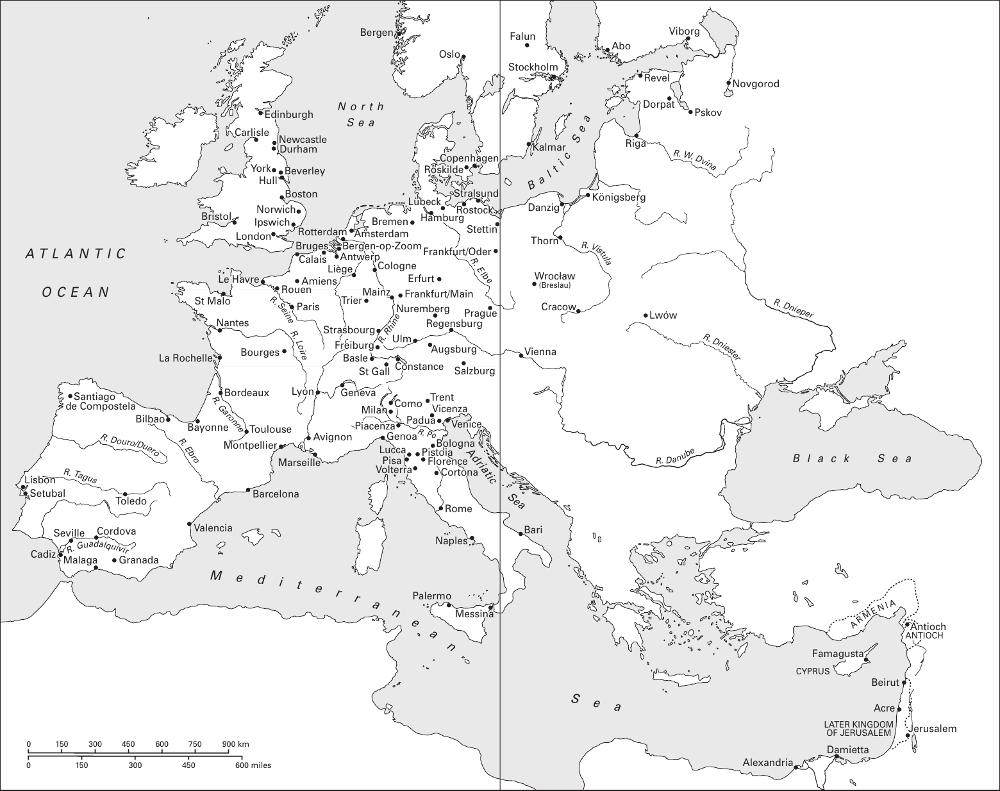
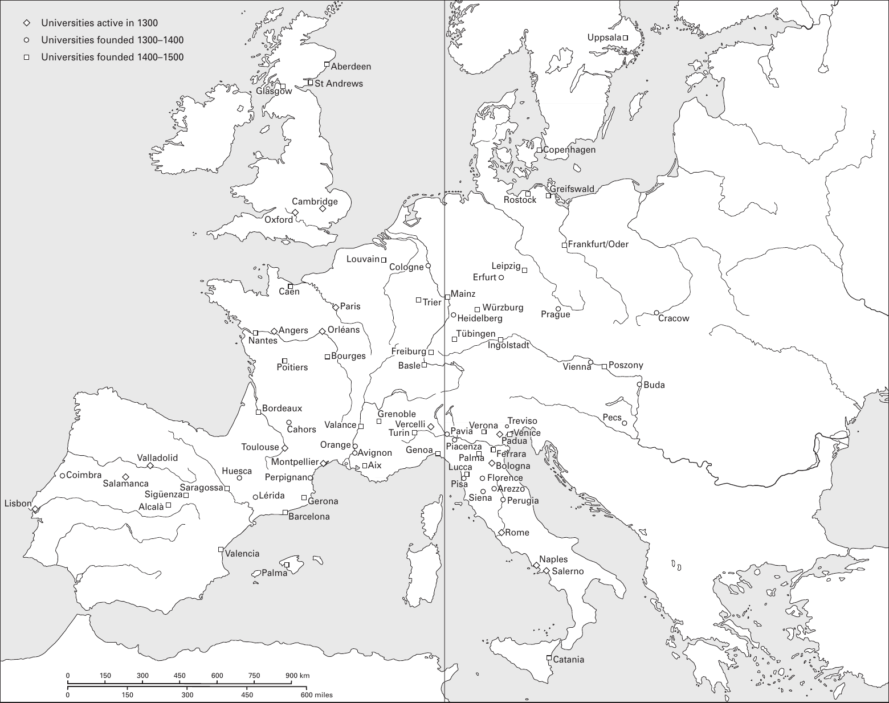
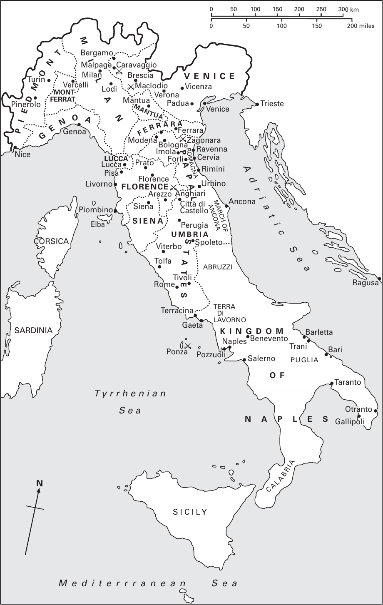
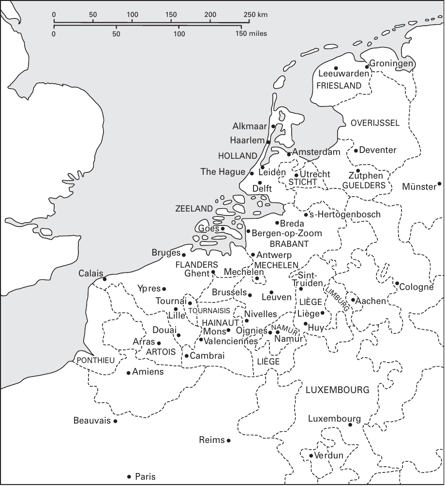

# 卷首资料

<!-- PDF page 1; original page unnumbered -->

<!-- 原书空白页 -->

<!-- PDF page 2; original page unnumbered -->

## 本卷简介

### 西欧基督教：约1100—约1500年

中世纪早期，欧洲形成复杂多样的基督教文化。约1100年起，世俗统治者、相互竞争的派别，以及富于感召力的个人，继续使基督教社会呈现多元而不断变化的面貌。本卷探讨中世纪晚期，欧洲基督徒生活所涉及的广泛制度、实践与经验。当时教士重新思考司祭、主教、教宗的角色，并展开雄心勃勃的平信徒教导计划。对平信徒而言，堂区宗教实践居于中心；但许多人还寻求其他途径，充实自己的基督徒生活。魅力型讲道者引领、世俗统治者支持的改革与更新浪潮，周期性席卷欧洲。同时，基督徒常因自身共同体内部及边境的非基督徒，而深感忧虑。本书以清晰易读的叙述，介绍这些复杂的历史过程，引导读者进一步探究。

**米里·鲁宾（Miri Rubin）**，伦敦大学玛丽女王学院中世纪史教授。近著包括《上帝之母：圣母玛利亚史》（Mother of God: A History of the Virgin Mary，2009）、《空洞王冠：中世纪晚期不列颠史》（The Hollow Crown: A History of Britain in the Late Middle Ages，2005）。

**沃尔特·西蒙斯（Walter Simons）**，达特茅斯学院历史系副教授。著有《女性之城：中世纪低地国家的贝居安共同体，1200—1565年》（Cities of Ladies: Beguine Communities in the Medieval Low Countries 1200–1565，2001）；与耶伦·德普洛赫、马蒂娜·德勒、斯蒂芬·范德普滕合编卢多·J. R. 米利斯《宗教、文化与中世纪低地国家：论文选》（Religion, Culture and Medieval Low Countries: Selected Essays，2005）；与彼得·阿尔纳德、玛莎·豪厄尔合编《北欧城市空间的生产力》（The Productivity of Urban Space in Northern Europe，2002）。

<!-- PDF page 3; original page unnumbered -->

<!-- 原书空白页 -->

<!-- PDF page 4; original page unnumbered -->

## 《剑桥基督教史》丛书说明

《剑桥基督教史》按时间顺序，全面叙述基督教从起源至今，在神学、思想、社会、政治、区域及全球各方面的发展。每卷都独立地为相应时期的研究，作出实质贡献；全套构成一部重要的学术参考著作。本丛书旨在提供全球视野。自早期开始，东方基督教、科普特基督教即获得充分关注；后来的非洲、远东、新大陆、南亚及其他非欧洲地区的基督教发展，也得到适当论述。各卷涵盖民间虔敬、基督教信仰的非正式表达，将基督徒塑造、敬拜与虔敬的社会学问题，置于广阔文化背景中考察。基督教与其他主要信仰的关系，也贯穿全书。本丛书将成为学者、学生的宝贵资源。

### 分卷目录

1. **起源至君士坦丁**；玛格丽特·M. 米切尔（Margaret M. Mitchell）、弗朗西丝·M. 扬（Frances M. Young）编。
2. **君士坦丁至约600年**；奥古斯丁·卡西迪（Augustine Casiday）、弗雷德里克·W. 诺里斯（Frederick W. Norris）编。
3. **中世纪早期基督教：约600—约1100年**；托马斯·诺布尔（Thomas Noble）、朱莉娅·史密斯（Julia Smith）编。
4. **西欧基督教：约1100—约1500年**；米里·鲁宾（Miri Rubin）、沃尔特·西蒙斯（Walter Simons）编。
5. **东方基督教**；迈克尔·安戈尔德（Michael Angold）编。

<!-- PDF page 5; original page unnumbered -->

### 分卷目录（续）

6. **宗教改革与扩张：1500—1660年**；夏伯嘉（Ronnie Po-chia Hsia）编。
7. **启蒙、复兴与革命：1660—1815年**；斯图尔特·J. 布朗（Stewart J. Brown）、蒂莫西·塔克特（Timothy Tackett）编。
8. **世界基督教：约1815—约1914年**；布赖恩·斯坦利（Brian Stanley）、谢里丹·吉利（Sheridan Gilley）编。
9. **世界基督教：约1914—约2000年**；休·麦克劳德（Hugh McLeod）编。

<!-- PDF page 6; original page unnumbered -->

## 剑桥基督教史

### 第四卷

### 西欧基督教：约1100—约1500年

米里·鲁宾、沃尔特·西蒙斯 编

<!-- PDF page 7; original page unnumbered -->

## 出版与版权信息

剑桥大学出版社：剑桥、纽约、墨尔本、马德里、开普敦、新加坡、圣保罗、德里。

剑桥大学出版社，The Edinburgh Building, Cambridge CB2 8RU, UK。

美国版由纽约的剑桥大学出版社出版。

出版社网站：www.cambridge.org；本书信息：www.cambridge.org/9780521811064。

© 剑桥大学出版社，2009年。

本出版物受版权保护。除法律规定的例外及相关集体许可协议所允许的情形外，未经剑桥大学出版社书面许可，不得复制本出版物的任何部分。

2009年初版。英国剑桥大学印刷所印制。

英国国家图书馆备有本书编目记录。

ISBN 978-0-521-81106-4，精装本。

剑桥大学出版社不对本书所引外部或第三方网站网址的持续有效性、准确性负责，也不保证这些网站的内容现在或将来始终准确、适当。

<!-- PDF page 8; original page vii -->

## 目录

以下页码均依原书。中文版另设可点击目录。

| 卷首资料 | 原书印刷页码 |
| --- | --- |
| 插图目录 | xi |
| 地图目录 | xii |
| 撰稿人 | xiii |
| 缩略语 | xv |
| 地图 | xvi |

| 篇目与作者 | 原书印刷页码 |
| --- | --- |
| [引言；米里·鲁宾、沃尔特·西蒙斯](#pdf-021) | 1 |
| [第一编 制度与变革（1100—1200年）](#pdf-029) | 9 |
| [第1章 教士的贞洁与重整秩序的世界；亨丽埃塔·莱瑟](#pdf-031) | 11 |
| [第2章 罗马主教（1100—1300年）；安东尼·佩龙](#pdf-042) | 22 |
| [第3章 宗教贫穷与对完美的追求；贝弗莉·梅恩·金茨勒](#pdf-059) | 39 |
| [第4章 修道会与其他修会（约1100—约1350年）；布赖恩·帕特里克·麦圭尔](#pdf-074) | 54 |
| [第二编 基督教世界的塑造（1200—1300年）](#pdf-093) | 73 |
| [第5章 神学框架；莱斯利·史密斯](#pdf-095) | 75 |

<!-- PDF page 9; original page viii -->

## 目录（续）

| 篇目与作者 | 原书印刷页码 |
| --- | --- |
| [第6章 法律基础；安德斯·温罗特](#pdf-109) | 89 |
| [第7章 物质支持之一：堂区；布里吉特·雷斯尔](#pdf-119) | 99 |
| [第8章 物质支持之二：修会；珍妮特·伯顿](#pdf-127) | 107 |
| [第9章 圣言及其传播；凯瑟琳·扬森](#pdf-134) | 114 |
| [第三编 边界的建立](#pdf-153) | 133 |
| [第10章 基督徒与犹太人；奥拉·利莫尔](#pdf-155) | 135 |
| [第11章 基督教世界与伊斯兰教；戴维·尼伦伯格](#pdf-169) | 149 |
| [第12章 基督徒与异端；彼得·比勒](#pdf-190) | 170 |
| [第13章 女人与男人；梅根·麦克劳克林](#pdf-207) | 187 |
| [第14章 天堂、地狱与炼狱（1100—1500年）；艾伦·E.伯恩斯坦](#pdf-220) | 200 |
| [第四编 基督教世界的形态](#pdf-237) | 217 |
| [第15章 圣事生活；米里·鲁宾](#pdf-239) | 219 |
| [第16章 宗教声景：礼仪与音乐；苏珊·博因顿](#pdf-258) | 238 |

<!-- PDF page 10; original page ix -->

## 目录（续）

| 篇目与作者 | 原书印刷页码 |
| --- | --- |
| [第17章 图像及其用途；萨拉·利普顿](#pdf-274) | 254 |
| [第18章 玛利亚；雷切尔·富尔顿](#pdf-303) | 283 |
| [第19章 神秘主义与超越；艾米·霍利伍德](#pdf-317) | 297 |
| [第五编 运动中的基督徒生活](#pdf-329) | 309 |
| [第20章 宗教生活的边缘：隐士与幽居者、悔罪者与第三会成员、贝居安女子与贝格哈德男子；沃尔特·西蒙斯](#pdf-331) | 311 |
| [第21章 圣徒与朝圣：新与旧；安德烈·沃谢](#pdf-344) | 324 |
| [第22章 十字军与征服；马库斯·布尔](#pdf-360) | 340 |
| [第六编 基督教社会面临的挑战](#pdf-373) | 353 |
| [第23章 镇压与权力；约翰·H. 阿诺德](#pdf-375) | 355 |
| [第24章 信仰与知识人（一）；约瑟夫·齐格勒](#pdf-392) | 372 |
| [第25章 信仰与知识人（二）；米夏埃尔·施托尔茨](#pdf-414) | 394 |

<!-- PDF page 11; original page x -->

## 目录（续）

| 篇目与作者 | 原书印刷页码 |
| --- | --- |
| [第七编 改革与更新](#pdf-425) | 405 |
| [第26章 通过阅读、写作与榜样获得力量：新虔敬运动；库恩·豪德里安](#pdf-427) | 407 |
| [第27章 邪魔与基督徒共同体；阿兰·布罗](#pdf-440) | 420 |
| [第28章 威克里夫主义与罗拉德派；坎蒂克·高什](#pdf-453) | 433 |
| [第29章 修会中的严规改革；伯特·鲁斯特](#pdf-466) | 446 |
| [第30章 公共纯洁与纪律：国家与宗教更新；罗伯托·鲁斯科尼](#pdf-478) | 458 |
| [第31章 十五世纪的《圣经》；克里斯托弗·奥克尔](#pdf-492) | 472 |
| [参考书目选编](#pdf-514) | 494 |
| [索引](#pdf-577) | 557 |

<!-- PDF page 12; original page xi -->

## 插图目录

以下数字为原书印刷页码。许可与图片来源，均为原书所载说明。

- **图14.1** 《班贝格〈启示录〉》，Msc.Bibl.140，叶53r，《最后的审判》；原书承班贝格国家图书馆许可刊载。203页。
- **图14.2** 《时祷书》彩饰首字母，叶197r，手稿133 M 131；原书承荷兰海牙皇家图书馆许可刊载。215页。
- **图15.1** 罗吉尔·范·德·魏登《七圣事》三联画，安特卫普皇家美术博物馆藏；图片由Reproductiefonds提供。220页。
- **图17.1** 橡木十字架苦像，比利时布鲁塞尔附近福雷的圣但尼教堂，约1160—1180年。版权及摄影：布鲁塞尔IRPA-KIK。261页。
- **图17.2** 《弗洛雷夫圣经》卷首画：阐释《约伯记》开篇经文；比利时默兹河谷弗洛雷夫普雷蒙特雷会修院，约1150年。伦敦大英图书馆，add. ms. 17738，叶3v。摄影：大英图书馆。263页。
- **图17.3** 亚眠圣母主教座堂：中殿与后殿交接处；法国北部，十三世纪。摄影：akg-images/Erich Lessing。268页。
- **图17.4** 《启示录》16:4注释插图局部；《道德诠释圣经》，巴黎，约1225年。维也纳奥地利国家图书馆图片档案，cod. 1179，叶236d。摄影：奥地利国家图书馆。273页。
- **图17.5** 基督—约翰群像，圣约翰将头靠在耶稣胸前；施瓦本／博登湖地区，十四世纪初。慕尼黑巴伐利亚国家博物馆，藏品号65/38。摄影：Andreas Praefcke；公有领域。275页。
- **图17.6** 象牙念珠末端珠，正面为相拥恋人，背面为爬满蛆虫的可怖骷髅；德意志，十六世纪。纽约大都会艺术博物馆，J. Pierpont Morgan于1917年捐赠，17.190.305。摄影：©大都会艺术博物馆。279页。

<!-- PDF page 13; original page xii -->

## 地图目录

| 图号与标题 | 原书印刷页码 |
| --- | --- |
| 图1 西欧：约1100—约1500年 | xvi |
| 图2 欧洲的大学 | xviii |
| 图3 中世纪晚期的意大利 | xx |
| 图4 低地国家：约1100—约1500年 | xxi |

<!-- PDF page 14; original page xiii -->

## 撰稿人

以下机构、职务及前述编者近作，依原书2009年刊行时记载。

| 撰稿人 | 所属机构／地址 |
| --- | --- |
| 约翰·阿诺德（John Arnold） | 英国，伦敦大学伯克贝克学院历史、古典学与考古学院 |
| 艾伦·E. 伯恩斯坦（Alan E. Bernstein） | 美国图森，亚利桑那大学历史系 |
| 彼得·比勒（Peter Biller） | 英国，约克大学历史系 |
| 阿兰·布罗（Alain Boureau） | 法国巴黎，社会科学高等研究院 |
| 苏珊·博因顿（Susan Boynton） | 美国纽约，哥伦比亚大学音乐系 |
| 马库斯·布尔（Marcus Bull） | 英国，布里斯托尔大学历史研究系 |
| 珍妮特·伯顿（Janet Burton） | 英国，威尔士大学兰彼得分校历史系 |
| 雷切尔·富尔顿（Rachel Fulton） | 美国，芝加哥大学历史系 |
| 坎蒂克·高什（Kantik Ghosh） | 英国，牛津大学三一学院 |
| 库恩·豪德里安（Koen Goudriaan） | 荷兰，阿姆斯特丹自由大学 |
| 艾米·霍利伍德（Amy Hollywood） | 美国马萨诸塞州剑桥，哈佛大学神学院 |
| 凯瑟琳·扬森（Katherine Jansen） | 美国华盛顿特区，美国天主教大学历史系 |
| 贝弗莉·梅恩·金茨勒（Beverly Mayne Kienzle） | 美国马萨诸塞州剑桥，哈佛大学神学院 |
| 亨丽埃塔·莱瑟（Henrietta Leyser） | 英国，牛津大学圣彼得学院 |
| 奥拉·利莫尔（Ora Limor） | 以色列特拉维夫，开放大学 |
| 萨拉·利普顿（Sara Lipton） | 美国石溪，纽约州立大学石溪分校历史系 |
| 布赖恩·帕特里克·麦圭尔（Brian Patrick McGuire） | 丹麦，罗斯基勒大学中心历史系 |
| 梅根·麦克劳克林（Megan McLaughlin） | 美国艾奥瓦城，艾奥瓦大学历史系 |
| 戴维·尼伦伯格（David Nirenberg） | 美国，芝加哥大学社会思想委员会 |
| 克里斯托弗·奥克尔（Christopher Ocker） | 美国，旧金山神学院 |
| 安东尼·佩龙（Anthony Perron） | 美国洛杉矶，洛约拉玛丽蒙特大学历史系 |
| 布里吉特·雷斯尔（Brigitte Resl） | 英国，利物浦大学历史系 |
| 伯特·鲁斯特（Bert Roest） | 荷兰，格罗宁根大学历史系 |
| 米里·鲁宾（Miri Rubin） | 英国，伦敦大学玛丽女王学院历史系 |
| 罗伯托·鲁斯科尼（Roberto Rusconi） | 意大利罗马，罗马大学（Università degli studi di Roma） |
| 沃尔特·西蒙斯（Walter Simons） | 美国新罕布什尔州汉诺威，达特茅斯学院历史系 |

<!-- PDF page 15; original page xiv -->

## 撰稿人（续）

| 撰稿人 | 所属机构／地址 |
| --- | --- |
| 莱斯利·史密斯（Lesley Smith） | 英国，牛津大学哈里斯曼彻斯特学院 |
| 米夏埃尔·施托尔茨（Michael Stolz） | 瑞士，伯尔尼大学德语系 |
| 安德烈·沃谢（André Vauchez） | 法国巴黎，阿拉瑟街2号（2 rue Alasseur） |
| 安德斯·温罗特（Anders Winroth） | 美国康涅狄格州纽黑文，耶鲁大学历史系 |
| 约瑟夫·齐格勒（Joseph Ziegler） | 以色列，海法大学历史系 |

<!-- PDF page 16; original page xv -->

## 缩略语

| 缩略语 | 原文及中文说明 |
| --- | --- |
| AA.SS. | Acta Sanctorum，《圣徒行传》，第3版，巴黎：Palmé，1863年起 |
| CCCM | Corpus Christianorum: Continuatio mediaevalis，《基督教文献丛刊·中世纪续编》 |
| CCSL | Corpus Christianorum Series Latina，《基督教文献丛刊·拉丁系列》 |
| CFS | Cistercian Fathers Series，《熙笃会教父丛书》 |
| CSEL | Corpus scriptorum ecclesiasticorum latinorum，《拉丁教会作家文集》 |
| MGH | Monumenta Germaniae Historica，《德意志历史文献集》，汉诺威等：Hahn等，1826年起 |
| MGH EPP | Epistolae，书信 |
| MGH SS | Scriptores，史家 |
| OED | Oxford English Dictionary，《牛津英语词典》 |
| PG | Patrologiae Cursus Completus, Series Graeca，《教父全集·希腊系列》，J.-P. Migne编，巴黎：Migne，1857—1866年 |
| PL | Patrologiae Cursus Completus, Series Latina，《教父全集·拉丁系列》，J.-P. Migne编，巴黎：Migne，1844—1864年 |
| SBO | Sancti Bernardi opera，《圣伯尔纳著作集》 |
| SC | Sources chrétiennes，《基督教文献》 |
| SCH | Studies in Church History，《教会史研究》 |

除另有说明，《圣经》引文，均据《武加大译本》的《杜埃—兰斯》英译本。

<!-- PDF page 17; original page unnumbered -->

## 地图1 西欧：约1100—约1500年

**译校补图说明：** 本地电子原书PDF第17页确为空白，第18页为地图移出说明，未附目录所列地图1、2。两张地图据[剑桥大学出版社公开卷首文件](https://assets.cambridge.org/97805218/11064/frontmatter/9780521811064_frontmatter.pdf)第16—19页补入，各将左右跨页合排；该公开文件为2015年第三次印刷的卷首，正文、版权等仍依据本地2009年原书。原图©剑桥大学出版社。

图1 西欧：约1100—约1500年。原图地名保留，中文逐项对照如下；比例尺km为千米，miles为英里。

| 原图标名 | 中文 |
| --- | --- |
| Edinburgh | 爱丁堡 |
| Newcastle | 纽卡斯尔 |
| Durham | 达勒姆 |
| Carlisle | 卡莱尔 |
| York | 约克 |
| Hull | 赫尔 |
| Beverley | 贝弗利 |
| Boston | 波士顿（英格兰） |
| Norwich | 诺里奇 |
| Ipswich | 伊普斯维奇 |
| London | 伦敦 |
| Bristol | 布里斯托尔 |
| North Sea | 北海 |
| Malaga | 马拉加 |
| Granada | 格拉纳达 |
| Cordova | 科尔多瓦 |
| Valencia | 瓦伦西亚 |
| Seville | 塞维利亚 |
| Lisbon | 里斯本 |
| Setubal | 塞图巴尔 |
| Toledo | 托莱多 |
| Barcelona | 巴塞罗那 |
| Montpellier | 蒙彼利埃 |
| Bayonne | 巴约讷 |
| Toulouse | 图卢兹 |
| Bordeaux | 波尔多 |
| La Rochelle | 拉罗谢尔 |
| Nantes | 南特 |
| Paris | 巴黎 |
| St Malo | 圣马洛 |
| Bourges | 布尔日 |
| Marseille | 马赛 |
| Palermo | 巴勒莫 |
| Messina | 墨西拿 |
| Naples | 那不勒斯 |
| Rome | 罗马 |
| Oslo | 奥斯陆 |
| Copenhagen | 哥本哈根 |
| Roskilde | 罗斯基勒 |
| Bergen | 卑尔根 |
| Frankfurt/Oder | 奥得河畔法兰克福 |
| Stettin | 斯德丁 |
| Stralsund | 施特拉尔松德 |
| Hamburg | 汉堡 |
| Rostock | 罗斯托克 |
| Lübeck | 吕贝克 |
| Prague | 布拉格 |
| Regensburg | 雷根斯堡 |
| Nuremberg | 纽伦堡 |
| Mainz | 美因茨 |
| Frankfurt/Main | 美因河畔法兰克福 |
| Erfurt | 埃尔福特 |
| Augsburg | 奥格斯堡 |
| Constance | 康斯坦茨 |
| Cologne | 科隆 |
| Bremen | 不来梅 |
| Mediterranean Sea | 地中海 |
| Avignon | 阿维尼翁 |
| Lyon | 里昂 |
| Le Havre | 勒阿弗尔 |
| Calais | 加来 |
| Rouen | 鲁昂 |
| Amiens | 亚眠 |
| Genoa | 热那亚 |
| Milan | 米兰 |
| Trent | 特伦托 |
| Venice | 威尼斯 |
| Bologna | 博洛尼亚 |
| Florence | 佛罗伦萨 |
| Cortona | 科尔托纳 |
| Pistoia | 皮斯托亚 |
| Pisa | 比萨 |
| Lucca | 卢卡 |
| Volterra | 沃尔泰拉 |
| Adriatic Sea | 亚得里亚海 |
| Como | 科莫 |
| Salzburg | 萨尔茨堡 |
| Ulm | 乌尔姆 |
| Piacenza | 皮亚琴察 |
| Geneva | 日内瓦 |
| Basle | 巴塞尔 |
| St Gall | 圣加仑 |
| Trier | 特里尔 |
| Freiburg | 弗赖堡 |
| Strasbourg | 斯特拉斯堡 |
| Liège | 列日 |
| R. Elbe | 易北河 |
| R. Ebro | 埃布罗河 |
| R. Garonne | 加龙河 |
| R. Tagus | 塔霍河 |
| R. Guadalquivir | 瓜达尔基维尔河 |
| R. Loire | 卢瓦尔河 |
| R. Seine | 塞纳河 |
| Atlantic Ocean | 大西洋 |
| Cadiz | 加的斯 |
| Padua | 帕多瓦 |
| Vicenza | 维琴察 |
| Rotterdam | 鹿特丹 |
| Amsterdam | 阿姆斯特丹 |
| Antwerp | 安特卫普 |
| Bruges | 布鲁日 |
| Bergen-op-Zoom | 贝亨奥普佐姆 |
| Bilbao | 毕尔巴鄂 |
| Santiago de Compostela | 圣地亚哥－德孔波斯特拉 |
| R. Po | 波河 |
| R. Douro/Duero | 杜罗河／杜埃罗河 |
| R. Rhine | 莱茵河 |
| Vienna | 维也纳 |
| Cracow | 克拉科夫 |
| Lwów | 利沃夫 |
| Danzig | 但泽 |
| Königsberg | 柯尼斯堡 |
| Riga | 里加 |
| Pskov | 普斯科夫 |
| Novgorod | 诺夫哥罗德 |
| Dorpat | 多尔帕特 |
| Revel | 雷瓦尔 |
| Viborg | 维堡 |
| Abo | 奥布 |
| Kalmar | 卡尔马 |
| Thorn | 托伦 |
| Black Sea | 黑海 |
| Damietta | 达米埃塔 |
| Alexandria | 亚历山大里亚 |
| Acre | 阿克 |
| Beirut | 贝鲁特 |
| Jerusalem | 耶路撒冷 |
| Famagusta | 法马古斯塔 |
| Antioch | 安条克（城与领地） |
| Cyprus | 塞浦路斯 |
| Later Kingdom of Jerusalem | 耶路撒冷后期王国 |
| Bari | 巴里 |
| Stockholm | 斯德哥尔摩 |
| Falun | 法伦 |
| R. W. Dvina | 西德维纳河 |
| R. Vistula | 维斯瓦河 |
| R. Dniester | 德涅斯特河 |
| R. Dnieper | 第聂伯河 |
| R. Danube | 多瑙河 |
| Armenia | 亚美尼亚 |
| Baltic Sea | 波罗的海 |
| Wroclaw (Breslau) | 弗罗茨瓦夫（布雷斯劳） |

<!-- PDF page 18; original page unnumbered -->

## 地图2 欧洲的大学

原电子书此页的说明译文：“为便于使用，印刷版此处的地图已移除，现作为附加资源，列于章节概览页面。”本译稿已据上述出版社文件补回。

图2 欧洲的大学。原图地名保留，中文逐项对照如下；比例尺km为千米，miles为英里。

原图在马略卡岛、意大利北部两处均印作Palma，表中分列；Poszony、Valance等拼写亦依原图保留。

| 原图标名 | 中文 |
| --- | --- |
| Aberdeen | 阿伯丁 |
| St Andrews | 圣安德鲁斯 |
| Glasgow | 格拉斯哥 |
| Oxford | 牛津 |
| Cambridge | 剑桥 |
| Cologne | 科隆 |
| Trier | 特里尔 |
| Freiburg | 弗赖堡 |
| Basle | 巴塞尔 |
| Caen | 卡昂 |
| Louvain | 鲁汶 |
| Paris | 巴黎 |
| Orléans | 奥尔良 |
| Angers | 昂热 |
| Nantes | 南特 |
| Bourges | 布尔日 |
| Poitiers | 普瓦捷 |
| Bordeaux | 波尔多 |
| Cahors | 卡奥尔 |
| Toulouse | 图卢兹 |
| Montpellier | 蒙彼利埃 |
| Aix | 艾克斯 |
| Avignon | 阿维尼翁 |
| Orange | 奥朗日 |
| Grenoble | 格勒诺布尔 |
| Valance | 瓦朗斯（依原图拼写） |
| Lisbon | 里斯本 |
| Coimbra | 科英布拉 |
| Salamanca | 萨拉曼卡 |
| Valladolid | 巴利亚多利德 |
| Alcalà | 阿尔卡拉 |
| Valencia | 瓦伦西亚 |
| Palma（马略卡岛） | 帕尔马（马略卡岛） |
| Barcelona | 巴塞罗那 |
| Gerona | 赫罗纳 |
| Perpignan | 佩皮尼昂 |
| Lérida | 莱里达 |
| Huesca | 韦斯卡 |
| Saragossa | 萨拉戈萨 |
| Sigüenza | 锡古恩萨 |
| Turin | 都灵 |
| Genoa | 热那亚 |
| Vercelli | 韦尔切利 |
| Copenhagen | 哥本哈根 |
| Rostock | 罗斯托克 |
| Greifswald | 格赖夫斯瓦尔德 |
| Frankfurt/Oder | 奥得河畔法兰克福 |
| Uppsala | 乌普萨拉 |
| Cracow | 克拉科夫 |
| Vienna | 维也纳 |
| Buda | 布达 |
| Poszony | 波若尼（依原图拼写） |
| Ingolstadt | 因戈尔施塔特 |
| Leipzig | 莱比锡 |
| Erfurt | 埃尔福特 |
| Würzburg | 维尔茨堡 |
| Prague | 布拉格 |
| Verona | 维罗纳 |
| Padua | 帕多瓦 |
| Venice | 威尼斯 |
| Ferrara | 费拉拉 |
| Bologna | 博洛尼亚 |
| Florence | 佛罗伦萨 |
| Siena | 锡耶纳 |
| Rome | 罗马 |
| Perugia | 佩鲁贾 |
| Naples | 那不勒斯 |
| Salerno | 萨莱诺 |
| Catania | 卡塔尼亚 |
| Pecs | 佩奇 |
| Treviso | 特雷维索 |
| Arezzo | 阿雷佐 |
| Mainz | 美因茨 |
| Heidelberg | 海德堡 |
| Tübingen | 蒂宾根 |
| Pavia | 帕维亚 |
| Piacenza | 皮亚琴察 |
| Palma（意大利图位） | 帕尔马（意大利；原图作Palma） |
| Pisa | 比萨 |
| Lucca | 卢卡 |
| Universities active in 1300 | 菱形：1300年已活跃的大学 |
| Universities founded 1300–1400 | 圆形：1300—1400年创立的大学 |
| Universities founded 1400–1500 | 方形：1400—1500年创立的大学 |

<!-- PDF page 19; original page unnumbered -->

## 地图3 中世纪晚期的意大利

图3 中世纪晚期的意大利。原图地名保留，中文逐项对照如下；比例尺km为千米，miles为英里。

图中城市与同名领地，在表中合列。

| 原图标名 | 中文 |
| --- | --- |
| Piedmont | 皮埃蒙特 |
| Turin | 都灵 |
| Pinerolo | 皮内罗洛 |
| Mont-Ferrat | 蒙费拉托 |
| Vercelli | 韦尔切利 |
| Milan | 米兰（城与领地） |
| Bergamo | 贝加莫 |
| Malpage | 马尔帕加（原图作Malpage） |
| Caravaggio | 卡拉瓦乔 |
| Brescia | 布雷西亚 |
| Lodi | 洛迪 |
| Maclodio | 马克洛迪奥 |
| Venice | 威尼斯（城与领地） |
| Vicenza | 维琴察 |
| Verona | 维罗纳 |
| Padua | 帕多瓦 |
| Trieste | 的里雅斯特 |
| Mantua | 曼图亚（城与领地） |
| Genoa | 热那亚（城与领地） |
| Nice | 尼斯 |
| Ferrara | 费拉拉（城与领地） |
| Modena | 摩德纳 |
| Bologna | 博洛尼亚 |
| Imola | 伊莫拉 |
| Zagonara | 扎戈纳拉 |
| Ravenna | 拉韦纳 |
| Cervia | 切尔维亚 |
| Forlì | 弗利 |
| Rimini | 里米尼 |
| Romagna | 罗马涅 |
| Lucca | 卢卡（城与领地） |
| Pisa | 比萨 |
| Prato | 普拉托 |
| Livorno | 里窝那 |
| Florence | 佛罗伦萨（城与领地） |
| Arezzo | 阿雷佐 |
| Anghiari | 安吉亚里 |
| Urbino | 乌尔比诺 |
| Città di Castello | 卡斯泰洛城 |
| Ancona | 安科纳 |
| March of Ancona | 安科纳边区 |
| Siena | 锡耶纳（城与领地） |
| Piombino | 皮翁比诺 |
| Elba | 厄尔巴岛 |
| Corsica | 科西嘉岛 |
| Perugia | 佩鲁贾 |
| Umbria | 翁布里亚 |
| Spoleto | 斯波莱托 |
| Viterbo | 维泰博 |
| Tolfa | 托尔法 |
| Papal States | 教宗国 |
| Abruzzi | 阿布鲁齐 |
| Tivoli | 蒂沃利 |
| Rome | 罗马 |
| Ragusa | 拉古萨 |
| Terracina | 泰拉奇纳 |
| Gaeta | 加埃塔 |
| Terra di Lavorno | 拉沃罗地区（原图作Lavorno） |
| Kingdom of Naples | 那不勒斯王国 |
| Naples | 那不勒斯 |
| Benevento | 贝内文托 |
| Sardinia | 撒丁岛 |
| Ponza | 蓬扎岛 |
| Pozzuoli | 波佐利 |
| Salerno | 萨莱诺 |
| Barletta | 巴列塔 |
| Trani | 特拉尼 |
| Bari | 巴里 |
| Puglia | 普利亚 |
| Taranto | 塔兰托 |
| Otranto | 奥特朗托 |
| Gallipoli | 加利波利 |
| Calabria | 卡拉布里亚 |
| Sicily | 西西里岛 |
| Adriatic Sea | 亚得里亚海 |
| Tyrrhenian Sea | 第勒尼安海 |
| Mediterranean Sea | 地中海 |
| N | 北 |

<!-- PDF page 20; original page unnumbered -->

## 地图4 低地国家：约1100—约1500年

图4 低地国家：约1100—约1500年。原图地名保留，中文逐项对照如下；比例尺km为千米，miles为英里。

图中城市与同名领地，在表中合列。

| 原图标名 | 中文 |
| --- | --- |
| Groningen | 格罗宁根 |
| Leeuwarden | 吕伐登 |
| Friesland | 弗里斯兰 |
| Overijssel | 上艾瑟尔 |
| Alkmaar | 阿尔克马尔 |
| Haarlem | 哈勒姆 |
| Holland | 荷兰地区 |
| Amsterdam | 阿姆斯特丹 |
| The Hague | 海牙 |
| Leiden | 莱顿 |
| Deventer | 代芬特尔 |
| Zutphen | 聚特芬 |
| Guelders | 海尔德尔斯 |
| Münster | 明斯特 |
| Utrecht | 乌得勒支 |
| Sticht | 乌得勒支主教领 |
| Delft | 代尔夫特 |
| Zeeland | 泽兰 |
| ’s-Hertogenbosch | 斯海尔托亨博斯 |
| Breda | 布雷达 |
| Bergen-op-Zoom | 贝亨奥普佐姆 |
| Goes | 胡斯 |
| Brabant | 布拉班特 |
| Antwerp | 安特卫普 |
| Mechelen | 梅赫伦（城与领地） |
| Bruges | 布鲁日 |
| Flanders | 佛兰德 |
| Ghent | 根特 |
| Calais | 加来 |
| Ypres | 伊普尔 |
| Tournai | 图尔奈 |
| Tournaisis | 图尔奈地区 |
| Lille | 里尔 |
| Brussels | 布鲁塞尔 |
| Leuven | 鲁汶 |
| Sint-Truiden | 圣特勒伊登 |
| Liège | 列日（城与领地） |
| Limburg | 林堡 |
| Cologne | 科隆 |
| Aachen | 亚琛 |
| Nivelles | 尼韦勒 |
| Hainaut | 埃诺 |
| Mons | 蒙斯 |
| Oignies | 瓦尼 |
| Namur | 那慕尔（城与领地） |
| Huy | 于伊 |
| Valenciennes | 瓦朗谢讷 |
| Douai | 杜埃 |
| Arras | 阿拉斯 |
| Artois | 阿图瓦 |
| Cambrai | 康布雷 |
| Ponthieu | 蓬蒂厄 |
| Amiens | 亚眠 |
| Luxembourg | 卢森堡（城与领地） |
| Beauvais | 博韦 |
| Reims | 兰斯 |
| Verdun | 凡尔登 |
| Paris | 巴黎 |
