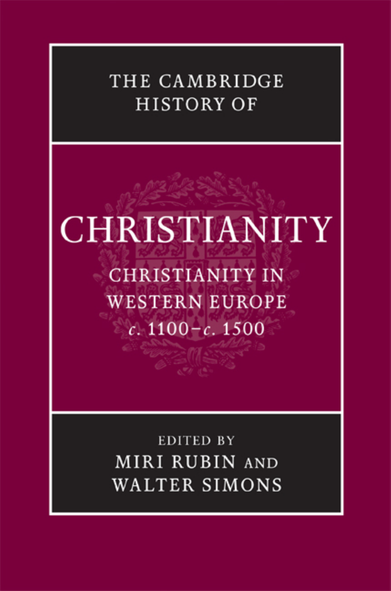
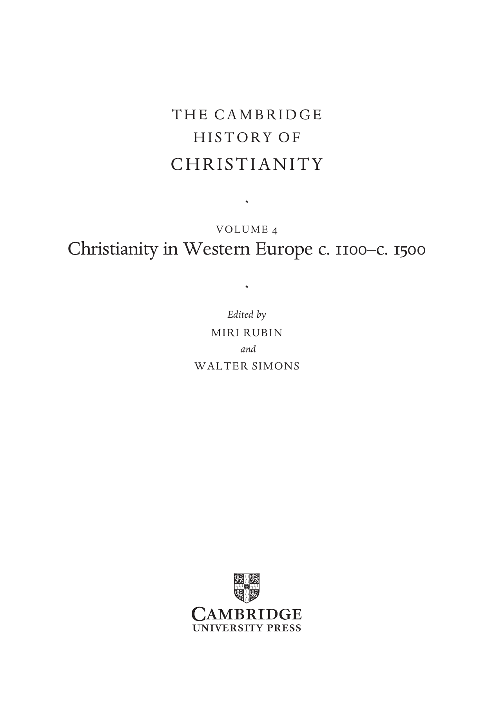
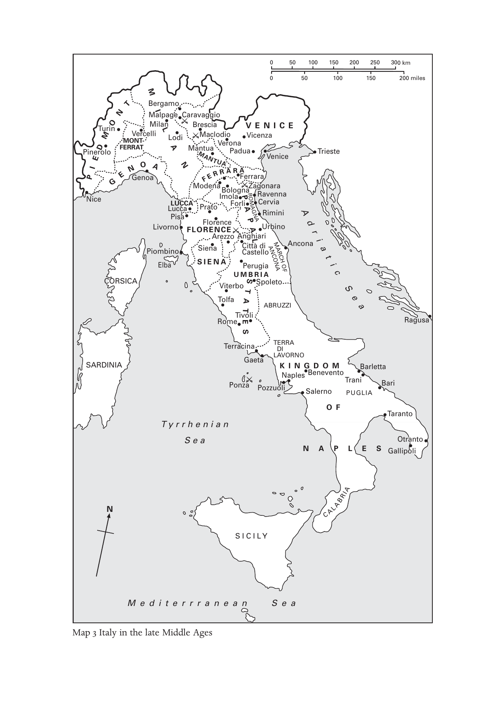
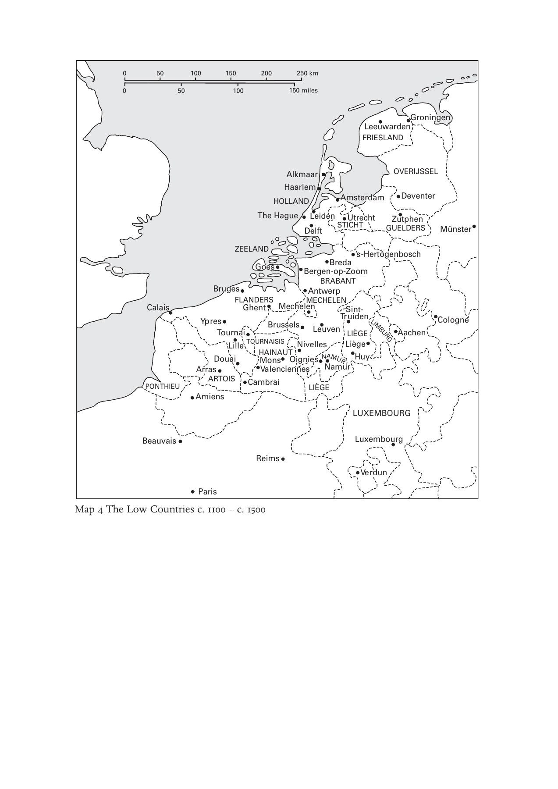

# 卷首资料：英文转换底稿

<!-- PDF page 1; original page unnumbered -->

<!-- PDF page 2; original page unnumbered -->

t h e c a m b r i d g e h i s t o r y o f

### CHRISTIANITY

* Christianity in Western Europe c. 1100–c. 1500 During the early middle ages, Europe developed complex and varied Christian cultures, and from about 1100 secular rulers, competing factions and inspired individuals continued to engender a diverse and ever-changing mix within Christian society. This volume explores the wide range of institutions, practices and experiences associated with the life of European Christians in the later middle ages. The clergy of this period initiated new approaches to the role of priests, bishops and popes, and developed an ambitious project to instruct the laity. For lay people, the practices of parish religion were central, but many sought additional ways to enrich their lives as Christians. Impulses towards reform and renewal periodically swept across Europe, led by charismatic preachers and supported by secular rulers. At the same time, Christians were often preoccupied and troubled by non-Christians within their own communities and on their borders. This book provides accessible accounts of these complex historical processes and entices the reader towards further enquiry. M i r i R u b i n is Professor of Medieval History at Queen Mary, University of London. Her most recent publications include Mother of God: A History of the Virgin Mary (2009) and The Hollow Crown: A History of Britain in the Late Middle Ages (2005). Wa l t e r S i m o n s is Associate Professor in the Department of History, Dartmouth College. He is author of Cities of Ladies: Beguine Communities in the Medieval Low Countries 1200–1565 (2001) and co-editor of Ludo J. R. Milis, Religion, Culture and Medieval Low Countries: Selected Essays (2005) with Jeroen Deploige, Martine De Reu and Steven Vanderputten and The Productivity of Urban Space in Northern Europe (2002) with Peter Arnade and Martha Howell.

<!-- PDF page 3; original page unnumbered -->

<!-- PDF page 4; original page unnumbered -->

t h e c a m b r i d g e h i s t o r y o f

### CHRISTIANITY

The Cambridge History of Christianity offers a comprehensive chronological account of the development of Christianity in all its aspects – theological, intellectual, social, political, regional, global – from its beginnings to the present day. Each volume makes a substantial contribution in its own right to the scholarship of its period and the complete History constitutes a major work of academic reference. Far from being merely a history of Western European Christianity and its offshoots, the History aims to provide a global perspective. Eastern and Coptic Christianity are given full consideration from the early period onwards, and later, African, Far Eastern, New World, South Asian and other non-European developments in Christianity receive proper coverage. The volumes cover popular piety and non-formal expressions of Christian faith and treat the sociology of Christian formation, worship and devotion in a broad cultural context. The question of relations between Christianity and other major faiths is also kept in sight throughout. The History will provide an invaluable resource for scholars and students alike. l i s t o f v o l u m e s: Origins to Constantine edited by m a r g a r e t m. m i t c h e l l a n d f r a n c e s m. y o u n g Constantine to c. 600 edited by a u g u s t i n e c a s i d a y a n d f r e d e r i c k w. n o r r i s Early Medieval Christianity c. 600–c. 1100 edited by t h o m a s n o b l e a n d j u l i a s m i t h Christianity in Western Europe c. 1100–c. 1500 edited by m i r i r u b i n a n d w a l t e r s i m o n s Eastern Christianity edited by m i c h a e l a n g o l d

<!-- PDF page 5; original page unnumbered -->

Reform and Expansion 1500–1660 edited by r o n n i e p o - c h i a h s i a Enlightenment, Reawakening and Revolution 1660–1815 edited by s t e w a r t j. b r o w n a n d t i m o t h y t a c k e t t World Christianities c. 1815–c. 1914 edited by b r i a n s t a n l e y a n d s h e r i d a n g i l l e y World Christianities c. 1914–c. 2000 edited by h u g h m c l e o d

<!-- PDF page 6; original page unnumbered -->

### THECAMBRIDGE

### HISTORYOF

### CHRISTIANITY

* V O L U M E 4

### Christianity in Western Europe c. 1100– c. 1500

* Edited by M I R I R U B I N and W A L T E R S I M O N S

<!-- PDF page 7; original page unnumbered -->

c a m b r i d g e u n i v e r s i t y p r e s s Cambridge, New York, Melbourne, Madrid, Cape Town, Singapore, São Paulo, Delhi Cambridge University Press The Edinburgh Building, Cambridge cb2 8ru, UK Published in the United States of America by Cambridge University Press, New York www.cambridge.org Information on this title: www.cambridge.org/9780521811064 © Cambridge University Press 2009 This publication is in copyright. Subject to statutory exception and to the provisions of relevant collective licensing agreements, no reproduction of any part may take place without the written permission of Cambridge University Press. First published 2009 Printed in the United Kingdom at the University Press, Cambridge A catalogue record for this publication is available from the British Library isbn 978-0-521-81106-4 hardback Cambridge University Press has no responsibility for the persistence or accuracy of URLs for external or third-party internet websites referred to in this book, and does not guarantee that any content on such websites is, or will remain, accurate or appropriate.

<!-- PDF page 8; original page vii -->

### Contents

List of illustrations page xi List of maps xii List of contributors xiii Abbreviations xv Maps xvi Introduction 1 m i r i r u b i n a n d w a l t e r s i m o n s

### parti

I N S T I T U T I O N S A N D C H A N G E: 1 1 0 0 – 1 2 0 0 9 1. Clerical purity and the re-ordered world 11 h e n r i e t t a l e y s e r 2. The bishops of Rome, 1100–1300 22 a n t h o n y p e r r o n 3. Religious poverty and the search for perfection 39 b e v e r l y m a y n e k i e n z l e 4. Monastic and religious orders, c. 1100–c. 1350 54 b r i a n p a t r i c k m c g u i r e

### partii

F O R G I N G A C H R I S T I A N W O R L D, 1 2 0 0 – 1 3 0 0 73 5. The theological framework l e s l e y s m i t h 75 vii

<!-- PDF page 9; original page viii -->

> Contents

6. The legal underpinnings 89 a n d e r s w i n r o t h 7. Material support I: parishes 99 b r i g i t t e r e s l 8. Material support II: religious orders 107 j a n e t b u r t o n 9. The Word and its diffusion 114 k a t h e r i n e j a n s e n

### partiii

T H E E R E C T I O N O F B O U N D A R I E S 133 10. Christians and Jews 135 o r a l i m o r 11. Christendom and Islam 149 d a v i d n i r e n b e r g 12. Christians and heretics 170 p e t e r b i l l e r 13. Women and men 187 m e g a n m c l a u g h l i n 14. Heaven, hell and purgatory: 1100–1500 200 a l a n e. b e r n s t e i n

### partiv

S H A P E S O F A C H R I S T I A N W O R L D 217 15. Sacramental life 219 m i r i r u b i n 16. Religious soundscapes: liturgy and music 238 s u s a n b o y n t o n viii

<!-- PDF page 10; original page ix -->

> Contents

17. Images and their uses 254 s a r a l i p t o n 18. Mary 283 r a c h e l f u l t o n 19. Mysticism and transcendence 297 a m y h o l l y w o o d

### partv

C H R I S T I A N L I F E I N M O V E M E N T 309 20. On the margins of religious life: hermits and recluses, penitents and tertiaries, beguines and beghards 311 w a l t e r s i m o n s 21. Saints and pilgrimages: new and old 324 a n d r e´ v a u c h e z 22. Crusade and conquest 340 m a r c u s b u l l

### partvi

T H E C H A L L E N G E S T O A C H R I S T I A N S O C I E T Y 353 23. Repression and power 355 j o h n h. a r n o l d 24. Faith and the intellectuals I 372 j o s e p h z i e g l e r 25. Faith and the intellectuals II 394 m i c h a e l s t o l z ix

<!-- PDF page 11; original page x -->

> Contents

### partvii

R E F O R M A N D R E N E W A L 405 26. Empowerment through reading, writing and example: the Devotio moderna 407 k o e n g o u d r i a a n 27. Demons and the Christian community 420 a l a i n b o u r e a u 28. Wycliffism and Lollardy 433 k a n t i k g h o s h 29. Observant reform in religious orders 446 b e r t r o e s t 30. Public purity and discipline: states and religious renewal 458 r o b e r t o r u s c o n i 31. The Bible in the fifteenth century 472 c h r i s t o p h e r o c k e r Select bibliography 494 Index 557 x

<!-- PDF page 12; original page xi -->

### Illustrations

Fig. 14.1 The Bamberg Apocalypse, Msc.Bibl.140, folio 53r, The Last Judgement reproduced by permission of Staatsbibliothek Bamberg page 203 Fig. 14.2 Illuminated initial from a Book of Hours, folio 197r, manuscript 133 M 131 reproduced by permission of Koninklijke Bibliotheek, The Hague, The Netherlands 215 Fig. 15.1 Triptych of the Seven Sacraments by Rogier van der Weyden, Royal Museum of Fine Arts, Antwerp, image courtesy of Reproductiefonds 220 Fig. 17.1 Oaken crucifix. Church of St.-Denis, Forest-lez-Bruxelles, Belgium, c. 1160–80. Copyright IRPA-KIK, Brussels. (Photo: IRPA-KIK, Brussels) 261 Fig. 17.2 Floreffe Bible frontispiece: exegesis of the opening verses of Job. Premonstratensian Abbey of Floreffe, Meuse Valley, Belgium, c. 1150. London, British Library add. ms. 17738, fol. 3v. (Photo: British Library) 263 Fig. 17.3 Cathedral of Notre-Dame, Amiens: intersection of nave and apse. Northern France, thirteenth century. (Photo: akg-images/Erich Lessing) 268 Fig. 17.4 Detail from commentary illustration to Rev. 16.4. Bible moralisée, Paris, c. 1225. ÖNB/Vienna, picture archive, cod. 1179, fol. 236d. (Photo: Österreichische Nationalbibliothek) 273 Fig. 17.5 Christus-Johannes Group (Saint John laying his head on Jesus’ breast). Swabia/Lake Constance, early fourteenth century. Munich, Bayerisches Nationalmuseum, Inv. Nr 65/38. (Photo: Andreas Praefcke; public domain) 275 Fig. 17.6 Ivory rosary terminal bead with embracing lovers on the front and a hideous skeleton crawling with worms on the back. Germany, sixteenth century. New York, The Metropolitan Museum of Art, gift of J. Pierpont Morgan, 1917, 17.190.305. (Photo: © Metropolitan Museum of Art) 279 xi

<!-- PDF page 13; original page xii -->

### Maps

Map 1 Western Europe c. 1100–c. 1500 page xvi Map 2 Universities of Europe xviii Map 3 Italy in the late Middle Ages xx Map 4 The Low Countries, c. 1100–c. 1500 xxi xii

<!-- PDF page 14; original page xiii -->

### Contributors

J O H N A R N O L D, School of History, Classics and Archaeology, Birkbeck, University of

London, UK A L A N E. B E R N S T E I N, Department of History, University of Arizona, Tucson, USA P E T E R B I L L E R, Department of History, University of York, UK A L A I N B O U R E A U, École des Hautes Études en Sciences Sociales, Paris, France S U S A N B O Y N T O N, Department of Music, Columbia University, New York, USA M A R C U S B U L L, Department of Historical Studies, University of Bristol, UK J A N E T B U R T O N, Department of History, University of Wales Lampeter, UK R A C H E L F U L T O N, Department of History, University of Chicago, USA K A N T I K G H O S H, Trinity College, University of Oxford, UK K O E N G O U D R I A A N, Vrije Universiteit Amsterdam, The Netherlands A M Y H O L L Y W O O D, Harvard Divinity School, Harvard University, Cambridge, Mass.,

USA K A T H E R I N E J A N S E N, Department of History, Catholic University of America, Washington

(D.C.), USA B E V E R L Y M A Y N E K I E N Z L E, Harvard Divinity School, Harvard University, Cambridge,

Mass., USA H E N R I E T T A L E Y S E R, St Peter’s College, University of Oxford, UK O R A L I M O R, Open University, Tel Aviv, Israel S A R A L I P T O N, Department of History, State University of New York Stony Brook, Stony

Brook, USA B R I A N P A T R I C K M C G U I R E, Department of History, Roskilde University Centre,

Denmark M E G A N M C L A U G H L I N, Department of History, University of Iowa, Iowa City, USA D A V I D N I R E N B E R G, Committee on Social Thought, University of Chicago, USA C H R I S T O P H E R O C K E R, San Francisco Theological Seminary, USA A N T H O N Y P E R R O N, Department of History, Loyola Marymount University, Los Angeles,

USA B R I G I T T E R E S L, Department of History, University of Liverpool, UK B E R T R O E S T, Department of History, University of Groningen, The Netherlands M I R I R U B I N, Department of History, Queen Mary, University of London, UK R O B E R T O R U S C O N I, Università degli studi di Roma, Rome, Italy W A L T E R S I M O N S, Department of History, Dartmouth College, Hanover, New Hamp.,

USA xiii

<!-- PDF page 15; original page xiv -->

> Contributors

L E S L E Y S M I T H, Harris Manchester College, University of Oxford, UK M I C H A E L S T O L Z, Department of German, University of Bern, Switzerland A N D R E´ V A U C H E Z, 2 rue Alasseur, Paris, France A N D E R S W I N R O T H, Department of History, Yale University, New Haven, Conn., USA J O S E P H Z I E G L E R, Department of History, University of Haïfa, Israel xiv

<!-- PDF page 16; original page xv -->

### Abbreviations

AA.SS. Acta Sanctorum, 3rd edn, Paris: Palmé, 1863– CCCM Corpus Christianorum: Continuatio mediaevalis CCSL Corpus Christianorum Series Latina CFS Cistercian Fathers Series CSEL Corpus scriptorum ecclesiasticorum latinorum MGH Monumenta Germaniae Historica, Hanover et al.: Hahn et al., 1826– EPP Epistolae SS Scriptores OED Oxford English Dictionary PG Patrologiae Cursus Completus, Series Graeca, ed. J.-P. Migne, Paris: Migne, 1857–66 PL Patrologiae Cursus Completus, Series Latina, ed. J.-P. Migne, Paris: Migne, 1844–64 SBO Sancti Bernardi opera SC Sources chrétiennes SCH Studies in Church History Unless otherwise specified, all biblical references are to the Douay-Rheims version of the vulgate. xv

<!-- PDF page 17; original page unnumbered -->

<!-- PDF page 18; original page unnumbered -->

<!-- PDF page 19; original page unnumbered -->

0 50 100 150 200 250 300 km 0 50 100 150 200 miles M T Bergamo N MIalpage Caravaggio

Pin E e D r T o M u l r o O in F M ER O R V N A e T T r - ce M lli ila L n L A odi M B a r n M e t s u a c a c ia lo V d e i r o o P n a a du V V a ic E en N z V a e I ni C ce E Trieste

P I G E N Ge O noa A N Ferrara

Nice Livor L n P L u o U i c s C c a a C F A L M O o P F R d r l a e o E t A n r o N e a r I e n C m B z c o E z e o o F l l o a o g A r P n l n A i a P g ROM A Z AG h N a A i g a R C o r U a R e i n v r i r m v a e b i r n i a i n a n n o i a A d r Piom Elb b a ino S Si I e E na N A U M C C P i a e B tL s t r à u t R e g d I ll i A i o a ANCO M NA ARCH OF Ancona i a t i c CORSICA Viterbo T S Spoleto S Tolfa A ABRUZZI e a Rome TivToli Ragusa Terracina T D ER I RA Gaeta LAVORNO

SARDINIA K I N G D O M Barletta Ponza Pozzuol N i aples S B a e le n r e n v o ento T P r U an G i LIA Bari O F Taranto Tyrrhenian Sea Otranto N A P L E S Gallipoli CALABRIA S I C I L Y M e d i t e r r r a n e a n S e a E MANTUA FERR A R A S N Map 3 Italy in the late Middle Ages

<!-- PDF page 20; original page unnumbered -->

0 50 100 150 200 250 km 0 50 100 150 miles Groningen Leeuwarden FRIESLAND Alkmaar OVERIJSSEL Haarlem HOLLAND Amsterdam Deventer The Hague Leiden Utrecht Zutphen Delft STICHT GUELDERS Münster ZEELAND ’s-Hertogenbosch Goes Bergen B -o re p d -Z a oom BRABANT Bruges Antwerp FLANDERS MECHELEN Calais Ghent Mechelen Sint- Ypre T s ou L r i n ll a e i TOURN B AI r S u IS ssels Nive L ll e e u s ven Tr L L u i I è i È d g G e e E n LIMBURG Aachen Cologne Arras Douai H M V A a o I l N e n n s A c U ie T O n i n g e n s ies N N AM am URur Huy PONTHIEU ARTOIS Cambrai LIÈGE Amiens LUXEMBOURG Beauvais Luxembourg Reims Verdun Paris Map 4 The Low Countries c. 1100 – c. 1500

