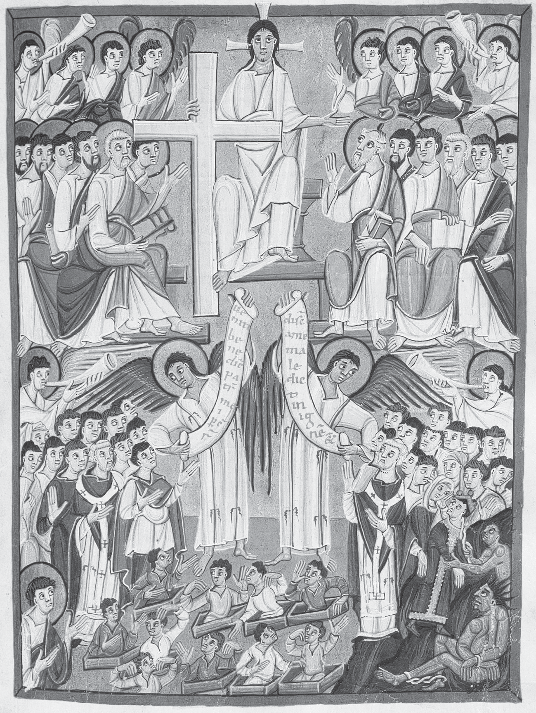
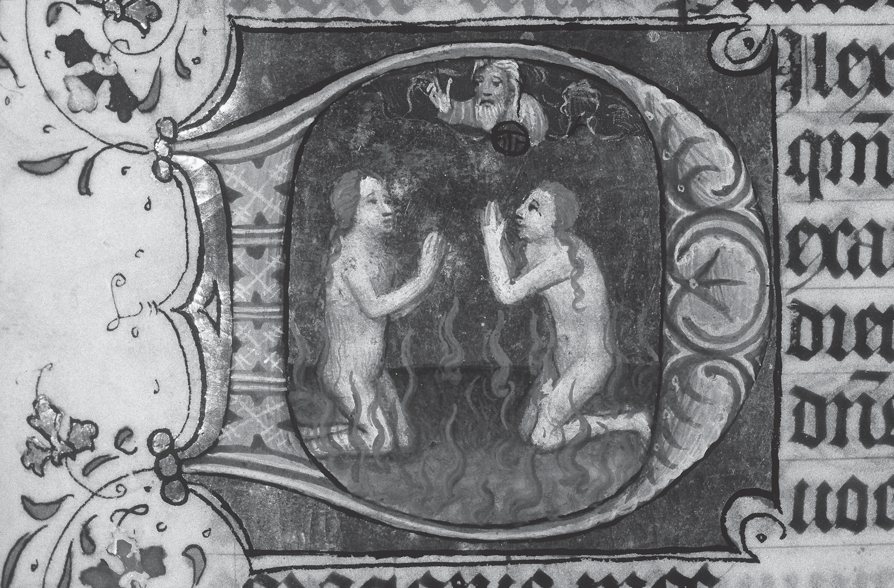

# 第14章 天堂、地狱与炼狱（1100—1500年）[^p220-star]

艾伦·E.伯恩斯坦（Alan E. Bernstein）

<!-- PDF page 220; original page 200 -->

本章故事在许多层面展开，最深处是个人良心。但个人对来世的感受，绝非孤立，而嵌入社会关系网络。天堂、地狱与炼狱当然涉及死者，亡灵却并未完全离开尘世，仍萦绕家人。一如罗马时代，家庭也包括已故父母与祖先。[^p220-1] 中世纪欧洲人通过“助祷”（suffrages），即专为死者所做的善工，表达宗族忠诚。教会受赠文书显示，捐赠者为自己及先人灵魂利益而行动。故事讲述炼狱或地狱来客，要求继承人清偿债务，或处理其他未了事务。亡者也从天堂归来，鼓励怯懦者。因此，不论措辞如何虔诚，许多慈善行为也包含私利：洗净良心、积累功德、消除罪责。捐给教会，也是赠予教士；虔诚捐赠，与世上有影响力的人建立联盟。

宗教权威往往也是政治力量，在从教宗到堂区的各层级运作，也塑造个人对天堂地狱的态度。教宗与会议，以教义定义和审判异端介入。神学家阐述个别教义规定的理由，把结论写入手册，提供告解神师和讲道者使用；约1200年开始以拉丁文流通，约1300年以俗语传播，约1450年出现印本。教堂内外公共艺术、礼仪戏剧，以及行会资助、涉及天使圣徒魔鬼的神秘剧，使最有力量的宗教形象<!-- PDF page 221; original page 201 -->为民众熟悉。异象文学记载悔罪灵魂与“她的”守护天使对话（拉丁语“灵魂”为阴性词；诚然，记载往往已是二手、三手）。有时，神秘主义者报告与耶稣本人亲密的身体接触；某些故事中，他从十字架走下，向他们致意。

一个自上而下、权威性的教会，要求众人接受中央界定信仰的印象，会误导人。本章探讨其希望、恐惧、盘算的宗教共同体，并非完全团结。教宗尚不被视为无谬，只偶尔能针对特定异端主张或人物，强制教义一致。政治运作塑造教义定义，权威宣告也可能激起民众反抗。人们同时透过民间、牧灵、神学、教义界定的观念和视觉图像，形成万花筒般信仰认识。因此，必须区分个人、心理、文学、神学、教义各层面的感知与表达。

1100至1500年，基督教来世观有三大变化。首先是良心的普及化。对良心的重视，从古代晚期修道生活的倡导者向“下”渗透，中世纪盛期传至大量普通信徒，系统省察良心成为平信徒悔罪纪律一部分。其次，更关注“中间期”，即个人死亡与基督再来、普遍复活和最后审判之间。当中间期成为使良心得安抚的行动场域，炼狱就浮现。第三，随时间推移，到十四、十五世纪，炼狱、助祷及中间期相关问题，本身也产生难题。暂时炼狱的诉求，与得救和受罚的永恒性，由此发生竞争，使西欧宗教发展进入新阶段。

良心作用在古代晚期已清楚显现。耶柔米（卒于420年）反对奥利金否认永恒地狱，理由是他“仅仅”把地狱置于良心。[^p221-2] 但耶柔米自己也讲述一个梦，梦中在自己的良心里受地狱火煎熬。[^p221-3] 地狱在此通过良心侵入活人。塞维利亚的伊西多尔（卒于636年），以tristitia（悲苦）称这种良心发作。他认为<!-- PDF page 222; original page 202 -->默观者必须生前关注这种悲苦，否则灵魂将在地狱永受其折磨。他说，地狱“火烧身体，而悲苦烧心灵”。[^p222-4] 中世纪早期修道经验，为西欧表述了活人良心与日后地狱苦刑的联系。我把活人内疚良心中这地狱预尝，称为“内在死亡”。

助祷——为死者的祈祷、施舍或弥撒——也渗透中世纪早期情感生活。奥古斯丁（卒于430年）在《手册》中讨论。为亡者祈祷的效力，依其生前生活而异。极善者不需祈祷，极恶者祈祷不及；居中者则以两种方式受益：不太善者，罪获完全解除；不太恶者，仅处境改善，亦即“较可忍受的惩罚”（tolerabilior damnatio）。[^p222-5] 基督徒期望这种利益，资助为父母祈祷，也预先考虑自身需求。他们捐给男女修院和主教座堂；赠产成为俸禄，在数世纪间构成有影响力的教会团体的地产基金。[^p222-6]

中世纪早期另一个稳定影响，是贯穿几乎全部中世纪末世论的类比：回溯《圣经》把天堂视为上帝国度的观念，天上与地上秩序相互对应，既政治也宗教。中世纪盛期，神学家、巴黎主教奥弗涅的威廉（卒于1249年），据此论证地狱必存在：每座治理良好城市，都有执行正义的地方；宇宙为上帝之城，因此有地狱，作为上帝执行正义之处。[^p222-7] 托马斯·阿奎那（卒于1274年）反向推理，劝国王“在其王国中，如灵魂在身体中、上帝在宇宙中那样”治理。[^p222-8]

最后审判的视觉表现，也提供延续。此后半千年成为标准的构图，最早见于<!-- PDF page 223; original page 203 -->约1000年的一幅彩饰画（图14.1）。

图14.1 《班贝格启示录》，Msc.Bibl.140，书叶53正面，《最后审判》（照片：班贝格国立图书馆）。

《班贝格启示录》以鲜明而权威的方式描绘最后审判，强调审判者基督威严，清楚分割场景。基督在天上主持，周围天廷环绕：吹号天使、担任陪审者的圣徒，<!-- PDF page 224; original page 204 -->俯视尘世。在基督右侧，天使向受祝福者展示欢迎卷轴：“来吧，蒙我父祝福的人〔承受为你们准备的国……〕”（《马太福音》25:34）；另一侧天使，则向基督左边受罚者展示不受欢迎的消息：“离开我，你们受咒诅的人，进入〔永〕火……”（《马太福音》25:41）。受罚者下方敞开地狱景象：攫人的魔鬼拖拽恶人，加入被锁链束缚的撒但。

这两个标准宗教政治表达的例子，尽管体现稳定，却省略居中时间（中间期）、居中人群（奥古斯丁的不太善与不太恶者）、居中空间（炼狱）。尽管已有奥古斯丁分类，对既非大罪人、亦非大圣徒者的忧虑，仍催生个人死亡至普遍复活之间人群的异象。从弗尔西、巴龙图斯（七、八世纪）到韦蒂、胖子查理（九世纪），异象显示灵魂在死前离体，游历彼世。异象者无法区分永受惩罚与暂时炼净的灵魂。[^p224-9] 有时刑罚发生尘世。约1160年，撒丁岛托雷斯的赫伯特，在异象中见亡者队列：“有人较早获释，有人较晚，但许多人仍受无法解除的惩罚。”他见一个灵魂，死后九年在自家集水池赎过，被天使用光柱接升天堂。[^p224-10] 被定罪者与即将得救、或尚需时日者，混杂尘世，忍受漫长昏暗的不死状态。

其他文本也混合死后暂时与永恒受苦。《唐达尔异象》（1148年）中，一个挥霍无度的骑士，因突发病症濒死，由守护天使带领游历彼世。唐达尔尝到身体刑罚，地点像生产作坊：厨房、锻炉、烤架，及神话场所（怪物巨口）。他必须带一头类似曾偷过的牛，走过满布朝上尖刺的桥，脚被刺穿。途中，遇另一有罪灵魂迎面而来。他哀叹，却承认罪过，立刻发现已安全过桥。认罪终止刑罚。来到地狱深坑时，<!-- PDF page 225; original page 205 -->唐达尔见撒但在烤架上扭动，同时吞吃、排泄、抓挠受害者灵魂。（林堡兄弟在贝里公爵《豪华时祷书》中，使这一形象不朽。）他认出昔日同伴，宣布与邪恶伙伴决裂。天使赞扬，称他为“归正的灵魂”。他“抛却先前悲苦，如今满怀喜悦”。[^p225-11] 他否弃邪恶过去后，天使展示，其他方面善良、却未施舍穷人者，如何按其慈善程度受罚或奖赏（per aliquot）。科马克国王离开天上宫殿，受与淫罪、伪誓相称的刑罚，但生前所助穷人，在他受苦时侍奉。唐达尔的天堂是一座有城墙之城，充溢圣徒“联合体”组成唱诗班的和声；这个词社会含义重要，因为consortium也是类似行会或行业团体的职业联合组织。同心城墙区分贞洁的已婚者、童贞者、殉道者。那里没有提及君王统治；在唐达尔异象中，天堂是联合体。

另一文本《圣帕特里克炼狱记》，可能写于1179—1181年左右，讲述骑士欧文约1151—1152年的经历。它以明确把炼狱命名为地方而著名，但大量戏剧性仍围绕炼狱与地狱的混淆。开篇是起源神话：为帮助爱尔兰人改宗，耶稣向圣帕特里克展示洞穴，内有地狱恐怖、天堂欢愉。耶稣不称它炼狱，却说任何人在其中过夜，均可获全部罪的赦免。故事开始，满怀悔意的骑士欧文，为应对内心悲苦，[^p225-12] 希望探访圣帕特里克炼狱，承担异乎寻常的严厉补赎。进洞后，魔鬼催他折返，否则永受洞中刑罚，力图使他相信炼狱实际是地狱。十三世纪二十年代，海斯特巴赫的凯撒里乌斯将对熙笃会初学者宣称，炼狱施罚者是天使，地狱是魔鬼；然而这篇《炼狱记》中，操持<!-- PDF page 226; original page 206 -->火轮刑具的，却是“塔耳塔罗斯的役卒”（指古代施罚冥府）。文本提出地狱新读法：正确理解，地狱酷刑是个人应得惩罚的目录。活着时自愿省察自己在地狱应受刑罚，正如修士借悲苦所做，这种内省就能有炼净作用。《圣帕特里克炼狱记》宣扬一个悔罪者可亲赴的地方，借此组织自己的悔改。

悔罪与彼世的联系，进入新兴大学。内疚良心、悔罪行为、个人最终命运，究竟如何相连？若悔罪能赢得自身赦免，祖先状况如何？应为受永罚者祈祷吗？巴黎神学家、主教彼得·伦巴德（卒于1160年），其神学教材《命题集》在学校盛行至十六世纪，赞同为受永罚者祈祷。他承认，不能使他们脱离惩罚，却能减轻痛苦。[^p226-13] 对通过炼狱得救者，助祷不带来更充分赦免，只加快完成，也就是更早入天堂。[^p226-14] 这些主张鼓励助祷，也鼓励一种把地上助祷行为与来世结果联系的量化。死亡实际上已有衡算尺度，“最后清算”权衡善行与罪过。但继任神学家拒绝其为受永罚者祈祷的立场。欧塞尔的威廉（卒于1231年），认为助祷仅对“其中存在功德的根基与根源，即爱德”者有效。[^p226-15] 因此，一些神学家抵制了从炼狱减刑，推衍地狱可能减苦的诱惑。

这一时期艺术，也处理彼世空间如何适当配置。重要教堂的门上半圆饰区，呈现《班贝格启示录》最后审判构图。孔克，魔鬼兴高采烈折磨受害者，急等更多人；奥坦，它们拨动衡量灵魂行为的天平。沿门楣，复活身体面对厄运，面目扭曲。布尔日，如同沙特尔南门最后审判，地狱之口已移入半圆饰区本身；巴黎圣母院，则移出饰区，至第一道拱券饰带，整体平静。魔鬼用锁链牵走受罚者，但总体上，对神圣君王如子女般敬爱，取代奴仆般怕地狱。这些图像从彩饰手稿书页，移至教堂外门前公共空间，使其传授的教义<!-- PDF page 227; original page 207 -->受众扩大。门后教会围墙内，回廊则象征乐园。

十三世纪，讲道者也大幅拓展受众。新建方济各会、多明我会，在新大学，或由大学毕业者监督的会内学校，成批训练讲道者。这些队伍遍布欧洲，以俗语讲道。讲章突出支持神学结论的经文；为直接吸引不识字者，从数世纪劝善文学汲取现代寓言，即例证。讲道例证展示宗教生活各面。波旁的斯蒂芬讲，地狱火树扎根于商人胸膛，因为他引儿子放高利贷；每一代占新增枝条，所有罪压在始祖身上，把他碾压于地狱火地面。修院提供另一道路，但需坚持。斯蒂芬说，一个熙笃会初学者不满小室，称“比地狱更坏”。亡母以幽灵显现，劝诫，先让他预尝地狱最轻痛苦——猪哼，再尝天堂最小祝福——鸟鸣。初学者于是坚持有益救恩的纪律。[^p227-16]

讲道者从近乎权威的汇编传播劝善故事，按示范讲章集讲道，教会领袖由此感到俗语力量，设想获得向最偏远堂区传教义的新能力。虽从未完全标准化，创新仍极大激活基层。直到十五世纪印刷发明，宗教信息传播才再有可比的跃进。女性尤其受益：传统大体阻碍她们学拉丁文，教士又将她们拒于大学外。尽管成见古老，宾根的希尔德加德（卒于1179年）、兰茨贝格的赫拉德（霍恩堡，卒于1195年）等以拉丁文写作的修女，据存世记录判断，仍在神学、科学、音乐、艺术作出卓越贡献。女性帮助俗语成为文学载体，一些人，如布拉班特的哈德维赫（十三世纪）、马格德堡的梅希蒂尔德（约卒于1285年）、玛格丽特·<!-- PDF page 228; original page 208 -->波雷特（1310年被处死）、诺里奇的朱利安（卒于1413年），更频繁写作，未必是修女，也未必受男性监督。

彼世教义更有效传播——换言之，教士更全面回应民众关切——带来行为后果。许多平信徒热切追求天堂。讲道者把讲道称上帝之言，单是出席，就被视为美德。作为补赎的朝圣赢得大赦（减轻因罪所欠惩罚）；十字军又是朝圣形式。男女进入修院，崇敬圣徒获得超自然代求者。从出生地至墓地，公私仪式把个人意义，与公共场面、政治宣传、集体感受相连。教会、继而行会，资助露天上演《圣经》故事。一些圣事也变化。十二世纪前，悔罪通常出于自愿；但1215年，教宗英诺森三世要求，每年向本堂司祭告解。托钵修士普及这种私下告解。平信徒新宗教团体出现：托钵修会第三会、善会，以及主要供女性的贝居安团体。严格的新严规支派，也使修会本身承受压力。十三世纪起，创建医院，作为新慈善形式而扩散。各类捐赠由教会机构管理，把今世来世利益相连。教会受赠，确实深刻塑造欧洲经济；教会权威所征税亦然。希望天堂、恐惧地狱炼狱，增强教会经济政治影响，都是其介入民众死后赏罚观的结果。

教宗基于对民众参与的认识，用教义定义尝试使信仰一致。主要关切之一，是在中间期与永恒，划分空间、时间、归宿。十三世纪宣告，使赏罚从临终开始，不再延至基督再来，从而强化超自然制裁。

1215年信经，英诺森三世宣布按功德审判：行善者“将与基督同享永恒荣耀”，行恶者“将与魔鬼同受永恒惩罚”。[^p228-17]

<!-- PDF page 229; original page 209 -->

这意味着衡量善恶行为，功德重量或数量更大者得救，未提中间期或炼狱。

英诺森四世1254年《在公教信仰宣认之下》信函（Sub catholicae professione），以悔罪为标准，决定能否在炼狱赎“轻微小罪”。不悔罪，未告解而死，就在地狱付永恒代价：“若有人未悔罪，死于大罪……将永受永恒革亨纳之火折磨。”[^p229-18] 他定义炼狱为“暂时之火，〔藉它〕洗净死后仍负累灵魂的微小罪过，只要这些罪生前已获解除〔即赦免〕”。他不只正式开放炼狱为悔罪者归宿，也宣布“在爱德中”死去者，灵魂“立即进入永恒家园”。[^p229-19] 实际上，炼狱仅能洗净轻罪的限定，很快让位于较古老传统：告解甚至使“重大的”罪，即大罪，成为轻罪。[^p229-20] 1274年，格列高利十世不再坚持唯轻罪能在炼狱赎清，却规定地狱与炼狱、天堂一样，死亡即开始。[^p229-21] 如此压缩末世时间，把后果拉近当下，强调个人行动与告解。

教宗宣告层面之下，巴黎神学家努力阐明一致的来世体系。困难来自助祷、十字军等制度要求：若这些行为影响死后状态，以何比率？欧洲主要思想家力求避免等价交换的量化安排，但并不总容易。黑尔斯的亚历山大（卒于1245年），建立罪行尺度（轻罪、大罪），及对应惩罚（地上补赎，来世炼狱与地狱刑罚），思考各类如何转化、折换。他说：“每一种惩罚，均折换为与它相应的惩罚。”[^p229-22] 不论本意如何，他这交换、折换的比喻，并未限制，反而促进实际上已形成的衡算死亡文化。

<!-- PDF page 230; original page 210 -->

若助祷能减轻彼世惩罚，数量足够，能否连受永罚者也救？教宗格列高利一世中世纪传记讲，他代求，使异教皇帝图拉真从地狱重返尘世，再活一次，得以作为基督徒死去；到但丁笔下，已得救，成为天上星辰。[^p230-23] 波纳文图拉（卒于1274年）考虑此例：上帝能够，却不拯救受永罚者。“〔死后〕死于罪中的人得救，不只困难，而且不可能；不是神力不能成就，而是神圣正义合理公正地作出相反决定。”[^p230-24] 这种对神圣权能的保留，通常只在谈到十四世纪时才引人注意；它将以区分上帝绝对权能（potentia absoluta）与既定权能（potentia ordinata）的形式，变得越来越重要。

托马斯·阿奎那（卒于1274年），对为受永罚者助祷，追随欧塞尔的威廉：“爱德是联结教会成员的纽带，不只延及生者，也及于在爱德中死去的亡者。”[^p230-25] 因此，炼狱灵魂的特征，不是消极的平庸，而是积极的拥有爱德。因为有爱德，助祷可及；地狱受罚者缺爱德，自绝于助祷。[^p230-26] 亡者重新分类，虽使炼狱地位更稳，却绝未使地狱空虚；反而绝对隔绝其居民与任何其他生者、死者的联系，使地狱更强。湮没愈发遥远。

神学著作偏好细密分类，可能忽略坚持己见、自主的民众观念，但有时仍显露。约1220年，海斯特巴赫的凯撒里乌斯，为本院初学者写神学入门手册，讲附近列日故事：主教不许基督徒寡妇，将非基督徒、放高利贷的丈夫葬于教堂墓地。妻子司法上诉获胜，搬进丈夫墓旁棚屋，为他祈祷。七年后，丈夫穿半白半黑衣现身：“我已从地狱深处、从最大刑罚中被拉出。若你再为我做同样善工<!-- PDF page 231; original page 211 -->七年，我便完全获释。”妻照办，七年后，丈夫穿明亮白衣显现，感谢她，宣布自己“已获释”。凯撒里乌斯将故事归炼狱，不归地狱，因为他说，无人能从地狱赎回；推测死者曾在最后一刻悔悟，虽故事未说明。[^p231-27] 他努力解释掉当地民间故事中明显的神学问题——妻子以祈祷，把罪人救出地狱——表明学术与民众文化有矛盾。假定全部社会结构，始终神学一致，是错误。尽管他作“修正”，故事三段结构仍提示，一些人相信能为他人祈祷，先出地狱，再出炼狱，最终入天堂。

末世问题的交锋，也可发生最高层。1331—1332年，教宗约翰二十二世宣称，荣福直观，即直接看见上帝的天上奖赏，须待普遍复活，身体灵魂重合，方可获得。同理，受永罚者，无论人或魔鬼，最后审判后才入地狱。宣告有逆转上世纪趋势之虞：那趋势把决定时刻提前至个人死亡。遭民众、政治、甚至王室巨大反对，他临终撤回意见。继任本笃十二世，恢复适当应得者即时进入天堂地狱两种最终归宿的趋向。[^p231-28]

正如神学家从大学讲席走向讲道台，会转换修辞层次，壁画家在教堂墙面表现不可言喻奥秘，但丁《神曲》也同时面向宗教共同体的学术、民众两面。它既是公教神学权威阐释，也是人间爱情故事，亦为政治抨击的场合。诗人以意大利语诗，讲虚构异象，追踪通往上帝的路。[^p231-29] 他按朝圣阶段，接受衡算死亡。一切有尺度。地狱，<!-- PDF page 232; original page 212 -->陷入深度衡量罪责；天堂，直观上帝的强度衡量恩典：

> e del vedere è misura mercede，所见衡量其奖赏。（《天堂篇》28:112）

对他，衡量解释神圣正义。

但他也怀疑这些理性手段。天堂，圣彼得问其信仰定义；听这佛罗伦萨流亡者用“三段论”“何所是”等经院术语，彼得质问：“你为何把封闭自己心灵的这些命题，视为神圣火花？”（《天堂篇》24:98—99）但丁答，三个位格与福音，是内心燃烧火焰，使彼得欢喜。

火确为《神曲》的组织性比喻：

> catun si fascia di quel ch’elli è inceso. 每人把自己裹进使自己燃烧之物。（《地狱篇》26:48）

燃烧（ardere），在地狱造成永恒折磨，炼狱带来净化，天堂成为永恒光明与爱。人人都有可能被这爱“点燃”（incesi）。因此，炽热本身，无论人的执迷、洗净之火或神圣之爱，遍及宇宙。上帝回应人的爱，会平息激动求天堂者的火。但丁虚构异象，隐然挑战地狱门铭：不应放弃希望，应活着“进入”地狱，如欧文，面对悲苦，检视过失，培育信仰，追求爱。

《天堂篇》中，彼得不只问但丁信仰。对谈时，首位教宗痛惜欧洲属灵衰败：宗教权威滥职谋私；神学家夸耀多余区分；讲道者喋喋不休；假大赦贩子，从轻信、购买伪造承诺的人那里，收取劣币（《天堂篇》第29歌）。但丁下一代，弗朗切斯科·彼特拉克（卒于1374年），批评学者会定义美德，却不会爱、不会实践。波纳文图拉承认，上帝若愿，可救永罚者，但不如此做；这一让步在唯名论者中开花，成为绕过官僚式、可预测上帝形象的努力。那形象限上帝于既定权能，而传统强调——如伪狄奥尼修——上帝超越认识，因而可自由使用绝对权能。信仰理性化，以及制度层面的量化，是否走得太远？

<!-- PDF page 233; original page 213 -->

一些人试借数学观念、意象，恢复质的焦点。但丁同时代，方济各会属灵派卡萨莱的乌贝尔蒂诺（1305年写作），按《马太福音》25:40字面解释，视谦卑自降、自愿属灵贫穷，为得救前提。他要求灵魂认同基督弟兄中“最微小者”，以此与耶稣结合。这转变使信徒成为“小耶稣”（jesunculi），达到“至微”（minimitas），唯此状态使人得救。[^p233-30] 最小与最大间的对立，以及神秘意义的对应，启发库萨的尼古拉（卒于1464年）研究。他探求对立的重合，发展无穷的数学观念，作为通往上帝另一道路。

强大制度压力仍在。参加十字军、朝圣、特殊盛会——如博尼法斯八世1300年宣布的禧年——或大小捐赠，都获大赦；这种等价交换式赎罪，催生种种“衡量”悔改进展的方法。黑尔斯的亚历山大所作折换量化，进入民间与制度实践，超出他对悔罪纪律与来世关系的理解。在追思弥撒堂、或侧廊小堂祭坛，资助私人弥撒，把中世纪早期资助主教座堂、提供俸禄的大任务，拆为较小单位，每项均对应死前或死后预期功德收益。[^p233-31] 须注意，权威否认这些行为能除罪责，只免罪所生惩罚；但焦虑地狱炼狱痛苦的民众，不懂这区分。1477年，西克斯图斯四世宣称，有教宗能力，为炼狱需助祷者分配“基督与圣徒”共有功德，称它“宝库”。[^p233-32] 免除炼狱刑罚，似乎越来越易获得；有时，正如此次宣告所因事件，仅须捐现金建教堂。

牛津的奥卡姆的威廉（卒于1349年）等学者，早反对这种神学，认为把上帝权能限于人从《圣经》可推论之事。其追随者唯名论者，坚称上帝权能绝对，决不受人类理性限制。援引上帝的绝对权能——神力绝对、不受束缚——高于其既定<!-- PDF page 234; original page 214 -->权能——限于上帝已启示之事的神力——挑战炼狱、助祷、大赦观念。批评者认为，它们把量化，以及人对推衍的信心，推得太远。1479年，美因茨教会法庭迫使韦塞尔的约翰，撤回反大赦论著。他说，只有基督曾与使徒立此协议，才可能有分配基督圣徒功德之权；但《圣经》未启示此事。[^p234-33] 虽他撤回，援引《圣经》挑战功德量化，却未消失。事实上，《圣经》将成为新教挑战这些公教实践的号召。新教也以抹平等级的眼光看天堂，淡化位次与等级，例如废除圣徒崇敬。

与此同时，不论神学家有何异议，争取死后利益的行动加强。1215年每年告解要求以来，对良心的重视提高，影响个人虔敬，也相应使艺术物品普及。罗曼式与哥特式教堂立面，以最后审判结合天堂地狱的宏伟构图，广泛出现，如十三世纪晚期佛罗伦萨洗礼堂穹顶。私人赞助也能使其个人化，如帕多瓦乔托的阿雷纳小堂（1305年）。富家私家小堂也有较小祭坛画；许多同样在双联画或单幅画，结合从天堂至地狱的全景。十五世纪早期印刷木刻引入，显著推动这种艺术零售化，即物件更小、更便宜。印机可在单张纸复制虔敬图像，宗教信息已不依赖公共空间接触大量人。受众的集中，在“时祷书”达到特别亲密程度：这些小型祈祷书，藉彩饰加强默想，文字图像在私人主人膝上结合。

时祷书的核心祷文系列，是《圣母日课》，因此许多插画讲述圣母故事，以天堂为背景，如加冕、升天。但天堂，也始终是《启示录》诸多戏剧情节的场景：身披太阳的女人、朝拜羔羊、基督口衔剑显现、与龙争战、叛逆天使坠落、天上耶路撒冷、最后审判。

<!-- PDF page 235; original page None -->

图14.2 一部《时祷书》的彩饰首字母，书叶197正面，手稿133 M 131（照片：荷兰国家图书馆，海牙）。

<!-- PDF page 236; original page 216 -->

天堂也呈现为天意俯瞰大地之处。上帝之手，或俯冲天使，警告、启发、保护、驱逐所看顾的人。天使奏乐起舞，如米兰波尔蒂纳里小堂，或伦敦国家美术馆弗拉·安杰利科的《基督在天廷受荣耀》。天堂是最后审判王廷所在，也是基督听玛利亚代求处——她为求助者向耶稣恳求。十二世纪科学兴趣兴起，天堂成为创造场景：上帝以几何学家身份设计地球，天堂围绕黄道十二宫。世俗化后，可成《玫瑰传奇》或克吕尼博物馆独角兽挂毯中情人围园。中世纪戏剧，它现于舞台左侧，地狱之口则右侧。

炼狱十四世纪进入艺术，[^p236-34] 后来，昂盖朗·卡尔东在阿维尼翁新城的《三位一体为圣母加冕》（1454年），及让·科隆布在贝里公爵《豪华时祷书》的画（约1480年），有两幅尤其宏伟表现。教义普遍接受的重要数量证据，包括时祷书彩饰首字母：两灵魂相向，跪于炼狱火焰祈祷。[^p236-35]

与文艺复兴艺术相连的新能力，以肉色和写实解剖表现人体，使奥尔维耶托西尼奥雷利，以及早期尼德兰画家罗吉尔·范·德·魏登、汉斯·梅姆林、迪尔克·鲍茨、扬·范·艾克的末世场景，具令人屏息的临场感。一代后，希罗尼穆斯·博斯，把看似荒谬形象，置于类似天堂地狱场景，象征内在死亡的罪责与幻想。图像强化惊惧恐怖、希望渴望。这些内在现实，正是马丁·路德1517年反大赦《九十五条论纲》所唤起。他批评支点是痛悔：罪人与上帝的个人关系，悔恨独立于任何司祭职能。唯上帝统管灵魂，捐钱、完成朝圣、参与战役，均无助益。对内在个人的关注，在公教中也有同情者。西斯廷礼拜堂米开朗琪罗《最后审判》（1536—1541年），呈现的惊恐希望，不亚敬畏，强烈表明，对他，审判日由心理现实主导。

## 注释

[^p220-star]: 感谢JoAnne Gitlin Bernstein、Paul R. Katz、Miri Rubin与Jeffrey Burton Russell，为本章提供有益建议。

[^p220-1]: Charles King, ‘The Organization of Roman Religious Beliefs’, Classical Antiquity 22 (2003), 275–312. Charles King, ‘The Living and the Dead: Ancient Roman Conceptions of the Afterlife’, (PhD dissertation, University of Chicago, 1998).

[^p221-2]: Epistola 124, ad Avitum, §7; Eusebii Hieronymi Epistulae, ed. Isidorus Hilberg (CSEL 56.1; Vindobonae: Verlag der Österreichischen Akademie der Wissenschaften, 1996), 104.

[^p221-3]: Epistola 22, ad Eustochium §30, CSEL 54, 189–91.

[^p222-4]: Isidorus Hispalensis, Sententiae 1.28.1, ed. P. Cazier (CCSL 111; Turnhout: Brepols, 1998), 86.

[^p222-5]: Alan E. Bernstein, The Formation of Hell: Death and Retribution in Antiquity and the Early Christian Worlds (Ithaca, N.Y.: Cornell University Press, 1993), 322–5.

[^p222-6]: 概述见Paul Fouracre, The Age of Charles Martel (Harlow: Longman, 2000), 137–45。更详图景见Ian Wood, ‘Teutsind, Witlaic and the History of Merovingian Precaria’, in Wendy Davis and Paul Fouracre, eds., Property and Power in the Early Middle Ages (Cambridge: Cambridge University Press, 1995), 31–52。

[^p222-7]: Guilielmus Alvernus, Opera Omnia, 2 vols. (Paris, 1674; repr. Frankfurt: Minerva, 1963), De Universo, 665 (= 673) aD–bA.

[^p222-8]: Thomas Aquinas, ‘On Kingship, to the King of Cyprus’, ch. 12., in A. P. d’Entrèves, ed., Aquinas: Selected Political Writings, trans. J. G. Dawson (Oxford: Blackwell, 1959), 66–7.

[^p224-9]: 巴龙图斯，见J. N. Hillgarth, ed., Christianity and Paganism, 350–750 (Philadelphia: University of Pennsylvania Press, 1986), 195–204。弗尔西、韦蒂、胖子查理，见E. Gardiner, ed., Visions of Heaven and Hell before Dante (New York: Italica Press, 1989), 51–5, 65–79, 129–33。

[^p224-10]: PL 185, col. 1376 C-D, 1376-A：‘有人较早获释，有人较晚，但许多人的惩罚仍无法解除。’另见Jean-Claude Schmitt, Ghosts in the Middle Ages (Chicago: University of Chicago Press, 1998), 93–121。

[^p225-11]: Visio Tnugdali, ed. A. Wagner (Erlangen: Deichert, 1882), 40：‘卸下过往悲苦，灵魂充满喜悦。’Gardiner, Visions of Heaven and Hell, 180–1。

[^p225-12]: 一系列文本异文，显示十二世纪如何理解古代晚期的tristitia。以下是《圣帕特里克炼狱记》三个拉丁版本与一个法语译本的表达。PL 180, col. 989B：‘miles multum contristatus’（骑士极其悲伤）。Karl Warnke, ed., Das Buch vom Espurgatoire S. Patrice der Marie de France und seine Quelle (Halle: Niemeyer, 1938; repr., 1976), 38–9：‘miles graviter indoluit’（骑士内心深感悲痛）；‘intima contritione cordis ingemuit’（他怀内心强烈痛悔而呻吟）。玛丽的古法语作：‘Li chevaliers pur ses pechiez / fu mult tristes e esmaiez’（骑士因自己的罪／极其悲伤、恐惧）。

[^p226-13]: Peter Lombard, Sententiae in IV Libris Distinctae 4SN d.46 c.1 n 4 (Grottaferrata: Collegium S. Bonaventurae, 1972), vol. 2, 531, lines 11–12.

[^p226-14]: Peter Lombard, Sententiae, 4SN d. 45 c.4 n. 2; 526, lines 22–3.

[^p226-15]: William of Auxerre, Summa Aurea 4.18.4.1 (Paris: Pigouchet, 1501; repr. 1964), 538.145–9：‘其中有功德的根基与根源，即爱德。’

[^p227-16]: 这些例证，见Alan E. Bernstein, ‘The Invocation of Hell in Thirteenth-Century Paris’, in J. Hankins, J. Monfasani and F. Purnell, Jr, eds., Supplementum Festivum: Studies in Honor of Paul Oskar Kristeller (Medieval and Renaissance Texts and Studies 49; Binghamton, N.Y.: M.R.T.S., 1987), 13–54。

[^p228-17]: H. Denzinger and A. Schönmetzer, eds., Enchiridion Symbolorum, 34th edn (Barcelona: Herder, 1967), no. 801, 260.

[^p229-18]: 同上, no. 839, 272.

[^p229-19]: 同上

[^p229-20]: Decretum. De Pen. d.1 c.88：‘行为时本是重罪的，因告解成为轻罪。’见E. Friedberg, ed., Decretum Magistri Gratiani (Leipzig, 1879; repr. Graz: Akademische Druck und Verlagsanstalt, 1959), vol. I, 1188。

[^p229-21]: Denzinger, Enchiridion, nos. 856–8, 276–7.

[^p229-22]: Alexander of Hales, Glossa in quatuor libros sententiarum Petri Lombardi 4.18.4, IV.q. (Quaracchi, Florence: Collegium S. Bonaventurae, 1957), vol. 4, 324.

[^p230-23]: E. Gordon Whatley, ‘The Uses of Hagiography: The Legend of Pope Gregory and the Emperor Trajan in the Middle Ages’, Viator 15 (1984), 25–63.

[^p230-24]: Bonaventure, Commentaria in Quatuor Libros Sententiarum, 4 d.20 p. 1 a.1 post q.6; dubium 3 (Quaracchi: Collegium S. Bonaventurae, 1889), 527b–8a.

[^p230-25]: P. Caramello, ed., Summa Theologiae, Tertia Pars, Supplementum, Q.71 a.2 (Turin, Rome: Marietti, 1956), vol. 3, 254b.

[^p230-26]: Thomas Aquinas, Supplementum a. 5; 258a.

[^p231-27]: Caesarius of Heisterbach, The Dialogue on Miracles, 12.24, trans. H. von E. Scott and C. C. Swinton Bland, 2 vols. (London: Routledge, 1929), vol. 2, 313–14.

[^p231-28]: Denzinger, Enchiridion, nos. 1000–1, 296–7.

[^p231-29]: Aron Gurevich在‘The “Divine Comedy” before Dante’中，概述民众与学者思维模式的汇合；见J. M. Bak and P. A. Hollingworth, trans., Medieval Popular Culture: Problems of Belief and Perception (Cambridge: Cambridge University Press, 1988), 104–52。

[^p233-30]: Arbor Vitae Crucifixae Jesu (Venice: Andreas de Bonettis of Pavia, 1485; repr. with an introduction and bibliography by Charles T. Davis, Turin: Bottega d’Erasmo, 1961), 490b.

[^p233-31]: R. W. Southern, ‘Between Heaven and Hell’, Times Literary Supplement 4133 (18 June 1982), 651–2.

[^p233-32]: Denzinger, Enchiridion, no. 1406, 349.

[^p234-33]: 转引自Heiko A. Oberman, ‘Luther and the Via Moderna: The Philosophical Backdrop of the Reformation Breakthrough’, Journal of Ecclesiastical History 54 (2003), 641–70，所引661。

[^p236-34]: 参见 Joseph Polzer, ‘Andrea di Bonaiuto’s Via Veritatis and Dominican Thought in Late Medieval Italy’, Art Bulletin 77 (1995), 262–89; Michelle Fournié, ‘La représentation de l’au-delà et le purgatoire à Saint-Just de Narbonne’, in Le grand retable de Narbonne (Narbonne: Ville de Narbonne, 1990), 45–55.

[^p236-35]: 例如海牙，KB，133 M 131，书叶197正面，‘屈伦博赫的兹韦德大师’作品（图14.2）。
