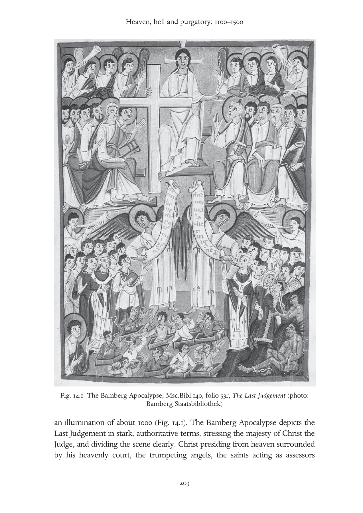
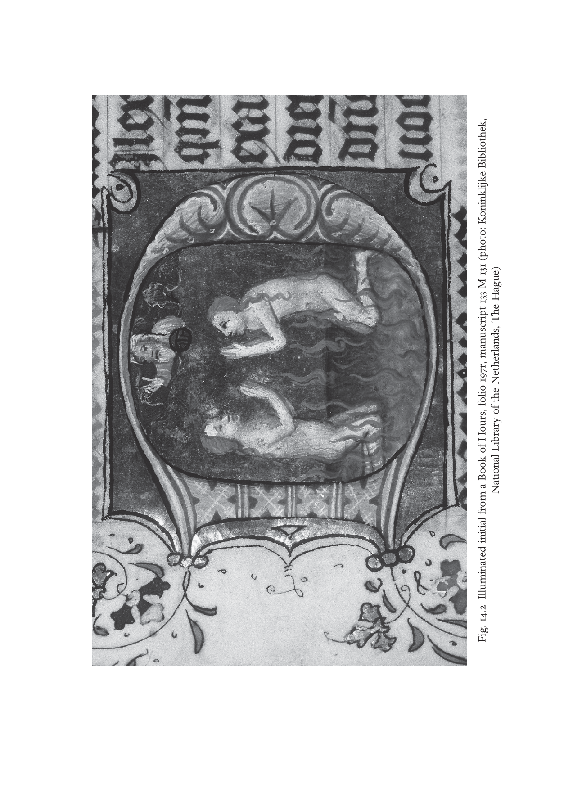

# 天堂、地狱与炼狱（1100—1500年）：英文转换底稿

<!-- PDF page 220; original page 200 -->

### 14

### Heaven, hell and purgatory: 1100–1500*[^p220-star]

### alane.bernstein

This chapter’s story unfolds on many levels: most profoundly, in the individual conscience. Far from existing alone, however, personal feelings about the afterlife fit in a web of societal relationships. Heaven, hell and purgatory certainly involve the dead, but dead souls were not completely absent from earth and continued to haunt their families. As in Roman times, the family included its departed parents and ancestors.[^p220-1] Medieval Europeans expressed clan loyalty through ‘suffrages’, actions dedicated to the dead. Charters recording gifts to churches show donors acted to benefit their own souls and those of their predecessors. Tales relate the visits from purgatory or hell requesting that heirs pay debts or resolve other unfinished business. Revenants also appear from heaven to encourage the pusillanimous. Thus, however pious the language, many charitable actions also comprised a personal interest: a cleansing of conscience, earning of merit, removal of guilt. Gifts to churches were also gifts to ecclesiastics; pious donations created alliances with people influential in the world.

Religious authorities, who were often political powers too, functioned at all levels, from the papacy to the parish, and also shaped personal attitudes towards heaven and hell. Popes and councils intervened with dogmatic definitions and the prosecution of heretics. Theologians articulated reasons for individual doctrinal provisions and offered their conclusions to confessors and preachers in manuals that began to circulate in Latin around 1200, in the vernacular around 1300, and in print around 1450. Public art inside and outside church walls, liturgical drama and guild-sponsored mystery plays involving angels, saints and demons rendered the most potent of religious figures

[^p220-star]: For their helpful suggestions on this chapter, I wish to thank JoAnne Gitlin Bernstein, Paul R. Katz, Miri Rubin and Jeffrey Burton Russell.

[^p220-1]: Charles King, ‘The Organization of Roman Religious Beliefs’, Classical Antiquity 22 (2003), 275–312. Charles King, ‘The Living and the Dead: Ancient Roman Conceptions of the Afterlife’, (PhD dissertation, University of Chicago, 1998).

<!-- PDF page 221; original page 201 -->

familiar to the people. The literature of visions records (often second or third hand, it is true) dialogues between a penitent soul and ‘her’ (the word for soul is feminine in Latin) guardian angel. Sometimes mystics report intimate, physical exchanges with Jesus himself, as, in some cases, he descends from a crucifix to bestow his greeting.

The impression of a top-down, authoritative church commanding assent to centrally defined beliefs is misleading. The religious community, whose hopes and fears and calculations are the subject of this chapter, was not altogether cohesive. Popes were not considered infallible. They could only occasionally enforce doctrinal uniformity against particular heresies or heretics. Political manoeuvring shaped doctrinal definitions. Authoritative pronouncements could spur popular resistance. People saw their faith through a kaleidoscope of popular, pastoral, theological, dogmatically defined ideas and visual images concurrently. It is crucial, therefore, to distinguish the personal, psychological, literary, theological and dogmatic levels of perception and expression.

In the centuries from 1100 to 1500, Christian ideas about the afterlife trace three great developments. The first is the democratisation of conscience. Attention to the conscience filtered ‘down’ from the monastic champions of Late Antiquity and spread to large numbers of ordinary believers in the High Middle Ages, when the systematic examination of conscience became part of penitential discipline for the laity. Second is the increased focus on ‘the interim’, the time between one’s death and the general resurrection and Last Judgement at Christ’s Second Coming. When the interim became the field of action where conscience could be appeased, purgatory emerged. Third, as time passed, in the fourteenth and fifteenth centuries, purgatory, suffrages and issues related to the interim became problematic in their own way. The resultant contest between the claims of a temporary purgatory and the eternity of salvation and damnation produced a new phase in the religious development of Western Europe.

The role of the conscience emerged clearly in Late Antiquity. Jerome (d. 420) had opposed Origen’s denial of an eternal hell on the grounds that he placed it ‘merely’ in the conscience.[^p221-2] Jerome himself, however, confided a dream in which he suffered the fires of hell in his own conscience.[^p221-3] Here, through the conscience, hell invades a living person. Isidore of Seville (d. 636) applied the name tristitia (sadness) to these attacks of conscience. His idea was

[^p221-2]: Epistola 124, ad Avitum, §7; Eusebii Hieronymi Epistulae, ed. Isidorus Hilberg (CSEL 56.1; Vindobonae: Verlag der Österreichischen Akademie der Wissenschaften, 1996), 104.

[^p221-3]: Epistola 22, ad Eustochium §30, CSEL 54, 189–91.

<!-- PDF page 222; original page 202 -->

that the contemplative should attend to tristitia while still alive or it would torment the soul forever in hell. In hell, said Isidore, ‘fire burns the body, but tristitia burns the mind’.[^p222-4] Monastic experience of the Early Middle Ages articulated for Western Europe a link between the conscience of the living and the later pains of hell. I call this foretaste of hell in the living person’s guilty conscience ‘inner death’.

Suffrages – actions, consisting of prayers, alms or masses dedicated to the dead – also pervaded the emotional life of the early Middle Ages. Augustine (d. 430) discussed the subject in his Enchiridion. Prayers for the dead vary in their effect according to how the individual dead person had lived. The very good are beyond the need of prayers; the very bad are beyond their reach. A middle group benefits in one of two ways. The not very good obtain a full release from their sins; the not very bad merely achieve an improved situation (tolerabilior damnatio).[^p222-5] In the hope of this benefit, Christians subsidised prayers for their parents, but also anticipated their own needs. They made donations to monasteries, convents and cathedrals, which, as prebends, became the landed endowments of influential ecclesiastical corporations over centuries.[^p222-6]

Another stabilising influence from the early Middle Ages is an analogy that informs virtually all medieval eschatology. It harkens back to the biblical idea of heaven as a divine kingdom. As political as it is religious, it is the parallel between heavenly and earthly order. In the High Middle Ages, William of Auvergne, theologian and bishop of Paris (d. 1249), used it to argue that there must be a hell, because every well-ordered city has a place to administer justice. The universe is the city of God, and therefore there is a hell, God’s place for executing justice.[^p222-7] Thomas Aquinas (d. 1274) reasoned in the other direction. He advised kings to rule ‘in their kingdoms as the soul in the body and God in the universe’.[^p222-8]

The visual representation of the Last Judgement also provided continuity. The composition that would become standard for half a millennium appears first in

[^p222-4]: Isidorus Hispalensis, Sententiae 1.28.1, ed. P. Cazier (CCSL 111; Turnhout: Brepols, 1998), 86.

[^p222-5]: Alan E. Bernstein, The Formation of Hell: Death and Retribution in Antiquity and the Early Christian Worlds (Ithaca, N.Y.: Cornell University Press, 1993), 322–5.

[^p222-6]: For an overview, see Paul Fouracre, The Age of Charles Martel (Harlow: Longman, 2000), 137–45. A more detailed picture emerges from Ian Wood, ‘Teutsind, Witlaic and the History of Merovingian Precaria’, in Wendy Davis and Paul Fouracre, eds., Property and Power in the Early Middle Ages (Cambridge: Cambridge University Press, 1995), 31–52.

[^p222-7]: Guilielmus Alvernus, Opera Omnia, 2 vols. (Paris, 1674; repr. Frankfurt: Minerva, 1963), De Universo, 665 (= 673) aD–bA.

[^p222-8]: Thomas Aquinas, ‘On Kingship, to the King of Cyprus’, ch. 12., in A. P. d’Entrèves, ed., Aquinas: Selected Political Writings, trans. J. G. Dawson (Oxford: Blackwell, 1959), 66–7.

<!-- PDF page 223; original page 203 -->

Fig. 14.1 The Bamberg Apocalypse, Msc.Bibl.140, folio 53r, The Last Judgement (photo: Bamberg Staatsbibliothek)

an illumination of about 1000 (Fig. 14.1). The Bamberg Apocalypse depicts the Last Judgement in stark, authoritative terms, stressing the majesty of Christ the Judge, and dividing the scene clearly. Christ presiding from heaven surrounded by his heavenly court, the trumpeting angels, the saints acting as assessors

<!-- PDF page 224; original page 204 -->

oversee an earthly scene, where one angel displays to the blessed, on Christ’s right, the welcome scroll ‘Come, blessed of my father [inherit the kingdom prepared for you…]’ (Matt. 25.34) and an opposing angel displays to the damned, on Christ’s left, the unwelcome news ‘Depart from me you accursed, into the [eternal] fire…’ (Matt. 25.41). Beneath the damned opens a view of hell, where a grasping demon drags the wicked to join an enchained Satan.

For all the stability they represent, these two examples of standard religiopolitical expression omit the middle time (the interim), the middle people (Augustine’s not very good and not very bad) and the middle space (purgatory). Despite Augustine’s categories, apprehension about those who are neither great sinners nor great saints elicited visions of people between their individual death and the general resurrection. Visions from those of Fursey and Barontus (seventh and eighth centuries) to Wetti and Charles the Fat (ninth century) show souls removed from their body before death touring the other world. The visionaries were unable to tell the difference between souls suffering eternal punishment and those experiencing temporary purgation.[^p224-9] Sometimes, those torments occur on earth. In a vision of about 1160, Herbert of Torres, in Sardinia, saw a procession of the dead. ‘Some of them were to be liberated sooner, others later, but many of them would endure inescapable punishments.’ He saw a soul, who had spent the nine years since his death expiating his faults in the catch basin of his house, promoted to heaven by angels in a column of light.[^p224-10]  The damned and the soon or not so soon to be saved mingle here on earth, enduring a tedious, crepuscular non-death.

Other texts similarly blend temporary and eternal postmortem suffering. In the Vision of Tundal (1148), his guardian angel conducts a prodigal knight brought near death by a seizure, through the otherworld. Tundal samples physical torments in locales resembling industrial sites, a kitchen, a forge, a grill and mythical places (a monster’s jaws). Tundal must carry a cow similar to one he had earlier stolen across a bridge planted with upturned spikes that pierce his feet. Halfway across, he encounters another guilty soul coming the other way. Tundal laments, but acknowledges his guilt. Immediately he finds himself safely across. Admission of guilt ends punishment. At the pit of hell,

[^p224-9]: For Barontus: J. N. Hillgarth, ed., Christianity and Paganism, 350–750 (Philadelphia: University of Pennsylvania Press, 1986), 195–204. For Fursey, Wetti and Charles the Fat: E. Gardiner, ed., Visions of Heaven and Hell before Dante (New York: Italica Press, 1989), 51–5, 65–79, 129–33.

[^p224-10]: PL 185, col. 1376 C-D, 1376-A: ‘Quidam ex eis citius, quidam tardius liberandi erant, multorumque nihilominus poenae insolubiles permanebant.’ See also Jean-Claude Schmitt, Ghosts in the Middle Ages (Chicago: University of Chicago Press, 1998), 93–121.

<!-- PDF page 225; original page 205 -->

Tundal sees Satan writhing on a grill as he simultaneously eats, defecates and claws the souls of his victims. (In the Très Riches Heures of the Duke of Berry, the Limbourg Brothers have immortalised this image.) Tundal recognises his companions there and renounces these evil associates. The angel praises him and calls him ‘a converted soul’. Tundal has ‘shed his former tristitia and is now filled with joy’.[^p225-11]  Once Tundal has disowned his evil past, his angel shows him where people who were otherwise good but failed to give alms to the poor are punished or rewarded in proportion (per aliquot) to their charity. King Cormac leaves his palace in heaven for punishment fitted to his sexual sins and his perjury, yet the poor whom he had helped in life serve him, in his torments. Tundal’s heaven is a walled city suffused by the harmony of a choir made up of the ‘consortium’ of the saints – a term with important social connotations, as a consortium is a professional association, like a guild or trade group. Concentric walls separate the chaste married, virgins and martyrs. No king is mentioned; in Tundal’s vision heaven is a consortium.

Another text, Saint Patrick’s Purgatory, probably written around 1179–81, relates the experience, dating from about 1151–52, of a knight named Owen. Famous for explicitly naming purgatory as a place, much of this text’s drama nonetheless revolves around the confusion between purgatory and hell. The tale begins with a foundation myth. In order to help convert the Irish, Jesus shows St Patrick a cave containing the terrors of hell and the pleasures of heaven. Jesus does not call it purgatory, but says anyone residing in it overnight earns the total remission of his sins. The story begins when Owen, a remorseful knight, tackling his tristitia,[^p225-12]  desires to undertake an unusually harsh penance by visiting the purgatory of St Patrick. Once inside, demons urge him to turn back or else he will suffer the cave’s torments forever. They seek to convince Owen that the purgatory is really hell. In the 1220s, Caesarius of Heisterbach will declare to his Cistercian novices that angels punish in purgatory, demons in hell, yet in Saint Patrick’s Purgatory, it is the ‘Tartarean ministers’ (referring to the punitive underworld of antiquity) who staff the

[^p225-11]: Visio Tnugdali, ed. A. Wagner (Erlangen: Deichert, 1882), 40: ‘Deposita preterita tristitia anima repleta est gaudio’. Gardiner, Visions of Heaven and Hell, 180–1.

[^p225-12]: A range of textual variants illustrate the twelfth-century idea of late antique tristitia. Here is how three Latin versions and a French translation of the Purgatory of Saint Patrick render the concept. PL 180, col. 989B: ‘miles multum contristatus’ (the knight was greatly saddened). Karl Warnke, ed., Das Buch vom Espurgatoire S. Patrice der Marie de France und seine Quelle (Halle: Niemeyer, 1938; repr., 1976), 38–9 ‘miles graviter indoluit’ (the knight grieved seriously within), ‘intima contritione cordis ingemuit’ (he groaned with an intense contrition of heart), and Marie’s Old French reads ‘Li chevaliers pur ses pechiez / fu mult tristes e esmaiez’ (The knight, because of his sins, / was very sad and fearful).

<!-- PDF page 226; original page 206 -->

torture of the fiery wheel. This text propounds a new reading of hell. Understood correctly, infernal wracking is a catalogue of the punishments one deserves. By voluntarily reviewing, while alive, the punishments one deserves in hell, as monks did by means of their tristitia, this introspection can be purgatorial. Saint Patrick’s Purgatory publicises a place to which the penitent might travel in order to structure their repentance.

This link between penance and the other world entered the nascent universities. What exactly is the connection between the guilty conscience, penitential actions and one’s eventual fate? If penance can earn one’s own remission, what is the status of one’s ancestors? Should one pray for the damned? Peter Lombard (d. 1160), theologian and bishop of Paris, whose textbook of theology, The Sentences, prevailed in the schools until the sixteenth century, approved prayer for the damned. It will not liberate them from punishment, he admitted, but it will diminish their suffering.[^p226-13]  For those to be saved through purgatory, suffrages do not effect a fuller absolution, but only speed its completion – that is, entering heaven sooner.[^p226-14]  These contentions encouraged suffrages and a certain quantification linking suffrages (actions on earth) to results in the afterlife. There was a de facto calibration of death, as a ‘final reckoning’ weighed one’s good deeds against one’s sins. Peter Lombard’s successors, however, rejected his position on prayers for the damned. William of Auxerre (d. 1231) considered suffrages effective only for those ‘in whom are found the foundation and root of merit, namely charity’.[^p226-15] Some theologians, therefore, resisted the temptation to extrapolate from the diminution of punishment in purgatory to a putative relief in hell.

The art of the period also tackled the right disposition of space in the other world. The tympana of important churches presented the composition of the Bamberg Last Judgement. At Conques, gleeful demons torture victims and eagerly await more. At Autun, they tip the scale that weighs souls’ deeds. Along the lintel, resurrected bodies grimace, facing their doom. At Bourges, as on Chartres’ south portal’s Last Judgement, the mouth of hell has moved onto the tympanum proper. Yet, at Notre Dame of Paris, where it has moved beyond the tympanum to the first archivolt, calm prevails. Devils lead the damned away in chains, but overall, a filial respect for the divine King has displaced the servile fear of hell. The audience for the resultant doctrinal

[^p226-13]: Peter Lombard, Sententiae in IV Libris Distinctae 4SN d.46 c.1 n 4 (Grottaferrata: Collegium S. Bonaventurae, 1972), vol. 2, 531, lines 11–12.

[^p226-14]: Peter Lombard, Sententiae, 4SN d. 45 c.4 n. 2; 526, lines 22–3.

[^p226-15]: William of Auxerre, Summa Aurea 4.18.4.1 (Paris: Pigouchet, 1501; repr. 1964), 538.145–9: ‘in quo inveniunt fundamentum meriti et radicem, scilicet caritatem’.

<!-- PDF page 227; original page 207 -->

lessons grew as these images shifted from illuminated manuscript pages to the public spaces facing the exterior portals of churches. Behind these doors, within the ecclesiastical enclosures, cloisters symbolise paradise.

In the thirteenth century, preachers also expanded the audience significantly. The newly founded Franciscan and Dominican orders trained cohorts of preachers in the new universities or in the schools of their orders under the supervision of university graduates. These teams spread throughout Europe preaching in the vernacular. Their sermons highlight biblical passages supporting the conclusions of theology. To appeal expressly to the unlettered, they include modern parables, exempla, drawn from centuries of uplifting literature. Sermon exempla illustrate every aspect of religious life. We learn from Stephen of Bourbon about the flaming tree in hell, rooted in the chest of a businessman, who led his sons into usury. Each generation occupies an additional branch. All their sins weigh on the founder, crushing him against the fiery floor of hell. Monasteries offer another way, given perseverance. Stephen tells of the Cistercian novice unhappy with his cell, which he declares ‘worse than hell’. His deceased mother appears, as a ghost, to counsel him. She offers him a foretaste of hell’s slightest pain, the grunting of pigs; then a sample of heaven’s least blessing, birds chirping. The novice endures in salutary discipline.[^p227-16]

As preachers disseminated these edifying stories from quasi-authoritative collections and preached from model sermon books, church leaders sensed the power of the vernacular and imagined a new ability to disseminate doctrine to the remotest parish. Without ever achieving full standardisation, these innovations nonetheless energised the grass roots greatly. There would be no comparable jump in the dissemination of religious messages until the invention of printing in the fifteenth century. Women, in particular, benefited from this shift as tradition had largely prevented them from learning Latin, and the clergy closed the universities to them. Some nuns like Hildegard of Bingen (d. 1179) or Herrad of Landsberg (Hohenbourg, d. 1195), writing in Latin, to judge from the surviving records, made outstanding contributions in theology, science, music and art despite age-old prejudices. As women helped make literary vehicles of their vernacular languages, some, like Hadewijch of Brabant (thirteenth century), Mechthild of Magdeburg (d. c. 1285), Marguerite

[^p227-16]: For these exempla, see: Alan E. Bernstein, ‘The Invocation of Hell in Thirteenth-Century Paris’, in J. Hankins, J. Monfasani and F. Purnell, Jr, eds., Supplementum Festivum: Studies in Honor of Paul Oskar Kristeller (Medieval and Renaissance Texts and Studies 49; Binghamton, N.Y.: M.R.T.S., 1987), 13–54.

<!-- PDF page 228; original page 208 -->

Porète (executed 1310) and Julian of Norwich (d. 1413), wrote more frequently – and without necessarily being nuns or being supervised by males.

More effective dissemination of other-world doctrines (or, put differently, a more comprehensive clerical response to popular concerns) entailed behavioural consequences. Many laypeople pursued heaven fervently. Because preachers labelled their sermons the Word of God, simply attending them was considered virtuous. Pilgrimage as penance earned indulgences (diminution of punishment owed for sin), and crusading was a form of pilgrimage. Men and women entered monastic houses. Venerating saints brought supernatural advocates. Public and private rituals from the birthplace to the cemetery linked private meaning to public spectacle, political propaganda and then again to collective sensibilities. Churches, then guild associations, sponsored open-air performances dramatising biblical stories. Some sacraments also evolved. Before the twelfth century, penance had usually been voluntary, but in 1215, Pope Innocent III required annual confession to one’s own parish priest. The mendicants popularised this private confession. New forms of religious associations evolved for lay people: the mendicant third orders, confraternities and, mostly for women, beguinages. Rigorous, new observant branches strained the religious orders themselves. From the thirteenth century, founding hospitals spread as a new form of charity. Administered by ecclesiastical institutions, charitable donations of all kinds linked benefits in this world and the next. Indeed, donations to churches profoundly shaped Europe’s economy. So also did taxes levelled by ecclesiastical authorities. The hope for heaven and the fear of hell and purgatory augmented the church’s economic and political influence, both results of its engagement with the population’s view of postmortem punishments and rewards.

Building on their perception of popular involvement, popes used doctrinal definitions in their attempt to standardise the faith. Among their chief concerns was to apportion places, times and destinations in the interim and in eternity. These thirteenth-century declarations intensify supernatural sanctions by initiating reward or punishment at the deathbed rather than postponing them to the Second Coming.

In the creed of 1215, Innocent III declared a judgement according to merit: so that those who have done good ‘will receive eternal glory with Christ’ and those who have done evil ‘will receive eternal punishment with the devil’.[^p228-17]

[^p228-17]: H. Denzinger and A. Schönmetzer, eds., Enchiridion Symbolorum, 34th edn (Barcelona: Herder, 1967), no. 801, 260.

<!-- PDF page 229; original page 209 -->

This explanation implies a weighing of both good and evil deeds, with a greater weight or number of merits winning salvation. There is no reference to the interim or to purgatory.

Innocent IV’s letter Sub catholicae professione of 1254 made repentance the criterion that determines whether, in purgatory, one can expiate one’s ‘venial and minute sins’. In the absence of penance, one pays the eternal price for dying unconfessed, in hell. ‘If anyone should die in mortal sin without penance … he will be tormented forever by the flames of eternal Gehenna.’[^p229-18]  Innocent IV defined purgatory as ‘that transitory fire [by which] are purged small and tiny sins which burden souls even after death, if they have been released [that is, absolved] during one’s lifetime’. In addition to opening up purgatory officially as a destination for the penitent, Innocent IV declared that the souls of those who die ‘in charity immediately cross into the eternal home’.[^p229-19]  In practice, Innocent IV’s specification that purgatory could cleanse only venial sins soon yielded to an older tradition claiming that confession makes even ‘criminal’ or mortal sins venial.[^p229-20]  In 1274, Gregory X omitted the insistence that only venial sins could be expiated in purgatory, but determined that, like purgatory and heaven, hell, too, begins immediately at death.[^p229-21]  Thus collapsing eschatological time emphasises individual action and confession by bringing their consequences closer to the present.

Beneath the level of papal declarations, Parisian theologians worked to articulate a consistent afterlife. Difficulties came from institutional demands such as suffrages and crusading. If these deeds affect one’s postmortem condition, then at what rate? Europe’s leading thinkers strove to avoid the quantification of quid-pro-quo arrangements. It was not always easy. Alexander of Hales (d. 1245) established a scale of offenses (venial sin, mortal sin) and their corresponding punishments (penitential, here on earth, and, in the hereafter, purgatorial and infernal). He reflected on how each might be converted or commuted into the other. He observes: ‘Each punishment is commuted into the punishment corresponding to it.’[^p229-22]  Like it or not, Alexander’s metaphor of exchange, commutation, did not limit, but rather fostered what had become a de facto culture of calibrated death.

[^p229-18]: Ibid., no. 839, 272.

[^p229-19]: Ibid.

[^p229-20]: Decretum. De Pen. d.1 c.88: ‘Fit enim veniale per confessionem quod criminale erat in operatione’, in E. Friedberg, ed., Decretum Magistri Gratiani (Leipzig, 1879; repr. Graz: Akademische Druck und Verlagsanstalt, 1959), vol. I, 1188.

[^p229-21]: Denzinger, Enchiridion, nos. 856–8, 276–7.

[^p229-22]: Alexander of Hales, Glossa in quatuor libros sententiarum Petri Lombardi 4.18.4, IV.q. (Quaracchi, Florence: Collegium S. Bonaventurae, 1957), vol. 4, 324.

<!-- PDF page 230; original page 210 -->

If suffrages can relieve punishments in the other world, can enough of them combine to save even the damned? Medieval biographies of Pope Gregory I relate how the saint interceded to obtain the pagan Emperor Trajan’s removal from hell to a second life on earth, where he could die as a Christian and, by the time of Dante, emerge as a star in heaven, saved.[^p230-23]  Bonaventure (d. 1274) considered the case of Trajan. God could, but does not, save the damned. ‘[After death] it is not only difficult, but even impossible for someone who died in sin to be saved, not because divine power could not accomplish it, but [because] divine justice has reasonably and justly decreed against it’.[^p230-24]  This preservation of divine power, usually not noticed until the fourteenth century, would become more and more important as the distinction between God’s potentia absoluta and potentia ordinata.

Thomas Aquinas (d. 1274) followed William of Auxerre’s position on suffrages for the damned: ‘Charity, which is the bond uniting the members of the church, extends not only to the living, but also to the dead who die in charity.’[^p230-25]  What characterises the souls in purgatory, then, is not the negative (their mediocrity) but the positive (their possession of charity). Having charity, they are open to suffrages. Lacking charity, the damned, in hell, have closed themselves to suffrages.[^p230-26]  This reclassification of the dead, even as it put purgatory on a firmer footing, by no means emptied hell. Rather, it strengthened hell by segregating its inmates absolutely from contact with any others, living or dead. Oblivion receded.

Displaying its propensity for these finely honed categories, theological writing can neglect the insistent, autonomous, popular outlook, but sometimes the people’s mindset emerges. Around 1220, Caesarius of Heisterbach, writing an introductory theological manual for the novices of his monastery, relates a tale from nearby Liège. The bishop denied a Christian widow the right to bury her non-Christian, usurer husband in the church cemetery. The wife won a judicial appeal and moved into a shed next to her husband’s grave, where she prayed for him. After seven years, he appeared to her in half-white half-black clothing, saying, ‘I have been drawn out of the depth of hell and from the greatest punishments. And if you devote similar good deeds to me

[^p230-23]: E. Gordon Whatley, ‘The Uses of Hagiography: The Legend of Pope Gregory and the Emperor Trajan in the Middle Ages’, Viator 15 (1984), 25–63.

[^p230-24]: Bonaventure, Commentaria in Quatuor Libros Sententiarum, 4 d.20 p. 1 a.1 post q.6; dubium 3 (Quaracchi: Collegium S. Bonaventurae, 1889), 527b–8a.

[^p230-25]: P. Caramello, ed., Summa Theologiae, Tertia Pars, Supplementum, Q.71 a.2 (Turin, Rome: Marietti, 1956), vol. 3, 254b.

[^p230-26]: Thomas Aquinas, Supplementum a. 5; 258a.

<!-- PDF page 231; original page 211 -->

for seven more years, I shall be wholly liberated.’ The wife complied and, after seven years, her husband appeared in glowing white, thanked her, and declared himself ‘liberated’. Caesarius classifies this story under the heading of purgatory, not hell, because, he says, no one can be redeemed from hell. He conjectures an unstated, last-minute contrition.[^p231-27]  Caesarius’ effort to explain away the obvious theological problem (a wife praying a sinner out of hell) in the popular tale circulating in his neighbourhood indicates some contradiction between learned and popular culture. It is an error to assume a uniform theological consistency throughout the whole social fabric. Caesarius’ ‘correction’ notwithstanding, the tripartite structure of this tale suggests that some people believed it possible for one person to pray another out of hell, then out of purgatory and finally into heaven.

Give-and-take on eschatological matters could occur at the highest level, too, as in 1331–32, when Pope John XXII declared that the Beatific Vision, that is the heavenly reward consisting in the direct vision of God, cannot be attained until the body reunites with the soul at the general resurrection. Similarly, the damned, whether humans or demons, do not go to hell until after the Last Judgement for the same reason. His declarations threatened to reverse the trends of the previous century, which had moved the decisive moment up to the individual’s death. Faced with immense popular, political and even royal objections, he retracted his opinion on his deathbed. His successor, Benedict XII, restored the momentum towards the immediacy, for those appropriately deserving, of the two final fates: heaven and hell.[^p231-28]

Much as theologians shifted rhetorical levels in moving from the university lectern to the preacher’s pulpit, or a fresco painter represented ineffable mysteries on church walls, so Dante’s Divine Comedy addresses both the learned and popular sides of the religious community. Besides being a magisterial exposition of Catholic theology, Dante’s masterpiece is a human love story and an occasion for political invective. Writing in Italian verse, the poet recounted his fictional vision to trace the road to God.[^p231-29]  By the stages of his pilgrimage, Dante embraced the calibration of death. All is measured. In hell,

[^p231-27]: Caesarius of Heisterbach, The Dialogue on Miracles, 12.24, trans. H. von E. Scott and C. C. Swinton Bland, 2 vols. (London: Routledge, 1929), vol. 2, 313–14.

[^p231-28]: Denzinger, Enchiridion, nos. 1000–1, 296–7.

[^p231-29]: Aron Gurevich outlines a convergence of popular and learned patterns of thought in ‘The “Divine Comedy” before Dante’, in J. M. Bak and P. A. Hollingworth, trans., Medieval Popular Culture: Problems of Belief and Perception (Cambridge: Cambridge University Press, 1988), 104–52.

<!-- PDF page 232; original page 212 -->

immersion measures guilt; in heaven, the intensity of one’s vision of God measures grace.

> e del vedere è misura mercede, Seeing measures their reward (Par. 28.112).

For him, this measuring explains divine justice.

Yet Dante also doubts these rational devices. In heaven, St Peter asks him to define his faith. Hearing the Florentine exile employ the scholastic terms ‘syllogism’ and ‘quiddity’, Peter challenges: ‘Why do you take these propositions that close your mind to be the divine spark?’ (Par. 24.98–9). When Dante calls the Three Persons and the Gospel the burning flame within him, his answer gladdens Peter.

Fire is indeed the organising metaphor of the Divine Comedy.

> catun si fascia di quel ch’elli è inceso. Each one swathes himself in that which makes him burn. (Inf. 26.48)

To burn (ardere) in hell causes eternal torment, in purgatory purification, in Paradise eternal light and love. With this love we are all, potentially, ‘inflamed’ (incesi). Thus, ardour itself, whether human obsession, cleansing fire or divine love, pervades the universe. God’s return of human love will quench the fire that excites the seekers of heaven. Dante’s fictional vision implicitly challenges the inscription on the Gate of Hell. One should not abandon hope, but ‘enter’ hell while alive, thus, like Owen, confront tristitia and review one’s faults, cultivate faith, pursue love.

In the Paradiso, Peter had not questioned only Dante’s faith. In their conversation, the first pope deplored Europe’s spiritual decline. Religious authorities, he said, abuse their office for personal profit, theologians vaunt superfluous distinctions, preachers chatter, hawkers of false indulgences take debased coin from the credulous who buy counterfeit promises (Par. 29). In the generation after Dante, Francis Petrarch (d. 1374) criticised academics for knowing how to define virtue but not how to love or practise it. The concession Bonaventure granted – that God could save the damned if he chose, but did not – blossomed, among the nominalists, into an effort to bypass the bureaucratic image of a predictable God (confined to his potentia ordinata) and remembering the traditional emphasis (in Pseudo-Dionysus, for example) that he is beyond knowing (and therefore free to employ his potentia absoluta). Had the rationalisation (and, on an institutional level, the quantification) of faith gone too far?

<!-- PDF page 233; original page 213 -->

Some attempted to restore a qualitative focus using mathematical ideas and imagery. Dante’s contemporary, the Spiritual Franciscan Ubertinus de Casale (writing in 1305) saw humble self-abasement, the voluntary adoption of spiritual poverty, as a precondition to salvation through his literal interpretation of Matt. 25.40. Ubertinus demanded the soul’s conjunction with Jesus through identification with ‘the least’ of Christ’s brethren. This transformation, making the faithful into ‘little Jesuses’ (jesunculi), achieved a state of ‘minimacy’ (minimitas) that, alone, is saving.[^p233-30]  The contrast and, mystically, the correspondence of the minimum and the maximum informed the studies of Nicholas of Cusa (d. 1464), who explored the coincidence of opposites, thus developing the mathematical idea of infinity as another way to God.

Intense institutional pressures remained. Indulgences for crusade, pilgrimage, attending special events like the Jubilee which Boniface VIII proclaimed in 1300, donations of all sizes; the quid-pro-quo approach to expiation elicited various means of ‘measuring’ progress through repentance. The quantification of Alexander of Hales’ commutations worked its way into popular and institutional practices that outran his sense of the relationship between penitential discipline and the afterlife. Endowing private masses in chantries or at altars in the chapels of side aisles, these broke down the greater tasks of endowing cathedrals and providing prebends, work of the early Middle Ages, into smaller units – each one with corresponding expected credits, whether before or after death.[^p233-31]  Note that authorities denied that these actions remitted guilt, only the resultant punishment. Yet the distinction was lost on a population anxious about the pains of hell and purgatory. In 1477, Sixtus IV asserted the ability, as pope, to distribute the collective merits ‘of Christ and the saints’, which he called ‘a treasury’ on behalf of those in purgatory, in need of suffrages.[^p233-32]  Relief from purgatorial punishment seemed ever more accessible, sometimes, as in the case that provoked this declaration, in return for a cash donation to construct a church.

Scholars like William of Ockham at Oxford (d. 1349) had long objected that these theologies restrict the power of God to the inferences humans can derive from Scripture. In fact, his followers, the nominalists, insisted God’s power is absolute; it is certainly not limited by human reason. Invocation of God’s potentia absoluta (divine power seen as absolute, unbound) over his potentia

[^p233-30]: Arbor Vitae Crucifixae Jesu (Venice: Andreas de Bonettis of Pavia, 1485; repr. with an introduction and bibliography by Charles T. Davis, Turin: Bottega d’Erasmo, 1961), 490b.

[^p233-31]: R. W. Southern, ‘Between Heaven and Hell’, Times Literary Supplement 4133 (18 June 1982), 651–2.

[^p233-32]: Denzinger, Enchiridion, no. 1406, 349.

<!-- PDF page 234; original page 214 -->

ordinata (divine power limited to what God has revealed) challenged the notions of purgatory, suffrages and indulgences. Critics believed they carried quantification – and human confidence in extrapolation – too far. In 1479, an ecclesiastical court in Mainz forced John of Wesel to retract a treatise he had written against indulgences. Wesel contended that the right to distribute these merits of Christ and the saints could only exist if Christ had made such an agreement with his apostles, but that the Bible reveals nothing of the kind.[^p234-33] Though Wesel recanted, his invocation of Scripture to challenge the quantification of merit did not disappear. Scripture, indeed, was to be the rallying cry for the Protestant challenge to these Catholic practices. To heaven, too, the Protestants would bring their levelling eye, de-emphasising ranks and hierarchy, abolishing the cult of saints, for example.

Meanwhile, whatever objections they aroused among theologians, actions to gain postmortem advantage intensified. The attention to conscience, heightened since the requirement of annual confession in 1215, affected personal piety. There was a corresponding democratisation of artistic objects. The monumental compositions of Romanesque and Gothic church facades, uniting heaven and hell at the Last Judgement, proliferated, as in the ceiling of the Florence Baptistery (late thirteenth century). Yet private patronage could personalise them, as in Giotto’s Arena chapel in Padua (1305). Smaller altarpieces also appeared in the private chapels of wealthy families. Many of these scenes, too, combined the whole perspective from heaven to hell in a diptych or even a single image. This retailing of art, that is, making objects smaller and less expensive, advanced remarkably with the introduction of printed woodcuts in the early fifteenth century. Presses could reproduce pious images on a single sheet of paper. Communication of religious messages no longer depended on public spaces to reach large numbers. This concentration of audience achieved a particular intimacy in what were called ‘books of hours’, prayer books of slight dimensions, illuminated to enhance meditation, as text and image united in the laps of private owners.

As the core series of prayers for the book of hours is the Office of the Virgin, many of their illustrations depict heaven in recounting scenes from her story, such as the Coronation and Assumption. Yet heaven never lacked as the setting for the many dramas in the Apocalypse (the woman dressed in the sun, the adoration of the lamb, Christ’s appearance with a sword in his mouth, the battle with the dragon, the fall of the rebel angels, the heavenly Jerusalem, the Last Judgement).

[^p234-33]: Cited by Heiko A. Oberman, ‘Luther and the Via Moderna: The Philosophical Backdrop of the Reformation Breakthrough’, Journal of Ecclesiastical History 54 (2003), 641–70 at 661.

<!-- PDF page 235; original page unnumbered -->

Fig. 14.2 Illuminated initial from a Book of Hours, folio 197r, manuscript 133 M 131 (photo: Koninklijke Bibliothek, National Library of the Netherlands, The Hague)

<!-- PDF page 236; original page 216 -->

Heaven also appears as the place from which Providence oversees the earth. The hand of God or diving angels warn, inspire, protect, expel their human charges. Angels make music or dance as in the Portinari chapel in Milan or in Fra Angelico’s ‘Christ Glorified in the Court of Heaven’ at London’s National Gallery. Heaven is the seat of the royal court for the Last Judgement. It is also where Christ hears Mary’s intercessions (her appeals to Jesus on behalf of those who pray for her help). With the rise of interest in science in the twelfth century, heaven appears as the scene of creation. God the geometer designs the earth. Heaven frames the zodiac. Secularised, heaven may be the lover’s enclosure in the Romance of the Rose or the Cluny museum’s unicorn tapestry. It appears in medieval theatre at stage left, whereas the mouth of hell is to the right.

Purgatory makes its appearance in art during the fourteenth century,[^p236-34]  but later, two particularly majestic representations occur with the coronation of the Virgin by the Trinity of Enguerrand Quarton at Villeneuve-les-Avignon (1454) and by Jean Colombe (c. 1480) in the Très Riches Heures of the Duke of Berry. Important quantitative evidence for the widespread acceptance of the doctrine includes the appearances in illuminated initials in books of hours showing two facing souls, kneeling in prayer in purgatorial flames.[^p236-35]

The new ability, associated with Renaissance art, to render human bodies in flesh-tones and with naturalistic anatomy makes the eschatological scenes of Signorelli in Orvieto and the early Netherlandish artists Rogier van der Weyden, Hans Memling, Dierk Bouts and Jan van Eyck breathtakingly immediate. A generation later, Hieronymus Bosch set seemingly absurd figures in scenes resembling heaven and hell as symbols of the guilt and fantasy of inner death. These images accentuate dread and fear, hope and longing. These are the inner realities Martin Luther evoked in his ninety-five theses attacking indulgences in 1517. The fulcrum of his critique is contrition, the personal relationship between the sinner and God, where remorse is separate from any priestly function. Only God governs one’s soul. Donated coins, pilgrimages accomplished, battles waged avail nothing. This focus on the inner person had its Catholic sympathisers, too. Michelangelo’s Last Judgement in the Sistine Chapel (1536–41) shows as much fright and hope as awe – strong indications that, for him, psychological realities dominate on Doomsday.

[^p236-34]: See Joseph Polzer, ‘Andrea di Bonaiuto’s Via Veritatis and Dominican Thought in Late Medieval Italy’, Art Bulletin 77 (1995), 262–89; Michelle Fournié, ‘La représentation de l’au-delà et le purgatoire à Saint-Just de Narbonne’, in Le grand retable de Narbonne (Narbonne: Ville de Narbonne, 1990), 45–55.

[^p236-35]: For example, see The Hague, KB, 133 M 131, fol. 197r by the Master of Zweder van Culemborg (Fig. 14.2).
