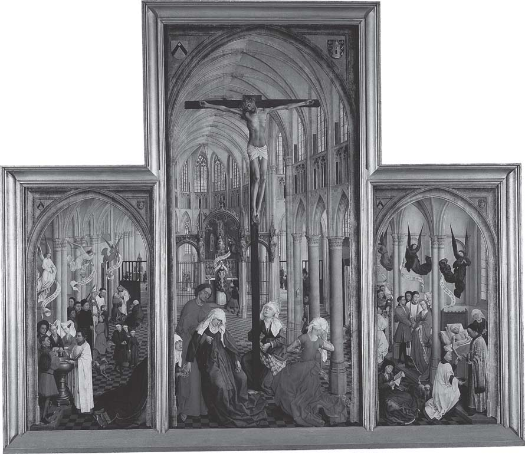

# 第15章 圣事生活

米里·鲁宾（Miri Rubin）

<!-- PDF page 239; original page 219 -->

1445至1450年间某时，佛兰德画家罗吉尔·范·德·魏登（1400年生于图尔奈，1464年卒于布鲁塞尔），在三块橡木板作画，后来称为《七圣事祭坛画》。[^p239-1] 他曾在1450年禧年赴罗马朝圣，此后作品——包括此画——显示新获得的活力与色彩。罗马之行，也可能激发画中明显的心态：他提供一部“大全”，视觉地总结基督徒生活，视为从摇篮到坟墓的圣事旅程。这一愿景，十二世纪起由教宗构想推动，到其时代已成基督徒生活基本框架。

圣事历史当然更早。二世纪德尔图良（约160—约225年），已尝试用罗马法律术语sacramentum——誓言——描述宗教委身。[^p239-2] 他又发展其含义，指“象征、预象、寓意、象征性德能或力量、象征性秩序或人物”。[^p239-3] 圣事是表明委身，或表示重大事件的举动、实践。[^p239-4] 讨论的下一个<!-- PDF page 240; original page 220 -->重要阶段，一如常见，是希波的奥古斯丁（354—430年）处理。

图15.1 罗吉尔·范·德·魏登《七圣事》三联画，安特卫普皇家美术馆。

奥古斯丁全面构想基督教社会与政治共同体，也就是亲见罗马帝国各地正在发生的过程，探讨圣事性质。人们通过这些仪式成为基督徒，并以个人、群体方式，过基督徒生活。若这种生活以希望得救为前提，救恩来自基督牺牲带入世界的救赎恩典，圣事就是恩典流向个人的管道。首先洗礼除原罪，此后终身，恩典支持基督徒生活的努力。

圣事使恩典不可见、奥秘的运作，可触可见。作为可见记号，总经水、油、饼等物质媒介运作。奥古斯丁承认，<!-- PDF page 241; original page 221 -->有些人也能以其他方式圣化、蒙恩典触及，但多数信徒，圣事绝对必要。任希波主教，他面对多纳图斯派倾向，主张唯纯洁司祭主持，圣事才有效。他拒绝此立场，帝国也以异端迫害。其关于圣事与施行者的立场，最适应所处大量改宗的动荡时期：若异教徒不能相信新基督徒生活核心的洗礼、圣餐，确实有效、因而能救人，又如何被吸引？

圣事不只是使人加入、建立维持基督徒生活的仪式，也是承继链条的环节，重演不断发展、处在历史中的教会基本结构。从基督生平，经创立教会的使徒，再经彼得继承人罗马教宗，形成圣事行动链。奥古斯丁的理解，因而连着教会愿景：教会如建筑，容纳基督自身生活所发的恩典遗产，以及教导榜样传承。因此圣事讨论，总涉及教士地位、权能、独特特权。此外，其物质层面——诉诸感官经验——也抵御基督教内部一种倾向：以二元论拒绝物质进入基督徒生活。奥古斯丁自己，也曾长期受其吸引。

讨论本期西欧圣事生活，须记住这早期基督教遗产。中世纪早期，较少讨论圣事理论，尽管个别圣事获关注阐发。[^p241-5] 最显著的重新探讨，发生十二世纪神学与牧灵供给中心：巴黎诸学校。奥古斯丁传统的学者圣维克多的雨果（1096—1141年），在圣事论著中，区分历史各阶段的圣事类型：

<!-- PDF page 242; original page 222 -->

自然法之下、成文律法之下、恩典之下。他也细化圣事外在面貌与内在运作的关系：

> 圣事是身体性或物质性要素，外在地呈于感官；凭相似性表现，凭其设立而表意，凭圣化而蕴含某种不可见的属灵恩典。[^p242-6]

新兴圣事神学及其牧灵应用，将更重视外在呈现。

雨果重思圣事，影响其学生、伟大体系化者彼得·伦巴德。转向这部极重要神学评注——彼得（卒于1160年）的《命题集》——可见奥古斯丁用语重新表述：

> 严格说，所谓圣事，是上帝恩典的记号、不可见恩典的形态，既承载该恩典的形象，也构成其原因。[^p242-7]

与旧律仪式不同，基督教圣事不只象征，也赐予恩典（haec conferunt gratiam）。[^p242-8] 彼得也确定其数。奥古斯丁已区分不同类型，他则明确数量，不是某些人主张的三、四、十二，[^p242-9] 而是七：洗礼、坚振礼、圣秩礼、婚姻、告解、圣餐、临终傅油。[^p242-10]

<!-- PDF page 243; original page 223 -->

范·德·魏登画中，圣事是社会事件，呈现家庭庆典所有多样与活力。构图巧传根本意义：最前方、每个及全部圣事场景之上，是钉十字架，一切恩典与得救希望之源。基督身体高悬，地面约翰、玛利亚、圣洁妇女哀悼。同一轴线，教堂深处东端，有祭坛，举行祭坛圣事。司祭正举扬圣体：饼酒刚祝圣，经实体转变，成为基督身体与血；其祭披有十字架，背面朝观者。中央画板唤起历史空间，及其通过首要圣事圣餐，在祭坛重现。司祭背后，一平信徒跪着，是否在等待领圣餐以参与？

两侧各含三圣事，左下从洗礼开始，右下以死亡结束。三位鲜艳天使，悬于这一画板的圣事场景上。受洗为婴儿，远不同于奥古斯丁面对的大量成人受洗；婴孩浸入洗礼池，教父母围绕。洗礼使其加入基督徒共同体，也标志成年人的承诺：生父母、洗礼父母，都答应引导孩子过基督徒生活。当然，这是严肃委身，不只因希望得救，也希望孩子渡过婴儿期危险，长大成人。[^p243-11] 池边时刻充满意义，洗礼池因而常雕信仰概要，表示到场者答应予以保障，并不奇怪。中世纪晚期东盎格利亚，洗礼池多八角形，八面展示七圣事，及其传递恩典所源的钉十字架。[^p243-12]

父母极怕孩子未洗即死；教会放宽条件，若无司祭，任何平信徒均可念施洗程式。接生婆常在体弱新生儿降生时在场，因此<!-- PDF page 244; original page 224 -->一些教区会考核她们是否知道施洗程式。暴力威胁下强迫犹太人、穆斯林受洗，挑战圣事应自由领受的理解。施洗较易，区别于多数圣事。梅斯主教贝特拉姆，1206年致信英诺森三世，问一犹太人“临近死亡，在只有其他犹太人在场时，亲念施洗程式，自投水中”的情况。[^p244-13] 教宗要求，按适当方式重洗。

接着坚振礼，给青少年步入考验重重的青春期、性觉醒之初，额外增添恩典。父母旁观，主教施礼。受坚振孩子属于一群同处童年成年门槛的年轻人。这也是初领圣餐年龄；被认为能理解复杂真理者，已准备领受。

坚振后，年轻人被视为对行为负责，能作道德选择，需要告解引导、抚慰，即画左下一圣事。早期教会，告解为公开仪式；十五世纪较私密，虽告解亭要到反宗教改革才引入公教实践。司祭提问引导，又借助《悔罪书》指南；这种手册，十二世纪晚期大量出现。[^p244-14] 告解经探索性追问促成，使人自知、真正面对罪。司祭受教辨别诸种犯罪情境，以头韵问题提示：何地？何时？如何？与谁？多少次？因此，越轨置于完整背景，分配适当补赎更细致。补赎可为不同严厉程度斋戒、施舍、朝圣近处乃至极远圣地。康布雷主教1260年教区会议法规，要求劝告解者探访“教区母堂，康布雷主教座堂”，并附<!-- PDF page 245; original page 225 -->大赦作奖赏。[^p245-15] 告解周围发展责任伦理：所听任何事均须保密，不可透露，甚至暗示。司祭身份增添全新层面，如康布雷主教拉昂的吉亚尔（1238—1248年在任）法规：

> 任何司祭不得因愤怒、仇恨，甚至怕死，用手势或言语，笼统或具体暗示，泄露告解者任何告明事项；例如说：“我知道你是什么样的人。”若泄露，应毫不宽恕地褫夺〔司祭身份〕。[^p245-16]

告解、痛悔、回心转意、离罪后，基督徒可领圣餐。事实上，第四次拉特朗会议（1215年）及各国后续规定，向基督徒提供并要求的整套圣事安排，重点就是把二者结合为庄严、有意义的年度事件。平信徒，这已足够：

> 所有男女信徒，达到明辨年龄后，应各自诚实地向本堂司祭，至少每年一次告明全部罪过，并尽力完成所命补赎，至少复活节敬领圣餐圣事；除非按本堂司祭建议，因合理理由，认为应暂不领受。否则，生前应禁止进入教堂，死时不得以基督徒礼安葬。[^p245-17]

中央画板，画等待领受者。从洗礼，经教导、坚振、告解引发的交流，塑造基督徒的一切，都应使其准备<!-- PDF page 246; original page 226 -->领受司祭在祭坛制成的基督肉与血。圣餐在画中居中，反映当时讨论辩论的地位。多数指南，及所有教导平信徒的劝善故事集，关于祭坛圣事，均有尤其长的部分。[^p246-18] 圣餐蕴含诸多根本真理，正确理解，应使人积极、甘愿相信其他圣事运作。此外，至1200年，圣餐神学已成考验重重的理论大厦，拱心石是相信实体转变；术语创于十二世纪八十年代，即司祭用最后晚餐基督话语（《马太福音》26:26—28）祝圣，使祭坛饼酒变为基督肉血。第四次拉特朗会议第一条，规定必须相信实体转变，即祭坛圣事中这一特定形式的基督临在，且不接受其他形式，作为信仰要求。

右侧画板，三圣事并非人人经历，也非得救绝对必要。先圣秩礼，少数选择司祭圣召者特权。准入严限：只限男性，法律身份自由、婚生、身体无瑕、达适龄、独身。为招司祭，教会法提供若干途径，让不全符合者申请特许，由主教酌决。受秩为长程终点：年轻人男孩时先领剪发礼，后可逐级取得低级圣职，在司祭旁辅助，包括辅祭（acolyta）、读经员（lector）、协助驱魔者（exorcista）、提圣水者（aquabaiulus）。二十五岁进入较高圣职，可达受秩顶峰：先副执事（subdiaconus），再执事（diaconus），终司祭（presbiter）。司祭以下各级教士，虽均可协助举行，甚至施行某些圣事，祭坛圣事却只限司祭主持。

圣秩某种意义是婚姻，与基督结婚。画中受秩者跪着，穿白衣，如新娘。受秩赋许多特权：须预先确保圣俸及适当收入的证明；一旦受秩，便享有<!-- PDF page 247; original page 227 -->教导、领导权威，只对教会法庭及法律负责。不论品格可疑、学识浅薄、身体衰弱或不善言辞，受秩者仍是有效圣事施行者：每年每日在祭坛制成基督身体，圣诞节两次。

施圣事是司祭特权，体现教会释放、捆绑，管理恩典宝库，提供独一、唯一救恩途径的权能。十一世纪起，教会推动、争取自由，即libertas ecclesiae。[^p247-19] 每个政治共同体中，这自由均须经与世俗统治者斗争取得，但斗争也是内部：教会若主张自由特权，成员就须承担独身考验，举止庄重。传递恩典、教导信仰的专有权，以个人牺牲、努力为代价，司祭自应表现适当。十二世纪诺曼底库唐斯教区主教提醒：

> 我们劝你们，不论在外、家中或拜访堂区居民，剪发、衣着均保持适当仪表……衣服应系好，不可过长过短而惹眼，否则像弓箭手或竞技斗士。[^p247-20]

如圣秩，婚姻并非人人领受，但多数如此，帮助把社会组织为基督徒养育、劳动、互助单位。婚姻是教会与世俗政权持续争执领域，双方均制定规则。作为传递财产地位的制度，它嵌于极古老地方传统：影响南欧婚俗的罗马法，至塑造德国、法国北部、英格兰、斯堪的纳维亚婚俗的日耳曼法典。至1100年，教会已发展婚姻神学，界定配偶间允许、禁止的血亲程度，视婚姻为个人自由所作道德选择。[^p247-21] 这观念，<!-- PDF page 248; original page 228 -->正面冲撞父权社会家庭习俗；在那里，婚姻由家长撮合，决定儿女未来。

基督教婚姻发展漫长；教会对性的态度，有时互相矛盾，更添复杂。[^p248-22] 奥古斯丁再次是奠基思想家的好例子：从厌恶欲念——青年时曾强烈体验——转向接受婚姻，作为约束性生活、养育基督徒后代的框架。[^p248-23] 十二世纪密集讨论，提出突破性法律表述，尤其婚姻如何成立。若为圣事，就必须出于自由道德行为。婚姻具有相互性，对应理想中所有灵魂、一切受造物的平等；这种平等，实践常被否认扭曲。

圣事婚姻赋男女在缔结中同等分量。十二世纪神学愈强调，应按背后使行为发生的意图判断；因此，表达结婚意图，也被视为有约束力。[^p248-24] 教会法因而承认，两人缔结的婚姻，即使无证人、无公开仪式。同时，教会也提供庄严结婚的圣事场合，鼓励使用。数世纪间，且延续中世纪之后，教堂仪式，渐成家庭共同体古老婚庆必要部分。[^p248-25] 婚姻既为圣事，就不可解散；注意《祭坛画》司祭以领带捆连夫妇。但若有理由，使婚姻选择背后的“自由”无效，亦可宣告无效或解除。中世纪晚期教会法庭，大量业务是婚姻诉讼。婚姻成为圣事，创造许多复杂<!-- PDF page 249; original page 229 -->挑战，也把社会生活基本形式，与教会礼仪、行政服务相连。婚姻、爱情、性，牵动但丁、乔叟、克里斯蒂娜·德·皮桑等所有伟大诗人艺术家，也牵动较次要者。[^p249-26]

圣事标记生命周期，为人生过渡礼提供仪式框架。[^p249-27] 最大过渡，当然从今世至来世。临终傅油，即临终圣事，旨在给将踏上最可怕旅程的基督徒，最后增添恩典。死亡吸引诸多仪式：十二世纪，向病床、临终床榻送祝圣圣体，成为广泛且受规范的仪式。[^p249-28] 第四次拉特朗会议，要求医师劝病人及时请司祭领圣事。[^p249-29] 对临终者的牧灵服务，也常与立遗嘱相连。[^p249-30] 祭坛圣事融入对亡者处置：葬礼含安魂弥撒；为炼狱灵魂的弥撒，成为生者减轻亡亲痛苦、为未来减轻自身折磨而预作安排的主要方式。教士在堂区，通过圣事引导人生趋向救恩的基督教欧洲愿景，十二、十三世纪渐成现实，普遍制度最终在第四次拉特朗会议宣布。如前所见，信仰立足圣事生活，也由此检验。[^p249-31]

<!-- PDF page 250; original page 230 -->

会议法令指导、加强主教显然已在教区实施的举措。[^p250-32] 欧洲各地，教区、教省会议发布大量法规，使圣事制度真实可感。服务形态不只取决神学辩论、会议法令，还取决不断向教士传播、解释相关观念实践。几位神学家着手写概要手册，甚至形成“圣事大全”（summae de sacramentis）整个文类，帮助教士受教、工作、传播知识、施行圣事。十三世纪也发展其他工具：堂区教学手册，用于教导平信徒。

教士与修道人，一方，平信徒，另一方，经长期连续教导与共处，使圣事理解渗入平信徒生活世界。司祭专业手册之外，也创作、汇编叙事世界，故事力求使基督徒信服圣事及其权能的效力、必要、独特。例证是简短说明故事，讲道者插入讲章，或教导时作劝诫，常涉及圣事。某些题目，可能最困惑、最考验信徒，似乎激发最多故事：实体转变、告解补赎、婚誓力量、追思亡者弥撒的效力。

熙笃修士海斯特巴赫的凯撒里乌斯（1170—1240年），汇编劝善奇迹集，中世纪晚期广用、抄写、翻译。以资深修士与初学者对话编排，教化力量鲜明。例如，一教士杀银匠，又牵连姊妹藏罪，两人被捕，判死。押赴刑场，姊妹劝他告解，他绝望答：“我不做；如此晚告解，对我有何用？”她请来司祭，真心痛悔告解。两人被绑桩，燃料堆围绕，

<!-- PDF page 251; original page 231 -->

> 告解的奇妙力量！救主的奇妙慈悲！火焰立刻吞噬绝望教士，却不碰、不伤女孩，也不给她任何痛苦；只烧断锁链。

法官目睹奇迹，决定释放。[^p251-33]

这些故事汇编后，十三世纪起译为俗语。方济各、多明我托钵修士，在欧洲各城镇讲道使用。有叙事，往往随之视觉表现。奥尔维耶托主教座堂圣事小堂，存座堂圣物，便饰以圣餐奇迹故事。[^p251-34]

俗语专门文本，先给较有特权者，后也教更广受众。约1250年，让·德·茹安维尔，随路易九世十字军出征前，写圣事论著，最重要的洗礼、圣餐配插图。[^p251-35] 身兼多职的本堂司祭，也获专门工作手册，填知识空缺，提供指南，回应圣事必然引发的诸问题。十三世纪晚期，普遍同意，司祭教老幼的核心，是七圣事。[^p251-36] 坎特伯雷总主教佩卡姆制定课程，1281年传全教省，给简要教学提纲：信仰条款、十诫、六项慈悲善工、七恶与七德、七圣事。

> Septem etiam sunt gratie sacramenta, quorum dispensatores sunt prelati ecclesie; quorum quinque ab omnibus debent recipi christianis: utpote baptismus, confirmatio, penitentia, eukaristia suo tempore, et extrema unctio, que tantum illis dari debet qui gravis infirmitatis indiciis videntur mortis appropinquare periculo… Sunt et duo alia sacramenta, ordo et matrimonium.[^p251-37]

<!-- PDF page 252; original page 232 -->

> 恩典圣事有七，由教会神职长上施行；五项应由所有基督徒领受：洗礼、坚振、悔罪、适时圣餐、临终傅油。傅油只给因重病征象，看来将面临死亡危险者……还有两项圣事：圣秩、婚姻。

中世纪晚期，这制度大体未变，反复强调加强；近期基督教化地区，如伊比利亚、波美拉尼亚、立陶宛部分教区，以及十五世纪非洲西北部，更热心推广。圣事既如此根本，特定时刻也重新颁布。1274年第二次里昂会议，拜占庭皇帝米海尔·巴列奥略，以此程式改奉公教：

> 同一神圣罗马教会，也坚持、教导，教会有七圣事：其一，前述洗礼；其二，坚振，主教为重生者傅油，同时覆手；再悔罪、圣餐、圣秩、婚姻、临终傅油，按真福雅各教义〔《雅各书》5:14—15〕，施于病人。同一罗马教会以无酵饼举行圣餐；坚持、教导，圣事中，饼真实地实体转变为我主耶稣基督身体，酒转为其血。婚姻方面，她坚持，男人不可同时有数妻，女人不可同时有数夫。[^p252-38]

此处圣餐特别详述，因希腊教会对此仪式的理解、施行，很不相同。同样，十五世纪东方教会与罗马合一的尝试，产生其他圣事制度声明。1439年佛罗伦萨会议，向亚美尼亚人公布各圣事性质，方便确实随后实现的合一。迄今已追踪，圣事制度发展，与整个基督教世界堂区、教区网络铺设并进，确保每个基督徒归属圣事单位。只要司祭按正确形式举行，圣事即有效，但审查<!-- PDF page 253; original page 233 -->领受者，也属圣事交流。已提悔罪领圣餐相连，另有前提。给嘲弄根本信仰者圣事抚慰，可能破坏信仰与信赖圣事的平衡，因此第四次拉特朗会议要求，司祭查问涉嫌异端者，未补过，则禁止参与。[^p253-39] 列日1287年教区会议，更将违背劳动合作社会规范者，隔离于共融，即绝罚：侵入夺取公地、沼泽、森林者，每主日谴责，视同普通窃贼，因为窃取公共利益。[^p253-40]

救恩圣事之网，因此铺于基督教大陆，网住所有出身基督徒家庭者与改宗者；即使否认拒绝，仍受其掌握。但欧洲人常流动，远离原乡村镇，需求挑战制度。朝圣者可免本堂参与义务；士兵由领主司祭照顾；王室、贵族宫廷，在奢华小堂提供私礼；修道院构成自主圣事单位。旅途商人，是另一脆弱群体。与另一商人共同体长期联系者，常在遗嘱也留赠产，说明首选葬地。教会法持续处理两难：堂区居民实际常流动，却仍被视为紧密、亲近的堂区群体成员。

负责照顾基督教欧洲圣事大厦者，不断被提醒，存在移动、变化、怀疑、失败。圣事毕竟是每日涉及千千万万人的展演。人们持续努力，使其显得如所声称般，是强大、可靠救恩渠道。专论圣事及其他仪式操作的礼仪文献，与圣事生活强化并进。神学家兰根施泰因的亨利（约1325—1397年），短篇实用弥撒论著，多纠正、少分析，名为《司祭弥撒<!-- PDF page 254; original page 234 -->实用秘要》（Secreta sacerdotum que in Missa teneri debent multum utilia）。[^p254-41] 祭坛前夸张动作，可能引尴尬事故：

> 那些效果显然良好的动作，也不总安全；伸展双臂，下垂长白衣袖，可能轻易碰翻圣爵。

视觉证据显示，圣事行动领域，作了若干实用调整。祭坛围栏，阻居民接近最大奥秘发生处；洗礼池加盖，保清洁；祭坛四周帘幕，免穿堂风吹灭举扬圣体时点燃的蜡烛火炬；香草撒地或束挂，驱除令人分心、不悦的恶臭。圣事诉诸感官，也藉此加强。[^p254-42]

因此，范·德·魏登祭坛画，呈现高度发展、无处不在、旨在触及每个基督徒的制度。随天气、地域、趣味、热情、财富、共同体规模，有无数变化。但欧洲主张相似回响：无圣事，就无救恩；无教士，就无恩典渠道；多少美德、自助，皆不足。常规之外，人们积极寻宗教经验，补充装饰日常。十三世纪早期，托钵修士来到城市，新专业讲道者，不隶任何堂区，也无堂务负累，与本堂司祭真正竞争。人们听动人讲道后求告解，或求葬托钵修院教堂，均损本堂利益。教会法虽保护堂区，大量资源——捐赠、遗赠——仍从所属圣事堂区，转至新颖、振奋的托钵修院。至1350年，整个善会网络就位，提供宗教团体成员资格，或奉特定圣徒，或连某工艺，或专某敬礼，如鞭笞、受难、基督圣体。[^p254-43] 新敬礼吸引更多堂外活动：1476年起风靡欧洲的玫瑰经善会，<!-- PDF page 255; original page 235 -->由托钵修士引导推动，其实践在家、工作、途中皆可做。[^p255-44]

普通人热情之外，还有专务宗教敬礼者的执着；其中许多女性遍欧洲，住女修院，或依附其生活。男性独掌的制度，认定她们有所不足；她们常加以反抗。科尔尼永的朱利安娜（1193—1258年），因告解神师限制其领圣事而沮丧，遂发展每次领圣餐时及之后，细味默想的实践：

> 领基督身体后，我们的童贞女，喜欢保持沉默至少一周。这期间，任何人走近，均令她不安……她确信，吃这圣饼有如此大力量，不疑单凭食物之力，甚至身体也可存活如此久……每逢领基督身体——无限之爱，使她渴求常领——他便向她启示天上奥秘中某个新秘密。[^p255-45]

法国北部贝居安女子玛格丽特·波雷特（卒于1310年），发展默观生活与神学理解，舍弃美德，及对基督徒生活实践的其他依恋。以皮卡第法语方言写寓言诗《单纯灵魂之镜》（Le mirouer des âmes simples），表达经验：

> 美德，我向你们永远辞别，
> 我的心因而更喜悦、更自由；
> 为你们效劳，是终身枷锁，你们也明白。[^p255-46]

诺福克金斯林平信徒妇女玛杰里·肯普（1373—1438年），离开生育十四个孩子的婚姻家庭，因为本堂教会已不能满足、安慰。她放下圣事、生命周期常规，重塑为朝圣者、作者；远游，常独行，与讲道者、司祭冲突。固定圣事制度，对她少吸引，虽然<!-- PDF page 256; original page 236 -->仍热情参与圣地、朝圣中心游行弥撒。

另有人认为圣事欠公正，富人似比穷人获益多。多明我会总会长罗芒的洪贝尔（卒于1277年），并非无动于衷的旁观者。《如何迅速缝制一篇讲章》（De modo prompte cudendi sermones），引导讲道者注意穷人问题，使教导适应最无特权者的生活经验。[^p256-47]

仅几年后，巴约1300年教区会议法规，认为值得重申，临终傅油不专留富人；他们可能每病一次，就考虑领受，随后复常生活。[^p256-48] 英格兰后来称罗拉德派者，受主教审讯，表达相似观点：否认实体转变、炼狱苦刑，拒绝基督徒需要司祭施圣事。据1429年记录，玛杰里·巴克斯特告诉邻居乔安娜·克利夫兰：

> 基督徒父母所生任何儿童、婴孩，无须按通行习惯以水施洗，因为已在母腹获得充分洗礼。[^p256-49]

还说，教堂洗礼池浸水，仅为司祭发明的偶像崇拜行为，从人们勒钱，维持自身放荡生活。贝克尔斯手套匠约翰·埃尔登，也因曾说司祭无权捆绑、释放男女之罪，人们因而无须补赎，遭类似审讯。[^p256-50]

圣事制度，是庞大雄心计划的基本服务：把全大陆及所有多样性，纳入单一神圣愿景。它旨在使<!-- PDF page 257; original page 237 -->恩典超凡力量、信仰热情、超越渴望，成为日常，易于获得。马丁·路德尖锐重思这充满灵力的圣事世界，只保留二圣事：洗礼、祭坛圣事。[^p257-51] 新教徒拆解圣事，不只是重组教会仪式，也重造生活节奏，重造约三百年来个人共同体赖以生活的仪式。

## 注释

[^p239-1]: 中央画板200×97厘米，侧板各119×63厘米，展于安特卫普皇家美术馆（Koninklijk Museum voor Schone Kunsten）。Dirk De Vos, Rogier van der Weyden: The Complete Works (New York: Harry N. Abrams, 1999), 217–25，有权威讨论。De Vos提出较早断代1440—1445年，并认为委托人为图尔奈主教让·舍夫罗，原拟置于家乡弗朗什—孔泰波利尼的咏祷教士团教堂小堂。另见Pierre Quarré, ‘Le triptyque des Sept Sacraments de Rogier van der Weyden, en Bourgogne’, Publication du centre européen d’études burgundo-médianes 17 (1976), 85–94。感谢James H. Marrow与Walter Simons，在相关文献方面提供建议。

[^p239-2]: Peter Cramer, Baptism and Change in the Early Middle Ages, c. 200–c. 1150 (Cambridge: Cambridge University Press, 1993), 63–4.

[^p239-3]: Brian Stock, The Implications of Literacy: Written Language and Models of Interpretation in the Eleventh and Twelfth Centuries (Princeton: Princeton University Press, 1983), 256–8.

[^p239-4]: 另见Elizabeth Saxon, The Eucharist in Romanesque France: Iconography and Theology (Woodbridge: Boydell Press, 2006), 14–15。

[^p241-5]: Arnold Angenendt, Geschichte der Religiosität im Mittelalter (Darmstadt: Wissenschaftliche Buchgesellschaft, 1997), 387–404; Philip Lyndon Reynolds, Marriage in the Western Church: The Christianization of Marriage during the Patristic and Early Medieval Periods (Supplements to Vigiliae Christianae 24; Leiden: Brill, 1994); Frederick S. Paxton, Christianizing Death: The Creation of a Ritual Process in Early Medieval Europe (Ithaca, N.Y.: Cornell University Press, 1990); Stock, The Implications of Literacy, 255–8。感谢Yitzhak Hen，对中世纪早期提供建议。

[^p242-6]: Hugh of St Victor, ‘De Sacramentis’, Book 1, Part IX, c.2; PL 176, col. 317 D.

[^p242-7]: Peter Lombard, Sententiae in IV libris distinctae (Grottaferrata: Collegium S. Bonaventurae, 1981), IV Sent. D.1, c.2; vol. 2, 232.

[^p242-8]: 同上, III Sent D.40, c.3; vol.2, 229.

[^p242-9]: N. Häring, ‘The Interaction between Canon Law and Sacramental Theology in the Twelfth Century’, in S. Kuttner, ed., Proceedings of the Fourth International Congress of Medieval Canon Law (Monumenta iuris canonici ser. C, Subsidia 5; Vatican: Apostolic Library of the Vatican Press, 1976), 483–93.

[^p242-10]: Marcia Colish, Peter Lombard, 2 vols. (Brill Studies in Intellectual History 41; Leiden: Brill, 1994), 528。巴黎讨论，见John W. Baldwin, Masters, Princes, and Merchants: The Social Views of Peter the Chanter and his Circle, 2 vols. (Princeton: Princeton University Press, 1970)。

[^p243-11]: Cramer, Baptism and Change in the Early Middle Ages, c. 200–c. 1150, 136–55; Shulamith Shahar, Childhood in the Middle Ages (London and New York: Routledge, 1991), 45–52.

[^p243-12]: Ann Eljenholm Nichols, Seeable Signs: The Iconography of the Seven Sacraments, 1350–1544 (Woodbridge: Boydell, 1994)。感谢Ann Nichols，就八角形洗礼池所作启发性讨论。

[^p244-13]: Paul B. Pixton, The German Episcopacy and the Implementation of the Decrees of the Fourth Lateran Council 1216–1245 (Watchmen on the Tower; Leiden: Brill, 1995), 141.

[^p244-14]: Robert of Flamborough, Liber poenitentialis, ed. J. J. Francis Firth (Pontifical Institute of Mediaeval Studies and Texts 18; Toronto: Pontifical Institute of Mediaeval Studies, 1971). See also Alexander Murray, ‘Confession before 1215’, Transactions of the Royal Historical Society, 6th series 3 (1993), 51–81.

[^p245-15]: Les statuts synodaux de l’ancienne province de Reims, ed. Joseph Avril (Collection de documents inédits sur l’historie de France 23; Paris: Comité des travaux historiques et scientifiques, 1997), no. 5, 73.

[^p245-16]: 同上 no.44, 36.

[^p245-17]: Canon 21, The Decrees of the Ecumenical Councils I, ed. Norman P. Tanner (London: Sheed & Ward; Washington, D.C.: Georgetown University Press, 1990), 245–245*.

[^p246-18]: 圣事等级，见Saxon, The Eucharist in Romanesque France, 45–6。

[^p247-19]: G. Cushing, Reform and Papacy in the Eleventh Century: Spirituality and Social Change (Manchester: Manchester University Press, 2005).

[^p247-20]: Edmond Martène, Thesauram novum anecdotorum IV (Paris, 1717; repr. Farnborough: Gregg, 1969), c. 18, col. 806.

[^p247-21]: Constance B. Bouchard, ‘Consanguinity and Noble Marriages in the Tenth and Eleventh Centuries’, Speculum 56 (1981), 268–87; Christopher N. L. Brooke, The Medieval Idea of Marriage (Oxford: Oxford University Press, 1989), 126–43.

[^p248-22]: Pierre J. Payer, The Bridling of Desire: Views of Sex in the Later Middle Ages (Toronto: University of Toronto Press, 1993).

[^p248-23]: Elizabeth A. Clark, ‘“Adam’s Only Companion”: Augustine and the Early Christian Debate on Marriage’, in Robert R. Edwards and Stephen Spector, eds., The Olde Daunce: Love, Friendship, Sex, and Marriage in the Medieval World (Albany: State University of New York Press, 1991), 15–31; Brooke, The Medieval Idea, 54–6。中世纪早期讨论，见Reynolds, Marriage in the Western Church。

[^p248-24]: Colish, Peter Lombard, 473–80.

[^p248-25]: Judith M. Bennett, ‘Conviviality and Charity in Medieval and Early Modern England’, Past and Present 134 (1992), 19–41.

[^p249-26]: 这些主题在视觉图像中的呈现，值得探讨。例如Jonathan J. G. Alexander, ‘Chastity, Love and Marriage in the Margins of the Wharncliffe Hours’, in Bernard J. Muir, ed., Reading Texts and Images: Essays on Medieval and Renaissance Art and Patronage in Honour of Margaret M. Manion (Exeter: Exeter University Press, 2002), 201–20。另见Christine Peters, ‘Gender, Sacrament, and Ritual: The Making and Meaning of Marriage in Late Medieval and Early Modern England’, Past and Present 169 (2000), 63–96。

[^p249-27]: 中世纪晚期人生过渡礼，见Nicola F. McDonald and W. M. Ormrod, Rites of Passage: Cultures of Transition in the Fourteenth Century (Woodbridge: York Medieval Press with Boydell and Brewer, 2004)。

[^p249-28]: Rubin, Corpus Christi, 77–82.

[^p249-29]: Decrees of the Ecumenical Councils, 245–6.

[^p249-30]: Michael M. Sheehan, The Will in Medieval England from the Conversion of the Anglo-Saxons to the End of the Thirteenth Century (Toronto: Pontifical Institute of Mediaeval Studies, 1963), chs. IV–VI.

[^p249-31]: Tanner, ed., Decrees of the Ecumenical Councils I, 245–*245.

[^p250-32]: 教区会议法规指南，见Odette Pontal, Les statuts synodaux (Typologie des sources du Moyen Âge occidental 11; Turnhout: Brepols, 1975)。

[^p251-33]: Caesarius of Heisterbach, The Dialogue of Miracles I, trans. H. von Scott and C. C. Swinton Bland (London: Routledge, 1929), c. 15, 147–8; at 147.

[^p251-34]: Catherine Harding, ‘The Miracle of Bolsena and the Relic of the Corporal at Orvieto Cathedral’, in H. Weston and D. Davies, eds., Essays in Honour of John White (London: University of London Press, 1990), 82–8.

[^p251-35]: Text and Iconography for Joinville’s Credo, ed. Lionel J. Friedman (Medieval Academy of America Publications 68; Cambridge, Mass.: Medieval Academy of America Publications, 1958), 45.

[^p251-36]: Leonard E. Boyle, ‘The Fourth Lateran Council and Manuals of Popular Theology’, in Thomas J. Heffernan, ed., The Popular Literature of Medieval England (Knoxville: University of Tennessee, 1985), 30–43.

[^p251-37]: F. M. Powicke and C. R. Cheney, eds., Councils and Synods and other Documents Relating to the English Church II/2 (Oxford: Clarendon Press, 1964), 905.

[^p252-38]: J. Neusner and J. Dupuis, eds., The Christian Faith in the Doctrinal Documents of the Catholic Church, rev. edn (New York: Alba House, 1982), no. 28 (p. 19).

[^p253-39]: Tanner, ed., Decrees of the Ecumenical Councils I, 233–*234.

[^p253-40]: E. Schoolmeesters, ed., Les statuts synodaux de Jean de Flandre, évèque de Liège (Liège: Cormaux, 1908).

[^p254-41]: Augsburg, 1503.

[^p254-42]: 思考感官与礼仪行动时，获益于Matthew Milner尚未发表的博士论文，‘A Sensible Reformation: the Senses and Liturgical Life in Tudor England’，University of Warwick，2006年9月。

[^p254-43]: Rubin, Corpus Christi, 232–43.

[^p255-44]: Anne Winston-Allen, Stories of the Rose: The Making of the Rosary in the Middle Ages (University Park: Pennsylvania State University Press, 1997).

[^p255-45]: Barbara Newman, trans., The Life of Juliana of Mont-Cornillon (Peregrina Translation Series 13; Toronto: Peregrina, 1988), c.12, 40.

[^p255-46]: Marguerite Porète, The Mirror of Simple Souls, trans. Edmund Colledge, J. C. Marler and Judith Grant (Notre Dame Texts in Medieval Culture 6; Notre Dame: University of Notre Dame Press, 1996), 17。原文见Marguerite Porète, Le mirouer des âmes simples, ed. Romana Guarnieri (CCCM 69; Turnhout: Brepols, 1986), 24。

[^p256-47]: Alexander Murray, ‘Religion among the Poor in Thirteenth-Century France: the Testimony of Humbert of Romans’, Traditio 30 (1974), 285–324.

[^p256-48]: Johannes Dominicus Mansi, ed., Sacrorum conciliorum nova, et amplissima collectio (Venice: A. Zatta, 1782), ch. lxxiv, col. 73.

[^p256-49]: Norman P. Tanner, ed., Heresy Trials in the Diocese of Norwich 1428–31 (Camden Society fourth series 20; London: Royal Historical Society, 1977), 46.

[^p256-50]: 同上, 135.

[^p257-51]: Lee Palmer Wandel, The Eucharist in the Reformation: Incarnation and Liturgy (Cambridge: Cambridge University Press, 2006), 94–114.
